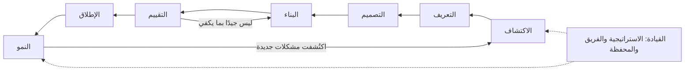
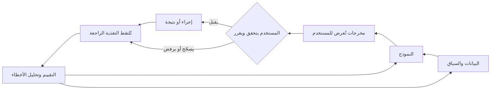
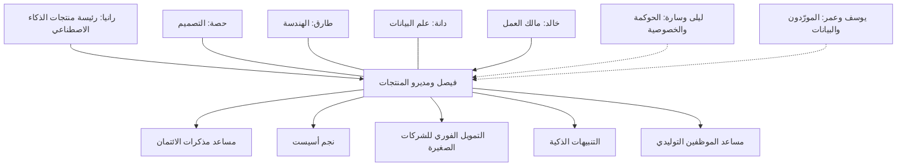

# الوحدة 0 — التوجيه

*قبل الموجّهات (prompts) والنماذج والمقاييس، تحتاج إلى صورة واضحة عن طبيعة العمل. تشرح هذه الوحدة ما هي إدارة منتجات الذكاء الاصطناعي وما ليست هي. وتبيّن لماذا تتصرف منتجات الذكاء الاصطناعي بشكل مختلف عن البرمجيات التي تعرفها أصلًا: فهي احتمالية (probabilistic)، وتعتمد على البيانات، وكل استخدام لها يكلّف مالًا، ولا تنجح إلا إذا وثق بها الناس بالقدر الصحيح. ثم تقدّم بنك نجم (Najm Bank)، البنك الخليجي الخيالي الذي ستنضم إلى فريق المنتجات الرقمية ومنتجات الذكاء الاصطناعي فيه طوال الدورة، مع منتجاته الخمسة القائمة على الذكاء الاصطناعي والأشخاص الذين يبنونها ويرعونها ويحكمونها. وتنتهي بكيفية تنظيم الدورة، وكيفية دراستها، ومتى تنتقل إلى إحدى الدورات المرافقة.*

> **المراحل:** جميع المراحل الثماني، في عرض تمهيدي — Discover · Define · Design · Build · Evaluate · Launch · Grow · Lead — خريطة العمل قبل أن نسير فيها مرحلةً مرحلة.

---

# 0.1 — ما هي إدارة منتجات الذكاء الاصطناعي، وما ليست هي
*المستوى: 🟢 مبتدئ* · *المتطلبات: لا يوجد* · *المرحلة: Discover, Lead*

**بعد هذا الدرس تستطيع** أن تعيد صياغة طلب يبدأ من التقنية مثل «نحتاج إلى روبوت محادثة» إلى مشكلة ونتيجة قابلة للقياس ومعيار جودة وتكلفة وخطوة أولى، وتكتب بطاقة دور تبيّن ما يملكه مدير منتج الذكاء الاصطناعي وما لا يملكه. *مدة الدراسة: قراءة نحو 20 دقيقةً، وعمل تطبيقي نحو 115 دقيقةً (تقدير).*

## ⚡ الدرس في دقيقة
- **إدارة منتجات الذكاء الاصطناعي** هي عمل تحديد أي منتج قائم على الذكاء الاصطناعي يجب بناؤه، ولمن، وبأي معيار جودة، وبأي تكلفة ومخاطر، ثم إثبات أنه يخلق قيمة حين يستخدمه أناس حقيقيون.
- ما زالت إدارة منتج. فأنت تجيب عن الأسئلة الأربعة نفسها التي يواجهها كل فريق منتج، وهي مخاطر القيمة وسهولة الاستخدام والجدوى التقنية والجدوى التجارية عند مارتي كيغان (Marty Cagan). ومع الذكاء الاصطناعي (AI)، يكتسب كل سؤال أجزاءً جديدة وأصعب.
- وهي **ليست** علم بيانات، ولا هندسة موجّهات، ولا إدارة مشاريع، ولا حوكمة، ولا «أن تكون المتحمّس للذكاء الاصطناعي». أنت تعمل عن قرب مع كل هذه الأدوار، لكن عملك هو قرار المنتج والنتيجة.
- إشارة القرار: ابدأ من مشكلة ونتيجة قابلة للقياس («تقليص وقت صياغة مذكرات الائتمان دون خفض جودة المذكرة»)، ولا تبدأ أبدًا من تقنية («أين يمكننا استخدام الذكاء الاصطناعي التوليدي؟»).
- أكبر فخ: **فخ العرض التوضيحي**. العرض التوضيحي الذي ينجح ثماني مرات من عشر يبدو كأنه منتج. لكنه ليس منتجًا حتى تعرف كم مرة يفشل، وكم تكلّف هذه الإخفاقات، ومن يكتشفها.

## 🧭 لماذا يهم
في يوم الاثنين الأول لفيصل بصفته مدير منتج ذكاء اصطناعي في بنك نجم، يمرّ خالد، رئيس الإقراض للأفراد، بمكتبه. «منافسونا لديهم ذكاء اصطناعي في تطبيقاتهم. أريد مساعدًا على غرار ChatGPT في تطبيقنا بحلول الربع الثالث. هل يمكنك كتابة المتطلبات؟» فيصل متحمّس لإثارة الإعجاب. وبحلول الأربعاء يكون لديه مستند من اثنتي عشرة صفحة يسرد الميزات: المحادثة، والصوت، والعربية والإنجليزية، والتحكم في البطاقات، ومدرّب الإنفاق، وعروض القروض.

تقرأه رانيا، رئيسة منتجات الذكاء الاصطناعي، وتطرح أربعة أسئلة. ما مشكلة العميل التي يحلها هذا، وكيف نعرف أنها مشكلة؟ ما مدى الجودة المطلوبة لكل إجابة، وكيف سنقيس ذلك قبل الإطلاق؟ كم تكلّفنا كل محادثة، وماذا يستعيد العمل؟ ماذا يحدث حين يخطئ المساعد، ومن يلاحظ؟ المستند لا يجيب عن أي منها. لقد كتب فيصل قائمة ميزات لعرض توضيحي، لا خطة لمنتج.

وقد ارتكبت مؤسسات جيدة التمويل الخطأ نفسه على نطاق أكبر بكثير. استثمرت IBM بكثافة في Watson Health وروّجت له لاستخدامات سريرية مثل توصيات علاج السرطان. وفي عام 2022 باعت IBM أصول البيانات والتحليلات الخاصة بـ Watson Health. ووصفت التقارير العامة فجوة واسعة بين عروض توضيحية مبهرة وأدوات تلائم سير العمل الفعلي للأطباء ومعايير الأدلة لديهم. كانت أسئلة المنتج — عمل مَن يحسّنه هذا، وكيف نثبت أنه ينجح هنا، وكم تكلّف الموثوقية؟ — أصعب مما جعلها العرض التوضيحي تبدو. وتلك الفجوة بين «يستطيع فعل ذلك» و«يعتمد عليه الناس كل يوم» هي حيث يستحق مديرو منتجات الذكاء الاصطناعي أجرهم.

## 📐 كيف يعمل

### 🟢 الأساسيات

**ماذا يفعل مدير المنتج.** مدير المنتج مسؤول عن التأكد من أن الفريق يبني شيئًا يستحق البناء، وأنه ينجح فعلًا للأشخاص الذين يُفترض أن يخدمهم. يصوّر كتاب كيغان *Inspired* ذلك على أنه تقليل أربعة مخاطر قبل البناء وأثناءه:

| المخاطرة | السؤال | من يقودها عادةً |
|---|---|---|
| **القيمة** | هل سيختار العملاء أو المستخدمون استخدامه أو شراءه؟ | مدير المنتج |
| **سهولة الاستخدام** | هل يستطيعون معرفة كيفية استخدامه؟ | مصمم المنتج |
| **الجدوى التقنية** | هل نستطيع بناءه بالوقت والمهارات والبيانات والتقنية المتاحة لنا؟ | قائد الهندسة |
| **الجدوى التجارية** | هل يناسب بقية العمل: التكلفة، والقانون، والعلامة التجارية، والمبيعات، والدعم؟ | مدير المنتج |

لا يفعل مدير المنتج (PM) كل هذا وحده. فهو يتأكد من معالجة المخاطر الأربعة جميعها، ويملك سؤالَي القيمة والجدوى التجارية.

**ما الذي تضيفه إدارة منتجات الذكاء الاصطناعي.** منتج الذكاء الاصطناعي هو منتج يُنتج فيه نموذج — أي برنامج تعلّم سلوكه من البيانات بدلًا من أن يُكتب كقواعد — جزءًا مهمًا من المخرجات. قد يكون نموذج تعلّم آلي يتنبأ برقم، مثل احتمال سداد فاتورة، أو نموذجًا لغويًا كبيرًا يولّد نصًا. وفي الحالتين، يغيّر الذكاء الاصطناعي كل مخاطرة:

| المخاطرة | ما يضيفه الذكاء الاصطناعي |
|---|---|
| القيمة | قد يحب المستخدمون الفكرة لكنهم لا يثقون بالمخرجات بما يكفي لاستخدامها. القيمة تعتمد على الجودة، والجودة تتفاوت. |
| سهولة الاستخدام | يجب أن تُظهر الواجهة عدم اليقين، وتدعو إلى التحقق، وتجعل تصحيح الأخطاء سهلًا (الوحدة 4). |
| الجدوى التقنية | كثيرًا ما لا تستطيع معرفة مدى جودة النموذج على بياناتك *أنت* حتى تجرّب. تصبح الجدوى التقنية تجربة لا تقديرًا (الوحدتان 1 و5). |
| الجدوى التجارية | كل استخدام يكلّف مالًا، ويمكن أن تسبب الأخطاء ضررًا قانونيًا وضررًا بالسمعة، وقد يصنّف المنظمون الاستخدام على أنه عالي المخاطر (high-risk) (الوحدتان 8 و9). |

**تعريف عملي.** في هذه الدورة، تعني إدارة منتجات الذكاء الاصطناعي: *اختيار المشكلات التي يمكن للذكاء الاصطناعي أن يخلق فيها قيمة، وتحديد معيار الجودة الذي يجب أن يستوفيه الذكاء الاصطناعي، وتصميم كيفية عمل الناس والذكاء الاصطناعي معًا، وإثبات الجودة قبل الإطلاق وبعده، وإدارة القيمة والتكلفة والمخاطر طوال عمر المنتج.* وكل وحدة تعلّم جزءًا واحدًا من هذه الجملة.

**ما ليست إدارة منتجات الذكاء الاصطناعي.** كثيرًا ما ينجرف مديرو منتجات الذكاء الاصطناعي الجدد إلى دور مجاور لأنه يبدو أكثر ملموسية. يبيّن الجدول أين تقع الحدود عادةً. تختلف الحدود بين المؤسسات، لكن عمل مدير المنتج لا يذوب أبدًا في أي منها.

| الدور | ما يملكه | أين يعمل معه مدير المنتج | ما لا ينبغي لمدير المنتج فعله |
|---|---|---|---|
| عالم البيانات (دانة) | النماذج، والخصائص، والتقييم الإحصائي | الاتفاق على معنى «جيد» وأي الأخطاء أهم | اختيار بنية النموذج |
| مهندس الذكاء الاصطناعي أو التعلّم الآلي (فريق طارق) | خطوط المعالجة، والموجّهات في بيئة الإنتاج، والتشغيل والخدمة، وزمن الاستجابة (latency)، وهندسة التكلفة | المفاضلات بين الجودة والسرعة والتكلفة | ضبط موجّهات الإنتاج يدويًا دون اختبارات |
| مصمم المنتج (حصة) | البحث، وأنماط التفاعل، والتجربة | كيف تُعرض مخرجات الذكاء الاصطناعي وتُراجَع وتُصحَّح | تخطّي بحث المستخدمين لأن «النموذج سيتولى الأمر» |
| الحوكمة والمخاطر (ليلى) | تصنيف المخاطر، والسياسات، والموافقات | تصميم الضوابط في المنتج مبكرًا | معاملة الحوكمة كبوابة في النهاية |
| مدير المشروع أو التسليم | الخطط، والاعتماديات، والمواعيد | ترتيب تسلسل العمل | الخلط بين مشروع مُسلَّم ومنتج ناجح |
| مالك العمل (خالد) | خط العمل، وقائمة الأرباح والخسائر (P&L) الخاصة به، وأهدافه | تحديد النتيجة ودراسة الجدوى | اعتبار قائمة الميزات هي المتطلب |

وإدارة منتجات الذكاء الاصطناعي ليست أيضًا **«الذكاء الاصطناعي لمديري المنتجات»** (أي استخدام أدوات الذكاء الاصطناعي لكتابة المواصفات أو تلخيص المقابلات)؛ فهذه الدورة تتناول إدارة المنتجات *التي تحتوي على ذكاء اصطناعي*. وليست **تبشيرًا**. فمدير منتج الذكاء الاصطناعي الجيد يقتل أفكار ذكاء اصطناعي أكثر مما يطلق (الدرس 2.3)، لأن مشكلات كثيرة تُحلّ على نحو أفضل بقاعدة أو نموذج ورقي أو تغيير في الإجراءات.

### 🟡 التعمق أكثر

**ثلاثة أنواع من وظائف منتجات الذكاء الاصطناعي.** يغطي لقب «مدير منتج ذكاء اصطناعي» وظائف مختلفة. ومن المفيد أن تعرف في أيها أنت.

| النوع | ما تديره | مثال من نجم | التحدي الرئيسي |
|---|---|---|---|
| **مدير منتج ميزة ذكاء اصطناعي** | قدرة ذكاء اصطناعي داخل منتج قائم | التنبيهات الذكية (Smart Alerts) داخل تطبيق الجوال | إدخال الذكاء الاصطناعي في تجربة راسخة دون كسر الثقة |
| **مدير منتج أصيل في الذكاء الاصطناعي** | منتج لم يكن ليوجد لولا الذكاء الاصطناعي | مساعد مذكرات الائتمان (Credit Memo Copilot) | إثبات أن القدرة الأساسية جيدة بما يكفي وتستحق تغيير سير العمل |
| **مدير منتج منصة ذكاء اصطناعي** | قدرات مشتركة تبني عليها فرق أخرى | بوابة النماذج (model gateway) وخدمة الاسترجاع وأدوات التقييم خلف مساعد الموظفين التوليدي (Staff GenAI) ومساعد المذكرات | العملاء الداخليون، وإعادة الاستخدام، وضبط التكلفة، والمعايير |

**دورة حياة المنتج في هذه الدورة.** كل درس موسوم بمرحلة أو اثنتين من ثماني مراحل. وهي ليست تسلسلًا صارمًا. فالفرق الحقيقية تعود إلى الوراء باستمرار، خاصةً بين البناء والتقييم.

| المرحلة | السؤال الجوهري لمدير المنتج | المُخرَج النموذجي |
|---|---|---|
| **Discover** | هل توجد مشكلة حقيقية، وهل يمكن للذكاء الاصطناعي أن يساعد؟ | ملخص الفرصة |
| **Define** | ما الذي نبنيه بالضبط، وما معنى «جيد»؟ | بطاقة تقييم حالة الاستخدام، ومواصفات الذكاء الاصطناعي بمعايير الجودة |
| **Design** | كيف يعمل الناس والذكاء الاصطناعي معًا؟ | تصميم التفاعل، ومستوى الأتمتة، ومسارات الأخطاء |
| **Build** | كيف نصل إلى نسخة عاملة بسرعة وأمان؟ | النموذج الأولي، وتصميم الموجّه والسياق |
| **Evaluate** | هل ينجح فعلًا، وكيف نعرف؟ | خطة التقييم، والمجموعة المرجعية (golden set)، وتحليل الأخطاء (error analysis) |
| **Launch** | هل هو جاهز للمستخدمين الحقيقيين، وهل هم جاهزون له؟ | قائمة تحقق الإطلاق، وخطة التمكين |
| **Grow** | هل يخلق قيمة بتكلفة مقبولة، ويبقى جيدًا؟ | شجرة المقاييس، واقتصاديات الوحدة (unit economics)، وخطة المراقبة |
| **Lead** | أين يجب أن نستثمر بعد ذلك، وكيف يجب أن يعمل الفريق؟ | الاستراتيجية، وخارطة الطريق، ونموذج التشغيل |

مرحلتان تهمان أكثر بكثير في الذكاء الاصطناعي. **التقييم** مرحلة قائمة بذاتها لأن «يعمل دون أخطاء» لا يقول شيئًا عن صحة الإجابات. و**النمو** يحمل وزنًا أكبر لأن الجودة تنجرف مع تغيّر البيانات والمستخدمين والنماذج (الدرس 8.3).

**الأطر التي تعرفها ما زالت تنطبق.** يتوافق **الماس المزدوج (Double Diamond)** الصادر عن مجلس التصميم البريطاني عام 2005 مع مرحلتي الاكتشاف والتعريف — أي ماسة المشكلة — ومع المراحل من التصميم إلى الإطلاق — أي ماسة الحل. وحلقة ابنِ-قِس-تعلّم (build-measure-learn loop) في منهج **الشركة الناشئة الرشيقة (Lean Startup)** لإريك ريس (Eric Ries) عام 2011 تلائم الذكاء الاصطناعي جيدًا، بشرط أن يشمل «القياس» *الجودة* على مجموعة اختبار ثابتة، لا الاستخدام وحده. وإطار **المهام المطلوب إنجازها (Jobs to be Done)** لكلايتون كريستنسن (Clayton Christensen) — حيث «يستأجر» الناس منتجًا لتحقيق تقدّم في موقف ما — يبقيك مركّزًا على المهمة لا على النموذج.

### 🔴 نظرة الخبير

**من تحديد الميزات إلى تحديد السلوك.** في البرمجيات العادية يصف مدير المنتج الميزات، ويجعلها المهندسون تتصرف تمامًا كما وُصفت. أما في منتجات الذكاء الاصطناعي فأنت تصف *السلوك ومعيار الجودة*: «في مذكرات ائتمان الشركات الصغيرة والمتوسطة، يجب أن تطابق الأرقام المالية في المسودة المستندات المصدر في نسبة محددة على الأقل من الحالات على مجموعة الاختبار لدينا، ويجب أن تذكر المسودة حين يكون رقم ما مفقودًا بدلًا من أن تخمّن». ثم تتفق مع دانة على طريقة قياس ذلك. وحالات الاختبار التي ترمّز هذا السلوك، والمعروفة باسم **التقييمات (evals)**، تصبح جزءًا من المتطلبات (الدرس 5.1). ومدير المنتج الذي لا يستطيع قراءة تقرير تقييم يخمّن بشأن منتجه هو.

**امتلاك التكلفة كقرار منتج.** كثيرًا ما تكلّف ميزة الذكاء الاصطناعي مالًا في كل مرة تعمل فيها. فالنموذج الأكبر، أو السياق الأكثر، أو خطوة تحقق ثانية هي قرارات منتج لها ثمن، وليست مجرد تفاصيل هندسية. ومدير المنتج الذي يملك القيمة يجب أن يملك أيضًا **تكلفة الخدمة (cost to serve)** (الدرس 8.2).

**المساءلة دون سلطة على كل شيء.** حين يُلحق منتج ذكاء اصطناعي ضررًا بأحد، تكون المسؤولية مشتركة بين مالك العمل والحوكمة والبناة ومدير المنتج. وجزء مدير المنتج هو منتج مصمَّم بحيث يكون الضرر غير مرجّح، ومرئيًا حين يقع، ويُصحَّح بسرعة. وهذا يعني دعوة ليلى وسارة في مرحلة الاكتشاف، لا في الأسبوع الذي يسبق الإطلاق. تفاصيل الحوكمة موجودة في الدورة المرافقة *AI Governance: Zero to Hero*؛ أما هنا فنبقى على قرار المنتج.

**ماذا تعني «البطل» هنا.** بنهاية الدورة يجب أن تكون قادرًا على أخذ طلب غامض مثل طلب خالد حتى الوصول إلى منتج في بيئة الإنتاج، وأن تصمد في النقاش مع المهندسين وعلماء البيانات ومسؤولي المخاطر والتنفيذيين. والمشروع الختامي في الوحدة 10 يطلب منك فعل ذلك بالضبط لنجم أسيست (Najm Assist).

## 🧰 الأدوات
| الأداة أو الإطار | ما هو وماذا يفعل | متى تلجأ إليه |
|---|---|---|
| **Four big risks** — المخاطر الأربع الكبرى | القيمة، وسهولة الاستخدام، والجدوى التقنية، والجدوى التجارية: الطرق الأربع التي يفشل بها المنتج | في بداية أي فكرة ذكاء اصطناعي، لمعرفة أي مخاطرة هي الأكبر واختبارها أولًا |
| **Jobs to be Done** — المهام المطلوب إنجازها | يصوغ الطلب على أنه التقدّم الذي يحاول شخص تحقيقه في موقف ما | حين يصل طلب في صورة تقنية («أضف روبوت محادثة») وتحتاج إلى المهمة الكامنة |
| **Double Diamond** (UK Design Council, 2005) — الماس المزدوج | التوسّع ثم التضييق مرتين: على المشكلة، ثم على الحل | لمنع الفريق من القفز إلى حل قبل أن تتضح المشكلة |
| **Build-measure-learn** (Eric Ries, 2011) — حلقة ابنِ-قِس-تعلّم | تجارب صغيرة مقيسة للتعلّم بسرعة قبل التوسّع | حين تكون الجدوى التقنية أو القيمة غير مؤكدة، وهذا هو الحال عادةً مع الذكاء الاصطناعي |
| **Product lifecycle stages** — مراحل دورة حياة المنتج (هذه الدورة) | Discover وDefine وDesign وBuild وEvaluate وLaunch وGrow وLead، مع سؤال جوهري ومُخرَج لكل مرحلة | لتحديد موقع المنتج وأي قرار مستحق بعد ذلك |

## 🏛️ عمليًا في بنك نجم
بعد المراجعة، تعطي رانيا فيصل شيئين. الأول هو **بطاقة دور مدير منتج الذكاء الاصطناعي** التي تعطيها لكل مدير منتج جديد في فريقها:

| | فيصل في نجم أسيست |
|---|---|
| **يملك** | مشكلة العميل والنتيجة المستهدفة؛ ومعيار الجودة (بالاتفاق مع دانة)؛ والنطاق ومستوى الأتمتة؛ ودراسة الجدوى؛ والتوصية بقرار الإطلاق؛ ومقاييس ما بعد الإطلاق |
| **يشارك في** | تصميم التجربة (مع حصة)؛ وتصميم التقييم (مع دانة)؛ ومفاضلات التكلفة وزمن الاستجابة (مع طارق)؛ وضوابط المخاطر (مع ليلى وسارة) |
| **يقدّم المشورة في** | اختيار النموذج والمورّد (يقرر طارق ودانة ويوسف)؛ وفئة الحوكمة (تقرر ليلى) |
| **لا يملك** | بنية النموذج؛ وتغييرات موجّهات الإنتاج دون اختبارات؛ والموافقة النهائية على المخاطر؛ وقائمة الأرباح والخسائر الخاصة بخالد |

الثاني هو **طلب مُعاد صياغته**، يعيد فيصل كتابته مع خالد في صفحة واحدة:

| الحقل | قبل (طلب خالد) | بعد (بعد إعادة الصياغة) |
|---|---|---|
| المشكلة | «نحتاج إلى مساعد ذكاء اصطناعي مثل المنافسين» | كثير من مكالمات مركز الاتصال أسئلة بسيطة عن الرسوم وحالة البطاقة والتحويلات، كان العملاء سيجيبون عنها بأنفسهم لو كانت الإجابات سهلة الإيجاد |
| من | «جميع العملاء» | مستخدمو تطبيق الأفراد في قطر والإمارات، بالعربية والإنجليزية |
| النتيجة | «الإطلاق بحلول الربع الثالث» | مكالمات بسيطة أقل، مع رضا عملاء لا يقل عن مستواه اليوم، ودون ارتفاع في الشكاوى من معلومات خاطئة |
| معيار الجودة | غير مذكور | إجابات مستندة إلى محتوى البنك المعتمد؛ وتسليم إلى إنسان عند عدم التأكد؛ ومعدل خطأ على مجموعة اختبار يُتفق عليه قبل التجربة التشغيلية |
| التكلفة | غير مذكورة | تكلفة المحادثة المحلولة تُقدَّر قبل البناء وتُتابَع بعد الإطلاق |
| الخطوة الأولى | البناء | أسبوعان من الاكتشاف: الاستماع إلى المكالمات، وأخذ عينة من بيانات مركز الاتصال، واختبار الإجابات على نموذج أولي صغير |

يوافق خالد على النتيجة، لأنها مكتوبة بلغته: المكالمات، والرضا، والشكاوى.

## 🛠️ التمارين
- 🟢 اختر ميزة ذكاء اصطناعي تستخدمها (مرشّح بريد مزعج، أو بحث في الصور، أو مساعد كتابة). اكتب جملة واحدة لكل من مخاطر كيغان الأربع كما تنطبق عليها. *يكتمل عندما:* تكون لديك أربع جمل، ويذكر اثنتان منها على الأقل شيئًا خاصًا بالذكاء الاصطناعي (الأخطاء، أو البيانات، أو التكلفة، أو الثقة).
- 🟡 خذ طلبًا يبدأ من التقنية سمعته («نحتاج إلى روبوت محادثة بالذكاء الاصطناعي»، «لنستخدم الذكاء الاصطناعي التوليدي للتقارير») وأعد صياغته باستخدام الجدول في 🏛️: المشكلة، ومن، والنتيجة، ومعيار الجودة، والتكلفة، والخطوة الأولى. *يكتمل عندما:* تكون النتيجة قابلة للقياس ولا تقول شيئًا عن التقنية التي ستُستخدم.
- 🔴 اكتب بطاقة دور مثل بطاقة رانيا لمنتج ذكاء اصطناعي في مؤسستك، واعرضها على مهندس واحد وزميل واحد من المخاطر أو الامتثال. *يكتمل عندما:* يوافق كلاهما على صفَّي «يملك» و«لا يملك»، أو تكون قد دوّنت أين يختلفان ولماذا.

راجع عملك

**🟢 إجابة نموذجية (مرشّح البريد المزعج).** القيمة: هل سأثق بمجلد البريد المزعج بما يكفي لأتوقف عن تفقّده؟ سهولة الاستخدام: هل أرى لماذا صُفّيت رسالة وأستعيدها بلمسة واحدة؟ الجدوى التقنية: هل يواصل التقاط الرسائل المزعجة الجديدة دون حجب البريد الحقيقي (الأخطاء)؟ الجدوى التجارية: هل يبقى فحص كل رسالة ميسور التكلفة ومشروعًا (التكلفة، البيانات)؟ جملتان تذكران مسائل خاصة بالذكاء الاصطناعي، فيتحقق شرط الاكتمال.

**🟡 و🔴 مراجعة ذاتية.** ينجح طلبك المُعاد صياغته إذا: كانت النتيجة رقمًا له اتجاه وتاريخ؛ وقال معيار الجودة كم يكلّف الخطأ؛ ولم تُذكر أي تقنية؛ وكانت الخطوة الأولى اختبارًا تستطيع بدءه هذا الأسبوع. وتنجح بطاقة الدور إذا سمّى صف «لا يملك» قرارًا واحدًا على الأقل يعود إلى المخاطر أو الخصوصية أو الهندسة.

**تعمل وحدك؟** إن لم تستطع الوصول إلى مهندس وزميل امتثال، فقارن بطاقتك ببطاقة رانيا وبجدول الشخصيات في 0.3، وعلّم كل صف «يطابق» أو «يختلف» أو «غير متأكد»، مع سطر يشرح السبب.

## ⚠️ أخطاء وفخاخ
- **البدء من التقنية.** سؤال «أين يمكننا استخدام الذكاء الاصطناعي التوليدي؟» ينتج عروضًا توضيحية. ابدأ من مهمة وسير عمل ونتيجة قابلة للقياس.
- **الخلط بين العرض التوضيحي والمنتج.** العرض التوضيحي يُظهر أن النموذج *يستطيع* أن ينجح. أما المنتج فيحتاج إلى معرفة *كم مرة* يفشل وماذا يحدث حينها. اطلب معدل خطأ على حالات تمثيلية قبل أن يقول أحد «إنه يعمل».
- **أن تصبح أنت مهندس الموجّهات.** ضبط الموجّهات بنفسك يبدو منتجًا، لكنه يترك النتيجة بلا مالك. ساهم بالأمثلة ومعايير الجودة. واترك تغييرات الإنتاج لعملية مُختبَرة.
- **معاملة الحوكمة كآخر بوابة.** إدخال ليلى عند الإطلاق يحوّل تغييرًا صغيرًا في التصميم إلى تأخير. ادعُ زملاء المخاطر والخصوصية في مرحلة الاكتشاف.
- **قياس الإطلاق بدلًا من النتيجة.** «أُطلق بحلول الربع الثالث» معلم مشروع. اتفق على مقياس نتيجة ومعيار جودة قبل البناء.

## 🧾 الخلاصة
- إدارة منتجات الذكاء الاصطناعي هي إدارة منتج بأربعة شروط أصعب: جودة متفاوتة، واعتماد على البيانات، وتكلفة لكل استخدام، وثقة هشّة.
- ما زالت مخاطر كيغان الأربع تؤطّر العمل. والذكاء الاصطناعي يضيف أسئلة جديدة إلى كل منها.
- يملك مدير منتج الذكاء الاصطناعي (AI PM) المشكلة والنتيجة ومعيار الجودة ودراسة الجدوى. ويشارك قرارات التصميم والتقييم والتكلفة والمخاطر مع المتخصصين.
- تتبع الدورة ثماني مراحل لدورة الحياة. والتقييم والنمو يهمان في الذكاء الاصطناعي أكثر مما يهمان في البرمجيات العادية.
- الفشل الأكثر شيوعًا هو فخ العرض التوضيحي: الخلط بين «يستطيع» و«يفعل ذلك بموثوقية، هنا، لهؤلاء الناس، بهذه التكلفة».

## ✍️ اختبر نفسك

**1. يطلب خالد من فيصل «إضافة مساعد ذكاء اصطناعي إلى التطبيق بحلول الربع الثالث». ماذا يجب أن يفعل فيصل أولًا؟**

- A. كتابة متطلبات ميزات مفصّلة الآن كي تقدّر الهندسة حجم العمل وتلحق بموعد الربع الثالث
- B. أن يطلب من طارق قائمة مختصرة بمورّدي النماذج لمقارنة التكلفة والجودة قبل تحديد النطاق
- C. إعادة صياغة الطلب حول مشكلة عميل ونتيجة قابلة للقياس ومعيار جودة، ثم إجراء اكتشاف قصير
- D. بناء عرض توضيحي عامل خلال أسبوع كي يتفاعل خالد مع شيء حقيقي قبل تحديد النطاق

الإجابة

**C.** المهمة الأولى لمدير المنتج هي تحويل طلب تقني إلى مشكلة ونتيجة، ثم اختبار ما إذا كانت المشكلة حقيقية. العرض التوضيحي (D) مغرٍ لأنه يبدو تقدّمًا، لكنه يتخطى أسئلة القيمة والجودة ويقود مباشرة إلى فخ العرض التوضيحي. (🧭 لماذا يهم؛ 🏛️ عمليًا.)

**2. أي مخاطر كيغان الأربع يتغير *أكثر* بسبب أنك كثيرًا ما لا تستطيع معرفة مدى جودة أداء نموذج على بياناتك حتى تجرّبه؟**

- A. القيمة
- B. سهولة الاستخدام
- C. الجدوى التقنية
- D. الجدوى التجارية

الإجابة

**C.** مع الذكاء الاصطناعي، تصبح الجدوى التقنية تجربة لا تقديرًا، لأن الأداء على بياناتك غير مؤكد حتى يُختبر. القيمة (A) تتأثر أيضًا، لكن النقطة المحددة المتعلقة بعدم معرفة أداء النموذج مسبقًا هي سؤال جدوى تقنية. (🟢 الأساسيات.)

**3. في بنك نجم (Najm Bank)، من يجب أن يقرر بنية النموذج للتمويل الفوري للشركات الصغيرة (SME Instant Finance)؟**

- A. قائدا علم البيانات والهندسة، مع تحديد مدير المنتج لمعيار الجودة والمفاضلات
- B. مدير منتج الذكاء الاصطناعي، لأنه يملك المنتج ويُحاسَب على نتائجه وعلى كل قرار يخص طريقة عمله أمام الإدارة العليا
- C. رئيسة حوكمة الذكاء الاصطناعي، لأن خيارات البنية تؤثر في المخاطر ويجب أن تعتمدها مركزيًا قبل أي بناء
- D. مالك العمل، لأنه يموّل المنتج ويتحمل المخاطر التجارية لخياراته أمام مجلس الإدارة

الإجابة

**A.** يملك مدير المنتج *معنى الجيد* والمفاضلات. ويختار المتخصصون *كيفية* تحقيقه. الخيار B هو الخطأ المغري: امتلاك المنتج لا يعني امتلاك كل قرار تقني. (🟢 الأساسيات، جدول الأدوار؛ 🏛️ بطاقة الدور.)

**4. أي عبارة تصف على أفضل وجه الفرق بين مدير منتج ميزة ذكاء اصطناعي ومدير منتج منصة ذكاء اصطناعي؟**

- A. مدير منتج الميزة يخدم المستخدمين النهائيين لمنتج واحد؛ ومدير منتج المنصة يخدم فرقًا داخلية تبني على قدرات مشتركة
- B. مدير منتج الميزة يعمل على الذكاء الاصطناعي التوليدي؛ ومدير منتج المنصة يعمل على التعلّم الآلي الكلاسيكي
- C. مدير منتج المنصة يملك مورّدي النماذج وعقودهم، بينما يملك مدير منتج الميزة تجربة المستخدم النهائي
- D. مدير منتج الميزة يكتب المتطلبات؛ ومدير منتج المنصة يشغّل النماذج والتقييمات لكل الفرق

الإجابة

**A.** الفرق هو من هو العميل: المستخدمون النهائيون لمنتج واحد، أو الفرق الداخلية التي تستخدم خدمات مشتركة. نوع الذكاء الاصطناعي (B) لا يحدد الدور. (🟡 التعمق أكثر.)

**5. يقول فريق إن ملخِّصه الجديد بالذكاء الاصطناعي «يعمل» لأنه أنتج ملخصات جيدة في كل عرض توضيحي أمام القيادة. ما السؤال التالي الأكثر فائدة من مدير المنتج؟**

- A. «هل نعيد العرض نفسه أمام بقية الإدارات لكسب الدعم قبل أن نستثمر أكثر؟»
- B. «كم مرة يفشل على مجموعة تمثيلية من المستندات الحقيقية، وما أنواع الفشل، ومن سيكتشفها؟»
- C. «أي منافس لديه ميزة مشابهة، وكيف تقارن جودة ملخصاتنا بجودة ملخصاته؟»
- D. «بما أن القيادة أُعجبت به، هل نطلقه لكل الموظفين الأسبوع القادم ونجمع الملاحظات؟»

الإجابة

**B.** العروض التوضيحية تُظهر أن النموذج *يستطيع* أن ينجح. أما قرارات المنتج فتحتاج إلى معدل الفشل على حالات تمثيلية وخطة لاكتشاف الإخفاقات. الخيار D ينبع من فخ العرض التوضيحي. (⚡ الدرس في دقيقة؛ ⚠️ أخطاء وفخاخ.)

## 📚 المراجع
- Marty Cagan, *Inspired: How to Create Tech Products Customers Love*, 2nd ed. (Wiley, 2017) — https://www.svpg.com
- Clayton M. Christensen, Taddy Hall, Karen Dillon and David S. Duncan, *Competing Against Luck* (Harper Business, 2016)
- Anthony W. Ulwick, *Jobs to Be Done: Theory to Practice* (Idea Bite Press, 2016) — https://strategyn.com
- UK Design Council, the Double Diamond — https://www.designcouncil.org.uk
- Eric Ries, *The Lean Startup* (Crown Business, 2011) — https://theleanstartup.com
- Google PAIR, People + AI Guidebook — https://pair.withgoogle.com/guidebook

---

# 0.2 — كيف تختلف منتجات الذكاء الاصطناعي: احتمالية، ونهمة للبيانات، ومكلفة لكل استخدام، ومرهونة بالثقة
*المستوى: 🟢 مبتدئ* · *المتطلبات: 0.1* · *المرحلة: Define, Evaluate*

**بعد هذا الدرس تستطيع** أن تقدّر التكلفة الشهرية للنموذج في مساعد ذكاء اصطناعي انطلاقًا من افتراضات توضيحية معلنة، وتسمّي الافتراض الذي يتأثر به المجموع أكثر من غيره، وتحوّل كلًّا من الفروق الأربعة لمنتجات الذكاء الاصطناعي إلى متطلب يمكن اختباره. *مدة الدراسة: قراءة نحو 20 دقيقةً، وعمل تطبيقي نحو 130 دقيقةً (تقدير).*

## ⚡ الدرس في دقيقة
- تختلف منتجات الذكاء الاصطناعي عن البرمجيات العادية في أربعة جوانب تغيّر تقريبًا كل قرار منتج. فهي **احتمالية (probabilistic)**، و**نهمة للبيانات**، و**مكلفة لكل استخدام**، و**مرهونة بالثقة**.
- **احتمالية:** المدخل نفسه قد يعطي مخرجات مختلفة، وبعض المخرجات ستكون خاطئة. الجودة *معدل* يُقاس على حالات تمثيلية، لا اختبار نعم/لا.
- **نهمة للبيانات:** ما يعرفه المنتج ومدى جودة أدائه يعتمدان على بيانات يجب أن يكون لك الحق في استخدامها، وأن تحافظ على نظافتها وحداثتها.
- **مكلفة لكل استخدام:** كثير من ميزات الذكاء الاصطناعي تكلّف مالًا في كل مرة تعمل فيها، لذا يرفع النجاح التكاليف. وتكلفة المهمة الواحدة (cost per task) مقياس منتج.
- **مرهونة بالثقة:** لا تظهر القيمة إلا حين يعتمد الناس على المخرجات بالقدر الصحيح: لا اعتمادًا أعمى، ولا اعتمادًا ضئيلًا يجعلهم يعيدون العمل.
- أكبر فخ: كتابة مواصفات كأن الذكاء الاصطناعي سيتصرف كميزة حتمية («المساعد يجيب عن أسئلة الرسوم بشكل صحيح») دون معدل خطأ، ودون تقدير للتكلفة، ودون خطة لحالة الخطأ.

## 🧭 لماذا يهم
في عام 2022 سأل مسافر روبوت المحادثة في موقع Air Canada عن أسعار تذاكر الحداد. فأخبره الروبوت أنه يستطيع التقدم بطلب الخصم بعد السفر. لكن سياسة الشركة نفسها كانت تقول غير ذلك. وحين طالب باسترداد المبلغ، احتجّت الشركة بأن روبوت المحادثة كان في الواقع كيانًا مستقلًا مسؤولًا عن تصريحاته. وفي قضية *Moffatt v. Air Canada* (2024)، رفضت محكمة تسوية النزاعات المدنية في كولومبيا البريطانية هذه الحجة، وحمّلت الشركة المسؤولية عمّا قاله روبوتها. كان المبلغ صغيرًا. أما الدرس فكان كبيرًا: العميل لا يهتم بأن الإجابة جاءت من نموذج. الشركة هي التي تملكها.

بعد أسبوعين من الاكتشاف، يعرض فيصل على خالد نموذجًا أوليًا لنجم أسيست. يجيب النموذج عن عشرين سؤالًا مُعدًّا مسبقًا عن الرسوم والبطاقات إجابات مثالية، بالعربية والإنجليزية. ثم تدير حصة جلسة مع عشرة عملاء حقيقيين يكتبون أسئلتهم الخاصة. يسأل أحدهم عن رسوم تحويل دولي من حساب توفير. فيعطي النموذج الأولي إجابة واثقة تخلط بين جدولَي رسوم. ويطرح آخر السؤال نفسه مرتين فيحصل على إجابتين بصياغتين مختلفتين، تُسقط إحداهما شرطًا. لم يكن أحد في الغرفة قد رأى هذا في العرض التوضيحي.

لم يكن شيء «معطّلًا»؛ لقد فعل النموذج الأولي ما تفعله النماذج اللغوية (language models). كانت خطة فيصل قد افترضت ميزة تطبيق عادية.

## 📐 كيف يعمل

### 🟢 الأساسيات

يقارن الجدول بين ميزة برمجية تقليدية وميزة ذكاء اصطناعي في الفروق الأربعة.

| | البرمجيات التقليدية | منتج الذكاء الاصطناعي |
|---|---|---|
| **السلوك** | حتمي (Deterministic): المدخل نفسه، المخرج نفسه، في كل مرة | احتمالي: المخرجات تتفاوت، وجزء منها خاطئ |
| **ما يجعله يعمل** | شيفرة يكتبها المهندسون | شيفرة *إضافةً إلى* نموذج يأتي سلوكه من البيانات |
| **تكلفة كل استخدام** | قريبة من الصفر بعد البناء | غالبًا تكلفة حقيقية لكل طلب، تنمو مع الاستخدام |
| **علاقة المستخدم** | يتوقع المستخدمون أن يكون صحيحًا وهو كذلك عادةً | يجب أن يتعلم المستخدمون متى يعتمدون عليه ومتى يتحققون |

**1. احتمالية.** الميزة التقليدية، مثل حاسبة الرسوم، تتبع قواعد. وإذا أعطت إجابة خاطئة، فذلك خلل برمجي يمكنك إيجاده وإصلاحه، وبعد الإصلاح تكون صحيحة في كل مرة. أما نموذج الذكاء الاصطناعي فينتج المخرج *الأكثر ترجيحًا* بناءً على ما تعلّمه. في معظم الأحيان يكون ذلك المخرج جيدًا. وفي بعضها لا يكون، ولا يمكنك سرد كل حالة مسبقًا.

كثيرًا ما تعمل النماذج التوليدية (generative models) بعشوائية مقصودة، تُضبط بواسطة **درجة الحرارة (temperature)**: القيم الأعلى تعطي مخرجات أكثر تنوعًا، والقيم الأدنى مخرجات أكثر اتساقًا. وحتى عند الإعدادات المنخفضة، قد يحصل سؤال أُعيدت صياغته قليلًا على إجابة مختلفة. وحين يذكر نموذج لغوي (language model) شيئًا خاطئًا بثقة، يسمّي الناس ذلك **هلوسة (hallucination)** (الدرس 1.2).

والنتيجة على المنتج أن سؤال «هل يعمل؟» لم يعد سؤال نعم/لا. بل يصبح: «كم مرة يكون صحيحًا في الحالات التي تهم، وماذا يحدث حين يخطئ؟». وتجيب عن ذلك بـ**مجموعة مرجعية (golden set)**: مجموعة ثابتة من المدخلات الواقعية ذات إجابات جيدة معروفة، تُستخدم لقياس الجودة بالطريقة نفسها في كل مرة (الدرس 6.1).

**2. نهمة للبيانات.** يعتمد سلوك منتج الذكاء الاصطناعي على البيانات في ثلاث نقاط:
- **بيانات التدريب (Training data):** ما تعلّم منه النموذج. في التمويل الفوري للشركات الصغيرة، هي تاريخ نجم من الفواتير والسداد والتعثّر. وفي نموذج لغوي كبير من مورّد، هي بيانات لم تخترها ولا تستطيع فحصها بالكامل.
- **بيانات السياق:** ما يعطيه المنتج للنموذج لحظة تشغيله. في نجم أسيست، هي جداول الرسوم المعتمدة وشروط المنتجات التي يسترجعها قبل الإجابة (نمط يُسمّى التوليد المعزّز بالاسترجاع، ويُغطّى في الدرس 1.3).
- **بيانات التغذية الراجعة:** ما تتعلمه من الاستخدام، مثل التصحيحات والتقييمات والنتائج. وهكذا يتحسّن المنتج (الدرس 3.2).

إذا كان جدول الرسوم الذي يسترجعه المساعد قديمًا، فستكون الإجابة خاطئة، مهما كان النموذج جيدًا. وإذا لم يكن لنجم الحق في استخدام محادثات العملاء للتحسين، فإن حلقة التغذية الراجعة (feedback loop) تكون مغلقة. جاهزية البيانات (Data readiness) سؤال منتج، لا سؤال هندسي فقط (الوحدة 3).

**3. مكلفة لكل استخدام.** كثير من ميزات الذكاء الاصطناعي، خاصةً التوليدية منها، تكلّف مالًا في كل مرة تعمل فيها. وتُسعَّر النماذج اللغوية عادةً لكل **رمز (token)**، وهو قطعة نص بحجم كلمة قصيرة تقريبًا أو جزء من كلمة، ويُحسب بشكل منفصل للمدخلات (ما ترسله) وللمخرجات (ما يعود). وطريقة تقدير التكلفة عملية حسابية بسيطة:

> تكلفة المهمة = (رموز المدخلات × سعر المدخلات) + (رموز المخرجات × سعر المخرجات)، مجموعةً على كل استدعاء للنموذج تقوم به المهمة

مثال **توضيحي** بأرقام تقريبية مختلَقة (الأسعار الحقيقية تتغير كثيرًا، فتحقق دائمًا من الأسعار الحالية): لنفترض أن استدعاءً واحدًا للنموذج أثناء صياغة مذكرة ائتمان يرسل 30,000 رمز مدخلات (input tokens) ويستقبل 2,000 رمز مخرجات (output tokens)، بسعر مثلًا $3 لكل مليون رمز مدخلات و$15 لكل مليون رمز مخرجات. هذا يساوي $0.09 + $0.03 = $0.12 لكل استدعاء، أو نحو $0.50 لمذكرة تحتاج أربعة استدعاءات (الأرقام نفسها التي يستخدمها الدرس 1.2). وهذا زهيد مقارنة بساعات من وقت مدير العلاقة. لكن حين تُطبَّق الحسبة نفسها على نجم أسيست بآلاف المحادثات يوميًا، مع عدة استدعاءات لكل منها، فإنها تنتج فاتورة شهرية يجب أن يبرّرها أحد. ونماذج التعلّم الآلي الكلاسيكية مثل التنبيهات الذكية أرخص بكثير عادةً لكل تنبؤ، لكنها ما زالت تحمل تكاليف البنية التحتية والمراقبة وإعادة التدريب.

والنتيجة على المنتج: كلما نجحت الميزة أكثر، ارتفعت الفاتورة. وتكلفة المهمة مكانها بجانب الجودة والتبنّي في لوحة مؤشرات مدير المنتج (الوحدة 8).

**4. مرهونة بالثقة.** لا يخلق منتج الذكاء الاصطناعي قيمة إلا حين يتصرف الناس بناءً على مخرجاته. فإذا لم يثق مديرو العلاقات بمساعد مذكرات الائتمان، فسيعيدون كتابة كل مسودة ولن يوفّروا وقتًا. وإذا وثقوا به أكثر من اللازم، فسيلصقون رقمًا خاطئًا في حزمة لجنة الائتمان. والهدف هو **الثقة المعايَرة (calibrated trust)**: اعتماد يطابق مدى موثوقية المنتج فعلًا، حالةً بحالة. ويتعامل كل من People + AI Guidebook من فريق Google PAIR وإرشادات التفاعل بين الإنسان والذكاء الاصطناعي من Microsoft (Microsoft's Guidelines for Human-AI Interaction) (Amershi et al., 2019) مع هذا بوصفه هدف تصميم أساسيًا. وإرشادات مثل «وضّح مدى جودة النظام في ما يستطيع فعله» و«ادعم التصحيح الفعّال» موجودة بسببه (الوحدة 4).

والثقة تنكسر أيضًا على الملأ. فقد تضمّن مقطع ترويجي لإطلاق Bard من Google (فبراير 2023) خطأً واقعيًا عن تلسكوب جيمس ويب الفضائي (James Webb Space Telescope). ويضيف الدرس 5.3 حالتين لروبوتَي محادثة: أحدهما استُدرج إلى «صفقة» سيارة بدولار واحد ($1)، والآخر شتم عميلًا بعد تحديث للنظام. كل حادثة كان وقوعها سهلًا وثمنها في السمعة باهظًا.

### 🟡 التعمق أكثر

**المنتجات التنبؤية والتوليدية تختلف أيضًا.** لدى نجم النوعان كلاهما، وتظهر الفروق الأربعة بطرق مختلفة.

| | التعلّم الآلي التنبؤي (Predictive ML) (التمويل الفوري للشركات الصغيرة، التنبيهات الذكية) | الذكاء الاصطناعي التوليدي (Generative AI) (مساعد مذكرات الائتمان، نجم أسيست) |
|---|---|---|
| المخرجات | درجة أو فئة أو رقم | نص مفتوح، وأحيانًا إجراءات |
| كيف يبدو «الخطأ» | تصنيف خاطئ: فاتورة سيئة تُعتمد، أو دفعة حقيقية يُشار إليها كمشبوهة | عبارة معقولة لكنها خاطئة، أو إغفال، أو نبرة خاطئة، أو إجراء غير آمن |
| كيف تُقاس الجودة | مقاييس قياسية على بيانات موسومة: الدقة (precision)، والشمول (recall)، ومعدلات الخطأ | معايير التقييم الوصفية (Rubrics)، والإجابات المرجعية (reference answers)، والمراجعة البشرية (human review)، والنموذج اللغوي كمُحكِّم (LLM-as-judge) (الدرس 6.2) |
| أين تقع التكلفة | بناء النموذج والتحقق من صحته ومراقبته | كل استدعاء، إضافةً إلى التقييم والمراجعة البشرية |
| مخاطرة الثقة الرئيسية | قرارات غامضة تؤثر في الناس (الائتمان)، وإرهاق التنبيهات (alert fatigue) | إجابات خاطئة واثقة، والاعتماد المفرط (over-reliance) |

في المنتجات التنبؤية، تكون **مصفوفة الالتباس (confusion matrix)** هي الأداة الأساسية. وهي جدول اثنين في اثنين يعدّ الإيجابيات الصادقة، والإيجابيات الكاذبة، والسلبيات الصادقة، والسلبيات الكاذبة. وتجعلك تسأل أي خطأ أسوأ. في التنبيهات الذكية، يزعج الإيجابي الكاذب العميل بتنبيه لا داعي له. ويسمح السلبي الكاذب بمرور الاحتيال. ولا يمكنك تقليل الاثنين معًا، لذا يجب أن يساعد مدير المنتج في اختيار المفاضلة (الدرس 6.1).

**حلقة منتج الذكاء الاصطناعي.** لأن السلوك يعتمد على البيانات والاستخدام، فإن منتج الذكاء الاصطناعي حلقة لا خط معالجة أحادي الاتجاه:

كل مربع قرار لمدير المنتج: أي بيانات تدخل، وأي نموذج، وكيف تُعرض المخرجات، ومدى سهولة التصحيح، وأي تغذية راجعة يُسمح لك بالتقاطها، وكم مرة يُعاد قياس الجودة.

**ما الذي يتغير في العمل اليومي لمدير المنتج.** تتحول الفروق الأربعة إلى تغييرات عملية ملموسة:

| العادة التقليدية | ممارسة منتجات الذكاء الاصطناعي | أين في الدورة |
|---|---|---|
| معايير القبول كنجاح/فشل | معايير الجودة كمعدلات على مجموعة مرجعية، مقسّمة حسب نوع الحالة | 5.1، 6.1 |
| قدّر الجهد ثم ابنِ | صمّم نموذجًا أوليًا مبكرًا لتكتشف ما هو ممكن | 5.2 |
| اختبر مرة واحدة قبل الإصدار | قيّم باستمرار؛ فالنماذج والبيانات والمورّدون يتغيرون | 6.3، 8.3 |
| التكلفة ميزانية بناء لمرة واحدة | تكلفة المهمة مقياس مستمر | 8.2 |
| صمّم المسار السعيد | صمّم للأخطاء وعدم اليقين والتعافي أولًا | 4.2 |
| المستخدمون يقرؤون دليلًا | المستخدمون يحتاجون إلى مساعدة لمعايرة الثقة | 4.2، 7.3 |

### 🔴 نظرة الخبير

**القدرة غير المتساوية.** قدرة الذكاء الاصطناعي ليست سلسة. فقد يؤدي نموذج مهمة صعبة جيدًا ثم يفشل في مهمة تبدو سهلة بجانبها. وقد وصفت ورقة عمل صادرة عام 2023 لفابريزيو ديلاكوا (Fabrizio Dell'Acqua) وزملائه هذا بأنه «حدود تقنية متعرّجة». وفي تجربتهم، أدى المستشارون الذين استخدموا نموذجًا لغويًا كبيرًا (LLM) أداءً أفضل في المهام الواقعة داخل الحدود، وأسوأ في مهمة خارجها. والدرس للمنتج: ارسم خريطة موقع حدود منتجك *أنت* بتقييمك الخاص، نوعَ حالةٍ بنوعِ حالة، لا من المتوسط.

**الأخطاء تتراكم في المنتجات متعددة الخطوات.** حين ينفّذ وكيل (agent) عدة خطوات متتالية، تتضاعف موثوقية كل خطوة. على سبيل التوضيح فقط، وبافتراض أن كل خطوة تنجح باستقلال بنسبة 95% من الوقت، فإن مهمة من عشر خطوات تنجح من البداية إلى النهاية بنحو 60% فقط من الوقت (0.95 مرفوعة للقوة 10 ≈ 0.60). الخطوات الحقيقية ليست مستقلة، والمعدلات الحقيقية تتفاوت، لكن الاتجاه صحيح. ولهذا يبدأ نجم أسيست بالإجابة عن الأسئلة قبل أن يُسمح له بالتنفيذ (الدرس 4.3)، ولهذا تخصص الدورة المرافقة *Production AI Agents* وقتًا طويلًا لنقاط التحقق والتعافي.

**الأرض تتحرك تحت قدميك.** يحدّث المورّدون النماذج ويسحبونها، والموجّه (prompt) الذي نجح الشهر الماضي قد يتصرف بشكل مختلف بعد تحديث (وفي الدرس 5.3 حالة علنية جاءت بعد تحديث للنظام). ثبّت إصدارات النماذج، واختبرها، وقم بالترقية عن قصد (الدرس 9.2).

**التكلفة والجودة تُقاسان معًا.** أعلنت Klarna في فبراير 2024 أن مساعدها بالذكاء الاصطناعي يتولى حصة كبيرة من محادثات خدمة العملاء. وفي عام 2025 قالت الشركة إنها ستعيد المزيد من خدمة العملاء البشرية، مع تقارير تشير إلى جودة الخدمة. والدرس العام لمديري المنتجات: المقياس الذي يلتقط التوفير دون جودة الحل سيضللك. ضع مقاييس الجودة والثقة بجانب التكلفة (الوحدة 8).

**تكاليف الأخطاء غير متماثلة.** الإجابة الخاطئة عن ساعات عمل الفرع والإجابة الخاطئة عن رسوم تحويل كلتاهما «خطأ واحد» في العدّ الخام، لكن عواقبهما مختلفة جدًا. رجّح الأخطاء حسب الشدة، وضع معايير أكثر صرامة حيث يمكن أن تسبب خسارة مالية أو تعرّضًا قانونيًا أو معاملة غير عادلة. يتخذ التمويل الفوري للشركات الصغيرة قرارات ائتمانية قد تؤثر في التجار الأفراد والكفلاء، لذا تُحدَّد معاييره والإشراف عليه مع فريق ليلى (التفاصيل في *AI Governance: Zero to Hero*).

## 🧰 الأدوات
| الأداة أو الإطار | ما هو وماذا يفعل | متى تلجأ إليه |
|---|---|---|
| **Golden set** — المجموعة المرجعية | مجموعة ثابتة وتمثيلية من المدخلات ذات مخرجات جيدة معروفة، تُستخدم لقياس الجودة بالطريقة نفسها في كل مرة | قبل ادعاء أن أي شيء «يعمل»، وفي كل مرة يتغير فيها النموذج أو الموجّه أو البيانات |
| **Confusion matrix** — مصفوفة الالتباس | أعداد الإيجابيات والسلبيات الصادقة والكاذبة لمصنِّف (classifier) | لمناقشة أي خطأ أسوأ واختيار عتبة مع جهة العمل |
| **Cost-per-task model** — نموذج تكلفة المهمة | الرموز أو الحوسبة لكل مهمة × سعر الوحدة × الاستدعاءات لكل مهمة × الحجم | قبل البناء، لاختبار الجدوى التجارية؛ وبعد الإطلاق، لتتبع التكلفة مع نمو الاستخدام |
| **People + AI Guidebook** (Google PAIR) — دليل الناس والذكاء الاصطناعي | إرشادات عملية عن احتياجات المستخدمين والثقة والتفسيرات والتغذية الراجعة والأخطاء في منتجات الذكاء الاصطناعي | عند تصميم كيفية رؤية المستخدمين لمخرجات الذكاء الاصطناعي والتحقق منها وتصحيحها |
| **Guidelines for Human-AI Interaction** (Amershi et al., Microsoft, CHI 2019) — إرشادات التفاعل بين الإنسان والذكاء الاصطناعي | 18 إرشادًا قائمًا على البحث لسلوك الذكاء الاصطناعي قبل التفاعل وأثناءه وبعده ومع مرور الوقت | كقائمة تحقق لمراجعة التصميم لأي ميزة ذكاء اصطناعي |

## 🏛️ عمليًا في بنك نجم
بعد جلسة العملاء، تطلب رانيا من فيصل ملء **فحص فروق الذكاء الاصطناعي** الخاص بها، وهو جدول من صفحة واحدة يكمله كل منتج ذكاء اصطناعي في نجم قبل كتابة مواصفاته. وهذه نسخة فيصل للإصدار الأول من نجم أسيست (أسئلة الرسوم والبطاقات فقط):

| الفرق | السؤال المطلوب الإجابة عنه | إجابة نجم أسيست | ما يدخل في المواصفات |
|---|---|---|---|
| احتمالية | ما أنواع الإجابات الخاطئة الممكنة، وأيها الأسوأ؟ | مبلغ رسوم أو شرط خاطئ (الأسوأ)؛ ومعلومات قديمة؛ والإجابة خارج نطاقه؛ وإجابات غير متسقة على السؤال نفسه | مجموعة مرجعية من نحو 200 سؤال عميل حقيقي مُجهَّل الهوية عبر أنواع الرسوم وباللغتين؛ ومعيار أكثر صرامة لمبالغ الرسوم؛ ويجب التسليم إلى إنسان حين لا يغطي المحتوى المسترجَع السؤال |
| نهمة للبيانات | على أي بيانات يعتمد، وهل لدينا الحق في استخدامها؟ | جداول الرسوم المعتمدة وشروط المنتجات؛ ومحادثات سابقة مُجهَّلة الهوية للاختبار | مالك محتوى لكل مصدر؛ وعملية تحديث عند تغيّر الرسوم؛ وسارة تؤكد ما إذا كان يمكن استخدام سجلات المحادثات للتقييم |
| مكلفة لكل استخدام | كم تكلّف محادثة واحدة، وعند أي حجم يصبح ذلك مهمًا؟ | تقدير توضيحي من طارق، مبني على الرموز والاستدعاءات المتوقعة لكل محادثة | تكلفة المحادثة المحلولة كمقياس متتبَّع؛ وتنبيه ميزانية شهري |
| مرهونة بالثقة | كيف سيعرف العملاء متى يعتمدون عليه، وكيف يتعافون من الأخطاء؟ | قد يعامل العملاء أي رقم على أنه التزام من البنك (قارن بالحكم المذكور أعلاه) | اعرض المستند المصدر لكل إجابة عن الرسوم؛ ونقرة واحدة للوصول إلى إنسان؛ وصياغة واضحة بأن المساعد يجيب من معلومات نجم المنشورة |

يتحول سطر فيصل في المواصفات «المساعد يجيب عن أسئلة الرسوم بشكل صحيح» إلى أربعة متطلبات قابلة للقياس، ويحصل خالد على إصدار أول أضيق وأكثر أمانًا مع معيار جودة مكتوب قبل البناء.

## 🛠️ التمارين
- 🟢 لمنتج ذكاء اصطناعي تستخدمه كل يوم، اكتب مثالًا واحدًا لكل من الفروق الأربعة وهو يعمل. *يكتمل عندما:* تكون لديك أربعة أمثلة، كل منها مرتبط بشيء رأيته فعلًا أو تستطيع التحقق منه.
- 🟡 استخدم صيغة تكلفة المهمة بأرقام توضيحية تختارها وتذكرها. قدّر تكلفة النموذج الشهرية لمساعد يتعامل مع 5,000 محادثة يوميًا، بمتوسط ثلاثة استدعاءات للنموذج لكل محادثة. *يكتمل عندما:* يكون كل افتراض مكتوبًا وموسومًا بأنه توضيحي، وتكون قد أعدت حساب المجموع بمضاعفة كل افتراض على حدة وسمّيت الافتراض الذي يحرّكه أكثر من غيره.
- 🔴 أكمل فحص فروق الذكاء الاصطناعي لمساعد مذكرات الائتمان. *يكتمل عندما:* يسمّي كل صف نوع فشل محددًا واحدًا على الأقل، ومصدر بيانات واحدًا بمالكه، ومحرّك تكلفة واحدًا، ومخاطرة ثقة واحدة، وينتج كل صف متطلبًا يمكنك اختباره.

راجع عملك

**🟢 إجابة نموذجية (تطبيق خرائط).** احتمالي: أخطأ وقت الوصول بعشر دقائق في مساء ممطر. متعطّش للبيانات: تعتمد طبقة حركة المرور على هواتف أخرى تبلّغ عن سرعتها. مكلف لكل استخدام: كل طلب مسار يعمل على خوادم المزوّد. مرتبط بالثقة: توقفت عن سلوك طرقه المختصرة بعد أن قادني أحدها إلى طريق مغلق.

**🟡 تحقق محسوب (توضيحي).** 5,000 محادثة × 3 استدعاءات = 15,000 استدعاء يوميًا. عند 2,000 رمز مدخلات و300 رمز مخرجات وسعر $3 / $15 لكل مليون، يكلّف الاستدعاء $0.006 + $0.0045 = $0.0105، أي نحو $158 يوميًا و$4,700 شهريًا. مضاعفة الحجم أو عدد الاستدعاءات لكل محادثة تضاعف المجموع؛ ومضاعفة رموز المدخلات تضيف نحو 57%، ورموز المخرجات نحو 43%. لذا فعدد الاستدعاءات لكل محادثة، وهو أقل المدخلات معرفةً، هو ما يجب تثبيته أولًا.

**🔴 مراجعة ذاتية.** يسمّي كل صف في فحص الاختلاف: إخفاقًا محددًا (مثل تعهّد مختلَق)، ومصدر بيانات له مالك، ومحرّك تكلفة، وخطرًا على الثقة، ومتطلبًا تستطيع اختباره (مثل «لا يظهر أي رقم غير موجود في مستندات المصدر، في 100% من المجموعة المرجعية»).

## ⚠️ أخطاء وفخاخ
- **معايير قبول نجاح/فشل لسلوك الذكاء الاصطناعي.** عبارة «يجيب بشكل صحيح» لا يمكن اختبارها. اكتب معدلات على مجموعة مرجعية مسمّاة، مع معايير أكثر صرامة للحالات عالية الشدة.
- **الحكم على الجودة من عرض توضيحي أو محاولات قليلة.** الأسئلة المُعدّة مسبقًا تخفي التفاوت. اختبر بمدخلات المستخدمين الحقيقيين أنفسهم، وكرّر المدخلات نفسها لترى التفاوت.
- **تجاهل التكلفة حتى تصل الفاتورة.** قدّر تكلفة المهمة قبل البناء وتتبّعها بعد الإطلاق. التكلفة تنمو مع النجاح.
- **افتراض أن البيانات جاهزة.** المحتوى القديم أو الذي بلا مالك ينتج إجابات خاطئة من نموذج جيد. سمِّ مالكًا وعملية تحديث لكل مصدر.
- **التصميم للثقة على أنه «اجعل المستخدمين يثقون به».** الهدف هو الثقة *المعايَرة*. اعرض المصادر، وأشِر إلى عدم اليقين، واجعل التصحيح سهلًا.
- **معاملة النموذج على أنه ثابت.** المورّدون يحدّثون النماذج. ثبّت الإصدارات وأعد تشغيل تقييماتك قبل التبديل.

## 🧾 الخلاصة
- **احتمالية:** الجودة معدل على حالات تمثيلية، لذا تحلّ المجموعات المرجعية وتحليل الأخطاء محل اختبارات النجاح/الفشل.
- **نهمة للبيانات:** بيانات التدريب والسياق والتغذية الراجعة تحدد السلوك، وحقوق البيانات تحدد ما يُسمح لك باستخدامه.
- **مكلفة لكل استخدام:** تكلفة المهمة مقياس منتج، وترتفع مع التبنّي.
- **مرهونة بالثقة:** القيمة تعتمد على الاعتماد المعايَر، الذي يُصمَّم عبر المصادر وإشارات عدم اليقين وسهولة التصحيح.
- المنتجات التنبؤية والتوليدية تفشل بطرق مختلفة وتُقاس بشكل مختلف، لكن الفروق الأربعة تنطبق على كليهما.

## ✍️ اختبر نفسك

**1. تقول مواصفات فيصل: «نجم أسيست يجيب عن أسئلة الرسوم بشكل صحيح». ما أفضل إعادة كتابة؟**

- A. «نجم أسيست يجيب عن أسئلة الرسوم بشكل صحيح وسريع، ويقيّم العملاء الإجابات بأنها مفيدة في استطلاع ما بعد المحادثة، ويراجع فريق الخدمة أي شكوى من عميل خلال أسبوع»
- B. «نجم أسيست يحقق نسبة صحة إجمالية متفقًا عليها على مجموعة مرجعية من أسئلة رسوم حقيقية باللغتين، بمعيار أشد صرامة لمبالغ الرسوم، وتسليم إلى إنسان حين لا تغطي المصادر السؤال»
- C. «نجم أسيست يستخدم أدق نموذج لغوي كبير متاح، اختير بعد مقارنة نتائج المعايير العامة لدى عدة موردين»
- D. «نجم أسيست يختبره فريق المنتج على مجموعة واسعة من أسئلة الرسوم النموذجية قبل الإطلاق، ويوقّع الامتثال على ملخص الاختبار المكتوب»

الإجابة

**B.** السلوك الاحتمالي يحتاج إلى معدل قابل للقياس على مجموعة محددة، ومعايير مرجّحة حسب الشدة، وبديل احتياطي. الخيار C مغرٍ لكنه يسمّي مُدخلًا لا متطلبًا. فالنموذج «الأفضل» قد يفشل مع ذلك على بياناتك. (🟢 احتمالية؛ 🏛️ عمليًا.)

**2. على سبيل التوضيح، ترسل مهمة 20,000 رمز مدخلات وتستقبل 2,000 رمز مخرجات، بسعر $2 لكل مليون رمز مدخلات و$10 لكل مليون رمز مخرجات. ما تكلفة النموذج لكل مهمة؟**

- A. $0.02
- B. $0.04
- C. $0.06
- D. $0.24

الإجابة

**C.** ‏20,000 × $2 / 1,000,000 = $0.04، زائد 2,000 × $10 / 1,000,000 = $0.02، يعطي $0.06. الخيار B يحسب رموز المدخلات فقط. (🟢 مكلفة لكل استخدام.)

**3. بدأ مديرو العلاقات الذين يستخدمون مساعد مذكرات الائتمان (Credit Memo Copilot) لصق مسوداته مباشرة في حزم لجنة الائتمان دون التحقق من الأرقام. بأي فرق يتعلق هذا أساسًا؟**

- A. مكلفة لكل استخدام: كل طلب يستهلك رموزًا، فترتفع الفاتورة مع حجم الطلبات وطول التعليمات وعدد المستخدمين الذين يستخدمونها
- B. نهمة للبيانات: تعتمد المسودات على كميات كبيرة من الأمثلة الجيدة والمستندات المصدرية النظيفة لدى البنك
- C. مرهونة بالثقة: الاعتماد أعلى مما تبرره موثوقية المنتج
- D. لا شيء من هذه؛ هذه مسألة تدريب فقط، وتحلها دورة قصيرة لمديري العلاقات خلال أسبوع

الإجابة

**C.** هذا اعتماد مفرط، أي فشل في الثقة المعايَرة. التدريب يساعد (D)، لكن المنتج نفسه يجب أن يدعم التحقق، مثلًا بعرض المصادر ووضع علامة على الأرقام التي لم يستطع التحقق منها. (🟢 مرهونة بالثقة.)

**4. في التنبيهات الذكية (Smart Alerts)، أي أداة تساعد خالد ودانة على أفضل وجه في مناقشة ما إذا كان يجب الإشارة إلى مزيد من المعاملات وقبول مزيد من الإنذارات الكاذبة؟**

- A. نموذج تكلفة المهمة
- B. مصفوفة الالتباس
- C. إعداد درجة الحرارة
- D. الماس المزدوج

الإجابة

**B.** مصفوفة الالتباس تجعل المفاضلة بين الإيجابيات الكاذبة (تنبيهات لا داعي لها) والسلبيات الكاذبة (احتيال فائت) صريحة. ودرجة الحرارة (C) إعداد للنماذج التوليدية، لا طريقة للتفكير في أخطاء المصنِّف. (🟡 التعمق أكثر.)

**5. افترض، للتوضيح، أن كل خطوة من مهمة وكيل من خمس خطوات تنجح باستقلال بنسبة 90% من الوقت. كم مرة تقريبًا تنجح المهمة كاملة؟**

- A. 90%
- B. نحو 75%
- C. نحو 59%
- D. نحو 45%

الإجابة

**C.** ‏0.9 مرفوعة للقوة 5 ≈ 0.59. موثوقية كل خطوة تتضاعف عبر الخطوات. الخيار A هو الإجابة البديهية لكنها خاطئة التي تتجاهل التراكم. (🔴 نظرة الخبير.)

## 📚 المراجع
- *Moffatt v. Air Canada*, 2024 BCCRT 149, British Columbia Civil Resolution Tribunal — https://civilresolutionbc.ca
- Google PAIR, People + AI Guidebook — https://pair.withgoogle.com/guidebook
- Saleema Amershi et al., "Guidelines for Human-AI Interaction", CHI 2019 — https://www.microsoft.com/en-us/research/project/guidelines-for-human-ai-interaction/
- Fabrizio Dell'Acqua et al., "Navigating the Jagged Technological Frontier", Harvard Business School Working Paper 24-013 (2023) — https://www.hbs.edu
- NIST, AI Risk Management Framework 1.0 (2023) — https://www.nist.gov/itl/ai-risk-management-framework

---

# 0.3 — تعرّف إلى فريق منتجات الذكاء الاصطناعي في بنك نجم، وكيف تستخدم هذه الدورة
*المستوى: 🟢 مبتدئ* · *المتطلبات: 0.1* · *المرحلة: Discover, Lead*

**بعد هذا الدرس تستطيع** أن تبني خريطة محفظة لثلاثة منتجات ذكاء اصطناعي مع سؤال مفتوح قابل للاختبار لكل منها، وتكتب خطة دراسة من صفحة واحدة بتواريخ محددة تسمّي أول ثلاثة مخرجات ستنتجها. *مدة الدراسة: قراءة نحو 15 دقيقةً، وعمل تطبيقي نحو 110 دقائق (تقدير).*

## ⚡ الدرس في دقيقة
- **بنك نجم (Najm Bank) خيالي.** إنه بنك خليجي متوسط الحجم مقره الرئيسي في الدوحة، له عملاء أفراد وشركات صغيرة ومتوسطة وشركات كبرى في قطر والإمارات والاتحاد الأوروبي. وأنت تنضم إلى فريق **المنتجات الرقمية ومنتجات الذكاء الاصطناعي** فيه طوال الدورة.
- ستتابع **خمسة منتجات**: مساعد مذكرات الائتمان، ونجم أسيست، والتمويل الفوري للشركات الصغيرة، والتنبيهات الذكية، ومساعد الموظفين التوليدي. وهي معًا تغطي الذكاء الاصطناعي التوليدي والتنبؤي، والاستخدام الداخلي والموجّه للعملاء، والمساعدات التي تنمو لتصبح وكلاء.
- ستعمل مع **طاقم متكرر من الشخصيات**: رانيا (مرشدتك)، وفيصل (زميلك، الذي يرتكب الأخطاء التي يجب أن تتجنبها)، وحصة، وطارق، ودانة، وخالد، وليلى، وسارة، ويوسف، وعمر.
- لكل درس الأقسام العشرة نفسها، ومستوى (🟢 🟡 🔴)، ومرحلة أو اثنتان من دورة الحياة، ومُخرَج من نجم، وثلاثة تمارين متدرّجة، وخمسة أسئلة.
- هذه الدورة هي **طبقة المنتج**. أما للعمق الهندسي، أو الوكلاء (agents)، أو البنية الأساسية للبرمجيات كخدمة، أو الحوكمة، فهي توجّهك إلى دوراتها المرافقة الأربع.
- أفضل طريقة للدراسة: ابنِ نسختك الخاصة من كل مُخرَج من نجم لمنتج حقيقي أو واقعي. وبحلول الوحدة 10 سيكون لديك ملف أعمال.

## 🧭 لماذا يهم
من السهل أن تومئ موافقًا على الأطر ومن الصعب تطبيقها. عبارة «حدّد معيار جودة» لا تعني الكثير حتى تحدد واحدًا لمذكرة ائتمان ستقرؤها لجنة، مع مالك عمل متشكك، وعالمة بيانات تريد مزيدًا من الوقت، وقائدة حوكمة تريد أدلة. والحالة المستمرة تمنح كل فكرة مكانًا تستقر فيه: المنتجات نفسها تنتقل من الفكرة إلى النمو، ويتجادل حولها الأشخاص أنفسهم.

يوم فيصل الأول يبيّن لماذا يهم هذا. تعطيه رانيا خريطة من صفحة واحدة لمحفظة الفريق وقائمة بالأشخاص الذين يجب أن يلتقيهم في أول أسبوعين. وتقول له: «نصف هذا العمل هو معرفة أيٍّ من هؤلاء الأشخاص يجب أن يكون في الغرفة لأي قرار، وما الذي سيقلق كلًّا منهم». وبنهاية هذا الدرس ستكون لديك الخريطة نفسها.

## 📐 كيف يعمل

### 🟢 الأساسيات

**بنك نجم في لمحة.** نجم خيالي؛ وأي تشابه مع مؤسسة حقيقية غير مقصود. ويظهر البنك نفسه في الدورة المرافقة *AI Governance: Zero to Hero*، حيث تراه من جانب فريق الحوكمة. أما هنا فأنت تجلس مع فريق المنتج.

| الحقيقة | التفاصيل |
|---|---|
| النوع | بنك تجاري متوسط الحجم: إقراض الأفراد والشركات الصغيرة والمتوسطة والشركات الكبرى، والبطاقات، والودائع |
| المقر الرئيسي | الدوحة، قطر، تحت إشراف مصرف قطر المركزي |
| عمليات أخرى | شركة تابعة في الإمارات؛ وفرع في فرانكفورت يخدم عملاء الاتحاد الأوروبي |
| العملاء | أفراد وشركات في قطر والإمارات؛ وعملاء مقيمون في الاتحاد الأوروبي عبر فرانكفورت |
| اللغات | العربية والإنجليزية للعملاء والموظفين |
| الفريق الذي تنضم إليه | المنتجات الرقمية ومنتجات الذكاء الاصطناعي، بقيادة رانيا، ويعمل مع الهندسة وعلم البيانات والتصميم وخطوط العمل والحوكمة والخصوصية |

ثلاث ولايات قضائية تهم قرارات المنتج: فالميزة التي تُطلق في الدوحة قد تحتاج إلى تغييرات قبل أن تصل إلى فرانكفورت. لن تتعلم هذه القواعد بعمق هنا، لكنك ستتعلم متى تسأل.

**طاقم الشخصيات.** تعلّم ما يهتم به كل شخص. فعمل منتجات الذكاء الاصطناعي الحقيقي هو في معظمه جعل هؤلاء الأشخاص يتفقون على قرار.

| الشخص | الدور | ما يهتم به | السؤال الذي يطرحه دائمًا |
|---|---|---|---|
| **رانيا** | رئيسة منتجات الذكاء الاصطناعي (مرشدتك) | منتجات تخلق قيمة حقيقية وتكسب الثقة | «ما المشكلة، وما النتيجة، وكيف سنعرف؟» |
| **فيصل** | مدير منتج ذكاء اصطناعي (زميلك) | إطلاق شيء مبهر بسرعة | «هل يمكننا عرضه الأسبوع القادم؟» |
| **حصة** | مصممة المنتج | المستخدمون الحقيقيون، وسير عملهم، وكيف يتعافون من الأخطاء | «هل راقبنا أحدًا يستخدمه فعلًا؟» |
| **طارق** | قائد الهندسة | المنصة، والموثوقية، وزمن الاستجابة، والتكلفة | «كم يكلّف كل طلب، وما مدى سرعته؟» |
| **دانة** | كبيرة علماء البيانات | النماذج، والتقييم السليم، والأرقام الصادقة | «مقيس على أي بيانات، ومقارنةً بأي خط أساس؟» |
| **خالد** | رئيس الإقراض للأفراد (مالك العمل) | النمو، والكفاءة، والعائد على الاستثمار | «ماذا يستعيد العمل، ومتى؟» |
| **ليلى** | رئيسة حوكمة الذكاء الاصطناعي | تصنيف المخاطر، والضوابط، والموافقات | «ما فئة المخاطر، ومن يعتمد؟» |
| **سارة** | مسؤولة حماية البيانات (Data Protection Officer) | الاستخدام المشروع للبيانات الشخصية، وحقوق العملاء | «أي بيانات شخصية، وعلى أي أساس قانوني؟» |
| **يوسف** | المشتريات | شروط المورّدين، والتكلفة، ومخاطر المورّدين | «ماذا يقول العقد عن بياناتنا ونموذجهم؟» |
| **عمر** | كبير مسؤولي البيانات | منصات البيانات، وجودتها، وملكيتها | «أي بيانات تحتاج، ومن يملكها؟» |

فيصل غير مثالي عن قصد: يقفز إلى الحلول، ويثق بالعروض التوضيحية، وينسى التكلفة. وكلما تصرّف، اسأل ماذا كانت رانيا ستفعل بدلًا من ذلك.

**المنتجات الخمسة.** كل منها يعلّم شيئًا مختلفًا، وكل منها يعود في عدة وحدات.

| المنتج | ما هو | نوع الذكاء الاصطناعي | المستخدمون | لماذا هو في الدورة |
|---|---|---|---|---|
| **مساعد مذكرات الائتمان (Credit Memo Copilot)** (المنتج الرئيسي) | يصوغ مذكرات ائتمان لمديري العلاقات من مستندات العملاء وبياناتهم المالية | توليدي (نموذج لغوي كبير مع استرجاع) | داخلي: مديرو العلاقات وفرق الائتمان | تغيير سير العمل، ومعايير الجودة للمستندات الطويلة، والمراجعة البشرية، وتكلفة المسودة |
| **نجم أسيست (Najm Assist)** | مساعد العملاء في تطبيق الجوال؛ يبدأ بالإجابة عن الأسئلة، ثم ينفّذ مهام لاحقًا مثل تجميد بطاقة أو الاعتراض على معاملة | توليدي، ينمو ليصبح وكيلًا | عملاء الأفراد، بالعربية والإنجليزية | الثقة، وتصميم المحادثة، والضوابط الوقائية (guardrails)، والخطوة من الإجابة إلى التنفيذ |
| **التمويل الفوري للشركات الصغيرة (SME Instant Finance)** | يوافق مسبقًا على طلبات تمويل الفواتير الصغيرة | تعلّم آلي تنبؤي (نموذج تقييم درجات) | عملاء الشركات الصغيرة والمتوسطة؛ وموظفو الائتمان للحالات المحالة | قرارات عالية المخاطر، ومفاضلات الأخطاء، والتفسيرات، والعدالة، والتنظيم |
| **التنبيهات الذكية (Smart Alerts)** | تنبيهات الاحتيال والإنفاق للعملاء | تعلّم آلي كلاسيكي (Classic ML) (تصنيف) | عملاء الأفراد؛ وفريق مكافحة الاحتيال | الدقة والشمول، والعتبات (thresholds)، وإرهاق التنبيهات |
| **مساعد الموظفين التوليدي (Staff GenAI)** | مساعد داخلي للموظفين | توليدي، يُشترى في الغالب أو يُبنى على منصة مورّد | جميع الموظفين | البناء مقابل الشراء، والتبنّي، وإدارة التغيير، والاستخدام المقبول |

الخطوط المنقّطة تشير إلى أشخاص تحتاج إلى مدخلاتهم أو موافقتهم في نقاط محددة؛ وتركهم حتى النهاية طريقة كلاسيكية للتأخر.

### 🟡 التعمق أكثر

**كيف تُنظَّم الدورة.** إحدى عشرة وحدة تأخذك من الصفر إلى البطولة. وترتفع المستويات كلما تقدمت: 🟢 مبتدئ في الوحدات 0–1، و🟡 متوسط في 2–6، و🔴 متقدم في 7–10.

| الوحدة | الموضوع | المراحل الرئيسية |
|---|---|---|
| 0 | التوجيه | جميعها، في عرض تمهيدي |
| 1 | الإلمام بالذكاء الاصطناعي لأهل المنتج | Discover, Define |
| 2 | العثور على مشكلات تستحق الحل | Discover |
| 3 | البيانات كأساس للمنتج | Define |
| 4 | تصميم تجارب الذكاء الاصطناعي | Design |
| 5 | التحديد والبناء | Define, Build |
| 6 | التقييم: أن تعرف أنه يعمل | Evaluate |
| 7 | إطلاق منتجات الذكاء الاصطناعي | Launch |
| 8 | المقاييس والاقتصاديات والنمو | Grow |
| 9 | الاستراتيجية والقيادة | Lead |
| 10 | المشروع الختامي والامتحان التدريبي | جميعها |

**تشريح الدرس.** لكل درس الأقسام العشرة نفسها، لذا تعرف دائمًا أين تبحث:

| القسم | ما يقدّمه لك |
|---|---|
| ⚡ الدرس في دقيقة | الأفكار الجوهرية، وإشارة القرار، وأكبر فخ. اقرأه أولًا، ثم مجددًا عند المراجعة |
| 🧭 لماذا يهم | سيناريو من نجم أو حالة عامة حقيقية تجعل الموضوع ملموسًا |
| 📐 كيف يعمل | ثلاث طبقات: 🟢 الأساسيات، و🟡 التعمق أكثر، و🔴 نظرة الخبير |
| 🧰 الأدوات | الأطر والأدوات المسمّاة للموضوع، مع نسبتها إلى مؤلفيها |
| 🏛️ عمليًا في بنك نجم | المُخرَج الذي ينتجه الدرس: ملخص، أو بطاقة تقييم، أو مواصفات، أو خطة تقييم، أو قائمة تحقق، أو شجرة مقاييس |
| 🛠️ التمارين | ثلاث مهام متدرّجة، لكل منها سطر «*يكتمل عندما:*» لتعرف متى انتهيت |
| ⚠️ أخطاء وفخاخ | ما الذي يسوء في الممارسة، وماذا تفعل بدلًا من ذلك |
| 🧾 الخلاصة | ما يجب أن تتذكره |
| ✍️ اختبر نفسك | خمسة أسئلة، معظمها سيناريوهات، مع إجابات مشروحة |
| 📚 المراجع | كتب وأوراق بحثية وصفحات رسمية للتوسع |

يمكن للمبتدئين قراءة 🟢 أولًا وتصفّح الباقي؛ ويمكن للممارسين تصفّح 🟢 والتركيز على 🟡 و🔴.

**الدورات المرافقة.** تقع هذه الدورة فوق أربع دورات أخرى في المكتبة نفسها. وهي عن قصد لا تعيد تدريسها.

| الدورة المرافقة | اذهب إليها حين تحتاج إلى… | أين تشير إليها هذه الدورة |
|---|---|---|
| *System Design for Vibe Coders* | كيف تتكامل الأنظمة خلف المنتج: واجهات البرمجة (APIs)، وقواعد البيانات، والتخزين المؤقت (caching)، والطوابير، والتوسّع | دروس البناء والنمو، حين يشكّل زمن الاستجابة أو الموثوقية أو البنية خيارًا للمنتج |
| *SaaS Building Blocks* | الأجزاء القياسية لمنتج برمجي: المصادقة، والفوترة، وتعدد المستأجرين، والإشعارات | دروس الإطلاق والتسعير |
| *Production AI Agents* | هندسة وكلاء يستخدمون الأدوات، ويحتفظون بالذاكرة، ويتعافون من الأخطاء، ويعملون بأمان في بيئة الإنتاج | الدرس 4.3 وقصة وكيل نجم أسيست |
| *AI Governance: Zero to Hero* | تصنيف المخاطر، وقانون الذكاء الاصطناعي الأوروبي (EU AI Act)، وقانون الخصوصية، وتقييمات الأثر، وأنظمة إدارة الذكاء الاصطناعي | في كل مرة يمسّ فيها قرار منتج التنظيم، خاصةً في الوحدات 3 و7 و9 |

القاعدة العامة: حين يكون السؤال «هل *يجب* أن نفعل، ولمن، وما مدى الجودة المطلوبة؟»، ابقَ هنا. وحين يكون «*كيف* يُبنى هذا بالضبط؟» أو «*ماذا بالضبط* يتطلب القانون؟»، فاذهب إلى الدورة المرافقة، ثم عُد بالإجابة.

### 🔴 نظرة الخبير

**أربعة مسارات عبر الدورة.** الوحدات مكتوبة بالترتيب، لكن ليس كل شخص يحتاج إلى كل درس بالعمق نفسه.

| أنت… | المسار المقترح | المدة التقريبية (تقدير) |
|---|---|---|
| جديد على المنتج وعلى الذكاء الاصطناعي | كل شيء بالترتيب. أدِّ تمارين 🟢 و🟡؛ واحتفظ بـ 🔴 لقراءة ثانية | 60 ساعة |
| مهندس أو عالم بيانات ينتقل إلى المنتج | تصفّح الوحدة 1. وتعمّق في الوحدات 2 و4 و7 و8، حيث يهم حكم المنتج أكثر ما يكون؛ وتمارين 🟢 في غيرها | 60 ساعة |
| مدير أو راعٍ لمنتجات ذكاء اصطناعي | الوحدات 0، و2.2، و2.3، و7، و8، و9؛ وتمارين 🟢. استخدم مُخرَجات 🏛️ كقوالب تطلبها من فرقك | 12 ساعة |
| تعمل بالفعل مدير منتج ذكاء اصطناعي | خذ الامتحان التدريبي في 10.3 أولًا خريطةً للثغرات (لا مقياسًا للجاهزية)، ثم ادرس الدروس التي تقف خلف الأسئلة التي أخطأت فيها | 3 ساعات، إضافةً إلى 1–3 ساعات لكل درس |

**كم تستغرق الدورة كلها.** قراءة الدروس كلها تستغرق نحو 12 ساعة؛ والتمارين هي معظم العمل. فكل التمارين، بما فيها تمارين 🔴 والمشروع الختامي كاملًا على منتجك، تبلغ نحو 115–120 ساعة: قرابة خمسة أشهر بمعدل 6 ساعات أسبوعيًا. وتمارين 🟢 وحدها مع الاختبارات القصيرة تبلغ نحو 35 ساعة. وسطر مدة الدراسة في أعلى كل درس تقديرٌ خاص بذلك الدرس، ومجموع هذه الأسطر هو مدة الدورة كلها؛ فخطّط بمجاميع المسارات أعلاه.

**ابنِ ملف أعمال أثناء تقدمك.** كل قسم 🏛️ هو قالب. وإذا أعدت إنجازه لمنتج تعرفه (في العمل، أو مشروع جانبي، أو منتج مخترَع واقعي)، فستنتهي بمجموعة من المُخرَجات: ملخص الفرصة، وبطاقة تقييم حالة الاستخدام، ومواصفات الذكاء الاصطناعي، وخطة التقييم، وقائمة تحقق الإطلاق، وشجرة المقاييس، والاستراتيجية. ويبيّن الدرس 10.2 كيف تحوّلها إلى مادة للمقابلات الوظيفية. أبقِ أي شيء سرّي خارجها. واخترع منتجًا إن اضطررت، كما اخترعت هذه الدورة نجم.

**استخدم الذكاء الاصطناعي وأنت تتعلم، بحذر.** يمكن لمساعد ذكاء اصطناعي أن يختبرك أو ينتقد مُخرَجاتك. وعامِل مخرجاته كما تعلّمك هذه الدورة: تحقق من الأرقام والتواريخ والنقاط القانونية والأسعار مقابل الدرس أو مصدر أولي.

**كيف تتعامل الدورة مع الحقائق.** الأسعار وأحجام السياق وميزات المورّدين تتغير شهريًا، لذا تعلّم الدروس أساليب لا أرقام اليوم. والأرقام موسومة بأنها توضيحية أو مؤرخة «وقت الكتابة (2026)»، والحالات الحقيقية مقتصرة على أحداث عامة موثقة جيدًا. وهذه الدورة مستقلة، وغير تابعة لأي جهة اعتماد، وليست استشارة قانونية.

## 🧰 الأدوات
| الأداة أو الإطار | ما هو وماذا يفعل | متى تلجأ إليه |
|---|---|---|
| **Stakeholder map** — خريطة أصحاب المصلحة | تضع كل صاحب مصلحة حسب نفوذه على المنتج واهتمامه به، لتقرير كيفية إشراكه | في أسبوعك الأول على أي منتج ذكاء اصطناعي، ومجددًا قبل الإطلاق |
| **RACI matrix** — مصفوفة RACI | لكل قرار: من المنفّذ، ومن المساءَل، ومن المستشار، ومن المُبلَّغ | حين يظل قرار يتنقل بين الأشخاص، أو حين تفاجئك الموافقة متأخرًا |
| **AI product portfolio map** — خريطة محفظة منتجات الذكاء الاصطناعي (هذه الدورة) | جدول واحد يسرد كل منتج ذكاء اصطناعي مع نوع الذكاء الاصطناعي، والمستخدمين، والمرحلة، والمالك، وفئة المخاطر (risk tier)، والسؤال المفتوح الرئيسي | لرؤية المحفظة كاملة، ورصد الاعتماديات المشتركة، وإحاطة عضو فريق جديد |
| **Product lifecycle stages** — مراحل دورة حياة المنتج (هذه الدورة) | Discover وDefine وDesign وBuild وEvaluate وLaunch وGrow وLead، مع سؤال جوهري ومُخرَج لكل مرحلة | لتحديد موقع كل منتج وتسمية القرار التالي المستحق |

## 🏛️ عمليًا في بنك نجم
**خريطة محفظة منتجات الذكاء الاصطناعي** الخاصة برانيا، وهي الصفحة التي تعطيها لفيصل في اليوم الأول. المراحل والفئات نقاط انطلاق توضيحية؛ وهي تتغير مع تقدّم الدورة.

| المنتج | نوع الذكاء الاصطناعي | المستخدمون | المرحلة الحالية | مالك العمل | فئة المخاطر المبدئية (ليلى) | السؤال المفتوح الرئيسي |
|---|---|---|---|---|---|---|
| مساعد مذكرات الائتمان | توليدي مع استرجاع | مديرو العلاقات | Build | رئيس الخدمات المصرفية للشركات | متوسطة | هل تستطيع المسودات استيفاء معيار الجودة للأرقام دون زيادة وقت المراجعة؟ |
| نجم أسيست | توليدي، يصبح وكيلًا | عملاء الأفراد | Discover | خالد | متوسطة، ترتفع إلى عالية حين يصبح قادرًا على التنفيذ | أي أسئلة يجب أن يجيب عنها، ومتى يجب أن يسلّم إلى إنسان؟ |
| التمويل الفوري للشركات الصغيرة | تعلّم آلي تنبؤي | عملاء الشركات الصغيرة والمتوسطة، وموظفو الائتمان | Define | رئيس الخدمات المصرفية للشركات الصغيرة والمتوسطة | عالية | أي القرارات يمكن أتمتتها، وأيها يحتاج إلى شخص؟ |
| التنبيهات الذكية | تعلّم آلي كلاسيكي | عملاء الأفراد، وفريق مكافحة الاحتيال | Grow | رئيس مكافحة الاحتيال | متوسطة | هل يتجاهل العملاء التنبيهات لأنها كثيرة جدًا؟ |
| مساعد الموظفين التوليدي | توليدي، منصة مورّد | جميع الموظفين | Launch | عمر | منخفضة إلى متوسطة، حسب الاستخدام | هل سيتبنّاه الموظفون، وهل سيُبقون البيانات الحساسة خارج الأدوات الأخرى؟ |

صفحتها الثانية هي مصفوفة **RACI** لقرار إطلاق التجربة التشغيلية لمساعد مذكرات الائتمان:

| مهمة القرار | رانيا | فيصل | دانة | طارق | حصة | رئيس الخدمات المصرفية للشركات | ليلى | سارة |
|---|---|---|---|---|---|---|---|---|
| تحديد معيار الجودة | C | R | R | C | C | A | C | I |
| إجراء التقييم | I | C | R/A | C | I | I | I | I |
| تأكيد فئة المخاطر والضوابط | I | C | C | C | I | C | R/A | C |
| تأكيد استخدام البيانات | I | C | I | C | I | I | C | R/A |
| التوصية بالمضي أو عدمه | A | R | C | C | C | C | C | C |
| قرار المضي النهائي | C | I | I | I | I | A | C | I |

تعليق فيصل حين قرأها: «إذن أنا أوصي والعمل يقرر، وليلى ما زال بإمكانها أن تقول لا.» رانيا: «نعم. عملك هو أن تجعل التوصية غير قابلة للجدال.»

## 🛠️ التمارين
- 🟢 لكل من منتجات نجم الخمسة، اكتب جملة واحدة تقول فيها أي شخصية من الطاقم ستتحدث إليها أولًا ولماذا. *يكتمل عندما:* تكون لديك خمس جمل، وثلاثة أشخاص مختلفين على الأقل مذكورين.
- 🟡 ابنِ خريطة محفظة مثل خريطة رانيا لثلاثة منتجات ذكاء اصطناعي تعرفها، في العمل أو في تطبيقات عامة. *يكتمل عندما:* تكون كل خلية مملوءة، ويكون «السؤال المفتوح الرئيسي» لكل منتج سؤالًا تستطيع اختباره.
- 🔴 اختر مسار دراستك من جدول 🔴 واكتب خطة من صفحة واحدة: أي الوحدات وبأي ترتيب، وأي منتج ستبني له مُخرَجات ملف أعمالك، وموضوعًا واحدًا من دورة مرافقة تتوقع أن تحتاج إليه. *يكتمل عندما:* تتضمن الخطة تواريخ، وتسمّي منتجًا حقيقيًا أو مخترَعًا، وتسرد أول ثلاثة مُخرَجات ستنتجها.

راجع عملك

**🟢 إجابة نموذجية (اثنان من خمسة).** مساعد مذكرات الائتمان: دانة أولًا، لأن السؤال المفتوح هو مدى جودة المسودات المطلوبة وكيف تُقاس. التمويل الفوري للشركات الصغيرة: ليلى أولًا، لأن قرارات الائتمان المؤتمتة تحدد فئة المخاطر قبل أي شيء آخر. والمجموعة الجيدة تسمّي ثلاثة أشخاص مختلفين على الأقل، لكلٍّ منهم سبب مرتبط بأكبر مخاطر ذلك المنتج.

**🟡 و🔴 مراجعة ذاتية.** تنجح خريطة المحفظة إذا أمكن الإجابة عن كل سؤال مفتوح باختبار خلال شهر («هل يقبل مديرو العلاقات أكثر من نصف المسودات؟»)، لا برأي. وتنجح خطة الدراسة إذا تضمنت تواريخ في التقويم، وميزانية وقت أسبوعية تتفق مع ساعات المسار في الجدول أعلاه، ومنتجًا مسمّى، وأول ثلاثة مُخرَجات مع الدرس الذي يعلّم كلًّا منها.

## ⚠️ أخطاء وفخاخ
- **معاملة بنك نجم على أنه حقيقي.** إنه خيالي. أرقامه وهيكله التنظيمي ومنتجاته أدوات تعليمية. لا تقتبسها كحقائق عن أي بنك.
- **دراسة طبقة 🟢 فقط.** إنها تمنحك المفردات لا الحكم. عُد إلى 🟡 و🔴 في الدروس الأقرب إلى عملك.
- **القراءة دون إنتاج.** المُخرَجات هي الغاية. ابنِ واحدًا على الأقل لكل وحدة لمنتج تعرفه.
- **التعمق في دورة مرافقة مبكرًا جدًا.** لست بحاجة إلى إتقان تصميم ذاكرة الوكلاء أو قانون الذكاء الاصطناعي الأوروبي قبل أن تتعلم تحديد نطاق منتج. اذهب إليها حين يحتاج قرار إلى ذلك.
- **تجاهل أصحاب المصلحة ذوي الخطوط المنقّطة.** الحوكمة والخصوصية والمشتريات ومالكو البيانات يستطيع كل منهم إيقاف إطلاق. ارسم خريطتهم في الأسبوع الأول.

## 🧾 الخلاصة
- بنك نجم بنك خليجي خيالي. وأنت تجلس في فريق المنتجات الرقمية ومنتجات الذكاء الاصطناعي فيه، بقيادة رانيا، بجانب فيصل.
- خمسة منتجات تحمل الدورة: مساعد مذكرات الائتمان (المنتج الرئيسي)، ونجم أسيست، والتمويل الفوري للشركات الصغيرة، والتنبيهات الذكية، ومساعد الموظفين التوليدي.
- لكل درس الأقسام العشرة نفسها، وثلاث طبقات عمق، ووسم مرحلة، ومُخرَج من نجم، وتمارين متدرّجة، وأسئلة.
- الدورات المرافقة تغطي الهندسة، وأجزاء البرمجيات كخدمة، والوكلاء، والحوكمة بعمق. وهذه الدورة تبقى على قرار المنتج.
- اختر مسار دراسة وابنِ ملف أعمال من المُخرَجات أثناء تقدمك.

## ✍️ اختبر نفسك

**1. أي عبارة عن بنك نجم صحيحة؟**

- A. إنه بنك قطري حقيقي يُستخدم بإذن في الدورة
- B. إنه بنك خليجي خيالي متوسط الحجم يُستخدم كحالة مستمرة
- C. إنه مزيج من بنوك حقيقية مسمّاة
- D. يظهر في هذه الدورة فقط

الإجابة

**B.** نجم خيالي، وأي تشابه مع مؤسسة حقيقية غير مقصود. ويظهر أيضًا في *AI Governance: Zero to Hero* (لذا فإن D خاطئ)، من جانب الحوكمة. (🟢 الأساسيات.)

**2. يريد فيصل أن يعرف ما إذا كانت مسودات مساعد مذكرات الائتمان تتضمن الأرقام الصحيحة بالقدر الكافي من المرات. أي شخصية من الطاقم هو شريكه الرئيسي في تصميم هذا القياس؟**

- A. يوسف
- B. خالد
- C. دانة
- D. عمر

الإجابة

**C.** دانة، كبيرة علماء البيانات، تملك التقييم السليم وتسأل «مقيس على أي بيانات، ومقارنةً بأي خط أساس؟». عمر (D) يملك منصات البيانات وجودتها، وهي أمور مهمة، لكنه لا يصمم التقييم. (🟢 طاقم الشخصيات.)

**3. أي منتج من منتجات نجم هو أفضل مثال على منتج قرار تنبؤي عالي المخاطر؟**

- A. مساعد الموظفين التوليدي
- B. مساعد مذكرات الائتمان، وهو يصوغ مسودات للمراجعة البشرية
- C. التمويل الفوري للشركات الصغيرة
- D. نجم أسيست

الإجابة

**C.** التمويل الفوري للشركات الصغيرة نموذج تقييم درجات يوافق مسبقًا على التمويل، وهذا قرار ائتماني. مساعد مذكرات الائتمان (B) يمسّ الائتمان أيضًا، لكنه توليدي ويصوغ مسودات لإنسان بدلًا من أن يقرر. (🟢 المنتجات الخمسة.)

**4. أثناء تحديد نطاق نجم أسيست، يحتاج فيصل إلى معرفة الالتزامات التي يفرضها قانون الذكاء الاصطناعي الأوروبي بالضبط على روبوتات المحادثة الموجّهة للعملاء. بماذا تنصح هذه الدورة؟**

- A. اذهب إلى *AI Governance: Zero to Hero* وأشرك ليلى، ثم أعد الإجابة إلى قرار المنتج
- B. استنتج الالتزامات من المبادئ الأولى في مواصفات المنتج، اعتمادًا على قراءة فيصل الشخصية للقانون والتغطية الصحفية الأخيرة
- C. اطلب من مورّد نموذج المحادثة بيان امتثاله لقانون الذكاء الاصطناعي الأوروبي، واعتمد عليه في قرار المنتج
- D. اذهب إلى *SaaS Building Blocks*، الذي يغطي بناء وتشغيل الميزات الموجّهة للعملاء مثل المحادثة والإشعارات

الإجابة

**A.** سؤال «ماذا يتطلب القانون بالضبط؟» هو سؤال لدورة الحوكمة المرافقة ولفريق ليلى. أما قرار المنتج فيبقى هنا. و*SaaS Building Blocks* (D) تغطي البنية الأساسية للمنتج، لا التنظيم. (🟡 الدورات المرافقة.)

**5. في مصفوفة RACI لمساعد مذكرات الائتمان (Credit Memo Copilot RACI)، من هو المساءَل عن قرار المضي النهائي للتجربة التجريبية؟**

- A. فيصل
- B. رانيا
- C. رئيس الخدمات المصرفية للشركات
- D. ليلى، التي تملك مستوى المخاطر وضوابط التجربة التشغيلية

الإجابة

**C.** مالك العمل هو المساءَل عن قرار المضي النهائي. فيصل (A) هو المنفّذ للتوصية، التي تكون رانيا مساءَلة عنها. وليلى تملك فئة المخاطر والضوابط ويجب استشارتها، لكنها ليست مساءَلة عن قرار العمل. (🏛️ عمليًا.)

## 📚 المراجع
- Project Management Institute, *A Guide to the Project Management Body of Knowledge (PMBOK Guide)* (مصفوفات توزيع المسؤوليات مثل RACI) — https://www.pmi.org
- Marty Cagan, *Inspired*, 2nd ed. (Wiley, 2017) — https://www.svpg.com
- Teresa Torres, *Continuous Discovery Habits* (Product Talk, 2021) — https://www.producttalk.org
- Google PAIR, People + AI Guidebook — https://pair.withgoogle.com/guidebook
