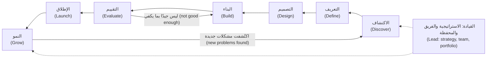
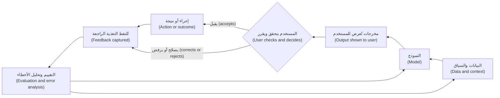
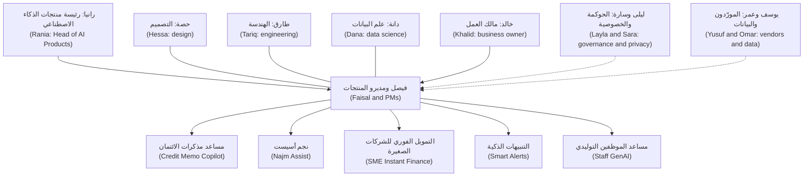

# الوحدة 0 — التوجيه (Orientation)

*قبل الموجّهات (prompts) والنماذج (models) والمقاييس (metrics)، تحتاج إلى صورة واضحة عن طبيعة العمل. تشرح هذه الوحدة ما هي إدارة منتجات الذكاء الاصطناعي (AI product management) وما ليست هي. وتبيّن لماذا تتصرف منتجات الذكاء الاصطناعي (AI products) بشكل مختلف عن البرمجيات التي تعرفها أصلًا: فهي احتمالية (probabilistic)، وتعتمد على البيانات، وكل استخدام لها يكلّف مالًا (every use costs money)، ولا تنجح إلا إذا وثق بها الناس بالقدر الصحيح. ثم تقدّم بنك نجم (Najm Bank)، البنك الخليجي الخيالي (fictional Gulf bank) الذي ستنضم إلى فريق المنتجات الرقمية ومنتجات الذكاء الاصطناعي (Digital & AI Products team) فيه طوال الدورة، مع منتجاته الخمسة القائمة على الذكاء الاصطناعي والأشخاص الذين يبنونها ويرعونها ويحكمونها. وتنتهي بكيفية تنظيم الدورة، وكيفية دراستها، ومتى تنتقل إلى إحدى الدورات المرافقة (companion courses).*

> **المراحل (Stages):** جميع المراحل الثماني، في عرض تمهيدي — Discover · Define · Design · Build · Evaluate · Launch · Grow · Lead — خريطة العمل قبل أن نسير فيها مرحلةً مرحلة.

---

# 0.1 — ما هي إدارة منتجات الذكاء الاصطناعي، وما ليست هي
*المستوى (Level): 🟢 مبتدئ (Beginner)* · *المتطلبات (Prerequisites): لا يوجد (none)* · *المرحلة (Stage): Discover, Lead*

## ⚡ الدرس في دقيقة (In 60 seconds)
- **إدارة منتجات الذكاء الاصطناعي (AI product management)** هي عمل تحديد أي منتج قائم على الذكاء الاصطناعي (AI-powered product) يجب بناؤه، ولمن، وبأي معيار جودة (quality bar)، وبأي تكلفة ومخاطر، ثم إثبات أنه يخلق قيمة (creates value) حين يستخدمه أناس حقيقيون (real people).
- ما زالت إدارة منتج (product management). فأنت تجيب عن الأسئلة الأربعة نفسها التي يواجهها كل فريق منتج (product team)، وهي مخاطر القيمة (value) وسهولة الاستخدام (usability) والجدوى التقنية (feasibility) والجدوى التجارية (business viability) عند مارتي كيغان (Marty Cagan). ومع الذكاء الاصطناعي (AI)، يكتسب كل سؤال أجزاءً جديدة وأصعب.
- وهي **ليست** علم بيانات (data science)، ولا هندسة موجّهات (prompt engineering)، ولا إدارة مشاريع (project management)، ولا حوكمة (governance)، ولا «أن تكون المتحمّس للذكاء الاصطناعي». أنت تعمل عن قرب مع كل هذه الأدوار (roles)، لكن عملك هو قرار المنتج (product decision) والنتيجة (outcome).
- إشارة القرار (Decision cue): ابدأ من مشكلة (problem) ونتيجة قابلة للقياس (measurable outcome) («تقليص وقت صياغة مذكرات الائتمان دون خفض جودة المذكرة»)، ولا تبدأ أبدًا من تقنية (technology) («أين يمكننا استخدام الذكاء الاصطناعي التوليدي؟ ⁦⁩»).
- أكبر فخ (Biggest trap): **فخ العرض التوضيحي (the demo trap)**. العرض التوضيحي (demo) الذي ينجح ثماني مرات من عشر يبدو كأنه منتج. لكنه ليس منتجًا حتى تعرف كم مرة يفشل، وكم تكلّف هذه الإخفاقات، ومن يكتشفها.

## 🧭 لماذا يهم
في يوم الاثنين الأول لفيصل بصفته مدير منتج ذكاء اصطناعي (AI product manager) في بنك نجم، يمرّ خالد، رئيس الإقراض للأفراد (Head of Retail Lending)، بمكتبه. «منافسونا لديهم ذكاء اصطناعي في تطبيقاتهم. أريد مساعدًا على غرار ChatGPT (ChatGPT-style assistant) في تطبيقنا بحلول الربع الثالث (third quarter). هل يمكنك كتابة المتطلبات (requirements)؟» فيصل متحمّس لإثارة الإعجاب. وبحلول الأربعاء يكون لديه مستند من اثنتي عشرة صفحة (twelve-page document) يسرد الميزات (features): المحادثة (chat)، والصوت (voice)، والعربية والإنجليزية (Arabic and English)، والتحكم في البطاقات (card controls)، ومدرّب الإنفاق (spending coach)، وعروض القروض (loan offers).

تقرأه رانيا، رئيسة منتجات الذكاء الاصطناعي (Head of AI Products)، وتطرح أربعة أسئلة. ما مشكلة العميل (customer problem) التي يحلها هذا، وكيف نعرف أنها مشكلة؟ ما مدى الجودة المطلوبة لكل إجابة، وكيف سنقيس ذلك قبل الإطلاق (before launch)؟ كم تكلّفنا كل محادثة، وماذا يستعيد العمل؟ ماذا يحدث حين يخطئ المساعد، ومن يلاحظ؟ المستند لا يجيب عن أي منها. لقد كتب فيصل قائمة ميزات لعرض توضيحي، لا خطة لمنتج.

وقد ارتكبت مؤسسات جيدة التمويل (well-funded organisations) الخطأ نفسه على نطاق أكبر بكثير. استثمرت IBM بكثافة في Watson Health وروّجت له لاستخدامات سريرية (clinical uses) مثل توصيات علاج السرطان. وفي عام 2022 باعت IBM أصول البيانات والتحليلات الخاصة بـ Watson Health. ووصفت التقارير العامة (public reporting) فجوة واسعة بين عروض توضيحية مبهرة (impressive demonstrations) وأدوات تلائم سير العمل الفعلي للأطباء ومعايير الأدلة (evidence standards) لديهم. كانت أسئلة المنتج (product questions) — عمل مَن يحسّنه هذا، وكيف نثبت أنه ينجح هنا، وكم تكلّف الموثوقية؟ ⁦⁩ — أصعب مما جعلها العرض التوضيحي تبدو. وتلك الفجوة بين «يستطيع فعل ذلك» و«يعتمد عليه الناس كل يوم» هي حيث يستحق مديرو منتجات الذكاء الاصطناعي أجرهم.

## 📐 كيف يعمل

### 🟢 الأساسيات

**ماذا يفعل مدير المنتج (What a product manager does).** مدير المنتج مسؤول عن التأكد من أن الفريق يبني شيئًا يستحق البناء (worth building)، وأنه ينجح فعلًا للأشخاص الذين يُفترض أن يخدمهم. يصوّر كتاب كيغان (Cagan) *Inspired* ذلك على أنه تقليل أربعة مخاطر قبل البناء وأثناءه:

| المخاطرة (Risk) | السؤال | من يقودها عادةً |
|---|---|---|
| **القيمة (Value)** | هل سيختار العملاء أو المستخدمون استخدامه أو شراءه؟ | مدير المنتج (Product manager) |
| **سهولة الاستخدام (Usability)** | هل يستطيعون معرفة كيفية استخدامه؟ | مصمم المنتج (Product designer) |
| **الجدوى التقنية (Feasibility)** | هل نستطيع بناءه بالوقت والمهارات والبيانات والتقنية المتاحة لنا؟ | قائد الهندسة (Engineering lead) |
| **الجدوى التجارية (Business viability)** | هل يناسب بقية العمل: التكلفة (cost)، والقانون (legal)، والعلامة التجارية (brand)، والمبيعات (sales)، والدعم (support)؟ | مدير المنتج |

لا يفعل مدير المنتج (PM) كل هذا وحده. فهو يتأكد من معالجة المخاطر الأربعة جميعها، ويملك سؤالَي القيمة والجدوى التجارية.

**ما الذي تضيفه إدارة منتجات الذكاء الاصطناعي (What AI product management adds).** منتج الذكاء الاصطناعي (AI product) هو منتج يُنتج فيه نموذج (model) — أي برنامج تعلّم سلوكه من البيانات (learned from data) بدلًا من أن يُكتب كقواعد — جزءًا مهمًا من المخرجات (output). قد يكون نموذج تعلّم آلي (machine-learning model) يتنبأ برقم، مثل احتمال سداد فاتورة، أو نموذجًا لغويًا كبيرًا يولّد نصًا (generates text). وفي الحالتين، يغيّر الذكاء الاصطناعي كل مخاطرة:

| المخاطرة | ما يضيفه الذكاء الاصطناعي |
|---|---|
| القيمة | قد يحب المستخدمون الفكرة لكنهم لا يثقون بالمخرجات بما يكفي لاستخدامها. القيمة تعتمد على الجودة، والجودة تتفاوت (quality varies). |
| سهولة الاستخدام | يجب أن تُظهر الواجهة (interface) عدم اليقين (uncertainty)، وتدعو إلى التحقق (invite checking)، وتجعل تصحيح الأخطاء سهلًا (الوحدة 4 (Module 4)). |
| الجدوى التقنية | كثيرًا ما لا تستطيع معرفة مدى جودة النموذج على بياناتك *أنت* حتى تجرّب. تصبح الجدوى التقنية تجربة لا تقديرًا (الوحدتان 1 و5 (Modules 1 and 5)). |
| الجدوى التجارية (Viability) | كل استخدام يكلّف مالًا، ويمكن أن تسبب الأخطاء ضررًا قانونيًا وضررًا بالسمعة، وقد يصنّف المنظمون (regulators) الاستخدام على أنه عالي المخاطر (high-risk) (الوحدتان 8 و9 (Modules 8 and 9)). |

**تعريف عملي (A working definition).** في هذه الدورة، تعني إدارة منتجات الذكاء الاصطناعي: *اختيار المشكلات التي يمكن للذكاء الاصطناعي أن يخلق فيها قيمة، وتحديد معيار الجودة الذي يجب أن يستوفيه الذكاء الاصطناعي، وتصميم كيفية عمل الناس والذكاء الاصطناعي معًا، وإثبات الجودة قبل الإطلاق وبعده، وإدارة القيمة والتكلفة والمخاطر طوال عمر المنتج.* وكل وحدة تعلّم جزءًا واحدًا من هذه الجملة.

**ما ليست إدارة منتجات الذكاء الاصطناعي (What AI product management is not).** كثيرًا ما ينجرف مديرو منتجات الذكاء الاصطناعي الجدد إلى دور مجاور (neighbouring role) لأنه يبدو أكثر ملموسية (more concrete). يبيّن الجدول أين تقع الحدود عادةً. تختلف الحدود بين المؤسسات، لكن عمل مدير المنتج لا يذوب أبدًا في أي منها.

| الدور (Role) | ما يملكه | أين يعمل معه مدير المنتج | ما لا ينبغي لمدير المنتج فعله |
|---|---|---|---|
| عالم البيانات (Data scientist) (دانة) | النماذج، والخصائص، والتقييم الإحصائي (statistical evaluation) | الاتفاق على معنى «جيد (good)» وأي الأخطاء أهم | اختيار بنية النموذج |
| مهندس الذكاء الاصطناعي أو التعلّم الآلي (فريق طارق) | خطوط المعالجة (Pipelines)، والموجّهات في بيئة الإنتاج، والتشغيل والخدمة (serving)، وزمن الاستجابة (latency)، وهندسة التكلفة (cost engineering) | المفاضلات بين الجودة والسرعة والتكلفة | ضبط موجّهات الإنتاج يدويًا دون اختبارات |
| مصمم المنتج (حصة) | البحث (Research)، وأنماط التفاعل (interaction patterns)، والتجربة | كيف تُعرض مخرجات الذكاء الاصطناعي وتُراجَع وتُصحَّح | تخطّي بحث المستخدمين لأن «النموذج سيتولى الأمر» |
| الحوكمة والمخاطر (ليلى) | تصنيف المخاطر (Risk tiering)، والسياسات (policy)، والموافقات (approvals) | تصميم الضوابط في المنتج مبكرًا | معاملة الحوكمة كبوابة في النهاية |
| مدير المشروع أو التسليم | الخطط (Plans)، والاعتماديات (dependencies)، والمواعيد (dates) | ترتيب تسلسل العمل (Sequencing work) | الخلط بين مشروع مُسلَّم ومنتج ناجح |
| مالك العمل (Business owner) (خالد) | خط العمل، وقائمة الأرباح والخسائر (P&L) الخاصة به، وأهدافه (targets) | تحديد النتيجة ودراسة الجدوى (business case) | اعتبار قائمة الميزات هي المتطلب |

وإدارة منتجات الذكاء الاصطناعي ليست أيضًا **«الذكاء الاصطناعي لمديري المنتجات (AI for PMs)»** (أي استخدام أدوات الذكاء الاصطناعي لكتابة المواصفات (write specs) أو تلخيص المقابلات)؛ فهذه الدورة تتناول إدارة المنتجات *التي تحتوي على ذكاء اصطناعي*. وليست **تبشيرًا (evangelism)**. فمدير منتج الذكاء الاصطناعي الجيد يقتل أفكار ذكاء اصطناعي أكثر مما يطلق (الدرس 2.3 (lesson 2.3))، لأن مشكلات كثيرة تُحلّ على نحو أفضل بقاعدة (rule) أو نموذج ورقي (form) أو تغيير في الإجراءات (process change).

### 🟡 التعمق أكثر (Going deeper)

**ثلاثة أنواع من وظائف منتجات الذكاء الاصطناعي (Three kinds of AI product job).** يغطي لقب «مدير منتج ذكاء اصطناعي» وظائف مختلفة. ومن المفيد أن تعرف في أيها أنت.

| النوع (Kind) | ما تديره | مثال من نجم (Najm example) | التحدي الرئيسي (Main challenge) |
|---|---|---|---|
| **مدير منتج ميزة ذكاء اصطناعي (AI feature PM)** | قدرة ذكاء اصطناعي (AI capability) داخل منتج قائم (existing product) | التنبيهات الذكية (Smart Alerts) داخل تطبيق الجوال (mobile app) | إدخال الذكاء الاصطناعي في تجربة راسخة (established experience) دون كسر الثقة |
| **مدير منتج أصيل في الذكاء الاصطناعي (AI-native product PM)** | منتج لم يكن ليوجد لولا الذكاء الاصطناعي | مساعد مذكرات الائتمان (Credit Memo Copilot) | إثبات أن القدرة الأساسية (core capability) جيدة بما يكفي وتستحق تغيير سير العمل |
| **مدير منتج منصة ذكاء اصطناعي (AI platform PM)** | قدرات مشتركة (Shared capabilities) تبني عليها فرق أخرى | بوابة النماذج (model gateway) وخدمة الاسترجاع (retrieval service) وأدوات التقييم (evaluation tools) خلف مساعد الموظفين التوليدي (Staff GenAI) ومساعد المذكرات | العملاء الداخليون (Internal customers)، وإعادة الاستخدام (reuse)، وضبط التكلفة (cost control)، والمعايير (standards) |

**دورة حياة المنتج في هذه الدورة (The product lifecycle in this course).** كل درس موسوم بمرحلة أو اثنتين من ثماني مراحل (eight stages). وهي ليست تسلسلًا صارمًا (strict sequence). فالفرق الحقيقية تعود إلى الوراء باستمرار، خاصةً بين البناء (Build) والتقييم (Evaluate).

| المرحلة | السؤال الجوهري لمدير المنتج | المُخرَج النموذجي (Typical artefact) |
|---|---|---|
| **Discover** | هل توجد مشكلة حقيقية (real problem)، وهل يمكن للذكاء الاصطناعي أن يساعد؟ | ملخص الفرصة (Opportunity brief) |
| **Define** | ما الذي نبنيه بالضبط، وما معنى «جيد»؟ | بطاقة تقييم حالة الاستخدام (Use-case scorecard)، ومواصفات الذكاء الاصطناعي بمعايير الجودة |
| **Design** | كيف يعمل الناس والذكاء الاصطناعي معًا (work together)؟ | تصميم التفاعل (Interaction design)، ومستوى الأتمتة (automation level)، ومسارات الأخطاء (error flows) |
| **Build** | كيف نصل إلى نسخة عاملة (working version) بسرعة وأمان؟ | النموذج الأولي (Prototype)، وتصميم الموجّه والسياق |
| **Evaluate** | هل ينجح فعلًا (actually work)، وكيف نعرف؟ | خطة التقييم (Eval plan)، والمجموعة المرجعية (golden set)، وتحليل الأخطاء (error analysis) |
| **Launch** | هل هو جاهز للمستخدمين الحقيقيين، وهل هم جاهزون له؟ | قائمة تحقق الإطلاق (Launch checklist)، وخطة التمكين (enablement plan) |
| **Grow** | هل يخلق قيمة بتكلفة مقبولة، ويبقى جيدًا (staying good)؟ | شجرة المقاييس (Metrics tree)، واقتصاديات الوحدة (unit economics)، وخطة المراقبة (monitoring plan) |
| **Lead** | أين يجب أن نستثمر بعد ذلك (invest next)، وكيف يجب أن يعمل الفريق؟ | الاستراتيجية (Strategy)، وخارطة الطريق (roadmap)، ونموذج التشغيل (operating model) |

مرحلتان تهمان أكثر بكثير في الذكاء الاصطناعي. **التقييم (Evaluate)** مرحلة قائمة بذاتها (stands alone) لأن «يعمل دون أخطاء» لا يقول شيئًا عن صحة الإجابات. و**النمو (Grow)** يحمل وزنًا أكبر لأن الجودة تنجرف (quality drifts) مع تغيّر البيانات والمستخدمين والنماذج (الدرس 8.3 (lesson 8.3)).

**الأطر التي تعرفها ما زالت تنطبق (Frameworks you already know still apply).** يتوافق **الماس المزدوج (Double Diamond)** الصادر عن مجلس التصميم البريطاني عام 2005 مع مرحلتي الاكتشاف والتعريف — أي ماسة المشكلة — ومع المراحل من التصميم إلى الإطلاق — أي ماسة الحل. وحلقة ابنِ-قِس-تعلّم (build-measure-learn loop) في منهج **الشركة الناشئة الرشيقة (Lean Startup)** لإريك ريس (Eric Ries) عام 2011 تلائم الذكاء الاصطناعي جيدًا، بشرط أن يشمل «القياس (measure)» *الجودة (quality)* على مجموعة اختبار ثابتة، لا الاستخدام (usage) وحده. وإطار **المهام المطلوب إنجازها (Jobs to be Done)** لكلايتون كريستنسن (Clayton Christensen) — حيث «يستأجر (hire)» الناس منتجًا لتحقيق تقدّم في موقف ما — يبقيك مركّزًا على المهمة لا على النموذج.

### 🔴 نظرة الخبير (Expert view)

**من تحديد الميزات إلى تحديد السلوك (From specifying features to specifying behaviour).** في البرمجيات العادية (ordinary software) يصف مدير المنتج الميزات (describes features)، ويجعلها المهندسون تتصرف تمامًا كما وُصفت. أما في منتجات الذكاء الاصطناعي فأنت تصف *السلوك ومعيار الجودة*: «في مذكرات ائتمان الشركات الصغيرة والمتوسطة، يجب أن تطابق الأرقام المالية في المسودة المستندات المصدر (source documents) في نسبة محددة على الأقل من الحالات على مجموعة الاختبار لدينا، ويجب أن تذكر المسودة حين يكون رقم ما مفقودًا بدلًا من أن تخمّن». ثم تتفق مع دانة على طريقة قياس ذلك. وحالات الاختبار (Test cases) التي ترمّز هذا السلوك، والمعروفة باسم **التقييمات (evals)**، تصبح جزءًا من المتطلبات (الدرس 5.1 (lesson 5.1)). ومدير المنتج الذي لا يستطيع قراءة تقرير تقييم (evaluation report) يخمّن بشأن منتجه هو.

**امتلاك التكلفة كقرار منتج (Owning cost as a product decision).** كثيرًا ما تكلّف ميزة الذكاء الاصطناعي (AI feature) مالًا في كل مرة تعمل فيها. فالنموذج الأكبر (larger model)، أو السياق الأكثر (more context)، أو خطوة تحقق ثانية هي قرارات منتج لها ثمن، وليست مجرد تفاصيل هندسية (engineering details). ومدير المنتج الذي يملك القيمة (owns value) يجب أن يملك أيضًا **تكلفة الخدمة (cost to serve)** (الدرس 8.2 (lesson 8.2)).

**المساءلة دون سلطة على كل شيء (Accountability without authority over everything).** حين يُلحق منتج ذكاء اصطناعي ضررًا بأحد (harms someone)، تكون المسؤولية مشتركة بين مالك العمل والحوكمة والبناة (builders) ومدير المنتج. وجزء مدير المنتج هو منتج مصمَّم بحيث يكون الضرر غير مرجّح، ومرئيًا حين يقع، ويُصحَّح بسرعة (quickly corrected). وهذا يعني دعوة ليلى وسارة في مرحلة الاكتشاف (during Discover)، لا في الأسبوع الذي يسبق الإطلاق. تفاصيل الحوكمة (governance detail) موجودة في الدورة المرافقة (companion course) *AI Governance: Zero to Hero*؛ أما هنا فنبقى على قرار المنتج.

**ماذا تعني «البطل (hero)» هنا (What "hero" means here).** بنهاية الدورة يجب أن تكون قادرًا على أخذ طلب غامض (vague request) مثل طلب خالد حتى الوصول إلى منتج في بيئة الإنتاج، وأن تصمد في النقاش مع المهندسين (engineers) وعلماء البيانات (data scientists) ومسؤولي المخاطر (risk officers) والتنفيذيين (executives). والمشروع الختامي (capstone) في الوحدة 10 (Module 10) يطلب منك فعل ذلك بالضبط لنجم أسيست (Najm Assist).

## 🧰 الأدوات
| الأداة أو الإطار (Tool or framework) | ما هو وماذا يفعل | متى تلجأ إليه |
|---|---|---|
| **Four big risks** — المخاطر الأربع الكبرى | القيمة، وسهولة الاستخدام، والجدوى التقنية، والجدوى التجارية: الطرق الأربع التي يفشل بها المنتج | في بداية أي فكرة ذكاء اصطناعي (AI idea)، لمعرفة أي مخاطرة هي الأكبر واختبارها أولًا |
| **Jobs to be Done** — المهام المطلوب إنجازها | يصوغ الطلب (frames demand) على أنه التقدّم الذي يحاول شخص تحقيقه في موقف ما | حين يصل طلب في صورة تقنية («أضف روبوت محادثة») وتحتاج إلى المهمة الكامنة (underlying job) |
| **Double Diamond** (UK Design Council, 2005) — الماس المزدوج | التوسّع ثم التضييق مرتين: على المشكلة، ثم على الحل | لمنع الفريق من القفز إلى حل قبل أن تتضح المشكلة |
| **Build-measure-learn** (Eric Ries, 2011) — حلقة ابنِ-قِس-تعلّم | تجارب صغيرة مقيسة للتعلّم بسرعة (learn fast) قبل التوسّع (before scaling) | حين تكون الجدوى التقنية أو القيمة غير مؤكدة، وهذا هو الحال عادةً مع الذكاء الاصطناعي |
| **Product lifecycle stages** — مراحل دورة حياة المنتج (هذه الدورة) | Discover وDefine وDesign وBuild وEvaluate وLaunch وGrow وLead، مع سؤال جوهري ومُخرَج لكل مرحلة | لتحديد موقع المنتج وأي قرار مستحق بعد ذلك |

## 🏛️ عمليًا في بنك نجم
بعد المراجعة، تعطي رانيا فيصل شيئين. الأول هو **بطاقة دور مدير منتج الذكاء الاصطناعي (AI PM role card)** التي تعطيها لكل مدير منتج جديد في فريقها:

| | فيصل في نجم أسيست |
|---|---|
| **يملك (Owns)** | مشكلة العميل والنتيجة المستهدفة؛ ومعيار الجودة (بالاتفاق مع دانة)؛ والنطاق ومستوى الأتمتة؛ ودراسة الجدوى؛ والتوصية بقرار الإطلاق؛ ومقاييس ما بعد الإطلاق (post-launch metrics) |
| **يشارك في (Shares)** | تصميم التجربة (Experience design) (مع حصة)؛ وتصميم التقييم (evaluation design) (مع دانة)؛ ومفاضلات التكلفة وزمن الاستجابة (مع طارق)؛ وضوابط المخاطر (risk controls) (مع ليلى وسارة) |
| **يقدّم المشورة في (Advises on)** | اختيار النموذج والمورّد (يقرر طارق ودانة ويوسف)؛ وفئة الحوكمة (governance tier) (تقرر ليلى) |
| **لا يملك (Does not own)** | بنية النموذج (Model architecture)؛ وتغييرات موجّهات الإنتاج دون اختبارات؛ والموافقة النهائية على المخاطر؛ وقائمة الأرباح والخسائر الخاصة بخالد |

الثاني هو **طلب مُعاد صياغته (reframed request)**، يعيد فيصل كتابته مع خالد في صفحة واحدة:

| الحقل (Field) | قبل (Before) (طلب خالد) | بعد (After) (بعد إعادة الصياغة) |
|---|---|---|
| المشكلة | «نحتاج إلى مساعد ذكاء اصطناعي مثل المنافسين» | كثير من مكالمات مركز الاتصال (contact-centre calls) أسئلة بسيطة عن الرسوم (fees) وحالة البطاقة (card status) والتحويلات (transfers)، كان العملاء سيجيبون عنها بأنفسهم لو كانت الإجابات سهلة الإيجاد |
| من | «جميع العملاء» | مستخدمو تطبيق الأفراد في قطر والإمارات، بالعربية والإنجليزية |
| النتيجة | «الإطلاق بحلول الربع الثالث (Launch by Q3)» | مكالمات بسيطة أقل، مع رضا عملاء (customer satisfaction) لا يقل عن مستواه اليوم، ودون ارتفاع في الشكاوى من معلومات خاطئة |
| معيار الجودة | غير مذكور | إجابات مستندة إلى محتوى البنك المعتمد؛ وتسليم إلى إنسان عند عدم التأكد؛ ومعدل خطأ (error rate) على مجموعة اختبار يُتفق عليه قبل التجربة التجريبية (before pilot) |
| التكلفة | غير مذكورة | تكلفة المحادثة المحلولة (Cost per resolved conversation) تُقدَّر قبل البناء وتُتابَع بعد الإطلاق |
| الخطوة الأولى (First step) | البناء | أسبوعان من الاكتشاف: الاستماع إلى المكالمات، وأخذ عينة من بيانات مركز الاتصال، واختبار الإجابات على نموذج أولي صغير (small prototype) |

يوافق خالد على النتيجة، لأنها مكتوبة بلغته: المكالمات (calls)، والرضا (satisfaction)، والشكاوى (complaints).

## 🛠️ التمارين (Exercises)
- 🟢 اختر ميزة ذكاء اصطناعي تستخدمها (مرشّح بريد مزعج (spam filter)، أو بحث في الصور (photo search)، أو مساعد كتابة). اكتب جملة واحدة لكل من مخاطر كيغان الأربع (Cagan's four risks) كما تنطبق عليها. *يكتمل عندما (Done when):* تكون لديك أربع جمل، ويذكر اثنتان منها على الأقل شيئًا خاصًا بالذكاء الاصطناعي (الأخطاء (errors)، أو البيانات (data)، أو التكلفة، أو الثقة).
- 🟡 خذ طلبًا يبدأ من التقنية (technology-first request) سمعته («نحتاج إلى روبوت محادثة بالذكاء الاصطناعي»، «لنستخدم الذكاء الاصطناعي التوليدي للتقارير») وأعد صياغته (reframe it) باستخدام الجدول في 🏛️: المشكلة، ومن، والنتيجة، ومعيار الجودة، والتكلفة، والخطوة الأولى. *يكتمل عندما:* تكون النتيجة قابلة للقياس (measurable) ولا تقول شيئًا عن التقنية التي ستُستخدم.
- 🔴 اكتب بطاقة دور (role card) مثل بطاقة رانيا لمنتج ذكاء اصطناعي في مؤسستك، واعرضها على مهندس واحد (one engineer) وزميل واحد من المخاطر أو الامتثال. *يكتمل عندما:* يوافق كلاهما على صفَّي «يملك» و«لا يملك»، أو تكون قد دوّنت أين يختلفان ولماذا.

## ⚠️ أخطاء وفخاخ (Mistakes and traps)
- **البدء من التقنية (Starting from the technology).** سؤال «أين يمكننا استخدام الذكاء الاصطناعي التوليدي؟ ⁦⁩» ينتج عروضًا توضيحية (produces demos). ابدأ من مهمة (job) وسير عمل (workflow) ونتيجة قابلة للقياس.
- **الخلط بين العرض التوضيحي والمنتج (Confusing a demo with a product).** العرض التوضيحي يُظهر أن النموذج *يستطيع* أن ينجح. أما المنتج فيحتاج إلى معرفة *كم مرة* يفشل وماذا يحدث حينها. اطلب معدل خطأ على حالات تمثيلية قبل أن يقول أحد «إنه يعمل».
- **أن تصبح أنت مهندس الموجّهات (Becoming the prompt engineer).** ضبط الموجّهات بنفسك يبدو منتجًا، لكنه يترك النتيجة بلا مالك. ساهم بالأمثلة ومعايير الجودة. واترك تغييرات الإنتاج (production changes) لعملية مُختبَرة (tested process).
- **معاملة الحوكمة كآخر بوابة (Treating governance as the last gate).** إدخال ليلى عند الإطلاق يحوّل تغييرًا صغيرًا في التصميم إلى تأخير (delay). ادعُ زملاء المخاطر والخصوصية في مرحلة الاكتشاف.
- **قياس الإطلاق بدلًا من النتيجة (Measuring launch instead of outcome).** «أُطلق بحلول الربع الثالث (Shipped by Q3)» معلم مشروع (project milestone). اتفق على مقياس نتيجة (outcome metric) ومعيار جودة قبل البناء.

## 🧾 الخلاصة (Recap)
- إدارة منتجات الذكاء الاصطناعي هي إدارة منتج بأربعة شروط أصعب: جودة متفاوتة (variable quality)، واعتماد على البيانات، وتكلفة لكل استخدام (cost per use)، وثقة هشّة (fragile trust).
- ما زالت مخاطر كيغان الأربع تؤطّر العمل. والذكاء الاصطناعي يضيف أسئلة جديدة إلى كل منها.
- يملك مدير منتج الذكاء الاصطناعي (AI PM) المشكلة والنتيجة ومعيار الجودة ودراسة الجدوى. ويشارك قرارات التصميم والتقييم والتكلفة والمخاطر مع المتخصصين (specialists).
- تتبع الدورة ثماني مراحل لدورة الحياة (eight lifecycle stages). والتقييم والنمو يهمان في الذكاء الاصطناعي أكثر مما يهمان في البرمجيات العادية.
- الفشل الأكثر شيوعًا هو فخ العرض التوضيحي: الخلط بين «يستطيع» و«يفعل ذلك بموثوقية، هنا، لهؤلاء الناس، بهذه التكلفة».

## ✍️ اختبر نفسك (Check yourself)

**1. يطلب خالد من فيصل «إضافة مساعد ذكاء اصطناعي إلى التطبيق بحلول الربع الثالث ⁦(add an AI assistant to the app by Q3)⁩». ماذا يجب أن يفعل فيصل أولًا؟**

- A. كتابة متطلبات ميزات مفصّلة كي يبدأ فريق الهندسة (engineering)
- B. أن يطلب من طارق اختيار مورّد نموذج (model vendor)
- C. إعادة صياغة الطلب حول مشكلة عميل (customer problem) ونتيجة قابلة للقياس (measurable outcome) ومعيار جودة (quality bar)، ثم إجراء اكتشاف قصير (short discovery)
- D. بناء عرض توضيحي (demo) لعرضه على خالد خلال أسبوع

الإجابة

**C.** المهمة الأولى لمدير المنتج هي تحويل طلب تقني (technology request) إلى مشكلة ونتيجة، ثم اختبار ما إذا كانت المشكلة حقيقية (real). العرض التوضيحي (D) مغرٍ لأنه يبدو تقدّمًا، لكنه يتخطى أسئلة القيمة والجودة ويقود مباشرة إلى فخ العرض التوضيحي (demo trap). (🧭 لماذا يهم؛ 🏛️ عمليًا.)

**2. أي مخاطر كيغان الأربع (Cagan's four risks) يتغير *أكثر* بسبب أنك كثيرًا ما لا تستطيع معرفة مدى جودة أداء نموذج على بياناتك حتى تجرّبه (until you try it)؟**

- A. القيمة (Value)
- B. سهولة الاستخدام (Usability)
- C. الجدوى التقنية (Feasibility)
- D. الجدوى التجارية (Business viability)

الإجابة

**C.** مع الذكاء الاصطناعي، تصبح الجدوى التقنية (feasibility) تجربة لا تقديرًا، لأن الأداء على بياناتك غير مؤكد حتى يُختبر. القيمة تتأثر أيضًا، لكن النقطة المحددة المتعلقة بعدم معرفة أداء النموذج مسبقًا هي سؤال جدوى تقنية (feasibility question). (🟢 الأساسيات.)

**3. في بنك نجم (Najm Bank)، من يجب أن يقرر بنية النموذج (model architecture) للتمويل الفوري للشركات الصغيرة (SME Instant Finance)؟**

- A. قائدا علم البيانات والهندسة، مع تحديد مدير المنتج لمعيار الجودة والمفاضلات
- B. مدير منتج الذكاء الاصطناعي (AI product manager)، لأنه يملك المنتج ويُحاسَب على نتائجه وعلى كل قرار يخص طريقة عمله أمام الإدارة العليا
- C. رئيسة حوكمة الذكاء الاصطناعي (Head of AI Governance)، لأن خيارات البنية تؤثر في المخاطر (risk) ويجب أن تعتمدها مركزيًا قبل أي بناء (approved centrally)
- D. مالك العمل (business owner)، لأنه يموّل المنتج (funds it) ويتحمل المخاطر التجارية لخياراته أمام مجلس الإدارة

الإجابة

**A.** يملك مدير المنتج *معنى الجيد* والمفاضلات (trade-offs). ويختار المتخصصون (specialists) *كيفية* تحقيقه. الخيار B هو الخطأ المغري (tempting mistake): امتلاك المنتج لا يعني امتلاك كل قرار تقني. (🟢 الأساسيات، جدول الأدوار (role table)؛ 🏛️ بطاقة الدور (role card).)

**4. أي عبارة تصف على أفضل وجه الفرق بين مدير منتج ميزة ذكاء اصطناعي (AI feature PM) ومدير منتج منصة ذكاء اصطناعي (AI platform PM)؟**

- A. مدير منتج الميزة يدير قدرة ذكاء اصطناعي داخل منتج للمستخدمين النهائيين؛ ومدير منتج المنصة يدير قدرات ذكاء اصطناعي مشتركة تبني عليها فرق داخلية أخرى
- B. مدير منتج الميزة يعمل على الذكاء الاصطناعي التوليدي (generative AI)؛ ومدير منتج المنصة يعمل على التعلّم الآلي الكلاسيكي
- C. مدير منتج المنصة يدير المورّدين فقط
- D. لا يوجد فرق حقيقي؛ اللقبان قابلان للتبادل (interchangeable)

الإجابة

**A.** الفرق هو من هو العميل: المستخدمون النهائيون لمنتج واحد، أو الفرق الداخلية التي تستخدم خدمات مشتركة. نوع الذكاء الاصطناعي (B) لا يحدد الدور. (🟡 التعمق أكثر (Going deeper).)

**5. يقول فريق إن ملخِّصه الجديد بالذكاء الاصطناعي (AI summariser) «يعمل (works)» لأنه أنتج ملخصات جيدة في كل عرض توضيحي أمام القيادة (every demo to leadership). ما السؤال التالي الأكثر فائدة من مدير المنتج؟**

- A. «هل يمكننا جعل الواجهة أكثر جاذبية؟ ⁦⁩»
- B. «كم مرة يفشل على مجموعة تمثيلية من المستندات الحقيقية، وما أنواع الفشل، ومن سيكتشفها؟ ⁦⁩»
- C. «أي منافس لديه ميزة مشابهة؟ ⁦⁩»
- D. «هل يمكننا الإطلاق للجميع الأسبوع القادم؟ ⁦⁩»

الإجابة

**B.** العروض التوضيحية (Demos) تُظهر أن النموذج *يستطيع* أن ينجح. أما قرارات المنتج (Product decisions) فتحتاج إلى معدل الفشل على حالات تمثيلية وخطة لاكتشاف الإخفاقات. الخيار D ينبع من فخ العرض التوضيحي (demo trap). (⚡ الدرس في دقيقة (In 60 seconds)؛ ⚠️ أخطاء وفخاخ (Mistakes and traps).)

## 📚 المراجع (References)
- Marty Cagan, *Inspired: How to Create Tech Products Customers Love*, 2nd ed. (Wiley, 2017) — https://www.svpg.com
- Clayton M. Christensen, Taddy Hall, Karen Dillon and David S. Duncan, *Competing Against Luck* (Harper Business, 2016)
- Anthony W. Ulwick, *Jobs to Be Done: Theory to Practice* (Idea Bite Press, 2016) — https://strategyn.com
- UK Design Council, the Double Diamond — https://www.designcouncil.org.uk
- Eric Ries, *The Lean Startup* (Crown Business, 2011) — https://theleanstartup.com
- Google PAIR, People + AI Guidebook — https://pair.withgoogle.com/guidebook

---

# 0.2 — كيف تختلف منتجات الذكاء الاصطناعي: احتمالية، ونهمة للبيانات، ومكلفة لكل استخدام، ومرهونة بالثقة
*المستوى: 🟢 مبتدئ* · *المتطلبات: 0.1* · *المرحلة: Define, Evaluate*

## ⚡ الدرس في دقيقة (In 60 seconds)
- تختلف منتجات الذكاء الاصطناعي عن البرمجيات العادية في أربعة جوانب تغيّر تقريبًا كل قرار منتج. فهي **احتمالية (probabilistic)**، و**نهمة للبيانات (data-hungry)**، و**مكلفة لكل استخدام (costly per use)**، و**مرهونة بالثقة (trust-bound)**.
- **احتمالية (Probabilistic):** المدخل نفسه (same input) قد يعطي مخرجات مختلفة (different outputs)، وبعض المخرجات ستكون خاطئة. الجودة *معدل (rate)* يُقاس على حالات تمثيلية (representative cases)، لا اختبار نعم/لا (yes/no test).
- **نهمة للبيانات (Data-hungry):** ما يعرفه المنتج ومدى جودة أدائه يعتمدان على بيانات يجب أن يكون لك الحق في استخدامها، وأن تحافظ على نظافتها (keep clean) وحداثتها (keep current).
- **مكلفة لكل استخدام (Costly per use):** كثير من ميزات الذكاء الاصطناعي (AI features) تكلّف مالًا في كل مرة تعمل فيها، لذا يرفع النجاح التكاليف. وتكلفة المهمة الواحدة (cost per task) مقياس منتج (product metric).
- **مرهونة بالثقة (Trust-bound):** لا تظهر القيمة إلا حين يعتمد الناس على المخرجات بالقدر الصحيح: لا اعتمادًا أعمى، ولا اعتمادًا ضئيلًا يجعلهم يعيدون العمل.
- أكبر فخ: كتابة مواصفات (spec) كأن الذكاء الاصطناعي سيتصرف كميزة حتمية (deterministic feature) («المساعد يجيب عن أسئلة الرسوم بشكل صحيح») دون معدل خطأ، ودون تقدير للتكلفة (cost estimate)، ودون خطة لحالة الخطأ.

## 🧭 لماذا يهم
في عام 2022 سأل مسافر روبوت المحادثة (chatbot) في موقع Air Canada عن أسعار تذاكر الحداد (bereavement fares). فأخبره الروبوت أنه يستطيع التقدم بطلب الخصم بعد السفر (after travelling). لكن سياسة الشركة نفسها كانت تقول غير ذلك. وحين طالب باسترداد المبلغ، احتجّت الشركة بأن روبوت المحادثة كان في الواقع كيانًا مستقلًا (separate entity) مسؤولًا عن تصريحاته. وفي قضية *Moffatt v. Air Canada* (2024)، رفضت محكمة تسوية النزاعات المدنية في كولومبيا البريطانية هذه الحجة، وحمّلت الشركة المسؤولية عمّا قاله روبوتها. كان المبلغ صغيرًا. أما الدرس فكان كبيرًا: العميل لا يهتم بأن الإجابة جاءت من نموذج. الشركة هي التي تملكها.

بعد أسبوعين من الاكتشاف (discovery)، يعرض فيصل على خالد نموذجًا أوليًا لنجم أسيست. يجيب النموذج عن عشرين سؤالًا مُعدًّا مسبقًا عن الرسوم والبطاقات إجابات مثالية، بالعربية والإنجليزية. ثم تدير حصة جلسة (session) مع عشرة عملاء حقيقيين يكتبون أسئلتهم الخاصة. يسأل أحدهم عن رسوم تحويل دولي من حساب توفير. فيعطي النموذج الأولي إجابة واثقة (confident answer) تخلط بين جدولَي رسوم. ويطرح آخر السؤال نفسه مرتين فيحصل على إجابتين بصياغتين مختلفتين، تُسقط إحداهما شرطًا. لم يكن أحد في الغرفة قد رأى هذا في العرض التوضيحي.

لم يكن شيء «معطّلًا (broken)»؛ لقد فعل النموذج الأولي ما تفعله النماذج اللغوية (language models). كانت خطة فيصل قد افترضت ميزة تطبيق عادية.

## 📐 كيف يعمل

### 🟢 الأساسيات

يقارن الجدول بين ميزة برمجية تقليدية وميزة ذكاء اصطناعي في الفروق الأربعة (four differences).

| | البرمجيات التقليدية (Traditional software) | منتج الذكاء الاصطناعي |
|---|---|---|
| **السلوك (Behaviour)** | حتمي (Deterministic): المدخل نفسه، المخرج نفسه، في كل مرة | احتمالي: المخرجات تتفاوت (outputs vary)، وجزء منها خاطئ |
| **ما يجعله يعمل (What makes it work)** | شيفرة يكتبها المهندسون | شيفرة *إضافةً إلى (plus)* نموذج يأتي سلوكه من البيانات |
| **تكلفة كل استخدام (Cost of each use)** | قريبة من الصفر بعد البناء | غالبًا تكلفة حقيقية لكل طلب، تنمو مع الاستخدام |
| **علاقة المستخدم (User relationship)** | يتوقع المستخدمون أن يكون صحيحًا وهو كذلك عادةً | يجب أن يتعلم المستخدمون متى يعتمدون عليه ومتى يتحققون |

**1. احتمالية (Probabilistic).** الميزة التقليدية (traditional feature)، مثل حاسبة الرسوم (fee calculator)، تتبع قواعد (follows rules). وإذا أعطت إجابة خاطئة، فذلك خلل برمجي (bug) يمكنك إيجاده وإصلاحه، وبعد الإصلاح تكون صحيحة في كل مرة. أما نموذج الذكاء الاصطناعي (AI model) فينتج المخرج *الأكثر ترجيحًا (most likely)* بناءً على ما تعلّمه. في معظم الأحيان يكون ذلك المخرج جيدًا. وفي بعضها لا يكون، ولا يمكنك سرد كل حالة مسبقًا.

كثيرًا ما تعمل النماذج التوليدية (generative models) بعشوائية مقصودة (deliberate randomness)، تُضبط بواسطة **درجة الحرارة (temperature)**: القيم الأعلى تعطي مخرجات أكثر تنوعًا (more varied)، والقيم الأدنى مخرجات أكثر اتساقًا (more consistent). وحتى عند الإعدادات المنخفضة، قد يحصل سؤال أُعيدت صياغته قليلًا على إجابة مختلفة. وحين يذكر نموذج لغوي (language model) شيئًا خاطئًا بثقة، يسمّي الناس ذلك **هلوسة (hallucination)** (الدرس 1.2 (lesson 1.2)).

والنتيجة على المنتج (product consequence) أن سؤال «هل يعمل؟ ⁦⁩» لم يعد سؤال نعم/لا (yes/no question). بل يصبح: «كم مرة يكون صحيحًا في الحالات التي تهم، وماذا يحدث حين يخطئ؟ ⁦⁩». وتجيب عن ذلك بـ**مجموعة مرجعية (golden set)**: مجموعة ثابتة من المدخلات الواقعية ذات إجابات جيدة معروفة، تُستخدم لقياس الجودة بالطريقة نفسها في كل مرة (الدرس 6.1 (lesson 6.1)).

**2. نهمة للبيانات (Data-hungry).** يعتمد سلوك منتج الذكاء الاصطناعي على البيانات في ثلاث نقاط (three points):
- **بيانات التدريب (Training data):** ما تعلّم منه النموذج. في التمويل الفوري للشركات الصغيرة، هي تاريخ نجم من الفواتير والسداد والتعثّر. وفي نموذج لغوي كبير من مورّد (vendor LLM)، هي بيانات لم تخترها ولا تستطيع فحصها بالكامل.
- **بيانات السياق (Context data):** ما يعطيه المنتج للنموذج لحظة تشغيله. في نجم أسيست، هي جداول الرسوم المعتمدة وشروط المنتجات (product terms) التي يسترجعها قبل الإجابة (نمط يُسمّى التوليد المعزّز بالاسترجاع، ويُغطّى في الدرس 1.3 (lesson 1.3)).
- **بيانات التغذية الراجعة (Feedback data):** ما تتعلمه من الاستخدام، مثل التصحيحات (corrections) والتقييمات (ratings) والنتائج (outcomes). وهكذا يتحسّن المنتج (الدرس 3.2 (lesson 3.2)).

إذا كان جدول الرسوم الذي يسترجعه المساعد قديمًا، فستكون الإجابة خاطئة، مهما كان النموذج جيدًا. وإذا لم يكن لنجم الحق في استخدام محادثات العملاء للتحسين، فإن حلقة التغذية الراجعة (feedback loop) تكون مغلقة. جاهزية البيانات (Data readiness) سؤال منتج (product question)، لا سؤال هندسي فقط (الوحدة 3 (Module 3)).

**3. مكلفة لكل استخدام (Costly per use).** كثير من ميزات الذكاء الاصطناعي، خاصةً التوليدية منها (generative ones)، تكلّف مالًا في كل مرة تعمل فيها. وتُسعَّر النماذج اللغوية عادةً لكل **رمز (token)**، وهو قطعة نص بحجم كلمة قصيرة تقريبًا أو جزء من كلمة، ويُحسب بشكل منفصل للمدخلات (input) (ما ترسله) وللمخرجات (ما يعود). وطريقة تقدير التكلفة عملية حسابية بسيطة (simple arithmetic):

> تكلفة المهمة = (رموز المدخلات × سعر المدخلات) + (رموز المخرجات × سعر المخرجات)، مجموعةً على كل استدعاء للنموذج تقوم به المهمة

مثال **توضيحي (illustrative)** بأرقام تقريبية مختلَقة (الأسعار الحقيقية تتغير كثيرًا، فتحقق دائمًا من الأسعار الحالية): لنفترض أن صياغة مذكرة ائتمان واحدة ترسل 30,000 رمز مدخلات (input tokens) وتستقبل 3,000 رمز مخرجات (output tokens)، بسعر مثلًا $3 لكل مليون رمز مدخلات و$15 لكل مليون رمز مخرجات. هذا يساوي $0.09 + $0.045 ≈ $0.14 لكل مسودة (per draft). وهذا زهيد مقارنة بساعات من وقت مدير العلاقة. لكن حين تُطبَّق الحسبة نفسها على نجم أسيست بآلاف المحادثات يوميًا، مع عدة استدعاءات لكل منها، فإنها تنتج فاتورة شهرية (monthly bill) يجب أن يبرّرها أحد. ونماذج التعلّم الآلي الكلاسيكية مثل التنبيهات الذكية أرخص بكثير عادةً لكل تنبؤ (per prediction)، لكنها ما زالت تحمل تكاليف البنية التحتية والمراقبة وإعادة التدريب.

والنتيجة على المنتج: كلما نجحت الميزة أكثر، ارتفعت الفاتورة. وتكلفة المهمة مكانها بجانب الجودة والتبنّي في لوحة مؤشرات مدير المنتج (PM's dashboard) (الوحدة 8 (Module 8)).

**4. مرهونة بالثقة (Trust-bound).** لا يخلق منتج الذكاء الاصطناعي قيمة إلا حين يتصرف الناس بناءً على مخرجاته. فإذا لم يثق مديرو العلاقات (relationship managers) بمساعد مذكرات الائتمان، فسيعيدون كتابة كل مسودة ولن يوفّروا وقتًا. وإذا وثقوا به أكثر من اللازم، فسيلصقون رقمًا خاطئًا في حزمة لجنة الائتمان. والهدف هو **الثقة المعايَرة (calibrated trust)**: اعتماد يطابق مدى موثوقية المنتج فعلًا، حالةً بحالة (case by case). ويتعامل كل من People + AI Guidebook من فريق Google PAIR وإرشادات التفاعل بين الإنسان والذكاء الاصطناعي من Microsoft (Microsoft's Guidelines for Human-AI Interaction) (Amershi et al., 2019) مع هذا بوصفه هدف تصميم أساسيًا. وإرشادات مثل «وضّح مدى جودة النظام في ما يستطيع فعله» و«ادعم التصحيح الفعّال» موجودة بسببه (الوحدة 4 (Module 4)).

والثقة تنكسر أيضًا على الملأ. فقد تضمّن العرض التوضيحي لإطلاق Bard من Google (فبراير 2023) خطأً واقعيًا (factual error) عن تلسكوب جيمس ويب الفضائي (James Webb Space Telescope). وفي ديسمبر 2023 تلاعب مستخدمون (manipulated) بروبوت محادثة في موقع وكيل سيارات Chevrolet حتى «وافق» على بيع سيارة بدولار واحد ($1). وفي يناير 2024 شتم روبوت محادثة الطرود التابع لـ DPD عميلًا بعد تحديث للنظام (system update). كل حادثة كانت صغيرة ماليًا وكبيرة على السمعة.

### 🟡 التعمق أكثر

**المنتجات التنبؤية والتوليدية تختلف أيضًا (Predictive and generative products differ too).** لدى نجم النوعان كلاهما، وتظهر الفروق الأربعة بطرق مختلفة.

| | التعلّم الآلي التنبؤي (Predictive ML) (التمويل الفوري للشركات الصغيرة، التنبيهات الذكية) | الذكاء الاصطناعي التوليدي (Generative AI) (مساعد مذكرات الائتمان، نجم أسيست) |
|---|---|---|
| المخرجات | درجة (score) أو فئة (class) أو رقم (number) | نص مفتوح (Open-ended text)، وأحيانًا إجراءات (actions) |
| كيف يبدو «الخطأ (wrong)» | تصنيف خاطئ (misclassification): فاتورة سيئة تُعتمد، أو دفعة حقيقية يُشار إليها كمشبوهة | عبارة معقولة لكنها خاطئة، أو إغفال (omission)، أو نبرة خاطئة (wrong tone)، أو إجراء غير آمن (unsafe action) |
| كيف تُقاس الجودة | مقاييس قياسية على بيانات موسومة: الدقة (precision)، والاستدعاء (recall)، ومعدلات الخطأ (error rates) | معايير التقييم الوصفية (Rubrics)، والإجابات المرجعية (reference answers)، والمراجعة البشرية (human review)، والنموذج اللغوي كمُحكِّم (LLM-as-judge) (الدرس 6.2 (lesson 6.2)) |
| أين تقع التكلفة | بناء النموذج والتحقق من صحته ومراقبته | كل استدعاء (Every call)، إضافةً إلى التقييم والمراجعة البشرية |
| مخاطرة الثقة الرئيسية | قرارات غامضة تؤثر في الناس (الائتمان)، وإرهاق التنبيهات (alert fatigue) | إجابات خاطئة واثقة، والاعتماد المفرط (over-reliance) |

في المنتجات التنبؤية (predictive products)، تكون **مصفوفة الالتباس (confusion matrix)** هي الأداة الأساسية (basic tool). وهي جدول اثنين في اثنين (two-by-two table) يعدّ الإيجابيات الصادقة (true positives)، والإيجابيات الكاذبة (false positives)، والسلبيات الصادقة (true negatives)، والسلبيات الكاذبة (false negatives). وتجعلك تسأل أي خطأ أسوأ. في التنبيهات الذكية، يزعج الإيجابي الكاذب (false positive) العميل بتنبيه لا داعي له (needless alert). ويسمح السلبي الكاذب (false negative) بمرور الاحتيال. ولا يمكنك تقليل الاثنين معًا، لذا يجب أن يساعد مدير المنتج في اختيار المفاضلة (الدرس 6.1 (lesson 6.1)).

**حلقة منتج الذكاء الاصطناعي (The AI product loop).** لأن السلوك يعتمد على البيانات والاستخدام، فإن منتج الذكاء الاصطناعي حلقة (loop) لا خط معالجة أحادي الاتجاه (one-way pipeline):

كل مربع قرار لمدير المنتج (PM decision): أي بيانات تدخل، وأي نموذج، وكيف تُعرض المخرجات، ومدى سهولة التصحيح، وأي تغذية راجعة يُسمح لك بالتقاطها، وكم مرة يُعاد قياس الجودة.

**ما الذي يتغير في العمل اليومي لمدير المنتج (What changes in day-to-day PM work).** تتحول الفروق الأربعة إلى تغييرات عملية ملموسة:

| العادة التقليدية (Traditional habit) | ممارسة منتجات الذكاء الاصطناعي | أين في الدورة |
|---|---|---|
| معايير القبول كنجاح/فشل | معايير الجودة كمعدلات على مجموعة مرجعية، مقسّمة حسب نوع الحالة | 5.1، 6.1 |
| قدّر الجهد ثم ابنِ | صمّم نموذجًا أوليًا مبكرًا (Prototype early) لتكتشف ما هو ممكن | 5.2 |
| اختبر مرة واحدة قبل الإصدار | قيّم باستمرار (Evaluate continuously)؛ فالنماذج والبيانات والمورّدون يتغيرون | 6.3، 8.3 |
| التكلفة ميزانية بناء لمرة واحدة | تكلفة المهمة مقياس مستمر | 8.2 |
| صمّم المسار السعيد | صمّم للأخطاء وعدم اليقين والتعافي أولًا | 4.2 |
| المستخدمون يقرؤون دليلًا | المستخدمون يحتاجون إلى مساعدة لمعايرة الثقة | 4.2، 7.3 |

### 🔴 نظرة الخبير

**القدرة غير المتساوية (Uneven capability).** قدرة الذكاء الاصطناعي ليست سلسة. فقد يؤدي نموذج مهمة صعبة جيدًا ثم يفشل في مهمة تبدو سهلة بجانبها. وقد وصفت ورقة عمل (working paper) صادرة عام 2023 لفابريزيو ديلاكوا (Fabrizio Dell'Acqua) وزملائه هذا بأنه «حدود تقنية متعرّجة». وفي تجربتهم، أدى المستشارون الذين استخدموا نموذجًا لغويًا كبيرًا (LLM) أداءً أفضل في المهام الواقعة داخل الحدود، وأسوأ في مهمة خارجها (outside it). والدرس للمنتج (product lesson): ارسم خريطة موقع حدود منتجك *أنت* بتقييمك الخاص، نوعَ حالةٍ بنوعِ حالة، لا من المتوسط.

**الأخطاء تتراكم في المنتجات متعددة الخطوات (Errors compound in multi-step products).** حين ينفّذ وكيل (agent) عدة خطوات متتالية، تتضاعف موثوقية كل خطوة. على سبيل التوضيح فقط، وبافتراض أن كل خطوة تنجح باستقلال (succeeds independently) بنسبة 95% من الوقت، فإن مهمة من عشر خطوات تنجح من البداية إلى النهاية (end to end) بنحو 60% فقط من الوقت (0.95 مرفوعة للقوة 10 ≈ 0.60). الخطوات الحقيقية ليست مستقلة، والمعدلات الحقيقية تتفاوت، لكن الاتجاه صحيح. ولهذا يبدأ نجم أسيست بالإجابة عن الأسئلة قبل أن يُسمح له بالتنفيذ (الدرس 4.3 (lesson 4.3))، ولهذا تخصص الدورة المرافقة *Production AI Agents* وقتًا طويلًا لنقاط التحقق (checkpoints) والتعافي (recovery).

**الأرض تتحرك تحت قدميك (The ground moves under you).** يحدّث المورّدون النماذج ويسحبونها، والموجّه (prompt) الذي نجح الشهر الماضي قد يتصرف بشكل مختلف بعد تحديث (after an update) (فحادثة DPD جاءت بعد تحديث للنظام). ثبّت إصدارات النماذج، واختبرها، وقم بالترقية عن قصد (upgrade deliberately) (الدرس 9.2 (lesson 9.2)).

**التكلفة والجودة تُقاسان معًا (Cost and quality are measured together).** أعلنت Klarna في فبراير 2024 أن مساعدها بالذكاء الاصطناعي (AI assistant) يتولى حصة كبيرة من محادثات خدمة العملاء (customer-service chats). وفي عام 2025 قالت الشركة إنها ستعيد المزيد من خدمة العملاء البشرية، مع تقارير تشير إلى جودة الخدمة (service quality). والدرس العام لمديري المنتجات: المقياس الذي يلتقط التوفير (savings) دون جودة الحل (resolution quality) سيضللك. ضع مقاييس الجودة والثقة بجانب التكلفة (الوحدة 8 (Module 8)).

**تكاليف الأخطاء غير متماثلة (Error costs are asymmetric).** الإجابة الخاطئة عن ساعات عمل الفرع (branch hours) والإجابة الخاطئة عن رسوم تحويل (transfer fee) كلتاهما «خطأ واحد (one error)» في العدّ الخام (raw count)، لكن عواقبهما مختلفة جدًا. رجّح الأخطاء حسب الشدة، وضع معايير أكثر صرامة (stricter bars) حيث يمكن أن تسبب خسارة مالية (financial loss) أو تعرّضًا قانونيًا (legal exposure) أو معاملة غير عادلة (unfair treatment). يتخذ التمويل الفوري للشركات الصغيرة قرارات ائتمانية (credit decisions) قد تؤثر في التجار الأفراد (sole traders) والكفلاء (guarantors)، لذا تُحدَّد معاييره والإشراف عليه مع فريق ليلى (التفاصيل في *AI Governance: Zero to Hero*).

## 🧰 الأدوات
| الأداة أو الإطار | ما هو وماذا يفعل | متى تلجأ إليه |
|---|---|---|
| **Golden set** — المجموعة المرجعية | مجموعة ثابتة وتمثيلية من المدخلات ذات مخرجات جيدة معروفة، تُستخدم لقياس الجودة بالطريقة نفسها في كل مرة | قبل ادعاء أن أي شيء «يعمل»، وفي كل مرة يتغير فيها النموذج أو الموجّه أو البيانات |
| **Confusion matrix** — مصفوفة الالتباس | أعداد الإيجابيات والسلبيات الصادقة والكاذبة لمصنِّف (classifier) | لمناقشة أي خطأ أسوأ واختيار عتبة مع جهة العمل |
| **Cost-per-task model** — نموذج تكلفة المهمة | الرموز أو الحوسبة لكل مهمة × سعر الوحدة (unit price) × الاستدعاءات لكل مهمة (calls per task) × الحجم (volume) | قبل البناء، لاختبار الجدوى التجارية (test viability)؛ وبعد الإطلاق، لتتبع التكلفة مع نمو الاستخدام |
| **People + AI Guidebook** (Google PAIR) — دليل الناس والذكاء الاصطناعي | إرشادات عملية (Practical guidance) عن احتياجات المستخدمين (user needs) والثقة (trust) والتفسيرات (explanations) والتغذية الراجعة (feedback) والأخطاء في منتجات الذكاء الاصطناعي | عند تصميم كيفية رؤية المستخدمين لمخرجات الذكاء الاصطناعي والتحقق منها وتصحيحها |
| **Guidelines for Human-AI Interaction** (Amershi et al., Microsoft, CHI 2019) — إرشادات التفاعل بين الإنسان والذكاء الاصطناعي | 18 إرشادًا قائمًا على البحث (18 research-based guidelines) لسلوك الذكاء الاصطناعي قبل التفاعل وأثناءه وبعده ومع مرور الوقت | كقائمة تحقق لمراجعة التصميم لأي ميزة ذكاء اصطناعي |

## 🏛️ عمليًا في بنك نجم
بعد جلسة العملاء، تطلب رانيا من فيصل ملء **فحص فروق الذكاء الاصطناعي (AI difference check)** الخاص بها، وهو جدول من صفحة واحدة (one-page table) يكمله كل منتج ذكاء اصطناعي في نجم قبل كتابة مواصفاته. وهذه نسخة فيصل للإصدار الأول (first release) من نجم أسيست (أسئلة الرسوم والبطاقات فقط):

| الفرق (Difference) | السؤال المطلوب الإجابة عنه | إجابة نجم أسيست | ما يدخل في المواصفات |
|---|---|---|---|
| احتمالية | ما أنواع الإجابات الخاطئة الممكنة، وأيها الأسوأ؟ | مبلغ رسوم أو شرط خاطئ (الأسوأ)؛ ومعلومات قديمة (outdated information)؛ والإجابة خارج نطاقه؛ وإجابات غير متسقة على السؤال نفسه | مجموعة مرجعية من نحو 200 سؤال عميل حقيقي مُجهَّل الهوية عبر أنواع الرسوم وباللغتين؛ ومعيار أكثر صرامة لمبالغ الرسوم؛ ويجب التسليم إلى إنسان (hand over to a human) حين لا يغطي المحتوى المسترجَع (retrieved content) السؤال |
| نهمة للبيانات | على أي بيانات يعتمد، وهل لدينا الحق في استخدامها؟ | جداول الرسوم المعتمدة وشروط المنتجات؛ ومحادثات سابقة مُجهَّلة الهوية للاختبار | مالك محتوى لكل مصدر؛ وعملية تحديث عند تغيّر الرسوم؛ وسارة تؤكد ما إذا كان يمكن استخدام سجلات المحادثات للتقييم |
| مكلفة لكل استخدام | كم تكلّف محادثة واحدة، وعند أي حجم يصبح ذلك مهمًا؟ | تقدير توضيحي من طارق، مبني على الرموز والاستدعاءات المتوقعة لكل محادثة | تكلفة المحادثة المحلولة كمقياس متتبَّع (tracked metric)؛ وتنبيه ميزانية شهري |
| مرهونة بالثقة | كيف سيعرف العملاء متى يعتمدون عليه، وكيف يتعافون من الأخطاء (recover from errors)؟ | قد يعامل العملاء أي رقم على أنه التزام من البنك (قارن بحكم Air Canada) | اعرض المستند المصدر (source document) لكل إجابة عن الرسوم؛ ونقرة واحدة للوصول إلى إنسان؛ وصياغة واضحة بأن المساعد يجيب من معلومات نجم المنشورة |

يتحول سطر فيصل في المواصفات «المساعد يجيب عن أسئلة الرسوم بشكل صحيح» إلى أربعة متطلبات قابلة للقياس، ويحصل خالد على إصدار أول أضيق وأكثر أمانًا مع معيار جودة مكتوب قبل البناء.

## 🛠️ التمارين
- 🟢 لمنتج ذكاء اصطناعي تستخدمه كل يوم، اكتب مثالًا واحدًا لكل من الفروق الأربعة وهو يعمل. *يكتمل عندما:* تكون لديك أربعة أمثلة، كل منها مرتبط بشيء رأيته فعلًا أو تستطيع التحقق منه.
- 🟡 استخدم صيغة تكلفة المهمة (cost-per-task formula) بأرقام توضيحية (illustrative numbers) تختارها وتذكرها. قدّر تكلفة النموذج الشهرية لمساعد يتعامل مع 5,000 محادثة يوميًا، بمتوسط ثلاثة استدعاءات للنموذج لكل محادثة. *يكتمل عندما:* يكون كل افتراض (assumption) مكتوبًا وموسومًا بأنه توضيحي (labelled illustrative)، وتستطيع أن تقول أي افتراض تكون النتيجة أكثر حساسية له.
- 🔴 أكمل فحص فروق الذكاء الاصطناعي لمساعد مذكرات الائتمان. *يكتمل عندما:* يسمّي كل صف نوع فشل محددًا واحدًا على الأقل، ومصدر بيانات واحدًا بمالكه، ومحرّك تكلفة واحدًا (cost driver)، ومخاطرة ثقة واحدة (trust risk)، وينتج كل صف متطلبًا يمكنك اختباره.

## ⚠️ أخطاء وفخاخ
- **معايير قبول نجاح/فشل لسلوك الذكاء الاصطناعي (Pass/fail acceptance criteria for AI behaviour).** عبارة «يجيب بشكل صحيح» لا يمكن اختبارها. اكتب معدلات على مجموعة مرجعية مسمّاة، مع معايير أكثر صرامة للحالات عالية الشدة (high-severity cases).
- **الحكم على الجودة من عرض توضيحي أو محاولات قليلة (Judging quality from a demo or a handful of tries).** الأسئلة المُعدّة مسبقًا (Prepared questions) تخفي التفاوت (hide variability). اختبر بمدخلات المستخدمين الحقيقيين أنفسهم، وكرّر المدخلات نفسها لترى التفاوت (see variation).
- **تجاهل التكلفة حتى تصل الفاتورة (Ignoring cost until the invoice arrives).** قدّر تكلفة المهمة قبل البناء وتتبّعها بعد الإطلاق. التكلفة تنمو مع النجاح.
- **افتراض أن البيانات جاهزة (Assuming the data is ready).** المحتوى القديم أو الذي بلا مالك ينتج إجابات خاطئة من نموذج جيد. سمِّ مالكًا وعملية تحديث لكل مصدر.
- **التصميم للثقة على أنه «اجعل المستخدمين يثقون به» (Designing for trust as "make users trust it").** الهدف هو الثقة *المعايَرة (calibrated)*. اعرض المصادر (Show sources)، وأشِر إلى عدم اليقين (signal uncertainty)، واجعل التصحيح سهلًا.
- **معاملة النموذج على أنه ثابت (Treating the model as fixed).** المورّدون يحدّثون النماذج. ثبّت الإصدارات (Pin versions) وأعد تشغيل تقييماتك قبل التبديل.

## 🧾 الخلاصة
- **احتمالية (Probabilistic):** الجودة معدل على حالات تمثيلية، لذا تحلّ المجموعات المرجعية وتحليل الأخطاء محل اختبارات النجاح/الفشل (pass/fail tests).
- **نهمة للبيانات (Data-hungry):** بيانات التدريب والسياق والتغذية الراجعة تحدد السلوك، وحقوق البيانات (data rights) تحدد ما يُسمح لك باستخدامه.
- **مكلفة لكل استخدام (Costly per use):** تكلفة المهمة مقياس منتج، وترتفع مع التبنّي.
- **مرهونة بالثقة (Trust-bound):** القيمة تعتمد على الاعتماد المعايَر (calibrated reliance)، الذي يُصمَّم عبر المصادر (sources) وإشارات عدم اليقين (uncertainty signals) وسهولة التصحيح (easy correction).
- المنتجات التنبؤية والتوليدية تفشل بطرق مختلفة وتُقاس بشكل مختلف، لكن الفروق الأربعة تنطبق على كليهما.

## ✍️ اختبر نفسك

**1. تقول مواصفات فيصل: «نجم أسيست يجيب عن أسئلة الرسوم بشكل صحيح ⁦(Najm Assist answers fee questions correctly.)⁩». ما أفضل إعادة كتابة (best rewrite)؟**

- A. «نجم أسيست يجيب عن أسئلة الرسوم بشكل صحيح وسريع، ويقيّم العملاء الإجابات بأنها مفيدة (helpful) في استطلاع ما بعد المحادثة (post-chat survey)، ويراجع فريق الخدمة (service team) أي شكوى من عميل خلال أسبوع»
- B. «نجم أسيست يحقق معدل دقة متفقًا عليه على مجموعة مرجعية (golden set) من أسئلة رسوم حقيقية باللغتين، بمعيار أصرم لمبالغ الرسوم، وتسليم إلى إنسان (human handover) حين لا تغطي المصادر السؤال»
- C. «نجم أسيست يستخدم أدق نموذج لغوي كبير متاح، اختير بعد مقارنة نتائج المعايير العامة لدى عدة موردين (vendors)»
- D. «نجم أسيست يختبره فريق المنتج (product team) على مجموعة واسعة من أسئلة الرسوم النموذجية قبل الإطلاق (before launch)، ويوقّع الامتثال (compliance) على ملخص الاختبار المكتوب»

الإجابة

**B.** السلوك الاحتمالي (Probabilistic behaviour) يحتاج إلى معدل قابل للقياس على مجموعة محددة، ومعايير مرجّحة حسب الشدة (severity-weighted bars)، وبديل احتياطي (fallback). الخيار C مغرٍ لكنه يسمّي مُدخلًا لا متطلبًا. فالنموذج «الأفضل (best)» قد يفشل مع ذلك على بياناتك. (🟢 احتمالية (Probabilistic)؛ 🏛️ عمليًا.)

**2. على سبيل التوضيح (Illustratively)، ترسل مهمة 20,000 رمز مدخلات (input tokens) وتستقبل 2,000 رمز مخرجات (output tokens)، بسعر $2 لكل مليون رمز مدخلات و$10 لكل مليون رمز مخرجات. ما تكلفة النموذج لكل مهمة (model cost per task)؟**

- A. $0.02
- B. $0.04
- C. $0.06
- D. $0.24

الإجابة

**C.** ‏20,000 × $2 / 1,000,000 = $0.04، زائد 2,000 × $10 / 1,000,000 = $0.02، يعطي $0.06. الخيار B يحسب رموز المدخلات فقط. (🟢 مكلفة لكل استخدام (Costly per use).)

**3. بدأ مديرو العلاقات (Relationship managers) الذين يستخدمون مساعد مذكرات الائتمان (Credit Memo Copilot) لصق مسوداته مباشرة في حزم لجنة الائتمان (credit committee packs) دون التحقق من الأرقام. بأي فرق يتعلق هذا أساسًا؟**

- A. مكلفة لكل استخدام (Costly per use): كل طلب يستهلك رموزًا (tokens)، فترتفع الفاتورة مع حجم الطلبات وطول التعليمات (prompt length) وعدد المستخدمين الذين يستخدمونها
- B. نهمة للبيانات (Data-hungry): تعتمد المسودات على كميات كبيرة من الأمثلة الجيدة (good examples) والمستندات المصدرية النظيفة لدى البنك
- C. مرهونة بالثقة (Trust-bound): الاعتماد أعلى مما تبرره موثوقية المنتج
- D. لا شيء من هذه؛ هذه مسألة (issue) تدريب (training issue) فقط، وتحلها دورة قصيرة (short course) لمديري العلاقات (relationship managers) خلال أسبوع

الإجابة

**C.** هذا اعتماد مفرط (over-reliance)، أي فشل في الثقة المعايَرة. التدريب يساعد (D)، لكن المنتج نفسه يجب أن يدعم التحقق (support checking)، مثلًا بعرض المصادر (showing sources) ووضع علامة على الأرقام التي لم يستطع التحقق منها. (🟢 مرهونة بالثقة (Trust-bound).)

**4. في التنبيهات الذكية (Smart Alerts)، أي أداة تساعد خالد ودانة على أفضل وجه في مناقشة ما إذا كان يجب الإشارة إلى مزيد من المعاملات (flag more transactions) وقبول مزيد من الإنذارات الكاذبة (false alarms)؟**

- A. نموذج تكلفة المهمة (cost-per-task model)
- B. مصفوفة الالتباس (confusion matrix)
- C. إعداد درجة الحرارة (temperature setting)
- D. الماس المزدوج (Double Diamond)

الإجابة

**B.** مصفوفة الالتباس (confusion matrix) تجعل المفاضلة بين الإيجابيات الكاذبة (false positives) (تنبيهات لا داعي لها) والسلبيات الكاذبة (false negatives) (احتيال فائت) صريحة. ودرجة الحرارة (Temperature) (C) إعداد للنماذج التوليدية (generative models)، لا طريقة للتفكير في أخطاء المصنِّف (classifier errors). (🟡 التعمق أكثر (Going deeper).)

**5. افترض، للتوضيح (for illustration)، أن كل خطوة من مهمة وكيل (agent task) من خمس خطوات تنجح باستقلال (succeeds independently) بنسبة 90% من الوقت. كم مرة تقريبًا تنجح المهمة كاملة (whole task)؟**

- A. 90%
- B. نحو 75% (About 75%)
- C. نحو 59% (About 59%)
- D. نحو 45% (About 45%)

الإجابة

**C.** ‏0.9 مرفوعة للقوة 5 ≈ 0.59. موثوقية كل خطوة تتضاعف عبر الخطوات. الخيار A هو الإجابة البديهية لكنها خاطئة التي تتجاهل التراكم (ignores compounding). (🔴 نظرة الخبير (Expert view).)

## 📚 المراجع
- *Moffatt v. Air Canada*, 2024 BCCRT 149, British Columbia Civil Resolution Tribunal — https://civilresolutionbc.ca
- Google PAIR, People + AI Guidebook — https://pair.withgoogle.com/guidebook
- Saleema Amershi et al., "Guidelines for Human-AI Interaction", CHI 2019 — https://www.microsoft.com/en-us/research/project/guidelines-for-human-ai-interaction/
- Fabrizio Dell'Acqua et al., "Navigating the Jagged Technological Frontier", Harvard Business School Working Paper 24-013 (2023) — https://www.hbs.edu
- NIST, AI Risk Management Framework 1.0 (2023) — https://www.nist.gov/itl/ai-risk-management-framework

---

# 0.3 — تعرّف إلى فريق منتجات الذكاء الاصطناعي في بنك نجم، وكيف تستخدم هذه الدورة
*المستوى: 🟢 مبتدئ* · *المتطلبات: 0.1* · *المرحلة: Discover, Lead*

## ⚡ الدرس في دقيقة (In 60 seconds)
- **بنك نجم (Najm Bank) خيالي (fictional).** إنه بنك خليجي متوسط الحجم (mid-sized Gulf bank) مقره الرئيسي في الدوحة، له عملاء أفراد وشركات صغيرة ومتوسطة وشركات كبرى في قطر والإمارات والاتحاد الأوروبي. وأنت تنضم إلى فريق **المنتجات الرقمية ومنتجات الذكاء الاصطناعي (Digital & AI Products)** فيه طوال الدورة.
- ستتابع **خمسة منتجات (five products)**: مساعد مذكرات الائتمان، ونجم أسيست، والتمويل الفوري للشركات الصغيرة، والتنبيهات الذكية، ومساعد الموظفين التوليدي. وهي معًا تغطي الذكاء الاصطناعي التوليدي والتنبؤي، والاستخدام الداخلي والموجّه للعملاء، والمساعدات التي تنمو لتصبح وكلاء.
- ستعمل مع **طاقم متكرر من الشخصيات (a recurring cast)**: رانيا (مرشدتك)، وفيصل (زميلك، الذي يرتكب الأخطاء التي يجب أن تتجنبها)، وحصة، وطارق، ودانة، وخالد، وليلى، وسارة، ويوسف، وعمر.
- لكل درس الأقسام العشرة نفسها (same ten sections)، ومستوى (🟢 🟡 🔴)، ومرحلة أو اثنتان من دورة الحياة (lifecycle stages)، ومُخرَج من نجم (Najm artefact)، وثلاثة تمارين متدرّجة (three graded exercises)، وخمسة أسئلة (five questions).
- هذه الدورة هي **طبقة المنتج (product layer)**. أما للعمق الهندسي (engineering depth)، أو الوكلاء (agents)، أو البنية الأساسية للبرمجيات كخدمة (SaaS plumbing)، أو الحوكمة، فهي توجّهك إلى دوراتها المرافقة الأربع.
- أفضل طريقة للدراسة: ابنِ نسختك الخاصة من كل مُخرَج من نجم لمنتج حقيقي أو واقعي. وبحلول الوحدة 10 (Module 10) سيكون لديك ملف أعمال (portfolio).

## 🧭 لماذا يهم
من السهل أن تومئ موافقًا على الأطر ومن الصعب تطبيقها. عبارة «حدّد معيار جودة» لا تعني الكثير حتى تحدد واحدًا لمذكرة ائتمان (credit memo) ستقرؤها لجنة (committee)، مع مالك عمل متشكك، وعالمة بيانات تريد مزيدًا من الوقت، وقائدة حوكمة تريد أدلة. والحالة المستمرة (running case) تمنح كل فكرة مكانًا تستقر فيه: المنتجات نفسها تنتقل من الفكرة إلى النمو، ويتجادل حولها الأشخاص أنفسهم.

يوم فيصل الأول يبيّن لماذا يهم هذا. تعطيه رانيا خريطة من صفحة واحدة (one-page map) لمحفظة الفريق (team's portfolio) وقائمة بالأشخاص الذين يجب أن يلتقيهم في أول أسبوعين. وتقول له: «نصف هذا العمل هو معرفة أيٍّ من هؤلاء الأشخاص يجب أن يكون في الغرفة لأي قرار، وما الذي سيقلق كلًّا منهم». وبنهاية هذا الدرس ستكون لديك الخريطة نفسها.

## 📐 كيف يعمل

### 🟢 الأساسيات

**بنك نجم في لمحة (Najm Bank at a glance).** نجم خيالي؛ وأي تشابه مع مؤسسة حقيقية (real institution) غير مقصود (unintended). ويظهر البنك نفسه في الدورة المرافقة *AI Governance: Zero to Hero*، حيث تراه من جانب فريق الحوكمة. أما هنا فأنت تجلس مع فريق المنتج.

| الحقيقة (Fact) | التفاصيل (Detail) |
|---|---|
| النوع (Type) | بنك تجاري متوسط الحجم (Mid-sized commercial bank): إقراض الأفراد والشركات الصغيرة والمتوسطة والشركات الكبرى (retail, SME and corporate lending)، والبطاقات (cards)، والودائع (deposits) |
| المقر الرئيسي (Headquarters) | الدوحة، قطر، تحت إشراف مصرف قطر المركزي |
| عمليات أخرى (Other operations) | شركة تابعة في الإمارات؛ وفرع في فرانكفورت يخدم عملاء الاتحاد الأوروبي (EU customers) |
| العملاء (Customers) | أفراد وشركات في قطر والإمارات؛ وعملاء مقيمون في الاتحاد الأوروبي (EU-resident customers) عبر فرانكفورت |
| اللغات (Languages) | العربية والإنجليزية للعملاء والموظفين |
| الفريق الذي تنضم إليه | المنتجات الرقمية ومنتجات الذكاء الاصطناعي، بقيادة رانيا، ويعمل مع الهندسة (engineering) وعلم البيانات والتصميم (design) وخطوط العمل (business lines) والحوكمة والخصوصية |

ثلاث ولايات قضائية (Three jurisdictions) تهم قرارات المنتج (product decisions): فالميزة التي تُطلق في الدوحة قد تحتاج إلى تغييرات قبل أن تصل إلى فرانكفورت. لن تتعلم هذه القواعد بعمق هنا، لكنك ستتعلم متى تسأل.

**طاقم الشخصيات (The cast).** تعلّم ما يهتم به كل شخص. فعمل منتجات الذكاء الاصطناعي الحقيقي هو في معظمه جعل هؤلاء الأشخاص يتفقون على قرار.

| الشخص (Person) | الدور | ما يهتم به | السؤال الذي يطرحه دائمًا |
|---|---|---|---|
| **رانيا (Rania)** | رئيسة منتجات الذكاء الاصطناعي (مرشدتك) | منتجات تخلق قيمة حقيقية (real value) وتكسب الثقة (earn trust) | «ما المشكلة، وما النتيجة، وكيف سنعرف؟ ⁦⁩» |
| **فيصل (Faisal)** | مدير منتج ذكاء اصطناعي (زميلك) | إطلاق شيء مبهر بسرعة | «هل يمكننا عرضه الأسبوع القادم؟ ⁦⁩» |
| **حصة (Hessa)** | مصممة المنتج | المستخدمون الحقيقيون (Real users)، وسير عملهم (workflows)، وكيف يتعافون من الأخطاء | «هل راقبنا أحدًا يستخدمه فعلًا؟ ⁦⁩» |
| **طارق (Tariq)** | قائد الهندسة | المنصة (Platform)، والموثوقية (reliability)، وزمن الاستجابة، والتكلفة | «كم يكلّف كل طلب، وما مدى سرعته؟ ⁦⁩» |
| **دانة (Dana)** | كبيرة علماء البيانات (Lead data scientist) | النماذج، والتقييم السليم (sound evaluation)، والأرقام الصادقة (honest numbers) | «مقيس على أي بيانات، ومقارنةً بأي خط أساس؟ ⁦⁩» |
| **خالد (Khalid)** | رئيس الإقراض للأفراد (مالك العمل) | النمو (Growth)، والكفاءة (efficiency)، والعائد على الاستثمار | «ماذا يستعيد العمل، ومتى؟ ⁦⁩» |
| **ليلى (Layla)** | رئيسة حوكمة الذكاء الاصطناعي (Head of AI Governance) | تصنيف المخاطر، والضوابط (controls)، والموافقات | «ما فئة المخاطر، ومن يعتمد؟ ⁦⁩» |
| **سارة (Sara)** | مسؤولة حماية البيانات (Data Protection Officer) | الاستخدام المشروع للبيانات الشخصية، وحقوق العملاء (customers' rights) | «أي بيانات شخصية، وعلى أي أساس قانوني؟ ⁦⁩» |
| **يوسف (Yusuf)** | المشتريات (Procurement) | شروط المورّدين (Vendor terms)، والتكلفة، ومخاطر المورّدين (supplier risk) | «ماذا يقول العقد عن بياناتنا ونموذجهم؟ ⁦⁩» |
| **عمر (Omar)** | كبير مسؤولي البيانات (Chief Data Officer) | منصات البيانات (Data platforms)، وجودتها، وملكيتها (ownership) | «أي بيانات تحتاج، ومن يملكها؟ ⁦⁩» |

فيصل غير مثالي عن قصد (deliberately imperfect): يقفز إلى الحلول، ويثق بالعروض التوضيحية (trusts demos)، وينسى التكلفة (forgets cost). وكلما تصرّف، اسأل ماذا كانت رانيا ستفعل بدلًا من ذلك.

**المنتجات الخمسة (The five products).** كل منها يعلّم شيئًا مختلفًا، وكل منها يعود في عدة وحدات (several modules).

| المنتج (Product) | ما هو | نوع الذكاء الاصطناعي (Kind of AI) | المستخدمون (Users) | لماذا هو في الدورة |
|---|---|---|---|---|
| **مساعد مذكرات الائتمان (Credit Memo Copilot)** (المنتج الرئيسي) | يصوغ مذكرات ائتمان لمديري العلاقات من مستندات العملاء (client documents) وبياناتهم المالية (financials) | توليدي (Generative) (نموذج لغوي كبير مع استرجاع) | داخلي (Internal): مديرو العلاقات وفرق الائتمان | تغيير سير العمل (Workflow change)، ومعايير الجودة للمستندات الطويلة، والمراجعة البشرية، وتكلفة المسودة |
| **نجم أسيست (Najm Assist)** | مساعد العملاء في تطبيق الجوال؛ يبدأ بالإجابة عن الأسئلة (answering questions)، ثم ينفّذ مهام (performs tasks) لاحقًا مثل تجميد بطاقة (freezing a card) أو الاعتراض على معاملة | توليدي، ينمو ليصبح وكيلًا | عملاء الأفراد (Retail customers)، بالعربية والإنجليزية | الثقة، وتصميم المحادثة (conversational design)، والضوابط الوقائية (guardrails)، والخطوة من الإجابة إلى التنفيذ |
| **التمويل الفوري للشركات الصغيرة (SME Instant Finance)** | يوافق مسبقًا على طلبات تمويل الفواتير الصغيرة | تعلّم آلي تنبؤي (نموذج تقييم درجات) | عملاء الشركات الصغيرة والمتوسطة (SME customers)؛ وموظفو الائتمان للحالات المحالة | قرارات عالية المخاطر (High-stakes decisions)، ومفاضلات الأخطاء (error trade-offs)، والتفسيرات، والعدالة (fairness)، والتنظيم (regulation) |
| **التنبيهات الذكية (Smart Alerts)** | تنبيهات الاحتيال والإنفاق للعملاء | تعلّم آلي كلاسيكي (Classic ML) (تصنيف) | عملاء الأفراد؛ وفريق مكافحة الاحتيال | الدقة والاستدعاء (Precision and recall)، والعتبات (thresholds)، وإرهاق التنبيهات |
| **مساعد الموظفين التوليدي (Staff GenAI)** | مساعد داخلي للموظفين | توليدي، يُشترى في الغالب أو يُبنى على منصة مورّد | جميع الموظفين | البناء مقابل الشراء (Build versus buy)، والتبنّي (adoption)، وإدارة التغيير (change management)، والاستخدام المقبول (acceptable use) |

الخطوط المنقّطة (Dotted lines) تشير إلى أشخاص تحتاج إلى مدخلاتهم أو موافقتهم في نقاط محددة؛ وتركهم حتى النهاية طريقة كلاسيكية للتأخر.

### 🟡 التعمق أكثر

**كيف تُنظَّم الدورة (How the course is organised).** إحدى عشرة وحدة (Eleven modules) تأخذك من الصفر إلى البطولة. وترتفع المستويات كلما تقدمت: 🟢 مبتدئ في الوحدات 0–1، و🟡 متوسط (Intermediate) في 2–6، و🔴 متقدم (Advanced) في 7–10.

| الوحدة (Module) | الموضوع (Topic) | المراحل الرئيسية (Main stages) |
|---|---|---|
| 0 | التوجيه | جميعها، في عرض تمهيدي |
| 1 | الإلمام بالذكاء الاصطناعي لأهل المنتج | Discover, Define |
| 2 | العثور على مشكلات تستحق الحل | Discover |
| 3 | البيانات كأساس للمنتج | Define |
| 4 | تصميم تجارب الذكاء الاصطناعي | Design |
| 5 | التحديد والبناء | Define, Build |
| 6 | التقييم: أن تعرف أنه يعمل | Evaluate |
| 7 | إطلاق منتجات الذكاء الاصطناعي | Launch |
| 8 | المقاييس والاقتصاديات والنمو | Grow |
| 9 | الاستراتيجية والقيادة | Lead |
| 10 | المشروع الختامي والامتحان التدريبي (Capstone and practice exam) | جميعها |

**تشريح الدرس (The anatomy of a lesson).** لكل درس الأقسام العشرة نفسها، لذا تعرف دائمًا أين تبحث:

| القسم (Section) | ما يقدّمه لك |
|---|---|
| ⚡ الدرس في دقيقة (In 60 seconds) | الأفكار الجوهرية (core ideas)، وإشارة القرار، وأكبر فخ. اقرأه أولًا، ثم مجددًا عند المراجعة |
| 🧭 لماذا يهم | سيناريو من نجم (Najm scenario) أو حالة عامة حقيقية (real public case) تجعل الموضوع ملموسًا (concrete) |
| 📐 كيف يعمل | ثلاث طبقات (Three layers): 🟢 الأساسيات (essentials)، و🟡 التعمق أكثر، و🔴 نظرة الخبير |
| 🧰 الأدوات | الأطر والأدوات المسمّاة للموضوع، مع نسبتها إلى مؤلفيها |
| 🏛️ عمليًا في بنك نجم | المُخرَج الذي ينتجه الدرس: ملخص (brief)، أو بطاقة تقييم (scorecard)، أو مواصفات، أو خطة تقييم، أو قائمة تحقق (checklist)، أو شجرة مقاييس |
| 🛠️ التمارين | ثلاث مهام متدرّجة، لكل منها سطر «*يكتمل عندما:*» لتعرف متى انتهيت |
| ⚠️ أخطاء وفخاخ | ما الذي يسوء في الممارسة، وماذا تفعل بدلًا من ذلك |
| 🧾 الخلاصة | ما يجب أن تتذكره |
| ✍️ اختبر نفسك | خمسة أسئلة، معظمها سيناريوهات (mostly scenarios)، مع إجابات مشروحة (explained answers) |
| 📚 المراجع | كتب وأوراق بحثية وصفحات رسمية للتوسع |

يمكن للمبتدئين (Beginners) قراءة 🟢 أولًا وتصفّح الباقي؛ ويمكن للممارسين (practitioners) تصفّح 🟢 والتركيز على 🟡 و🔴.

**الدورات المرافقة (The companion courses).** تقع هذه الدورة فوق أربع دورات أخرى في المكتبة نفسها (same library). وهي عن قصد لا تعيد تدريسها.

| الدورة المرافقة | اذهب إليها حين تحتاج إلى… | أين تشير إليها هذه الدورة |
|---|---|---|
| *System Design for Vibe Coders* | كيف تتكامل الأنظمة خلف المنتج: واجهات البرمجة (APIs)، وقواعد البيانات (databases)، والتخزين المؤقت (caching)، والطوابير (queues)، والتوسّع (scaling) | دروس البناء والنمو، حين يشكّل زمن الاستجابة أو الموثوقية أو البنية (architecture) خيارًا للمنتج (product choice) |
| *SaaS Building Blocks* | الأجزاء القياسية لمنتج برمجي: المصادقة (authentication)، والفوترة (billing)، وتعدد المستأجرين (multi-tenancy)، والإشعارات (notifications) | دروس الإطلاق والتسعير |
| *Production AI Agents* | هندسة وكلاء (Engineering agents) يستخدمون الأدوات (use tools)، ويحتفظون بالذاكرة (keep memory)، ويتعافون من الأخطاء، ويعملون بأمان في بيئة الإنتاج | الدرس 4.3 (Lesson 4.3) وقصة وكيل نجم أسيست |
| *AI Governance: Zero to Hero* | تصنيف المخاطر، وقانون الذكاء الاصطناعي الأوروبي (EU AI Act)، وقانون الخصوصية (privacy law)، وتقييمات الأثر (impact assessments)، وأنظمة إدارة الذكاء الاصطناعي | في كل مرة يمسّ فيها قرار منتج التنظيم (touches regulation)، خاصةً في الوحدات 3 و7 و9 (Modules 3, 7 and 9) |

القاعدة العامة: حين يكون السؤال «هل *يجب* أن نفعل، ولمن، وما مدى الجودة المطلوبة؟ ⁦⁩»، ابقَ هنا. وحين يكون «*كيف* يُبنى هذا بالضبط؟ ⁦⁩» أو «*ماذا بالضبط* يتطلب القانون؟ ⁦⁩»، فاذهب إلى الدورة المرافقة، ثم عُد بالإجابة.

### 🔴 نظرة الخبير

**أربعة مسارات عبر الدورة (Four ways through the course).** الوحدات مكتوبة بالترتيب، لكن ليس كل شخص يحتاج إلى كل درس بالعمق نفسه (same depth).

| أنت… | المسار المقترح (Suggested path) |
|---|---|
| جديد على المنتج وعلى الذكاء الاصطناعي | كل شيء بالترتيب. أدِّ تمارين 🟢 و🟡؛ واحتفظ بـ 🔴 لقراءة ثانية (second pass) |
| مهندس أو عالم بيانات ينتقل إلى المنتج | تصفّح الوحدة 1 (Skim Module 1). وتعمّق في الوحدات 2 و4 و7 و8، حيث يهم حكم المنتج (product judgement) أكثر ما يكون |
| مدير أو راعٍ لمنتجات ذكاء اصطناعي | الوحدات 0، و2.2، و2.3، و7، و8، و9. استخدم مُخرَجات 🏛️ (🏛️ artefacts) كقوالب (templates) تطلبها من فرقك |
| تعمل بالفعل مدير منتج ذكاء اصطناعي | خذ الامتحان التدريبي (practice exam) في 10.3 أولًا كأداة تشخيص (diagnostic)، ثم ادرس الدروس التي تقف خلف الأسئلة التي أخطأت فيها |

**ابنِ ملف أعمال أثناء تقدمك (Build a portfolio as you go).** كل قسم 🏛️ هو قالب (template). وإذا أعدت إنجازه لمنتج تعرفه (في العمل، أو مشروع جانبي (side project)، أو منتج مخترَع واقعي)، فستنتهي بمجموعة من المُخرَجات: ملخص الفرصة، وبطاقة تقييم حالة الاستخدام، ومواصفات الذكاء الاصطناعي (AI spec)، وخطة التقييم، وقائمة تحقق الإطلاق، وشجرة المقاييس، والاستراتيجية. ويبيّن الدرس 10.2 (Lesson 10.2) كيف تحوّلها إلى مادة للمقابلات الوظيفية (interview material). أبقِ أي شيء سرّي (anything confidential) خارجها. واخترع منتجًا إن اضطررت، كما اخترعت هذه الدورة نجم.

**استخدم الذكاء الاصطناعي وأنت تتعلم، بحذر (Use AI while you learn, carefully).** يمكن لمساعد ذكاء اصطناعي أن يختبرك (quiz you) أو ينتقد مُخرَجاتك. وعامِل مخرجاته كما تعلّمك هذه الدورة: تحقق من الأرقام والتواريخ والنقاط القانونية والأسعار مقابل الدرس أو مصدر أولي (primary source).

**كيف تتعامل الدورة مع الحقائق (How the course handles facts).** الأسعار وأحجام السياق (context sizes) وميزات المورّدين (vendor features) تتغير شهريًا، لذا تعلّم الدروس أساليب (methods) لا أرقام اليوم (today's numbers). والأرقام موسومة بأنها توضيحية (marked illustrative) أو مؤرخة «وقت الكتابة (2026) (at the time of writing (2026))»، والحالات الحقيقية (real cases) مقتصرة على أحداث عامة موثقة جيدًا. وهذه الدورة مستقلة (independent)، وغير تابعة لأي جهة اعتماد، وليست استشارة قانونية.

## 🧰 الأدوات
| الأداة أو الإطار | ما هو وماذا يفعل | متى تلجأ إليه |
|---|---|---|
| **Stakeholder map** — خريطة أصحاب المصلحة | تضع كل صاحب مصلحة (stakeholder) حسب نفوذه على المنتج واهتمامه به، لتقرير كيفية إشراكه | في أسبوعك الأول على أي منتج ذكاء اصطناعي، ومجددًا قبل الإطلاق |
| **RACI matrix** — مصفوفة RACI | لكل قرار: من المنفّذ (Responsible)، ومن المساءَل (Accountable)، ومن المستشار (Consulted)، ومن المُبلَّغ (Informed) | حين يظل قرار يتنقل بين الأشخاص، أو حين تفاجئك الموافقة متأخرًا |
| **AI product portfolio map** — خريطة محفظة منتجات الذكاء الاصطناعي (هذه الدورة) | جدول واحد يسرد كل منتج ذكاء اصطناعي مع نوع الذكاء الاصطناعي، والمستخدمين، والمرحلة، والمالك (owner)، وفئة المخاطر (risk tier)، والسؤال المفتوح الرئيسي (main open question) | لرؤية المحفظة كاملة، ورصد الاعتماديات المشتركة، وإحاطة عضو فريق جديد |
| **Product lifecycle stages** — مراحل دورة حياة المنتج (هذه الدورة) | Discover وDefine وDesign وBuild وEvaluate وLaunch وGrow وLead، مع سؤال جوهري ومُخرَج لكل مرحلة | لتحديد موقع كل منتج وتسمية القرار التالي المستحق |

## 🏛️ عمليًا في بنك نجم
**خريطة محفظة منتجات الذكاء الاصطناعي (AI product portfolio map)** الخاصة برانيا، وهي الصفحة التي تعطيها لفيصل في اليوم الأول. المراحل والفئات نقاط انطلاق توضيحية؛ وهي تتغير مع تقدّم الدورة.

| المنتج | نوع الذكاء الاصطناعي | المستخدمون | المرحلة الحالية (Current stage) | مالك العمل | فئة المخاطر المبدئية (ليلى) (Provisional risk tier) | السؤال المفتوح الرئيسي |
|---|---|---|---|---|---|---|
| مساعد مذكرات الائتمان | توليدي مع استرجاع | مديرو العلاقات | Build | رئيس الخدمات المصرفية للشركات (Head of Corporate Banking) | متوسطة (Medium) | هل تستطيع المسودات استيفاء معيار الجودة للأرقام دون زيادة وقت المراجعة؟ |
| نجم أسيست | توليدي، يصبح وكيلًا | عملاء الأفراد | Discover | خالد | متوسطة، ترتفع إلى عالية حين يصبح قادرًا على التنفيذ | أي أسئلة يجب أن يجيب عنها، ومتى يجب أن يسلّم إلى إنسان (hand over)؟ |
| التمويل الفوري للشركات الصغيرة | تعلّم آلي تنبؤي | عملاء الشركات الصغيرة والمتوسطة، وموظفو الائتمان | Define | رئيس الخدمات المصرفية للشركات الصغيرة والمتوسطة (Head of SME Banking) | عالية (High) | أي القرارات يمكن أتمتتها، وأيها يحتاج إلى شخص؟ |
| التنبيهات الذكية | تعلّم آلي كلاسيكي | عملاء الأفراد، وفريق مكافحة الاحتيال | Grow | رئيس مكافحة الاحتيال | متوسطة | هل يتجاهل العملاء التنبيهات لأنها كثيرة جدًا (too many)؟ |
| مساعد الموظفين التوليدي | توليدي، منصة مورّد | جميع الموظفين | Launch | عمر | منخفضة إلى متوسطة، حسب الاستخدام | هل سيتبنّاه الموظفون، وهل سيُبقون البيانات الحساسة (sensitive data) خارج الأدوات الأخرى؟ |

صفحتها الثانية هي مصفوفة **RACI** لقرار الإطلاق التجريبي لمساعد مذكرات الائتمان:

| مهمة القرار (Decision task) | رانيا | فيصل | دانة | طارق | حصة | رئيس الخدمات المصرفية للشركات | ليلى | سارة |
|---|---|---|---|---|---|---|---|---|
| تحديد معيار الجودة | C | R | R | C | C | A | C | I |
| إجراء التقييم (Run evaluation) | I | C | R/A | C | I | I | I | I |
| تأكيد فئة المخاطر والضوابط | I | C | C | C | I | C | R/A | C |
| تأكيد استخدام البيانات | I | C | I | C | I | I | C | R/A |
| التوصية بالمضي أو عدمه | A | R | C | C | C | C | C | C |
| قرار المضي النهائي | C | I | I | I | I | A | C | I |

تعليق فيصل حين قرأها: «إذن أنا أوصي والعمل يقرر، وليلى ما زال بإمكانها أن تقول لا (So I recommend and the business decides, and Layla can still say no).» رانيا: «نعم. عملك هو أن تجعل التوصية غير قابلة للجدال.»

## 🛠️ التمارين
- 🟢 لكل من منتجات نجم الخمسة، اكتب جملة واحدة تقول فيها أي شخصية من الطاقم (cast member) ستتحدث إليها أولًا ولماذا. *يكتمل عندما:* تكون لديك خمس جمل، وثلاثة أشخاص مختلفين على الأقل مذكورين.
- 🟡 ابنِ خريطة محفظة (portfolio map) مثل خريطة رانيا لثلاثة منتجات ذكاء اصطناعي تعرفها، في العمل أو في تطبيقات عامة (public apps). *يكتمل عندما:* تكون كل خلية مملوءة، ويكون «السؤال المفتوح الرئيسي» لكل منتج سؤالًا تستطيع اختباره.
- 🔴 اختر مسار دراستك (study path) من جدول 🔴 واكتب خطة من صفحة واحدة (one-page plan): أي الوحدات وبأي ترتيب، وأي منتج ستبني له مُخرَجات ملف أعمالك (portfolio artefacts)، وموضوعًا واحدًا من دورة مرافقة تتوقع أن تحتاج إليه. *يكتمل عندما:* تتضمن الخطة تواريخ، وتسمّي منتجًا حقيقيًا أو مخترَعًا، وتسرد أول ثلاثة مُخرَجات ستنتجها.

## ⚠️ أخطاء وفخاخ
- **معاملة بنك نجم على أنه حقيقي (Treating Najm Bank as real).** إنه خيالي. أرقامه وهيكله التنظيمي (org chart) ومنتجاته أدوات تعليمية (teaching devices). لا تقتبسها كحقائق عن أي بنك.
- **دراسة طبقة 🟢 فقط (Studying only the 🟢 layer).** إنها تمنحك المفردات لا الحكم. عُد إلى 🟡 و🔴 في الدروس الأقرب إلى عملك.
- **القراءة دون إنتاج (Reading without producing).** المُخرَجات هي الغاية. ابنِ واحدًا على الأقل لكل وحدة لمنتج تعرفه.
- **التعمق في دورة مرافقة مبكرًا جدًا (Going deep into a companion course too early).** لست بحاجة إلى إتقان تصميم ذاكرة الوكلاء أو قانون الذكاء الاصطناعي الأوروبي قبل أن تتعلم تحديد نطاق منتج. اذهب إليها حين يحتاج قرار إلى ذلك.
- **تجاهل أصحاب المصلحة ذوي الخطوط المنقّطة (Ignoring the dotted-line stakeholders).** الحوكمة والخصوصية (privacy) والمشتريات ومالكو البيانات (data owners) يستطيع كل منهم إيقاف إطلاق. ارسم خريطتهم في الأسبوع الأول.

## 🧾 الخلاصة
- بنك نجم بنك خليجي خيالي. وأنت تجلس في فريق المنتجات الرقمية ومنتجات الذكاء الاصطناعي فيه، بقيادة رانيا، بجانب فيصل.
- خمسة منتجات تحمل الدورة: مساعد مذكرات الائتمان (المنتج الرئيسي)، ونجم أسيست، والتمويل الفوري للشركات الصغيرة، والتنبيهات الذكية، ومساعد الموظفين التوليدي.
- لكل درس الأقسام العشرة نفسها، وثلاث طبقات عمق، ووسم مرحلة (stage tag)، ومُخرَج من نجم، وتمارين متدرّجة (graded exercises)، وأسئلة.
- الدورات المرافقة تغطي الهندسة، وأجزاء البرمجيات كخدمة (SaaS parts)، والوكلاء، والحوكمة بعمق. وهذه الدورة تبقى على قرار المنتج.
- اختر مسار دراسة وابنِ ملف أعمال من المُخرَجات أثناء تقدمك.

## ✍️ اختبر نفسك

**1. أي عبارة عن بنك نجم (Najm Bank) صحيحة؟**

- A. إنه بنك قطري حقيقي يُستخدم بإذن في الدورة
- B. إنه بنك خليجي خيالي متوسط الحجم (fictional mid-sized Gulf bank) يُستخدم كحالة مستمرة (running case)
- C. إنه مزيج من بنوك حقيقية مسمّاة
- D. يظهر في هذه الدورة فقط

الإجابة

**B.** نجم خيالي (fictional)، وأي تشابه مع مؤسسة حقيقية (real institution) غير مقصود. ويظهر أيضًا في *AI Governance: Zero to Hero* (لذا فإن D خاطئ)، من جانب الحوكمة (governance side). (🟢 الأساسيات.)

**2. يريد فيصل أن يعرف ما إذا كانت مسودات مساعد مذكرات الائتمان (Credit Memo Copilot) تتضمن الأرقام الصحيحة بالقدر الكافي من المرات (often enough). أي شخصية من الطاقم (cast member) هو شريكه الرئيسي في تصميم هذا القياس (designing that measurement)؟**

- A. يوسف (Yusuf)
- B. خالد (Khalid)
- C. دانة (Dana)
- D. عمر (Omar)

الإجابة

**C.** دانة، كبيرة علماء البيانات (lead data scientist)، تملك التقييم السليم (sound evaluation) وتسأل «مقيس على أي بيانات، ومقارنةً بأي خط أساس؟ ⁦⁩». عمر (D) يملك منصات البيانات وجودتها، وهي أمور مهمة، لكنه لا يصمم التقييم. (🟢 طاقم الشخصيات.)

**3. أي منتج من منتجات نجم هو أفضل مثال على منتج قرار تنبؤي عالي المخاطر (predictive, high-stakes decision product)؟**

- A. مساعد الموظفين التوليدي (Staff GenAI)
- B. مساعد مذكرات الائتمان (Credit Memo Copilot)، وهو يصوغ مسودات للمراجعة البشرية
- C. التمويل الفوري للشركات الصغيرة (SME Instant Finance)
- D. نجم أسيست (Najm Assist)

الإجابة

**C.** التمويل الفوري للشركات الصغيرة (SME Instant Finance) نموذج تقييم درجات (scoring model) يوافق مسبقًا على التمويل (pre-approves financing)، وهذا قرار ائتماني (credit decision). مساعد مذكرات الائتمان (B) يمسّ الائتمان أيضًا، لكنه توليدي (generative) ويصوغ مسودات لإنسان بدلًا من أن يقرر. (🟢 المنتجات الخمسة.)

**4. أثناء تحديد نطاق نجم أسيست (scoping Najm Assist)، يحتاج فيصل إلى معرفة الالتزامات التي يفرضها قانون الذكاء الاصطناعي الأوروبي (EU AI Act) بالضبط على روبوتات المحادثة الموجّهة للعملاء (customer-facing chatbots). بماذا تنصح هذه الدورة؟**

- A. اذهب إلى *AI Governance: Zero to Hero* وأشرك ليلى (involve Layla)، ثم أعد الإجابة إلى قرار المنتج (product decision)
- B. استنتج الالتزامات من المبادئ الأولى في مواصفات المنتج (product spec)، اعتمادًا على قراءة فيصل الشخصية للقانون والتغطية الصحفية الأخيرة
- C. تجاهله حتى أسبوع الإطلاق (launch week)، ثم اطلب من الفريق القانوني (legal team) مراجعة المساعد بصورته النهائية وإصلاح ما يثيرونه
- D. اذهب إلى *SaaS Building Blocks*، الذي يغطي بناء وتشغيل الميزات الموجّهة للعملاء (customer-facing features) مثل المحادثة (chat) والإشعارات (notifications)

الإجابة

**A.** سؤال «ماذا يتطلب القانون بالضبط؟ ⁦⁩» هو سؤال لدورة الحوكمة المرافقة ولفريق ليلى. أما قرار المنتج فيبقى هنا. و*SaaS Building Blocks* (D) تغطي البنية الأساسية للمنتج (product plumbing)، لا التنظيم. (🟡 الدورات المرافقة.)

**5. في مصفوفة RACI لمساعد مذكرات الائتمان (Credit Memo Copilot RACI)، من هو المساءَل (Accountable) عن قرار المضي النهائي (final go decision) للتجربة التجريبية (pilot)؟**

- A. فيصل (Faisal)
- B. رانيا (Rania)
- C. رئيس الخدمات المصرفية للشركات (Head of Corporate Banking)
- D. ليلى (Layla)، التي تملك مستوى المخاطر (risk tier) وضوابط (controls) التجربة التجريبية (pilot)

الإجابة

**C.** مالك العمل (business owner) هو المساءَل عن قرار المضي النهائي. فيصل هو المنفّذ (Responsible) للتوصية، التي تكون رانيا مساءَلة عنها. وليلى تملك فئة المخاطر والضوابط (risk tier and controls) ويجب استشارتها، لكنها ليست مساءَلة عن قرار العمل (business decision). (🏛️ عمليًا.)

## 📚 المراجع
- Project Management Institute, *A Guide to the Project Management Body of Knowledge (PMBOK Guide)* (مصفوفات توزيع المسؤوليات مثل RACI) — https://www.pmi.org
- Marty Cagan, *Inspired*, 2nd ed. (Wiley, 2017) — https://www.svpg.com
- Teresa Torres, *Continuous Discovery Habits* (Product Talk, 2021) — https://www.producttalk.org
- Google PAIR, People + AI Guidebook — https://pair.withgoogle.com/guidebook
