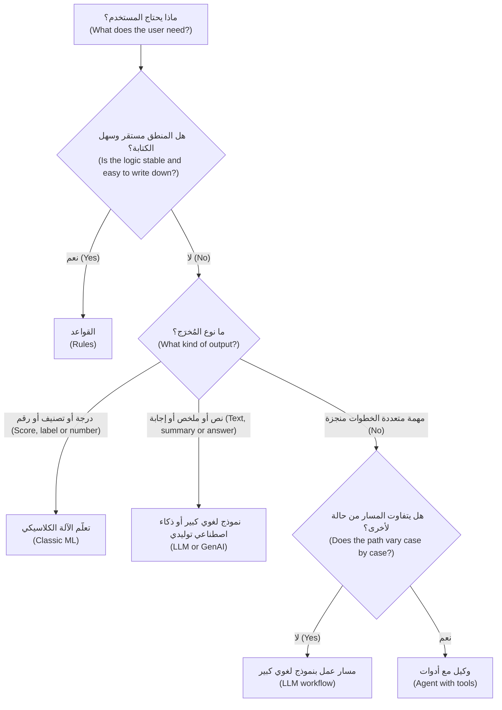
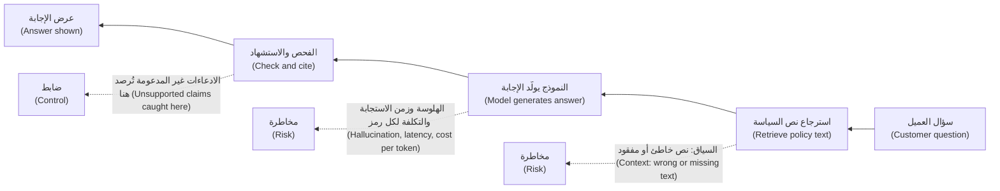
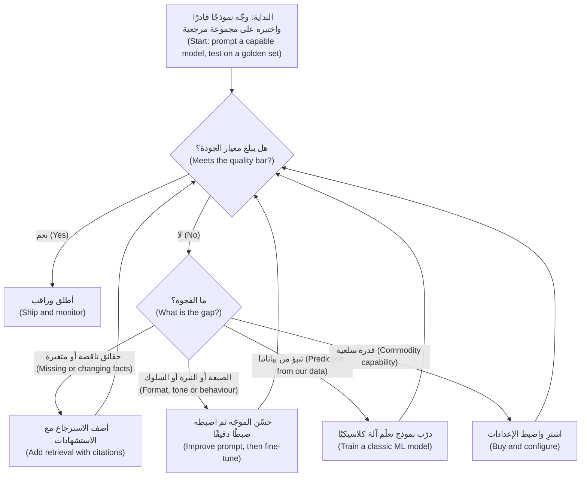

# الوحدة 1 — الثقافة في الذكاء الاصطناعي لأهل المنتج

*لا يمكنك إدارة منتج لا تستطيع التفكير فيه بوعي. تمنحك هذه الوحدة ما يكفي من الفهم التقني لاتخاذ قرارات المنتج، دون أن تطلب منك أن تصبح مهندسًا. ستتعلم التمييز بين تعلّم الآلة (machine learning) والذكاء الاصطناعي التوليدي (generative AI) والنماذج اللغوية الكبيرة (large language models) والوكلاء (agents)، ومطابقة كلٍّ منها مع المهمة التي يُحسن أداءها. وستتعلم الحدود التي تشكّل كل منتج ذكاء اصطناعي: الأخطاء، والهلوسة (hallucination)، والسياق، وزمن الاستجابة (latency)، والتكلفة. وستتعلم أيضًا سُلّم طرق بناء ميزة ذكاء اصطناعي، من كتابة موجّه (prompt) إلى تدريب نموذج أو شراء منتج. وطوال الوحدة تجلس مع فريق المنتجات الرقمية والذكاء الاصطناعي في بنك نجم (Najm Bank) بينما يتعلم فيصل، مدير منتج ذكاء اصطناعي جديد، من رانيا ودانة وطارق كيف يطرح أسئلة أفضل قبل أن يكتب متطلبًا واحدًا.*

> **المراحل:** Discover · Define · Build — المفردات والحُكم اللذان تحتاجهما قبل أن تتمكن من إيجاد منتج ذكاء اصطناعي أو تحديد مواصفاته أو بنائه بثقة.

---

# 1.1 — تعلّم الآلة والذكاء الاصطناعي التوليدي والنماذج اللغوية الكبيرة والوكلاء: فيمَ يُجيد كلٌّ منها
*المستوى: 🟢 مبتدئ* · *المتطلبات: 0.2* · *المرحلة: Discover*

## ⚡ الدرس في دقيقة
- «الذكاء الاصطناعي (AI)» مظلة تضم أربع عائلات: **تعلّم الآلة (machine learning)** (يتنبأ بتصنيف أو رقم انطلاقًا من أمثلة)، و**الذكاء الاصطناعي التوليدي (generative AI)** (ينتج محتوى جديدًا)، و**النماذج اللغوية الكبيرة (large language models)** (ذكاء اصطناعي توليدي للنصوص، يقف خلف معظم المساعدات)، و**الوكلاء (agents)** (نموذج يستخدم أدوات في حلقة لإنجاز مهمة).
- الفكرة الأهم: **ابدأ من المُخرَج الذي يحتاجه المستخدم**، لا من التقنية. الدرجة أو الإجابة بنعم/لا تشير إلى تعلّم الآلة الكلاسيكي (classic ML)؛ والمسودة أو الإجابة بالكلمات تشير إلى النموذج اللغوي الكبير (LLM)؛ والمهمة متعددة الخطوات التي تغيّر أنظمة أخرى تشير إلى الوكيل (agent)؛ والمنطق الثابت يشير إلى القواعد البسيطة.
- العائلات تتكامل. كثير من المنتجات الجيدة تستخدم نموذجًا تنبؤيًا (predictive model) لاتخاذ القرار ونموذجًا لغويًا (language model) لشرحه أو صياغة ما حوله.
- مؤشر القرار: إذا كانت قاعدة شفافة تؤدي المهمة، فاستخدم القاعدة. أضف التعلّم فقط حيث يكون النمط أعقد من أن يُكتب أو يتغير أكثر من اللازم.
- أكبر فخ: استخدام نموذج لغوي كبير لمهمة تحتاج رقمًا متسقًا ومعايَرًا وقابلًا للتفسير، مثل قرار ائتماني.

## 🧭 لماذا يهم
في أسبوعه الثاني في بنك نجم، يُحضر فيصل إلى رانيا قائمة من اثنتي عشرة فكرة، كلها موسومة «ذكاء اصطناعي توليدي (GenAI)». ثلاث منها تلفت النظر: *دع نموذجًا لغويًا كبيرًا يوافق على طلبات تمويل الفواتير للشركات الصغيرة والمتوسطة* بناءً على الفاتورة والكشوف؛ و*نموذج لغوي كبير يقرأ كل معاملة بطاقة ويرصد الاحتيال*؛ و*وكيل يتولى نزاعات البطاقات من البداية إلى النهاية في نجم أسيست*.

لا تقول رانيا لا. بل تطرح سؤالًا واحدًا عن كل فكرة: «كيف يبدو المُخرَج، وماذا يحدث حين يكون خاطئًا؟». تمويل الشركات الصغيرة والمتوسطة يحتاج قرار إقراض متسقًا وقابلًا للتدقيق وقابلًا للتفسير، ولدى البنك سنوات من سجل السداد المُصنَّف، وهو بالضبط ما يتعلم منه نموذج تنبؤي كلاسيكي. أما تقييم الاحتيال فيجب أن يعالج ملايين المعاملات ضمن نافذة تفويض البطاقة بتكلفة ضئيلة لكل منها؛ ونموذج لغوي كبير يقرأ كل معاملة سيكون بطيئًا ومكلفًا. ووكيل النزاعات فرصة حقيقية، لكنه يحرّك الأموال، فيحتاج تصميمًا أكثر عناية بكثير من مساعد للإجابة عن الأسئلة.

قائمة فيصل نموذجية: الفرق تمدّ يدها إلى التقنية المثيرة أولًا ثم تبحث عن مشكلة ثانيًا. يبني هذا الدرس العادة المعاكسة: سمِّ المهمة، ثم اختر عائلة التقنية التي تناسبها.

## 📐 كيف يعمل

### 🟢 الأساسيات

**الذكاء الاصطناعي** تسمية واسعة لبرمجيات تؤدي مهامّ نربطها بالحُكم البشري. في عمل المنتج، التقسيم المفيد هو بين منطق *يكتبه* شخص (القواعد) ومنطق *متعلَّم من البيانات* (النماذج).

**القواعد** تعليمات صريحة: «إذا تجاوز التحويل 50,000 ريال قطري وكان المستفيد جديدًا، فأوقفه للمراجعة». القواعد شفافة ورخيصة ويمكن التنبؤ بها، لكنها تنهار حين يكون النمط أعقد من أن يُكتب أو يتغير أسرع مما يستطيع الناس تحديثها.

**تعلّم الآلة** يتعلم نمطًا من الأمثلة بدلًا من أن تُملى عليه القاعدة. الشكل الأكثر شيوعًا في الأعمال هو **التعلّم الخاضع للإشراف**: تعرض على النموذج حالات سابقة كثيرة مرفقًا بها الإجابة الصحيحة (**تصنيف**)، مثل «هذه الفاتورة سُدِّدت»، فيتعلم التنبؤ بالتصنيف للحالات الجديدة. **التدريب** هو خطوة التعلم؛ و**الاستدلال** هو استخدام النموذج المدرَّب على حالة جديدة. مهامّ تعلّم الآلة النموذجية:

- **التصنيف (Classification)**: أي فئة؟ (احتيال أم لا، سيسدد أم لا)
- **الانحدار (Regression)**: أي رقم؟ (الخسارة المتوقعة، مدة السداد)
- **الترتيب والتوصية**: أي العناصر أولًا؟ (أي عرض يُعرض على العميل)
- **كشف الشذوذ**: ما الذي يبدو غير معتاد؟ (قفزة في الإنفاق)
- **التنبؤ بالمستقبل**: ماذا بعد؟ (الطلب على النقد في الفروع الأسبوع المقبل)

عادةً ما يُخرج نموذج التصنيف **درجة**، مثل احتمال سداد قدره 0.82. ثم يختار فريق المنتج **عتبة (threshold)** تحوّل الدرجة إلى إجراء («موافقة مبدئية فوق 0.9، وإحالة إلى محلل بين 0.6 و0.9، ورفض دون ذلك»). اختيار العتبة قرار منتج، لأنه يحدد كم عميلًا جيدًا ترفض وكم مخاطرة سيئة تقبل (الدرس 1.2).

**الذكاء الاصطناعي التوليدي** هو عائلة النماذج التي تنتج محتوى جديدًا: نصوصًا وصورًا وصوتًا وشيفرة برمجية.

**النموذج اللغوي الكبير** نموذج توليدي (generative model) دُرِّب على كميات هائلة من النصوص للتنبؤ بالقطعة الصغيرة التالية من النص، وتسمى **الرمز (token)** (تقريبًا كلمة أو جزء من كلمة). كرّر هذا التنبؤ آلاف المرات فتحصل على فقرات وإجابات وشيفرة. والنتيجة محرّك متعدد الأغراض: النموذج نفسه يمكنه تلخيص قائمة مالية، وصياغة بريد إلكتروني بالعربية، وتصنيف شكوى، بحسب طريقة سؤالك له. والنموذج المدرَّب على نطاق واسع ثم المكيَّف لمهام كثيرة يُسمى غالبًا **النموذج الأساسي (foundation model)**.

**الوكيل** نموذج لغوي كبير موضوع في حلقة. يُعطى هدفًا ومجموعة من **الأدوات** (دوال يمكنه استدعاؤها، مثل «البحث عن بطاقة» و«تجميد بطاقة» و«فتح نزاع»). يختار أداة، ويقرأ النتيجة، ويقرر الخطوة التالية حتى يتحقق الهدف أو يستسلم. الوكلاء يحوّلون النماذج اللغوية من *مستشارين* إلى *فاعلين*، وهذه هي قيمتهم ومخاطرتهم في آنٍ واحد.

| العائلة | المُخرَج النموذجي | يصلح لـ | مثال من نجم | نقطة الضعف الرئيسية |
|---|---|---|---|---|
| القواعد | إجراء ثابت | منطق مستقر ومفهوم جيدًا | حدود صارمة على التحويلات إلى مستفيدين جدد | هشّة حين تتغير الأنماط |
| تعلّم الآلة الكلاسيكي | درجة، تصنيف، رقم، ترتيب | تنبؤات متكررة وعالية الحجم مع سجل مُصنَّف | الموافقة المبدئية في التمويل الفوري للشركات الصغيرة (SME Instant Finance)؛ التنبيهات الذكية (Smart Alerts) | يحتاج بيانات مُصنَّفة جيدة؛ مهمة ضيقة واحدة لكل نموذج |
| الذكاء الاصطناعي التوليدي / النموذج اللغوي الكبير | نصوص، ملخصات، إجابات، شيفرة | العمل الكثيف لغويًا: الصياغة والتلخيص والاستخراج والإجابة من المستندات | مساعد مذكرات الائتمان (Credit Memo Copilot)؛ مساعد الموظفين التوليدي (Staff GenAI) | قد يخطئ بطلاقة؛ يكلّف في كل استخدام؛ يتفاوت من تشغيل لآخر |
| الوكيل | مهمة منجزة مع إجراءات في أنظمة أخرى | عمل متعدد الخطوات عبر أدوات يتفاوت مساره | نجم أسيست (Najm Assist) وهو يعالج نزاع بطاقة | الأخطاء تتراكم عبر الخطوات؛ قد يصعب التراجع عن الإجراءات |

### 🟡 التعمق أكثر

**كيف «يعرف» النموذج اللغوي الكبير الأشياء.** لا يبحث النموذج اللغوي الكبير عن الحقائق في قاعدة بيانات. التدريب يضبط مليارات الأرقام الداخلية (**المعاملات (parameters)**، أو **الأوزان (weights)**)، وينتهي المطاف بالمعرفة مخزّنة فيها بطريقة منتشرة وتقريبية. وتترتب على ذلك ثلاث نتائج. تتوقف معرفة النموذج عند **تاريخ انقطاع المعرفة**، أي حين جُمعت بيانات تدريبه. ويمكنه إنتاج نص معقول الظاهر عن أشياء لا يعرفها، لأن النص المعقول الظاهر هو ما دُرِّب على إنتاجه. والطريقة الموثوقة لجعله يجيب من حقائقك *أنت* هي إعطاؤه تلك الحقائق وقت الطلب (الاسترجاع، الدرس 1.3).

تُبنى النماذج اللغوية الكبيرة الحديثة على معمارية **المحوِّل** (Vaswani et al., 2017). لا تحتاج إلى رياضياتها، بل إلى هذا فقط: يستخدم النموذج كل ما في **نافذة السياق (context window)** (النص المعطى له في هذا الطلب، الدرس 1.2) لتشكيل كل رمز تالٍ.

**الضبط بالتعليمات والتدريب على التفضيلات.** النموذج المدرَّب فقط على التنبؤ بالنص يُكمل النص؛ ولا يتبع الطلبات بموثوقية. يضيف المورّدون تدريبًا على أمثلة لتعليمات واستجابات جيدة، ثم على أحكام بشأن أي الاستجابات أفضل (انظر ورقة InstructGPT من OpenAI، Ouyang et al., 2022، حول التعلّم المعزّز من الملاحظات البشرية). لهذا تتصرف المساعدات كزملاء متعاونين، ولهذا أيضًا تميل إلى أن تبدو واثقة وموافِقة حتى حين ينبغي لها أن تعترض.

**التضمينات (Embeddings).** **التضمين (embedding)** قائمة أرقام تمثّل معنى قطعة من النص، بحيث تحصل النصوص المتشابهة في المعنى على أرقام متشابهة. تقف التضمينات خلف كثير من منتجات الذكاء الاصطناعي: البحث الدلالي («ابحث عن السياسات المتعلقة بالسداد المبكر» يطابق بندًا لا يستخدم تلك الكلمات أبدًا)، وتجميع الشكاوى حسب الموضوع، وخطوة الاسترجاع في التوليد المعزّز بالاسترجاع (RAG).

**مسارات العمل مقابل الوكلاء.** ليس كل نظام متعدد الخطوات قائم على نموذج لغوي كبير وكيلًا. يميّز دليل Anthropic واسع الاستشهاد *Building effective agents* (2024) بين **مسارات العمل**، حيث يحدد المطوّر الخطوات مسبقًا (استخرج الأرقام، ثم افحص النسب، ثم صُغ المذكرة)، و**الوكلاء**، حيث يقرر النموذج نفسه الخطوات. مسارات العمل أكثر قابلية للتنبؤ وأرخص وأسهل في الاختبار؛ فلا تختر وكيلًا إلا حين يتفاوت المسار فعلًا وتبرر القيمة المخاطرة. نزاع البطاقة قد يسلك عدة اتجاهات (استرداد معلّق من التاجر، احتيال دون حضور البطاقة، خصم مكرر)، ولهذا فمسار النزاعات في نجم أسيست مرشح معقول لوكيل. أما مساعد مذكرات الائتمان فيتبع البنية نفسها في كل مرة، فينبغي أن يكون مسار عمل.

**الأدوات وبروتوكول MCP (Tools and MCP).** تستدعي النماذج الأدوات عبر **استدعاء الدوال (function calling)** (ويسمى أيضًا استخدام الأدوات): يُخرج النموذج طلبًا مهيكلًا، مثل `freeze_card(card_id)`، وينفّذه التطبيق. **بروتوكول سياق النموذج (Model Context Protocol, MCP)**، الذي قدّمته Anthropic في نوفمبر 2024، معيار مفتوح لربط النماذج بالأدوات ومصادر البيانات بطريقة متسقة، بحيث يخدم تكامل واحد تطبيقات ذكاء اصطناعي كثيرة. بالنسبة لمدير المنتج (PM)، الأدوات التي تكشفها هي سطح المنتج: تحدد ما *يستطيع* الوكيل فعله، وبالتالي ما يمكن أن يخطئ فيه (الدرس 5.3؛ ويغطي مقرر *Production AI Agents* الجانب الهندسي).

### 🔴 نظرة الخبير

**الحلول الهجينة تتفوق على الحلول الصافية.** نادرًا ما تستخدم أفضل منتجات الذكاء الاصطناعي عائلة واحدة. يستخدم التمويل الفوري للشركات الصغيرة نموذج تعلّم آلة كلاسيكيًا لدرجة الموافقة المبدئية، لأن ذلك القرار يجب أن يكون متسقًا، وقابلًا للاختبار على الحالات التاريخية، وقابلًا للتفسير برموز الأسباب (reason codes). يمكن لنموذج لغوي كبير أن يصوغ خطاب العميل، لكن القرار يبقى مع النموذج المحوكَم. وكذلك التنبيهات الذكية: يقيّم تعلّم الآلة المعاملة؛ وقد يشرح نموذج لغوي التنبيه بعربية أو إنجليزية بسيطة. والقاعدة العملية هي أن *تقرر بالمكوّن الأكثر قابلية للتحكم وتتواصل بالمكوّن الأكثر طلاقة*.

**لماذا لا ندع النموذج اللغوي الكبير يقرر الائتمان؟** ثمة أربع مشكلات منتج. (1) *الاتساق*: قد يحصل الطلب نفسه على إجابات مختلفة في تشغيلات مختلفة، أو بعد تحديث المورّد للنموذج. (2) *المعايرة (Calibration)*: يمكن مقارنة درجات النموذج التنبؤي بمعدلات التعثر المرصودة؛ أما الثقة المعلنة للنموذج اللغوي الكبير فليست احتمالًا موثوقًا. (3) *قابلية التفسير*: رموز الأسباب المستمدة من بطاقة تقييم أو من نموذج مفسَّر بتقنيات راسخة أسهل في الدفاع عنها من فقرة استدلال مولَّد، قد لا تعكس ما دفع المُخرَج فعلًا. (4) *التنظيم*: التقييم الائتماني للأفراد استخدام عالي المخاطر بموجب قانون الذكاء الاصطناعي الأوروبي (EU AI Act)، والمالكون الأفراد والضامنون يطمسون الحد الفاصل حتى في منتج للشركات الصغيرة والمتوسطة. عبارة «النموذج اللغوي الكبير يقرر الائتمان» تضعك في أشد المواضع تطلبًا على كل المحاور في آنٍ واحد.

**التقييم يختلف باختلاف العائلة.** للنموذج التنبؤي إجابة صحيحة لكل حالة تاريخية، فيمكنك قياسه على بيانات محجوزة قبل الإطلاق. أما النص المولَّد فله إجابات مقبولة كثيرة وإجابات خاطئة بشكل خفي كثيرة، فيحتاج التقييم إلى معايير تقدير (rubrics) وأمثلة مرجعية ومحكّمين من البشر أو النماذج (الوحدة 6). لذلك فميزة ذكاء اصطناعي توليدي تبدو مكتملة بعد نموذج أولي من يومين قد تحتاج أسابيع من التقييم قبل أن يصبح إطلاقها آمنًا.

**هل تحتاج إلى الذكاء الاصطناعي أصلًا؟** يفتتح مارتن زينكيفيتش (Martin Zinkevich) كتابه *Rules of Machine Learning* (Google) بعبارة «لا تخف من إطلاق منتج دون تعلّم آلة». كثيرًا ما تحقق القاعدة جزءًا كبيرًا من القيمة بجزء بسيط من المخاطرة، وتنتج البيانات التي يحتاجها نموذج لاحق (الدرس 2.3).

## 🧰 الأدوات
| الأداة أو الإطار | ما هو وماذا يفعل | متى تلجأ إليه |
|---|---|---|
| **Task-to-technology map** — خريطة المهمة إلى التقنية | عبارة من سطر واحد لكل فكرة: مهمة المستخدم، والمُخرَج المطلوب، وتكلفة الخطأ، والعائلة المناسبة (القواعد، تعلّم الآلة، النموذج اللغوي الكبير، مسار العمل، الوكيل) | المرور الأول على أي قائمة أفكار ذكاء اصطناعي |
| **Rules of ML** — قواعد تعلّم الآلة | إرشادات عملية لمنتجات تعلّم الآلة، تبدأ بالإطلاق دون تعلّم آلة | حين يريد فريق نموذجًا قبل أن يكون لديه خط أساس (baseline) |
| **Workflows vs agents** — مسارات العمل مقابل الوكلاء | يميّز بين خطوط معالجة ثابتة متعددة الخطوات بالنموذج اللغوي والحلقات التي يوجّهها النموذج | تقرير ما إذا كانت الميزة تحتاج استقلالية أم مجرد خطوات |
| **Model Context Protocol (MCP)** (Anthropic, 2024) — بروتوكول سياق النموذج | معيار مفتوح لربط النماذج بالأدوات ومصادر البيانات | التخطيط لأي الأنظمة يمكن أن يصل إليها مساعد أو وكيل |
| **Embeddings** — التضمينات | تمثيلات رقمية للمعنى تُستخدم في البحث الدلالي والتجميع والاسترجاع | حين يبحث المستخدمون بكلماتهم الخاصة، أو تحتاج إلى تجميع النصوص |
| **Decide-then-explain pattern** — نمط «قرّر ثم اشرح» | نموذج تنبؤي يتخذ القرار؛ ونموذج لغوي يصوغ أو يشرح ما حوله | القرارات الخاضعة للتنظيم التي تستفيد مع ذلك من اللغة الطبيعية |

## 🏛️ عمليًا في بنك نجم
تطلب رانيا من فيصل إعادة صياغة قائمته في صورة **بطاقة ملاءمة التقنية**، صف واحد لكل منتج، قبل أن يقدّر أحدٌ الجهد:

| المنتج | مهمة المستخدم | المُخرَج المطلوب | تكلفة الخطأ | العائلة | لماذا ليس البديل البديهي |
|---|---|---|---|---|---|
| مساعد مذكرات الائتمان | مدير العلاقة (RM) يحوّل البيانات المالية والملاحظات إلى مسودة أولى لمذكرة ائتمان | نص مهيكل مع أرقام ومصادر | رقم خاطئ أو تعهّد مختلَق يصل إلى لجنة الائتمان | **مسار عمل** بنموذج لغوي كبير (خطوات ثابتة) | الوكيل يضيف عدم قابلية للتنبؤ دون فائدة؛ فالخطوات لا تتغير أبدًا |
| نجم أسيست (المرحلة 1) | العميل يحصل على إجابة عن المنتجات والرسوم | إجابة قصيرة بالعربية أو الإنجليزية، مستندة إلى الشروط المنشورة | رسوم أو سياسة معروضة خطأً؛ البنك ملزم بما يقوله الروبوت | نموذج لغوي كبير مع استرجاع | روبوت الأسئلة الشائعة القائم على القواعد لا يتعامل جيدًا مع الأسئلة الحرة |
| نجم أسيست (المرحلة 2) | العميل يجمّد بطاقة أو يعترض على معاملة | إجراء منجز مع تأكيد | تجميد البطاقة الخطأ؛ تقديم النزاع بشكل غير صحيح | **وكيل** بأدوات ضيقة وتأكيدات | مسار العمل الثابت لا يغطي تنوع مسارات النزاع |
| التمويل الفوري للشركات الصغيرة | الشركة الصغيرة تحصل على موافقة مبدئية سريعة على فاتورة | درجة وقرار مع رموز الأسباب | خسارة من قروض سيئة؛ رفض غير عادل | **تعلّم الآلة الكلاسيكي**، مع نموذج لغوي كبير يصوغ الخطابات | قرارات النموذج اللغوي الكبير غير متسقة وغير معايَرة ويصعب تفسيرها |
| التنبيهات الذكية | العميل يُنبَّه إلى احتيال محتمل أو إنفاق غير معتاد | درجة لكل معاملة، في الوقت الفعلي | احتيال فائت مقابل إرهاق التنبيهات (alert fatigue) | **تعلّم الآلة الكلاسيكي** مع القواعد | نموذج لغوي كبير لكل معاملة بطيء جدًا ومكلف جدًا عند هذا الحجم |
| مساعد الموظفين التوليدي | الموظف يصوغ ويلخّص ويبحث في المعرفة الداخلية | نصوص وإجابات | تسريب بيانات؛ اقتباس سياسة داخلية خاطئة | **مساعد نموذج لغوي كبير** متعدد الأغراض (يُشترى على الأرجح، الدرس 1.3) | البناء المخصص يكرر منتجًا سلعيًا |

قاعدة رانيا للبطاقة: *«إذا لم تستطع ملء خانة "تكلفة الخطأ"، فأنت لست مستعدًا لاختيار التقنية»*

## 🛠️ التمارين
- 🟢 صنّف خمس ميزات ذكاء اصطناعي تستخدمها إلى: قواعد، أو تعلّم آلة كلاسيكي، أو نموذج لغوي كبير، أو مسار عمل، أو وكيل. *يكتمل عندما:* يكون لكلٍّ منها سبب من سطر واحد مبني على مُخرَجها، لا على تسويقها.
- 🟡 تتضمن قائمة فيصل «نموذجًا لغويًا كبيرًا يقرأ كل معاملة بطاقة ويرصد الاحتيال». أعد كتابتها كتصميم هجين يستخدم تعلّم الآلة والنموذج اللغوي الكبير كلًّا حيث يكون قويًا. *يكتمل عندما:* تحدد أي مكوّن يقرر، وأيّها يتواصل، وسببًا واحدًا لكلٍّ منهما (السرعة، أو التكلفة، أو الاتساق، أو اللغة).
- 🔴 يريد مالك منتج نجم أسيست أن يتولى وكيل المرحلة 2 «أي شيء يطلبه العميل». اكتب مذكرة من نصف صفحة تدافع فيها عن نطاق أول أضيق. *يكتمل عندما:* تسمّي المذكرة ثلاث مهام على الأكثر، وتشرح لماذا تناسب كلٌّ منها وكيلًا لا مسار عمل ثابتًا، وتسمّي مهمة واحدة ينبغي أن تبقى مسار عمل مع السبب.

## ⚠️ أخطاء وفخاخ
- **التقنية أولًا.** عبارة «نحتاج حالة استخدام للذكاء الاصطناعي التوليدي» تنتج عروضًا تجريبية، لا منتجات. ابدأ من مهمة المستخدم والمُخرَج الذي تحتاجه.
- **نموذج لغوي كبير للقرارات التنبؤية.** للحصول على درجات متسقة ومعايَرة وقابلة للتفسير على بيانات مهيكلة (structured data)، يكون تعلّم الآلة الكلاسيكي عادةً أفضل وأرخص وأسهل في الحوكمة. استخدم النموذج اللغوي الكبير للتواصل حول القرار.
- **تسمية كل خط معالجة وكيلًا.** إذا كانت الخطوات هي نفسها في كل مرة، فابنِ مسار عمل. فهو أكثر قابلية للتنبؤ وأسهل في الاختبار.
- **افتراض أن النموذج يعرف عملك.** يعرف النموذج اللغوي الكبير ما كان في بيانات تدريبه (training data) حتى تاريخ انقطاعه، على وجه التقريب. سياساتك وأسعارك وعملاؤك يجب توفيرها وقت الطلب.
- **تخطي خط الأساس القائم على القواعد.** دون خط أساس بسيط لا تستطيع إثبات أن النموذج يضيف قيمة، وتخسر الخيار الأرخص.

## 🧾 الخلاصة
- القواعد تُكتب؛ والنماذج تُتعلَّم. تعلّم الآلة الكلاسيكي يتنبأ بالتصنيفات والأرقام؛ والذكاء الاصطناعي التوليدي والنماذج اللغوية الكبيرة تنتج المحتوى؛ والوكلاء يستخدمون الأدوات في حلقة لإنجاز المهام.
- اختر العائلة انطلاقًا من المُخرَج الذي يحتاجه المستخدم ومن تكلفة الخطأ.
- النماذج اللغوية الكبيرة تتنبأ بالنص من أنماط تعلّمتها في التدريب. ولا تبحث عن الحقائق ما لم تعطها الحقائق.
- فضّل مسارات العمل على الوكلاء ما لم يتفاوت المسار فعلًا؛ والأدوات سطح منتج.
- الحلول الهجينة أمر طبيعي: قرّر بالمكوّن القابل للتحكم، وتواصل بالمكوّن الطَّلِق.

## ✍️ اختبر نفسك

**1. يريد بنك نجم (Najm Bank) منح موافقة مبدئية على طلبات تمويل الفواتير للشركات الصغيرة والمتوسطة في ثوانٍ، باستخدام عشر سنوات من سجل السداد المُصنَّف. أي نهج يناسب القرار نفسه على أفضل وجه؟**

- A. اطلب من نموذج لغوي كبير قراءة الطلب والإجابة بـ«موافقة» أو «رفض»
- B. درّب نموذج تعلّم آلة كلاسيكيًا على سجل السداد وحدّد عتبات للموافقة والإحالة والرفض
- C. ابنِ وكيلًا يتصفح موقع الشركة الإلكتروني قبل أن يقرر
- D. استخدم التضمينات لإيجاد مذكرات سابقة مشابهة ونسخ قرارها

الإجابة

**B.** المهمة تنبؤ متسق وقابل للتفسير من سجل مهيكل ومُصنَّف، وهذا بالضبط ما يفعله التعلّم الخاضع للإشراف. الخيار A مُغرٍ لأن النموذج اللغوي الكبير يستطيع إنتاج إجابة، لكنه غير متسق وغير معايَر ويصعب تفسيره في قرار خاضع للتنظيم. (🟢 الأساسيات؛ 🔴 نظرة الخبير.)

**2. ما أفضل وصف لما يفعله النموذج اللغوي الكبير (large language model) حين يولّد إجابة؟**

- A. يسترجع الإجابة من قاعدة بيانات داخلية من الحقائق الموثّقة
- B. يتنبأ مرارًا بالرمز التالي بناءً على أنماط تعلّمها في التدريب وعلى النص الموجود في سياقه
- C. ينفّذ القواعد التي كتبها مطوّروه لكل موضوع
- D. يبحث في الإنترنت عند كل طلب

الإجابة

**B.** تولّد النماذج اللغوية الكبيرة النص رمزًا تلو رمز من أنماط متعلَّمة إضافةً إلى ما في نافذة السياق. الخيار A هو أكثر المفاهيم الخاطئة شيوعًا: لا توجد قاعدة حقائق داخل النموذج، ولهذا يمكن أن يخطئ بطلاقة. (🟢 الأساسيات؛ 🟡 التعمق أكثر.)

**3. يستخرج مساعد مذكرات الائتمان دائمًا الأرقام، ثم يفحص النسب، ثم يصوغ الأقسام بالترتيب نفسه. يعرض مورّد «وكيلًا مستقلًا» له. ما أقوى استجابة من منظور المنتج؟**

- A. اقبل، لأن الوكلاء أكثر تقدمًا من مسارات العمل وسيتعاملون مع الحالات غير المتوقعة بصورة أفضل
- B. ارفض أي استخدام للنماذج اللغوية الكبيرة في مذكرات الائتمان، لأن مستندات الائتمان شديدة الحساسية ولا يمكن الوثوق بأي نموذج توليدي للتعامل معها
- C. استبدل المساعد بمصنِّف تعلّم آلة كلاسيكي يقيّم كل قسم من أقسام مذكرة الائتمان
- D. فضّل مسار عمل ثابتًا بنموذج لغوي كبير، لأن الخطوات لا تتغير ومسار العمل أكثر قابلية للتنبؤ وأسهل في الاختبار

الإجابة

**D.** لا تستخدم وكيلًا إلا حين يتفاوت المسار من حالة لأخرى. وهنا لا يتفاوت، فمسار العمل يعطي القيمة نفسها بقدر أقل من عدم القابلية للتنبؤ. الخيار A يخلط بين التعقيد والملاءمة. (🟡 التعمق أكثر، مسارات العمل مقابل الوكلاء.)

**4. يجب أن تقيّم التنبيهات الذكية ملايين معاملات البطاقات في الوقت الفعلي بتكلفة منخفضة جدًا لكل معاملة. يقترح فريق نموذجًا لغويًا كبيرًا لمراجعة كل معاملة. ما الاعتراض الرئيسي من منظور المنتج؟**

- A. النماذج اللغوية الكبيرة لا تستطيع قراءة الأرقام، فيسيء النموذج قراءة مبالغ المعاملات والأرصدة
- B. عند هذا الحجم وزمن الاستجابة، يكون نموذج تعلّم آلة متخصص أسرع وأرخص بكثير لكل قرار، ويبقى النموذج اللغوي الكبير لشرح التنبيهات
- C. كشف الاحتيال محظور بموجب قانون الذكاء الاصطناعي الأوروبي، فيحتاج الفريق إلى موافقة الجهة التنظيمية أولًا
- D. لا يمكن استخدام النماذج اللغوية الكبيرة بالعربية، فسيحتاج البنك إلى بناء نموذج احتيال منفصل لكل لغة يتحدثها عملاؤه قبل إطلاق أي شيء، وهذا كثير الكلفة

الإجابة

**B.** الاعتراض يتعلق بالملاءمة: السرعة والتكلفة عند الحجم الكبير والاتساق ترجّح تعلّم الآلة الكلاسيكي، بينما يمكن للنموذج اللغوي الكبير أن يضيف قيمة في التواصل. الخيار C خاطئ: كشف الاحتيال ليس ممارسة محظورة (prohibited practice). (🔴 نظرة الخبير، الحلول الهجينة؛ جدول 🏛️.)

**5. أي عبارة عن بروتوكول سياق النموذج صحيحة؟**

- A. هو طريقة تدريب تجعل النماذج أكثر دقة في المهام المتخصصة
- B. هو معيار مفتوح، قدّمته Anthropic عام 2024، لربط النماذج بالأدوات ومصادر البيانات
- C. هو تنظيم يحكم كيف يجوز لوكلاء الذكاء الاصطناعي التصرف نيابة عن العملاء في الاتحاد الأوروبي
- D. هو مقياس لقياس معدلات الهلوسة في إجابات النموذج، يُعرض كنسبة الادعاءات غير المدعومة لكل مئة إجابة

الإجابة

**B.** يوحّد MCP طريقة اتصال تطبيقات الذكاء الاصطناعي بالأدوات والبيانات. وهو لا يغيّر النموذج نفسه. يهم مدير المنتج لأن الأدوات التي تربطها تحدد ما يستطيع المساعد فعله. (🟡 التعمق أكثر، الأدوات وMCP.)

## 📚 المراجع
- Vaswani et al., "Attention Is All You Need" (2017) — https://arxiv.org/abs/1706.03762
- Ouyang et al., "Training language models to follow instructions with human feedback" (2022) — https://arxiv.org/abs/2203.02155
- Martin Zinkevich, *Rules of Machine Learning: Best Practices for ML Engineering* — https://developers.google.com/machine-learning/guides/rules-of-ml
- Anthropic, *Building effective agents* (2024) — https://www.anthropic.com/research/building-effective-agents
- Model Context Protocol — https://modelcontextprotocol.io
- Google, People + AI Guidebook (PAIR) — https://pair.withgoogle.com/guidebook

---

# 1.2 — القدرات والحدود: الأخطاء والهلوسة والسياق وزمن الاستجابة والتكلفة
*المستوى: 🟢 مبتدئ* · *المتطلبات: 1.1* · *المرحلة: Define, Design*

## ⚡ الدرس في دقيقة
- كل نظام ذكاء اصطناعي **يخطئ في بعض الأحيان**. سؤال المنتج ليس أبدًا «هل هو دقيق؟» بل «كم مرة يخطئ، وبأي طريقة، ولمن، وماذا يحدث حينها؟».
- خمسة حدود تشكّل كل منتج ذكاء اصطناعي: **الأخطاء** (الإيجابيات الكاذبة والسلبيات الكاذبة)، و**الهلوسة (hallucination)** (مُخرَج طَلِق غير صحيح أو غير مدعوم بالمصادر)، و**السياق** (ما يستطيع النموذج رؤيته وما يعرفه)، و**زمن الاستجابة (latency)** (كم ينتظر المستخدم)، و**التكلفة** (تدفع لكل استخدام، لا مرة واحدة).
- تُقاس أخطاء النماذج التنبؤية بـ**مصفوفة الالتباس (confusion matrix)** و**الدقة (precision)** و**الاستدعاء (recall)**. حين يكون الشيء الذي تبحث عنه نادرًا، يمكن لنموذج أن يكون دقيقًا بنسبة 99% ومع ذلك يخطئ في معظم التنبيهات التي يطلقها.
- تُقدَّر التكلفة لكل مهمة بنموذج بسيط: الرموز الداخلة والخارجة، مضروبة في السعر، مضروبة في عدد الاستدعاءات لكل مهمة، مضروبة في الحجم. غالبًا ما تكون زهيدة لأداة داخلية ومؤثرة لمساعد موجّه للمستهلكين.
- مؤشر القرار: دوّن الحدود *قبل* أن تصمم. كل حد يصبح إما ميزة تصميم (الاستشهادات، التأكيدات، البث التدريجي، البدائل الاحتياطية) أو معيار جودة.
- أكبر فخ: الحكم على نموذج من عرض تجريبي رائع. العروض التجريبية تُظهر أفضل حالة؛ والمستخدمون يواجهون التوزيع الكامل.

## 🧭 لماذا يهم
بعد أسبوعين من تجربة مساعد مذكرات الائتمان، يُحيل خالد إلى رانيا مسودة مذكرة مع جملة واحدة مظلَّلة. تقول المذكرة إن التسهيل القائم للمقترض «يتضمن تعهّد عدم رهن الأصول وحدًّا أدنى لنسبة تغطية خدمة الدين قدره 1.25x». واتفاقية التسهيل لا تذكر أيًّا منهما. المسودة تُقرأ بشكل مثالي. ولم يتحقق منها مدير العلاقة لأن «بقية الأرقام كانت صحيحة». ملاحظة خالد قصيرة: «إذا وصل هذا إلى لجنة الائتمان، فمن المسؤول؟».

فعل النموذج ما تفعله النماذج اللغوية: أنتج مذكرة ائتمان معقولة الظاهر، ومذكرات الائتمان المعقولة تذكر التعهدات. كان الإخفاق في المنتج. لم يكن هناك ما يُلزم المسودة بالاستشهاد بمصدرها، ولا ما يرصد الادعاءات غير المدعومة، ولم يُخبر أحدٌ مدير العلاقة أين يضعف المساعد.

والأمثلة العامة تُظهر النمط نفسه. في فبراير 2023، تضمّن عرض إطلاق Bard من Google خطأً معلوماتيًا عن تلسكوب جيمس ويب الفضائي (James Webb Space Telescope). وفي قضية *Moffatt v. Air Canada* (2024)، حمّلت محكمةٌ شركةَ الطيران المسؤولية بعد أن وصف روبوت المحادثة على موقعها سياسة استرداد لا تطابق سياسة الشركة نفسها. في الحالتين، لم يأخذ المنتج المحيط بالنموذج في الحسبان حدًّا معروفًا. يمنحك هذا الدرس المفردات لتسمية كل حد، وعادة التصميم له قبل أن يكتشفه المستخدمون.

## 📐 كيف يعمل

### 🟢 الأساسيات

| الحد | ماذا يعني | ماذا يرى المستخدم | ماذا يفعل مدير المنتج حياله |
|---|---|---|---|
| **الأخطاء** | مُخرَج النموذج خاطئ لبعض المدخلات، بمعدل ما | احتيال فائت؛ تنبيه كاذب؛ فئة خاطئة | قِس أنواع الأخطاء، واختر العتبات (thresholds)، وصمّم التعافي |
| **الهلوسة** | محتوى مولَّد خاطئ أو غير مدعوم بالمصادر المقدَّمة | تعهّد أو رسوم أو سياسة مختلَقة تُذكر بثقة | أسند الإجابات إلى المصادر، واعرض الاستشهادات، واسمح بـ«لا أعرف»، وافحص الادعاءات |
| **السياق** | يرى النموذج فقط ما في نافذة السياق، ويعرف فقط ما تعلّمه حتى تاريخ انقطاعه | إجابات قديمة؛ يتجاهل مستندًا لم يُعطَ له | وفّر الحقائق الصحيحة وقت الطلب؛ وأدِر ما يدخل إليه |
| **زمن الاستجابة** | الوقت من الطلب إلى مُخرَج مفيد | الانتظار، ومؤشرات التحميل، والمحادثات المتروكة | حدّد ميزانية زمن الاستجابة (latency budget)؛ واستخدم البث التدريجي؛ واختر نماذج أصغر للخطوات البسيطة |
| **التكلفة** | كل طلب يكلّف مالًا، بما يتناسب مع النص المعالَج | لا شيء مباشرةً، إلى أن يرى الفريق المالي | قدّر التكلفة لكل مهمة (cost per task) مبكرًا؛ وصمّم لإبقاء السياق مقتضبًا |

وثمة خاصيتان إضافيتان تتقاطعان مع الحدود الخمسة كلها.

**عدم الحتمية (Non-determinism).** تختار النماذج اللغوية الكبيرة كل رمز تالٍ بأخذ عيّنة من الاحتمالات. ويتحكم إعداد يسمى **درجة الحرارة (temperature)** في مدى جرأة ذلك الاختيار: القيمة المنخفضة تفضّل الرموز الأكثر احتمالًا، والعالية تسمح بتنوع أكبر. وحتى عند درجة حرارة منخفضة، قد تتفاوت المُخرَجات بين التشغيلات، فيجب أن يتعامل المنتج مع إجابات مختلفة قليلًا.

**تغيّر الإصدار.** يحدّث المورّدون النماذج ويُوقفونها. قد يكون الإصدار الجديد أفضل في المتوسط وأسوأ في مهمتك. عامِل تغيير النموذج كتغيير في الشيفرة: أعد تشغيل تقييمك قبل التبديل (الوحدة 6، الدرس 9.2).

### 🟡 التعمق أكثر

**الأخطاء في النماذج التنبؤية.** لنموذج نعم/لا أربع نتائج، تُعرض في **مصفوفة الالتباس**:

| | احتيال فعلًا | مشروعة فعلًا |
|---|---|---|
| **النموذج يرصد** | إيجابي صحيح (مرصود) | إيجابي كاذب (إنذار كاذب) |
| **النموذج لا يرصد** | سلبي كاذب (فائت) | سلبي صحيح |

ويتفرع عنها مقياسان. **الدقة**: من بين المعاملات المرصودة، ما نسبة الاحتيال الحقيقي؟ **الاستدعاء**: من بين حالات الاحتيال الحقيقية، ما النسبة التي رصدناها؟ ويتبادلان المكاسب عبر العتبة: اخفضها فيرتفع الاستدعاء وتنخفض الدقة.

وإليك سبب أهمية المعدلات الأساسية (base rates) (أرقام توضيحية). لنفترض أن التنبيهات الذكية ترى 1,000,000 معاملة منها 1,000 احتيال (0.1%). يرصد النموذج 900 منها (استدعاء 90%) ويرصد خطأً 1% من المعاملات المشروعة، أي 9,990 إنذارًا كاذبًا. تبدو الدقة الإجمالية ممتازة: (900 + 989,010) / 1,000,000 ≈ 99%. لكن الدقة هي 900 / (900 + 9,990) ≈ 8%. أكثر من أحد عشر من كل اثني عشر تنبيهًا يتلقاها العميل كاذبة. و«نموذج» لا يرصد أي شيء على الإطلاق سيحصل على دقة إجمالية 99.9% ولن يرصد شيئًا. **الدقة الإجمالية هي المقياس الرئيسي الخاطئ للأحداث النادرة** قرّر أي خطأ يؤلم أكثر: الاحتيال الفائت يكلّف مالًا وثقة؛ والتنبيه الكاذب يعلّم العملاء تجاهل التنبيهات (**إرهاق التنبيهات**).

**الهلوسة في النماذج التوليدية.** يغطي المصطلح عدة إخفاقات، ومن المفيد الفصل بينها:
- **الاختلاق**: محتوى لا أساس له إطلاقًا (تعهّد مختلَق، أو تنظيم غير موجود، أو استشهاد مصطنع).
- **عدم الأمانة للمصدر**: أُعطي النموذج المستند الصحيح لكنه يعرضه خطأً (رقم خاطئ، شرط معكوس).
- **المعرفة القديمة**: كانت صحيحة يومًا، لا الآن (جدول رسوم العام الماضي من بيانات التدريب).
- **الإسناد الخاطئ**: حقيقة صحيحة تُنسب إلى المصدر أو الجهة الخطأ.

وأبرز وسائل التخفيف خيارات تصميم منتج. **الإسناد إلى المصادر (Grounding)** يعني إعطاء النموذج النص المرجعي المعتمد وتوجيهه للإجابة منه فقط. **الاستشهادات** تربط كل ادعاء بمصدره حتى يتمكن شخص من التحقق منه بسرعة. **الامتناع (Abstention)** يعني السماح بعبارة «لم أجد هذا في المستندات» ومكافأتها بدلًا من التخمين. **التحقق** يعني خطوة ثانية، ببرمجية أو بنموذج آخر، تفحص الادعاءات مقابل المصادر، وترصد الادعاءات غير المدعومة أو تزيلها. لا شيء من هذا يخفّض الهلوسة إلى الصفر. لكنها تجعلها أندر وأسهل في الرصد.

**السياق.** تعالج النماذج النص في صورة **رموز (tokens)**. في الإنجليزية، ثمة قاعدة تقريبية شائعة أن الرمز يعادل نحو ثلاثة أرباع الكلمة؛ وكثيرًا ما تحتاج العربية ولغات أخرى إلى رموز أكثر لكل كلمة، بحسب مُقسِّم الرموز الخاص بالنموذج. **نافذة السياق (context window)** هي الحد الأقصى لعدد الرموز التي يستطيع النموذج التعامل معها في طلب واحد، محتسبةً ما ترسله وما يكتبه ردًّا. وحتى وقت كتابة هذا النص (2026)، تقبل النماذج الرائدة سياقات طويلة جدًا، لكن تبقى ثلاثة حدود:
1. **الأطول ليس دائمًا الأفضل.** وجدت أبحاث مثل Liu et al., "Lost in the Middle" (2023) أن النماذج قد تستخدم المعلومات القريبة من بداية السياق الطويل أو نهايته أفضل من المعلومات في منتصفه. وضع كل شيء فيه ليس كاستخدام النموذج لكل شيء.
2. **كل رمز يكلّف مالًا ووقتًا.** حزمة تسهيلات من 100 صفحة تُرسل مع كل سؤال بطيئة ومكلفة.
3. **النموذج يعرف فقط ما يُعرض عليه.** إذا أخطأت خطوة الاسترجاع البند ذا الصلة، فلن يستطيع النموذج استخدامه، وقد يملأ الفراغ بشيء معقول الظاهر.

**زمن الاستجابة.** يهم مقياسان: **الزمن حتى الرمز الأول** (مدى سرعة ظهور شيء ما) و**الزمن الإجمالي** (المدة حتى يكتمل المُخرَج). طول المُخرَج هو ما يحدد الزمن الإجمالي. **البث التدريجي** (عرض النص أثناء توليده) يجعل إجابة من 10 ثوانٍ مقبولة في محادثة، لكنه لا يساعد حين يغذّي المُخرَج نظامًا آخر. وفي مسارات العمل والوكلاء، يتراكم زمن الاستجابة: خمسة استدعاءات متتالية كلٌّ منها ثلاث ثوانٍ تصنع مهمة من 15 ثانية.

**التكلفة.** تتقاضى معظم واجهات برمجة النماذج لكل رمز، مع تسعير منفصل للمدخلات والمخرجات، وعادةً ما يكلّف المُخرَج أكثر لكل رمز. **نموذج التكلفة لكل مهمة (cost-per-task model)** البسيط:

> التكلفة لكل مهمة = (رموز المدخلات (input tokens) × سعر المدخلات + رموز المخرجات (output tokens) × سعر المخرجات) × استدعاءات النموذج لكل مهمة + تكاليف أخرى (الاسترجاع، الأدوات، الاستضافة)

أسعار توضيحية فقط (تحقق من الأسعار الحالية لمورّدك): لنقل 3 دولارات لكل مليون رمز مدخلات و15 دولارًا لكل مليون رمز مخرجات.
- *مساعد مذكرات الائتمان*: نحو 30,000 رمز مدخلات (البيانات المالية والملاحظات) و2,000 رمز مخرجات لكل استدعاء تساوي $0.09 + $0.03 = $0.12. ومع أربعة استدعاءات لكل مذكرة، يصبح ذلك نحو $0.48 لكل مذكرة. عند بضع مئات من المذكرات شهريًا، تكون تكلفة النموذج صغيرة مقارنة بساعات عمل مدير العلاقة. **الجودة، لا التكلفة، هي القيد**
- *نجم أسيست*: نحو 2,000 رمز مدخلات و300 رمز مخرجات لكل دورة تساوي $0.006 + $0.0045 ≈ $0.01. خمس دورات لكل محادثة تعادل نحو $0.05، ومليون محادثة شهريًا تعادل نحو $50,000. على نطاق المستهلكين، **تصبح التكلفة قيدًا تصميميًا**. كما أن سجل المحادثة يكبر مع كل دورة، فتكلّف الدورات اللاحقة أكثر ما لم تقتطعه.

المنهج أهم من الأرقام: قدّر التكلفة لكل مهمة في مرحلة الاكتشاف واضربها في حجم واقعي (الوحدة 8).

### 🔴 نظرة الخبير

**الحدود متعرّجة.** قد يحلل نموذج قائمة تدفقات نقدية معقدة ومع ذلك يتعثر في عملية حسابية أو في صيغة تاريخ محلية. المعايير العامة لا تقول الكثير عن مهمتك *أنت*؛ والإجابة الموثوقة عن «هل هو جيد بما يكفي؟» هي تقييم على مدخلاتك التمثيلية، بما فيها الصعبة منها (الوحدة 6). العرض التجريبي عيّنة واحدة؛ ومستخدموك سيواجهون التوزيع كله.

**الأخطاء تتراكم في السلاسل.** إذا نجحت كل خطوة في وكيل بنسبة 95% من الوقت، وكانت الإخفاقات مستقلة، فإن مهمة من عشر خطوات تنجح بنحو 0.95¹⁰ ≈ 60% من الوقت. الخطوات الحقيقية ليست مستقلة، فتعامل مع هذا كحدس، لكن الاتجاه صحيح: السلاسل الطويلة تحتاج نقاط تحقق، وتأكيدات قبل الإجراءات الخطرة، ومسارات تعافٍ. ولهذا يطلب وكيل النزاعات في نجم أسيست من العميل التأكيد قبل التقديم.

**النص غير الموثوق يمكنه توجيه النموذج.** لأن التعليمات والبيانات تصل كلاهما في صورة نص، فإن المحتوى الذي يقرؤه النموذج (بريد إلكتروني، صفحة ويب، مستند) قد يحتوي تعليمات تختطفه. هذا هو **حقن الموجّهات (prompt injection)**. روبوت المحادثة لدى وكيل Chevrolet الذي وافق على «بيع» سيارة مقابل دولار واحد بعد تلاعب المستخدم (ديسمبر 2023) مثال عام معروف؛ كانت المخاطر هناك متعلقة بالسمعة، أما لوكيل يملك أدوات فهي إجراءات. دور مدير المنتج هو تقييد ما تستطيع الأدوات فعله، واشتراط التأكيد للإجراءات ذات العواقب، وعدم الاعتماد أبدًا على الموجّه وحده للأمان. ويغطي مقرر *Production AI Agents* وسائل الدفاع.

**التكلفة رافعة للجودة، والجودة رافعة للتكلفة.** النماذج الأصغر كثيرًا ما تكون جيدة بما يكفي للخطوات البسيطة، مما يترك النموذج الأكبر للخطوة الصعبة. لكن نموذجًا رخيصًا يخفق أكثر يدفع التكلفة نحو المراجعة البشرية وإعادة العمل. ومساعد Klarna للذكاء الاصطناعي تحذير مفيد. أعلنت الشركة في مطلع 2024 أنه يتولى حصة كبيرة من محادثات العملاء، وفي 2025 قالت إنها ستعيد مزيدًا من الخدمة البشرية. وهذا يبيّن لماذا يجب قياس وفورات التكلفة إلى جانب جودة الحل والرضا.

**الحدود مادة للتصميم.** يحوّل مديرو منتجات الذكاء الاصطناعي الناضجون كل حد إلى متطلب. تصبح الهلوسة «كل رقم يرتبط بخلية مصدره». ويصبح زمن الاستجابة «الرمز الأول في أقل من ثانيتين؛ والمذكرة الكاملة في أقل من دقيقة». وتصبح التكلفة «التكلفة لكل محادثة محلولة أقل من $X». وتصبح الأخطاء «دقة لا تقل عن Y عند استدعاء Z». ويحوّل الدرس 5.1 هذه إلى مواصفات منتج الذكاء الاصطناعي.

## 🧰 الأدوات
| الأداة أو الإطار | ما هو وماذا يفعل | متى تلجأ إليه |
|---|---|---|
| **Confusion matrix** — مصفوفة الالتباس | جدول بالإيجابيات والسلبيات الصحيحة والكاذبة لمصنِّف (classifier) | أي نموذج نعم/لا: الاحتيال، الموافقة، التوجيه |
| **Precision and recall** — الدقة والاستدعاء | نسبة العناصر المرصودة الصحيحة؛ ونسبة العناصر الصحيحة التي تُرصد | تحديد العتبات؛ منتجات الأحداث النادرة مثل التنبيهات الذكية |
| **Cost-per-task model** — نموذج التكلفة لكل مهمة | الرموز الداخلة والخارجة × السعر × الاستدعاءات لكل مهمة × الحجم، مع التكاليف الأخرى | الاكتشاف ودراسة الجدوى لأي ميزة قائمة على نموذج لغوي كبير |
| **Limits register** — سجل الحدود | صفحة واحدة تسرد كل حد، وكيف يظهر، وشدته، والاستجابة التصميمية | قبل بدء التصميم؛ ويُراجَع عند كل بوابة مرحلة |
| **Grounding with citations** — الإسناد إلى المصادر مع الاستشهادات | الإجابة فقط من المصادر المقدَّمة وربط كل ادعاء بمصدره | أي إجابة تذكر حقائق أو سياسات أو أرقامًا أو شروطًا |
| **Golden set** — المجموعة المرجعية | مجموعة منتقاة من المدخلات التمثيلية مع مُخرَجات متوقعة أو معايير تقدير | فحص القدرة على مهمتك بدلًا من الثقة بالعروض التجريبية |
| **Latency budget** — ميزانية زمن الاستجابة | أزمنة مستهدفة للرمز الأول والاكتمال، موزعة على الخطوات | المحادثة والصوت ومسارات العمل متعددة الخطوات |

## 🏛️ عمليًا في بنك نجم
بعد رسالة خالد، تكتب رانيا وفيصل **سجل الحدود** لمساعد مذكرات الائتمان، مع دانة (النماذج، التقييم) وطارق (زمن الاستجابة، التكلفة). وقد أصبح الآن صفحة إلزامية في كل موجز منتج ذكاء اصطناعي في نجم.

| الحد | كيف يظهر هنا | الشدة | الاستجابة التصميمية | معيار الجودة (مسودة) | المالك |
|---|---|---|---|---|---|
| الهلوسة: الاختلاق | تعهدات أو ضمانات أو تصنيفات مختلَقة | عالية | الإجابة فقط من المستندات المرفوعة؛ كل ادعاء يستشهد بصفحة؛ الادعاءات غير المدعومة تُعلَّم بالأحمر | صفر تعهدات غير مدعومة على المجموعة المرجعية (golden set)؛ فحوص عشوائية في بيئة الإنتاج | دانة |
| الهلوسة: أرقام غير أمينة للمصدر | نسبة تغطية خدمة الدين أو الرافعة أو الإيرادات خاطئة | عالية | الأرقام تُستخرج وتُحسب بالشيفرة، لا تُولَّد؛ والنموذج يكتب السرد حولها | 100% من الأرقام تطابق المصدر على المجموعة المرجعية | طارق |
| السياق | حزم تسهيلات كبيرة؛ بند رئيسي فائت | متوسطة | استرجاع قسمًا بقسم؛ عرض قائمة «المستندات غير المراجَعة» لمدير العلاقة | يرى مدير العلاقة أي المستندات استُخدمت، في كل مرة | فيصل |
| عدم الحتمية | مسودتان للمذكرة نفسها تختلفان | منخفضة | درجة حرارة منخفضة؛ مدير العلاقة يحرر مسودة واحدة؛ الإصدار محفوظ | الاختلافات مقتصرة على الصياغة لا الحقائق | دانة |
| زمن الاستجابة | مدير العلاقة ينتظر مذكرة كاملة | منخفضة | صياغة الأقسام بالتوازي؛ عرض التقدم | المسودة الكاملة في أقل من دقيقتين (توضيحي) | طارق |
| التكلفة | مدخلات طويلة × مراجعات | منخفضة | تخزين البيانات المالية المستخرجة مؤقتًا؛ اقتطاع السياق | أقل من دولار واحد لكل مذكرة (تقدير توضيحي: نحو $0.50) | طارق |
| الإفراط في الثقة | مدير العلاقة يتوقف عن التحقق لأن معظم المُخرَج صحيح | عالية | مراجعة إلزامية للادعاءات المظلَّلة قبل التصدير؛ تدريب على نقاط الضعف المعروفة | اكتمال خطوة المراجعة في 100% من المذكرات المصدَّرة | فيصل، حصة |

ملاحظة رانيا في الأسفل: *«كل صف عالي الشدة يحتاج استجابة تصميمية يمكننا اختبارها، لا تحذيرًا في دليل المستخدم»*

## 🛠️ التمارين
- 🟢 أعد حساب دقة التنبيهات الذكية إذا انخفض معدل الإنذارات الكاذبة على المعاملات المشروعة من 1% إلى 0.2% وبقي الاستدعاء عند 90%. *يكتمل عندما:* تُظهر عدد الإنذارات الكاذبة، والدقة، وجملة واحدة عما يعنيه ذلك لإرهاق التنبيهات.
- 🟡 ابنِ تقديرًا للتكلفة لكل مهمة لمساعد الموظفين التوليدي بافتراضاتك التوضيحية الخاصة: المستخدمون، والطلبات لكل مستخدم يوميًا، والرموز الداخلة والخارجة، والسعر. *يكتمل عندما:* تكون لديك تكلفة شهرية، وقد وسمتَ كل افتراض بأنه توضيحي، وتسمّي الافتراض الوحيد الذي يحرّك الإجمالي أكثر من غيره.
- 🔴 اكتب سجل حدود لنجم أسيست في المرحلة 1 (الإجابة عن أسئلة المنتجات والرسوم). *يكتمل عندما:* يغطي الحدود الخمسة كلها إضافةً إلى عدم الحتمية، ولكل صف عالي الشدة استجابة تصميمية قابلة للاختبار، ويستشهد صف واحد على الأقل بحالة عامة سببًا للضابط.

## ⚠️ أخطاء وفخاخ
- **الدقة الإجمالية كعنوان رئيسي.** في الأحداث النادرة، تُخفي الدقة الإجمالية الإخفاق. اطلب الدقة والاستدعاء، وتكلفة كل نوع من الأخطاء.
- **معاملة الهلوسة كخلل في النموذج سيصلحه المورّد.** إنها خاصية من خصائص طريقة عمل التوليد. صمّم الإسناد إلى المصادر والاستشهادات والامتناع والمراجعة داخل المنتج.
- **حشو السياق.** المزيد من النص أبطأ وأغلى ولا يُستخدم دائمًا جيدًا. استرجع ما هو ذو صلة وأرِ المستخدمين ما استُخدم.
- **اكتشاف التكلفة بعد الإطلاق.** قدّر التكلفة لكل مهمة في الاكتشاف واضربها في حجم واقعي. سجل المحادثة المتنامي مفاجأة شائعة.
- **الثقة بالعرض التجريبي.** اختبر على مدخلاتك التمثيلية، بما فيها الصعبة، قبل أن تعِد بالجودة.
- **التحذيرات بدلًا من التصميم.** عبارة «قد يرتكب الذكاء الاصطناعي أخطاء» بخط صغير لا تحمي المستخدمين ولا البنك. حوّل كل حد جدّي إلى ضابط يمكنك اختباره.

## 🧾 الخلاصة
- أنظمة الذكاء الاصطناعي تخطئ أحيانًا؛ ومدير المنتج يقرر أي الأخطاء مقبولة وماذا يحدث حين تقع.
- الدقة والاستدعاء، لا الدقة الإجمالية، هما ما يصف نماذج الأحداث النادرة؛ والعتبات تبادل أحدهما بالآخر.
- للهلوسة أنواع عدة؛ والإسناد إلى المصادر والاستشهادات والامتناع والتحقق تقللها وتكشفها.
- السياق وزمن الاستجابة والتكلفة مترابطة عبر الرموز؛ قدّر التكلفة لكل مهمة مبكرًا بنموذج بسيط.
- اكتب سجل حدود قبل التصميم، وحوّل كل حد جدّي إلى استجابة تصميمية ومعيار جودة.

## ✍️ اختبر نفسك

**1. نموذج احتيال دقيق بنسبة 99% على مجموعة بيانات تشكّل فيها حالات الاحتيال 0.1% من المعاملات. ماذا ينبغي أن يسأل مدير المنتج (PM) بعد ذلك؟**

- A. ما دقته واستدعاؤه، وكم يكلّف كل نوع من الأخطاء؟
- B. لا شيء؛ دقة 99% ممتازة، فيمكن إرسال النموذج إلى لجنة الاعتماد الآن، دون أي فحص إضافي
- C. هل يستخدم النموذج التعلّم العميق أم طريقة أبسط مثل الانحدار اللوجستي، وهل يغيّر ذلك النتيجة
- D. هل يمكن أن تصل الدقة الإجمالية إلى 99.9% إذا جمع الفريق مزيدًا من بيانات التدريب المصنّفة

الإجابة

**A.** في الأحداث النادرة، يحصل نموذج لا يرصد شيئًا على دقة إجمالية 99.9%. الدقة والاستدعاء يُظهران كم من التنبيهات حقيقي وكم من الاحتيال يُرصد. الخيار D مُغرٍ، لكنه يطارد المقياس المضلِّل. (🟡 التعمق أكثر، الأخطاء.)

**2. يذكر مساعد مذكرات الائتمان (Credit Memo Copilot) تعهّدًا لا يظهر في اتفاقية التسهيل التي أُعطيت له. أي استجابة تصميمية تعالج هذا بشكل أكثر مباشرة؟**

- A. ارفع درجة الحرارة ليستكشف النموذج خيارات أكثر
- B. أضف سطرًا إلى دليل المستخدم يقول إن الذكاء الاصطناعي قد يرتكب أخطاء
- C. اشترط أن يستشهد كل ادعاء بمقطع مصدر وأن يُعلَّم أي ادعاء بلا مصدر
- D. انتقل إلى نموذج ذي نافذة سياق أكبر في كل طلب

الإجابة

**C.** الإسناد إلى المصادر مع الاستشهادات يجعل الادعاءات غير المدعومة مرئية وقابلة للتحقق. الخيار A يجعل التفاوت أكثر احتمالًا، وB تحذير لا ضابط، وD لا يوقف الاختلاق لأن النموذج كان لديه المستند أصلًا. (🟡 التعمق أكثر، الهلوسة؛ سجل 🏛️.)

**3. باستخدام أسعار توضيحية قدرها 3 دولارات لكل مليون رمز مدخلات و15 دولارًا لكل مليون رمز مخرجات، ما التكلفة التقريبية للنموذج لاستدعاء واحد بـ30,000 رمز مدخلات و2,000 رمز مخرجات؟**

- A. $0.012
- B. $0.12
- C. $1.20
- D. $12.00

الإجابة

**B.** 30,000 × $3 / 1,000,000 = $0.09، يضاف إليها 2,000 × $15 / 1,000,000 = $0.03، فيكون المجموع $0.12. (🟡 التعمق أكثر، التكلفة.)

**4. وكيل المرحلة 2 في نجم أسيست (Najm Assist) ينجز نزاعًا في ثماني خطوات. كل خطوة تنجح بنحو 95% من الوقت في الاختبار. ما أفضل استنتاج من منظور المنتج؟**

- A. الوكيل موثوق بنسبة 95% من البداية إلى النهاية، لأن كل خطوة تجتاز اختبارها في معظم الأحيان
- B. النجاح من البداية إلى النهاية أقل بكثير على الأرجح، فأضف نقاط تحقق وتأكيدًا من العميل قبل التقديم ومسار تعافٍ
- C. لا ينبغي أبدًا استخدام الوكلاء في النزاعات، لأن العملاء يتوقعون أن يتولى شخص بشري كل شكوى تتعلق بأموالهم، ولا يقبلون غير ذلك أبدًا في أي حال من الأحوال
- D. كبّر نافذة السياق لإصلاح ذلك، حتى يتذكر الوكيل الخطوات الثماني كلها معًا

الإجابة

**B.** أخطاء الخطوات تتراكم: 0.95⁸ يعادل تقريبًا 66% لو كانت الخطوات مستقلة. الخيار A هو فخ قراءة الدقة لكل خطوة على أنها دقة من البداية إلى النهاية. والخيار C مبالغة في رد الفعل؛ فالحل هو التصميم، لا التخلي. (🔴 نظرة الخبير، الأخطاء تتراكم.)

**5. لماذا قد يؤدي وضع مستند كامل من 300 صفحة في نافذة سياق طويلة إلى إجابات ضعيفة مع ذلك؟**

- A. النماذج لا تستطيع قراءة مستندات أطول من صفحة واحدة
- B. قد تستخدم النماذج المعلومات في منتصف السياقات الطويلة بموثوقية أقل، وكل رمز يضيف تكلفة وزمن استجابة
- C. السياقات الطويلة تجعل النماذج حتمية، أي تنتج المخرجات نفسها دائمًا
- D. نوافذ السياق تحتسب رموز المخرجات فقط

الإجابة

**B.** وجدت أبحاث مثل "Lost in the Middle" استخدامًا غير متكافئ للسياقات الطويلة، وكل رمز إضافي يكلّف وقتًا ومالًا. الخيار D خاطئ: النافذة تحتسب المدخلات والمخرجات. (🟡 التعمق أكثر، السياق.)

## 📚 المراجع
- Liu et al., "Lost in the Middle: How Language Models Use Long Contexts" (2023) — https://arxiv.org/abs/2307.03172
- Google, Machine Learning Crash Course: classification, precision and recall — https://developers.google.com/machine-learning/crash-course
- *Moffatt v. Air Canada*, 2024 BCCRT 149 — https://decisions.civilresolutionbc.ca
- OWASP Top 10 for Large Language Model Applications — https://owasp.org/www-project-top-10-for-large-language-model-applications/
- Google, People + AI Guidebook: errors and graceful failure — https://pair.withgoogle.com/guidebook
- Amershi et al., "Guidelines for Human-AI Interaction", CHI 2019 — https://www.microsoft.com/en-us/research/project/guidelines-for-human-ai-interaction/

---

# 1.3 — طيف البناء: الموجّه، أو الاسترجاع، أو الضبط الدقيق، أو التدريب، أو الشراء
*المستوى: 🟢 مبتدئ* · *المتطلبات: 1.1، 1.2* · *المرحلة: Build*

## ⚡ الدرس في دقيقة
- ثمة خمس طرق رئيسية لإدخال الذكاء الاصطناعي في منتج، من الأخف إلى الأثقل: **توجيه (prompt)** نموذج قائم، أو إضافة **الاسترجاع** ليجيب من مستنداتك، أو **الضبط الدقيق (fine-tune)** لنموذج على أمثلتك، أو **تدريب** نموذجك الخاص، أو **شراء** منتج جاهز.
- الفكرة الأهم: **شخّص الفجوة قبل اختيار العلاج.** المعرفة الناقصة مشكلة استرجاع. والسلوك أو الصيغة أو النبرة الخاطئة مشكلة توجيه أو ضبط دقيق. والتنبؤ من بياناتك المهيكلة مشكلة تدريب. والحاجة السلعية مشكلة شراء.
- اصعد السُّلّم درجةً درجة. ابدأ بأبسط نهج قد ينجح، وقِسه على مجموعة مرجعية، ولا تصعد إلا حين تُظهر الأدلة أن الدرجة الأدنى لا تستطيع بلوغ معيار الجودة.
- مؤشر القرار: الحقائق التي تتغير (السياسات، الأسعار، المعدلات، سجلات العملاء) مكانها الاسترجاع، لا أوزان النموذج.
- أكبر فخ: الضبط الدقيق لتعليم النموذج الحقائق. إنه بطيء، وصعب التحديث، ويظل يهلوس، ويتقادم حين تتغير السياسة.

## 🧭 لماذا يهم
لدى فيصل خطة لمشكلة الدقة في مساعد مذكرات الائتمان (الدرس 1.2): «لدينا عشر سنوات من مذكرات الائتمان المعتمدة. لنُجرِ ضبطًا دقيقًا لنموذج عليها كلها حتى يكتب مثل أفضل محللينا ويعرف سياستنا الائتمانية».

تطرح دانة، كبيرة علماء البيانات، ثلاثة أسئلة. «أي سياسة ائتمانية؟ سياستنا تغيرت في 2024، وكثير من تلك المذكرات يستشهد بقواعد لم نعد نستخدمها. كيف ستحدّث النموذج حين تتغير السياسة مجددًا؟ وحين يذكر تعهّدًا، كيف سيعرف مدير العلاقة من أين جاء؟» ويضيف طارق أن النموذج المضبوط ضبطًا دقيقًا (fine-tuned model) يجب أن يُستضاف ويُدار إصداره ويُعاد تدريبه، وربما من الصفر حين يُوقف المورّد نموذجه الأساسي (base model).

عبارة «درّبه على بياناتنا» تبدو الخيار الجاد والمملوك. لكن إخفاق المساعد لم يكن متعلقًا بالأسلوب: لقد ذكر حقائق لم تكن في المستندات. هذه مشكلة معرفة وإسناد إلى المصادر، تُعالَج بإعطاء النموذج المستندات الصحيحة وقت الطلب وإلزامه بالاستشهاد بها. الدرجة الخطأ من سُلّم البناء تهدر شهورًا وقد تجعل المنتج أسوأ. اختر الدرجة انطلاقًا من الفجوة التي تحاول سدّها.

## 📐 كيف يعمل

### 🟢 الأساسيات

**الدرجة 1: التوجيه.** تستخدم نموذجًا قائمًا كما هو وتتحكم فيه عبر **الموجّه**: التعليمات والسياق والأمثلة التي ترسلها مع كل طلب. **موجّه النظام (system prompt)** يحدد التعليمات الدائمة («أنت تصوغ أقسام مذكرات الائتمان لمديري العلاقات في بنك نجم. استخدم فقط المستندات المقدَّمة. استشهد بأرقام الصفحات.»). وإضافة بضعة أمثلة محلولة في الموجّه تسمى **التوجيه بأمثلة قليلة**. التوجيه سريع، ورخيص التعديل، وقوي على نحو مدهش: وهو دائمًا الدرجة الأولى.

**الدرجة 2: التوليد المعزّز بالاسترجاع.** تربط النموذج بمعرفتك الخاصة. حين يصل طلب، يبحث النظام في مستنداتك عن أكثر المقاطع صلة ويضعها في الموجّه، فيجيب النموذج منها، ويُفضَّل أن يكون ذلك مع استشهادات. يعود المصطلح إلى Lewis et al. (2020). والتوليد المعزّز بالاسترجاع هو الطريقة المعيارية لجعل النموذج يجيب من معلومات **حالية أو خاصة أو محددة**: السياسات، وشروط المنتجات، وملف العميل. تحدّث المعرفة بتحديث المستندات، لا النموذج.

**الدرجة 3: الضبط الدقيق.** تأخذ نموذجًا قائمًا وتدرّبه أكثر على أمثلتك الخاصة من المدخلات والمُخرَجات المرغوبة، مما يغيّر أوزانه. الضبط الدقيق جيد في تعليم **السلوك**: صيغة متسقة، وأسلوب المؤسسة، ومهمة تصنيف ضيقة، أو جعل نموذج أصغر وأرخص يؤدي كنموذج أكبر في مهمة واحدة. وهو ضعيف في تعليم **الحقائق التي تتغير**.

**الدرجة 4: تدريب نموذجك الخاص.** تبني نموذجًا من بياناتك الخاصة. في تعلّم الآلة الكلاسيكي هذا أمر طبيعي وكثيرًا ما يكون الإجابة الصحيحة: نموذج الموافقة المبدئية في التمويل الفوري للشركات الصغيرة مدرَّب على سجل السداد الخاص بنجم، الذي لا يملكه أي مورّد. أما تدريب نموذج لغوي كبير من الصفر فيتطلب بيانات وقدرة حوسبة وفرقًا متخصصة هائلة، ونادرًا جدًا ما يكون معقولًا لبنك.

**بجانب السُّلّم: الشراء.** تشتري منتجًا جاهزًا (مساعدًا مؤسسيًا، منصة احتيال) أو خدمة مُدارة وتضبط إعداداتها. تكسب السرعة واستثمار المورّد؛ وتتخلى عن بعض التحكم والتمايز وتتحمل الاعتمادية.

| الدرجة | ماذا تغيّر | ماذا تحتاج | الزمن حتى الإصدار الأول | مسار التحديث | مثال من نجم |
|---|---|---|---|---|---|
| الموجّه | التعليمات والأمثلة المرسلة مع كل طلب | مهمة واضحة؛ مجموعة مرجعية | أيام | عدّل الموجّه | نبرة إجابات نجم أسيست وبنيتها |
| التوليد المعزّز بالاسترجاع | المعلومات التي يراها النموذج في كل طلب | مستندات نظيفة ومضبوطة الصلاحيات؛ فهرس بحث | أسابيع | حدّث المستندات | مساعد مذكرات الائتمان وهو يقرأ حزمة التسهيلات والسياسة الائتمانية |
| الضبط الدقيق | سلوك النموذج، عبر أوزانه | مئات إلى آلاف الأمثلة الجيدة؛ مهارات تعلّم الآلة | أسابيع إلى شهور | أعد التدريب | نموذج صغير يصنّف رسائل العملاء إلى أنواع نزاعات |
| التدريب | نموذج جديد | بيانات تاريخية مُصنَّفة؛ فريق تعلّم آلة؛ عملية مخاطر النماذج | شهور | أعد التدريب وأعد الاعتماد | نموذج الموافقة المبدئية في التمويل الفوري للشركات الصغيرة |
| الشراء | لا شيء داخليًا؛ أنت تضبط الإعدادات | العناية الواجبة بالمورّد؛ التكامل؛ العقد | أسابيع | إصدارات المورّد | المساعد المؤسسي لمساعد الموظفين التوليدي |

### 🟡 التعمق أكثر

**شخّص الفجوة أولًا.** دوّن ما هو خاطئ في أبسط إصدار، مستخدمًا أمثلة من المجموعة المرجعية (الدرس 1.2):

| العَرَض في الاختبار | الفجوة المرجّحة | أول علاج تجرّبه |
|---|---|---|
| أسلوب صحيح، وحقائق خاطئة أو مختلَقة | المعرفة | التوليد المعزّز بالاسترجاع مع الاستشهادات |
| حقائق صحيحة، وصيغة أو نبرة أو بنية خاطئة | السلوك | موجّه وأمثلة أفضل؛ والضبط الدقيق إذا بلغ ذلك حدّه |
| جودة جيدة لكنه بطيء أو مكلف جدًا عند الحجم الكبير | الكفاءة | نموذج أصغر؛ ضبط دقيق لنموذج صغير؛ التخزين المؤقت (caching) |
| يحتاج تنبؤًا من بياناتك المهيكلة | التنبؤ | درّب نموذج تعلّم آلة كلاسيكيًا |
| قدرة عامة يحتاجها الجميع | السلعة | اشترِ |
| يخفق حتى مع سياق وأمثلة مثالية | القدرة | نموذج أقوى، أو تضييق المهمة، أو إعادة النظر في الفكرة |

**داخل التوليد المعزّز بالاسترجاع (Inside RAG).** التوليد المعزّز بالاسترجاع محرّك بحث صغير مرتبط بنموذج، ومعظم إخفاقاته إخفاقات بحث. الخطوات:
1. **التحضير**: اجمع المستندات، ونظّفها، وقسّمها إلى مقاطع (**التقطيع**)، وأرفق بها بيانات وصفية (metadata) مثل التاريخ والمنتج ومن يحق له رؤيتها.
2. **الفهرسة**: حوّل المقاطع إلى تضمينات (الدرس 1.1) واحفظها في فهرس قابل للبحث، غالبًا **قاعدة بيانات متجهية**، ويُجمع ذلك عادةً مع البحث بالكلمات المفتاحية.
3. **الاسترجاع**: لكل سؤال، اعثر على أكثر المقاطع صلة، ويمكنك اختياريًا **إعادة ترتيبها** بنموذج ثانٍ أكثر دقة.
4. **التوليد**: ضع المقاطع في الموجّه ووجّه النموذج للإجابة منها فقط، مع الاستشهادات.

الإخفاقات النموذجية والأسئلة التي تثيرها: المقطع الصحيح لم يُسترجع قط (*هل تُقاس جودة البحث بشكل منفصل؟*)؛ استُرجع إصدار قديم من السياسة (*من يملك الحداثة؟*)؛ يرى مستخدم مقطعًا لا يحق له رؤيته (*هل يحترم الاسترجاع صلاحيات الوصول؟*). والأخير هو الأهم في بنك. يجب ألا يكشف مساعد الموظفين التوليدي ملف ائتمان سري لشخص من خارج فريق الصفقة لمجرد أن الإجابة كانت ذات صلة. **يجب فرض الصلاحيات عند الاسترجاع، لا تركها للموجّه**

**داخل الضبط الدقيق.** ثمة نوعان يستحقان المعرفة بالاسم. **الضبط الدقيق الكامل** يحدّث كل الأوزان؛ و**الضبط الدقيق الموفِّر للمعاملات** يحدّث إضافة صغيرة، وأشهر طرقه **LoRA** (Hu et al., 2021). وهو أرخص وأسرع. وفي الحالتين تحتاج أمثلة جيدة: متسقة وصحيحة وتمثيلية ومُجازة لهذا الاستخدام من فريق الخصوصية لديك (سارة في نجم، الدرس 3.3). كما ترث عبء الصيانة: حين يُوقف النموذج الأساسي، قد تحتاج إلى الضبط الدقيق والتقييم من جديد. اضبط ضبطًا دقيقًا حين يبلغ التوجيه حدّه في السلوك، أو حين تحتاج نموذجًا أصغر للتكلفة أو زمن الاستجابة، أو حين تكون لمهمة ضيقة أمثلة وفيرة.

**الجمع بين الدرجات أمر طبيعي.** قد يستخدم مساعد مذكرات الائتمان في نسخته الناضجة التوليد المعزّز بالاسترجاع للمستندات، والشيفرة للحسابات، وموجّهًا دقيقًا للبنية، ولاحقًا نموذجًا صغيرًا مضبوطًا ضبطًا دقيقًا لخطوة استخراج واحدة. يحدد السُّلّم *الترتيب* الذي تضيف به التعقيد، لا خيارًا واحدًا.

### 🔴 نظرة الخبير

**الشراء مقابل البناء قرار محفظة.** اشترِ حيث تكون القدرة سلعية والتمايز منخفضًا (الصياغة والتلخيص في مساعد الموظفين التوليدي). وابنِ حيث تكون بياناتك أو مسار عملك أو موقعك من المخاطر هو الميزة (تكامل مساعد مذكرات الائتمان مع العملية الائتمانية في نجم، ونموذج التمويل الفوري للشركات الصغيرة). معظم المنتجات الحقيقية هي «اشترِ النموذج، وابنِ المنتج»: تستأجر نموذجًا أساسيًا عبر واجهة برمجة تطبيقات (API) وتبني حوله الاسترجاع ومسار العمل والتقييم وتجربة المستخدم. وسيطرح يوسف (المشتريات) وسارة (مسؤولة حماية البيانات، DPO) أسئلة منتج أيضًا: أين تُعالج البيانات، وهل تُستخدم لتدريب نماذج المورّد، وماذا يحدث حين يُوقف نموذج، وهل يمكننا تصدير بياناتنا، وما السعر عند حجمنا؟ ويغطي مقرر *AI Governance: Zero to Hero* كيف تنتقل المسؤولية بين المزوّد والناشر.

**النماذج مفتوحة الأوزان مقابل المغلقة.** تُستخدم النماذج **المغلقة** عبر واجهة برمجة المورّد؛ ولا تملك الأوزان أبدًا. أما النماذج **مفتوحة الأوزان** فتنشر أوزانها، فيمكنك استضافتها بنفسك. قد تساعد الاستضافة الذاتية في إقامة البيانات (data residency) والتحكم والتكلفة عند الأحجام الكبيرة، لكنك تتحمل البنية التحتية والأمان والتوسّع والترقيات، كما أن مقارنة النماذج مفتوحة الأوزان بالمغلقة في مهمتك تتفاوت وتتغير بسرعة. بالنسبة لبنك خليجي لديه مخاوف بشأن إقامة البيانات هذا خيار حقيقي؛ فقرّره مع طارق بناءً على أدلة من تقييمك الخاص، لا على العقيدة.

**صمّم لتغيّر النموذج.** النموذج الذي تطلق به لن يكون النموذج الذي تشغّله بعد عامين. احمِ المنتج بإبقاء طبقة رقيقة بين تطبيقك وواجهة برمجة أي مورّد بعينه، وبإبقاء الموجّهات وإعدادات الاسترجاع تحت إدارة الإصدارات، والأهم من ذلك، بامتلاك **حزمة تقييم (evaluation suite)** قوية. المجموعات المرجعية وأداة التقييم تجعل تبديل النماذج قرارًا مقيسًا بدلًا من قفزة إيمانية، ولا يستطيع منافس نسخها باستدعاء واجهة البرمجة نفسها.

**أين تكمن القابلية للدفاع.** إذا كان بإمكان الجميع استدعاء النماذج نفسها، فالنموذج ليس خندقك التنافسي (moat). الميزة الدائمة تأتي من البيانات المملوكة وحلقات التغذية الراجعة (الوحدة 3)، والتكامل مع مسار العمل، والثقة، وخبرة التقييم (الدرس 9.1). ومساعد Morgan Stanley الداخلي للمستشارين الماليين (أُعلن عنه في 2023) يوضح ذلك: مبني على نموذج مورّد، وجعلته أبحاث الشركة وإجراءاتها الخاصة مفيدًا.

**التكلفة الإجمالية أكثر من الرموز.** قارن الدرجات على أساس التكلفة الإجمالية للملكية: زمن البناء، والأفراد، والاستضافة، والتقييم، وإعادة التدريب، ورسوم المورّد عند الحجم المتوقع، وتكلفة التبديل. قد يكلّف نموذج مضبوط ضبطًا دقيقًا يوفّر في الرموز أكثر بمجرد احتساب إعادة التدريب ووقت المتخصصين.

## 🧰 الأدوات
| الأداة أو الإطار | ما هو وماذا يفعل | متى تلجأ إليه |
|---|---|---|
| **Build ladder** — سُلّم البناء | الموجّه ← التوليد المعزّز بالاسترجاع ← الضبط الدقيق ← التدريب، مع الشراء خيارًا موازيًا؛ اصعد فقط بناءً على الأدلة | اختيار طريقة بناء أي ميزة ذكاء اصطناعي |
| **Gap diagnosis table** — جدول تشخيص الفجوة | يربط الأعراض في الاختبار (حقائق خاطئة، صيغة خاطئة، بطء شديد، الحاجة إلى تنبؤ) بالعلاج الصحيح | قبل اقتراح الضبط الدقيق أو التدريب |
| **RAG** (Lewis et al., 2020) — التوليد المعزّز بالاسترجاع | استرجاع المقاطع ذات الصلة وقت الطلب وتوليد إجابة منها مع الاستشهادات | المعرفة الحالية أو الخاصة أو المحددة؛ إجابات السياسات والمنتجات |
| **Fine-tuning** (e.g. LoRA, Hu et al., 2021) — الضبط الدقيق | تدريب إضافي على أمثلتك لتغيير السلوك | الصيغة، والنبرة، والمهام الضيقة، والنماذج الأصغر والأرخص، بعد أن يبلغ التوجيه حدّه |
| **Golden set** — المجموعة المرجعية | مجموعة منتقاة من المدخلات التمثيلية مع مُخرَجات متوقعة أو معايير تقدير | تقرير ما إذا كانت درجة ما جيدة بما يكفي، وما إذا كان تغيير النموذج آمنًا |
| **Build-vs-buy scorecard** — بطاقة تقييم البناء مقابل الشراء | تقارن الخيارات من حيث التمايز، والتحكم في البيانات، والزمن حتى القيمة، والتكلفة الإجمالية، والارتهان للمورّد | القدرات السلعية؛ عروض المورّدين |
| **Cost-per-task model** — نموذج التكلفة لكل مهمة | الرموز الداخلة والخارجة × السعر × الاستدعاءات لكل مهمة × الحجم، مع التكاليف الأخرى | مقارنة الدرجات والمورّدين من حيث تكلفة التشغيل |

## 🏛️ عمليًا في بنك نجم
بعد أسئلة دانة، يكتب فيصل **سجل قرار مسار البناء** لمساعد مذكرات الائتمان. وأصبحت رانيا تطلب سجلًا كهذا لكل ميزة ذكاء اصطناعي، قبل أي تقدير هندسي.

**سجل قرار مسار البناء — مساعد مذكرات الائتمان (الإصدار 1)**

| الحقل | المُدخَل |
|---|---|
| مهمة المستخدم | مدير العلاقة يحوّل حزمة التسهيلات والقوائم المالية وملاحظات المكالمات إلى مسودة أولى لمذكرة ائتمان |
| معيار الجودة (من سجل الحدود، 1.2) | صفر تعهدات غير مدعومة على المجموعة المرجعية؛ 100% من الأرقام تطابق المصدر؛ مدير العلاقة يستطيع رؤية مصدر كل ادعاء |
| الفجوة المكتشفة بالتوجيه وحده | بنية ونبرة صحيحتان؛ حقائق مختلَقة أو قديمة؛ زلّات حسابية |
| التشخيص | فجوة معرفة (حقائق) وفجوة حساب، لا فجوة سلوك |
| المسار المختار | **الموجّه + التوليد المعزّز بالاسترجاع + الشيفرة للحسابات.** استرجاع من مستندات الصفقة والسياسة الائتمانية الحالية؛ الأرقام تُحسب بالشيفرة؛ والنموذج يكتب السرد مع استشهادات الصفحات |
| مرفوض: الضبط الدقيق على عشر سنوات من المذكرات | المذكرات القديمة تتضمن سياسة ملغاة؛ والحقائق ستتقادم؛ ولا استشهادات؛ وعبء إعادة التدريب مع كل تغيير في السياسة وكل إيقاف للنموذج الأساسي |
| مرفوض: الوكيل | الخطوات هي نفسها في كل مرة؛ ومسار العمل أكثر قابلية للتنبؤ (1.1) |
| أعد النظر في الضبط الدقيق حين | يبلغ التوجيه حدّه في أسلوب المؤسسة **و** تتوفر مجموعة نظيفة وحالية من المذكرات الجيدة **و** يبرر الحجمُ ذلك |
| اختيار النموذج | نموذج عبر واجهة برمجة مورّد خلف طبقة تجريد داخلية؛ وخيار مفتوح الأوزان يقيّمه طارق لأجل إقامة البيانات |
| البيانات والصلاحيات | الاسترجاع مقتصر على المستندات التي يحق لمدير العلاقة رؤيتها؛ وسارة تؤكد شروط المعالجة مع المورّد |
| الأدلة اللازمة للمضي قدمًا | مجموعة مرجعية من 50 صفقة سابقة بحقائق متحقَّق منها (دانة)؛ تقدير التكلفة لكل مهمة (طارق) |

النظرة السريعة للفريق عبر المحفظة:

| المنتج | المسار | لماذا |
|---|---|---|
| نجم أسيست (المرحلة 1) | الموجّه + التوليد المعزّز بالاسترجاع على الشروط والرسوم المنشورة | يجب أن تطابق الإجابات المعلومات الرسمية الحالية |
| نجم أسيست (المرحلة 2) | الموجّه + التوليد المعزّز بالاسترجاع + الأدوات، كوكيل مع تأكيدات | يحتاج أن يتصرف، لا أن يجيب فقط |
| التمويل الفوري للشركات الصغيرة | درّب نموذج تعلّم آلة كلاسيكيًا؛ وموجّه نموذج لغوي كبير للخطابات | تنبؤ من بيانات السداد الخاصة بنجم |
| التنبيهات الذكية | درّب، أو اشترِ منصة احتيال واضبطها | تقييم متخصص وعالي الحجم؛ سوق مورّدين ناضجة |
| مساعد الموظفين التوليدي | اشترِ مساعدًا مؤسسيًا؛ وأضف التوليد المعزّز بالاسترجاع على السياسات الداخلية | قدرة سلعية؛ القيمة تأتي من التبنّي والمعرفة الداخلية |

## 🛠️ التمارين
- 🟢 لكل عَرَض من هذه الأعراض، سمِّ أول علاج من جدول تشخيص الفجوة: نجم أسيست يذكر رسوم البطاقة للعام الماضي؛ (b) إجابات مساعد الموظفين التوليدي صحيحة لكنها طويلة جدًا؛ (c) مصنِّف النزاعات دقيق لكنه بطيء جدًا ومكلف عند ذروة الحجم. *يكتمل عندما:* تسمّي كل إجابة درجةً وتعطي سببًا من جملة واحدة.
- 🟡 اكتب سجل قرار مسار البناء لنجم أسيست في المرحلة 1 باستخدام القالب أعلاه. *يكتمل عندما:* يذكر معيار الجودة، والفجوة المكتشفة بالتوجيه وحده، والمسار المختار، وخيارًا مرفوضًا واحدًا على الأقل مع الأسباب، وشرطًا واحدًا من شأنه تغيير القرار.
- 🔴 لدى يوسف عرضان لمساعد الموظفين التوليدي: شراء مساعد مؤسسي، أو بناء واحد على نموذج مفتوح الأوزان مستضاف داخل البلد. صُغ بطاقة تقييم البناء مقابل الشراء. *يكتمل عندما:* تقارن الخيارين من حيث التمايز، وإقامة البيانات والتحكم، والزمن حتى القيمة، والتكلفة الإجمالية للملكية (بأرقام توضيحية موسومة)، والارتهان للمورّد، ومخاطر تغيّر النموذج، وتقدّم توصية مع الدليل الوحيد الذي قد يعكسها.

## ⚠️ أخطاء وفخاخ
- **الضبط الدقيق للحقائق.** الحقائق المتغيرة مكانها الاسترجاع، حيث يمكن تحديثها والاستشهاد بها. اضبط ضبطًا دقيقًا لأجل السلوك.
- **تخطي الدرجات.** القفز إلى الضبط الدقيق أو التدريب قبل خط أساس متقن من الموجّه والتوليد المعزّز بالاسترجاع يهدر شهورًا. اصعد بناءً على أدلة من مجموعة مرجعية.
- **معاملة التوليد المعزّز بالاسترجاع كحل جاهز للتركيب.** معظم إخفاقاته إخفاقات بحث. قِس الاسترجاع بشكل منفصل وعيّن مالكين للمستندات.
- **ترك التحكم في الوصول للموجّه.** افرض من يحق له رؤية ماذا عند الاسترجاع. تعليمات الموجّه ليست ضابطًا أمنيًا.
- **افتراض أن النموذج هو الخندق التنافسي.** يستطيع أي أحد استدعاء واجهة البرمجة نفسها. استثمر في البيانات، والتكامل مع مسار العمل، والتقييم.
- **الشراء دون مخرج.** تحقق من شروط استخدام البيانات، وإيقاف النماذج، والتصدير، والتسعير عند حجمك قبل التوقيع، واحتفظ بحزمة تقييم تتيح لك التبديل.

## 🧾 الخلاصة
- خمس طرق للبناء: الموجّه، والتوليد المعزّز بالاسترجاع، والضبط الدقيق، والتدريب، والشراء. ومعظم المنتجات تجمع عدة منها.
- شخّص الفجوة أولًا: المعرفة ← التوليد المعزّز بالاسترجاع؛ السلوك ← الموجّه ثم الضبط الدقيق؛ التنبؤ من بياناتك ← التدريب؛ السلعة ← الشراء.
- ابدأ من أدنى درجة، وقِس على مجموعة مرجعية، ولا تصعد إلا حين تقول الأدلة إنه لا بد من ذلك.
- التوليد المعزّز بالاسترجاع بحثٌ مضافًا إليه توليد؛ والجودة والحداثة والصلاحيات تكمن في خطوة البحث.
- صمّم لتغيّر النموذج وامتلك تقييماتك؛ فالقابلية للدفاع (defensibility) تأتي من البيانات ومسار العمل والثقة، لا من النموذج الذي تستأجره.

## ✍️ اختبر نفسك

**1. يستمر نجم أسيست (Najm Assist) في ذكر رسوم بطاقة تغيرت الشهر الماضي. ما العلاج الأنسب؟**

- A. استرجع جدول الرسوم الحالي وقت الطلب واجعل النموذج يجيب منه مع استشهاد
- B. اضبط النموذج ضبطًا دقيقًا على جدول الرسوم الجديد ليتعلم الرسم المتغير ويجيب دون أي بحث
- C. ارفع درجة الحرارة ليُنوّع النموذج إجاباته فيذكر الرسم الأحدث أحيانًا بدلًا من القديم
- D. درّب نموذجًا لغويًا جديدًا من الصفر على كل مستندات البنك، بما فيها أحدث جدول رسوم

الإجابة

**A.** الحقائق التي تتغير مكانها الاسترجاع (retrieval)، حيث يؤدي تحديث المستند إلى تحديث الإجابة. الخيار B مُغرٍ لكنه سيحتاج إعادة تدريب مع كل تغيير في الرسوم ولا يقدّم استشهادًا مع ذلك. (🟢 الأساسيات؛ 🟡 تشخيص الفجوة.)

**2. يقترح فيصل الضبط الدقيق (fine-tuning) على عشر سنوات من مذكرات الائتمان السابقة حتى «يعرف المساعد سياستنا الائتمانية». ما أقوى اعتراض؟**

- A. الضبط الدقيق غير قانوني للبنوك، لأن الجهات التنظيمية لا تسمح باستخدام مستندات متعلقة بالعملاء في تدريب نموذج، حتى داخل بيئة البنك نفسه، وهو ما تؤكده كل اللوائح المحلية والدولية
- B. المذكرات السابقة تتضمن سياسة ملغاة، والحقائق في الأوزان تتقادم ولا يمكن الاستشهاد بها، وكل تغيير في السياسة سيحتاج إعادة تدريب
- C. الضبط الدقيق يجعل النماذج دائمًا أقل دقة في المهام التي لم تُدرَّب عليها
- D. عشر سنوات من البيانات قليلة جدًا لكي يتعلم أي نموذج منها سياسة الائتمان

الإجابة

**B.** هذه مشكلة معرفة، والاسترجاع يعالجها بشكل أفضل. يمكن للضبط الدقيق أن يساعد في الأسلوب لاحقًا، ولهذا يبالغ الخيار C في الحكم. (🧭 لماذا يهم؛ 🏛️ سجل القرار.)

**3. يُظهر الاختبار أن مساعد الموظفين التوليدي (Staff GenAI) يعطي إجابات صحيحة، لكن ببنية خاطئة وطويلة جدًا، حتى بعد عدة مراجعات للموجّه. أي خطوة تالية تناسب سُلّم البناء؟**

- A. أضف عددًا كبيرًا من المستندات إلى الاسترجاع، ليكون أمام النموذج أمثلة أكثر على البنية والطول المناسبين داخل سياقه، وهذا كافٍ لحل المشكلة
- B. درّب نموذجًا من الصفر على مذكرات الائتمان الخاصة بالبنك
- C. حسّن الأمثلة في الموجّه أكثر، وفكّر في الضبط الدقيق إذا ظل يبلغ حدّه، لأن هذه فجوة سلوك
- D. اشترِ منتجًا ثانيًا من مورّد يوفّر قالب مذكرة جاهزًا

الإجابة

**C.** الصيغة أو الطول الخاطئ مع حقائق صحيحة فجوة سلوك: الموجّه أولًا، ثم الضبط الدقيق بناءً على الأدلة. الخيار A يعالج المعرفة، وهي ليست المشكلة هنا. (🟡 التعمق أكثر، تشخيص الفجوة.)

**4. يتلقى مستخدم لمساعد الموظفين التوليدي في تسويق التجزئة إجابة تقتبس ملف ائتمان مؤسسي سري. أين كان ينبغي منع ذلك؟**

- A. في موجّه النظام، بإخبار النموذج بألا يكشف البيانات السرية للمستخدمين خارج فريق الائتمان
- B. بالضبط الدقيق للنموذج على البيانات العامة فقط، حتى لا يرى ملفات الائتمان السرية أبدًا
- C. بخفض درجة الحرارة ليصبح النموذج أقل ميلًا إلى تكرار أي مقاطع حساسة في إجاباته
- D. عند الاسترجاع، بفرض صلاحيات وصول المستخدم قبل أن تصل المقاطع إلى النموذج

الإجابة

**D.** يجب فرض الصلاحيات عند الاسترجاع. وتعليمات الموجّه ليست ضابطًا أمنيًا ويمكن تجاوزها أو تجاهلها. (🟡 التعمق أكثر، داخل التوليد المعزّز بالاسترجاع؛ ⚠️ الفخاخ.)

**5. أي أصل يحمي منتجات الذكاء الاصطناعي في نجم على أفضل وجه حين يُوقف مورّدٌ النموذج الذي تعتمد عليه؟**

- A. حزمة تقييم قوية مع مجموعات مرجعية، إضافةً إلى طبقة رقيقة بين التطبيق وواجهة برمجة أي مورّد بعينه
- B. عقد أطول مع المورّد الحالي، مع التزام مكتوب بإبقاء النموذج متاحًا لعدة سنوات إضافية، حتى لو أُعلن عن إيقافه
- C. نسخة مضبوطة ضبطًا دقيقًا من النموذج الموقوف، محفوظة في التخزين لوقت لاحق
- D. تجنّب منتجات الذكاء الاصطناعي كليًا إلى أن يصبح سوق الموردين أكثر استقرارًا

الإجابة

**A.** التقييمات المملوكة وطبقة التجريد تحوّلان تبديل النموذج إلى قرار مقيس. الخيار C يبقيك مرتبطًا بالنموذج الأساسي الموقوف ويظل بحاجة إلى إعادة اعتماد. (🔴 نظرة الخبير، صمّم لتغيّر النموذج.)

## 📚 المراجع
- Lewis et al., "Retrieval-Augmented Generation for Knowledge-Intensive NLP Tasks" (2020) — https://arxiv.org/abs/2005.11401
- Hu et al., "LoRA: Low-Rank Adaptation of Large Language Models" (2021) — https://arxiv.org/abs/2106.09685
- Anthropic, *Building effective agents* (2024) — https://www.anthropic.com/research/building-effective-agents
- Martin Zinkevich, *Rules of Machine Learning* — https://developers.google.com/machine-learning/guides/rules-of-ml
- NIST AI Risk Management Framework — https://www.nist.gov/itl/ai-risk-management-framework
- OWASP Top 10 for Large Language Model Applications — https://owasp.org/www-project-top-10-for-large-language-model-applications/
- [*بناء تطبيقات الذكاء الاصطناعي والوكلاء من الصفر إلى الاحتراف*، الدرس 4.1 — التوليد المعزَّز بالاسترجاع: التضمينات والتقطيع والبحث الهجين ولماذا يفشل](../aiapps/index.ar.html#/4.1) — منظور البناء والتسليم لهذا الموضوع
