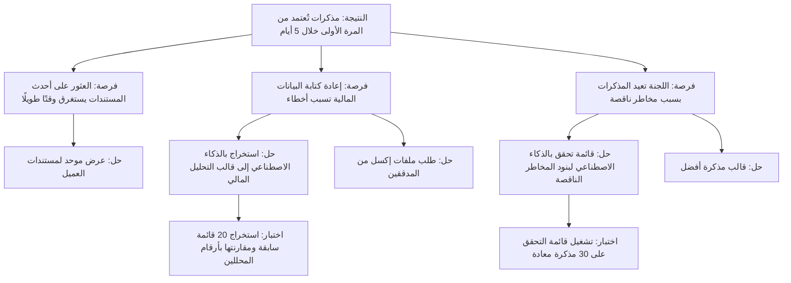
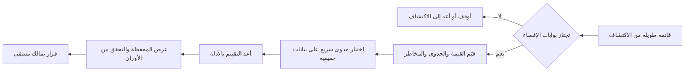
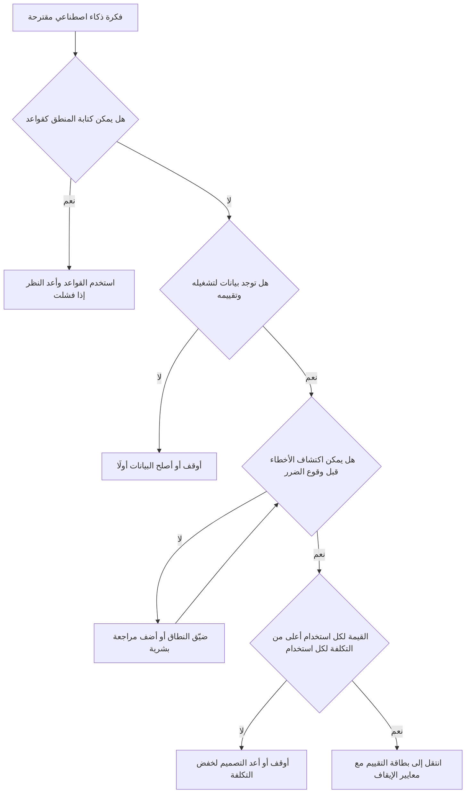

# الوحدة 2 — العثور على مشكلات تستحق الحل

*معظم منتجات الذكاء الاصطناعي الفاشلة لم تكن مخطئة بشأن التقنية. كانت مخطئة بشأن المشكلة. رأى أحدهم عرضًا توضيحيًا، واختار نموذجًا، ثم ذهب يبحث عن مكان يضعه فيه. هذه الوحدة تقلب هذا الترتيب. ستتعلم كيف تجد المهمة الحقيقية التي يحاول الشخص إنجازها، وترسم خريطة سير العمل الذي تعيش فيه هذه المهمة، وتكتشف الخطوات القليلة التي يساعد فيها الذكاء الاصطناعي (AI) فعلًا. بعد ذلك ستقيّم حالات الاستخدام المرشحة وتقارن بينها من حيث القيمة والجدوى التقنية والمخاطر، وتتعلم متى تكون الإجابة الصحيحة قاعدةً أو قالبًا أو لا شيء على الإطلاق، وكيف تقتل فكرة قبل أن تلتهم ربع سنة. ستتابع فيصل خلال أول دورة اكتشاف له في بنك نجم (Najm Bank). خالد يريد «الذكاء الاصطناعي التوليدي في الإقراض»، ورانيا تريد أدلة، وخمس أفكار متنافسة تصل إلى قائمة الأعمال المتراكمة نفسها.*

> **المراحل:** Discover, Define — اعثر على المهمة، وارسم خريطة سير العمل، واختر حالات الاستخدام الجديرة بالبناء، وأوقف تلك التي لا تستحق.

---

# 2.1 — الاكتشاف للذكاء الاصطناعي: المهام وسير العمل وأين يلائم الذكاء الاصطناعي
*المستوى: 🟡 متوسط* · *المتطلبات: 0.2، 1.1* · *المرحلة: Discover*

**بعد هذا الدرس تستطيع** أن تكتب عبارات مهام خالية من أي ذكر للتقنية، وترسم سير عمل من خمس إلى ثماني خطوات، وتحدد خطوتين على الأكثر يلائمهما الذكاء الاصطناعي مع سبب لكل منهما. *مدة الدراسة: قراءة نحو 20 دقيقة، وعمل تطبيقي نحو 3 ساعة (تقدير).*

## ⚡ الدرس في دقيقة
- يبدأ الاكتشاف للذكاء الاصطناعي من **المشكلة لا من النموذج**. اسأل أولًا: «ما المهمة التي يحاول هذا الشخص إنجازها، وأين يكمن الألم؟». بعد ذلك فقط اسأل: «هل يمكن للذكاء الاصطناعي أن يساعد هنا؟».
- إطار **المهام المطلوب إنجازها (Jobs to be Done)** يصوغ الاحتياجات على أنها تقدّم يريد الشخص تحقيقه في موقف معيّن. و**رسم خريطة سير العمل (Workflow mapping)** يقسّم المهمة إلى خطوات كي ترى أين يذهب الوقت وأين تقع الأخطاء والانتظار فعلًا.
- يلائم الذكاء الاصطناعي الخطوات التي تكون **كبيرة الحجم، ومبنية على مدخلات فوضوية غير منظمة، وتتحمّل قدرًا من الخطأ، ويكون التحقق منها أرخص من أدائها**. ويلائم بشكل سيئ حيث تكون الإجابة الخاطئة الواحدة مكلفة ولا أحد يستطيع التحقق منها.
- ابحث عن فرص الذكاء الاصطناعي على **مستوى الخطوة** لا على مستوى المهمة. «اكتب مذكرة الائتمان» ليست حالة استخدام للذكاء الاصطناعي. أما «استخرج البيانات المالية من ثلاث سنوات من القوائم بصيغة PDF إلى قالب التحليل المالي» فقد تكون كذلك.
- استخدم **شجرة الفرص والحلول (Opportunity Solution Tree)** لتُبقي النتيجة والمشكلات التي وجدتها والأفكار التي تختبرها في صفحة واحدة، حتى لا يتمكن حلّ مفضّل من تخطّي الدور.
- أكبر فخ: أن تجري مقابلات مع الناس حول ميزة الذكاء الاصطناعي التي تريد بناءها أصلًا، بدلًا من مراقبتهم وهم يؤدون العمل.

## 🧭 لماذا يهم
يبدأ أسبوع فيصل الأول في بنك نجم بطلب من سطر واحد من خالد، رئيس الإقراض للأفراد: «منافسونا يضعون الذكاء الاصطناعي التوليدي (GenAI) في الإقراض. أريد أن يكون لدينا ذلك مباشرًا هذا العام.» يفتح فيصل أداة محادثة، ويلصق ملف قرض مُجهَّل الهوية، ويطلب مذكرة ائتمان، فيحصل على ثلاث صفحات سلسة. ويحجز عرضًا توضيحيًا مع خالد يوم الخميس.

توقفه رانيا، رئيسة منتجات الذكاء الاصطناعي. «على ماذا يقضي مدير العلاقة يومه فعلًا؟ أي جزء من المذكرة يستغرق أطول وقت؟ أي جزء يعيده فريق الائتمان؟ أنت لا تعرف بعد، ولا النموذج يعرف.» وترسله ليجلس مع اثنين من مديري العلاقات في فريق الشركات الصغيرة والمتوسطة لمدة يومين.

ما يجده فيصل يغيّر المنتج. الأقسام السردية من المذكرة، وهي الجزء الذي كتبه عرضه التوضيحي بإتقان، ليست حيث يذهب الوقت. يذهب الوقت في البحث عن أحدث المستندات في البريد الإلكتروني والمجلد المشترك، وإعادة كتابة الأرقام من القوائم المدققة في قالب التحليل المالي، وإعادة العمل على المذكرة بعد أن يستفسر فريق الائتمان عن رقم ما. لقد حلّ العرض التوضيحي واحدة من أقصر الخطوات. هذا فشل شائع في منتجات الذكاء الاصطناعي، والسجل العام فيه نسخ أكبر منه. استثمرت IBM بكثافة في Watson Health ثم باعت أصول البيانات والتحليلات الخاصة به في 2022، ومن الدروس التي نوقشت على نطاق واسع في تلك القصة الفجوة بين عرض توضيحي مبهر وأداة تلائم سير العمل السريري. الاكتشاف هو الطريقة التي تسد بها هذه الفجوة قبل أن تبني، لا بعده.

## 📐 كيف يعمل

### 🟢 الأساسيات

**الاكتشاف** هو عمل التعلّم عن أي مشكلة يجب حلّها، ولمن، ولماذا تهم، قبل الالتزام بالبناء. يصوّره **الماس المزدوج (Double Diamond)** الصادر عن مجلس التصميم البريطاني عام 2005 على أنه جولتان من التوسيع والتضييق. الماسة الأولى تتعلق بالمشكلة: استكشف على نطاق واسع، ثم عرّف مشكلة واحدة. والثانية تتعلق بالحل: استكشف أفكارًا كثيرة، ثم سلّم واحدة. والذكاء الاصطناعي يُغري الفرق بتخطّي الماسة الأولى.

**المهام المطلوب إنجازها** هي العدسة الأساسية. الفكرة، التي نشرها كلايتون كريستنسن (Clayton Christensen)، هي أن الناس «يستأجرون» منتجًا لتحقيق تقدّم في موقف معيّن. ويجعلها **الابتكار الموجّه بالنتائج (Outcome-Driven Innovation)** لأنتوني أولويك (Anthony Ulwick) قابلة للقياس. فهو يقسّم المهمة إلى خطوات ويسأل عن النتائج التي يهتم بها الناس (مثل «تقليل الوقت الذي يستغرقه…» أو «تقليل احتمال…») ومدى تحقق كل نتيجة اليوم. لبيان المهمة ثلاثة أجزاء:

> *عندما* [الموقف]، *أريد أن* [أحقق تقدّمًا]، *حتى أتمكن من* [النتيجة].

لمدير علاقة في الشركات الصغيرة والمتوسطة: *عندما تحين المراجعة السنوية لعميل، أريد أن أُعدّ مذكرة ائتمان تقبلها اللجنة من المرة الأولى، حتى أتمكن من تجديد التسهيل قبل حاجة العميل إلى التدفق النقدي.* لاحظ ما **ليس** موجودًا في البيان: المذكرات، والذكاء الاصطناعي، والصياغة. المهمة هي «تمرير قرار سليم عبر اللجنة في الوقت المحدد». والمذكرة هي طريقة اليوم في إنجاز ذلك.

للمهام أيضًا جوانب **عاطفية واجتماعية**. فمدير العلاقة يريد أيضًا *أن يبدو كفؤًا أمام لجنة الائتمان*. وهذا يهم الذكاء الاصطناعي. فالمسودة التي لا يستطيع مدير العلاقة الدفاع عنها سطرًا بسطر لن تُستخدم، مهما كانت سريعة.

**رسم خريطة سير العمل** يحوّل المهمة إلى خطوات يمكنك رؤيتها. لكل خطوة، دوّن خمسة أشياء:

| سمة الخطوة | السؤال الذي تطرحه | لماذا يهم للذكاء الاصطناعي |
|---|---|---|
| المدخلات | ما الذي يدخل؟ حقول منظمة، ملفات PDF، رسائل بريد إلكتروني، محادثات؟ | المدخلات غير المنظمة هي حيث يضيف الذكاء الاصطناعي الحديث أكثر مقارنة بالقواعد |
| العمل | ماذا يفعل الشخص: يبحث، يقرأ، يستخرج، يحكم، يكتب، يقرر، ينفّذ؟ | أنواع المهام المختلفة تناسب أنواعًا مختلفة من الذكاء الاصطناعي (1.1) |
| الوقت والحجم | كم يستغرق، وكم مرة، وكم شخصًا؟ | يحدد حجم الجائزة |
| الأخطاء وإعادة العمل | ما الذي يسوء، وكم مرة، ومن يكتشفه؟ | يُظهر معيار الجودة وأين يحدث التحقق أصلًا |
| التسليمات والانتظار | من ينتظر من؟ | غالبًا ما يكون عنق الزجاجة الحقيقي، وغالبًا ليس مشكلة ذكاء اصطناعي أصلًا |

كيف تحصل على هذه المعلومات؟ **راقب واسأل عن أحداث حقيقية.** توصي تيريزا توريس (Teresa Torres)، في كتاب *Continuous Discovery Habits* (2021)، بالمقابلات القائمة على القصص. بدلًا من «ماذا تريد؟» أو «هل ستستخدم مساعدًا بالذكاء الاصطناعي؟»، اسأل: «حدثني عن آخر مرة أعددت فيها مذكرة ائتمان». يتذكر الناس حلقة حديثة محددة أفضل بكثير مما يتنبؤون بسلوكهم. والأفضل من ذلك أن تجلس معهم وهم يعملون (**الاستقصاء السياقي**). سترى جدول البيانات البديل الذي لا يذكره أحد في المقابلة.

### 🟡 التعمق أكثر

**أين يلائم الذكاء الاصطناعي: اختبار مستوى الخطوة.** بعد رسم خريطة سير العمل، مرّ على كل خطوة واطرح خمسة أسئلة. إنها قاعدة استرشادية لا قانون.

1. **هل المدخلات فوضوية؟** نص حر، مستندات، صور، كلام. القواعد تواجه صعوبة معها. والذكاء الاصطناعي غالبًا يتعامل معها جيدًا.
2. **هل يوجد حجم؟** الخطوة التي تُنفَّذ عشر مرات في السنة نادرًا ما تسترد تكلفة بناء ميزة ذكاء اصطناعي وتقييمها وحوكمتها. أما عشرة آلاف مرة في الشهر فقد تفعل.
3. **هل يمكن التحقق من المخرجات بتكلفة أقل من إنتاجها؟** هذا هو السؤال المنفرد الأكثر فائدة. يستطيع مدير العلاقة (RM) التحقق من ميزانية عمومية مستخرجة مقابل ملف PDF المصدر في دقيقتين. أما إعادة كتابتها فتستغرق ثلاثين. والمسودة التي يستغرق التحقق منها ما تستغرقه كتابتها لا توفّر شيئًا.
4. **كم تكلّف المخرجات الخاطئة، ومن يكتشفها؟** الرقم الخاطئ الذي يكتشفه محلل الائتمان يكلّف جولة من إعادة العمل. أما الرقم الخاطئ الذي يصل إلى اللجنة دون أن يُلاحظ فقد يعني قرضًا سيئًا. تكلفة الخطأ ووجود مدقّق يحددان مقدار الاستقلالية التي يمكن أن تتمتع بها الميزة (الوحدة 4).
5. **هل تتعلق الخطوة بحكم يُسأل عنه الناس؟** قرار الإقراض من عدمه حكمٌ يجب على البنك أن يتحمّله ويشرحه. يمكن للذكاء الاصطناعي أن يُثريه. ولا ينبغي أن يتخذه بصمت (انظر 2.3، والوحدة 9 للتنظيم).

اربط كل خطوة بـ**نوع مهمة** من الوحدة 1: *البحث* (البحث والاسترجاع)، *الاستخراج* (تحويل المستندات إلى حقول)، *التصنيف* (الفرز إلى فئات)، *التنبؤ* (تقدير رقم أو احتمال)، *الصياغة* (توليد نص ليحرره إنسان)، *التلخيص*، *المحادثة*، *التنفيذ* (اتخاذ إجراء في نظام). هذا يمنع عبارة «استخدم الذكاء الاصطناعي» من أن تكون مبهمة.

**شجرة الفرص والحلول.** تُبقي **شجرة الفرص والحلول** لتوريس الاكتشاف صادقًا. في القمة تقع **نتيجة** واحدة يحاول الفريق تحريكها، وهي نتيجة أعمال أو عملاء قابلة للقياس. تحتها **الفرص**: الاحتياجات غير الملبّاة ونقاط الألم والرغبات التي سمعتها في البحث، مصوغة من جانب المستخدم. تحت كل فرصة **حلول** مرشحة، وتحتها **اختبارات الافتراضات**: تجارب صغيرة تتحقق مما إذا كانت الفكرة يمكن أن تنجح. الشجرة تجعل أمرين مرئيين. كل حل يجب أن يعود إلى فرصة حقيقية. ويجب أن تقارن عدة حلول للفرصة نفسها، لا أن تقع في حب الحل الأول.

اثنان من الحلول الخمسة في شجرة فيصل ليسا ذكاءً اصطناعيًا على الإطلاق. وهذا صحّي. فالشجرة المليئة بأفكار الذكاء الاصطناعي تعني عادةً أن الفريق بدأ من التقنية.

**فخاخ المقابلات الخاصة بالذكاء الاصطناعي.** غالبًا ما يحمل المستخدمون نماذج ذهنية خاطئة عن الذكاء الاصطناعي، فيتوقعون إما السحر أو لا شيء. لا تطلب من الناس تقييم ميزة ذكاء اصطناعي متخيَّلة. اسأل عن العمل، واختبر أفكار الذكاء الاصطناعي لاحقًا بالنماذج الأولية (5.2) أو باختبارات **ساحر أوز (Wizard of Oz)**، حيث ينتج إنسان سرًّا مخرجات «الذكاء الاصطناعي» كي ترى كيف يستخدمها الناس قبل بناء أي شيء.

### 🔴 نظرة الخبير

**الذكاء الاصطناعي يغيّر سير العمل، فاكتشف سير العمل المستقبلي أيضًا.** إضافة الذكاء الاصطناعي إلى خطوة واحدة تنقل العمل من مكان إلى آخر. إذا أصبح الاستخراج فوريًا، فقد ينتقل عنق الزجاجة إلى المحلل الذي يتحقق منه، أو إلى جدول مواعيد اللجنة. يرسم مديرو المنتجات الخبراء **سير العمل المستهدف** بجانب سير العمل الحالي: من يفعل ماذا بعد التغيير، وما عمل التحقق الجديد الذي يظهر، ومن تصبح وظيفته أصعب.

**لا تؤتمت عملية معطّلة.** إذا كانت المذكرات تُعاد لأن سياسة الائتمان غامضة، فأصلح السياسة أولًا. الذكاء الاصطناعي فوق سياسة غير واضحة ينتج مذكرات غير واضحة بسرعة أكبر.

**عادم البيانات نتيجةٌ من نتائج الاكتشاف.** أثناء رسم الخريطة، دوّن البيانات التي تنشئها كل خطوة أو يمكن أن تنشئها: تعديلات مدير العلاقة على المسودات، وتعليقات اللجنة، وأسباب الإعادة. هذه هي المادة الخام للتقييم ولحلقات التعلّم في الوحدة 3.

**للمهمة أكثر من عميل واحد.** في الذكاء الاصطناعي المؤسسي كثيرًا ما يكون المستخدم والمشتري والمتأثرون أشخاصًا مختلفين. في مساعد مذكرات الائتمان (Credit Memo Copilot) المستخدم هو مدير العلاقة. والمشتري هو رئيس الخدمات المصرفية للشركات. والمراجع هو فريق الائتمان. والمتأثرون هم أصحاب الشركات الصغيرة والمتوسطة والكفلاء، الذين تعتمد تسهيلاتهم على المذكرة. ارسم خريطة المهمة لكل مجموعة، ولو باختصار. قد تتعارض مهمة فريق الائتمان («اكتشاف الإقراض الضعيف قبل اعتماده») مع مهمة مدير العلاقة («اعتماده بسرعة»). والمنتج الجيد يخدم الاثنين.

## 🧰 الأدوات
| الأداة أو الإطار | ما هو وماذا يفعل | متى تلجأ إليه |
|---|---|---|
| **Jobs to be Done** (كلايتون كريستنسن؛ الابتكار الموجّه بالنتائج لأنتوني أولويك) | يصوغ الاحتياجات على أنها تقدّم يريد الشخص تحقيقه في موقف ما؛ ويقسّم ODI المهمة إلى خطوات ونتائج قابلة للقياس | في البداية، لمنع الحديث من أن يدور حول الميزات أو النماذج |
| **Workflow map** — خريطة سير العمل | خريطة خطوة بخطوة للمهمة مع المدخلات والعمل والوقت والأخطاء والتسليمات لكل خطوة | للعثور على الخطوة التي يلائمها الذكاء الاصطناعي، ولرؤية التدفق الحالي والمستهدف |
| **Contextual inquiry** — الاستقصاء السياقي | مراقبة الناس وهم يؤدون عملًا حقيقيًا في بيئتهم والسؤال عمّا تراه | عندما تمنحك المقابلات العملية المثالية بدلًا من العملية الحقيقية |
| **Opportunity Solution Tree** (تيريزا توريس) | صفحة واحدة تربط نتيجة بالفرص والحلول المرشحة واختبارات الافتراضات | لمقارنة عدة حلول لكل مشكلة وإبقاء الأفكار المفضّلة صادقة |
| **Step-level AI fit test** — اختبار ملاءمة الذكاء الاصطناعي على مستوى الخطوة | خمسة أسئلة لكل خطوة: مدخلات فوضوية، الحجم، التحقق أرخص من الأداء، تكلفة الخطأ، الحكم الخاضع للمساءلة | لتحويل «استخدم الذكاء الاصطناعي في مكان ما» إلى خطوات مرشحة محددة |
| **Wizard of Oz** — ساحر أوز | ينتج إنسان سرًّا المخرجات التي كان الذكاء الاصطناعي سينتجها، كي تراقب الاستخدام الحقيقي | لاختبار ما إذا كان الناس سيستخدمون مخرجات الذكاء الاصطناعي ويثقون بها قبل بنائها |

## 🏛️ عمليًا في بنك نجم
بعد يومين من المرافقة وست مقابلات قائمة على القصص، يكتب فيصل **موجز فرصة من صفحة واحدة**. وتجعله رانيا الصيغة المعيارية للفريق لأي فكرة ذكاء اصطناعي جديدة.

**موجز الفرصة — إعداد مذكرات ائتمان الشركات الصغيرة والمتوسطة** (الإصدار v0.3، المالك: فيصل؛ راجعته رانيا وحصة)

| القسم | المحتوى |
|---|---|
| بيان المهمة | عندما تصل مراجعة أو طلب جديد من عميل من الشركات الصغيرة والمتوسطة، يريد مدير العلاقة الحصول على مذكرة تقبلها لجنة الائتمان من المرة الأولى، حتى يُعتمد التسهيل قبل حاجة العميل. |
| من | المستخدمون: نحو 40 مدير علاقة للشركات الصغيرة والمتوسطة (SME RMs). المراجعون: محللو الائتمان. المتأثرون: أصحاب الشركات الصغيرة والمتوسطة والكفلاء. المشتري: رئيس الخدمات المصرفية للشركات الصغيرة والمتوسطة. |
| الأدلة | يومان من المرافقة، 6 مقابلات، عينة من 30 مذكرة حديثة (الأرقام التوضيحية أدناه مأخوذة من هذه العينة الصغيرة؛ تحقّق منها قبل التقدير) |
| سير العمل الحالي والوقت لكل مذكرة | جمع المستندات: ~1 ساعة · التحليل المالي: ~1.5 ساعة · كتابة السرد: ~1 ساعة · إعادة العمل بعد أسئلة الائتمان: ~1.5 ساعة |
| أكبر نقاط الألم | إعادة كتابة الأرقام من ملفات PDF؛ البحث عن أحدث المستندات؛ مذكرات تُعاد بسبب بنود مخاطر ناقصة (نحو 1 من كل 3 في العينة) |
| خطوات الذكاء الاصطناعي المرشحة | استخراج البيانات المالية من القوائم (استخراج؛ التحقق منه مقابل المصدر رخيص) · الإشارة إلى بنود المخاطر الناقصة قبل التقديم (تصنيف/تحقق) · صياغة السرد (صياغة؛ قيمة أقل من المتوقع) |
| خيارات غير الذكاء الاصطناعي | عرض موحد لمستندات العميل؛ طلب قوائم مقروءة آليًا من المدققين؛ قالب مذكرة أوضح |
| ليس للذكاء الاصطناعي | توصية الإقراض نفسها تبقى لدى مدير العلاقة واللجنة |
| أخطر الافتراضات | دقة الاستخراج على القوائم الممسوحة ضوئيًا جيدة بما يكفي؛ مديرو العلاقات سيتحققون من الأرقام المستخرجة بدلًا من الوثوق بها ثقة عمياء |
| الاختبار التالي | تشغيل الاستخراج على 20 قائمة سابقة ومقارنتها بالأرقام التي حلّلها المحللون (دانة، أسبوعان) |
| النتيجة المراد تحريكها | نسبة المذكرات المعتمدة من المرة الأولى؛ عدد الأيام من الطلب إلى اللجنة |

يوم الخميس لا يعرض فيصل على خالد أي عرض توضيحي. بل يُريه أين تذهب الساعات الخمس، ولماذا يجب أن تكون أولى ميزات الذكاء الاصطناعي هي الاستخراج والتحقق قبل التقديم، مع ترك الصياغة لاحقًا.

## 🛠️ التمارين
- 🟢 اكتب ثلاثة بيانات مهام (*عندما… أريد أن… حتى أتمكن من…*) لمستخدمي نجم أسيست (Najm Assist)، مساعد تطبيق العملاء: عميل يعترض على دفعة بالبطاقة، وعميل مسافر إلى الخارج، وصاحب شركة صغيرة يتحقق من تحويل. *يكتمل عندما:* لا يذكر أيٌّ من البيانات الثلاثة الذكاءَ الاصطناعي أو المحادثة أو التطبيق، ولكل منها موقف ونتيجة واضحان.
- 🟡 ارسم خريطة سير العمل الحالي لمهمة واحدة تعرفها جيدًا في عملك (مثل معالجة شكوى عميل)، من خمس إلى ثماني خطوات. املأ سمات الخطوة الخمس وطبّق اختبار ملاءمة الذكاء الاصطناعي على مستوى الخطوة على كل خطوة. *يكتمل عندما:* يكون لديك جدول بصف واحد لكل خطوة، وقد سمّيت خطوتين على الأكثر يلائمهما الذكاء الاصطناعي وشرحت لماذا لا تلائمه الخطوات الأخرى.
- 🔴 ابنِ شجرة فرص وحلول للتنبيهات الذكية (Smart Alerts) بالنتيجة «تقليل خسائر الاحتيال دون زيادة شكاوى العملاء من التنبيهات». ضمّنها ثلاث فرص على الأقل، وحلّين لكل فرصة (أحدهما على الأقل ليس ذكاءً اصطناعيًا)، واختبار افتراض واحدًا لكل من حلّيك المفضّلين. *يكتمل عندما:* يعود كل حل إلى فرصة مصوغة من جانب العميل أو محلل الاحتيال، وينص كل اختبار على النتيجة التي ستجعلك تتخلى عن الفكرة.

راجع عملك

**🟢 إجابة نموذجية.** الاعتراض: «حين أرى دفعة بالبطاقة لا أعرفها، أريد إيقاف أي خصومات أخرى واسترداد مالي، لأشعر أن حسابي آمن». السفر: «حين أصل إلى بلد آخر، أريد أن أعرف أن بطاقتي ستعمل وكم ستكلّف، لأدفع دون قلق». صاحب العمل الصغير: «حين يقول مورّد إنه لم يُدفع له، أريد إثبات متى خرج التحويل وأين هو، لأحافظ على العلاقة». لا تذكر أيٌّ منها الذكاء الاصطناعي أو المحادثة أو التطبيق.

**🟡 و🔴 مراجعة ذاتية.** ينجح جدول سير العمل إذا كانت لكل خطوة سماتها الخمس كلها، وأُجيب عن اختبار ملاءمة الذكاء الاصطناعي لكل خطوة، مع خطوتين على الأكثر موسومتين بالملاءمة. وتنجح الشجرة إذا صيغت كل فرصة ألمًا لدى العميل أو المحلل (لا ميزة)، ولكلٍّ منها حل لا يعتمد على الذكاء الاصطناعي، وذكر كل اختبار افتراض النتيجةَ التي ستجعلك تتخلى عن الفكرة.

## ⚠️ أخطاء وفخاخ
- **البدء من العرض التوضيحي.** العرض التوضيحي السلس يثبت أن النموذج يستطيع إنتاج نص. ولا يثبت أن النص يوفّر وقت أحد. ارسم خريطة سير العمل أولًا واعثر على مواضع الوقت والأخطاء.
- **سؤال المستخدمين عن الذكاء الاصطناعي الذي يريدونه.** لا يستطيع الناس الحكم على ميزات ذكاء اصطناعي متخيَّلة. اسألهم عن آخر مرة أدّوا فيها العمل، وراقبهم إن استطعت.
- **تجاهل المدقّق.** إذا لم يستطع أحد التحقق من المخرجات بسرعة، فإن الوقت الموفَّر في إنتاجها يُنفق على التحقق منها، أو يُتخطى التحقق. وكلاهما سيئ.
- **رسم خريطة المستخدم وحده.** للذكاء الاصطناعي المؤسسي مستخدمون ومشترون ومراجعون ومتأثرون. أغفل أحدهم فيفشل المنتج في مرحلة الاعتماد أو في طابور الشكاوى.
- **أتمتة عملية معطّلة.** عندما تُظهر الخريطة مشكلة في السياسة أو في التسليم، أصلح ذلك أولًا.

## 🧾 الخلاصة
- ابدأ من المهمة وسير العمل، لا من النموذج. استخدم المهام المطلوب إنجازها لوصف التقدّم الذي يريده الناس، دون تسمية حل.
- ارسم خريطة سير العمل خطوة بخطوة: المدخلات، العمل، الوقت، الأخطاء، التسليمات. فرص الذكاء الاصطناعي تعيش على مستوى الخطوة.
- يلائم الذكاء الاصطناعي الخطوات ذات المدخلات الفوضوية والحجم، حيث يكون التحقق من المخرجات أرخص من إنتاجها وتُكتشف الأخطاء. ويلائم بشكل سيئ حيث تكون الأخطاء مكلفة وغير مدقّقة، أو حيث يدخل حكم خاضع للمساءلة.
- استخدم شجرة الفرص والحلول لمقارنة عدة حلول لكل فرصة، بما فيها الحلول غير القائمة على الذكاء الاصطناعي، ولتخطيط اختبارات افتراضات صغيرة.
- ارسم سير العمل المستهدف. فالذكاء الاصطناعي ينقل العمل وأعناق الزجاجة من مكان إلى آخر.

## ✍️ اختبر نفسك

**1. يطلب خالد من فيصل «وضع الذكاء الاصطناعي التوليدي في الإقراض هذا العام». ما الذي يجب أن يفعله فيصل أولًا؟**

- A. دراسة كيف يؤدي مديرو العلاقات ومحللو الائتمان عمل الإقراض اليوم، وتحديد مواضع تركّز الوقت والأخطاء
- B. اختيار نموذج لغوي كبير وبناء عرض توضيحي لصياغة المذكرات لإظهار الزخم أمام خالد وفريق القيادة قبل نهاية الربع
- C. إجراء استبيان يسأل مديري العلاقات عن ميزات الذكاء الاصطناعي التي يرغبون فيها، ثم ترتيب الطلبات حسب عدد الأصوات
- D. طلب مستوى مخاطر من ليلى لـ«الذكاء الاصطناعي التوليدي في الإقراض» قبل أن يدرس أحد سير العمل الفعلي

الإجابة

**A.** يبدأ الاكتشاف من المهمة وسير العمل. العرض التوضيحي (B) هو الإجابة المغرية، لكنه يجيب عن «هل يستطيع النموذج أن يكتب؟»، لا عن «أين يؤلم العمل؟». فعرض فيصل نفسه حلّ أسرع خطوة. والاستبيانات عن ميزات متخيَّلة (C) تعطي إجابات غير موثوقة. والحوكمة (D) تحتاج إلى حالة استخدام محددة أولًا. (🧭 لماذا يهم؛ 🟢 الأساسيات.)

**2. أي بيان مهمة مكتوب بأفضل صورة؟**

- A. «يريد مديرو العلاقات مساعدًا بالذكاء الاصطناعي يصوغ مذكرات الائتمان.»
- B. «يحتاج مديرو العلاقات إلى برنامج أسرع للمذكرات.»
- C. «تحسين إنتاجية مديري العلاقات بالذكاء الاصطناعي التوليدي في نشاط الإقراض كله، مقيسةً بعدد المذكرات التي يُنجزها كل مدير شهريًا.»
- D. «عندما تحين مراجعة عميل، أريد مذكرة تقبلها اللجنة من المرة الأولى، حتى يُجدَّد التسهيل قبل أن يحتاج العميل إلى الأموال.»

الإجابة

**D.** فيه موقف، والتقدّم المطلوب، والنتيجة، ولا يسمّي أي حل. أما A وB فيُدمجان حلًا مسبقًا. وC هدف للبنك، لا مهمة لشخص. (🟢 الأساسيات.)

**3. خطوتان مرشحتان تستغرق كل منهما نحو 30 دقيقة. الخطوة X هي استخراج أرقام الميزانية العمومية من ملفات PDF، ويستطيع المحلل التحقق منها مقابل المصدر في نحو 3 دقائق. والخطوة Y هي كتابة فقرة تقييم مخاطر، ويستغرق التحقق منها كما يجب نحو 25 دقيقة. بناءً على اختبار الملاءمة على مستوى الخطوة، أيهما المرشح الأقوى للذكاء الاصطناعي؟**

- A. Y، لأن الذكاء الاصطناعي التوليدي هو الأفضل في الكتابة، وفقرة المخاطر هي هذا النوع من المهام تمامًا
- B. هما متساويتان، لأن كلتا الخطوتين تستغرق نحو 30 دقيقة من وقت المحلل لإنجازها
- C. لا هذه ولا تلك، لأن كلتيهما تتضمن بيانات مالية ولذلك تحتاج إلى إنسان ينجز الخطوة كلها
- D. X، لأن التحقق من مخرجاتها أرخص بكثير من إنتاجها

الإجابة

**D.** «التحقق أرخص من الأداء» هو السؤال المنفرد الأكثر فائدة. فالخطوة Y لا توفّر شيئًا تقريبًا بعد احتساب التحقق. والخيار A مغرٍ لأن الصياغة هي أفضل ما تُظهره العروض التوضيحية للذكاء الاصطناعي التوليدي. لكن القيمة تعتمد على تكلفة التحقق، لا على قوة النموذج. (🟡 التعمق أكثر.)

**4. في شجرة الفرص والحلول، ما الذي ينتمي مباشرة تحت النتيجة؟**

- A. الفرص: الاحتياجات غير الملبّاة ونقاط الألم التي سُمعت في البحث، مصوغة من جانب المستخدم
- B. الحلول: ميزات الذكاء الاصطناعي التي يستطيع الفريق بناءها، لربط النتيجة بالتسليم مباشرة
- C. مقاييس تفكّك النتيجة إلى مقاييس مُدخلات يستطيع الفريق تحريكها أسبوعًا بأسبوع
- D. اختبارات الافتراضات، كي تُفحص أخطر القناعات وراء النتيجة أولًا

الإجابة

**A.** النتيجة، ثم الفرص، ثم الحلول، ثم اختبارات الافتراضات. ووضع الحلول مباشرة تحت النتيجة (B) هو بالضبط عادة البدء بالحل التي وُجدت الشجرة لمنعها. أما C فيصف شجرة مقاييس، وهي أداة أخرى، واختبارات الافتراضات (D) تأتي في الأسفل تحت الحلول. (🟡 التعمق أكثر.)

**5. تُظهر خريطة سير العمل أن ثلث المذكرات يُعاد لأن سياستَي ائتمان تتناقضان بشأن الضمانات. ما أفضل استجابة من المنتج؟**

- A. بناء خطوة ذكاء اصطناعي تفحص كل مذكرة مقابل السياستين وتنبّه إلى التعارض
- B. رفع تعارض السياسات إلى مالك السياسة وإصلاحه قبل تصميم دعم بالذكاء الاصطناعي لتلك الخطوة
- C. ترك الأمر لفريق الائتمان، لأن تعارض السياسات خارج نطاق المنتج
- D. الضبط الدقيق لنموذج على المذكرات المعادة كي تتعلّم المسودات ما يقبله المراجعون

الإجابة

**B.** أتمتة عملية معطّلة تنتج الفشل نفسه بسرعة أكبر. والسبب الجذري هو السياسة، لا الكتابة. والخيار C خاطئ لأن مدير المنتج (PM) يملك النتيجة، وهذا سبب رئيسي لإعادة العمل، حتى لو لم يكن إصلاحًا بالذكاء الاصطناعي. (🔴 نظرة الخبير.)

## 📚 المراجع
- Clayton M. Christensen, Taddy Hall, Karen Dillon and David S. Duncan, *Competing Against Luck* (2016), and "Know Your Customers' Jobs to Be Done", *Harvard Business Review* (2016) — https://hbr.org
- Anthony W. Ulwick, *What Customers Want* (2005) and *Jobs to be Done: Theory to Practice* (2016); Outcome-Driven Innovation — https://strategyn.com
- Teresa Torres, *Continuous Discovery Habits* (2021); Opportunity Solution Trees — https://www.producttalk.org
- UK Design Council, the Double Diamond — https://www.designcouncil.org.uk
- Google People + AI Guidebook (احتياجات المستخدم وتعريف النجاح) — https://pair.withgoogle.com/guidebook

---

# 2.2 — تقييم حالات الاستخدام واختيارها: القيمة والجدوى التقنية والمخاطر
*المستوى: 🟡 متوسط* · *المتطلبات: 1.3، 2.1* · *المرحلة: Discover, Define*

**بعد هذا الدرس تستطيع** أن تقدّر القيمة السنوية لحالة استخدام من مدخلات توضيحية معلنة، وتعيد تقييمها على القيمة والجدوى والمخاطر، وتكتب مذكرة قصيرة توصي بترتيب وتذكر الدليل الذي يرفع ثقتك. *مدة الدراسة: قراءة نحو 20 دقيقة، وعمل تطبيقي نحو 140 دقيقة (تقدير).*

## ⚡ الدرس في دقيقة
- يمنحك الاكتشاف أفكارًا جيدة أكثر مما تستطيع بناءه. والاختيار مهارة منفصلة: قارن المرشحين من حيث **القيمة والجدوى التقنية والمخاطر**، بشكل علني وبالوحدات نفسها.
- **المخاطر الأربع الكبرى** لمارتي كاغان (Marty Cagan) (القيمة، سهولة الاستخدام، الجدوى التقنية، الجدوى التجارية) هي العمود الفقري. وللذكاء الاصطناعي، أضف ثلاثة أسئلة إلى الجدوى التقنية والمخاطر: **هل البيانات موجودة؟ هل نستطيع بلوغ معيار الجودة؟ ماذا يحدث عندما يخطئ؟**
- افرز أولًا بـ**بوابات الإقصاء** (الخطوط الحمراء القانونية، غياب البيانات، غياب المالك)، ثم قيّم ما ينجو. فالدرجة المرجّحة لا تستطيع إنقاذ فكرة تفشل في بوابة.
- قدّر القيمة بصيغة **الحجم × القيمة لكل وحدة × التحسّن المتوقع × التبنّي (volume × value per unit × expected improvement × adoption)**، ودوّن درجة ثقتك. فمعظم دراسات الجدوى المبكرة للذكاء الاصطناعي تبالغ في تقدير التبنّي.
- قبل أن تلتزم، نفّذ **اختبار جدوى سريعًا (feasibility spike)** قصيرًا (أسبوع إلى أسبوعين) على بيانات حقيقية. فهو يحوّل أكبر مجهول إلى دليل.
- أكبر فخ: معاملة الدرجة على أنها القرار. الدرجات لتنظيم الحجة. والقرار لا يزال يحتاج إلى حُكم ومالك.

## 🧭 لماذا يهم
بنهاية الشهر الأول لفيصل، تضم قائمة الأعمال المتراكمة لمنتجات الذكاء الاصطناعي خمسة مقترحات، لكل منها راعٍ يقول إنها الأولوية القصوى:

1. **مساعد مذكرات الائتمان (Credit Memo Copilot)**: الاستخراج والتحقق قبل التقديم لمذكرات الشركات الصغيرة والمتوسطة (من 2.1).
2. إجابات **نجم أسيست (Najm Assist)**: مساعد للعملاء في التطبيق يجيب عن أسئلة المنتجات والرسوم.
3. **التمويل الفوري للشركات الصغيرة (SME Instant Finance)**: نموذج تعلّم آلي (ML model) يوافق مسبقًا على طلبات تمويل الفواتير الصغيرة في دقائق.
4. ضبط **التنبيهات الذكية (Smart Alerts)**: تنبيهات احتيال كاذبة أقل تزعج العملاء.
5. **مساعد الموظفين التوليدي (Staff GenAI)**: مساعد داخلي عام لجميع الموظفين.

يستطيع فريق المنصة بقيادة طارق دعم عمليتَي بناء جديدتين في هذا النصف من العام. ويستطيع فريق علوم البيانات بقيادة دانة دعم جهد نمذجة جاد واحد. يريد خالد التمويل الفوري للشركات الصغيرة لأنه ينمّي الإيرادات. ويريد مركز الاتصال نجم أسيست لأنه يقلّل المكالمات. والجميع يريد مساعد الموظفين التوليدي لأن لدى البنوك الأخرى واحدًا.

من دون طريقة مشتركة، يفوز الراعي الأعلى صوتًا، أو يتوزع الفريق على الخمسة كلها فلا يُنهي أيًّا منها. تطلب رانيا من فيصل **بطاقة تقييم لحالات الاستخدام** بحلول يوم الجمعة: كل فكرة تُقيَّم وفق المعايير نفسها، مع الأدلة ودرجة الثقة وراء كل درجة، وتوصية تستطيع الدفاع عنها أمام اللجنة التنفيذية.

## 📐 كيف يعمل

### 🟢 الأساسيات

كل فكرة منتج تحمل مخاطر. وتمنحك **المخاطر الأربع الكبرى** لكاغان، من كتاب *Inspired*، قائمة تحقق:

| الخطر | السؤال | اللمسة الخاصة بالذكاء الاصطناعي |
|---|---|---|
| **القيمة** | هل سيستخدمه الناس أو يشترونه؟ هل يحرّك نتيجة نهتم بها؟ | قد لا يثق المستخدمون بمخرجات الذكاء الاصطناعي أو لا يتحققون منها، لذا يكون التبنّي غير مؤكد حتى عندما تكون الحاجة حقيقية |
| **سهولة الاستخدام** | هل يستطيع الناس معرفة كيفية استخدامه؟ | يجب أن يفهم المستخدمون ما يستطيع الذكاء الاصطناعي فعله وما لا يستطيع، وكيف يصلحون أخطاءه (الوحدة 4) |
| **الجدوى التقنية** | هل نستطيع بناءه بأشخاصنا ووقتنا وتقنيتنا وبياناتنا؟ | الجودة غير مؤكدة حتى تختبر على بيانات حقيقية؛ وجاهزية البيانات (data readiness) كثيرًا ما تكون العائق |
| **الجدوى التجارية** | هل ينجح للأعمال: قانونيًا، ومن حيث المخاطر، والتكلفة، والعلامة التجارية، والعمليات؟ | التكلفة لكل استخدام، والتنظيم (مثل الاستخدامات عالية المخاطر في EU AI Act)، والضرر الناتج عن الأخطاء |

لمقارنة الأفكار، حوّل المخاطر إلى **بطاقة تقييم**. اجمع المعايير في ثلاث عائلات:

- **القيمة**: مقدار تحسّن النتيجة، ولكم من الناس، وكيف ترتبط بالاستراتيجية.
- **الجدوى التقنية**: جاهزية البيانات، والجودة المتوقعة مقابل المعيار، وجهد التكامل، وقدرة الفريق.
- **المخاطر**: الضرر إذا أخطأ الذكاء الاصطناعي، والتعرّض التنظيمي، والتعرّض للسمعة، وتكلفة الخدمة (cost to serve).

قيّم كل معيار من 1 إلى 5 مقابل وصف مكتوب لما تعنيه كل درجة. اتفقوا على الأوصاف *قبل* أن يقيّم أي شخص أي شيء. هكذا تتجنب أن يليّ الناس الدرجات لتناسب فكرتهم المفضّلة.

**قدّر القيمة بصيغة بسيطة.** لمعظم حالات استخدام الذكاء الاصطناعي الداخلية:

> **القيمة السنوية ≈ الحجم × القيمة لكل وحدة × التحسّن × التبنّي (Annual value ≈ volume × value per unit × improvement × adoption)**

لمساعد مذكرات الائتمان (أرقام توضيحية): نحو 2,000 مذكرة للشركات الصغيرة والمتوسطة سنويًا × 5 ساعات لكل منها × 30% من الوقت الموفَّر × 60% من مديري العلاقات يستخدمونه بانتظام ≈ 1,800 ساعة من وقت مديري العلاقات سنويًا. يمكنك أن تضع تكلفة على هذه الساعات، أو، وهو الأفضل غالبًا، أن تحوّلها إلى قرارات أسرع للعملاء. كل عامل افتراضٌ يجب اختباره. و**التبنّي** هو العامل الذي يُخمَّن أعلى من الواقع في أغلب الأحيان.

درجة **RICE** من Intercom (الوصول × الأثر × الثقة ÷ الجهد) أداة أخف لترتيب الميزات داخل منتج واحد. وهي مفيدة لأنها تجعل **الثقة** رقمًا صريحًا. وهذا بالضبط ما تُغفله دراسات جدوى الذكاء الاصطناعي في أغلب الأحيان.

### 🟡 التعمق أكثر

**البوابات أولًا، ثم الدرجات.** بعض المعايير ليست مفاضلات. إنها نجاح أو رسوب. نفّذ **بوابات الإقصاء** هذه قبل أي تقييم مرجّح:

- **الخطوط الحمراء القانونية والأخلاقية.** هل هذه ممارسة محظورة (prohibited practice)، أو شيء لن يفعله البنك؟ يقدّم فريق ليلى رأيًا أوليًا (تفاصيل الحوكمة موجودة في *AI Governance: Zero to Hero*).
- **البيانات موجودة ويمكن استخدامها.** هل توجد بيانات يعمل عليها المنتج، ولتقييمه، مع أساس قانوني (lawful basis) لاستخدامها؟ (الوحدة 3.)
- **مالك أعمال مسؤول.** شخص سيملك النتيجة، ويموّل التبنّي، ويقبل المخاطر المتبقية.
- **نتيجة قابلة للقياس.** إذا لم يستطع أحد أن يقول ما معنى «أفضل»، فلا يمكنك تقييمه.

الفكرة التي تفشل في بوابة تعود إلى الاكتشاف أو تُوقف. ولا تحصل على درجة منخفضة وتبقى عالقة في القائمة.

**الجدوى التقنية للذكاء الاصطناعي تحتاج إلى أدلة لا آراء.** الجدوى التقنية التقليدية تسأل: «هل نستطيع بناءه؟». أما الجدوى التقنية للذكاء الاصطناعي فتسأل: «هل يمكن أن يكون *جيدًا بما يكفي*، و*في أغلب الأحيان بما يكفي*، و*بتكلفة مقبولة*؟» لا يمكنك الإجابة عن ذلك في ورشة عمل. نفّذ **اختبار جدوى سريعًا**: اختبارًا قصيرًا محدد المدة (أسبوع إلى أسبوعين) على عينة من البيانات الحقيقية، مع **معيار جودة** تقريبي متفق عليه مسبقًا. للاستخراج: «95% على الأقل من الأرقام صحيحة على 20 قائمة حقيقية، مع أخطاء يسهل اكتشافها». يغيّر اختبار الجدوى السريع درجة الجدوى التقنية من تخمين إلى قياس. ويكتشف أيضًا مشكلات البيانات مبكرًا، مثل المستندات الممسوحة ضوئيًا، أو التسميات الناقصة، أو الصيغ غير المتسقة.

**قدّر تكلفة الخدمة مبكرًا.** منتجات الذكاء الاصطناعي التوليدي تكلّف مالًا في كل مرة تعمل فيها. علّم نفسك الطريقة الآن (الوحدة 8 تتعمق أكثر):

> **التكلفة لكل مهمة ≈ (رموز الإدخال + رموز الإخراج) × السعر لكل رمز × عدد الاستدعاءات لكل مهمة**، مضافًا إليها الاسترجاع (retrieval) والاستضافة ووقت المراجعة البشرية.

لنفترض أن تحققًا من مذكرة يرسل 30,000 رمز (tokens) ويستقبل 2,000، مرتين لكل مذكرة. بسعر مختلط توضيحي، هذه تكلفة صغيرة لكل مذكرة مقارنة بساعة من وقت مدير العلاقة. والحساب نفسه لمساعد موجّه للعملاء بملايين المحادثات قد يعطي إجابة مختلفة جدًا. الأسعار تتغير كثيرًا. استخدم الأسعار الحالية من مورّدك ودوّن التاريخ.

**الأوزان تعكس الاستراتيجية.** الأوزان (weights) التي تمنحها للقيمة والجدوى التقنية والمخاطر خيارٌ قيادي. وليست حقيقة تقنية. قد يُعطي بنكٌ في سنة خفض التكاليف وزنًا أكبر للجدوى التقنية والوقت حتى تحقيق القيمة. وقد يعطي بنكٌ يبني موقعًا طويل الأمد وزنًا أكبر للقيمة الاستراتيجية. اتفق على الأوزان مع مجموعة الرعاة قبل التقييم، وبيّن كيف يتغير الترتيب إذا تغيرت الأوزان. والتوصية التي تنقلب عندما يتحرك وزن واحد بنسبة 10% توصية هشّة. قل ذلك صراحة.

**ارسم المحفظة.** مصفوفة ثنائية من **القيمة** (عموديًا) مقابل **الجدوى التقنية** (أفقيًا)، مع لون الفقاعة يُظهر المخاطر، هي الشريحة المنفردة الأكثر فائدة. تُظهر أربع مجموعات:

| الربع | المعنى | الإجراء المعتاد |
|---|---|---|
| قيمة عالية، جدوى تقنية عالية | مرشحون أقوياء | ابنِ الآن |
| قيمة عالية، جدوى تقنية منخفضة | رهانات استراتيجية | اختبار سريع (Spike) أو استثمر في البيانات أولًا؛ لا تعد بمواعيد |
| قيمة منخفضة، جدوى تقنية عالية | مشتتات مغرية | فقط إن كانت شبه مجانية، أو كمشروع تعلّم |
| قيمة منخفضة، جدوى تقنية منخفضة | أسقطها | دوّن السبب، وامضِ قدمًا |

### 🔴 نظرة الخبير

**قيّم الثقة بمعزل عن الحجم.** الرقم الكبير بثقة منخفضة ليس كالرقم المتوسط بثقة عالية. يدوّن مديرو المنتجات الخبراء، لكل درجة قيمة وجدوى تقنية، **الدليل الذي تستند إليه** (مقابلة، اختبار سريع، تجربة تشغيلية، حالة مماثلة) و**مستوى الثقة**. ثم يختارون العمل التالي على أنه الذي يقلّل عدم اليقين أكثر في الفكرة الأعلى قيمة. أحيانًا لا يكون القرار الصحيح «ابنِ» أو «أوقف» بل «اشترِ معلومات»: نفّذ الاختبار السريع، أو اختبار ساحر أوز (Wizard of Oz test)، أو اسحب عينة البيانات.

**القيمة المتوقعة لا أفضل الحالات.** للرهانات ذات الجدوى التقنية غير المؤكدة، تساعد قيمة متوقعة تقريبية: *القيمة إن نجح × احتمال بلوغه معيار الجودة − تكلفة المحاولة (value if it works × chance it reaches the quality bar − cost of trying)*. قد تكون للتمويل الفوري للشركات الصغيرة أعلى قيمة إن نجح. لكن نموذج ائتمان للشركات الصغيرة يحتاج إلى بيانات أداء تاريخية، واختبار عدالة (fairness testing)، والتحقق من صحة النموذج (model validation)، وقد يستغرق وقتًا طويلًا حتى يصل إلى الاعتماد. وقد يساوي مساعدٌ بجائزة أصغر واحتمال نجاح مرتفع أكثر هذا العام.

**تأثيرات المنصة تغيّر الحسابات.** بعض حالات الاستخدام تبني قدرة مشتركة. يحتاج مساعد مذكرات الائتمان إلى استيعاب المستندات، والاسترجاع عبر ملفات العملاء، وإطار تقييم (evaluation harness). وسيحتاج نجم أسيست ومساعد الموظفين التوليدي إلى الشيء نفسه. ترتيب كل فكرة بمفردها يقلّل من قيمة الفكرة الأولى التي تبني المنصة. أظهر الاعتماديات صراحة. ولا تخفها في «القيمة الاستراتيجية».

**المخاطر ليست مجرد علامة سالبة.** كثيرًا ما تصبح درجات المخاطر عقوبة تدفع كل فكرة موجّهة للعملاء إلى أسفل القائمة. والنهج الأفضل أن تسأل ما الذي يلزم لـ**تقليل** المخاطر (خطوة مراجعة بشرية، نطاق أضيق، المستخدمون الداخليون أولًا). ثم قيّم التصميم *المخفَّف* واحسب تكلفة التخفيف ضمن الجدوى، تحت بند جهد التكامل (فلا عمود منفصلًا للجهد في البطاقة). إن نجم أسيست وهو يجيب عن أسئلة الرسوم من قاعدة معرفة مضبوطة، مع تحويل إلى موظف، خطرٌ مختلف عن نجم أسيست وهو يجيب عن أي شيء. وتُظهر قضية الهيئة القضائية في الدرس 0.2 ثمن الخطأ هنا: فقد سُئلت شركة الطيران عمّا قاله روبوت المحادثة لديها لعميل. فالمخاطر تعتمد على النطاق والتصميم، لا على «روبوت المحادثة» بوصفه فئة.

**التلاعب والسياسة.** يُتلاعب ببطاقات التقييم. يضخّم الرعاة الوصول، وتقلّل الفرق الجهد للأفكار المفضّلة. دفاعات مفيدة: قيّموا ضمن مجموعة والأدلة مرئية، واجعلوا دانة وطارق يملكان درجات الجدوى التقنية والراعي يملك درجات القيمة، وأعيدوا النظر في الدرجات بعد الاختبار السريع. وعندما يتجاوز مسؤول تنفيذي الترتيب، دوّنوا التجاوز وسببه. هذا مشروع، وهو قراره، لكن يجب أن يكون مرئيًا.

## 🧰 الأدوات
| الأداة أو الإطار | ما هو وماذا يفعل | متى تلجأ إليه |
|---|---|---|
| **Four big risks** (مارتي كاغان، *Inspired*) — المخاطر الأربع الكبرى | القيمة وسهولة الاستخدام والجدوى التقنية والجدوى التجارية بوصفها المخاطر التي يجب أن تعالجها كل فكرة | كعمود فقري لأي بطاقة تقييم ولتخطيط الاكتشاف |
| **Knock-out gates** — بوابات الإقصاء | فحوص نجاح أو رسوب (الخطوط الحمراء، البيانات، المالك، النتيجة القابلة للقياس) تُنفَّذ قبل التقييم | لإيقاف الأفكار التي لا تستطيع أي درجة إنقاذها |
| **Use-case scorecard** — بطاقة تقييم حالات الاستخدام | درجات مرجّحة من 1 إلى 5 للقيمة والجدوى التقنية والمخاطر، مع أوصاف مستويات مكتوبة وأدلة ودرجة ثقة | لمقارنة المقترحات المتنافسة بشكل علني |
| **RICE** | الوصول × الأثر × الثقة ÷ الجهد | لترتيب الميزات داخل منتج واحد، مع جعل الثقة صريحة |
| **Value sizing formula** — صيغة تقدير القيمة | الحجم × القيمة لكل وحدة × التحسّن × التبنّي (Volume × value per unit × improvement × adoption) | لتقدير حجم الجائزة وكشف افتراض التبنّي |
| **Feasibility spike** — اختبار الجدوى السريع | اختبار من أسبوع إلى أسبوعين على بيانات حقيقية مقابل معيار جودة متفق عليه مسبقًا | قبل إلزام فريق ببناء ذكاء اصطناعي |
| **Cost-per-task model** — نموذج التكلفة لكل مهمة | الرموز، والاستدعاءات، والاسترجاع، والاستضافة، ووقت المراجعة لكل مهمة، بأسعار مؤرّخة | للتحقق من أن تكلفة الخدمة تتناسب مع القيمة لكل مهمة |
| **Value–feasibility matrix** — مصفوفة القيمة والجدوى التقنية | عرض محفظة ثنائي مع المخاطر كلون | لعرض التوصية على القيادة |

## 🏛️ عمليًا في بنك نجم
**بطاقة تقييم حالات الاستخدام** لفيصل (الإصدار v1.0)، متفق عليها مع رانيا. الأوزان: القيمة 40%، الجدوى التقنية 35%، المخاطر 25%. تُقيَّم المخاطر بحيث 5 = أدنى مخاطر متبقية بعد التخفيف. الأرقام توضيحية.

| حالة الاستخدام | البوابات | القيمة (1–5) | الجدوى التقنية (1–5) | المخاطر بعد التخفيف (1–5) | الدرجة المرجّحة | الثقة | الأدلة | التوصية |
|---|---|---|---|---|---|---|---|---|
| مساعد مذكرات الائتمان: الاستخراج + التحقق المسبق (extraction + pre-check) | نجاح | 4 | 4 | 4 | 4.00 | متوسطة إلى عالية | المرافقة، عينة من 30 مذكرة، اختبار سريع مخطط | **ابنِ الآن**؛ مستخدمون داخليون، ومدير العلاقة يتحقق من كل رقم |
| نجم أسيست: إجابات الرسوم والمنتجات | نجاح (إجابات من المحتوى المعتمد فقط؛ تحويل إلى الموظفين) | 4 | 3 | 3 | 3.40 | متوسطة | أسباب مكالمات مركز الاتصال؛ لا اختبار سريع بعد | **اختبار سريع** لجودة الاسترجاع على أهم 50 سؤالًا، ثم قرّر |
| التمويل الفوري للشركات الصغيرة | نجاح بشروط (قرارات الائتمان: عالية المخاطر، مراجعة كاملة من ليلى) | 5 | 2 | 2 | 3.20 | منخفضة | تقدير الراعي فقط؛ بيانات التعثر لم تُفحص بعد | **رهان استراتيجي**: مراجعة جاهزية البيانات أولًا (الوحدة 3)؛ لا موعد للبناء |
| ضبط التنبيهات الذكية | نجاح | 3 | 4 | 4 | 3.60 | متوسطة | سجلات الشكاوى؛ النموذج موجود | **التالي في الدور**؛ فريق دانة بعد اختبار المذكرات السريع |
| مساعد الموظفين التوليدي | رسوب: لا مالك أعمال، ولا نتيجة معرّفة | — | — | — | — | — | — | **إعادة**: اعثر على مالك ومهمتين محددتين أولًا |

الدرجة المرجّحة = 0.40 × القيمة + 0.35 × الجدوى التقنية + 0.25 × المخاطر. يضيف فيصل ملاحظة: «إذا ارتفع وزن القيمة إلى 60% (الجدوى التقنية 25%، المخاطر 15%)، ينتقل التمويل الفوري للشركات الصغيرة إلى المركز الثاني، لا الأول، بسبب انخفاض الجدوى التقنية. التوصية صامدة.» خالد غير راضٍ لأن فكرته المفضّلة ليست الأولى. لكنه يقبل التزامًا مكتوبًا بمراجعة جاهزية البيانات مع موعد للقرار، وهو أكثر مما كان لديه من قبل.

## 🛠️ التمارين
- 🟢 اكتب أوصاف المستويات من 1 إلى 5 لمعيار واحد، «جاهزية البيانات»، بحيث يعطي شخصان يقيّمان بشكل مستقل الدرجة نفسها. *يكتمل عندما:* يصف كل مستوى شيئًا قابلًا للملاحظة (مثل «توجد أمثلة موسومة للحالة الرئيسية»)، لا شعورًا.
- 🟡 قدّر القيمة السنوية لنجم أسيست وهو يجيب عن أسئلة الرسوم باستخدام الحجم × القيمة لكل وحدة × التحسّن × التبنّي (volume × value per unit × improvement × adoption). اخترع مدخلات توضيحية موسومة بوضوح، ثم اذكر المدخل الذي أنت أقل تأكدًا منه وكيف ستختبره خلال أسبوعين. *يكتمل عندما:* يُعرض الحساب خطوة بخطوة، وكل مدخل موسوم بأنه توضيحي، وتسمّي اختبارًا ملموسًا واحدًا.
- 🔴 خذ بطاقة التقييم أعلاه وغيّر شيئًا واحدًا: تقول ليلى إن التمويل الفوري للشركات الصغيرة يمكن أن يبدأ أداةً من نوع «يوصي، والإنسان يقرر» للفواتير تحت حد صغير. أعد تقييمه بالتصميم المخفَّف، واحسب تكلفة التخفيف ضمن درجة الجدوى (جهد التكامل)، واكتب مذكرة من ثلاث جمل لرانيا عمّا إذا كان يجب أن يتغير الترتيب. *يكتمل عندما:* تُظهر الدرجات قبل وبعد، وتسمّي الدليل الذي سيرفع ثقتك، وتذكر توصية واضحة.

راجع عملك

**🟢 إجابة نموذجية (جاهزية البيانات).** 1: لم تُحدَّد بيانات ذات صلة. 2: البيانات موجودة، لكن لم يُتفق على الوصول إليها. 3: اتُّفق على الوصول وفُحصت عيّنة، لكن لا توجد تصنيفات. 4: توجد أمثلة مصنّفة للحالة الرئيسية واجتازت عيّنة فحص جودة. 5: أمثلة مصنّفة وحديثة للحالة الرئيسية والحالات الطرفية، مع مالك مسمّى. كل مستوى شيء يستطيع شخصان رؤيته، لا شعور.

**🟡 تحقق محسوب (توضيحي).** 40,000 سؤال عن الرسوم شهريًا × $3 لكل تواصل مع موظف × 50% يُجاب عنها دون تواصل × 30% تبنٍّ = $18,000 شهريًا، أي نحو $216,000 سنويًا. التبنّي أضعف المدخلات؛ وتجربة داخل التطبيق لأسبوعين على صفحات الرسوم تقيسه.

**🔴 مراجعة ذاتية.** تظهر الدرجات قبل وبعد جنبًا إلى جنب، وتنخفض درجة الجدوى لتعكس تكلفة التخفيف، وتسمّي المذكرة الدليل الذي سيرفع الثقة (مثل تشغيل بوضع الظل على فواتير سابقة)، وتنتهي بتوصية واحدة واضحة.

## ⚠️ أخطاء وفخاخ
- **التقييم قبل البوابات.** الفكرة التي لا بيانات لها أو لا مالك لها قد تحصل على درجة جيدة على الورق. نفّذ بوابات الإقصاء أولًا.
- **الدقة الزائفة.** «3.47 تتفوق على 3.41» مجرد ضجيج. عامل الدرجات المتقاربة على أنها تعادل وقرّر بناءً على الأدلة والاستراتيجية والاعتماديات.
- **تخمين الجدوى التقنية.** في الذكاء الاصطناعي، الجدوى التقنية سؤال تجريبي. استبدل الآراء باختبار سريع على بيانات حقيقية.
- **افتراض التبنّي الكامل.** دراسات الجدوى التي تفترض أن كل مستخدم يتبنّى المنتج من اليوم الأول خاطئة دائمًا تقريبًا. استخدم معدل تبنٍّ متحفظًا واختبره.
- **تقييم المخاطر الخام بدلًا من المخاطر المصمَّمة.** قيّم التصميم المخفَّف، وأضف تكلفة التخفيف. وإلا فستُدفن كل فكرة موجّهة للعملاء خطأً.
- **ترك الدرجة تقرر.** بطاقة التقييم تنظّم النقاش. ومالك مسمّى يتخذ القرار ويدوّن التجاوزات.

## 🧾 الخلاصة
- قارن كل مرشح من حيث القيمة والجدوى التقنية والمخاطر، مستخدمًا المخاطر الأربع الكبرى لكاغان عمودًا فقريًا، ومضيفًا أسئلة الذكاء الاصطناعي عن البيانات والجودة وتكلفة الخطأ.
- نفّذ بوابات الإقصاء قبل التقييم. ثم قيّم مقابل أوصاف مستويات مكتوبة، مع أدلة ودرجة ثقة لكل درجة.
- قدّر القيمة بصيغة الحجم × القيمة لكل وحدة × التحسّن × التبنّي (volume × value per unit × improvement × adoption)، وتعامل مع التبنّي بريبة.
- استخدم اختبار جدوى سريعًا قصيرًا على بيانات حقيقية لاستبدال أكبر تخمين بقياس. وقدّر تكلفة الخدمة بنموذج تكلفة لكل مهمة مؤرّخ.
- اعرض محفظة القيمة والجدوى التقنية، واختبر الأوزان، وأظهر اعتماديات المنصة، واتخذ القرار بمالك مسمّى.

## ✍️ اختبر نفسك

**1. يحظى مساعد الموظفين التوليدي بحماس قوي في أنحاء البنك، لكن لا مالك أعمال له ولا نتيجة معرّفة. في عملية فيصل، ماذا يحدث له؟**

- A. يفشل في بوابات الإقصاء ويعود إلى الاكتشاف للعثور على مالك ومهام محددة
- B. يحصل على درجة منخفضة ويبقى في القائمة، ليُعاد النظر فيه في جولة التقييم التالية عندما يتوفر مالك ومخرجات قابلة للقياس
- C. يُبنى أولًا لأن الطلب مرتفع، فالحماس في أنحاء البنك يدل على أن المستخدمين جاهزون وأن الإدارة تدعم الفكرة
- D. يُقيَّم على الجدوى التقنية فقط، لأن بقية المعايير لا يمكن الحكم عليها دون مالك للفكرة ودون نتيجة محددة يمكن قياسها

الإجابة

**A.** البوابات تُنفَّذ قبل التقييم. غياب المالك وغياب النتيجة القابلة للقياس شرطا نجاح أو رسوب. الخيار B (إبقاؤه في القائمة بدرجة منخفضة) مغرٍ، لكنه يترك فكرة بلا مالك عالقة تمتص الاهتمام. (🟡 التعمق أكثر؛ 🏛️ عمليًا.)

**2. أي من المخاطر الأربع الكبرى لكاغان يختبره بشكل أكثر مباشرة اختبارٌ سريع لمدة أسبوعين يشغّل الاستخراج على 20 قائمة حقيقية مقابل معيار دقة متفق عليه مسبقًا؟**

- A. القيمة
- B. سهولة الاستخدام
- C. الجدوى التقنية
- D. الجدوى التجارية

الإجابة

**C.** يختبر الاختبار السريع ما إذا كان الذكاء الاصطناعي يستطيع بلوغ معيار الجودة على بيانات حقيقية، وهذه هي الجدوى التقنية للذكاء الاصطناعي. ولا يقول الكثير عمّا إذا كان مديرو العلاقات سيتبنّونه (القيمة) أو سيفهمونه (سهولة الاستخدام). (🟢 الأساسيات؛ 🟡 التعمق أكثر.)

**3. تقول دراسة جدوى: 10,000 مستخدم × ساعتان موفَّرتان شهريًا × 100% تبنٍّ منذ الإطلاق. ما أهم اعتراض يجب أن يطرحه مدير المنتج (PM)؟**

- A. ساعتان شهريًا أقل من أن تُحدث فرقًا؛ ينبغي بناء الدراسة على الدقائق لكل مهمة
- B. ينبغي استبعاد الموظفين في إجازة من عدد المستخدمين، ما يخفض الفائدة بنحو العُشر
- C. الدراسة تتجاهل النمو؛ ينبغي إسقاط أعداد المستخدمين على ثلاث سنوات
- D. افتراض التبنّي مرتفع جدًا على الأرجح، ويجب أن يكون متحفظًا ومختبرًا

الإجابة

**D.** التبنّي هو العامل الأكثر مبالغة في دراسات جدوى الذكاء الاصطناعي. فقد لا يثق المستخدمون بالأداة أو لا يتحققون منها أو حتى لا يفتحونها. استخدم معدلًا متحفظًا واختبره بتجربة تشغيلية. (🟢 الأساسيات.)

**4. حالتا استخدام تحصلان على 3.47 و3.41. الفكرة ذات 3.41 تبني استيعاب المستندات وإطار التقييم اللذين يحتاجهما منتجان لاحقان. ماذا يجب أن يفعل مدير المنتج؟**

- A. معاملة الدرجتين على أنهما متعادلتان فعليًا ووزن اعتمادية المنصة صراحة في القرار
- B. اختيار 3.47 لأنها حصلت على درجة أعلى، فعملية التقييم وُضعت لحسم مثل هذا الاختيار بين الفكرتين
- C. إعادة الترجيح لمعايير التقييم حتى تفوز 3.41، لكي تُعتمد أعمال المنصة من أجل المنتجات اللاحقة
- D. حساب متوسط الدرجتين وبناء الفكرتين معًا، مع توزيع طاقة الفريق بينهما بالتساوي على مدى الربع القادم

الإجابة

**A.** الفروق الصغيرة في الدرجات ضجيج، وتأثيرات المنصة قيمة حقيقية تفوتها الدرجات المستقلة. الخيار C تلاعب ببطاقة التقييم. أظهر الاعتمادية علنًا بدلًا من ذلك. (🟡 التعمق أكثر؛ 🔴 نظرة الخبير.)

**5. يمنح فريق المخاطر نجم أسيست درجة مخاطر سيئة لأن «روبوتات المحادثة للعملاء قد تقول أشياء خاطئة». ما أفضل استجابة من مدير المنتج؟**

- A. قبول الدرجة والتخلي عن الفكرة، لأن فريق المخاطر يملك درجاتها، ولا مكان في بنك لروبوت محادثة قد يقول أشياء خاطئة
- B. إبقاء الدرجة مع طلب أن يتجاوز خالد الترتيب، لأن وفورات مركز الاتصال كبيرة بما يكفي وحدها لتعويض درجة مخاطر سيئة
- C. تعريف تصميم مخفَّف (إجابات معتمدة، تحويل إلى الموظفين، تجربة على الموظفين أولًا)، وتقييمه، وحساب تكلفته ضمن الجدوى
- D. أخذ متوسط درجة فريق المخاطر وتقدير فريق المنتج نفسه، كي لا تحسم رؤيةُ مجموعة واحدة لمخاطر روبوت المحادثة الترتيبَ

الإجابة

**C.** تعتمد المخاطر على النطاق والتصميم. وتقييم التصميم المخفَّف، ودفع تكلفة التخفيف، أمر صادق في الاتجاهين. الخيار A يعامل المخاطر الخام كأنها ثابتة. والخياران B وD يحرّكان الرقم دون تغيير التصميم، فيبقى الخطر الذي أظهرته *Moffatt v. Air Canada* (2024)، حيث حُمّلت الشركة المسؤولية عن إجابة روبوت المحادثة الخاص بها. (🔴 نظرة الخبير.)

## 📚 المراجع
- Marty Cagan, *Inspired: How to Create Tech Products Customers Love* (2nd ed., 2017) and SVPG articles on product risks — https://www.svpg.com
- Intercom, RICE prioritisation — https://www.intercom.com/blog
- Teresa Torres, *Continuous Discovery Habits* (2021) — https://www.producttalk.org
- Google People + AI Guidebook — https://pair.withgoogle.com/guidebook
- NIST AI Risk Management Framework (وظيفة التخطيط: السياق والآثار) — https://www.nist.gov/itl/ai-risk-management-framework
- EU AI Act, Regulation (EU) 2024/1689 — https://eur-lex.europa.eu/eli/reg/2024/1689/oj

---

# 2.3 — متى لا تستخدم الذكاء الاصطناعي، وقتل الأفكار مبكرًا
*المستوى: 🟡 متوسط* · *المتطلبات: 2.1، 2.2* · *المرحلة: Discover*

**بعد هذا الدرس تستطيع** أن تسمّي أبسط بديل لا يعتمد على الذكاء الاصطناعي لميزة مقترحة، وتكتب معايير إيقاف لكل منها مقياس وعتبة وتاريخ، وتجري تحليلًا استباقيًا للفشل تربط أبرز أسبابه باختبارات مبكرة. *مدة الدراسة: قراءة نحو 20 دقيقة، وعمل تطبيقي نحو 145 دقيقة (تقدير).*

## ⚡ الدرس في دقيقة
- معرفة متى **لا** تستخدم الذكاء الاصطناعي مهارة أساسية في منتجات الذكاء الاصطناعي. وليست نقصًا في الطموح. فكثير من «مشكلات الذكاء الاصطناعي» هي في الحقيقة مشكلات قواعد أو بحث أو قوالب أو بيانات أو عمليات.
- علامات التحذير: يمكن **كتابة المنطق على شكل قواعد**؛ **عدم تحمّل أي خطأ** مع غياب طريقة عملية للتحقق؛ **غياب البيانات** لتشغيله أو تقييمه؛ **حجم منخفض**؛ الحاجة إلى **تفسير دقيق وثابت**؛ أو **تكلفة لكل استخدام** تفوق القيمة لكل استخدام.
- قارن دائمًا مع **أبسط بديل يمكن أن ينجح**. إذا أوصلتك مجموعة قواعد إلى معظم الطريق بشفافية كاملة، فعلى الذكاء الاصطناعي أن يستحق تكلفته ومخاطره الإضافية.
- قتل الأفكار مبكرًا أرخص من قتلها متأخرًا. اكتب **معايير الإيقاف قبل أن تبدأ**: الدليل والعتبة (threshold) والتاريخ التي ستجعلك تتوقف.
- استخدم اختبارات رخيصة (ساحر أوز، اختبار سريع، تحليل ما قبل الفشل) حتى تفشل الأفكار في أسابيع لا في أرباع سنة.
- أكبر فخ: دوّامة التكلفة الغارقة. عبارة «لقد استثمرنا أكثر من أن نتوقف الآن» هي الطريقة التي تصبح بها التجارب التشغيلية دائمة.

## 🧭 لماذا يهم
تصل ثلاثة مقترحات إلى فيصل في الأسبوع نفسه.

يريد فريق التحصيل «نموذج ذكاء اصطناعي يكتشف متى وصل راتب العميل»، كي يضبطوا توقيت تذكيرات السداد. ويريد التسويق «ذكاءً اصطناعيًا توليديًا يكتب خطابات رفض مخصّصة» لمقدمي طلبات قروض الأفراد. ولدى فريق خالد تجربة تشغيلية مدتها ستة أشهر لنموذج تعلّم آلي يتنبأ بعملاء الشركات الصغيرة والمتوسطة الذين سيطلبون زيادة في الحد. الدقة «واعدة»، لكن لم يغيّر أي مدير علاقة ما يفعله بسببه.

الأول قاعدة. فقيود الرواتب في النظام المصرفي الأساسي لبنك نجم تحمل عادةً رمز رواتب ونمطًا منتظمًا، لذا تكفي بضعة شروط للعثور على معظمها، ويمكن التعامل مع الباقي بسؤال العميل. والثاني اتصال خاضع للتنظيم. فمقدّم الطلب المرفوض له الحق في أسباب دقيقة ومحددة، والخطاب السلس الذي يعيد صياغة الأسباب أو يخترعها أسوأ من قالب مُراجَع. والثالث مشروع زومبي. إنه واعد أكثر من أن يُقتل، وغير مستخدم أكثر من أن يهم، ويُبقي اثنين من علماء البيانات مشغولين.

تُظهر الحالات العامة ما يحدث عندما تسير هذه القرارات في الاتجاه الخاطئ. أنهت Zillow نشاط شراء المنازل Zillow Offers في 2021 بعد أن أخطأ نهجها في التسعير في تسعير المنازل، مع شطب كبير للقيم. لم يكن النموذج سوى جزء من تلك القصة، لكن النشاط كان قد راهن على الدقة الخوارزمية في سوق متقلبة مع هامش ضئيل للخطأ. وقد تصدّرت روبوتات المحادثة الموجّهة للعملاء العناوين لأسباب أقل من ذلك. وقد مرّت بك إحداها في الدرس 0.2، ويضيف الدرسان 5.3 و9.4 حالات أخرى. في كل حالة، كان سؤال «هل يجب أن يجيب الذكاء الاصطناعي عن هذا، بهذه الطريقة، دون تحقق؟» يستحق اهتمامًا أكبر مما ناله.

## 📐 كيف يعمل

### 🟢 الأساسيات

قبل أن تدخل أي فكرة ذكاء اصطناعي إلى بطاقة التقييم من 2.2، اطرح سؤالًا واحدًا بسيطًا: **ما أبسط شيء يمكن أن يحل هذه المشكلة؟** ثم قارن الذكاء الاصطناعي به. غالبًا ما تكون الخيارات الأبسط جيدة جدًا:

| البديل الأبسط | مناسب لـ | مثال من نجم |
|---|---|---|
| **القواعد والعتبات** | منطق يمكنك كتابته؛ أنماط ثابتة؛ قرارات يجب أن تكون دقيقة وقابلة للتفسير | اكتشاف قيود الرواتب برمز الرواتب والنمط |
| **البحث وقاعدة معرفة جيدة** | أشخاص يحتاجون إلى العثور على إجابة معروفة | موظفون يبحثون عن جدول الرسوم الحالي |
| **القوالب والنماذج** | اتصالات خاضعة للتنظيم أو متكررة؛ جمع مدخلات منظمة | خطابات رفض مبنية من رموز الأسباب |
| **تجربة مستخدم أفضل أو سياسة أوضح** | ارتباك يسببه المنتج أو العملية | نموذج اعتراض يتركه العملاء في منتصفه |
| **تحليلات بسيطة أو نماذج إحصائية** | التنبؤ على بيانات منظمة بميزات قليلة | نموذج لوجستي للتنبؤ بالتنبيهات التي تتأكد أنها احتيال |
| **تغيير العملية أو الملكية** | التسليمات والانتظار | مذكرات عالقة لأيام بانتظار توقيع ثانٍ |

**علامات التحذير بأن الذكاء الاصطناعي هو الأداة الخاطئة.** لا شيء منها قاعدة مطلقة، لكن كل منها يجب أن يستدعي نظرة فاحصة:

1. **يمكن كتابة المنطق.** إذا استطاع خبير أن يصوغ القاعدة ونادرًا ما تتغير، فاكتب القاعدة. إنها أرخص وأسرع وقابلة للاختبار وقابلة للتفسير بالكامل.
2. **عدم تحمّل أي خطأ مع غياب تحقق عملي.** الذكاء الاصطناعي يرتكب أخطاء (1.2). إذا كان خطأ واحد غير مقبول ولا يستطيع أحد مراجعة كل مخرج، فلا يلائم الذكاء الاصطناعي، أو يلائم فقط في دور أضيق.
3. **غياب البيانات.** لا مدخلات يعمل عليها، ولا أمثلة على مخرجات جيدة، ولا طريقة لمعرفة ما إذا كان صحيحًا. عندها لا يمكنك بناؤه جيدًا ولا تقييمه على الإطلاق.
4. **حجم منخفض.** المهمة التي تُنفَّذ 50 مرة في السنة نادرًا ما تسترد تكلفة بناء ميزة ذكاء اصطناعي وتقييمها وحوكمتها ومراقبتها.
5. **الحاجة إلى تفسير دقيق وثابت.** بعض القرارات تحتاج إلى *الأسباب نفسها* في كل مرة، مصاغة بدقة، مثلًا للجهة التنظيمية أو لمقدّم طلب مرفوض. وتوليد النص الاحتمالي لا يلائم كتابة تلك الأسباب. لكنه لا يزال يستطيع المساعدة في أجزاء أخرى من المهمة.
6. **التكلفة لكل استخدام تفوق القيمة لكل استخدام.** استدعاء الذكاء الاصطناعي التوليدي على كل معاملة بطاقة قد يكلّف أكثر من الاحتيال الذي يمنعه. أجرِ حساب التكلفة لكل مهمة (2.2).
7. **لن يملكه أحد.** غياب مالك مسؤول يعني ألّا أحد يصلحه عندما يسوء.

### 🟡 التعمق أكثر

**«ليس ذكاءً اصطناعيًا» نادرًا ما يكون كل شيء أو لا شيء.** الإجابة الأفضل غالبًا ما تكون **هجينة**: قواعد للحالات الواضحة، وذكاء اصطناعي للمنطقة الوسطى الفوضوية، وبشر للقرارات الأصعب. في خطابات الرفض، تأتي *الأسباب* من رموز الأسباب (reason codes) في قرار الائتمان، ثابتة ومُراجَعة. ويحوّلها قالب إلى خطاب. ثم قد تساعد أداة ذكاء اصطناعي توليدي مركز الاتصال في شرح الخطاب بلغة بسيطة عندما يتصل عميل، معتمدةً على الخطاب نفسه فقط. يبقى الجوهر الخاضع للتنظيم حتميًا (deterministic). ولا يساعد الذكاء الاصطناعي إلا عند الأطراف، حيث يوجد إنسان في الحلقة.

**معايير الإيقاف، مكتوبة قبل أن تبدأ.** **معيار الإيقاف (kill criterion)** بيانٌ يُتفق عليه في بداية العمل: *إذا رأينا هذه النتيجة بحلول هذا التاريخ، نتوقف أو نغيّر الاتجاه.* لمعايير الإيقاف الجيدة ثلاثة أجزاء: **مقياس**، و**عتبة**، و**تاريخ**. مثلًا: «إذا كانت دقة الاستخراج على 20 قائمة حقيقية ممسوحة ضوئيًا أقل من 90% بنهاية اختبار الأسبوعين السريع، نتوقف وننظر في طلب قوائم مقروءة آليًا بدلًا من ذلك.» كتابتها مسبقًا مهمة لأنه بمجرد بدء العمل، يصبح لدى كل المعنيين أسباب لرؤية الوعد في النتائج الضعيفة.

هذا هو جوهر حلقة **الشركة الناشئة الرشيقة (Lean Startup)** لإريك ريس (Eric Ries) (2011)، **ابنِ–قِس–تعلّم**: ابنِ أصغر شيء يختبر أخطر افتراضاتك (**الحد الأدنى من المنتج القابل للتطبيق**، أو MVP)، وقِس، ثم قرّر أن *تستمر* أو *تغيّر المسار*. ولمنتجات الذكاء الاصطناعي، أضف خيارًا ثالثًا يجب أن تكون مستعدًا لاتخاذه: **التوقف**.

**طرق رخيصة للفشل السريع.**

- **ساحر أوز (Wizard of Oz).** ينتج شخصٌ مخرجات «الذكاء الاصطناعي» خلف الكواليس. إذا لم يستخدم العملاء الإجابات حتى عندما يكتبها إنسان بإتقان، فلن يساعد النموذج.
- **اختبار الجدوى السريع (Feasibility spike)** على بيانات حقيقية مقابل معيار جودة (2.2).
- **اختبار الكونسيرج.** قدّم الخدمة يدويًا، وبشكل علني، لعدد قليل من المستخدمين لترى ما إذا كانوا يقدّرونها.
- **تحليل ما قبل الفشل.** تقنية غاري كلاين (Gary Klein): يتخيّل الفريق أن المشروع قد فشل بعد عام من الآن ويدوّن السبب. وهي تُظهر مخاطر يتردد الناس في طرحها، مثل «مديرو العلاقات لم يثقوا بالأرقام أبدًا» أو «طلبت الجهة التنظيمية تفسيرات لم نستطع تقديمها».

**مشاريع الزومبي.** **الزومبي** تجربة تشغيلية لا تموت أبدًا ولا تتوسع أبدًا. علاماته: لا موعد للقرار، ونتائج «واعدة» لا تبلغ العتبة أبدًا، ولا مستخدم سيشتكي لو توقف، وفريق يواصل إضافة الميزات بدلًا من اختبار التبنّي. مُتنبئ زيادة الحد لدى خالد يطابق هذا النمط. والاختبار بسيط. اسأل مديري العلاقات عمّا سيخسرونه لو أُطفئ غدًا. إذا كانت الإجابة لا شيء، فلا قيمة له بعد، مهما كانت دقته.

### 🔴 نظرة الخبير

**اجعل التوقف آمنًا وطبيعيًا.** لا تقتل الفرق الأفكار حين يبدو القتل فشلًا. يغيّر قادة المنتجات الخبراء الحافز. فهم يحتفون بالتوقف المدعوم بالأدلة على أنه ميزانية موفَّرة. ويتتبعون **الوقت حتى القرار**، لا عمليات الإطلاق فقط. ويجعلون معايير الإيقاف (kill criteria) جزءًا من كل موافقة تمويل. قاعدة رانيا في نجم: لا تحصل أي تجربة تشغيلية للذكاء الاصطناعي على تمويل دون موعد للقرار ومعايير إيقاف مكتوبة، وكل قرار (الاستمرار، تغيير المسار، التوقف) يحصل على سجل قصير.

**افصل «ليس الآن» عن «ليس أبدًا».** تفشل كثير من أفكار الذكاء الاصطناعي لأن شرطًا ما مفقود، لا لأن الفكرة سيئة. البيانات غير موجودة بعد، أو جودة النموذج لم تصل بعد، أو التكلفة مرتفعة جدًا بأسعار اليوم. دوّن الشرط الذي سيعيد فتح الفكرة، مثل «أعد النظر عندما تصل القوائم بصيغة مقروءة آليًا» أو «أعد النظر إذا انخفضت التكلفة لكل مهمة إلى النصف». النماذج تتحسن والأسعار تتغير. والفكرة التي أُوقفت بشرط إعادة فتح واضح يمكن أن تعود بتكلفة زهيدة. أما التي أُوقفت بعبارة مبهمة «لم تنجح» فيُعاد اقتراحها من الصفر على يد المتحمس التالي.

**حجة تكلفة الفرصة البديلة.** عندما يقاوم راعٍ التوقف، نادرًا ما تكون أقوى حجة «إنها سيئة». بل هي «هذا ما يمكن أن يفعله هذان العالمان في البيانات بدلًا من ذلك». ضع البديل بجانب الزومبي: ضبط التنبيهات الذكية، مع بيانات الشكاوى ونموذج موجود، ينتظر في الدور. إيقاف شيء أسهل قبولًا عندما يبدأ شيئًا آخر.

**احذر «الغسل بالذكاء الاصطناعي» في مقترحاتك أنت.** أحيانًا يُوسم مشروع بأنه ذكاء اصطناعي لجذب الانتباه أو الميزانية، بينما القيمة الحقيقية هي تنظيف بيانات، أو تكامل جديد، أو إصلاح عملية. لا بأس بذلك ما دمت صادقًا بشأنه. قيّمه وموّله على حقيقته. فوسم الذكاء الاصطناعي يجلب معه تقييم الذكاء الاصطناعي وحوكمة الذكاء الاصطناعي وتكاليف تشغيل الذكاء الاصطناعي، ولا شيء من ذلك يساعد مشروعًا يتعلق في الحقيقة بالتمديدات.

**التوقف حدث حوكمة أيضًا.** عندما يُسحب نظام ذكاء اصطناعي من الخدمة، يحتاج المستخدمون إلى أن يعلموا، ويجب التعامل مع البيانات والنماذج وفق قواعد الاحتفاظ، ويجب تحديث سجل الذكاء الاصطناعي. أحِل إلى *AI Governance: Zero to Hero* لخطوات الإيقاف النهائي. ومهمة مدير المنتج أن يتأكد من أن التوقف مخطط له، لا مجرد إعلان.

## 🧰 الأدوات
| الأداة أو الإطار | ما هو وماذا يفعل | متى تلجأ إليه |
|---|---|---|
| **Simplest-alternative check** — فحص البديل الأبسط | مقارنة كل فكرة ذكاء اصطناعي بالقواعد والبحث والقوالب وتجربة المستخدم (UX) والنماذج البسيطة وتغييرات العمليات | قبل أن تدخل أي فكرة ذكاء اصطناعي إلى بطاقة التقييم |
| **Is-AI-needed decision tree** — شجرة قرار «هل نحتاج إلى الذكاء الاصطناعي؟» | قواعد؟ بيانات؟ هل يمكن اكتشاف الأخطاء؟ القيمة أعلى من التكلفة؟ | لفرز الأفكار الواردة بسرعة واتساق |
| **Kill criteria** — معايير الإيقاف | مقياس وعتبة وتاريخ، يُتفق عليها قبل بدء العمل، وتستدعي التوقف أو تغيير المسار | لكل اختبار سريع وتجربة تشغيلية وموافقة تمويل |
| **Build-measure-learn** (إريك ريس، *The Lean Startup*، 2011) — ابنِ–قِس–تعلّم | ابنِ أصغر اختبار لأخطر افتراض، وقِس، ثم استمر أو غيّر المسار أو توقف | لهيكلة تجارب الذكاء الاصطناعي المبكرة |
| **Wizard of Oz** — ساحر أوز | ينتج إنسان سرًّا مخرجات الذكاء الاصطناعي لاختبار الاستخدام الحقيقي قبل البناء | عندما يكون الشك الرئيسي في ما إذا كان الناس سيستخدمون المخرجات أو يثقون بها |
| **Pre-mortem** (غاري كلاين) — تحليل ما قبل الفشل | يتخيّل الفريق الفشل مسبقًا ويسرد أسبابه | عند انطلاق أي مبادرة ذكاء اصطناعي كبيرة الحجم |
| **Decision record** — سجل القرار | سجل قصير لقرار الاستمرار أو تغيير المسار أو التوقف، والأدلة، وشرط إعادة الفتح | في كل مرة تُوقف فيها فكرة أو تُغيَّر |

## 🏛️ عمليًا في بنك نجم
يحضر فيصل ثلاثة **سجلات قرار** إلى المراجعة الأسبوعية لرانيا. وتضيفها رانيا إلى السجل المشترك للفريق.

**سجل القرار — فرز أفكار الذكاء الاصطناعي، الأسبوع 6** (المالك: فيصل؛ اعتمدته رانيا)

| الفكرة | البديل الأبسط | القرار | الأدلة | أعد الفتح إذا |
|---|---|---|---|---|
| اكتشاف وصول الراتب (التحصيل) | قواعد على رمز الرواتب ونمط المبلغ ونافذة التاريخ | **ليس ذكاءً اصطناعيًا.** ابنِ القواعد مع فريق التحصيل | صيغت القواعد مع محلل بيانات؛ وفُحصت مقابل عينة من الحسابات (توضيحي: وُجدت معظم الرواتب؛ ويمكن تأكيد الباقي بسؤال العميل) | القواعد تُغفل نسبة كبيرة من الرواتب في بيئة الإنتاج |
| خطابات رفض بالذكاء الاصطناعي التوليدي (التسويق) | رموز الأسباب من قرار الائتمان + قالب مُراجَع | **ليس ذكاءً اصطناعيًا للخطاب.** قالب برموز الأسباب. وسُجّلت فكرة منفصلة: مساعد لمركز الاتصال يشرح للعميل خطابه هو | مراجعة قانونية وامتثال؛ ليلى تشير إلى محتوى إجراء سلبي خاضع للتنظيم | أبدًا للأسباب نفسها؛ وفكرة المساعد تذهب إلى الاكتشاف |
| مُتنبئ زيادة الحد للشركات الصغيرة والمتوسطة (تجربة تشغيلية لستة أشهر) | لم يُختبر أي بديل | **توقف.** حرّر اثنين من علماء البيانات للتنبيهات الذكية | لم يُتتبَّع أي إجراء لمدير علاقة إلى النموذج خلال 6 أشهر؛ قال مديرو العلاقات إنهم لن يخسروا شيئًا لو أُطفئ | العثور على سير عمل لمديري العلاقات يغيّر فيه التنبؤ إجراءً؛ والعودة عبر موجز فرصة |

معايير الإيقاف للعمل التالي، أي اختبار الاستخراج السريع لمساعد مذكرات الائتمان، مكتوبة في اليوم الأول:

> **المقياس:** نسبة الأرقام المستخرجة بشكل صحيح من 20 قائمة مدققة حقيقية، بما فيها الممسوحة ضوئيًا.
> **العتبة:** 95% صحيحة على الأقل، وكل خطأ مرئي عند المقارنة جنبًا إلى جنب مع المصدر.
> **التاريخ:** نهاية الأسبوع 2.
> **إذا لم تتحقق:** أوقف بناء الاستخراج؛ واختبر الخيار غير القائم على الذكاء الاصطناعي (قوائم مقروءة آليًا من المدققين) بدلًا من ذلك.
> **التوقيع:** فيصل (مدير المنتج)، دانة (علوم البيانات)، رئيس الخدمات المصرفية للشركات الصغيرة والمتوسطة (المالك).

يعترض خالد على إيقاف المُتنبئ: «لقد أنفقنا ستة أشهر عليه.» وتجيب رانيا بتكلفة الفرصة البديلة. فالشخصان نفساهما يستطيعان خفض تنبيهات الاحتيال الكاذبة، وهي مشكلة يشتكي منها العملاء كل أسبوع. ويمضي التوقف قدمًا.

## 🛠️ التمارين
- 🟢 لكل مما يلي، سمِّ أبسط بديل للذكاء الاصطناعي وقل في جملة واحدة ما إذا كان الذكاء الاصطناعي لا يزال مبررًا: (a) توجيه رسائل البريد الإلكتروني إلى الفريق الصحيح بالكلمات المفتاحية، (b) الإجابة عن «ما حد بطاقتي؟»، (c) تلخيص اتفاقيات القروض المشتركة ذات 200 صفحة لمحللي الائتمان. *يكتمل عندما:* تسمّي كل إجابة بديلًا محددًا وتعطي سببًا واحدًا مرتبطًا بعلامات التحذير.
- 🟡 اكتب معايير إيقاف لتجربة تشغيلية لنجم أسيست تجيب عن أسئلة الرسوم، تغطي الجودة والتبنّي ومقياس أمان واحدًا. *يكتمل عندما:* يكون لكل معيار مقياس وعتبة وتاريخ، وتذكر ما ستفعله بدلًا من ذلك إذا لم يتحقق كل منها.
- 🔴 نفّذ تحليل ما قبل الفشل مكتوبًا للتمويل الفوري للشركات الصغيرة: مرّ عام والمنتج قد سُحب. اسرد ستة أسباب معقولة على الأقل عبر القيمة والجدوى التقنية والجدوى التجارية والثقة. حوّل الأسباب الثلاثة الأولى إلى معايير إيقاف أو اختبارات مبكرة. *يكتمل عندما:* يرتبط كل من أسبابك الثلاثة الأولى باختبار يمكنك تنفيذه في الأسابيع الثمانية الأولى، ويتعلق سبب واحد على الأقل بالتنظيم أو العدالة.

راجع عملك

**🟢 إجابة نموذجية.** (أ) قواعد كلمات مفتاحية أو مصنِّف بسيط؛ ولا مبرر للذكاء الاصطناعي ما لم تفشل القواعد باستمرار مع الصياغات غير المنتظمة. (ب) استعلام مباشر من نظام البطاقات؛ فالذكاء الاصطناعي يضيف خطأً إلى رقم واحد دقيق. (ج) قوالب الأقسام والبحث تساعد، لكن ملخصات الذكاء الاصطناعي مبرَّرة: نص طويل غير منتظم، وقارئ يتحقق من المخرجات مقابل المصدر.

**🟡 و🔴 مراجعة ذاتية.** لكل معيار إيقاف مقياس وعتبة وتاريخ («أقل من 90% من إجابات الرسوم في العيّنة صحيحة بحلول الأسبوع 6»)، إضافةً إلى الإجراء إن لم يتحقق. وينجح تحليل ما قبل الفشل إذا غطّت أسبابه الستة القيمة والجدوى التقنية والجدوى التجارية والثقة، وتعلّق أحدها بالتنظيم أو العدالة، وارتبط كلٌّ من الثلاثة الأولى باختبار تستطيع تشغيله خلال ثمانية أسابيع.

## ⚠️ أخطاء وفخاخ
- **معاملة «ليس ذكاءً اصطناعيًا» على أنه فشل.** اختيار القواعد أو القالب عندما ينجحان حُكمٌ جيد في المنتج. قيّم البديل بالعناية نفسها التي تقيّم بها خيار الذكاء الاصطناعي.
- **كتابة معايير الإيقاف بعد وصول النتائج.** المعايير المكتوبة لاحقًا تنحني دائمًا لتناسب النتائج. اتفق على المقياس والعتبة والتاريخ في اليوم الأول، واجعل المالك يوقّع.
- **ترك التجارب التشغيلية تعمل دون موعد للقرار.** كل تجربة تشغيلية تحتاج إلى تاريخ يجب فيه أن تستمر أو تغيّر المسار أو تتوقف.
- **المجادلة بأن «النموذج دقيق» لنموذج غير مستخدم.** الدقة دون إجراء متغيّر ليست قيمة. اسأل عمّا سيخسره المستخدمون لو أُطفئ.
- **التوقف دون سجل.** من دون الأدلة وشرط إعادة الفتح، تعود الفكرة بعد ستة أشهر ويتكرر العمل.
- **إعطاء نظام احتمالي مهمة تتطلب أسبابًا دقيقة وقابلة للتكرار.** أبقِ الأسباب الخاضعة للتنظيم حتمية ودع الذكاء الاصطناعي يساعد عند الأطراف.

## 🧾 الخلاصة
- قارن دائمًا فكرة الذكاء الاصطناعي بأبسط بديل يمكن أن ينجح: القواعد، البحث، القوالب، تجربة المستخدم، النماذج البسيطة أو تغيير العملية.
- علامات التحذير: منطق يمكنك كتابته، عدم تحمّل الخطأ دون تحقق، غياب البيانات، حجم منخفض، الحاجة إلى تفسيرات دقيقة، تكلفة أعلى من القيمة، غياب المالك.
- الحلول الهجينة غالبًا هي الأفضل: جوهر حتمي، وذكاء اصطناعي حيث تكون المدخلات فوضوية، وبشر للحالات الصعبة.
- اكتب معايير الإيقاف (المقياس، العتبة، التاريخ) قبل بدء العمل، واستخدم اختبارات رخيصة (ساحر أوز، الاختبارات السريعة، تحليلات ما قبل الفشل) لتفشل بسرعة.
- اجعل التوقف أمرًا طبيعيًا: دوّن القرارات، وافصل «ليس الآن» عن «ليس أبدًا»، واستخدم تكلفة الفرصة البديلة لإنهاء تجارب الزومبي.

## ✍️ اختبر نفسك

**1. يطلب فريق التحصيل «نموذج ذكاء اصطناعي لاكتشاف إيداعات الرواتب». قيود الرواتب تحمل رمز رواتب وتصل بنمط منتظم. ماذا يجب أن يوصي به فيصل أولًا؟**

- A. تدريب مصنِّف على معاملات موسومة كي يتعلم أنماط الرواتب عبر البنوك
- B. استخدام نموذج لغوي كبير لقراءة أوصاف المعاملات، لأن جهات العمل تسمّي الرواتب بطرق كثيرة
- C. كتابة قواعد على رمز الرواتب والمبلغ ونمط التاريخ، والنظر في الذكاء الاصطناعي فقط لما تُغفله القواعد
- D. طلب مراجعة لحماية البيانات في استخدام التحصيل قبل اختيار أي نهج

الإجابة

**C.** عندما يمكن كتابة المنطق، تكون القواعد أرخص وقابلة للاختبار وقابلة للتفسير بالكامل. الخيار A مغرٍ لأنه يبدو أكثر قدرة، لكنه يضيف تكلفة وغموضًا مقابل مكسب ضئيل. (🟢 الأساسيات؛ 🧭 لماذا يهم.)

**2. أي معيار إيقاف مكتوب بأفضل صورة؟**

- A. «سنتوقف إذا لم تكن التجربة التشغيلية واعدة.»
- B. توقف إذا لم يكن النموذج الأفضل والأحدث في لوحات الصدارة العامة عند انتهاء التجربة التشغيلية، أو إذا أطلق منافس شيئًا مشابهًا قبلنا
- C. «سنراجع النتائج عندما يشعر الفريق بأنه مستعد.»
- D. «إذا استخدم أقل من 30% من مديري العلاقات في التجربة التحقق المسبق على نصف مذكراتهم على الأقل بحلول 31 مارس، نتوقف ونراجع التصميم.»

الإجابة

**D.** فيه مقياس وعتبة وتاريخ. أما A وC فلا يمكن اختبارهما وسينحنيان ليناسبا أي نتيجة. والخيار B يقيس النموذج، لا نتيجة المنتج. (🟡 التعمق أكثر.)

**3. نموذج في تجربة تشغيلية لستة أشهر يتنبأ بزيادات الحد للشركات الصغيرة والمتوسطة بدقة جيدة، لكن لم يغيّر أي مدير علاقة إجراءً بسببه. يقول الراعي: «لقد استثمرنا أكثر من أن نتوقف.» ما أقوى استجابة؟**

- A. الاستمرار وإضافة مزيد من الميزات إلى النموذج، لأن تجربة بهذه الدقة ستغيّر في النهاية ما يفعله مديرو العلاقات
- B. تحسين الصحة الإجمالية للنموذج أكثر
- C. إيقاف التجربة التشغيلية، وتدوين الأدلة وشرط إعادة الفتح، ونقل الفريق إلى عنصر أعلى قيمة في الدور
- D. تسليم النموذج إلى مورّد

الإجابة

**C.** الدقة دون إجراء متغيّر ليست قيمة، والإنفاق السابق تكلفة غارقة. وإظهار تكلفة الفرصة البديلة يجعل التوقف أسهل قبولًا. الخيار A هو نمط الزومبي. والخيار B يحسّن نموذجًا لا يستخدمه أحد. (🟡 التعمق أكثر؛ 🔴 نظرة الخبير.)

**4. يريد التسويق ذكاءً اصطناعيًا توليديًا (GenAI) يكتب خطابات رفض قروض مخصّصة. ما أفضل تصميم؟**

- A. إبقاء الأسباب حتمية، من رموز أسباب القرار وقالب مُراجَع. والنظر في الذكاء الاصطناعي فقط لمساعدة الموظفين على شرح الخطاب
- B. ترك النموذج يولّد الأسباب انطلاقًا من ملف الطلب، مع تكليف موظف ائتمان بأن يقرأ كل خطاب ويعتمده قبل أن يُرسَل إلى العميل
- C. استخدام الذكاء الاصطناعي التوليدي مع إضافة إخلاء مسؤولية
- D. عدم إرسال أي أسباب

الإجابة

**A.** يجب أن تكون الأسباب الخاضعة للتنظيم دقيقة ومحددة وقابلة للتكرار، وهذا يلائم مصدرًا حتميًا وقالبًا. ويمكن للذكاء الاصطناعي أن يساعد عند الأطراف مع إنسان في الحلقة (human in the loop). الخيار C مغرٍ، لكن إخلاء المسؤولية لا يجعل الأسباب المخترعة أو المعاد صياغتها مقبولة. (🟡 التعمق أكثر؛ 🏛️ عمليًا.)

**5. أُوقفت فكرة استخراج لأن القوائم الممسوحة ضوئيًا رديئة جدًا للاستخراج الدقيق اليوم. ماذا يجب أن يتضمن سجل القرار؟**

- A. عبارة «لم تنجح» فقط
- B. الأدلة وشرط إعادة الفتح، مثل «أعد النظر عندما تصل القوائم بصيغة مقروءة آليًا أو تتحسن جودة الاستخراج على مجموعة الاختبار نفسها»
- C. أسماء الأشخاص الذين اقترحوها
- D. لا شيء؛ فالأفكار الموقوفة لا تُدوَّن، لأن سجل الإخفاقات يثني الناس عن اقتراح الأفكار ويثقل قائمة الأعمال على الفريق الذي يصونها

الإجابة

**B.** الفصل بين «ليس الآن» و«ليس أبدًا» يتيح للفكرة أن تعود بتكلفة زهيدة عندما يتغير الشرط. النماذج والبيانات تتحسن. والسجل المبهم يعني أن العمل يُعاد من الصفر. (🔴 نظرة الخبير.)

## 📚 المراجع
- Eric Ries, *The Lean Startup* (2011) — https://theleanstartup.com
- Gary Klein, "Performing a Project Premortem", *Harvard Business Review* (2007) — https://hbr.org
- Marty Cagan, *Inspired* (2nd ed., 2017) — https://www.svpg.com
- Teresa Torres, *Continuous Discovery Habits* (2021) — https://www.producttalk.org
- Google People + AI Guidebook (تحديد ما إذا كان الذكاء الاصطناعي يضيف قيمة فريدة) — https://pair.withgoogle.com/guidebook
- Zillow Group investor relations (إعلانات 2021 عن إنهاء Zillow Offers) — https://investors.zillowgroup.com
