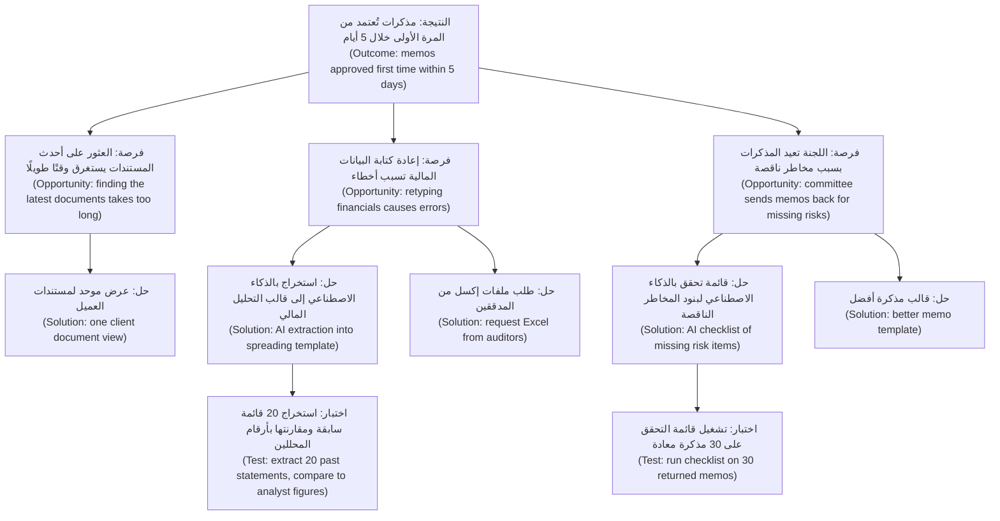
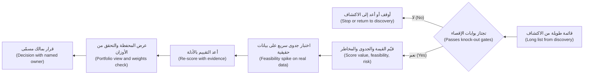
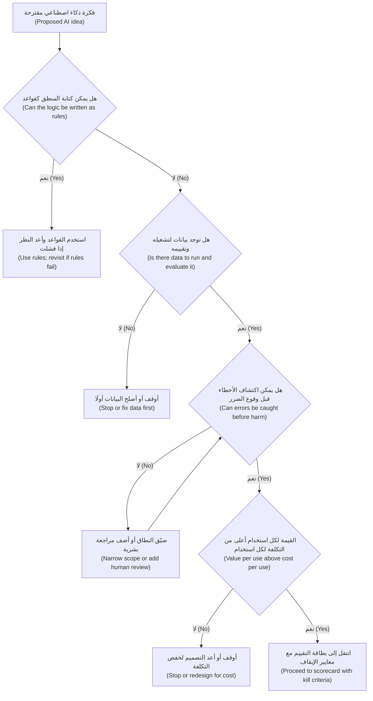

# الوحدة 2 — العثور على مشكلات تستحق الحل

*معظم منتجات الذكاء الاصطناعي الفاشلة لم تكن مخطئة بشأن التقنية (technology). كانت مخطئة بشأن المشكلة (problem). رأى أحدهم عرضًا توضيحيًا (demo)، واختار نموذجًا (model)، ثم ذهب يبحث عن مكان يضعه فيه. هذه الوحدة تقلب هذا الترتيب. ستتعلم كيف تجد المهمة الحقيقية (real job) التي يحاول الشخص إنجازها، وترسم خريطة سير العمل (workflow) الذي تعيش فيه هذه المهمة، وتكتشف الخطوات القليلة (few steps) التي يساعد فيها الذكاء الاصطناعي (AI) فعلًا. بعد ذلك ستقيّم حالات الاستخدام المرشحة وتقارن بينها من حيث القيمة (value) والجدوى التقنية (feasibility) والمخاطر (risk)، وتتعلم متى تكون الإجابة الصحيحة قاعدةً (rule) أو قالبًا (template) أو لا شيء على الإطلاق، وكيف تقتل فكرة قبل أن تلتهم ربع سنة (quarter). ستتابع فيصل خلال أول دورة اكتشاف (discovery cycle) له في بنك نجم (Najm Bank). خالد يريد «الذكاء الاصطناعي التوليدي في الإقراض»، ورانيا تريد أدلة (evidence)، وخمس أفكار متنافسة تصل إلى قائمة الأعمال المتراكمة (backlog) نفسها.*

> **المراحل (Stages):** Discover, Define — اعثر على المهمة، وارسم خريطة سير العمل، واختر حالات الاستخدام الجديرة بالبناء، وأوقف تلك التي لا تستحق.

---

# 2.1 — الاكتشاف للذكاء الاصطناعي: المهام وسير العمل وأين يلائم الذكاء الاصطناعي
*المستوى (Level): 🟡 متوسط (Intermediate)* · *المتطلبات (Prerequisites): 0.2، 1.1* · *المرحلة (Stage): Discover*

## ⚡ الدرس في دقيقة (In 60 seconds)
- يبدأ الاكتشاف للذكاء الاصطناعي من **المشكلة لا من النموذج (the problem, not the model)**. اسأل أولًا: «ما المهمة التي يحاول هذا الشخص إنجازها، وأين يكمن الألم؟ ⁦⁩». بعد ذلك فقط اسأل: «هل يمكن للذكاء الاصطناعي أن يساعد هنا؟ ⁦⁩».
- إطار **المهام المطلوب إنجازها (Jobs to be Done)** يصوغ الاحتياجات (needs) على أنها تقدّم (progress) يريد الشخص تحقيقه في موقف معيّن (situation). و**رسم خريطة سير العمل (Workflow mapping)** يقسّم المهمة إلى خطوات (steps) كي ترى أين يذهب الوقت (time) وأين تقع الأخطاء (errors) والانتظار (waiting) فعلًا.
- يلائم الذكاء الاصطناعي الخطوات التي تكون **كبيرة الحجم (high-volume)، ومبنية على مدخلات فوضوية غير منظمة (messy unstructured input)، وتتحمّل قدرًا من الخطأ (tolerant of some error)، ويكون التحقق منها أرخص من أدائها (cheaper to check than to do)**. ويلائم بشكل سيئ حيث تكون الإجابة الخاطئة الواحدة مكلفة (costly) ولا أحد يستطيع التحقق منها.
- ابحث عن فرص الذكاء الاصطناعي (AI opportunities) على **مستوى الخطوة (step level)** لا على مستوى المهمة (job level). «اكتب مذكرة الائتمان» ليست حالة استخدام للذكاء الاصطناعي. أما «استخرج البيانات المالية (financials) من ثلاث سنوات من القوائم بصيغة PDF إلى قالب التحليل المالي (spreading template)» فقد تكون كذلك.
- استخدم **شجرة الفرص والحلول (Opportunity Solution Tree)** لتُبقي النتيجة (outcome) والمشكلات التي وجدتها والأفكار التي تختبرها في صفحة واحدة (one page)، حتى لا يتمكن حلّ مفضّل (favourite solution) من تخطّي الدور.
- أكبر فخ (Biggest trap): أن تجري مقابلات (interviewing) مع الناس حول ميزة الذكاء الاصطناعي (AI feature) التي تريد بناءها أصلًا، بدلًا من مراقبتهم وهم يؤدون العمل.

## 🧭 لماذا يهم
يبدأ أسبوع فيصل الأول في بنك نجم بطلب من سطر واحد (one-line request) من خالد، رئيس الإقراض للأفراد (Head of Retail Lending): «منافسونا يضعون الذكاء الاصطناعي التوليدي (GenAI) في الإقراض (lending). أريد أن يكون لدينا ذلك مباشرًا (live) هذا العام.» يفتح فيصل أداة محادثة (chat tool)، ويلصق ملف قرض مُجهَّل الهوية، ويطلب مذكرة ائتمان (credit memo)، فيحصل على ثلاث صفحات سلسة. ويحجز عرضًا توضيحيًا مع خالد يوم الخميس.

توقفه رانيا، رئيسة منتجات الذكاء الاصطناعي (Head of AI Products). «على ماذا يقضي مدير العلاقة (relationship manager) يومه فعلًا؟ أي جزء من المذكرة (memo) يستغرق أطول وقت؟ أي جزء يعيده فريق الائتمان (credit team)؟ أنت لا تعرف بعد، ولا النموذج يعرف.» وترسله ليجلس مع اثنين من مديري العلاقات في فريق الشركات الصغيرة والمتوسطة (SME team) لمدة يومين.

ما يجده فيصل يغيّر المنتج. الأقسام السردية (narrative sections) من المذكرة، وهي الجزء الذي كتبه عرضه التوضيحي بإتقان، ليست حيث يذهب الوقت. يذهب الوقت في البحث عن أحدث المستندات (latest documents) في البريد الإلكتروني (email) والمجلد المشترك (shared drive)، وإعادة كتابة الأرقام (retyping figures) من القوائم المدققة (audited statements) في قالب التحليل المالي، وإعادة العمل على المذكرة بعد أن يستفسر فريق الائتمان عن رقم ما. لقد حلّ العرض التوضيحي واحدة من أقصر الخطوات (shortest steps). هذا فشل شائع (common failure) في منتجات الذكاء الاصطناعي، والسجل العام (public record) فيه نسخ أكبر منه. استثمرت IBM بكثافة في Watson Health وباعت تلك الوحدات في 2022، ومن الدروس التي نوقشت على نطاق واسع في تلك القصة الفجوة بين عرض توضيحي مبهر (impressive demo) وأداة تلائم سير العمل السريري (clinical workflow). الاكتشاف (Discovery) هو الطريقة التي تسد بها هذه الفجوة قبل أن تبني، لا بعده.

## 📐 كيف يعمل

### 🟢 الأساسيات

**الاكتشاف (Discovery)** هو عمل التعلّم عن أي مشكلة يجب حلّها، ولمن، ولماذا تهم، قبل الالتزام بالبناء. يصوّره **الماس المزدوج (Double Diamond)** الصادر عن مجلس التصميم البريطاني عام 2005 على أنه جولتان من التوسيع والتضييق. الماسة الأولى (first diamond) تتعلق بالمشكلة: استكشف على نطاق واسع (explore widely)، ثم عرّف مشكلة واحدة. والثانية تتعلق بالحل (solution): استكشف أفكارًا كثيرة، ثم سلّم واحدة (deliver one). والذكاء الاصطناعي يُغري الفرق (tempts teams) بتخطّي الماسة الأولى.

**المهام المطلوب إنجازها (Jobs to be Done - JTBD)** هي العدسة الأساسية (core lens). الفكرة، التي نشرها كلايتون كريستنسن (Clayton Christensen)، هي أن الناس «يستأجرون (hire)» منتجًا لتحقيق تقدّم (make progress) في موقف معيّن (particular situation). ويجعلها **الابتكار الموجّه بالنتائج (Outcome-Driven Innovation)** لأنتوني أولويك (Anthony Ulwick) قابلة للقياس (measurable). فهو يقسّم المهمة إلى خطوات ويسأل عن النتائج (outcomes) التي يهتم بها الناس (مثل «تقليل الوقت الذي يستغرقه…» أو «تقليل احتمال…») ومدى تحقق كل نتيجة اليوم. لبيان المهمة (job statement) ثلاثة أجزاء:

> *عندما* [الموقف]، *أريد أن (I want to)* [أحقق تقدّمًا]، *حتى أتمكن من (so I can)* [النتيجة].

لمدير علاقة في الشركات الصغيرة والمتوسطة: *عندما تحين المراجعة السنوية (annual review) لعميل، أريد أن أُعدّ مذكرة ائتمان تقبلها اللجنة من المرة الأولى، حتى أتمكن من تجديد التسهيل (facility renewed) قبل حاجة العميل إلى التدفق النقدي (cash-flow need).* لاحظ ما **ليس** موجودًا في البيان: المذكرات (memos)، والذكاء الاصطناعي، والصياغة (drafting). المهمة هي «تمرير قرار سليم عبر اللجنة في الوقت المحدد». والمذكرة هي طريقة اليوم في إنجاز ذلك.

للمهام أيضًا جوانب **عاطفية واجتماعية (emotional and social)**. فمدير العلاقة يريد أيضًا *أن يبدو كفؤًا أمام لجنة الائتمان*. وهذا يهم الذكاء الاصطناعي. فالمسودة (draft) التي لا يستطيع مدير العلاقة الدفاع عنها سطرًا بسطر (line by line) لن تُستخدم، مهما كانت سريعة.

**رسم خريطة سير العمل (Workflow mapping)** يحوّل المهمة إلى خطوات يمكنك رؤيتها. لكل خطوة، دوّن خمسة أشياء:

| سمة الخطوة (Step attribute) | السؤال الذي تطرحه | لماذا يهم للذكاء الاصطناعي |
|---|---|---|
| المدخلات (Input) | ما الذي يدخل؟ حقول منظمة (structured fields)، ملفات PDF، رسائل بريد إلكتروني (emails)، محادثات (conversations)؟ | المدخلات غير المنظمة (Unstructured input) هي حيث يضيف الذكاء الاصطناعي الحديث (modern AI) أكثر مقارنة بالقواعد (rules) |
| العمل (Work) | ماذا يفعل الشخص: يبحث (find)، يقرأ (read)، يستخرج (extract)، يحكم (judge)، يكتب (write)، يقرر (decide)، ينفّذ (act)؟ | أنواع المهام المختلفة تناسب أنواعًا مختلفة من الذكاء الاصطناعي (1.1) |
| الوقت والحجم | كم يستغرق، وكم مرة، وكم شخصًا؟ | يحدد حجم الجائزة |
| الأخطاء وإعادة العمل | ما الذي يسوء، وكم مرة، ومن يكتشفه؟ | يُظهر معيار الجودة (quality bar) وأين يحدث التحقق أصلًا |
| التسليمات والانتظار | من ينتظر من؟ | غالبًا ما يكون عنق الزجاجة الحقيقي (real bottleneck)، وغالبًا ليس مشكلة ذكاء اصطناعي (AI problem) أصلًا |

كيف تحصل على هذه المعلومات؟ **راقب واسأل عن أحداث حقيقية (Watch and ask about real events).** توصي تيريزا توريس (Teresa Torres)، في كتاب *Continuous Discovery Habits* (2021)، بالمقابلات القائمة على القصص (story-based interviews). بدلًا من «ماذا تريد؟ ⁦⁩» أو «هل ستستخدم مساعدًا بالذكاء الاصطناعي؟ ⁦⁩»، اسأل: «حدثني عن آخر مرة أعددت فيها مذكرة ائتمان». يتذكر الناس حلقة حديثة محددة أفضل بكثير مما يتنبؤون بسلوكهم. والأفضل من ذلك أن تجلس معهم وهم يعملون (**الاستقصاء السياقي (contextual inquiry)**). سترى جدول البيانات البديل (workaround spreadsheet) الذي لا يذكره أحد في المقابلة (interview).

### 🟡 التعمق أكثر (Going deeper)

**أين يلائم الذكاء الاصطناعي: اختبار مستوى الخطوة (Where AI fits: the step-level test).** بعد رسم خريطة سير العمل، مرّ على كل خطوة واطرح خمسة أسئلة. إنها قاعدة استرشادية (heuristic) لا قانون.

1. **هل المدخلات فوضوية؟ ⁦(Is the input messy?)⁩** نص حر (Free text)، مستندات (documents)، صور (images)، كلام (speech). القواعد تواجه صعوبة معها. والذكاء الاصطناعي غالبًا يتعامل معها جيدًا.
2. **هل يوجد حجم؟ ⁦(Is there volume?)⁩** الخطوة التي تُنفَّذ عشر مرات في السنة نادرًا ما تسترد تكلفة بناء ميزة ذكاء اصطناعي وتقييمها (evaluating) وحوكمتها (governing). أما عشرة آلاف مرة في الشهر فقد تفعل.
3. **هل يمكن التحقق من المخرجات بتكلفة أقل من إنتاجها؟ ⁦(Can the output be checked more cheaply than it can be produced?)⁩** هذا هو السؤال المنفرد الأكثر فائدة. يستطيع مدير العلاقة (RM) التحقق من ميزانية عمومية مستخرجة مقابل ملف PDF المصدر (source PDF) في دقيقتين. أما إعادة كتابتها فتستغرق ثلاثين. والمسودة التي يستغرق التحقق منها (verify) ما تستغرقه كتابتها لا توفّر شيئًا.
4. **كم تكلّف المخرجات الخاطئة، ومن يكتشفها؟ ⁦(What does a wrong output cost, and who catches it?)⁩** الرقم الخاطئ الذي يكتشفه محلل الائتمان (credit analyst) يكلّف جولة من إعادة العمل. أما الرقم الخاطئ الذي يصل إلى اللجنة (committee) دون أن يُلاحظ فقد يعني قرضًا سيئًا (bad loan). تكلفة الخطأ (Error cost) ووجود مدقّق يحددان مقدار الاستقلالية (autonomy) التي يمكن أن تتمتع بها الميزة (الوحدة 4 (Module 4)).
5. **هل تتعلق الخطوة بحكم يُسأل عنه الناس؟ ⁦(Is the step about judgement people are accountable for?)⁩** قرار الإقراض من عدمه حكمٌ (judgement) يجب على البنك أن يتحمّله ويشرحه. يمكن للذكاء الاصطناعي أن يُثريه (inform it). ولا ينبغي أن يتخذه بصمت (انظر 2.3، والوحدة 9 (Module 9) للتنظيم).

اربط كل خطوة بـ**نوع مهمة (task type)** من الوحدة 1 (Module 1): *البحث* (البحث والاسترجاع)، *الاستخراج* (تحويل المستندات إلى حقول)، *التصنيف (classify)* (الفرز إلى فئات)، *التنبؤ (predict)* (تقدير رقم أو احتمال)، *الصياغة* (توليد نص ليحرره إنسان)، *التلخيص (summarise)*، *المحادثة (converse)*، *التنفيذ* (اتخاذ إجراء في نظام). هذا يمنع عبارة «استخدم الذكاء الاصطناعي (use AI)» من أن تكون مبهمة (vague).

**شجرة الفرص والحلول (Opportunity Solution Tree).** تُبقي **شجرة الفرص والحلول (Opportunity Solution Tree - OST)** لتوريس الاكتشاف صادقًا. في القمة تقع **نتيجة (outcome)** واحدة يحاول الفريق تحريكها، وهي نتيجة أعمال أو عملاء قابلة للقياس. تحتها **الفرص (opportunities)**: الاحتياجات غير الملبّاة (unmet needs) ونقاط الألم (pain points) والرغبات (desires) التي سمعتها في البحث (research)، مصوغة من جانب المستخدم. تحت كل فرصة **حلول (solutions)** مرشحة، وتحتها **اختبارات الافتراضات (assumption tests)**: تجارب صغيرة (small experiments) تتحقق مما إذا كانت الفكرة يمكن أن تنجح. الشجرة تجعل أمرين مرئيين. كل حل يجب أن يعود إلى فرصة حقيقية. ويجب أن تقارن عدة حلول للفرصة نفسها، لا أن تقع في حب الحل الأول.

اثنان من الحلول الخمسة في شجرة فيصل ليسا ذكاءً اصطناعيًا على الإطلاق. وهذا صحّي (healthy). فالشجرة المليئة بأفكار الذكاء الاصطناعي (AI ideas) تعني عادةً أن الفريق بدأ من التقنية.

**فخاخ المقابلات الخاصة بالذكاء الاصطناعي (Interview traps specific to AI).** غالبًا ما يحمل المستخدمون نماذج ذهنية خاطئة عن الذكاء الاصطناعي، فيتوقعون إما السحر (magic) أو لا شيء (nothing). لا تطلب من الناس تقييم ميزة ذكاء اصطناعي متخيَّلة. اسأل عن العمل، واختبر أفكار الذكاء الاصطناعي لاحقًا بالنماذج الأولية (prototypes) (5.2) أو باختبارات **ساحر أوز (Wizard of Oz)**، حيث ينتج إنسان سرًّا مخرجات «الذكاء الاصطناعي» كي ترى كيف يستخدمها الناس قبل بناء أي شيء.

### 🔴 نظرة الخبير (Expert view)

**الذكاء الاصطناعي يغيّر سير العمل، فاكتشف سير العمل المستقبلي أيضًا (AI changes the workflow, so discover the future workflow too).** إضافة الذكاء الاصطناعي إلى خطوة واحدة تنقل العمل من مكان إلى آخر. إذا أصبح الاستخراج (extraction) فوريًا، فقد ينتقل عنق الزجاجة (bottleneck) إلى المحلل الذي يتحقق منه، أو إلى جدول مواعيد اللجنة (committee calendar). يرسم مديرو المنتجات الخبراء (Expert PMs) **سير العمل المستهدف (to-be workflow)** بجانب سير العمل الحالي (as-is): من يفعل ماذا بعد التغيير، وما عمل التحقق الجديد الذي يظهر، ومن تصبح وظيفته أصعب.

**لا تؤتمت عملية معطّلة (Do not automate a broken process).** إذا كانت المذكرات تُعاد لأن سياسة الائتمان (credit policy) غامضة (ambiguous)، فأصلح السياسة أولًا. الذكاء الاصطناعي فوق سياسة غير واضحة (unclear policy) ينتج مذكرات غير واضحة بسرعة أكبر.

**عادم البيانات نتيجةٌ من نتائج الاكتشاف (Data exhaust is a discovery finding).** أثناء رسم الخريطة، دوّن البيانات (data) التي تنشئها كل خطوة أو يمكن أن تنشئها: تعديلات مدير العلاقة على المسودات، وتعليقات اللجنة (committee comments)، وأسباب الإعادة. هذه هي المادة الخام (raw material) للتقييم (evaluation) ولحلقات التعلّم (learning loops) في الوحدة 3 (Module 3).

**للمهمة أكثر من عميل واحد (The job has more than one customer).** في الذكاء الاصطناعي المؤسسي (enterprise AI) كثيرًا ما يكون المستخدم (user) والمشتري (buyer) والمتأثرون (people affected) أشخاصًا مختلفين. في مساعد مذكرات الائتمان (Credit Memo Copilot) المستخدم هو مدير العلاقة. والمشتري هو رئيس الخدمات المصرفية للشركات (head of corporate banking). والمراجع (reviewer) هو فريق الائتمان. والمتأثرون هم أصحاب الشركات الصغيرة والمتوسطة والكفلاء، الذين تعتمد تسهيلاتهم (facilities) على المذكرة. ارسم خريطة المهمة لكل مجموعة، ولو باختصار. قد تتعارض مهمة فريق الائتمان («اكتشاف الإقراض الضعيف قبل اعتماده») مع مهمة مدير العلاقة («اعتماده بسرعة»). والمنتج الجيد (good product) يخدم الاثنين.

## 🧰 الأدوات
| الأداة أو الإطار (Tool or framework) | ما هو وماذا يفعل | متى تلجأ إليه |
|---|---|---|
| **Jobs to be Done** (كلايتون كريستنسن؛ الابتكار الموجّه بالنتائج لأنتوني أولويك) | يصوغ الاحتياجات على أنها تقدّم يريد الشخص تحقيقه في موقف ما؛ ويقسّم ODI المهمة إلى خطوات ونتائج قابلة للقياس (measurable outcomes) | في البداية، لمنع الحديث من أن يدور حول الميزات (features) أو النماذج (models) |
| **Workflow map** — خريطة سير العمل | خريطة خطوة بخطوة (step-by-step) للمهمة مع المدخلات والعمل والوقت والأخطاء والتسليمات (hand-offs) لكل خطوة | للعثور على الخطوة التي يلائمها الذكاء الاصطناعي، ولرؤية التدفق الحالي والمستهدف |
| **Contextual inquiry** — الاستقصاء السياقي | مراقبة الناس وهم يؤدون عملًا حقيقيًا (real work) في بيئتهم (own setting) والسؤال عمّا تراه | عندما تمنحك المقابلات العملية المثالية (idealised process) بدلًا من العملية الحقيقية (real one) |
| **Opportunity Solution Tree** (تيريزا توريس) | صفحة واحدة تربط نتيجة بالفرص والحلول المرشحة (candidate solutions) واختبارات الافتراضات | لمقارنة عدة حلول لكل مشكلة وإبقاء الأفكار المفضّلة صادقة |
| **Step-level AI fit test** — اختبار ملاءمة الذكاء الاصطناعي على مستوى الخطوة | خمسة أسئلة لكل خطوة: مدخلات فوضوية (messy input)، الحجم (volume)، التحقق أرخص من الأداء، تكلفة الخطأ (cost of error)، الحكم الخاضع للمساءلة (accountable judgement) | لتحويل «استخدم الذكاء الاصطناعي في مكان ما» إلى خطوات مرشحة محددة |
| **Wizard of Oz** — ساحر أوز | ينتج إنسان سرًّا المخرجات التي كان الذكاء الاصطناعي سينتجها، كي تراقب الاستخدام الحقيقي (real use) | لاختبار ما إذا كان الناس سيستخدمون مخرجات الذكاء الاصطناعي ويثقون بها قبل بنائها |

## 🏛️ عمليًا في بنك نجم
بعد يومين من المرافقة (shadowing) وست مقابلات قائمة على القصص، يكتب فيصل **موجز فرصة من صفحة واحدة (one-page opportunity brief)**. وتجعله رانيا الصيغة المعيارية للفريق لأي فكرة ذكاء اصطناعي جديدة.

**موجز الفرصة — إعداد مذكرات ائتمان الشركات الصغيرة والمتوسطة (Opportunity brief — SME credit memo preparation)** (الإصدار v0.3، المالك (owner): فيصل؛ راجعته رانيا وحصة)

| القسم (Section) | المحتوى (Content) |
|---|---|
| بيان المهمة | عندما تصل مراجعة (review) أو طلب جديد (new request) من عميل من الشركات الصغيرة والمتوسطة (SME client)، يريد مدير العلاقة الحصول على مذكرة تقبلها لجنة الائتمان من المرة الأولى، حتى يُعتمد التسهيل قبل حاجة العميل. |
| من | المستخدمون (Users): نحو 40 مدير علاقة للشركات الصغيرة والمتوسطة (SME RMs). المراجعون (Reviewers): محللو الائتمان (credit analysts). المتأثرون (Affected): أصحاب الشركات الصغيرة والمتوسطة والكفلاء. المشتري: رئيس الخدمات المصرفية للشركات الصغيرة والمتوسطة (Head of SME Banking). |
| الأدلة | يومان من المرافقة، 6 مقابلات (interviews)، عينة من 30 مذكرة حديثة (sample of 30 recent memos) (الأرقام التوضيحية أدناه (illustrative numbers) مأخوذة من هذه العينة الصغيرة؛ تحقّق منها قبل التقدير) |
| سير العمل الحالي والوقت لكل مذكرة | جمع المستندات (Gather documents): ~1 ساعة · التحليل المالي (Spread financials): ~1.5 ساعة · كتابة السرد (Write narrative): ~1 ساعة · إعادة العمل بعد أسئلة الائتمان: ~1.5 ساعة |
| أكبر نقاط الألم (Biggest pains) | إعادة كتابة الأرقام من ملفات PDF؛ البحث عن أحدث المستندات؛ مذكرات تُعاد بسبب بنود مخاطر ناقصة (نحو 1 من كل 3 في العينة) |
| خطوات الذكاء الاصطناعي المرشحة | استخراج البيانات المالية من القوائم (استخراج؛ التحقق منه مقابل المصدر رخيص) · الإشارة إلى بنود المخاطر الناقصة قبل التقديم (تصنيف/تحقق) · صياغة السرد (Draft narrative) (صياغة؛ قيمة أقل من المتوقع) |
| خيارات غير الذكاء الاصطناعي (Non-AI options) | عرض موحد لمستندات العميل؛ طلب قوائم مقروءة آليًا (machine-readable statements) من المدققين (auditors)؛ قالب مذكرة أوضح |
| ليس للذكاء الاصطناعي | توصية الإقراض نفسها تبقى لدى مدير العلاقة واللجنة |
| أخطر الافتراضات (Riskiest assumptions) | دقة الاستخراج (Extraction accuracy) على القوائم الممسوحة ضوئيًا (scanned statements) جيدة بما يكفي؛ مديرو العلاقات سيتحققون من الأرقام المستخرجة بدلًا من الوثوق بها ثقة عمياء |
| الاختبار التالي (Next test) | تشغيل الاستخراج على 20 قائمة سابقة (20 past statements) ومقارنتها بالأرقام التي حلّلها المحللون (analyst-spread figures) (دانة، أسبوعان) |
| النتيجة المراد تحريكها | نسبة المذكرات المعتمدة من المرة الأولى؛ عدد الأيام من الطلب إلى اللجنة |

يوم الخميس لا يعرض فيصل على خالد أي عرض توضيحي. بل يُريه أين تذهب الساعات الخمس، ولماذا يجب أن تكون أولى ميزات الذكاء الاصطناعي هي الاستخراج والتحقق قبل التقديم (pre-submission check)، مع ترك الصياغة لاحقًا.

## 🛠️ التمارين (Exercises)
- 🟢 اكتب ثلاثة بيانات مهام (job statements) (*عندما… أريد أن… حتى أتمكن من… (When… I want to… so I can…)*) لمستخدمي نجم أسيست (Najm Assist)، مساعد تطبيق العملاء: عميل يعترض على دفعة بالبطاقة، وعميل مسافر إلى الخارج (travelling abroad)، وصاحب شركة صغيرة يتحقق من تحويل. *يكتمل عندما (Done when):* لا يذكر أيٌّ من البيانات الثلاثة الذكاءَ الاصطناعي أو المحادثة (chat) أو التطبيق (app)، ولكل منها موقف ونتيجة واضحان.
- 🟡 ارسم خريطة سير العمل الحالي (as-is workflow) لمهمة واحدة تعرفها جيدًا في عملك (مثل معالجة شكوى عميل)، من خمس إلى ثماني خطوات. املأ سمات الخطوة الخمس وطبّق اختبار ملاءمة الذكاء الاصطناعي على مستوى الخطوة على كل خطوة. *يكتمل عندما:* يكون لديك جدول بصف واحد لكل خطوة، وقد سمّيت خطوتين على الأكثر يلائمهما الذكاء الاصطناعي وشرحت لماذا لا تلائمه الخطوات الأخرى.
- 🔴 ابنِ شجرة فرص وحلول للتنبيهات الذكية (Smart Alerts) بالنتيجة «تقليل خسائر الاحتيال دون زيادة شكاوى العملاء من التنبيهات». ضمّنها ثلاث فرص على الأقل، وحلّين لكل فرصة (أحدهما على الأقل ليس ذكاءً اصطناعيًا)، واختبار افتراض (assumption test) واحدًا لكل من حلّيك المفضّلين. *يكتمل عندما:* يعود كل حل إلى فرصة مصوغة من جانب العميل (customer's side) أو محلل الاحتيال، وينص كل اختبار على النتيجة التي ستجعلك تتخلى عن الفكرة.

## ⚠️ أخطاء وفخاخ (Mistakes and traps)
- **البدء من العرض التوضيحي (Starting from the demo).** العرض التوضيحي السلس (fluent demo) يثبت أن النموذج يستطيع إنتاج نص (produce text). ولا يثبت أن النص يوفّر وقت أحد. ارسم خريطة سير العمل أولًا واعثر على مواضع الوقت والأخطاء.
- **سؤال المستخدمين عن الذكاء الاصطناعي الذي يريدونه (Asking users what AI they want).** لا يستطيع الناس الحكم على ميزات ذكاء اصطناعي متخيَّلة. اسألهم عن آخر مرة أدّوا فيها العمل، وراقبهم إن استطعت.
- **تجاهل المدقّق (Ignoring the checker).** إذا لم يستطع أحد التحقق من المخرجات بسرعة، فإن الوقت الموفَّر في إنتاجها يُنفق على التحقق منها، أو يُتخطى التحقق. وكلاهما سيئ.
- **رسم خريطة المستخدم وحده (Mapping only the user).** للذكاء الاصطناعي المؤسسي مستخدمون ومشترون (buyers) ومراجعون ومتأثرون (affected people). أغفل أحدهم فيفشل المنتج في مرحلة الاعتماد (approval stage) أو في طابور الشكاوى (complaints queue).
- **أتمتة عملية معطّلة (Automating a broken process).** عندما تُظهر الخريطة مشكلة في السياسة (policy) أو في التسليم (hand-off)، أصلح ذلك أولًا.

## 🧾 الخلاصة (Recap)
- ابدأ من المهمة وسير العمل، لا من النموذج. استخدم المهام المطلوب إنجازها لوصف التقدّم الذي يريده الناس، دون تسمية حل.
- ارسم خريطة سير العمل خطوة بخطوة (step by step): المدخلات، العمل، الوقت، الأخطاء، التسليمات. فرص الذكاء الاصطناعي تعيش على مستوى الخطوة.
- يلائم الذكاء الاصطناعي الخطوات ذات المدخلات الفوضوية والحجم، حيث يكون التحقق من المخرجات أرخص من إنتاجها وتُكتشف الأخطاء. ويلائم بشكل سيئ حيث تكون الأخطاء مكلفة وغير مدقّقة، أو حيث يدخل حكم خاضع للمساءلة.
- استخدم شجرة الفرص والحلول لمقارنة عدة حلول لكل فرصة، بما فيها الحلول غير القائمة على الذكاء الاصطناعي (non-AI ones)، ولتخطيط اختبارات افتراضات صغيرة.
- ارسم سير العمل المستهدف. فالذكاء الاصطناعي ينقل العمل وأعناق الزجاجة (bottlenecks) من مكان إلى آخر.

## ✍️ اختبر نفسك (Check yourself)

**1. يطلب خالد من فيصل «وضع الذكاء الاصطناعي التوليدي في الإقراض هذا العام (put GenAI into lending this year)». ما الذي يجب أن يفعله فيصل أولًا؟**

- A. دراسة كيف يؤدي مديرو العلاقات (relationship managers) ومحللو الائتمان (credit analysts) عمل الإقراض اليوم، وتحديد مواضع تركّز الوقت والأخطاء
- B. اختيار نموذج لغوي كبير (large language model) وبناء عرض توضيحي لصياغة المذكرات (memo-drafting demo) لإظهار الزخم (show momentum) أمام خالد وفريق القيادة قبل نهاية الربع
- C. إجراء استبيان (survey) يسأل مديري العلاقات عن ميزات الذكاء الاصطناعي (AI features) التي يرغبون فيها، ثم ترتيب الطلبات حسب عدد الأصوات
- D. طلب مستوى مخاطر (risk tier) من ليلى لـ«الذكاء الاصطناعي التوليدي في الإقراض» قبل أن يدرس أحد سير العمل الفعلي

الإجابة

**A.** يبدأ الاكتشاف (Discovery) من المهمة وسير العمل. العرض التوضيحي (B) هو الإجابة المغرية (tempting answer)، لكنه يجيب عن «هل يستطيع النموذج أن يكتب؟ ⁦⁩»، لا عن «أين يؤلم العمل؟ ⁦⁩». فعرض فيصل نفسه حلّ أسرع خطوة (fastest step). والاستبيانات عن ميزات متخيَّلة (imagined features) (C) تعطي إجابات غير موثوقة (unreliable answers). والحوكمة (Governance) (D) تحتاج إلى حالة استخدام محددة أولًا. (🧭 لماذا يهم؛ 🟢 الأساسيات.)

**2. أي بيان مهمة (job statement) مكتوب بأفضل صورة؟**

- A. «يريد مديرو العلاقات مساعدًا بالذكاء الاصطناعي يصوغ مذكرات الائتمان. ⁦⁩»
- B. «يحتاج مديرو العلاقات إلى برنامج أسرع للمذكرات. ⁦⁩»
- C. «تحسين إنتاجية مديري العلاقات بالذكاء الاصطناعي التوليدي. ⁦⁩»
- D. «عندما تحين مراجعة عميل، أريد مذكرة تقبلها اللجنة من المرة الأولى، حتى يُجدَّد التسهيل قبل أن يحتاج العميل إلى الأموال. ⁦(When a client's review is due, I want a memo the committee accepts first time, so the facility is renewed before the client needs the funds.)⁩»

الإجابة

**D.** فيه موقف (situation)، والتقدّم المطلوب (progress wanted)، والنتيجة (outcome)، ولا يسمّي أي حل. أما A وB فيُدمجان حلًا مسبقًا. وC هدف للبنك، لا مهمة لشخص. (🟢 الأساسيات.)

**3. خطوتان مرشحتان (candidate steps) تستغرق كل منهما نحو 30 دقيقة. الخطوة X هي استخراج أرقام الميزانية العمومية (balance-sheet figures) من ملفات PDF، ويستطيع المحلل التحقق منها مقابل المصدر (check against the source) في نحو 3 دقائق. والخطوة Y هي كتابة فقرة تقييم مخاطر (risk assessment paragraph)، ويستغرق التحقق منها كما يجب (verify properly) نحو 25 دقيقة. بناءً على اختبار الملاءمة على مستوى الخطوة (step-level fit test)، أيهما المرشح الأقوى للذكاء الاصطناعي (stronger AI candidate)؟**

- A. Y، لأن الذكاء الاصطناعي التوليدي (generative AI) هو الأفضل في الكتابة، وفقرة المخاطر هي هذا النوع من المهام تمامًا
- B. هما متساويتان، لأن كلتا الخطوتين تستغرق نحو 30 دقيقة (30 minutes) من وقت المحلل لإنجازها
- C. لا هذه ولا تلك، لأن كلتيهما تتضمن بيانات مالية (financial data) ولذلك تحتاج إلى إنسان ينجز الخطوة كلها
- D. X، لأن التحقق من مخرجاتها أرخص بكثير من إنتاجها

الإجابة

**D.** «التحقق أرخص من الأداء» هو السؤال المنفرد الأكثر فائدة. فالخطوة Y لا توفّر شيئًا تقريبًا بعد احتساب التحقق (verification). والخيار A مغرٍ لأن الصياغة (drafting) هي أفضل ما تُظهره العروض التوضيحية للذكاء الاصطناعي التوليدي (GenAI demos). لكن القيمة (value) تعتمد على تكلفة التحقق (checking cost)، لا على قوة النموذج (model's strength). (🟡 التعمق أكثر (Going deeper).)

**4. في شجرة الفرص والحلول (Opportunity Solution Tree)، ما الذي ينتمي مباشرة تحت النتيجة (outcome)؟**

- A. الفرص (Opportunities): الاحتياجات غير الملبّاة (unmet needs) ونقاط الألم (pain points) التي سُمعت في البحث، مصوغة من جانب المستخدم
- B. نموذج الذكاء الاصطناعي (AI model) الذي اختاره الفريق
- C. الميزات (Features) مرتبة حسب الجهد
- D. اختبارات الافتراضات (Assumption tests)

الإجابة

**A.** النتيجة (Outcome)، ثم الفرص (opportunities)، ثم الحلول (solutions)، ثم اختبارات الافتراضات (assumption tests). وضع نموذج أو ميزات مباشرة تحت النتيجة (B، C) هو بالضبط عادة البدء بالحل (solution-first habit) التي وُجدت الشجرة لمنعها. (🟡 التعمق أكثر (Going deeper).)

**5. تُظهر خريطة سير العمل (workflow map) أن ثلث المذكرات يُعاد لأن سياستَي ائتمان (credit policies) تتناقضان بشأن الضمانات (collateral). ما أفضل استجابة من المنتج (best product response)؟**

- A. بناء ذكاء اصطناعي يعيد كتابة المذكرات لتلبي السياستين معًا
- B. رفع تعارض السياسات (policy conflict) إلى مالك السياسة (policy owner) وإصلاحه قبل تصميم دعم بالذكاء الاصطناعي (AI support) لتلك الخطوة
- C. تجاهله، لأنه ليس مشكلة ذكاء اصطناعي (AI problem)
- D. الضبط الدقيق (Fine-tune) لنموذج على المذكرات المعادة (returned memos) حتى يتعلم تجنب أسباب الإعادة المعتادة في الطلبات القادمة

الإجابة

**B.** أتمتة عملية معطّلة تنتج الفشل نفسه بسرعة أكبر. والسبب الجذري (root cause) هو السياسة (policy)، لا الكتابة (writing). والخيار C خاطئ لأن مدير المنتج (PM) يملك النتيجة، وهذا سبب رئيسي لإعادة العمل، حتى لو لم يكن إصلاحًا بالذكاء الاصطناعي (AI fix). (🔴 نظرة الخبير (Expert view).)

## 📚 المراجع (References)
- Clayton M. Christensen, Taddy Hall, Karen Dillon and David S. Duncan, *Competing Against Luck* (2016), and "Know Your Customers' Jobs to Be Done", *Harvard Business Review* (2016) — https://hbr.org
- Anthony W. Ulwick, *What Customers Want* (2005) and *Jobs to be Done: Theory to Practice* (2016); Outcome-Driven Innovation — https://strategyn.com
- Teresa Torres, *Continuous Discovery Habits* (2021); Opportunity Solution Trees — https://www.producttalk.org
- UK Design Council, the Double Diamond — https://www.designcouncil.org.uk
- Google People + AI Guidebook (احتياجات المستخدم وتعريف النجاح) — https://pair.withgoogle.com/guidebook

---

# 2.2 — تقييم حالات الاستخدام واختيارها: القيمة والجدوى التقنية والمخاطر
*المستوى: 🟡 متوسط* · *المتطلبات: 1.3، 2.1* · *المرحلة: Discover, Define*

## ⚡ الدرس في دقيقة (In 60 seconds)
- يمنحك الاكتشاف أفكارًا جيدة أكثر مما تستطيع بناءه. والاختيار (Choosing) مهارة منفصلة (separate skill): قارن المرشحين (candidates) من حيث **القيمة والجدوى التقنية والمخاطر (value, feasibility and risk)**، بشكل علني وبالوحدات نفسها.
- **المخاطر الأربع الكبرى (four big risks)** لمارتي كاغان (Marty Cagan) (القيمة، سهولة الاستخدام (usability)، الجدوى التقنية، الجدوى التجارية) هي العمود الفقري (backbone). وللذكاء الاصطناعي، أضف ثلاثة أسئلة إلى الجدوى التقنية والمخاطر: **هل البيانات موجودة؟ ⁦(Is the data there?)⁩ هل نستطيع بلوغ معيار الجودة؟ ⁦(Can we reach the quality bar?)⁩ ماذا يحدث عندما يخطئ؟ ⁦(What happens when it is wrong?)⁩**
- افرز أولًا بـ**بوابات الإقصاء (knock-out gates)** (الخطوط الحمراء القانونية، غياب البيانات، غياب المالك)، ثم قيّم ما ينجو. فالدرجة المرجّحة (weighted score) لا تستطيع إنقاذ فكرة تفشل في بوابة.
- قدّر القيمة (Size value) بصيغة **الحجم × القيمة لكل وحدة × التحسّن المتوقع × التبنّي (volume × value per unit × expected improvement × adoption)**، ودوّن درجة ثقتك (confidence). فمعظم دراسات الجدوى (business cases) المبكرة للذكاء الاصطناعي تبالغ في تقدير التبنّي (overstate adoption).
- قبل أن تلتزم، نفّذ **اختبار جدوى سريعًا (feasibility spike)** قصيرًا (أسبوع إلى أسبوعين) على بيانات حقيقية (real data). فهو يحوّل أكبر مجهول (biggest unknown) إلى دليل.
- أكبر فخ: معاملة الدرجة على أنها القرار. الدرجات لتنظيم الحجة. والقرار لا يزال يحتاج إلى حُكم ومالك.

## 🧭 لماذا يهم
بنهاية الشهر الأول لفيصل، تضم قائمة الأعمال المتراكمة لمنتجات الذكاء الاصطناعي خمسة مقترحات (proposals)، لكل منها راعٍ (sponsor) يقول إنها الأولوية القصوى (top priority):

1. **مساعد مذكرات الائتمان (Credit Memo Copilot)**: الاستخراج والتحقق قبل التقديم لمذكرات الشركات الصغيرة والمتوسطة (SME memos) (من 2.1).
2. إجابات **نجم أسيست (Najm Assist)**: مساعد للعملاء (customer assistant) في التطبيق يجيب عن أسئلة المنتجات والرسوم.
3. **التمويل الفوري للشركات الصغيرة (SME Instant Finance)**: نموذج تعلّم آلي (ML model) يوافق مسبقًا (pre-approves) على طلبات تمويل الفواتير الصغيرة (small invoice-financing requests) في دقائق.
4. ضبط **التنبيهات الذكية (Smart Alerts)**: تنبيهات احتيال كاذبة أقل تزعج العملاء.
5. **مساعد الموظفين التوليدي (Staff GenAI)**: مساعد داخلي عام لجميع الموظفين.

يستطيع فريق المنصة (platform team) بقيادة طارق دعم عمليتَي بناء جديدتين في هذا النصف من العام. ويستطيع فريق علوم البيانات (data science team) بقيادة دانة دعم جهد نمذجة جاد واحد. يريد خالد التمويل الفوري للشركات الصغيرة لأنه ينمّي الإيرادات (grows revenue). ويريد مركز الاتصال (contact centre) نجم أسيست لأنه يقلّل المكالمات (cuts calls). والجميع يريد مساعد الموظفين التوليدي لأن لدى البنوك الأخرى واحدًا.

من دون طريقة مشتركة (shared method)، يفوز الراعي الأعلى صوتًا (loudest sponsor)، أو يتوزع الفريق على الخمسة كلها فلا يُنهي أيًّا منها. تطلب رانيا من فيصل **بطاقة تقييم لحالات الاستخدام (use-case scorecard)** بحلول يوم الجمعة: كل فكرة تُقيَّم وفق المعايير نفسها (same criteria)، مع الأدلة ودرجة الثقة وراء كل درجة، وتوصية (recommendation) تستطيع الدفاع عنها أمام اللجنة التنفيذية (executive committee).

## 📐 كيف يعمل

### 🟢 الأساسيات

كل فكرة منتج (product idea) تحمل مخاطر. وتمنحك **المخاطر الأربع الكبرى (four big risks)** لكاغان، من كتاب *Inspired*، قائمة تحقق (checklist):

| الخطر | السؤال | اللمسة الخاصة بالذكاء الاصطناعي (AI-specific twist) |
|---|---|---|
| **القيمة (Value)** | هل سيستخدمه الناس أو يشترونه؟ هل يحرّك نتيجة نهتم بها؟ | قد لا يثق المستخدمون بمخرجات الذكاء الاصطناعي (AI output) أو لا يتحققون منها، لذا يكون التبنّي (adoption) غير مؤكد حتى عندما تكون الحاجة حقيقية |
| **سهولة الاستخدام (Usability)** | هل يستطيع الناس معرفة كيفية استخدامه؟ | يجب أن يفهم المستخدمون ما يستطيع الذكاء الاصطناعي فعله وما لا يستطيع، وكيف يصلحون أخطاءه (الوحدة 4 (Module 4)) |
| **الجدوى التقنية (Feasibility)** | هل نستطيع بناءه بأشخاصنا ووقتنا وتقنيتنا وبياناتنا؟ | الجودة (Quality) غير مؤكدة حتى تختبر على بيانات حقيقية؛ وجاهزية البيانات (data readiness) كثيرًا ما تكون العائق (blocker) |
| **الجدوى التجارية (Business viability)** | هل ينجح للأعمال: قانونيًا (legal)، ومن حيث المخاطر، والتكلفة (cost)، والعلامة التجارية (brand)، والعمليات (operations)؟ | التكلفة لكل استخدام (Cost per use)، والتنظيم (regulation) (مثل الاستخدامات عالية المخاطر (high-risk uses) في EU AI Act)، والضرر الناتج عن الأخطاء |

لمقارنة الأفكار، حوّل المخاطر إلى **بطاقة تقييم (scorecard)**. اجمع المعايير (criteria) في ثلاث عائلات:

- **القيمة (Value)**: مقدار تحسّن النتيجة، ولكم من الناس، وكيف ترتبط بالاستراتيجية.
- **الجدوى التقنية (Feasibility)**: جاهزية البيانات، والجودة المتوقعة مقابل المعيار، وجهد التكامل (integration effort)، وقدرة الفريق (team capability).
- **المخاطر (Risk)**: الضرر إذا أخطأ الذكاء الاصطناعي، والتعرّض التنظيمي (regulatory exposure)، والتعرّض للسمعة (reputational exposure)، وتكلفة الخدمة (cost to serve).

قيّم كل معيار من 1 إلى 5 مقابل وصف مكتوب (written description) لما تعنيه كل درجة. اتفقوا على الأوصاف *قبل (before)* أن يقيّم أي شخص أي شيء. هكذا تتجنب أن يليّ الناس الدرجات (bending scores) لتناسب فكرتهم المفضّلة (favourite idea).

**قدّر القيمة بصيغة بسيطة (Size value with a simple formula).** لمعظم حالات استخدام الذكاء الاصطناعي الداخلية:

> **القيمة السنوية ≈ الحجم × القيمة لكل وحدة × التحسّن × التبنّي (Annual value ≈ volume × value per unit × improvement × adoption)**

لمساعد مذكرات الائتمان (أرقام توضيحية): نحو 2,000 مذكرة للشركات الصغيرة والمتوسطة سنويًا × 5 ساعات لكل منها × 30% من الوقت الموفَّر (time saved) × 60% من مديري العلاقات يستخدمونه بانتظام ≈ 1,800 ساعة من وقت مديري العلاقات (RM hours) سنويًا. يمكنك أن تضع تكلفة على هذه الساعات، أو، وهو الأفضل غالبًا، أن تحوّلها إلى قرارات أسرع للعملاء. كل عامل (factor) افتراضٌ يجب اختباره. و**التبنّي (Adoption)** هو العامل الذي يُخمَّن أعلى من الواقع في أغلب الأحيان.

درجة **RICE** من Intercom (الوصول × الأثر × الثقة ÷ الجهد) أداة أخف (lighter tool) لترتيب الميزات (ranking features) داخل منتج واحد. وهي مفيدة لأنها تجعل **الثقة (confidence)** رقمًا صريحًا (explicit number). وهذا بالضبط ما تُغفله دراسات جدوى الذكاء الاصطناعي في أغلب الأحيان.

### 🟡 التعمق أكثر

**البوابات أولًا، ثم الدرجات (Gates first, then scores).** بعض المعايير ليست مفاضلات (trade-offs). إنها نجاح أو رسوب (pass or fail). نفّذ **بوابات الإقصاء (knock-out gates)** هذه قبل أي تقييم مرجّح (weighted scoring):

- **الخطوط الحمراء القانونية والأخلاقية (Legal and ethical red lines).** هل هذه ممارسة محظورة (prohibited practice)، أو شيء لن يفعله البنك؟ يقدّم فريق ليلى رأيًا أوليًا (first view) (تفاصيل الحوكمة (governance detail) موجودة في *AI Governance: Zero to Hero*).
- **البيانات موجودة ويمكن استخدامها (Data exists and can be used).** هل توجد بيانات يعمل عليها المنتج، ولتقييمه (evaluating it)، مع أساس قانوني (lawful basis) لاستخدامها؟ (الوحدة 3 (Module 3).)
- **مالك أعمال مسؤول (An accountable business owner).** شخص سيملك النتيجة، ويموّل التبنّي (fund adoption)، ويقبل المخاطر المتبقية.
- **نتيجة قابلة للقياس (A measurable outcome).** إذا لم يستطع أحد أن يقول ما معنى «أفضل (better)»، فلا يمكنك تقييمه.

الفكرة التي تفشل في بوابة تعود إلى الاكتشاف أو تُوقف. ولا تحصل على درجة منخفضة وتبقى عالقة في القائمة.

**الجدوى التقنية للذكاء الاصطناعي تحتاج إلى أدلة لا آراء (AI feasibility needs evidence, not opinion).** الجدوى التقنية التقليدية (Traditional feasibility) تسأل: «هل نستطيع بناءه؟ ⁦⁩». أما الجدوى التقنية للذكاء الاصطناعي فتسأل: «هل يمكن أن يكون *جيدًا بما يكفي (good enough)*، و*في أغلب الأحيان بما يكفي (often enough)*، و*بتكلفة مقبولة (acceptable cost)*؟» لا يمكنك الإجابة عن ذلك في ورشة عمل (workshop). نفّذ **اختبار جدوى سريعًا (feasibility spike)**: اختبارًا قصيرًا محدد المدة (أسبوع إلى أسبوعين) على عينة من البيانات الحقيقية، مع **معيار جودة (quality bar)** تقريبي متفق عليه مسبقًا (agreed in advance). للاستخراج: «95% على الأقل من الأرقام صحيحة على 20 قائمة حقيقية، مع أخطاء يسهل اكتشافها». يغيّر اختبار الجدوى السريع درجة الجدوى التقنية من تخمين (guess) إلى قياس (measurement). ويكتشف أيضًا مشكلات البيانات مبكرًا، مثل المستندات الممسوحة ضوئيًا (scanned documents)، أو التسميات الناقصة (missing labels)، أو الصيغ غير المتسقة (inconsistent formats).

**قدّر تكلفة الخدمة مبكرًا (Estimate cost to serve early).** منتجات الذكاء الاصطناعي التوليدي (GenAI products) تكلّف مالًا في كل مرة تعمل فيها. علّم نفسك الطريقة الآن (الوحدة 8 (Module 8) تتعمق أكثر):

> **التكلفة لكل مهمة ≈ (رموز الإدخال + رموز الإخراج) × السعر لكل رمز × عدد الاستدعاءات لكل مهمة (Cost per task ≈ (input tokens + output tokens) × price per token × calls per task)**، مضافًا إليها الاسترجاع (retrieval) والاستضافة (hosting) ووقت المراجعة البشرية.

لنفترض أن تحققًا من مذكرة (memo check) يرسل 30,000 رمز (tokens) ويستقبل 2,000، مرتين لكل مذكرة. بسعر مختلط توضيحي، هذه تكلفة صغيرة لكل مذكرة مقارنة بساعة من وقت مدير العلاقة (RM hour). والحساب نفسه لمساعد موجّه للعملاء (customer-facing assistant) بملايين المحادثات قد يعطي إجابة مختلفة جدًا. الأسعار تتغير كثيرًا. استخدم الأسعار الحالية (current prices) من مورّدك (vendor) ودوّن التاريخ.

**الأوزان تعكس الاستراتيجية (Weights reflect strategy).** الأوزان (weights) التي تمنحها للقيمة والجدوى التقنية والمخاطر خيارٌ قيادي (leadership choice). وليست حقيقة تقنية (technical fact). قد يُعطي بنكٌ في سنة خفض التكاليف (cost-cutting year) وزنًا أكبر للجدوى التقنية والوقت حتى تحقيق القيمة (time-to-value). وقد يعطي بنكٌ يبني موقعًا طويل الأمد (long-term position) وزنًا أكبر للقيمة الاستراتيجية (strategic value). اتفق على الأوزان مع مجموعة الرعاة (sponsor group) قبل التقييم، وبيّن كيف يتغير الترتيب (ranking) إذا تغيرت الأوزان. والتوصية التي تنقلب عندما يتحرك وزن واحد بنسبة 10% توصية هشّة (fragile). قل ذلك صراحة.

**ارسم المحفظة (Plot the portfolio).** مصفوفة ثنائية (two-by-two) من **القيمة (value)** (عموديًا) مقابل **الجدوى التقنية (feasibility)** (أفقيًا)، مع لون الفقاعة (bubble colour) يُظهر المخاطر، هي الشريحة المنفردة الأكثر فائدة. تُظهر أربع مجموعات:

| الربع (Quadrant) | المعنى (Meaning) | الإجراء المعتاد (Typical action) |
|---|---|---|
| قيمة عالية، جدوى تقنية عالية | مرشحون أقوياء (Strong candidates) | ابنِ الآن (Build now) |
| قيمة عالية، جدوى تقنية منخفضة | رهانات استراتيجية (Strategic bets) | اختبار سريع (Spike) أو استثمر في البيانات أولًا؛ لا تعد بمواعيد |
| قيمة منخفضة، جدوى تقنية عالية | مشتتات مغرية (Tempting distractions) | فقط إن كانت شبه مجانية (nearly free)، أو كمشروع تعلّم (learning project) |
| قيمة منخفضة، جدوى تقنية منخفضة | أسقطها (Drop) | دوّن السبب (Record why)، وامضِ قدمًا (move on) |

### 🔴 نظرة الخبير

**قيّم الثقة بمعزل عن الحجم (Score confidence separately from size).** الرقم الكبير بثقة منخفضة ليس كالرقم المتوسط بثقة عالية. يدوّن مديرو المنتجات الخبراء، لكل درجة قيمة وجدوى تقنية، **الدليل الذي تستند إليه (what evidence it rests on)** (مقابلة، اختبار سريع، تجربة تشغيلية (pilot)، حالة مماثلة) و**مستوى الثقة (confidence level)**. ثم يختارون العمل التالي على أنه الذي يقلّل عدم اليقين أكثر في الفكرة الأعلى قيمة (highest-value idea). أحيانًا لا يكون القرار الصحيح «ابنِ (build)» أو «أوقف (stop)» بل «اشترِ معلومات (buy information)»: نفّذ الاختبار السريع، أو اختبار ساحر أوز (Wizard of Oz test)، أو اسحب عينة البيانات.

**القيمة المتوقعة لا أفضل الحالات (Expected value, not best case).** للرهانات ذات الجدوى التقنية غير المؤكدة (uncertain feasibility)، تساعد قيمة متوقعة تقريبية: *القيمة إن نجح × احتمال بلوغه معيار الجودة − تكلفة المحاولة*. قد تكون للتمويل الفوري للشركات الصغيرة أعلى قيمة إن نجح. لكن نموذج ائتمان للشركات الصغيرة يحتاج إلى بيانات أداء تاريخية، واختبار عدالة (fairness testing)، والتحقق من صحة النموذج (model validation)، وقد يستغرق وقتًا طويلًا حتى يصل إلى الاعتماد (approval). وقد يساوي مساعدٌ (copilot) بجائزة أصغر (smaller prize) واحتمال نجاح مرتفع أكثر هذا العام.

**تأثيرات المنصة تغيّر الحسابات (Platform effects change the maths).** بعض حالات الاستخدام تبني قدرة مشتركة (shared capability). يحتاج مساعد مذكرات الائتمان إلى استيعاب المستندات (document ingestion)، والاسترجاع عبر ملفات العملاء، وإطار تقييم (evaluation harness). وسيحتاج نجم أسيست ومساعد الموظفين التوليدي إلى الشيء نفسه. ترتيب كل فكرة بمفردها يقلّل من قيمة الفكرة الأولى التي تبني المنصة. أظهر الاعتماديات (dependencies) صراحة. ولا تخفها في «القيمة الاستراتيجية».

**المخاطر ليست مجرد علامة سالبة (Risk is not only a minus).** كثيرًا ما تصبح درجات المخاطر عقوبة (penalty) تدفع كل فكرة موجّهة للعملاء (customer-facing idea) إلى أسفل القائمة. والنهج الأفضل أن تسأل ما الذي يلزم لـ**تقليل (reduce)** المخاطر (خطوة مراجعة بشرية، نطاق أضيق (narrower scope)، المستخدمون الداخليون أولًا). ثم قيّم التصميم *المخفَّف (mitigated)* وأضف تكلفة التخفيف إلى الجهد (effort). إن نجم أسيست وهو يجيب عن أسئلة الرسوم من قاعدة معرفة مضبوطة، مع تحويل إلى موظف، خطرٌ مختلف عن نجم أسيست وهو يجيب عن أي شيء (answering anything). تعلّمت Air Canada هذا في قضية *Moffatt v. Air Canada* (2024): حمّلت هيئة قضائية (tribunal) شركة الطيران المسؤولية عمّا قاله روبوت المحادثة (chatbot) على موقعها لعميل بشأن الأسعار (fares). فالمخاطر تعتمد على النطاق والتصميم، لا على «روبوت المحادثة» بوصفه فئة (category).

**التلاعب والسياسة (Gaming and politics).** يُتلاعب ببطاقات التقييم. يضخّم الرعاة الوصول، وتقلّل الفرق الجهد للأفكار المفضّلة. دفاعات مفيدة (Useful defences): قيّموا ضمن مجموعة والأدلة مرئية (evidence visible)، واجعلوا دانة وطارق يملكان درجات الجدوى التقنية (feasibility scores) والراعي يملك درجات القيمة (value scores)، وأعيدوا النظر في الدرجات بعد الاختبار السريع. وعندما يتجاوز مسؤول تنفيذي (executive overrides) الترتيب، دوّنوا التجاوز (override) وسببه. هذا مشروع (legitimate)، وهو قراره، لكن يجب أن يكون مرئيًا (visible).

## 🧰 الأدوات
| الأداة أو الإطار | ما هو وماذا يفعل | متى تلجأ إليه |
|---|---|---|
| **Four big risks** (مارتي كاغان، *Inspired*) — المخاطر الأربع الكبرى | القيمة وسهولة الاستخدام والجدوى التقنية والجدوى التجارية بوصفها المخاطر التي يجب أن تعالجها كل فكرة | كعمود فقري لأي بطاقة تقييم ولتخطيط الاكتشاف (discovery planning) |
| **Knock-out gates** — بوابات الإقصاء | فحوص نجاح أو رسوب (الخطوط الحمراء (red lines)، البيانات، المالك، النتيجة القابلة للقياس) تُنفَّذ قبل التقييم | لإيقاف الأفكار التي لا تستطيع أي درجة إنقاذها |
| **Use-case scorecard** — بطاقة تقييم حالات الاستخدام | درجات مرجّحة من 1 إلى 5 (weighted 1–5 scores) للقيمة والجدوى التقنية والمخاطر، مع أوصاف مستويات مكتوبة وأدلة ودرجة ثقة | لمقارنة المقترحات المتنافسة (competing proposals) بشكل علني |
| **RICE** (Intercom) | الوصول × الأثر × الثقة ÷ الجهد | لترتيب الميزات (rank features) داخل منتج واحد، مع جعل الثقة صريحة |
| **Value sizing formula** — صيغة تقدير القيمة | الحجم × القيمة لكل وحدة × التحسّن × التبنّي | لتقدير حجم الجائزة وكشف افتراض التبنّي |
| **Feasibility spike** — اختبار الجدوى السريع | اختبار من أسبوع إلى أسبوعين على بيانات حقيقية مقابل معيار جودة متفق عليه مسبقًا | قبل إلزام فريق ببناء ذكاء اصطناعي |
| **Cost-per-task model** — نموذج التكلفة لكل مهمة | الرموز، والاستدعاءات (calls)، والاسترجاع، والاستضافة، ووقت المراجعة (review time) لكل مهمة، بأسعار مؤرّخة (dated prices) | للتحقق من أن تكلفة الخدمة تتناسب مع القيمة لكل مهمة |
| **Value–feasibility matrix** — مصفوفة القيمة والجدوى التقنية | عرض محفظة ثنائي مع المخاطر كلون | لعرض التوصية على القيادة |

## 🏛️ عمليًا في بنك نجم
**بطاقة تقييم حالات الاستخدام (use-case scorecard)** لفيصل (الإصدار v1.0)، متفق عليها مع رانيا. الأوزان: القيمة 40%، الجدوى التقنية 35%، المخاطر 25%. تُقيَّم المخاطر بحيث 5 = أدنى مخاطر متبقية بعد التخفيف. الأرقام توضيحية (illustrative).

| حالة الاستخدام (Use case) | البوابات (Gates) | القيمة (1–5) | الجدوى التقنية (1–5) | المخاطر بعد التخفيف (Risk, mitigated) (1–5) | الدرجة المرجّحة (Weighted) | الثقة | الأدلة | التوصية |
|---|---|---|---|---|---|---|---|---|
| مساعد مذكرات الائتمان: الاستخراج + التحقق المسبق (extraction + pre-check) | نجاح (Pass) | 4 | 4 | 4 | 4.00 | متوسطة إلى عالية (Medium-high) | المرافقة، عينة من 30 مذكرة (30-memo sample)، اختبار سريع مخطط (spike planned) | **ابنِ الآن (Build now)**؛ مستخدمون داخليون (internal users)، ومدير العلاقة يتحقق من كل رقم |
| نجم أسيست: إجابات الرسوم والمنتجات | نجاح (إجابات من المحتوى المعتمد فقط؛ تحويل إلى الموظفين) | 4 | 3 | 3 | 3.40 | متوسطة (Medium) | أسباب مكالمات مركز الاتصال؛ لا اختبار سريع بعد | **اختبار سريع (Spike)** لجودة الاسترجاع (retrieval quality) على أهم 50 سؤالًا (top 50 questions)، ثم قرّر |
| التمويل الفوري للشركات الصغيرة | نجاح بشروط (قرارات الائتمان (credit decisions): عالية المخاطر (high-risk)، مراجعة كاملة من ليلى) | 5 | 2 | 2 | 3.20 | منخفضة (Low) | تقدير الراعي فقط؛ بيانات التعثر (default data) لم تُفحص بعد | **رهان استراتيجي (Strategic bet)**: مراجعة جاهزية البيانات أولًا (الوحدة 3 (Module 3))؛ لا موعد للبناء |
| ضبط التنبيهات الذكية | نجاح | 3 | 4 | 4 | 3.60 | متوسطة | سجلات الشكاوى (Complaint logs)؛ النموذج موجود (model exists) | **التالي في الدور (Next in queue)**؛ فريق دانة بعد اختبار المذكرات السريع (memo spike) |
| مساعد الموظفين التوليدي | رسوب (Fail): لا مالك أعمال، ولا نتيجة معرّفة | — | — | — | — | — | — | **إعادة (Return)**: اعثر على مالك ومهمتين محددتين أولًا |

الدرجة المرجّحة = 0.40 × القيمة + 0.35 × الجدوى التقنية + 0.25 × المخاطر. يضيف فيصل ملاحظة: «إذا ارتفع وزن القيمة (value weight) إلى 60% (الجدوى التقنية 25%، المخاطر 15%)، ينتقل التمويل الفوري للشركات الصغيرة إلى المركز الثاني، لا الأول، بسبب انخفاض الجدوى التقنية (low feasibility). التوصية صامدة.» خالد غير راضٍ لأن فكرته المفضّلة ليست الأولى. لكنه يقبل التزامًا مكتوبًا (written commitment) بمراجعة جاهزية البيانات مع موعد للقرار (decision date)، وهو أكثر مما كان لديه من قبل.

## 🛠️ التمارين
- 🟢 اكتب أوصاف المستويات من 1 إلى 5 (1-to-5 level descriptions) لمعيار واحد، «جاهزية البيانات»، بحيث يعطي شخصان يقيّمان بشكل مستقل (scoring independently) الدرجة نفسها. *يكتمل عندما:* يصف كل مستوى شيئًا قابلًا للملاحظة (observable) (مثل «توجد أمثلة موسومة للحالة الرئيسية»)، لا شعورًا.
- 🟡 قدّر القيمة السنوية (annual value) لنجم أسيست وهو يجيب عن أسئلة الرسوم باستخدام الحجم × القيمة لكل وحدة × التحسّن × التبنّي. اخترع مدخلات توضيحية موسومة بوضوح، ثم اذكر المدخل الذي أنت أقل تأكدًا منه وكيف ستختبره خلال أسبوعين. *يكتمل عندما:* يُعرض الحساب خطوة بخطوة، وكل مدخل موسوم بأنه توضيحي، وتسمّي اختبارًا ملموسًا واحدًا.
- 🔴 خذ بطاقة التقييم أعلاه وغيّر شيئًا واحدًا: تقول ليلى إن التمويل الفوري للشركات الصغيرة يمكن أن يبدأ أداةً من نوع «يوصي، والإنسان يقرر» للفواتير تحت حد صغير. أعد تقييمه بالتصميم المخفَّف (mitigated design)، وأضف تكلفة التخفيف (mitigation cost) إلى الجهد، واكتب مذكرة من ثلاث جمل (three-sentence memo) لرانيا عمّا إذا كان يجب أن يتغير الترتيب. *يكتمل عندما:* تُظهر الدرجات قبل وبعد، وتسمّي الدليل الذي سيرفع ثقتك، وتذكر توصية واضحة (clear recommendation).

## ⚠️ أخطاء وفخاخ
- **التقييم قبل البوابات (Scoring before gating).** الفكرة التي لا بيانات لها أو لا مالك لها قد تحصل على درجة جيدة على الورق. نفّذ بوابات الإقصاء أولًا.
- **الدقة الزائفة (False precision).** «3.47 تتفوق على 3.41» مجرد ضجيج (noise). عامل الدرجات المتقاربة (close scores) على أنها تعادل (ties) وقرّر بناءً على الأدلة والاستراتيجية (strategy) والاعتماديات.
- **تخمين الجدوى التقنية (Guessing feasibility).** في الذكاء الاصطناعي، الجدوى التقنية سؤال تجريبي (empirical question). استبدل الآراء باختبار سريع على بيانات حقيقية.
- **افتراض التبنّي الكامل (Assuming full adoption).** دراسات الجدوى التي تفترض أن كل مستخدم يتبنّى المنتج من اليوم الأول خاطئة دائمًا تقريبًا. استخدم معدل تبنٍّ متحفظًا واختبره.
- **تقييم المخاطر الخام بدلًا من المخاطر المصمَّمة (Scoring raw risk instead of designed risk).** قيّم التصميم المخفَّف، وأضف تكلفة التخفيف. وإلا فستُدفن كل فكرة موجّهة للعملاء خطأً.
- **ترك الدرجة تقرر (Letting the score decide).** بطاقة التقييم تنظّم النقاش. ومالك مسمّى (named owner) يتخذ القرار ويدوّن التجاوزات (records overrides).

## 🧾 الخلاصة
- قارن كل مرشح من حيث القيمة والجدوى التقنية والمخاطر، مستخدمًا المخاطر الأربع الكبرى لكاغان عمودًا فقريًا، ومضيفًا أسئلة الذكاء الاصطناعي عن البيانات والجودة وتكلفة الخطأ.
- نفّذ بوابات الإقصاء قبل التقييم. ثم قيّم مقابل أوصاف مستويات مكتوبة، مع أدلة ودرجة ثقة لكل درجة.
- قدّر القيمة بصيغة الحجم × القيمة لكل وحدة × التحسّن × التبنّي، وتعامل مع التبنّي بريبة.
- استخدم اختبار جدوى سريعًا قصيرًا على بيانات حقيقية لاستبدال أكبر تخمين (biggest guess) بقياس. وقدّر تكلفة الخدمة بنموذج تكلفة لكل مهمة مؤرّخ.
- اعرض محفظة القيمة والجدوى التقنية، واختبر الأوزان، وأظهر اعتماديات المنصة (platform dependencies)، واتخذ القرار بمالك مسمّى.

## ✍️ اختبر نفسك

**1. يحظى مساعد الموظفين التوليدي (Staff GenAI) بحماس قوي في أنحاء البنك، لكن لا مالك أعمال (business owner) له ولا نتيجة معرّفة (defined outcome). في عملية فيصل، ماذا يحدث له؟**

- A. يفشل في بوابات الإقصاء (knock-out gates) ويعود إلى الاكتشاف للعثور على مالك ومهام محددة (concrete jobs)
- B. يحصل على درجة منخفضة (low score) ويبقى في القائمة، ليُعاد النظر فيه في جولة التقييم التالية عندما يتوفر مالك ومخرجات قابلة للقياس
- C. يُبنى أولًا لأن الطلب مرتفع، فالحماس في أنحاء البنك يدل على أن المستخدمين جاهزون وأن الإدارة تدعم الفكرة
- D. يُقيَّم على الجدوى التقنية (feasibility) فقط (only)، لأن بقية المعايير (criteria) لا يمكن الحكم عليها دون مالك للفكرة (owner) ودون نتيجة محددة يمكن قياسها (measurable outcome)

الإجابة

**A.** البوابات تُنفَّذ قبل التقييم. غياب المالك وغياب النتيجة القابلة للقياس (measurable outcome) شرطا نجاح أو رسوب. الخيار B (إبقاؤه في القائمة بدرجة منخفضة) مغرٍ، لكنه يترك فكرة بلا مالك (unowned idea) عالقة تمتص الاهتمام. (🟡 التعمق أكثر (Going deeper)؛ 🏛️ عمليًا.)

**2. أي من المخاطر الأربع الكبرى (four big risks) لكاغان يختبره بشكل أكثر مباشرة (MOST directly) اختبارٌ سريع لمدة أسبوعين (two-week spike) يشغّل الاستخراج (extraction) على 20 قائمة حقيقية مقابل معيار دقة متفق عليه مسبقًا (pre-agreed accuracy bar)؟**

- A. القيمة (Value)
- B. سهولة الاستخدام (Usability)
- C. الجدوى التقنية (Feasibility)
- D. الجدوى التجارية (Business viability)

الإجابة

**C.** يختبر الاختبار السريع (spike) ما إذا كان الذكاء الاصطناعي يستطيع بلوغ معيار الجودة (quality bar) على بيانات حقيقية، وهذه هي الجدوى التقنية للذكاء الاصطناعي (AI feasibility). ولا يقول الكثير عمّا إذا كان مديرو العلاقات سيتبنّونه (adopt it) (القيمة) أو سيفهمونه (understand it) (سهولة الاستخدام). (🟢 الأساسيات؛ 🟡 التعمق أكثر (Going deeper).)

**3. تقول دراسة جدوى (business case): 10,000 مستخدم × ساعتان موفَّرتان شهريًا × 100% تبنٍّ منذ الإطلاق (100% adoption from launch). ما أهم اعتراض (most important challenge) يجب أن يطرحه مدير المنتج (PM)؟**

- A. يجب أن تكون الساعات الموفَّرة (hours saved) بالدقائق (minutes)، لأن الأرقام الكبيرة (large numbers) تقلل الثقة في دراسة الجدوى (business case) أمام لجنة المراجعة
- B. لا شيء، فدراسات الجدوى متفائلة دائمًا (always optimistic)
- C. يجب مضاعفة الحجم (volume) لمراعاة النمو (growth) المتوقع في عدد المستخدمين خلال السنة الأولى
- D. افتراض التبنّي (adoption assumption) مرتفع جدًا على الأرجح ويجب أن يكون متحفظًا ومختبرًا

الإجابة

**D.** التبنّي (Adoption) هو العامل الأكثر مبالغة في دراسات جدوى الذكاء الاصطناعي. فقد لا يثق المستخدمون بالأداة أو لا يتحققون منها أو حتى لا يفتحونها. استخدم معدلًا متحفظًا (conservative rate) واختبره بتجربة تشغيلية (pilot). (🟢 الأساسيات.)

**4. حالتا استخدام تحصلان على 3.47 و3.41. الفكرة ذات 3.41 تبني استيعاب المستندات (document ingestion) وإطار التقييم (evaluation harness) اللذين يحتاجهما منتجان لاحقان. ماذا يجب أن يفعل مدير المنتج (PM)؟**

- A. معاملة الدرجتين على أنهما متعادلتان فعليًا (effectively tied) ووزن اعتمادية المنصة (platform dependency) صراحة في القرار
- B. اختيار 3.47 لأنها حصلت على درجة أعلى (higher score)، فعملية التقييم (scoring process) وُضعت لحسم مثل هذا الاختيار بين الفكرتين
- C. إعادة الترجيح (Re-weight) لمعايير التقييم حتى تفوز 3.41، لكي تُعتمد أعمال المنصة من أجل المنتجات اللاحقة (later products)
- D. حساب متوسط الدرجتين (average) وبناء الفكرتين معًا، مع توزيع طاقة الفريق بينهما بالتساوي (capacity evenly) على مدى الربع القادم

الإجابة

**A.** الفروق الصغيرة في الدرجات ضجيج (noise)، وتأثيرات المنصة (platform effects) قيمة حقيقية تفوتها الدرجات المستقلة (stand-alone scores). الخيار C تلاعب ببطاقة التقييم. أظهر الاعتمادية (dependency) علنًا بدلًا من ذلك. (🟡 التعمق أكثر (Going deeper)؛ 🔴 نظرة الخبير (Expert view).)

**5. يمنح فريق المخاطر (risk team) نجم أسيست (Najm Assist) درجة مخاطر سيئة (poor risk score) لأن «روبوتات المحادثة للعملاء قد تقول أشياء خاطئة (customer chatbots can say wrong things)». ما أفضل استجابة من مدير المنتج (PM)؟**

- A. قبول الدرجة والتخلي عن الفكرة
- B. المجادلة بأن روبوتات المحادثة (chatbots) منخفضة المخاطر (low risk)
- C. تعريف تصميم مخفَّف (mitigated design) (إجابات من المحتوى المعتمد فقط، تحويل إلى الموظفين، تجربة داخلية أولًا)، وتقييم ذلك التصميم، وإضافة تكلفة التخفيف (mitigation cost) إلى الجهد (effort)
- D. حذف المخاطر من بطاقة التقييم (scorecard)

الإجابة

**C.** تعتمد المخاطر على النطاق والتصميم. وتقييم التصميم المخفَّف، ودفع تكلفة التخفيف، أمر صادق في الاتجاهين. الخيار B يتجاهل حالات حقيقية (real cases) مثل *Moffatt v. Air Canada* (2024)، حيث حُمّلت الشركة المسؤولية عن إجابة روبوت المحادثة الخاص بها. (🔴 نظرة الخبير (Expert view).)

## 📚 المراجع
- Marty Cagan, *Inspired: How to Create Tech Products Customers Love* (2nd ed., 2017) and SVPG articles on product risks — https://www.svpg.com
- Intercom, RICE prioritisation (Intercom blog) — https://www.intercom.com/blog
- Teresa Torres, *Continuous Discovery Habits* (2021) — https://www.producttalk.org
- Google People + AI Guidebook — https://pair.withgoogle.com/guidebook
- NIST AI Risk Management Framework (وظيفة التخطيط: السياق والآثار) — https://www.nist.gov/itl/ai-risk-management-framework
- EU AI Act, Regulation (EU) 2024/1689 — https://eur-lex.europa.eu/eli/reg/2024/1689/oj

---

# 2.3 — متى لا تستخدم الذكاء الاصطناعي، وقتل الأفكار مبكرًا
*المستوى: 🟡 متوسط* · *المتطلبات: 2.1، 2.2* · *المرحلة: Discover*

## ⚡ الدرس في دقيقة (In 60 seconds)
- معرفة متى **لا (not)** تستخدم الذكاء الاصطناعي مهارة أساسية في منتجات الذكاء الاصطناعي. وليست نقصًا في الطموح. فكثير من «مشكلات الذكاء الاصطناعي (AI problems)» هي في الحقيقة مشكلات قواعد أو بحث (search) أو قوالب أو بيانات أو عمليات (process).
- علامات التحذير (Warning signs): يمكن **كتابة المنطق على شكل قواعد (written down as rules)**؛ **عدم تحمّل أي خطأ (zero tolerance for error)** مع غياب طريقة عملية للتحقق؛ **غياب البيانات (no data)** لتشغيله أو تقييمه؛ **حجم منخفض (low volume)**؛ الحاجة إلى **تفسير دقيق وثابت (exact, stable explanation)**؛ أو **تكلفة لكل استخدام (cost per use)** تفوق القيمة لكل استخدام.
- قارن دائمًا مع **أبسط بديل يمكن أن ينجح (simplest alternative that could work)**. إذا أوصلتك مجموعة قواعد (rule set) إلى معظم الطريق بشفافية كاملة (full transparency)، فعلى الذكاء الاصطناعي أن يستحق تكلفته ومخاطره الإضافية.
- قتل الأفكار مبكرًا أرخص من قتلها متأخرًا. اكتب **معايير الإيقاف قبل أن تبدأ (kill criteria before you start)**: الدليل والعتبة (threshold) والتاريخ (date) التي ستجعلك تتوقف.
- استخدم اختبارات رخيصة (cheap tests) (ساحر أوز، اختبار سريع، تحليل ما قبل الفشل) حتى تفشل الأفكار في أسابيع لا في أرباع سنة.
- أكبر فخ: دوّامة التكلفة الغارقة (sunk-cost spiral). عبارة «لقد استثمرنا أكثر من أن نتوقف الآن» هي الطريقة التي تصبح بها التجارب التشغيلية دائمة.

## 🧭 لماذا يهم
تصل ثلاثة مقترحات إلى فيصل في الأسبوع نفسه.

يريد فريق التحصيل (collections team) «نموذج ذكاء اصطناعي يكتشف متى وصل راتب العميل»، كي يضبطوا توقيت تذكيرات السداد (payment reminders). ويريد التسويق (Marketing) «ذكاءً اصطناعيًا توليديًا يكتب خطابات رفض مخصّصة» لمقدمي طلبات قروض الأفراد. ولدى فريق خالد تجربة تشغيلية مدتها ستة أشهر (six-month pilot) لنموذج تعلّم آلي يتنبأ بعملاء الشركات الصغيرة والمتوسطة (SME clients) الذين سيطلبون زيادة في الحد (limit increase). الدقة (Accuracy) «واعدة (promising)»، لكن لم يغيّر أي مدير علاقة ما يفعله بسببه.

الأول قاعدة. فقيود الرواتب (Salary credits) في النظام المصرفي الأساسي (core banking system) لبنك نجم تحمل عادةً رمز رواتب (payroll code) ونمطًا منتظمًا (regular pattern)، لذا تكفي بضعة شروط للعثور على معظمها، ويمكن التعامل مع الباقي بسؤال العميل. والثاني اتصال خاضع للتنظيم (regulated communication). فمقدّم الطلب المرفوض (declined applicant) له الحق في أسباب دقيقة ومحددة، والخطاب السلس الذي يعيد صياغة الأسباب أو يخترعها أسوأ من قالب مُراجَع (reviewed template). والثالث مشروع زومبي (zombie). إنه واعد أكثر من أن يُقتل، وغير مستخدم أكثر من أن يهم، ويُبقي اثنين من علماء البيانات (data scientists) مشغولين.

تُظهر الحالات العامة (Public cases) ما يحدث عندما تسير هذه القرارات في الاتجاه الخاطئ. أنهت Zillow نشاط شراء المنازل Zillow Offers في 2021 بعد أن أخطأ نهجها في التسعير (pricing approach) في تسعير المنازل (mispriced homes)، مع شطب كبير للقيم (large write-downs). لم يكن النموذج سوى جزء من تلك القصة، لكن النشاط كان قد راهن على الدقة الخوارزمية (algorithmic accuracy) في سوق متقلبة (volatile market) مع هامش ضئيل للخطأ. وقد تصدّرت روبوتات المحادثة الموجّهة للعملاء (Customer-facing chatbots) العناوين لأسباب أقل من ذلك. فقد تم التلاعب (manipulated) بروبوت محادثة على موقع وكيل Chevrolet ليـ«وافق» على بيع سيارة مقابل دولار واحد ($1) (ديسمبر 2023). وشتم روبوت محادثة التوصيل التابع لـDPD وانتقد الشركة بعد تحديث (update) (يناير 2024). وأُفيد في 2024 بأن روبوت المحادثة MyCity التابع لمدينة نيويورك يعطي أصحاب الأعمال إجابات تناقض القانون (contradicted the law). في كل حالة، كان سؤال «هل يجب أن يجيب الذكاء الاصطناعي عن هذا، بهذه الطريقة، دون تحقق؟ ⁦⁩» يستحق اهتمامًا أكبر مما ناله.

## 📐 كيف يعمل

### 🟢 الأساسيات

قبل أن تدخل أي فكرة ذكاء اصطناعي (AI idea) إلى بطاقة التقييم من 2.2، اطرح سؤالًا واحدًا بسيطًا: **ما أبسط شيء يمكن أن يحل هذه المشكلة؟ ⁦(what is the simplest thing that could solve this problem?)⁩** ثم قارن الذكاء الاصطناعي به. غالبًا ما تكون الخيارات الأبسط (simpler options) جيدة جدًا:

| البديل الأبسط (Simpler alternative) | مناسب لـ (Good for) | مثال من نجم (Najm example) |
|---|---|---|
| **القواعد والعتبات (Rules and thresholds)** | منطق يمكنك كتابته؛ أنماط ثابتة (stable patterns)؛ قرارات يجب أن تكون دقيقة وقابلة للتفسير | اكتشاف قيود الرواتب برمز الرواتب والنمط |
| **البحث وقاعدة معرفة جيدة (Search and a good knowledge base)** | أشخاص يحتاجون إلى العثور على إجابة معروفة | موظفون يبحثون عن جدول الرسوم الحالي |
| **القوالب والنماذج (Templates and forms)** | اتصالات خاضعة للتنظيم أو متكررة؛ جمع مدخلات منظمة | خطابات رفض مبنية من رموز الأسباب |
| **تجربة مستخدم أفضل أو سياسة أوضح (Better UX or clearer policy)** | ارتباك يسببه المنتج أو العملية | نموذج اعتراض (dispute form) يتركه العملاء في منتصفه (abandon halfway) |
| **تحليلات بسيطة أو نماذج إحصائية (Simple analytics or statistical models)** | التنبؤ على بيانات منظمة بميزات قليلة (few features) | نموذج لوجستي (logistic model) للتنبؤ بالتنبيهات التي تتأكد أنها احتيال |
| **تغيير العملية أو الملكية (Process or ownership change)** | التسليمات والانتظار | مذكرات عالقة لأيام بانتظار توقيع ثانٍ (second signature) |

**علامات التحذير بأن الذكاء الاصطناعي هو الأداة الخاطئة (Warning signs that AI is the wrong tool).** لا شيء منها قاعدة مطلقة (absolute rule)، لكن كل منها يجب أن يستدعي نظرة فاحصة (hard look):

1. **يمكن كتابة المنطق (The logic can be written down).** إذا استطاع خبير (expert) أن يصوغ القاعدة ونادرًا ما تتغير، فاكتب القاعدة. إنها أرخص وأسرع وقابلة للاختبار (testable) وقابلة للتفسير بالكامل (fully explainable).
2. **عدم تحمّل أي خطأ مع غياب تحقق عملي (Zero tolerance for error with no practical check).** الذكاء الاصطناعي يرتكب أخطاء (1.2). إذا كان خطأ واحد غير مقبول ولا يستطيع أحد مراجعة كل مخرج، فلا يلائم الذكاء الاصطناعي، أو يلائم فقط في دور أضيق (narrower role).
3. **غياب البيانات (No data).** لا مدخلات يعمل عليها، ولا أمثلة على مخرجات جيدة، ولا طريقة لمعرفة ما إذا كان صحيحًا. عندها لا يمكنك بناؤه جيدًا ولا تقييمه (evaluate it) على الإطلاق.
4. **حجم منخفض (Low volume).** المهمة التي تُنفَّذ 50 مرة في السنة نادرًا ما تسترد تكلفة بناء ميزة ذكاء اصطناعي وتقييمها وحوكمتها ومراقبتها.
5. **الحاجة إلى تفسير دقيق وثابت (Exact, stable explanation is required).** بعض القرارات تحتاج إلى *الأسباب نفسها (same reasons)* في كل مرة، مصاغة بدقة، مثلًا للجهة التنظيمية (regulator) أو لمقدّم طلب مرفوض. وتوليد النص الاحتمالي لا يلائم كتابة تلك الأسباب. لكنه لا يزال يستطيع المساعدة في أجزاء أخرى من المهمة.
6. **التكلفة لكل استخدام تفوق القيمة لكل استخدام (Cost per use exceeds value per use).** استدعاء الذكاء الاصطناعي التوليدي (GenAI call) على كل معاملة بطاقة (card transaction) قد يكلّف أكثر من الاحتيال الذي يمنعه. أجرِ حساب التكلفة لكل مهمة (cost-per-task arithmetic) (2.2).
7. **لن يملكه أحد (Nobody will own it).** غياب مالك مسؤول (accountable owner) يعني ألّا أحد يصلحه عندما يسوء.

### 🟡 التعمق أكثر

**«ليس ذكاءً اصطناعيًا (Not AI)» نادرًا ما يكون كل شيء أو لا شيء (all or nothing).** الإجابة الأفضل غالبًا ما تكون **هجينة (hybrid)**: قواعد للحالات الواضحة، وذكاء اصطناعي للمنطقة الوسطى الفوضوية، وبشر للقرارات الأصعب. في خطابات الرفض (decline letters)، تأتي *الأسباب (reasons)* من رموز الأسباب (reason codes) في قرار الائتمان، ثابتة ومُراجَعة. ويحوّلها قالب إلى خطاب. ثم قد تساعد أداة ذكاء اصطناعي توليدي (GenAI tool) مركز الاتصال في شرح الخطاب بلغة بسيطة (plain language) عندما يتصل عميل، معتمدةً على الخطاب نفسه فقط. يبقى الجوهر الخاضع للتنظيم (regulated core) حتميًا (deterministic). ولا يساعد الذكاء الاصطناعي إلا عند الأطراف، حيث يوجد إنسان في الحلقة.

**معايير الإيقاف، مكتوبة قبل أن تبدأ (Kill criteria, written before you start).** **معيار الإيقاف (kill criterion)** بيانٌ يُتفق عليه في بداية العمل: *إذا رأينا هذه النتيجة بحلول هذا التاريخ، نتوقف أو نغيّر الاتجاه.* لمعايير الإيقاف الجيدة ثلاثة أجزاء: **مقياس (metric)**، و**عتبة (threshold)**، و**تاريخ (date)**. مثلًا: «إذا كانت دقة الاستخراج على 20 قائمة حقيقية ممسوحة ضوئيًا أقل من 90% بنهاية اختبار الأسبوعين السريع، نتوقف وننظر في طلب قوائم مقروءة آليًا بدلًا من ذلك.» كتابتها مسبقًا مهمة لأنه بمجرد بدء العمل، يصبح لدى كل المعنيين أسباب لرؤية الوعد في النتائج الضعيفة.

هذا هو جوهر حلقة **الشركة الناشئة الرشيقة (Lean Startup)** لإريك ريس (Eric Ries) (2011)، **ابنِ–قِس–تعلّم (build–measure–learn)**: ابنِ أصغر شيء يختبر أخطر افتراضاتك (riskiest assumption) (**الحد الأدنى من المنتج القابل للتطبيق (minimum viable product)**، أو MVP)، وقِس، ثم قرّر أن *تستمر (persevere)* أو *تغيّر المسار (pivot)*. ولمنتجات الذكاء الاصطناعي، أضف خيارًا ثالثًا يجب أن تكون مستعدًا لاتخاذه: **التوقف (stop)**.

**طرق رخيصة للفشل السريع (Cheap ways to fail fast).**

- **ساحر أوز (Wizard of Oz).** ينتج شخصٌ مخرجات «الذكاء الاصطناعي» خلف الكواليس. إذا لم يستخدم العملاء الإجابات حتى عندما يكتبها إنسان بإتقان، فلن يساعد النموذج.
- **اختبار الجدوى السريع (Feasibility spike)** على بيانات حقيقية مقابل معيار جودة (2.2).
- **اختبار الكونسيرج (Concierge test).** قدّم الخدمة يدويًا، وبشكل علني (openly)، لعدد قليل من المستخدمين لترى ما إذا كانوا يقدّرونها (value it).
- **تحليل ما قبل الفشل (Pre-mortem).** تقنية غاري كلاين (Gary Klein): يتخيّل الفريق أن المشروع قد فشل بعد عام من الآن ويدوّن السبب. وهي تُظهر مخاطر يتردد الناس في طرحها، مثل «مديرو العلاقات لم يثقوا بالأرقام أبدًا» أو «طلبت الجهة التنظيمية تفسيرات لم نستطع تقديمها».

**مشاريع الزومبي (Zombie projects).** **الزومبي (zombie)** تجربة تشغيلية لا تموت أبدًا ولا تتوسع أبدًا. علاماته: لا موعد للقرار، ونتائج «واعدة» لا تبلغ العتبة أبدًا، ولا مستخدم سيشتكي لو توقف، وفريق يواصل إضافة الميزات (adding features) بدلًا من اختبار التبنّي (testing adoption). مُتنبئ زيادة الحد (limit-increase predictor) لدى خالد يطابق هذا النمط. والاختبار بسيط. اسأل مديري العلاقات عمّا سيخسرونه لو أُطفئ غدًا. إذا كانت الإجابة لا شيء، فلا قيمة له بعد، مهما كانت دقته.

### 🔴 نظرة الخبير

**اجعل التوقف آمنًا وطبيعيًا (Make stopping safe and normal).** لا تقتل الفرق الأفكار حين يبدو القتل فشلًا. يغيّر قادة المنتجات الخبراء الحافز (incentive). فهم يحتفون بالتوقف المدعوم بالأدلة (well-evidenced stop) على أنه ميزانية موفَّرة (saved budget). ويتتبعون **الوقت حتى القرار (time to decision)**، لا عمليات الإطلاق (launches) فقط. ويجعلون معايير الإيقاف (kill criteria) جزءًا من كل موافقة تمويل (funding approval). قاعدة رانيا في نجم: لا تحصل أي تجربة تشغيلية للذكاء الاصطناعي (AI pilot) على تمويل دون موعد للقرار ومعايير إيقاف مكتوبة، وكل قرار (الاستمرار (continue)، تغيير المسار، التوقف) يحصل على سجل قصير (short record).

**افصل «ليس الآن» عن «ليس أبدًا» (Separate "not now" from "not ever").** تفشل كثير من أفكار الذكاء الاصطناعي لأن شرطًا ما مفقود، لا لأن الفكرة سيئة. البيانات غير موجودة بعد، أو جودة النموذج (model quality) لم تصل بعد، أو التكلفة مرتفعة جدًا بأسعار اليوم (today's prices). دوّن الشرط الذي سيعيد فتح الفكرة، مثل «أعد النظر عندما تصل القوائم بصيغة مقروءة آليًا» أو «أعد النظر إذا انخفضت التكلفة لكل مهمة إلى النصف». النماذج تتحسن والأسعار تتغير. والفكرة التي أُوقفت بشرط إعادة فتح واضح يمكن أن تعود بتكلفة زهيدة. أما التي أُوقفت بعبارة مبهمة «لم تنجح (didn't work)» فيُعاد اقتراحها من الصفر على يد المتحمس التالي (next enthusiast).

**حجة تكلفة الفرصة البديلة (The opportunity cost argument).** عندما يقاوم راعٍ التوقف، نادرًا ما تكون أقوى حجة «إنها سيئة (it's bad)». بل هي «هذا ما يمكن أن يفعله هذان العالمان في البيانات بدلًا من ذلك». ضع البديل بجانب الزومبي: ضبط التنبيهات الذكية، مع بيانات الشكاوى (complaint data) ونموذج موجود (existing model)، ينتظر في الدور. إيقاف شيء أسهل قبولًا عندما يبدأ شيئًا آخر.

**احذر «الغسل بالذكاء الاصطناعي» في مقترحاتك أنت (Beware "AI-washing" in your own proposals).** أحيانًا يُوسم مشروع بأنه ذكاء اصطناعي لجذب الانتباه أو الميزانية، بينما القيمة الحقيقية هي تنظيف بيانات (data clean-up)، أو تكامل جديد (new integration)، أو إصلاح عملية (process fix). لا بأس بذلك ما دمت صادقًا بشأنه. قيّمه وموّله على حقيقته. فوسم الذكاء الاصطناعي (AI label) يجلب معه تقييم الذكاء الاصطناعي (AI evaluation) وحوكمة الذكاء الاصطناعي (AI governance) وتكاليف تشغيل الذكاء الاصطناعي، ولا شيء من ذلك يساعد مشروعًا يتعلق في الحقيقة بالتمديدات (plumbing).

**التوقف حدث حوكمة أيضًا (Stopping is also a governance event).** عندما يُسحب نظام ذكاء اصطناعي من الخدمة (retired)، يحتاج المستخدمون إلى أن يعلموا، ويجب التعامل مع البيانات والنماذج وفق قواعد الاحتفاظ (retention rules)، ويجب تحديث سجل الذكاء الاصطناعي (AI inventory). أحِل إلى *AI Governance: Zero to Hero* لخطوات الإيقاف النهائي (decommissioning steps). ومهمة مدير المنتج أن يتأكد من أن التوقف مخطط له (planned)، لا مجرد إعلان.

## 🧰 الأدوات
| الأداة أو الإطار | ما هو وماذا يفعل | متى تلجأ إليه |
|---|---|---|
| **Simplest-alternative check** — فحص البديل الأبسط | مقارنة كل فكرة ذكاء اصطناعي بالقواعد والبحث والقوالب (templates) وتجربة المستخدم (UX) والنماذج البسيطة (simple models) وتغييرات العمليات (process changes) | قبل أن تدخل أي فكرة ذكاء اصطناعي إلى بطاقة التقييم |
| **Is-AI-needed decision tree** — شجرة قرار «هل نحتاج إلى الذكاء الاصطناعي؟» | قواعد؟ بيانات؟ هل يمكن اكتشاف الأخطاء؟ القيمة أعلى من التكلفة؟ ⁦⁩ | لفرز الأفكار الواردة بسرعة واتساق |
| **Kill criteria** — معايير الإيقاف | مقياس وعتبة وتاريخ، يُتفق عليها قبل بدء العمل، وتستدعي التوقف أو تغيير المسار | لكل اختبار سريع وتجربة تشغيلية وموافقة تمويل |
| **Build-measure-learn** (إريك ريس، *The Lean Startup*، 2011) — ابنِ–قِس–تعلّم | ابنِ أصغر اختبار لأخطر افتراض، وقِس، ثم استمر أو غيّر المسار أو توقف | لهيكلة تجارب الذكاء الاصطناعي المبكرة |
| **Wizard of Oz** — ساحر أوز | ينتج إنسان سرًّا مخرجات الذكاء الاصطناعي لاختبار الاستخدام الحقيقي قبل البناء | عندما يكون الشك الرئيسي (main doubt) في ما إذا كان الناس سيستخدمون المخرجات أو يثقون بها |
| **Pre-mortem** (غاري كلاين) — تحليل ما قبل الفشل | يتخيّل الفريق الفشل مسبقًا ويسرد أسبابه | عند انطلاق (kick-off) أي مبادرة ذكاء اصطناعي كبيرة الحجم |
| **Decision record** — سجل القرار | سجل قصير لقرار الاستمرار أو تغيير المسار أو التوقف، والأدلة، وشرط إعادة الفتح (reopening condition) | في كل مرة تُوقف فيها فكرة أو تُغيَّر |

## 🏛️ عمليًا في بنك نجم
يحضر فيصل ثلاثة **سجلات قرار (decision records)** إلى المراجعة الأسبوعية (weekly review) لرانيا. وتضيفها رانيا إلى السجل المشترك للفريق.

**سجل القرار — فرز أفكار الذكاء الاصطناعي، الأسبوع 6 (Decision record — AI idea triage, week 6)** (المالك: فيصل؛ اعتمدته رانيا)

| الفكرة (Idea) | البديل الأبسط (Simplest alternative) | القرار (Decision) | الأدلة | أعد الفتح إذا (Reopen if) |
|---|---|---|---|---|
| اكتشاف وصول الراتب (Salary-arrival detection) (التحصيل) | قواعد على رمز الرواتب ونمط المبلغ (amount pattern) ونافذة التاريخ (date window) | **ليس ذكاءً اصطناعيًا (Not AI).** ابنِ القواعد مع فريق التحصيل | صيغت القواعد مع محلل بيانات (data analyst)؛ وفُحصت مقابل عينة من الحسابات (توضيحي: وُجدت معظم الرواتب؛ ويمكن تأكيد الباقي بسؤال العميل) | القواعد تُغفل نسبة كبيرة من الرواتب في بيئة الإنتاج |
| خطابات رفض بالذكاء الاصطناعي التوليدي (التسويق) | رموز الأسباب من قرار الائتمان + قالب مُراجَع | **ليس ذكاءً اصطناعيًا للخطاب (Not AI for the letter).** قالب برموز الأسباب. وسُجّلت فكرة منفصلة: مساعد لمركز الاتصال (contact-centre helper) يشرح للعميل خطابه هو | مراجعة قانونية وامتثال؛ ليلى تشير إلى محتوى إجراء سلبي خاضع للتنظيم | أبدًا للأسباب نفسها؛ وفكرة المساعد تذهب إلى الاكتشاف |
| مُتنبئ زيادة الحد للشركات الصغيرة والمتوسطة (تجربة تشغيلية لستة أشهر (6-month pilot)) | لم يُختبر أي بديل (None tested) | **توقف (Stop).** حرّر اثنين من علماء البيانات للتنبيهات الذكية | لم يُتتبَّع أي إجراء لمدير علاقة إلى النموذج خلال 6 أشهر؛ قال مديرو العلاقات إنهم لن يخسروا شيئًا لو أُطفئ | العثور على سير عمل لمديري العلاقات (RM workflow) يغيّر فيه التنبؤ إجراءً؛ والعودة عبر موجز فرصة (opportunity brief) |

معايير الإيقاف للعمل التالي، أي اختبار الاستخراج السريع لمساعد مذكرات الائتمان، مكتوبة في اليوم الأول:

> **المقياس (Metric):** نسبة الأرقام المستخرجة بشكل صحيح من 20 قائمة مدققة حقيقية، بما فيها الممسوحة ضوئيًا (scanned ones).
> **العتبة (Threshold):** 95% صحيحة على الأقل، وكل خطأ مرئي عند المقارنة جنبًا إلى جنب مع المصدر.
> **التاريخ (Date):** نهاية الأسبوع 2 (end of week 2).
> **إذا لم تتحقق (If missed):** أوقف بناء الاستخراج؛ واختبر الخيار غير القائم على الذكاء الاصطناعي (non-AI option) (قوائم مقروءة آليًا من المدققين) بدلًا من ذلك.
> **التوقيع (Signed):** فيصل (مدير المنتج)، دانة (علوم البيانات)، رئيس الخدمات المصرفية للشركات الصغيرة والمتوسطة (المالك).

يعترض خالد على إيقاف المُتنبئ (predictor): «لقد أنفقنا ستة أشهر عليه.» وتجيب رانيا بتكلفة الفرصة البديلة (opportunity cost). فالشخصان نفساهما يستطيعان خفض تنبيهات الاحتيال الكاذبة، وهي مشكلة يشتكي منها العملاء كل أسبوع. ويمضي التوقف قدمًا.

## 🛠️ التمارين
- 🟢 لكل مما يلي، سمِّ أبسط بديل للذكاء الاصطناعي وقل في جملة واحدة ما إذا كان الذكاء الاصطناعي لا يزال مبررًا (still justified): توجيه رسائل البريد الإلكتروني إلى الفريق الصحيح بالكلمات المفتاحية، (b) الإجابة عن «ما حد بطاقتي؟ ⁦⁩»، (c) تلخيص اتفاقيات القروض المشتركة ذات 200 صفحة لمحللي الائتمان. *يكتمل عندما:* تسمّي كل إجابة بديلًا محددًا (specific alternative) وتعطي سببًا واحدًا مرتبطًا بعلامات التحذير.
- 🟡 اكتب معايير إيقاف لتجربة تشغيلية لنجم أسيست تجيب عن أسئلة الرسوم، تغطي الجودة والتبنّي ومقياس أمان واحدًا. *يكتمل عندما:* يكون لكل معيار مقياس وعتبة وتاريخ، وتذكر ما ستفعله بدلًا من ذلك إذا لم يتحقق كل منها.
- 🔴 نفّذ تحليل ما قبل الفشل مكتوبًا (written pre-mortem) للتمويل الفوري للشركات الصغيرة: مرّ عام والمنتج قد سُحب (withdrawn). اسرد ستة أسباب معقولة (plausible causes) على الأقل عبر القيمة والجدوى التقنية والجدوى التجارية (viability) والثقة (trust). حوّل الأسباب الثلاثة الأولى إلى معايير إيقاف أو اختبارات مبكرة (early tests). *يكتمل عندما:* يرتبط كل من أسبابك الثلاثة الأولى باختبار يمكنك تنفيذه في الأسابيع الثمانية الأولى، ويتعلق سبب واحد على الأقل بالتنظيم أو العدالة (fairness).

## ⚠️ أخطاء وفخاخ
- **معاملة «ليس ذكاءً اصطناعيًا» على أنه فشل (Treating "not AI" as failure).** اختيار القواعد أو القالب عندما ينجحان حُكمٌ جيد في المنتج. قيّم البديل بالعناية نفسها التي تقيّم بها خيار الذكاء الاصطناعي.
- **كتابة معايير الإيقاف بعد وصول النتائج (Writing kill criteria after the results arrive).** المعايير المكتوبة لاحقًا تنحني دائمًا لتناسب النتائج. اتفق على المقياس والعتبة والتاريخ في اليوم الأول، واجعل المالك يوقّع.
- **ترك التجارب التشغيلية تعمل دون موعد للقرار (Letting pilots run without a decision date).** كل تجربة تشغيلية تحتاج إلى تاريخ يجب فيه أن تستمر أو تغيّر المسار أو تتوقف.
- **المجادلة بأن «النموذج دقيق» لنموذج غير مستخدم (Arguing "it's accurate" for an unused model).** الدقة دون إجراء متغيّر ليست قيمة. اسأل عمّا سيخسره المستخدمون لو أُطفئ.
- **التوقف دون سجل (Stopping without a record).** من دون الأدلة وشرط إعادة الفتح، تعود الفكرة بعد ستة أشهر ويتكرر العمل.
- **إعطاء نظام احتمالي مهمة تتطلب أسبابًا دقيقة وقابلة للتكرار (Giving a probabilistic system a job that needs exact, repeatable reasons).** أبقِ الأسباب الخاضعة للتنظيم (regulated reasons) حتمية ودع الذكاء الاصطناعي يساعد عند الأطراف.

## 🧾 الخلاصة
- قارن دائمًا فكرة الذكاء الاصطناعي بأبسط بديل يمكن أن ينجح: القواعد، البحث، القوالب، تجربة المستخدم، النماذج البسيطة أو تغيير العملية (process change).
- علامات التحذير: منطق يمكنك كتابته، عدم تحمّل الخطأ دون تحقق، غياب البيانات، حجم منخفض، الحاجة إلى تفسيرات دقيقة (exact explanations)، تكلفة أعلى من القيمة، غياب المالك.
- الحلول الهجينة (Hybrids) غالبًا هي الأفضل: جوهر حتمي (deterministic core)، وذكاء اصطناعي حيث تكون المدخلات فوضوية، وبشر للحالات الصعبة (hard cases).
- اكتب معايير الإيقاف (المقياس، العتبة، التاريخ) قبل بدء العمل، واستخدم اختبارات رخيصة (ساحر أوز، الاختبارات السريعة (spikes)، تحليلات ما قبل الفشل) لتفشل بسرعة (fail fast).
- اجعل التوقف أمرًا طبيعيًا: دوّن القرارات، وافصل «ليس الآن» عن «ليس أبدًا»، واستخدم تكلفة الفرصة البديلة لإنهاء تجارب الزومبي (zombie pilots).

## ✍️ اختبر نفسك

**1. يطلب فريق التحصيل (collections team) «نموذج ذكاء اصطناعي لاكتشاف إيداعات الرواتب (an AI model to detect salary deposits)». قيود الرواتب تحمل رمز رواتب (payroll code) وتصل بنمط منتظم (regular pattern). ماذا يجب أن يوصي به فيصل أولًا؟**

- A. تدريب مصنِّف على كل المعاملات
- B. استخدام نموذج لغوي كبير (LLM) لقراءة أوصاف المعاملات (transaction descriptions) وتصنيف كل معاملة على أنها راتب أو غير راتب في كل مرة تصل فيها دفعة جديدة
- C. كتابة قواعد على رمز الرواتب والمبلغ ونمط التاريخ، والنظر في الذكاء الاصطناعي فقط للحالات التي تُغفلها القواعد
- D. رفض الطلب لأن التحصيل حساس

الإجابة

**C.** عندما يمكن كتابة المنطق، تكون القواعد أرخص وقابلة للاختبار (testable) وقابلة للتفسير بالكامل (fully explainable). الخيار A مغرٍ لأنه يبدو أكثر قدرة (more capable)، لكنه يضيف تكلفة وغموضًا مقابل مكسب ضئيل. (🟢 الأساسيات؛ 🧭 لماذا يهم.)

**2. أي معيار إيقاف (kill criterion) مكتوب بأفضل صورة؟**

- A. «سنتوقف إذا لم تكن التجربة التشغيلية واعدة. ⁦⁩»
- B. «توقف إذا لم يكن النموذج من أحدث طراز. ⁦⁩»
- C. «سنراجع النتائج عندما يشعر الفريق بأنه مستعد. ⁦⁩»
- D. «إذا استخدم أقل من 30% من مديري العلاقات في التجربة التحقق المسبق على نصف مذكراتهم على الأقل بحلول 31 مارس، نتوقف ونراجع التصميم. ⁦(If fewer than 30% of pilot RMs use the pre-check on at least half their memos by 31 March, we stop and review the design.)⁩»

الإجابة

**D.** فيه مقياس (metric) وعتبة (threshold) وتاريخ (date). أما A وC فلا يمكن اختبارهما وسينحنيان ليناسبا أي نتيجة. والخيار B يقيس النموذج، لا نتيجة المنتج (product outcome). (🟡 التعمق أكثر (Going deeper).)

**3. نموذج في تجربة تشغيلية لستة أشهر (six-month pilot model) يتنبأ بزيادات الحد للشركات الصغيرة والمتوسطة (SME limit increases) بدقة جيدة، لكن لم يغيّر أي مدير علاقة إجراءً بسببه. يقول الراعي (sponsor): «لقد استثمرنا أكثر من أن نتوقف. ⁦(We've invested too much to stop.)⁩» ما أقوى استجابة (strongest response)؟**

- A. الاستمرار وإضافة مزيد من الميزات إلى النموذج، لأن تجربة بهذه الدقة ستغيّر في النهاية (eventually) ما يفعله مديرو العلاقات (relationship managers)
- B. تحسين دقة النموذج (model's accuracy) أكثر
- C. إيقاف التجربة التشغيلية، وتدوين الأدلة وشرط إعادة الفتح (reopening condition)، ونقل الفريق إلى عنصر أعلى قيمة في الدور
- D. تسليم النموذج إلى مورّد (vendor)

الإجابة

**C.** الدقة دون إجراء متغيّر ليست قيمة، والإنفاق السابق تكلفة غارقة (sunk cost). وإظهار تكلفة الفرصة البديلة (opportunity cost) يجعل التوقف أسهل قبولًا. الخيار A هو نمط الزومبي (zombie pattern). والخيار B يحسّن نموذجًا لا يستخدمه أحد. (🟡 التعمق أكثر (Going deeper)؛ 🔴 نظرة الخبير (Expert view).)

**4. يريد التسويق (Marketing) ذكاءً اصطناعيًا توليديًا (GenAI) يكتب خطابات رفض قروض مخصّصة (personalised loan decline letters). ما أفضل تصميم (best design)؟**

- A. إبقاء الأسباب حتمية (deterministic)، من رموز أسباب القرار وقالب مُراجَع (reviewed template). والنظر في الذكاء الاصطناعي فقط لمساعدة الموظفين على شرح الخطاب
- B. ترك النموذج يولّد الأسباب من ملف الطلب (application file)، ثم يقرأ موظف ائتمان (credit officer) كل خطاب ويعتمده قبل إرساله إلى العميل بأي صورة
- C. استخدام الذكاء الاصطناعي التوليدي مع إضافة إخلاء مسؤولية (disclaimer)
- D. عدم إرسال أي أسباب

الإجابة

**A.** يجب أن تكون الأسباب الخاضعة للتنظيم (Regulated reasons) دقيقة ومحددة وقابلة للتكرار، وهذا يلائم مصدرًا حتميًا وقالبًا. ويمكن للذكاء الاصطناعي أن يساعد عند الأطراف مع إنسان في الحلقة (human in the loop). الخيار C مغرٍ، لكن إخلاء المسؤولية (disclaimer) لا يجعل الأسباب المخترعة أو المعاد صياغتها مقبولة. (🟡 التعمق أكثر (Going deeper)؛ 🏛️ عمليًا.)

**5. أُوقفت فكرة استخراج (extraction idea) لأن القوائم الممسوحة ضوئيًا (scanned statements) رديئة جدًا للاستخراج الدقيق اليوم. ماذا يجب أن يتضمن سجل القرار (decision record)؟**

- A. عبارة «لم تنجح» فقط
- B. الأدلة (evidence) وشرط إعادة الفتح (reopening condition)، مثل «أعد النظر عندما تصل القوائم بصيغة مقروءة آليًا أو تتحسن جودة الاستخراج على مجموعة الاختبار نفسها»
- C. أسماء الأشخاص الذين اقترحوها
- D. لا شيء، فالأفكار الموقوفة لا يجب تدوينها

الإجابة

**B.** الفصل بين «ليس الآن» و«ليس أبدًا» يتيح للفكرة أن تعود بتكلفة زهيدة (return cheaply) عندما يتغير الشرط. النماذج والبيانات تتحسن. والسجل المبهم (vague record) يعني أن العمل يُعاد من الصفر. (🔴 نظرة الخبير (Expert view).)

## 📚 المراجع
- Eric Ries, *The Lean Startup* (2011) — https://theleanstartup.com
- Gary Klein, "Performing a Project Premortem", *Harvard Business Review* (2007) — https://hbr.org
- Marty Cagan, *Inspired* (2nd ed., 2017) — https://www.svpg.com
- Teresa Torres, *Continuous Discovery Habits* (2021) — https://www.producttalk.org
- Google People + AI Guidebook (تحديد ما إذا كان الذكاء الاصطناعي يضيف قيمة فريدة) — https://pair.withgoogle.com/guidebook
- Zillow Group investor relations (إعلانات 2021 عن إنهاء Zillow Offers (2021 announcements on winding down Zillow Offers)) — https://investors.zillowgroup.com
