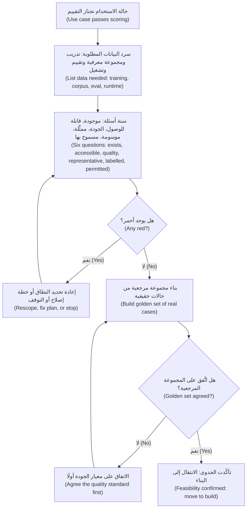
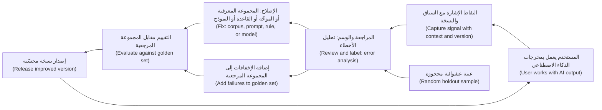
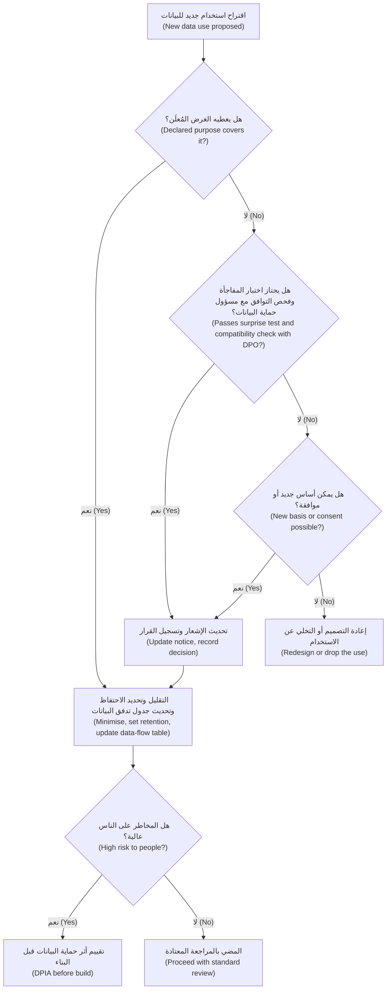

# الوحدة 3 — البيانات أساسًا للمنتج

*لا يكون منتج الذكاء الاصطناعي (AI product) أفضل من البيانات (data) التي يتعلّم منها (learns from)، ويقرأ منها (reads from)، ويُحكَم عليه بمقارنته بها (judged against). ومعظم مشاريع الذكاء الاصطناعي المتعثّرة تتعثّر بسبب البيانات لا بسبب النموذج. فيتبيّن أن البيانات مفقودة (missing)، أو موسومة بشكل خاطئ (mislabelled)، أو محبوسة في النظام الخطأ، أو غير ممثِّلة للمستخدمين الحقيقيين، أو غير قابلة للاستخدام قانونيًا للغرض الجديد. تعلّمك هذه الوحدة دور مدير المنتج في هذا العمل. لن تبني خطوط معالجة البيانات (pipelines)، لكنك ستطرح الأسئلة التي تحدّد هل المنتج ممكن (feasible)، وهل يتحسّن مع الاستخدام، وهل يُسمح للبنك بتنفيذه. ستتابع فيصل ورانيا في بنك نجم (Najm Bank) وهما يقيّمان البيانات التي يقوم عليها مساعد مذكرات الائتمان (Credit Memo Copilot) والتمويل الفوري للشركات الصغيرة (SME Instant Finance)، ويصمّمان حلقات التغذية الراجعة (feedback loops) التي تتيح للتنبيهات الذكية (Smart Alerts) وللمساعد أن يتعلّما، ويكتبان قسم الخصوصية (privacy section) في مواصفات منتج (product spec) نجم أسيست (Najm Assist) مع سارة، مسؤول حماية البيانات (Data Protection Officer, DPO).*

> **المراحل (Stages):** Define, Design, Build, Grow — التحقق من أن البيانات موجودة وصالحة للغرض، وتصميم منتجات تجمع الإشارات الصحيحة، وامتلاك قرارات المنتج (product decisions) التي تعتمد عليها الخصوصية وحقوق البيانات.

---

# 3.1 — جاهزية البيانات: هل لدينا ما يحتاجه المنتج؟ ⁦⁩
*المستوى (Level): 🟡 متوسط (Intermediate)* · *المتطلبات (Prerequisites): 1.3، 2.2* · *المرحلة (Stage): Define, Build*

## ⚡ الدرس في دقيقة (In 60 seconds)
- **جاهزية البيانات (Data readiness)** هي الدليل (evidence) على أن البيانات التي يحتاجها منتج الذكاء الاصطناعي موجودة (exists)، ويمكن الوصول إليها، وجيدة بما يكفي (good enough)، وتمثّل المستخدمين الحقيقيين، ويجوز استخدامها قانونيًا لهذا الغرض. إنها سؤال جدوى تقنية (feasibility question)، ومكانها في الاكتشاف (discovery) لا في السبرينت السادس (sprint 6).
- المنتجات المختلفة تحتاج بيانات مختلفة (different data). **النموذج التنبؤي (predictive model)** يحتاج أمثلة تاريخية (historical examples) ذات **وسوم (labels)** موثوقة (الإجابة الصحيحة المعروفة). و**منتج الذكاء الاصطناعي التوليدي المبني على الاسترجاع (GenAI product built on retrieval)** يحتاج **مجموعة معرفية (knowledge corpus)** نظيفة وحديثة ومضبوطة الصلاحيات. و**كل** منتج ذكاء اصطناعي يحتاج **بيانات تقييم (evaluation data)**: مجموعة من الحالات الحقيقية (real cases) مع إجابات جيدة متّفق عليها.
- عبارة «لدينا بيانات كثيرة» ليست إجابة. الأسئلة هي: البيانات *الصحيحة (right)*، للفئة *الصحيحة (right population)*، المتاحة *لحظة اتخاذ القرار*، مع وسوم تثق بها.
- مدير المنتج (PM) لا ينظّف البيانات. مدير المنتج يطرح الأسئلة ويحوّل الفجوات (gaps) إلى قرارات نطاق (scope) وجدول زمني (timeline) وقرار المضيّ أو التوقف (go/no-go).
- إشارة القرار (Decision cue): إن لم تستطع تجميع 50–100 حالة حقيقية ممثِّلة (real, representative cases) مع إجابات جيدة متّفق عليها في أول أسبوعين، فأنت لا تعرف بعد هل المنتج ممكن.
- أكبر فخ (Biggest trap): أن تكتشف بعد التجربة الأولية (pilot) أن النموذج دُرّب على بيانات لن يراها أبدًا في بيئة الإنتاج (production)، أو على فئة ليست عملاءك.

## 🧭 لماذا يهم
يريد خالد، رئيس إقراض الأفراد (Head of Retail Lending)، أن يُطلَق التمويل الفوري للشركات الصغيرة بنهاية الربع: نموذج (model) يوافق مسبقًا (pre-approves) على طلبات تمويل الفواتير الصغيرة (small invoice-financing requests) خلال دقائق بدلًا من أيام. ويعود فيصل، مدير منتج الذكاء الاصطناعي الجديد، من اجتماع مع فريق مستودع البيانات بأخبار سارة: «لدينا ثماني سنوات من بيانات إقراض الشركات الصغيرة والمتوسطة. مئات الآلاف من الصفوف (rows). البيانات ليست المشكلة».

تطرح رانيا، رئيسة منتجات الذكاء الاصطناعي (Head of AI Products)، أربعة أسئلة. كم صفًّا منها يخص *تمويل الفواتير (invoice financing)*؟ ولكم منها نعرف هل سُدّدت الفاتورة؟ وهل سُجّلت الطلبات المرفوضة (declined applications)؟ وأي الحقول (fields) متاحة لحظة ضغط العميل على «قدّم الطلب (apply)»، لا تلك التي يملؤها محلل (analyst) لاحقًا؟ بعد أسبوعين تعود الإجابات. هناك نحو 9,000 صفقة تمويل فواتير (invoice-financing deals) (أرقام توضيحية). ونتائج السداد (repayment outcomes) موثوقة لأربع سنوات فقط، لأن ترحيل النظام المصرفي الأساسي (core-banking migration) قطع الربط مع التحصيل (collections). والطلبات المرفوضة حُفظت ملفات PDF ممسوحة ضوئيًا (scanned PDFs). واثنان من «أقوى» الحقول (strongest fields) كتبهما المحللون *بعد* الموافقة (after approval).

لا شيء من ذلك يقتل المنتج، لكنه يغيّر الخطة: يضيق النطاق (scope narrows) ليشمل العملاء المتكررين (repeat customers)، وتُزال ميزتان، ويتأجّل موعد الإطلاق. اكتشاف ذلك في الأسبوع الثاني يكلّف اجتماعًا. واكتشافه بعد تجربة أولية يكلّف ثقة خالد (Khalid's trust). ولهذا تنتمي جاهزية البيانات إلى مدير المنتج.

## 📐 كيف يعمل

### 🟢 الأساسيات

**ما تعنيه «البيانات» لكل نوع من منتجات الذكاء الاصطناعي (What "data" means for each kind of AI product).** قدّم الدرس 1.3 طيف البناء (build spectrum). ويحتاج كل خيار بيانات مختلفة:

| نوع المنتج (Product type) | البيانات التي يحتاجها | مثال من نجم (Najm example) |
|---|---|---|
| تعلّم الآلة التنبؤي (Predictive ML) (التصنيف (classify)، والتقييم بالدرجات (score)، والتنبؤ) | **بيانات تدريب (training data)** تاريخية: المدخلات (inputs) إضافةً إلى **وسم (label)**، أي النتيجة التي تريد التنبؤ بها | التمويل الفوري للشركات الصغيرة: صفقات الفواتير السابقة إضافةً إلى «سُدّد في موعده أم لا» |
| الذكاء الاصطناعي التوليدي مع الاسترجاع (RAG) | **مجموعة معرفية (knowledge corpus)** يقرؤها النموذج وقت الإجابة: مستندات (documents)، وسياسات (policies)، وسجلات (records) | مساعد مذكرات الائتمان: سياسة الائتمان (credit policy)، ومذكرات القطاعات (sector notes)، والقوائم المالية للعميل، والمذكرات السابقة (past memos) |
| الذكاء الاصطناعي التوليدي مع الضبط الدقيق | مئات إلى آلاف من أمثلة المدخلات والمخرجات عالية الجودة للسلوك الذي تريده | نموذج بأسلوب المذكرات (memo-style model) مدرَّب على مذكرات سابقة معتمدة (إن لم يكفِ التوجيه بالموجّهات (prompting) والاسترجاع) |
| أي منتج ذكاء اصطناعي | **بيانات التقييم (Evaluation data)**: حالات حقيقية بإجابات جيدة متّفق عليها، تُستخدم للتحقق من الجودة (check quality) | 80 طلب مذكرة حقيقيًا مع مذكرات اعتمدها مديرو العلاقات (RM-approved memos)؛ و500 صفقة فواتير سابقة معروفة النتائج (known outcomes) |
| أي منتج ذكاء اصطناعي في بيئة الإنتاج | **مدخلات وقت التشغيل (Runtime inputs)**: البيانات التي يتلقاها المنتج عند استخدامه فعليًا (actually used) | حقول نموذج التطبيق؛ والمستندات التي يرفعها مدير العلاقة (RM uploads) |

**الوسم (label)** هو الإجابة الصحيحة المرفقة بمثال: «هذه الفاتورة سُدّدت»، «هذه المعاملة كانت احتيالًا»، «هذه المذكرة اعتُمدت دون تغييرات». وكثيرًا ما تكون الوسوم أندر الأجزاء وأغلاها. فلا بد أن يقرّرها أحد، ونتائج مثل سداد القرض (loan repayment) تستغرق شهورًا حتى تصل.

**أسئلة الجاهزية الستة (The six readiness questions).** يستطيع مدير المنتج إجراء فحص جاهزية (readiness check) دون كتابة استعلام بطرح هذه الأسئلة الستة ومطالبة بدليل (demanding evidence) على كل منها:

1. **موجودة (Exists):** هل البيانات مسجّلة أصلًا، أم أنها تعيش في رؤوس الناس (people's heads) ورسائل البريد الإلكتروني (emails) وملفات PDF الممسوحة؟
2. **قابلة للوصول (Accessible):** هل يستطيع الفريق الحصول عليها فعلًا: أي نظام، وأي مالك، وأي موافقات، وكم من الوقت؟
3. **الجودة (Quality):** هل هي دقيقة (accurate)، وكاملة (complete)، ومتّسقة عبر الأنظمة، وحديثة بما يكفي (fresh enough)؟
4. **ممثِّلة (Representative):** هل تغطي المستخدمين (users) والمنتجات (products) واللغات (languages) والمواقف (situations) التي سيواجهها المنتج؟
5. **موسومة (Labelled):** في تعلّم الآلة، هل لدينا نتائج موثوقة (trustworthy outcomes)؟ وفي الذكاء الاصطناعي التوليدي، هل لدينا أمثلة متّفق عليها للإجابات الجيدة؟
6. **مسموح بها (Permitted):** هل يجوز لنا استخدامها لهذا الغرض، بموجب القانون (law) والعقود (contract) ووعود العملاء (customer promises) وسياسة البنك نفسه؟ (هذا هو الدرس 3.3.)

قيّم كل سؤال **أخضر (green)** (جاهز)، أو **كهرماني (amber)** (إصلاح معروف (known fix) ومالك (owner) وتاريخ)، أو **أحمر (red)** (عائق (blocker) يغيّر النطاق أو يقتل الفكرة). والنتيجة، أي **بطاقة تقييم جاهزية البيانات (data readiness scorecard)**، دليل لدرجة الجدوى التقنية (feasibility score) من الدرس 2.2.

**جودة البيانات بكلمات بسيطة (Data quality, in plain words).** تصف ممارسات إدارة البيانات الجودة بأبعاد (dimensions). خمسة منها هي الأهم لمدير المنتج: **الدقة (accuracy)** (رموز القطاعات الخاطئة تعلّم أنماطًا خاطئة)، و**الاكتمال (completeness)** (حقل مفقود لدى 40% من العملاء لا يمكن أن يقود القرارات الخاصة بهم)، و**الاتساق (consistency)** («الإيرادات (revenue)» سنوية في نظام وشهرية في آخر)، و**الحداثة (timeliness)** (المساعد يقتبس سياسة استُبدلت)، و**التفرّد (uniqueness)** (ثلاث نسخ من مذكرة واحدة تربك الاسترجاع).

### 🟡 التعمق أكثر (Going deeper)

**التمثيل: سؤال «من الغائب؟» (Representativeness: the "who is missing?" question).** البيانات تصف الماضي، والماضي يعكس منتجات قديمة (old products) وعمليات قديمة (old processes) وعملاء قدامى (old customers). تاريخ التمويل الفوري للشركات الصغيرة مصدره شركات خدمها مديرو علاقات (relationship managers). أما التطبيق فسيصل إلى شركات أصغر وأحدث لم يكن لها مدير علاقة قط. وقد يؤدي نموذج مدرَّب على المجموعة الأولى أداءً سيئًا على الثانية، ولن يرى البنك ذلك في الدقة الإجمالية (headline accuracy). اطلب البيانات مقسّمة حسب الشرائح المهمة (الحجم (size)، والقطاع (sector)، والدولة (country)، والقناة (channel)، واللغة (language)، ومدة العلاقة) وتحقق من أن لكل شريحة أمثلة كافية للتعلّم منها واختبارها.

**انحياز الاختيار في الإقراض: أنت ترى النتائج فقط لمن وافقت عليهم (Selection bias in lending: you only see outcomes for the people you approved).** هذا هو الفخ الكلاسيكي (classic trap) لمنتجات الائتمان (credit products). يعرف البنك هل سُدّدت الفاتورة الموافق عليها. لكنه لا يعرف ما كان سيحدث للمتقدمين الذين رفضهم. والنموذج المدرَّب على الصفقات الموافق عليها فقط يتعلّم عن «أناس يشبهون من اعتدنا الموافقة عليهم». لدى فرق مخاطر الائتمان أساليب لهذا تُسمّى **استدلال المرفوضين (reject inference)**، لكن لا أحد منها يستعيد المعلومات المفقودة بالكامل. اسأل دانة، كبيرة علماء البيانات (lead data scientist)، كيف سيتصرف النموذج مع أنواع المتقدمين التي نادرًا ما وُوفق عليها في الماضي؛ فقد توجّههم إلى إنسان.

**متاح وقت القرار: التسرّب والانحراف بين التدريب والتشغيل (Available at decision time: leakage and skew).** إخفاقان يبدآن سؤالين للمنتج (product questions):
- **تسرّب الوسم (Label leakage)** يحدث حين تحتوي ميزة (feature) على معلومات لم تكن معروفة لحظة اتخاذ القرار، وكثيرًا ما يكون ذلك لأنها سُجّلت لاحقًا (recorded afterwards). حقل «قوة العلاقة (relationship strength)» في نجم ملأه المحللون بعد الموافقة: إنه يتنبأ بالسداد جيدًا في البيانات التاريخية وسيكون فارغًا لكل متقدم عبر التطبيق. النماذج المتسرّبة (Leaky models) تبدو ممتازة في الاختبار وتفشل في بيئة الإنتاج.
- **الانحراف بين التدريب والتشغيل (Training-serving skew)** يحدث حين تختلف البيانات وقت التشغيل عن بيانات التدريب. يحتفظ المستودع (warehouse) بإيرادات نهاية الشهر المنظّفة؛ أما التطبيق الحي (live app) فيتلقى كل ما يكتبه العميل.

سؤال مدير المنتج عن كل مُدخل مرشّح (candidate input) بسيط: «حين يضغط العميل على *قدّم الطلب*، من أين تأتي هذه القيمة، وهل هي نفس ما درّبنا عليه؟ ⁦⁩»

**جاهزية الذكاء الاصطناعي التوليدي هي جاهزية المجموعة المعرفية (GenAI readiness is corpus readiness).** في مساعد مذكرات الائتمان، «البيانات» في معظمها مستندات (mostly documents). وتتغيّر صيغة أسئلة الجاهزية:
- **التغطية (Coverage):** هل تحوي المجموعة المعرفية (corpus) ما تحتاجه المذكرة، وماذا يفعل المساعد حين يكون شيء ما مفقودًا؟
- **الحداثة (Currency):** هل هناك نسخة حالية واحدة من كل سياسة، مع سحب النسخ القديمة؟
- **الصيغة (Format):** الصور الممسوحة (Scanned images)، وجداول PDF (PDF tables)، والصفحات المختلطة بالعربية والإنجليزية كلها تؤثر في الاستخراج (extraction) وتحتاج إلى اختبار (need testing).
- **الصلاحيات (Permissions):** يجب أن يحترم الاسترجاع (retrieval) قواعد الوصول نفسها المعمول بها في نظام المستندات (document system)، وإلا صار المساعد وسيلة لقراءة ملفات لا يجوز لمدير العلاقة فتحها. يسمّي طارق، قائد الهندسة (engineering lead)، ذلك «الاسترجاع المراعي للصلاحيات (permission-aware retrieval)»؛ وهو متطلب منتج (product requirement).
- **النسخ المكررة والمسودات (Duplicates and drafts):** قرّر أي المذكرات السابقة تُعدّ أمثلة جيدة (good examples) وأيها يجب ألا يُسترجع أبدًا.

**بيانات التقييم أولًا (Evaluation data comes first).** أيًّا كان نوع المنتج، فإن أول أصل بيانات يُبنى هو **مجموعة مرجعية (golden set)** صغيرة: حالات حقيقية ممثِّلة بإجابات يتفق قطاع الأعمال (business) على أنها جيدة. (تتعمق الوحدة 6 أكثر.) إن لم يستطع الفريق تجميع حتى 50–100 حالة كهذه، فلا سبيل لديه لمعرفة هل تعمل أي نسخة من المنتج. في المساعد، تختار حصة (مصممة المنتج) واثنان من كبار مديري العلاقات (senior RMs) 80 صفقة سابقة حقيقية عبر القطاعات والأحجام، ويحدّدون ما يجب أن تحتويه المذكرة الجيدة لكل منها. وجمع ذلك مبكرًا يكشف الخلاف أيضًا (exposes disagreement). فإن اختلف اثنان من كبار مديري العلاقات على ماهية المذكرة الجيدة، فلن يرضيهما أي نموذج معًا، ويحتاج المنتج إلى معيار متّفق عليه (agreed standard) قبل أن يحتاج إلى نموذج.

### 🔴 نظرة الخبير (Expert view)

**جاهزية البيانات أداة ترتيب لا بوابة (Data readiness is a sequencing tool, not a gate).** مديرو منتجات الذكاء الاصطناعي المتمرسون يعيدون تشكيل المنتج حول البيانات *الجاهزة فعلًا* بدلًا من الانتظار. في التمويل الفوري للشركات الصغيرة، يعني ذلك البدء بالعملاء المتكررين الذين تاريخهم كامل ونظيف، وإبقاء المتقدمين لأول مرة (first-time applicants) على المسار اليدوي (manual path)، والتخطيط لجمع الوسوم المفقودة أثناء تشغيل المنتج. وينتهي تقييم الجاهزية الجيد بـ**نطاق (scope)** تستطيع البيانات دعمه، و**خطة (plan)** لتوسيعه، و**تاريخ (date)** يجب أن يتحول فيه كل بند كهرماني (amber item) إلى أخضر.

**التفكير المتمحور حول البيانات (Data-centric thinking).** نحو عام 2021 روّج Andrew Ng لمفهوم «الذكاء الاصطناعي المتمحور حول البيانات (data-centric AI)»: في كثير من المشكلات العملية (practical problems)، يرفع تحسين البيانات (وسوم متّسقة (consistent labels)، وتغطية الحالات الصعبة) الجودة أكثر من تغيير النموذج. حين تتوقف الجودة عن التحسن (quality stalls)، اسأل «أي الحالات تفشل، وأي بيانات ستصلحها؟ ⁦⁩» قبل أن تطلب نموذجًا أكبر (bigger model). الوسم (Labelling)، ووقت المراجعين الخبراء، وهندسة البيانات (data engineering) كلها تكاليف منتج (product costs)؛ ضعها في دراسة الجدوى (business case).

**وثّق البيانات لا النموذج فقط (Document the data, not just the model).** تساعد صيغتان معروفتان (well-known formats). تقترح **Datasheets for Datasets** (Gebru et al., 2018) أن تُرفق مع كل مجموعة بيانات (dataset) إجابات عن أسئلة معيارية (standard questions): لماذا أُنشئت، وما الذي تحتويه، وكيف جُمعت ووُسمت، وفيمَ يجب وما لا يجب أن تُستخدم، وكيف تُصان (maintained). و**Data Cards** (Pushkarna وZaldivar وKjartansson في Google، 2022) قالب مشابه (similar template) أكثر توجّهًا إلى المنتج (product-facing). لست مضطرًا لاستخدام أيٍّ منهما بالكامل، لكن اكتب من هم في البيانات، ومن الغائب، وكيف تقرّرت الوسوم، وفيمَ يجب ألا تُستخدم البيانات. سيسأل فريق الحوكمة (governance team) الذي تقوده ليلى؛ ويغطي *AI Governance: Zero to Hero* المتطلبات الرسمية (formal requirements).

**احذر البيانات التي تحمل قرارات لا تريد تكرارها (Watch for data that carries decisions you do not want to repeat).** الوسوم التاريخية (Historical labels) تعكس قرارات تاريخية (historical decisions). فإن كان المحللون السابقون أشدّ صرامة مع بعض القطاعات أو الشركات الجديدة (new businesses) لأسباب لا علاقة لها بالسداد، فإن نموذجًا مدرَّبًا على قراراتهم يتعلّم ذلك على أنه حقيقة. فضّل وسوم *النتيجة (outcome labels)* (هل سُدّدت الفاتورة؟ ⁦⁩) على وسوم *القرار (decision labels)* (هل وافق المحلل؟ ⁦⁩). اختبار الإنصاف (Fairness testing) يأتي لاحقًا (الوحدة 6)، لكن اختيار الوسم هو أول قرار إنصاف يتخذه مدير المنتج.

**الجاهزية تتآكل (Readiness decays).** تتغير السياسات (Policies change)، وتتحول قاعدة العملاء، وتعيد الأنظمة المصدرية (upstream systems) تسمية الحقول (rename fields). ضمّن مالكين (owners) وفحوصًا للحداثة (freshness checks) منذ البداية (يغطي الدرس 8.3 الانجراف).

## 🧰 الأدوات
| الأداة أو الإطار (Tool or framework) | ما هو وماذا يفعل | متى تلجأ إليه |
|---|---|---|
| **Data readiness scorecard** — بطاقة تقييم جاهزية البيانات | الأسئلة الستة (موجودة، قابلة للوصول، الجودة، ممثِّلة، موسومة، مسموح بها) مقيّمة بالأخضر أو الكهرماني أو الأحمر، ولكل منها دليل ومالك وتاريخ | أثناء الاكتشاف وتقييم حالات الاستخدام (use-case scoring)، قبل الالتزام بالبناء |
| **Data profiling** — التنميط الإحصائي للبيانات | نظرة إحصائية سريعة على مجموعة بيانات: عدد الصفوف (row counts)، والقيم المفقودة (missing values)، ونطاقات القيم (value ranges)، والتوزيعات حسب الشريحة | لاختبار ادعاءات «لدينا بيانات كثيرة» في أيام لا أسابيع |
| **Decision-time audit** — تدقيق وقت القرار | لكل مُدخل مرشّح، فحص لمصدره لحظة القرار وهل يطابق بيانات التدريب | قبل تدريب النموذج (model training)، لاكتشاف التسرّب (leakage) والانحراف بين التدريب والتشغيل |
| **Golden set** — المجموعة المرجعية | مجموعة صغيرة من الحالات الحقيقية الممثِّلة بإجابات جيدة متّفق عليها | أول أصل بيانات لأي منتج ذكاء اصطناعي؛ تثبت الجدوى (proves feasibility) وتحدد معيار الجودة (sets the quality bar) |
| **Datasheets for Datasets** (Gebru et al., 2018) | قائمة أسئلة معيارية توثّق غرض مجموعة البيانات (purpose)، وتكوينها (composition)، وجمعها (collection)، ووسمها، وحدودها (limits) | حين تُعاد مجموعة بيانات للاستخدام (reused)، أو تُدقَّق (audited)، أو تُسلَّم لفريق آخر |

## 🏛️ عمليًا في بنك نجم
**تقييم جاهزية البيانات (Data Readiness Assessment)** الذي أعدّه فيصل لمنتجين، وراجعته دانة وعمر (رئيس البيانات):

| السؤال (Question) | التمويل الفوري للشركات الصغيرة (تنبؤي) | مساعد مذكرات الائتمان (ذكاء اصطناعي توليدي مع استرجاع) |
|---|---|---|
| **موجودة (Exists)** | 🟡 نحو 9,000 صفقة فواتير (invoice deals)؛ الطلبات المرفوضة موجودة فقط ملفات PDF ممسوحة | 🟢 السياسات، ومذكرات القطاعات، والمذكرات السابقة، وقوائم العملاء (client statements) كلها مسجّلة |
| **قابلة للوصول (Accessible)** | 🟢 الوصول إلى المستودع (Warehouse access) وافق عليه فريق عمر؛ مهلة أسبوعين (2-week lead time) | 🟡 المذكرات في نظام المستندات؛ الوصول عبر واجهة برمجة التطبيقات (API access) يحتاج مراجعة أمن تقنية المعلومات |
| **الجودة (Quality)** | 🟡 حقل الإيرادات (Revenue field) غير متّسق بين نظامين مصدريين؛ رموز القطاعات (sector codes) خاطئة بنحو 10% في فحص العينة (sample check) | 🔴 ثلاث نسخ من سياسة الائتمان متداولة؛ لا يوجد مصدر حقيقة واحد |
| **ممثِّلة (Representative)** | 🔴 التاريخ يغطي فقط الشركات التي خدمها مديرو العلاقات (RM-served SMEs)؛ التطبيق سيصل إلى شركات أصغر وأحدث | 🟡 مذكرات الشركات الكبرى (Corporate memos) ممثَّلة بإفراط (over-represented)؛ حالات قليلة للشركات الصغيرة (SME) وباللغة العربية (Arabic-language cases) |
| **موسومة (Labelled)** | 🟡 نتائج السداد موثوقة لآخر 4 سنوات فقط؛ المتقدمون المرفوضون (declined applicants) بلا نتيجة | 🟡 لا معيار متّفق عليه بعد لـ«المذكرة الجيدة (good memo)»؛ مجموعة مرجعية من 80 حالة قيد الإعداد |
| **مسموح بها (Permitted)** | 🟡 يجب التحقق من ترخيص بيانات مكتب الائتمان لاستخدامه في تدريب النموذج (model-training use) (سارة، يوسف) | 🟡 يجوز استخدام مستندات العملاء (Client documents) لصياغة المذكرات (memo drafting)؛ إعادة استخدامها للضبط الدقيق لم تُقيَّم بعد (انظر 3.3) |
| **فحص وقت القرار (Decision-time check)** | 🔴 أُزيل حقلان كتبهما المحللون (analyst-written fields) (تسرّب ما بعد الموافقة) | 🟢 المدخلات هي المستندات نفسها التي يستخدمها مديرو العلاقات اليوم |
| **النطاق الناتج (Resulting scope)** | الإطلاق للعملاء المتكررين الذين لديهم تاريخ سنتين فأكثر (2+ years of history)؛ البقية يبقون على المسار اليدوي (stay manual)؛ البدء بجمع النتائج (collecting outcomes) للشرائح الجديدة (new segments) | الإطلاق أولًا على مذكرات الشركات الكبرى باللغة الإنجليزية؛ فريق السياسات (policy team) يسحب النسخ القديمة قبل التجربة الأولية |
| **المالك / التاريخ (Owner / date)** | دانة، عمر / نهاية الشهر | طارق، إدارة سياسات الائتمان / قبل بدء التجربة الأولية |

ملاحظة رانيا (Rania's note): *«أحمران، وكلاهما يُعالَج بتغيير النطاق (changing scope)، لا سببان للتوقف. على فيصل تحديث بطاقة التقييم (scorecard) وخارطة الطريق (roadmap)، وإطلاع خالد (brief Khalid) هذا الأسبوع.»*

## 🛠️ التمارين (Exercises)
- 🟢 لميزة ذكاء اصطناعي (AI feature) تعرفها، اسرد الأنواع الأربعة من البيانات التي تحتاجها (بيانات التدريب أو المجموعة المعرفية، والتقييم (evaluation)، ومدخلات وقت التشغيل، والوسوم). *يكتمل عندما (Done when):* يكون لديك جدول من أربعة صفوف (four-row table) مع مصدر (source) ومالك لكل صف.
- 🟡 طبّق أسئلة الجاهزية الستة على التنبيهات الذكية، تنبيهات الاحتيال والإنفاق في نجم. افترض أن وسوم الاحتيال (fraud labels) تأتي من شكاوى العملاء (customer complaints) واستردادات المبالغ (chargebacks). *يكتمل عندما:* يُقيَّم كل سؤال بالأخضر أو الكهرماني أو الأحمر مع سطر دليل واحد، وتكون قد سمّيت فجوة تمثيل (representativeness gap) واحدة على الأقل وفجوة وسم (labelling gap) واحدة.
- 🔴 يصرّ خالد على أن يُطلَق التمويل الفوري للشركات الصغيرة لجميع الشركات الصغيرة والمتوسطة، بما فيها المتقدمون لأول مرة، في الموعد الأصلي (original date). اكتب له مذكرة من صفحة واحدة (one-page memo) تقترح نطاقًا مرحليًا (phased scope). *يكتمل عندما:* تبيّن ما يُطلَق أولًا ولماذا، وكيف تُجمع البيانات المفقودة في المرحلة الأولى (phase one)، والدليل الذي يطلق المرحلة الثانية.

## ⚠️ أخطاء وفخاخ (Mistakes and traps)
- **عدّ الصفوف بدلًا من طرح الأسئلة (Counting rows instead of asking questions).** «مئات الآلاف من الصفوف» لا تقول شيئًا عن الصلة (relevance) أو الوسوم أو التغطية. اطرح الأسئلة الستة واطلب الدليل (demand evidence).
- **ترك فحص البيانات للهندسة (Leaving the data check to engineering).** الفجوات التي تُكتشف أثناء البناء تصل على شكل تأخيرات (delays) دون قرار منتج مرتبط بها. افحص في الاكتشاف.
- **التدريب على ما لن يكون متاحًا لك وقت القرار (Training on what you will not have at decision time).** دقّق كل مُدخل مقابل لحظة القرار.
- **افتراض أن القرارات السابقة حقيقة مطلقة (Assuming past decisions are ground truth).** وسوم القرار تنسخ العادات القديمة، بما فيها المنحازة (biased ones). فضّل وسوم النتيجة، واسأل من الغائب عن التاريخ.
- **البدء دون مجموعة مرجعية (Starting without a golden set).** دون حالات حقيقية وإجابات متّفق عليها (agreed answers)، لا يستطيع أحد معرفة هل يعمل المنتج. ابنها أولًا، حتى لو كانت صغيرة.

## 🧾 الخلاصة (Recap)
- جاهزية البيانات سؤال جدوى تقنية يملكه مدير المنتج في الاكتشاف: موجودة، قابلة للوصول، الجودة، ممثِّلة، موسومة، مسموح بها.
- المنتجات التنبؤية (Predictive products) تحتاج تاريخًا موسومًا (labelled history)؛ ومنتجات التوليد المعزّز بالاسترجاع (RAG products) تحتاج مجموعة معرفية نظيفة وحديثة ومضبوطة الصلاحيات؛ وكل منتج يحتاج بيانات تقييم.
- انحياز الاختيار (Selection bias)، وتسرّب الوسم، والانحراف بين التدريب والتشغيل أسئلة منتج قبل أن تكون أسئلة تقنية (technical ones): من الغائب، وما المتاح فعلًا وقت القرار؟
- يجب أن ينتهي تقييم الجاهزية (readiness assessment) بنطاق تدعمه البيانات، وخطة لتوسيعه، ومالكين وتواريخ لكل فجوة.
- وثّق مجموعات البيانات (Document datasets) وتعامل مع الجاهزية على أنها شيء يتآكل (decays) ويحتاج إلى مراقبة (monitoring).

## ✍️ اختبر نفسك (Check yourself)

**1. يبلّغ فيصل أن لدى نجم «ثماني سنوات ومئات الآلاف من الصفوف (eight years and hundreds of thousands of rows)» من بيانات إقراض الشركات الصغيرة والمتوسطة (SME lending data). ما الخطوة التالية الأكثر فائدة (most useful next step)؟**

- A. بدء تدريب النموذج (model training) فورًا، لأن حجم الصفوف (volume) كافٍ بوضوح وقد انتظر الفريق طويلًا بما يكفي للحصول على البيانات
- B. سؤال المورّد (vendor) عن بنية النموذج (model architecture) الأفضل في التعامل مع مجموعات البيانات الكبيرة (large datasets)، وعن المدة اللازمة لتدريبه، وعن الكلفة المتوقعة (expected cost) لكل مرحلة
- C. شراء بيانات خارجية عن الشركات الصغيرة من باب الاحتياط، حتى يرى النموذج شركات أكثر مما يغطيه سجل نجم نفسه
- D. السؤال عن عدد الصفوف التي تطابق المنتج والفئة المستهدفين، وعدد ما لديه وسوم نتيجة موثوقة، وأي الحقول متاحة وقت القرار

الإجابة

**D.** الحجم ليس جاهزية: اسأل عن الصلة (relevance)، والوسوم (labels)، والتمثيل (representativeness)، والإتاحة وقت القرار. وخيار C سابق لأوانه (premature) قبل أن تعرف الفجوات (gaps). (🧭 لماذا يهم؛ 🟢 الأساسيات.)

**2. نموذج ائتمان (credit model) يؤدي أداءً ممتازًا جدًا في الاختبار (testing). أكثر مدخلاته قدرة على التنبؤ (most predictive input) حقلٌ يكمله محللو الائتمان (credit analysts) بعد الموافقة على القرض (after a loan is approved). ما المشكلة؟**

- A. انحراف بين التدريب والتشغيل (Training-serving skew) سببه مدخلات عملاء فوضوية تختلف بين ملفات التدريب والاستخدام الحي (live use)
- B. انحياز اختيار (Selection bias) بسبب غياب المتقدمين المرفوضين الذين لا يظهرون أبدًا في سجل السداد (repayment history)
- C. ضعف حداثة البيانات، لأن حقل المحللين يُحدَّث ببطء شديد لا يتيح للنموذج الاستفادة منه
- D. تسرّب الوسم (Label leakage): الحقل لن يكون موجودًا حين يُبتّ في طلب جديد

الإجابة

**D.** الحقل المسجّل بعد القرار يحمل معلومات لن تتوفر للنموذج وقت القرار، لذا تبالغ نتائج الاختبار في تقدير الأداء الحقيقي. والانحراف (Skew) يتعلق باختلاف بيانات وقت التشغيل (runtime data) في شكلها عن بيانات التدريب (training data)، لا بمعلومات من المستقبل. (🟡 التعمق أكثر (Going deeper).)

**3. في مساعد مذكرات الائتمان (Credit Memo Copilot)، أي مسألة جاهزية (readiness issue) تخص منتج ذكاء اصطناعي توليدي قائمًا على الاسترجاع (retrieval-based GenAI product) لا نموذجًا تنبؤيًا (predictive model)؟**

- A. هل توجد وسوم نتيجة (outcome labels) للقروض السابقة التي وُوفق عليها وسُدّدت أو أُعيدت جدولتها أو شُطبت، وهل هي موثوقة
- B. هل يحترم الاسترجاع (retrieval) صلاحيات الوصول إلى المستندات نفسها المعمول بها في النظام المصدر (source system)
- C. هل تتضمن بيانات التدريب (training data) المتقدمين المرفوضين (declined applicants) إلى جانب المقبولين، لتجنب انحياز الاختيار (selection bias) في تقدير المخاطر
- D. هل ميزات النموذج (model's features) كلها متاحة وقت اتخاذ قرار الإقراض، وليس بعد صدوره بأيام أو أسابيع

الإجابة

**B.** منتج التوليد المعزّز بالاسترجاع (RAG product) يقرأ المستندات وقت الإجابة، لذا يجب أن تكون المجموعة المعرفية (corpus) حديثة (current)، وخالية من التكرار (deduplicated)، ومراعية للصلاحيات (permission-aware). ودون ذلك، قد يعرض المساعد على مديري العلاقات ملفات لا يُسمح لهم برؤيتها. أما A وC وD فهي في الأساس مخاوف النماذج التنبؤية (predictive-model concerns). (🟡 التعمق أكثر (Going deeper)، «جاهزية الذكاء الاصطناعي التوليدي هي جاهزية المجموعة المعرفية».)

**4. يجد تقييم الجاهزية (readiness assessment) للتمويل الفوري للشركات الصغيرة (SME Instant Finance) أن التاريخ يغطي فقط الشركات التي خدمها مديرو العلاقات (RM-served businesses)، بينما سيصل التطبيق إلى شركات أصغر وأحدث (smaller, newer firms). ما أفضل استجابة منتج (best product response)؟**

- A. إلغاء المنتج
- B. الإطلاق لجميع الشركات الصغيرة والمتوسطة ومراقبة الشكاوى (monitor complaints)
- C. الإطلاق أولًا للشرائح التي تمثّلها البيانات، وإبقاء الآخرين على المسار اليدوي (manual path)، وجمع النتائج (collect outcomes) لتوسيع النطاق لاحقًا
- D. إزالة حقلي الحجم ومدة العلاقة حتى لا يرى النموذج الفرق

الإجابة

**C.** الجاهزية أداة ترتيب (sequencing tool): شكّل النطاق حول البيانات الجاهزة وخطّط لتوسيعه. خيار D يخفي الفجوة بدلًا من إصلاحها، وخيار B يعرّض العملاء غير الممثَّلين (unrepresented customers) لنموذج غير مختبَر (untested model). (🔴 نظرة الخبير (Expert view).)

**5. لماذا يوصي الدرس ببناء مجموعة مرجعية (golden set) من الحالات الحقيقية بإجابات متّفق عليها قبل بناء المنتج؟**

- A. لأن قانون الاتحاد الأوروبي للذكاء الاصطناعي (EU AI Act) يشترطها لجميع الأنظمة التي يعرضها البنك على العملاء أو يستخدمها مع موظفيه (staff)، مهما كان خطرها صغيرًا
- B. لأنها تغني عن الحاجة إلى بيانات التدريب (training data)
- C. لأنه من دونها لا يستطيع الفريق معرفة هل تعمل أي نسخة، وبناؤها يكشف الخلاف حول معنى «جيد (good)»
- D. لأنها تتيح للفريق تخطّي أبحاث المستخدمين (user research) والبدء بالبناء (start building)

الإجابة

**C.** بيانات التقييم (Evaluation data) تثبت الجدوى (proves feasibility) وتحدّد معيار الجودة (sets the quality bar). وإن اختلف الخبراء على الإجابات الجيدة، يحتاج المنتج إلى معيار متّفق عليه (agreed standard) قبل أن يحتاج إلى نموذج. خيار A ليس قاعدة قانونية عامة، وخيار B يخلط بين بيانات التقييم وبيانات التدريب. (🟡 التعمق أكثر (Going deeper)، «بيانات التقييم أولًا».)

## 📚 المراجع (References)
- Gebru, T. et al. (2018/2021). *Datasheets for Datasets*. — https://arxiv.org/abs/1803.09010
- Pushkarna, M., Zaldivar, A. and Kjartansson, O. (2022). *Data Cards: Purposeful and Transparent Dataset Documentation for Responsible AI*. — https://arxiv.org
- Google PAIR, *People + AI Guidebook*، فصل «جمع البيانات والتقييم». — https://pair.withgoogle.com/guidebook
- DAMA International, *DAMA-DMBOK: Data Management Body of Knowledge* (الطبعة الثانية ⁦(2nd ed.)⁩، 2017). — https://www.dama.org

---

# 3.2 — حلقات التغذية الراجعة ودواليب البيانات والمنتجات المتعلّمة
*المستوى: 🟡 متوسط* · *المتطلبات: 3.1، 1.2* · *المرحلة: Design, Grow*

## ⚡ الدرس في دقيقة (In 60 seconds)
- **المنتج المتعلّم (learning product)** يتحسّن لأن الناس يستخدمونه. ولا يحدث ذلك إلا إذا صُمّم المنتج لالتقاط **إشارات التغذية الراجعة (feedback signals)**، وتحويلها إلى **وسوم (labels)** أو حالات اختبار (test cases)، وإعادتها إلى الموجّهات (prompts) أو الاسترجاع أو النماذج (models) أو القواعد (rules) وفق جدول يملكه شخص ما.
- الإشارات إما **صريحة (explicit)** (الإعجاب وعدمه (thumbs)، والتقييمات (ratings)، والتصحيحات (corrections)، وسبب يُختار من قائمة) أو **ضمنية (implicit)** (ما يقبله المستخدمون (accept)، أو يعدّلونه (edit)، أو يتجاهلونه (ignore)، أو يتراجعون عنه). الإشارات الضمنية وفيرة لكنها ملتبسة. أما الصريحة فأوضح لكنها نادرة.
- **دولاب البيانات (data flywheel)** (استخدام أكثر، بيانات أكثر، منتج أفضل، استخدام أكثر) حقيقي لبعض المنتجات، وأسطورة عروض تقديمية (slide-deck myth) لكثير منها. اختبره قبل أن تدّعيه.
- احذر **حلقات التغذية الراجعة المتدهورة (degenerate feedback loops)**: المنتج يشكّل البيانات التي يتعلّم منها لاحقًا. نموذج احتيال (fraud model) لا يتعلّم إلا من التنبيهات التي أطلقها، أو نموذج ائتمان لا يرى النتائج إلا للمتقدمين الذين وافق عليهم، يمكن أن يعزّز نقاطه العمياء (blind spots) بهدوء.
- إشارة القرار: لكل إشارة تغذية راجعة، اكتب ما تعنيه، ومتى تصل، ومن يتصرف بناءً عليها، وهل يُسمح لك بإعادة استخدامها.
- أكبر فخ: زر إعجاب (thumbs-up button) لا يقرأ أحد بياناته.

## 🧭 لماذا يهم
بعد ثلاثة أشهر من التجربة الأولية لمساعد مذكرات الائتمان، يعرض فيصل شريحة بعنوان «دولاب البيانات»: كل تعديل يجريه مدير علاقة (RM edit) سيكون «بيانات تدريب»، والمساعد «سيصبح أذكى كل أسبوع». يعجب ذلك خالد. وتطرح دانة ثلاثة أسئلة. أين تُخزَّن التعديلات؟ في لا مكان: المسودة (draft) والمذكرة النهائية (final memo) تعيشان في نظامين مختلفين غير مرتبطين (unlinked). أي التعديلات تعني «المسودة كانت خاطئة» وأيها تعني «مدير العلاقة هذا يكتب بأسلوب مختلف»؟ لا أحد يعرف. من يراجع الإشارات، وما الذي يتغير نتيجة لذلك؟ لم يُكلَّف أحد.

في الأثناء، يواجه فريق التنبيهات الذكية المشكلة المعاكسة (opposite problem). فهو يتعلّم بحماس من ردود العملاء على تنبيهات الاحتيال. حين يضغط العميل على «نعم، كنت أنا»، توسم المعاملة بأنها حقيقية (labelled genuine). وخلال ستة أشهر صار النموذج بارعًا جدًا في أنواع الاحتيال التي كان يرصدها أصلًا (already flagged)، وأعمى عن الأنماط الجديدة التي لم يرصدها قط، لأنها لم تولّد وسمًا أبدًا. كلا الفريقين يعتقد أن منتجه «يتعلّم (learning)». وخيار تصميمي واحد فقط يفصل بين حلقة تعلّم حقيقية وبين شريحة عرض (slide) أو فخ (trap)، وهذا الخيار يتخذه مدير المنتج (product manager).

## 📐 كيف يعمل

### 🟢 الأساسيات

**لحلقة التغذية الراجعة خمسة أجزاء (A feedback loop has five parts).** إن فاتك جزء واحد انكسرت الحلقة.

1. **الإشارة (Signal):** شيء يفعله المستخدم أو يقوله يخبرك عن الجودة. مثلًا، يحذف مدير علاقة فقرة، أو يعترض عميل على تنبيه، أو يسدّد متقدمٌ (applicant repays).
2. **الالتقاط (Capture):** يسجّل المنتج الإشارة، مربوطة بالمُدخل (input) والمُخرج (output) ونسخة النموذج (model version) والسياق (context) الذي أنتجها بالضبط.
3. **التفسير (Interpretation):** تصبح الإشارة **وسمًا (label)** (حكمًا على صحة المُخرج) أو **حالة اختبار (test case)**. وأحيانًا يراجعها شخص ليصدر ذلك الحكم.
4. **الإجراء (Action):** يغيّر الوسم شيئًا: موجّهًا (prompt)، أو المجموعة المعرفية للاسترجاع (retrieval corpus)، أو قاعدة (rule)، أو المجموعة المرجعية، أو إعادة تدريب النموذج (model retrain)، أو تصميم المنتج (product's design).
5. **التحقق (Verification):** تتحقق من أن التغيير حسّن المنتج ولم يكسر شيئًا آخر، باستخدام أساليب التقييم (evaluation methods) في الوحدة 6.

**الإشارات الصريحة والضمنية (Explicit and implicit signals).**

| النوع (Kind) | أمثلة (Examples) | نقطة القوة (Strength) | نقطة الضعف (Weakness) |
|---|---|---|---|
| **صريحة (Explicit)** | إعجاب أو عدم إعجاب (Thumbs up/down)، تقييم بالنجوم (star rating)، «الإبلاغ عن مشكلة»، اختيار سبب، كتابة تصحيح | معنى واضح (Clear meaning)؛ المستخدم يخبرك بنفسه | قلة من المستخدمين يقدّمونها؛ غير الراضين والراضون جدًا ممثَّلون بإفراط |
| **ضمنية (Implicit)** | قبول اقتراح، تعديل مسودة، نسخ إجابة، إعادة صياغة سؤال، التخلي عن مسار، الاتصال بالدعم بعد ذلك | وفيرة (Plentiful)؛ تعكس السلوك الحقيقي (real behaviour) | ملتبسة (Ambiguous): قد يعني التعديل «خطأ (wrong)» أو مجرد «أسلوبي» |
| **النتيجة (Outcome)** | سداد القرض أو تعثّره؛ تأكيد التنبيه احتيالًا؛ قبول الشكوى (complaint upheld) | أقرب شيء إلى الحقيقة | بطيئة (Slow) (من أيام إلى شهور) ومتاحة لبعض الحالات فقط |

المنتجات الجيدة تستخدم الأنواع الثلاثة. في المساعد، الإشارة الضمنية (implicit signal) هي **مقدار ما يبقى من المسودة (how much of the draft survives)** في المذكرة النهائية. والإشارة الصريحة (explicit signal) أداة اختيار قصيرة «ما الخطأ؟ ⁦⁩» تظهر حين يرفض مدير العلاقة قسمًا. وإشارة النتيجة (outcome signal) هي هل أعادت لجنة الائتمان (credit committee) المذكرة بسبب معلومات ناقصة (missing information).

**تصميم الالتقاط (Designing the capture).** يتضمن *People + AI Guidebook* من Google فصلًا عن التغذية الراجعة والتحكم (feedback and control)، وتتضمن *Guidelines for Human-AI Interaction* من Microsoft (Amershi et al., CHI 2019) مبادئ «شجّع التغذية الراجعة التفصيلية»، و«تعلّم من سلوك المستخدم»، و«حدّث وتكيّف بحذر (update and adapt cautiously)». عمليًا:
- اسأل في **لحظة إنجاز المهمة (moment of the job)**، داخل سير العمل، لا في استبيان لاحق (survey afterwards).
- اجعلها **رخيصة (cheap)**: ضغطة واحدة (one tap)، أو قائمة أسباب قصيرة، لا نموذج نص حر (free-text form).
- اجعلها **محددة (specific)**: التغذية الراجعة على فقرة أو حقل أفضل من تقييم المذكرة كلها.
- **أظهر أنها مهمة (Show that it matters)**: حين تغيّر التغذية الراجعة شيئًا، قل ذلك («شكرًا، أصلحنا الإشارة إلى السياسة»). يتوقف المستخدمون عن تقديم تغذية راجعة تختفي.

### 🟡 التعمق أكثر

**الوسوم المتأخرة والجزئية (Delayed and partial labels).** أثمن الوسوم كثيرًا ما تصل متأخرة (arrive late). يعرف التمويل الفوري للشركات الصغيرة هل سُدّدت الفاتورة بعد 30 إلى 120 يومًا من القرار. وحتى ذلك الحين، لا يمكنك قياس الدقة الحقيقية للنموذج على العملاء الجدد (new customers). خطّط لذلك بثلاث طرق. أولًا، حدّد **مؤشرات مبكرة بديلة (early proxies)** (أول دفعة فائتة، أو عميل يتوقف عن التعامل عبر الحساب) وكن واضحًا بأنها مؤشرات بديلة (proxies). ثانيًا، حدّد **نافذة نضج الوسم (label maturity window)**، أي أنك لا تحكم على قرارات شهر ما إلا بعد أن تُعرف معظم نتائجها. ثالثًا، حافظ على نزاهة الحلقة بالإبلاغ عن «القرارات غير الموسومة بعد» بجانب كل رقم جودة (quality number).

**حلقات التغذية الراجعة المتدهورة (Degenerate feedback loops).** حين تقرّر مخرجات المنتج نفسه أي البيانات تُوسم، قد يتعلّم صورة مشوّهة عن العالم. يحذّر Sculley et al. (2015)، في *Hidden Technical Debt in Machine Learning Systems*، من «حلقات التغذية الراجعة» هذه بوصفها تكلفة خفية (hidden cost) لأنظمة تعلّم الآلة (ML systems). ثلاثة أشكال شائعة (common shapes):

| الشكل (Shape) | مثال من نجم | ما الذي يسوء |
|---|---|---|
| **لا يُوسم إلا ما رصدته (Only what you flagged gets labelled)** | التنبيهات الذكية تتعلّم فقط من التنبيهات التي أطلقتها | أنماط الاحتيال الجديدة لا تولّد وسومًا أبدًا، فلا يتعلّمها النموذج أبدًا |
| **لا يحصل على نتائج إلا ما وافقت عليه (Only what you approved gets outcomes)** | التمويل الفوري للشركات الصغيرة لا يرى السداد إلا للصفقات الموافق عليها (approved deals) | الفئات المرفوضة تبقى مرفوضة؛ لا يستطيع النموذج أن يتعلّم أنها كانت مخاطر جيدة (good risks) |
| **المستخدمون يتكيّفون مع المنتج (Users adapt to the product)** | يتعلّم مديرو العلاقات أي أقسام المساعد يحذفونها دون قراءة | الأقسام «المقبولة (Accepted)» تبدو جيدة لأن أحدًا لا يفحصها؛ تكفّ التعديلات عن أن تعني الجودة |

العلاجات المعيارية (standard remedies) قرارات منتج، ولها تكلفة:
- **عينات الاستكشاف أو العينات المحجوزة (Exploration or holdout samples).** راجِع عينة عشوائية صغيرة من الحالات التي *لم* يرصدها النموذج، أو وافق على حصة صغيرة مضبوطة من الطلبات الحدّية (borderline applications) ضمن حدود مخاطر متّفق عليها. ينتج ذلك وسومًا من خارج اختيارات النموذج نفسه. ويكلّف وقت المحللين (analyst time) أو بعض مخاطر الائتمان، لذا يتفق مدير المنتج ودانة ومالك مخاطر الائتمان على الحجم معًا.
- **الوسوم المستقلة (Independent labels).** استخدم حالات الاحتيال التي أكّدها المحققون، واستردادات المبالغ، والشكاوى (complaints)، إلى جانب ردود التنبيهات (alert responses).
- **تدقيق المخرجات المقبولة (Audits of accepted outputs).** اجعل مراجعًا (reviewer) يفحص عينة مما قبله المستخدمون دون تعديل، لا ما غيّروه فقط.

يسمّي الباحثون الأثر العام **التنبؤ الأدائي (performative prediction)** (Perdomo et al., 2020): تنبؤ يؤثر في النتيجة التي يتنبأ بها، كما حين يغيّر تنبيه احتيال الخطوة التالية للمحتال. توقّع أن يتفاعل العالم مع المنتج.

**أين يحدث التعلّم فعلًا في منتج ذكاء اصطناعي توليدي (Where learning actually happens in a GenAI product).** افترضت شريحة فيصل أن التعديلات تذهب إلى «التدريب (training)». في معظم منتجات الذكاء الاصطناعي التوليدي المبنية على نموذج من طرف ثالث (third-party model)، **لا** تعيد الحلقة تدريب النموذج. بل تحسّن الأجزاء التي يتحكم فيها الفريق:

| نمط الإشارة (Signal pattern) | الإصلاح الأرجح | من يملكه |
|---|---|---|
| مديرو العلاقات يصحّحون الإشارة نفسها إلى السياسة مرارًا | تحديث المستند المصدر (source document) في المجموعة المعرفية أو سحبه | إدارة سياسات الائتمان، عبر مدير المنتج |
| المسودات تغفل قسمًا مطلوبًا في المذكرة | تغيير الموجّه أو قالب المخرجات (output template) | مدير المنتج وفريق طارق |
| الاسترجاع يجلب قوائم العميل الخطأ | إصلاح مرشّحات الاسترجاع (retrieval filters) والبيانات الوصفية (metadata) | طارق |
| يظهر نمط فشل جديد | إضافة حالات إلى المجموعة المرجعية واختبارات الانحدار (regression tests) | دانة |
| تعديلات أسلوبية متّسقة لدى كثير من مديري العلاقات | تعديل القالب (template)، أو التفكير لاحقًا في الضبط الدقيق (fine-tuning) | مدير المنتج يقرّر، ودانة تنصح |

هذه هي الحلقة عمليًا: السجلات (logs) تقود إلى **تحليل الأخطاء (error analysis)** (قراءة الإخفاقات الحقيقية (real failures) وتجميعها في أنماط)، الذي يقود إلى إصلاحات (fixes)، التي تقود إلى حالات اختبار جديدة. ويأتي الضبط الدقيق في وقت متأخر كثيرًا، إن أتى أصلًا (الدرس 1.3). وكثيرًا ما تكون أكبر قيمة لبيانات التغذية الراجعة (feedback data) بوصفها **بيانات تقييم (evaluation data)**، لأن كل إخفاق حقيقي يصبح اختبارًا دائمًا (permanent test).

### 🔴 نظرة الخبير

**اختبر الدولاب قبل أن تبيعه (Test the flywheel before you sell it).** دولاب البيانات من أكثر الادعاءات تكرارًا في استراتيجية الذكاء الاصطناعي (AI strategy)، وكثيرًا ما يكون أضعفها. اطرح أربعة أسئلة قبل أن تضعه على شريحة:
1. **هل تحرّك البيانات الجودة؟ ⁦(Does the data move quality?)⁩** أثبت أن إضافة إشارات الشهر الماضي حسّنت مقياس تقييم مهمًا. وإن استقرت الجودة عند حد، فلن يساعد المزيد من البيانات نفسها.
2. **هل هناك عوائد متناقصة؟ ⁦(Are there diminishing returns?)⁩** كثيرًا ما تساعد أول ألف تصحيح كثيرًا، ولا تكاد المئة ألف التالية تُحدث فرقًا. والدولاب الذي يتوقف بعد بضعة أشهر ليس خندقًا تنافسيًا.
3. **هل البيانات فريدة؟ ⁦(Is the data unique?)⁩** إن استطاع المنافسون (competitors) الحصول على الإشارة نفسها (المستندات العامة (public documents)، أو تحسينات النموذج العام نفسه)، فلا ميزة فيها. البيانات الفريدة حقًا لدى نجم هي نتائج سداد عملائها وأحكام مديري علاقاتها على عملائها. ومن هنا يمكن أن تأتي ميزة حقيقية (real advantage).
4. **هل يمكنك إعادة استخدامها قانونيًا؟ ⁦(Can you legally reuse it?)⁩** الإشارات المجموعة لتقديم خدمة قد لا يجوز استخدامها لتدريب نموذج دون خطوات إضافية (further steps) (الدرس 3.3). والدولاب الذي لا يمكنك تدويره قانونيًا ليس دولابًا.

يعود الدرس 9.1 إلى القابلية للدفاع (defensibility). والخلاصة المختصرة: تعامل مع «سنتعلّم من الاستخدام» على أنها فرضية لها اختبار، لا على أنها استراتيجية (strategy).

**الوسم منتج له مستخدموه (Labelling is a product with its own users).** يحتاج الأشخاص الذين يحوّلون الإشارات إلى وسوم إلى **إرشادات وسم (labelling guidelines)** مكتوبة مع أمثلة، وطريقة لقول «غير متأكد (unsure)»، ومقياس لمدى اتفاقهم (**الاتفاق بين المقيّمين (inter-rater agreement)**، الدرس 6.2). والخلاف المتكرر (Frequent disagreement) يعني أن التعريف غير واضح: أصلحه قبل إضافة مراجعين.

**حدّث بحذر (Update cautiously).** يشير مبدأ Microsoft «حدّث وتكيّف بحذر» إلى خطر حقيقي. المنتج الذي يغيّر سلوكه كل أسبوع يقوّض النموذج الذهني للمستخدمين ويجعل تتبّع الأخطاء صعبًا. اجمع التغييرات في إصدارات ذات أرقام نسخ (versioned releases)، وقيّم كلًا منها مقابل المجموعة المرجعية، وأخبر المستخدمين بما تغيّر حين يمسّهم («أبلغ المستخدمين بالتغييرات (notify users about changes)» مبدأ آخر من المبادئ)، واحتفظ بالقدرة على التراجع. إعادة التدريب التلقائية المستمرة على تغذية راجعة خام من المستخدمين لا تكون صائبة تقريبًا أبدًا في منتج خاضع للتنظيم (regulated product). كما أنها تفتح بابًا لـ**تسميم البيانات (data poisoning)**، حيث يغذّي أحدهم إشارات سيئة عمدًا لتوجيه النموذج.

**قِس الحلقة نفسها (Measure the loop itself).** تتبّع الحلقة لا المُخرج فقط: نسبة المخرجات التي التُقطت لها إشارة، والوقت من الإشارة إلى الإصلاح، وأنماط الفشل المغلقة، وتغيّر الجودة لكل إصدار. إن كانت هذه ثابتة (flat)، فالمنتج لا يتعلّم.

## 🧰 الأدوات
| الأداة أو الإطار | ما هو وماذا يفعل | متى تلجأ إليه |
|---|---|---|
| **Feedback loop spec** — مواصفات حلقة التغذية الراجعة | لكل إشارة: المعنى (meaning)، ونقطة الالتقاط (capture point)، والتأخير (delay)، والتفسير، والإجراء، والمالك، وإذن إعادة الاستخدام (reuse permission) | عند تصميم أي ميزة ذكاء اصطناعي، قبل البناء (before build) |
| **People + AI Guidebook** (Google PAIR) | إرشادات عملية (Practical guidance)، منها فصول عن التغذية الراجعة والتحكم وعن جمع البيانات (data collection) | عند تصميم طريقة تقديم المستخدمين للتغذية الراجعة وكيفية استجابة المنتج لها |
| **Guidelines for Human-AI Interaction** (Amershi et al., Microsoft, 2019) | 18 مبدأً (18 guidelines)، منها التغذية الراجعة التفصيلية (granular feedback)، والتعلّم من السلوك، والتحديثات الحذرة (cautious updates)، وإبلاغ المستخدمين بالتغييرات | عند مراجعة تصميم التغذية الراجعة (feedback design) أو خطة إصدار (release plan) |
| **Error analysis** — تحليل الأخطاء | قراءة عينة من الإخفاقات الحقيقية، وتجميعها في أنماط (patterns)، وترتيبها حسب التكرار والضرر | لتحويل التغذية الراجعة الخام (raw feedback) إلى الإصلاحات التالية (next fixes) |
| **Holdout sample** — العينة المحجوزة | مجموعة عشوائية صغيرة من الحالات تُراجَع أو تُعالَج خارج اختيارات النموذج نفسه | أي منتج يقرّر فيه النموذج أي الحالات تحصل على وسوم |
| **Flywheel test** — اختبار الدولاب | أربعة أسئلة: هل تحرّك البيانات الجودة، والعوائد المتناقصة (diminishing returns)، والتفرّد، وإعادة الاستخدام القانونية (legal reuse) | قبل ادعاء دولاب بيانات في استراتيجية أو دراسة جدوى |

## 🏛️ عمليًا في بنك نجم
**مواصفات حلقة التغذية الراجعة (Feedback Loop Spec)** التي أعدّها فيصل ودانة لمساعد مذكرات الائتمان والتنبيهات الذكية (النسخة 1.0 (v1.0)):

| الإشارة | النوع | المعنى الذي نعطيه لها | أين ومتى تُلتقط | التأخير | تصبح (Becomes) | الإجراء والمالك | هل إعادة الاستخدام مسموحة؟ ⁦(Reuse permitted?)⁩ |
|---|---|---|---|---|---|---|---|
| نسبة نص المسودة المحتفَظ بها في المذكرة النهائية، لكل قسم | ضمنية | انخفاض الاحتفاظ في قسم = مشكلة جودة مرشّحة، لا دليل | المساعد يقارن المسودة بالمذكرة المقدَّمة إلى اللجنة | اليوم نفسه (Same day) | عينة أسبوعية لتحليل الأخطاء | حصة وفيصل يراجعان 30 قسمًا منخفض الاحتفاظ (low-retention sections) أسبوعيًا؛ إصلاحات للموجّه أو القالب | نعم، لتحسين الجودة (quality improvement) (بيانات موظفين داخلية؛ أكّدت سارة الإشعار) |
| أداة اختيار «ما الخطأ؟ ⁦⁩» في القسم المرفوض (rejected section) | صريحة | رمز السبب (Reason code): حقيقة خاطئة (wrong fact)، معلومات ناقصة (missing info)، سياسة خاطئة (wrong policy)، أسلوب (style) | ضمن السياق (In-line)، حين يحذف مدير العلاقة قسمًا أو يعيد كتابته | فوري (Immediate) | حالة فشل موسومة | حالات السياسة الخاطئة (Wrong-policy cases) تذهب إلى إدارة سياسات الائتمان لإصلاح المجموعة المعرفية (corpus fix) | نعم (Yes) |
| اللجنة تعيد المذكرة بسبب معلومات ناقصة | النتيجة | المسودة أو مدير العلاقة أغفل محتوى مطلوبًا | سير عمل لجنة الائتمان | 1–2 أسبوع | إضافة إلى المجموعة المرجعية | دانة تضيف الحالة إلى اختبارات الانحدار | نعم |
| تدقيق عشوائي لـ20 قسمًا مقبولًا أسبوعيًا (Random audit of 20 accepted sections a week) | محجوزة (Holdout) | يتحقق من أن «مقبول» ما زال يعني «صحيح (correct)» | مراجع من كبار مديري العلاقات | أسبوع واحد (1 week) | وسم مع درجة اتفاق | فيصل يتتبع خطر القبول دون قراءة (acceptance-without-reading risk) | نعم |
| العميل يضغط «كنت أنا» على تنبيه | صريحة | على الأرجح حقيقية (Probably genuine)، لكن قد تكون نتيجة هندسة اجتماعية (socially engineered) | بطاقة التنبيه في نجم أسيست | دقائق (Minutes) | وسم «حقيقية» ضعيف | يُستخدم مع وسوم المحققين (investigator labels)، ولا يُستخدم وحده أبدًا (never alone) | نعم، ضمن غرض منع الاحتيال (fraud-prevention purpose) |
| الاحتيال الذي أكّده المحققون واستردادات المبالغ | النتيجة | احتيال مؤكَّد (Confirmed fraud) | نظام إدارة الحالات | من أيام إلى أسابيع | وسم قوي (Strong label) | مراجعة إعادة التدريب الشهرية لدى دانة | نعم |
| مراجعة عينة عشوائية بنسبة 0.5% من المعاملات *غير المرصودة (unflagged)* | محجوزة | يكتشف الاحتيال الذي فات النموذج | طابور عمليات الاحتيال | 1–2 أسبوع | وسم قوي خارج اختيارات النموذج | حجم العينة (Sample size) متّفق عليه وفق طاقة عمليات الاحتيال | نعم |

مقاييس الحلقة (Loop metrics) التي تراجعها رانيا شهريًا: نسبة المذكرات التي التُقطت لها إشارة، ووسيط الأيام من الإشارة إلى الإصلاح، وأنماط الفشل المغلقة لكل إصدار، وتغيّر درجة المجموعة المرجعية لكل إصدار.

## 🛠️ التمارين
- 🟢 لميزة ذكاء اصطناعي تستخدمها يوميًا، اسرد إشارتين صريحتين (two explicit)، وإشارتين ضمنيتين (two implicit)، وإشارة نتيجة واحدة يمكن أن تستخدمها. *يكتمل عندما:* يكون لكل إشارة سطر «ما الذي تعنيه على الأرجح» وسطر «ما الذي قد يُفهم منها خطأً».
- 🟡 اكتب مواصفات حلقة تغذية راجعة لميزة الإجابة عن الأسئلة (question-answering feature) في نجم أسيست، مستخدمًا الأجزاء الخمسة (الإشارة، والالتقاط، والتفسير، والإجراء، والتحقق). *يكتمل عندما:* يكون لديك أربع إشارات على الأقل بصيغة الجدول أعلاه، منها إشارة محجوزة أو تدقيق واحدة، ولكل إشارة مالك مسمّى (named owner).
- 🔴 يريد خالد أن تدّعي دراسة جدوى التمويل الفوري للشركات الصغيرة دولاب بيانات ميزةً تنافسية (competitive advantage). طبّق اختبار الدولاب ذا الأسئلة الأربعة واكتب حكمًا (verdict) في نصف صفحة. *يكتمل عندما:* تجيب عن كل سؤال بالدليل الذي ستحتاج إلى جمعه، وتسمّي خطر الحلقة المتدهورة لهذا المنتج وعلاجه (remedy)، وتقدّم توصية واضحة (clear recommendation) بشأن ما إذا كان الادعاء ينتمي إلى دراسة الجدوى.

## ⚠️ أخطاء وفخاخ
- **جمع تغذية راجعة لا يقرؤها أحد (Collecting feedback nobody reads).** زر إعجاب (thumbs button) دون مالك وإيقاع مراجعة (review cadence) ومسار إلى الإجراء مجرد زينة (decoration). عيّن مالكًا ومراجعة أسبوعية (weekly review) قبل الإطلاق (launch).
- **معاملة كل تعديل على أنه خطأ (Treating every edit as an error).** الإشارات الضمنية (Implicit signals) ملتبسة. اجمعها مع أسباب صريحة (explicit reasons) ومراجعة بشرية بالعينة (sampled human review) قبل التصرف.
- **ترك النموذج يختار وسومه بنفسه (Letting the model choose its own labels).** إن لم تحصل على نتائج إلا الحالات المرصودة أو الموافق عليها، يعزّز النموذج نقاطه العمياء. خصّص ميزانية للعينات المحجوزة (holdout samples) والوسوم المستقلة.
- **الوعد بأنه «يتعلّم من كل استخدام» (Promising "it learns from every use").** معظم منتجات الذكاء الاصطناعي التوليدي (GenAI products) تتحسّن عبر تغييرات في المجموعة المعرفية والموجّه والقالب والتقييمات (eval)، في إصدارات ذات أرقام نسخ. قل ذلك بدلًا منه.
- **ادعاء دولاب دون اختباره (Claiming a flywheel without testing it).** أثبت أن البيانات تحرّك الجودة، وأن العوائد لا تتسطح بسرعة، وأن البيانات فريدة (unique)، وأنه يجوز لك إعادة استخدامها.
- **التحديث المستمر في منتج خاضع للتنظيم (Updating continuously in a regulated product).** التغييرات الأسبوعية الصامتة تكسر ثقة المستخدمين (users' trust) وقابلية التتبّع لدى المدققين (auditors' traceability). أصدِر بنسخ، وقيّم (evaluate)، وأبلِغ (notify)، واحتفظ بإمكانية التراجع (keep rollback).

## 🧾 الخلاصة
- تحتاج حلقة التغذية الراجعة (feedback loop) إلى إشارة والتقاط وتفسير وإجراء وتحقق، لكل منها مالك.
- استخدم الإشارات الصريحة والضمنية وإشارات النتيجة معًا؛ فكل منها منحاز بمفرده.
- خطّط للوسوم المتأخرة (delayed labels) بمؤشرات بديلة ونوافذ نضج (maturity windows) وإبلاغ نزيه عن القرارات غير الموسومة (unlabelled decisions).
- تحدث حلقات التغذية الراجعة المتدهورة حين يقرّر المنتج ما يُوسم؛ والعينات المحجوزة والوسوم المستقلة هي العلاج.
- تعامل مع دولاب البيانات على أنه فرضية تُختبر، وتذكّر أن التغذية الراجعة كثيرًا ما تكون أثمن بوصفها بيانات تقييم.

## ✍️ اختبر نفسك

**1. تتعلّم التنبيهات الذكية (Smart Alerts) فقط من ردود العملاء على التنبيهات التي تطلقها. بعد ستة أشهر صارت ترصد أنماط الاحتيال المعروفة (known fraud patterns) جيدًا لكنها تفوّت الجديدة (misses new ones). ما السبب الأرجح (most likely cause)؟**

- A. حلقة تغذية راجعة متدهورة: المعاملات التي لم ترصدها أبدًا (never flagged) لا تنتج وسومًا أبدًا
- B. النموذج صغير جدًا (too small) فلا يستوعب أنماط الاحتيال الكثيرة التي تظهر عبر ملايين المعاملات
- C. العملاء يقدّمون تغذية راجعة أكثر من اللازم، فيفرط النموذج في التكيف مع أكثر المستجيبين نشاطًا
- D. تسرّب الوسم (Label leakage) من حقول ما بعد القرار (post-decision fields) التي لم يكن ينبغي تدريب النموذج عليها أصلًا

الإجابة

**A.** حين يقرّر المنتج أي الحالات تُوسم، لا يتعلّم إلا ما يراه أصلًا. والعلاج عينة محجوزة (holdout sample) من المعاملات غير المرصودة (unflagged transactions) إضافةً إلى وسوم مستقلة (independent labels). أما D فمشكلة من الدرس 3.1، لا مشكلة حلقة (loop problem). (🟡 التعمق أكثر (Going deeper)، «حلقات التغذية الراجعة المتدهورة (Degenerate feedback loops)».)

**2. يعدّل مديرو العلاقات نحو 40% من مسودات مساعد مذكرات الائتمان (Credit Memo Copilot). ما أفضل طريقة لتحويل ذلك إلى تعلّم مفيد (useful learning)؟**

- A. معاملة كل قسم معدَّل على أنه خطأ نموذج (model error)، وإعادة التدريب شهريًا (retrain monthly)، وإبلاغ اللجنة (committee) بمعدل التعديل كل ربع سنة (each quarter) دون أي مراجعة للأسباب
- B. تجاهل التعديلات لأنها مجرد أسلوب شخصي (personal style)
- C. إزالة إمكانية التعديل حتى تصبح الإشارة أنظف
- D. ربط بيانات التعديل بأداة اختيار أسباب قصيرة ومراجعة أسبوعية بالعينة، ثم إصلاح الأنماط في المجموعة المعرفية (corpus) أو الموجّه أو القالب

الإجابة

**D.** الإشارات الضمنية (Implicit signals) ملتبسة. وجمعها مع أسباب صريحة (explicit reasons) وتحليل أخطاء بشري يحوّلها إلى أنماط قابلة للتنفيذ (actionable patterns). خيار A يعامل الأسلوب على أنه خطأ ويفترض أن إعادة التدريب (retraining) هي الإصلاح. وفي معظم منتجات الذكاء الاصطناعي التوليدي يكمن الإصلاح في الأجزاء التي يتحكم فيها الفريق. (🟢 الأساسيات؛ 🟡 «أين يحدث التعلّم فعلًا».)

**3. أي سؤال ليس جزءًا (NOT part) من اختبار الدولاب ذي الأسئلة الأربعة (four-question flywheel test) في الدرس؟**

- A. هل تحسّن إضافة البيانات الجديدة الجودة بشكل قابل للقياس؟
- B. هل البيانات فريدة (unique)، أم يستطيع المنافسون الحصول على الإشارة نفسها؟
- C. كم زر تغذية راجعة (feedback buttons) في الواجهة (interface)؟
- D. هل يُسمح لنا بإعادة استخدام البيانات لهذا الغرض؟

الإجابة

**C.** يسأل الاختبار هل تحرّك البيانات الجودة، وهل تتناقص العوائد (returns diminish)، وهل البيانات فريدة (unique)، وهل يمكن إعادة استخدامها قانونيًا. وعدد الأزرار لا يقول شيئًا عن وجود دولاب. (🔴 نظرة الخبير (Expert view).)

**4. تصل نتائج السداد (repayment outcomes) في التمويل الفوري للشركات الصغيرة (SME Instant Finance) بعد 30–120 يومًا من كل قرار. كيف ينبغي للفريق أن يبلّغ عن جودة النموذج (model quality) لقرارات الشهر الماضي؟**

- A. الإبلاغ عن الدقة (accuracy) فقط للقرارات المعروفة نتائجها، وإظهار نسبة ما لم يُوسم بعد، مع استخدام مؤشرات مبكرة بديلة (early proxies) موسومة بوضوح على أنها بديلة
- B. افتراض أن القرارات غير الموسومة كانت صحيحة
- C. الانتظار سنة قبل الإبلاغ عن أي شيء
- D. استخدام درجات رضا العملاء بدلًا من السداد

الإجابة

**A.** تحتاج الوسوم المتأخرة (Delayed labels) إلى نافذة نضج (maturity window)، وإبلاغ نزيه عن القرارات غير الموسومة، ومؤشرات بديلة (proxies) موسومة بوضوح. خيار B يضخّم الجودة (inflates quality)، وخيار C يترك المنتج دون إدارة (unmanaged). (🟡 التعمق أكثر (Going deeper)، «الوسوم المتأخرة والجزئية».)

**5. يقترح طارق إعادة تدريب نموذج موجّه للعملاء (customer-facing model) تلقائيًا كل ليلة على تغذية المستخدمين الراجعة من اليوم السابق. ما المخاوف الرئيسية من منظور المنتج (main product concern)؟**

- A. سيتغيّر السلوك بصمت وبكثرة، مما يقوّض الثقة وقابلية التتبّع، ويفتح الباب لتغذية مسمَّمة عمدًا (poisoned feedback)
- B. إعادة التدريب الليلية (Nightly retraining) دائمًا مكلفة جدًا
- C. بيانات التغذية الراجعة (Feedback data) ليست مفيدة للتدريب أبدًا
- D. تكسر القاعدة (rule) التي تقضي بألا تُحدَّث النماذج (models) إلا مرة في السنة، وهي قاعدة تضعها سياسة مخاطر النماذج (model risk policy) في البنك لكل النماذج الإنتاجية (production models)

الإجابة

**A.** «حدّث وتكيّف بحذر (Update and adapt cautiously)»: غيّر في إصدارات مقيَّمة ذات أرقام نسخ مع إبلاغ (notification) وإمكانية تراجع (rollback)؛ فالتغذية الراجعة غير المرشّحة (unfiltered feedback) يمكن التلاعب بها (manipulated). خيار D قاعدة مختلقة (invented rule). (🔴 نظرة الخبير (Expert view)، «حدّث بحذر (Update cautiously)».)

## 📚 المراجع
- Google PAIR, *People + AI Guidebook* (فصلا «التغذية الراجعة والتحكم (Feedback + Control)» و«جمع البيانات والتقييم»). — https://pair.withgoogle.com/guidebook
- Amershi, S. et al. (2019). *Guidelines for Human-AI Interaction*. CHI 2019. — https://www.microsoft.com/en-us/research/project/guidelines-for-human-ai-interaction/
- Sculley, D. et al. (2015). *Hidden Technical Debt in Machine Learning Systems*. NeurIPS. — https://papers.nips.cc
- Perdomo, J. et al. (2020). *Performative Prediction*. ICML. — https://arxiv.org
- Torres, T. (2021). *Continuous Discovery Habits*. — https://www.producttalk.org

---

# 3.3 — الخصوصية والموافقة وحقوق البيانات: ما يجب أن يملكه مدير المنتج
*المستوى: 🟡 متوسط* · *المتطلبات: 3.1، 3.2* · *المرحلة: Define, Build*

## ⚡ الدرس في دقيقة (In 60 seconds)
- يفسّر مسؤول حماية البيانات والفريق القانوني (legal) قانون الخصوصية (privacy law)، لكن معظم نتائج الخصوصية (privacy outcomes) هي **قرارات منتج (product decisions)**: ما الذي تجمعه الميزة، ولأي غرض، ولأي مدة، ومع من تشاركه، وما الذي يُقال للمستخدم وما الذي يستطيع التحكم فيه. ومدير المنتج يملك هذه القرارات.
- أربعة مبادئ تؤدي معظم العمل: **تحديد الغرض (purpose limitation)** (استخدم البيانات فقط للأغراض التي أعلنتها، أو المتوافقة معها)، و**تقليل البيانات (data minimisation)** (اجمع وأرسل فقط ما تحتاجه الميزة)، و**تحديد مدة التخزين (storage limitation)** (لا تحتفظ بها أطول من اللازم)، و**الشفافية (transparency)** (أخبر الناس بكلمات بسيطة).
- يضيف الذكاء الاصطناعي ثلاثة أسئلة جديدة: **هل يجوز لنا إعادة استخدام هذه البيانات لتحسين المنتج أو تدريبه؟ ⁦(may we reuse this data to improve or train the product?)⁩**، و**ماذا يفعل مورّد النموذج بالبيانات التي نرسلها؟ ⁦(what does our model vendor do with the data we send?)⁩**، و**هل نستطيع احترام حقوق مثل المحو بعد أن تكون البيانات قد شكّلت نموذجًا؟ ⁦(can we honour rights like erasure once data has shaped a model?)⁩**
- **الموافقة (Consent)** ليست سوى أساس قانوني واحد، وكثيرًا ما لا تكون الأساس المناسب لبنك.
- إشارة القرار: املأ جدول تدفّق البيانات (data-flow table) لكل ميزة ذكاء اصطناعي قبل البناء وراجعه مع مسؤول حماية البيانات (DPO). لا غرض، لا بيانات.
- أكبر فخ: «سندرّب على سجلات المحادثات لاحقًا»، دون التحقق من أن ذلك مُعلَن (declared)، ومسموح به، وقابل للتراجع عنه (reversible).

## 🧭 لماذا يهم
نجم أسيست، مساعد العملاء (customer assistant) في تطبيق الهاتف (mobile app)، يعمل منذ شهرين. تحتوي محادثاته على أرقام حسابات (account numbers)، وأرصدة (balances)، وتفاصيل رواتب (salary details)، وأحيانًا صورة جواز سفر (passport photo) مرفوعة «لإثبات هويتي (to prove who I am)». على مكتب فيصل مقترحان. المورّد (vendor) يريد النصوص الكاملة للمحادثات (full transcripts) لضبط نموذج ضبطًا دقيقًا «يفهم عملاء نجم». والتسويق (Marketing) يريد وسم المحادثات حسب الموضوع، حتى يتلقى العميل الذي سأل عن الرسوم المدرسية (school fees) عرض قرض شخصي (personal-loan offer) في اليوم التالي.

يعجب فيصل المقترحان كلاهما. لكن سارة، مسؤول حماية البيانات، تطرح خمسة أسئلة أولًا. ماذا أخبر التطبيق العملاء عن الغرض من استخدام محادثاتهم؟ وعلى أي أساس قانوني (legal basis) يعالجها البنك، في كل دولة لنجم فيها عملاء؟ وهل يسمح عقد المورّد (vendor contract) بالتدريب، وأين ستُخزَّن البيانات؟ وإن طلب عميل من البنك حذف بياناته، فهل يستطيع البنك إزالتها من نموذج خضع للضبط الدقيق (fine-tuned model)؟ وهل سيتفاجأ العميل إن تلقى عرض قرض بسبب شيء قاله للمساعد؟

لا يستطيع فيصل الإجابة عن أيٍّ منها. وهذا إخفاق منتج لا إخفاق قانوني: فكل إجابة تعتمد على قرارات اتخذها فريق المنتج، أو أخفق في اتخاذها، حين صُمّم المساعد.

## 📐 كيف يعمل

### 🟢 الأساسيات

**من يملك ماذا (Who owns what).** الخصوصية عمل مشترك (shared job)، والأدوار غير الواضحة (unclear roles) سبب شائع للإخفاق.

| الدور (Role) | يملك (Owns) |
|---|---|
| **مسؤول حماية البيانات (DPO) (سارة)** | تفسير القانون، وتقديم المشورة بشأن الأساس القانوني، ومراجعة تقييمات أثر حماية البيانات (DPIAs)، والتعامل مع الجهات الرقابية (regulators) وطلبات أصحاب البيانات |
| **الشؤون القانونية والمشتريات (Legal and procurement) (يوسف)** | عقود المورّدين (Vendor contracts)، وشروط معالجة البيانات، وتراخيص بيانات الأطراف الثالثة |
| **رئيس البيانات (CDO) (عمر)** | تصنيف البيانات (Data classification)، وفهرس البيانات (data catalogue)، وجداول الاحتفاظ (retention schedules)، ومالكو البيانات (data owners) |
| **الهندسة (Engineering) (طارق)** | تنفيذ التحكم في الوصول (access control)، والتسجيل (logging)، والتنقيح (redaction)، والحذف (deletion)، والتشفير (encryption) |
| **مدير المنتج (Product manager)** | ما الذي تجمعه الميزة ولماذا، ولأي مدة تحتفظ به، وما الذي يُقال للمستخدمين وما الذي يستطيعون التحكم فيه، وكل ذلك مكتوب في المواصفات |

مدير المنتج هو الشخص الوحيد الذي يرى الميزة كاملة. وكل شخص آخر يرى شريحة منها.

**المبادئ الأهم لمدير المنتج (The principles that matter most to a PM).** تحدد اللائحة العامة لحماية البيانات في الاتحاد الأوروبي مبادئها في المادة 5 (Article 5). ويتشارك قانون حماية خصوصية البيانات الشخصية في قطر (PDPPL) (القانون رقم 13 لسنة 2016 (Law No. 13 of 2016)) وقانون حماية البيانات الشخصية في الإمارات (PDPL) (المرسوم بقانون اتحادي رقم 45 لسنة 2021 (Federal Decree-Law No. 45 of 2021)) أفكارًا متشابهة على نحو عام، مع فروق محلية (local differences) تتحقق منها سارة:

| المبدأ (Principle) | ما يعنيه لميزة ذكاء اصطناعي | مثال من نجم أسيست (Najm Assist example) |
|---|---|---|
| **تحديد الغرض (Purpose limitation)** | قرّر الأغراض وأعلنها مسبقًا؛ الأغراض الجديدة تحتاج فحصًا جديدًا (new check) | النصوص المجموعة للإجابة عن الأسئلة لا يمكن ببساطة إعادة استخدامها للتسويق |
| **تقليل البيانات (Data minimisation)** | اجمع وأرسل واحتفظ فقط بما تحتاجه الميزة | لا ترسل سجل الحساب الكامل إلى النموذج للإجابة عن «ما ساعات عمل فرعكم؟ ⁦⁩» |
| **تحديد مدة التخزين (Storage limitation)** | حدّد فترات احتفاظ (retention periods) للسجلات والموجّهات والمخرجات (outputs) والتغذية الراجعة (feedback) | النصوص الخام (Raw transcripts) تُحفظ 90 يومًا لمراجعة الجودة (quality review)، ثم تُحذف أو تُزال منها الهوية (فترة توضيحية) |
| **الشفافية (Transparency)** | أخبر الناس بما يحدث لبياناتهم، بكلمات بسيطة (plain words)، في اللحظة المناسبة (right moment) | إشعار قصير عند بدء المحادثة، مع رابط للتفاصيل |

**الأساس القانوني: الموافقة ليست الخيار الافتراضي (Legal basis: consent is not the default).** تسمح اللائحة العامة لحماية البيانات (GDPR) بستة أسس قانونية لمعالجة البيانات الشخصية: الموافقة، والعقد، والالتزام القانوني (legal obligation)، والمصالح الحيوية (vital interests)، والمهمة العامة (public task)، والمصالح المشروعة (legitimate interests). بالنسبة إلى بنك، تستند الإجابة عن سؤال عميل عن حسابه الخاص (own account) عادةً إلى **العقد (contract)** أو **المصالح المشروعة (legitimate interests)**، لا إلى الموافقة. فالموافقة هشّة: يجب أن تُعطى بحرية (freely given)، وأن تكون محددة، ومستنيرة (informed)، ولا لبس فيها (unambiguous)، وأن يكون سحبها بسهولة إعطائها، ونادرًا ما تكون «معطاة بحرية» حين تكون شرطًا للحصول على الخدمة. سارة تختار الأساس. ومدير المنتج يصف الأغراض بدقة كافية لتتمكن من الاختيار، وحين *تكون* الموافقة هي الأساس، يبني خيارًا منفصلًا غير مؤشَّر مسبقًا، لا جملة مدفونة في الشروط.

**البيانات الشخصية موجودة في كل مكان في منتجات الذكاء الاصطناعي (Personal data is everywhere in AI products).** في ميزة قائمة على نموذج لغوي كبير (LLM feature) تظهر البيانات الشخصية في **الموجّه (prompt)** (ما كتبه المستخدم إضافةً إلى ما أضافه المنتج)، و**المستندات المسترجَعة (retrieved documents)**، و**مخرجات النموذج (model's output)**، و**السجلات (logs)**، و**بيانات التغذية الراجعة (feedback data)**، و**مجموعات التقييم (evaluation sets)**. وكلٌّ منها يمكن أن يتسرّب (leak)، أو يُحتفظ به أطول من اللازم، أو يُعاد استخدامه دون إذن.

### 🟡 التعمق أكثر

**الأسئلة الثلاثة الخاصة بالذكاء الاصطناعي (The three AI-specific questions).**

*1. هل يجوز لنا إعادة استخدام هذه البيانات لتحسين المنتج أو تدريبه؟ ⁦⁩* استخدام النصوص **لإصلاح الأخطاء (fix errors)** في الخدمة التي استخدمها العميل أسهل في التبرير عادةً من **تدريب نموذج (train a model)** يخدم آخرين، ويختلف كثيرًا عن **التسويق (marketing)**. لا تسمح اللائحة العامة لحماية البيانات بالمعالجة الإضافية (further processing) إلا لأغراض متوافقة (compatible purposes)، ويُحكم على ذلك بعوامل مثل الصلة بين الأغراض، والتوقعات المعقولة للعميل، وطبيعة البيانات، والضمانات (safeguards). ومن الاختبارات المفيدة **اختبار المفاجأة (surprise test)**: هل سيتفاجأ عميل معقول أو ينزعج إن علم بهذا الاستخدام؟ إن كانت الإجابة نعم، فأنت تحتاج على الأرجح إلى أساس جديد (new basis)، أو إشعار واضح (clear notice)، أو تصميم مختلف (different design). قرّر أغراض إعادة الاستخدام وأعلنها **قبل الإطلاق (before launch)**؛ فإضافتها لاحقًا أصعب، ومستحيلة أحيانًا.

*2. ماذا يفعل مورّد النموذج ببياناتنا؟ ⁦⁩* حين يرسل نجم أسيست موجّهًا إلى نموذج طرف ثالث، يصبح المورّد **معالِجًا (processor)** (يعالج البيانات نيابة عن نجم) وربما أكثر. في وقت كتابة هذا الدرس (2026)، تنص كثير من عروض واجهات البرمجة المؤسسية على أن بيانات العملاء لا تُستخدم للتدريب افتراضيًا، لكن الشروط تختلف باختلاف المورّد والفئة (tier) والتاريخ. يتحقق يوسف وسارة من العقد الفعلي (actual contract)؛ وينبغي أن يعرف مدير المنتج الإجابات:

| سؤال للمورّد | لماذا يهم |
|---|---|
| هل تُستخدم بياناتنا لتدريب نماذجكم أو تحسينها؟ هل يمكننا الانسحاب؟ ⁦⁩ | إعادة الاستخدام من جانب المورّد غرض جديد (new purpose) يجب أن يستطيع نجم تبريره |
| كم مدة الاحتفاظ بالموجّهات والمخرجات، ولماذا؟ ⁦⁩ | تُضاف إلى وعود الاحتفاظ (retention promises) الخاصة بنجم |
| أين تُعالَج البيانات وتُخزَّن؟ ⁦⁩ | قواعد النقل عبر الحدود في الاتحاد الأوروبي وقطر والإمارات |
| أي المعالِجين الفرعيين مشاركون؟ ⁦⁩ | كلٌّ منهم مكان آخر تذهب إليه البيانات |
| هل يمكن حذف البيانات عند الطلب، وبأي سرعة؟ ⁦⁩ | ضروري لاحترام طلبات المحو (erasure requests) |

*3. هل نستطيع احترام حقوق البيانات بعد أن تكون البيانات قد شكّلت نموذجًا؟ ⁦⁩* حقوق الوصول (access) والتصحيح والمحو (erase) والاعتراض (object) واضحة التطبيق على البيانات في قاعدة بيانات (database)، وصعبة على البيانات التي امتصّتها أوزان النموذج. أظهرت الأبحاث أن النماذج اللغوية الكبيرة (large language models) قد تعيد أحيانًا إنتاج أجزاء من بيانات تدريبها حرفيًا (word for word) (Carlini et al., 2021, "Extracting Training Data from Large Language Models"). وإزالة أثر شخص واحد من نموذج مدرَّب (**إلغاء التعلّم الآلي (machine unlearning)**) ما زالت مجال بحث نشطًا، لا عملية روتينية (routine operation). ويقول الرأي 28/2024 (Opinion 28/2024) الصادر عن المجلس الأوروبي لحماية البيانات (European Data Protection Board) إن كون النموذج المدرَّب على بيانات شخصية مجهول الهوية (anonymous) أم لا يجب أن يُقيَّم حالةً بحالة (case by case). والدرس المستفاد للمنتج معماري (architectural):
- احتفظ بالبيانات الشخصية في **مخازن يمكنك الاستعلام عنها وحذفها (stores you can query and delete)**، مثل فهرس استرجاع (retrieval index) أو سجل عميل (customer record)، بدلًا من دمجها في أوزان النموذج.
- إن أجريت ضبطًا دقيقًا (fine-tune)، فدرّب على أمثلة **منزوعة الهوية أو اصطناعية (de-identified or synthetic)** كلما أمكن، ووثّق ما دخل فيها.
- تأكّد من أن السجلات ومجموعات التغذية الراجعة (feedback sets) والمجموعات المرجعية (golden sets) مشمولة بعملية الحذف (deletion process) أيضًا.

**القرارات الآلية (Automated decisions).** حين يتخذ منتج قرارات بشأن أفراد لها آثار قانونية أو آثار مماثلة في أهميتها (legal or similarly significant effects)، مثل رفض الائتمان (declining credit)، تنطبق قواعد إضافية (extra rules). تقيّد المادة 22 من اللائحة العامة لحماية البيانات (GDPR Article 22) القرارات القائمة *فقط (solely)* على المعالجة الآلية (automated processing)، وتشترط ضمانات مثل الحق في التدخل البشري والطعن في القرار (contest the decision). يخدم التمويل الفوري للشركات الصغيرة الشركات في الغالب، لكن المالكين الأفراد (sole proprietors) والضامنين (guarantors) أفراد، لذا يجب أن يقرّر التصميم ما يحدث حين يقول النموذج لا؛ ومن الأنماط الشائعة الموافقة الآلية مع مراجعة بشرية لحالات الرفض. يضع مدير المنتج مسار المراجعة (review path)، والتفسير (explanation)، وطريق الاستئناف (appeal route) في المواصفات (spec) (الوحدة 4). كما يعامل قانون الاتحاد الأوروبي للذكاء الاصطناعي (EU AI Act) التقييم الائتماني للأفراد (credit scoring of individuals) على أنه عالي المخاطر (high-risk)؛ انظر *AI Governance: Zero to Hero*.

### 🔴 نظرة الخبير

**الخصوصية بالتصميم أسلوب منتج لا شعار (Privacy by design is a product method, not a slogan).** وضعت Ann Cavoukian، مفوّضة المعلومات والخصوصية في أونتاريو آنذاك، إطار **الخصوصية بالتصميم (Privacy by Design)** في سبعة مبادئ تأسيسية، منها الاستباقية لا ردّ الفعل، والخصوصية بوصفها الإعداد الافتراضي، والخصوصية المدمجة في التصميم. وتجعل المادة 25 من اللائحة العامة لحماية البيانات (GDPR Article 25) **حماية البيانات بالتصميم وبالافتراض (data protection by design and by default)** واجبًا قانونيًا (legal duty). و«بالافتراض» هي الحافة الحادة (sharp edge): يجب أن يجمع الإعداد الافتراضي أقل قدر من البيانات ويحتفظ به. أنماط عملية (Practical patterns):
- **نقّح قبل أن ترسل (Redact before you send).** أزل أرقام البطاقات والهويات والحسابات من الموجّهات والسجلات حين لا يحتاجها النموذج.
- **استرجع ولا تنسخ (Retrieve, don't copy).** دع المساعد يبحث عن بيانات العميل وقت الإجابة بصلاحيات ذلك العميل، بدلًا من نسخها إلى الموجّهات والسجلات ومجموعات التدريب (training sets).
- **افصل المخازن (Separate the stores).** أبقِ السجلات التشغيلية (operational logs)، وعينات الجودة منزوعة الهوية، ومجموعات التقييم منفصلة، ولكلٍّ منها قاعدة احتفاظ خاصة.
- **صمّم مسار «انسَني» (Design the "forget me" path).** اختبر المحو عبر كل مخزن قبل الإطلاق.

**تقييم أثر حماية البيانات صديقك إن بدأته مبكرًا (The DPIA is your friend if you start it early).** **تقييم أثر حماية البيانات (Data Protection Impact Assessment)** (المادة 35 من اللائحة العامة لحماية البيانات (GDPR Article 35)) مطلوب حين يُرجَّح أن تؤدي المعالجة إلى مخاطر عالية على الناس، وهو أمر شائع مع التقنيات الجديدة (new technology) التي تقيّم الناس (evaluates people) أو تعالج بياناتهم على نطاق واسع. تعامل معه على أنه مراجعة تصميم لا استمارة: ابدأه حين يوجد جدول تدفّق البيانات، حتى تغيّر النتائجُ التصميمَ بينما التغيير رخيص. سارة تديره؛ ومدير المنتج يقدّم الحقائق ويملك تغييرات التصميم. ويقدّم NIST Privacy Framework هيكلًا مشابهًا غير قانوني للمخاطر.

**حقوق لم تتوقعها: التراخيص والسرّية (Rights you did not expect: licences and confidentiality).** «هل يجوز لنا استخدام هذه البيانات؟ ⁦⁩» ليس سؤال خصوصية فقط. بيانات مكاتب الائتمان والبيانات المشتراة تأتي مع **تراخيص (licences)** قد تقيّد تدريب النماذج؛ ومستندات العملاء تحمل واجبات **السرّية (confidentiality)**؛ وبيانات الموظفين (staff data) في مساعد الموظفين التوليدي (Staff GenAI) تحمل قيود التوظيف (employment constraints). أضف عمود «الترخيص والعقد» ليملأه يوسف.

**الثقة مقياس منتج (Trust is a product metric).** العملاء الذين يشعرون بأنهم مراقَبون (feel watched) يشاركون أقل (share less)، والمساعدون الذكيون يعتمدون على ما يشاركه العملاء. فكرة التسويق بشأن الرسوم المدرسية (school-fees idea) تفشل في اختبار المفاجأة حتى لو وجد محامٍ أساسًا لها، وستعلّم العملاء أن يحذروا مما يقولونه لنجم أسيست. يضع الدرس 8.1 الثقة في شجرة المقاييس (metrics tree).

## 🧰 الأدوات
| الأداة أو الإطار | ما هو وماذا يفعل | متى تلجأ إليه |
|---|---|---|
| **Data-flow table** — جدول تدفّق البيانات | صف لكل عنصر بيانات (data item): المصدر، والغرض، والأساس القانوني (من مسؤول حماية البيانات)، وأين يذهب، ومن يراه، والاحتفاظ (retention)، وإذن إعادة الاستخدام، ومسار الحذف (deletion path) | كل ميزة ذكاء اصطناعي، قبل البناء؛ ويُحدَّث مع كل استخدام جديد للبيانات |
| **Surprise test** — اختبار المفاجأة | السؤال عمّا إذا كان عميل معقول (reasonable customer) سيتفاجأ أو ينزعج من استخدام ما للبيانات | المرشّح الأول (First filter) لأي استخدام جديد أو إعادة استخدام للبيانات |
| **Privacy by Design** (Ann Cavoukian) | سبعة مبادئ (Seven principles) لبناء الخصوصية استباقيًا وبالافتراض؛ تنعكس في المادة 25 من اللائحة العامة لحماية البيانات (GDPR Art. 25) | عند تحديد الإعدادات الافتراضية (defaults) والمعمارية (architecture) والاحتفاظ في المواصفات |
| **DPIA** (GDPR Art. 35) — تقييم أثر حماية البيانات | تقييم منظّم (structured assessment) للمعالجة عالية المخاطر (high-risk processing)، وضرورتها (necessity)، وضماناتها | ميزات الذكاء الاصطناعي الجديدة التي تُنمّط الناس (profile people) أو تعالج البيانات الشخصية على نطاق واسع |
| **Vendor data terms checklist** — قائمة تحقق شروط بيانات المورّد | استخدام التدريب (Training use)، والاحتفاظ، والموقع (location)، والمعالِجون الفرعيون (sub-processors)، والحذف، وحقوق التدقيق (audit rights) | قبل إرسال أي بيانات عملاء أو موظفين إلى مورّد نموذج (model vendor) |
| **PII redaction** — تنقيح المعلومات الشخصية المعرِّفة | إزالة المعرّفات الشخصية (personal identifiers) أو إخفاؤها (masking) من الموجّهات والسجلات ومجموعات البيانات | في أي مكان لا يحتاج فيه النموذج أو المحللون إلى المعرّف (identifier) |

## 🏛️ عمليًا في بنك نجم
**قسم الخصوصية وحقوق البيانات (Privacy and data rights section)** الذي كتبه فيصل في مواصفات منتج نجم أسيست (النسخة 2.0 (v2.0))، وراجعه مع سارة ويوسف:

| عنصر البيانات | المصدر | الغرض | الأساس القانوني (سارة) | يُرسل إلى النموذج؟ ⁦⁩ | الاحتفاظ | إعادة الاستخدام المسموحة (Reuse allowed) | مسار الحذف |
|---|---|---|---|---|---|---|---|
| نص سؤال العميل | العميل (Customer) | الإجابة عن السؤال | العقد / المصالح المشروعة (حسب الدولة) | نعم، بعد تنقيح أرقام البطاقات والهويات | الخام 90 يومًا (Raw 90 days)، ثم إزالة الهوية (de-identified) (توضيحي) | تحليل الأخطاء ومجموعة التقييم (eval set)، منزوعة الهوية | يُمحى مع سجل محادثات العميل |
| بيانات الحساب (Account data) (الرصيد (balance)، والمعاملات الأخيرة) | النظام المصرفي الأساسي (Core banking)، يُسترجع وقت الإجابة | الإجابة عن أسئلة الحساب | العقد | فقط الحقول اللازمة لهذا السؤال | لا تُخزَّن في سجلات نجم؛ احتفاظ المورّد حسب العقد | لا | لا شيء منسوخ لدى نجم |
| الصور المرفوعة (Uploaded images) (مثل صور الهوية) | العميل | لا شيء بالنسبة للمساعد | لا يوجد (None) | لا؛ محظورة (blocked)، مع رسالة تشير إلى قناة الرفع الآمنة | لا يُحتفظ بها | لا | لا ينطبق (n/a) |
| الإعجابات ورموز الأسباب | العميل | تحسين جودة الإجابات | المصالح المشروعة (سارة تؤكد اختبار الموازنة) | لا | 12 شهرًا (توضيحي) | تحسين الجودة فقط | مرتبطة بالمحادثة؛ تُمحى معها |
| موضوعات المحادثات (Conversation topics) | مشتقة (Derived) | تحليلات الخدمة في صورة مجمّعة | المصالح المشروعة | لا | بيانات مجمّعة فقط (Aggregates only) | **ليست للتسويق الفردي (Not for individual marketing)** | لا ينطبق (مجمّعة) |
| النصوص الكاملة لضبط المورّد الدقيق | — | مقترح (Proposed) | **غير معتمد (Not approved)** | — | — | **مرفوض في النسخة 2.0 (Rejected in v2.0)**؛ يُعاد النظر فيه ببيانات اصطناعية أو منزوعة الهوية وتقييم أثر حماية البيانات (DPIA) | — |

قرارات التصميم المسجّلة:
1. إشعار بدء المحادثة (Chat-start notice)، المتفق عليه مع سارة والذي اختبرته حصة بالعربية والإنجليزية: *«يستخدم نجم أسيست الذكاء الاصطناعي للإجابة عن أسئلتك. نستخدم المحادثات لتحسين الخدمة. [كيف نستخدم بياناتك] ⁦⁩»*.
2. عقد المورّد: لا تدريب على بيانات نجم، ومعالجة داخل المنطقة (in-region processing). يوسف يحتفظ بالدليل.
3. يُختبر المحو (Erasure tested) عبر مخزن المحادثات (chat store) والسجلات وعينات الجودة (quality samples) ومجموعات التقييم (eval sets) قبل كل إصدار (before each release).
4. بدأ تقييم أثر حماية البيانات الآن لميزات الوكيل المخطط لها (تجميد البطاقة (card freeze)، والاعتراضات).

## 🛠️ التمارين
- 🟢 لميزة ذكاء اصطناعي تعرفها، اسرد كل مكان تظهر فيه البيانات الشخصية. *يكتمل عندما:* يكون لديك ستة مواقع على الأقل، لكلٍّ منها فترة احتفاظ مقترحة.
- 🟡 طبّق اختبار المفاجأة وفحص تحديد الغرض (purpose-limitation check) على ثلاثة استخدامات مقترحة لبيانات مساعد مذكرات الائتمان: تحسين مسودات المذكرات باستخدام تعديلات مديري العلاقات (RM edits)، (b) تقييم أداء مديري العلاقات بحسب مقدار ما يعدّلونه، (c) مشاركة أنماط المذكرات المجهّلة مع مورّد. *يكتمل عندما:* يكون لكل استخدام حكم (المضي (proceed)، أو المضي مع تغييرات، أو الرفض)، وسبب في سطر واحد (one-line reason)، والسؤال الذي ستحمله إلى سارة.
- 🔴 اكتب توصية من صفحة واحدة (one-page recommendation)، على أساس الخصوصية وحقوق البيانات وحدهما، بشأن ما إذا كان يجب شراء مساعد الموظفين التوليدي من مورّد أو تشغيله على نموذج يستضيفه نجم. *يكتمل عندما:* تغطي استخدام التدريب، والاحتفاظ، والموقع، والمعالِجين الفرعيين، والحذف، وإشعار الموظفين (employee notice)، وتسمّي الدليل الذي يجب أن يحصل عليه يوسف، وتبيّن ما الذي سيغيّر رأيك.

## ⚠️ أخطاء وفخاخ
- **«الخصوصية شأن الفريق القانوني» ⁦("Privacy is legal's job.")⁩** امتلك جدول تدفّق البيانات واحمله إلى مسؤول حماية البيانات مبكرًا.
- **اللجوء إلى الموافقة افتراضيًا (Defaulting to consent).** دع مسؤول حماية البيانات يختار الأساس؛ وإن كان الموافقة، فاجعلها منفصلة (separate) ومحددة وسهلة السحب.
- **التخطيط لإعادة الاستخدام بعد الإطلاق (Planning reuse after launch).** استخدامات التدريب أو التسويق غير المُعلَنة قد تُمنع لاحقًا. أعلنها قبل الإطلاق.
- **الثقة بانطباع عام عن شروط المورّد (Trusting a general impression of vendor terms).** تحقق من العقد الفعلي بشأن استخدام التدريب والاحتفاظ والموقع والحذف.
- **دمج البيانات الشخصية في أوزان النموذج (Baking personal data into model weights).** احتفظ بالبيانات الشخصية في مخازن يمكنك الحذف منها؛ واضبط النموذج ضبطًا دقيقًا على بيانات منزوعة الهوية أو اصطناعية.
- **رسم خريطة قاعدة البيانات فقط (Mapping only the database).** الموجّهات والمخرجات والسجلات والتغذية الراجعة ومجموعات التقييم تحتوي بيانات شخصية أيضًا.

## 🧾 الخلاصة
- يفسّر مسؤول حماية البيانات القانون؛ ويملك مدير المنتج قرارات المنتج التي تعتمد عليها الخصوصية: الجمع، والغرض، والاحتفاظ، والمشاركة (sharing)، والإشعار (notice)، والتحكم (control).
- تحديد الغرض، والتقليل (minimisation)، وتحديد مدة التخزين، والشفافية تؤدي معظم العمل؛ واختبار المفاجأة مرشّح أول سريع.
- يطرح الذكاء الاصطناعي ثلاثة أسئلة جديدة: إعادة الاستخدام للتحسين أو التدريب، وتعامل المورّد مع البيانات، واحترام الحقوق بعد أن تكون البيانات قد شكّلت نموذجًا.
- صمّم من أجل الحقوق: نقّح (redact)، واسترجع بدلًا من النسخ، وافصل المخازن (separate stores)، واختبر الحذف (test deletion)، وابدأ تقييم أثر حماية البيانات مبكرًا.
- خيارات الخصوصية خيارات ثقة: فهي تحدد مقدار ما يشاركه العملاء.

## ✍️ اختبر نفسك

**1. يعرض مورّد (vendor) إجراء ضبط دقيق (fine-tune) لنموذج على النصوص الكاملة لمحادثات عملاء نجم أسيست (Najm Assist's full customer transcripts). ما الذي يجب أن يثبته فيصل أولًا؟**

- A. هل سيحقق النموذج المضبوط درجات أعلى على المقاييس المعيارية العامة (public benchmarks) مقارنة بالنموذج الأساسي (base model) الذي يستخدمه البنك اليوم، بعد إنفاق ميزانية كبيرة على التدريب (training budget)
- B. هل أُعلن هذا الاستخدام (declared) وله أساس قانوني (legal basis)، وما الذي يسمح به عقد المورّد (vendor contract)، وهل يستطيع البنك احترام طلبات المحو (erasure requests)
- C. هل ضغط العملاء «أوافق (accept)» على الشروط والأحكام (terms and conditions) في التطبيق حين نزّلوه أول مرة (first downloaded)
- D. هل النصوص باللغة الإنجليزية

الإجابة

**B.** التدريب غرض جديد (new purpose) يحتاج إلى أساس، وشروط عقد تسمح به، وتصميم يحترم حقوق البيانات (data rights). خيار C مغرٍ، لكن قبول شروط مدفونة ليس موافقة محددة ومستنيرة. (🧭 لماذا يهم؛ 🟡 «الأسئلة الثلاثة الخاصة بالذكاء الاصطناعي».)

**2. يريد التسويق (Marketing) إرسال عرض قرض شخصي (personal-loan offer) إلى العملاء الذين سألوا نجم أسيست عن الرسوم المدرسية (school fees). أي فحص يفشل فيه هذا الاستخدام بأوضح صورة (most clearly fail)؟**

- A. اختبار المفاجأة وتحديد الغرض: شارك العملاء المعلومات للحصول على إجابة، لا ليُستهدفوا
- B. دقة البيانات (Data accuracy): هل كانت إجابات رسوم المدارس التي قدّمها نجم أسيست صحيحة
- C. تحديد مدة التخزين (Storage limitation): هل حُفظت النصوص مدة أطول مما تسمح به فترة الاحتفاظ المعلنة بموجب سياسة البنك، وهل حُذفت بعدها فعلًا
- D. الأمن (Security): هل النصوص محمية من الوصول غير المصرح به (unauthorised access) داخل البنك

الإجابة

**A.** سيتفاجأ عميل معقول (reasonable customer)، والغرض يختلف عن الغرض الذي جُمعت البيانات من أجله (collected for). كما أنه يضر بالثقة في المساعد. (🟡 «هل يجوز لنا إعادة استخدام هذه البيانات»؛ 🔴 «الثقة مقياس منتج».)

**3. لماذا يوصي الدرس بالاحتفاظ ببيانات العملاء في مخازن قابلة للاسترجاع (retrievable stores) بدلًا من دمجها في نموذج عبر الضبط الدقيق (fine-tuning)؟**

- A. الاسترجاع (Retrieval) دائمًا أرخص من الضبط الدقيق
- B. الضبط الدقيق غير قانوني (illegal) بموجب اللائحة العامة لحماية البيانات (GDPR)
- C. البيانات في مخزن قابل للاستعلام (queryable store) يمكن الوصول إليها وتصحيحها وحذفها، بينما إزالة بيانات شخص واحد من أوزان مدرَّبة (trained weights) صعبة وما زالت مشكلة بحثية مفتوحة
- D. النماذج لا تستطيع التعلّم من البيانات الشخصية (personal data)

الإجابة

**C.** احترام حقَّي الوصول والمحو قرار معماري (architecture decision)؛ فالنماذج يمكن أن تحفظ بيانات التدريب، وإلغاء التعلّم (unlearning) ليس روتينيًا. خيار B خاطئ: الضبط الدقيق على بيانات شخصية ليس غير قانوني تلقائيًا، بل أصعب في الإدارة فقط. (🟡 «هل نستطيع احترام حقوق البيانات».)

**4. بالنسبة إلى مساعد بنكي يجيب عن أسئلة العميل عن حسابه الخاص (own account)، أي عبارة عن الأساس القانوني (legal basis) هي الأدق؟**

- A. الموافقة (Consent) مطلوبة دائمًا لمعالجة الذكاء الاصطناعي (AI processing)
- B. ينبغي لمدير المنتج أن يختار الأساس القانوني ويبلغ مسؤول حماية البيانات (DPO)
- C. لا حاجة إلى أساس قانوني إن بقيت البيانات داخل البنك
- D. الموافقة أساس واحد من عدة أسس، وكثيرًا ما لا تكون الأنسب في علاقة مصرفية (banking relationship)؛ يقرّر مسؤول حماية البيانات، بناءً على وصف دقيق للأغراض من مدير المنتج

الإجابة

**D.** كثيرًا ما يلائم العقد (Contract) أو المصالح المشروعة (legitimate interests) تقديم الخدمة (service delivery) أكثر من الموافقة الهشّة (fragile consent). مسؤول حماية البيانات يقرّر؛ ومدير المنتج يقدّم الأغراض. خيار B يعكس الأدوار. (🟢 «الأساس القانوني: الموافقة ليست الخيار الافتراضي».)

**5. أين تظهر البيانات الشخصية (personal data) عادةً في مساعد قائم على نموذج لغوي كبير (LLM-based assistant)؟**

- A. في قاعدة بيانات العملاء (customer database) فقط
- B. في الموجّه (prompt) الذي يكتبه المستخدم فقط
- C. لا مكان، إن لم يدرّب مورّد النموذج (model vendor) عليها
- D. في الموجّه، والمستندات المسترجَعة (retrieved documents)، والمخرجات (outputs)، والسجلات (logs)، وبيانات التغذية الراجعة (feedback data)، ومجموعات التقييم (evaluation sets)

الإجابة

**D.** كلٌّ منها يحتوي بيانات شخصية ويحتاج إلى قواعد احتفاظ وحذف. خيار C يخلط بين تدريب المورّد (vendor training) ومعالجة نجم الخاصة. (🟢 «البيانات الشخصية موجودة في كل مكان في منتجات الذكاء الاصطناعي».)

## 📚 المراجع
- GDPR, Regulation (EU) 2016/679 (Arts 5, 6, 7, 17, 22, 25, 28, 35). — https://eur-lex.europa.eu/eli/reg/2016/679/oj
- European Data Protection Board، الإرشادات والآراء (بما فيها الرأي 28/2024 بشأن نماذج الذكاء الاصطناعي (Opinion 28/2024 on AI models)). — https://www.edpb.europa.eu
- Cavoukian, A. *Privacy by Design: The 7 Foundational Principles*. Information and Privacy Commissioner of Ontario. — https://www.ipc.on.ca
- NIST Privacy Framework. — https://www.nist.gov/privacy-framework
- Carlini, N. et al. (2021). *Extracting Training Data from Large Language Models*. USENIX Security. — https://arxiv.org/abs/2012.07805
- قانون حماية خصوصية البيانات الشخصية في قطر (القانون رقم 13 لسنة 2016 (Law No. 13 of 2016)) وإرشاداته. — https://www.almeezan.qa
- Google PAIR, *People + AI Guidebook*. — https://pair.withgoogle.com/guidebook
