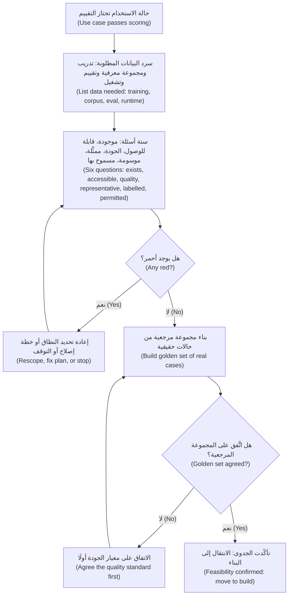
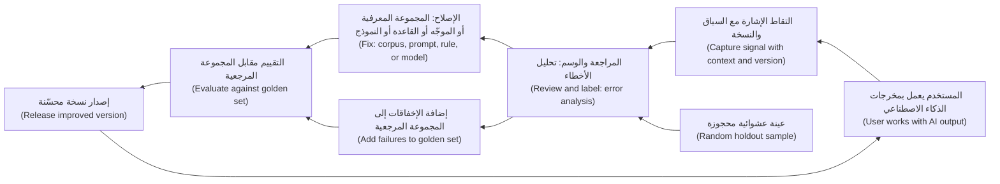
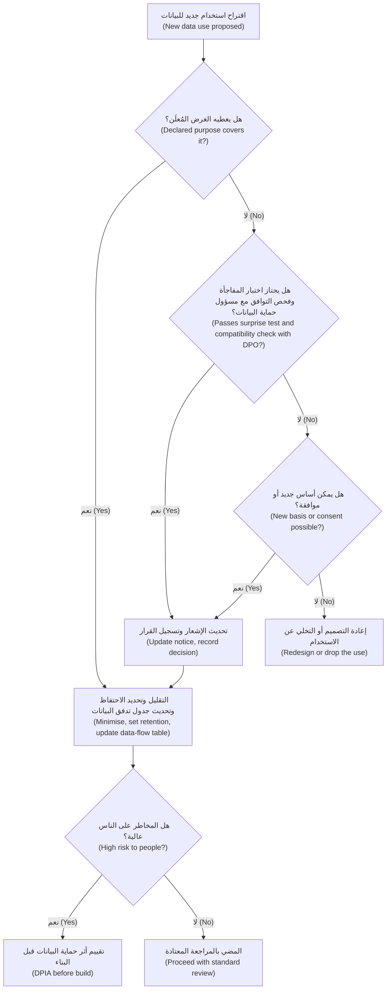

# الوحدة 3 — البيانات أساسًا للمنتج

*لا يكون منتج الذكاء الاصطناعي أفضل من البيانات التي يتعلّم منها، ويقرأ منها، ويُحكَم عليه بمقارنته بها. ومعظم مشاريع الذكاء الاصطناعي المتعثّرة تتعثّر بسبب البيانات لا بسبب النموذج. فيتبيّن أن البيانات مفقودة، أو موسومة بشكل خاطئ، أو محبوسة في النظام الخطأ، أو غير ممثِّلة للمستخدمين الحقيقيين، أو غير قابلة للاستخدام قانونيًا للغرض الجديد. تعلّمك هذه الوحدة دور مدير المنتج في هذا العمل. لن تبني خطوط معالجة البيانات، لكنك ستطرح الأسئلة التي تحدّد هل المنتج ممكن، وهل يتحسّن مع الاستخدام، وهل يُسمح للبنك بتنفيذه. ستتابع فيصل ورانيا في بنك نجم (Najm Bank) وهما يقيّمان البيانات التي يقوم عليها مساعد مذكرات الائتمان (Credit Memo Copilot) والتمويل الفوري للشركات الصغيرة (SME Instant Finance)، ويصمّمان حلقات التغذية الراجعة (feedback loops) التي تتيح للتنبيهات الذكية (Smart Alerts) وللمساعد أن يتعلّما، ويكتبان قسم الخصوصية في مواصفات منتج نجم أسيست (Najm Assist) مع سارة، مسؤول حماية البيانات (Data Protection Officer, DPO).*

> **المراحل:** Define, Design, Build, Grow — التحقق من أن البيانات موجودة وصالحة للغرض، وتصميم منتجات تجمع الإشارات الصحيحة، وامتلاك قرارات المنتج التي تعتمد عليها الخصوصية وحقوق البيانات.

---

# 3.1 — جاهزية البيانات: هل لدينا ما يحتاجه المنتج؟
*المستوى: 🟡 متوسط* · *المتطلبات: 1.3، 2.2* · *المرحلة: Define, Build*

**بعد هذا الدرس تستطيع** أن تقيّم جاهزية بيانات منتج بالأخضر أو الكهرماني أو الأحمر على ستة أسئلة مع دليل لكل منها، وتسمّي فجوة واحدة على الأقل في التمثيل وأخرى في الوسم، وتقترح نطاقًا مرحليًا يجمع البيانات الناقصة. *مدة الدراسة: نحو 110 دقيقة (تقدير).*

## ⚡ الدرس في دقيقة
- **جاهزية البيانات (Data readiness)** هي الدليل على أن البيانات التي يحتاجها منتج الذكاء الاصطناعي موجودة، ويمكن الوصول إليها، وجيدة بما يكفي، وتمثّل المستخدمين الحقيقيين، ويجوز استخدامها قانونيًا لهذا الغرض. إنها سؤال جدوى تقنية، ومكانها في الاكتشاف لا في السبرينت السادس.
- المنتجات المختلفة تحتاج بيانات مختلفة. **النموذج التنبؤي (predictive model)** يحتاج أمثلة تاريخية ذات **وسوم** موثوقة (الإجابة الصحيحة المعروفة). و**منتج الذكاء الاصطناعي التوليدي المبني على الاسترجاع** يحتاج **مجموعة معرفية (knowledge corpus)** نظيفة وحديثة ومضبوطة الصلاحيات. و**كل** منتج ذكاء اصطناعي يحتاج **بيانات تقييم**: مجموعة من الحالات الحقيقية مع إجابات جيدة متّفق عليها.
- عبارة «لدينا بيانات كثيرة» ليست إجابة. الأسئلة هي: البيانات *الصحيحة*، للفئة *الصحيحة*، المتاحة *لحظة اتخاذ القرار*، مع وسوم تثق بها.
- مدير المنتج (PM) لا ينظّف البيانات. مدير المنتج يطرح الأسئلة ويحوّل الفجوات إلى قرارات نطاق وجدول زمني وقرار المضيّ أو التوقف (go/no-go).
- إشارة القرار: إن لم تستطع تجميع 50–100 حالة حقيقية ممثِّلة مع إجابات جيدة متّفق عليها في أول أسبوعين، فأنت لا تعرف بعد هل المنتج ممكن.
- أكبر فخ: أن تكتشف بعد التجربة الأولية أن النموذج دُرّب على بيانات لن يراها أبدًا في بيئة الإنتاج، أو على فئة ليست عملاءك.

## 🧭 لماذا يهم
يريد خالد، رئيس إقراض الأفراد، أن يُطلَق التمويل الفوري للشركات الصغيرة بنهاية الربع: نموذج يوافق مسبقًا على طلبات تمويل الفواتير الصغيرة خلال دقائق بدلًا من أيام. ويعود فيصل، مدير منتج الذكاء الاصطناعي الجديد، من اجتماع مع فريق مستودع البيانات بأخبار سارة: «لدينا ثماني سنوات من بيانات إقراض الشركات الصغيرة والمتوسطة. مئات الآلاف من الصفوف. البيانات ليست المشكلة».

تطرح رانيا، رئيسة منتجات الذكاء الاصطناعي، أربعة أسئلة. كم صفًّا منها يخص *تمويل الفواتير*؟ ولكم منها نعرف هل سُدّدت الفاتورة؟ وهل سُجّلت الطلبات المرفوضة؟ وأي الحقول متاحة لحظة ضغط العميل على «قدّم الطلب»، لا تلك التي يملؤها محلل لاحقًا؟ بعد أسبوعين تعود الإجابات. هناك نحو 9,000 صفقة تمويل فواتير (أرقام توضيحية). ونتائج السداد موثوقة لأربع سنوات فقط، لأن ترحيل النظام المصرفي الأساسي قطع الربط مع التحصيل. والطلبات المرفوضة حُفظت ملفات PDF ممسوحة ضوئيًا. واثنان من «أقوى» الحقول كتبهما المحللون *بعد* الموافقة.

لا شيء من ذلك يقتل المنتج، لكنه يغيّر الخطة: يضيق النطاق ليشمل العملاء المتكررين، وتُزال ميزتان، ويتأجّل موعد الإطلاق. اكتشاف ذلك في الأسبوع الثاني يكلّف اجتماعًا. واكتشافه بعد تجربة أولية يكلّف ثقة خالد. ولهذا تنتمي جاهزية البيانات إلى مدير المنتج.

## 📐 كيف يعمل

### 🟢 الأساسيات

**ما تعنيه «البيانات» لكل نوع من منتجات الذكاء الاصطناعي.** قدّم الدرس 1.3 طيف البناء. ويحتاج كل خيار بيانات مختلفة:

| نوع المنتج | البيانات التي يحتاجها | مثال من نجم |
|---|---|---|
| تعلّم الآلة التنبؤي (Predictive ML) (التصنيف، والتقييم بالدرجات، والتنبؤ) | **بيانات تدريب (training data)** تاريخية: المدخلات إضافةً إلى **وسم**، أي النتيجة التي تريد التنبؤ بها | التمويل الفوري للشركات الصغيرة: صفقات الفواتير السابقة إضافةً إلى «سُدّد في موعده أم لا» |
| الذكاء الاصطناعي التوليدي مع الاسترجاع (RAG) | **مجموعة معرفية** يقرؤها النموذج وقت الإجابة: مستندات، وسياسات، وسجلات | مساعد مذكرات الائتمان: سياسة الائتمان، ومذكرات القطاعات، والقوائم المالية للعميل، والمذكرات السابقة |
| الذكاء الاصطناعي التوليدي مع الضبط الدقيق | مئات إلى آلاف من أمثلة المدخلات والمخرجات عالية الجودة للسلوك الذي تريده | نموذج بأسلوب المذكرات مدرَّب على مذكرات سابقة معتمدة (إن لم يكفِ التوجيه بالموجّهات والاسترجاع) |
| أي منتج ذكاء اصطناعي | **بيانات التقييم**: حالات حقيقية بإجابات جيدة متّفق عليها، تُستخدم للتحقق من الجودة | 80 طلب مذكرة حقيقيًا مع مذكرات اعتمدها مديرو العلاقات؛ و500 صفقة فواتير سابقة معروفة النتائج |
| أي منتج ذكاء اصطناعي في بيئة الإنتاج | **مدخلات وقت التشغيل**: البيانات التي يتلقاها المنتج عند استخدامه فعليًا | حقول نموذج التطبيق؛ والمستندات التي يرفعها مدير العلاقة |

**الوسم** هو الإجابة الصحيحة المرفقة بمثال: «هذه الفاتورة سُدّدت»، «هذه المعاملة كانت احتيالًا»، «هذه المذكرة اعتُمدت دون تغييرات». وكثيرًا ما تكون الوسوم أندر الأجزاء وأغلاها. فلا بد أن يقرّرها أحد، ونتائج مثل سداد القرض تستغرق شهورًا حتى تصل.

**أسئلة الجاهزية الستة.** يستطيع مدير المنتج إجراء فحص جاهزية دون كتابة استعلام بطرح هذه الأسئلة الستة ومطالبة بدليل على كل منها:

1. **موجودة:** هل البيانات مسجّلة أصلًا، أم أنها تعيش في رؤوس الناس ورسائل البريد الإلكتروني وملفات PDF الممسوحة؟
2. **قابلة للوصول:** هل يستطيع الفريق الحصول عليها فعلًا: أي نظام، وأي مالك، وأي موافقات، وكم من الوقت؟
3. **الجودة:** هل هي دقيقة، وكاملة، ومتّسقة عبر الأنظمة، وحديثة بما يكفي؟
4. **ممثِّلة:** هل تغطي المستخدمين والمنتجات واللغات والمواقف التي سيواجهها المنتج؟
5. **موسومة:** في تعلّم الآلة، هل لدينا نتائج موثوقة؟ وفي الذكاء الاصطناعي التوليدي، هل لدينا أمثلة متّفق عليها للإجابات الجيدة؟
6. **مسموح بها:** هل يجوز لنا استخدامها لهذا الغرض، بموجب القانون والعقود ووعود العملاء وسياسة البنك نفسه؟ (هذا هو الدرس 3.3.)

قيّم كل سؤال **أخضر** (جاهز)، أو **كهرماني** (إصلاح معروف ومالك وتاريخ)، أو **أحمر** (عائق يغيّر النطاق أو يقتل الفكرة). والنتيجة، أي **بطاقة تقييم جاهزية البيانات**، دليل لدرجة الجدوى التقنية من الدرس 2.2.

**جودة البيانات بكلمات بسيطة.** تصف ممارسات إدارة البيانات الجودة بأبعاد. خمسة منها هي الأهم لمدير المنتج: **الدقة** (رموز القطاعات الخاطئة تعلّم أنماطًا خاطئة)، و**الاكتمال** (حقل مفقود لدى 40% من العملاء لا يمكن أن يقود القرارات الخاصة بهم)، و**الاتساق** («الإيرادات» سنوية في نظام وشهرية في آخر)، و**الحداثة** (المساعد يقتبس سياسة استُبدلت)، و**التفرّد** (ثلاث نسخ من مذكرة واحدة تربك الاسترجاع).

### 🟡 التعمق أكثر

**التمثيل: سؤال «من الغائب؟».** البيانات تصف الماضي، والماضي يعكس منتجات قديمة وعمليات قديمة وعملاء قدامى. تاريخ التمويل الفوري للشركات الصغيرة مصدره شركات خدمها مديرو علاقات. أما التطبيق فسيصل إلى شركات أصغر وأحدث لم يكن لها مدير علاقة قط. وقد يؤدي نموذج مدرَّب على المجموعة الأولى أداءً سيئًا على الثانية، ولن يرى البنك ذلك في الدقة الإجمالية. اطلب البيانات مقسّمة حسب الشرائح المهمة (الحجم، والقطاع، والدولة، والقناة، واللغة، ومدة العلاقة) وتحقق من أن لكل شريحة أمثلة كافية للتعلّم منها واختبارها.

**انحياز الاختيار في الإقراض: أنت ترى النتائج فقط لمن وافقت عليهم.** هذا هو الفخ الكلاسيكي لمنتجات الائتمان. يعرف البنك هل سُدّدت الفاتورة الموافق عليها. لكنه لا يعرف ما كان سيحدث للمتقدمين الذين رفضهم. والنموذج المدرَّب على الصفقات الموافق عليها فقط يتعلّم عن «أناس يشبهون من اعتدنا الموافقة عليهم». لدى فرق مخاطر الائتمان أساليب لهذا تُسمّى **استدلال المرفوضين (reject inference)**، لكن لا أحد منها يستعيد المعلومات المفقودة بالكامل. اسأل دانة، كبيرة علماء البيانات، كيف سيتصرف النموذج مع أنواع المتقدمين التي نادرًا ما وُوفق عليها في الماضي؛ فقد توجّههم إلى إنسان.

**متاح وقت القرار: التسرّب والانحراف بين التدريب والتشغيل.** إخفاقان يبدآن سؤالين للمنتج:
- **تسرّب الوسم (Label leakage)** يحدث حين تحتوي ميزة على معلومات لم تكن معروفة لحظة اتخاذ القرار، وكثيرًا ما يكون ذلك لأنها سُجّلت لاحقًا. حقل «قوة العلاقة» في نجم ملأه المحللون بعد الموافقة: إنه يتنبأ بالسداد جيدًا في البيانات التاريخية وسيكون فارغًا لكل متقدم عبر التطبيق. النماذج المتسرّبة تبدو ممتازة في الاختبار وتفشل في بيئة الإنتاج.
- **الانحراف بين التدريب والتشغيل (Training-serving skew)** يحدث حين تختلف البيانات وقت التشغيل عن بيانات التدريب. يحتفظ المستودع بإيرادات نهاية الشهر المنظّفة؛ أما التطبيق الحي فيتلقى كل ما يكتبه العميل.

سؤال مدير المنتج عن كل مُدخل مرشّح بسيط: «حين يضغط العميل على *قدّم الطلب*، من أين تأتي هذه القيمة، وهل هي نفس ما درّبنا عليه؟»

**جاهزية الذكاء الاصطناعي التوليدي هي جاهزية المجموعة المعرفية.** في مساعد مذكرات الائتمان، «البيانات» في معظمها مستندات. وتتغيّر صيغة أسئلة الجاهزية:
- **التغطية:** هل تحوي المجموعة المعرفية (corpus) ما تحتاجه المذكرة، وماذا يفعل المساعد حين يكون شيء ما مفقودًا؟
- **الحداثة:** هل هناك نسخة حالية واحدة من كل سياسة، مع سحب النسخ القديمة؟
- **الصيغة:** الصور الممسوحة، وجداول PDF، والصفحات المختلطة بالعربية والإنجليزية كلها تؤثر في الاستخراج وتحتاج إلى اختبار.
- **الصلاحيات:** يجب أن يحترم الاسترجاع (retrieval) قواعد الوصول نفسها المعمول بها في نظام المستندات، وإلا صار المساعد وسيلة لقراءة ملفات لا يجوز لمدير العلاقة فتحها. يسمّي طارق، قائد الهندسة، ذلك «الاسترجاع المراعي للصلاحيات»؛ وهو متطلب منتج.
- **النسخ المكررة والمسودات:** قرّر أي المذكرات السابقة تُعدّ أمثلة جيدة وأيها يجب ألا يُسترجع أبدًا.

**بيانات التقييم أولًا.** أيًّا كان نوع المنتج، فإن أول أصل بيانات يُبنى هو **مجموعة مرجعية (golden set)** صغيرة: حالات حقيقية ممثِّلة بإجابات يتفق قطاع الأعمال على أنها جيدة. (تتعمق الوحدة 6 أكثر.) إن لم يستطع الفريق تجميع حتى 50–100 حالة كهذه، فلا سبيل لديه لمعرفة هل تعمل أي نسخة من المنتج. في المساعد، تختار حصة (مصممة المنتج) واثنان من كبار مديري العلاقات 80 صفقة سابقة حقيقية عبر القطاعات والأحجام، ويحدّدون ما يجب أن تحتويه المذكرة الجيدة لكل منها. وجمع ذلك مبكرًا يكشف الخلاف أيضًا. فإن اختلف اثنان من كبار مديري العلاقات على ماهية المذكرة الجيدة، فلن يرضيهما أي نموذج معًا، ويحتاج المنتج إلى معيار متّفق عليه قبل أن يحتاج إلى نموذج.

### 🔴 نظرة الخبير

**جاهزية البيانات أداة ترتيب لا بوابة.** مديرو منتجات الذكاء الاصطناعي المتمرسون يعيدون تشكيل المنتج حول البيانات *الجاهزة فعلًا* بدلًا من الانتظار. في التمويل الفوري للشركات الصغيرة، يعني ذلك البدء بالعملاء المتكررين الذين تاريخهم كامل ونظيف، وإبقاء المتقدمين لأول مرة على المسار اليدوي، والتخطيط لجمع الوسوم المفقودة أثناء تشغيل المنتج. وينتهي تقييم الجاهزية الجيد بـ**نطاق** تستطيع البيانات دعمه، و**خطة** لتوسيعه، و**تاريخ** يجب أن يتحول فيه كل بند كهرماني إلى أخضر.

**التفكير المتمحور حول البيانات.** نحو عام 2021 روّج Andrew Ng لمفهوم «الذكاء الاصطناعي المتمحور حول البيانات»: في كثير من المشكلات العملية، يرفع تحسين البيانات (وسوم متّسقة، وتغطية الحالات الصعبة) الجودة أكثر من تغيير النموذج. حين تتوقف الجودة عن التحسن، اسأل «أي الحالات تفشل، وأي بيانات ستصلحها؟» قبل أن تطلب نموذجًا أكبر. الوسم، ووقت المراجعين الخبراء، وهندسة البيانات كلها تكاليف منتج؛ ضعها في دراسة الجدوى.

**وثّق البيانات لا النموذج فقط.** تساعد صيغتان معروفتان. تقترح **Datasheets for Datasets** (Gebru et al., 2018) أن تُرفق مع كل مجموعة بيانات إجابات عن أسئلة معيارية: لماذا أُنشئت، وما الذي تحتويه، وكيف جُمعت ووُسمت، وفيمَ يجب وما لا يجب أن تُستخدم، وكيف تُصان. و**Data Cards** (Pushkarna وZaldivar وKjartansson في Google، 2022) قالب مشابه أكثر توجّهًا إلى المنتج. لست مضطرًا لاستخدام أيٍّ منهما بالكامل، لكن اكتب من هم في البيانات، ومن الغائب، وكيف تقرّرت الوسوم، وفيمَ يجب ألا تُستخدم البيانات. سيسأل فريق الحوكمة الذي تقوده ليلى؛ ويغطي *AI Governance: Zero to Hero* المتطلبات الرسمية.

**احذر البيانات التي تحمل قرارات لا تريد تكرارها.** الوسوم التاريخية تعكس قرارات تاريخية. فإن كان المحللون السابقون أشدّ صرامة مع بعض القطاعات أو الشركات الجديدة لأسباب لا علاقة لها بالسداد، فإن نموذجًا مدرَّبًا على قراراتهم يتعلّم ذلك على أنه حقيقة. فضّل وسوم *النتيجة* (هل سُدّدت الفاتورة؟) على وسوم *القرار* (هل وافق المحلل؟). اختبار الإنصاف (Fairness testing) يأتي لاحقًا (الوحدة 6)، لكن اختيار الوسم هو أول قرار إنصاف يتخذه مدير المنتج.

**الجاهزية تتآكل.** تتغير السياسات، وتتحول قاعدة العملاء، وتعيد الأنظمة المصدرية تسمية الحقول. ضمّن مالكين وفحوصًا للحداثة منذ البداية (يغطي الدرس 8.3 الانجراف).

## 🧰 الأدوات
| الأداة أو الإطار | ما هو وماذا يفعل | متى تلجأ إليه |
|---|---|---|
| **Data readiness scorecard** — بطاقة تقييم جاهزية البيانات | الأسئلة الستة (موجودة، قابلة للوصول، الجودة، ممثِّلة، موسومة، مسموح بها) مقيّمة بالأخضر أو الكهرماني أو الأحمر، ولكل منها دليل ومالك وتاريخ | أثناء الاكتشاف وتقييم حالات الاستخدام، قبل الالتزام بالبناء |
| **Data profiling** — التنميط الإحصائي للبيانات | نظرة إحصائية سريعة على مجموعة بيانات: عدد الصفوف، والقيم المفقودة، ونطاقات القيم، والتوزيعات حسب الشريحة | لاختبار ادعاءات «لدينا بيانات كثيرة» في أيام لا أسابيع |
| **Decision-time audit** — تدقيق وقت القرار | لكل مُدخل مرشّح، فحص لمصدره لحظة القرار وهل يطابق بيانات التدريب | قبل تدريب النموذج، لاكتشاف التسرّب والانحراف بين التدريب والتشغيل |
| **Golden set** — المجموعة المرجعية | مجموعة صغيرة من الحالات الحقيقية الممثِّلة بإجابات جيدة متّفق عليها | أول أصل بيانات لأي منتج ذكاء اصطناعي؛ تثبت الجدوى وتحدد معيار الجودة |
| **Datasheets for Datasets** (Gebru et al., 2018) | قائمة أسئلة معيارية توثّق غرض مجموعة البيانات، وتكوينها، وجمعها، ووسمها، وحدودها | حين تُعاد مجموعة بيانات للاستخدام، أو تُدقَّق، أو تُسلَّم لفريق آخر |

## 🏛️ عمليًا في بنك نجم
**تقييم جاهزية البيانات (Data Readiness Assessment)** الذي أعدّه فيصل لمنتجين، وراجعته دانة وعمر (رئيس البيانات):

| السؤال | التمويل الفوري للشركات الصغيرة (تنبؤي) | مساعد مذكرات الائتمان (ذكاء اصطناعي توليدي مع استرجاع) |
|---|---|---|
| **موجودة** | 🟡 نحو 9,000 صفقة فواتير؛ الطلبات المرفوضة موجودة فقط ملفات PDF ممسوحة | 🟢 السياسات، ومذكرات القطاعات، والمذكرات السابقة، وقوائم العملاء كلها مسجّلة |
| **قابلة للوصول** | 🟢 الوصول إلى المستودع وافق عليه فريق عمر؛ مهلة أسبوعين | 🟡 المذكرات في نظام المستندات؛ الوصول عبر واجهة برمجة التطبيقات يحتاج مراجعة أمن تقنية المعلومات |
| **الجودة** | 🟡 حقل الإيرادات غير متّسق بين نظامين مصدريين؛ رموز القطاعات خاطئة بنحو 10% في فحص العينة | 🔴 ثلاث نسخ من سياسة الائتمان متداولة؛ لا يوجد مصدر حقيقة واحد |
| **ممثِّلة** | 🔴 التاريخ يغطي فقط الشركات التي خدمها مديرو العلاقات (RM-served SMEs)؛ التطبيق سيصل إلى شركات أصغر وأحدث | 🟡 مذكرات الشركات الكبرى ممثَّلة بإفراط؛ حالات قليلة للشركات الصغيرة (SME) وباللغة العربية |
| **موسومة** | 🟡 نتائج السداد موثوقة لآخر 4 سنوات فقط؛ المتقدمون المرفوضون بلا نتيجة | 🟡 لا معيار متّفق عليه بعد لـ«المذكرة الجيدة»؛ مجموعة مرجعية من 80 حالة قيد الإعداد |
| **مسموح بها** | 🟡 يجب التحقق من ترخيص بيانات مكتب الائتمان لاستخدامه في تدريب النموذج (سارة، يوسف) | 🟡 يجوز استخدام مستندات العملاء لصياغة المذكرات؛ إعادة استخدامها للضبط الدقيق لم تُقيَّم بعد (انظر 3.3) |
| **فحص وقت القرار** | 🔴 أُزيل حقلان كتبهما المحللون (تسرّب ما بعد الموافقة) | 🟢 المدخلات هي المستندات نفسها التي يستخدمها مديرو العلاقات اليوم |
| **النطاق الناتج** | الإطلاق للعملاء المتكررين الذين لديهم تاريخ سنتين فأكثر؛ البقية يبقون على المسار اليدوي؛ البدء بجمع النتائج للشرائح الجديدة | الإطلاق أولًا على مذكرات الشركات الكبرى باللغة الإنجليزية؛ فريق السياسات يسحب النسخ القديمة قبل التجربة الأولية |
| **المالك / التاريخ** | دانة، عمر / نهاية الشهر | طارق، إدارة سياسات الائتمان / قبل بدء التجربة الأولية |

ملاحظة رانيا: *«أحمران، وكلاهما يُعالَج بتغيير النطاق، لا سببان للتوقف. على فيصل تحديث بطاقة التقييم وخارطة الطريق، وإطلاع خالد هذا الأسبوع.»*

## 🛠️ التمارين
- 🟢 لميزة ذكاء اصطناعي تعرفها، اسرد الأنواع الأربعة من البيانات التي تحتاجها (بيانات التدريب أو المجموعة المعرفية، والتقييم، ومدخلات وقت التشغيل، والوسوم). *يكتمل عندما:* يكون لديك جدول من أربعة صفوف مع مصدر ومالك لكل صف.
- 🟡 طبّق أسئلة الجاهزية الستة على التنبيهات الذكية، تنبيهات الاحتيال والإنفاق في نجم. افترض أن وسوم الاحتيال تأتي من شكاوى العملاء واستردادات المبالغ. *يكتمل عندما:* يُقيَّم كل سؤال بالأخضر أو الكهرماني أو الأحمر مع سطر دليل واحد، وتكون قد سمّيت فجوة تمثيل واحدة على الأقل وفجوة وسم واحدة.
- 🔴 يصرّ خالد على أن يُطلَق التمويل الفوري للشركات الصغيرة لجميع الشركات الصغيرة والمتوسطة، بما فيها المتقدمون لأول مرة، في الموعد الأصلي. اكتب له مذكرة من صفحة واحدة تقترح نطاقًا مرحليًا. *يكتمل عندما:* تبيّن ما يُطلَق أولًا ولماذا، وكيف تُجمع البيانات المفقودة في المرحلة الأولى، والدليل الذي يطلق المرحلة الثانية.

## ⚠️ أخطاء وفخاخ
- **عدّ الصفوف بدلًا من طرح الأسئلة.** «مئات الآلاف من الصفوف» لا تقول شيئًا عن الصلة أو الوسوم أو التغطية. اطرح الأسئلة الستة واطلب الدليل.
- **ترك فحص البيانات للهندسة.** الفجوات التي تُكتشف أثناء البناء تصل على شكل تأخيرات دون قرار منتج مرتبط بها. افحص في الاكتشاف.
- **التدريب على ما لن يكون متاحًا لك وقت القرار.** دقّق كل مُدخل مقابل لحظة القرار.
- **افتراض أن القرارات السابقة حقيقة مطلقة.** وسوم القرار تنسخ العادات القديمة، بما فيها المنحازة. فضّل وسوم النتيجة، واسأل من الغائب عن التاريخ.
- **البدء دون مجموعة مرجعية.** دون حالات حقيقية وإجابات متّفق عليها، لا يستطيع أحد معرفة هل يعمل المنتج. ابنها أولًا، حتى لو كانت صغيرة.

## 🧾 الخلاصة
- جاهزية البيانات سؤال جدوى تقنية يملكه مدير المنتج في الاكتشاف: موجودة، قابلة للوصول، الجودة، ممثِّلة، موسومة، مسموح بها.
- المنتجات التنبؤية تحتاج تاريخًا موسومًا؛ ومنتجات التوليد المعزّز بالاسترجاع تحتاج مجموعة معرفية نظيفة وحديثة ومضبوطة الصلاحيات؛ وكل منتج يحتاج بيانات تقييم.
- انحياز الاختيار (Selection bias)، وتسرّب الوسم، والانحراف بين التدريب والتشغيل أسئلة منتج قبل أن تكون أسئلة تقنية: من الغائب، وما المتاح فعلًا وقت القرار؟
- يجب أن ينتهي تقييم الجاهزية بنطاق تدعمه البيانات، وخطة لتوسيعه، ومالكين وتواريخ لكل فجوة.
- وثّق مجموعات البيانات وتعامل مع الجاهزية على أنها شيء يتآكل ويحتاج إلى مراقبة.

## ✍️ اختبر نفسك

**1. يبلّغ فيصل أن لدى نجم «ثماني سنوات ومئات الآلاف من الصفوف» من بيانات إقراض الشركات الصغيرة والمتوسطة. ما الخطوة التالية الأكثر فائدة؟**

- A. بدء تدريب النموذج فورًا، لأن حجم الصفوف كافٍ بوضوح وقد انتظر الفريق طويلًا بما يكفي للحصول على البيانات
- B. سؤال المورّد عن بنية النموذج الأفضل في التعامل مع مجموعات البيانات الكبيرة، وعن المدة اللازمة لتدريبه، وعن الكلفة المتوقعة لكل مرحلة
- C. شراء بيانات خارجية عن الشركات الصغيرة من باب الاحتياط، حتى يرى النموذج شركات أكثر مما يغطيه سجل نجم نفسه
- D. السؤال عن عدد الصفوف التي تطابق المنتج والفئة المستهدفين، وعدد ما لديه وسوم نتيجة موثوقة، وأي الحقول متاحة وقت القرار

الإجابة

**D.** الحجم ليس جاهزية: اسأل عن الصلة، والوسوم، والتمثيل، والإتاحة وقت القرار. وخيار C سابق لأوانه قبل أن تعرف الفجوات. (🧭 لماذا يهم؛ 🟢 الأساسيات.)

**2. نموذج ائتمان يؤدي أداءً ممتازًا جدًا في الاختبار. أكثر مدخلاته قدرة على التنبؤ حقلٌ يكمله محللو الائتمان بعد الموافقة على القرض. ما المشكلة؟**

- A. انحراف بين التدريب والتشغيل سببه مدخلات عملاء فوضوية تختلف بين ملفات التدريب والاستخدام الحي
- B. انحياز اختيار بسبب غياب المتقدمين المرفوضين الذين لا يظهرون أبدًا في سجل السداد
- C. ضعف حداثة البيانات، لأن حقل المحللين يُحدَّث ببطء شديد لا يتيح للنموذج الاستفادة منه
- D. تسرّب الوسم: الحقل لن يكون موجودًا حين يُبتّ في طلب جديد

الإجابة

**D.** الحقل المسجّل بعد القرار يحمل معلومات لن تتوفر للنموذج وقت القرار، لذا تبالغ نتائج الاختبار في تقدير الأداء الحقيقي. والانحراف يتعلق باختلاف بيانات وقت التشغيل في شكلها عن بيانات التدريب، لا بمعلومات من المستقبل. (🟡 التعمق أكثر.)

**3. في مساعد مذكرات الائتمان (Credit Memo Copilot)، أي مسألة جاهزية تخص منتج ذكاء اصطناعي توليدي قائمًا على الاسترجاع لا نموذجًا تنبؤيًا؟**

- A. هل توجد وسوم نتيجة للقروض السابقة التي وُوفق عليها وسُدّدت أو أُعيدت جدولتها أو شُطبت، وهل هي موثوقة
- B. هل يحترم الاسترجاع صلاحيات الوصول إلى المستندات نفسها المعمول بها في النظام المصدر
- C. هل تتضمن بيانات التدريب المتقدمين المرفوضين إلى جانب المقبولين، لتجنب انحياز الاختيار في تقدير المخاطر
- D. هل ميزات النموذج كلها متاحة وقت اتخاذ قرار الإقراض، وليس بعد صدوره بأيام أو أسابيع

الإجابة

**B.** منتج التوليد المعزّز بالاسترجاع يقرأ المستندات وقت الإجابة، لذا يجب أن تكون المجموعة المعرفية حديثة، وخالية من التكرار، ومراعية للصلاحيات. ودون ذلك، قد يعرض المساعد على مديري العلاقات ملفات لا يُسمح لهم برؤيتها. أما A وC وD فهي في الأساس مخاوف النماذج التنبؤية. (🟡 التعمق أكثر، «جاهزية الذكاء الاصطناعي التوليدي هي جاهزية المجموعة المعرفية».)

**4. يجد تقييم الجاهزية للتمويل الفوري للشركات الصغيرة (SME Instant Finance) أن التاريخ يغطي فقط الشركات التي خدمها مديرو العلاقات، بينما سيصل التطبيق إلى شركات أصغر وأحدث. ما أفضل استجابة منتج؟**

- A. إلغاء المنتج
- B. الإطلاق لجميع الشركات الصغيرة والمتوسطة ومراقبة الشكاوى
- C. الإطلاق أولًا للشرائح التي تمثّلها البيانات، وإبقاء الآخرين على المسار اليدوي، وجمع النتائج لتوسيع النطاق لاحقًا
- D. إزالة حقلي الحجم ومدة العلاقة حتى لا يرى النموذج الفرق

الإجابة

**C.** الجاهزية أداة ترتيب: شكّل النطاق حول البيانات الجاهزة وخطّط لتوسيعه. خيار D يخفي الفجوة بدلًا من إصلاحها، وخيار B يعرّض العملاء غير الممثَّلين لنموذج غير مختبَر. (🔴 نظرة الخبير.)

**5. لماذا يوصي الدرس ببناء مجموعة مرجعية من الحالات الحقيقية بإجابات متّفق عليها قبل بناء المنتج؟**

- A. لأن قانون الاتحاد الأوروبي للذكاء الاصطناعي يشترطها لجميع الأنظمة التي يعرضها البنك على العملاء أو يستخدمها مع موظفيه، مهما كان خطرها صغيرًا
- B. لأنها تغني عن الحاجة إلى بيانات التدريب
- C. لأنه من دونها لا يستطيع الفريق معرفة هل تعمل أي نسخة، وبناؤها يكشف الخلاف حول معنى «جيد»
- D. لأنها تتيح للفريق تخطّي أبحاث المستخدمين والبدء بالبناء

الإجابة

**C.** بيانات التقييم تثبت الجدوى وتحدّد معيار الجودة. وإن اختلف الخبراء على الإجابات الجيدة، يحتاج المنتج إلى معيار متّفق عليه قبل أن يحتاج إلى نموذج. خيار A ليس قاعدة قانونية عامة، وخيار B يخلط بين بيانات التقييم وبيانات التدريب. (🟡 التعمق أكثر، «بيانات التقييم أولًا».)

## 📚 المراجع
- Gebru, T. et al. (2018/2021). *Datasheets for Datasets*. — https://arxiv.org/abs/1803.09010
- Pushkarna, M., Zaldivar, A. and Kjartansson, O. (2022). *Data Cards: Purposeful and Transparent Dataset Documentation for Responsible AI*. — https://arxiv.org
- Google PAIR, *People + AI Guidebook*، فصل «جمع البيانات والتقييم». — https://pair.withgoogle.com/guidebook
- DAMA International, *DAMA-DMBOK: Data Management Body of Knowledge* (الطبعة الثانية، 2017). — https://www.dama.org

---

# 3.2 — حلقات التغذية الراجعة ودواليب البيانات والمنتجات المتعلّمة
*المستوى: 🟡 متوسط* · *المتطلبات: 3.1، 1.2* · *المرحلة: Design, Grow*

**بعد هذا الدرس تستطيع** أن تكتب مواصفات حلقة تغذية راجعة تحدد لكل إشارة طريقة التقاطها وتفسيرها والإجراء المتخذ والتحقق منه ومسؤولها، وتقرر بالدليل هل يستحق دولاب البيانات المزعوم مكانًا في دراسة الجدوى. *مدة الدراسة: نحو 110 دقيقة (تقدير).*

## ⚡ الدرس في دقيقة
- **المنتج المتعلّم** يتحسّن لأن الناس يستخدمونه. ولا يحدث ذلك إلا إذا صُمّم المنتج لالتقاط **إشارات التغذية الراجعة**، وتحويلها إلى **وسوم** أو حالات اختبار، وإعادتها إلى الموجّهات (prompts) أو الاسترجاع أو النماذج أو القواعد وفق جدول يملكه شخص ما.
- الإشارات إما **صريحة** (الإعجاب وعدمه، والتقييمات، والتصحيحات، وسبب يُختار من قائمة) أو **ضمنية** (ما يقبله المستخدمون، أو يعدّلونه، أو يتجاهلونه، أو يتراجعون عنه). الإشارات الضمنية وفيرة لكنها ملتبسة. أما الصريحة فأوضح لكنها نادرة.
- **دولاب البيانات** (استخدام أكثر، بيانات أكثر، منتج أفضل، استخدام أكثر) حقيقي لبعض المنتجات، وأسطورة عروض تقديمية لكثير منها. اختبره قبل أن تدّعيه.
- احذر **حلقات التغذية الراجعة المتدهورة (degenerate feedback loops)**: المنتج يشكّل البيانات التي يتعلّم منها لاحقًا. نموذج احتيال لا يتعلّم إلا من التنبيهات التي أطلقها، أو نموذج ائتمان لا يرى النتائج إلا للمتقدمين الذين وافق عليهم، يمكن أن يعزّز نقاطه العمياء بهدوء.
- إشارة القرار: لكل إشارة تغذية راجعة، اكتب ما تعنيه، ومتى تصل، ومن يتصرف بناءً عليها، وهل يُسمح لك بإعادة استخدامها.
- أكبر فخ: زر إعجاب لا يقرأ أحد بياناته.

## 🧭 لماذا يهم
بعد ثلاثة أشهر من التجربة الأولية لمساعد مذكرات الائتمان، يعرض فيصل شريحة بعنوان «دولاب البيانات»: كل تعديل يجريه مدير علاقة سيكون «بيانات تدريب»، والمساعد «سيصبح أذكى كل أسبوع». يعجب ذلك خالد. وتطرح دانة ثلاثة أسئلة. أين تُخزَّن التعديلات؟ في لا مكان: المسودة والمذكرة النهائية تعيشان في نظامين مختلفين غير مرتبطين. أي التعديلات تعني «المسودة كانت خاطئة» وأيها تعني «مدير العلاقة هذا يكتب بأسلوب مختلف»؟ لا أحد يعرف. من يراجع الإشارات، وما الذي يتغير نتيجة لذلك؟ لم يُكلَّف أحد.

في الأثناء، يواجه فريق التنبيهات الذكية المشكلة المعاكسة. فهو يتعلّم بحماس من ردود العملاء على تنبيهات الاحتيال. حين يضغط العميل على «نعم، كنت أنا»، توسم المعاملة بأنها حقيقية. وخلال ستة أشهر صار النموذج بارعًا جدًا في أنواع الاحتيال التي كان يرصدها أصلًا، وأعمى عن الأنماط الجديدة التي لم يرصدها قط، لأنها لم تولّد وسمًا أبدًا. كلا الفريقين يعتقد أن منتجه «يتعلّم». وخيار تصميمي واحد فقط يفصل بين حلقة تعلّم حقيقية وبين شريحة عرض أو فخ، وهذا الخيار يتخذه مدير المنتج.

## 📐 كيف يعمل

### 🟢 الأساسيات

**لحلقة التغذية الراجعة خمسة أجزاء.** إن فاتك جزء واحد انكسرت الحلقة.

1. **الإشارة:** شيء يفعله المستخدم أو يقوله يخبرك عن الجودة. مثلًا، يحذف مدير علاقة فقرة، أو يعترض عميل على تنبيه، أو يسدّد متقدمٌ.
2. **الالتقاط:** يسجّل المنتج الإشارة، مربوطة بالمُدخل والمُخرج ونسخة النموذج والسياق الذي أنتجها بالضبط.
3. **التفسير:** تصبح الإشارة **وسمًا** (حكمًا على صحة المُخرج) أو **حالة اختبار**. وأحيانًا يراجعها شخص ليصدر ذلك الحكم.
4. **الإجراء:** يغيّر الوسم شيئًا: موجّهًا (prompt)، أو المجموعة المعرفية للاسترجاع، أو قاعدة، أو المجموعة المرجعية، أو إعادة تدريب النموذج، أو تصميم المنتج.
5. **التحقق:** تتحقق من أن التغيير حسّن المنتج ولم يكسر شيئًا آخر، باستخدام أساليب التقييم في الوحدة 6.

**الإشارات الصريحة والضمنية.**

| النوع | أمثلة | نقطة القوة | نقطة الضعف |
|---|---|---|---|
| **صريحة** | إعجاب أو عدم إعجاب، تقييم بالنجوم، «الإبلاغ عن مشكلة»، اختيار سبب، كتابة تصحيح | معنى واضح؛ المستخدم يخبرك بنفسه | قلة من المستخدمين يقدّمونها؛ غير الراضين والراضون جدًا ممثَّلون بإفراط |
| **ضمنية** | قبول اقتراح، تعديل مسودة، نسخ إجابة، إعادة صياغة سؤال، التخلي عن مسار، الاتصال بالدعم بعد ذلك | وفيرة؛ تعكس السلوك الحقيقي | ملتبسة: قد يعني التعديل «خطأ» أو مجرد «أسلوبي» |
| **النتيجة** | سداد القرض أو تعثّره؛ تأكيد التنبيه احتيالًا؛ قبول الشكوى | أقرب شيء إلى الحقيقة | بطيئة (من أيام إلى شهور) ومتاحة لبعض الحالات فقط |

المنتجات الجيدة تستخدم الأنواع الثلاثة. في المساعد، الإشارة الضمنية هي **مقدار ما يبقى من المسودة** في المذكرة النهائية. والإشارة الصريحة أداة اختيار قصيرة «ما الخطأ؟» تظهر حين يرفض مدير العلاقة قسمًا. وإشارة النتيجة هي هل أعادت لجنة الائتمان المذكرة بسبب معلومات ناقصة.

**تصميم الالتقاط.** يتضمن *People + AI Guidebook* من Google فصلًا عن التغذية الراجعة والتحكم، وتتضمن *Guidelines for Human-AI Interaction* من Microsoft (Amershi et al., CHI 2019) مبادئ «شجّع التغذية الراجعة التفصيلية»، و«تعلّم من سلوك المستخدم»، و«حدّث وتكيّف بحذر». عمليًا:
- اسأل في **لحظة إنجاز المهمة**، داخل سير العمل، لا في استبيان لاحق.
- اجعلها **رخيصة**: ضغطة واحدة، أو قائمة أسباب قصيرة، لا نموذج نص حر.
- اجعلها **محددة**: التغذية الراجعة على فقرة أو حقل أفضل من تقييم المذكرة كلها.
- **أظهر أنها مهمة**: حين تغيّر التغذية الراجعة شيئًا، قل ذلك («شكرًا، أصلحنا الإشارة إلى السياسة»). يتوقف المستخدمون عن تقديم تغذية راجعة تختفي.

### 🟡 التعمق أكثر

**الوسوم المتأخرة والجزئية.** أثمن الوسوم كثيرًا ما تصل متأخرة. يعرف التمويل الفوري للشركات الصغيرة هل سُدّدت الفاتورة بعد 30 إلى 120 يومًا من القرار. وحتى ذلك الحين، لا يمكنك قياس الدقة الحقيقية للنموذج على العملاء الجدد. خطّط لذلك بثلاث طرق. أولًا، حدّد **مؤشرات مبكرة بديلة** (أول دفعة فائتة، أو عميل يتوقف عن التعامل عبر الحساب) وكن واضحًا بأنها مؤشرات بديلة. ثانيًا، حدّد **نافذة نضج الوسم**، أي أنك لا تحكم على قرارات شهر ما إلا بعد أن تُعرف معظم نتائجها. ثالثًا، حافظ على نزاهة الحلقة بالإبلاغ عن «القرارات غير الموسومة بعد» بجانب كل رقم جودة.

**حلقات التغذية الراجعة المتدهورة.** حين تقرّر مخرجات المنتج نفسه أي البيانات تُوسم، قد يتعلّم صورة مشوّهة عن العالم. يحذّر Sculley et al. (2015)، في *Hidden Technical Debt in Machine Learning Systems*، من «حلقات التغذية الراجعة» هذه بوصفها تكلفة خفية لأنظمة تعلّم الآلة. ثلاثة أشكال شائعة:

| الشكل | مثال من نجم | ما الذي يسوء |
|---|---|---|
| **لا يُوسم إلا ما رصدته** | التنبيهات الذكية تتعلّم فقط من التنبيهات التي أطلقتها | أنماط الاحتيال الجديدة لا تولّد وسومًا أبدًا، فلا يتعلّمها النموذج أبدًا |
| **لا يحصل على نتائج إلا ما وافقت عليه** | التمويل الفوري للشركات الصغيرة لا يرى السداد إلا للصفقات الموافق عليها | الفئات المرفوضة تبقى مرفوضة؛ لا يستطيع النموذج أن يتعلّم أنها كانت مخاطر جيدة |
| **المستخدمون يتكيّفون مع المنتج** | يتعلّم مديرو العلاقات أي أقسام المساعد يحذفونها دون قراءة | الأقسام «المقبولة» تبدو جيدة لأن أحدًا لا يفحصها؛ تكفّ التعديلات عن أن تعني الجودة |

العلاجات المعيارية قرارات منتج، ولها تكلفة:
- **عينات الاستكشاف أو العينات المحجوزة.** راجِع عينة عشوائية صغيرة من الحالات التي *لم* يرصدها النموذج، أو وافق على حصة صغيرة مضبوطة من الطلبات الحدّية ضمن حدود مخاطر متّفق عليها. ينتج ذلك وسومًا من خارج اختيارات النموذج نفسه. ويكلّف وقت المحللين أو بعض مخاطر الائتمان، لذا يتفق مدير المنتج ودانة ومالك مخاطر الائتمان على الحجم معًا.
- **الوسوم المستقلة.** استخدم حالات الاحتيال التي أكّدها المحققون، واستردادات المبالغ، والشكاوى، إلى جانب ردود التنبيهات.
- **تدقيق المخرجات المقبولة.** اجعل مراجعًا يفحص عينة مما قبله المستخدمون دون تعديل، لا ما غيّروه فقط.

يسمّي الباحثون الأثر العام **التنبؤ الأدائي** (Perdomo et al., 2020): تنبؤ يؤثر في النتيجة التي يتنبأ بها، كما حين يغيّر تنبيه احتيال الخطوة التالية للمحتال. توقّع أن يتفاعل العالم مع المنتج.

**أين يحدث التعلّم فعلًا في منتج ذكاء اصطناعي توليدي.** افترضت شريحة فيصل أن التعديلات تذهب إلى «التدريب». في معظم منتجات الذكاء الاصطناعي التوليدي المبنية على نموذج من طرف ثالث، **لا** تعيد الحلقة تدريب النموذج. بل تحسّن الأجزاء التي يتحكم فيها الفريق:

| نمط الإشارة | الإصلاح الأرجح | من يملكه |
|---|---|---|
| مديرو العلاقات يصحّحون الإشارة نفسها إلى السياسة مرارًا | تحديث المستند المصدر في المجموعة المعرفية أو سحبه | إدارة سياسات الائتمان، عبر مدير المنتج |
| المسودات تغفل قسمًا مطلوبًا في المذكرة | تغيير الموجّه أو قالب المخرجات | مدير المنتج وفريق طارق |
| الاسترجاع يجلب قوائم العميل الخطأ | إصلاح مرشّحات الاسترجاع والبيانات الوصفية (metadata) | طارق |
| يظهر نمط فشل جديد | إضافة حالات إلى المجموعة المرجعية واختبارات الانحدار (regression tests) | دانة |
| تعديلات أسلوبية متّسقة لدى كثير من مديري العلاقات | تعديل القالب، أو التفكير لاحقًا في الضبط الدقيق (fine-tuning) | مدير المنتج يقرّر، ودانة تنصح |

هذه هي الحلقة عمليًا: السجلات تقود إلى **تحليل الأخطاء (error analysis)** (قراءة الإخفاقات الحقيقية وتجميعها في أنماط)، الذي يقود إلى إصلاحات، التي تقود إلى حالات اختبار جديدة. ويأتي الضبط الدقيق في وقت متأخر كثيرًا، إن أتى أصلًا (الدرس 1.3). وكثيرًا ما تكون أكبر قيمة لبيانات التغذية الراجعة بوصفها **بيانات تقييم**، لأن كل إخفاق حقيقي يصبح اختبارًا دائمًا.

### 🔴 نظرة الخبير

**اختبر الدولاب قبل أن تبيعه.** دولاب البيانات من أكثر الادعاءات تكرارًا في استراتيجية الذكاء الاصطناعي، وكثيرًا ما يكون أضعفها. اطرح أربعة أسئلة قبل أن تضعه على شريحة:
1. **هل تحرّك البيانات الجودة؟** أثبت أن إضافة إشارات الشهر الماضي حسّنت مقياس تقييم مهمًا. وإن استقرت الجودة عند حد، فلن يساعد المزيد من البيانات نفسها.
2. **هل هناك عوائد متناقصة؟** كثيرًا ما تساعد أول ألف تصحيح كثيرًا، ولا تكاد المئة ألف التالية تُحدث فرقًا. والدولاب الذي يتوقف بعد بضعة أشهر ليس خندقًا تنافسيًا.
3. **هل البيانات فريدة؟** إن استطاع المنافسون الحصول على الإشارة نفسها (المستندات العامة، أو تحسينات النموذج العام نفسه)، فلا ميزة فيها. البيانات الفريدة حقًا لدى نجم هي نتائج سداد عملائها وأحكام مديري علاقاتها على عملائها. ومن هنا يمكن أن تأتي ميزة حقيقية.
4. **هل يمكنك إعادة استخدامها قانونيًا؟** الإشارات المجموعة لتقديم خدمة قد لا يجوز استخدامها لتدريب نموذج دون خطوات إضافية (الدرس 3.3). والدولاب الذي لا يمكنك تدويره قانونيًا ليس دولابًا.

يعود الدرس 9.1 إلى القابلية للدفاع (defensibility). والخلاصة المختصرة: تعامل مع «سنتعلّم من الاستخدام» على أنها فرضية لها اختبار، لا على أنها استراتيجية.

**الوسم منتج له مستخدموه.** يحتاج الأشخاص الذين يحوّلون الإشارات إلى وسوم إلى **إرشادات وسم** مكتوبة مع أمثلة، وطريقة لقول «غير متأكد»، ومقياس لمدى اتفاقهم (**الاتفاق بين المقيّمين**، الدرس 6.2). والخلاف المتكرر يعني أن التعريف غير واضح: أصلحه قبل إضافة مراجعين.

**حدّث بحذر.** يشير مبدأ Microsoft «حدّث وتكيّف بحذر» إلى خطر حقيقي. المنتج الذي يغيّر سلوكه كل أسبوع يقوّض النموذج الذهني للمستخدمين ويجعل تتبّع الأخطاء صعبًا. اجمع التغييرات في إصدارات ذات أرقام نسخ، وقيّم كلًا منها مقابل المجموعة المرجعية، وأخبر المستخدمين بما تغيّر حين يمسّهم («أبلغ المستخدمين بالتغييرات» مبدأ آخر من المبادئ)، واحتفظ بالقدرة على التراجع. إعادة التدريب التلقائية المستمرة على تغذية راجعة خام من المستخدمين لا تكون صائبة تقريبًا أبدًا في منتج خاضع للتنظيم. كما أنها تفتح بابًا لـ**تسميم البيانات**، حيث يغذّي أحدهم إشارات سيئة عمدًا لتوجيه النموذج.

**قِس الحلقة نفسها.** تتبّع الحلقة لا المُخرج فقط: نسبة المخرجات التي التُقطت لها إشارة، والوقت من الإشارة إلى الإصلاح، وأنماط الفشل المغلقة، وتغيّر الجودة لكل إصدار. إن كانت هذه ثابتة، فالمنتج لا يتعلّم.

## 🧰 الأدوات
| الأداة أو الإطار | ما هو وماذا يفعل | متى تلجأ إليه |
|---|---|---|
| **Feedback loop spec** — مواصفات حلقة التغذية الراجعة | لكل إشارة: المعنى، ونقطة الالتقاط، والتأخير، والتفسير، والإجراء، والمالك، وإذن إعادة الاستخدام | عند تصميم أي ميزة ذكاء اصطناعي، قبل البناء |
| **People + AI Guidebook** (Google PAIR) | إرشادات عملية، منها فصول عن التغذية الراجعة والتحكم وعن جمع البيانات | عند تصميم طريقة تقديم المستخدمين للتغذية الراجعة وكيفية استجابة المنتج لها |
| **Guidelines for Human-AI Interaction** (Amershi et al., Microsoft, 2019) | 18 مبدأً، منها التغذية الراجعة التفصيلية، والتعلّم من السلوك، والتحديثات الحذرة، وإبلاغ المستخدمين بالتغييرات | عند مراجعة تصميم التغذية الراجعة أو خطة إصدار |
| **Error analysis** — تحليل الأخطاء | قراءة عينة من الإخفاقات الحقيقية، وتجميعها في أنماط، وترتيبها حسب التكرار والضرر | لتحويل التغذية الراجعة الخام إلى الإصلاحات التالية |
| **Holdout sample** — العينة المحجوزة | مجموعة عشوائية صغيرة من الحالات تُراجَع أو تُعالَج خارج اختيارات النموذج نفسه | أي منتج يقرّر فيه النموذج أي الحالات تحصل على وسوم |
| **Flywheel test** — اختبار الدولاب | أربعة أسئلة: هل تحرّك البيانات الجودة، والعوائد المتناقصة، والتفرّد، وإعادة الاستخدام القانونية | قبل ادعاء دولاب بيانات في استراتيجية أو دراسة جدوى |

## 🏛️ عمليًا في بنك نجم
**مواصفات حلقة التغذية الراجعة (Feedback Loop Spec)** التي أعدّها فيصل ودانة لمساعد مذكرات الائتمان والتنبيهات الذكية (النسخة 1.0):

| الإشارة | النوع | المعنى الذي نعطيه لها | أين ومتى تُلتقط | التأخير | تصبح | الإجراء والمالك | هل إعادة الاستخدام مسموحة؟ |
|---|---|---|---|---|---|---|---|
| نسبة نص المسودة المحتفَظ بها في المذكرة النهائية، لكل قسم | ضمنية | انخفاض الاحتفاظ في قسم = مشكلة جودة مرشّحة، لا دليل | المساعد يقارن المسودة بالمذكرة المقدَّمة إلى اللجنة | اليوم نفسه | عينة أسبوعية لتحليل الأخطاء | حصة وفيصل يراجعان 30 قسمًا منخفض الاحتفاظ أسبوعيًا؛ إصلاحات للموجّه أو القالب | نعم، لتحسين الجودة (بيانات موظفين داخلية؛ أكّدت سارة الإشعار) |
| أداة اختيار «ما الخطأ؟» في القسم المرفوض | صريحة | رمز السبب: حقيقة خاطئة، معلومات ناقصة، سياسة خاطئة، أسلوب | ضمن السياق، حين يحذف مدير العلاقة قسمًا أو يعيد كتابته | فوري | حالة فشل موسومة | حالات السياسة الخاطئة تذهب إلى إدارة سياسات الائتمان لإصلاح المجموعة المعرفية | نعم |
| اللجنة تعيد المذكرة بسبب معلومات ناقصة | النتيجة | المسودة أو مدير العلاقة أغفل محتوى مطلوبًا | سير عمل لجنة الائتمان | 1–2 أسبوع | إضافة إلى المجموعة المرجعية | دانة تضيف الحالة إلى اختبارات الانحدار | نعم |
| تدقيق عشوائي لـ20 قسمًا مقبولًا أسبوعيًا | محجوزة (Holdout) | يتحقق من أن «مقبول» ما زال يعني «صحيح» | مراجع من كبار مديري العلاقات | أسبوع واحد | وسم مع درجة اتفاق | فيصل يتتبع خطر القبول دون قراءة | نعم |
| العميل يضغط «كنت أنا» على تنبيه | صريحة | على الأرجح حقيقية، لكن قد تكون نتيجة هندسة اجتماعية | بطاقة التنبيه في نجم أسيست | دقائق | وسم «حقيقية» ضعيف | يُستخدم مع وسوم المحققين، ولا يُستخدم وحده أبدًا | نعم، ضمن غرض منع الاحتيال |
| الاحتيال الذي أكّده المحققون واستردادات المبالغ | النتيجة | احتيال مؤكَّد | نظام إدارة الحالات | من أيام إلى أسابيع | وسم قوي | مراجعة إعادة التدريب الشهرية لدى دانة | نعم |
| مراجعة عينة عشوائية بنسبة 0.5% من المعاملات *غير المرصودة* | محجوزة | يكتشف الاحتيال الذي فات النموذج | طابور عمليات الاحتيال | 1–2 أسبوع | وسم قوي خارج اختيارات النموذج | حجم العينة متّفق عليه وفق طاقة عمليات الاحتيال | نعم |

مقاييس الحلقة التي تراجعها رانيا شهريًا: نسبة المذكرات التي التُقطت لها إشارة، ووسيط الأيام من الإشارة إلى الإصلاح، وأنماط الفشل المغلقة لكل إصدار، وتغيّر درجة المجموعة المرجعية لكل إصدار.

## 🛠️ التمارين
- 🟢 لميزة ذكاء اصطناعي تستخدمها يوميًا، اسرد إشارتين صريحتين، وإشارتين ضمنيتين، وإشارة نتيجة واحدة يمكن أن تستخدمها. *يكتمل عندما:* يكون لكل إشارة سطر «ما الذي تعنيه على الأرجح» وسطر «ما الذي قد يُفهم منها خطأً».
- 🟡 اكتب مواصفات حلقة تغذية راجعة لميزة الإجابة عن الأسئلة في نجم أسيست، مستخدمًا الأجزاء الخمسة (الإشارة، والالتقاط، والتفسير، والإجراء، والتحقق). *يكتمل عندما:* يكون لديك أربع إشارات على الأقل بصيغة الجدول أعلاه، منها إشارة محجوزة أو تدقيق واحدة، ولكل إشارة مالك مسمّى.
- 🔴 يريد خالد أن تدّعي دراسة جدوى التمويل الفوري للشركات الصغيرة دولاب بيانات ميزةً تنافسية. طبّق اختبار الدولاب ذا الأسئلة الأربعة واكتب حكمًا في نصف صفحة. *يكتمل عندما:* تجيب عن كل سؤال بالدليل الذي ستحتاج إلى جمعه، وتسمّي خطر الحلقة المتدهورة لهذا المنتج وعلاجه، وتقدّم توصية واضحة بشأن ما إذا كان الادعاء ينتمي إلى دراسة الجدوى.

## ⚠️ أخطاء وفخاخ
- **جمع تغذية راجعة لا يقرؤها أحد.** زر إعجاب دون مالك وإيقاع مراجعة ومسار إلى الإجراء مجرد زينة. عيّن مالكًا ومراجعة أسبوعية قبل الإطلاق.
- **معاملة كل تعديل على أنه خطأ.** الإشارات الضمنية ملتبسة. اجمعها مع أسباب صريحة ومراجعة بشرية بالعينة (sampled human review) قبل التصرف.
- **ترك النموذج يختار وسومه بنفسه.** إن لم تحصل على نتائج إلا الحالات المرصودة أو الموافق عليها، يعزّز النموذج نقاطه العمياء. خصّص ميزانية للعينات المحجوزة والوسوم المستقلة.
- **الوعد بأنه «يتعلّم من كل استخدام».** معظم منتجات الذكاء الاصطناعي التوليدي تتحسّن عبر تغييرات في المجموعة المعرفية والموجّه والقالب والتقييمات (eval)، في إصدارات ذات أرقام نسخ. قل ذلك بدلًا منه.
- **ادعاء دولاب دون اختباره.** أثبت أن البيانات تحرّك الجودة، وأن العوائد لا تتسطح بسرعة، وأن البيانات فريدة، وأنه يجوز لك إعادة استخدامها.
- **التحديث المستمر في منتج خاضع للتنظيم.** التغييرات الأسبوعية الصامتة تكسر ثقة المستخدمين وقابلية التتبّع لدى المدققين. أصدِر بنسخ، وقيّم، وأبلِغ، واحتفظ بإمكانية التراجع.

## 🧾 الخلاصة
- تحتاج حلقة التغذية الراجعة (feedback loop) إلى إشارة والتقاط وتفسير وإجراء وتحقق، لكل منها مالك.
- استخدم الإشارات الصريحة والضمنية وإشارات النتيجة معًا؛ فكل منها منحاز بمفرده.
- خطّط للوسوم المتأخرة بمؤشرات بديلة ونوافذ نضج وإبلاغ نزيه عن القرارات غير الموسومة.
- تحدث حلقات التغذية الراجعة المتدهورة حين يقرّر المنتج ما يُوسم؛ والعينات المحجوزة والوسوم المستقلة هي العلاج.
- تعامل مع دولاب البيانات على أنه فرضية تُختبر، وتذكّر أن التغذية الراجعة كثيرًا ما تكون أثمن بوصفها بيانات تقييم.

## ✍️ اختبر نفسك

**1. تتعلّم التنبيهات الذكية (Smart Alerts) فقط من ردود العملاء على التنبيهات التي تطلقها. بعد ستة أشهر صارت ترصد أنماط الاحتيال المعروفة جيدًا لكنها تفوّت الجديدة. ما السبب الأرجح؟**

- A. حلقة تغذية راجعة متدهورة: المعاملات التي لم ترصدها أبدًا لا تنتج وسومًا أبدًا
- B. النموذج صغير جدًا فلا يستوعب أنماط الاحتيال الكثيرة التي تظهر عبر ملايين المعاملات
- C. العملاء يقدّمون تغذية راجعة أكثر من اللازم، فيفرط النموذج في التكيف مع أكثر المستجيبين نشاطًا
- D. تسرّب الوسم من حقول ما بعد القرار التي لم يكن ينبغي تدريب النموذج عليها أصلًا

الإجابة

**A.** حين يقرّر المنتج أي الحالات تُوسم، لا يتعلّم إلا ما يراه أصلًا. والعلاج عينة محجوزة من المعاملات غير المرصودة إضافةً إلى وسوم مستقلة. أما D فمشكلة من الدرس 3.1، لا مشكلة حلقة. (🟡 التعمق أكثر، «حلقات التغذية الراجعة المتدهورة».)

**2. يعدّل مديرو العلاقات نحو 40% من مسودات مساعد مذكرات الائتمان (Credit Memo Copilot). ما أفضل طريقة لتحويل ذلك إلى تعلّم مفيد؟**

- A. معاملة كل قسم معدَّل على أنه خطأ نموذج، وإعادة التدريب شهريًا، وإبلاغ اللجنة بمعدل التعديل كل ربع سنة دون أي مراجعة للأسباب
- B. تجاهل التعديلات لأنها مجرد أسلوب شخصي
- C. إزالة إمكانية التعديل حتى تصبح الإشارة أنظف
- D. ربط بيانات التعديل بأداة اختيار أسباب قصيرة ومراجعة أسبوعية بالعينة، ثم إصلاح الأنماط في المجموعة المعرفية أو الموجّه أو القالب

الإجابة

**D.** الإشارات الضمنية ملتبسة. وجمعها مع أسباب صريحة وتحليل أخطاء بشري يحوّلها إلى أنماط قابلة للتنفيذ. خيار A يعامل الأسلوب على أنه خطأ ويفترض أن إعادة التدريب هي الإصلاح. وفي معظم منتجات الذكاء الاصطناعي التوليدي يكمن الإصلاح في الأجزاء التي يتحكم فيها الفريق. (🟢 الأساسيات؛ 🟡 «أين يحدث التعلّم فعلًا».)

**3. أي سؤال ليس جزءًا من اختبار الدولاب ذي الأسئلة الأربعة في الدرس؟**

- A. هل تحسّن إضافة البيانات الجديدة الجودة بشكل قابل للقياس؟
- B. هل البيانات فريدة، أم يستطيع المنافسون الحصول على الإشارة نفسها؟
- C. كم زر تغذية راجعة في الواجهة؟
- D. هل يُسمح لنا بإعادة استخدام البيانات لهذا الغرض؟

الإجابة

**C.** يسأل الاختبار هل تحرّك البيانات الجودة، وهل تتناقص العوائد، وهل البيانات فريدة، وهل يمكن إعادة استخدامها قانونيًا. وعدد الأزرار لا يقول شيئًا عن وجود دولاب. (🔴 نظرة الخبير.)

**4. تصل نتائج السداد في التمويل الفوري للشركات الصغيرة (SME Instant Finance) بعد 30–120 يومًا من كل قرار. كيف ينبغي للفريق أن يبلّغ عن جودة النموذج لقرارات الشهر الماضي؟**

- A. الإبلاغ عن الدقة فقط للقرارات المعروفة نتائجها، وإظهار نسبة ما لم يُوسم بعد، مع استخدام مؤشرات مبكرة بديلة موسومة بوضوح على أنها بديلة
- B. افتراض أن القرارات غير الموسومة كانت صحيحة
- C. الانتظار سنة قبل الإبلاغ عن أي شيء
- D. استخدام درجات رضا العملاء بدلًا من السداد

الإجابة

**A.** تحتاج الوسوم المتأخرة إلى نافذة نضج، وإبلاغ نزيه عن القرارات غير الموسومة، ومؤشرات بديلة موسومة بوضوح. خيار B يضخّم الجودة، وخيار C يترك المنتج دون إدارة. (🟡 التعمق أكثر، «الوسوم المتأخرة والجزئية».)

**5. يقترح طارق إعادة تدريب نموذج موجّه للعملاء تلقائيًا كل ليلة على تغذية المستخدمين الراجعة من اليوم السابق. ما المخاوف الرئيسية من منظور المنتج؟**

- A. سيتغيّر السلوك بصمت وبكثرة، مما يقوّض الثقة وقابلية التتبّع، ويفتح الباب لتغذية مسمَّمة عمدًا
- B. إعادة التدريب الليلية دائمًا مكلفة جدًا
- C. بيانات التغذية الراجعة ليست مفيدة للتدريب أبدًا
- D. تكسر القاعدة التي تقضي بألا تُحدَّث النماذج إلا مرة في السنة، وهي قاعدة تضعها سياسة مخاطر النماذج في البنك لكل النماذج الإنتاجية

الإجابة

**A.** «حدّث وتكيّف بحذر»: غيّر في إصدارات مقيَّمة ذات أرقام نسخ مع إبلاغ وإمكانية تراجع (rollback)؛ فالتغذية الراجعة غير المرشّحة يمكن التلاعب بها. خيار D قاعدة مختلقة. (🔴 نظرة الخبير، «حدّث بحذر».)

## 📚 المراجع
- Google PAIR, *People + AI Guidebook* (فصلا «التغذية الراجعة والتحكم» و«جمع البيانات والتقييم»). — https://pair.withgoogle.com/guidebook
- Amershi, S. et al. (2019). *Guidelines for Human-AI Interaction*. CHI 2019. — https://www.microsoft.com/en-us/research/project/guidelines-for-human-ai-interaction/
- Sculley, D. et al. (2015). *Hidden Technical Debt in Machine Learning Systems*. NeurIPS. — https://papers.nips.cc
- Perdomo, J. et al. (2020). *Performative Prediction*. ICML. — https://arxiv.org
- Torres, T. (2021). *Continuous Discovery Habits*. — https://www.producttalk.org

---

# 3.3 — الخصوصية والموافقة وحقوق البيانات: ما يجب أن يملكه مدير المنتج
*المستوى: 🟡 متوسط* · *المتطلبات: 3.1، 3.2* · *المرحلة: Define, Build*

**بعد هذا الدرس تستطيع** أن ترسم كل موضع تظهر فيه البيانات الشخصية في ميزة ذكاء اصطناعي مع مدة احتفاظ لكل منها، وتصدر لكل استخدام مقترح للبيانات حكمًا بالمضي أو التعديل أو الرفض باستخدام اختبار المفاجأة ومبدأ تحديد الغرض. *مدة الدراسة: نحو 110 دقيقة (تقدير).*

## ⚡ الدرس في دقيقة
- يفسّر مسؤول حماية البيانات والفريق القانوني قانون الخصوصية، لكن معظم نتائج الخصوصية هي **قرارات منتج**: ما الذي تجمعه الميزة، ولأي غرض، ولأي مدة، ومع من تشاركه، وما الذي يُقال للمستخدم وما الذي يستطيع التحكم فيه. ومدير المنتج يملك هذه القرارات.
- أربعة مبادئ تؤدي معظم العمل: **تحديد الغرض (purpose limitation)** (استخدم البيانات فقط للأغراض التي أعلنتها، أو المتوافقة معها)، و**تقليل البيانات (data minimisation)** (اجمع وأرسل فقط ما تحتاجه الميزة)، و**تحديد مدة التخزين (storage limitation)** (لا تحتفظ بها أطول من اللازم)، و**الشفافية** (أخبر الناس بكلمات بسيطة).
- يضيف الذكاء الاصطناعي ثلاثة أسئلة جديدة: **هل يجوز لنا إعادة استخدام هذه البيانات لتحسين المنتج أو تدريبه؟**، و**ماذا يفعل مورّد النموذج بالبيانات التي نرسلها؟**، و**هل نستطيع احترام حقوق مثل المحو بعد أن تكون البيانات قد شكّلت نموذجًا؟**
- **الموافقة** ليست سوى أساس قانوني واحد، وكثيرًا ما لا تكون الأساس المناسب لبنك.
- إشارة القرار: املأ جدول تدفّق البيانات لكل ميزة ذكاء اصطناعي قبل البناء وراجعه مع مسؤول حماية البيانات (DPO). لا غرض، لا بيانات.
- أكبر فخ: «سندرّب على سجلات المحادثات لاحقًا»، دون التحقق من أن ذلك مُعلَن، ومسموح به، وقابل للتراجع عنه.

## 🧭 لماذا يهم
نجم أسيست، مساعد العملاء في تطبيق الهاتف، يعمل منذ شهرين. تحتوي محادثاته على أرقام حسابات، وأرصدة، وتفاصيل رواتب، وأحيانًا صورة جواز سفر مرفوعة «لإثبات هويتي». على مكتب فيصل مقترحان. المورّد يريد النصوص الكاملة للمحادثات لضبط نموذج ضبطًا دقيقًا «يفهم عملاء نجم». والتسويق يريد وسم المحادثات حسب الموضوع، حتى يتلقى العميل الذي سأل عن الرسوم المدرسية عرض قرض شخصي في اليوم التالي.

يعجب فيصل المقترحان كلاهما. لكن سارة، مسؤول حماية البيانات، تطرح خمسة أسئلة أولًا. ماذا أخبر التطبيق العملاء عن الغرض من استخدام محادثاتهم؟ وعلى أي أساس قانوني يعالجها البنك، في كل دولة لنجم فيها عملاء؟ وهل يسمح عقد المورّد بالتدريب، وأين ستُخزَّن البيانات؟ وإن طلب عميل من البنك حذف بياناته، فهل يستطيع البنك إزالتها من نموذج خضع للضبط الدقيق (fine-tuned model)؟ وهل سيتفاجأ العميل إن تلقى عرض قرض بسبب شيء قاله للمساعد؟

لا يستطيع فيصل الإجابة عن أيٍّ منها. وهذا إخفاق منتج لا إخفاق قانوني: فكل إجابة تعتمد على قرارات اتخذها فريق المنتج، أو أخفق في اتخاذها، حين صُمّم المساعد.

## 📐 كيف يعمل

### 🟢 الأساسيات

**من يملك ماذا.** الخصوصية عمل مشترك، والأدوار غير الواضحة سبب شائع للإخفاق.

| الدور | يملك |
|---|---|
| **مسؤول حماية البيانات (سارة)** | تفسير القانون، وتقديم المشورة بشأن الأساس القانوني، ومراجعة تقييمات أثر حماية البيانات (DPIAs)، والتعامل مع الجهات الرقابية وطلبات أصحاب البيانات |
| **الشؤون القانونية والمشتريات (يوسف)** | عقود المورّدين، وشروط معالجة البيانات، وتراخيص بيانات الأطراف الثالثة |
| **رئيس البيانات (CDO) (عمر)** | تصنيف البيانات، وفهرس البيانات، وجداول الاحتفاظ، ومالكو البيانات |
| **الهندسة (طارق)** | تنفيذ التحكم في الوصول، والتسجيل، والتنقيح، والحذف، والتشفير |
| **مدير المنتج** | ما الذي تجمعه الميزة ولماذا، ولأي مدة تحتفظ به، وما الذي يُقال للمستخدمين وما الذي يستطيعون التحكم فيه، وكل ذلك مكتوب في المواصفات |

مدير المنتج هو الشخص الوحيد الذي يرى الميزة كاملة. وكل شخص آخر يرى شريحة منها.

**المبادئ الأهم لمدير المنتج.** تحدد اللائحة العامة لحماية البيانات في الاتحاد الأوروبي مبادئها في المادة 5 (Article 5). ويتشارك قانون حماية خصوصية البيانات الشخصية في قطر (PDPPL) (القانون رقم 13 لسنة 2016 (Law No. 13 of 2016)) وقانون حماية البيانات الشخصية في الإمارات (PDPL) (المرسوم بقانون اتحادي رقم 45 لسنة 2021 (Federal Decree-Law No. 45 of 2021)) أفكارًا متشابهة على نحو عام، مع فروق محلية تتحقق منها سارة:

| المبدأ | ما يعنيه لميزة ذكاء اصطناعي | مثال من نجم أسيست |
|---|---|---|
| **تحديد الغرض** | قرّر الأغراض وأعلنها مسبقًا؛ الأغراض الجديدة تحتاج فحصًا جديدًا | النصوص المجموعة للإجابة عن الأسئلة لا يمكن ببساطة إعادة استخدامها للتسويق |
| **تقليل البيانات** | اجمع وأرسل واحتفظ فقط بما تحتاجه الميزة | لا ترسل سجل الحساب الكامل إلى النموذج للإجابة عن «ما ساعات عمل فرعكم؟» |
| **تحديد مدة التخزين** | حدّد فترات احتفاظ للسجلات والموجّهات والمخرجات والتغذية الراجعة | النصوص الخام تُحفظ 90 يومًا لمراجعة الجودة، ثم تُحذف أو تُزال منها الهوية (فترة توضيحية) |
| **الشفافية** | أخبر الناس بما يحدث لبياناتهم، بكلمات بسيطة، في اللحظة المناسبة | إشعار قصير عند بدء المحادثة، مع رابط للتفاصيل |

**الأساس القانوني: الموافقة ليست الخيار الافتراضي.** تسمح اللائحة العامة لحماية البيانات (GDPR) بستة أسس قانونية لمعالجة البيانات الشخصية: الموافقة، والعقد، والالتزام القانوني، والمصالح الحيوية، والمهمة العامة، والمصالح المشروعة (legitimate interests). بالنسبة إلى بنك، تستند الإجابة عن سؤال عميل عن حسابه الخاص عادةً إلى **العقد** أو **المصالح المشروعة**، لا إلى الموافقة. فالموافقة هشّة: يجب أن تُعطى بحرية، وأن تكون محددة، ومستنيرة، ولا لبس فيها، وأن يكون سحبها بسهولة إعطائها، ونادرًا ما تكون «معطاة بحرية» حين تكون شرطًا للحصول على الخدمة. سارة تختار الأساس. ومدير المنتج يصف الأغراض بدقة كافية لتتمكن من الاختيار، وحين *تكون* الموافقة هي الأساس، يبني خيارًا منفصلًا غير مؤشَّر مسبقًا، لا جملة مدفونة في الشروط.

**البيانات الشخصية موجودة في كل مكان في منتجات الذكاء الاصطناعي.** في ميزة قائمة على نموذج لغوي كبير تظهر البيانات الشخصية في **الموجّه (prompt)** (ما كتبه المستخدم إضافةً إلى ما أضافه المنتج)، و**المستندات المسترجَعة**، و**مخرجات النموذج**، و**السجلات**، و**بيانات التغذية الراجعة**، و**مجموعات التقييم (evaluation sets)**. وكلٌّ منها يمكن أن يتسرّب، أو يُحتفظ به أطول من اللازم، أو يُعاد استخدامه دون إذن.

### 🟡 التعمق أكثر

**الأسئلة الثلاثة الخاصة بالذكاء الاصطناعي.**

*1. هل يجوز لنا إعادة استخدام هذه البيانات لتحسين المنتج أو تدريبه؟* استخدام النصوص **لإصلاح الأخطاء** في الخدمة التي استخدمها العميل أسهل في التبرير عادةً من **تدريب نموذج** يخدم آخرين، ويختلف كثيرًا عن **التسويق**. لا تسمح اللائحة العامة لحماية البيانات بالمعالجة الإضافية إلا لأغراض متوافقة، ويُحكم على ذلك بعوامل مثل الصلة بين الأغراض، والتوقعات المعقولة للعميل، وطبيعة البيانات، والضمانات. ومن الاختبارات المفيدة **اختبار المفاجأة**: هل سيتفاجأ عميل معقول أو ينزعج إن علم بهذا الاستخدام؟ إن كانت الإجابة نعم، فأنت تحتاج على الأرجح إلى أساس جديد، أو إشعار واضح، أو تصميم مختلف. قرّر أغراض إعادة الاستخدام وأعلنها **قبل الإطلاق**؛ فإضافتها لاحقًا أصعب، ومستحيلة أحيانًا.

*2. ماذا يفعل مورّد النموذج ببياناتنا؟* حين يرسل نجم أسيست موجّهًا إلى نموذج طرف ثالث، يصبح المورّد **معالِجًا** (يعالج البيانات نيابة عن نجم) وربما أكثر. في وقت كتابة هذا الدرس (2026)، تنص كثير من عروض واجهات البرمجة المؤسسية على أن بيانات العملاء لا تُستخدم للتدريب افتراضيًا، لكن الشروط تختلف باختلاف المورّد والفئة والتاريخ. يتحقق يوسف وسارة من العقد الفعلي؛ وينبغي أن يعرف مدير المنتج الإجابات:

| سؤال للمورّد | لماذا يهم |
|---|---|
| هل تُستخدم بياناتنا لتدريب نماذجكم أو تحسينها؟ هل يمكننا الانسحاب؟ | إعادة الاستخدام من جانب المورّد غرض جديد يجب أن يستطيع نجم تبريره |
| كم مدة الاحتفاظ بالموجّهات والمخرجات، ولماذا؟ | تُضاف إلى وعود الاحتفاظ الخاصة بنجم |
| أين تُعالَج البيانات وتُخزَّن؟ | قواعد النقل عبر الحدود في الاتحاد الأوروبي وقطر والإمارات |
| أي المعالِجين الفرعيين مشاركون؟ | كلٌّ منهم مكان آخر تذهب إليه البيانات |
| هل يمكن حذف البيانات عند الطلب، وبأي سرعة؟ | ضروري لاحترام طلبات المحو |

*3. هل نستطيع احترام حقوق البيانات بعد أن تكون البيانات قد شكّلت نموذجًا؟* حقوق الوصول والتصحيح والمحو والاعتراض واضحة التطبيق على البيانات في قاعدة بيانات، وصعبة على البيانات التي امتصّتها أوزان النموذج. أظهرت الأبحاث أن النماذج اللغوية الكبيرة (large language models) قد تعيد أحيانًا إنتاج أجزاء من بيانات تدريبها حرفيًا (Carlini et al., 2021, "Extracting Training Data from Large Language Models"). وإزالة أثر شخص واحد من نموذج مدرَّب (**إلغاء التعلّم الآلي**) ما زالت مجال بحث نشطًا، لا عملية روتينية. ويقول الرأي 28/2024 (Opinion 28/2024) الصادر عن المجلس الأوروبي لحماية البيانات (European Data Protection Board) إن كون النموذج المدرَّب على بيانات شخصية مجهول الهوية أم لا يجب أن يُقيَّم حالةً بحالة. والدرس المستفاد للمنتج معماري:
- احتفظ بالبيانات الشخصية في **مخازن يمكنك الاستعلام عنها وحذفها**، مثل فهرس استرجاع (retrieval index) أو سجل عميل، بدلًا من دمجها في أوزان النموذج.
- إن أجريت ضبطًا دقيقًا (fine-tune)، فدرّب على أمثلة **منزوعة الهوية أو اصطناعية** كلما أمكن، ووثّق ما دخل فيها.
- تأكّد من أن السجلات ومجموعات التغذية الراجعة والمجموعات المرجعية (golden sets) مشمولة بعملية الحذف أيضًا.

**القرارات الآلية.** حين يتخذ منتج قرارات بشأن أفراد لها آثار قانونية أو آثار مماثلة في أهميتها، مثل رفض الائتمان، تنطبق قواعد إضافية. تقيّد المادة 22 من اللائحة العامة لحماية البيانات (GDPR Article 22) القرارات القائمة *فقط* على المعالجة الآلية، وتشترط ضمانات مثل الحق في التدخل البشري والطعن في القرار. يخدم التمويل الفوري للشركات الصغيرة الشركات في الغالب، لكن المالكين الأفراد والضامنين أفراد، لذا يجب أن يقرّر التصميم ما يحدث حين يقول النموذج لا؛ ومن الأنماط الشائعة الموافقة الآلية مع مراجعة بشرية لحالات الرفض. يضع مدير المنتج مسار المراجعة، والتفسير، وطريق الاستئناف في المواصفات (الوحدة 4). كما يعامل قانون الاتحاد الأوروبي للذكاء الاصطناعي (EU AI Act) التقييم الائتماني للأفراد على أنه عالي المخاطر (high-risk)؛ انظر *AI Governance: Zero to Hero*.

### 🔴 نظرة الخبير

**الخصوصية بالتصميم أسلوب منتج لا شعار.** وضعت Ann Cavoukian، مفوّضة المعلومات والخصوصية في أونتاريو آنذاك، إطار **الخصوصية بالتصميم** في سبعة مبادئ تأسيسية، منها الاستباقية لا ردّ الفعل، والخصوصية بوصفها الإعداد الافتراضي، والخصوصية المدمجة في التصميم. وتجعل المادة 25 من اللائحة العامة لحماية البيانات (GDPR Article 25) **حماية البيانات بالتصميم وبالافتراض** واجبًا قانونيًا. و«بالافتراض» هي الحافة الحادة: يجب أن يجمع الإعداد الافتراضي أقل قدر من البيانات ويحتفظ به. أنماط عملية:
- **نقّح قبل أن ترسل.** أزل أرقام البطاقات والهويات والحسابات من الموجّهات والسجلات حين لا يحتاجها النموذج.
- **استرجع ولا تنسخ.** دع المساعد يبحث عن بيانات العميل وقت الإجابة بصلاحيات ذلك العميل، بدلًا من نسخها إلى الموجّهات والسجلات ومجموعات التدريب.
- **افصل المخازن.** أبقِ السجلات التشغيلية، وعينات الجودة منزوعة الهوية، ومجموعات التقييم منفصلة، ولكلٍّ منها قاعدة احتفاظ خاصة.
- **صمّم مسار «انسَني».** اختبر المحو عبر كل مخزن قبل الإطلاق.

**تقييم أثر حماية البيانات صديقك إن بدأته مبكرًا.** **تقييم أثر حماية البيانات (Data Protection Impact Assessment)** (المادة 35 من اللائحة العامة لحماية البيانات (GDPR Article 35)) مطلوب حين يُرجَّح أن تؤدي المعالجة إلى مخاطر عالية على الناس، وهو أمر شائع مع التقنيات الجديدة التي تقيّم الناس أو تعالج بياناتهم على نطاق واسع. تعامل معه على أنه مراجعة تصميم لا استمارة: ابدأه حين يوجد جدول تدفّق البيانات، حتى تغيّر النتائجُ التصميمَ بينما التغيير رخيص. سارة تديره؛ ومدير المنتج يقدّم الحقائق ويملك تغييرات التصميم. ويقدّم NIST Privacy Framework هيكلًا مشابهًا غير قانوني للمخاطر.

**حقوق لم تتوقعها: التراخيص والسرّية.** «هل يجوز لنا استخدام هذه البيانات؟» ليس سؤال خصوصية فقط. بيانات مكاتب الائتمان والبيانات المشتراة تأتي مع **تراخيص** قد تقيّد تدريب النماذج؛ ومستندات العملاء تحمل واجبات **السرّية**؛ وبيانات الموظفين في مساعد الموظفين التوليدي (Staff GenAI) تحمل قيود التوظيف. أضف عمود «الترخيص والعقد» ليملأه يوسف.

**الثقة مقياس منتج.** العملاء الذين يشعرون بأنهم مراقَبون يشاركون أقل، والمساعدون الذكيون يعتمدون على ما يشاركه العملاء. فكرة التسويق بشأن الرسوم المدرسية تفشل في اختبار المفاجأة حتى لو وجد محامٍ أساسًا لها، وستعلّم العملاء أن يحذروا مما يقولونه لنجم أسيست. يضع الدرس 8.1 الثقة في شجرة المقاييس.

## 🧰 الأدوات
| الأداة أو الإطار | ما هو وماذا يفعل | متى تلجأ إليه |
|---|---|---|
| **Data-flow table** — جدول تدفّق البيانات | صف لكل عنصر بيانات: المصدر، والغرض، والأساس القانوني (من مسؤول حماية البيانات)، وأين يذهب، ومن يراه، والاحتفاظ، وإذن إعادة الاستخدام، ومسار الحذف | كل ميزة ذكاء اصطناعي، قبل البناء؛ ويُحدَّث مع كل استخدام جديد للبيانات |
| **Surprise test** — اختبار المفاجأة | السؤال عمّا إذا كان عميل معقول سيتفاجأ أو ينزعج من استخدام ما للبيانات | المرشّح الأول لأي استخدام جديد أو إعادة استخدام للبيانات |
| **Privacy by Design** (Ann Cavoukian) | سبعة مبادئ لبناء الخصوصية استباقيًا وبالافتراض؛ تنعكس في المادة 25 من اللائحة العامة لحماية البيانات (GDPR Art. 25) | عند تحديد الإعدادات الافتراضية والمعمارية والاحتفاظ في المواصفات |
| **DPIA** (GDPR Art. 35) — تقييم أثر حماية البيانات | تقييم منظّم للمعالجة عالية المخاطر، وضرورتها، وضماناتها | ميزات الذكاء الاصطناعي الجديدة التي تُنمّط الناس أو تعالج البيانات الشخصية على نطاق واسع |
| **Vendor data terms checklist** — قائمة تحقق شروط بيانات المورّد | استخدام التدريب، والاحتفاظ، والموقع، والمعالِجون الفرعيون، والحذف، وحقوق التدقيق | قبل إرسال أي بيانات عملاء أو موظفين إلى مورّد نموذج |
| **PII redaction** — تنقيح المعلومات الشخصية المعرِّفة | إزالة المعرّفات الشخصية أو إخفاؤها من الموجّهات والسجلات ومجموعات البيانات | في أي مكان لا يحتاج فيه النموذج أو المحللون إلى المعرّف |

## 🏛️ عمليًا في بنك نجم
**قسم الخصوصية وحقوق البيانات** الذي كتبه فيصل في مواصفات منتج نجم أسيست (النسخة 2.0)، وراجعه مع سارة ويوسف:

| عنصر البيانات | المصدر | الغرض | الأساس القانوني (سارة) | يُرسل إلى النموذج؟ | الاحتفاظ | إعادة الاستخدام المسموحة | مسار الحذف |
|---|---|---|---|---|---|---|---|
| نص سؤال العميل | العميل | الإجابة عن السؤال | العقد / المصالح المشروعة (حسب الدولة) | نعم، بعد تنقيح أرقام البطاقات والهويات | الخام 90 يومًا، ثم إزالة الهوية (توضيحي) | تحليل الأخطاء ومجموعة التقييم (eval set)، منزوعة الهوية | يُمحى مع سجل محادثات العميل |
| بيانات الحساب (الرصيد، والمعاملات الأخيرة) | النظام المصرفي الأساسي، يُسترجع وقت الإجابة | الإجابة عن أسئلة الحساب | العقد | فقط الحقول اللازمة لهذا السؤال | لا تُخزَّن في سجلات نجم؛ احتفاظ المورّد حسب العقد | لا | لا شيء منسوخ لدى نجم |
| الصور المرفوعة (مثل صور الهوية) | العميل | لا شيء بالنسبة للمساعد | لا يوجد | لا؛ محظورة، مع رسالة تشير إلى قناة الرفع الآمنة | لا يُحتفظ بها | لا | لا ينطبق |
| الإعجابات ورموز الأسباب | العميل | تحسين جودة الإجابات | المصالح المشروعة (سارة تؤكد اختبار الموازنة) | لا | 12 شهرًا (توضيحي) | تحسين الجودة فقط | مرتبطة بالمحادثة؛ تُمحى معها |
| موضوعات المحادثات | مشتقة | تحليلات الخدمة في صورة مجمّعة | المصالح المشروعة | لا | بيانات مجمّعة فقط | **ليست للتسويق الفردي** | لا ينطبق (مجمّعة) |
| النصوص الكاملة لضبط المورّد الدقيق | — | مقترح | **غير معتمد** | — | — | **مرفوض في النسخة 2.0**؛ يُعاد النظر فيه ببيانات اصطناعية أو منزوعة الهوية وتقييم أثر حماية البيانات (DPIA) | — |

قرارات التصميم المسجّلة:
1. إشعار بدء المحادثة، المتفق عليه مع سارة والذي اختبرته حصة بالعربية والإنجليزية: *«يستخدم نجم أسيست الذكاء الاصطناعي للإجابة عن أسئلتك. نستخدم المحادثات لتحسين الخدمة. [كيف نستخدم بياناتك]»*.
2. عقد المورّد: لا تدريب على بيانات نجم، ومعالجة داخل المنطقة. يوسف يحتفظ بالدليل.
3. يُختبر المحو عبر مخزن المحادثات والسجلات وعينات الجودة ومجموعات التقييم (eval sets) قبل كل إصدار.
4. بدأ تقييم أثر حماية البيانات الآن لميزات الوكيل المخطط لها (تجميد البطاقة، والاعتراضات).

## 🛠️ التمارين
- 🟢 لميزة ذكاء اصطناعي تعرفها، اسرد كل مكان تظهر فيه البيانات الشخصية. *يكتمل عندما:* يكون لديك ستة مواقع على الأقل، لكلٍّ منها فترة احتفاظ مقترحة.
- 🟡 طبّق اختبار المفاجأة وفحص تحديد الغرض على ثلاثة استخدامات مقترحة لبيانات مساعد مذكرات الائتمان: تحسين مسودات المذكرات باستخدام تعديلات مديري العلاقات، (b) تقييم أداء مديري العلاقات بحسب مقدار ما يعدّلونه، (c) مشاركة أنماط المذكرات المجهّلة مع مورّد. *يكتمل عندما:* يكون لكل استخدام حكم (المضي، أو المضي مع تغييرات، أو الرفض)، وسبب في سطر واحد، والسؤال الذي ستحمله إلى سارة.
- 🔴 اكتب توصية من صفحة واحدة، على أساس الخصوصية وحقوق البيانات وحدهما، بشأن ما إذا كان يجب شراء مساعد الموظفين التوليدي من مورّد أو تشغيله على نموذج يستضيفه نجم. *يكتمل عندما:* تغطي استخدام التدريب، والاحتفاظ، والموقع، والمعالِجين الفرعيين، والحذف، وإشعار الموظفين، وتسمّي الدليل الذي يجب أن يحصل عليه يوسف، وتبيّن ما الذي سيغيّر رأيك.

## ⚠️ أخطاء وفخاخ
- **«الخصوصية شأن الفريق القانوني»** امتلك جدول تدفّق البيانات واحمله إلى مسؤول حماية البيانات مبكرًا.
- **اللجوء إلى الموافقة افتراضيًا.** دع مسؤول حماية البيانات يختار الأساس؛ وإن كان الموافقة، فاجعلها منفصلة ومحددة وسهلة السحب.
- **التخطيط لإعادة الاستخدام بعد الإطلاق.** استخدامات التدريب أو التسويق غير المُعلَنة قد تُمنع لاحقًا. أعلنها قبل الإطلاق.
- **الثقة بانطباع عام عن شروط المورّد.** تحقق من العقد الفعلي بشأن استخدام التدريب والاحتفاظ والموقع والحذف.
- **دمج البيانات الشخصية في أوزان النموذج.** احتفظ بالبيانات الشخصية في مخازن يمكنك الحذف منها؛ واضبط النموذج ضبطًا دقيقًا على بيانات منزوعة الهوية أو اصطناعية.
- **رسم خريطة قاعدة البيانات فقط.** الموجّهات والمخرجات والسجلات والتغذية الراجعة ومجموعات التقييم تحتوي بيانات شخصية أيضًا.

## 🧾 الخلاصة
- يفسّر مسؤول حماية البيانات القانون؛ ويملك مدير المنتج قرارات المنتج التي تعتمد عليها الخصوصية: الجمع، والغرض، والاحتفاظ، والمشاركة، والإشعار، والتحكم.
- تحديد الغرض، والتقليل (minimisation)، وتحديد مدة التخزين، والشفافية تؤدي معظم العمل؛ واختبار المفاجأة مرشّح أول سريع.
- يطرح الذكاء الاصطناعي ثلاثة أسئلة جديدة: إعادة الاستخدام للتحسين أو التدريب، وتعامل المورّد مع البيانات، واحترام الحقوق بعد أن تكون البيانات قد شكّلت نموذجًا.
- صمّم من أجل الحقوق: نقّح، واسترجع بدلًا من النسخ، وافصل المخازن، واختبر الحذف، وابدأ تقييم أثر حماية البيانات مبكرًا.
- خيارات الخصوصية خيارات ثقة: فهي تحدد مقدار ما يشاركه العملاء.

## ✍️ اختبر نفسك

**1. يعرض مورّد إجراء ضبط دقيق لنموذج على النصوص الكاملة لمحادثات عملاء نجم أسيست. ما الذي يجب أن يثبته فيصل أولًا؟**

- A. هل سيحقق النموذج المضبوط درجات أعلى على المقاييس المعيارية العامة مقارنة بالنموذج الأساسي الذي يستخدمه البنك اليوم، بعد إنفاق ميزانية كبيرة على التدريب
- B. هل أُعلن هذا الاستخدام وله أساس قانوني، وما الذي يسمح به عقد المورّد، وهل يستطيع البنك احترام طلبات المحو
- C. هل ضغط العملاء «أوافق» على الشروط والأحكام في التطبيق حين نزّلوه أول مرة
- D. هل النصوص باللغة الإنجليزية

الإجابة

**B.** التدريب غرض جديد يحتاج إلى أساس، وشروط عقد تسمح به، وتصميم يحترم حقوق البيانات. خيار C مغرٍ، لكن قبول شروط مدفونة ليس موافقة محددة ومستنيرة. (🧭 لماذا يهم؛ 🟡 «الأسئلة الثلاثة الخاصة بالذكاء الاصطناعي».)

**2. يريد التسويق إرسال عرض قرض شخصي إلى العملاء الذين سألوا نجم أسيست عن الرسوم المدرسية. أي فحص يفشل فيه هذا الاستخدام بأوضح صورة؟**

- A. اختبار المفاجأة وتحديد الغرض: شارك العملاء المعلومات للحصول على إجابة، لا ليُستهدفوا
- B. دقة البيانات: هل كانت إجابات رسوم المدارس التي قدّمها نجم أسيست صحيحة
- C. تحديد مدة التخزين: هل حُفظت النصوص مدة أطول مما تسمح به فترة الاحتفاظ المعلنة بموجب سياسة البنك، وهل حُذفت بعدها فعلًا
- D. الأمن: هل النصوص محمية من الوصول غير المصرح به داخل البنك

الإجابة

**A.** سيتفاجأ عميل معقول، والغرض يختلف عن الغرض الذي جُمعت البيانات من أجله. كما أنه يضر بالثقة في المساعد. (🟡 «هل يجوز لنا إعادة استخدام هذه البيانات»؛ 🔴 «الثقة مقياس منتج».)

**3. لماذا يوصي الدرس بالاحتفاظ ببيانات العملاء في مخازن قابلة للاسترجاع بدلًا من دمجها في نموذج عبر الضبط الدقيق (fine-tuning)؟**

- A. الاسترجاع دائمًا أرخص من الضبط الدقيق
- B. الضبط الدقيق غير قانوني بموجب اللائحة العامة لحماية البيانات
- C. البيانات في مخزن قابل للاستعلام يمكن الوصول إليها وتصحيحها وحذفها، بينما إزالة بيانات شخص واحد من أوزان مدرَّبة صعبة وما زالت مشكلة بحثية مفتوحة
- D. النماذج لا تستطيع التعلّم من البيانات الشخصية

الإجابة

**C.** احترام حقَّي الوصول والمحو قرار معماري؛ فالنماذج يمكن أن تحفظ بيانات التدريب، وإلغاء التعلّم ليس روتينيًا. خيار B خاطئ: الضبط الدقيق على بيانات شخصية ليس غير قانوني تلقائيًا، بل أصعب في الإدارة فقط. (🟡 «هل نستطيع احترام حقوق البيانات».)

**4. بالنسبة إلى مساعد بنكي يجيب عن أسئلة العميل عن حسابه الخاص، أي عبارة عن الأساس القانوني هي الأدق؟**

- A. الموافقة مطلوبة دائمًا لمعالجة الذكاء الاصطناعي
- B. ينبغي لمدير المنتج أن يختار الأساس القانوني ويبلغ مسؤول حماية البيانات
- C. لا حاجة إلى أساس قانوني إن بقيت البيانات داخل البنك
- D. الموافقة أساس واحد من عدة أسس، وكثيرًا ما لا تكون الأنسب في علاقة مصرفية؛ يقرّر مسؤول حماية البيانات، بناءً على وصف دقيق للأغراض من مدير المنتج

الإجابة

**D.** كثيرًا ما يلائم العقد أو المصالح المشروعة تقديم الخدمة أكثر من الموافقة الهشّة. مسؤول حماية البيانات يقرّر؛ ومدير المنتج يقدّم الأغراض. خيار B يعكس الأدوار. (🟢 «الأساس القانوني: الموافقة ليست الخيار الافتراضي».)

**5. أين تظهر البيانات الشخصية عادةً في مساعد قائم على نموذج لغوي كبير؟**

- A. في قاعدة بيانات العملاء فقط
- B. في الموجّه الذي يكتبه المستخدم فقط
- C. لا مكان، إن لم يدرّب مورّد النموذج عليها
- D. في الموجّه، والمستندات المسترجَعة، والمخرجات، والسجلات، وبيانات التغذية الراجعة، ومجموعات التقييم

الإجابة

**D.** كلٌّ منها يحتوي بيانات شخصية ويحتاج إلى قواعد احتفاظ وحذف. خيار C يخلط بين تدريب المورّد ومعالجة نجم الخاصة. (🟢 «البيانات الشخصية موجودة في كل مكان في منتجات الذكاء الاصطناعي».)

## 📚 المراجع
- GDPR, Regulation (EU) 2016/679. — https://eur-lex.europa.eu/eli/reg/2016/679/oj
- European Data Protection Board، الإرشادات والآراء (بما فيها الرأي 28/2024 بشأن نماذج الذكاء الاصطناعي (Opinion 28/2024 on AI models)). — https://www.edpb.europa.eu
- Cavoukian, A. *Privacy by Design: The 7 Foundational Principles*. Information and Privacy Commissioner of Ontario. — https://www.ipc.on.ca
- NIST Privacy Framework. — https://www.nist.gov/privacy-framework
- Carlini, N. et al. (2021). *Extracting Training Data from Large Language Models*. USENIX Security. — https://arxiv.org/abs/2012.07805
- قانون حماية خصوصية البيانات الشخصية في قطر (القانون رقم 13 لسنة 2016 (Law No. 13 of 2016)) وإرشاداته. — https://www.almeezan.qa
- Google PAIR, *People + AI Guidebook*. — https://pair.withgoogle.com/guidebook
