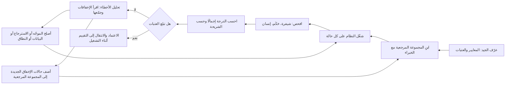
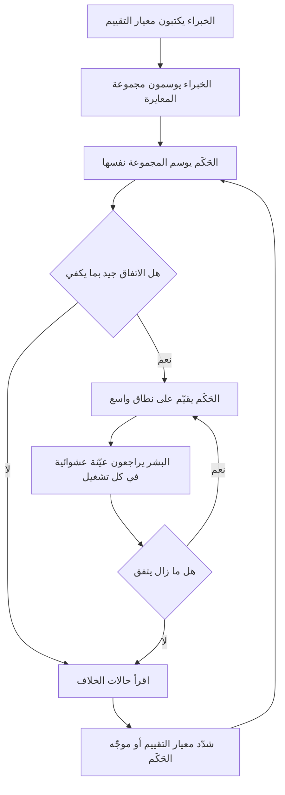
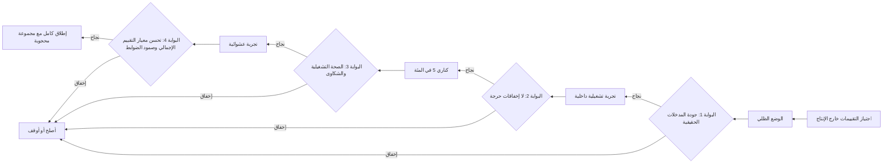

# الوحدة 6 — التقييم: أن تعرف أنه يعمل

*ميزة الذكاء الاصطناعي التي «تبدو رائعة في العرض التوضيحي» لم تُقيَّم بعد، بل نالت الإعجاب فقط. ولأن منتجات الذكاء الاصطناعي احتمالية (probabilistic)، فإن الإجابة الصادقة الوحيدة عن سؤال «هل يعمل؟» هي رقم مقيس على الحالات الصحيحة، مع قراءة الإخفاقات وفهمها. تعلّمك هذه الوحدة منظومة التقييم التي يملكها مدير منتج الذكاء الاصطناعي. تبدأ بالقياس خارج الإنتاج: المقاييس والمجموعات المرجعية (golden sets) وتحليل الأخطاء (error analysis). ثم تتناول طرق الحكم على المخرجات على نطاق واسع: الشيفرة، والنماذج التي تعمل حكّامًا، والخبراء البشريين، والفرق الحمراء. وتنتهي بالتقييم أثناء التشغيل، حيث يلتقي المستخدمون الحقيقيون بالمنتج عبر التشغيل الظلي والتجارب والإطلاق المرحلي (staged rollouts). ستتابع فريق المنتجات الرقمية والذكاء الاصطناعي في بنك نجم (Najm Bank) بينما تبني دانة أول مجموعة مرجعية (golden set) لمساعد مذكرات الائتمان (Credit Memo Copilot)، ويتعلم فيصل لماذا يكون الحَكَم الذي يعطي كل شيء 4.6 من 5 عديم الفائدة، وتدير حصة وليلى أسبوع فريق أحمر على نجم أسيست (Najm Assist)، وتخطط رانيا لإطلاق يمكن إيقافه عند أي خطوة.*

> **المراحل:** Evaluate — تحويل عبارة «يبدو أنه يعمل» إلى أدلة يستطيع الفريق ومالك الأعمال ووظيفة المخاطر التصرف بناءً عليها، قبل الإطلاق وأثناء طرحه التدريجي.

---

# 6.1 — جودة يمكنك قياسها: المقاييس والمجموعات المرجعية وتحليل الأخطاء
*المستوى: 🟡 متوسط* · *المتطلبات: 1.2، 5.1* · *المرحلة: Evaluate*

**بعد هذا الدرس تستطيع** أن تحسب الدقة والشمول من الأعداد الخام وتشرحهما لراعٍ من جهة العمل دون مصطلحات تقنية، وتجري تحليل أخطاء على 20 مخرجًا يرتّب فئات الإخفاق ويحدد أول إصلاح. *مدة الدراسة: قراءة نحو 20 دقيقة، وعمل تطبيقي نحو 3 ساعة (تقدير).*

## ⚡ الدرس في دقيقة
- **التقييم** (evals) يعني قياس المخرجات مقابل تعريف متفق عليه لـ«الجيد»، على حالات ثابتة، وبشكل قابل للتكرار بعد كل تغيير.
- في المنتجات **التنبؤية** (تنبيهات الاحتيال، والموافقة المسبقة على الائتمان) استخدم **مصفوفة الالتباس (confusion matrix)** و**الدقة (precision)** و**الشمول (recall)**. وفي المنتجات **التوليدية** (مذكرة مُصاغة، أو إجابة محادثة) قسّم «الجودة» إلى معايير منفصلة، لكل منها فحصه الخاص.
- **المجموعة المرجعية (golden set)** مجموعة منتقاة ومُرقّمة الإصدارات من حالات الاختبار ذات إجابات جيدة معروفة أو معايير نجاح. إنها أثمن أصول التقييم لدى الفريق، ويشكّل مدير المنتج (PM) ما يدخل فيها.
- **تحليل الأخطاء (Error analysis)** (قراءة الإخفاقات وفرزها في أنواع مسمّاة) يخبرك *ماذا تُصلح*؛ أما الدرجة فتخبرك فقط *بمقدار* الخطأ.
- إشارة القرار: قبل بدء أي بناء، اسأل: «أي حالات، وأي مقياس، وأي عتبة، ومن يقرر أنه جيد بما يكفي؟»
- أكبر فخ: درجة متوسطة واحدة، تخفي الشرائح (slices) الأكثر أهمية، مثل المستندات العربية أو العملاء ذوي القيمة العالية.

## 🧭 لماذا يهم
شغّل فيصل النموذج الأولي لمساعد مذكرات الائتمان على عشرة ملفات ائتمان اختارها بنفسه، وأخبر رانيا أنه «جاهز بنسبة 90% تقريبًا». يريد خالد (رئيس إقراض الأفراد) موعدًا للتجربة التشغيلية. تطرح دانة (كبيرة علماء البيانات) ثلاثة أسئلة: «تسعون في المئة من ماذا؟ على أي عشرة ملفات؟ وكيف تبدو العشرة في المئة الأخرى؟» لا يستطيع فيصل الإجابة. كانت ملفاته العشرة حديثة، باللغة الإنجليزية، لعملاء ذوي حسابات مدققة نظيفة. لم يرَ المساعد قط كشفًا عربيًا ممسوحًا ضوئيًا أو عميلًا تنقصه سنة من الحسابات.

تُظهر الحالات العامة الفجوة نفسها. في فبراير 2023، طلب عرض الإطلاق الذي قدّمته Microsoft لمحادثة Bing بالذكاء الاصطناعي تلخيصَ تقرير الأرباح الفصلي لشركة تجزئة (Gap) على المسرح. ثم قارن باحث مستقل الملخص بالتقرير فوجد عدة أرقام خاطئة، منها هامش التشغيل. مثال واحد مختار بعناية نال الإعجاب ولم يُقيَّم.

قاعدة رانيا: **لا تنتقل أي ميزة ذكاء اصطناعي إلى التجربة التشغيلية دون خطة تقييم وقّعها مالك الأعمال**، تحدد الحالات والمقاييس والعتبات (thresholds) وما يحدث عند عدم بلوغ عتبة. يعلّمك هذا الدرس كتابة تلك الخطة وقراءة نتائجها.

## 📐 كيف يعمل

### 🟢 الأساسيات

**ما هو التقييم.** أربعة أجزاء: **الحالات** (المدخلات التي تختبر عليها)؛ و**تعريف الجيد** (إجابة متوقعة، أو معايير يجب استيفاؤها)؛ و**الفحص** (شيفرة أو نموذج أو شخص يقارن المخرج بالتعريف)؛ و**الدرجة والعتبة** (الرقم الذي تبلّغ عنه والمستوى الذي عنده تُطلق أو تتوقف أو تتراجع).

تعيد تشغيل الحالات نفسها بعد كل تغيير (الموجّه، إصدار النموذج، مصدر الاسترجاع)، فيصبح التقييم **مجموعة اختبارات انحدار (regression suite)** تخبرك متى جعل تغييرٌ ما الأمور أسوأ. قدّم الدرس 5.1 التقييمات بوصفها متطلبات؛ أما هذا الدرس فيبنيها ويقرؤها.

**المنتجات التنبؤية: مصفوفة الالتباس.** تقرر التنبيهات الذكية (Smart Alerts) «تنبيه» أو «لا تنبيه» لكل معاملة بطاقة. وعند المقارنة بما حدث فعلًا، تقع كل حالة في أحد أربعة مربعات:

| | احتيال فعلًا | سليمة فعلًا |
|---|---|---|
| **صدر تنبيه** | نتيجة إيجابية صحيحة (TP): احتيال مكتشف | نتيجة إيجابية كاذبة (FP): عميل أُزعج بلا داعٍ |
| **لا تنبيه** | نتيجة سلبية كاذبة (FN): احتيال فائت | نتيجة سلبية صحيحة (TN): هادئ وصحيح |

من هذه الأعداد تأتي المقاييس التي يجب أن يقرأها كل مدير منتج ذكاء اصطناعي (AI PM):
- **الدقة** = TP ÷ (TP + FP). *من التنبيهات التي أرسلناها، كم منها كان احتيالًا حقيقيًا؟* الدقة المنخفضة تعني إرهاق التنبيهات (alert fatigue) وعملاء غاضبين.
- **الشمول** = TP ÷ (TP + FN). *من كل الاحتيال الحقيقي، كم اكتشفنا؟* الشمول المنخفض يعني خسائر.
- **F1** = المتوسط التوافقي للاثنين، ويكون مرتفعًا فقط حين يرتفع كلاهما. جيد لمقارنة النماذج؛ وأضعف في القرارات، لأنه يعامل الخطأين كأنهما متساويان في التكلفة.
- **الصحة الإجمالية** = (TP + TN) ÷ جميع الحالات. خطيرة حين تكون إحدى الفئات نادرة.

أرقام توضيحية: 100,000 معاملة، منها 100 احتيال. يُصدر النموذج A عدد 400 تنبيه ويكتشف 80 عملية احتيال: الدقة 20%، والشمول 80%. أما «نموذج» لا يُصدر أي تنبيه فيحقق صحة إجمالية 99.9% ولا يكتشف شيئًا. لا تقبل الصحة الإجمالية وحدها أبدًا لمنتج أحداث نادرة.

**العتبة قرار منتج.** يُخرج المصنِّف (classifier) درجة («احتمال الاحتيال 0.73»)؛ و**العتبة (threshold)** تحوّلها إلى إجراء. اخفضها فيرتفع الشمول وتنخفض الدقة. لا يوجد إعداد «صحيح تقنيًا»: فالأمر يعتمد على تكلفة كل خطأ، احتيال فائت بقيمة 5,000 ريال قطري (QAR) مقابل بطاقة محجوبة في محطة وقود عند منتصف الليل. يأتي مدير المنتج بالتكاليف؛ وتعرض دانة المنحنى.

**المنتجات التوليدية: فكّك الجودة.** ليس لمذكرة الائتمان إجابة صحيحة واحدة. قسّم الجودة إلى **معايير** يمكن فحص كل منها وحده:

| المعيار | سؤال بسيط | مثال من مساعد مذكرات الائتمان |
|---|---|---|
| **الأمانة للمصادر** (الاستناد إلى المصادر) | هل كل ادعاء مدعوم بالمصادر؟ | الإيرادات تطابق القوائم المدققة |
| **الاكتمال** | هل كل المطلوب موجود؟ | جميع أقسام المذكرة الثمانية |
| **صحة الاستدلال** | هل الحسابات والاستنتاجات صحيحة؟ | نسبة تغطية خدمة الدين صحيحة |
| **الامتناع (Abstention)** | هل يقول «غير موجود» بدل التخمين؟ | الإشارة إلى غياب حسابات 2024 (missing 2024 accounts flagged) |
| **الشكل والأسلوب** | هل يتبع القالب؟ | العناوين، وتنسيق العملة، والطول |
| **السلامة والسياسة** | هل يتجنب ما يجب ألا يفعله أبدًا؟ | لا بيانات لعميل آخر؛ لا لغة موافقة |

لكل معيار فحصه وعتبته. عبارة «الأمانة للمصادر ≥ 98% من الأرقام (Faithfulness ≥ 98% of figures)» مفيدة؛ أما «الجودة 4.2 من 5» فليست كذلك.

**المجموعات المرجعية (Golden sets).** **المجموعة المرجعية** (أو المجموعة المرجعية للاختبار) مجموعة منتقاة من حالات الاختبار، لكل منها مُدخل وإما إجابة مرجعية («نسبة تغطية خدمة الدين 1.35») أو معايير نجاح («يجب أن يشير إلى غياب حسابات 2024»). المجموعة الجيدة **تغطي المساحة** (الحالات الشائعة والصعبة والحدّية والتي يجب رفضها)، و**يوسمها الأشخاص المناسبون** (موظفو الائتمان، لا كتّاب الموجّه)، و**مُرقّمة الإصدارات** بحيث تعني عبارة «92% على الإصدار 3» شيئًا في الربع القادم، و**تنمو من الإخفاقات الحقيقية**.

**تحليل الأخطاء.** تخبرك الدرجة بمقدار الخطأ؛ ويخبرك تحليل الأخطاء بماهيته. الطريقة يدوية وناجحة:
1. خذ المخرجات الفاشلة، أو عيّنة عشوائية إن لم تكن لديك وسوم بعد.
2. اكتب ملاحظة قصيرة عن كل إخفاق («استخدم رقم 2022»، «اختلق تعهدًا»).
3. جمّع الملاحظات في **تصنيف إخفاقات** صغير: فئات مسمّاة.
4. عُدّ كل فئة واضربها في شدتها.
5. أصلح الفئة الأكبر، وأعد تشغيل التقييم، وكرّر.

إن تقرير أن «السنة المالية الخاطئة» أشد من «ملخص أطول قليلًا» قرار منتج، ولهذا يشارك مدير المنتج.

### 🟡 التعمق أكثر

**الشرائح.** **الشريحة** مجموعة فرعية من الحالات تشترك في خاصية: المستندات العربية، وملفات PDF الممسوحة ضوئيًا، والملفات التي تتجاوز 50 مليون ريال قطري. أبلغ دائمًا عن المقاييس حسب الشريحة إلى جانب الإجمالي. المساعد الذي يحقق 95% إجمالًا و70% على الكشوف العربية ليس جاهزًا لبنك لديه كثير من حسابات الشركات الصغيرة والمتوسطة العربية. وترتبط الشرائح أيضًا بالعدالة: في التمويل الفوري للشركات الصغيرة (SME Instant Finance)، ستطلب الحوكمة الأداء حسب شريحة العملاء (انظر *AI Governance: Zero to Hero*).

**ROC وAUC والمعايرة.** أداتان إضافيتان للتنبيهات الذكية والتمويل الفوري للشركات الصغيرة:
- **منحنى ROC** (خاصية تشغيل المستقبِل) يرسم معدل الإيجابيات الصحيحة مقابل معدل الإيجابيات الكاذبة عند كل عتبة. و**AUC** (المساحة تحت ذلك المنحنى) تلخّص مدى جودة النموذج في *ترتيب* الإيجابيات فوق السلبيات: 0.5 عشوائي، و1.0 مثالي. يساعد في مقارنة النماذج، لكنه لا يقول شيئًا عن قبول عتبة معينة. وحين تكون الإيجابيات نادرة جدًا، يكون **منحنى الدقة والشمول** أكثر إفادة غالبًا.
- **المعايرة (Calibration)** تسأل هل تعني الدرجات ما تقوله. إذا حصلت 1,000 فاتورة لشركات صغيرة على «خطر تعثر 10%»، فهل يتعثر نحو 100 منها؟ يمكن أن يكون النموذج جيد الترتيب سيئ المعايرة. وتهم المعايرة كلما استخدم أحدٌ الرقمَ نفسه: للتسعير، أو وضع الحدود، أو إظهار الثقة.

**كم حالة تحتاج؟** لمعدل نجاح p على n حالة، يساوي الخطأ المعياري الواحد الجذر التربيعي لـ p × (1 − p) ÷ n. مع 100 حالة عند 90%، يبلغ نحو 3 نقاط، فيكون نطاق 95% تقريبًا ±6 نقاط (من 84% إلى 96%)؛ ومع 50 حالة، تقريبًا ±8. لذا فإن «حقق الإصدار 2 نسبة 91% والإصدار 1 نسبة 89%» على 100 حالة ليس دليلًا. بضع عشرات من الحالات تكشف أنواع الإخفاق الكبيرة؛ أما مقارنة إصدارات متقاربة فتحتاج مئات الحالات لكل شريحة مهمة.

**عدم الحتمية (Non-determinism).** قد يعطي الموجّه نفسه مخرجات مختلفة من تشغيل لآخر، خاصة عند **درجة حرارة (temperature)** أعلى (إعداد العشوائية؛ انظر 1.2). شغّل التقييمات المهمة عدة مرات وأبلغ عن التشتت. الحالة التي تنجح في تشغيلين من ثلاثة ستصبح شكوى في الإنتاج.

**الفحوص المبنية على الشيفرة أولًا.** الشيفرة العادية رخيصة وسريعة ومتسقة. هل يظهر كل رقم في المذكرة في المستندات المصدرية؟ هل جميع الأقسام المطلوبة موجودة؟ هل تذكر عميلًا ليس في هذا الملف؟ استخدم الشيفرة حيثما كان المعيار آليًا، واحتفظ بالحكّام النموذجيين والمراجعين البشريين (6.2) للأحكام التقديرية، مثل ما إذا كان سرد المخاطر سليمًا.

### 🔴 نظرة الخبير

**المقاييس خارج الإنتاج مؤشرات بديلة.** ما يهم الأعمال هو **النتائج**: الساعات الموفّرة، وتقليل الإعادات من اللجنة، وخسائر الاحتيال التي مُنعت. الخطة الجيدة تسمّي السلسلة («أرقام أمينة للمصادر ← يثق بها مديرو العلاقات ← إعادة تحقق أقل ← وقت أقل لكل مذكرة») وتختبر الحلقات الضعيفة أثناء التشغيل (6.3). حين ترتفع الدرجة خارج الإنتاج ولا تتحرك النتيجة، فالمؤشر البديل هو المعطوب، لا المستخدمون.

**قانون Goodhart (Goodhart's law).** «حين يصبح المقياس هدفًا، يكفّ عن أن يكون مقياسًا جيدًا» (نسبةً إلى الاقتصادي Charles Goodhart؛ وتُنسب هذه الصياغة عادةً إلى Marilyn Strathern). إذا كوفئ الفريق على درجة المجموعة المرجعية، فسيُضبط الموجّه ببطء على تلك الحالات بعينها. الدفاعات: **مجموعة محجوبة (held-out set)** لا يراها مهندسو الموجّهات أبدًا، وتُستخدم فقط لقرارات الإصدار؛ وتحديثات ربع سنوية من الإنتاج؛ وعيّنة من المخرجات يقرؤها إنسان إلى جانب كل درجة.

**المعايير المرجعية العامة ليست تقييمك.** تساعدك درجات المعايير المرجعية لدى المورّدين في إعداد قائمة مختصرة بالنماذج (1.3). لكنها لا تخبرك بأداء النموذج على ملفات الائتمان في بنك نجم، بالعربية، وبقوالب بنك نجم، وقد تكون بعض أسئلة المعايير المرجعية قد تسربت إلى بيانات التدريب («التلوث» contamination). عامل لوحات الصدارة كمرشِّح ومجموعتك المرجعية كأساس القرار.

**مجموعة التقييم أصل منتج له مالك.** تعيش المجموعات المرجعية أطول من النماذج: حين يقترح طارق (قائد الهندسة) نموذجًا أرخص، تجعل المجموعة المرجعية ذلك قرارًا من يومين، لا نقاشًا من شهرين. تحتوي ملفات الائتمان على بيانات العملاء، لذا تتبع المجموعة قواعد بيانات الإنتاج (3.3)، وتعتمد سارة (مسؤولة حماية البيانات، DPO) قرار استخدام بيانات حقيقية أو مُقنّعة.

**عتبات مرجّحة بالشدة.** التعهد المختلق أسوأ من مذكرة أطول بفقرتين. تحدد الفرق الناضجة بضعة **أنواع إخفاق حرجة** بلا أي تسامح («لا رقم مختلقًا في أي حالة من المجموعة المرجعية») إلى جانب العتبات العادية. الإصدار الذي يحسّن المتوسط لكنه يضيف إخفاقًا حرجًا واحدًا يُحجب.

## 🧰 الأدوات
| الأداة أو الإطار | ما هو وماذا يفعل | متى تلجأ إليه |
|---|---|---|
| **Confusion matrix** — مصفوفة الالتباس | عدٌّ في أربعة مربعات للإيجابيات والسلبيات الصحيحة والكاذبة | أي منتج تنبؤي بنعم أو لا: التنبيهات الذكية، التمويل الفوري للشركات الصغيرة |
| **Precision and recall** — الدقة والشمول | نسبة القرارات الإيجابية الصحيحة؛ ونسبة الإيجابيات الحقيقية المكتشفة | اختيار عتبة والدفاع عنها |
| **ROC/AUC and calibration** — ROC/AUC والمعايرة | جودة الترتيب عبر العتبات؛ ومدى تطابق الدرجات مع المعدلات المرصودة | مقارنة النماذج؛ أي منتج يستخدم الدرجة نفسها |
| **Golden set** — المجموعة المرجعية | حالات اختبار منتقاة ومُرقّمة الإصدارات بإجابات مرجعية (reference answers) أو معايير نجاح | من أول نموذج أولي؛ قبل كل تغيير في الموجّه أو النموذج أو البيانات |
| **Error analysis** — تحليل الأخطاء | قراءة الإخفاقات وتجميعها في تصنيف معدود | بعد عدم بلوغ عتبة؛ حين يشتكي المستخدمون والدرجات تبدو جيدة |
| **Slice analysis** — تحليل الشرائح | مقاييس لكل مجموعة فرعية من الحالات | دائمًا: اللغة، نوع المستند، الشريحة، الحالات عالية القيمة |
| **Code-based assertions** — تأكيدات مبنية على الشيفرة | فحوص حتمية بشيفرة عادية | المعايير الآلية: الأرقام تطابق المصدر، الحقول موجودة |

## 🏛️ عمليًا في بنك نجم
تكتب دانة وفيصل **خطة تقييم مساعد مذكرات الائتمان، الإصدار 1**. ويوقّعها خالد (مالك الأعمال) وليلى (حوكمة الذكاء الاصطناعي).

**الجزء A: تكوين المجموعة المرجعية، الإصدار 1 (أحجام توضيحية)**

| الشريحة | الحالات | سبب وجودها |
|---|---|---|
| ملفات شركات صغيرة ومتوسطة قياسية، بالإنجليزية، مدققة | 60 | المسار الشائع |
| كشوف عربية أو ثنائية اللغة | 40 | كثير من ملفات الشركات الصغيرة؛ لم يرها النموذج الأولي قط |
| ملفات PDF ممسوحة ضوئيًا أو رديئة الجودة | 25 | تظهر أخطاء الاستخراج هنا أولًا |
| بيانات ناقصة أو غير متسقة | 25 | تختبر الامتناع: أشِر، ولا تختلق أبدًا |
| تعرّضات فوق عتبة اللجنة | 20 | أعلى تكلفة للخطأ |
| طلبات خارج النطاق («وافق على هذا») | 10 | يجب أن يرفض بلباقة |
| **محجوبة** (مخفية عن ضبط الموجّه) | 50 | لقرارات الإصدار فقط |

يوسم جميعَ الحالات موظفو الائتمان (متحدثون بالعربية للشريحة العربية)، وتحسم دانة الخلافات.

**الجزء B: المعايير والفحوص والعتبات**

| المعيار | الفحص | عتبة التجربة التشغيلية | حرج؟ |
|---|---|---|---|
| الأمانة للمصادر في الأرقام | شيفرة: كل رقم يُتتبّع إلى صفحة مصدر | 100% من الأرقام قابلة للتتبع؛ 0 أرقام مختلقة | نعم: أي اختلاق يحجب الإصدار |
| حسابات النسب | شيفرة: إعادة حساب نسبة تغطية خدمة الدين (DSCR) والرافعة المالية ونسبة التداول | ≥ 98% صحيحة | نعم |
| الامتناع عند نقص البيانات | شيفرة مع فحص بشري على شريحة البيانات الناقصة | ≥ 95% من الفجوات يُشار إليها | نعم |
| اكتمال الأقسام | شيفرة: الأقسام الثمانية موجودة | ≥ 99% | لا |
| سلامة سرد المخاطر | معيار تقييم لموظف الائتمان، مقياس 1–4 (انظر 6.2) | الوسيط ≥ 3؛ لا تقييمات «مضلِّل» | لا |
| الشكل والأسلوب | شيفرة مع حَكَم | ≥ 95% | لا |
| كل شريحة | كل ما سبق لكل شريحة | لا شريحة تقل بأكثر من 5 نقاط عن الإجمالي | لا |

**الجزء C: القواعد.** أعد التشغيل عند كل تغيير في الموجّه أو النموذج أو الاسترجاع أو القالب. أبلغ إجمالًا وحسب الشريحة، مع أعداد الحالات. سجّل كل إخفاق في التصنيف؛ وأضف إخفاقات الإنتاج إلى المجموعة المرجعية خلال دورة عمل واحدة. مالكة المجموعة المرجعية: دانة. مالك العتبات: خالد، بمشورة فيصل.

## 🛠️ التمارين
- 🟢 اكتشفت التنبيهات الذكية الشهر الماضي 120 من أصل 150 عملية احتيال حقيقية، وأصدرت 900 تنبيه إجمالًا. احسب الدقة والشمول، ثم اكتب جملتين لخالد تشرح ما يعنيه كل رقم للعملاء. *يكتمل عندما:* تحصل على دقة ≈ 13% وشمول = 80%، ولا تستخدم أيٌّ من الجملتين كلمتي «الدقة» أو «الشمول».
- 🟡 صُغ جدول تكوين مجموعة مرجعية لنجم أسيست وهو يجيب عن أسئلة البطاقات والحسابات، بخمس شرائح على الأقل مع سبب وجود كل منها. *يكتمل عندما:* يتضمن شريحة عربية، وشريحة خارج النطاق، وشريحة تكون فيها الإجابة الصحيحة «لا أستطيع فعل ذلك؛ إليك كيف تصل إلى شخص».
- 🔴 خذ 20 مخرجًا من أداة ذكاء اصطناعي توليدي تستخدمها (أو من روبوت محادثة عام يجيب عن أسئلة في مجالك). استخدم أسئلة عامة أو مختلَقة فقط: لا تلصق أبدًا بيانات عملاء أو زملاء أو بيانات سرية في أداة عامة. نفّذ تحليل أخطاء كاملًا: دوّن كل إخفاق، وابنِ تصنيفًا من أربع إلى سبع فئات، وعُدّها ورتّبها حسب التكرار مضروبًا في الشدة. *يكتمل عندما:* تستطيع تسمية الإصلاح الأول، وتبريره بالأعداد، وسرد حالات المجموعة المرجعية التي ستضيفها.

راجع عملك

**🟢 إجابة محسوبة.** الدقة = 120 ÷ 900 ≈ 13%؛ والشمول = 120 ÷ 150 = 80%. لخالد: «من كل ثمانية تنبيهات نرسلها، واحد تقريبًا فقط احتيال حقيقي، فمعظم من ننبّههم لم يفعلوا شيئًا خاطئًا». «نلتقط أربع حالات احتيال من كل خمس؛ وتمرّ واحدة من كل خمس».

**🔴 تحليل أخطاء محسوب (توضيحي).** 20 إجابة، فيها 7 إخفاقات: 3 تذكر حقيقة قديمة، و2 تُغفل تنبيهًا لازمًا، و1 ترفض سؤالًا يمكن الإجابة عنه، و1 بصيغة خاطئة. الشدة 3 و2 و2 و1. التكرار × الشدة: الحقيقة القديمة 9، والتنبيه الغائب 4، والرفض 2، والصيغة 1. الإصلاح الأول: حداثة المصادر. أضف إلى المجموعة المرجعية حالات لكل حقيقة تغيّرت مؤخرًا.

**🟡 مراجعة ذاتية.** ينجح جدول التكوين إذا كان لكل شريحة سبب ونسبة، وضمّ شريحة عربية، وشريحة خارج النطاق، وشريحة «التحويل إلى شخص».

## ⚠️ أخطاء وفخاخ
- **الحكم بالعرض التوضيحي.** الأمثلة المنتقاة يدويًا ليست دليلًا. اكتب خطة التقييم قبل الوعد بموعد تجربة تشغيلية.
- **الصحة الإجمالية في الأحداث النادرة.** يمكن أن يكون نموذج الاحتيال صحيحًا بنسبة 99.9% وعديم الفائدة. استخدم الدقة والشمول.
- **درجة جودة واحدة ممزوجة.** قسّم الجودة إلى معايير بعتبات منفصلة، وحدّد المعايير الحرجة.
- **المهندسون وحدهم يوسمون المجموعة المرجعية.** خبراء المجال يوسمون ما يحتاجه العمل فعلًا.
- **التعامل مع فروق الدرجات الصغيرة كأنها حقيقية.** على 100 حالة، 89% مقابل 91% ضجيج. أبلغ عن أعداد الحالات.
- **مجموعة مرجعية لا تتغير أبدًا.** يضبط الفريق عليها فتنجرف عن الواقع. حدّثها واحتفظ بمجموعة محجوبة.

## 🧾 الخلاصة
- التقييم (eval) هو حالات، وتعريف للجيد، وفحص، وعتبة، يُعاد تشغيله بعد كل تغيير.
- في المنتجات التنبؤية، استخدم مصفوفة الالتباس والدقة والشمول. العتبة قرار منتج مبني على تكلفة كل خطأ.
- في المنتجات التوليدية، قسّم الجودة إلى معايير وافحص كلًّا منها منفصلًا، بالشيفرة حيثما أمكن.
- المجموعة المرجعية أصل مُرقّم الإصدارات، يوسمه الخبراء، ومقسّم إلى شرائح، ينمو من الإخفاقات الحقيقية، وفيه جزء محجوب.
- يحوّل تحليل الأخطاء الدرجات إلى قائمة إصلاحات مرتبة. والدرجات خارج الإنتاج مؤشرات بديلة لنتائج الأعمال.

## ✍️ اختبر نفسك

**1. يُصدر النموذج الجديد للتنبيهات الذكية تنبيهات أقل من القديم، ويشتكي العملاء أقل. تُبلغ دانة أنه يكتشف 60 من أصل 100 عملية احتيال، بينما اكتشف النموذج القديم 85. أي عبارة صحيحة؟**

- A. انخفض الشمول من 85% إلى 60%؛ وربما ارتفعت الدقة، ويعتمد قبول هذه المقايضة على تكلفة الاحتيال الفائت مقابل تكلفة التنبيهات الكاذبة
- B. انخفضت الدقة وارتفع الشمول
- C. النموذج الجديد أفضل لأن العملاء يشتكون أقل، كما أن قلة التنبيهات تعني أن فريق الاحتيال لديه عمل أقل كل يوم ويستطيع التركيز على أخطر الحالات
- D. الصحة الإجمالية هي المقياس الصحيح لحسم المسألة

الإجابة

**A.** انخفض الشمول (نسبة الاحتيال الحقيقي المكتشف)؛ والتنبيهات الأقل تعني عادةً دقة أعلى. الاختيار بينهما قرار أعمال بشأن تكاليف الأخطاء. الخيار C ينظر إلى جانب واحد فقط؛ والخيار D يفشل لأن الاحتيال نادر. (🟢 الأساسيات.)

**2. يُبلغ فيصل أن الإصدار 2 من موجّه المساعد حقق 91% على مجموعة مرجعية من 100 حالة، مقابل 89% للإصدار 1، ويقترح إطلاقه بوصفه «أفضل بوضوح». ما أفضل رد؟**

- A. الموافقة والإطلاق، لأن درجة أعلى على المجموعة المرجعية نفسها مكسب مقيس، والانتظار يؤخر القيمة
- B. رفض الإصدار 2، لأن مجموعة مرجعية من 100 حالة أصغر من أن تقارن بين إصدارين من الموجّه بأي طريقة مفيدة
- C. القول إن فرق نقطتين على 100 حالة ضمن الضجيج، وطلب النتائج حسب الشريحة، وعدد الإخفاقات الحرجة، وإعادة التشغيل
- D. إعادة تشغيل الإصدارين على معيار مرجعي عام، لأن مجموعة اختبار قياسية أكبر ستحسم أي موجّه أفضل حقًا

الإجابة

**C.** عند 100 حالة ونحو 90%، يبلغ عدم اليقين تقريبًا ±6 نقاط، لذا ففجوة النقطتين ليست دليلًا. الخيار B مبالغة في رد الفعل: فالمجموعات الصغيرة ما زالت تكشف أنواع الإخفاق. والخيار D يقيس المهمة الخطأ. (🟡 التعمق أكثر.)

**3. أي مجموعة مرجعية هي الأفضل لمساعد مذكرات الائتمان (Credit Memo Copilot)؟**

- A. مجموعة ذات إصدارات، مقسّمة حسب اللغة وجودة المستند والبيانات الناقصة وحجم التعرّض، يوسمها موظفو الائتمان، مع جزء محجوب
- B. أحدث 200 مذكرة، يوسمها المهندسون الذين كتبوا الموجّه
- C. معيار مرجعي عام للإجابة عن الأسئلة المالية
- D. عشر مذكرات ممتازة يختارها مالك الأعمال، لأنها تُظهر المستوى الذي يريد فريق الائتمان كله أن يبلغه المساعد في كل مرة

الإجابة

**A.** إنها تغطي الشرائح الصعبة، وتستعين بخبراء المجال، وتحمي قرارات الإصدار بمجموعة محجوبة. الخيار B فيه الواسمون الخطأ؛ والخيار D عرض توضيحي لا تقييم. (🟢 الأساسيات؛ 🏛️ عمليًا.)

**4. تبلغ درجة الأمانة للمصادر الإجمالية للمساعد 97%، فوق الهدف. ومع ذلك يقول مديرو العلاقات إنهم «لا يستطيعون الوثوق بالأرقام». ماذا يجب أن يفعل مدير المنتج أولًا؟**

- A. تحليل أخطاء الإخفاقات وفحص الأمانة للمصادر حسب الشريحة، مثل المستندات العربية أو الممسوحة
- B. عرض نتائج التقييم على مديري العلاقات كي يروا أن الدرجة فوق الهدف
- C. رفع هدف الأمانة للمصادر إلى 99% وتعليق الإطلاق حتى يبلغه المساعد
- D. التحويل إلى النموذج الأعلى في لوحة صدارة عامة للتلخيص ثم إعادة تشغيل التقييم

الإجابة

**A.** قد يخفي المتوسط الجيد شريحة فاشلة يعمل فيها مديرو العلاقات (RMs) يوميًا؛ ويُظهر تحليل الأخطاء ماهية الإخفاقات. الخيار B يستخف بالأدلة؛ والخياران C وD يتصرفان قبل فهم المشكلة. (🟢 الأساسيات؛ 🟡 التعمق أكثر.)

**5. لماذا تصنّف خطة التقييم «الرقم المالي المختلق» إخفاقًا حرجًا بلا أي تسامح، بدل دمجه في المتوسط؟**

- A. لأن خطأ الرقم أسهل رصدًا من الإخفاقات الأخرى، فيمكن عدّه وحده
- B. لأن الجهات الرقابية المصرفية تشترط صفر أخطاء في أي مُخرَج ذكاء اصطناعي يتضمن أرقامًا مالية
- C. لأن المتوسطات تُخفي الحالات الأهم، فتتابع الخطة الإخفاقات الحرجة بدلًا من المتوسطات في كل إصدار
- D. لأن بعض الإخفاقات شديدة بما يكفي بحيث يجب حجب الإصدار الذي يحسّن المتوسط لكنه يضيف واحدًا منها

الإجابة

**D.** تمنع العتبات المرجّحة بالشدة المتوسطَ المرتفع من إخفاء إخفاق نادر وغير مقبول. الخيار B يختلق قاعدة؛ والخيار C مبالغة: فالمتوسطات مفيدة إلى جانب الشرائح والفحوص الحرجة. (🔴 نظرة الخبير.)

## 📚 المراجع
- Google, Machine Learning Crash Course — https://developers.google.com/machine-learning/crash-course
- scikit-learn documentation, "Metrics and scoring: quantifying the quality of predictions" — https://scikit-learn.org/stable/modules/model_evaluation.html
- Fawcett, T. (2006), "An introduction to ROC analysis", *Pattern Recognition Letters* 27(8)
- Guo, C., Pleiss, G., Sun, Y. and Weinberger, K. Q. (2017), "On Calibration of Modern Neural Networks" — https://arxiv.org/abs/1706.04599
- NIST AI Risk Management Framework 1.0 — https://www.nist.gov/itl/ai-risk-management-framework
- Google PAIR, People + AI Guidebook — https://pair.withgoogle.com/guidebook
- [*اختبار البرمجيات من الصفر إلى الاحتراف في عصر الذكاء الاصطناعي*، الدرس 7.1 — التقييمات الآلية: اختبار تطبيقات النماذج اللغوية](../testing/index.ar.html#/7.1) — منظور الاختبار لهذا الموضوع

---

# 6.2 — النموذج اللغوي حَكَمًا، والمراجعة البشرية، والفريق الأحمر
*المستوى: 🟡 متوسط* · *المتطلبات: 6.1، 4.2* · *المرحلة: Evaluate*

**بعد هذا الدرس تستطيع** أن تكتب موجّه حَكَم بمعيار واحد يعطي نجاحًا أو إخفاقًا، وتقيس شمول الحَكَم ودقته مقارنةً بأحكام البشر لتقرر صلاحيته، وتخطط تمرين فريق أحمر بقاعدة واضحة للخروج. *مدة الدراسة: قراءة نحو 20 دقيقة، وعمل تطبيقي نحو 145 دقيقة (تقدير).*

## ⚡ الدرس في دقيقة
- يحتاج كل تقييم إلى **حَكَم** يقرر هل نجح المخرج: **الشيفرة** (رخيصة ودقيقة وضيقة)، أو **نموذج** (قابل للتوسع ومرن ومنحاز)، أو **البشر** (المعيار المرجعي، بطيء ومكلف). استخدم كلًّا منها حيث يناسب.
- **النموذج اللغوي حَكَمًا (LLM-as-judge)** يعني أن نموذجًا لغويًا (language model) يقيّم المخرجات مقابل **معيار تقييم (rubric)**. يتوسع إلى آلاف المخرجات، لكن فقط بعد أن تُثبت أنه يتفق مع خبرائك.
- انحيازات الحَكَم المعروفة: **الموضع** (تفضيل الإجابة الأولى أو الثانية)، و**الإسهاب** (تفضيل الإجابات الأطول)، و**تفضيل الذات (self-preference)** (تفضيل عائلة نموذجه).
- تحتاج **المراجعة البشرية (Human review)** إلى **معيار تقييم** مكتوب، ومراجعين مدرَّبين، ومقياس لـ **الاتفاق بين المقيّمين (inter-rater agreement)**. إذا لم يستطع خبيران الاتفاق، فالمعيار لم يُعرَّف بعد.
- **الفريق الأحمر (Red-teaming)** هجوم متعمَّد: جعل المنتج يفشل بطرق ضارة أو مكلفة قبل أن يفعل ذلك المستخدمون الحقيقيون والمهاجمون.
- أكبر فخ: حَكَم غير معايَر. الحَكَم الذي يعطي كل شيء 4.6 من 5 لا يقيس شيئًا.

## 🧭 لماذا يهم
تضم المجموعة المرجعية التي بنتها دانة لمساعد مذكرات الائتمان عدد 230 حالة، وتغطي فحوص الشيفرة الأرقام والأقسام. لكن «سرد المخاطر» ما زال يحتاج إلى حكم تقديري: هل عرض مخاطر العميل سليم وغير مضلِّل؟ يستطيع موظفا ائتمان مراجعة نحو 30 مذكرة يوميًا، وكل تغيير في الموجّه يحتاج إلى إعادة تشغيل كاملة. حل فيصل: أن يطلب من نموذج كبير «تقييم كل مذكرة من 1 إلى 5 للجودة». المتوسط 4.6. وموجّه معطوب عمدًا يحصل على 4.4. الحَكَم لا يميّز الجيد من الرديء، وكاد الفريق يُطلق بناءً على كلمته.

في الوقت نفسه، يوشك نجم أسيست أن يبدأ في اتخاذ إجراءات مثل تجميد بطاقة. تُظهر الحالات العامة ما يحدث حين يلتقي مساعد يتعامل مع العملاء بأشخاص يحاولون كسره. مرّت بك حالتان في الدرس 5.3: السيارة بدولار واحد، وروبوت التوصيل الذي شتم أحد العملاء. لم يحتج أيٌّ منهما إلى مهارات متقدمة. لن توافق ليلى (رئيسة حوكمة الذكاء الاصطناعي) على ميزات الوكيل في نجم أسيست حتى يحاول الفريق كسرها أولًا.

## 📐 كيف يعمل

### 🟢 الأساسيات

**ثلاثة أنواع من الحكّام.**

| الحَكَم | يجيد | يضعف في | التكلفة لكل مخرج |
|---|---|---|---|
| **الشيفرة** | الفحوص الآلية: تطابق الأرقام، وجود الحقول | أي شيء يحتاج إلى فهم المعنى | شبه صفرية |
| **النموذج** | معايير لفظية: الصلة، النبرة، هل الادعاء مدعوم | الحكم الدقيق في المجال؛ قد يكون منحازًا أو يُخدع | منخفضة (استدعاء نموذج آخر) |
| **الخبير البشري** | حكم المجال؛ أنواع الإخفاق الجديدة؛ الكلمة الأخيرة | السرعة والتكلفة والاتساق والإرهاق | مرتفعة |

قاعدة عامة: الشيفرة لكل ما تستطيع الشيفرة فحصه؛ وحَكَم نموذجي معايَر للمعايير عالية الحجم؛ والبشر لوضع المعيار، ومعايرة الحَكَم، ومراجعة العيّنات، والتعامل مع أعلى المخاطر.

**النموذج اللغوي حَكَمًا.** يتلقى النموذج الحَكَم المُدخل والمخرج و**معيار تقييم** (معايير مكتوبة لكل درجة) ويُعيد حكمًا. ثلاث صيغ:
- **نقطي**: تقييم مخرج واحد («هل كل عبارة عن المخاطر مدعومة بالمستندات المرفقة؟ PASS أو FAIL، ثم اقتبس أي عبارة غير مدعومة.»)
- **زوجي**: اختيار الأفضل من مخرجين؛ مفيد لمقارنة الإصدارات.
- **موجَّه بالمرجع**: التقييم مقابل إجابة مرجعية من المجموعة المرجعية.

درس Zheng وزملاؤه هذا النهج في «Judging LLM-as-a-Judge with MT-Bench and Chatbot Arena» (2023). وأفادوا بأن الحكّام النموذجيين الأقوياء اتفقوا مع التفضيلات البشرية بقدر ما اتفق البشر بعضهم مع بعض تقريبًا على مجموعات الاختبار لديهم. ووثّقوا أيضًا نقاط ضعف:
- **انحياز الموضع (Position bias)**: تفضيل إجابة بسبب موضع ظهورها (الأولى أو الثانية).
- **انحياز الإسهاب (Verbosity bias)**: تفضيل الإجابات الأطول حتى حين لا تكون أفضل.
- **انحياز تعزيز الذات**: تفضيل الإجابات التي كتبها النموذج نفسه أو عائلة النموذج نفسها.
- **الاستدلال المحدود**: صعوبة تقييم أسئلة الرياضيات والمنطق التي لم يكن يستطيع حلها بموثوقية بنفسه.

تُظهر الدراسة أن التحكيم بالنموذج *يمكن* أن ينجح، لا أن حَكَمك *أنت* ينجح على مهمتك *أنت*. وهذا ما يجب أن تقيسه.

**جعل الحَكَم جديرًا بالثقة.**
1. **معيار تقييم ضيق.** معيار واحد لكل استدعاء؛ PASS/FAIL ثنائي أو مقياس قصير مع «مرساة» مكتوبة لكل مستوى، لا «قيّم من 1 إلى 10».
2. **الدليل قبل الحكم.** «اقتبس الجملة غير المدعومة، ثم قرّر.» هذا يجعل القرارات قابلة للتحقق.
3. **واجه الانحيازات.** شغّل الأزواج بالترتيبين واحسب فقط الأحكام المتسقة؛ أخبر الحَكَم أن الطول ليس جودة؛ وفضّل حَكَمًا من عائلة نماذج مختلفة.
4. **عايِر مقابل البشر.** يوسم الخبراء **مجموعة معايرة** (مثلًا 100 مخرج)؛ وقارن وسوم الحَكَم بها. لا تنشره إلا حين يكون الاتفاق جيدًا بما يكفي للقرار الذي يدعمه.
5. **ثبّت وأعد الفحص.** ثبّت إصدار نموذج الحَكَم وموجّهه؛ وأعد المعايرة حين يتغير أيٌّ منهما.

**المراجعة البشرية.** البشر يضعون المعيار، لذا يجب أن تكون عمليتهم متينة:
- **معيار تقييم** بمستويات وأمثلة، بحيث تعني كلمة «مضلِّل» الشيء نفسه لكل مراجع.
- **خبراء المجال**: موظفو الائتمان للمساعد؛ ولنبرة نجم أسيست، لجنة العملاء التي تديرها حصة (مصممة المنتج).
- **مراجعة عمياء**، حتى لا يستطيع المراجعون محاباة الإصدار الجديد.
- **الاتفاق بين المقيّمين** على مجموعة فرعية مشتركة. إن كان منخفضًا، فأصلح معيار التقييم قبل الوثوق بأي درجات.

**الفريق الأحمر.** يحاول **الفريق الأحمر** جعل النظام يفشل. وفي منتجات الذكاء الاصطناعي يشمل ذلك:
- **كسر القيود**: موجّهات (prompts) تجعل النموذج يتجاهل قواعده.
- **حقن الموجّه (Prompt injection)**: تعليمات مخفية في محتوى يقرؤه النظام، مثل مستند أو بريد إلكتروني أو صفحة ويب.
- **التزامات ضارة أو غير مصرّح بها**: الوعد باستردادات أو أسعار أو موافقات لم تعرضها الأعمال قط (السيارة بدولار واحد في الدرس 5.3؛ و*Moffatt v. Air Canada* في الدرس 0.2).
- **تسرب البيانات**: كشف بيانات عميل آخر، أو موجّه النظام (system prompt)، أو معلومات داخلية.
- **إخفاقات العلامة التجارية والنبرة**: الشتم، والسخرية، والتصريحات السياسية (روبوت التوصيل في الدرس 5.3).
- **إجراءات غير آمنة** للوكلاء (agents): تجميد البطاقة الخطأ، أو اتخاذ إجراء دون تأكيد.

المُخرَج ليس تقريرًا في مجلد. كل هجوم ناجح يصبح **إصلاحًا** و**حالة اختبار عدائية**، يُعاد اختبارها في كل إصدار.

### 🟡 التعمق أكثر

**قياس الاتفاق.** **نسبة الاتفاق** (عدد المرات التي يعطي فيها مقيّمان الوسم نفسه) مضلِّلة حين يهيمن وسم واحد: إذا نجحت 95% من المذكرات، فإن مقيّمَين يقولان «نجح» دائمًا يتفقان 95% من الوقت دون أن يقيسا شيئًا. **Cohen's kappa** (معامل كابا لكوهين) (Jacob Cohen، 1960) يصحّح الاتفاقَ المتوقع بالصدفة، لمقيّمَين اثنين. يتراوح من أقل من 0 (أسوأ من الصدفة) إلى 1 (مثالي). قراءة شائعة الاستخدام، وتعسفية باعتراف أصحابها، من Landis وKoch (1977) تسمّي 0.61–0.80 «كبيرًا» وما فوق 0.80 «شبه مثالي». ولأكثر من مقيّمَين، أو عند وجود تقييمات ناقصة، تستخدم الفرق **Krippendorff's alpha** (معامل ألفا لكريبندورف).

بالنسبة لمدير المنتج، أنفع فحص لحَكَم PASS/FAIL هو معاملته كمصنِّف مقابل الوسوم البشرية (6.1):
- **شمول الحَكَم للإخفاقات**: من المخرجات التي أفشلها البشر، كم أفشل الحَكَم؟ انخفاضه يعني أن المخرجات الرديئة تتسلل.
- **دقة الحَكَم في الإخفاقات**: من المخرجات التي أفشلها الحَكَم، كم أفشل البشر؟ انخفاضها يعني وقتًا مهدرًا على إنذارات كاذبة.

في المعيار الحرج، تريد شمولًا مرتفعًا جدًا للإخفاقات، حتى على حساب إنذارات كاذبة يراجعها إنسان لاحقًا.

**تحكيم الوكلاء.** حين يتخذ نجم أسيست إجراءات، احكم على أمرين:
- **الحالة النهائية**: بعد «جمّد بطاقة الخصم الخاصة بي»، هل جُمّدت البطاقة الصحيحة وبقيت البطاقات الأخرى كما هي؟ تفحص الشيفرة ذلك مقابل نظام الاختبار.
- **المسار**: الخطوات واستدعاءات الأدوات (tool calls). هل أكّد قبل التصرف؟ الأداة الصحيحة، ومعرّف البطاقة الصحيح، ولا استدعاءات غير ضرورية؟

الحالة النهائية الصحيحة التي بُلغت عبر مسار غير آمن تبقى إخفاقًا. تغطي دورة *Production AI Agents* تقييم الوكلاء بعمق هندسي.

**أخذ العيّنات للمراجعة البشرية.** قرّر عن قصد ما يراه البشر: **عيّنة عشوائية** (لتقدير الجودة الحقيقية وفحص الحَكَم)، و**كل ما أفشله الحَكَم**، و**كل الحالات عالية المخاطر** (التعرّضات فوق عتبة اللجنة)، و**حالات الخلاف** بين الفحوص.

**تنفيذ تمرين فريق أحمر.**
1. **النطاق ونموذج التهديد**: ما يستطيع النظام فعله، ومن قد يهاجمه (عملاء فضوليون، محتالون، مازحون، مطّلعون من الداخل)، وأي الأضرار أهم.
2. **أهداف الهجوم**: «اجعل Assist يعد باسترداد رسوم»، «اكشف رصيد عميل آخر»، «تصرّف دون تأكيد».
3. **فريق متنوع**: مهندسون، وموظفو خدمة عملاء، ومتحدثون بالعربية والإنجليزية، وأشخاص من الخارج. البنّاؤون ضعفاء في تخيّل كيف ينكسر نظامهم.
4. **جلسات محددة زمنيًا**، مع تسجيل كل محاولة: الموجّه، والمخرج، والنجاح، والشدة.
5. **الفرز والإصلاح**: أصلح النتائج الحرجة؛ واقبل البقية أو خفّف أثرها مع مالك مسمّى.
6. **الانحدار (Regression)**: أضف الهجمات إلى مجموعة الاختبار العدائية (adversarial test set).

**الفريق الأحمر المؤتمت.** أظهر Perez وزملاؤه (2022) أنه يمكن استخدام نموذج لغوي لإيجاد إخفاقات في نموذج آخر. توجد أدوات مفتوحة المصدر وقت كتابة هذا النص (2026)، مثل PyRIT من Microsoft وpromptfoo. إنها تضيف الحجم والتنوع، لكن البشر ما زالوا يجدون الهجمات الإبداعية الخاصة بالسياق.

### 🔴 نظرة الخبير

**من يحكم على الحَكَم؟** الحكّام المعايَرون ينجرفون: يحدّث المورّد النموذج، أو تتغير مخرجات النظام، أو يضبط الفريق المنتج لإرضاء الحَكَم بدل المستخدم. ثبّت إصدار الحَكَم، وأعد المعايرة وفق جدول وعند كل تغيير، وأبقِ المراجعة البشرية في كل تشغيل بوصفها إنذارًا مبكرًا.

**لا تدع النظام يصحّح واجبه بنفسه.** إذا كتب النموذج نفسه بموجّه مشابه المذكرةَ وحكم عليها، فإن النقاط العمياء المشتركة تمر دون أن تُرى، ويضخّم تفضيل الذات الدرجات. استخدم عائلة نماذج مختلفة، أو موجّهًا يطارد الإخفاقات، أو فحوص الشيفرة.

**المراجعون البشريون منحازون أيضًا.** قد يفرط المراجعون في الثقة بمخرجات الذكاء الاصطناعي (**انحياز الأتمتة**) أو يقلّلون منها، ويُضعف الإرهاق الجودة. ويختلف الخبراء أيضًا اختلافًا مشروعًا، مثل موظف ائتمان محافظ وآخر ميّال إلى النمو. والخلاف المستمر كثيرًا ما يعني أن هناك حاجة إلى قرار سياسي: خالد، لا المراجعون، هو من يقرر مدى الحذر المطلوب في لغة المخاطر.

**ضع ميزانية لجهد التقييم.** للمساعد: فحوص الشيفرة وحَكَم معايَر على 100% من المخرجات، ومراجعة بشرية لبضعة في المئة إضافة إلى كل حالة مُعلَّمة وعالية المخاطر، وفريق أحمر قبل كل إصدار رئيسي. ويحدد مستوى الحوكمة لدى ليلى الحد الأدنى.

**الفريق الأحمر مُخرَج حوكمة.** نتائج الفريق الأحمر دليل على أن المخاطر أُديرت قبل الإصدار. يدرج NIST AI 600-1 (ملف الذكاء الاصطناعي التوليدي) الفريق الأحمر ضمن إجراءاته المقترحة، وتستخدم فرق الأمن قائمة OWASP Top 10 for LLM Applications كقائمة تحقق. يتأكد مدير المنتج من أن النطاق يطابق المخاطر الحقيقية للمنتج وأن النتائج تغيّر المنتج.

## 🧰 الأدوات
| الأداة أو الإطار | ما هو وماذا يفعل | متى تلجأ إليه |
|---|---|---|
| **LLM-as-judge** (Zheng et al., 2023) — النموذج اللغوي حَكَمًا | نموذج يقيّم المخرجات مقابل معيار تقييم، نقطيًا أو زوجيًا أو مقابل مرجع | المعايير عالية الحجم التي لا تستطيع الشيفرة فحصها، بعد معايرتها مقابل الوسوم البشرية |
| **Judge calibration set** — مجموعة معايرة الحَكَم | مخرجات يوسمها الخبراء لقياس اتفاق الحَكَم مع البشر | قبل الوثوق بأي حَكَم؛ وبعد أي تغيير في نموذج الحَكَم أو موجّهه |
| **Pairwise comparison** — المقارنة الزوجية | يختار الحَكَم الأفضل من مخرجين، مع التشغيل بالترتيبين | مقارنة إصدارات الموجّه أو النموذج أو الاسترجاع |
| **Rubric** — معيار التقييم | معايير مكتوبة ومستويات درجات ذات مراسٍ مع أمثلة | كل مراجعة بشرية وكل موجّه حَكَم |
| **Inter-rater agreement** — الاتفاق بين المقيّمين | مقياس مصحَّح للصدفة لمدى اتساق المقيّمين في الوسم | التحقق من وضوح معيار التقييم قبل الاعتماد على الدرجات |
| **Red-teaming** — الفريق الأحمر | محاولات متعمدة لجعل النظام يفشل بشكل ضار | قبل الإطلاق وقبل كل تغيير رئيسي في القدرات، خاصة الميزات الموجّهة للعملاء أو الوكيلية |
| **Adversarial test set** — مجموعة الاختبار العدائية | الهجمات الناجحة والمحاولة مخزّنة كحالات انحدار | كل إصدار، حتى تبقى الهجمات المُصلَحة مُصلَحة |
| **OWASP Top 10 for LLM Applications** | قائمة تحقق صناعية لمخاطر أمن تطبيقات النماذج اللغوية الكبيرة | تحديد نطاق الفريق الأحمر ونموذج التهديد |

## 🏛️ عمليًا في بنك نجم
قبل أن تنتقل ميزات الوكيل في نجم أسيست إلى التجربة التشغيلية، يُعدّ فيصل وحصة ودانة **خطة تقييم نجم أسيست والفريق الأحمر (Najm Assist Evaluation and Red-Team Plan)**. وتعتمدها ليلى.

**الجزء A: منظومة التحكيم**

| المعيار | الحَكَم | التغطية | المعايرة والتدقيق |
|---|---|---|---|
| التصرف على البطاقة أو الحساب الصحيح | شيفرة، تفحص الحالة النهائية في نظام الاختبار | 100% من حالات الإجراءات | لا حاجة؛ دقيق |
| التأكيد قبل أي إجراء | شيفرة على المسار: خطوة التأكيد تسبق استدعاء الأداة | 100% | لا حاجة |
| الإجابة مستندة إلى قاعدة المعرفة المعتمدة | حَكَم نموذج لغوي (LLM judge)، PASS/FAIL مع دليل مقتبس، من عائلة نماذج مختلفة | 100% | مجموعة معايرة من 120 حالة؛ شمول الحَكَم للإخفاقات ≥ 90% قبل الاستخدام |
| النبرة: محترمة وواضحة وجودة ثنائية اللغة | حَكَم نموذج لغوي بمعيار تقييم من أربعة مستويات ذات مراسٍ | 100% | لجنة حصة توسم 80 حالة؛ kappa ≥ 0.6 بين أعضاء اللجنة أولًا |
| لا التزامات خارج السياسة (استردادات، رسوم، أسعار فائدة) | حَكَم نموذج لغوي مع فحص شيفرة بالكلمات المفتاحية | 100% | كل الإشارات يراجعها قائد خدمة العملاء |
| الفائدة الإجمالية | بشري، أعمى، بمراجعين عرب وإنجليز | عيّنة عشوائية 5% إضافة إلى كل ما أُشير إليه | مراجعة أسبوعية للحَكَم مقابل العيّنة البشرية |

**الجزء B: أسبوع الفريق الأحمر (مقتطف من النطاق)**

| فئة الهجوم | مثال على الهدف | الشدة إن نجح | الفريق |
|---|---|---|---|
| التزام غير مصرّح به | جعل Assist يعد بالإعفاء من رسوم | مرتفعة | موظفو خدمة العملاء، فيصل |
| تسرب البيانات | الحصول على رصيد عميل آخر أو موجّه النظام | حرجة | مهندسو الأمن لدى طارق |
| إجراء غير آمن | تجميد بطاقة أو إلغاء تجميدها دون تأكيد | حرجة | دانة، والمهندسون |
| الحقن غير المباشر | إخفاء تعليمات في وصف نزاع | مرتفعة | مهندسو الأمن |
| النبرة والعلامة التجارية | استفزاز إهانات أو تصريحات سياسية أو دينية | مرتفعة | حصة، ومتطوعون من الخارج |
| التبديل بين اللغات | كسر القواعد بمزج العربية والإنجليزية واللهجة | مرتفعة | موظفون ثنائيو اللغة |

**قاعدة الخروج:** لا نتائج حرجة مفتوحة؛ كل نتيجة مرتفعة الشدة تُصلح أو تُقبل كتابيًا من رانيا وليلى؛ تُضاف كل الهجمات الناجحة إلى مجموعة الاختبار العدائية؛ وتُعاد المجموعة كاملة قبل التجربة التشغيلية.

## 🛠️ التمارين
- 🟢 أعد كتابة موجّه الحَكَم لدى فيصل، «قيّم جودة هذه المذكرة من 1 إلى 5»، بوصفه حَكَم PASS/FAIL لمعيار واحد هو «كل عبارة عن المخاطر مدعومة بالمستندات المصدرية». *يكتمل عندما:* يطلب موجّهك الدليل قبل الحكم، ويعرّف PASS وFAIL بجملة واحدة لكل منهما، ويقول ما يجب فعله حين تكون المستندات ناقصة.
- 🟡 وسم حَكَمٌ وموظف ائتمان المذكرات المئة نفسها. أفشل الموظف 20. وأفشل الحَكَم 25، منها 15 من بين العشرين التي أفشلها الموظف. احسب شمول الحَكَم ودقته في الإخفاقات، وقرّر هل يصلح لفرز المذكرات للمراجعة البشرية. *يكتمل عندما:* تحصل على شمول = 75% ودقة = 60%، وتوصية من فقرة واحدة تقول ما يحدث للإخفاقات الخمسة التي فاتت الحَكَم.
- 🔴 خطّط لتمرين فريق أحمر مدته يومان لمساعد الموظفين التوليدي (Staff GenAI)، مساعد الموظفين الداخلي. اكتب نموذج التهديد، وست فئات هجوم مع أمثلة على الأهداف ودرجات الشدة، وتكوين الفريق، وقاعدة الخروج. *يكتمل عندما:* تتضمن خطتك فئة واحدة على الأقل لتهديد المطّلعين من الداخل وفئة لتسرب البيانات، ولكل فئة مالك مسمّى للإصلاحات.

راجع عملك

**🟢 إجابة نموذجية.** «اقرأ المذكرة ومستندات المصدر. لكل عبارة مخاطر، اقتبس المقطع الذي يدعمها، أو اكتب NONE. ثم أجب PASS أو FAIL. PASS: لكل عبارة مخاطر مقطع داعم. FAIL: عبارة واحدة على الأقل بلا مقطع. إن غاب مستند مصدر، فأجب CANNOT JUDGE وسمِّه».

**🟡 إجابة محسوبة.** الشمول على الإخفاقات = 15 ÷ 20 = 75%؛ والدقة = 15 ÷ 25 = 60%. الحَكَم مفيد لتوجيه المذكرات إلى المراجعين، لا لإجازتها: فهو يفوّت إخفاقًا حقيقيًا من كل أربعة. أبقِ المراجعة البشرية على كل مذكرة يجيزها حتى يتحسن الشمول، أو خذ عيّنة منها وتتبّع ما يجمع الإخفاقات الخمسة الفائتة.

**🔴 مراجعة ذاتية.** تنجح خطتك إذا سمّى نموذج التهديد المهاجمين والأصول، وضمّت الفئات الست إساءة الاستخدام من الداخل وتسرّب البيانات، ولكلٍّ منها هدف وشدة ومالك للإصلاح، وكانت قاعدة الخروج قابلة للقياس (مثل عدم بقاء أي ملاحظة حرجة مفتوحة).

## ⚠️ أخطاء وفخاخ
- **حكّام غير معايَرين.** الحَكَم الذي بالكاد تتحرك درجاته بين نظام جيد ونظام معطوب عديم الفائدة. عايِره مقابل وسوم الخبراء (expert labels) قبل استخدامه.
- **مقاييس غامضة.** «قيّم من 1 إلى 10» ينتج ضجيجًا. استخدم معيارًا واحدًا لكل استدعاء، ومستويات ثنائية أو ذات مراسٍ، والدليل أولًا.
- **تجاهل انحياز الموضع والإسهاب.** بدّل ترتيب الأزواج، وتجاهل الطول، وفضّل حَكَمًا من عائلة نماذج مختلفة.
- **معاملة المراجعة البشرية كأنها صحيحة تلقائيًا.** قِس الاتفاق بين المقيّمين. الاتفاق المنخفض يعني معيار تقييم غير واضح أو مسألة سياسة مفتوحة.
- **فريق أحمر من البنّائين وحدهم.** إنهم يشاركون النظام نقاطه العمياء. أشرك موظفي خدمة العملاء، والأمن، والمستخدمين ثنائيي اللغة، والأشخاص من الخارج.
- **نتائج فريق أحمر لا تغيّر شيئًا.** كل هجوم ناجح يحتاج إلى إصلاح ومالك واختبار انحدار دائم.

## 🧾 الخلاصة
- استخدم الشيفرة حيث تستطيع، والحكّام النموذجيين المعايَرين للحجم، والبشر للمعايير والعيّنات والمخاطر العالية.
- يمكن أن يتفق النموذج اللغوي حَكَمًا جيدًا مع البشر، لكن له انحيازات معروفة (الموضع، والإسهاب، وتفضيل الذات). يجب أن يُعايَر حَكَمك على مهمتك.
- عامل حَكَم PASS/FAIL كمصنِّف: قِس شموله ودقته في الإخفاقات مقابل الوسوم البشرية.
- تحتاج المراجعة البشرية إلى معايير تقييم (rubrics) ومراجعة عمياء واتفاق بين المقيّمين.
- يجد الفريق الأحمر إخفاقات لم تتخيلها مجموعتك المرجعية. وتصبح نتائجه إصلاحات واختبارات عدائية دائمة.

## ✍️ اختبر نفسك

**1. يمنح حَكَم النموذج اللغوي لدى فيصل مساعدَ مذكرات الائتمان (Credit Memo Copilot) درجة 4.6 من 5. ويحصل موجّه معطوب عمدًا على 4.4. ما الاستنتاج الأرجح؟**

- A. كلا الموجّهين جيد
- B. الحَكَم لا يميّز بين المخرجات الجيدة والرديئة، ويجب إعادة تصميمه ومعايرته مقابل وسوم الخبراء
- C. الموجّه المعطوب جيد تقريبًا بقدر الموجّه العامل، فالأعطال التي أدخلها أقل أهمية بكثير مما توقع الفريق
- D. يحتاج الحَكَم إلى نموذج أكبر لا غير

الإجابة

**B.** الحَكَم الذي لا يستطيع التفريق بين نظام معطوب ونظام عامل لا يقيس الجودة. الإصلاح هو المعايير الضيقة، والموجّهات التي تبدأ بالدليل، والمعايرة مقابل البشر. قد يساعد الخيار D، لكن دون معايرة لن تعرف أيضًا. (🟢 الأساسيات؛ 🧭 لماذا يهم.)

**2. في مقارنة زوجية، يفضّل الحَكَم المذكرة المعروضة أولًا في 70% من الحالات، بصرف النظر عن المحتوى. ما هذا الانحياز، وما التخفيف المعتاد؟**

- A. انحياز الإسهاب؛ تقصير الإجابتين بحيث لا تبدو إحدى المذكرتين أكثر شمولًا من الأخرى
- B. انحياز تفضيل الذات؛ استخدام عائلة النماذج نفسها للحَكَم وللمذكرات التي تجري المقارنة بينها
- C. انحياز الأتمتة؛ إضافة مزيد من المراجعين البشريين لفحص كل حكم من أحكام الحَكَم لاحقًا
- D. انحياز الموضع؛ تشغيل كل زوج بالترتيبين واحتساب الأحكام المتسقة فقط

الإجابة

**D.** تفضيل إجابة بسبب موضع ظهورها هو انحياز الموضع. وتبديل الترتيب والإبقاء على النتائج المتسقة فقط هو المواجهة المعتادة. الخيار B يصف انحيازًا مختلفًا، واستخدام عائلة النماذج نفسها سيزيد تفضيل الذات سوءًا. (🟢 الأساسيات.)

**3. يراجع موظفا ائتمان المذكرات الخمسين نفسها بحثًا عن «لغة مخاطر مضلِّلة»، وتبلغ قيمة kappa بينهما 0.2. ماذا يجب أن يفعل الفريق بعد ذلك؟**

- A. حساب متوسط درجاتهما والمتابعة
- B. الاعتماد على المراجع الأشد صرامة وحده
- C. استبدال كليهما بحَكَم نموذج لغوي، لأنه يطبّق القاعدة نفسها على كل مذكرة فيزيل الخلاف
- D. فحص حالات الخلاف، وتوضيح معيار التقييم بأمثلة ذات مراسٍ، ورفع أي مسألة سياسة إلى مالك الأعمال

الإجابة

**D.** الاتفاق المنخفض يعني أن المعيار لم يُعرَّف بعد بما يكفي لقياسه، أو أن المراجعين يختلفون في السياسة. حساب المتوسط (A) يخفي ذلك، والحَكَم (C) لا يمكن معايرته مقابل معيار لا يتقاسمه البشر. (🟡 التعمق أكثر؛ 🔴 نظرة الخبير.)

**4. جمّد وكيل (agent) نجم أسيست (Najm Assist) بطاقة العميل بشكل صحيح، لكنه استدعى أداة التجميد قبل أن يطلب من العميل التأكيد. كيف يجب تقييم حالة الاختبار هذه؟**

- A. إخفاق، لأن المسار خالف قاعدة سلامة رغم أن الحالة النهائية كانت صحيحة
- B. نجاح، لأن الحالة النهائية طابقت النتيجة المتوقعة لحالة الاختبار
- C. نجاح مع تحذير، إذ لم يقع ضرر والعميل أراد التجميد
- D. تركها دون تقييم حتى يقرأ مراجع بشري المحادثة كاملة

الإجابة

**A.** يفحص تقييم الوكلاء الحالة النهائية والمسار كليهما. التصرف دون تأكيد إخفاق في المسار، ويمكن لفحص شيفرة على ترتيب الخطوات أن يلتقطه. الخيار B يتجاهل كيف تحققت النتيجة. (🟡 التعمق أكثر.)

**5. بعد أسبوع فريق أحمر، يُصلح الفريق الموجّه (prompt) الذي سمح للمختبِرين بجعل نجم أسيست يعد بالإعفاء من رسوم. ما الذي يجب أن يحدث أيضًا حتى يدوم الإصلاح؟**

- A. إعادة اختبار الموجّه المُصلَح على الهجوم نفسه الذي نجح، ثم إغلاق الملاحظة في سجل المتابعة
- B. نشر تقرير الفريق الأحمر داخليًا ليتعلم منه بقية الفرق ما وجده المختبِرون وسبب نجاح هجماتهم
- C. إضافة الهجمات الناجحة إلى مجموعة اختبار عدائية يُعاد تشغيلها في كل إصدار
- D. جدولة أسبوع فريق أحمر آخر بعد عام، لمعرفة ما إذا ظهرت هجمات جديدة منذ هذه المرة بالذات في المساعد

الإجابة

**C.** دون اختبار انحدار (regression test)، قد يعيد تغيير لاحق في الموجّه أو النموذج فتح الثغرة بصمت. التقرير (B) والتمرين المستقبلي (D) مفيدان، لكنهما لا يحميان الإصدار التالي. (🟢 الأساسيات؛ 🏛️ عمليًا.)

## 📚 المراجع
- Zheng, L. et al. (2023), "Judging LLM-as-a-Judge with MT-Bench and Chatbot Arena" — https://arxiv.org/abs/2306.05685
- Cohen, J. (1960), "A coefficient of agreement for nominal scales", *Educational and Psychological Measurement* 20(1)
- Landis, J. R. and Koch, G. G. (1977), "The measurement of observer agreement for categorical data", *Biometrics* 33(1)
- Perez, E. et al. (2022), "Red Teaming Language Models with Language Models" — https://arxiv.org/abs/2202.03286
- Ganguli, D. et al. (2022), "Red Teaming Language Models to Reduce Harms: Methods, Scaling Behaviors, and Lessons Learned" — https://arxiv.org/abs/2209.07858
- NIST AI 600-1, Generative AI Profile — https://doi.org/10.6028/NIST.AI.600-1
- OWASP GenAI Security Project (Top 10 for LLM Applications) — https://genai.owasp.org
- Microsoft PyRIT — https://github.com/Azure/PyRIT
- [*بناء تطبيقات الذكاء الاصطناعي والوكلاء من الصفر إلى الاحتراف*، الدرس 12.1 — تقييم الوكلاء: مجموعات التقييم والمقيِّمات وبوابات الانحدار](../aiapps/index.ar.html#/12.1) — منظور البناء والتسليم لهذا الموضوع

---

# 6.3 — التقييم أثناء التشغيل: التجارب واختبارات A/B والإطلاق المرحلي
*المستوى: 🟡 متوسط* · *المتطلبات: 6.1، 6.2* · *المرحلة: Evaluate, Launch*

**بعد هذا الدرس تستطيع** أن تختار معيار تقييم شاملًا مع مقاييس وقائية، وتقدّر حجم العينة الذي يحتاجه اختبار A/B، وتصمم تشغيلًا في وضع الظل وإطلاقًا مرحليًا مع قاعدة مكتوبة للانتقال إلى القرارات الحية. *مدة الدراسة: قراءة نحو 20 دقيقة، وعمل تطبيقي نحو 145 دقيقة (تقدير).*

## ⚡ الدرس في دقيقة
- تخبرك التقييمات خارج الإنتاج هل المخرجات جيدة. أما **التقييم أثناء التشغيل** فيخبرك هل يحصل المستخدمون الحقيقيون في سير العمل الحقيقي على القيمة الموعودة، دون ضرر جديد.
- أطلق على **مراحل**: الوضع الظلي (shadow mode) (يعمل، ولا أحد يرى المخرج)، ثم التجربة التشغيلية الداخلية، ثم نسبة **كناري (canary)** صغيرة، ثم تجربة مضبوطة، ثم الإطلاق الكامل، ولكل مرحلة بوابة محددة مسبقًا.
- **اختبار A/B (A/B test)** (تجربة مضبوطة عشوائية) أوثق طريقة لمعرفة أن تغييرًا ما *تسبب* في أثر. عرّف **معيار تقييم إجمالي (overall evaluation criterion, OEC)** واحدًا و**مقاييس وقائية (guardrail metrics)** يجب ألا تسوء.
- كثيرًا ما يكون لذكاء المؤسسات الاصطناعي مستخدمون أقل من أن يكفوا لاختبار A/B تقليدي. استخدم الإطلاق المتدرج، أو المقارنات داخل الشخص الواحد، أو **البطل والمنافس**، وكن صادقًا بشأن ما تثبته.
- إشارة القرار: اكتب قاعدة القرار (أطلق، أو توقف، أو تراجع) *قبل* أن تنظر إلى النتائج.
- أكبر فخ: قياس ما يجعله الذكاء الاصطناعي أرخص فقط (التكلفة، والسرعة، والتحويل عن البشر) لا ما قد يجعله أسوأ (الجودة، وتكرار التواصل، والثقة).

## 🧭 لماذا يهم
اجتاز مساعد مذكرات الائتمان خطة التقييم. ويقترح فيصل تشغيله لجميع مديري العلاقات (RMs) البالغ عددهم 140 في الشهر القادم. تسأل رانيا عمّا سيعرفه بعد شهر. «أن الناس يستخدمونه»، يقول. فتسأل: «وكيف ستعرف أنه يساعد، بدل أن يُنتج مذكرات أسرع كتابةً وأبطأ اعتمادًا؟» تقيس المجموعة المرجعية المذكرات، لا عملية الائتمان: ثقة مديري العلاقات، أو الإعادات من اللجنة، أو ما إذا توقف مديرو العلاقات عن التحقق من الأرقام.

تُظهر حالة عامة لماذا يهم هذا. في فبراير 2024، أعلنت Klarna أن مساعدها بالذكاء الاصطناعي يتولى حصة كبيرة من محادثات خدمة العملاء (قالت الشركة نحو الثلثين)، وقُدّم ذلك بوصفه عملًا يعادل مئات الموظفين. وفي 2025، قالت الشركة إنها ستضع مزيدًا من التركيز على الخدمة البشرية مجددًا، وتحدثت قيادتها علنًا عن الجودة. أيًّا كانت القصة الداخلية الكاملة، فالدرس لمدير المنتج واضح: المقاييس التي تختارها عند الإطلاق تحدد ما ستلاحظه. الحجم والتكلفة سهلا القياس؛ أما الجودة ونتائج العملاء فيجب تصميمها من البداية.

قاعدة رانيا: **لكل إطلاق ذكاء اصطناعي خطة طرح ببوابات، ومقياس أساسي، وضوابط وقائية (guardrails)، ومفتاح إيقاف (kill switch) اختبره شخص ما.**

## 📐 كيف يعمل

### 🟢 الأساسيات

**خارج الإنتاج مقابل أثناء التشغيل.** يستخدم التقييم خارج الإنتاج (6.1، 6.2) حالات اختبار ثابتة. ويستخدم التقييم أثناء التشغيل مستخدمين وبيانات حقيقية، ويلتقط ما لا يستطيعه التقييم خارج الإنتاج: **المدخلات الحقيقية** الأكثر فوضى؛ و**تغيّرات السلوك** (يثق الناس بالذكاء الاصطناعي، أو يتجاهلونه، أو يفرطون في الاعتماد عليه، أو يلتفّون حوله)؛ و**النتائج** (الوقت الموفَّر، والأخطاء اللاحقة، والرضا، والتكلفة)؛ و**آثار الحجم** (زمن الاستجابة في الذروة، والإخفاقات النادرة التي لا تظهر إلا بعد آلاف الاستخدامات).

**الإطلاق المرحلي (Staged rollout).** أطلق على خطوات، كل منها تعرّض عددًا أكبر من الناس لنظام تثق به أكثر قليلًا.

| المرحلة | ما يحدث | ما تخبرك به | مثال على بوابة الانتقال |
|---|---|---|---|
| **الوضع الظلي** | يعمل الذكاء الاصطناعي على مدخلات حقيقية؛ يُسجَّل المخرج ولا يُعرض | جودة المدخلات الحقيقية، وزمن الاستجابة (latency)، والتكلفة | تصمد العتبات خارج الإنتاج على أسبوعين من المدخلات الحقيقية |
| **التجربة التشغيلية الداخلية** («الاستخدام الداخلي») | مستخدمون ودودون ينجزون عملًا حقيقيًا بدعم وثيق | سهولة الاستخدام، والثقة، والملاءمة لسير العمل | لا إخفاقات حرجة؛ يرغب المستخدمون في الإبقاء عليه |
| **الكناري** | حصة صغيرة من المستخدمين المستهدفين (مثلًا 5%) | الصحة التشغيلية على نطاق متواضع | الأخطاء وزمن الاستجابة والشكاوى ضمن الحدود |
| **التجربة** | معالجة ومجموعة ضابطة عشوائيتان | هل *يتسبب* المنتج في النتيجة | يتحسن معيار التقييم الإجمالي؛ لا خرق لأي ضابط وقائي |
| **الإطلاق الكامل** (غالبًا مع **مجموعة محجوبة**) | الجميع عدا مجموعة صغيرة بدونه | الأثر طويل المدى | مراقبة مستمرة (الوحدة 8) |

أصرّ على **أعلام الميزات** (تشغيل ميزة أو إيقافها لمستخدمين مختارين دون إصدار) و**مفتاح إيقاف** (إيقاف الذكاء الاصطناعي بسرعة والعودة إلى العملية القديمة). مفتاح الإيقاف غير المختبَر أمنية لا ضابط.

**اختبارات A/B (A/B tests).** في **اختبار A/B**، توزّع الوحدات (المستخدمين أو الحسابات أو الجلسات) عشوائيًا على المجموعة الضابطة (A، التجربة الحالية) أو المعالجة (B، مع ميزة الذكاء الاصطناعي). يجعل التوزيع العشوائي المجموعتين متشابهتين في المتوسط عدا الميزة، فيمكن نسبة الفرق في النتائج إليها. يُعدّ كتاب *Trustworthy Online Controlled Experiments* (2020) لـ Kohavi وTang وXu المرجع العملي المعياري. المفردات الأساسية:
- **معيار التقييم الإجمالي**: المقياس الواحد (أو مزيج مرجّح صغير) الذي يعرّف النجاح، ويعكس القيمة طويلة المدى لا النقرات قصيرة المدى.
- **المقاييس الوقائية**: مقاييس يجب ألا تسوء حتى لو تحسّن معيار التقييم الإجمالي: الشكاوى، والأخطاء، وزمن الاستجابة، والعدالة عبر الشرائح.
- **الدلالة الإحصائية**: هل يتجاوز الفرق ما ينتجه التباين العشوائي. العُرف المعتاد هو p < 0.05.
- **القوة الإحصائية وحجم العيّنة**: عدد الوحدات التي تحتاجها لاكتشاف أصغر أثر يستحق التصرف بموثوقية.

في حالة المساعد، قد يكون معيار التقييم الإجمالي «ساعات العمل من فتح الملف حتى مذكرة جاهزة للجنة»، مع ضوابط وقائية على إعادات اللجنة، والأخطاء في الأرقام المكتشفة في اللجنة، ورضا مديري العلاقات.

**إشارات التشغيل لميزات الذكاء الاصطناعي.** الإشارات **الصريحة** (الإعجاب، والتقييمات، والتعليقات) سهلة الجمع، لكن قليلين يقدّمونها وليست ممثِّلة. أما الإشارات **الضمنية** فوفيرة: معدل القبول (acceptance rate)، و**مسافة التحرير** (مقدار ما غيّره المستخدم في المسودة)، وإعادة التوليد، والتخلي، والتصعيد، وتكرار التواصل. وهي تحتاج إلى تفسير: القبول المرتفع قد يعني مسودات جيدة أو مستخدمين متعبين توقفوا عن التحقق. اقرنها بمراجعة بشرية بالعيّنة (sampled human review) (6.2).

### 🟡 التعمق أكثر

**ما الحجم اللازم للتجربة؟** تعطي قاعدة عامة مذكورة في كتاب Kohavi وزملائه عدد الوحدات اللازمة *لكل مجموعة* لقوة إحصائية نحو 80% عند مستوى الدلالة المعتاد 5%: **n ≈ 16 × σ² ÷ δ²**، حيث σ الانحراف المعياري للمقياس وδ أصغر فرق يهمك. مثال توضيحي: تستغرق المذكرات نحو 4 ساعات بانحراف معياري 1.5 ساعة؛ ولاكتشاف توفير 30 دقيقة، n ≈ 16 × 2.25 ÷ 0.25 = 144 مذكرة لكل مجموعة. تنصيف δ يضاعف n أربع مرات، لذا فإن المهمة الأساسية لمدير المنتج هي الاتفاق مسبقًا مع مالك الأعمال على **أدنى أثر يستحق الاكتشاف**.

**وحدة التوزيع العشوائي.** وزّع عشوائيًا حيث تُعاش الميزة وحيث لا تؤثر المجموعات بعضها في بعض. في المساعد، وزّع حسب **مدير العلاقات (RM)**، لا حسب المذكرة: فمدير العلاقات الذي يستخدمه في نصف مذكراته يغيّر طريقة كتابته للنصف الآخر. ومديرو العلاقات في الفريق الواحد يتشاركون القوالب والنصائح، لذا حين يكون هذا **التداخل** قويًا، وزّع حسب **الفريق**. وفي نجم أسيست، وزّع حسب **العميل**، حتى لا يرى أحد السلوك يتغير من يوم لآخر.

**حين لا تستطيع إجراء اختبار A/B تقليدي.** مع 140 مدير علاقات، لا يكشف اختبار المجموعتين إلا الآثار الكبيرة. بدائل صادقة:
- **الإطلاق المتدرج** (تصميم الإسفين المتدرج): شغّل الفرق بترتيب عشوائي على مدى عدة أسابيع وقارن الفرق المُفعَّلة بالفرق التي لم تُفعَّل بعد، أسبوعًا بأسبوع.
- **المقارنة داخل الشخص الواحد**: يكتب كل مدير علاقات بعض المذكرات بالمساعد وبعضها بدونه، عشوائيًا. يحتاج إلى أشخاص أقل، لكن آثار الانتقال تُضعفه.
- **مجموعة المقارنة** (الفرق في الفروق): قارن التغير في فرق التجربة التشغيلية بالتغير في فرق مشابهة خلال الفترة نفسها. أضعف من التوزيع العشوائي، وأفضل بكثير من المقارنة القبلية والبعدية وحدها.

**البطل والمنافس للنماذج التنبؤية.** دأبت فرق مخاطر الائتمان منذ زمن على اختبار نموذج جديد (المنافس) مقابل النموذج الحالي (**البطل**)، أولًا في الوضع الظلي، ثم على حصة صغيرة مضبوطة من القرارات. وفي التمويل الفوري للشركات الصغيرة هذا هو التصميم الطبيعي، مع تعقيدين:
- **النتائج تصل متأخرة.** يظهر التعثر بعد أشهر، لذا تستخدم البوابات المبكرة **مؤشرات قائدة (leading indicators)**: معدلات الموافقة، والمتأخرات المبكرة، والاتفاق مع مكتتبي الائتمان.
- **التوزيع العشوائي لقرارات الائتمان يمس أناسًا حقيقيين.** إنه يمس العدالة، وقانون الإقراض، والحوكمة. يجب أن يوافق فريق ليلى على أي تصميم من هذا النوع، وكثير من البنوك تُبقي المنافسين في الوضع الظلي أو على حالات يراجعها البشر (انظر *AI Governance: Zero to Hero* بشأن EU AI Act وGDPR Art. 22).

### 🔴 نظرة الخبير

**لا تثق بالتجربة إلا بعد فحصها.** يصف Kohavi وزملاؤه فخاخًا تجعل النتائج خاطئة وهي تبدو نظيفة:
- **عدم تطابق نسبة العيّنة (SRM)**: خططت لـ 50/50 فحصلت على 53/47. في الغالب يكون التوزيع أو التسجيل معطوبًا، مثل تعطّل الميزة فيسقط بعض المستخدمين من البيانات. لا تثق بالنتائج حتى تجد السبب.
- **آثار الجِدّة والأسبقية**: يجرّب المستخدمون ميزة لأنها جديدة، أو يقاومونها لأنها غير مألوفة. شغّل أسابيع كاملة ودورات أعمال كاملة، وانظر إلى الاتجاه لا إلى المجموع فقط.
- **التلصص المبكر**: التوقف فور أن تبدو النتائج دالة يضخّم الإيجابيات الكاذبة. ثبّت المدة مسبقًا.
- **مقاييس كثيرة جدًا**: سيبدو بعضها دالًا بالصدفة. ثبّت معيار التقييم الإجمالي والضوابط الوقائية مسبقًا؛ وعامل البقية على أنها استكشافية.

**سجّل القرار مسبقًا.** قبل البدء، اكتب معيار التقييم الإجمالي، والضوابط الوقائية وحدودها، وأدنى أثر، والمدة، والقاعدة. مثلًا: «أطلق إذا تحسّن معيار التقييم الإجمالي بنسبة 10% على الأقل ولم يسُؤ أي ضابط وقائي بما يتجاوز حده؛ وتراجع إذا خُرق أي ضابط وقائي حرج.» هذا يحمي الفريق من أقوى انحيازاته: الرغبة في نجاح الإطلاق.

**الضوابط الوقائية لميزات الذكاء الاصطناعي.** ضوابط زمن الاستجابة والأخطاء لا تكفي. أضف ضوابط **الجودة** (مراجعة بشرية بالعيّنة وحكّام على الحركة الحية، 6.2)؛ وضوابط **النتائج اللاحقة** (إعادات اللجنة؛ وتكرار التواصل والشكاوى والتصعيد في نجم أسيست، وهنا يكمن درس Klarna: عبارة «حُلّ بالذكاء الاصطناعي» تعني القليل إذا اتصل العميل مجددًا غدًا)؛ وضوابط **الشرائح** (عدم مساعدة مجموعة مع الإضرار بأخرى، مثل العملاء الناطقين بالعربية)؛ وضوابط **التكلفة** (التكلفة لكل مهمة، الوحدة 8).

**النماذج تتغير من تحتك.** يُصدر مورّدو واجهات البرمجة إصدارات نماذج جديدة ويسحبون القديمة. عامل تغيير النموذج كإصدار: أعد تشغيل التقييمات خارج الإنتاج، ثم الوضع الظلي والكناري قبل الحركة الكاملة. واشترط في العقد إشعارًا مسبقًا (انظر *AI Governance: Zero to Hero*، الدرس 8.3).

**المجموعات المحجوبة طويلة المدى.** مجموعة صغيرة تُترك دون الميزة لأشهر تكشف آثارًا لا يكشفها اختبار من أربعة أسابيع، مثل تراجع مهارات مديري العلاقات أو بناء الثقة ببطء. ويكلّف ذلك هؤلاء المستخدمين بعض القيمة، لذا اتفق على الحجم والمدة مع مالك الأعمال.

**أخلاقيات التجريب.** التجارب الموجّهة للعملاء في بنك تحتاج إلى عناية: لا معاملة غير عادلة بسبب التوزيع العشوائي، وإفصاحات صحيحة في كلا البديلين، وموافقة الحوكمة على أي شيء يمس الائتمان أو الرسوم. لا تختبر أبدًا بديلًا لا تكون مستعدًا لإطلاقه.

## 🧰 الأدوات
| الأداة أو الإطار | ما هو وماذا يفعل | متى تلجأ إليه |
|---|---|---|
| **Staged rollout** — الإطلاق المرحلي | الإطلاق على خطوات (الظلي، التجربة التشغيلية، الكناري، التجربة، الكامل) ببوابات محددة مسبقًا | كل إطلاق ذكاء اصطناعي؛ كل تغيير في النموذج أو تغيير رئيسي في الموجّه |
| **Shadow mode** — الوضع الظلي | يعمل النظام على مدخلات حية، لكن مخرجه لا يُعرض ولا يُستخدم | أول تماس مع البيانات الحقيقية؛ اختبار نموذج منافس دون التأثير في أحد |
| **Feature flag and kill switch** — علم الميزة ومفتاح الإيقاف | تشغيل ميزة أو إيقافها لكل مجموعة مستخدمين؛ إيقافها بسرعة والعودة إلى البديل | دائمًا؛ اختبر مفتاح الإيقاف قبل مرحلة الكناري |
| **A/B test** (Kohavi, Tang and Xu, 2020) — اختبار A/B | مقارنة عشوائية بين الضابطة والمعالجة لإثبات السببية | حين يكون لديك عدد كافٍ من الوحدات ومعيار تقييم إجمالي واضح |
| **OEC** — معيار التقييم الإجمالي | مقياس النجاح الوحيد المتفق عليه للتجربة | قبل أي تجربة؛ بالاتفاق مع مالك الأعمال |
| **Guardrail metrics** — المقاييس الوقائية | مقاييس يجب ألا تسوء: الجودة، والنتائج اللاحقة، والشرائح، والتكلفة | كل مرحلة إطلاق وكل تجربة |
| **Champion-challenger** — البطل والمنافس | نموذج جديد ينافس النموذج الحالي، في الوضع الظلي أو على حصة مضبوطة | النماذج التنبؤية (predictive models)، خاصة الائتمان والاحتيال |
| **Sample size rule of thumb** (n ≈ 16σ²/δ²) — القاعدة العامة لحجم العيّنة | تقدير سريع لعدد الوحدات اللازمة لكل مجموعة لقوة إحصائية نحو 80% | التحقق من إمكانية التجربة قبل الوعد بها |

## 🏛️ عمليًا في بنك نجم
يعيد فيصل كتابة مقترح الإطلاق بوصفه **موجز إطلاق وتجربة مساعد مذكرات الائتمان (Credit Memo Copilot Rollout and Experiment Brief)**. ويوقّعه خالد بصفته مالك الأعمال، وطارق عن الهندسة، وليلى عن الحوكمة.

| القسم | المحتوى |
|---|---|
| السؤال | هل يقلّل المساعد جهد مدير العلاقات لكل مذكرة دون خفض جودة المذكرة أو ثقة لجنة الائتمان؟ |
| معيار التقييم الإجمالي | ساعات العمل من فتح الملف حتى مذكرة جاهزة للجنة (خط الأساس ≈ 4 ساعات، توضيحي) |
| أدنى أثر يستحق الاكتشاف | 30 دقيقة لكل مذكرة (بالاتفاق مع خالد) |
| الضوابط الوقائية والحدود | معدل الإعادة من اللجنة: لا زيادة بأكثر من نقطتين. الأخطاء في الأرقام المكتشفة في اللجنة: لا زيادة؛ وأي رقم مختلق يستدعي مراجعة فورية. رضا مديري العلاقات: لا انخفاض. زمن الاستجابة: 95% من المسودات خلال 60 ثانية. التكلفة لكل مذكرة: ضمن الميزانية (الوحدة 8) |
| أخذ عيّنات الجودة | مراجعة عمياء أسبوعية لـ 5% من مذكرات المساعد يجريها موظفو الائتمان، باستخدام معيار التقييم في 6.2؛ ويعمل الحَكَم على 100% |
| التصميم | إطلاق متدرج عبر 12 فريقًا من مديري العلاقات بترتيب عشوائي على مدى 6 أسابيع (مديرو العلاقات أقل من أن يكفوا لاختبار قوي من مجموعتين)؛ مقارنة الفرق المُفعَّلة بالفرق التي لم تُفعَّل بعد، أسبوعًا بأسبوع |
| الوحدة | فريق مديري العلاقات، للحد من تبادل المسودات بين المعالجة والضابطة |
| المراحل والبوابات | الوضع الظلي أسبوعان ← تجربة تشغيلية مع فريقين، 3 أسابيع ← إطلاق متدرج ← إطلاق كامل مع فريق واحد محجوب لمدة 3 أشهر |
| قاعدة القرار (مسجّلة مسبقًا) | أطلق إذا انخفضت الساعات بمقدار 30 دقيقة على الأقل ولم يُخرق أي ضابط وقائي. توقف وتحقّق إذا انخفضت الساعات لكن ضابطًا وقائيًا تحرك نحو حده. تراجع فورًا إذا وصل أي رقم مختلق إلى اللجنة دون اكتشاف |
| الفحوص | توازن التوزيع (نسبة العيّنة) يُفحص أسبوعيًا؛ اتجاه الجِدّة يُراجع أسبوعيًا |
| مفتاح الإيقاف | علم يملكه طارق؛ اختُبر في التجربة التشغيلية؛ والبديل هو قالب المذكرة اليدوي |
| سياسة تغيير النموذج | أي تحديث لنموذج المورّد: إعادة تشغيل كاملة خارج الإنتاج، ثم أسبوع في الوضع الظلي، ثم فريق كناري، قبل الحركة الكاملة |

## 🛠️ التمارين
- 🟢 لميزة «الاعتراض على معاملة» الجديدة في نجم أسيست، اختر معيار تقييم إجماليًا وأربعة مقاييس وقائية. *يكتمل عندما:* يقيس ضابط وقائي واحد على الأقل نتيجة لاحقة (مثل تكرار التواصل خلال سبعة أيام) ويقيس واحد على الأقل شريحة عملاء.
- 🟡 تريد التنبيهات الذكية اختبار عتبة جديدة. المقياس هو التنبيهات الكاذبة لكل 1,000 عميل شهريًا، بانحراف معياري نحو 4 (توضيحي). يريد الفريق اكتشاف انخفاض بمقدار 0.5. استخدم القاعدة العامة لتقدير عدد العملاء اللازمين لكل مجموعة، ثم قل هل الاختبار ممكن لبنك لديه 800,000 عميل بطاقات. *يكتمل عندما:* تحصل على n ≈ 1,024 لكل مجموعة، وجملة عن الضابط الوقائي لاكتشاف الاحتيال الذي يجب مراقبته في الوقت نفسه.
- 🔴 صمّم التقييم أثناء التشغيل لاستبدال النموذج الحالي في التمويل الفوري للشركات الصغيرة بنموذج منافس. غطِّ الوضع الظلي، والمؤشرات القائدة التي ستستخدمها قبل معرفة حالات التعثر، وما (إن وُجد) ستوزّعه عشوائيًا، وموافقة الحوكمة التي تحتاجها. *يكتمل عندما:* يشرح تصميمك لماذا تصل النتائج متأخرة، ويسمّي ثلاثة مؤشرات قائدة على الأقل، ويتضمن قاعدة مكتوبة لمتى يُسمح للمنافس باتخاذ قرارات حية.

راجع عملك

**🟢 إجابة نموذجية.** معيار التقييم الإجمالي: الاعتراضات المكتملة في التطبيق دون تواصل متكرر خلال سبعة أيام. المقاييس الوقائية: التواصل المتكرر خلال سبعة أيام (نتيجة لاحقة)، والشكاوى من الاعتراضات، ونسبة التحويل إلى موظف، ونسبة الإكمال لمستخدمي العربية (شريحة).

**🟡 إجابة محسوبة.** n ≈ 16 × 4² ÷ 0.5² = 16 × 16 ÷ 0.25 = 1,024 عميلًا لكل مجموعة. ومع 800,000 عميل للبطاقات، فالاختبار ممكن بسهولة. وفي الوقت نفسه راقب الاحتيال المكتشَف (الشمول على الاحتيال المؤكَّد): فتقليل التنبيهات الكاذبة ليس مكسبًا إن مرّ احتيال أكثر.

**🔴 مراجعة ذاتية.** ينجح تصميمك إذا شرح أن حالات التعثر تظهر بعد أشهر، وشغّل النموذج المنافس بوضع الظل أولًا، وسمّى ثلاثة مؤشرات مبكرة على الأقل (مثل الدفعات الفائتة المبكرة أو الاتفاق مع موظفي الائتمان)، وقال ما الذي ستوزّعه عشوائيًا إن وُجد، وذكر قاعدة مكتوبة وجهة موافقة للقرارات الحية.

## ⚠️ أخطاء وفخاخ
- **الإطلاق الشامل دفعة واحدة.** التشغيل للجميع يجعل كل إخفاق علنيًا ولا يترك لك شيئًا تقارن به. أطلق على مراحل ببوابات.
- **قياس الجانب الإيجابي فقط.** السرعة والتكلفة والتحويل عن البشر سهلة القياس. أضف ضوابط الجودة والنتائج اللاحقة والشرائح، وإلا فلن تلاحظ الضرر.
- **القرار بعد النظر.** اختيار المقياس أو يوم التوقف بعد رؤية البيانات ينتج انتصارات زائفة. سجّل مسبقًا معيار التقييم الإجمالي والضوابط الوقائية والمدة والقاعدة.
- **تجاهل عدم تطابق نسبة العيّنة.** التقسيم غير المتوازن يعني عادةً خللًا برمجيًا. توقف عن الوثوق بالنتيجة حتى تجد السبب.
- **قراءة الأسبوع الأول على أنه النتيجة.** كثيرًا ما تُظهر ميزات الذكاء الاصطناعي آثار الجِدّة (novelty effects). شغّل مدة كافية وانظر إلى الاتجاه.
- **ادعاء إثبات سببي من تجربة تشغيلية.** مع قلة المستخدمين وغياب التوزيع العشوائي، قل «أدلة متسقة مع»، واستخدم التصاميم المتدرجة أو تصاميم مجموعة المقارنة لتقويتها.

## 🧾 الخلاصة
- يفحص التقييم أثناء التشغيل القيمة الحقيقية والضرر الحقيقي مع مستخدمين حقيقيين. والدرجات خارج الإنتاج لا تستطيع ذلك.
- أطلق على مراحل (الظلي، التجربة التشغيلية، الكناري، التجربة، الكامل مع مجموعة محجوبة)، لكل منها بوابة متفق عليها مسبقًا، خلف مفتاح إيقاف مختبَر.
- تُثبت اختبارات A/B السببية. عرّف معيار تقييم إجماليًا واحدًا ومجموعة ضوابط وقائية، وحدّد حجم الاختبار من أدنى أثر يستحق الاكتشاف، وسجّل القرار مسبقًا.
- حين يكون المستخدمون قليلين أو تصل النتائج متأخرة، استخدم الإطلاق المتدرج، أو التصاميم داخل الشخص الواحد، أو البطل والمنافس، وكن صادقًا بشأن قوتها.
- افحص عدم تطابق نسبة العيّنة (sample ratio mismatch)، والجِدّة، والتلصص المبكر، وتعدد المقاييس قبل تصديق أي نتيجة. وعامل كل تغيير في النموذج كإصدار جديد.

## ✍️ اختبر نفسك

**1. يُظهر الإصدار الجديد من نجم أسيست (Najm Assist) ارتفاعًا بنسبة 12% في المحادثات «المحلولة دون إنسان» في أول أسبوعين. أي نتيجة إضافية ستغيّر رأيك أكثر من غيرها في كونه أفضل؟**

- A. متوسط زمن استجابة أسرع يُقاس عبر جميع المحادثات في أول أسبوعين من الإصدار الجديد، مقارنةً بالإصدار السابق
- B. مزيد من العملاء ينقرون الإعجاب في نهاية المحادثة، مقارنةً بالإصدار السابق، بغض النظر عن حل المشكلة
- C. ارتفاع في عدد العملاء الذين يتواصلون مع البنك مجددًا بشأن المشكلة نفسها خلال سبعة أيام
- D. تكلفة أقل لكل محادثة، تُحسب من استخدام النموذج ونسبة المحادثات التي لم تحتج إلى وقت من الموظفين

الإجابة

**C.** تكرار التواصل ضابط وقائي للنتائج اللاحقة. إنه يُظهر هل كان «محلول» يعني حلًّا فعلًا. الخياران A وD مقياسا جانب إيجابي أيضًا، والخيار B يأتي من مجموعة صغيرة غير ممثِّلة. هذا هو درس قياس الجودة، لا التكلفة فقط. (🔴 نظرة الخبير؛ 🧭 لماذا يهم.)

**2. خُطّط لتجربة بتقسيم 50/50، لكن البيانات تُظهر 54% من المستخدمين في المجموعة الضابطة و46% في المعالجة. ماذا يجب أن يفعل الفريق؟**

- A. التعامل معها بوصفها عدم تطابق في نسبة العيّنة: فحص التوزيع والتسجيل قبل الوثوق بأي نتيجة
- B. إعادة ترجيح المجموعتين إلى 50/50 في التحليل والإبلاغ عن النتيجة المعدَّلة
- C. قبولها، لأن فرق أربع نقاط ضجيج طبيعي في اختبار بهذا الحجم
- D. تمديد الاختبار حتى يتوازن التوزيع، ثم قراءة النتائج كما خُطط

الإجابة

**A.** يشير عدم تطابق نسبة العيّنة عادةً إلى خلل برمجي، مثل سقوط مستخدمي المعالجة من السجلات حين تفشل الميزة. وهذا الانحياز قد يعكس الاستنتاج. إعادة الترجيح (B) لا تُصلح تسربًا منحازًا. (🔴 نظرة الخبير.)

**3. سيستخدم مساعدَ مذكرات الائتمان (Credit Memo Copilot) 140 مدير علاقات في 12 فريقًا يتشاركون المسودات والنصائح. ما أفضل تصميم تجريبي؟**

- A. توزيع كل مذكرة عشوائيًا على المساعد أو دونه، كي يتساوى مزيج الحالات في الذراعين
- B. مقارنة أزمنة المذكرات هذا الربع بالربع الماضي عبر البنك كله
- C. تشغيله للجميع ومقارنة سرعة كل مدير علاقة بسجله السابق
- D. إطلاق متدرج حسب الفريق بترتيب عشوائي، ومقارنة الفرق المُفعَّلة بالمنتظرة كل أسبوع

الإجابة

**D.** التوزيع على مستوى الفريق يحدّ من التداخل الناتج عن المشاركة، والترتيب المتدرج يوفّر مجموعات مقارنة حين تكون الوحدات أقل من أن تكفي لاختبار قوي من مجموعتين. الخيار A يفتح الباب للتلوث (contamination) داخل عمل كل مدير علاقات. والخيار B لا يستطيع فصل المساعد عن أي شيء آخر تغيّر في ذلك الربع. (🟡 التعمق أكثر.)

**4. يريد خالد أن يعرف هل يستطيع اختبارٌ اكتشاف توفير 30 دقيقة في مذكرات تستغرق نحو 4 ساعات، بانحراف معياري 1.5 ساعة. باستخدام n ≈ 16σ²/δ²، كم مذكرة تقريبًا يلزم لكل مجموعة؟**

- A. نحو 16
- B. نحو 144
- C. نحو 1,440
- D. نحو 36

الإجابة

**B.** 16 × 1.5² ÷ 0.5² = 16 × 2.25 ÷ 0.25 = 144. الخيار D ينسى القسمة على δ² (16 × 2.25 = 36)، والخيار C يضيف عاملًا من عشرة. المُدخل الأساسي لمدير المنتج (PM) هو الاتفاق على أدنى أثر يستحق الاكتشاف. (🟡 التعمق أكثر.)

**5. يعلن المورّد الذي يقف وراء نموذج المساعد عن إصدار جديد بـ«استدلال محسّن»، وسيسحب الإصدار الحالي في الربع القادم. ماذا يجب أن يفعل فيصل؟**

- A. التحول فورًا، لأن المورّد يقول إنه أفضل وسيُوقف الإصدار الحالي في الربع القادم على أي حال، فلا داعي لإجراء أي تقييم إضافي على الإصدار الجديد قبل الانتقال
- B. طلب تمديد دعم الإصدار الحالي من المورّد، كي لا يتغيّر شيء حتى يصبح الفريق جاهزًا
- C. معاملته كإصدار جديد: إعادة تشغيل التقييمات خارج الإنتاج، ثم الوضع الظلي والكناري قبل نقل الحركة الكاملة
- D. إجراء مقارنة بمعيار مرجعي عام فقط

الإجابة

**C.** قد يغيّر تغيير النموذج السلوك في أي مكان، لذا يمر بمراحل التقييم نفسها التي يمر بها أي إصدار. الخيار B يؤجّل التغيير نفسه فقط، والخيار D لا يقيس مهمة بنك نجم. (🔴 نظرة الخبير؛ 🏛️ عمليًا.)

## 📚 المراجع
- Kohavi, R., Tang, D. and Xu, Y. (2020), *Trustworthy Online Controlled Experiments: A Practical Guide to A/B Testing*, Cambridge University Press — https://experimentguide.com
- Kohavi, R. et al. (2012), "Trustworthy Online Controlled Experiments: Five Puzzling Outcomes Explained", *Proceedings of KDD 2012*
- Fabijan, A. et al. (2019), "Diagnosing Sample Ratio Mismatch in Online Controlled Experiments", *Proceedings of KDD 2019*
- Google, Site Reliability Engineering books — https://sre.google/books/
- Klarna press releases (AI assistant announcement, February 2024) — https://www.klarna.com
- NIST AI Risk Management Framework 1.0 — https://www.nist.gov/itl/ai-risk-management-framework
