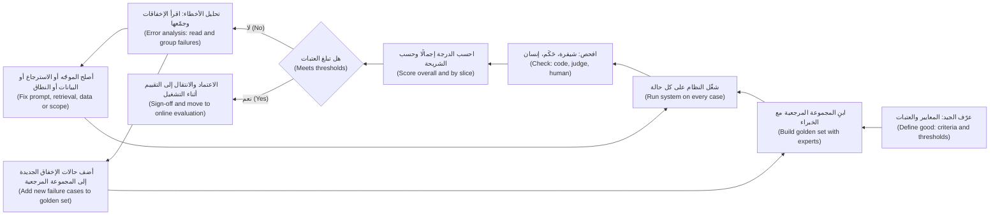
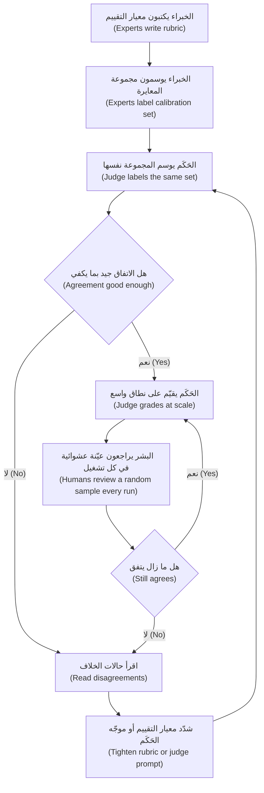
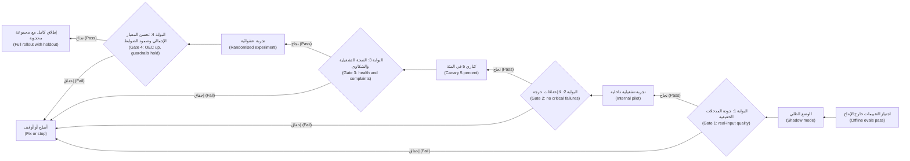

# الوحدة 6 — التقييم: أن تعرف أنه يعمل

*ميزة الذكاء الاصطناعي (AI feature) التي «تبدو رائعة في العرض التوضيحي» لم تُقيَّم بعد، بل نالت الإعجاب فقط. ولأن منتجات الذكاء الاصطناعي احتمالية (probabilistic)، فإن الإجابة الصادقة الوحيدة عن سؤال «هل يعمل؟ ⁦⁩» هي رقم مقيس على الحالات الصحيحة، مع قراءة الإخفاقات وفهمها. تعلّمك هذه الوحدة منظومة التقييم (evaluation stack) التي يملكها مدير منتج الذكاء الاصطناعي (AI product manager). تبدأ بالقياس خارج الإنتاج (offline measurement): المقاييس (metrics) والمجموعات المرجعية (golden sets) وتحليل الأخطاء (error analysis). ثم تتناول طرق الحكم على المخرجات على نطاق واسع: الشيفرة (code)، والنماذج التي تعمل حكّامًا، والخبراء البشريين (human experts)، والفرق الحمراء (red teams). وتنتهي بالتقييم أثناء التشغيل (online evaluation)، حيث يلتقي المستخدمون الحقيقيون بالمنتج عبر التشغيل الظلي (shadow runs) والتجارب (experiments) والإطلاق المرحلي (staged rollouts). ستتابع فريق المنتجات الرقمية والذكاء الاصطناعي (Digital & AI Products team) في بنك نجم (Najm Bank) بينما تبني دانة أول مجموعة مرجعية (golden set) لـ مساعد مذكرات الائتمان (Credit Memo Copilot)، ويتعلم فيصل لماذا يكون الحَكَم (judge) الذي يعطي كل شيء 4.6 من 5 عديم الفائدة، وتدير حصة وليلى أسبوع فريق أحمر (red-team week) على نجم أسيست (Najm Assist)، وتخطط رانيا لإطلاق (rollout) يمكن إيقافه عند أي خطوة.*

> **المراحل (Stages):** Evaluate — تحويل عبارة «يبدو أنه يعمل» إلى أدلة (evidence) يستطيع الفريق ومالك الأعمال (business owner) ووظيفة المخاطر (risk function) التصرف بناءً عليها، قبل الإطلاق (launch) وأثناء طرحه التدريجي.

---

# 6.1 — جودة يمكنك قياسها: المقاييس والمجموعات المرجعية وتحليل الأخطاء
*المستوى (Level): 🟡 متوسط (Intermediate)* · *المتطلبات (Prerequisites): 1.2، 5.1* · *المرحلة (Stage): Evaluate*

## ⚡ الدرس في دقيقة (In 60 seconds)
- **التقييم (Evaluation)** («التقييمات (evals)») يعني قياس المخرجات (outputs) مقابل تعريف متفق عليه لـ«الجيد (good)»، على حالات ثابتة (fixed cases)، وبشكل قابل للتكرار بعد كل تغيير.
- في المنتجات **التنبؤية (predictive)** (تنبيهات الاحتيال (fraud alerts)، والموافقة المسبقة على الائتمان) استخدم **مصفوفة الالتباس (confusion matrix)** و**الدقة (precision)** و**الاستدعاء (recall)**. وفي المنتجات **التوليدية (generative)** (مذكرة مُصاغة (drafted memo)، أو إجابة محادثة) قسّم «الجودة (quality)» إلى معايير منفصلة (separate criteria)، لكل منها فحصه الخاص.
- **المجموعة المرجعية (golden set)** مجموعة منتقاة ومُرقّمة الإصدارات من حالات الاختبار (test cases) ذات إجابات جيدة معروفة أو معايير نجاح (pass criteria). إنها أثمن أصول التقييم لدى الفريق، ويشكّل مدير المنتج (PM) ما يدخل فيها.
- **تحليل الأخطاء (Error analysis)** (قراءة الإخفاقات (reading failures) وفرزها في أنواع مسمّاة) يخبرك *ماذا تُصلح*؛ أما الدرجة (score) فتخبرك فقط *بمقدار* الخطأ.
- إشارة القرار (Decision cue): قبل بدء أي بناء (build)، اسأل: «أي حالات، وأي مقياس، وأي عتبة، ومن يقرر أنه جيد بما يكفي؟ ⁦⁩»
- أكبر فخ (Biggest trap): درجة متوسطة واحدة، تخفي الشرائح (slices) الأكثر أهمية، مثل المستندات العربية (Arabic documents) أو العملاء ذوي القيمة العالية (high-value clients).

## 🧭 لماذا يهم
شغّل فيصل النموذج الأولي (prototype) لـ مساعد مذكرات الائتمان على عشرة ملفات ائتمان (credit files) اختارها بنفسه، وأخبر رانيا أنه «جاهز بنسبة 90% تقريبًا (about 90% there)». يريد خالد (رئيس إقراض الأفراد) موعدًا للتجربة التشغيلية (pilot date). تطرح دانة (كبيرة علماء البيانات) ثلاثة أسئلة: «تسعون في المئة من ماذا؟ على أي عشرة ملفات؟ وكيف تبدو العشرة في المئة الأخرى؟ ⁦⁩» لا يستطيع فيصل الإجابة. كانت ملفاته العشرة حديثة، باللغة الإنجليزية، لعملاء ذوي حسابات مدققة نظيفة. لم يرَ المساعد (copilot) قط كشفًا عربيًا ممسوحًا ضوئيًا أو عميلًا تنقصه سنة من الحسابات.

تُظهر الحالات العامة (public cases) الفجوة نفسها. في فبراير 2023، قال عرض ترويجي (promotional demo) لـ Bard من Google خطأً إن تلسكوب جيمس ويب الفضائي (James Webb Space Telescope) التقط أول صور لكوكب خارج نظامنا الشمسي. انتشر الخبر عن الخطأ على نطاق واسع، وهبطت أسهم Alphabet بحدة. مثال واحد مختار بعناية نال الإعجاب ولم يُقيَّم.

قاعدة رانيا: **لا تنتقل أي ميزة ذكاء اصطناعي إلى التجربة التشغيلية (pilot) دون خطة تقييم (eval plan) وقّعها مالك الأعمال (business owner)**، تحدد الحالات (cases) والمقاييس والعتبات (thresholds) وما يحدث عند عدم بلوغ عتبة. يعلّمك هذا الدرس كتابة تلك الخطة وقراءة نتائجها.

## 📐 كيف يعمل

### 🟢 الأساسيات

**ما هو التقييم (What an eval is).** أربعة أجزاء: **الحالات (cases)** (المدخلات التي تختبر عليها)؛ و**تعريف الجيد (a definition of good)** (إجابة متوقعة (expected answer)، أو معايير يجب استيفاؤها)؛ و**الفحص (a check)** (شيفرة أو نموذج (model) أو شخص يقارن المخرج بالتعريف)؛ و**الدرجة والعتبة (a score and threshold)** (الرقم الذي تبلّغ عنه والمستوى الذي عنده تُطلق (ship) أو تتوقف (hold) أو تتراجع).

تعيد تشغيل الحالات نفسها بعد كل تغيير (الموجّه (prompt)، إصدار النموذج (model version)، مصدر الاسترجاع)، فيصبح التقييم **مجموعة اختبارات انحدار (regression suite)** تخبرك متى جعل تغييرٌ ما الأمور أسوأ. قدّم الدرس 5.1 التقييمات بوصفها متطلبات (requirements)؛ أما هذا الدرس فيبنيها ويقرؤها.

**المنتجات التنبؤية: مصفوفة الالتباس (Predictive products: the confusion matrix).** تقرر التنبيهات الذكية (Smart Alerts) «تنبيه (alert)» أو «لا تنبيه» لكل معاملة بطاقة (card transaction). وعند المقارنة بما حدث فعلًا، تقع كل حالة في أحد أربعة مربعات (four boxes):

| | احتيال فعلًا (Actually fraud) | سليمة فعلًا (Actually genuine) |
|---|---|---|
| **صدر تنبيه (Alert raised)** | إيجابي صحيح (True positive (TP)): احتيال مكتشف (caught fraud) | إيجابي كاذب (False positive (FP)): عميل أُزعج بلا داعٍ |
| **لا تنبيه (No alert)** | سلبي كاذب (False negative (FN)): احتيال فائت (missed fraud) | سلبي صحيح (True negative (TN)): هادئ وصحيح (quiet, correct) |

من هذه الأعداد تأتي المقاييس التي يجب أن يقرأها كل مدير منتج ذكاء اصطناعي (AI PM):
- **الدقة (Precision)** = TP ÷ (TP + FP). *من التنبيهات التي أرسلناها، كم منها كان احتيالًا حقيقيًا؟ ⁦⁩* الدقة المنخفضة تعني إرهاق التنبيهات (alert fatigue) وعملاء غاضبين (angry customers).
- **الاستدعاء (Recall)** = TP ÷ (TP + FN). *من كل الاحتيال الحقيقي، كم اكتشفنا؟ ⁦⁩* الاستدعاء المنخفض يعني خسائر (losses).
- **F1** = المتوسط التوافقي (harmonic mean) للاثنين، ويكون مرتفعًا فقط حين يرتفع كلاهما. جيد لمقارنة النماذج (comparing models)؛ وأضعف في القرارات (decisions)، لأنه يعامل الخطأين كأنهما متساويان في التكلفة (equally costly).
- **الصحة الإجمالية (Accuracy)** = (TP + TN) ÷ جميع الحالات. خطيرة حين تكون إحدى الفئات نادرة.

أرقام توضيحية (Illustrative numbers): 100,000 معاملة، منها 100 احتيال. يُصدر النموذج A عدد 400 تنبيه ويكتشف 80 عملية احتيال: الدقة 20%، والاستدعاء 80%. أما «نموذج» لا يُصدر أي تنبيه فيحقق صحة إجمالية 99.9% ولا يكتشف شيئًا. لا تقبل الصحة الإجمالية وحدها (accuracy alone) أبدًا لمنتج أحداث نادرة (rare-event product).

**العتبة قرار منتج (The threshold is a product decision).** يُخرج المصنِّف (classifier) درجة («احتمال الاحتيال 0.73 (fraud likelihood 0.73)»)؛ و**العتبة (threshold)** تحوّلها إلى إجراء (action). اخفضها فيرتفع الاستدعاء وتنخفض الدقة. لا يوجد إعداد «صحيح تقنيًا (technically correct)»: فالأمر يعتمد على تكلفة كل خطأ، احتيال فائت بقيمة 5,000 ريال قطري (QAR) مقابل بطاقة محجوبة في محطة وقود عند منتصف الليل. يأتي مدير المنتج بالتكاليف؛ وتعرض دانة المنحنى.

**المنتجات التوليدية: فكّك الجودة (Generative products: decompose quality).** ليس لمذكرة الائتمان (credit memo) إجابة صحيحة واحدة. قسّم الجودة إلى **معايير (criteria)** يمكن فحص كل منها وحده:

| المعيار (Criterion) | سؤال بسيط (Plain question) | مثال من مساعد مذكرات الائتمان |
|---|---|---|
| **الأمانة للمصادر (Faithfulness)** (الاستناد إلى المصادر) | هل كل ادعاء مدعوم بالمصادر؟ ⁦⁩ | الإيرادات (revenue) تطابق القوائم المدققة (audited statement) |
| **الاكتمال (Completeness)** | هل كل المطلوب موجود؟ ⁦⁩ | جميع أقسام المذكرة الثمانية |
| **صحة الاستدلال (Correct reasoning)** | هل الحسابات والاستنتاجات صحيحة؟ ⁦⁩ | نسبة تغطية خدمة الدين صحيحة |
| **الامتناع (Abstention)** | هل يقول «غير موجود» بدل التخمين؟ ⁦⁩ | الإشارة إلى غياب حسابات 2024 (missing 2024 accounts flagged) |
| **الشكل والأسلوب (Format and style)** | هل يتبع القالب (template)؟ | العناوين (headings)، وتنسيق العملة (currency format)، والطول (length) |
| **السلامة والسياسة (Safety and policy)** | هل يتجنب ما يجب ألا يفعله أبدًا؟ ⁦⁩ | لا بيانات لعميل آخر؛ لا لغة موافقة |

لكل معيار فحصه وعتبته. عبارة «الأمانة للمصادر ≥ 98% من الأرقام (Faithfulness ≥ 98% of figures)» مفيدة؛ أما «الجودة 4.2 من 5 (quality 4.2 out of 5)» فليست كذلك.

**المجموعات المرجعية (Golden sets).** **المجموعة المرجعية (golden set)** (أو المجموعة المرجعية للاختبار) مجموعة منتقاة من حالات الاختبار، لكل منها مُدخل (input) وإما إجابة مرجعية (reference answer) («نسبة تغطية خدمة الدين 1.35 (the DSCR is 1.35)») أو معايير نجاح («يجب أن يشير إلى غياب حسابات 2024 (must flag that 2024 accounts are missing)»). المجموعة الجيدة **تغطي المساحة (covers the space)** (الحالات الشائعة والصعبة والحدّية والتي يجب رفضها)، و**يوسمها الأشخاص المناسبون (labelled by the right people)** (موظفو الائتمان (credit officers)، لا كتّاب الموجّه)، و**مُرقّمة الإصدارات (versioned)** بحيث تعني عبارة «92% على الإصدار 3 (92% on v3)» شيئًا في الربع القادم، و**تنمو من الإخفاقات الحقيقية (grows from real failures)**.

**تحليل الأخطاء (Error analysis).** تخبرك الدرجة بمقدار الخطأ؛ ويخبرك تحليل الأخطاء بماهيته. الطريقة يدوية (manual) وناجحة:
1. خذ المخرجات الفاشلة (failed outputs)، أو عيّنة عشوائية (random sample) إن لم تكن لديك وسوم (labels) بعد.
2. اكتب ملاحظة قصيرة عن كل إخفاق («استخدم رقم 2022 (used the 2022 figure)»، «اختلق تعهدًا»).
3. جمّع الملاحظات في **تصنيف إخفاقات (failure taxonomy)** صغير: فئات مسمّاة (named categories).
4. عُدّ كل فئة واضربها في شدتها.
5. أصلح الفئة الأكبر، وأعد تشغيل التقييم، وكرّر.

إن تقرير أن «السنة المالية الخاطئة» أشد من «ملخص أطول قليلًا» قرار منتج (product call)، ولهذا يشارك مدير المنتج.

### 🟡 التعمق أكثر (Going deeper)

**الشرائح (Slices).** **الشريحة (slice)** مجموعة فرعية من الحالات تشترك في خاصية: المستندات العربية، وملفات PDF الممسوحة ضوئيًا (scanned PDFs)، والملفات التي تتجاوز 50 مليون ريال قطري (QAR 50 million). أبلغ دائمًا عن المقاييس حسب الشريحة إلى جانب الإجمالي (overall). المساعد الذي يحقق 95% إجمالًا و70% على الكشوف العربية (Arabic statements) ليس جاهزًا لبنك لديه كثير من حسابات الشركات الصغيرة والمتوسطة العربية. وترتبط الشرائح أيضًا بالعدالة (fairness): في التمويل الفوري للشركات الصغيرة (SME Instant Finance)، ستطلب الحوكمة (governance) الأداء حسب شريحة العملاء (customer segment) (انظر *AI Governance: Zero to Hero*).

**ROC وAUC والمعايرة (ROC, AUC and calibration).** أداتان إضافيتان لـ التنبيهات الذكية والتمويل الفوري للشركات الصغيرة:
- **منحنى ROC (ROC curve)** (خاصية تشغيل المستقبِل) يرسم معدل الإيجابيات الصحيحة (true positive rate) مقابل معدل الإيجابيات الكاذبة (false positive rate) عند كل عتبة (every threshold). و**AUC** (المساحة تحت ذلك المنحنى) تلخّص مدى جودة النموذج في *ترتيب (ranks)* الإيجابيات فوق السلبيات: 0.5 عشوائي (random)، و1.0 مثالي (perfect). يساعد في مقارنة النماذج (compare models)، لكنه لا يقول شيئًا عن قبول عتبة معينة. وحين تكون الإيجابيات نادرة جدًا، يكون **منحنى الدقة والاستدعاء (precision-recall curve)** أكثر إفادة غالبًا.
- **المعايرة (Calibration)** تسأل هل تعني الدرجات ما تقوله. إذا حصلت 1,000 فاتورة لشركات صغيرة (SME invoices) على «خطر تعثر 10% (10% default risk)»، فهل يتعثر نحو 100 منها؟ يمكن أن يكون النموذج جيد الترتيب (well-ranked) سيئ المعايرة (badly calibrated). وتهم المعايرة كلما استخدم أحدٌ الرقمَ نفسه: للتسعير، أو وضع الحدود (set limits)، أو إظهار الثقة (show confidence).

**كم حالة تحتاج؟ ⁦(How many cases do you need?)⁩** لمعدل نجاح (pass rate) p على n حالة، يساوي الخطأ المعياري الواحد الجذر التربيعي لـ p × (1 − p) ÷ n. مع 100 حالة عند 90%، يبلغ نحو 3 نقاط (about 3 points)، فيكون نطاق 95% (95% range) تقريبًا ±6 نقاط (من 84% إلى 96%)؛ ومع 50 حالة، تقريبًا ±8. لذا فإن «حقق الإصدار 2 نسبة 91% والإصدار 1 نسبة 89% (v2 scored 91%, v1 scored 89%)» على 100 حالة ليس دليلًا. بضع عشرات من الحالات تكشف أنواع الإخفاق الكبيرة؛ أما مقارنة إصدارات متقاربة فتحتاج مئات الحالات لكل شريحة مهمة.

**عدم الحتمية (Non-determinism).** قد يعطي الموجّه نفسه مخرجات مختلفة من تشغيل لآخر، خاصة عند **درجة حرارة (temperature)** أعلى (إعداد العشوائية؛ انظر 1.2). شغّل التقييمات المهمة عدة مرات وأبلغ عن التشتت. الحالة التي تنجح في تشغيلين من ثلاثة ستصبح شكوى في الإنتاج.

**الفحوص المبنية على الشيفرة أولًا (Code-based checks first).** الشيفرة العادية (ordinary code) رخيصة وسريعة ومتسقة. هل يظهر كل رقم في المذكرة في المستندات المصدرية (source documents)؟ هل جميع الأقسام المطلوبة (required sections) موجودة؟ هل تذكر عميلًا ليس في هذا الملف؟ استخدم الشيفرة حيثما كان المعيار آليًا (mechanical)، واحتفظ بالحكّام النموذجيين (model judges) والمراجعين البشريين (human reviewers) (6.2) للأحكام التقديرية (judgement)، مثل ما إذا كان سرد المخاطر (risk narrative) سليمًا.

### 🔴 نظرة الخبير (Expert view)

**المقاييس خارج الإنتاج مؤشرات بديلة (Offline metrics are proxies).** ما يهم الأعمال هو **النتائج (outcomes)**: الساعات الموفّرة (hours saved)، وتقليل الإعادات من اللجنة، وخسائر الاحتيال التي مُنعت. الخطة الجيدة تسمّي السلسلة («أرقام أمينة للمصادر ← يثق بها مديرو العلاقات ← إعادة تحقق أقل ← وقت أقل لكل مذكرة») وتختبر الحلقات الضعيفة (weak links) أثناء التشغيل (online) (6.3). حين ترتفع الدرجة خارج الإنتاج (offline score) ولا تتحرك النتيجة، فالمؤشر البديل هو المعطوب، لا المستخدمون.

**قانون Goodhart (Goodhart's law).** «حين يصبح المقياس هدفًا، يكفّ عن أن يكون مقياسًا جيدًا ⁦⁩». إذا كوفئ الفريق على درجة المجموعة المرجعية (golden-set score)، فسيُضبط الموجّه ببطء على تلك الحالات بعينها. الدفاعات (Defences): **مجموعة محجوبة (held-out set)** لا يراها مهندسو الموجّهات (prompt engineers) أبدًا، وتُستخدم فقط لقرارات الإصدار (release decisions)؛ وتحديثات ربع سنوية من الإنتاج؛ وعيّنة من المخرجات يقرؤها إنسان إلى جانب كل درجة.

**المعايير المرجعية العامة ليست تقييمك (Public benchmarks are not your eval).** تساعدك درجات المعايير المرجعية لدى المورّدين في إعداد قائمة مختصرة بالنماذج (shortlist models) (1.3). لكنها لا تخبرك بأداء النموذج على ملفات الائتمان في بنك نجم، بالعربية، وبقوالب بنك نجم (Najm's templates)، وقد تكون بعض أسئلة المعايير المرجعية قد تسربت إلى بيانات التدريب («التلوث (contamination)»). عامل لوحات الصدارة (leaderboards) كمرشِّح (filter) ومجموعتك المرجعية كأساس القرار.

**مجموعة التقييم أصل منتج له مالك (The eval set is a product asset with an owner).** تعيش المجموعات المرجعية أطول من النماذج: حين يقترح طارق (قائد الهندسة) نموذجًا أرخص (cheaper model)، تجعل المجموعة المرجعية ذلك قرارًا من يومين (two-day decision)، لا نقاشًا من شهرين (two-month debate). تحتوي ملفات الائتمان على بيانات العملاء (client data)، لذا تتبع المجموعة قواعد بيانات الإنتاج (3.3)، وتعتمد سارة (مسؤولة حماية البيانات (DPO)) قرار استخدام بيانات حقيقية أو مُقنّعة.

**عتبات مرجّحة بالشدة (Severity-weighted thresholds).** التعهد المختلق (invented covenant) أسوأ من مذكرة أطول بفقرتين. تحدد الفرق الناضجة (mature teams) بضعة **أنواع إخفاق حرجة (critical failure types)** بلا أي تسامح (zero tolerance) («لا رقم مختلقًا في أي حالة من المجموعة المرجعية») إلى جانب العتبات العادية (ordinary thresholds). الإصدار (release) الذي يحسّن المتوسط لكنه يضيف إخفاقًا حرجًا واحدًا يُحجب.

## 🧰 الأدوات
| الأداة أو الإطار (Tool or framework) | ما هو وماذا يفعل | متى تلجأ إليه |
|---|---|---|
| **Confusion matrix** — مصفوفة الالتباس | عدٌّ في أربعة مربعات للإيجابيات والسلبيات الصحيحة والكاذبة | أي منتج تنبؤي بنعم أو لا: التنبيهات الذكية، التمويل الفوري للشركات الصغيرة |
| **Precision and recall** — الدقة والاستدعاء | نسبة القرارات الإيجابية الصحيحة؛ ونسبة الإيجابيات الحقيقية المكتشفة | اختيار عتبة والدفاع عنها |
| **ROC/AUC and calibration** — ROC/AUC والمعايرة | جودة الترتيب عبر العتبات؛ ومدى تطابق الدرجات مع المعدلات المرصودة (observed rates) | مقارنة النماذج؛ أي منتج يستخدم الدرجة نفسها |
| **Golden set** — المجموعة المرجعية | حالات اختبار منتقاة ومُرقّمة الإصدارات بإجابات مرجعية (reference answers) أو معايير نجاح | من أول نموذج أولي (first prototype)؛ قبل كل تغيير في الموجّه أو النموذج أو البيانات |
| **Error analysis** — تحليل الأخطاء | قراءة الإخفاقات وتجميعها في تصنيف معدود (counted taxonomy) | بعد عدم بلوغ عتبة (missed threshold)؛ حين يشتكي المستخدمون والدرجات تبدو جيدة |
| **Slice analysis** — تحليل الشرائح | مقاييس لكل مجموعة فرعية من الحالات | دائمًا: اللغة (language)، نوع المستند (document type)، الشريحة (segment)، الحالات عالية القيمة (high-value cases) |
| **Code-based assertions** — تأكيدات مبنية على الشيفرة | فحوص حتمية (deterministic checks) بشيفرة عادية | المعايير الآلية (mechanical criteria): الأرقام تطابق المصدر، الحقول موجودة (fields present) |

## 🏛️ عمليًا في بنك نجم
تكتب دانة وفيصل **خطة تقييم مساعد مذكرات الائتمان، الإصدار 1 (Credit Memo Copilot Eval Plan v1)**. ويوقّعها خالد (مالك الأعمال) وليلى (حوكمة الذكاء الاصطناعي).

**الجزء A: تكوين المجموعة المرجعية، الإصدار 1 (Part A: golden set v1 composition) (أحجام توضيحية (illustrative sizes))**

| الشريحة | الحالات | سبب وجودها |
|---|---|---|
| ملفات شركات صغيرة ومتوسطة قياسية، بالإنجليزية، مدققة | 60 | المسار الشائع |
| كشوف عربية أو ثنائية اللغة | 40 | كثير من ملفات الشركات الصغيرة؛ لم يرها النموذج الأولي قط |
| ملفات PDF ممسوحة ضوئيًا أو رديئة الجودة | 25 | تظهر أخطاء الاستخراج (extraction errors) هنا أولًا |
| بيانات ناقصة أو غير متسقة | 25 | تختبر الامتناع: أشِر، ولا تختلق أبدًا |
| تعرّضات فوق عتبة اللجنة | 20 | أعلى تكلفة للخطأ |
| طلبات خارج النطاق («وافق على هذا») (Out-of-scope requests) | 10 | يجب أن يرفض بلباقة |
| **محجوبة (Held-out)** (مخفية عن ضبط الموجّه) | 50 | لقرارات الإصدار فقط |

يوسم جميعَ الحالات موظفو الائتمان (متحدثون بالعربية للشريحة العربية)، وتحسم دانة الخلافات (resolving disagreements).

**الجزء B: المعايير والفحوص والعتبات (Part B: criteria, checks and thresholds)**

| المعيار | الفحص (Check) | عتبة التجربة التشغيلية (Pilot threshold) | حرج؟ ⁦(Critical?)⁩ |
|---|---|---|---|
| الأمانة للمصادر في الأرقام (Figure faithfulness) | شيفرة: كل رقم يُتتبّع إلى صفحة مصدر | 100% من الأرقام قابلة للتتبع (traceable)؛ 0 أرقام مختلقة (fabricated figures) | نعم: أي اختلاق يحجب الإصدار |
| حسابات النسب (Ratio calculations) | شيفرة: إعادة حساب نسبة تغطية خدمة الدين (DSCR) والرافعة المالية (leverage) ونسبة التداول (current ratio) | ≥ 98% صحيحة | نعم |
| الامتناع عند نقص البيانات | شيفرة مع فحص بشري على شريحة البيانات الناقصة (missing-data slice) | ≥ 95% من الفجوات يُشار إليها (gaps flagged) | نعم |
| اكتمال الأقسام (Section completeness) | شيفرة: الأقسام الثمانية موجودة | ≥ 99% | لا |
| سلامة سرد المخاطر | معيار تقييم لموظف الائتمان، مقياس 1–4 (انظر 6.2) | الوسيط (Median) ≥ 3؛ لا تقييمات «مضلِّل (misleading)» | لا |
| الشكل والأسلوب | شيفرة مع حَكَم | ≥ 95% | لا |
| كل شريحة (Every slice) | كل ما سبق لكل شريحة (per slice) | لا شريحة تقل بأكثر من 5 نقاط عن الإجمالي (more than 5 points below overall) | لا |

**الجزء C: القواعد (Part C: rules).** أعد التشغيل عند كل تغيير في الموجّه أو النموذج أو الاسترجاع أو القالب. أبلغ إجمالًا وحسب الشريحة، مع أعداد الحالات (case counts). سجّل كل إخفاق في التصنيف (taxonomy)؛ وأضف إخفاقات الإنتاج (production failures) إلى المجموعة المرجعية خلال دورة عمل واحدة. مالكة المجموعة المرجعية (Golden-set owner): دانة. مالك العتبات (Threshold owner): خالد، بمشورة فيصل.

## 🛠️ التمارين (Exercises)
- 🟢 اكتشفت التنبيهات الذكية الشهر الماضي 120 من أصل 150 عملية احتيال حقيقية (real frauds)، وأصدرت 900 تنبيه إجمالًا. احسب الدقة والاستدعاء، ثم اكتب جملتين لخالد تشرح ما يعنيه كل رقم للعملاء. *يكتمل عندما (Done when):* تحصل على دقة ≈ 13% واستدعاء = 80%، ولا تستخدم أيٌّ من الجملتين كلمتي «الدقة» أو «الاستدعاء».
- 🟡 صُغ جدول تكوين مجموعة مرجعية لـ نجم أسيست وهو يجيب عن أسئلة البطاقات والحسابات، بخمس شرائح على الأقل مع سبب وجود كل منها. *يكتمل عندما:* يتضمن شريحة عربية (Arabic slice)، وشريحة خارج النطاق (out-of-scope slice)، وشريحة تكون فيها الإجابة الصحيحة «لا أستطيع فعل ذلك؛ إليك كيف تصل إلى شخص (I cannot do that; here is how to reach a person)».
- 🔴 خذ 20 مخرجًا من أداة ذكاء اصطناعي توليدي تستخدمها (أو من روبوت محادثة عام (public chatbot) يجيب عن أسئلة في مجالك). نفّذ تحليل أخطاء كاملًا: دوّن كل إخفاق، وابنِ تصنيفًا من أربع إلى سبع فئات، وعُدّها ورتّبها حسب التكرار مضروبًا في الشدة. *يكتمل عندما:* تستطيع تسمية الإصلاح الأول (first fix)، وتبريره بالأعداد، وسرد حالات المجموعة المرجعية (golden-set cases) التي ستضيفها.

## ⚠️ أخطاء وفخاخ (Mistakes and traps)
- **الحكم بالعرض التوضيحي (Judging by demo).** الأمثلة المنتقاة يدويًا (hand-picked examples) ليست دليلًا. اكتب خطة التقييم قبل الوعد بموعد تجربة تشغيلية.
- **الصحة الإجمالية في الأحداث النادرة (Accuracy on rare events).** يمكن أن يكون نموذج الاحتيال (fraud model) صحيحًا بنسبة 99.9% وعديم الفائدة. استخدم الدقة والاستدعاء.
- **درجة جودة واحدة ممزوجة (One blended quality score).** قسّم الجودة إلى معايير بعتبات منفصلة (separate thresholds)، وحدّد المعايير الحرجة (critical ones).
- **المهندسون وحدهم يوسمون المجموعة المرجعية (Engineers labelling the golden set alone).** خبراء المجال (domain experts) يوسمون ما يحتاجه العمل فعلًا.
- **التعامل مع فروق الدرجات الصغيرة كأنها حقيقية (Treating small score differences as real).** على 100 حالة، 89% مقابل 91% ضجيج (noise). أبلغ عن أعداد الحالات.
- **مجموعة مرجعية لا تتغير أبدًا (A golden set that never changes).** يضبط الفريق عليها فتنجرف عن الواقع. حدّثها واحتفظ بمجموعة محجوبة.

## 🧾 الخلاصة (Recap)
- التقييم (eval) هو حالات، وتعريف للجيد، وفحص، وعتبة، يُعاد تشغيله بعد كل تغيير.
- في المنتجات التنبؤية (predictive products)، استخدم مصفوفة الالتباس والدقة والاستدعاء. العتبة قرار منتج (product decision) مبني على تكلفة كل خطأ.
- في المنتجات التوليدية (generative products)، قسّم الجودة إلى معايير وافحص كلًّا منها منفصلًا، بالشيفرة حيثما أمكن.
- المجموعة المرجعية أصل مُرقّم الإصدارات، يوسمه الخبراء، ومقسّم إلى شرائح، ينمو من الإخفاقات الحقيقية، وفيه جزء محجوب (held-out portion).
- يحوّل تحليل الأخطاء الدرجات إلى قائمة إصلاحات مرتبة. والدرجات خارج الإنتاج (offline scores) مؤشرات بديلة (proxies) لنتائج الأعمال (business outcomes).

## ✍️ اختبر نفسك (Check yourself)

**1. يُصدر النموذج الجديد لـ التنبيهات الذكية (Smart Alerts) تنبيهات أقل من القديم، ويشتكي العملاء أقل. تُبلغ دانة أنه يكتشف 60 من أصل 100 عملية احتيال، بينما اكتشف النموذج القديم 85. أي عبارة صحيحة؟**

- A. انخفض الاستدعاء (recall) من 85% إلى 60%؛ وربما ارتفعت الدقة (precision)، ويعتمد قبول هذه المقايضة على تكلفة الاحتيال الفائت مقابل تكلفة التنبيهات الكاذبة
- B. انخفضت الدقة (precision) وارتفع الاستدعاء (recall)
- C. النموذج الجديد أفضل لأن العملاء يشتكون أقل، كما أن قلة التنبيهات (alerts) تعني أن فريق الاحتيال (fraud team) لديه عمل أقل كل يوم ويستطيع التركيز على أخطر الحالات في كل وردية عمل (shift)
- D. الصحة الإجمالية (accuracy) هي المقياس الصحيح لحسم المسألة

الإجابة

**A.** انخفض الاستدعاء (recall) (نسبة الاحتيال الحقيقي المكتشف)؛ والتنبيهات الأقل تعني عادةً دقة (precision) أعلى. الاختيار بينهما قرار أعمال (business decision) بشأن تكاليف الأخطاء (error costs). الخيار C ينظر إلى جانب واحد فقط؛ والخيار D يفشل لأن الاحتيال نادر. (🟢 الأساسيات.)

**2. يُبلغ فيصل أن الإصدار 2 من موجّه المساعد (copilot prompt) حقق 91% على مجموعة مرجعية (golden set) من 100 حالة، مقابل 89% للإصدار 1، ويقترح إطلاقه (shipping it) بوصفه «أفضل بوضوح (clearly better)». ما أفضل رد؟**

- A. الموافقة، لأن أي تحسن يجب إطلاقه
- B. رفض الإصدار 2، لأن المجموعة المرجعية (golden set) أصغر من أن تُستخدم أصلًا، ويجب بناء مجموعة أكبر (larger set) بكثير قبل أي مقارنة بين الإصدارين أو أي قرار بالإطلاق (shipping decision)
- C. الإشارة إلى أن فرق نقطتين على 100 حالة يقع ضمن الضجيج، وطلب النتائج حسب الشريحة (per-slice results)، وعدد الإخفاقات الحرجة، ومقارنة أكبر أو متكررة
- D. التحول إلى معيار مرجعي عام (public benchmark) لحسمها

الإجابة

**C.** عند 100 حالة ونحو 90%، يبلغ عدم اليقين (uncertainty) تقريبًا ±6 نقاط، لذا ففجوة النقطتين ليست دليلًا. الخيار B مبالغة في رد الفعل (overreacts): فالمجموعات الصغيرة ما زالت تكشف أنواع الإخفاق (failure types). والخيار D يقيس المهمة الخطأ. (🟡 التعمق أكثر (Going deeper).)

**3. أي مجموعة مرجعية (golden set) هي الأفضل لـ مساعد مذكرات الائتمان (Credit Memo Copilot)؟**

- A. مجموعة مُرقّمة الإصدارات (versioned set) مقسّمة إلى شرائح حسب اللغة وجودة المستند والبيانات الناقصة وحجم التعرّض، يوسمها موظفو الائتمان (credit officers)، وفيها جزء محجوب (held-out portion)
- B. أحدث 200 مذكرة، يوسمها المهندسون الذين كتبوا الموجّه (prompt)، لأنهم أعرف الناس بما يُفترض أن يفعله الموجّه في كل حالة من هذه الحالات
- C. معيار مرجعي عام للإجابة عن الأسئلة المالية، لأن نتائجه منشورة ويمكن مقارنتها بنتائج النماذج الأخرى
- D. عشر مذكرات ممتازة يختارها مالك الأعمال (business owner)، لأنها تُظهر المستوى الذي يريد فريق الائتمان كله أن يبلغه المساعد في كل مرة

الإجابة

**A.** إنها تغطي الشرائح الصعبة (hard slices)، وتستعين بخبراء المجال (domain experts)، وتحمي قرارات الإصدار (release decisions) بمجموعة محجوبة (held-out set). الخيار B فيه الواسمون الخطأ (wrong labellers)؛ والخيار D عرض توضيحي (demo) لا تقييم (eval). (🟢 الأساسيات؛ 🏛️ عمليًا.)

**4. تبلغ درجة الأمانة للمصادر الإجمالية (overall faithfulness score) للمساعد 97%، فوق الهدف (above target). ومع ذلك يقول مديرو العلاقات (relationship managers) إنهم «لا يستطيعون الوثوق بالأرقام (cannot trust the numbers)». ماذا يجب أن يفعل مدير المنتج (PM) أولًا؟**

- A. إجراء تحليل الأخطاء (error analysis) على الإخفاقات وفحص الأمانة للمصادر (faithfulness) حسب الشريحة، مثل المستندات العربية والممسوحة ضوئيًا
- B. إخبار مديري العلاقات (RMs) بأن الدرجة فوق الهدف
- C. رفع الهدف إلى 99% والانتظار
- D. استبدال النموذج بالنموذج الأعلى في لوحة صدارة عامة (public leaderboard)

الإجابة

**A.** قد يخفي المتوسط الجيد (good average) شريحة فاشلة (failing slice) يعمل فيها مديرو العلاقات (RMs) يوميًا؛ ويُظهر تحليل الأخطاء (error analysis) ماهية الإخفاقات. الخيار B يستخف بالأدلة (dismisses evidence)؛ والخياران C وD يتصرفان قبل فهم المشكلة. (🟢 الأساسيات؛ 🟡 التعمق أكثر (Going deeper).)

**5. لماذا تصنّف خطة التقييم (eval plan) «الرقم المالي المختلق (fabricated financial figure)» إخفاقًا حرجًا (critical failure) بلا أي تسامح (zero tolerance)، بدل دمجه في المتوسط؟**

- A. لأن الإخفاقات الحرجة أسهل في القياس
- B. لأن الجهات التنظيمية (regulators) تشترط صفر أخطاء في جميع أنظمة الذكاء الاصطناعي، فأي رقم مختلق يُعدّ مخالفة يجب على البنك الإبلاغ عنها للبنك المركزي (central bank)
- C. لأن المتوسطات خاطئة دائمًا
- D. لأن بعض الإخفاقات شديدة بما يكفي بحيث يجب حجب الإصدار (release) الذي يحسّن المتوسط لكنه يضيف واحدًا منها

الإجابة

**D.** تمنع العتبات المرجّحة بالشدة (severity-weighted thresholds) المتوسطَ المرتفع من إخفاء إخفاق نادر وغير مقبول. الخيار B يختلق قاعدة؛ والخيار C مبالغة (overstates): فالمتوسطات مفيدة إلى جانب الشرائح (slices) والفحوص الحرجة (critical checks). (🔴 نظرة الخبير (Expert view).)

## 📚 المراجع (References)
- Google, Machine Learning Crash Course — https://developers.google.com/machine-learning/crash-course
- scikit-learn documentation, "Metrics and scoring: quantifying the quality of predictions" — https://scikit-learn.org/stable/modules/model_evaluation.html
- Fawcett, T. (2006), "An introduction to ROC analysis", *Pattern Recognition Letters* 27(8)
- Guo, C., Pleiss, G., Sun, Y. and Weinberger, K. Q. (2017), "On Calibration of Modern Neural Networks" — https://arxiv.org/abs/1706.04599
- NIST AI Risk Management Framework 1.0 — https://www.nist.gov/itl/ai-risk-management-framework
- Google PAIR, People + AI Guidebook — https://pair.withgoogle.com/guidebook
- [*اختبار البرمجيات من الصفر إلى الاحتراف في عصر الذكاء الاصطناعي*، الدرس 7.1 — التقييمات الآلية: اختبار تطبيقات النماذج اللغوية](../testing/index.ar.html#/7.1) — منظور الاختبار (testing) لهذا الموضوع

---

# 6.2 — النموذج اللغوي حَكَمًا، والمراجعة البشرية، والفريق الأحمر
*المستوى: 🟡 متوسط* · *المتطلبات: 6.1، 4.2* · *المرحلة: Evaluate*

## ⚡ الدرس في دقيقة (In 60 seconds)
- يحتاج كل تقييم إلى **حَكَم (judge)** يقرر هل نجح المخرج (output passed): **الشيفرة (code)** (رخيصة ودقيقة وضيقة)، أو **نموذج (a model)** (قابل للتوسع ومرن ومنحاز)، أو **البشر (humans)** (المعيار المرجعي، بطيء ومكلف). استخدم كلًّا منها حيث يناسب.
- **النموذج اللغوي حَكَمًا (LLM-as-judge)** يعني أن نموذجًا لغويًا (language model) يقيّم المخرجات مقابل **معيار تقييم (rubric)**. يتوسع إلى آلاف المخرجات، لكن فقط بعد أن تُثبت أنه يتفق مع خبرائك.
- انحيازات الحَكَم المعروفة: **الموضع (position)** (تفضيل الإجابة الأولى أو الثانية)، و**الإسهاب (verbosity)** (تفضيل الإجابات الأطول)، و**تفضيل الذات (self-preference)** (تفضيل عائلة نموذجه).
- تحتاج **المراجعة البشرية (Human review)** إلى **معيار تقييم (rubric)** مكتوب، ومراجعين مدرَّبين (trained reviewers)، ومقياس لـ **الاتفاق بين المقيّمين (inter-rater agreement)**. إذا لم يستطع خبيران الاتفاق، فالمعيار لم يُعرَّف بعد.
- **الفريق الأحمر (Red-teaming)** هجوم متعمَّد (deliberate attack): جعل المنتج يفشل بطرق ضارة أو مكلفة قبل أن يفعل ذلك المستخدمون الحقيقيون والمهاجمون (attackers).
- أكبر فخ: حَكَم غير معايَر (uncalibrated judge). الحَكَم الذي يعطي كل شيء 4.6 من 5 لا يقيس شيئًا.

## 🧭 لماذا يهم
تضم المجموعة المرجعية التي بنتها دانة لـ مساعد مذكرات الائتمان عدد 230 حالة، وتغطي فحوص الشيفرة (code checks) الأرقام والأقسام. لكن «سرد المخاطر» ما زال يحتاج إلى حكم تقديري: هل عرض مخاطر العميل سليم وغير مضلِّل؟ يستطيع موظفا ائتمان مراجعة نحو 30 مذكرة يوميًا، وكل تغيير في الموجّه (prompt change) يحتاج إلى إعادة تشغيل كاملة (full re-run). حل فيصل: أن يطلب من نموذج كبير (large model) «تقييم كل مذكرة من 1 إلى 5 للجودة (rate each memo from 1 to 5 for quality)». المتوسط 4.6. وموجّه معطوب عمدًا يحصل على 4.4. الحَكَم لا يميّز الجيد من الرديء، وكاد الفريق يُطلق بناءً على كلمته.

في الوقت نفسه، يوشك نجم أسيست أن يبدأ في اتخاذ إجراءات (taking actions) مثل تجميد بطاقة (freezing a card). تُظهر الحالات العامة ما يحدث حين يلتقي مساعد يتعامل مع العملاء (customer-facing assistant) بأشخاص يحاولون كسره. في ديسمبر 2023، جعل مستخدمو روبوت محادثة (chatbot) على موقع أحد وكلاء Chevrolet الروبوتَ «يوافق» على بيع سيارة بدولار واحد عبر التلاعب بالموجّه (prompt manipulation). وفي يناير 2024، بعد تحديث (update)، شتم روبوت محادثة التوصيل لدى DPD عميلًا وانتقد الشركة حين طُلب منه ذلك. لم يحتج أيٌّ منهما إلى مهارات متقدمة (advanced skills). لن توافق ليلى (رئيسة حوكمة الذكاء الاصطناعي) على ميزات الوكيل (agent features) في نجم أسيست حتى يحاول الفريق كسرها أولًا.

## 📐 كيف يعمل

### 🟢 الأساسيات

**ثلاثة أنواع من الحكّام (Three kinds of judge).**

| الحَكَم | يجيد (Good at) | يضعف في (Weak at) | التكلفة لكل مخرج |
|---|---|---|---|
| **الشيفرة (Code)** | الفحوص الآلية (mechanical checks): تطابق الأرقام، وجود الحقول | أي شيء يحتاج إلى فهم المعنى (needing meaning) | شبه صفرية (near zero) |
| **النموذج (Model (LLM-as-judge))** | معايير لفظية: الصلة (relevance)، النبرة (tone)، هل الادعاء مدعوم | الحكم الدقيق في المجال؛ قد يكون منحازًا أو يُخدع | منخفضة (low) (استدعاء نموذج آخر) |
| **الخبير البشري (Human expert)** | حكم المجال (domain judgement)؛ أنواع الإخفاق الجديدة؛ الكلمة الأخيرة | السرعة والتكلفة والاتساق والإرهاق | مرتفعة (high) |

قاعدة عامة (Rule of thumb): الشيفرة لكل ما تستطيع الشيفرة فحصه؛ وحَكَم نموذجي معايَر للمعايير عالية الحجم (high-volume criteria)؛ والبشر لوضع المعيار، ومعايرة الحَكَم، ومراجعة العيّنات (review samples)، والتعامل مع أعلى المخاطر (highest stakes).

**النموذج اللغوي حَكَمًا (LLM-as-judge).** يتلقى النموذج الحَكَم (judge model) المُدخل والمخرج (output) و**معيار تقييم (rubric)** (معايير مكتوبة لكل درجة) ويُعيد حكمًا (verdict). ثلاث صيغ (formats):
- **نقطي (Pointwise)**: تقييم مخرج واحد («هل كل عبارة عن المخاطر مدعومة بالمستندات المرفقة؟ PASS أو FAIL، ثم اقتبس أي عبارة غير مدعومة. ⁦⁩»)
- **زوجي (Pairwise)**: اختيار الأفضل من مخرجين؛ مفيد لمقارنة الإصدارات (comparing versions).
- **موجَّه بالمرجع (Reference-guided)**: التقييم مقابل إجابة مرجعية من المجموعة المرجعية.

درس Zheng وزملاؤه هذا النهج في «Judging LLM-as-a-Judge with MT-Bench and Chatbot Arena» (2023). وأفادوا بأن الحكّام النموذجيين الأقوياء اتفقوا مع التفضيلات البشرية (human preferences) بقدر ما اتفق البشر بعضهم مع بعض تقريبًا على مجموعات الاختبار لديهم (test sets). ووثّقوا أيضًا نقاط ضعف (weaknesses):
- **انحياز الموضع (Position bias)**: تفضيل إجابة بسبب موضع ظهورها (الأولى أو الثانية).
- **انحياز الإسهاب (Verbosity bias)**: تفضيل الإجابات الأطول حتى حين لا تكون أفضل.
- **انحياز تعزيز الذات (Self-enhancement (self-preference) bias)**: تفضيل الإجابات التي كتبها النموذج نفسه أو عائلة النموذج نفسها.
- **الاستدلال المحدود (Limited reasoning)**: صعوبة تقييم أسئلة الرياضيات والمنطق التي لم يكن يستطيع حلها بموثوقية بنفسه.

تُظهر الدراسة أن التحكيم بالنموذج (model judging) *يمكن* أن ينجح، لا أن حَكَمك *أنت* ينجح على مهمتك *أنت*. وهذا ما يجب أن تقيسه.

**جعل الحَكَم جديرًا بالثقة (Making a judge trustworthy).**
1. **معيار تقييم ضيق (Narrow rubric).** معيار واحد لكل استدعاء؛ PASS/FAIL ثنائي (binary) أو مقياس قصير مع «مرساة (anchor)» مكتوبة لكل مستوى، لا «قيّم من 1 إلى 10 (rate 1 to 10)».
2. **الدليل قبل الحكم (Evidence before verdict).** «اقتبس الجملة غير المدعومة، ثم قرّر. ⁦⁩» هذا يجعل القرارات قابلة للتحقق (checkable).
3. **واجه الانحيازات (Counter the biases).** شغّل الأزواج بالترتيبين واحسب فقط الأحكام المتسقة (consistent verdicts)؛ أخبر الحَكَم أن الطول ليس جودة؛ وفضّل حَكَمًا من عائلة نماذج مختلفة (different model family).
4. **عايِر مقابل البشر (Calibrate against humans).** يوسم الخبراء **مجموعة معايرة (calibration set)** (مثلًا 100 مخرج)؛ وقارن وسوم الحَكَم بها. لا تنشره (deploy) إلا حين يكون الاتفاق جيدًا بما يكفي للقرار الذي يدعمه.
5. **ثبّت وأعد الفحص (Pin and re-check).** ثبّت إصدار نموذج الحَكَم وموجّهه؛ وأعد المعايرة (re-calibrate) حين يتغير أيٌّ منهما.

**المراجعة البشرية (Human review).** البشر يضعون المعيار، لذا يجب أن تكون عمليتهم متينة (solid):
- **معيار تقييم (Rubric)** بمستويات وأمثلة، بحيث تعني كلمة «مضلِّل» الشيء نفسه لكل مراجع.
- **خبراء المجال (Domain experts)**: موظفو الائتمان للمساعد؛ ولنبرة نجم أسيست، لجنة العملاء (customer panel) التي تديرها حصة (مصممة المنتج).
- **مراجعة عمياء (Blind review)**، حتى لا يستطيع المراجعون محاباة الإصدار الجديد.
- **الاتفاق بين المقيّمين (Inter-rater agreement)** على مجموعة فرعية مشتركة (shared subset). إن كان منخفضًا، فأصلح معيار التقييم قبل الوثوق بأي درجات.

**الفريق الأحمر (Red-teaming).** يحاول **الفريق الأحمر (red team)** جعل النظام يفشل. وفي منتجات الذكاء الاصطناعي يشمل ذلك:
- **كسر القيود (Jailbreaks)**: موجّهات (prompts) تجعل النموذج يتجاهل قواعده.
- **حقن الموجّه (Prompt injection)**: تعليمات مخفية في محتوى يقرؤه النظام، مثل مستند أو بريد إلكتروني أو صفحة ويب.
- **التزامات ضارة أو غير مصرّح بها (Harmful or unauthorised commitments)**: الوعد باستردادات أو أسعار أو موافقات لم تعرضها الأعمال قط (حالة Chevrolet؛ و*Moffatt v. Air Canada*، حيث حُمِّلت شركة طيران المسؤولية (held liable) عمّا قاله روبوت المحادثة لعميل).
- **تسرب البيانات (Data leakage)**: كشف بيانات عميل آخر، أو موجّه النظام (system prompt)، أو معلومات داخلية (internal information).
- **إخفاقات العلامة التجارية والنبرة (Brand and tone failures)**: الشتم، والسخرية، والتصريحات السياسية (حالة DPD).
- **إجراءات غير آمنة (Unsafe actions)** للوكلاء (agents): تجميد البطاقة الخطأ، أو اتخاذ إجراء دون تأكيد (without confirmation).

المُخرَج ليس تقريرًا في مجلد. كل هجوم ناجح (successful attack) يصبح **إصلاحًا (fix)** و**حالة اختبار عدائية (adversarial test case)**، يُعاد اختبارها في كل إصدار (every release).

### 🟡 التعمق أكثر

**قياس الاتفاق (Measuring agreement).** **نسبة الاتفاق (Percent agreement)** (عدد المرات التي يعطي فيها مقيّمان الوسم نفسه) مضلِّلة حين يهيمن وسم واحد: إذا نجحت 95% من المذكرات، فإن مقيّمَين يقولان «نجح (pass)» دائمًا يتفقان 95% من الوقت دون أن يقيسا شيئًا. **Cohen's kappa** (معامل كابا لكوهين) (Jacob Cohen، 1960) يصحّح الاتفاقَ المتوقع بالصدفة، لمقيّمَين اثنين. يتراوح من أقل من 0 (أسوأ من الصدفة) إلى 1 (مثالي). قراءة شائعة الاستخدام، وتعسفية باعتراف أصحابها (admittedly arbitrary)، من Landis وKoch (1977) تسمّي 0.61–0.80 «كبيرًا (substantial)» وما فوق 0.80 «شبه مثالي (almost perfect)». ولأكثر من مقيّمَين، أو عند وجود تقييمات ناقصة (missing ratings)، تستخدم الفرق **Krippendorff's alpha** (معامل ألفا لكريبندورف).

بالنسبة لمدير المنتج، أنفع فحص لحَكَم PASS/FAIL هو معاملته كمصنِّف مقابل الوسوم البشرية (human labels) (6.1):
- **استدعاء الحَكَم للإخفاقات (Judge recall on failures)**: من المخرجات التي أفشلها البشر، كم أفشل الحَكَم؟ انخفاضه يعني أن المخرجات الرديئة تتسلل.
- **دقة الحَكَم في الإخفاقات (Judge precision on failures)**: من المخرجات التي أفشلها الحَكَم، كم أفشل البشر؟ انخفاضها يعني وقتًا مهدرًا على إنذارات كاذبة (false alarms).

في المعيار الحرج (critical criterion)، تريد استدعاءً مرتفعًا جدًا للإخفاقات، حتى على حساب إنذارات كاذبة يراجعها إنسان لاحقًا.

**تحكيم الوكلاء (Judging agents).** حين يتخذ نجم أسيست إجراءات، احكم على أمرين:
- **الحالة النهائية (Final state)**: بعد «جمّد بطاقة الخصم الخاصة بي»، هل جُمّدت البطاقة الصحيحة وبقيت البطاقات الأخرى كما هي؟ تفحص الشيفرة ذلك مقابل نظام الاختبار (test system).
- **المسار (Trajectory)**: الخطوات واستدعاءات الأدوات (tool calls). هل أكّد قبل التصرف؟ الأداة الصحيحة، ومعرّف البطاقة الصحيح، ولا استدعاءات غير ضرورية؟

الحالة النهائية الصحيحة التي بُلغت عبر مسار غير آمن (unsafe path) تبقى إخفاقًا. تغطي دورة *Production AI Agents* تقييم الوكلاء (agent evaluation) بعمق هندسي (engineering depth).

**أخذ العيّنات للمراجعة البشرية (Sampling for human review).** قرّر عن قصد ما يراه البشر: **عيّنة عشوائية (random sample)** (لتقدير الجودة الحقيقية وفحص الحَكَم)، و**كل ما أفشله الحَكَم (everything the judge failed)**، و**كل الحالات عالية المخاطر (all high-stakes cases)** (التعرّضات فوق عتبة اللجنة)، و**حالات الخلاف (disagreements)** بين الفحوص.

**تنفيذ تمرين فريق أحمر (Running a red-team exercise).**
1. **النطاق ونموذج التهديد (Scope and threat model)**: ما يستطيع النظام فعله، ومن قد يهاجمه (عملاء فضوليون (curious customers)، محتالون (fraudsters)، مازحون (pranksters)، مطّلعون من الداخل)، وأي الأضرار أهم.
2. **أهداف الهجوم (Attack goals)**: «اجعل Assist يعد باسترداد رسوم»، «اكشف رصيد عميل آخر»، «تصرّف دون تأكيد».
3. **فريق متنوع (A diverse team)**: مهندسون، وموظفو خدمة عملاء (customer-service agents)، ومتحدثون بالعربية والإنجليزية، وأشخاص من الخارج (outsiders). البنّاؤون ضعفاء في تخيّل كيف ينكسر نظامهم.
4. **جلسات محددة زمنيًا (Time-boxed sessions)**، مع تسجيل كل محاولة: الموجّه، والمخرج، والنجاح (success)، والشدة (severity).
5. **الفرز والإصلاح (Triage and fix)**: أصلح النتائج الحرجة (critical findings)؛ واقبل البقية أو خفّف أثرها مع مالك مسمّى (named owner).
6. **الانحدار (Regression)**: أضف الهجمات إلى مجموعة الاختبار العدائية (adversarial test set).

**الفريق الأحمر المؤتمت (Automated red-teaming).** أظهر Perez وزملاؤه (2022) أنه يمكن استخدام نموذج لغوي لإيجاد إخفاقات في نموذج آخر. توجد أدوات مفتوحة المصدر (open-source tools) وقت كتابة هذا النص (2026)، مثل PyRIT من Microsoft وpromptfoo. إنها تضيف الحجم والتنوع، لكن البشر ما زالوا يجدون الهجمات الإبداعية الخاصة بالسياق.

### 🔴 نظرة الخبير

**من يحكم على الحَكَم؟ ⁦(Who judges the judge?)⁩** الحكّام المعايَرون ينجرفون: يحدّث المورّد النموذج، أو تتغير مخرجات النظام، أو يضبط الفريق المنتج لإرضاء الحَكَم بدل المستخدم. ثبّت إصدار الحَكَم، وأعد المعايرة وفق جدول وعند كل تغيير، وأبقِ المراجعة البشرية في كل تشغيل بوصفها إنذارًا مبكرًا (early warning).

**لا تدع النظام يصحّح واجبه بنفسه (Do not let the system grade its own homework).** إذا كتب النموذج نفسه بموجّه مشابه المذكرةَ وحكم عليها، فإن النقاط العمياء المشتركة تمر دون أن تُرى، ويضخّم تفضيل الذات الدرجات. استخدم عائلة نماذج مختلفة، أو موجّهًا يطارد الإخفاقات، أو فحوص الشيفرة.

**المراجعون البشريون منحازون أيضًا (Human reviewers are biased too).** قد يفرط المراجعون في الثقة بمخرجات الذكاء الاصطناعي (**انحياز الأتمتة (automation bias)**) أو يقلّلون منها، ويُضعف الإرهاق (fatigue) الجودة. ويختلف الخبراء أيضًا اختلافًا مشروعًا (disagree legitimately)، مثل موظف ائتمان محافظ (conservative) وآخر ميّال إلى النمو (growth-minded). والخلاف المستمر (persistent disagreement) كثيرًا ما يعني أن هناك حاجة إلى قرار سياسي (policy decision): خالد، لا المراجعون، هو من يقرر مدى الحذر المطلوب في لغة المخاطر (risk language).

**ضع ميزانية لجهد التقييم (Budget the evaluation effort).** للمساعد: فحوص الشيفرة وحَكَم معايَر على 100% من المخرجات، ومراجعة بشرية لبضعة في المئة إضافة إلى كل حالة مُعلَّمة وعالية المخاطر، وفريق أحمر قبل كل إصدار رئيسي (major release). ويحدد مستوى الحوكمة لدى ليلى الحد الأدنى.

**الفريق الأحمر مُخرَج حوكمة (Red-teaming is a governance deliverable).** نتائج الفريق الأحمر (red-team results) دليل على أن المخاطر أُديرت قبل الإصدار. يدرج NIST AI 600-1 (ملف الذكاء الاصطناعي التوليدي) الفريق الأحمر ضمن إجراءاته المقترحة (suggested actions)، وتستخدم فرق الأمن (security teams) قائمة OWASP Top 10 for LLM Applications كقائمة تحقق (checklist). يتأكد مدير المنتج من أن النطاق (scope) يطابق المخاطر الحقيقية للمنتج وأن النتائج (findings) تغيّر المنتج.

## 🧰 الأدوات
| الأداة أو الإطار | ما هو وماذا يفعل | متى تلجأ إليه |
|---|---|---|
| **LLM-as-judge** (Zheng et al., 2023) — النموذج اللغوي حَكَمًا | نموذج يقيّم المخرجات مقابل معيار تقييم، نقطيًا أو زوجيًا أو مقابل مرجع | المعايير عالية الحجم التي لا تستطيع الشيفرة فحصها، بعد معايرتها مقابل الوسوم البشرية |
| **Judge calibration set** — مجموعة معايرة الحَكَم | مخرجات يوسمها الخبراء (expert-labelled outputs) لقياس اتفاق الحَكَم مع البشر | قبل الوثوق بأي حَكَم؛ وبعد أي تغيير في نموذج الحَكَم أو موجّهه |
| **Pairwise comparison** — المقارنة الزوجية | يختار الحَكَم الأفضل من مخرجين، مع التشغيل بالترتيبين | مقارنة إصدارات الموجّه أو النموذج أو الاسترجاع |
| **Rubric** — معيار التقييم | معايير مكتوبة ومستويات درجات ذات مراسٍ مع أمثلة | كل مراجعة بشرية وكل موجّه حَكَم (judge prompt) |
| **Inter-rater agreement** — الاتفاق بين المقيّمين | مقياس مصحَّح للصدفة (chance-corrected measure) لمدى اتساق المقيّمين في الوسم | التحقق من وضوح معيار التقييم قبل الاعتماد على الدرجات |
| **Red-teaming** — الفريق الأحمر | محاولات متعمدة لجعل النظام يفشل بشكل ضار (fail harmfully) | قبل الإطلاق وقبل كل تغيير رئيسي في القدرات، خاصة الميزات الموجّهة للعملاء أو الوكيلية |
| **Adversarial test set** — مجموعة الاختبار العدائية | الهجمات الناجحة والمحاولة مخزّنة كحالات انحدار (regression cases) | كل إصدار، حتى تبقى الهجمات المُصلَحة مُصلَحة |
| **OWASP Top 10 for LLM Applications** | قائمة تحقق صناعية (industry checklist) لمخاطر أمن تطبيقات النماذج اللغوية الكبيرة | تحديد نطاق الفريق الأحمر ونموذج التهديد (threat model) |

## 🏛️ عمليًا في بنك نجم
قبل أن تنتقل ميزات الوكيل في نجم أسيست إلى التجربة التشغيلية، يُعدّ فيصل وحصة ودانة **خطة تقييم نجم أسيست والفريق الأحمر (Najm Assist Evaluation and Red-Team Plan)**. وتعتمدها ليلى.

**الجزء A: منظومة التحكيم (Part A: the judging stack)**

| المعيار | الحَكَم | التغطية (Coverage) | المعايرة والتدقيق |
|---|---|---|---|
| التصرف على البطاقة أو الحساب الصحيح | شيفرة، تفحص الحالة النهائية في نظام الاختبار | 100% من حالات الإجراءات (action cases) | لا حاجة؛ دقيق |
| التأكيد قبل أي إجراء | شيفرة على المسار: خطوة التأكيد تسبق استدعاء الأداة | 100% | لا حاجة (None needed) |
| الإجابة مستندة إلى قاعدة المعرفة المعتمدة | حَكَم نموذج لغوي (LLM judge)، PASS/FAIL مع دليل مقتبس (quoted evidence)، من عائلة نماذج مختلفة | 100% | مجموعة معايرة من 120 حالة؛ استدعاء الحَكَم للإخفاقات ≥ 90% قبل الاستخدام |
| النبرة: محترمة وواضحة وجودة ثنائية اللغة | حَكَم نموذج لغوي بمعيار تقييم من أربعة مستويات ذات مراسٍ | 100% | لجنة حصة (Hessa's panel) توسم 80 حالة؛ kappa ≥ 0.6 بين أعضاء اللجنة أولًا |
| لا التزامات خارج السياسة (استردادات، رسوم، أسعار فائدة) | حَكَم نموذج لغوي مع فحص شيفرة بالكلمات المفتاحية | 100% | كل الإشارات (flags) يراجعها قائد خدمة العملاء (customer-service lead) |
| الفائدة الإجمالية (Overall helpfulness) | بشري، أعمى، بمراجعين عرب وإنجليز | عيّنة عشوائية 5% (5% random sample) إضافة إلى كل ما أُشير إليه | مراجعة أسبوعية للحَكَم مقابل العيّنة البشرية |

**الجزء B: أسبوع الفريق الأحمر (مقتطف من النطاق) (Part B: red-team week (scope excerpt))**

| فئة الهجوم (Attack category) | مثال على الهدف (Example goal) | الشدة إن نجح | الفريق (Team) |
|---|---|---|---|
| التزام غير مصرّح به (Unauthorised commitment) | جعل Assist يعد بالإعفاء من رسوم | مرتفعة | موظفو خدمة العملاء، فيصل |
| تسرب البيانات | الحصول على رصيد عميل آخر أو موجّه النظام | حرجة (Critical) | مهندسو الأمن لدى طارق |
| إجراء غير آمن (Unsafe action) | تجميد بطاقة أو إلغاء تجميدها دون تأكيد | حرجة | دانة، والمهندسون |
| الحقن غير المباشر (Indirect injection) | إخفاء تعليمات في وصف نزاع (dispute description) | مرتفعة | مهندسو الأمن (security engineers) |
| النبرة والعلامة التجارية | استفزاز إهانات أو تصريحات سياسية أو دينية | مرتفعة | حصة، ومتطوعون من الخارج (outside volunteers) |
| التبديل بين اللغات (Language switching) | كسر القواعد بمزج العربية والإنجليزية واللهجة (dialect) | مرتفعة | موظفون ثنائيو اللغة (bilingual staff) |

**قاعدة الخروج (Exit rule):** لا نتائج حرجة مفتوحة؛ كل نتيجة مرتفعة الشدة (high finding) تُصلح أو تُقبل كتابيًا من رانيا وليلى؛ تُضاف كل الهجمات الناجحة إلى مجموعة الاختبار العدائية؛ وتُعاد المجموعة كاملة قبل التجربة التشغيلية.

## 🛠️ التمارين
- 🟢 أعد كتابة موجّه الحَكَم لدى فيصل، «قيّم جودة هذه المذكرة من 1 إلى 5 (Rate this memo's quality from 1 to 5)»، بوصفه حَكَم PASS/FAIL لمعيار واحد (single-criterion) هو «كل عبارة عن المخاطر مدعومة بالمستندات المصدرية». *يكتمل عندما:* يطلب موجّهك الدليل قبل الحكم، ويعرّف PASS وFAIL بجملة واحدة لكل منهما، ويقول ما يجب فعله حين تكون المستندات ناقصة.
- 🟡 وسم حَكَمٌ وموظف ائتمان (credit officer) المذكرات المئة نفسها. أفشل الموظف 20. وأفشل الحَكَم 25، منها 15 من بين العشرين التي أفشلها الموظف. احسب استدعاء الحَكَم ودقته في الإخفاقات، وقرّر هل يصلح لفرز المذكرات للمراجعة البشرية. *يكتمل عندما:* تحصل على استدعاء = 75% ودقة = 60%، وتوصية من فقرة واحدة تقول ما يحدث للإخفاقات الخمسة التي فاتت الحَكَم (the 5 failures the judge missed).
- 🔴 خطّط لتمرين فريق أحمر (red-team exercise) مدته يومان لـ مساعد الموظفين التوليدي (Staff GenAI)، مساعد الموظفين الداخلي. اكتب نموذج التهديد، وست فئات هجوم (attack categories) مع أمثلة على الأهداف ودرجات الشدة، وتكوين الفريق (team composition)، وقاعدة الخروج. *يكتمل عندما:* تتضمن خطتك فئة واحدة على الأقل لتهديد المطّلعين من الداخل (insider-threat category) وفئة لتسرب البيانات (data-leakage category)، ولكل فئة مالك مسمّى للإصلاحات.

## ⚠️ أخطاء وفخاخ
- **حكّام غير معايَرين (Uncalibrated judges).** الحَكَم الذي بالكاد تتحرك درجاته بين نظام جيد ونظام معطوب عديم الفائدة. عايِره مقابل وسوم الخبراء (expert labels) قبل استخدامه.
- **مقاييس غامضة (Vague scales).** «قيّم من 1 إلى 10 (Rate 1 to 10)» ينتج ضجيجًا. استخدم معيارًا واحدًا لكل استدعاء، ومستويات ثنائية أو ذات مراسٍ، والدليل أولًا (evidence first).
- **تجاهل انحياز الموضع والإسهاب (Ignoring position and verbosity bias).** بدّل ترتيب الأزواج، وتجاهل الطول (discount length)، وفضّل حَكَمًا من عائلة نماذج مختلفة.
- **معاملة المراجعة البشرية كأنها صحيحة تلقائيًا (Treating human review as automatically correct).** قِس الاتفاق بين المقيّمين. الاتفاق المنخفض يعني معيار تقييم غير واضح (unclear rubric) أو مسألة سياسة مفتوحة.
- **فريق أحمر من البنّائين وحدهم (Red-teaming by the builders only).** إنهم يشاركون النظام نقاطه العمياء (blind spots). أشرك موظفي خدمة العملاء (customer-service staff)، والأمن (security)، والمستخدمين ثنائيي اللغة (bilingual users)، والأشخاص من الخارج.
- **نتائج فريق أحمر لا تغيّر شيئًا (Red-team findings that change nothing).** كل هجوم ناجح يحتاج إلى إصلاح ومالك (owner) واختبار انحدار دائم.

## 🧾 الخلاصة
- استخدم الشيفرة حيث تستطيع، والحكّام النموذجيين المعايَرين للحجم (volume)، والبشر للمعايير والعيّنات والمخاطر العالية.
- يمكن أن يتفق النموذج اللغوي حَكَمًا جيدًا مع البشر، لكن له انحيازات معروفة (known biases) (الموضع، والإسهاب، وتفضيل الذات). يجب أن يُعايَر حَكَمك على مهمتك.
- عامل حَكَم PASS/FAIL كمصنِّف: قِس استدعاءه ودقته في الإخفاقات مقابل الوسوم البشرية.
- تحتاج المراجعة البشرية إلى معايير تقييم (rubrics) ومراجعة عمياء واتفاق بين المقيّمين.
- يجد الفريق الأحمر إخفاقات لم تتخيلها مجموعتك المرجعية. وتصبح نتائجه إصلاحات واختبارات عدائية دائمة.

## ✍️ اختبر نفسك

**1. يمنح حَكَم النموذج اللغوي (LLM judge) لدى فيصل مساعدَ مذكرات الائتمان (Credit Memo Copilot) درجة 4.6 من 5. ويحصل موجّه معطوب عمدًا (deliberately broken prompt) على 4.4. ما الاستنتاج الأرجح؟**

- A. كلا الموجّهين جيد
- B. الحَكَم لا يميّز بين المخرجات الجيدة والرديئة، ويجب إعادة تصميمه ومعايرته مقابل وسوم الخبراء (expert labels)
- C. يجب إطلاق الموجّه المعطوب (broken prompt) لأن الفرق صغير، ولأن كلفة تأجيل الإطلاق لإعادة تصميم الحَكَم ومعايرته من جديد مرتفعة جدًا على الفريق، ولا يمكن تبريرها
- D. يحتاج الحَكَم إلى نموذج أكبر (larger model) لا غير

الإجابة

**B.** الحَكَم الذي لا يستطيع التفريق بين نظام معطوب ونظام عامل لا يقيس الجودة. الإصلاح هو المعايير الضيقة (narrow criteria)، والموجّهات التي تبدأ بالدليل (evidence-first prompts)، والمعايرة مقابل البشر. قد يساعد الخيار D، لكن دون معايرة لن تعرف أيضًا. (🟢 الأساسيات؛ 🧭 لماذا يهم.)

**2. في مقارنة زوجية (pairwise comparison)، يفضّل الحَكَم المذكرة المعروضة أولًا في 70% من الحالات، بصرف النظر عن المحتوى. ما هذا الانحياز، وما التخفيف المعتاد (standard mitigation)؟**

- A. انحياز الإسهاب (Verbosity bias)؛ تقصير الإجابتين بحيث لا تبدو إحدى المذكرتين أكثر شمولًا من الأخرى
- B. انحياز تفضيل الذات (Self-preference bias)؛ استخدام عائلة النماذج نفسها للحَكَم وللمذكرات التي تجري المقارنة بينها
- C. انحياز الأتمتة (Automation bias)؛ إضافة مزيد من المراجعين البشريين لفحص كل حكم من أحكام الحَكَم لاحقًا
- D. انحياز الموضع (Position bias)؛ تشغيل كل زوج بالترتيبين واحتساب الأحكام المتسقة (consistent verdicts) فقط

الإجابة

**D.** تفضيل إجابة بسبب موضع ظهورها هو انحياز الموضع (position bias). وتبديل الترتيب والإبقاء على النتائج المتسقة فقط هو المواجهة المعتادة (standard counter). الخيار B يصف انحيازًا مختلفًا، واستخدام عائلة النماذج نفسها سيزيد تفضيل الذات (self-preference) سوءًا. (🟢 الأساسيات.)

**3. يراجع موظفا ائتمان (credit officers) المذكرات الخمسين نفسها بحثًا عن «لغة مخاطر مضلِّلة (misleading risk language)»، وتبلغ قيمة kappa بينهما 0.2. ماذا يجب أن يفعل الفريق بعد ذلك؟**

- A. حساب متوسط درجاتهما والمتابعة
- B. الاعتماد على المراجع الأشد صرامة (stricter reviewer) وحده
- C. استبدال كليهما بحَكَم نموذج لغوي (LLM judge) يطبّق القاعدة نفسها على كل مذكرة ويزيل الخلاف بين المراجعين تمامًا
- D. فحص حالات الخلاف (disagreements)، وتوضيح معيار التقييم (rubric) بأمثلة ذات مراسٍ (anchored examples)، ورفع أي مسألة سياسة كامنة إلى مالك الأعمال

الإجابة

**D.** الاتفاق المنخفض يعني أن المعيار (criterion) لم يُعرَّف بعد بما يكفي لقياسه، أو أن المراجعين يختلفون في السياسة. حساب المتوسط يخفي ذلك، والحَكَم (C) لا يمكن معايرته مقابل معيار لا يتقاسمه البشر. (🟡 التعمق أكثر (Going deeper)؛ 🔴 نظرة الخبير (Expert view).)

**4. جمّد وكيل (agent) نجم أسيست (Najm Assist) بطاقة العميل بشكل صحيح، لكنه استدعى أداة التجميد (freeze tool) قبل أن يطلب من العميل التأكيد (confirm). كيف يجب تقييم حالة الاختبار هذه؟**

- A. إخفاق (Fail)، لأن المسار (trajectory) خالف قاعدة سلامة (safety rule) رغم أن الحالة النهائية (final state) كانت صحيحة
- B. نجاح (Pass)، لأن الحالة النهائية كانت صحيحة
- C. نجاح مع تحذير، لأنه لم يقع ضرر
- D. لا يمكن تقييمها دون إنسان

الإجابة

**A.** يفحص تقييم الوكلاء (agent evaluation) الحالة النهائية والمسار كليهما. التصرف دون تأكيد إخفاق في المسار، ويمكن لفحص شيفرة (code check) على ترتيب الخطوات أن يلتقطه. الخيار B يتجاهل كيف تحققت النتيجة. (🟡 التعمق أكثر (Going deeper).)

**5. بعد أسبوع فريق أحمر (red-team week)، يُصلح الفريق الموجّه (prompt) الذي سمح للمختبِرين بجعل نجم أسيست (Najm Assist) يعد بالإعفاء من رسوم (fee waiver). ما الذي يجب أن يحدث أيضًا حتى يدوم الإصلاح؟**

- A. لا شيء؛ الإصلاح اكتمل بمجرد اختبار تعديل الموجّه (prompt change) وتصحيح صياغة الإجابة، فلا حاجة إلى أي خطوة أخرى بعد ذلك
- B. نشر تقرير الفريق الأحمر (red-team report) داخليًا ليتعلم منه بقية الفرق (other teams) ما وجده المختبِرون وسبب نجاح هجماتهم
- C. إضافة الهجمات الناجحة إلى مجموعة اختبار عدائية (adversarial test set) يُعاد تشغيلها في كل إصدار (every release)
- D. جدولة أسبوع فريق أحمر آخر بعد عام، لمعرفة ما إذا ظهرت هجمات جديدة (new attacks) منذ هذه المرة بالذات في المساعد

الإجابة

**C.** دون اختبار انحدار (regression test)، قد يعيد تغيير لاحق في الموجّه أو النموذج فتح الثغرة بصمت. التقرير (B) والتمرين المستقبلي (D) مفيدان، لكنهما لا يحميان الإصدار التالي. (🟢 الأساسيات؛ 🏛️ عمليًا.)

## 📚 المراجع
- Zheng, L. et al. (2023), "Judging LLM-as-a-Judge with MT-Bench and Chatbot Arena" — https://arxiv.org/abs/2306.05685
- Cohen, J. (1960), "A coefficient of agreement for nominal scales", *Educational and Psychological Measurement* 20(1)
- Landis, J. R. and Koch, G. G. (1977), "The measurement of observer agreement for categorical data", *Biometrics* 33(1)
- Perez, E. et al. (2022), "Red Teaming Language Models with Language Models" — https://arxiv.org/abs/2202.03286
- Ganguli, D. et al. (2022), "Red Teaming Language Models to Reduce Harms: Methods, Scaling Behaviors, and Lessons Learned" — https://arxiv.org/abs/2209.07858
- NIST AI 600-1, Generative AI Profile — https://doi.org/10.6028/NIST.AI.600-1
- OWASP GenAI Security Project (Top 10 for LLM Applications) — https://genai.owasp.org
- Microsoft PyRIT — https://github.com/Azure/PyRIT
- [*بناء تطبيقات الذكاء الاصطناعي والوكلاء من الصفر إلى الاحتراف*، الدرس 12.1 — تقييم الوكلاء: مجموعات التقييم والمقيِّمات وبوابات الانحدار](../aiapps/index.ar.html#/12.1) — منظور البناء والتسليم (build and ship) لهذا الموضوع

---

# 6.3 — التقييم أثناء التشغيل: التجارب واختبارات A/B والإطلاق المرحلي
*المستوى: 🟡 متوسط* · *المتطلبات: 6.1، 6.2* · *المرحلة: Evaluate, Launch*

## ⚡ الدرس في دقيقة (In 60 seconds)
- تخبرك التقييمات خارج الإنتاج (offline evals) هل المخرجات جيدة. أما **التقييم أثناء التشغيل (Online evaluation)** فيخبرك هل يحصل المستخدمون الحقيقيون في سير العمل الحقيقي (real workflows) على القيمة الموعودة (promised value)، دون ضرر جديد.
- أطلق على **مراحل (stages)**: الوضع الظلي (shadow mode) (يعمل، ولا أحد يرى المخرج)، ثم التجربة التشغيلية الداخلية (internal pilot)، ثم نسبة **كناري (canary)** صغيرة، ثم تجربة مضبوطة (controlled experiment)، ثم الإطلاق الكامل (full rollout)، ولكل مرحلة بوابة (gate) محددة مسبقًا.
- **اختبار A/B (A/B test)** (تجربة مضبوطة عشوائية) أوثق طريقة لمعرفة أن تغييرًا ما *تسبب (caused)* في أثر. عرّف **معيار تقييم إجمالي (overall evaluation criterion (OEC))** واحدًا و**مقاييس وقائية (guardrail metrics)** يجب ألا تسوء.
- كثيرًا ما يكون لذكاء المؤسسات الاصطناعي (Enterprise AI) مستخدمون أقل من أن يكفوا لاختبار A/B تقليدي. استخدم الإطلاق المتدرج (staggered rollouts)، أو المقارنات داخل الشخص الواحد (within-person comparisons)، أو **البطل والمنافس (champion-challenger)**، وكن صادقًا بشأن ما تثبته.
- إشارة القرار: اكتب قاعدة القرار (decision rule) (أطلق، أو توقف، أو تراجع) *قبل (before)* أن تنظر إلى النتائج.
- أكبر فخ: قياس ما يجعله الذكاء الاصطناعي أرخص فقط (التكلفة، والسرعة، والتحويل عن البشر) لا ما قد يجعله أسوأ (الجودة، وتكرار التواصل، والثقة).

## 🧭 لماذا يهم
اجتاز مساعد مذكرات الائتمان خطة التقييم. ويقترح فيصل تشغيله لجميع مديري العلاقات (relationship managers (RMs)) البالغ عددهم 140 في الشهر القادم. تسأل رانيا عمّا سيعرفه بعد شهر. «أن الناس يستخدمونه»، يقول. فتسأل: «وكيف ستعرف أنه يساعد، بدل أن يُنتج مذكرات أسرع كتابةً وأبطأ اعتمادًا؟» تقيس المجموعة المرجعية المذكرات، لا عملية الائتمان (credit process): ثقة مديري العلاقات (RMs' trust)، أو الإعادات من اللجنة (committee send-backs)، أو ما إذا توقف مديرو العلاقات عن التحقق من الأرقام (checking figures).

تُظهر حالة عامة (public case) لماذا يهم هذا. في فبراير 2024، أعلنت Klarna أن مساعدها بالذكاء الاصطناعي (AI assistant) يتولى حصة كبيرة من محادثات خدمة العملاء (قالت الشركة نحو الثلثين)، وقُدّم ذلك بوصفه عملًا يعادل مئات الموظفين. وفي 2025، قالت الشركة إنها ستضع مزيدًا من التركيز على الخدمة البشرية (human service) مجددًا، وتحدثت قيادتها علنًا عن الجودة. أيًّا كانت القصة الداخلية الكاملة، فالدرس لمدير المنتج واضح: المقاييس التي تختارها عند الإطلاق تحدد ما ستلاحظه. الحجم والتكلفة سهلا القياس؛ أما الجودة ونتائج العملاء (customer outcomes) فيجب تصميمها من البداية (designed in).

قاعدة رانيا: **لكل إطلاق ذكاء اصطناعي (AI launch) خطة طرح (rollout plan) ببوابات (gates)، ومقياس أساسي (primary metric)، وضوابط وقائية (guardrails)، ومفتاح إيقاف (kill switch) اختبره شخص ما.**

## 📐 كيف يعمل

### 🟢 الأساسيات

**خارج الإنتاج مقابل أثناء التشغيل (Offline versus online).** يستخدم التقييم خارج الإنتاج (Offline evaluation) (6.1، 6.2) حالات اختبار ثابتة. ويستخدم التقييم أثناء التشغيل مستخدمين وبيانات حقيقية، ويلتقط ما لا يستطيعه التقييم خارج الإنتاج: **المدخلات الحقيقية (real inputs)** الأكثر فوضى؛ و**تغيّرات السلوك (behaviour changes)** (يثق الناس بالذكاء الاصطناعي، أو يتجاهلونه، أو يفرطون في الاعتماد عليه (over-rely on)، أو يلتفّون حوله)؛ و**النتائج (outcomes)** (الوقت الموفَّر (time saved)، والأخطاء اللاحقة (downstream errors)، والرضا (satisfaction)، والتكلفة)؛ و**آثار الحجم (scale effects)** (زمن الاستجابة في الذروة (peak latency)، والإخفاقات النادرة التي لا تظهر إلا بعد آلاف الاستخدامات).

**الإطلاق المرحلي (Staged rollout).** أطلق على خطوات، كل منها تعرّض عددًا أكبر من الناس لنظام تثق به أكثر قليلًا.

| المرحلة | ما يحدث | ما تخبرك به | مثال على بوابة الانتقال |
|---|---|---|---|
| **الوضع الظلي (Shadow mode)** | يعمل الذكاء الاصطناعي على مدخلات حقيقية؛ يُسجَّل المخرج ولا يُعرض | جودة المدخلات الحقيقية (real-input quality)، وزمن الاستجابة (latency)، والتكلفة (cost) | تصمد العتبات خارج الإنتاج على أسبوعين من المدخلات الحقيقية |
| **التجربة التشغيلية الداخلية (Internal pilot)** («الاستخدام الداخلي (dogfooding)») | مستخدمون ودودون (friendly users) ينجزون عملًا حقيقيًا بدعم وثيق (close support) | سهولة الاستخدام (usability)، والثقة (trust)، والملاءمة لسير العمل (workflow fit) | لا إخفاقات حرجة؛ يرغب المستخدمون في الإبقاء عليه |
| **الكناري (Canary)** | حصة صغيرة من المستخدمين المستهدفين (target users) (مثلًا 5%) | الصحة التشغيلية (operational health) على نطاق متواضع | الأخطاء وزمن الاستجابة والشكاوى ضمن الحدود (within limits) |
| **التجربة (Experiment)** | معالجة ومجموعة ضابطة عشوائيتان | هل *يتسبب (causes)* المنتج في النتيجة | يتحسن معيار التقييم الإجمالي (OEC improves)؛ لا خرق لأي ضابط وقائي |
| **الإطلاق الكامل (Full rollout)** (غالبًا مع **مجموعة محجوبة (holdout)**) | الجميع عدا مجموعة صغيرة بدونه | الأثر طويل المدى (long-term effect) | مراقبة مستمرة (ongoing monitoring) (الوحدة 8) |

أصرّ على **أعلام الميزات (feature flags)** (تشغيل ميزة أو إيقافها لمستخدمين مختارين دون إصدار) و**مفتاح إيقاف (kill switch)** (إيقاف الذكاء الاصطناعي بسرعة والعودة إلى العملية القديمة). مفتاح الإيقاف غير المختبَر أمنية لا ضابط.

**اختبارات A/B (A/B tests).** في **اختبار A/B (A/B test)**، توزّع الوحدات (units) (المستخدمين أو الحسابات أو الجلسات) عشوائيًا على المجموعة الضابطة (control) (A، التجربة الحالية) أو المعالجة (treatment) (B، مع ميزة الذكاء الاصطناعي). يجعل التوزيع العشوائي (random assignment) المجموعتين متشابهتين في المتوسط عدا الميزة، فيمكن نسبة الفرق في النتائج إليها. يُعدّ كتاب *Trustworthy Online Controlled Experiments* (2020) لـ Kohavi وTang وXu المرجع العملي المعياري. المفردات الأساسية (Core vocabulary):
- **معيار التقييم الإجمالي (Overall evaluation criterion (OEC))**: المقياس الواحد (أو مزيج مرجّح صغير) الذي يعرّف النجاح، ويعكس القيمة طويلة المدى (long-term value) لا النقرات قصيرة المدى (short-term clicks).
- **المقاييس الوقائية (Guardrail metrics)**: مقاييس يجب ألا تسوء حتى لو تحسّن معيار التقييم الإجمالي: الشكاوى (complaints)، والأخطاء (errors)، وزمن الاستجابة، والعدالة عبر الشرائح.
- **الدلالة الإحصائية (Statistical significance)**: هل يتجاوز الفرق ما ينتجه التباين العشوائي (random variation). العُرف المعتاد (usual convention) هو p < 0.05.
- **القوة الإحصائية وحجم العيّنة (Power and sample size)**: عدد الوحدات التي تحتاجها لاكتشاف أصغر أثر يستحق التصرف بموثوقية.

في حالة المساعد، قد يكون معيار التقييم الإجمالي «ساعات العمل من فتح الملف حتى مذكرة جاهزة للجنة»، مع ضوابط وقائية على إعادات اللجنة، والأخطاء في الأرقام المكتشفة في اللجنة، ورضا مديري العلاقات (RM satisfaction).

**إشارات التشغيل لميزات الذكاء الاصطناعي (Online signals for AI features).** الإشارات **الصريحة (Explicit)** (الإعجاب، والتقييمات، والتعليقات) سهلة الجمع، لكن قليلين يقدّمونها وليست ممثِّلة. أما الإشارات **الضمنية (Implicit)** فوفيرة: معدل القبول (acceptance rate)، و**مسافة التحرير (edit distance)** (مقدار ما غيّره المستخدم في المسودة)، وإعادة التوليد (regeneration)، والتخلي (abandonment)، والتصعيد (escalation)، وتكرار التواصل (repeat contact). وهي تحتاج إلى تفسير (interpretation): القبول المرتفع قد يعني مسودات جيدة أو مستخدمين متعبين توقفوا عن التحقق. اقرنها بمراجعة بشرية بالعيّنة (sampled human review) (6.2).

### 🟡 التعمق أكثر

**ما الحجم اللازم للتجربة؟ ⁦(How big must the experiment be?)⁩** تعطي قاعدة عامة مذكورة في كتاب Kohavi وزملائه عدد الوحدات اللازمة *لكل مجموعة (per group)* لقوة إحصائية نحو 80% (about 80% power) عند مستوى الدلالة المعتاد 5% (usual 5% significance level): **n ≈ 16 × σ² ÷ δ²**، حيث σ الانحراف المعياري للمقياس وδ أصغر فرق يهمك. مثال توضيحي (Illustrative): تستغرق المذكرات نحو 4 ساعات بانحراف معياري 1.5 ساعة؛ ولاكتشاف توفير 30 دقيقة، n ≈ 16 × 2.25 ÷ 0.25 = 144 مذكرة لكل مجموعة. تنصيف δ يضاعف n أربع مرات (quadruples n)، لذا فإن المهمة الأساسية لمدير المنتج هي الاتفاق مسبقًا (up front) مع مالك الأعمال على **أدنى أثر يستحق الاكتشاف (minimum effect worth detecting)**.

**وحدة التوزيع العشوائي (The unit of randomisation).** وزّع عشوائيًا حيث تُعاش الميزة وحيث لا تؤثر المجموعات بعضها في بعض. في المساعد، وزّع حسب **مدير العلاقات (RM)**، لا حسب المذكرة: فمدير العلاقات الذي يستخدمه في نصف مذكراته يغيّر طريقة كتابته للنصف الآخر. ومديرو العلاقات في الفريق الواحد يتشاركون القوالب والنصائح، لذا حين يكون هذا **التداخل (interference)** قويًا، وزّع حسب **الفريق (team)**. وفي نجم أسيست، وزّع حسب **العميل (customer)**، حتى لا يرى أحد السلوك يتغير من يوم لآخر.

**حين لا تستطيع إجراء اختبار A/B تقليدي (When you cannot run a classic A/B test).** مع 140 مدير علاقات، لا يكشف اختبار المجموعتين (two-group test) إلا الآثار الكبيرة (large effects). بدائل صادقة (Honest alternatives):
- **الإطلاق المتدرج (Staggered rollout)** (تصميم الإسفين المتدرج): شغّل الفرق بترتيب عشوائي (random order) على مدى عدة أسابيع وقارن الفرق المُفعَّلة بالفرق التي لم تُفعَّل بعد، أسبوعًا بأسبوع.
- **المقارنة داخل الشخص الواحد (Within-person comparison)**: يكتب كل مدير علاقات بعض المذكرات بالمساعد وبعضها بدونه، عشوائيًا. يحتاج إلى أشخاص أقل، لكن آثار الانتقال (carry-over effects) تُضعفه.
- **مجموعة المقارنة (Comparison group)** (الفرق في الفروق): قارن التغير في فرق التجربة التشغيلية (pilot teams) بالتغير في فرق مشابهة خلال الفترة نفسها. أضعف من التوزيع العشوائي (randomisation)، وأفضل بكثير من المقارنة القبلية والبعدية وحدها (before-and-after alone).

**البطل والمنافس للنماذج التنبؤية (Champion-challenger for predictive models).** دأبت فرق مخاطر الائتمان منذ زمن على اختبار نموذج جديد (المنافس) مقابل النموذج الحالي (**البطل (champion)**)، أولًا في الوضع الظلي، ثم على حصة صغيرة مضبوطة من القرارات. وفي التمويل الفوري للشركات الصغيرة هذا هو التصميم الطبيعي (natural design)، مع تعقيدين:
- **النتائج تصل متأخرة (Outcomes arrive late).** يظهر التعثر (defaults) بعد أشهر، لذا تستخدم البوابات المبكرة (early gates) **مؤشرات قائدة (leading indicators)**: معدلات الموافقة (approval rates)، والمتأخرات المبكرة (early arrears)، والاتفاق مع مكتتبي الائتمان.
- **التوزيع العشوائي لقرارات الائتمان يمس أناسًا حقيقيين (Randomising credit decisions affects real people).** إنه يمس العدالة، وقانون الإقراض (lending law)، والحوكمة. يجب أن يوافق فريق ليلى على أي تصميم من هذا النوع، وكثير من البنوك تُبقي المنافسين في الوضع الظلي أو على حالات يراجعها البشر (human-reviewed cases) (انظر *AI Governance: Zero to Hero* بشأن EU AI Act وGDPR Art. 22).

### 🔴 نظرة الخبير

**لا تثق بالتجربة إلا بعد فحصها (Trust the experiment only after checking it).** يصف Kohavi وزملاؤه فخاخًا تجعل النتائج خاطئة وهي تبدو نظيفة (looking clean):
- **عدم تطابق نسبة العيّنة (Sample ratio mismatch (SRM))**: خططت لـ 50/50 فحصلت على 53/47. في الغالب يكون التوزيع (assignment) أو التسجيل (logging) معطوبًا، مثل تعطّل الميزة (feature crashing) فيسقط بعض المستخدمين من البيانات. لا تثق بالنتائج حتى تجد السبب.
- **آثار الجِدّة والأسبقية (Novelty and primacy effects)**: يجرّب المستخدمون ميزة لأنها جديدة، أو يقاومونها لأنها غير مألوفة. شغّل أسابيع كاملة ودورات أعمال كاملة، وانظر إلى الاتجاه (trend) لا إلى المجموع فقط.
- **التلصص المبكر (Peeking)**: التوقف فور أن تبدو النتائج دالة (significant) يضخّم الإيجابيات الكاذبة (false positives). ثبّت المدة مسبقًا.
- **مقاييس كثيرة جدًا (Too many metrics)**: سيبدو بعضها دالًا بالصدفة. ثبّت معيار التقييم الإجمالي والضوابط الوقائية مسبقًا؛ وعامل البقية على أنها استكشافية (exploratory).

**سجّل القرار مسبقًا (Pre-register the decision).** قبل البدء، اكتب معيار التقييم الإجمالي، والضوابط الوقائية وحدودها، وأدنى أثر (minimum effect)، والمدة (duration)، والقاعدة (rule). مثلًا: «أطلق إذا تحسّن معيار التقييم الإجمالي بنسبة 10% على الأقل ولم يسُؤ أي ضابط وقائي بما يتجاوز حده؛ وتراجع إذا خُرق أي ضابط وقائي حرج. ⁦(Ship if the OEC improves by at least 10% and no guardrail worsens beyond its limit; roll back if any critical guardrail is breached.)⁩» هذا يحمي الفريق من أقوى انحيازاته (strongest bias): الرغبة في نجاح الإطلاق.

**الضوابط الوقائية لميزات الذكاء الاصطناعي (Guardrails for AI features).** ضوابط زمن الاستجابة والأخطاء لا تكفي. أضف ضوابط **الجودة (quality)** (مراجعة بشرية بالعيّنة وحكّام على الحركة الحية (live traffic)، 6.2)؛ وضوابط **النتائج اللاحقة (downstream)** (إعادات اللجنة؛ وتكرار التواصل والشكاوى والتصعيد في نجم أسيست، وهنا يكمن درس Klarna: عبارة «حُلّ بالذكاء الاصطناعي» تعني القليل إذا اتصل العميل مجددًا غدًا)؛ وضوابط **الشرائح (segment)** (عدم مساعدة مجموعة مع الإضرار بأخرى، مثل العملاء الناطقين بالعربية)؛ وضوابط **التكلفة (cost)** (التكلفة لكل مهمة (cost per task)، الوحدة 8).

**النماذج تتغير من تحتك (Models change under you).** يُصدر مورّدو واجهات البرمجة (API vendors) إصدارات نماذج جديدة ويسحبون القديمة. عامل تغيير النموذج (model change) كإصدار: أعد تشغيل التقييمات خارج الإنتاج، ثم الوضع الظلي (shadow) والكناري قبل الحركة الكاملة (full traffic). واشترط في العقد إشعارًا مسبقًا (انظر *AI Governance: Zero to Hero*، الدرس 8.3).

**المجموعات المحجوبة طويلة المدى (Long-term holdouts).** مجموعة صغيرة تُترك دون الميزة لأشهر تكشف آثارًا لا يكشفها اختبار من أربعة أسابيع، مثل تراجع مهارات مديري العلاقات أو بناء الثقة ببطء. ويكلّف ذلك هؤلاء المستخدمين بعض القيمة، لذا اتفق على الحجم والمدة مع مالك الأعمال.

**أخلاقيات التجريب (The ethics of experimenting).** التجارب الموجّهة للعملاء (customer-facing experiments) في بنك تحتاج إلى عناية: لا معاملة غير عادلة بسبب التوزيع العشوائي، وإفصاحات صحيحة (correct disclosures) في كلا البديلين (both variants)، وموافقة الحوكمة (governance approval) على أي شيء يمس الائتمان أو الرسوم. لا تختبر أبدًا بديلًا لا تكون مستعدًا لإطلاقه.

## 🧰 الأدوات
| الأداة أو الإطار | ما هو وماذا يفعل | متى تلجأ إليه |
|---|---|---|
| **Staged rollout** — الإطلاق المرحلي | الإطلاق على خطوات (الظلي، التجربة التشغيلية، الكناري، التجربة، الكامل) ببوابات محددة مسبقًا | كل إطلاق ذكاء اصطناعي؛ كل تغيير في النموذج أو تغيير رئيسي في الموجّه |
| **Shadow mode** — الوضع الظلي | يعمل النظام على مدخلات حية (live inputs)، لكن مخرجه لا يُعرض ولا يُستخدم | أول تماس مع البيانات الحقيقية؛ اختبار نموذج منافس (challenger model) دون التأثير في أحد |
| **Feature flag and kill switch** — علم الميزة ومفتاح الإيقاف | تشغيل ميزة أو إيقافها لكل مجموعة مستخدمين؛ إيقافها بسرعة والعودة إلى البديل (fall back) | دائمًا؛ اختبر مفتاح الإيقاف قبل مرحلة الكناري (canary stage) |
| **A/B test** (Kohavi, Tang and Xu, 2020) — اختبار A/B | مقارنة عشوائية بين الضابطة والمعالجة لإثبات السببية (establish cause) | حين يكون لديك عدد كافٍ من الوحدات ومعيار تقييم إجمالي واضح |
| **OEC** — معيار التقييم الإجمالي | مقياس النجاح الوحيد المتفق عليه للتجربة | قبل أي تجربة؛ بالاتفاق مع مالك الأعمال |
| **Guardrail metrics** — المقاييس الوقائية | مقاييس يجب ألا تسوء: الجودة، والنتائج اللاحقة، والشرائح، والتكلفة | كل مرحلة إطلاق (rollout stage) وكل تجربة |
| **Champion-challenger** — البطل والمنافس | نموذج جديد ينافس النموذج الحالي، في الوضع الظلي أو على حصة مضبوطة (controlled share) | النماذج التنبؤية (predictive models)، خاصة الائتمان والاحتيال |
| **Sample size rule of thumb** (n ≈ 16σ²/δ²) — القاعدة العامة لحجم العيّنة | تقدير سريع لعدد الوحدات اللازمة لكل مجموعة لقوة إحصائية نحو 80% (about 80% power) | التحقق من إمكانية التجربة قبل الوعد بها |

## 🏛️ عمليًا في بنك نجم
يعيد فيصل كتابة مقترح الإطلاق (launch proposal) بوصفه **موجز إطلاق وتجربة مساعد مذكرات الائتمان (Credit Memo Copilot Rollout and Experiment Brief)**. ويوقّعه خالد بصفته مالك الأعمال، وطارق عن الهندسة (engineering)، وليلى عن الحوكمة.

| القسم (Section) | المحتوى (Content) |
|---|---|
| السؤال (Question) | هل يقلّل المساعد جهد مدير العلاقات لكل مذكرة دون خفض جودة المذكرة (memo quality) أو ثقة لجنة الائتمان؟ |
| معيار التقييم الإجمالي | ساعات العمل من فتح الملف حتى مذكرة جاهزة للجنة (خط الأساس (baseline) ≈ 4 ساعات، توضيحي) |
| أدنى أثر يستحق الاكتشاف | 30 دقيقة لكل مذكرة (بالاتفاق مع خالد) |
| الضوابط الوقائية والحدود | معدل الإعادة من اللجنة: لا زيادة بأكثر من نقطتين. الأخطاء في الأرقام المكتشفة في اللجنة: لا زيادة؛ وأي رقم مختلق (fabricated figure) يستدعي مراجعة فورية (immediate review). رضا مديري العلاقات: لا انخفاض. زمن الاستجابة: 95% من المسودات خلال 60 ثانية. التكلفة لكل مذكرة (cost per memo): ضمن الميزانية (within budget) (الوحدة 8) |
| أخذ عيّنات الجودة (Quality sampling) | مراجعة عمياء أسبوعية لـ 5% من مذكرات المساعد يجريها موظفو الائتمان، باستخدام معيار التقييم في 6.2؛ ويعمل الحَكَم على 100% |
| التصميم (Design) | إطلاق متدرج عبر 12 فريقًا من مديري العلاقات (RM teams) بترتيب عشوائي على مدى 6 أسابيع (مديرو العلاقات أقل من أن يكفوا لاختبار قوي من مجموعتين)؛ مقارنة الفرق المُفعَّلة بالفرق التي لم تُفعَّل بعد، أسبوعًا بأسبوع |
| الوحدة (Unit) | فريق مديري العلاقات (RM team)، للحد من تبادل المسودات بين المعالجة والضابطة |
| المراحل والبوابات | الوضع الظلي أسبوعان ← تجربة تشغيلية مع فريقين، 3 أسابيع ← إطلاق متدرج ← إطلاق كامل مع فريق واحد محجوب (held out) لمدة 3 أشهر |
| قاعدة القرار (مسجّلة مسبقًا) (Decision rule) | أطلق إذا انخفضت الساعات بمقدار 30 دقيقة على الأقل ولم يُخرق أي ضابط وقائي. توقف وتحقّق إذا انخفضت الساعات لكن ضابطًا وقائيًا تحرك نحو حده. تراجع فورًا إذا وصل أي رقم مختلق إلى اللجنة دون اكتشاف (undetected) |
| الفحوص (Checks) | توازن التوزيع (assignment balance) (نسبة العيّنة) يُفحص أسبوعيًا؛ اتجاه الجِدّة (novelty trend) يُراجع أسبوعيًا |
| مفتاح الإيقاف | علم (flag) يملكه طارق؛ اختُبر في التجربة التشغيلية؛ والبديل هو قالب المذكرة اليدوي |
| سياسة تغيير النموذج | أي تحديث لنموذج المورّد (vendor model update): إعادة تشغيل كاملة خارج الإنتاج، ثم أسبوع في الوضع الظلي، ثم فريق كناري (canary team)، قبل الحركة الكاملة |

## 🛠️ التمارين
- 🟢 لميزة «الاعتراض على معاملة» الجديدة في نجم أسيست، اختر معيار تقييم إجماليًا وأربعة مقاييس وقائية. *يكتمل عندما:* يقيس ضابط وقائي واحد على الأقل نتيجة لاحقة (downstream outcome) (مثل تكرار التواصل خلال سبعة أيام) ويقيس واحد على الأقل شريحة عملاء.
- 🟡 تريد التنبيهات الذكية اختبار عتبة جديدة (new threshold). المقياس هو التنبيهات الكاذبة لكل 1,000 عميل شهريًا (false alerts per 1,000 customers per month)، بانحراف معياري (standard deviation) نحو 4 (توضيحي). يريد الفريق اكتشاف انخفاض بمقدار 0.5. استخدم القاعدة العامة لتقدير عدد العملاء اللازمين لكل مجموعة، ثم قل هل الاختبار ممكن (feasible) لبنك لديه 800,000 عميل بطاقات (card customers). *يكتمل عندما:* تحصل على n ≈ 1,024 لكل مجموعة، وجملة عن الضابط الوقائي لاكتشاف الاحتيال (fraud-catch guardrail) الذي يجب مراقبته في الوقت نفسه.
- 🔴 صمّم التقييم أثناء التشغيل لاستبدال النموذج الحالي في التمويل الفوري للشركات الصغيرة بنموذج منافس (challenger). غطِّ الوضع الظلي، والمؤشرات القائدة التي ستستخدمها قبل معرفة حالات التعثر، وما (إن وُجد) ستوزّعه عشوائيًا، وموافقة الحوكمة التي تحتاجها. *يكتمل عندما:* يشرح تصميمك لماذا تصل النتائج متأخرة، ويسمّي ثلاثة مؤشرات قائدة على الأقل، ويتضمن قاعدة مكتوبة (written rule) لمتى يُسمح للمنافس باتخاذ قرارات حية (live decisions).

## ⚠️ أخطاء وفخاخ
- **الإطلاق الشامل دفعة واحدة (Big-bang launch).** التشغيل للجميع يجعل كل إخفاق علنيًا (public one) ولا يترك لك شيئًا تقارن به. أطلق على مراحل ببوابات.
- **قياس الجانب الإيجابي فقط (Measuring only the upside).** السرعة والتكلفة والتحويل عن البشر سهلة القياس. أضف ضوابط الجودة والنتائج اللاحقة والشرائح، وإلا فلن تلاحظ الضرر.
- **القرار بعد النظر (Deciding after looking).** اختيار المقياس أو يوم التوقف بعد رؤية البيانات ينتج انتصارات زائفة (false wins). سجّل مسبقًا (pre-register) معيار التقييم الإجمالي والضوابط الوقائية والمدة والقاعدة.
- **تجاهل عدم تطابق نسبة العيّنة (Ignoring sample ratio mismatch).** التقسيم غير المتوازن (unbalanced split) يعني عادةً خللًا برمجيًا (bug). توقف عن الوثوق بالنتيجة حتى تجد السبب.
- **قراءة الأسبوع الأول على أنه النتيجة (Reading week one as the result).** كثيرًا ما تُظهر ميزات الذكاء الاصطناعي آثار الجِدّة (novelty effects). شغّل مدة كافية وانظر إلى الاتجاه.
- **ادعاء إثبات سببي من تجربة تشغيلية (Claiming causal proof from a pilot).** مع قلة المستخدمين وغياب التوزيع العشوائي، قل «أدلة متسقة مع»، واستخدم التصاميم المتدرجة أو تصاميم مجموعة المقارنة لتقويتها.

## 🧾 الخلاصة
- يفحص التقييم أثناء التشغيل القيمة الحقيقية والضرر الحقيقي مع مستخدمين حقيقيين. والدرجات خارج الإنتاج لا تستطيع ذلك.
- أطلق على مراحل (الظلي، التجربة التشغيلية، الكناري، التجربة، الكامل مع مجموعة محجوبة)، لكل منها بوابة متفق عليها مسبقًا (pre-agreed gate)، خلف مفتاح إيقاف مختبَر.
- تُثبت اختبارات A/B السببية. عرّف معيار تقييم إجماليًا واحدًا ومجموعة ضوابط وقائية، وحدّد حجم الاختبار من أدنى أثر يستحق الاكتشاف، وسجّل القرار مسبقًا.
- حين يكون المستخدمون قليلين أو تصل النتائج متأخرة، استخدم الإطلاق المتدرج، أو التصاميم داخل الشخص الواحد (within-person designs)، أو البطل والمنافس، وكن صادقًا بشأن قوتها.
- افحص عدم تطابق نسبة العيّنة (sample ratio mismatch)، والجِدّة (novelty)، والتلصص المبكر، وتعدد المقاييس (multiple metrics) قبل تصديق أي نتيجة. وعامل كل تغيير في النموذج كإصدار جديد (new release).

## ✍️ اختبر نفسك

**1. يُظهر الإصدار الجديد من نجم أسيست (Najm Assist) ارتفاعًا بنسبة 12% في المحادثات «المحلولة دون إنسان (resolved without a human)» في أول أسبوعين. أي نتيجة إضافية ستغيّر رأيك أكثر من غيرها في كونه أفضل؟**

- A. متوسط زمن استجابة أسرع يُقاس عبر جميع المحادثات في أول أسبوعين من الإصدار الجديد، مقارنةً بالإصدار السابق (previous version)
- B. مزيد من العملاء ينقرون الإعجاب (thumbs up) في نهاية المحادثة، مقارنةً بالإصدار السابق، بغض النظر عن حل المشكلة
- C. ارتفاع في عدد العملاء الذين يتواصلون مع البنك مجددًا بشأن المشكلة نفسها خلال سبعة أيام
- D. تكلفة أقل لكل محادثة، تُحسب من استخدام النموذج ونسبة المحادثات التي لم تحتج إلى وقت من الموظفين (agent time)

الإجابة

**C.** تكرار التواصل (repeat contact) ضابط وقائي للنتائج اللاحقة (downstream guardrail). إنه يُظهر هل كان «محلول (resolved)» يعني حلًّا فعلًا. الخياران A وD مقياسا جانب إيجابي (upside metrics) أيضًا، والخيار B يأتي من مجموعة صغيرة غير ممثِّلة. هذا هو درس قياس الجودة، لا التكلفة فقط. (🔴 نظرة الخبير (Expert view)؛ 🧭 لماذا يهم.)

**2. خُطّط لتجربة بتقسيم 50/50، لكن البيانات تُظهر 54% من المستخدمين في المجموعة الضابطة (control) و46% في المعالجة (treatment). ماذا يجب أن يفعل الفريق؟**

- A. التعامل معها بوصفها عدم تطابق في نسبة العيّنة (sample ratio mismatch)، والتحقيق في التوزيع والتسجيل، وعدم الوثوق بالنتائج حتى يُعثر على السبب
- B. إعادة ترجيح المجموعتين والإبلاغ عن النتيجة
- C. تجاهلها، لأن الفرق صغير
- D. إيقاف التجربة وإطلاق الميزة

الإجابة

**A.** يشير عدم تطابق نسبة العيّنة (sample ratio mismatch) عادةً إلى خلل برمجي (bug)، مثل سقوط مستخدمي المعالجة من السجلات حين تفشل الميزة. وهذا الانحياز قد يعكس الاستنتاج. إعادة الترجيح (B) لا تُصلح تسربًا منحازًا (biased dropout). (🔴 نظرة الخبير (Expert view).)

**3. سيستخدم مساعدَ مذكرات الائتمان (Credit Memo Copilot) 140 مدير علاقات (RMs) في 12 فريقًا يتشاركون المسودات والنصائح (drafts and tips). ما أفضل تصميم تجريبي (experimental design)؟**

- A. توزيع كل مذكرة عشوائيًا على المساعد أو دونه
- B. مقارنة هذا الربع بالربع الماضي عبر البنك كله
- C. تشغيله للجميع واستطلاع الرضا (survey satisfaction)
- D. إطلاق متدرج (staggered rollout) حسب الفريق بترتيب عشوائي، مع مقارنة الفرق المُفعَّلة بالفرق التي لم تُفعَّل بعد أسبوعًا بأسبوع

الإجابة

**D.** التوزيع على مستوى الفريق (team-level assignment) يحدّ من التداخل (interference) الناتج عن المشاركة، والترتيب المتدرج يوفّر مجموعات مقارنة (comparison groups) حين تكون الوحدات أقل من أن تكفي لاختبار قوي من مجموعتين. الخيار A يفتح الباب للتلوث (contamination) داخل عمل كل مدير علاقات. والخيار B لا يستطيع فصل المساعد عن أي شيء آخر تغيّر في ذلك الربع. (🟡 التعمق أكثر (Going deeper).)

**4. يريد خالد أن يعرف هل يستطيع اختبارٌ اكتشاف توفير 30 دقيقة في مذكرات تستغرق نحو 4 ساعات، بانحراف معياري (standard deviation) 1.5 ساعة. باستخدام n ≈ 16σ²/δ²، كم مذكرة تقريبًا يلزم لكل مجموعة؟**

- A. نحو 16
- B. نحو 144
- C. نحو 1,440
- D. نحو 36

الإجابة

**B.** 16 × 1.5² ÷ 0.5² = 16 × 2.25 ÷ 0.25 = 144. الخيار D ينسى القسمة على δ² (16 × 2.25 = 36)، والخيار C يضيف عاملًا من عشرة. المُدخل الأساسي لمدير المنتج (PM) هو الاتفاق على أدنى أثر يستحق الاكتشاف (minimum effect worth detecting). (🟡 التعمق أكثر (Going deeper).)

**5. يعلن المورّد (vendor) الذي يقف وراء نموذج المساعد عن إصدار جديد بـ«استدلال محسّن (improved reasoning)»، وسيسحب الإصدار الحالي (retire the current one) في الربع القادم. ماذا يجب أن يفعل فيصل؟**

- A. التحول فورًا، لأن المورّد يقول إنه أفضل وسيُوقف الإصدار الحالي في الربع القادم على أي حال (anyway)، فلا داعي لإجراء أي تقييم (evaluation) إضافي على الإصدار الجديد (new version) قبل الانتقال
- B. الإبقاء على الإصدار القديم إلى أجل غير مسمى
- C. معاملته كإصدار جديد (new release): إعادة تشغيل التقييمات خارج الإنتاج (offline evals)، ثم الوضع الظلي (shadow) والكناري (canary) قبل نقل الحركة الكاملة (full traffic)
- D. إجراء مقارنة بمعيار مرجعي عام (public benchmark) فقط

الإجابة

**C.** قد يغيّر تغيير النموذج (model change) السلوك في أي مكان، لذا يمر بمراحل التقييم نفسها التي يمر بها أي إصدار. الخيار B غير ممكن بعد سحب الإصدار، والخيار D لا يقيس مهمة بنك نجم (Najm's task). (🔴 نظرة الخبير (Expert view)؛ 🏛️ عمليًا.)

## 📚 المراجع
- Kohavi, R., Tang, D. and Xu, Y. (2020), *Trustworthy Online Controlled Experiments: A Practical Guide to A/B Testing*, Cambridge University Press — https://experimentguide.com
- Kohavi, R. et al. (2012), "Trustworthy Online Controlled Experiments: Five Puzzling Outcomes Explained", *Proceedings of KDD 2012*
- Fabijan, A. et al. (2019), "Diagnosing Sample Ratio Mismatch in Online Controlled Experiments", *Proceedings of KDD 2019*
- Google, Site Reliability Engineering books — https://sre.google/books/
- Klarna press releases (AI assistant announcement, February 2024) — https://www.klarna.com
- NIST AI Risk Management Framework 1.0 — https://www.nist.gov/itl/ai-risk-management-framework
