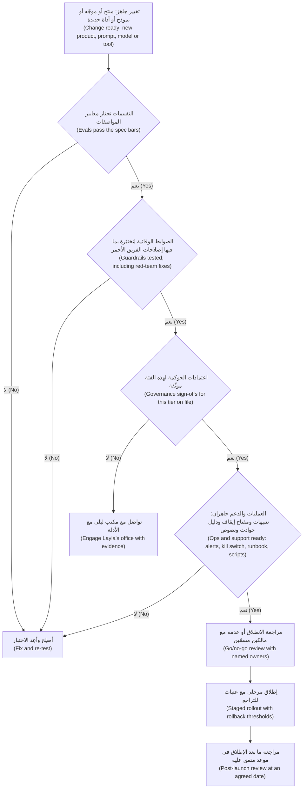
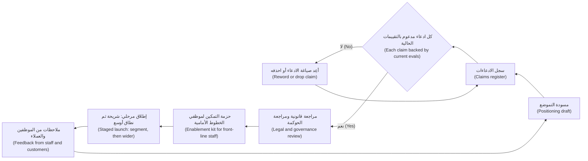
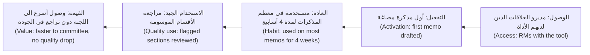

# الوحدة 7 — إطلاق منتجات الذكاء الاصطناعي

*ميزة الذكاء الاصطناعي التي تجتاز تقييماتها (evals) ليست منتجًا بعد. إنها تصبح منتجًا حين يستطيع أناس حقيقيون الاعتماد عليها: حين تصمد الضوابط الوقائية (guardrails) تحت الضغط، وتكون الموافقات موثّقة في السجل، ويعرف فريق الدعم ما يقوله حين يقع خطأ، ويفهم السوق ما يَعِد به المنتج وما لا يَعِد به، ويتبنّاه فعلًا الأشخاص الذين يغيّر عملهم. تغطي هذه الوحدة مرحلة الإطلاق. ستتابع رانيا وفيصل في بنك نجم (Najm Bank) وهما ينقلان نجم أسيست (Najm Assist) من المرحلة التجريبية إلى الإتاحة العامة، ويُعدّان الطرح في السوق للتمويل الفوري للشركات الصغيرة (SME Instant Finance) ولمساعد مذكرات الائتمان (Credit Memo Copilot)، ويديران برنامج التغيير الذي يحسم ما إذا كان مديرو العلاقات سيستخدمون المساعد أم سيعودون بهدوء إلى Word.*

> **المراحل:** الإطلاق — تحويل ميزة تعمل إلى منتج يستطيع الناس أن يجدوه ويثقوا به ويشتروه ويستخدموه بأمان، مع الضوابط والرسائل والعادات التي تُبقيه كذلك.

---

# 7.1 — جاهزية الإطلاق: الضوابط الوقائية وبوابات الحوكمة والدعم
*المستوى: 🔴 متقدم* · *المتطلبات: 5.1، 6.2، 6.3* · *المرحلة: Launch*

**بعد هذا الدرس تستطيع** أن تكتب قائمة جاهزية للإطلاق تحدد البنود المانعة والمسؤولين والأدلة، وتصمم ضوابط وقائية متعددة الطبقات يذكر كل ضابط فيها الإخفاق الذي يلتقطه وطريقة اختباره. *مدة الدراسة: نحو 110 دقيقة (تقدير).*

## ⚡ الدرس في دقيقة
- **جاهزية الإطلاق** دليلٌ لا تفاؤل: شروط، لكلٍّ منها مالك وإثبات، يجب أن تتحقق قبل تعريض مزيد من المستخدمين للمنتج.
- أربعة مجالات: **الجودة** (اجتياز التقييمات)، و**الضوابط الوقائية (guardrails)** (يفشل بأمان)، و**الحوكمة** (الموافقات موثّقة)، و**العمليات والدعم** (هناك من يلاحظ المشكلات، ويستطيع إيقاف الميزة، ويعرف ما يقوله للعملاء).
- الضوابط الوقائية موزّعة على طبقات عبر المدخلات والسياق والأدوات والمخرجات والاستخدام. لا تكفي أي طبقة وحدها.
- كل تغيير في الموجّه (prompt) أو النموذج أو الاسترجاع (retrieval) أو الأدوات هو إطلاق صغير. يجب أن تكون البوابات رخيصة بما يكفي لإعادة تشغيلها.
- إشارة القرار: انطلق فقط حين يكون لكل بند مانع دليلٌ ومالك، وقد جُرِّب التراجع (rollback) فعلًا، ويستطيع الدعم التعامل مع أنماط الفشل المعروفة.
- أكبر فخ: اعتبار الإطلاق اليومَ الذي تُشغَّل فيه الميزة، بدلًا من اللحظة التي تتحمّل فيها المسؤولية عن كل إجابة تقدّمها.

## 🧭 لماذا يهم
في ديسمبر 2023 استُدرج روبوت المحادثة على موقع أحد وكلاء Chevrolet إلى «الموافقة» على بيع سيارة مقابل دولار واحد ($1) بعد أن تلاعب المستخدمون بتعليماته. وفي يناير 2024، بعد تحديث للنظام، شتم روبوت المحادثة الخاص بشركة التوصيل DPD أحد العملاء وكتب قصيدة تنتقد الشركة. لم يحتج أيٌّ من هذين الإخفاقين إلى هجوم متقدم؛ فلم يكن بين النموذج والعميل ما يوقفهما. وتُظهر قضية *Moffatt v. Air Canada* (2024) ما يلي ذلك: فقد حمّلت المحكمة شركة الطيران المسؤولية عمّا قاله روبوت المحادثة لأحد العملاء. أيًّا كان ما يقوله المساعد، فالشركة هي من قالته.

في بنك نجم، أنهى نجم أسيست v1 مرحلته التجريبية. إنه يجيب عن أسئلة الحسابات والرسوم والبطاقات بالعربية والإنجليزية، مستندًا (grounded) إلى وثائق منتجات البنك، ويحيل المحادثة إلى موظف بشري حين لا يكون متأكدًا. يقترح فيصل تشغيله لجميع عملاء تطبيق الجوال يوم الخميس، «بما أن التقييمات نجحت». تطرح رانيا أربعة أسئلة. ما الذي يمنعه من مناقشة أهلية القروض، وهي أمر غير مُعتمد له؟ من يُستدعى إذا أعطى مبالغ رسوم خاطئة في الثانية فجرًا؟ كيف نوقفه دون إصدار جديد للتطبيق؟ ماذا يقول مركز الاتصال حين يشتكي عميل من إجابة؟ لا يستطيع فيصل الإجابة عن أيٍّ منها. يتأجل الإطلاق ثلاثة أسابيع؛ وهذا الدرس عن تلك الأسابيع الثلاثة.

## 📐 كيف يعمل

### 🟢 الأساسيات

**جاهزية الإطلاق** هي مجموعة الشروط التي يجب أن تتحقق، مع الدليل، قبل أن تعرّض مزيدًا من الناس للمنتج. ميزة الذكاء الاصطناعي تعمل *معظم الوقت* وتفشل بطرق لا يمكنك التنبؤ بها إلا جزئيًا، لذا يجب أن تغطي الجاهزية ما يحدث حين تفشل، إلى جانب ما إذا كانت تعمل. فكّر في أربعة مجالات.

| المجال | السؤال | الدليل المعتاد |
|---|---|---|
| **الجودة** | هل يستوفي معايير الجودة في المواصفات (5.1)؟ | نتائج التقييم غير المتصل على المجموعة المرجعية (golden set) (6.1)، ونتائج الفريق الأحمر مغلقة أو مقبولة (6.2)، ومقاييس المرحلة التجريبية أو الإطلاق المرحلي (6.3) |
| **الضوابط الوقائية** | حين يفشل، هل يفشل بأمان؟ | مرشِّحات مدخلات ومخرجات مُختبَرة، وحدود الموضوعات، والتصعيد إلى إنسان، وحدود على الإجراءات والاستخدام |
| **الحوكمة** | هل الموافقات المطلوبة لفئة المخاطر (risk tier) هذه موثّقة في السجل؟ | فئة المخاطر، وتقييم الخصوصية، والاعتمادات، والإفصاحات المطلوبة، وتوثيق النموذج والنظام |
| **العمليات والدعم** | هل سنلاحظ المشكلات، وهل نستطيع إيقافها، وهل نستطيع مساعدة المتضررين؟ | لوحات المتابعة والتنبيهات، ومالك مناوب، ومفتاح الإيقاف (kill switch)، ودليل التعامل مع الحوادث، ونصوص الدعم، وقناة الملاحظات |

**الضوابط الوقائية** هي ضوابط، خارج تقدير النموذج نفسه، تُبقي منتج الذكاء الاصطناعي ضمن السلوك الذي قصدته. أمثلة: مرشِّح يُبعد البيانات الشخصية عن النموذج، ومصنِّف (classifier) يُبقي المساعد ضمن الموضوعات المعتمدة، وفحص يتأكد من أن كل مبلغ رسوم يظهر في وثيقة مصدرية، وسقف لعدد الرسائل لكل مستخدم في الساعة.

**بوابات الحوكمة** هي نقاط التفتيش التي يؤكد فيها شخص ذو صلاحية أن المنتج يمكنه المضي قدمًا. في بنك نجم، يحدّد مكتب ليلى لكل منتج فئة مخاطر، وهي التي تقرّر التقييمات والاعتمادات المطلوبة. لا يدير مدير المنتج (PM) الحوكمة، لكنه مسؤول عن اجتيازها في الوقت المحدد: ابدأ مبكرًا وأحضر الأدلة. تتناول دورة *AI Governance: Zero to Hero* التصنيف إلى فئات والموافقات بعمق.

**جاهزية الدعم** تعني أن الأشخاص الذين يتواصل معهم العملاء يعرفون ما يفعله المنتج، وما يخطئ فيه، وما يجب فعله حيال ذلك، بما في ذلك كيفية رؤية ما قاله المساعد فعلًا.

### 🟡 التعمق أكثر

**الضوابط الوقائية متعددة الطبقات.** لا يوقف ضابط واحد كل الإخفاقات، لذا تكدّس منتجات الذكاء الاصطناعي الجيدة عدة ضوابط، يلتقط كلٌّ منها ما يفوت الآخرين. من الطرق المفيدة لترتيبها أن تتتبع طلبًا عبر النظام.

| الطبقة | ما الذي تضبطه | أمثلة من نجم أسيست |
|---|---|---|
| **المدخلات** | ما يستطيع المستخدم إرساله وما يصل إلى النموذج | حذف أرقام البطاقات والهوية؛ اكتشاف أنماط حقن الموجّه المعروفة |
| **السياق والأدوات** | ما يستطيع النموذج رؤيته وفعله | وثائق المنتجات المعتمدة والحالية فقط؛ لا بيانات لعملاء آخرين؛ لا أدوات تنفيذ إجراءات في v1 |
| **تعليمات النموذج** | كيف يُوجَّه النموذج إلى التصرف | النطاق والنبرة واللغات ومتى يحيل إلى موظف؛ تغطيها التقييمات |
| **المخرجات** | ما يصل إلى المستخدم | مصنِّف الموضوعات يحجب أهلية القروض والنصائح الاستثمارية؛ الأرقام تُطابَق مع المصادر؛ مرشِّح النبرة؛ الإحالة عند انخفاض الثقة |
| **الاستخدام** | الكمية ومن يستخدم | حدود المعدّل (rate limits)؛ سقف تكلفة يومي؛ مفتاح ميزة حسب الشريحة |
| **الإنسان** | من يستطيع التدخل | زر واحد «تحدّث إلى شخص» مع تمرير المحادثة كاملة إلى الموظف |

مبدآن هما الأهم. **الرفض الافتراضي للإجراءات**: المساعد الذي يجيب عن الأسئلة فقط أسوأ حالاته أصغر بكثير من مساعد يستطيع تحويل الأموال، لذا يُطلق نجم أسيست بلا أدوات ويضيفها لاحقًا تحت بوابات منفصلة (4.3). **البديل الآمن أفضل من التعافي الذكي**: حين يعمل أحد الضوابط الوقائية، افعل شيئًا مملًّا وصحيحًا («لا أستطيع المساعدة في هذا هنا؛ هل تودّ التحدث إلى موظف؟»).

للضوابط الوقائية تكاليف: زمن الاستجابة (latency)، والطلبات المشروعة المحجوبة (الإيجابيات الكاذبة)، وتقييمها الخاص. قِس المرشِّحات كما تقيس أي نموذج، من حيث الإجابات الجيدة المحجوبة والسيئة الفائتة. مرشِّح الموضوعات الذي يحجب «ما رسوم زيادة القرض؟» لأنه يحتوي على كلمة «قرض» هو عيب في المنتج، لا انتصار للسلامة.

**الجاهزية التشغيلية** تغطي الآليات غير البرّاقة التي تقرّر ما إذا كان اليوم السيئ سيبقى صغيرًا.
- **المراقبة والتنبيهات.** إشارات الجودة والضوابط الوقائية والتكلفة مع عتبات (thresholds) تستدعي مالكًا مسمّى (المزيد في 8.3).
- **مفتاح الإيقاف.** مفتاح ميزة يوقف الميزة، أو يعود بها إلى وضع آمن، خلال دقائق، دون نشر أو إصدار للتطبيق. يُختبر قبل الإطلاق.
- **التراجع.** العودة إلى الموجّه والنموذج وفهرس الاسترجاع (retrieval index) السابقين معًا، ما يعني ترقيم إصدارات الثلاثة كلها.
- **دليل التعامل مع الحوادث.** ما الذي يُعدّ حادثة ذكاء اصطناعي (إجابة ضارّة، أو تسرّب بيانات، أو ارتفاع مفاجئ في الإجابات الخاطئة، أو إساءة استخدام)، ومن يحدّد الخطورة، ومن يُبلَّغ (ليلى، سارة، الاتصال المؤسسي)، وكيف يُتواصَل مع العملاء المتضررين.
- **التسجيل لأغراض التحقيق.** ما يكفي من كل محادثة وإصدار الموجّه والوثائق المسترجعة لإعادة بناء ما حدث، ضمن الحدود التي تضعها سارة.

**جاهزية الدعم** عمليًا:
- مذكرة من صفحة واحدة عن **القيود المعروفة** للموظفين: ما لا يستطيع المساعد فعله، وأنماط الفشل التي ظهرت في الاختبار، والرد المعتمد لكلٍّ منها.
- **البحث في المحادثات**، حتى يرى الموظفون ما قاله المساعد فعلًا، و**مسار تصعيد** لأخطاء الذكاء الاصطناعي المشتبه بها، مع وسم يسمح بعدّها.
- **نصوص للمكالمات الصعبة**: «أخبرني المساعد أن الرسوم أُعفيت». بعد قضية Air Canada، صار «الروبوت كان مخطئًا» دفاعًا ضعيفًا، لذا ينبغي أن يقرّر مالكو الأعمال والشؤون القانونية قبل الإطلاق ما إذا كان البنك سيلتزم بمثل هذه الإجابات.

**الإفصاح.** ينبغي أن يعرف العملاء أنهم يتحدثون إلى ذكاء اصطناعي؛ وفي بعض الولايات القضائية هذا واجب قانوني (التزامات الشفافية في EU AI Act). وتبدأ Guidelines for Human-AI Interaction من Microsoft (Amershi et al., 2019) بالنسخة التصميمية من ذلك: وضّح ما يستطيع النظام فعله، ومدى جودته في ذلك. وهذا يصبح نص الإطلاق.

المخطط أدناه يبيّن كيف يدير بنك نجم قرار الإطلاق، سواء لتغيير أو لإصدار أول.

### 🔴 نظرة الخبير

**اجعل البوابة متناسبة مع التغيير.** المراجعة الكاملة لكل تعديل بسيط في الموجّه سيُلتفّ عليها قريبًا. الفرق الناضجة تصنّف التغييرات في فئات. تغيير صياغة الموجّه يعيد تشغيل التقييمات المؤتمتة ويحتاج موافقة مدير المنتج. النموذج الجديد أو مصدر البيانات الجديد أو اللغة الجديدة يضيف اختبار الفريق الأحمر (red-teaming) على السطح المتغيّر وفحصًا قصيرًا للحوكمة. والقدرة الجديدة، مثل أدوات تتصرف نيابة عن العميل، تغيّر فئة المخاطر وتمرّ بالبوابة الكاملة. اتفق على الفئات مع ليلى مسبقًا.

**حدّد عتبات التراجع قبل الإطلاق.** قرّر مسبقًا أي الأرقام توقف الإطلاق المرحلي (6.3)، مثل انخفاض الاستناد إلى المصادر (grounding) دون معيار المواصفات ليومين، أو أي كشف مؤكد لبيانات عميل آخر. القرار في اللحظة، تحت أنظار الإدارة العليا، نادرًا ما ينتهي جيدًا.

**أجرِ تحليلًا استباقيًا للفشل.** يطلب أسلوب pre-mortem الذي وضعه Gary Klein (*Harvard Business Review*، 2007) من الفريق أن يتخيّل أن الإطلاق فشل فشلًا ذريعًا وأن يكتب الأسباب، فيُظهر مخاطر لا يطرحها أحد في اجتماعات الحالة. في الذكاء الاصطناعي، اسأل: «بعد ستة أسابيع من الآن نجم أسيست في الصحف. ماذا قال؟» تتحول الإجابات إلى حالات للفريق الأحمر وضوابط وقائية ونصوص دعم.

**الجاهزية مجموعة من الوعود.** جدول المناوبة، ومراجعة عيّنات المحادثات، وتحديث القيود المعروفة بعد تغيير النموذج: كلٌّ منها يحتاج إلى حارس مسمّى بعد الإطلاق، وإلا صار المنتج أقل جاهزية كل أسبوع.

**اعرف متى لا تُطلق.** إذا كانت الطريقة الوحيدة لإيقاف نمط فشل هي أن يتحقق إنسان من كل إجابة، فربما ينتمي المنتج إلى مستوى *المسودة* من الأتمتة (4.1). تضييق النطاق، مثلًا إلى أسئلة البطاقات والرسوم فقط، هو غالبًا أسرع طريق إلى إطلاق آمن.

## 🧰 الأدوات
| الأداة أو الإطار | ما هو وماذا يفعل | متى تلجأ إليه |
|---|---|---|
| **Launch readiness checklist** — قائمة التحقق من جاهزية الإطلاق | شروط مانعة وغير مانعة عبر المجالات الأربعة، لكلٍّ منها مالك ودليل وحالة | قبل كل إصدار وكل تغيير مهم |
| **Layered guardrails** — الضوابط الوقائية متعددة الطبقات | ضوابط على ست طبقات بحيث تلتقط طبقة ما يفوت أخرى؛ راجع التصميم مقابل OWASP Top 10 for LLM Applications | أي ميزة ذكاء اصطناعي موجّهة للمستخدم أو تنفّذ إجراءات |
| **Kill switch** — مفتاح الإيقاف | مفتاح ميزة أو وضع آمن يعطّل ميزة الذكاء الاصطناعي خلال دقائق دون إصدار | أي ميزة ذكاء اصطناعي موجّهة للعملاء؛ تدرّب عليه قبل الإطلاق |
| **Pre-mortem** (Gary Klein) — التحليل الاستباقي للفشل | جلسة يفترض فيها الفريق أن الإطلاق فشل ويُعدّد الأسباب | قبل الإطلاق بأسبوعين إلى أربعة أسابيع، ما دام هناك وقت للتصرف بناءً على النتائج |
| **Incident runbook** — دليل التعامل مع الحوادث | كيفية اكتشاف حوادث الذكاء الاصطناعي وتصنيف خطورتها واحتوائها والتواصل بشأنها | قبل الإطلاق؛ تدرّب عليه مع الدعم والحوكمة ومسؤول حماية البيانات (DPO) |
| **Go/no-go review** — مراجعة الانطلاق أو عدمه | اجتماع قصير يؤكد فيه مالكون مسمّون كل بند مانع بالدليل، ويقرّر المالك المساءَل | البوابة الأخيرة قبل كل مرحلة من مراحل الإطلاق |
| **Change classes** — فئات التغيير | تصنيف متفق عليه للتغييرات (الموجّه، النموذج، البيانات، الأدوات) إلى مستويات من إعادة الاختبار والموافقة | فور شحن النسخة الأولى، حتى لا تكون التغييرات اللاحقة معطَّلة أو غير مفحوصة |

## 🏛️ عمليًا في بنك نجم
أعدّ فريق رانيا **قائمة التحقق من جاهزية إطلاق نجم أسيست v1** للانتقال من المرحلة التجريبية إلى جميع عملاء تطبيق الجوال في قطر. يجب أن تكون البنود المانعة خضراء قبل الانطلاق؛ والمالك المساءَل عن القرار هو رئيس القنوات الرقمية للأفراد، مع تأكيد ليلى لبنود الحوكمة.

| # | البند | مانع | المالك | الدليل | الحالة |
|---|---|---|---|---|---|
| Q1 | معدّل الإجابات المستندة إلى المصادر على المجموعة المرجعية يستوفي معيار المواصفات بالعربية والإنجليزية | نعم | دانة | تقرير التقييم v1.4 | أخضر |
| Q2 | نتائج الفريق الأحمر عالية الخطورة مُصلَحة ومُعاد اختبارها | نعم | دانة | سجل الفريق الأحمر، 3 نتائج عالية أُغلقت | أخضر |
| G1 | حدود الموضوعات تحجب أهلية القروض والنصائح الاستثمارية والقانونية؛ ومعدّل الحجب الخاطئ ضمن الحد المتفق عليه | نعم | طارق | تقييم المرشِّح على 400 موجّه مُصنَّف | كهرماني: حجب خاطئ لـ«رسوم زيادة القرض» قيد الإصلاح |
| G2 | حذف أرقام البطاقات والهوية قبل استدعاء النموذج (model call) | نعم | طارق | مجموعة اختبارات وعيّنة من السجلات | أخضر |
| G3 | كل مبلغ رسوم في الإجابة يطابق وثيقة مصدرية، وإلا حُجبت الإجابة | نعم | طارق | اختبارات الفحص الرقمي | أخضر |
| G4 | الإحالة إلى موظف بشري عند الطلب أو انخفاض الثقة أو الشكوى | نعم | حصة | اختبار قابلية الاستخدام، 12 جلسة | أخضر |
| V1 | تأكيد فئة المخاطر وتوثيق الاعتمادات | نعم | فيصل مع ليلى | سجل الحوكمة | أخضر |
| V2 | اكتمال تقييم الخصوصية؛ والاتفاق على مدة الاحتفاظ بالسجلات | نعم | فيصل مع سارة | سجل التقييم | أخضر |
| V3 | إفصاح الذكاء الاصطناعي في الرسالة الأولى وصفحة المساعدة معتمد من الشؤون القانونية | نعم | فيصل | اعتماد النص | أخضر |
| O1 | اختبار مفتاح الإيقاف في بيئة الإنتاج: يعود إلى البحث في الأسئلة الشائعة في أقل من 5 دقائق | نعم | طارق | سجل التمرين | أخضر |
| O2 | تنبيهات على الاستناد إلى المصادر ومعدّل تفعيل الضوابط الوقائية وزمن الاستجابة والتكلفة اليومية، مع جدول مناوبة | نعم | طارق | رابط لوحة المتابعة، وجدول المناوبة | أخضر |
| O3 | التدرّب على دليل الحوادث مع الدعم والحوكمة ومسؤول حماية البيانات والاتصال المؤسسي | نعم | فيصل | ملاحظات تمرين الطاولة | أخضر |
| S1 | يستطيع الموظفون رؤية محادثات المساعد؛ وصدرت مذكرة القيود المعروفة | نعم | قائد مركز الاتصال | إتمام التدريب | أخضر |
| S2 | الاتفاق على سياسة الالتزام بالإجابات غير الصحيحة عن الرسوم | نعم | مالك الأعمال والشؤون القانونية | مذكرة السياسة | أخضر |
| R1 | الاتفاق على مراحل الإطلاق وعتبات الإيقاف | نعم | فيصل | خطة الإطلاق: 5%، 25%، 100% | أخضر |

**عتبات الإيقاف (توضيحية):** أوقف الإطلاق مؤقتًا إذا انخفض معدّل الإجابات المستندة إلى المصادر في العيّنة اليومية دون معيار المواصفات يومين متتاليين؛ أو إذا تأكّد أي كشف لبيانات بين العملاء؛ أو إذا تجاوزت الشكاوى من أخطاء الذكاء الاصطناعي المعدّل المتفق عليه في خطة الإطلاق. حُجزت مراجعة ما بعد الإطلاق بعد 30 يومًا من الوصول إلى 100%.

نتيجة مراجعة الانطلاق أو عدمه: *«لا انطلاق هذا الأسبوع بسبب G1. انطلاق بنسبة 5% بمجرد إعادة اختبار إصلاح الحجب الخاطئ.»*

## 🛠️ التمارين
- 🟢 اكتب قائمة تحقق للجاهزية، باستخدام المجالات الأربعة، لميزة ذكاء اصطناعي تستخدمها أو تبنيها. *يكتمل عندما:* يكون لديك عشرة بنود على الأقل، كلٌّ منها موسوم بأنه مانع أو غير مانع، مع دور المالك والدليل الذي يثبته.
- 🟡 صمّم الضوابط الوقائية متعددة الطبقات لمساعد مذكرات الائتمان، الذي يصوغ مذكرات ائتمان داخلية من وثائق العملاء لمديري العلاقات. *يكتمل عندما:* يكون لديك جدول بالطبقات الست كلها، وضابط واحد على الأقل لكل طبقة، ولكل ضابط الإخفاق الذي يلتقطه وكيف ستختبره.
- 🔴 سيتيح نجم أسيست v2 للعملاء تجميد البطاقة وبدء نزاع على معاملة. اكتب سياسة فئات التغيير وبوابات الإطلاق الإضافية لـ v2. *يكتمل عندما:* تصنّف سياستك خمسة أنواع من التغيير على الأقل إلى فئات مع إعادة الاختبار والموافقة التي يحتاجها كلٌّ منها، وتُوضع v2 في الفئة الصحيحة مع الأسباب، وتُعدّد الضوابط الوقائية الإضافية وعتبات الإيقاف ونصوص الدعم التي تتطلبها الإجراءات.

## ⚠️ أخطاء وفخاخ
- **«نجحت التقييمات، إذن نحن جاهزون.»** التقييمات تغطي الحالات التي اختبرتها. افحص المجالات الأربعة كلها.
- **مفتاح إيقاف غير مُختبَر.** إذا كان يحتاج إلى نشر أو لم يُجرَّب قط، فليس لديك مفتاح إيقاف. تدرّب عليه قبل الإطلاق.
- **قياس الضوابط الوقائية بما تحجبه فقط.** قِس الحجب الخاطئ إلى جانب ما يفوتها.
- **معاملة التحديثات كصيانة.** أساء روبوت المحادثة الخاص بـ DPD التصرف بعد تحديث. اتفق على فئات التغيير (change classes) كي يمرّ كل تغيير بالمستوى المناسب من البوابة.
- **الحوكمة أو الدعم كأمر ثانوي.** الوصول إلى مكتب ليلى قبل الإطلاق بأسبوع، أو ترك الموظفين يتعلمون أنماط الفشل من الشكاوى، يعني أنك بدأت متأخرًا جدًا. أشرك الطرفين في مرحلة التصميم.

## 🧾 الخلاصة
- جاهزية الإطلاق أدلة مع مالكين مسمّين عبر أربعة مجالات: الجودة، والضوابط الوقائية، والحوكمة، والعمليات والدعم.
- الضوابط الوقائية موزّعة على طبقات عبر المدخلات، والسياق والأدوات، والتعليمات، والمخرجات، والاستخدام، والإحالة إلى إنسان. ارفض الإجراءات افتراضيًا وعُد إلى شيء آمن وممل.
- مفتاح إيقاف مُختبَر، وتراجع مُرقَّم الإصدارات للموجّه والنموذج والفهرس معًا، وتنبيهات مع مالك مناوب، ودليل حوادث مُتدرَّب عليه: كلها متطلبات للإطلاق.
- يحتاج الدعم إلى القيود المعروفة، والبحث في المحادثات، والتصعيد، وسياسة محدّدة مسبقًا بشأن الالتزام بالإجابات الخاطئة.
- كل تغيير إطلاق صغير: صنّف التغييرات في فئات واجعل بوابة كل فئة متناسبة مع المخاطر التي تضيفها.

## ✍️ اختبر نفسك

**1. تستوفي التقييمات غير المتصلة لنجم أسيست (Najm Assist) كل معايير الجودة في المواصفات. يقول فيصل إن المنتج جاهز لجميع العملاء. ما أقوى سبب للاعتراض؟**

- A. التقييمات ليست أبدًا إشارة موثوقة إلى الجودة
- B. الجاهزية تتطلب أيضًا ضوابط وقائية مُختبَرة، وموافقات الحوكمة، ومراقبة مع مفتاح إيقاف، ودعمًا مُعَدًّا
- C. ينبغي أولًا إعادة بناء المنتج على نموذج أكبر
- D. ينبغي استطلاع آراء العملاء بشأن الذكاء الاصطناعي قبل أي إطلاق

الإجابة

**B.** التقييمات (evals) تغطي مجال الجودة فقط. الخيار A مبالغ فيه: التقييمات دليل ضروري، لكنه غير كافٍ. (🟢 الأساسيات.)

**2. أي تصميم للضوابط الوقائية يتبع على أفضل وجه مبدأ «الرفض الافتراضي للإجراءات» في الإصدار الأول لمساعد العملاء؟**

- A. منح المساعد جميع الأدوات المصرفية مع إخباره في موجّه النظام بأن يكون حذرًا في كل إجراء ينفذه، وبأن يطلب تأكيد العميل عند الحاجة
- B. السماح بالإجراءات فقط للعملاء الذين يقبلون الشروط
- C. السماح بالإجراءات مع تسجيلها للمراجعة في نهاية الشهر
- D. الإطلاق بالإجابة عن الأسئلة فقط وإضافة أدوات الإجراءات لاحقًا، كلٌّ منها تحت بوابته الخاصة

الإجابة

**D.** البدء بلا أدوات يُبقي أسوأ الحالات صغيرة، وإضافة الأدوات لاحقًا تحت بوابات منفصلة يوائم المخاطر مع الأدلة. الخيار A يعتمد على تقدير النموذج نفسه، وهذا ليس ضابطًا وقائيًا. (🟡 التعمق أكثر.)

**3. خلال إطلاق مرحلي (staged rollout) بنسبة 25%، تُظهر العيّنة اليومية أن معدّل الإجابات المستندة إلى المصادر انخفض دون معيار المواصفات يومين. وكانت خطة الإطلاق قد أدرجت هذا عتبةَ إيقاف. ماذا ينبغي أن يفعل مدير المنتج؟**

- A. إيقاف الإطلاق مؤقتًا، والعودة إلى البديل أو التراجع كما تنص الخطة، والتحقيق في السبب
- B. المتابعة إلى 100% لأن الانخفاض قد يكون ضوضاء، ولأن يومين مدة أقصر من أن يُحكم بها على أداء الإطلاق التدريجي
- C. خفض معيار المواصفات كي يستمر الإطلاق، ثم مراجعة المعيار من جديد بعد الإطلاق الكامل، عندما تتوفر بيانات أكثر
- D. انتظار مراجعة ما بعد الإطلاق بعد 30 يومًا قبل أن يقرر أحد ما إذا كان يجب اتخاذ أي إجراء على الإطلاق أصلًا

الإجابة

**A.** تُحدَّد عتبات الإيقاف مسبقًا كي لا يقرّر أحد تحت ضغط الإطلاق. الخياران C وD يُبطلان الغرض منها. (🔴 نظرة الخبير.)

**4. غيّر الفريق صياغة موجّه النظام (system prompt) لنجم أسيست ليبدو أكثر ودًّا. وفق سياسة معقولة لفئات التغيير، ماذا ينبغي أن يحدث؟**

- A. لا شيء: صياغة الموجّه ليست تغييرًا في المنتج
- B. بوابة الإطلاق الكاملة، بما في ذلك موافقة حوكمة جديدة ومراجعة جديدة من لجنة المخاطر قبل أي إصدار
- C. إعادة تشغيل مجموعة التقييمات المؤتمتة والحصول على موافقة مدير المنتج قبل الإصدار
- D. إصداره لجميع المستخدمين ومراقبة الشكاوى

الإجابة

**C.** تغيير الموجّه قد يغيّر السلوك، كما تُظهر حالة DPD، لذا يجب إعادة اختباره، لكنه لا يغيّر فئة المخاطر، فالبوابة الكاملة (B) غير متناسبة. (🔴 نظرة الخبير.)

**5. يتصل عميل ليقول إن نجم أسيست أخبره أن رسومًا ستُعفى. وكان ذلك خطأ. ما الذي كان ينبغي أن يكون قائمًا قبل الإطلاق؟**

- A. سياسة، يتفق عليها مالك الأعمال والشؤون القانونية، بشأن ما إذا كان البنك سيلتزم بإجابات المساعد غير الصحيحة وكيف، إضافة إلى البحث في المحادثات للموظفين
- B. إخلاء مسؤولية يقول إن إجابات المساعد غير مُلزِمة، كي يستطيع الموظفون رفض كل هذه المطالبات
- C. تعليمات للموظفين بتصعيد كل مكالمة إلى فريق المنتج
- D. لا شيء: هذه الحالات أندر من أن يُخطَّط لها

الإجابة

**A.** بعد قضية *Moffatt v. Air Canada*، صار «الروبوت كان مخطئًا» دفاعًا ضعيفًا. وإخلاء المسؤولية وحده (B) قد لا يحمي البنك ويُضرّ بالثقة. (🟡 التعمق أكثر.)

## 📚 المراجع
- Amershi, S. et al. (2019). "Guidelines for Human-AI Interaction." CHI 2019 — https://www.microsoft.com/en-us/research/project/guidelines-for-human-ai-interaction/
- Google PAIR، *People + AI Guidebook* — https://pair.withgoogle.com/guidebook
- OWASP Top 10 for LLM Applications — https://genai.owasp.org
- Klein, G. (2007). "Performing a Project Premortem." *Harvard Business Review* — https://hbr.org/2007/09/performing-a-project-premortem
- Beyer, B. et al., *Site Reliability Engineering* (Google)، فصول إدارة الحوادث ومراجعات ما بعد الحوادث — https://sre.google/books/
- NIST AI Risk Management Framework — https://www.nist.gov/itl/ai-risk-management-framework
- EU AI Act، اللائحة (EU) 2024/1689 — https://eur-lex.europa.eu/eli/reg/2024/1689/oj
- [*بناء تطبيقات الذكاء الاصطناعي والوكلاء من الصفر إلى الاحتراف*، الدرس 13.2 — ضوابط المؤسسات وحزمة الحوكمة](../aiapps/index.ar.html#/13.2) — منظور البناء والتسليم لهذا الموضوع

---

# 7.2 — الطرح في السوق: التموضع وإشارات التسعير والتمكين
*المستوى: 🔴 متقدم* · *المتطلبات: 2.1، 4.2، 7.1* · *المرحلة: Launch*

**بعد هذا الدرس تستطيع** أن تملأ لوحة التموضع وسجلًّا للادعاءات يرتبط فيه كل ادعاء بتقييم أو مقياس إطلاق، وتقارن أنماط التسعير من حيث الإشارة والمخاطر لتوصي بأحدها. *مدة الدراسة: نحو 110 دقيقة (تقدير).*

## ⚡ الدرس في دقيقة
- **الطرح في السوق (Go-to-market (GTM))** هو كيف يصل المنتج إلى الأشخاص الموجَّه إليهم: لمن هو، وبماذا يَعِد، وكيف يُسعَّر أو يُموَّل، وكيف يُجهَّز الأشخاص الذين يبيعونه ويدعمونه.
- في منتجات الذكاء الاصطناعي، **التموضع هو ضبط التوقعات**. الوعد الذي تقطعه يقرّر ما إذا كان منتج بدقة 90% يبدو مُبهرًا أم معطوبًا. ابدأ بالمهمة التي ينجزها العميل، لا بـ«الذكاء الاصطناعي (AI)».
- كل ادّعاء خارجي يحتاج إلى دليل. احتفظ بـ**سجل الادعاءات** الذي يربط كل عبارة تسويقية بنتيجة تقييم، واحصل على اعتماده كأي بند إطلاق آخر.
- التسعير يرسل إشارة قبل أن يستخدم أحد المنتج: المجاني والمُضمَّن يقول «جزء من الخدمة»، والفئة المميزة تقول «قيمة إضافية»، والتسعير حسب النتيجة يقول «نحن واثقون أنه يعمل». اختر الإشارة عن قصد.
- **التمكين** يعني تجهيز موظفي الخطوط الأمامية (المبيعات، ومديرو العلاقات، ومركز الاتصال) لشرح المنتج بأمانة، بما في ذلك حدوده، ولالتقاط ما يقوله العملاء.
- أكبر فخ: التسويق يكتب الوعد وعلى المنتج أن يرقى إليه. مدير المنتج هو مالك الوعد.

## 🧭 لماذا يهم
تضمّن أول عرض علني لـ Bard من Google، في فبراير 2023، إجابة فيها خطأ واقعي عن تلسكوب James Webb الفضائي. اكتشفه الصحفيون بسرعة وانتشر على نطاق واسع. كان الخطأ نفسه من نوع الأخطاء التي يرتكبها كل نموذج لغوي (language model). ما جعله مكلفًا هو السياق: لحظة إطلاق، مؤطّرة على أنها استعراض للدقة، أمام جمهور مُهيّأ للتحقق. حوّل التموضع وإخراج الإطلاق خطأً عاديًا في النموذج إلى قصة.

يوشك بنك نجم على إطلاق التمويل الفوري للشركات الصغيرة لعملائه من الشركات الصغيرة: طلبات تمويل الفواتير حتى حدّ معيّن تحصل على قرار خلال دقائق بدلًا من أيام، بقيادة نموذج تعلّم آلي (ML model) مع مراجعة بشرية (human review) للرفض والحالات الحدّية. تقول المسودة الأولى لحملة فيصل: *«الذكاء الاصطناعي يوافق على تمويل فاتورتك فورًا.»* تعجب خالد. ولا تعجب رانيا. كلمة «فورًا» خاطئة بالنسبة إلى الطلبات التي تذهب إلى المراجعة. وكلمة «يوافق» تستدعي شكاوى من العملاء الذين يُرفضون. وعبارة «الذكاء الاصطناعي يوافق» تضع قرارًا ائتمانيًا مؤتمتًا في العنوان الرئيسي، وهو بالضبط ما أمضت ليلى وسارة أشهرًا في ضمان ألا يكون القصة كلها. المنتج جيد. والوعد سيجعله يبدو سيئًا.

## 📐 كيف يعمل

### 🟢 الأساسيات

**الطرح في السوق** يغطي أربعة قرارات:
1. **لمن هو أولًا؟** الشريحة المستهدفة للإطلاق، وهي عادةً أضيق من السوق على المدى الطويل.
2. **بماذا نَعِد؟** التموضع والرسالة الأساسية.
3. **كيف يُسعَّر أو يُموَّل؟** للمنتجات الخارجية، السعر ونموذج التسعير. وللمنتجات الداخلية، كيف تُموَّل التكلفة وما إذا كان الاستخدام يُحمَّل على وحدات الأعمال.
4. **كيف نصل إلى المستخدمين وندعمهم؟** القنوات، وتسلسل الإطلاق، وتمكين الأشخاص الذين يبيعون ويُهيّئون المستخدمين ويدعمون.

**التموضع** هو الكيفية التي تريد أن يفهم بها العميل المستهدف ماهية المنتج، ولمن هو، ولماذا هو أفضل من البدائل. يقسّمه كتاب April Dunford *Obviously Awesome* (2019) إلى مكوّنات: **البدائل التنافسية** (ما سيفعله العملاء بدونك، وغالبًا جدول بيانات أو مكالمة هاتفية أو لا شيء)، و**السمات الفريدة** التي تملكها ويفتقدونها، و**القيمة** التي تقدّمها تلك السمات، و**العملاء الأكثر اهتمامًا** بتلك القيمة، و**فئة السوق** التي تضع نفسك فيها كي يعرف العملاء كيف يحكمون عليك.

في منتجات الذكاء الاصطناعي، اختيار الفئة حاسم، لأنه يضبط التوقعات. سمِّ نجم أسيست «خبيرك المصرفي» وسيحكم عليه العملاء مقارنةً بخبير بشري، وسيبدو كل خطأ عدمَ كفاءة. وسمِّه «إجابات سريعة عن حساباتك وبطاقاتك ورسومك، مع شخص على بُعد نقرة واحدة» وسيحكم عليه العملاء مقارنةً بالبحث في الأسئلة الشائعة أو الانتظار على الخط. وهو يتفوّق على كليهما.

**ابدأ بالمهمة، لا بالتقنية.** يشتري العملاء نتائج: قرارًا أسرع، وسؤالًا مُجابًا في منتصف الليل، ومذكرة مصاغة قبل الاجتماع. عبارة «مدعوم بالذكاء الاصطناعي» لا تخبرهم شيئًا عمّا يحصلون عليه، وتثير أسئلة لا يرغب بعضهم في طرحها (هل آلة تقرّر بشأني؟ هل تُدرِّب بياناتي شيئًا ما؟). اذكر الذكاء الاصطناعي حيث يلزم للأمانة والثقة، مثل الإفصاح بأنهم يتحدثون إلى مساعد، ودع النتيجة تكون العنوان الرئيسي.

### 🟡 التعمق أكثر

**الادعاءات والأدلة.** كل عبارة تقولها عن منتج ذكاء اصطناعي هي وعد بشأن سلوك احتمالي. **سجل الادعاءات** يُدرج كل ادّعاء خارجي، والدليل الذي يستند إليه، والشروط التي يصحّ فيها، ومن اعتمده.

| الادعاء (مسودة) | المشكلة | الادعاء (معتمد) | الدليل |
|---|---|---|---|
| «الذكاء الاصطناعي يوافق على تمويل فاتورتك فورًا» | ليست كل الطلبات فورية؛ و«يوافق» غير صحيح في حالات الرفض؛ والعنوان يُبرز القرار المؤتمت | «احصل على قرار بشأن طلبات تمويل الفواتير المؤهلة خلال دقائق» | المرحلة التجريبية: نسبة الطلبات المؤهلة التي تقرّرت خلال الوقت المُعلَن، من مقاييس الإطلاق |
| «نجم أسيست يعرف كل شيء عن حسابك» | غير محدود؛ يستدعي أسئلة لا يستطيع الإجابة عنها | «يجيب عن أسئلة حساباتك وبطاقاتك ورسومك، على مدار الساعة، بالعربية والإنجليزية» | تغطية المجموعة المرجعية حسب الموضوع واللغة (6.1) |
| «دقيق دائمًا» | لا يستطيع أي منتج ذكاء اصطناعي دعم هذا | يُحذف؛ لا ادّعاء للدقة في التسويق | لا ينطبق |

يحمي السجلُّ العميلَ والبنك. يراجعه مكتب ليلى والشؤون القانونية؛ وتؤكد دانة أن كل ادّعاء مدعوم بالتقييمات الحالية. ويحتاج إلى مراجعة عند تغيّر النموذج، لأن ادّعاءً كان صحيحًا على النموذج القديم قد لا يكون كذلك على الجديد.

**إخراج الإطلاق على مراحل.** ليس كل إطلاق ينبغي أن يكون صاخبًا. تصنّف كثير من فرق المنتج الإطلاقات في مستويات: إصدار هادئ لشريحة، أو إعلان عادي، أو حملة كبرى. في منتجات الذكاء الاصطناعي، القاعدة المعقولة هي أن تستحق الإطلاق الصاخب. ابدأ بجمهور محدود (قائمة انتظار، أو وسم تجريبي، أو شريحة واحدة)، ودع مقاييس الإطلاق المرحلي من 6.3 تبني الأدلة، ثم وسّع الرسالة مع المنتج. الوسم التجريبي تموضع أمين، لا ذريعة: إنه يخبر المستخدمين بأن يتوقعوا حوافَّ خشنة ويدعوهم إلى إبداء الملاحظات. ويتوقف عن كونه أمينًا إذا بقي لسنوات.

**إشارات التسعير.** يحظى التسعير واقتصاديات الوحدة بمعالجة كاملة في 8.2. عند الإطلاق يكون السؤال أضيق: ماذا يقول السعر، أو غيابه، للعميل؟ الأنماط الشائعة، مع أمثلة علنية:

| النمط | الإشارة التي يرسلها | مثال (وقت الكتابة، 2026؛ التفاصيل تتغيّر) |
|---|---|---|
| **مُضمَّن ومجاني** | «هذا جزء من الخدمة التي لديك أصلًا» | كثير من المساعدات المصرفية، ومنها نجم أسيست |
| **فئة مميزة** | «قيمة إضافية لمن يريد المزيد» | وضعت Duolingo Max (2023) ميزات الذكاء الاصطناعي التوليدي في اشتراك أعلى سعرًا |
| **حسب الاستخدام** | «ادفع مقابل ما تستخدمه» | التسعير لكل مقعد أو لكل طلب لميزات الذكاء الاصطناعي وواجهات البرمجة (APIs) |
| **حسب النتيجة** | «لا نتقاضى أجرًا إلا حين ينجح» | سعّرت Intercom وكيلها Fin لكل محادثة محلولة (منذ 2023)؛ وأطلقت Salesforce منصة Agentforce بتسعير لكل محادثة (2024) |

التسعير حسب النتيجة إشارة قوية على الثقة، لكنه يفرض تعريفًا صارمًا لـ«النتيجة». ما الذي يُعدّ محادثة محلولة؟ ومن يقرّر؟ كما يضع إيرادات المورّد في توتّر مع القياس الأمين. إن استخدمته، فاتفق على التعريف مع العملاء قبل الإطلاق.

بالنسبة إلى بنك، غالبًا ما يكون قرار التسعير المهم هو **ما لا يجب تغييره**. يسعّر بنك نجم التمويل الفوري للشركات الصغيرة وفق جدول الرسوم نفسه لتمويل الفواتير اليدوي. السرعة هي الفائدة، وأي «رسوم ذكاء اصطناعي» جديدة ستشير إلى أن العملاء يدفعون زيادةً مقابل أتمتة البنك. كان ذلك خيارًا مقصودًا في التموضع، وسُجِّل على هذا النحو.

**للمنتجات الداخلية طرح في السوق أيضًا.** مساعد مذكرات الائتمان موجّه لمديري العلاقات لا للعملاء، لكنه يحتاج رغم ذلك إلى تموضع («مسودتك الأولى، جاهزة قبل اجتماع الائتمان؛ وتبقى أنت المؤلف»)، وقرار تمويل (ميزانية مركزية للسنة الأولى، ثم تحميل التكلفة على خطوط الأعمال بعدها، بقرار مع عمر والإدارة المالية)، وتسلسل إطلاق (فريق الشركات في منطقة واحدة أولًا)، وتمكين. يتداخل الطرح الداخلي في السوق مع التبنّي وإدارة التغيير، وهو ما يغطيه 7.3.

**التمكين** يجهّز الأشخاص الواقفين بين المنتج ومستخدميه. في منتجات الذكاء الاصطناعي يحتاجون إلى أكثر من جولة في الميزات.

- **ما هو مخصّص له وما ليس مخصّصًا له**، بكلمات بسيطة يستطيعون تكرارها.
- **القيود بأمانة**: أنماط الفشل من مذكرة القيود المعروفة في 7.1، وما يُقال بشأن كلٍّ منها.
- **نص عرض توضيحي يُظهر إخفاقًا**. العرض الذي يحيل فيه المساعد إلى إنسان، أو ينبّه فيه مساعد المذكرات إلى وثيقة ناقصة، يعلّم الثقة أكثر من تشغيل مثالي. كما يتجنّب مشكلة Bard: الاستعراض المؤطّر على أنه مثالي يدعو الناس إلى البحث عن الخلل.
- **التعامل مع الاعتراضات**: «هل يقرّر حاسوبٌ ائتماني؟» «أين تذهب بياناتي؟» «ماذا لو كان مخطئًا؟». يُتفق على الإجابات مع ليلى وسارة.
- **مسارات الملاحظات**: كيف يبلّغ موظفو الخطوط الأمامية عمّا يقوله العملاء، كي يسمع فريق المنتج عن الالتباس قبل أن يتحول إلى شكاوى.

المخطط أدناه يبيّن كيف ينقل بنك نجم رسالةً من المسودة إلى السوق.

### 🔴 نظرة الخبير

**قلّل الوعود بشأن الاستقلالية، وتجاوز التوقعات في السرعة.** يسامح العملاء مساعدًا يقول «دعني أوصلك بأحد زملائي». ولا يسامحون مساعدًا يخطئ في أموالهم بثقة. ضع ميزات الذكاء الاصطناعي في تموضع أدنى بمستوى واحد من الأتمتة مما تستطيع فعله تقنيًا (4.1): إن كانت تصوغ مسودات، فقل إنها تصوغ؛ وإن كانت تقرّر بعض الحالات، فقل «معظم الطلبات المؤهلة تحصل على قرار خلال دقائق»، لا «قرارات فورية». الفجوة بين الوعد والتجربة هي المساحة التي تنمو فيها الثقة.

**يجب أن يصمد التموضع أمام تغيير النموذج.** ستستبدل النماذج، وتعدّل الموجّهات (prompts)، وتضيف أدوات. إذا كان تموضعك يسمّي النموذج أو يتكئ على مقياس مرجعي، صار كل تغيير حدثًا تسويقيًا، وقد تصبح ادعاءاتك خاطئة بهدوء. ضع التموضع على المهمة والضوابط (الاستناد إلى وثائق البنك، وشخص على بُعد نقرة واحدة)، فهذه تبقى صحيحة عبر إصدارات النموذج.

**احذر «التلميع بالذكاء الاصطناعي» في الاتجاهين.** المبالغة في دور الذكاء الاصطناعي في المنتج تستدعي متاعب تنظيمية وسُمعية؛ فقد حذّرت الجهات التنظيمية المالية وجهات حماية المستهلك في عدة ولايات قضائية الشركاتِ من الادعاءات المبالغ فيها عن الذكاء الاصطناعي. والتقليل من شأنه قد يرتدّ أيضًا: إذا اكتشف العملاء ذكاءً اصطناعيًا غير مُفصَح عنه في تفاعل حساس، تصبح القصة عن الإخفاء. قل ما هو، بوضوح، مرة واحدة، وانتقل إلى القيمة.

**السعر أيضًا بيان عن المخاطر.** تقاضي أجر لكل نتيجة على ذكاء اصطناعي متصل بالائتمان قد يوحي بأن البنك يربح من القرارات المؤتمتة. وتقاضي علاوة على نصائح قائمة على الذكاء الاصطناعي قد يولّد توقعات بالملاءمة لا يستطيع المنتج الوفاء بها. أحضر أفكار التسعير للمنتجات الخاضعة للتنظيم إلى ليلى مبكرًا. خيارات التسعير تشكّل كيف يقرأ المنظّمون والعملاء المنتج.

**ملاحظات الطرح في السوق بيانات اكتشاف.** تنتج الأسابيع الأولى من الإطلاق أغنى الأدلة التي ستحصل عليها: ما يسأله الناس ولم تتوقعه، وأين ينسحبون، وأي الادعاءات تربكهم. وجّهها إلى خريطة الفرص (2.1) وتحليل الأخطاء (error analysis) (6.1)، لا إلى تقرير الحملة فقط.

## 🧰 الأدوات
| الأداة أو الإطار | ما هو وماذا يفعل | متى تلجأ إليه |
|---|---|---|
| **Positioning canvas** — لوحة التموضع | تحدّد البدائل التنافسية، والسمات الفريدة، والقيمة، والعملاء الأنسب، وفئة السوق | قبل كتابة أي رسالة إطلاق؛ أعِد النظر فيها حين تتغيّر الشريحة المستهدفة |
| **Claims register** — سجل الادعاءات | يُدرج كل ادّعاء خارجي مع دليله، وشروطه، ومن يعتمده، وتاريخ مراجعته | لكل إطلاق ذكاء اصطناعي موجّه للعملاء ولكل تغيير في النموذج قد يؤثر على ادّعاء |
| **Launch tiers** — مستويات الإطلاق | تصنّف الإطلاقات إلى هادئ وعادي وكبير، لكلٍّ منها مستواه من الإعلان والتحضير | لتقرير مدى صخب الإطلاق، بالنظر إلى الأدلة المتاحة |
| **Pricing pattern map** — خريطة أنماط التسعير | تقارن التسعير المُضمَّن والمميز وحسب الاستخدام وحسب النتيجة بحسب الإشارة التي يرسلها كلٌّ منها | لاختيار إشارة التسعير عند الإطلاق؛ ثم التسليم إلى عمل اقتصاديات الوحدة في 8.2 |
| **Enablement kit** — حزمة التمكين | مسار الحديث، والقيود المعروفة، ونص عرض توضيحي فيه إخفاق، والتعامل مع الاعتراضات، ومسار الملاحظات لموظفي الخطوط الأمامية | قبل الإطلاق بأسبوعين إلى أربعة أسابيع، مع اختبارها أولًا على مجموعة صغيرة من الموظفين |
| **Beta label and waitlist** — الوسم التجريبي وقائمة الانتظار | يشيران إلى جودة مرحلة مبكرة ويحدّان من التعرّض بينما تتراكم الأدلة | أول إصدار خارجي لقدرة ذكاء اصطناعي جديدة |

## 🏛️ عمليًا في بنك نجم
**صفحة الطرح في السوق للتمويل الفوري للشركات الصغيرة (SME Instant Finance GTM One-Pager)** بعد مراجعة فيصل، بموافقة خالد ومراجعة ليلى:

| القسم | المحتوى |
|---|---|
| **شريحة الإطلاق** | عملاء الشركات الصغيرة والمتوسطة الحاليون في قطر ممن لديهم سجل حساب لا يقل عن 12 شهرًا، ومبالغ فواتيرهم ضمن حد المنتج. قاعدة أوسع من الشركات الصغيرة بعد 90 يومًا إذا لم تُبلَغ عتبات الإيقاف. |
| **البدائل التنافسية** | تمويل الفواتير اليدوي في بنك نجم (أيام)؛ السحب على المكشوف؛ طلب مهلة سداد أطول من المورّد؛ جهات الإقراض من شركات التقنية المالية المنافسة |
| **السمات الفريدة** | قرار خلال دقائق لمعظم الطلبات المؤهلة؛ يستخدم سجل الحساب الحالي للعميل، فتقلّ الوثائق المطلوبة؛ مسؤول ائتمان مسمّى يراجع كل حالة رفض |
| **بيان التموضع** | *لعملاء الشركات الصغيرة والمتوسطة الراسخين الذين يحتاجون سيولة من فواتير غير مدفوعة بسرعة، يمنح التمويل الفوري للشركات الصغيرة معظم الطلبات المؤهلة قرارًا خلال دقائق باستخدام السجل الذي يملكه بنك نجم أصلًا، مع مسؤول ائتمان يراجع كل حالة رفض. وخلافًا للتمويل اليدوي، لا ملاحقة للوثائق ولا انتظار لعدة أيام.* |
| **العنوان الرئيسي** | «حوِّل الفواتير المؤهلة إلى سيولة، بقرار خلال دقائق.» |
| **إفصاح الذكاء الاصطناعي** | في مسار الطلب والشروط: نموذج مؤتمت يقيّم الطلب؛ وحالات الرفض يراجعها شخص؛ وكيفية طلب تفسير ومراجعة. صياغة معتمدة من سارة والشؤون القانونية. |
| **سجل الادعاءات** | 5 ادعاءات، كلٌّ منها مرتبط بمقاييس المرحلة التجريبية؛ كلمات «فوري» و«مضمون» و«الذكاء الاصطناعي يوافق» محظورة في جميع النصوص |
| **إشارة التسعير** | جدول الرسوم نفسه لتمويل الفواتير اليدوي. لا علاوة للذكاء الاصطناعي. السرعة هي الفائدة. |
| **مستوى الإطلاق** | عادي: لافتة داخل التطبيق وتواصل مديري العلاقات مع شريحة الإطلاق. بيان صحفي فقط بعد مراجعة الـ90 يومًا. |
| **التمكين** | مديرو علاقات الشركات الصغيرة ومركز الاتصال: جلسة من 45 دقيقة، ومسار حديث، وقيود معروفة (مثلًا، فواتير المشترين الجدد تذهب عادةً إلى المراجعة)، وإجابات الاعتراضات («هل يقرّر حاسوب؟»)، وعرض توضيحي بموافقة واحدة وإحالة واحدة إلى المراجعة |
| **الملاحظات** | يسجّل مديرو العلاقات (RMs) أسئلة العملاء بوسم «SIF-feedback»؛ مراجعة أسبوعية مع فيصل ودانة خلال الأسابيع الثمانية الأولى |
| **إشارات النجاح** | نسبة الطلبات المؤهلة التي تقرّرت في الوقت المُعلَن؛ ومعدّل إكمال الطلبات؛ والشكاوى من القرارات؛ ودرجة ثقة مديري العلاقات من استطلاع نبض شهري (الأهداف في خطة المقاييس، 8.1) |

## 🛠️ التمارين
- 🟢 أعِد صياغة ثلاثة ادعاءات تسويقية للذكاء الاصطناعي رأيتها (من أي شركة) بحيث يمكن دعم كلٍّ منها بالأدلة. *يكتمل عندما:* تذكر كل صياغة جديدة المهمة، وتتجنّب الكلمات غير المحدودة مثل «دائمًا» أو «فوري» أو «يعرف كل شيء»، وتسمّي الدليل الذي ستحتاجه.
- 🟡 املأ لوحة التموضع لنجم أسيست، ثم اكتب سجل ادعاءات من خمسة ادعاءات على الأقل. *يكتمل عندما:* يرتبط كل ادّعاء بتقييم محدّد أو مقياس إطلاق، ويُرفض ادّعاء مسودة واحد على الأقل مع السبب، وتكون فئة السوق التي اخترتها مبرَّرة مقابل خيار منافس.
- 🔴 يدرس بنك نجم تقديم مساعد مذكرات الائتمان لبنوك أخرى كمنتج بعلامة بيضاء. صُغ مذكرة قرار الطرح في السوق: الشريحة، والتموضع، ونمط التسعير، والمخاطر التي يولّدها كل نمط تسعير. *يكتمل عندما:* تقارن ثلاثة أنماط تسعير على الأقل بحسب الإشارة والمخاطر، وتوصي بواحد، وتعرّف وحدة القيمة فيه بدقة، وتُعدّد أسئلة الحوكمة التي ستطرحها على ليلى.

## ⚠️ أخطاء وفخاخ
- **البدء بـ«الذكاء الاصطناعي».** لا يقول شيئًا عن النتيجة ويثير المخاوف. ابدأ بالمهمة المنجزة وأفصح عن الذكاء الاصطناعي بوضوح حيث تتطلب الأمانة ذلك.
- **صيغ تفضيل بلا دليل.** «فوري» و«دائمًا» و«يعرف كل شيء» تتحول إلى شكاوى وربما إلى ملاحظات تنظيمية. كل ادّعاء يمرّ عبر سجل الادعاءات.
- **العرض التوضيحي المثالي.** الاستعراض الخالي من العيوب يدعو الناس إلى البحث عن الخلل. اعرض إخفاقًا جرى التعامل معه جيدًا.
- **سعر جديد للنتيجة نفسها.** «رسوم الذكاء الاصطناعي» على شيء يحصل عليه العملاء أصلًا تخبرهم أنهم يدفعون ثمن وفوراتك في التكلفة. سعّر القيمة بالنسبة إليهم، أو أبقِ التسعير دون تغيير.
- **التمكين كجولة في الميزات.** الموظفون الذين لا يعرفون القيود سيُفرطون في الوعود. أعطهم أنماط الفشل والكلمات التي تشرحها.
- **ادعاءات قديمة بعد تغيير النموذج.** ادّعاء مُثبت على نموذج الربع الماضي ليس مُثبتًا على هذا النموذج. اربط مراجعة الادعاءات بفئات التغيير من 7.1.

## 🧾 الخلاصة
- يحدّد الطرح في السوق شريحة الإطلاق، والوعد، والسعر أو التمويل، وكيف يصل الموظفون إلى المستخدمين ويدعمونهم.
- في الذكاء الاصطناعي، يضبط التموضع التوقعات: اختر فئة سوق يتفوّق فيها المنتج، وابدأ بالمهمة لا بالتقنية.
- يربط سجل الادعاءات كل ادّعاء خارجي بالأدلة الحالية، ويُراجَع عند تغيّر النموذج.
- التسعير يشير إلى النيّة: مُضمَّن، أو مميز، أو حسب الاستخدام، أو حسب النتيجة. وفي المنتجات الخاضعة للتنظيم، أحضر أفكار التسعير إلى الحوكمة مبكرًا.
- يمنح التمكين موظفي الخطوط الأمامية قيودًا أمينة، وعرضًا توضيحيًا يُظهر إخفاقًا جرى التعامل معه، وإجابات للاعتراضات، ومسارًا للملاحظات.

## ✍️ اختبر نفسك

**1. العنوان الرئيسي لحملة فيصل للتمويل الفوري للشركات الصغيرة (SME Instant Finance) هو «الذكاء الاصطناعي يوافق على تمويل فاتورتك فورًا». أي مراجعة تتبع هذا الدرس على أفضل وجه؟**

- A. «حوِّل الفواتير المؤهلة إلى سيولة، بقرار خلال دقائق»
- B. «أذكى مُقرض بالذكاء الاصطناعي في الخليج»
- C. «موافقات فورية بالذكاء الاصطناعي، مضمونة»
- D. «مدعوم بتعلّم آلي متقدم، دُرّب على عشر سنوات من بيانات تمويل الفواتير الخاصة ببنك نجم»

الإجابة

**A.** يبدأ بالمهمة، ويحدّ الوعد («مؤهلة»، «قرار»، «دقائق»)، ويتجنّب الادعاء بأن الذكاء الاصطناعي يوافق. الخيار D يذكر التقنية لكنه لا يقول شيئًا عن النتيجة. (🟢 الأساسيات؛ 🏛️ عمليًا.)

**2. لماذا يهمّ اختيار فئة السوق في منتجات الذكاء الاصطناعي أكثر مما يهمّ في كثير من المنتجات التقليدية؟**

- A. لأن منتجات الذكاء الاصطناعي لا يمكن بيعها دون فئة
- B. لأن الفئة تحدّد المعيار الذي يحكم به العملاء على المنتج، ومنتجات الذكاء الاصطناعي ترتكب أخطاء ظاهرة
- C. لأن الجهات التنظيمية تشترط فئة لكل منتج ذكاء اصطناعي، وتحدد الفئة القواعد التي تسري عليه في منطقة الخليج دون استثناء ولا مجال للتقدير في أي مشروع
- D. لأن الفئات تحدّد النموذج المستخدم

الإجابة

**B.** «خبير مصرفي» يستدعي المقارنة بخبير بشري، فيبدو كل خطأ عدمَ كفاءة. أما «إجابات سريعة، وشخص على بُعد نقرة» فيُحكم عليه مقارنةً بالبحث وطوابير الانتظار. (🟢 الأساسيات.)

**3. يستبدل بنك نجم النموذج الذي يقف خلف نجم أسيست (Najm Assist) بنموذج أحدث. ماذا ينبغي أن يحدث لسجل الادعاءات؟**

- A. لا شيء، لأن الادعاءات تصف المنتج كما يعيشه العملاء لا النموذج الكامن تحته
- B. يُعاد فحص كل ادّعاء مقابل التقييمات على النموذج الجديد قبل الإصدار
- C. تُحذف جميع الادعاءات وتُعاد كتابتها من الصفر على يد فريق التسويق بعد إطلاق النموذج الجديد
- D. يحدّث التسويق الادعاءات بعد الحملة التالية، حين يتوفر وقت في تقويم التخطيط

الإجابة

**B.** الادعاء المُثبت على نموذج قد لا يصمد على آخر. اربط مراجعة الادعاءات بفئات التغيير (change classes) من 7.1. (🟡 التعمق أكثر؛ ⚠️ الأخطاء.)

**4. يسعّر مورّد برمجيات وكيل الدعم الخاص به لكل محادثة محلولة. ما المسألة الرئيسية التي ينبغي للمشتري حسمها قبل التوقيع؟**

- A. التعريف الدقيق لـ«محلولة» ومن يقيسها
- B. ما إذا كان الوكيل يستخدم نموذجًا مفتوح الأوزان
- C. ما إذا كان المورّد يقدّم فترة تجربة مجانية قبل أن يلتزم المشتري بعقد السنة الأولى
- D. ما إذا كان السعر مُسعَّرًا بالدولار أم بالعملة المحلية التي يستخدمها المشتري

الإجابة

**A.** التسعير حسب النتيجة يشير إلى الثقة، لكنه يعتمد كليًا على كيفية تعريف النتيجة وقياسها، وقد يضع إيرادات المورّد في توتّر مع القياس الأمين. (🟡 التعمق أكثر.)

**5. تُعدّ حصة العرض التوضيحي لإطلاق مساعد مذكرات الائتمان (Credit Memo Copilot) لمديري العلاقات. أي خطة عرض تبني الثقة على أفضل وجه؟**

- A. تشغيل مُتمرَّن عليه على مثال مثالي كي يبدو المساعد خاليًا من العيوب أمام فريق الإدارة العليا كله، دون أي مفاجآت أثناء العرض
- B. تشغيل يتضمن تنبيه المساعد إلى وثيقة ناقصة وتصحيح مدير العلاقات لقسم من المسودة
- C. عرض شرائح عن نتائج النموذج في المقاييس المرجعية
- D. لا عرض؛ أرسل رابطًا ودع مديري العلاقات يستكشفون

الإجابة

**B.** إظهار إخفاق جرى التعامل معه جيدًا يضبط توقعات أمينة ويعلّم المستخدمين ما يجب التحقق منه. والعرض المثالي يدعو الناس إلى البحث عن الخلل، كما أظهر إطلاق Bard. (🟡 التعمق أكثر؛ 🔴 نظرة الخبير.)

## 📚 المراجع
- Dunford, A. (2019). *Obviously Awesome: How to Nail Product Positioning So Customers Get It, Buy It, Love It* — https://www.aprildunford.com
- Cagan, M. (2017). *Inspired: How to Create Tech Products Customers Love* — https://www.svpg.com
- Amershi, S. et al. (2019). "Guidelines for Human-AI Interaction." CHI 2019 — https://www.microsoft.com/en-us/research/project/guidelines-for-human-ai-interaction/
- Google PAIR، *People + AI Guidebook*، فصل النماذج الذهنية والتوقعات — https://pair.withgoogle.com/guidebook
- Intercom، وكيل الذكاء الاصطناعي Fin — https://www.intercom.com/fin
- Salesforce، Agentforce — https://www.salesforce.com/agentforce/
- مدونة Duolingo (إعلان Duolingo Max، 2023) — https://blog.duolingo.com
- EU AI Act، اللائحة 2024/1689 (التزامات الشفافية) — https://eur-lex.europa.eu/eli/reg/2024/1689/oj

---

# 7.3 — التبنّي وإدارة التغيير داخل المؤسسة
*المستوى: 🔴 متقدم* · *المتطلبات: 4.1، 7.1، 7.2* · *المرحلة: Launch, Grow*

**بعد هذا الدرس تستطيع** أن تشخّص تبنّي أداة داخلية باستخدام ADKAR، وتصمم قمع تبنٍّ بمقياس لكل مرحلة ومقياس مضاد، وتكتب خطة تبيّن كيف ستعرف خلال 60 يومًا هل نجحت. *مدة الدراسة: نحو 125 دقيقة (تقدير).*

## ⚡ الدرس في دقيقة
- ينجح منتج الذكاء الاصطناعي الداخلي فقط حين يغيّر الناس طريقة عملهم. الإطلاق يمنح الوصول؛ و**التبنّي** هو التغيّر في السلوك؛ و**القيمة** هي التغيّر في النتائج. قِس الثلاثة كلًّا على حدة.
- يتبنّى الناس الأداة حين يعتقدون أنها **مفيدة** و**سهلة الاستخدام** في سير عملهم الحقيقي (نموذج قبول التقنية). ضع الذكاء الاصطناعي حيث يجري العمل أصلًا، لا في علامة تبويب جديدة.
- مقاومة الذكاء الاصطناعي كثيرًا ما تكون عقلانية: الخوف على الوظائف، وغموض المساءلة («من يوقّع المذكرة؟»)، وحوافز تكافئ الطريقة القديمة، وتجارب أولى سيئة. عالِج الأسباب لا الأعراض.
- استهدف **الثقة المُعايَرة (calibrated trust)**: يعتمد الناس على الذكاء الاصطناعي حيث يكون جيدًا ويتحققون منه حيث يكون ضعيفًا. الإفراط في الاعتماد (over-reliance) ونقص الاستخدام كلاهما إخفاق في التبنّي.
- استخدم نموذجًا منظّمًا للتغيير (ADKAR أو Kotter)، وشبكة من السفراء، وتدريبًا حسب الدور، وصمّم قمع التبنّي (adoption funnel) قبل الإطلاق.
- أكبر فخ: عدّ مرات تسجيل الدخول. الاستخدام المرتفع مع قيمة منخفضة، أو مع مخرجات غير مفحوصة، أسوأ من الاستخدام المنخفض.

## 🧭 لماذا يهم
استثمرت IBM بكثافة في Watson Health وباعت وحداتها في 2022. تختلف الروايات العلنية حول الأسباب، لكن موضوعًا متكررًا هو أن مواءمة التقنية مع طريقة عمل الأطباء الفعلية كانت أصعب من بناء العرض التوضيحي. الأداة التي تُبهر في العرض التقديمي لكنها مُربكة في العمل الحقيقي لا تُستخدم.

في بنك نجم، أُطلق مساعد مذكرات الائتمان لفريق الخدمات المصرفية للشركات في منطقة واحدة قبل ستة أسابيع. جرى الإطلاق جيدًا وفق قائمة التحقق في 7.1: التقييمات خضراء، والضوابط الوقائية مُختبَرة، والحوكمة موثّقة. تُظهر لوحة متابعة فيصل أن 85% من مديري العلاقات سجّلوا الدخول في الأسبوع الأول. يطرح خالد، الذي موّل المشروع، سؤالًا مختلفًا: «كم مذكرة ائتمان صيغت به الشهر الماضي، وهل وصلت إلى اللجنة أسرع؟» الإجابة غير مريحة. انخفض الاستخدام الأسبوعي النشط إلى نحو ثلث مديري العلاقات. جرّبه عدد من كبار مديري العلاقات مرة واحدة، فوجدوا مسودة أساءت قراءة أحد التعهدات، فعادوا إلى قوالبهم الخاصة. ويستخدمه اثنان من صغار مديري العلاقات لكل مذكرة ويلصقان المسودات دون تغيير يُذكر، وهو ما يقلق فريق مخاطر الائتمان أكثر من عدم الاستخدام. المنتج يعمل. التبنّي لا يعمل.

## 📐 كيف يعمل

### 🟢 الأساسيات

**التبنّي** هو مدى تغيير المستخدمين المقصودين لسلوكهم لاستخدام المنتج في عملهم الحقيقي. وهو يختلف عن **الوصول** (يستطيعون استخدامه) وعن **القيمة** (استخدامه يحسّن النتائج التي تهمّ الأعمال). تعامل خطة التبنّي مع هذه بوصفها ثلاثة أشياء مختلفة يُصمَّم لها ويُقاس كلٌّ منها.

لماذا يصعب تبنّي الذكاء الاصطناعي داخليًا:
- **إنه يغيّر العمل.** الصياغة مع مساعد تعني القراءة والتصحيح بدلًا من الكتابة، وهي مهارة مختلفة قد تبدو أبطأ في البداية.
- **المساءلة لا تنتقل.** ما زال مدير العلاقات (RM) هو من يوقّع المذكرة. إن أخطأت الأداة، تحمّل هو الخطأ، لذا يتوجّس الحذِرون.
- **الأخطاء لا تُنسى.** مسودة سيئة واحدة قد تمحو عشر مسودات جيدة، خاصة لدى الموظفين ذوي الخبرة.
- **الخوف.** يقرأ بعض الموظفين «مساعد ذكاء اصطناعي» على أنه «البنك يحتاج إلى عدد أقل منّا». ويُفهم الصمت على أنه تأكيد.
- **الحوافز.** إذا كانت تقييمات الأداء تكافئ الطريقة المألوفة، أو لم يكن هناك وقت للتعلّم، تنتصر الطريقة القديمة.

فكرتان كلاسيكيتان تفسّران كثيرًا مما يلي.

يقول **نموذج قبول التقنية (Technology Acceptance Model)** (Fred Davis، 1989) إن الناس يتبنّون تقنيةً حين يرونها **مفيدة** (تساعدني على أداء عملي بشكل أفضل) و**سهلة الاستخدام** (الجهد منخفض). كلاهما *تصوّرات*، تتشكّل في أول بضع استخدامات وفي الأحاديث مع الزملاء. في أدوات الذكاء الاصطناعي، تعتمد «المفيدة» اعتمادًا كبيرًا على الجودة في حالات المستخدم نفسه، وتعتمد «السهلة» على ما إذا كانت الأداة داخل سير العمل.

تصف **نظرية انتشار الابتكارات (Diffusion of Innovations)** (Everett Rogers، نُشرت أول مرة 1962) كيف تنتشر الممارسات الجديدة في مجموعة: قلة من المبتكرين والمتبنّين الأوائل أولًا، ثم الأغلبية المبكرة، والأغلبية المتأخرة، والمتلكّئون. كل مجموعة تحتاج إلى أدلة مختلفة. يجرّب المتبنّون الأوائل الأشياء لأنها جديدة. وتنتظر الأغلبية المبكرة حتى ينجح فيها أناس مثلهم. مستخدموك الأوائل ليسوا نموذجيين، لذا فحماسهم ليس دليلًا على أن الأداة ستنتشر.

### 🟡 التعمق أكثر

**نموذج منظّم للتغيير.** يصف نموذج **ADKAR** من Prosci (الذي طوّره Jeff Hiatt) الأشياء الخمسة التي يحتاجها كل فرد كي يتغيّر: **الوعي** بسبب حدوث التغيير، و**الرغبة** في المشاركة، و**المعرفة** بكيفية التغيير، و**القدرة** على فعله عمليًا، و**التعزيز** لترسيخه. قيمته العملية هي التشخيص: حين يتعثّر التبنّي، ابحث عن أول عنصر مفقود لدى تلك المجموعة. لدى كبار مديري العلاقات في بنك نجم الوعي والمعرفة؛ وينقصهم *الرغبة* (مسودة سيئة واحدة) وربما *القدرة* (لم يتعلموا قط ما يجب التحقق منه). أما صغار مديري العلاقات فلديهم الرغبة والاستخدام، لكن تنقصهم المعرفة بمواضع ضعف المساعد.

يعمل نموذج الخطوات الثماني لـ John Kotter (*Leading Change*، 1996) على مستوى المؤسسة: اصنع الإلحاح، وابنِ تحالفًا موجِّهًا، وكوّن رؤية، وأبلِغها، وأزِل العقبات، وحقّق مكاسب قصيرة الأجل، ورسّخ المكاسب، وثبّت التغيير في الثقافة. في منتج ذكاء اصطناعي، أكثر الخطوات فائدةً هي التحالف الموجِّه (كبار مديري العلاقات ومسؤولو الائتمان، لا الفريق الرقمي وحده)، وإزالة العقبات (الوقت، والحوافز، واحتكاك سير العمل)، والمكاسب قصيرة الأجل التي تكون مرئية وموثوقة لدى الأقران.

**ضع الذكاء الاصطناعي في سير العمل.** أكبر رافعة على «سهولة الاستخدام» هي الموضع. المساعد الموجود في تطبيق ويب منفصل، والذي يتطلب إعادة رفع الوثائق، ينافس عادات مدير العلاقات ويخسر. والمساعد نفسه حين يُفتح من طلب الائتمان في نظام إنشاء القروض، مع الوثائق مرفقة مسبقًا والمسودة تظهر في قالب المذكرة، يزيل معظم ذلك الاحتكاك. وجد بحث حصة أن مديري العلاقات يتنقلون بين الأنظمة عدة مرات لكل مذكرة أصلًا. وكانت إضافة تنقّل آخر هي الشكوى الرئيسية في الأسابيع الستة الأولى.

**الثقة المُعايَرة.** الهدف ليس الثقة القصوى. إنه **الثقة المُعايَرة**: يعتمد المستخدمون على الذكاء الاصطناعي بقدر موثوقيته الفعلية في المهمة التي أمامهم. وصف Parasuraman وRiley (1997) نمطَي الإخفاق: *سوء الاستخدام* (الإفراط في الاعتماد، بما في ذلك قبول المخرجات المؤتمتة دون التحقق منها) و*عدم الاستخدام* (رفض أتمتة كانت ستساعد). يُظهر كبار مديري العلاقات في بنك نجم عدم الاستخدام؛ ويُظهر صغار مديري العلاقات الاثنان سوء الاستخدام. وكلاهما يحتاج إلى العلاج نفسه، وهو معرفة مواضع قوة المساعد وضعفه، تُقدَّم داخل المنتج وفي التدريب:
- وسم الأجزاء من المسودة التي تأتي من الوثائق المصدرية والأجزاء التي استنتجها النموذج، مع روابط إلى المصدر (4.2).
- نشر دليل قصير بعنوان «قوي في، تحقّق بعناية من»: قوي في تلخيص القوائم المالية، وتحقّق من صياغة التعهدات وتفاصيل الكفلاء.
- إبقاء المراجعة داخل سير العمل مع تنبيه خفيف لتأكيد الأقسام الموسومة «تحقّق» قبل التقديم، لا نافذة منبثقة يتعلّم الناس النقر عليها لتجاوزها.

**السفراء وإثبات الأقران.** **شبكة السفراء** مجموعة من المستخدمين المحترَمين، واحد لكل فريق، يحصلون على وصول مبكر، وتدريب أعمق، وخط مباشر مع فريق المنتج. يُرون أقرانهم كيف يستخدمون الأداة، ويجمعون المشكلات، ويتشاركون ما ينجح. اختر السفراء لمصداقيتهم لدى أقرانهم، لا لحماسهم للتقنية. مدير علاقات كبير يقول «تحقّقت منه في آخر خمس مذكرات ووفّر عليّ ظهيرة كاملة» يحرّك الأغلبية المبكرة أكثر من أي بريد إلكتروني من الفريق الرقمي.

**عالِج الخوف مباشرة.** على القيادة أن تقول ما تعنيه الأداة للأدوار، وأن تعني ما تقول. في بنك نجم، أخبر رئيس الخدمات المصرفية للشركات مديري العلاقات أن الوقت الموفَّر من الصياغة يُتوقع أن يذهب إلى تغطية العملاء، وأن أعداد المذكرات لن تُستخدم لتقليص عدد الموظفين هذا العام. لا يستطيع مدير المنتج قطع هذا الوعد؛ لكنه يستطيع التأكد من أن شخصًا ذا صلاحية يقطعه، وأن الرسالة متّسقة.

**قمع التبنّي.** صمّم القياس قبل الإطلاق، من الوصول إلى القيمة:

لكل مرحلة مقياسها وعلاجاتها. الانخفاض قبل التفعيل يشير إلى الوعي أو التدريب أو الموضع؛ وقبل العادة، إلى الفائدة (تجارب أولى سيئة، أو لا وقت موفَّر فعلًا)؛ وعند الاستخدام الجيد، إلى الإفراط في الاعتماد. المرحلة الأخيرة وحدها هي القيمة، وتُقاس مقابل خط أساس (baseline) مثل الوقت حتى اللجنة ومعدّل المذكرات التي يعيدها فريق مخاطر الائتمان، مقارنةً بفرق لم تستخدم الأداة بعد. يتعمّق القسم 8.1 أكثر.

### 🔴 نظرة الخبير

**الاستخدام ليس قيمة، والتكلفة ليست جودة.** أعلنت Klarna في فبراير 2024 أن مساعدها بالذكاء الاصطناعي يتولّى حصة كبيرة من محادثات خدمة العملاء؛ وفي 2025 قالت إنها ستعيد مزيدًا من الخدمة البشرية، مع إقرار قيادتها بحسب التقارير بأن التكلفة طغت كثيرًا على الجودة. الدرس: الرقم المتصاعد (المحادثات المُعالَجة، المذكرات المصاغة) لا يقول وحده شيئًا عمّا إذا كان العمل قد تحسّن. اقرن كل مقياس تبنٍّ بمقياس جودة مقابل.

**قِس التعديلات، لا القبول وحده.** في أدوات الصياغة، مقدار ما يغيّره المستخدمون في المخرجات إشارة غنية. التعديلات شبه المعدومة عبر مسودات كثيرة قد تعني جودة ممتازة أو انعدام المراجعة؛ وتعرف أيّهما بأخذ العيّنات والتحقق. والتعديلات الكثيفة في قسم واحد (التعهدات مثلًا) تخبر دانة أين يضعف النموذج. ويمكن للإشارة نفسها أن تغذّي مجموعة التقييم (evaluation set) (3.2). أخبر المستخدمين بأن هذه البيانات تُجمع ولماذا، كي لا تبدو مراقبةً لعملهم.

**راقب الذكاء الاصطناعي الظلّي.** حين تكون الأداة المعتمدة بطيئة أو مُربكة، يلجأ الموظفون إلى أدوات ذكاء اصطناعي عامة، أحيانًا مع بيانات العملاء. هذه إشارة تبنٍّ بقدر ما هي إشارة أمنية: طلب حقيقي لا يلبّيه المنتج الرسمي. في مساعد الموظفين التوليدي (Staff GenAI)، تعامل رانيا الاستخدام الظلّي مُدخلًا للاكتشاف بينما يتولّى مكتب ليلى السياسة. الحجب دون بديل جيد ينقل السلوك غالبًا بعيدًا عن الأنظار.

**غيّر النظام المحيط بالأداة.** يدوم التبنّي حين تعزّزه القوالب، وإرشادات سياسة الائتمان بشأن مراجعة المذكرات المصاغة بالذكاء الاصطناعي، وتهيئة مديري العلاقات الجدد، وتوقعات الأداء. إذا أرادت اللجنة صيغة المذكرة القديمة، فعلى المساعد أن ينتجها أو على قائدٍ أن يغيّرها. هذه خطوة Kotter «تثبيت التغيير»، وهي تعتمد على تصرّف قادة الأعمال.

**اعرف متى تتوقف عن الدفع.** أحيانًا يكون التبنّي المنخفض طريقة المستخدمين في إخبارك بأن الأداة لا تساعد في ذلك العمل. مديرو العلاقات في القروض المشتركة المعقدة قد لا يستفيدون كثيرًا أبدًا من مساعد صياغة؛ بينما قد يستفيد مديرو علاقات الشركات الصغيرة (SME RMs) الذين يكتبون كثيرًا من المذكرات الأقصر. جزّئ التبنّي حسب المهمة والفريق، وضيّق الهدف بدلًا من دفع الجميع إلى الاستخدام نفسه.

## 🧰 الأدوات
| الأداة أو الإطار | ما هو وماذا يفعل | متى تلجأ إليه |
|---|---|---|
| **ADKAR** | خمسة شروط فردية للتغيير: الوعي، والرغبة، والمعرفة، والقدرة، والتعزيز | لتخطيط التغيير حسب مجموعة المستخدمين، ولتشخيص العنصر المفقود حين يتعثّر التبنّي |
| **Kotter's 8 steps** — خطوات Kotter الثماني | تسلسل على مستوى المؤسسة من الإلحاح مرورًا بالمكاسب قصيرة الأجل إلى تثبيت التغيير في الثقافة | عمليات الإطلاق الكبيرة التي تحتاج إلى رعاية القيادة وتغييرات في السياسات أو الحوافز أو الإجراءات |
| **Technology Acceptance Model** (Fred Davis, 1989) — نموذج قبول التقنية | يعتمد التبنّي على الفائدة المُدرَكة وسهولة الاستخدام المُدرَكة | لاختيار ما يُصلَح أولًا: الجودة في حالات المستخدمين أنفسهم، أم الاحتكاك في سير العمل |
| **Diffusion of Innovations** (Everett Rogers) — انتشار الابتكارات | مجموعات المتبنّين من المبتكرين إلى المتلكّئين، كلٌّ منها يحتاج إلى أدلة مختلفة | لترتيب تسلسل الإطلاق واختيار السفراء؛ وعدم قراءة الحماس المبكر على أنه دليل |
| **Champions network** — شبكة السفراء | مستخدمون محترَمون في كل فريق مع وصول مبكر، وتدريب أعمق، وخط مباشر مع فريق المنتج | أي إطلاق داخلي يتجاوز فريقًا واحدًا |
| **Adoption funnel** — قمع التبنّي | مراحل من الوصول إلى التفعيل والعادة والاستخدام الجيد والقيمة، لكلٍّ منها مقياس | يُصمَّم قبل الإطلاق؛ ويُراجَع أسبوعيًا في الأشهر الأولى |
| **Calibrated trust guide** — دليل الثقة المُعايَرة | دليل قصير «قوي في، تحقّق بعناية من»، مدعوم بإشارات داخل المنتج | أي أداة يكون فيها الإفراط في الاعتماد وعدم الاستخدام كلاهما خطرًا |

## 🏛️ عمليًا في بنك نجم
بعد مراجعة الأسابيع الستة، أعادت رانيا وفيصل كتابة خطة الإطلاق لتصبح **خطة تبنّي مساعد مذكرات الائتمان (Credit Memo Copilot Adoption Plan)** للأيام التسعين التالية. أهداف القمع توضيحية ومحدّدة مقابل خط الأساس المقيس قبل الإطلاق.

**1. التشخيص حسب المجموعة (ADKAR)**

| المجموعة | الحالة | العنصر المفقود | الإجراءات | المالك |
|---|---|---|---|---|
| كبار مديري علاقات الشركات | جرّبوه مرة وتوقفوا | الرغبة، ثم القدرة | جلسة يقودها سفير على مذكراتهم الأخيرة؛ دليل «قوي في، تحقّق بعناية من»؛ إصلاح استخراج التعهدات قبل إعادة دعوتهم | فيصل، دانة |
| صغار مديري العلاقات | استخدام كثيف وتعديل قليل | المعرفة | تدريب على مراجعة الأقسام الموسومة؛ روابط المصدر داخل المنتج؛ فحوص جودة قائمة على العيّنات من فريق مخاطر الائتمان | حصة، قائد مخاطر الائتمان |
| مديرو علاقات الشركات الصغيرة (الموجة التالية) | لم يُفعَّل بعد | الوعي | رئيس الخدمات المصرفية للشركات الصغيرة يعلن الغرض ورسالة الأدوار؛ تسمية السفراء قبل منح الوصول | فيصل |
| لجنة الائتمان | غير منخرطة | الرغبة | عرض نماذج مذكرات جنبًا إلى جنب؛ الاتفاق على الصيغة وتوقعات المراجعة في سياسة الائتمان | رانيا، خالد |

**2. تغييرات سير العمل**
- يُفتح المساعد من طلب الائتمان في نظام إنشاء القروض، مع الوثائق مرفقة (طارق، قبل موجة الشركات الصغيرة).
- تظهر المسودة في قالب مذكرة اللجنة؛ والأقسام موسومة «مُستندة إلى مصدر» أو «تحقّق»، مع روابط.

**3. القمع والمقاييس المقابلة**

| المرحلة | المقياس | الهدف عند 90 يومًا (توضيحي) | المقياس المقابل |
|---|---|---|---|
| التفعيل | مديرو العلاقات الذين صاغوا مذكرة واحدة على الأقل | معظم مديري العلاقات في الفرق المُفعَّلة | — |
| العادة | نسبة المذكرات المؤهلة التي بدأت بالمساعد | الأغلبية في الفرق المُفعَّلة | الشكاوى من الوقت المستغرق في تصحيح المسودات |
| الاستخدام الجيد | أقسام «تحقّق» المعدَّلة أو المؤكَّدة قبل التقديم | جميعها تقريبًا | مسودات من العيّنة قُدِّمت بأخطاء غير مراجَعة |
| القيمة | الوسيط لعدد الأيام من اكتمال الطلب حتى اللجنة | أسرع من خط الأساس | معدّل المذكرات التي يعيدها فريق مخاطر الائتمان، ليس أسوأ من خط الأساس |

**4. الأشخاص والتعزيز**
- سفير واحد لكل فريق، يُختار مع رؤساء الفرق؛ مكالمة شهرية للسفراء مع فيصل ودانة.
- رسالة الأدوار من رئيس الخدمات المصرفية للشركات تتكرر عند إطلاق الشركات الصغيرة: الوقت الموفَّر يذهب إلى تغطية العملاء.
- إضافة استخدام المساعد وخطوات المراجعة إلى تهيئة مديري العلاقات الجدد وإرشادات سياسة الائتمان.
- مذكرة شهرية «ما أصلحناه بناءً على ملاحظاتكم»، كي يرى المستخدمون أن بلاغاتهم تؤدي إلى تغيير.

**5. نقطة القرار عند 90 يومًا:** متابعة إطلاق الشركات الصغيرة إذا تحسّن مقياس القيمة دون تدهور المقياس المقابل؛ وتضييق النطاق للقروض المشتركة إذا بقيت العادة منخفضة هناك بعد إصلاح سير العمل.

## 🛠️ التمارين
- 🟢 اختر أداة داخلية أدخلتها مؤسستك (ذكاء اصطناعي أو غيره) وشخّص تبنّيها باستخدام ADKAR. *يكتمل عندما:* تسمّي مجموعة المستخدمين، وأول عنصر مفقود، والدليل على هذا التشخيص، وإجراءً واحدًا يعالجه.
- 🟡 صمّم قمع التبنّي لمساعد الموظفين التوليدي، المساعد الداخلي للبنك لجميع الموظفين. *يكتمل عندما:* يكون لديك خمس مراحل بمقياس واحد لكلٍّ منها، ومقياس مقابل واحد يكشف الضرر أو الإفراط في الاعتماد، وجملة لكل مرحلة عمّا يخبرك به الانخفاض فيها.
- 🔴 لدى قطاع العمليات في بنك نجم تبنٍّ منخفض لمساعد الموظفين التوليدي وعدة بلاغات عن موظفين يستخدمون أدوات ذكاء اصطناعي عامة مع بيانات العملاء. اكتب خطة من صفحتين لرانيا وليلى. *يكتمل عندما:* تفصل الخطة بين أسباب المنتج ومسألة السياسة، وتستخدم TAM لتحديد ما يُصلَح في المنتج، وتتضمن نهج السفراء ورسالة قيادية، وتحدّد كيف ستعرف خلال 60 يومًا ما إذا كانت قد نجحت.

## ⚠️ أخطاء وفخاخ
- **عدّ مرات تسجيل الدخول.** تسجيلات الدخول في الأسبوع الأول تقيس الفضول. تتبّع التفعيل، والعادة، والاستخدام الجيد، والقيمة، كلٌّ منها مع مقياس مقابل.
- **تعظيم الثقة.** الهدف هو الثقة المُعايَرة. الاستخدام الكثيف دون تعديل قد يكون خطرًا أكبر من الاستخدام المنخفض. خذ عيّنات وتحقّق.
- **الإطلاق في علامة تبويب جديدة.** الأداة المنفصلة التي تتطلب إعادة الرفع والتنقّل تخسر أمام العادة. ضع الذكاء الاصطناعي حيث يجري العمل.
- **الصمت بشأن الوظائف.** يُقرأ الصمت على أنه أخبار سيئة. احرص على أن يعلن قائد ذو صلاحية ما تعنيه الأداة للأدوار، وأبقِ الرسالة متّسقة.
- **اختيار السفراء لحماسهم.** اختر أشخاصًا يحترم أقرانهم حكمهم، بمن فيهم المتشككون الذين اقتنعوا.
- **الدفع نحو تبنٍّ موحّد.** جزّئ حسب المهمة والفريق؛ وضيّق الهدف حيث لا تظهر القيمة.

## 🧾 الخلاصة
- الوصول والتبنّي والقيمة أشياء مختلفة. صمّم لكلٍّ منها وقِسه، واقرن مقاييس التبنّي بمقاييس جودة مقابلة.
- يتبنّى الناس ما يجدونه مفيدًا وسهلًا في سير عملهم الحقيقي (TAM). والموضع داخل الأنظمة القائمة هو أكبر رافعة على السهولة.
- استخدم ADKAR لتشخيص التعثّر حسب المجموعة، وKotter للتغيير على مستوى المؤسسة، وRogers لترتيب تسلسل الإطلاق وقراءة المتبنّين الأوائل قراءة صحيحة.
- استهدف الثقة المُعايَرة: إشارات المصدر داخل المنتج، وإرشادات «قوي في، تحقّق بعناية من»، وخطوات المراجعة الخفيفة تعالج سوء الاستخدام وعدم الاستخدام معًا.
- يحتاج التبنّي الدائم إلى تغيّر النظام المحيط: رسائل القيادة عن الأدوار، والسياسات، والقوالب، والتهيئة، والحوافز.

## ✍️ اختبر نفسك

**1. بعد ستة أسابيع من الإطلاق، سجّل 85% من مديري العلاقات (RMs) الدخول إلى مساعد مذكرات الائتمان (Credit Memo Copilot)، لكن الاستخدام الأسبوعي انخفض إلى نحو الثلث. أي مقياس يخبر خالد على أفضل وجه ما إذا كان المنتج يحقق قيمة؟**

- A. إجمالي تسجيلات الدخول منذ الإطلاق
- B. الوسيط لعدد الأيام من اكتمال الطلب حتى اللجنة، مع معدّل المذكرات التي يعيدها فريق مخاطر الائتمان مقياسًا مقابلًا
- C. عدد الموجّهات المُرسَلة أسبوعيًا
- D. درجة الرضا من استبيان يوم الإطلاق

الإجابة

**B.** القيمة تغيّر في نتائج الأعمال مقابل خط أساس، مقرونًا بمقياس جودة مقابل. تسجيلات الدخول والموجّهات تقيس النشاط لا القيمة. (🟡 التعمق أكثر، قمع التبنّي.)

**2. جرّب كبار مديري العلاقات المساعد مرة، فوجدوا تعهدًا مُساء قراءته، فتوقفوا عن استخدامه. باستخدام ADKAR، أي عنصر مفقود أولًا بأوضح صورة؟**

- A. الوعي
- B. الرغبة
- C. التعزيز
- D. لا شيء: هذه مشكلة نموذج لا مشكلة تغيير

الإجابة

**B.** إنهم يعرفون الأداة وكيف يستخدمونها؛ لكن تجربة أولى سيئة أزالت الرغبة. العلاج يجمع بين عمل المنتج (تحسين استخراج التعهدات) وعمل التغيير (إثبات الأقران على حالاتهم هم). الخيار D مغرٍ، لكن إصلاح النموذج وحده لا يعيد المستخدمين الذين استسلموا. (🟡 التعمق أكثر.)

**3. يستخدم اثنان من صغار مديري العلاقات المساعد لكل مذكرة ويقدّمان المسودات دون تعديلات تقريبًا. ما أفضل استجابة؟**

- A. الاحتفاء بهما بوصفهما مستخدمَين نموذجيين في النشرة القادمة
- B. معاملة الأمر على أنه إفراط محتمل في الاعتماد: أخذ عيّنات من مذكراتهما، والتدريب على أقسام «تحقّق بعناية»، وإضافة إشارات المصدر داخل المنتج
- C. سحب صلاحية الوصول منهما
- D. تجاهل الأمر، لأن الاستخدام المرتفع هو هدف التبنّي

الإجابة

**B.** التعديلات شبه المعدومة قد تعني مسودات ممتازة أو انعدام المراجعة؛ وأخذ العيّنات يكشف أيّهما. الخياران A وD يخلطان بين الاستخدام والقيمة. (🟡 التعمق أكثر؛ 🔴 نظرة الخبير.)

**4. وفقًا لنموذج قبول التقنية، أي تغيير يُرجَّح أكثر أن يرفع تبنّي مساعد يصفه المستخدمون بأنه «جيد لكنه مُتعِب»؟**

- A. نموذج أكثر قدرة
- B. لوحة صدارة لأكثر المستخدمين استخدامًا
- C. بريد إلكتروني على مستوى الشركة يعلن عن الأداة، يرسله رئيس الخدمات المصرفية للشركات إلى كل مدير علاقات
- D. فتح المساعد من نظام إنشاء القروض مع الوثائق مرفقة مسبقًا

الإجابة

**D.** عبارة «جيد لكنه مُتعِب» تعني أن الفائدة المُدرَكة موجودة لكن سهولة الاستخدام منخفضة، لذا قلّل احتكاك سير العمل. الخيار A يحسّن الفائدة، وهي ليست المشكلة المذكورة. (🟢 الأساسيات؛ 🟡 التعمق أكثر.)

**5. يستخدم موظفون في قطاع العمليات أدوات ذكاء اصطناعي عامة مع بيانات العملاء لأن مساعد الموظفين التوليدي بطيء في مهامهم. كيف ينبغي أن يتعامل مدير المنتج (PM) مع هذا؟**

- A. بوصفه مسألة أمنية بحتة يحجبها مكتب ليلى
- B. بوصفه دليلًا على طلب غير مُلبّى يغذّي اكتشاف المنتج، بينما تتولّى الحوكمة مخاطر السياسة والبيانات
- C. بوصفه دليلًا على وجوب سحب مساعد الموظفين التوليدي من الخدمة نهائيًا، لأن الموظفين لا يثقون به ويفضّلون عليه أدوات عامة خارجية في كل مهامهم اليومية
- D. بوصفه مقبولًا، لأن الموظفين منتِجون ولم يشتكِ أي عميل من طريقة التعامل مع بياناته، ولذلك لا حاجة إلى أي تدخل من الحوكمة ولا إلى قيود جديدة على استخدام الأدوات العامة

الإجابة

**B.** الذكاء الاصطناعي الظلّي يُظهر طلبًا حقيقيًا لا يلبّيه المنتج الرسمي. والحجب وحده ينقل السلوك عادةً بعيدًا عن الأنظار. وما زالت مخاطر البيانات تحتاج إلى إجراء من الحوكمة، لذا فالخيار D خاطئ. (🔴 نظرة الخبير.)

## 📚 المراجع
- Davis, F. D. (1989). "Perceived Usefulness, Perceived Ease of Use, and User Acceptance of Information Technology." *MIS Quarterly*, 13(3).
- Rogers, E. M. *Diffusion of Innovations* (نُشر أول مرة 1962؛ الطبعة الخامسة 2003). Free Press.
- Hiatt, J. (2006). *ADKAR: A Model for Change in Business, Government and Our Community*. Prosci — https://www.prosci.com
- Kotter, J. P. (1996). *Leading Change*. Harvard Business School Press — https://www.kotterinc.com
- Parasuraman, R. and Riley, V. (1997). "Humans and Automation: Use, Misuse, Disuse, Abuse." *Human Factors*, 39(2).
- Google PAIR، *People + AI Guidebook*، فصل قابلية التفسير والثقة — https://pair.withgoogle.com/guidebook
- Amershi, S. et al. (2019). "Guidelines for Human-AI Interaction." CHI 2019 — https://www.microsoft.com/en-us/research/project/guidelines-for-human-ai-interaction/
