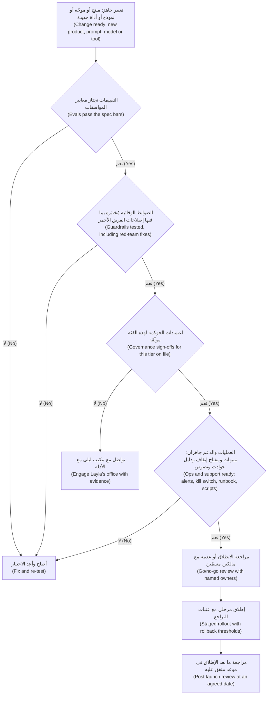
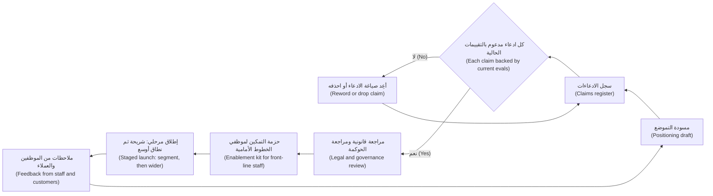
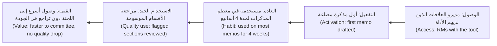

# الوحدة 7 — إطلاق منتجات الذكاء الاصطناعي

*ميزة الذكاء الاصطناعي (AI feature) التي تجتاز تقييماتها (evals) ليست منتجًا بعد. إنها تصبح منتجًا حين يستطيع أناس حقيقيون الاعتماد عليها: حين تصمد الضوابط الوقائية (guardrails) تحت الضغط، وتكون الموافقات (approvals) موثّقة في السجل، ويعرف فريق الدعم (support team) ما يقوله حين يقع خطأ، ويفهم السوق ما يَعِد به المنتج وما لا يَعِد به، ويتبنّاه (adopt) فعلًا الأشخاص الذين يغيّر عملهم. تغطي هذه الوحدة مرحلة الإطلاق (launch stage). ستتابع رانيا وفيصل في بنك نجم (Najm Bank) وهما ينقلان نجم أسيست (Najm Assist) من المرحلة التجريبية (pilot) إلى الإتاحة العامة (general release)، ويُعدّان الطرح في السوق (go-to-market) للتمويل الفوري للشركات الصغيرة (SME Instant Finance) ولمساعد مذكرات الائتمان (Credit Memo Copilot)، ويديران برنامج التغيير (change programme) الذي يحسم ما إذا كان مديرو العلاقات (relationship managers) سيستخدمون المساعد أم سيعودون بهدوء إلى Word.*

> **المراحل (Stages):** الإطلاق (Launch) — تحويل ميزة تعمل إلى منتج يستطيع الناس أن يجدوه ويثقوا به ويشتروه ويستخدموه بأمان، مع الضوابط (controls) والرسائل (messages) والعادات (habits) التي تُبقيه كذلك.

---

# 7.1 — جاهزية الإطلاق: الضوابط الوقائية وبوابات الحوكمة والدعم
*المستوى (Level): 🔴 متقدم (Advanced)* · *المتطلبات (Prerequisites): 5.1، 6.2، 6.3* · *المرحلة (Stage): Launch*

## ⚡ الدرس في دقيقة (In 60 seconds)
- **جاهزية الإطلاق (Launch readiness)** دليلٌ لا تفاؤل: شروط (conditions)، لكلٍّ منها مالك (owner) وإثبات (proof)، يجب أن تتحقق قبل تعريض مزيد من المستخدمين للمنتج.
- أربعة مجالات (Four areas): **الجودة (quality)** (اجتياز التقييمات)، و**الضوابط الوقائية (guardrails)** (يفشل بأمان)، و**الحوكمة (governance)** (الموافقات موثّقة)، و**العمليات والدعم (operations and support)** (هناك من يلاحظ المشكلات، ويستطيع إيقاف الميزة، ويعرف ما يقوله للعملاء).
- الضوابط الوقائية موزّعة على طبقات (layered) عبر المدخلات (inputs) والسياق (context) والأدوات (tools) والمخرجات (outputs) والاستخدام (usage). لا تكفي أي طبقة وحدها.
- كل تغيير في الموجّه (prompt) أو النموذج (model) أو الاسترجاع (retrieval) أو الأدوات (tool) هو إطلاق صغير (small launch). يجب أن تكون البوابات (gates) رخيصة بما يكفي لإعادة تشغيلها.
- إشارة القرار (Decision cue): انطلق فقط حين يكون لكل بند مانع (blocking item) دليلٌ ومالك، وقد جُرِّب التراجع (rollback) فعلًا، ويستطيع الدعم التعامل مع أنماط الفشل المعروفة.
- أكبر فخ (Biggest trap): اعتبار الإطلاق اليومَ الذي تُشغَّل فيه الميزة، بدلًا من اللحظة التي تتحمّل فيها المسؤولية عن كل إجابة تقدّمها.

## 🧭 لماذا يهم
في ديسمبر 2023 استُدرج روبوت المحادثة (chatbot) على موقع أحد وكلاء Chevrolet إلى «الموافقة» على بيع سيارة مقابل دولار واحد ($1) بعد أن تلاعب المستخدمون بتعليماته. وفي يناير 2024، بعد تحديث للنظام (system update)، شتم روبوت المحادثة الخاص بشركة التوصيل DPD أحد العملاء وكتب قصيدة تنتقد الشركة. لم يحتج أيٌّ من هذين الإخفاقين إلى هجوم متقدم (advanced attack)؛ فلم يكن بين النموذج والعميل ما يوقفهما. وتُظهر قضية *Moffatt v. Air Canada* (2024) ما يلي ذلك: فقد حمّلت المحكمة (tribunal) شركة الطيران المسؤولية (held the airline responsible) عمّا قاله روبوت المحادثة لأحد العملاء. أيًّا كان ما يقوله المساعد (assistant)، فالشركة هي من قالته.

في بنك نجم، أنهى نجم أسيست v1 مرحلته التجريبية. إنه يجيب عن أسئلة الحسابات والرسوم والبطاقات بالعربية والإنجليزية، مستندًا (grounded) إلى وثائق منتجات البنك (product documents)، ويحيل المحادثة إلى موظف بشري حين لا يكون متأكدًا. يقترح فيصل تشغيله لجميع عملاء تطبيق الجوال (mobile-app customers) يوم الخميس، «بما أن التقييمات نجحت». تطرح رانيا أربعة أسئلة. ما الذي يمنعه من مناقشة أهلية القروض (loan eligibility)، وهي أمر غير مُعتمد له؟ من يُستدعى (paged) إذا أعطى مبالغ رسوم خاطئة في الثانية فجرًا؟ كيف نوقفه دون إصدار جديد للتطبيق (app release)؟ ماذا يقول مركز الاتصال (contact centre) حين يشتكي عميل من إجابة؟ لا يستطيع فيصل الإجابة عن أيٍّ منها. يتأجل الإطلاق ثلاثة أسابيع؛ وهذا الدرس عن تلك الأسابيع الثلاثة.

## 📐 كيف يعمل

### 🟢 الأساسيات

**جاهزية الإطلاق (Launch readiness)** هي مجموعة الشروط التي يجب أن تتحقق، مع الدليل، قبل أن تعرّض مزيدًا من الناس للمنتج. ميزة الذكاء الاصطناعي تعمل *معظم الوقت* وتفشل بطرق لا يمكنك التنبؤ بها إلا جزئيًا، لذا يجب أن تغطي الجاهزية ما يحدث حين تفشل، إلى جانب ما إذا كانت تعمل. فكّر في أربعة مجالات.

| المجال (Area) | السؤال | الدليل المعتاد (Typical evidence) |
|---|---|---|
| **الجودة (Quality)** | هل يستوفي معايير الجودة (quality bars) في المواصفات (spec) (5.1)؟ | نتائج التقييم غير المتصل على المجموعة المرجعية (golden set) (6.1)، ونتائج الفريق الأحمر (red-team findings) مغلقة أو مقبولة (6.2)، ومقاييس المرحلة التجريبية أو الإطلاق المرحلي (6.3) |
| **الضوابط الوقائية (Guardrails)** | حين يفشل، هل يفشل بأمان (fail safely)؟ | مرشِّحات مدخلات ومخرجات مُختبَرة، وحدود الموضوعات (topic boundaries)، والتصعيد إلى إنسان، وحدود على الإجراءات والاستخدام |
| **الحوكمة (Governance)** | هل الموافقات المطلوبة لفئة المخاطر (risk tier) هذه موثّقة في السجل؟ | فئة المخاطر، وتقييم الخصوصية (privacy assessment)، والاعتمادات (sign-offs)، والإفصاحات المطلوبة (required disclosures)، وتوثيق النموذج والنظام |
| **العمليات والدعم (Operations and support)** | هل سنلاحظ المشكلات، وهل نستطيع إيقافها، وهل نستطيع مساعدة المتضررين (affected people)؟ | لوحات المتابعة والتنبيهات (dashboards and alerts)، ومالك مناوب (on-call owner)، ومفتاح الإيقاف (kill switch)، ودليل التعامل مع الحوادث (incident runbook)، ونصوص الدعم (support scripts)، وقناة الملاحظات (feedback channel) |

**الضوابط الوقائية (Guardrails)** هي ضوابط، خارج تقدير النموذج نفسه، تُبقي منتج الذكاء الاصطناعي ضمن السلوك الذي قصدته. أمثلة: مرشِّح (filter) يُبعد البيانات الشخصية (personal data) عن النموذج، ومصنِّف (classifier) يُبقي المساعد ضمن الموضوعات المعتمدة (approved topics)، وفحص (check) يتأكد من أن كل مبلغ رسوم (fee amount) يظهر في وثيقة مصدرية (source document)، وسقف لعدد الرسائل لكل مستخدم في الساعة.

**بوابات الحوكمة (Governance gates)** هي نقاط التفتيش (checkpoints) التي يؤكد فيها شخص ذو صلاحية أن المنتج يمكنه المضي قدمًا. في بنك نجم، يحدّد مكتب ليلى لكل منتج فئة مخاطر، وهي التي تقرّر التقييمات والاعتمادات المطلوبة. لا يدير مدير المنتج (PM) الحوكمة، لكنه مسؤول عن اجتيازها في الوقت المحدد: ابدأ مبكرًا وأحضر الأدلة. تتناول دورة *AI Governance: Zero to Hero* التصنيف إلى فئات والموافقات بعمق.

**جاهزية الدعم (Support readiness)** تعني أن الأشخاص الذين يتواصل معهم العملاء يعرفون ما يفعله المنتج، وما يخطئ فيه، وما يجب فعله حيال ذلك، بما في ذلك كيفية رؤية ما قاله المساعد فعلًا.

### 🟡 التعمق أكثر (Going deeper)

**الضوابط الوقائية متعددة الطبقات (Layered guardrails).** لا يوقف ضابط واحد (single control) كل الإخفاقات، لذا تكدّس منتجات الذكاء الاصطناعي الجيدة عدة ضوابط (stack several)، يلتقط كلٌّ منها ما يفوت الآخرين. من الطرق المفيدة لترتيبها أن تتتبع طلبًا عبر النظام.

| الطبقة (Layer) | ما الذي تضبطه | أمثلة من نجم أسيست |
|---|---|---|
| **المدخلات (Input)** | ما يستطيع المستخدم إرساله وما يصل إلى النموذج | حذف أرقام البطاقات والهوية؛ اكتشاف أنماط حقن الموجّه المعروفة |
| **السياق والأدوات (Context and tools)** | ما يستطيع النموذج رؤيته وفعله | وثائق المنتجات المعتمدة والحالية فقط؛ لا بيانات لعملاء آخرين؛ لا أدوات تنفيذ إجراءات في v1 |
| **تعليمات النموذج (Model instructions)** | كيف يُوجَّه النموذج إلى التصرف | النطاق (scope) والنبرة (tone) واللغات (languages) ومتى يحيل إلى موظف؛ تغطيها التقييمات |
| **المخرجات (Output)** | ما يصل إلى المستخدم | مصنِّف الموضوعات (topic classifier) يحجب أهلية القروض والنصائح الاستثمارية؛ الأرقام تُطابَق مع المصادر؛ مرشِّح النبرة (tone filter)؛ الإحالة عند انخفاض الثقة |
| **الاستخدام (Usage)** | الكمية ومن يستخدم | حدود المعدّل (rate limits)؛ سقف تكلفة يومي؛ مفتاح ميزة (feature flag) حسب الشريحة (segment) |
| **الإنسان (Human)** | من يستطيع التدخل | زر واحد «تحدّث إلى شخص (talk to a person)» مع تمرير المحادثة كاملة إلى الموظف |

مبدآن هما الأهم. **الرفض الافتراضي للإجراءات (Deny by default for actions)**: المساعد الذي يجيب عن الأسئلة فقط أسوأ حالاته (worst case) أصغر بكثير من مساعد يستطيع تحويل الأموال (move money)، لذا يُطلق نجم أسيست بلا أدوات (without tools) ويضيفها لاحقًا تحت بوابات منفصلة (separate gates) (4.3). **البديل الآمن أفضل من التعافي الذكي (Safe fallback beats clever recovery)**: حين يعمل أحد الضوابط الوقائية، افعل شيئًا مملًّا وصحيحًا («لا أستطيع المساعدة في هذا هنا؛ هل تودّ التحدث إلى موظف؟ ⁦(I can't help with that here; would you like to speak to an agent?)⁩»).

للضوابط الوقائية تكاليف (costs): زمن الاستجابة (latency)، والطلبات المشروعة المحجوبة (الإيجابيات الكاذبة)، وتقييمها الخاص. قِس المرشِّحات (filters) كما تقيس أي نموذج، من حيث الإجابات الجيدة المحجوبة والسيئة الفائتة. مرشِّح الموضوعات (topic filter) الذي يحجب «ما رسوم زيادة القرض؟ ⁦⁩» لأنه يحتوي على كلمة «قرض (loan)» هو عيب في المنتج (product defect)، لا انتصار للسلامة (safety win).

**الجاهزية التشغيلية (Operational readiness)** تغطي الآليات غير البرّاقة (unglamorous machinery) التي تقرّر ما إذا كان اليوم السيئ سيبقى صغيرًا.
- **المراقبة والتنبيهات (Monitoring and alerts).** إشارات الجودة والضوابط الوقائية والتكلفة مع عتبات (thresholds) تستدعي مالكًا مسمّى (المزيد في 8.3).
- **مفتاح الإيقاف (A kill switch).** مفتاح ميزة يوقف الميزة، أو يعود بها إلى وضع آمن (safe mode)، خلال دقائق، دون نشر (deployment) أو إصدار للتطبيق. يُختبر قبل الإطلاق.
- **التراجع (Rollback).** العودة إلى الموجّه والنموذج وفهرس الاسترجاع (retrieval index) السابقين معًا، ما يعني ترقيم إصدارات الثلاثة كلها.
- **دليل التعامل مع الحوادث (An incident runbook).** ما الذي يُعدّ حادثة ذكاء اصطناعي (AI incident) (إجابة ضارّة (harmful answer)، أو تسرّب بيانات (data leak)، أو ارتفاع مفاجئ في الإجابات الخاطئة، أو إساءة استخدام)، ومن يحدّد الخطورة (grades severity)، ومن يُبلَّغ (ليلى، سارة، الاتصال المؤسسي)، وكيف يُتواصَل مع العملاء المتضررين (affected customers).
- **التسجيل لأغراض التحقيق (Logging for investigation).** ما يكفي من كل محادثة وإصدار الموجّه (prompt version) والوثائق المسترجعة (retrieved documents) لإعادة بناء ما حدث، ضمن الحدود التي تضعها سارة.

**جاهزية الدعم (Support readiness)** عمليًا:
- مذكرة من صفحة واحدة عن **القيود المعروفة (known limitations)** للموظفين: ما لا يستطيع المساعد فعله، وأنماط الفشل التي ظهرت في الاختبار، والرد المعتمد (approved response) لكلٍّ منها.
- **البحث في المحادثات (Conversation lookup)**، حتى يرى الموظفون ما قاله المساعد فعلًا، و**مسار تصعيد (an escalation path)** لأخطاء الذكاء الاصطناعي المشتبه بها، مع وسم (tagged) يسمح بعدّها.
- **نصوص للمكالمات الصعبة (Scripts for the hard calls)**: «أخبرني المساعد أن الرسوم أُعفيت». بعد قضية Air Canada، صار «الروبوت كان مخطئًا» دفاعًا ضعيفًا (weak defence)، لذا ينبغي أن يقرّر مالكو الأعمال والشؤون القانونية قبل الإطلاق ما إذا كان البنك سيلتزم بمثل هذه الإجابات.

**الإفصاح (Disclosure).** ينبغي أن يعرف العملاء أنهم يتحدثون إلى ذكاء اصطناعي؛ وفي بعض الولايات القضائية (jurisdictions) هذا واجب قانوني (legal duty) (التزامات الشفافية (transparency obligations) في EU AI Act). وتبدأ Guidelines for Human-AI Interaction من Microsoft (Amershi et al., 2019) بالنسخة التصميمية (design version) من ذلك: وضّح ما يستطيع النظام فعله، ومدى جودته في ذلك. وهذا يصبح نص الإطلاق (launch copy).

المخطط أدناه يبيّن كيف يدير بنك نجم قرار الإطلاق (launch decision)، سواء لتغيير (change) أو لإصدار أول (first release).

### 🔴 نظرة الخبير (Expert view)

**اجعل البوابة متناسبة مع التغيير (Proportion the gate to the change).** المراجعة الكاملة (full review) لكل تعديل بسيط في الموجّه (prompt tweak) سيُلتفّ عليها قريبًا. الفرق الناضجة (mature teams) تصنّف التغييرات في فئات (classes). تغيير صياغة الموجّه يعيد تشغيل التقييمات المؤتمتة (automated evals) ويحتاج موافقة مدير المنتج (PM's approval). النموذج الجديد أو مصدر البيانات الجديد أو اللغة الجديدة يضيف اختبار الفريق الأحمر (red-teaming) على السطح المتغيّر (changed surface) وفحصًا قصيرًا للحوكمة. والقدرة الجديدة (new capability)، مثل أدوات تتصرف نيابة عن العميل، تغيّر فئة المخاطر وتمرّ بالبوابة الكاملة (full gate). اتفق على الفئات مع ليلى مسبقًا.

**حدّد عتبات التراجع قبل الإطلاق (Define rollback thresholds before launch).** قرّر مسبقًا أي الأرقام توقف الإطلاق المرحلي (6.3)، مثل انخفاض الاستناد إلى المصادر (grounding) دون معيار المواصفات (spec bar) ليومين، أو أي كشف مؤكد لبيانات عميل آخر. القرار في اللحظة، تحت أنظار الإدارة العليا، نادرًا ما ينتهي جيدًا.

**أجرِ تحليلًا استباقيًا للفشل (Run a pre-mortem).** يطلب أسلوب pre-mortem الذي وضعه Gary Klein (*Harvard Business Review*، 2007) من الفريق أن يتخيّل أن الإطلاق فشل فشلًا ذريعًا (failed badly) وأن يكتب الأسباب، فيُظهر مخاطر لا يطرحها أحد في اجتماعات الحالة (status meetings). في الذكاء الاصطناعي، اسأل: «بعد ستة أسابيع من الآن نجم أسيست في الصحف. ماذا قال؟ ⁦⁩» تتحول الإجابات إلى حالات للفريق الأحمر (red-team cases) وضوابط وقائية ونصوص دعم.

**الجاهزية مجموعة من الوعود (Readiness is a set of promises).** جدول المناوبة (on-call rota)، ومراجعة عيّنات المحادثات (sampled-conversation review)، وتحديث القيود المعروفة (known-limitations update) بعد تغيير النموذج: كلٌّ منها يحتاج إلى حارس مسمّى (named keeper) بعد الإطلاق، وإلا صار المنتج أقل جاهزية كل أسبوع.

**اعرف متى لا تُطلق (Know when not to launch).** إذا كانت الطريقة الوحيدة لإيقاف نمط فشل (failure mode) هي أن يتحقق إنسان من كل إجابة، فربما ينتمي المنتج إلى مستوى *المسودة (draft)* من الأتمتة (level of automation) (4.1). تضييق النطاق (narrowing scope)، مثلًا إلى أسئلة البطاقات والرسوم فقط، هو غالبًا أسرع طريق إلى إطلاق آمن (safe launch).

## 🧰 الأدوات
| الأداة أو الإطار (Tool or framework) | ما هو وماذا يفعل | متى تلجأ إليه |
|---|---|---|
| **Launch readiness checklist** — قائمة التحقق من جاهزية الإطلاق | شروط مانعة وغير مانعة عبر المجالات الأربعة، لكلٍّ منها مالك ودليل (evidence) وحالة (status) | قبل كل إصدار (release) وكل تغيير مهم (significant change) |
| **Layered guardrails** — الضوابط الوقائية متعددة الطبقات | ضوابط على ست طبقات (six layers) بحيث تلتقط طبقة ما يفوت أخرى؛ راجع التصميم مقابل OWASP Top 10 for LLM Applications | أي ميزة ذكاء اصطناعي موجّهة للمستخدم أو تنفّذ إجراءات |
| **Kill switch** — مفتاح الإيقاف | مفتاح ميزة أو وضع آمن يعطّل ميزة الذكاء الاصطناعي خلال دقائق دون إصدار | أي ميزة ذكاء اصطناعي موجّهة للعملاء (customer-facing)؛ تدرّب عليه (drill it) قبل الإطلاق |
| **Pre-mortem** (Gary Klein) — التحليل الاستباقي للفشل | جلسة يفترض فيها الفريق أن الإطلاق فشل ويُعدّد الأسباب | قبل الإطلاق بأسبوعين إلى أربعة أسابيع، ما دام هناك وقت للتصرف بناءً على النتائج |
| **Incident runbook** — دليل التعامل مع الحوادث | كيفية اكتشاف حوادث الذكاء الاصطناعي (AI incidents) وتصنيف خطورتها واحتوائها والتواصل بشأنها | قبل الإطلاق؛ تدرّب عليه مع الدعم والحوكمة ومسؤول حماية البيانات (DPO) |
| **Go/no-go review** — مراجعة الانطلاق أو عدمه | اجتماع قصير يؤكد فيه مالكون مسمّون (named owners) كل بند مانع بالدليل، ويقرّر المالك المساءَل (accountable owner) | البوابة الأخيرة (final gate) قبل كل مرحلة من مراحل الإطلاق (rollout stage) |
| **Change classes** — فئات التغيير | تصنيف متفق عليه للتغييرات (الموجّه، النموذج، البيانات، الأدوات) إلى مستويات من إعادة الاختبار والموافقة | فور شحن النسخة الأولى، حتى لا تكون التغييرات اللاحقة معطَّلة أو غير مفحوصة |

## 🏛️ عمليًا في بنك نجم
أعدّ فريق رانيا **قائمة التحقق من جاهزية إطلاق نجم أسيست v1 (Najm Assist v1 Launch Readiness Checklist)** للانتقال من المرحلة التجريبية إلى جميع عملاء تطبيق الجوال في قطر. يجب أن تكون البنود المانعة (blocking items) خضراء قبل الانطلاق (before go)؛ والمالك المساءَل عن القرار هو رئيس القنوات الرقمية للأفراد، مع تأكيد ليلى لبنود الحوكمة (governance items).

| # | البند (Item) | مانع (Blocking) | المالك | الدليل | الحالة |
|---|---|---|---|---|---|
| Q1 | معدّل الإجابات المستندة إلى المصادر (grounded-answer rate) على المجموعة المرجعية يستوفي معيار المواصفات بالعربية والإنجليزية | نعم (Yes) | دانة | تقرير التقييم (eval report) v1.4 | أخضر (Green) |
| Q2 | نتائج الفريق الأحمر عالية الخطورة مُصلَحة ومُعاد اختبارها | نعم | دانة | سجل الفريق الأحمر (red-team log)، 3 نتائج عالية أُغلقت | أخضر |
| G1 | حدود الموضوعات (topic boundary) تحجب أهلية القروض والنصائح الاستثمارية والقانونية؛ ومعدّل الحجب الخاطئ (false-block rate) ضمن الحد المتفق عليه | نعم | طارق | تقييم المرشِّح (filter eval) على 400 موجّه مُصنَّف (labelled prompts) | كهرماني (Amber): حجب خاطئ لـ«رسوم زيادة القرض» قيد الإصلاح |
| G2 | حذف أرقام البطاقات والهوية قبل استدعاء النموذج (model call) | نعم | طارق | مجموعة اختبارات (test suite) وعيّنة من السجلات (log sample) | أخضر |
| G3 | كل مبلغ رسوم في الإجابة يطابق وثيقة مصدرية، وإلا حُجبت الإجابة (answer withheld) | نعم | طارق | اختبارات الفحص الرقمي | أخضر |
| G4 | الإحالة إلى موظف بشري عند الطلب أو انخفاض الثقة (low confidence) أو الشكوى (complaint) | نعم | حصة | اختبار قابلية الاستخدام (usability test)، 12 جلسة | أخضر |
| V1 | تأكيد فئة المخاطر وتوثيق الاعتمادات | نعم | فيصل مع ليلى | سجل الحوكمة (governance record) | أخضر |
| V2 | اكتمال تقييم الخصوصية؛ والاتفاق على مدة الاحتفاظ بالسجلات (log retention) | نعم | فيصل مع سارة | سجل التقييم (assessment record) | أخضر |
| V3 | إفصاح الذكاء الاصطناعي (AI disclosure) في الرسالة الأولى وصفحة المساعدة (help page) معتمد من الشؤون القانونية (legal) | نعم | فيصل | اعتماد النص (copy sign-off) | أخضر |
| O1 | اختبار مفتاح الإيقاف في بيئة الإنتاج (production): يعود إلى البحث في الأسئلة الشائعة (FAQ search) في أقل من 5 دقائق | نعم | طارق | سجل التمرين (drill record) | أخضر |
| O2 | تنبيهات (alerts) على الاستناد إلى المصادر ومعدّل تفعيل الضوابط الوقائية (guardrail rate) وزمن الاستجابة والتكلفة اليومية (daily cost)، مع جدول مناوبة | نعم | طارق | رابط لوحة المتابعة (dashboard link)، وجدول المناوبة | أخضر |
| O3 | التدرّب على دليل الحوادث مع الدعم والحوكمة ومسؤول حماية البيانات والاتصال المؤسسي (comms) | نعم | فيصل | ملاحظات تمرين الطاولة (tabletop notes) | أخضر |
| S1 | يستطيع الموظفون رؤية محادثات المساعد؛ وصدرت مذكرة القيود المعروفة (known-limitations note) | نعم | قائد مركز الاتصال (contact-centre lead) | إتمام التدريب (training completion) | أخضر |
| S2 | الاتفاق على سياسة الالتزام بالإجابات غير الصحيحة عن الرسوم | نعم | مالك الأعمال والشؤون القانونية | مذكرة السياسة (policy note) | أخضر |
| R1 | الاتفاق على مراحل الإطلاق وعتبات الإيقاف | نعم | فيصل | خطة الإطلاق (rollout plan): 5%، 25%، 100% | أخضر |

**عتبات الإيقاف (Stop thresholds) (توضيحية (illustrative)):** أوقف الإطلاق مؤقتًا إذا انخفض معدّل الإجابات المستندة إلى المصادر في العيّنة اليومية (daily sample) دون معيار المواصفات يومين متتاليين؛ أو إذا تأكّد أي كشف لبيانات بين العملاء؛ أو إذا تجاوزت الشكاوى من أخطاء الذكاء الاصطناعي (AI-error complaints) المعدّل المتفق عليه في خطة الإطلاق. حُجزت مراجعة ما بعد الإطلاق (post-launch review) بعد 30 يومًا من الوصول إلى 100%.

نتيجة مراجعة الانطلاق أو عدمه (Go/no-go outcome): *«لا انطلاق هذا الأسبوع بسبب G1. انطلاق بنسبة 5% بمجرد إعادة اختبار إصلاح الحجب الخاطئ. ⁦(No-go this week on G1. Go at 5% once the false-block fix is re-tested.)⁩»*

## 🛠️ التمارين (Exercises)
- 🟢 اكتب قائمة تحقق للجاهزية (readiness checklist)، باستخدام المجالات الأربعة، لميزة ذكاء اصطناعي تستخدمها أو تبنيها. *يكتمل عندما (Done when):* يكون لديك عشرة بنود على الأقل، كلٌّ منها موسوم بأنه مانع أو غير مانع، مع دور المالك (owner role) والدليل الذي يثبته.
- 🟡 صمّم الضوابط الوقائية متعددة الطبقات لمساعد مذكرات الائتمان، الذي يصوغ مذكرات ائتمان داخلية من وثائق العملاء (client documents) لمديري العلاقات. *يكتمل عندما:* يكون لديك جدول بالطبقات الست كلها، وضابط واحد على الأقل لكل طبقة، ولكل ضابط الإخفاق الذي يلتقطه وكيف ستختبره.
- 🔴 سيتيح نجم أسيست v2 للعملاء تجميد البطاقة (freeze a card) وبدء نزاع على معاملة. اكتب سياسة فئات التغيير (change-class policy) وبوابات الإطلاق الإضافية لـ v2. *يكتمل عندما:* تصنّف سياستك خمسة أنواع من التغيير على الأقل إلى فئات مع إعادة الاختبار والموافقة التي يحتاجها كلٌّ منها، وتُوضع v2 في الفئة الصحيحة مع الأسباب، وتُعدّد الضوابط الوقائية الإضافية وعتبات الإيقاف ونصوص الدعم التي تتطلبها الإجراءات (actions).

## ⚠️ أخطاء وفخاخ (Mistakes and traps)
- **«نجحت التقييمات، إذن نحن جاهزون.» ⁦(The evals passed, so we are ready.)⁩** التقييمات تغطي الحالات التي اختبرتها. افحص المجالات الأربعة كلها.
- **مفتاح إيقاف غير مُختبَر (An untested kill switch).** إذا كان يحتاج إلى نشر أو لم يُجرَّب قط، فليس لديك مفتاح إيقاف. تدرّب عليه قبل الإطلاق.
- **قياس الضوابط الوقائية بما تحجبه فقط (Guardrails measured only for what they block).** قِس الحجب الخاطئ (false blocks) إلى جانب ما يفوتها (misses).
- **معاملة التحديثات كصيانة (Treating updates as maintenance).** أساء روبوت المحادثة الخاص بـ DPD التصرف بعد تحديث (after an update). اتفق على فئات التغيير (change classes) كي يمرّ كل تغيير بالمستوى المناسب من البوابة.
- **الحوكمة أو الدعم كأمر ثانوي (Governance or support as an afterthought).** الوصول إلى مكتب ليلى قبل الإطلاق بأسبوع، أو ترك الموظفين يتعلمون أنماط الفشل (failure modes) من الشكاوى (complaints)، يعني أنك بدأت متأخرًا جدًا. أشرك الطرفين في مرحلة التصميم.

## 🧾 الخلاصة (Recap)
- جاهزية الإطلاق أدلة مع مالكين مسمّين عبر أربعة مجالات: الجودة، والضوابط الوقائية، والحوكمة، والعمليات والدعم.
- الضوابط الوقائية موزّعة على طبقات عبر المدخلات، والسياق والأدوات، والتعليمات (instructions)، والمخرجات، والاستخدام، والإحالة إلى إنسان (human handover). ارفض الإجراءات افتراضيًا وعُد إلى شيء آمن وممل.
- مفتاح إيقاف مُختبَر، وتراجع مُرقَّم الإصدارات (versioned rollback) للموجّه والنموذج والفهرس معًا، وتنبيهات مع مالك مناوب، ودليل حوادث مُتدرَّب عليه: كلها متطلبات للإطلاق (launch requirements).
- يحتاج الدعم إلى القيود المعروفة، والبحث في المحادثات، والتصعيد (escalation)، وسياسة محدّدة مسبقًا بشأن الالتزام بالإجابات الخاطئة.
- كل تغيير إطلاق صغير: صنّف التغييرات في فئات واجعل بوابة كل فئة متناسبة مع المخاطر التي تضيفها.

## ✍️ اختبر نفسك (Check yourself)

**1. تستوفي التقييمات غير المتصلة (offline evals) لنجم أسيست (Najm Assist) كل معايير الجودة (quality bars) في المواصفات (spec). يقول فيصل إن المنتج جاهز لجميع العملاء. ما أقوى سبب للاعتراض؟**

- A. التقييمات (evals) ليست أبدًا إشارة موثوقة إلى الجودة
- B. الجاهزية (readiness) تتطلب أيضًا ضوابط وقائية مُختبَرة (tested guardrails)، وموافقات الحوكمة (governance approvals)، ومراقبة مع مفتاح إيقاف، ودعمًا مُعَدًّا (prepared support)
- C. ينبغي أولًا إعادة بناء المنتج على نموذج أكبر (larger model)
- D. ينبغي استطلاع آراء العملاء بشأن الذكاء الاصطناعي قبل أي إطلاق

الإجابة

**B.** التقييمات (evals) تغطي مجال الجودة (quality area) فقط. الخيار A مبالغ فيه (too strong): التقييمات دليل ضروري (necessary evidence)، لكنه غير كافٍ. (🟢 الأساسيات.)

**2. أي تصميم للضوابط الوقائية (guardrail design) يتبع على أفضل وجه مبدأ «الرفض الافتراضي للإجراءات (deny by default for actions)» في الإصدار الأول (first release) لمساعد العملاء (customer assistant)؟**

- A. منح المساعد جميع الأدوات المصرفية (banking tools) مع إخباره في موجّه النظام (system prompt) بأن يكون حذرًا في كل إجراء (action) ينفذه، وبأن يطلب تأكيد العميل (customer confirmation) عند الحاجة
- B. السماح بالإجراءات فقط للعملاء الذين يقبلون الشروط
- C. السماح بالإجراءات مع تسجيلها للمراجعة في نهاية الشهر
- D. الإطلاق بالإجابة عن الأسئلة فقط (question-answering only) وإضافة أدوات الإجراءات (action tools) لاحقًا، كلٌّ منها تحت بوابته الخاصة

الإجابة

**D.** البدء بلا أدوات يُبقي أسوأ الحالات (worst case) صغيرة، وإضافة الأدوات لاحقًا تحت بوابات منفصلة (separate gates) يوائم المخاطر مع الأدلة. الخيار A يعتمد على تقدير النموذج نفسه، وهذا ليس ضابطًا وقائيًا. (🟡 التعمق أكثر (Going deeper).)

**3. خلال إطلاق مرحلي (staged rollout) بنسبة 25%، تُظهر العيّنة اليومية (daily sample) أن معدّل الإجابات المستندة إلى المصادر (grounded-answer rate) انخفض دون معيار المواصفات (spec bar) يومين. وكانت خطة الإطلاق (rollout plan) قد أدرجت هذا عتبةَ إيقاف (stop threshold). ماذا ينبغي أن يفعل مدير المنتج (PM)؟**

- A. إيقاف الإطلاق مؤقتًا، والعودة إلى البديل أو التراجع كما تنص الخطة، والتحقيق في السبب (investigate)
- B. المتابعة إلى 100% (full rollout) لأن الانخفاض قد يكون ضوضاء (noise)، ولأن يومين مدة أقصر من أن يُحكم بها على أداء الإطلاق التدريجي
- C. خفض معيار المواصفات كي يستمر الإطلاق، ثم مراجعة المعيار من جديد بعد الإطلاق الكامل (after launch)، عندما تتوفر بيانات أكثر
- D. انتظار مراجعة ما بعد الإطلاق بعد 30 يومًا (30-day post-launch review) قبل أن يقرر أحد ما إذا كان يجب اتخاذ أي إجراء على الإطلاق أصلًا

الإجابة

**A.** تُحدَّد عتبات الإيقاف (stop thresholds) مسبقًا كي لا يقرّر أحد تحت ضغط الإطلاق. الخياران C وD يُبطلان الغرض منها. (🔴 نظرة الخبير (Expert view).)

**4. غيّر الفريق صياغة موجّه النظام (system prompt) لنجم أسيست ليبدو أكثر ودًّا (friendlier). وفق سياسة معقولة لفئات التغيير (change-class policy)، ماذا ينبغي أن يحدث؟**

- A. لا شيء: صياغة الموجّه (prompt wording) ليست تغييرًا في المنتج (product change)
- B. بوابة الإطلاق الكاملة، بما في ذلك موافقة حوكمة جديدة ومراجعة جديدة من لجنة المخاطر (risk committee) قبل أي إصدار
- C. إعادة تشغيل مجموعة التقييمات المؤتمتة والحصول على موافقة مدير المنتج (PM's approval) قبل الإصدار
- D. إصداره لجميع المستخدمين ومراقبة الشكاوى (monitor complaints)

الإجابة

**C.** تغيير الموجّه (prompt change) قد يغيّر السلوك (alter behaviour)، كما تُظهر حالة DPD، لذا يجب إعادة اختباره، لكنه لا يغيّر فئة المخاطر (risk tier)، فالبوابة الكاملة (B) غير متناسبة. (🔴 نظرة الخبير (Expert view).)

**5. يتصل عميل ليقول إن نجم أسيست أخبره أن رسومًا ستُعفى (a fee would be waived). وكان ذلك خطأ. ما الذي كان ينبغي أن يكون قائمًا قبل الإطلاق؟**

- A. سياسة (policy)، يتفق عليها مالك الأعمال والشؤون القانونية، بشأن ما إذا كان البنك سيلتزم بإجابات المساعد غير الصحيحة وكيف، إضافة إلى البحث في المحادثات (conversation lookup) للموظفين
- B. إخلاء مسؤولية (disclaimer) يقول إن إجابات المساعد غير مُلزِمة، كي يستطيع الموظفون رفض كل هذه المطالبات
- C. تعليمات للموظفين بتصعيد كل مكالمة إلى فريق المنتج (product team)
- D. لا شيء: هذه الحالات أندر من أن يُخطَّط لها

الإجابة

**A.** بعد قضية *Moffatt v. Air Canada*، صار «الروبوت كان مخطئًا» دفاعًا ضعيفًا (weak defence). وإخلاء المسؤولية وحده (disclaimer alone) (B) قد لا يحمي البنك ويُضرّ بالثقة (damages trust). (🟡 التعمق أكثر (Going deeper).)

## 📚 المراجع (References)
- Amershi, S. et al. (2019). "Guidelines for Human-AI Interaction." CHI 2019 — https://www.microsoft.com/en-us/research/project/guidelines-for-human-ai-interaction/
- Google PAIR، *People + AI Guidebook* — https://pair.withgoogle.com/guidebook
- OWASP Top 10 for LLM Applications — https://genai.owasp.org
- Klein, G. (2007). "Performing a Project Premortem." *Harvard Business Review* — https://hbr.org/2007/09/performing-a-project-premortem
- Beyer, B. et al., *Site Reliability Engineering* (Google)، فصول إدارة الحوادث ومراجعات ما بعد الحوادث — https://sre.google/books/
- NIST AI Risk Management Framework — https://www.nist.gov/itl/ai-risk-management-framework
- EU AI Act، اللائحة (Regulation) (EU) 2024/1689 — https://eur-lex.europa.eu/eli/reg/2024/1689/oj
- [*بناء تطبيقات الذكاء الاصطناعي والوكلاء من الصفر إلى الاحتراف*، الدرس 13.2 — ضوابط المؤسسات وحزمة الحوكمة](../aiapps/index.ar.html#/13.2) — منظور البناء والتسليم (build and ship) لهذا الموضوع

---

# 7.2 — الطرح في السوق: التموضع وإشارات التسعير والتمكين
*المستوى: 🔴 متقدم* · *المتطلبات: 2.1، 4.2، 7.1* · *المرحلة: Launch*

## ⚡ الدرس في دقيقة (In 60 seconds)
- **الطرح في السوق (Go-to-market (GTM))** هو كيف يصل المنتج إلى الأشخاص الموجَّه إليهم: لمن هو، وبماذا يَعِد، وكيف يُسعَّر أو يُموَّل، وكيف يُجهَّز الأشخاص الذين يبيعونه ويدعمونه.
- في منتجات الذكاء الاصطناعي، **التموضع هو ضبط التوقعات (positioning is expectation-setting)**. الوعد الذي تقطعه يقرّر ما إذا كان منتج بدقة 90% (90%-accurate) يبدو مُبهرًا أم معطوبًا. ابدأ بالمهمة التي ينجزها العميل، لا بـ«الذكاء الاصطناعي (AI)».
- كل ادّعاء خارجي (external claim) يحتاج إلى دليل. احتفظ بـ**سجل الادعاءات (claims register)** الذي يربط كل عبارة تسويقية (marketing statement) بنتيجة تقييم (eval result)، واحصل على اعتماده كأي بند إطلاق آخر (launch item).
- التسعير يرسل إشارة قبل أن يستخدم أحد المنتج: المجاني والمُضمَّن يقول «جزء من الخدمة»، والفئة المميزة (premium tier) تقول «قيمة إضافية (extra value)»، والتسعير حسب النتيجة (per-outcome pricing) يقول «نحن واثقون أنه يعمل». اختر الإشارة عن قصد.
- **التمكين (Enablement)** يعني تجهيز موظفي الخطوط الأمامية (front-line staff) (المبيعات، ومديرو العلاقات، ومركز الاتصال) لشرح المنتج بأمانة، بما في ذلك حدوده، ولالتقاط ما يقوله العملاء.
- أكبر فخ: التسويق يكتب الوعد وعلى المنتج أن يرقى إليه. مدير المنتج هو مالك الوعد.

## 🧭 لماذا يهم
تضمّن أول عرض علني لـ Bard من Google، في فبراير 2023، إجابة فيها خطأ واقعي (factual error) عن تلسكوب James Webb الفضائي. اكتشفه الصحفيون بسرعة وانتشر على نطاق واسع. كان الخطأ نفسه من نوع الأخطاء التي يرتكبها كل نموذج لغوي (language model). ما جعله مكلفًا هو السياق: لحظة إطلاق (launch moment)، مؤطّرة على أنها استعراض للدقة، أمام جمهور مُهيّأ للتحقق. حوّل التموضع (positioning) وإخراج الإطلاق (launch staging) خطأً عاديًا في النموذج إلى قصة.

يوشك بنك نجم على إطلاق التمويل الفوري للشركات الصغيرة لعملائه من الشركات الصغيرة (small-business customers): طلبات تمويل الفواتير (invoice-financing requests) حتى حدّ معيّن تحصل على قرار خلال دقائق بدلًا من أيام، بقيادة نموذج تعلّم آلي (ML model) مع مراجعة بشرية (human review) للرفض والحالات الحدّية. تقول المسودة الأولى لحملة فيصل (campaign): *«الذكاء الاصطناعي يوافق على تمويل فاتورتك فورًا. ⁦⁩»* تعجب خالد. ولا تعجب رانيا. كلمة «فورًا (Instantly)» خاطئة بالنسبة إلى الطلبات التي تذهب إلى المراجعة. وكلمة «يوافق (Approves)» تستدعي شكاوى (invites complaints) من العملاء الذين يُرفضون. وعبارة «الذكاء الاصطناعي يوافق (AI approves)» تضع قرارًا ائتمانيًا مؤتمتًا في العنوان الرئيسي (headline)، وهو بالضبط ما أمضت ليلى وسارة أشهرًا في ضمان ألا يكون القصة كلها. المنتج جيد. والوعد سيجعله يبدو سيئًا.

## 📐 كيف يعمل

### 🟢 الأساسيات

**الطرح في السوق (Go-to-market)** يغطي أربعة قرارات (four decisions):
1. **لمن هو أولًا؟ ⁦(Who is it for first?)⁩** الشريحة المستهدفة (target segment) للإطلاق، وهي عادةً أضيق من السوق على المدى الطويل (long-term market).
2. **بماذا نَعِد؟ ⁦(What do we promise?)⁩** التموضع والرسالة الأساسية (core message).
3. **كيف يُسعَّر أو يُموَّل؟ ⁦(How is it priced or funded?)⁩** للمنتجات الخارجية (external products)، السعر ونموذج التسعير (pricing model). وللمنتجات الداخلية (internal products)، كيف تُموَّل التكلفة وما إذا كان الاستخدام يُحمَّل على وحدات الأعمال.
4. **كيف نصل إلى المستخدمين وندعمهم؟ ⁦(How do we reach and support users?)⁩** القنوات (channels)، وتسلسل الإطلاق (launch sequence)، وتمكين الأشخاص الذين يبيعون ويُهيّئون المستخدمين (onboard) ويدعمون.

**التموضع (Positioning)** هو الكيفية التي تريد أن يفهم بها العميل المستهدف (target customer) ماهية المنتج، ولمن هو، ولماذا هو أفضل من البدائل. يقسّمه كتاب April Dunford *Obviously Awesome* (2019) إلى مكوّنات (components): **البدائل التنافسية (competitive alternatives)** (ما سيفعله العملاء بدونك، وغالبًا جدول بيانات (spreadsheet) أو مكالمة هاتفية أو لا شيء)، و**السمات الفريدة (unique attributes)** التي تملكها ويفتقدونها، و**القيمة (value)** التي تقدّمها تلك السمات، و**العملاء الأكثر اهتمامًا (customers who care most)** بتلك القيمة، و**فئة السوق (market category)** التي تضع نفسك فيها كي يعرف العملاء كيف يحكمون عليك.

في منتجات الذكاء الاصطناعي، اختيار الفئة (category choice) حاسم، لأنه يضبط التوقعات (sets expectations). سمِّ نجم أسيست «خبيرك المصرفي» وسيحكم عليه العملاء مقارنةً بخبير بشري (human expert)، وسيبدو كل خطأ عدمَ كفاءة (incompetence). وسمِّه «إجابات سريعة عن حساباتك وبطاقاتك ورسومك، مع شخص على بُعد نقرة واحدة» وسيحكم عليه العملاء مقارنةً بالبحث في الأسئلة الشائعة أو الانتظار على الخط. وهو يتفوّق على كليهما.

**ابدأ بالمهمة، لا بالتقنية (Lead with the job, not the technology).** يشتري العملاء نتائج (outcomes): قرارًا أسرع (faster decision)، وسؤالًا مُجابًا في منتصف الليل، ومذكرة مصاغة قبل الاجتماع. عبارة «مدعوم بالذكاء الاصطناعي (AI-powered)» لا تخبرهم شيئًا عمّا يحصلون عليه، وتثير أسئلة لا يرغب بعضهم في طرحها (هل آلة تقرّر بشأني؟ هل تُدرِّب بياناتي شيئًا ما؟ ⁦⁩). اذكر الذكاء الاصطناعي حيث يلزم للأمانة والثقة، مثل الإفصاح بأنهم يتحدثون إلى مساعد، ودع النتيجة تكون العنوان الرئيسي.

### 🟡 التعمق أكثر

**الادعاءات والأدلة (Claims and evidence).** كل عبارة تقولها عن منتج ذكاء اصطناعي هي وعد بشأن سلوك احتمالي. **سجل الادعاءات (claims register)** يُدرج كل ادّعاء خارجي، والدليل الذي يستند إليه، والشروط التي يصحّ فيها، ومن اعتمده.

| الادعاء (مسودة) (Claim) | المشكلة (Problem) | الادعاء (معتمد) (Claim) | الدليل |
|---|---|---|---|
| «الذكاء الاصطناعي يوافق على تمويل فاتورتك فورًا» | ليست كل الطلبات فورية؛ و«يوافق» غير صحيح في حالات الرفض (declines)؛ والعنوان يُبرز القرار المؤتمت (automated decision) | «احصل على قرار بشأن طلبات تمويل الفواتير المؤهلة خلال دقائق» | المرحلة التجريبية: نسبة الطلبات المؤهلة (eligible requests) التي تقرّرت خلال الوقت المُعلَن، من مقاييس الإطلاق (rollout metrics) |
| «نجم أسيست يعرف كل شيء عن حسابك» | غير محدود (unbounded)؛ يستدعي أسئلة لا يستطيع الإجابة عنها | «يجيب عن أسئلة حساباتك وبطاقاتك ورسومك، على مدار الساعة، بالعربية والإنجليزية (Answers questions about your accounts, cards and fees, 24/7, in Arabic and English)» | تغطية المجموعة المرجعية حسب الموضوع واللغة (6.1) |
| «دقيق دائمًا (Always accurate)» | لا يستطيع أي منتج ذكاء اصطناعي دعم هذا | يُحذف؛ لا ادّعاء للدقة في التسويق | لا ينطبق |

يحمي السجلُّ العميلَ والبنك. يراجعه مكتب ليلى والشؤون القانونية؛ وتؤكد دانة أن كل ادّعاء مدعوم بالتقييمات الحالية. ويحتاج إلى مراجعة عند تغيّر النموذج، لأن ادّعاءً كان صحيحًا على النموذج القديم قد لا يكون كذلك على الجديد.

**إخراج الإطلاق على مراحل (Staging the launch).** ليس كل إطلاق ينبغي أن يكون صاخبًا (loud). تصنّف كثير من فرق المنتج الإطلاقات في مستويات (tiers): إصدار هادئ لشريحة، أو إعلان عادي (standard announcement)، أو حملة كبرى (major campaign). في منتجات الذكاء الاصطناعي، القاعدة المعقولة هي أن تستحق الإطلاق الصاخب. ابدأ بجمهور محدود (limited audience) (قائمة انتظار (waitlist)، أو وسم تجريبي (beta label)، أو شريحة واحدة)، ودع مقاييس الإطلاق المرحلي (staged-rollout metrics) من 6.3 تبني الأدلة، ثم وسّع الرسالة مع المنتج. الوسم التجريبي تموضع أمين (honest positioning)، لا ذريعة: إنه يخبر المستخدمين بأن يتوقعوا حوافَّ خشنة (rough edges) ويدعوهم إلى إبداء الملاحظات. ويتوقف عن كونه أمينًا إذا بقي لسنوات.

**إشارات التسعير (Pricing signals).** يحظى التسعير واقتصاديات الوحدة بمعالجة كاملة في 8.2. عند الإطلاق يكون السؤال أضيق: ماذا يقول السعر، أو غيابه، للعميل؟ الأنماط الشائعة (common patterns)، مع أمثلة علنية:

| النمط (Pattern) | الإشارة التي يرسلها | مثال (Example) (وقت الكتابة، 2026؛ التفاصيل تتغيّر) |
|---|---|---|
| **مُضمَّن ومجاني (Bundled and free)** | «هذا جزء من الخدمة التي لديك أصلًا» | كثير من المساعدات المصرفية (banking assistants)، ومنها نجم أسيست |
| **فئة مميزة (Premium tier)** | «قيمة إضافية لمن يريد المزيد» | وضعت Duolingo Max (2023) ميزات الذكاء الاصطناعي التوليدي (GenAI features) في اشتراك أعلى سعرًا (higher-priced subscription) |
| **حسب الاستخدام (Usage-based)** | «ادفع مقابل ما تستخدمه» | التسعير لكل مقعد أو لكل طلب لميزات الذكاء الاصطناعي وواجهات البرمجة (APIs) |
| **حسب النتيجة (Outcome-based)** | «لا نتقاضى أجرًا إلا حين ينجح» | سعّرت Intercom وكيلها Fin لكل محادثة محلولة (per resolved conversation) (منذ 2023)؛ وأطلقت Salesforce منصة Agentforce بتسعير لكل محادثة (per-conversation pricing) (2024) |

التسعير حسب النتيجة (outcome-based pricing) إشارة قوية على الثقة، لكنه يفرض تعريفًا صارمًا لـ«النتيجة (outcome)». ما الذي يُعدّ محادثة محلولة (resolved conversation)؟ ومن يقرّر؟ كما يضع إيرادات المورّد (vendor's revenue) في توتّر مع القياس الأمين (honest measurement). إن استخدمته، فاتفق على التعريف مع العملاء قبل الإطلاق.

بالنسبة إلى بنك، غالبًا ما يكون قرار التسعير المهم هو **ما لا يجب تغييره (what not to change)**. يسعّر بنك نجم التمويل الفوري للشركات الصغيرة وفق جدول الرسوم نفسه لتمويل الفواتير اليدوي. السرعة هي الفائدة، وأي «رسوم ذكاء اصطناعي (AI fee)» جديدة ستشير إلى أن العملاء يدفعون زيادةً مقابل أتمتة البنك. كان ذلك خيارًا مقصودًا في التموضع، وسُجِّل على هذا النحو.

**للمنتجات الداخلية طرح في السوق أيضًا (Internal products have a GTM too).** مساعد مذكرات الائتمان موجّه لمديري العلاقات لا للعملاء، لكنه يحتاج رغم ذلك إلى تموضع («مسودتك الأولى، جاهزة قبل اجتماع الائتمان؛ وتبقى أنت المؤلف»)، وقرار تمويل (funding decision) (ميزانية مركزية للسنة الأولى، ثم تحميل التكلفة على خطوط الأعمال بعدها، بقرار مع عمر والإدارة المالية)، وتسلسل إطلاق (فريق الشركات في منطقة واحدة أولًا)، وتمكين. يتداخل الطرح الداخلي في السوق (internal GTM) مع التبنّي وإدارة التغيير (adoption and change management)، وهو ما يغطيه 7.3.

**التمكين (Enablement)** يجهّز الأشخاص الواقفين بين المنتج ومستخدميه. في منتجات الذكاء الاصطناعي يحتاجون إلى أكثر من جولة في الميزات (feature tour).

- **ما هو مخصّص له وما ليس مخصّصًا له (What it is for and not for)**، بكلمات بسيطة يستطيعون تكرارها.
- **القيود بأمانة (Honest limitations)**: أنماط الفشل من مذكرة القيود المعروفة في 7.1، وما يُقال بشأن كلٍّ منها.
- **نص عرض توضيحي يُظهر إخفاقًا (A demo script that shows a failure)**. العرض الذي يحيل فيه المساعد إلى إنسان، أو ينبّه فيه مساعد المذكرات إلى وثيقة ناقصة، يعلّم الثقة أكثر من تشغيل مثالي (perfect run). كما يتجنّب مشكلة Bard: الاستعراض المؤطّر على أنه مثالي يدعو الناس إلى البحث عن الخلل.
- **التعامل مع الاعتراضات (Objection handling)**: «هل يقرّر حاسوبٌ ائتماني؟ ⁦⁩» «أين تذهب بياناتي؟ ⁦⁩» «ماذا لو كان مخطئًا؟ ⁦⁩». يُتفق على الإجابات مع ليلى وسارة.
- **مسارات الملاحظات (Feedback routes)**: كيف يبلّغ موظفو الخطوط الأمامية عمّا يقوله العملاء، كي يسمع فريق المنتج عن الالتباس (confusion) قبل أن يتحول إلى شكاوى.

المخطط أدناه يبيّن كيف ينقل بنك نجم رسالةً من المسودة إلى السوق.

### 🔴 نظرة الخبير

**قلّل الوعود بشأن الاستقلالية، وتجاوز التوقعات في السرعة (Under-promise on autonomy, over-deliver on speed).** يسامح العملاء مساعدًا يقول «دعني أوصلك بأحد زملائي». ولا يسامحون مساعدًا يخطئ في أموالهم بثقة. ضع ميزات الذكاء الاصطناعي في تموضع أدنى بمستوى واحد من الأتمتة مما تستطيع فعله تقنيًا (4.1): إن كانت تصوغ مسودات، فقل إنها تصوغ؛ وإن كانت تقرّر بعض الحالات، فقل «معظم الطلبات المؤهلة تحصل على قرار خلال دقائق»، لا «قرارات فورية (instant decisions)». الفجوة بين الوعد والتجربة هي المساحة التي تنمو فيها الثقة.

**يجب أن يصمد التموضع أمام تغيير النموذج (Positioning must survive the model change).** ستستبدل النماذج، وتعدّل الموجّهات (prompts)، وتضيف أدوات. إذا كان تموضعك يسمّي النموذج أو يتكئ على مقياس مرجعي (benchmark)، صار كل تغيير حدثًا تسويقيًا (marketing event)، وقد تصبح ادعاءاتك خاطئة بهدوء. ضع التموضع على المهمة والضوابط (الاستناد إلى وثائق البنك، وشخص على بُعد نقرة واحدة)، فهذه تبقى صحيحة عبر إصدارات النموذج (model versions).

**احذر «التلميع بالذكاء الاصطناعي» في الاتجاهين (Beware AI-washing in both directions).** المبالغة في دور الذكاء الاصطناعي في المنتج تستدعي متاعب تنظيمية وسُمعية؛ فقد حذّرت الجهات التنظيمية المالية وجهات حماية المستهلك في عدة ولايات قضائية الشركاتِ من الادعاءات المبالغ فيها عن الذكاء الاصطناعي. والتقليل من شأنه قد يرتدّ أيضًا: إذا اكتشف العملاء ذكاءً اصطناعيًا غير مُفصَح عنه (undisclosed AI) في تفاعل حساس، تصبح القصة عن الإخفاء (concealment). قل ما هو، بوضوح، مرة واحدة، وانتقل إلى القيمة.

**السعر أيضًا بيان عن المخاطر (Price is also a statement about risk).** تقاضي أجر لكل نتيجة على ذكاء اصطناعي متصل بالائتمان قد يوحي بأن البنك يربح من القرارات المؤتمتة (automated decisions). وتقاضي علاوة (premium) على نصائح قائمة على الذكاء الاصطناعي (AI-based advice) قد يولّد توقعات بالملاءمة لا يستطيع المنتج الوفاء بها. أحضر أفكار التسعير للمنتجات الخاضعة للتنظيم (regulated products) إلى ليلى مبكرًا. خيارات التسعير تشكّل كيف يقرأ المنظّمون والعملاء المنتج.

**ملاحظات الطرح في السوق بيانات اكتشاف (GTM feedback is discovery data).** تنتج الأسابيع الأولى من الإطلاق أغنى الأدلة التي ستحصل عليها (richest evidence): ما يسأله الناس ولم تتوقعه، وأين ينسحبون (drop off)، وأي الادعاءات تربكهم. وجّهها إلى خريطة الفرص (opportunity map) (2.1) وتحليل الأخطاء (error analysis) (6.1)، لا إلى تقرير الحملة (campaign report) فقط.

## 🧰 الأدوات
| الأداة أو الإطار | ما هو وماذا يفعل | متى تلجأ إليه |
|---|---|---|
| **Positioning canvas** — لوحة التموضع | تحدّد البدائل التنافسية، والسمات الفريدة، والقيمة، والعملاء الأنسب (best-fit customers)، وفئة السوق | قبل كتابة أي رسالة إطلاق (launch message)؛ أعِد النظر فيها حين تتغيّر الشريحة المستهدفة |
| **Claims register** — سجل الادعاءات | يُدرج كل ادّعاء خارجي مع دليله، وشروطه، ومن يعتمده (approver)، وتاريخ مراجعته (review date) | لكل إطلاق ذكاء اصطناعي موجّه للعملاء ولكل تغيير في النموذج قد يؤثر على ادّعاء |
| **Launch tiers** — مستويات الإطلاق | تصنّف الإطلاقات إلى هادئ وعادي وكبير، لكلٍّ منها مستواه من الإعلان والتحضير | لتقرير مدى صخب الإطلاق، بالنظر إلى الأدلة المتاحة |
| **Pricing pattern map** — خريطة أنماط التسعير | تقارن التسعير المُضمَّن والمميز وحسب الاستخدام وحسب النتيجة بحسب الإشارة التي يرسلها كلٌّ منها | لاختيار إشارة التسعير عند الإطلاق؛ ثم التسليم إلى عمل اقتصاديات الوحدة (unit-economics work) في 8.2 |
| **Enablement kit** — حزمة التمكين | مسار الحديث (talk track)، والقيود المعروفة، ونص عرض توضيحي فيه إخفاق، والتعامل مع الاعتراضات، ومسار الملاحظات (feedback route) لموظفي الخطوط الأمامية | قبل الإطلاق بأسبوعين إلى أربعة أسابيع، مع اختبارها أولًا على مجموعة صغيرة من الموظفين |
| **Beta label and waitlist** — الوسم التجريبي وقائمة الانتظار | يشيران إلى جودة مرحلة مبكرة (early-stage quality) ويحدّان من التعرّض (limit exposure) بينما تتراكم الأدلة | أول إصدار خارجي لقدرة ذكاء اصطناعي جديدة |

## 🏛️ عمليًا في بنك نجم
**صفحة الطرح في السوق للتمويل الفوري للشركات الصغيرة (SME Instant Finance GTM One-Pager)** بعد مراجعة فيصل، بموافقة خالد ومراجعة ليلى:

| القسم (Section) | المحتوى (Content) |
|---|---|
| **شريحة الإطلاق (Launch segment)** | عملاء الشركات الصغيرة والمتوسطة (SME customers) الحاليون في قطر ممن لديهم سجل حساب (account history) لا يقل عن 12 شهرًا، ومبالغ فواتيرهم ضمن حد المنتج (product limit). قاعدة أوسع من الشركات الصغيرة بعد 90 يومًا إذا لم تُبلَغ عتبات الإيقاف. |
| **البدائل التنافسية (Competitive alternatives)** | تمويل الفواتير اليدوي في بنك نجم (أيام)؛ السحب على المكشوف (overdraft)؛ طلب مهلة سداد أطول من المورّد (longer terms)؛ جهات الإقراض من شركات التقنية المالية المنافسة |
| **السمات الفريدة (Unique attributes)** | قرار خلال دقائق لمعظم الطلبات المؤهلة؛ يستخدم سجل الحساب الحالي للعميل، فتقلّ الوثائق المطلوبة؛ مسؤول ائتمان مسمّى يراجع كل حالة رفض (every decline) |
| **بيان التموضع (Positioning statement)** | *لعملاء الشركات الصغيرة والمتوسطة الراسخين الذين يحتاجون سيولة من فواتير غير مدفوعة (unpaid invoices) بسرعة، يمنح التمويل الفوري للشركات الصغيرة معظم الطلبات المؤهلة قرارًا خلال دقائق باستخدام السجل الذي يملكه بنك نجم أصلًا، مع مسؤول ائتمان (credit officer) يراجع كل حالة رفض. وخلافًا للتمويل اليدوي (manual financing)، لا ملاحقة للوثائق ولا انتظار لعدة أيام.* |
| **العنوان الرئيسي (Headline)** | «حوِّل الفواتير المؤهلة إلى سيولة، بقرار خلال دقائق. ⁦⁩» |
| **إفصاح الذكاء الاصطناعي (AI disclosure)** | في مسار الطلب (application flow) والشروط (terms): نموذج مؤتمت (automated model) يقيّم الطلب؛ وحالات الرفض يراجعها شخص؛ وكيفية طلب تفسير ومراجعة. صياغة معتمدة من سارة والشؤون القانونية. |
| **سجل الادعاءات (Claims register)** | 5 ادعاءات، كلٌّ منها مرتبط بمقاييس المرحلة التجريبية (pilot metrics)؛ كلمات «فوري (instant)» و«مضمون (guaranteed)» و«الذكاء الاصطناعي يوافق» محظورة في جميع النصوص |
| **إشارة التسعير (Pricing signal)** | جدول الرسوم نفسه لتمويل الفواتير اليدوي. لا علاوة للذكاء الاصطناعي. السرعة هي الفائدة. |
| **مستوى الإطلاق (Launch tier)** | عادي (Standard): لافتة داخل التطبيق (in-app banner) وتواصل مديري العلاقات (RM outreach) مع شريحة الإطلاق. بيان صحفي (press release) فقط بعد مراجعة الـ90 يومًا. |
| **التمكين (Enablement)** | مديرو علاقات الشركات الصغيرة ومركز الاتصال: جلسة من 45 دقيقة، ومسار حديث، وقيود معروفة (مثلًا، فواتير المشترين الجدد تذهب عادةً إلى المراجعة)، وإجابات الاعتراضات (objection answers) («هل يقرّر حاسوب؟ ⁦⁩»)، وعرض توضيحي بموافقة واحدة وإحالة واحدة إلى المراجعة |
| **الملاحظات (Feedback)** | يسجّل مديرو العلاقات (RMs) أسئلة العملاء بوسم «SIF-feedback»؛ مراجعة أسبوعية (weekly review) مع فيصل ودانة خلال الأسابيع الثمانية الأولى |
| **إشارات النجاح (Success signals)** | نسبة الطلبات المؤهلة التي تقرّرت في الوقت المُعلَن؛ ومعدّل إكمال الطلبات؛ والشكاوى من القرارات؛ ودرجة ثقة مديري العلاقات من استطلاع نبض شهري (monthly pulse) (الأهداف في خطة المقاييس (metrics plan)، 8.1) |

## 🛠️ التمارين
- 🟢 أعِد صياغة ثلاثة ادعاءات تسويقية للذكاء الاصطناعي رأيتها (من أي شركة) بحيث يمكن دعم كلٍّ منها بالأدلة. *يكتمل عندما:* تذكر كل صياغة جديدة المهمة، وتتجنّب الكلمات غير المحدودة (unbounded words) مثل «دائمًا (always)» أو «فوري» أو «يعرف كل شيء (knows everything)»، وتسمّي الدليل الذي ستحتاجه.
- 🟡 املأ لوحة التموضع (positioning canvas) لنجم أسيست، ثم اكتب سجل ادعاءات من خمسة ادعاءات على الأقل. *يكتمل عندما:* يرتبط كل ادّعاء بتقييم محدّد أو مقياس إطلاق، ويُرفض ادّعاء مسودة واحد على الأقل مع السبب، وتكون فئة السوق التي اخترتها مبرَّرة مقابل خيار منافس (competing option).
- 🔴 يدرس بنك نجم تقديم مساعد مذكرات الائتمان لبنوك أخرى كمنتج بعلامة بيضاء (white-label product). صُغ مذكرة قرار الطرح في السوق: الشريحة، والتموضع، ونمط التسعير (pricing pattern)، والمخاطر التي يولّدها كل نمط تسعير. *يكتمل عندما:* تقارن ثلاثة أنماط تسعير على الأقل بحسب الإشارة والمخاطر، وتوصي بواحد، وتعرّف وحدة القيمة فيه بدقة، وتُعدّد أسئلة الحوكمة (governance questions) التي ستطرحها على ليلى.

## ⚠️ أخطاء وفخاخ
- **البدء بـ«الذكاء الاصطناعي» (Leading with "AI").** لا يقول شيئًا عن النتيجة ويثير المخاوف. ابدأ بالمهمة المنجزة وأفصح عن الذكاء الاصطناعي بوضوح حيث تتطلب الأمانة ذلك.
- **صيغ تفضيل بلا دليل (Unbacked superlatives).** «فوري» و«دائمًا» و«يعرف كل شيء» تتحول إلى شكاوى وربما إلى ملاحظات تنظيمية (regulatory findings). كل ادّعاء يمرّ عبر سجل الادعاءات.
- **العرض التوضيحي المثالي (The perfect demo).** الاستعراض الخالي من العيوب (flawless showcase) يدعو الناس إلى البحث عن الخلل. اعرض إخفاقًا جرى التعامل معه جيدًا.
- **سعر جديد للنتيجة نفسها (A new price for the same outcome).** «رسوم الذكاء الاصطناعي» على شيء يحصل عليه العملاء أصلًا تخبرهم أنهم يدفعون ثمن وفوراتك في التكلفة. سعّر القيمة بالنسبة إليهم، أو أبقِ التسعير دون تغيير.
- **التمكين كجولة في الميزات (Enablement as a feature tour).** الموظفون الذين لا يعرفون القيود (limitations) سيُفرطون في الوعود (over-promise). أعطهم أنماط الفشل والكلمات التي تشرحها.
- **ادعاءات قديمة بعد تغيير النموذج (Stale claims after a model change).** ادّعاء مُثبت على نموذج الربع الماضي ليس مُثبتًا على هذا النموذج. اربط مراجعة الادعاءات (claim review) بفئات التغيير من 7.1.

## 🧾 الخلاصة
- يحدّد الطرح في السوق شريحة الإطلاق، والوعد (promise)، والسعر أو التمويل، وكيف يصل الموظفون إلى المستخدمين ويدعمونهم.
- في الذكاء الاصطناعي، يضبط التموضع التوقعات: اختر فئة سوق يتفوّق فيها المنتج، وابدأ بالمهمة لا بالتقنية.
- يربط سجل الادعاءات كل ادّعاء خارجي بالأدلة الحالية (current evidence)، ويُراجَع عند تغيّر النموذج.
- التسعير يشير إلى النيّة: مُضمَّن (bundled)، أو مميز، أو حسب الاستخدام، أو حسب النتيجة. وفي المنتجات الخاضعة للتنظيم، أحضر أفكار التسعير إلى الحوكمة مبكرًا.
- يمنح التمكين موظفي الخطوط الأمامية قيودًا أمينة، وعرضًا توضيحيًا يُظهر إخفاقًا جرى التعامل معه (handled failure)، وإجابات للاعتراضات، ومسارًا للملاحظات.

## ✍️ اختبر نفسك

**1. العنوان الرئيسي لحملة فيصل (campaign headline) للتمويل الفوري للشركات الصغيرة (SME Instant Finance) هو «الذكاء الاصطناعي يوافق على تمويل فاتورتك فورًا (AI approves your invoice finance instantly)». أي مراجعة تتبع هذا الدرس على أفضل وجه؟**

- A. «حوِّل الفواتير المؤهلة إلى سيولة، بقرار خلال دقائق»
- B. «أذكى مُقرض بالذكاء الاصطناعي في الخليج»
- C. «موافقات فورية بالذكاء الاصطناعي، مضمونة»
- D. «مدعوم بتعلّم آلي متقدم، دُرّب على عشر سنوات من بيانات تمويل الفواتير الخاصة ببنك نجم»

الإجابة

**A.** يبدأ بالمهمة، ويحدّ الوعد («مؤهلة (eligible)»، «قرار (decision)»، «دقائق (minutes)»)، ويتجنّب الادعاء بأن الذكاء الاصطناعي يوافق. الخيار D يذكر التقنية (technology) لكنه لا يقول شيئًا عن النتيجة (outcome). (🟢 الأساسيات؛ 🏛️ عمليًا.)

**2. لماذا يهمّ اختيار فئة السوق (market category) في منتجات الذكاء الاصطناعي أكثر مما يهمّ في كثير من المنتجات التقليدية (traditional products)؟**

- A. لأن منتجات الذكاء الاصطناعي لا يمكن بيعها دون فئة
- B. لأن الفئة تحدّد المعيار الذي يحكم به العملاء على المنتج، ومنتجات الذكاء الاصطناعي ترتكب أخطاء ظاهرة (visible errors)
- C. لأن الجهات التنظيمية (regulators) تشترط فئة لكل منتج ذكاء اصطناعي، وتحدد الفئة القواعد التي تسري عليه في منطقة الخليج (Gulf region) دون استثناء ولا مجال للتقدير في أي مشروع
- D. لأن الفئات تحدّد النموذج المستخدم

الإجابة

**B.** «خبير مصرفي (Banking expert)» يستدعي المقارنة بخبير بشري (human expert)، فيبدو كل خطأ عدمَ كفاءة (incompetence). أما «إجابات سريعة، وشخص على بُعد نقرة» فيُحكم عليه مقارنةً بالبحث وطوابير الانتظار. (🟢 الأساسيات.)

**3. يستبدل بنك نجم النموذج (model) الذي يقف خلف نجم أسيست (Najm Assist) بنموذج أحدث. ماذا ينبغي أن يحدث لسجل الادعاءات (claims register)؟**

- A. لا شيء، لأن الادعاءات تصف المنتج كما يعيشه العملاء لا النموذج الكامن تحته (underneath)
- B. يُعاد فحص كل ادّعاء مقابل التقييمات على النموذج الجديد قبل الإصدار
- C. تُحذف جميع الادعاءات وتُعاد كتابتها من الصفر على يد فريق التسويق بعد إطلاق النموذج الجديد
- D. يحدّث التسويق الادعاءات بعد الحملة التالية (next campaign)، حين يتوفر وقت في تقويم التخطيط (planning calendar)

الإجابة

**B.** الادعاء المُثبت على نموذج قد لا يصمد على آخر. اربط مراجعة الادعاءات (claim review) بفئات التغيير (change classes) من 7.1. (🟡 التعمق أكثر (Going deeper)؛ ⚠️ الأخطاء (Mistakes).)

**4. يسعّر مورّد برمجيات (software vendor) وكيل الدعم (support agent) الخاص به لكل محادثة محلولة (per resolved conversation). ما المسألة الرئيسية التي ينبغي للمشتري حسمها قبل التوقيع؟**

- A. التعريف الدقيق لـ«محلولة (resolved)» ومن يقيسها
- B. ما إذا كان الوكيل يستخدم نموذجًا مفتوح الأوزان (open-weight model)
- C. ما إذا كان المورّد يقدّم فترة تجربة مجانية (free trial) قبل أن يلتزم المشتري بعقد السنة الأولى (first-year contract)
- D. ما إذا كان السعر مُسعَّرًا بالدولار أم بالعملة المحلية التي يستخدمها المشتري (local currency)

الإجابة

**A.** التسعير حسب النتيجة (outcome-based pricing) يشير إلى الثقة، لكنه يعتمد كليًا على كيفية تعريف النتيجة وقياسها، وقد يضع إيرادات المورّد في توتّر مع القياس الأمين (honest measurement). (🟡 التعمق أكثر (Going deeper).)

**5. تُعدّ حصة العرض التوضيحي (demo) لإطلاق مساعد مذكرات الائتمان (Credit Memo Copilot) لمديري العلاقات (relationship managers). أي خطة عرض تبني الثقة على أفضل وجه؟**

- A. تشغيل مُتمرَّن عليه على مثال مثالي (perfect example) كي يبدو المساعد خاليًا من العيوب أمام فريق الإدارة العليا كله، دون أي مفاجآت أثناء العرض
- B. تشغيل يتضمن تنبيه المساعد إلى وثيقة ناقصة وتصحيح مدير العلاقات لقسم من المسودة
- C. عرض شرائح عن نتائج النموذج في المقاييس المرجعية (benchmark scores)
- D. لا عرض؛ أرسل رابطًا ودع مديري العلاقات يستكشفون

الإجابة

**B.** إظهار إخفاق جرى التعامل معه جيدًا يضبط توقعات أمينة (honest expectations) ويعلّم المستخدمين ما يجب التحقق منه. والعرض المثالي يدعو الناس إلى البحث عن الخلل، كما أظهر إطلاق Bard. (🟡 التعمق أكثر (Going deeper)؛ 🔴 نظرة الخبير (Expert view).)

## 📚 المراجع
- Dunford, A. (2019). *Obviously Awesome: How to Nail Product Positioning So Customers Get It, Buy It, Love It* — https://www.aprildunford.com
- Cagan, M. (2017). *Inspired: How to Create Tech Products Customers Love* ⁦(2nd ed.)⁩ — https://www.svpg.com
- Amershi, S. et al. (2019). "Guidelines for Human-AI Interaction." CHI 2019 — https://www.microsoft.com/en-us/research/project/guidelines-for-human-ai-interaction/
- Google PAIR، *People + AI Guidebook*، فصل النماذج الذهنية والتوقعات — https://pair.withgoogle.com/guidebook
- Intercom، وكيل الذكاء الاصطناعي Fin — https://www.intercom.com/fin
- Salesforce، Agentforce — https://www.salesforce.com/agentforce/
- مدونة Duolingo (Duolingo blog) (إعلان Duolingo Max، 2023) — https://blog.duolingo.com
- EU AI Act، اللائحة 2024/1689 (التزامات الشفافية) — https://eur-lex.europa.eu/eli/reg/2024/1689/oj

---

# 7.3 — التبنّي وإدارة التغيير داخل المؤسسة
*المستوى: 🔴 متقدم* · *المتطلبات: 4.1، 7.1، 7.2* · *المرحلة: Launch, Grow*

## ⚡ الدرس في دقيقة (In 60 seconds)
- ينجح منتج الذكاء الاصطناعي الداخلي فقط حين يغيّر الناس طريقة عملهم. الإطلاق يمنح الوصول؛ و**التبنّي (adoption)** هو التغيّر في السلوك؛ و**القيمة (value)** هي التغيّر في النتائج. قِس الثلاثة كلًّا على حدة.
- يتبنّى الناس الأداة حين يعتقدون أنها **مفيدة (useful)** و**سهلة الاستخدام (easy to use)** في سير عملهم الحقيقي (real workflow) (نموذج قبول التقنية). ضع الذكاء الاصطناعي حيث يجري العمل أصلًا، لا في علامة تبويب جديدة (new tab).
- مقاومة الذكاء الاصطناعي كثيرًا ما تكون عقلانية (rational): الخوف على الوظائف، وغموض المساءلة (unclear accountability) («من يوقّع المذكرة؟ ⁦⁩»)، وحوافز تكافئ الطريقة القديمة، وتجارب أولى سيئة. عالِج الأسباب لا الأعراض.
- استهدف **الثقة المُعايَرة (calibrated trust)**: يعتمد الناس على الذكاء الاصطناعي حيث يكون جيدًا ويتحققون منه حيث يكون ضعيفًا. الإفراط في الاعتماد (over-reliance) ونقص الاستخدام (under-use) كلاهما إخفاق في التبنّي (adoption failures).
- استخدم نموذجًا منظّمًا للتغيير (ADKAR أو Kotter)، وشبكة من السفراء (champions network)، وتدريبًا حسب الدور (role-based training)، وصمّم قمع التبنّي (adoption funnel) قبل الإطلاق.
- أكبر فخ: عدّ مرات تسجيل الدخول (counting logins). الاستخدام المرتفع مع قيمة منخفضة، أو مع مخرجات غير مفحوصة (unchecked outputs)، أسوأ من الاستخدام المنخفض.

## 🧭 لماذا يهم
استثمرت IBM بكثافة في Watson Health وباعت وحداتها في 2022. تختلف الروايات العلنية حول الأسباب، لكن موضوعًا متكررًا (recurring theme) هو أن مواءمة التقنية مع طريقة عمل الأطباء الفعلية كانت أصعب من بناء العرض التوضيحي. الأداة التي تُبهر في العرض التقديمي (pitch) لكنها مُربكة في العمل الحقيقي لا تُستخدم.

في بنك نجم، أُطلق مساعد مذكرات الائتمان لفريق الخدمات المصرفية للشركات في منطقة واحدة قبل ستة أسابيع. جرى الإطلاق جيدًا وفق قائمة التحقق (checklist) في 7.1: التقييمات خضراء (evals green)، والضوابط الوقائية مُختبَرة (guardrails tested)، والحوكمة موثّقة. تُظهر لوحة متابعة فيصل (dashboard) أن 85% من مديري العلاقات (relationship managers) سجّلوا الدخول في الأسبوع الأول. يطرح خالد، الذي موّل المشروع، سؤالًا مختلفًا: «كم مذكرة ائتمان صيغت به الشهر الماضي، وهل وصلت إلى اللجنة أسرع؟ ⁦⁩» الإجابة غير مريحة. انخفض الاستخدام الأسبوعي النشط إلى نحو ثلث مديري العلاقات. جرّبه عدد من كبار مديري العلاقات (senior RMs) مرة واحدة، فوجدوا مسودة أساءت قراءة أحد التعهدات، فعادوا إلى قوالبهم الخاصة. ويستخدمه اثنان من صغار مديري العلاقات (junior RMs) لكل مذكرة ويلصقان المسودات دون تغيير يُذكر (almost unchanged)، وهو ما يقلق فريق مخاطر الائتمان أكثر من عدم الاستخدام. المنتج يعمل. التبنّي لا يعمل.

## 📐 كيف يعمل

### 🟢 الأساسيات

**التبنّي (Adoption)** هو مدى تغيير المستخدمين المقصودين (intended users) لسلوكهم لاستخدام المنتج في عملهم الحقيقي. وهو يختلف عن **الوصول (access)** (يستطيعون استخدامه) وعن **القيمة (value)** (استخدامه يحسّن النتائج التي تهمّ الأعمال). تعامل خطة التبنّي (adoption plan) مع هذه بوصفها ثلاثة أشياء مختلفة يُصمَّم لها ويُقاس كلٌّ منها.

لماذا يصعب تبنّي الذكاء الاصطناعي داخليًا:
- **إنه يغيّر العمل (It changes the work).** الصياغة مع مساعد تعني القراءة والتصحيح بدلًا من الكتابة، وهي مهارة مختلفة قد تبدو أبطأ في البداية.
- **المساءلة لا تنتقل (Accountability does not move).** ما زال مدير العلاقات (RM) هو من يوقّع المذكرة. إن أخطأت الأداة، تحمّل هو الخطأ، لذا يتوجّس الحذِرون.
- **الأخطاء لا تُنسى (Errors are memorable).** مسودة سيئة واحدة قد تمحو عشر مسودات جيدة، خاصة لدى الموظفين ذوي الخبرة (experienced staff).
- **الخوف (Fear).** يقرأ بعض الموظفين «مساعد ذكاء اصطناعي (AI copilot)» على أنه «البنك يحتاج إلى عدد أقل منّا». ويُفهم الصمت على أنه تأكيد.
- **الحوافز (Incentives).** إذا كانت تقييمات الأداء (reviews) تكافئ الطريقة المألوفة، أو لم يكن هناك وقت للتعلّم، تنتصر الطريقة القديمة.

فكرتان كلاسيكيتان تفسّران كثيرًا مما يلي.

يقول **نموذج قبول التقنية (Technology Acceptance Model)** (Fred Davis، 1989) إن الناس يتبنّون تقنيةً حين يرونها **مفيدة (useful)** (تساعدني على أداء عملي بشكل أفضل) و**سهلة الاستخدام (easy to use)** (الجهد منخفض). كلاهما *تصوّرات (perceptions)*، تتشكّل في أول بضع استخدامات وفي الأحاديث مع الزملاء. في أدوات الذكاء الاصطناعي، تعتمد «المفيدة» اعتمادًا كبيرًا على الجودة في حالات المستخدم نفسه، وتعتمد «السهلة (easy)» على ما إذا كانت الأداة داخل سير العمل.

تصف **نظرية انتشار الابتكارات (Diffusion of Innovations)** (Everett Rogers، نُشرت أول مرة 1962) كيف تنتشر الممارسات الجديدة في مجموعة: قلة من المبتكرين والمتبنّين الأوائل أولًا، ثم الأغلبية المبكرة (early majority)، والأغلبية المتأخرة (late majority)، والمتلكّئون (laggards). كل مجموعة تحتاج إلى أدلة مختلفة (different evidence). يجرّب المتبنّون الأوائل الأشياء لأنها جديدة. وتنتظر الأغلبية المبكرة حتى ينجح فيها أناس مثلهم. مستخدموك الأوائل ليسوا نموذجيين، لذا فحماسهم ليس دليلًا على أن الأداة ستنتشر.

### 🟡 التعمق أكثر

**نموذج منظّم للتغيير (A structured change model).** يصف نموذج **ADKAR** من Prosci (الذي طوّره Jeff Hiatt) الأشياء الخمسة التي يحتاجها كل فرد كي يتغيّر: **الوعي (Awareness)** بسبب حدوث التغيير، و**الرغبة (Desire)** في المشاركة، و**المعرفة (Knowledge)** بكيفية التغيير، و**القدرة (Ability)** على فعله عمليًا، و**التعزيز (Reinforcement)** لترسيخه. قيمته العملية هي التشخيص (diagnosis): حين يتعثّر التبنّي (adoption stalls)، ابحث عن أول عنصر مفقود لدى تلك المجموعة. لدى كبار مديري العلاقات في بنك نجم الوعي والمعرفة؛ وينقصهم *الرغبة* (مسودة سيئة واحدة) وربما *القدرة* (لم يتعلموا قط ما يجب التحقق منه). أما صغار مديري العلاقات فلديهم الرغبة والاستخدام، لكن تنقصهم المعرفة بمواضع ضعف المساعد.

يعمل نموذج الخطوات الثماني لـ John Kotter (*Leading Change*، 1996) على مستوى المؤسسة (organisation level): اصنع الإلحاح (create urgency)، وابنِ تحالفًا موجِّهًا (guiding coalition)، وكوّن رؤية، وأبلِغها (communicate it)، وأزِل العقبات (remove obstacles)، وحقّق مكاسب قصيرة الأجل (short-term wins)، ورسّخ المكاسب (consolidate gains)، وثبّت التغيير في الثقافة. في منتج ذكاء اصطناعي، أكثر الخطوات فائدةً هي التحالف الموجِّه (كبار مديري العلاقات ومسؤولو الائتمان (credit officers)، لا الفريق الرقمي وحده)، وإزالة العقبات (removing obstacles) (الوقت، والحوافز، واحتكاك سير العمل)، والمكاسب قصيرة الأجل التي تكون مرئية وموثوقة لدى الأقران.

**ضع الذكاء الاصطناعي في سير العمل (Put the AI in the workflow).** أكبر رافعة (biggest lever) على «سهولة الاستخدام» هي الموضع (placement). المساعد الموجود في تطبيق ويب منفصل، والذي يتطلب إعادة رفع الوثائق، ينافس عادات مدير العلاقات ويخسر. والمساعد نفسه حين يُفتح من طلب الائتمان (credit application) في نظام إنشاء القروض (loan origination system)، مع الوثائق مرفقة مسبقًا والمسودة تظهر في قالب المذكرة (memo template)، يزيل معظم ذلك الاحتكاك. وجد بحث حصة أن مديري العلاقات يتنقلون بين الأنظمة (switch systems) عدة مرات لكل مذكرة أصلًا. وكانت إضافة تنقّل آخر هي الشكوى الرئيسية (main complaint) في الأسابيع الستة الأولى.

**الثقة المُعايَرة (Calibrated trust).** الهدف ليس الثقة القصوى (maximum trust). إنه **الثقة المُعايَرة (calibrated trust)**: يعتمد المستخدمون على الذكاء الاصطناعي بقدر موثوقيته الفعلية في المهمة التي أمامهم. وصف Parasuraman وRiley (1997) نمطَي الإخفاق: *سوء الاستخدام (misuse)* (الإفراط في الاعتماد، بما في ذلك قبول المخرجات المؤتمتة دون التحقق منها) و*عدم الاستخدام (disuse)* (رفض أتمتة كانت ستساعد). يُظهر كبار مديري العلاقات في بنك نجم عدم الاستخدام؛ ويُظهر صغار مديري العلاقات الاثنان سوء الاستخدام. وكلاهما يحتاج إلى العلاج نفسه، وهو معرفة مواضع قوة المساعد وضعفه، تُقدَّم داخل المنتج وفي التدريب:
- وسم الأجزاء من المسودة التي تأتي من الوثائق المصدرية (source documents) والأجزاء التي استنتجها النموذج، مع روابط إلى المصدر (4.2).
- نشر دليل قصير بعنوان «قوي في، تحقّق بعناية من (strong at, check carefully)»: قوي في تلخيص القوائم المالية، وتحقّق من صياغة التعهدات (covenant wording) وتفاصيل الكفلاء (guarantor details).
- إبقاء المراجعة داخل سير العمل مع تنبيه خفيف (light prompt) لتأكيد الأقسام الموسومة «تحقّق» قبل التقديم، لا نافذة منبثقة (pop-up) يتعلّم الناس النقر عليها لتجاوزها.

**السفراء وإثبات الأقران (Champions and peer proof).** **شبكة السفراء (champions network)** مجموعة من المستخدمين المحترَمين (respected users)، واحد لكل فريق، يحصلون على وصول مبكر (early access)، وتدريب أعمق (deeper training)، وخط مباشر مع فريق المنتج. يُرون أقرانهم كيف يستخدمون الأداة، ويجمعون المشكلات، ويتشاركون ما ينجح. اختر السفراء لمصداقيتهم لدى أقرانهم، لا لحماسهم للتقنية. مدير علاقات كبير يقول «تحقّقت منه في آخر خمس مذكرات ووفّر عليّ ظهيرة كاملة (I checked it on my last five memos and it saved me an afternoon)» يحرّك الأغلبية المبكرة أكثر من أي بريد إلكتروني من الفريق الرقمي.

**عالِج الخوف مباشرة (Address fear directly).** على القيادة (leadership) أن تقول ما تعنيه الأداة للأدوار، وأن تعني ما تقول. في بنك نجم، أخبر رئيس الخدمات المصرفية للشركات (Head of Corporate Banking) مديري العلاقات أن الوقت الموفَّر من الصياغة يُتوقع أن يذهب إلى تغطية العملاء (client coverage)، وأن أعداد المذكرات (memo counts) لن تُستخدم لتقليص عدد الموظفين (reduce headcount) هذا العام. لا يستطيع مدير المنتج قطع هذا الوعد؛ لكنه يستطيع التأكد من أن شخصًا ذا صلاحية يقطعه، وأن الرسالة متّسقة (consistent).

**قمع التبنّي (The adoption funnel).** صمّم القياس قبل الإطلاق، من الوصول إلى القيمة:

لكل مرحلة مقياسها (metric) وعلاجاتها (fixes). الانخفاض قبل التفعيل (activation) يشير إلى الوعي أو التدريب أو الموضع؛ وقبل العادة (habit)، إلى الفائدة (usefulness) (تجارب أولى سيئة، أو لا وقت موفَّر فعلًا)؛ وعند الاستخدام الجيد (quality use)، إلى الإفراط في الاعتماد. المرحلة الأخيرة وحدها هي القيمة، وتُقاس مقابل خط أساس (baseline) مثل الوقت حتى اللجنة ومعدّل المذكرات التي يعيدها فريق مخاطر الائتمان، مقارنةً بفرق لم تستخدم الأداة بعد. يتعمّق القسم 8.1 أكثر.

### 🔴 نظرة الخبير

**الاستخدام ليس قيمة، والتكلفة ليست جودة (Usage is not value, and cost is not quality).** أعلنت Klarna في فبراير 2024 أن مساعدها بالذكاء الاصطناعي يتولّى حصة كبيرة من محادثات خدمة العملاء (customer-service chats)؛ وفي 2025 قالت إنها ستعيد مزيدًا من الخدمة البشرية (human service)، مع إقرار قيادتها بحسب التقارير بأن التكلفة طغت كثيرًا على الجودة. الدرس: الرقم المتصاعد (المحادثات المُعالَجة، المذكرات المصاغة) لا يقول وحده شيئًا عمّا إذا كان العمل قد تحسّن. اقرن كل مقياس تبنٍّ (adoption metric) بمقياس جودة مقابل (quality counter-metric).

**قِس التعديلات، لا القبول وحده (Measure edits, not only acceptance).** في أدوات الصياغة (drafting tools)، مقدار ما يغيّره المستخدمون في المخرجات إشارة غنية (rich signal). التعديلات شبه المعدومة (near-zero edits) عبر مسودات كثيرة قد تعني جودة ممتازة أو انعدام المراجعة؛ وتعرف أيّهما بأخذ العيّنات والتحقق. والتعديلات الكثيفة في قسم واحد (التعهدات (covenants) مثلًا) تخبر دانة أين يضعف النموذج. ويمكن للإشارة نفسها أن تغذّي مجموعة التقييم (evaluation set) (3.2). أخبر المستخدمين بأن هذه البيانات تُجمع ولماذا، كي لا تبدو مراقبةً لعملهم.

**راقب الذكاء الاصطناعي الظلّي (Watch for shadow AI).** حين تكون الأداة المعتمدة (sanctioned tool) بطيئة أو مُربكة، يلجأ الموظفون إلى أدوات ذكاء اصطناعي عامة (public AI tools)، أحيانًا مع بيانات العملاء (client data). هذه إشارة تبنٍّ (adoption signal) بقدر ما هي إشارة أمنية (security one): طلب حقيقي (real demand) لا يلبّيه المنتج الرسمي. في مساعد الموظفين التوليدي (Staff GenAI)، تعامل رانيا الاستخدام الظلّي (shadow use) مُدخلًا للاكتشاف (discovery input) بينما يتولّى مكتب ليلى السياسة (policy). الحجب دون بديل جيد ينقل السلوك غالبًا بعيدًا عن الأنظار.

**غيّر النظام المحيط بالأداة (Change the system around the tool).** يدوم التبنّي حين تعزّزه القوالب (templates)، وإرشادات سياسة الائتمان بشأن مراجعة المذكرات المصاغة بالذكاء الاصطناعي، وتهيئة مديري العلاقات الجدد (RM induction)، وتوقعات الأداء (performance expectations). إذا أرادت اللجنة صيغة المذكرة القديمة، فعلى المساعد أن ينتجها أو على قائدٍ أن يغيّرها. هذه خطوة Kotter «تثبيت التغيير»، وهي تعتمد على تصرّف قادة الأعمال.

**اعرف متى تتوقف عن الدفع (Know when to stop pushing).** أحيانًا يكون التبنّي المنخفض (low adoption) طريقة المستخدمين في إخبارك بأن الأداة لا تساعد في ذلك العمل. مديرو العلاقات في القروض المشتركة المعقدة قد لا يستفيدون كثيرًا أبدًا من مساعد صياغة؛ بينما قد يستفيد مديرو علاقات الشركات الصغيرة (SME RMs) الذين يكتبون كثيرًا من المذكرات الأقصر. جزّئ التبنّي حسب المهمة والفريق، وضيّق الهدف بدلًا من دفع الجميع إلى الاستخدام نفسه.

## 🧰 الأدوات
| الأداة أو الإطار | ما هو وماذا يفعل | متى تلجأ إليه |
|---|---|---|
| **ADKAR** | خمسة شروط فردية للتغيير: الوعي، والرغبة، والمعرفة، والقدرة، والتعزيز | لتخطيط التغيير حسب مجموعة المستخدمين، ولتشخيص العنصر المفقود حين يتعثّر التبنّي |
| **Kotter's 8 steps** — خطوات Kotter الثماني | تسلسل على مستوى المؤسسة (organisation-level sequence) من الإلحاح (urgency) مرورًا بالمكاسب قصيرة الأجل إلى تثبيت التغيير في الثقافة | عمليات الإطلاق الكبيرة (large rollouts) التي تحتاج إلى رعاية القيادة (leadership sponsorship) وتغييرات في السياسات أو الحوافز أو الإجراءات |
| **Technology Acceptance Model** (Fred Davis, 1989) — نموذج قبول التقنية | يعتمد التبنّي على الفائدة المُدرَكة (perceived usefulness) وسهولة الاستخدام المُدرَكة | لاختيار ما يُصلَح أولًا: الجودة في حالات المستخدمين أنفسهم، أم الاحتكاك في سير العمل |
| **Diffusion of Innovations** (Everett Rogers) — انتشار الابتكارات | مجموعات المتبنّين (adopter groups) من المبتكرين إلى المتلكّئين، كلٌّ منها يحتاج إلى أدلة مختلفة | لترتيب تسلسل الإطلاق (sequencing rollout) واختيار السفراء (choosing champions)؛ وعدم قراءة الحماس المبكر (early enthusiasm) على أنه دليل |
| **Champions network** — شبكة السفراء | مستخدمون محترَمون في كل فريق مع وصول مبكر، وتدريب أعمق، وخط مباشر مع فريق المنتج | أي إطلاق داخلي (internal rollout) يتجاوز فريقًا واحدًا |
| **Adoption funnel** — قمع التبنّي | مراحل من الوصول إلى التفعيل والعادة والاستخدام الجيد والقيمة، لكلٍّ منها مقياس | يُصمَّم قبل الإطلاق؛ ويُراجَع أسبوعيًا في الأشهر الأولى |
| **Calibrated trust guide** — دليل الثقة المُعايَرة | دليل قصير «قوي في، تحقّق بعناية من»، مدعوم بإشارات داخل المنتج (in-product cues) | أي أداة يكون فيها الإفراط في الاعتماد وعدم الاستخدام كلاهما خطرًا |

## 🏛️ عمليًا في بنك نجم
بعد مراجعة الأسابيع الستة، أعادت رانيا وفيصل كتابة خطة الإطلاق لتصبح **خطة تبنّي مساعد مذكرات الائتمان (Credit Memo Copilot Adoption Plan)** للأيام التسعين التالية. أهداف القمع (funnel targets) توضيحية ومحدّدة مقابل خط الأساس المقيس قبل الإطلاق.

**1. التشخيص حسب المجموعة (Diagnosis by group) (ADKAR)**

| المجموعة (Group) | الحالة | العنصر المفقود (Missing element) | الإجراءات | المالك |
|---|---|---|---|---|
| كبار مديري علاقات الشركات | جرّبوه مرة وتوقفوا | الرغبة، ثم القدرة | جلسة يقودها سفير (champion-led session) على مذكراتهم الأخيرة؛ دليل «قوي في، تحقّق بعناية من»؛ إصلاح استخراج التعهدات (covenant extraction) قبل إعادة دعوتهم | فيصل، دانة |
| صغار مديري العلاقات | استخدام كثيف وتعديل قليل | المعرفة | تدريب على مراجعة الأقسام الموسومة (flagged sections)؛ روابط المصدر داخل المنتج؛ فحوص جودة قائمة على العيّنات من فريق مخاطر الائتمان | حصة، قائد مخاطر الائتمان |
| مديرو علاقات الشركات الصغيرة (الموجة التالية) | لم يُفعَّل بعد | الوعي | رئيس الخدمات المصرفية للشركات الصغيرة (Head of SME Banking) يعلن الغرض ورسالة الأدوار؛ تسمية السفراء قبل منح الوصول | فيصل |
| لجنة الائتمان (Credit committee) | غير منخرطة | الرغبة | عرض نماذج مذكرات جنبًا إلى جنب (side by side)؛ الاتفاق على الصيغة وتوقعات المراجعة في سياسة الائتمان (credit policy) | رانيا، خالد |

**2. تغييرات سير العمل (Workflow changes)**
- يُفتح المساعد من طلب الائتمان في نظام إنشاء القروض، مع الوثائق مرفقة (طارق، قبل موجة الشركات الصغيرة).
- تظهر المسودة في قالب مذكرة اللجنة؛ والأقسام موسومة «مُستندة إلى مصدر (sourced)» أو «تحقّق»، مع روابط.

**3. القمع والمقاييس المقابلة (Funnel and counter-metrics)**

| المرحلة | المقياس | الهدف عند 90 يومًا (Target at 90 days) (توضيحي) | المقياس المقابل (Counter-metric) |
|---|---|---|---|
| التفعيل | مديرو العلاقات الذين صاغوا مذكرة واحدة على الأقل | معظم مديري العلاقات في الفرق المُفعَّلة (live teams) | — |
| العادة | نسبة المذكرات المؤهلة (eligible memos) التي بدأت بالمساعد | الأغلبية في الفرق المُفعَّلة | الشكاوى من الوقت المستغرق في تصحيح المسودات |
| الاستخدام الجيد | أقسام «تحقّق» المعدَّلة أو المؤكَّدة قبل التقديم | جميعها تقريبًا (nearly all) | مسودات من العيّنة قُدِّمت بأخطاء غير مراجَعة (unreviewed errors) |
| القيمة | الوسيط لعدد الأيام من اكتمال الطلب حتى اللجنة | أسرع من خط الأساس | معدّل المذكرات التي يعيدها فريق مخاطر الائتمان، ليس أسوأ من خط الأساس |

**4. الأشخاص والتعزيز (People and reinforcement)**
- سفير واحد لكل فريق، يُختار مع رؤساء الفرق؛ مكالمة شهرية للسفراء مع فيصل ودانة.
- رسالة الأدوار (role message) من رئيس الخدمات المصرفية للشركات تتكرر عند إطلاق الشركات الصغيرة: الوقت الموفَّر يذهب إلى تغطية العملاء.
- إضافة استخدام المساعد وخطوات المراجعة إلى تهيئة مديري العلاقات الجدد وإرشادات سياسة الائتمان.
- مذكرة شهرية «ما أصلحناه بناءً على ملاحظاتكم»، كي يرى المستخدمون أن بلاغاتهم تؤدي إلى تغيير.

**5. نقطة القرار عند 90 يومًا (Decision point at 90 days):** متابعة إطلاق الشركات الصغيرة (SME rollout) إذا تحسّن مقياس القيمة (value metric) دون تدهور المقياس المقابل؛ وتضييق النطاق (narrow scope) للقروض المشتركة (syndicated loans) إذا بقيت العادة منخفضة هناك بعد إصلاح سير العمل (workflow fix).

## 🛠️ التمارين
- 🟢 اختر أداة داخلية (internal tool) أدخلتها مؤسستك (ذكاء اصطناعي أو غيره) وشخّص تبنّيها باستخدام ADKAR. *يكتمل عندما:* تسمّي مجموعة المستخدمين (user group)، وأول عنصر مفقود، والدليل على هذا التشخيص، وإجراءً واحدًا يعالجه.
- 🟡 صمّم قمع التبنّي لمساعد الموظفين التوليدي، المساعد الداخلي للبنك لجميع الموظفين. *يكتمل عندما:* يكون لديك خمس مراحل بمقياس واحد لكلٍّ منها، ومقياس مقابل واحد يكشف الضرر أو الإفراط في الاعتماد، وجملة لكل مرحلة عمّا يخبرك به الانخفاض فيها.
- 🔴 لدى قطاع العمليات (operations division) في بنك نجم تبنٍّ منخفض لمساعد الموظفين التوليدي وعدة بلاغات عن موظفين يستخدمون أدوات ذكاء اصطناعي عامة مع بيانات العملاء (customer data). اكتب خطة من صفحتين لرانيا وليلى. *يكتمل عندما:* تفصل الخطة بين أسباب المنتج (product causes) ومسألة السياسة (policy issue)، وتستخدم TAM لتحديد ما يُصلَح في المنتج، وتتضمن نهج السفراء (champions approach) ورسالة قيادية (leadership message)، وتحدّد كيف ستعرف خلال 60 يومًا ما إذا كانت قد نجحت.

## ⚠️ أخطاء وفخاخ
- **عدّ مرات تسجيل الدخول (Counting logins).** تسجيلات الدخول في الأسبوع الأول تقيس الفضول (curiosity). تتبّع التفعيل، والعادة، والاستخدام الجيد، والقيمة، كلٌّ منها مع مقياس مقابل.
- **تعظيم الثقة (Maximising trust).** الهدف هو الثقة المُعايَرة. الاستخدام الكثيف دون تعديل قد يكون خطرًا أكبر من الاستخدام المنخفض. خذ عيّنات وتحقّق.
- **الإطلاق في علامة تبويب جديدة (Launching into a new tab).** الأداة المنفصلة (separate tool) التي تتطلب إعادة الرفع والتنقّل تخسر أمام العادة. ضع الذكاء الاصطناعي حيث يجري العمل.
- **الصمت بشأن الوظائف (Staying silent on jobs).** يُقرأ الصمت على أنه أخبار سيئة (bad news). احرص على أن يعلن قائد ذو صلاحية ما تعنيه الأداة للأدوار، وأبقِ الرسالة متّسقة.
- **اختيار السفراء لحماسهم (Choosing champions for enthusiasm).** اختر أشخاصًا يحترم أقرانهم حكمهم، بمن فيهم المتشككون الذين اقتنعوا (converted sceptics).
- **الدفع نحو تبنٍّ موحّد (Pushing uniform adoption).** جزّئ حسب المهمة والفريق؛ وضيّق الهدف حيث لا تظهر القيمة.

## 🧾 الخلاصة
- الوصول والتبنّي والقيمة أشياء مختلفة. صمّم لكلٍّ منها وقِسه، واقرن مقاييس التبنّي بمقاييس جودة مقابلة (quality counter-metrics).
- يتبنّى الناس ما يجدونه مفيدًا وسهلًا في سير عملهم الحقيقي (TAM). والموضع داخل الأنظمة القائمة هو أكبر رافعة على السهولة.
- استخدم ADKAR لتشخيص التعثّر حسب المجموعة، وKotter للتغيير على مستوى المؤسسة (organisation-wide change)، وRogers لترتيب تسلسل الإطلاق وقراءة المتبنّين الأوائل (early adopters) قراءة صحيحة.
- استهدف الثقة المُعايَرة: إشارات المصدر داخل المنتج، وإرشادات «قوي في، تحقّق بعناية من»، وخطوات المراجعة الخفيفة تعالج سوء الاستخدام وعدم الاستخدام معًا.
- يحتاج التبنّي الدائم (lasting adoption) إلى تغيّر النظام المحيط: رسائل القيادة عن الأدوار، والسياسات، والقوالب، والتهيئة (induction)، والحوافز.

## ✍️ اختبر نفسك

**1. بعد ستة أسابيع من الإطلاق، سجّل 85% من مديري العلاقات (RMs) الدخول إلى مساعد مذكرات الائتمان (Credit Memo Copilot)، لكن الاستخدام الأسبوعي (weekly use) انخفض إلى نحو الثلث. أي مقياس يخبر خالد على أفضل وجه ما إذا كان المنتج يحقق قيمة (delivering value)؟**

- A. إجمالي تسجيلات الدخول منذ الإطلاق
- B. الوسيط لعدد الأيام من اكتمال الطلب حتى اللجنة، مع معدّل المذكرات التي يعيدها فريق مخاطر الائتمان مقياسًا مقابلًا (counter-metric)
- C. عدد الموجّهات المُرسَلة أسبوعيًا
- D. درجة الرضا (satisfaction score) من استبيان يوم الإطلاق (launch-day survey)

الإجابة

**B.** القيمة (value) تغيّر في نتائج الأعمال (business outcomes) مقابل خط أساس (baseline)، مقرونًا بمقياس جودة مقابل (quality counter-metric). تسجيلات الدخول والموجّهات تقيس النشاط (activity) لا القيمة. (🟡 التعمق أكثر (Going deeper)، قمع التبنّي.)

**2. جرّب كبار مديري العلاقات (senior RMs) المساعد مرة، فوجدوا تعهدًا مُساء قراءته (misread covenant)، فتوقفوا عن استخدامه. باستخدام ADKAR، أي عنصر مفقود أولًا بأوضح صورة؟**

- A. الوعي (Awareness)
- B. الرغبة (Desire)
- C. التعزيز (Reinforcement)
- D. لا شيء: هذه مشكلة نموذج (model problem) لا مشكلة تغيير (change problem)

الإجابة

**B.** إنهم يعرفون الأداة وكيف يستخدمونها؛ لكن تجربة أولى سيئة أزالت الرغبة (desire). العلاج يجمع بين عمل المنتج (product work) (تحسين استخراج التعهدات) وعمل التغيير (change work) (إثبات الأقران (peer proof) على حالاتهم هم). الخيار D مغرٍ، لكن إصلاح النموذج وحده لا يعيد المستخدمين الذين استسلموا. (🟡 التعمق أكثر (Going deeper).)

**3. يستخدم اثنان من صغار مديري العلاقات (junior RMs) المساعد لكل مذكرة ويقدّمان المسودات دون تعديلات تقريبًا (almost no edits). ما أفضل استجابة؟**

- A. الاحتفاء بهما بوصفهما مستخدمَين نموذجيين (model users) في النشرة القادمة
- B. معاملة الأمر على أنه إفراط محتمل في الاعتماد (possible over-reliance): أخذ عيّنات من مذكراتهما، والتدريب على أقسام «تحقّق بعناية (check carefully)»، وإضافة إشارات المصدر داخل المنتج
- C. سحب صلاحية الوصول منهما
- D. تجاهل الأمر، لأن الاستخدام المرتفع (high usage) هو هدف التبنّي

الإجابة

**B.** التعديلات شبه المعدومة (near-zero edits) قد تعني مسودات ممتازة أو انعدام المراجعة؛ وأخذ العيّنات (sampling) يكشف أيّهما. الخياران A وD يخلطان بين الاستخدام والقيمة. (🟡 التعمق أكثر (Going deeper)؛ 🔴 نظرة الخبير (Expert view).)

**4. وفقًا لنموذج قبول التقنية (Technology Acceptance Model)، أي تغيير يُرجَّح أكثر أن يرفع تبنّي مساعد يصفه المستخدمون بأنه «جيد لكنه مُتعِب (good but a hassle)»؟**

- A. نموذج أكثر قدرة
- B. لوحة صدارة (leaderboard) لأكثر المستخدمين استخدامًا
- C. بريد إلكتروني على مستوى الشركة (company-wide email) يعلن عن الأداة، يرسله رئيس الخدمات المصرفية للشركات (Head of Corporate Banking) إلى كل مدير علاقات (relationship manager)
- D. فتح المساعد من نظام إنشاء القروض (loan origination system) مع الوثائق مرفقة مسبقًا

الإجابة

**D.** عبارة «جيد لكنه مُتعِب» تعني أن الفائدة المُدرَكة (perceived usefulness) موجودة لكن سهولة الاستخدام منخفضة، لذا قلّل احتكاك سير العمل (workflow friction). الخيار A يحسّن الفائدة (usefulness)، وهي ليست المشكلة المذكورة. (🟢 الأساسيات؛ 🟡 التعمق أكثر (Going deeper).)

**5. يستخدم موظفون في قطاع العمليات (operations division) أدوات ذكاء اصطناعي عامة (public AI tools) مع بيانات العملاء (customer data) لأن مساعد الموظفين التوليدي (Staff GenAI) بطيء في مهامهم. كيف ينبغي أن يتعامل مدير المنتج (PM) مع هذا؟**

- A. بوصفه مسألة أمنية بحتة يحجبها مكتب ليلى
- B. بوصفه دليلًا على طلب غير مُلبّى (unmet demand) يغذّي اكتشاف المنتج (product discovery)، بينما تتولّى الحوكمة (governance) مخاطر السياسة والبيانات
- C. بوصفه دليلًا على وجوب سحب مساعد الموظفين التوليدي من الخدمة نهائيًا (permanently)، لأن الموظفين لا يثقون به ويفضّلون عليه أدوات عامة خارجية (public tools) في كل مهامهم اليومية (daily tasks)
- D. بوصفه مقبولًا، لأن الموظفين منتِجون (being productive) ولم يشتكِ أي عميل من طريقة التعامل مع بياناته، ولذلك لا حاجة إلى أي تدخل من الحوكمة (governance) ولا إلى قيود جديدة على استخدام الأدوات العامة

الإجابة

**B.** الذكاء الاصطناعي الظلّي (shadow AI) يُظهر طلبًا حقيقيًا (real demand) لا يلبّيه المنتج الرسمي. والحجب وحده (blocking alone) ينقل السلوك عادةً بعيدًا عن الأنظار. وما زالت مخاطر البيانات (data risk) تحتاج إلى إجراء من الحوكمة، لذا فالخيار D خاطئ. (🔴 نظرة الخبير (Expert view).)

## 📚 المراجع
- Davis, F. D. (1989). "Perceived Usefulness, Perceived Ease of Use, and User Acceptance of Information Technology." *MIS Quarterly*, 13(3).
- Rogers, E. M. *Diffusion of Innovations* (نُشر أول مرة (first published) 1962؛ الطبعة الخامسة ⁦(5th ed.)⁩ 2003). Free Press.
- Hiatt, J. (2006). *ADKAR: A Model for Change in Business, Government and Our Community*. Prosci — https://www.prosci.com
- Kotter, J. P. (1996). *Leading Change*. Harvard Business School Press — https://www.kotterinc.com
- Parasuraman, R. and Riley, V. (1997). "Humans and Automation: Use, Misuse, Disuse, Abuse." *Human Factors*, 39(2).
- Google PAIR، *People + AI Guidebook*، فصل قابلية التفسير والثقة — https://pair.withgoogle.com/guidebook
- Amershi, S. et al. (2019). "Guidelines for Human-AI Interaction." CHI 2019 — https://www.microsoft.com/en-us/research/project/guidelines-for-human-ai-interaction/
