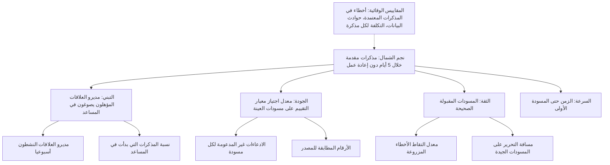
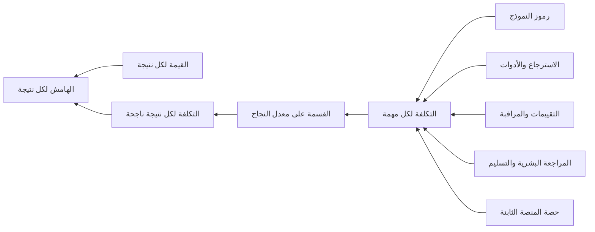
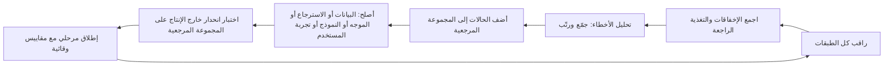

# الوحدة 8 — المقاييس والاقتصاديات والنمو

*ميزة الذكاء الاصطناعي التي أُطلقت لم تنجح بعد. بعد الإطلاق تتغير الأسئلة: هل يستخدمها الناس، وهل تساعدهم، وهل يثقون بها بالقدر الصحيح، وكم تكلّف كل مرة استخدام، وهل تتحسن أم تتراجع بصمت؟ تتناول هذه الوحدة إدارة منتج ذكاء اصطناعي بعد يوم الإطلاق. ستبني شجرة مقاييس لمساعد مذكرات الائتمان (Credit Memo Copilot) تفصل القيمة عن النشاط. وستحسب تكلفة الخدمة (cost to serve) لنجم أسيست (Najm Assist) ومساعد مذكرات الائتمان، وترى لماذا لا يكون أرخص نموذج دائمًا أرخص منتج. ثم ستُعِدّ حلقة المراقبة والتحسين المتكرر التي تحافظ على سلامة التنبيهات الذكية (Smart Alerts) والتمويل الفوري للشركات الصغيرة (SME Instant Finance) ونجم أسيست بينما يتغير العملاء والمحتالون ومورّدو النماذج من حولها. قاعدة رانيا لهذه الوحدة: «إن لم تستطع أن تقول كم يساوي، وكم يكلّف، وهل ينجرف، فأنت لا تملك المنتج، بل تستضيفه فقط».*

> **المراحل:** Grow — قِس القيمة والتكلفة والجودة بعد الإطلاق، وحوّل ما تتعلمه إلى التكرار التالي.

---

# 8.1 — مقاييس المنتج للذكاء الاصطناعي: القيمة والجودة والتبنّي والثقة
*المستوى: 🔴 متقدم* · *المتطلبات: 6.1، 6.3، 7.3* · *المرحلة: Grow*

**بعد هذا الدرس تستطيع** أن تصنّف مقاييس منتج الذكاء الاصطناعي إلى القيمة والجودة والتبنّي والثقة والتكلفة، وتشير إلى أكثرها عرضة للتلاعب، وتبني شجرة مقاييس فيها مقياس نجم الشمال ومقاييس مدخلات ومقاييس وقائية لكل منها مسؤول. *مدة الدراسة: قراءة نحو 20 دقيقة، وعمل تطبيقي نحو 145 دقيقة (تقدير).*

## ⚡ الدرس في دقيقة
- يحتاج منتج الذكاء الاصطناعي إلى مقاييس في **أربع عائلات**: **القيمة** (هل أُنجزت مهمة المستخدم بشكل أفضل أو أسرع أو أرخص؟)، و**الجودة** (هل كانت المخرجات صحيحة؟)، و**التبنّي** (هل يستخدمه المستخدمون المستهدفون ويواصلون استخدامه؟)، و**الثقة** (هل يعتمدون عليه بالقدر الصحيح، لا أكثر ولا أقل؟).
- نظّمها في **شجرة مقاييس**: مقياس نجم الشمال (North Star) واحد يعبّر عن القيمة المُقدَّمة، وبضعة مقاييس مُدخلة يستطيع الفريق تحريكها، و**مقاييس وقائية (guardrail metrics)** يجب ألا تسوء.
- يضيف الذكاء الاصطناعي إشارات تفتقر إليها المنتجات التقليدية: **معدل القبول (acceptance rate)**، و**مسافة التحرير** (مقدار ما يغيّره المستخدمون في المسودة)، و**معدل التجاوز (override rate)**، و**معدل إعادة التوليد**، و**التصعيد إلى إنسان**، وفي المنتجات التنبؤية الدقة (precision) والشمول (recall) مقيسَين على النتائج الفعلية.
- إشارة القرار: يجب أن يغيّر كل مقياس قرارًا ما. إذا لم يكن أحد سيتصرف بشكل مختلف عندما يتحرك، فهو مقياس تجميلي. تخلّص منه.
- أكبر فخ: قياس **النشاط أو التكلفة** (المحادثات المُعالَجة، والمسودات المُولَّدة، والتذاكر المُحوَّلة عن البشر) وتسميته قيمة. يمكن لروبوت المحادثة أن «يحتوي» محادثة أخطأ فيها.

## 🧭 لماذا يهم
بعد ثلاثة أشهر من الإطلاق، يعرض فيصل لوحة معلومات مساعد مذكرات الائتمان على مجموعة التوجيه. تبدو جيدة: 11,400 مسودة مُولَّدة، و190 من مديري العلاقات (RMs) النشطين أسبوعيًا، ومتوسط تقييم بالإعجاب 4.2 من 5. يستمع خالد، ثم يطرح السؤال الوحيد الذي يهمه: «هل تصل مذكرات الائتمان إلى اللجنة أسرع، وهل هي جيدة أصلًا؟» لا يعرف فيصل. لم يربط أحد الاستخدام بزمن دورة المذكرة أو بإعادة العمل. كما أن عدد «المسودات المُولَّدة» يشمل كل إعادة توليد، فيبدو مدير العلاقات المُحبَط الذي ينقر *إعادة التوليد* ست مرات كأنه ست وحدات نجاح.

تتدخل رانيا. الأرقام تصف النشاط لا القيمة. المسودة المُولَّدة تكلفة. أما المسودة التي يقبلها مدير العلاقات (RM) بتعديلات خفيفة، وتمر بمراجعة الائتمان دون إعادة عمل إضافية، وتجعل الصفقة تُحسم أسرع، فهي قيمة. يحتاج الفريق مقاييس للاثنين، مرتبة بحيث تجيب لوحة المعلومات عن سؤال خالد أولًا.

تُظهر الحالات العامة الدرس نفسه على نطاق أوسع. في فبراير 2024 أعلنت Klarna أن مساعدها بالذكاء الاصطناعي يتولى حصة كبيرة من محادثات خدمة العملاء. وفي 2025 قالت الشركة إنها ستعيد مزيدًا من الخدمة البشرية، وذكرت جودة الخدمة جزءًا من السبب. الدرس: «المحادثات التي عالجها الذكاء الاصطناعي» مقياس حجم، ويحتاج إلى مقياس جودة بجانبه.

## 📐 كيف يعمل

### 🟢 الأساسيات

**المقياس** رقم تتتبعه عبر الزمن لتعرف هل المنتج يعمل. المقاييس الجيدة مرتبطة بمهمة المستخدم (2.1)، وتتحرك خلال أسابيع، ويمكن تقسيمها إلى شرائح.

في منتجات الذكاء الاصطناعي، صنّف المقاييس في أربع عائلات. كل عائلة تجيب عن سؤال مختلف، وكل منها قد تبدو سليمة بينما تفشل أخرى.

| العائلة | السؤال الذي تجيب عنه | أمثلة لمساعد مذكرات الائتمان |
|---|---|---|
| **القيمة** | هل تُنجز مهمة المستخدم بشكل أفضل أو أسرع أو أرخص؟ | الساعات من حزمة البيانات حتى تقديم المذكرة؛ المذكرات التي تعيدها مراجعة الائتمان؛ ساعات مدير العلاقات الموفَّرة لكل مذكرة |
| **الجودة** | هل المخرجات صحيحة ومستندة إلى مصادر (grounded) وآمنة؟ | نسبة المسودات المأخوذة عيّنةً التي تجتاز معيار التقييم (rubric) (6.1)؛ الادعاءات غير المدعومة لكل مسودة؛ الأرقام التي لا تطابق المصدر |
| **التبنّي** | هل يستخدمه المستخدمون المستهدفون ويواصلون استخدامه؟ | نسبة مديري العلاقات المؤهلين النشطين أسبوعيًا؛ نسبة المذكرات التي بدأت في المساعد؛ الاحتفاظ بعد 8 أسابيع |
| **الثقة** | هل يعتمد المستخدمون عليه بشكل مناسب؟ | معدل القبول مع تعديلات قليلة على المسودات الجيدة؛ معدل اكتشاف الأخطاء المزروعة؛ استبيان مديري العلاقات عن الثقة |

ثلاث أفكار تحوّل قائمة الأرقام إلى نظام.

1. **مقياس نجم الشمال.** رقم واحد يعبّر على أفضل وجه عن القيمة التي يقدّمها المنتج للمستخدمين، ويميل إلى أن يسبق نتائج الأعمال. لمساعد مذكرات الائتمان، اختار فريق رانيا *«المذكرات المقدَّمة إلى مراجعة الائتمان خلال خمسة أيام عمل من اكتمال حزمة البيانات، دون أن تُعاد لإعادة العمل»*. يجمع السرعة والجودة في رقم واحد، فالتلاعب بأحد الجانبين يضر الآخر.
2. **المقاييس المُدخلة.** الأشياء القليلة التي يستطيع الفريق تحريكها مباشرة والتي تدفع مقياس نجم الشمال: التبنّي بين مديري العلاقات المؤهلين، ومعدل قبول المسودات، وجودة الاستناد إلى المصادر، والزمن حتى المسودة الأولى.
3. **المقاييس الوقائية.** أرقام يجب ألا تسوء بينما تدفع الأخرى: معدل الأخطاء الوقائعية في المذكرات المعتمدة، وحوادث البيانات السرية، وعبء عمل محللي الائتمان، والتكلفة لكل مذكرة. يأتي المصطلح من التجارب عبر الإنترنت (Kohavi, Tang and Xu, *Trustworthy Online Controlled Experiments*, 2020)، حيث تحمي المقاييس الوقائية (guardrails) الأعمال بينما تحسّن المقياس الرئيسي.

**المؤشرات السابقة واللاحقة.** بعض النتائج تصل متأخرة. فهل أدّت مذكرة صاغها المساعد إلى قرار ائتماني أفضل؟ لن يظهر ذلك إلا في أداء القرض بعد عام أو أكثر. وهل التقط تنبيه ذكي (Smart Alert) احتيالًا حقيقيًا؟ قد يستغرق التأكد أسابيع عبر عمليات استرداد المدفوعات. تتبّع النتيجة اللاحقة، لكن وجّه أسبوعيًا بالمؤشرات السابقة (leading indicators) مثل معدل اجتياز معيار التقييم وإعادة العمل.

### 🟡 التعمق أكثر

**إشارات خاصة بالذكاء الاصطناعي.** تترك المنتجات التوليدية والتنبؤية آثارًا في السلوك لا يتركها البرنامج التقليدي. تعلّم قراءتها.

| الإشارة | ما هي | ما تخبرك به | كيف تضلّل |
|---|---|---|---|
| **معدل القبول** | نسبة مخرجات الذكاء الاصطناعي التي يحتفظ بها المستخدم (يرسلها أو يدرجها أو يعتمدها) | فائدة تقريبية | الختم دون تدقيق يبدو نجاحًا؛ انظر الثقة أدناه |
| **مسافة التحرير** | مقدار ما يغيّره المستخدم في المسودة قبل استخدامها، مثل نسبة الأحرف أو الأقسام المُعاد كتابتها | جودة المسودة من وجهة نظر المستخدم | بعض التعديلات تفضيلات أسلوبية لا أخطاء |
| **معدل إعادة التوليد** | كم مرة يطلب المستخدمون محاولة أخرى | الإحباط، أو عنصر تحكم مفقود (النبرة، الطول) | المستخدمون المتقدمون يعيدون التوليد لمقارنة الخيارات |
| **معدل التجاوز** | كم مرة يختلف قرار الإنسان عن توصية النموذج | الخلاف بين النموذج والخبراء؛ وفي التمويل الفوري للشركات الصغيرة، مواضع اختلاف النموذج عن مكتتبي الائتمان | التجاوز المرتفع قد يعني نموذجًا سيئًا أو موظفين لا يثقون به؛ يجب أن تنظر مَن كان محقًا |
| **معدل التصعيد / التسليم** | نسبة المحادثات المُحالة إلى موظف بشري | أين يبلغ نجم أسيست حدوده | انخفاض التصعيد قد يعني أن الروبوت عنيد لا أنه جيد |
| **الاحتواء (Containment)** | نسبة المحادثات التي تنتهي دون إنسان | تكلفة مركز الاتصال المُتجنَّبة | يعدّ المحادثات المتروكة والمُجاب عنها خطأً نجاحًا |
| **الحل** | نسبة المحادثات التي حُلّت فيها مشكلة العميل فعلًا | القيمة الحقيقية | يحتاج إلى تعريف وتحقق، مثل عدم تكرار التواصل خلال 7 أيام |
| **التغذية الراجعة الصريحة** | الإعجاب / عدم الإعجاب، والتقييمات، والتعليقات | صوت المستخدم المباشر | معدلات استجابة منخفضة وانحياز نحو المستخدمين الراضين جدًا أو الغاضبين جدًا |

زوجان هما الأهم. **الاحتواء مقابل الحل**: العميل الذي يستسلم مع نجم أسيست ويتصل بمركز الاتصال بعد ساعة يُحسب في سجل المحادثة حالةً «احتُويت» داخل المساعد، لكنه لم يُساعَد. يعرّف فريق رانيا الحل بأنه «لا تواصل بشأن الموضوع نفسه، عبر أي قناة، خلال سبعة أيام»، ولا يعرض الاحتواء إلا بجانبه. **القبول مقابل الصحة**: معدل القبول المرتفع جيد فقط إذا كانت المخرجات المقبولة صحيحة. خذ عيّنة من المخرجات المقبولة وقيّمها وفق معيار التقييم (6.1)، وإلا فلن تميّز الفائدة من الإفراط في الاعتماد (over-reliance).

**استخدام الأطر العامة.** لا تحتاج إلى اختراع هيكل.

- **HEART** (Google: السعادة، والتفاعل، والتبنّي، والاحتفاظ، ونجاح المهمة؛ Rodden, Hutchinson and Fu, 2010) يقرن كل بُعد بسلسلة *الأهداف ← الإشارات ← المقاييس*. يناسب ميزات الذكاء الاصطناعي لأن «نجاح المهمة» يجبرك على تعريف المهمة.
- **AARRR** («مقاييس القراصنة» لـ Dave McClure: الاستقطاب، والتفعيل، والاحتفاظ، والإحالة، والإيراد) قمع للنمو. لأداة داخلية مثل مساعد الموظفين التوليدي (Staff GenAI)، أعد تسمية الخطوات: *مُمكَّن ← مُفعَّل* (أول مهمة مفيدة) *← معتاد* (استخدام أسبوعي) *← مناصر* (يشارك الموجّهات أو القوالب) *← قيمة* (الساعات الموفَّرة، مقيسة بأخذ العيّنات).

**التبنّي ليس ثنائيًا.** في المؤسسة، يُخفي مقياس «المستخدمون النشطون» الفرق بين مدير علاقات يفتح المساعد مرة في الشهر وآخر يصوغ كل مذكرة فيه. تتبّع *العمق* (نسبة العمل المؤهل للمستخدم المُنجَز بالمنتج) إلى جانب *الاتساع* (نسبة المستخدمين المؤهلين النشطين).

**قسّم كل شيء إلى شرائح.** المتوسطات تُخفي المشكلات. قسّم المقاييس حسب مجموعة المستخدمين (مديرو العلاقات الجدد مقابل ذوي الخبرة)، وحسب نوع المهمة (مذكرات الشركات الصغيرة مقابل مذكرات الشركات الكبرى)، وحسب اللغة (الإنجليزية مقابل العربية في نجم أسيست)، وحسب السوق (قطر والإمارات والاتحاد الأوروبي). قد يخفي المتوسط الإيجابي مجموعةً يخذلها المنتج.

### 🔴 نظرة الخبير

**قياس الثقة بوصفها معايرة.** الثقة ليست «كلما زادت كان أفضل». الهدف هو **الاعتماد المناسب**: أن يقبل المستخدمون المخرجات الجيدة ويلتقطوا السيئة. هناك نمطا فشل متعاكسان. *الإفراط في الاعتماد* (انحياز الأتمتة) يعني قبول مخرجات خاطئة؛ و*قلة الاعتماد* تعني إعادة عمل أنجزه الذكاء الاصطناعي جيدًا. يمكنك قياس الاثنين.

- **تدقيقات الأخطاء المزروعة.** في بيئة تدريب أو تشغيل ظلّي، وليس في قرارات حية أبدًا، أدرج أخطاء معروفة في بعض المسودات وقِس كم من مديري العلاقات يلتقطونها. انخفاض معدل الالتقاط إنذار بالإفراط في الاعتماد.
- **مصفوفة الاعتماد.** لعيّنة من المخرجات، قيّم مخرج الذكاء الاصطناعي (جيد أو سيئ) وسجّل إجراء الإنسان (قُبل أو غُيّر). الجيد المقبول والسيئ المُغيَّر سليمان. السيئ المقبول إفراط في الاعتماد. والجيد المُعاد كتابته قلة اعتماد، وهي تُفقدك القيمة.

**قانون Goodhart (Goodhart's law)** (المسمّى باسم الاقتصادي Charles Goodhart) يُصاغ عادة هكذا: «عندما يصبح المقياس هدفًا، يكفّ عن أن يكون مقياسًا جيدًا». منتجات الذكاء الاصطناعي معرّضة له بشكل خاص لأن النماذج والناس كليهما يحسّنون الأداء نحو الهدف. كافئ فريق نجم أسيست على الاحتواء وسيجعلون زر التسليم أصعب في الإيجاد. وكافئ فريق المساعد على معدل القبول وسيتعلم المنتج إنتاج مسودات باهتة لا يكلّف أحد نفسه تغييرها. الدفاع: اقرن كل هدف بمقياس وقائي (guardrail) على الجانب الآخر، وراجع التعريفات فصليًا.

**الإسناد: هل الذكاء الاصطناعي هو السبب؟** قد ينخفض زمن دورة المذكرة بسبب المساعد، أو لأن مراجعة الائتمان وظّفت محللَين. للادعاءات التي تبرّر الميزانية، استخدم أساليب التجارب من 6.3: إطلاق مرحلي (staged rollout) حسب الفريق أو المنطقة مع مجموعة ضابطة محجوزة، أو مقارنة قبل/بعد مع مجموعة ضابطة مطابقة. وحيث تستحيل تجربة نظيفة، قل ذلك وقدّم تقديرًا مع افتراضاته. سيثق خالد برقم صادق متحفّظ أكثر من رقم مُضخَّم.

**مقاييس المنتجات التنبؤية.** في التمويل الفوري للشركات الصغيرة والتنبيهات الذكية، يجب ربط مقاييس النموذج (الدقة، والشمول، وAUC، والمعايرة من 6.1) بنتائج الأعمال. في التنبيهات الذكية قد تكون شجرة المقاييس: *خسائر الاحتيال المُتجنَّبة* (القيمة) ← *الشمول على الاحتيال المؤكد* و*الزمن حتى التنبيه* (مُدخلات)، مع *التنبيهات الكاذبة لكل 1,000 عميل نشط* و*معدل إلغاء الاشتراك في التنبيهات* مقاييسَ وقائيةً، لأن إرهاق التنبيهات (alert fatigue) يجعل العملاء يتجاهلون التنبيهات المهمة أو يوقفونها. وفي التمويل الفوري للشركات الصغيرة: *الحجم المعتمد عند معدل الخسارة المستهدف* (القيمة)، مع *معدل التعثر حسب الفوج* و*معدل التجاوز* و*فجوات معدل الموافقة بين الشرائح* مقاييسَ وقائيةً. تُغطّى مراقبة العدالة في *AI Governance: Zero to Hero*؛ تأكد أنها تظهر على لوحة معلومات المنتج أيضًا.

**القياس والتتبع متطلب من متطلبات المنتج.** لا شيء من هذا يعمل ما لم يسجّل المنتج الأحداث الصحيحة: عرض المسودة، وقبول المسودة، والأقسام المُحرَّرة، والنقر على إعادة التوليد، وطلب التسليم، وتقديم التغذية الراجعة، مع معرّف ثابت يربط مخرج الذكاء الاصطناعي بنتيجة الأعمال اللاحقة. ضع قائمة الأحداث في المواصفات (5.1) قبل البناء. واتفق على الاحتفاظ بالبيانات والوصول إليها مع سارة (مسؤولة حماية البيانات، DPO): السجلات تحوي بيانات شخصية وسرية.

## 🧰 الأدوات
| الأداة أو الإطار | ما هو وماذا يفعل | متى تلجأ إليه |
|---|---|---|
| **North Star metric** — مقياس نجم الشمال | مقياس واحد يعبّر عن القيمة التي يقدمها المنتج ويميل إلى أن يسبق نتائج الأعمال | مواءمة الفريق والرعاة على معنى «يعمل» |
| **Metrics tree** — شجرة المقاييس | مقياس نجم الشمال مُفكَّك إلى مقاييس مُدخلة يستطيع الفريق تحريكها، مع مقاييس وقائية بجانبها | تصميم لوحة المعلومات؛ تفسير سبب تحرك مقياس |
| **HEART framework** (Google; Rodden, Hutchinson and Fu, 2010) | السعادة، والتفاعل، والتبنّي، والاحتفاظ، ونجاح المهمة، كلٌّ مُسقَط على الأهداف ← الإشارات ← المقاييس | اختيار مقاييس تجربة المستخدم لميزة ذكاء اصطناعي |
| **AARRR** (Dave McClure) | قمع: الاستقطاب، والتفعيل، والاحتفاظ، والإحالة، والإيراد | نمو منتج موجّه للعملاء؛ ويُكيَّف قمعًا للتبنّي (adoption funnel) في الأدوات الداخلية |
| **Guardrail metrics** (Kohavi, Tang and Xu) | مقاييس يجب ألا تتدهور بينما تحسّن المقياس الرئيسي | كل هدف تضعه؛ كل تجربة |
| **Reliance matrix** — مصفوفة الاعتماد | تقارن جودة مخرج الذكاء الاصطناعي بإجراء الإنسان لكشف الإفراط في الاعتماد وقلته | قياس الثقة في المساعدات وأدوات دعم القرار |
| **Resolution rate** — معدل الحل | نسبة المحادثات التي حُلّت فيها المشكلة فعلًا، مُتحقَّقًا منها بعدم تكرار التواصل | ليحلّ محل الاحتواء بوصفه المقياس الرئيسي للمساعدات |

## 🏛️ عمليًا في بنك نجم
تطلب رانيا من فيصل إعادة بناء لوحة المعلومات في صفحة واحدة بعنوان **شجرة المقاييس وورقة التعريفات**. صارت مجموعة التوجيه تقرؤها من الأعلى إلى الأسفل.

**مساعد مذكرات الائتمان (Credit Memo Copilot) — ورقة المقاييس (الإصدار 2، تُراجَع فصليًا)**

| المستوى | المقياس | التعريف | المصدر | الهدف / العتبة | المالك |
|---|---|---|---|---|---|
| نجم الشمال | المذكرات النظيفة في موعدها | نسبة المذكرات المقدَّمة خلال 5 أيام عمل من اكتمال حزمة البيانات وغير المُعادة لإعادة العمل | نظام سير عمل الائتمان | ارتفاع عن خط الأساس؛ يُحدَّد الهدف بعد خط أساس مدته 8 أسابيع | فيصل |
| القيمة | ساعات مدير العلاقات لكل مذكرة | وسيط الساعات المُسجَّلة لكل مذكرة، بالمساعد مقابل بدونه، في الشريحة نفسها | أخذ عيّنات زمنية، أسبوعان كل فصل | يُعرض مع المدى والطريقة | فيصل |
| الجودة | معدل اجتياز معيار التقييم | نسبة 50 مسودة مختارة عشوائيًا أسبوعيًا تجتاز معيار التقييم في 6.1 | لجنة المراجعة لدى دانة | عند مستوى معيار الإطلاق أو فوقه | دانة |
| الجودة | الادعاءات غير المدعومة | ادعاءات في المسودة بلا استشهاد بمصدر، لكل مسودة | فحص آلي مع اللجنة | دون معيار الإطلاق | دانة |
| التبنّي | الاتساع | مديرو العلاقات المؤهلون الذين صاغوا مذكرة واحدة على الأقل هذا الأسبوع | أحداث المنتج | يرتفع حتى الاستقرار | فيصل |
| التبنّي | العمق | نسبة مذكرات كل مدير علاقات التي بدأت في المساعد | أحداث المنتج + سير العمل | يرتفع | فيصل |
| الثقة | الإفراط في الاعتماد | نسبة المسودات المقبولة في العيّنة التي تفشل في معيار التقييم | عيّنة مصفوفة الاعتماد | ينخفض؛ تنبيه إذا ارتفع أسبوعين متتاليين | حصة |
| الثقة | قلة الاعتماد | نسبة المسودات الجيدة في العيّنة التي أُعيدت كتابتها بكثافة (أكثر من نصف الأقسام) | عيّنة مصفوفة الاعتماد | مراقبة؛ يستدعي بحث تجربة المستخدم | حصة |
| مقياس وقائي | الأخطاء في المذكرات المعتمدة | الأخطاء الوقائعية التي تجدها مراجعة الائتمان أو التدقيق في المذكرات المعتمدة | سجل مراجعة الائتمان | لا زيادة مقارنة بخط الأساس | خالد |
| مقياس وقائي | التكلفة لكل مذكرة | تكلفة الخدمة المُحمَّلة بالكامل (8.2) | المالية + المنصة | ضمن الميزانية | طارق |
| مقياس وقائي | حوادث البيانات | بيانات سرية مكشوفة أو أُسيء التعامل معها | سجل الحوادث | صفر؛ أي حادثة واحدة تستدعي مراجعة | ليلى |

أُزيل من المقاييس الرئيسية: *المسودات المُولَّدة* و*متوسط تقييم الإعجاب* (وصارت الآن مقاييس تشخيصية).

## 🛠️ التمارين
- 🟢 صنّف مقاييس نجم أسيست هذه إلى القيمة أو الجودة أو التبنّي أو الثقة أو التكلفة: المحادثات التي بدأت؛ الاحتواء؛ الحل خلال 7 أيام؛ نسبة الإجابات التي تستشهد بصفحة السياسة الصحيحة؛ مستخدمو التطبيق النشطون شهريًا الذين استخدموا المساعد؛ طلبات التسليم؛ معدل عدم الإعجاب. *يكتمل عندما:* يكون لكل منها عائلة واحدة، وتكون قد أشرت إلى المقياسين الأكثر عرضة للتلاعب.
- 🟡 ابنِ جدول HEART لمساعد الموظفين التوليدي بهدف واحد وإشارة واحدة ومقياس واحد لكل بُعد. *يكتمل عندما:* يمكن حساب كل مقياس من بيانات يستطيع بنك نجم تسجيلها واقعيًا، ويسمّي «نجاح المهمة» مهمة محددة.
- 🔴 صمّم شجرة المقاييس للتنبيهات الذكية، متضمنة مقياس نجم الشمال، وثلاثة مقاييس مُدخلة، وثلاثة مقاييس وقائية، ونتيجة لاحقة واحدة مع المدة التي تستغرقها تسمياتها للوصول. *يكتمل عندما:* تُظهر الشجرة كيف ستكتشف إرهاق التنبيهات قبل أن يوقف العملاء التنبيهات، ويكون لكل مقياس وقائي مالك.

راجع عملك

**🟢 إجابة نموذجية.** المحادثات التي بدأت: التبنّي. الاحتواء: القيمة (سهل التلاعب). الحل خلال 7 أيام: القيمة. الإجابات التي تستشهد بصفحة السياسة الصحيحة: الجودة. المستخدمون النشطون شهريًا الذين استخدموا المساعد: التبنّي. طلبات التحويل إلى موظف: الثقة. نسبة عدم الإعجاب: الثقة (يُتلاعب بها إن صعب إيجاد الزر). والأكثر عرضة للتلاعب: الاحتواء ونسبة عدم الإعجاب.

**🟡 و🔴 مراجعة ذاتية.** ينجح جدول HEART إذا كان لكل بُعد من الأبعاد الخمسة هدف وإشارة ومقياس يستطيع بنك نجم تسجيله، وسمّى «نجاح المهمة» مهمة واحدة (مثل «إيجاد صفحة السياسة الصحيحة»). وتنجح شجرة المقاييس إذا ظهر إرهاق التنبيهات مبكرًا (مثل تراجع الاستجابة للتنبيهات أو ارتفاع إلغاء الاشتراك، قبل أن يوقف العملاء التنبيهات)، ولكل مقياس وقائي مالك، وذكرت النتيجة المتأخرة مدة تأخر تصنيفاتها.

## ⚠️ أخطاء وفخاخ
- **عدّ النشاط قيمةً.** المسودات المُولَّدة والمحادثات المُعالَجة والرموز المستخدمة تكاليف. ضع مقياس قيمة في قمة الشجرة، وأنزِل النشاط إلى المقاييس التشخيصية.
- **عرض الاحتواء دون الحل.** اقرنهما دائمًا، وتحقق من الحل بالتحقق من تكرار التواصل.
- **معاملة القبول المرتفع دليلًا على الجودة.** خذ عيّنة من المخرجات المقبولة وقيّمها. القبول المرتفع مع تراجع الصحة إفراط في الاعتماد.
- **المتوسطات فقط.** قسّم حسب مجموعة المستخدمين واللغة والسوق ونوع المهمة قبل أن تستنتج أي شيء.
- **القياس والتتبع بعد الإطلاق.** ضع قائمة الأحداث في المواصفات. البيانات التي لم تسجّلها ضاعت.
- **أهداف بلا مقاييس وقائية.** كل هدف يدعو إلى التلاعب (قانون Goodhart). اقرنه بمقياس على الجانب المقابل.

## 🧾 الخلاصة
- تأتي مقاييس منتجات الذكاء الاصطناعي في أربع عائلات: القيمة والجودة والتبنّي والثقة. كل منها قد تبدو سليمة بينما تفشل أخرى.
- تمتد شجرة المقاييس من مقياس نجم الشمال إلى مقاييس مُدخلة يستطيع الفريق تحريكها، مع مقاييس وقائية يجب ألا تتدهور.
- اقرأ الإشارات الخاصة بالذكاء الاصطناعي (القبول، ومسافة التحرير، وإعادة التوليد، والتجاوز، والتصعيد) بحذر، واقرن كلًّا منها بفحص للصحة.
- الثقة مسألة معايرة. قِس الإفراط في الاعتماد وقلته بمصفوفة الاعتماد وتدقيقات الأخطاء المزروعة.
- أثبت السببية بالمجموعات الضابطة المحجوزة (holdouts) أو الإطلاق المرحلي (staged rollouts) حيث تستطيع، وقدّم تقديرات صادقة حيث لا تستطيع.

## ✍️ اختبر نفسك

**1. ارتفع معدل الاحتواء في نجم أسيست (Najm Assist) من 55% إلى 70% بعد تغيير الموجّه. ما الذي يجب أن يتحقق منه فيصل قبل أن يعدّه نجاحًا؟**

- A. هل ارتفع عدد المحادثات أيضًا
- B. هل تحسّن الحل أيضًا، مقيسًا بعدم تكرار التواصل بشأن الموضوع نفسه خلال سبعة أيام
- C. هل ارتفع متوسط تقييم الإعجاب
- D. هل انخفضت تكلفة الرموز لكل محادثة خلال الأسبوعين الأولين

الإجابة

**B.** يعدّ الاحتواء كل محادثة تنتهي دون إنسان، بما في ذلك العملاء الذين استسلموا واتصلوا لاحقًا. أما الحل فيتحقق من أن المشكلة حُلّت فعلًا. التقييمات (C) مقياس تشخيصي مفيد لكنها تعاني من استجابة منخفضة ومنحازة. (🟡 التعمق أكثر.)

**2. أيّ مما يلي أفضل مقياس نجم الشمال لمساعد مذكرات الائتمان؟**

- A. عدد المسودات المُولَّدة أسبوعيًا عبر جميع مديري العلاقات الذين يستخدمون الأداة في كل المناطق، دون النظر إلى جودتها
- B. مديرو العلاقات النشطون أسبوعيًا
- C. نسبة المذكرات المقدَّمة في موعدها وغير المُعادة لإعادة العمل
- D. متوسط تقييم الإعجاب على المسودات

الإجابة

**C.** يعبّر عن القيمة المُقدَّمة ويجمع السرعة والجودة، فالتلاعب بأحدهما يضر الآخر. A يعدّ التكلفة والنشاط، وB مُدخل تبنٍّ، وD مقياس تشخيصي. (🟢 الأساسيات.)

**3. تُظهر عيّنة مصفوفة الاعتماد أن 18% من المسودات التي قبلها مديرو العلاقات دون تعديلات فشلت في معيار الجودة، ارتفاعًا من 7% في الفصل السابق. ماذا يدل هذا على الأرجح؟**

- A. قلة الاعتماد: مديرو العلاقات يعيدون كتابة مسودات جيدة، فيضيّعون وقتًا كان ينبغي أن يوفّره المساعد
- B. التبنّي يتراجع، لأن عددًا أقل من مديري العلاقات يفتح المساعد قبل أن يبدأ مذكراته كل أسبوع
- C. معيار التقييم صارم أكثر من اللازم، لأنه صار يرفض مسودات كان مديرو العلاقات ذوو الخبرة سيقبلونها بوصفها جيدة
- D. الإفراط في الاعتماد: مديرو العلاقات يقبلون مسودات كان عليهم تصحيحها

الإجابة

**D.** المخرجات السيئة المقبولة دون تغيير هي خانة الإفراط في الاعتماد. وهذا يستدعي النظر في احتكاك تجربة المستخدم والتدريب وتدقيقات الأخطاء المزروعة. قلة الاعتماد (under-reliance) (A) هي إعادة كتابة المسودات الجيدة بكثافة. (🔴 نظرة الخبير.)

**4. يُكافأ فريق نجم أسيست على الاحتواء، ثم ينقل لاحقًا بهدوء زر «التحدث إلى شخص» شاشتين إلى الداخل. أيّ فكرة تفسّر هذا أفضل تفسير؟**

- A. أثر الجِدّة
- B. عدم تطابق نسبة العيّنة
- C. قانون Goodhart
- D. نموذج Kano

الإجابة

**C.** عندما يصبح المقياس هدفًا يكفّ عن أن يكون مقياسًا جيدًا. الدفاع هو مقياس وقائي مثل الحل أو معدل الشكاوى. أثر الجِدّة (novelty effect) (A) ارتفاع مؤقت ناتج عن كون الشيء جديدًا. (🔴 نظرة الخبير.)

**5. انخفض زمن دورة المذكرة بنسبة 20% في الفصل الذي أُطلق فيه المساعد. وفي الفصل نفسه وظّفت مراجعة الائتمان محللَين. ما الطريقة الأكثر قابلية للدفاع لإسناد هذا المكسب؟**

- A. نسب الفضل إلى المساعد، لأنه أُطلق في الفصل نفسه وانخفض زمن الدورة مباشرة بعده في البنك كله
- B. مقارنة الفرق التي تستخدم المساعد بمجموعة محجوزة أو بمجموعة لم يُطرح لها بعد، خلال الفترة نفسها
- C. استبيان مديري العلاقات عن شعورهم بأنهم أسرع
- D. تقسيم المكسب بالتساوي بين السببين

الإجابة

**B.** المجموعة الضابطة المحجوزة (holdout) أو الإطلاق المرحلي يضبطان التغييرات التي تؤثر في الجميع، مثل المحللين الجدد. A يخلط التوقيت بالسبب. وC يقيس الانطباع لا الأثر. (🔴 نظرة الخبير؛ انظر 6.3.)

## 📚 المراجع
- Rodden, Hutchinson and Fu, "Measuring the User Experience on a Large Scale: User-Centered Metrics for Web Applications", CHI 2010 — https://research.google/pubs/
- Kohavi, Tang and Xu, *Trustworthy Online Controlled Experiments* (Cambridge University Press, 2020) — https://experimentguide.com
- Amershi et al., "Guidelines for Human-AI Interaction", CHI 2019 — https://www.microsoft.com/en-us/research/project/guidelines-for-human-ai-interaction/
- Google PAIR, People + AI Guidebook — https://pair.withgoogle.com/guidebook
- Marty Cagan, *Inspired* (2nd ed., Wiley, 2017) — https://www.svpg.com
- Teresa Torres, *Continuous Discovery Habits* (2021) — https://www.producttalk.org
- Parasuraman and Riley, "Humans and Automation: Use, Misuse, Disuse, Abuse", *Human Factors* 39(2), 1997 — https://journals.sagepub.com/home/hfs

---

# 8.2 — اقتصاديات الوحدة: تكلفة الخدمة ونماذج التسعير والهوامش
*المستوى: 🔴 متقدم* · *المتطلبات: 1.2، 1.3، 7.2، 8.1* · *المرحلة: Grow*

**بعد هذا الدرس تستطيع** أن تحسب تكلفة النموذج لكل طلب ولكل محادثة محلولة من أعداد الرموز وأسعار توضيحية، وتكتب مقارنة لنقطة التعادل بين التسعير لكل مقعد والتسعير لكل نتيجة. *مدة الدراسة: قراءة نحو 20 دقيقة، وعمل تطبيقي نحو 125 دقيقة (تقدير).*

## ⚡ الدرس في دقيقة
- البرمجيات التقليدية لا تكلّف تقريبًا شيئًا إضافيًا لكل استخدام. أما الذكاء الاصطناعي فلا: كل طلب يستهلك قدرة حوسبية، وغالبًا استرجاعًا (retrieval) واستدعاءات أدوات (tool calls) وتقييمًا ومراجعة بشرية (human review). **تكلفة الخدمة (cost to serve)** متغيّر من متغيرات المنتج، لا بند في ميزانية تقنية المعلومات.
- الوحدة المهمة هي **التكلفة لكل نتيجة ناجحة** (لكل محادثة محلولة، ولكل مذكرة مقبولة، ولكل قرار صحيح)، لا التكلفة لكل رمز أو لكل طلب. النموذج الرخيص الذي يفشل أكثر قد يكون أغلى منتج.
- ابنِ **نموذج تكلفة المهمة (cost-per-task model)**: الرموز × السعر، مضروبة في عدد الاستدعاءات لكل مهمة، زائد الاسترجاع والأدوات، والتقييم والمراقبة، والمراجعة البشرية وعمليات التسليم، وحصة من تكاليف المنصة الثابتة. ثم اقسم على معدل النجاح.
- **نماذج التسعير** (لكل مقعد، أو حسب الاستخدام، أو لكل مهمة أو نتيجة، أو فئة مميزة، أو مُضمَّن) يضع كلٌّ منها مخاطر التكلفة على طرف مختلف. اختر نموذجًا تطابق وحدته القيمة التي يراها العميل والتكلفة التي تتحملها.
- أكبر فخ: تحسين فاتورة النموذج مع تجاهل التكاليف المهيمنة فعلًا: عمليات التسليم إلى البشر، ووقت المراجعة، وإعادة العمل، وفي منتجات الائتمان التنبؤية **الخسائر الناتجة عن القرارات الخاطئة**.

## 🧭 لماذا يهم
يُحضر طارق أول فاتورة نموذج لشهر كامل لنجم أسيست إلى مراجعة المنتج. إنها أضعاف ما في دراسة الجدوى. غريزة فيصل الأولى أن ينتقل إلى أصغر وأرخص نموذج. تحذّر دانة من أن النموذج الصغير في اختباراتها خارج الإنتاج أجاب إجابات صحيحة عن عدد أقل من أسئلة البطاقات والمدفوعات. ويطرح خالد، الذي يموّل جزءًا من مركز الاتصال، سؤالًا أدق: «كم ندفع مقابل كل مشكلة عميل حُلّت فعلًا، مع احتساب تلك التي تنتهي عند موظفيّ على أي حال؟»

لا أحد يستطيع الإجابة: فاتورة الرموز، وتكلفة مركز الاتصال، ومعدل الحل (8.1) موجودة في ثلاثة أماكن. تضعها رانيا في ورقة واحدة. فاتورة النموذج حقيقية، لكن عمليات التسليم إلى البشر تكلّف أكثر بكثير. ويتبيّن أن أرخص نموذج لكل رمز هو الأغلى لكل محادثة محلولة.

تتعلّم الصناعة الشيء نفسه علنًا. نقل المورّدون بعض ميزات الذكاء الاصطناعي من أسعار ثابتة لكل مقعد إلى أسعار مرتبطة بوحدات العمل. سعّرت Intercom وكيلها Fin لكل محادثة محلولة (منذ 2023)، وأطلقت Salesforce منصة Agentforce بتسعير لكل محادثة (2024)، ثم أضافت في 2025 أرصدة تُحتسب لكل إجراء. الأسعار الدقيقة تتغير؛ لكن الدرس ثابت: حين يكون لكل استخدام تكلفة حقيقية، فإن الوحدة التي تسعّرها وتقيسها خيار استراتيجي.

## 📐 كيف يعمل

### 🟢 الأساسيات

**اقتصاديات الوحدة (Unit economics)** تسأل: لوحدة واحدة من المنتج (مهمة واحدة، أو محادثة واحدة، أو عميل واحد، أو شهر واحد)، كم يكلّف تقديمها، وما القيمة أو الإيراد الذي تجلبه، وما الذي يتبقى؟ في منتجات الذكاء الاصطناعي تجعل ثلاث حقائق ذلك أمرًا لا مفر منه.

1. **كل استخدام يكلّف مالًا.** تُسعَّر النماذج اللغوية الكبيرة (large language models) عادةً لكل **رمز (token)** (قطعة من النص، نحو ثلاثة أرباع كلمة إنجليزية تقريبًا؛ والنص العربي كثيرًا ما يستهلك رموزًا أكثر للمعنى نفسه). يفرض المزوّدون رسومًا منفصلة على رموز الإدخال (input tokens) (ما ترسله: التعليمات، والمستندات المسترجعة، وسجل المحادثة) ورموز الإخراج (output tokens) (ما يكتبه النموذج)، والإخراج عادةً أغلى لكل رمز.
2. **التكاليف تتفاوت كثيرًا بين المهام.** سؤال من سطر واحد وملف ائتماني من 40 صفحة يختلفان في التكلفة بمراتب عشرية. والوكيل (agent) الذي يدور عبر عشرة استدعاءات أدوات يكلّف أكثر بكثير من وكيل يجيب في استدعاء واحد.
3. **الفشل يكلّف مالًا أيضًا.** الإجابة الخاطئة التي تنتهي عند موظف بشري، والمسودة التي تحتاج إلى إعادة عمل، والموافقة الائتمانية السيئة، كلها تكلّف أكثر من استدعاء النموذج (model call) الذي تسبّب فيها.

**نموذج تكلفة المهمة** جدول بيانات بسيط يجمع كل ما يلزم لإنجاز وحدة عمل واحدة.

| مكوّن التكلفة | ما الذي تحسبه | مثال مساعد مذكرات الائتمان |
|---|---|---|
| استدلال النموذج | رموز الإدخال والإخراج × السعر، × الاستدعاءات لكل مهمة، بما في ذلك إعادة المحاولات وإعادة التوليد | ستة استدعاءات صياغة لكل مذكرة على ملف ائتماني طويل |
| الاسترجاع والأدوات | التضمين (embedding)، والبحث، وتحليل المستندات، واستدعاءات واجهات البرمجة | تحليل القوائم المالية، والبحث في المذكرات السابقة |
| التقييم والمراقبة | فحوص النموذج اللغوي حَكَمًا (LLM-as-judge) في الإنتاج، والتسجيل، ولوحات المعلومات | استدعاء حَكَم واحد لكل مسودة |
| المراجعة البشرية والتسليم | وقت الموظفين في الفحص أو التصحيح أو تولّي العمل | لجنة دانة تأخذ عيّنات من المسودات أسبوعيًا |
| حصة المنصة الثابتة | الاستضافة، والحدود الدنيا للمورّدين، وفريق المنصة، والدعم، مُوزَّعة على الفترة | حصة من منصة الذكاء الاصطناعي وفريق الدعم |

ثم احسب رقمين: **التكلفة لكل مهمة (cost per task)** (مجموع الصفوف)، و**التكلفة لكل نتيجة ناجحة** (التكلفة لكل مهمة ÷ معدل النجاح). الثاني هو الذي يجب إدارته.

**الأسعار تتغير.** وقت كتابة هذا النص (2026)، تنخفض أسعار الرمز لمستوى قدرة معيّن، بينما تدفع النماذج الأحدث والأقدر والسياقات الأطول في الاتجاه الآخر. اجعل الأسعار مُدخلات قابلة للتحديث، لا ثوابت أبدًا.

### 🟡 التعمق أكثر

**مثال محلول: نجم أسيست.** الأرقام أدناه توضيحية، اختيرت لإظهار الطريقة. ليست أسعارًا حقيقية ولا بيانات حقيقية لبنك نجم.

الافتراضات: 1.5 مليون محادثة شهريًا، بمتوسط أربع جولات لكل منها. كل جولة ترسل نحو 4,000 رمز إدخال (موجّه النظام، ومقتطفات السياسات، والسجل) وتتلقى نحو 300 رمز إخراج. يُسعَّر نموذج *كبير* مثلًا بـ 3 دولارات لكل مليون رمز إدخال و15 دولارًا لكل مليون رمز إخراج. ونموذج *صغير* بـ 0.25 و1.25 دولار. والتسليم إلى موظف بشري يكلّف مثلًا 4 دولارات من وقت مركز الاتصال.

| | النموذج الكبير فقط | النموذج الصغير فقط | التوجيه: 80% صغير و20% كبير |
|---|---|---|---|
| تكلفة النموذج لكل جولة | $0.0165 | $0.001375 | — |
| تكلفة النموذج لكل محادثة | $0.066 | $0.0055 | $0.0176 |
| فاتورة النموذج شهريًا | $99,000 | $8,250 | $26,400 |
| معدل الحل (وفق تعريف 8.1) | 65% | 50% | 63% |
| معدل التسليم | 25% | 40% | 27% |
| تكلفة التسليم لكل محادثة | $1.00 | $1.60 | $1.08 |
| **إجمالي التكلفة لكل محادثة** | **$1.066** | **$1.6055** | **$1.0976** |
| **التكلفة لكل محادثة محلولة** | **$1.64** | **$3.21** | **$1.74** |

يخفّض النموذج الصغير فاتورة النموذج بأكثر من 90%، ومع ذلك يكلّف نحو ضعف التكلفة لكل محادثة محلولة، لأنه يرسل عملاء أكثر إلى الموظفين. في هذا المثال التوضيحي تبلغ تكلفة التسليم نحو خمسة عشر ضعف تكلفة النموذج حتى مع النموذج الكبير. التوجيه (إرسال الأسئلة السهلة إلى النموذج الصغير والصعبة إلى الكبير) يوفّر معظم فاتورة النموذج مع البقاء قريبًا في النتائج. وهنا لا يتفوّق تمامًا على استخدام النموذج الكبير وحده، وهذه نتيجة بحد ذاتها.

**روافع التكلفة، مرتبة تقريبًا بحسب عدد مرات جدواها:**

| الرافعة | ماذا تفعل | انتبه إلى |
|---|---|---|
| **تقليل عمليات التسليم وإعادة العمل** | تحسين الجودة في أعلى فئات الفشل (8.3) | عادةً أكبر رافعة؛ تحتاج إلى تحليل الأخطاء (error analysis)، لا إلى نموذج أرخص |
| **تقليص السياق** | إرسال مقاطع مسترجعة أقل وأحسن اختيارًا؛ تلخيص السجلات الطويلة | قطع السياق قد يقطع الاستناد إلى المصادر (grounding)؛ أعد تشغيل المجموعة المرجعية (golden set) |
| **التخزين المؤقت للموجّهات (Prompt caching)** | كثير من المزوّدين يخفّضون سعر الإدخال المتكرر، مثل موجّه نظام ثابت طويل | الشروط تختلف بين المورّدين؛ تحقّق من الأسعار الحالية |
| **توجيه النماذج** | نموذج صغير للطلبات السهلة، وكبير للصعبة | أخطاء الموجِّه ترسل الحالات الصعبة إلى نموذج ضعيف؛ قيّم الموجِّه |
| **المعالجة الدفعية** | تشغيل العمل غير العاجل دفعةً واحدة، غالبًا بخصم | للمهام التي يمكنها الانتظار فقط، مثل المسودات المسبقة للمذكرات ليلًا |
| **حدود الإخراج** | إجابات أقصر، ومخرجات مُهيكلة | الإيجاز المفرط يضر الفائدة |
| **تحديد سقف لحلقات الوكيل** | حد أقصى للخطوات أو الإنفاق لكل مهمة | المهمة التي بلغت السقف يجب أن تفشل بلطف وتُسلَّم إلى إنسان |

**المتوسطات تُخفي الأطراف.** في الوكلاء (agents)، اعرض المئين 95 (p95) لتكلفة المهمة بجانب المتوسط. تدفّق الاعتراض على معاملة في نجم أسيست الذي يستغرق عادةً أربعة استدعاءات أدوات قد يدور أحيانًا حتى أربعين. ضع سقف إنفاق لكل مهمة وعامل تكرار بلوغه خللًا في الجودة.

**صورة مساعد مذكرات الائتمان تبدو مختلفة.** توضيحيًا مرة أخرى: ستة استدعاءات صياغة لكل مذكرة بـ 30,000 رمز إدخال و1,500 رمز إخراج لكل منها على النموذج الكبير تبلغ $0.54 + $0.135 = $0.675 من تكلفة النموذج. أضف مثلًا $0.15 للتحليل والاسترجاع والتسجيل، ونحو $0.07 لفحص واحد بالنموذج اللغوي حَكَمًا، ونحو $1.67 من وقت المراجِعين (50 مسودة عيّنةً من 600 أسبوعيًا، 20 دقيقة لكل منها، بتكلفة مُحمَّلة 60 دولارًا للساعة). التكلفة المتغيرة نحو $2.56 لكل مذكرة. وحصة منصة قدرها 15,000 دولار شهريًا موزعة على 2,400 مذكرة تضيف $6.25، فتصبح التكلفة المُحمَّلة بالكامل نحو $8.80. في المقابل، إذا وفّر المساعد لمدير العلاقات 1.5 ساعة بتكلفة مُحمَّلة 80 دولارًا للساعة، فكل مذكرة تساوي نحو 120 دولارًا من الوقت. هنا فاتورة النموذج شريحة صغيرة؛ و**التبنّي والوقت الموفَّر** هما ما يحسم دراسة الجدوى.

### 🔴 نظرة الخبير

**نماذج التسعير ومَن يتحمّل المخاطر.** عندما تبيع منتج ذكاء اصطناعي، أو تشتريه، يحدّد نموذج التسعير مَن يستوعب تقلّب التكلفة والفشل.

| نموذج التسعير | كيف يعمل | أين تقع مخاطر التكلفة | يناسب عندما | مثال (بتحفّظ) |
|---|---|---|---|---|
| **لكل مقعد** | رسم ثابت لكل مستخدم شهريًا | البائع: المستخدمون الكثيفون قد يكلّفون أكثر مما يدفعون | الاستخدام قابل للتنبؤ؛ والقيمة لكل شخص | كثير من المساعدات المؤسسية عند إطلاقها |
| **حسب الاستخدام** | لكل رمز أو استدعاء أو مستند | المشتري: يصعب التنبؤ بالفواتير | المشترون التقنيون؛ الاستخدام المتذبذب | واجهات برمجة النماذج (Model APIs) |
| **لكل مهمة أو نتيجة** | لكل محادثة محلولة، لكل مهمة مكتملة | البائع: يدفع ثمن الفشل، ويكسب عند النجاح | النتيجة معرّفة بوضوح وقابلة للتحقق | Intercom Fin (لكل حل، منذ 2023)؛ Salesforce Agentforce (لكل محادثة عند الإطلاق، 2024؛ ولكل إجراء منذ 2025) |
| **فئة مميزة** | ميزات الذكاء الاصطناعي في خطة أعلى سعرًا | مشتركة: يجب أن يغطي سعر الفئة المستخدمين الكثيفين | منتجات المستهلكين ذات نواة مجانية | Duolingo Max (2023) |
| **مُضمَّن / مجاني** | مُدرج لتعزيز الاحتفاظ أو خفض تكاليف أخرى | البائع، ممولًا من الاحتفاظ أو الوفورات | الميزة تدافع عن المنتج الأساسي | المساعد داخل تطبيق البنك |

التسعير حسب النتيجة يتيح للعميل أن يدفع مقابل القيمة، لكنه يحتاج إلى تعريف نتيجة قابل للتدقيق: فكلمة «محلولة» تعني أشياء مختلفة للمورّد وللبنك الذي اتصل به عميله لاحقًا. إذا تفاوض يوسف (المشتريات) على عقد مسعَّر حسب النتيجة، فإن مدير المنتج (PM) يكتب ذلك التعريف ويتأكد من أن بنك نجم يستطيع التحقق منه من سجلاته الخاصة.

**الهوامش.** **الهامش الإجمالي** هو (الإيراد − تكلفة الخدمة) ÷ الإيراد ((revenue − cost to serve) ÷ revenue). كثيرًا ما تتمتع البرمجيات التقليدية بهوامش إجمالية مرتفعة لأن المستخدمين الإضافيين يكلّفون قليلًا. أما ميزات الذكاء الاصطناعي فتجلب تكلفة متغيرة حقيقية، لذا قد يضغط السعر الثابت وذيل المستخدمين الكثيفين على الهوامش. الدفاعات: حدود الاستخدام العادل أو الفئات للمستخدمين الكثيفين، وهدف للتكلفة لكل نتيجة يعمل الفريق على خفضه مع الوقت.

**داخل البنك، يصبح «التسعير» توزيعًا.** لا يبيع بنك نجم مساعد مذكرات الائتمان ولا مساعد الموظفين التوليدي. الأسئلة الاقتصادية هي: مَن يدفع (ميزانية مركزية، أم تحميل على وحدات الأعمال)، وهل تبرّر القيمة التكلفة؟ نموذجان شائعان هما **العرض دون فوترة** (إظهار استخدام كل وحدة وتكلفته دون فوترتها) و**التحميل الداخلي** (فوترة كل وحدة). يبني العرض دون فوترة الوعي بالتكلفة دون تثبيط التبنّي المبكر. ويناسب التحميل الداخلي المنتجات الناضجة التي يجب أن توازن فيها الوحدات بين التكلفة والقيمة. أما نجم أسيست، الذي لا يدفع العملاء مقابله مباشرة، فقيمته هي تكلفة التواصل المُتجنَّبة زائد آثاره على الاحتفاظ والرضا. قدّر هذه بمجموعة ضابطة محجوزة (holdout) حيثما أمكن (6.3).

**حين لا تهم فاتورة النموذج: الائتمان التنبؤي.** في التمويل الفوري للشركات الصغيرة، تقييم طلب يكلّف جزءًا من السنت. الاقتصاديات تحددها جودة القرار. أرقام توضيحية: فاتورة بقيمة 50,000 دولار مموّلة لمدة 60 يومًا تدرّ رسمًا قدره 1,000 دولار. تكلفة التمويل 400 دولار والعمليات 50 دولارًا. **الخسارة المتوقعة** هي احتمال التعثر (probability of default, PD) × الخسارة عند التعثر (loss given default, LGD) × التعرض: عند 2% × 45% × 50,000 دولار تبلغ 450 دولارًا، فيبقى هامش قدره 100 دولار. إذا انجرفت موافقات النموذج بحيث صار احتمال التعثر الفعلي للطلبات المعتمدة 3%، تصبح الخسارة المتوقعة 675 دولارًا وتخسر كل موافقة مالًا. نقطة مئوية واحدة من خطأ النموذج تمحو هامش المنتج. ولهذا يعامل الدرس 8.3 الانجراف (drift) في نماذج الائتمان خطرًا ماليًا، لا تقنيًا فقط.

**التنبؤ بالتكلفة قبل الإطلاق.** ضع نموذج تكلفة المهمة في المواصفات (5.1)، وشغّله بالقيم المنخفضة والمتوقعة والمرتفعة، واتخذ قرار الإطلاق بناءً على الحالة المرتفعة. بعد الإطلاق، قارن التوقع بالفعلي شهريًا.

## 🧰 الأدوات
| الأداة أو الإطار | ما هو وماذا يفعل | متى تلجأ إليه |
|---|---|---|
| **Cost-per-task model** — نموذج تكلفة المهمة | جدول بيانات يجمع تكاليف النموذج والاسترجاع والتقييم والبشر والتكاليف الثابتة لوحدة عمل واحدة، مع الأسعار مُدخلاتٍ | دراسات الجدوى، واختيار النموذج، ومراجعات التكلفة الشهرية |
| **Cost per successful outcome** — التكلفة لكل نتيجة ناجحة | التكلفة لكل مهمة مقسومة على معدل النجاح | مقارنة نماذج أو تصاميم تختلف في الجودة |
| **Model routing** — توجيه النماذج | يرسل كل طلب إلى أرخص نموذج يُرجَّح أن يعالجه جيدًا | منتجات عالية الحجم فيها مزيج من الطلبات السهلة والصعبة |
| **Pricing model matrix** — مصفوفة نماذج التسعير | لكل مقعد، حسب الاستخدام، حسب النتيجة، فئة مميزة، أو مُضمَّن، مع مَن يتحمّل مخاطر التكلفة | تسعير منتج تبيعه؛ التفاوض على منتج تشتريه |
| **Showback and chargeback** — العرض دون فوترة والتحميل الداخلي | إظهار استخدام الوحدات الداخلية للذكاء الاصطناعي أو فوترتها | المنتجات الداخلية مثل مساعد الموظفين التوليدي ومساعد مذكرات الائتمان |
| **Expected loss** (PD × LGD × exposure) | مقياس قياسي لمخاطر الائتمان لمتوسط الخسارة على القرض | اقتصاديات الوحدة لمنتجات الائتمان التنبؤية |

## 🏛️ عمليًا في بنك نجم
يضيف فريق رانيا **ورقة اقتصاديات الوحدة** إلى المراجعة الشهرية لكل منتج ذكاء اصطناعي. هذه نسخة نجم أسيست، بقيم توضيحية.

**نجم أسيست (Najm Assist) — ورقة اقتصاديات الوحدة (شهرية)**

| البند | هذا الشهر | التوقع | ملاحظات / المالك |
|---|---|---|---|
| المحادثات | 1.5M | 1.4M | فيصل |
| متوسط الجولات / المحادثة | 4.0 | 3.5 | أطول من المتوقع؛ افحص تدفّق الاعتراض على البطاقات |
| تكلفة النموذج / المحادثة | $0.0176 | $0.015 | توجيه 80/20؛ طارق |
| الاسترجاع والتسجيل والتقييمات / المحادثة | $0.004 | $0.004 | طارق |
| معدل الحل (7 أيام، أي قناة) | 63% | 65% | دانة؛ التعريف في ورقة 8.1 |
| معدل التسليم | 27% | 25% | مركز الاتصال |
| تكلفة التسليم / المحادثة | $1.08 | $1.00 | 4 دولارات لكل تواصل، مالية مركز الاتصال |
| **التكلفة لكل محادثة محلولة** | **$1.75** | **$1.57** | الرقم الرئيسي؛ الهدف انخفاض 10% بحلول الفصل القادم |
| مهام الوكيل: تكلفة p95 / المهمة | $0.41 | $0.30 | سقف الإنفاق 1.00 دولار؛ 0.2% من المهام تبلغه |
| حصة المنصة الثابتة | $40,000 | $40,000 | معروضة، وغير مُدرجة في بند التكلفة لكل محادثة |
| أعلى 3 أسباب للتسليم | الاعتراض على البطاقات؛ تغيير العناوين بالعربية؛ استرداد الرسوم | — | مُدخل إلى قائمة أعمال التحسين في 8.3 |

قاعدة القرار المتفق عليها مع خالد: *«أي تغيير يخفّض فاتورة النموذج لكنه يرفع التكلفة لكل محادثة محلولة يُرفض. وأي تغيير يرفع فاتورة النموذج مقبول إذا انخفضت التكلفة لكل محادثة محلولة وصمدت المقاييس الوقائية».*

## 🛠️ التمارين
- 🟢 باستخدام الأسعار التوضيحية في هذا الدرس، احسب تكلفة النموذج لطلب واحد في مساعد الموظفين التوليدي من 2,000 رمز إدخال و500 رمز إخراج على النموذج الكبير والصغير. *يكتمل عندما:* يكون لديك الرقمان والنسبة بينهما.
- 🟡 أعد حساب جدول نجم أسيست بافتراض أن التسليم يكلّف 2 دولار بدلًا من 4. هل يصبح النموذج الصغير الأرخص لكل محادثة محلولة؟ *يكتمل عندما:* تُعاد حسابات الأعمدة الثلاثة كلها وتكتب جملة واحدة عمّا يعنيه ذلك للقرار.
- 🔴 لدى يوسف عرضان لمنصة وكيل خدمة العملاء: لكل مقعد لفريق مركز الاتصال، أو لكل محادثة محلولة. اكتب توصية من صفحة واحدة تغطي مَن يتحمّل مخاطر التكلفة، وكيف يجب تعريف «محلولة» والتحقق منها، وسيناريو استخدام يكون فيه كل خيار أرخص. *يكتمل عندما:* تتضمن الصفحة حساب نقطة التعادل مع افتراضات توضيحية مُعلنة، وبندًا تعاقديًا يعرّف الحل.

راجع عملك

**🟢 إجابة محسوبة.** الكبير: 2,000 × $3 ÷ 1,000,000 + 500 × $15 ÷ 1,000,000 = $0.006 + $0.0075 = $0.0135. الصغير: 2,000 × $0.25 ÷ 1,000,000 + 500 × $1.25 ÷ 1,000,000 = $0.0005 + $0.000625 ≈ $0.0011. يكلّف النموذج الكبير 12 ضعفًا.

**🟡 إجابة محسوبة.** تكلفة التحويل لكل محادثة: $0.50 و$0.80 و$0.54. الإجمالي لكل محادثة: $0.566 و$0.8055 و$0.5576. لكل محادثة محلولة: نحو $0.87 (الكبير) و$1.61 (الصغير) و$0.89 (الموجَّه). يبقى النموذج الصغير الأغلى لكل محادثة محلولة: التحويلات الأرخص تضيّق الفجوة، لكن نسبة الحل هي التي تحسم.

**🔴 مراجعة ذاتية.** تنجح صفحتك إذا حُسب حجم التعادل من افتراضات معلنة، وقالت من يتحمل خطر التكلفة في كل عرض، وعرّف بند العقد «المحلولة» بطريقة قابلة للتدقيق (مثل عدم التواصل المتكرر خلال سبعة أيام).

## ⚠️ أخطاء وفخاخ
- **إدارة فاتورة الرموز بدل النتيجة.** قارن النماذج بالتكلفة لكل نتيجة ناجحة، لا بالسعر لكل رمز.
- **إغفال البشر من تكلفة الخدمة.** وقت المراجعة وعمليات التسليم وإعادة العمل كثيرًا ما تكون أكبر البنود. احسبها.
- **استخدام المتوسطات للوكلاء.** اعرض تكلفة p95 وضع سقوف إنفاق لكل مهمة مع تسليم لطيف.
- **تثبيت أسعار اليوم في الحسابات.** اجعل الأسعار مُدخلات، وشغّل الحالات المنخفضة والمتوقعة والمرتفعة، وضع تاريخًا على الأرقام.
- **توقيع تسعير حسب النتيجة دون تعريف قابل للتحقق.** عرّف النتيجة في العقد وتحقق منها مقابل سجلاتك الخاصة.
- **تجاهل خسائر القرارات في المنتجات التنبؤية.** في الائتمان، جودة النموذج هي الاقتصاديات. انجراف صغير في معدل التعثر قد يفوق كل تكاليف الحوسبة.

## 🧾 الخلاصة
- للذكاء الاصطناعي تكلفة حقيقية لكل استخدام، لذا فإن تكلفة الخدمة قرار منتج.
- ابنِ نموذج تكلفة المهمة يغطي تكاليف النموذج والاسترجاع والتقييم والبشر والتكاليف الثابتة، وأدِر التكلفة لكل نتيجة ناجحة.
- الجودة عادةً أكبر رافعة للتكلفة، لأن الفشل يولّد عمليات تسليم وإعادة عمل.
- نماذج التسعير (لكل مقعد، حسب الاستخدام، حسب النتيجة، فئة مميزة، مُضمَّن) تحدد مَن يتحمّل مخاطر التكلفة. والتسعير حسب النتيجة يحتاج إلى نتيجة قابلة للتدقيق.
- داخل البنك، يصبح التسعير توزيعًا (العرض دون فوترة أو التحميل الداخلي)، وفي منتجات الائتمان تهيمن الخسارة المتوقعة.

## ✍️ اختبر نفسك

**1. النموذج A يكلّف عُشر ما يكلّفه النموذج B لكل رمز. في نجم أسيست، يحل النموذج A نسبة 50% من المحادثات والنموذج B نسبة 65%، وتذهب المحادثات غير المحلولة إلى موظفين بشريين. أيّ عبارة هي الأدق؟**

- A. لا يمكنك الحكم دون إضافة تكاليف التسليم والقسمة على معدل الحل
- B. النموذج A أرخص، لأنه يكلّف عُشر السعر لكل رمز
- C. النموذج B أرخص دائمًا، لأنه يحل أكثر
- D. التكلفة لا تهم إذا اختلفت الجودة، لأن العملاء يهتمون بجودة الإجابة لا بسعر الرمز الواحد

الإجابة

**A.** قارن التكلفة لكل محادثة محلولة: تكلفة النموذج زائد تكلفة التسليم، مقسومة على معدل الحل. في المثال التوضيحي للدرس كان النموذج الرخيص أغلى بنحو الضعف لكل حل، لكن ذلك يعتمد على تكلفة التسليم (انظر التمرين 🟡). وC يبالغ في ذلك. (🟡 التعمق أكثر.)

**2. في مساعد مذكرات الائتمان (Credit Memo Copilot)، أيّ عامل يحدّد أكثر من غيره صمود دراسة الجدوى؟**

- A. سعر الرمز لنموذج الصياغة، مضروبًا في عدد الرموز في مذكرة نموذجية
- B. التبنّي من مديري العلاقات والوقت الموفَّر فعلًا لكل مذكرة
- C. هل التخزين المؤقت للموجّهات مُفعَّل للمستندات الائتمانية الطويلة التي تُرسل مع كل طلب
- D. عدد المسودات المُولَّدة كل أسبوع، محسوبًا عبر كل مدير علاقات وكل فريق

الإجابة

**B.** في مهمة داخلية منخفضة الحجم عالية القيمة، تكلفة النموذج حصة صغيرة من التكلفة المُحمَّلة بالكامل. القيمة تأتي من التبنّي والوقت الموفَّر. والتخزين المؤقت (caching) (C) يقلّص بندًا ثانويًا. (🟡 التعمق أكثر.)

**3. يعرض مورّد على بنك نجم وكيل خدمة عملاء مسعَّرًا لكل «محادثة محلولة». ما الذي يجب أن يصرّ عليه مدير المنتج أولًا؟**

- A. أقل سعر ممكن لكل حل من المورّد
- B. تعريف تعاقدي لـ«محلولة» يستطيع بنك نجم التحقق منه من بياناته الخاصة، مثل عدم تكرار التواصل خلال سبعة أيام
- C. خيار لكل مقعد احتياطيًا
- D. استخدام مجاني غير محدود في التجربة التشغيلية

الإجابة

**B.** التسعير حسب النتيجة لا يعمل إلا بنتيجة متفق عليها وقابلة للتدقيق. من دونها يحدد عدّ المورّد الفاتورة. والسعر (A) لا يهم إلا بعد تعريف الوحدة. (🔴 نظرة الخبير.)

**4. يكسب التمويل الفوري للشركات الصغيرة (SME Instant Finance) رسمًا قدره 1,000 دولار على فاتورة بقيمة 50,000 دولار. تكلفة التمويل والعمليات 450 دولارًا، والخسارة المتوقعة عند احتمال تعثر 2% وخسارة عند التعثر 45% تبلغ 450 دولارًا. إذا انجرف احتمال التعثر للطلبات المعتمدة إلى 3%، فماذا يحدث للهامش لكل موافقة؟**

- A. يرتفع قليلًا لأن الحجم ينمو
- B. ينخفض من 100 دولار إلى نحو −125 دولارًا
- C. لا يتغير لأن تكاليف التقييم ضئيلة
- D. ينخفض بمقدار 10 دولارات

الإجابة

**B.** ترتفع الخسارة المتوقعة إلى 3% × 45% × 50,000 دولار = 675 دولارًا، فيصبح الهامش 1,000 − 450 − 675 = −125 دولارًا. في الائتمان التنبؤي، تهيمن جودة القرار على اقتصاديات الوحدة. (🔴 نظرة الخبير.)

**5. متوسط التكلفة لكل مهمة وكيل في نجم أسيست ضمن الهدف، لكن المالية تبلّغ عن فواتير كبيرة جدًا أحيانًا. ما الذي يجب أن يضيفه الفريق؟**

- A. عرض تكلفة p95 وسقف إنفاق لكل مهمة ينتهي بتسليم لطيف
- B. الانتقال إلى أصغر نموذج في كل المهام، مهما كان الأثر في جودة الإجابات
- C. إزالة ميزات الوكيل من المنتج إلى أن تنخفض التكلفة لكل مهمة أكثر تحت الهدف
- D. مراجعة شهرية للميزانية فقط، تجريها الإدارة المالية مع فريق المنتج بعد وصول الفواتير

الإجابة

**A.** لتكاليف الوكلاء ذيول طويلة ناتجة عن الحلقات وإعادة المحاولات. المئينات تكشفها والسقوف تحدّها، مع تسليم إلى إنسان كي لا يُترك العميل عالقًا. وB قد يخفض الجودة ويرفع عمليات التسليم. (🟡 التعمق أكثر.)

## 📚 المراجع
- Kohavi, Tang and Xu, *Trustworthy Online Controlled Experiments* (2020) — https://experimentguide.com
- Intercom, Fin AI agent (التسعير لكل حل؛ تحقّق من الشروط الحالية) — https://www.intercom.com
- Salesforce, Agentforce (تحقّق من الأسعار الحالية) — https://www.salesforce.com
- Duolingo, Duolingo Max announcement (2023) — https://blog.duolingo.com
- Basel Committee on Banking Supervision, credit-risk framework — https://www.bis.org/bcbs/
- Chen, Zaharia and Zou, "FrugalGPT: How to Use Large Language Models While Reducing Cost and Improving Performance" (2023) — https://arxiv.org/abs/2305.05176

---

# 8.3 — المراقبة والانجراف وحلقة التحسين بعد الإطلاق
*المستوى: 🔴 متقدم* · *المتطلبات: 6.1، 6.2، 6.3، 8.1* · *المرحلة: Grow*

**بعد هذا الدرس تستطيع** أن تحدد نوع الانجراف وراء سيناريو ما وإشارة تكشفه، وتكتب خطة مؤرخة لترحيل النموذج بقاعدة قرار للمضي أو التوقف مبنية على المجموعة المرجعية ومسار للتراجع. *مدة الدراسة: قراءة نحو 15 دقيقة، وعمل تطبيقي نحو 160 دقيقة (تقدير).*

## ⚡ الدرس في دقيقة
- منتجات الذكاء الاصطناعي تسوء دون أن يلمسها أحد. يتغيّر العملاء، ويتكيّف المحتالون، وتُحدَّث السياسات، ويطرح مورّدو النماذج إصدارات جديدة. هذا هو **الانجراف (drift)**، وهو عادةً صامت: لا رسالة خطأ، بل إجابات تسوء ببطء.
- راقب على **طبقات**: سلامة النظام (يعمل، سريع، ميسور التكلفة)، والمُدخلات (هل ما زالت حركة الطلبات كما صمّمنا لها؟)، والمخرجات والجودة (هل ما زالت الإجابات جيدة؟)، وسلوك المستخدمين (إشارات 8.1)، ونتائج الأعمال. كل طبقة تلتقط إخفاقات تفوت الأخرى.
- كثير من النتائج تصل متأخرة: عمليات استرداد المدفوعات تستغرق أسابيع، وتعثرات القروض تستغرق أشهرًا. وجّه بـ **المؤشرات البديلة السابقة** و**مراجعات الجودة بالعيّنات** ريثما تصل التسميات الحقيقية.
- شغّل **حلقة تحسين** دائمة: اجمع الإخفاقات، وحلّل الأخطاء، وأضفها إلى المجموعة المرجعية، وأصلح، وافحص حالات الانحدار خارج الإنتاج، وأطلق عبر إطلاق مرحلي. كل إخفاق يُكتشف في الإنتاج يجب أن يصبح اختبارًا.
- أكبر فخ: معاملة الإطلاق خط النهاية ومراقبة وقت التشغيل فقط. قد يكون المنتج متاحًا بنسبة 100% ومخطئًا بنسبة 30%.

## 🧭 لماذا يهم
في مارس، يغيّر بنك نجم رسم استبدال البطاقة ويحدّث صفحة السياسة. لا يُبلغ أحد فريق نجم أسيست. ولمدة ثلاثة أسابيع، يخبر المساعد العملاء بالرسم السابق، مستندًا إلى نسخة قديمة من الصفحة في فهرس الاسترجاع (retrieval index). تبقى لوحات المعلومات خضراء: زمن الاستجابة (latency) طبيعي، والأخطاء صفر، والاحتواء مرتفع. تظهر المشكلة حين تصل الشكاوى إلى مركز الاتصال وينشر عميل لقطة شاشة. تطرح ليلى السؤال الذي تطرحه كل مراجعة حوادث: «كيف كنا سنعرف في وقت أبكر؟»

تُظهر الحالات العامة التي مرّت بك الأنماط نفسها. لم تستطع Air Canada التنصّل مما قاله روبوت المحادثة على موقعها عن أسعار تذاكر الحداد (0.2). وشتم روبوت المحادثة لدى DPD عميلًا وانتقد الشركة بعد تحديث للنظام (5.3): تغيير لم يقصد أحد أن يؤثر في السلوك فعل ذلك تمامًا.

في الأثناء، تواجه التنبيهات الذكية المشكلة المعاكسة. دُرّب نموذجها على احتيال العام الماضي. ينتقل المحتالون إلى أساليب جديدة، فينخفض الشمول. يستجيب فريق المخاطر بتخفيف العتبات، فترتفع التنبيهات الكاذبة. يبدأ العملاء بتجاهل التنبيهات. لم ينكسر شيء، لكن العالم تحرّك والمنتج لم يتحرك. المراقبة والتحسين المتكرر هما الطريقة التي يواكب بها المنتج.

## 📐 كيف يعمل

### 🟢 الأساسيات

**الانجراف** هو أي تغيير بعد الإطلاق يجعل الأداء السابق للمنتج دليلًا ضعيفًا على أدائه الحالي. تعلّم أنواعه الرئيسية بأسمائها، لأن كلًّا منها يحتاج إلى كشف مختلف.

| نوع الانجراف | ما الذي يتغير | مثال من بنك نجم | كيف تلاحظه |
|---|---|---|---|
| **انجراف البيانات (Data drift)** (انجراف المُدخلات) | المُدخلات تبدو مختلفة عمّا بُني النموذج واختُبر عليه | شريحة جديدة من الشركات الصغيرة (بائعو التجارة الإلكترونية) تتقدم إلى التمويل الفوري للشركات الصغيرة | قارن توزيعات المُدخلات بخط أساس (baseline) |
| **انجراف المفهوم (Concept drift)** | العلاقة بين المُدخلات والإجابة الصحيحة تتغير | المحتالون يغيّرون أساليبهم، فيصبح نمط الأمس الآمن احتيال اليوم | ينخفض الأداء على النتائج الموسومة الحديثة |
| **انجراف المعرفة (Knowledge drift)** | الحقائق التي يعتمد عليها المنتج تتغير | جدول الرسوم حُدِّث؛ وفهرس الاسترجاع ما زال يحوي الصفحة القديمة | فحوص حداثة المصادر؛ مراجعة الإجابات بالعيّنات |
| **انجراف التبعيات (Dependency drift)** | مكوّن لا تتحكم فيه يتغير | مورّد النموذج يحدّث إصدار النموذج أو يوقفه؛ واجهة برمجة أداة تتغير | تثبيت الإصدار؛ اختبارات التراجع (regression tests) عند كل تغيير |
| **انجراف الاستخدام (Usage drift)** | المستخدمون يستخدمون المنتج لمهام جديدة | مديرو العلاقات يبدؤون استخدام المساعد لقروض الرهن العقاري للأفراد التي لم يشملها نطاقه (وهي مسألة حوكمة أيضًا) | تجميع الطلبات حسب الموضوع؛ مراجعة الاستقبال |

**طبقات المراقبة.** خطة المراقبة الجيدة تغطي الطبقات الخمس أدناه كلها. معظم الفرق تبدأ بالأولى وتتوقف عندها.

| الطبقة | الأسئلة | أمثلة على الإشارات |
|---|---|---|
| 1. سلامة النظام | هل يعمل، وسريع، وضمن الميزانية؟ | معدل الأخطاء، ومئينات زمن الاستجابة، والتكلفة لكل مهمة (8.2)، وبلوغ سقوف الإنفاق |
| 2. المُدخلات | هل حركة الطلبات هي ما صمّمناه واختبرناه؟ | توزيعات الخصائص، وموضوعات الطلبات ولغاتها، ونسبة الطلبات خارج النطاق |
| 3. المخرجات والجودة | هل ما زالت المخرجات جيدة؟ | توزيعات الدرجات؛ تقييمات معيار التقييم على العيّنات؛ درجات النموذج اللغوي حَكَمًا على عيّنة؛ معدلات الضوابط الوقائية والرفض |
| 4. سلوك المستخدمين | كيف يتفاعل الناس؟ | القبول، ومسافة التحرير، وإعادة التوليد، والتسليم، والشكاوى (8.1) |
| 5. نتائج الأعمال | هل ما زال يقدّم القيمة بأمان؟ | الحل، وخسائر الاحتيال، ومعدلات التعثر، وإعادة العمل، والحوادث |

**حلقة التحسين** تحوّل المراقبة إلى تحسين. العادة الجوهرية بسيطة: كل إخفاق في الإنتاج يصبح حالة اختبار، فلا يعود الإخفاق نفسه دون أن يُلاحَظ.

### 🟡 التعمق أكثر

**كشف الانجراف في النماذج التنبؤية.** في النماذج الجدولية مثل التمويل الفوري للشركات الصغيرة، قارن توزيعات المُدخلات والدرجات اليوم بعيّنة التطوير. من المقاييس الشائعة في مخاطر الائتمان **مؤشر استقرار المجتمع الإحصائي (Population Stability Index, PSI)**، الذي يجمع الفروق بين توزيعين عبر الفئات. قاعدة عامة شائعة تقرأ ما دون 0.1 مستقرًا، ومن 0.1 إلى 0.25 جديرًا بالتحقيق، وما فوق 0.25 تحوّلًا كبيرًا. هذه أعراف لا قوانين. يضع فريق دانة العتبات لكل خاصية مع وظيفة التحقق من النماذج. انجراف المُدخلات إنذار مبكر، لا دليل على الضرر: فتحوّل مزيج المتقدمين قد لا يضر الدقة. أكّد ذلك ببيانات النتائج حين تصل.

**مشكلة تأخر التسميات.** كثيرًا ما لا تستطيع قياس الدقة حين تحتاج إليها.

| المنتج | النتيجة الحقيقية | التأخر | المؤشر البديل السابق الذي تراقبه في الأثناء |
|---|---|---|---|
| التنبيهات الذكية | احتيال مؤكد أو استرداد مدفوعات | من أيام إلى أسابيع | تأكيدات العملاء «لست أنا»؛ قرارات المحللين على التنبيهات |
| التمويل الفوري للشركات الصغيرة | التعثر أو السداد | أشهر، حتى مدة التمويل وما بعدها | المتأخرات المبكرة (مثل التأخر 30 يومًا)؛ تآكل قيمة الفواتير؛ معدل التجاوز |
| مساعد مذكرات الائتمان | أداء قروض الصفقات المحسومة | عام أو أكثر | معدل إعادة العمل؛ معدل اجتياز معيار التقييم؛ ملاحظات مراجعة الائتمان |
| نجم أسيست | المشكلة حُلّت فعلًا | 7 أيام (وفق تعريف 8.1) | طلبات التسليم؛ عدم الإعجاب؛ إعادة الصياغة في الجلسة نفسها |

المؤشرات البديلة قد تضلّل، لذا راجعها حين تصل التسميات الحقيقية: هل تنبّأ المؤشر البديل بالنتيجة

**مراقبة المنتجات التوليدية.** لا يوجد توزيع مُدخلات واحد للمقارنة في روبوت المحادثة أو المساعد، والصحة تحتاج إلى حكم بشري. المراقبة العملية تجمع أربعة أشياء.

1. **المراجعة البشرية بالعيّنات (Sampled human review).** عيّنة أسبوعية ثابتة تُقيَّم وفق معيار التقييم (6.1)، مع عيّنات إضافية من الموضوعات الخطرة (الرسوم، والاعتراضات، والشكاوى).
2. **النموذج اللغوي حَكَمًا على عيّنة أكبر** (6.2)، يُفحَص بانتظام مقابل التقييمات البشرية، لأن الحَكَم قد ينجرف أيضًا. راقب انحيازاته المعروفة، مثل تفضيل الإجابات الأطول.
3. **مراقبة الموضوعات والمقاصد.** جمّع الطلبات الواردة لرصد الموضوعات الجديدة، وتزايد الطلبات خارج النطاق، واللغات أو اللهجات التي لم تختبرها.
4. **حداثة المصادر.** في الاسترجاع، تتبّع عمر كل مستند مفهرس واربط الفهرس بعملية النشر لدى مالك المحتوى، بحيث يُطلق تغيير السياسة إعادة فهرسة وإعادة اختبار موجّهة. هذا الضابط الواحد كان سيلتقط حادثة رسوم مارس.

**إدارة تغيير التبعيات.** النماذج التي يُوصَل إليها عبر واجهة برمجة (API) قد تتغير خلف الاسم نفسه، ويوقف المورّدون الإصدارات وفق جدولهم الخاص. وثّق بحث Chen وZaharia وZou (2023) تغيّرات قابلة للقياس في السلوك في نماذج مستضافة واسعة الاستخدام خلال أشهر قليلة. استجابة المنتج: ثبّت إصدارًا محددًا من النموذج حيث يسمح المورّد، وتتبّع تواريخ الإيقاف المعلنة على خارطة الطريق (انظر 9.2). عامل كل تغيير في النموذج أو الموجّه أو الأداة إصدارًا: شغّل المجموعة المرجعية كاملة، وقارن بالإصدار الحالي، وأطلق على مراحل. حادثة DPD تذكير بأن «مجرد تحديث» قد يغيّر السلوك بطرق لم يختبرها أحد.

### 🔴 نظرة الخبير

**تحليل الأخطاء يقود قائمة الأعمال.** المراقبة تخبرك أن شيئًا ما خطأ. وتحليل الأخطاء يخبرك بما يجب إصلاحه. كل أسبوع، يسحب فريق دانة الحالات الفاشلة أو المُعلَّمة، ويقرؤها، ويسم كلًّا منها بفئة فشل (سياسة خاطئة، مصدر قديم، صياغة عربية أُسيء فهمها، فشل استدعاء أداة، رفض مفرط). ثم يعدّون حسب الفئة ويرجّحون حسب الأثر: التكرار × التكلفة لكل إخفاق (8.2) × الشدة (frequency × cost per failure × severity). أعلى فئتين أو ثلاث تصبح عمل التكرار التالي. هذه هي الطريقة نفسها لتحليل الأخطاء قبل الإطلاق في 6.1، لكنها تُشغَّل روتينًا.

**اختيار الإصلاح.** اختر أرخص إصلاح يعالج السبب الجذري، وأعد تشغيل المجموعة المرجعية أيًّا كان اختيارك.

| السبب الجذري | الإصلاح المعتاد | لا هذا |
|---|---|---|
| معرفة قديمة أو مفقودة | تحديث المصادر؛ ربط الفهرس بنشر المحتوى | إدخال الحقائق في النموذج بالضبط الدقيق |
| سوء قراءة التعليمات أو النبرة | تغييرات في الموجّه والأمثلة | تغيير المورّدين |
| مجتمع مُدخلات جديد | إعادة التدريب أو المعايرة على بيانات حديثة؛ توسيع المجموعة المرجعية | تخفيف العتبات دون بصيرة |
| انجراف المفهوم في الاحتيال | إعادة التدريب على تسميات حديثة؛ إضافة خصائص؛ دورة إعادة تدريب أقصر | انتظار المراجعة السنوية للنموذج |
| مستخدمون مرتبكون بشأن ما يستطيعه | تجربة المستخدم (UX): بيانات النطاق، والإجراءات المقترحة (4.2) | مزيد من قدرات النموذج |

**إيقاع إعادة التدريب: مجدول أم مُحفَّز؟** إعادة التدريب المجدولة (شهريًا في التنبيهات الذكية مثلًا) قابلة للتنبؤ وسهلة الحوكمة. أما إعادة التدريب المُحفَّزة (حين يتجاوز الانجراف أو الأداء عتبةً) فتستجيب أسرع لكنها أصعب في التحقق. نماذج الائتمان الخاضعة للتنظيم كثيرًا ما تحتاج إلى تحقق مستقل قبل كل تغيير، مما يحد من السرعة. كثير من الفرق تجمع الاثنين: جدول منتظم زائد مُحفِّز يقدّم الدورة التالية. اتفق على السياسة مع فريق الحوكمة لدى ليلى ووظيفة التحقق من النماذج (model validation) قبل الإطلاق، لا أثناء حادثة.

**حلقات التغذية الراجعة التي تحيّز بياناتك.** النموذج المنشور يشكّل البيانات التي سيتعلم منها لاحقًا. لا يرى التمويل الفوري للشركات الصغيرة نتائج السداد إلا للطلبات التي وافق عليها، فلا يتعلم شيئًا عن تلك التي رفضها. ومع الوقت قد يجعل هذا النموذج مفرط الثقة في خياراته السابقة. تعالج فرق الائتمان ذلك بتقنيات مثل استدلال المرفوضين (reject inference) والاستكشاف الصغير المضبوط، تُصمَّم بالتعاون مع إدارة المخاطر. وتواجه التنبيهات الذكية حلقة عدائية: يختبر المحتالون ما الذي يُرصد ويتكيّفون. خطّط للاثنين في تصميم المراقبة. المزيد عن دولاب البيانات في 3.2.

**الحوادث ومفتاح الإيقاف.** قرّر مسبقًا ماذا يحدث حين تُطلق المراقبة إنذارًا.

- **مستويات الشدة** مع مالكين مسمّين وأزمنة استجابة، مشتركة مع عملية الحوادث من 7.1.
- **مفتاح إيقاف أو بديل احتياطي** لكل ميزة ذكاء اصطناعي: يمكن لنجم أسيست أن ينتقل إلى وضع «التسليم إلى موظف»؛ ويمكن لمساعد مذكرات الائتمان إيقاف الصياغة والإبقاء على البحث؛ ويمكن للتنبيهات الذكية الرجوع إلى إصدار نموذجها السابق وعتباته.
- **مراجعة ما بعد الحادثة** تتضمن مخرجاتها دائمًا حالات جديدة في المجموعة المرجعية، وعند الحاجة مراقِبًا جديدًا.

**روابط الحوكمة.** يجب على مزوّدي أنظمة الذكاء الاصطناعي عالية المخاطر بموجب قانون الذكاء الاصطناعي الأوروبي (EU AI Act) تشغيل مراقبة ما بعد الطرح في السوق، وتقييم الجدارة الائتمانية للأفراد استخدام عالي المخاطر. ويتوقع المشرفون المصرفيون، ومنهم مصرف قطر المركزي (Qatar Central Bank) عبر إرشاداته للذكاء الاصطناعي للمؤسسات المالية، مراقبةً وتحققًا مستمرَّين من النماذج. لا يكتب مدير المنتج تلك السياسات، لكن خطة مراقبة المنتج هي الدليل الذي تعتمد عليه. انظر *AI Governance: Zero to Hero* للالتزامات. ولهندسة التسجيل والتتبع وخطوط التقييم، انظر *Production AI Agents*.

## 🧰 الأدوات
| الأداة أو الإطار | ما هو وماذا يفعل | متى تلجأ إليه |
|---|---|---|
| **Population Stability Index (PSI)** — مؤشر استقرار المجتمع الإحصائي | يقيس مدى تحوّل توزيع متغيّر عن خط الأساس | انجراف المُدخلات والدرجات في النماذج الجدولية مثل الائتمان والاحتيال |
| **Monitoring layers** — طبقات المراقبة | سلامة النظام، والمُدخلات، والمخرجات والجودة، وسلوك المستخدمين، ونتائج الأعمال | تصميم خطة مراقبة تلتقط الإخفاقات الصامتة |
| **Golden set** — المجموعة المرجعية | حالات مرجعية منتقاة بمخرجات متوقعة، تنمو من إخفاقات الإنتاج | اختبار التراجع عند كل تغيير في الموجّه أو النموذج أو البيانات أو الأداة |
| **LLM-as-judge** — النموذج اللغوي حَكَمًا | نموذج يقيّم المخرجات وفق معيار تقييم، مُعايَر مقابل مقيّمين بشريين | مراقبة الجودة على عيّنات أكبر من المخرجات التوليدية |
| **Error analysis** — تحليل الأخطاء | قراءة الإخفاقات وتصنيفها وترتيبها حسب الأثر | تحويل المراقبة إلى قائمة أعمال مرتبة الأولويات |
| **Model version pinning** — تثبيت إصدار النموذج | تثبيت إصدار النموذج الدقيق الذي يستخدمه المنتج وتغييره عبر إصدار فقط | أي منتج مبني على واجهة برمجة نموذج مستضاف |
| **Kill switch** — مفتاح الإيقاف | وضع بديل احتياطي مُعَدّ مسبقًا لميزة ذكاء اصطناعي | الحوادث؛ الإطلاقات الفاشلة؛ انقطاعات المورّدين |

## 🏛️ عمليًا في بنك نجم
بعد حادثة الرسوم، تطلب رانيا من كل منتج نشر **خطة مراقبة ودليل تشغيل**. هذه خطة نجم أسيست، مع إضافة صفوف التنبيهات الذكية للمقارنة. العتبات توضيحية ويحددها كل مالك.

**نجم أسيست والتنبيهات الذكية (Najm Assist and Smart Alerts) — خطة المراقبة (الإصدار 1)**

| الطبقة | الإشارة | العتبة / المُحفِّز | الإجراء | المالك | الإيقاع |
|---|---|---|---|---|---|
| السلامة | زمن الاستجابة p95؛ معدل الأخطاء | فوق هدف مستوى الخدمة لمدة 15 دقيقة | استدعاء المناوب؛ الرجوع إلى وضع التسليم إذا استمر | طارق | فوري |
| السلامة | التكلفة لكل محادثة محلولة | أعلى من التوقع بـ 15% لمدة أسبوع | مراجعة التكلفة (8.2) | طارق | أسبوعي |
| المُدخلات | نسبة الطلبات خارج النطاق | تتضاعف أسبوعًا بعد أسبوع | مراجعة الموضوعات؛ رسالة نطاق أو مقصد جديد | فيصل | أسبوعي |
| المُدخلات | حداثة المصادر | صفحة سياسة تغيّرت ولم يُعَد فهرستها خلال 24 ساعة | إعادة فهرسة تلقائية؛ إعادة اختبار موجّهة لذلك الموضوع | مالك المحتوى + طارق | عند التغيير |
| الجودة | معدل اجتياز معيار التقييم على 200 محادثة في العيّنة | دون معيار الإطلاق | تحليل الأخطاء؛ تعليق الإصدارات | دانة | أسبوعي |
| الجودة | التوافق بين الحَكَم والبشر | ينخفض دون المستوى المتفق عليه | أعد معايرة الحَكَم قبل الوثوق بدرجاته | دانة | شهري |
| السلوك | التسليم وعدم الإعجاب حسب الموضوع | تضاعف أي موضوع | تعمّق في ذلك الموضوع | حصة | أسبوعي |
| النتيجة | معدل الحل (7 أيام) | ينخفض 3 نقاط | مراجعة التوجيه | فيصل | شهري |
| التبعية | إصدار النموذج؛ إشعارات الإيقاف من المورّد | الإعلان عن أي تغيير | تشغيل المجموعة المرجعية كاملة؛ إطلاق مرحلي | طارق | عند التغيير |
| التنبيهات الذكية | مؤشر PSI على الخصائص الرئيسية والدرجة | فوق 0.25، أو بين 0.1 و0.25 لمدة 4 أسابيع | تحقّق؛ قدّم موعد إعادة التدريب | دانة | أسبوعي |
| التنبيهات الذكية | التنبيهات الكاذبة لكل 1,000 عميل؛ معدل إلغاء الاشتراك | ترتفع 3 أسابيع متتالية | مراجعة العتبات مع عمليات الاحتيال | مالك منتج الاحتيال | أسبوعي |
| التنبيهات الذكية | الشمول على الاحتيال المؤكد | دون الحد الأدنى المتفق عليه | إعادة التدريب؛ الرجوع إلى الإصدار السابق إذا كان الأمر حادًا | دانة | شهري (بسبب تأخر التسميات) |

**مراجعة التحسين الأسبوعية (45 دقيقة):** (1) لوحات المعلومات حسب الطبقة، الاستثناءات فقط؛ (2) أعلى فئات الفشل من تحليل الأخطاء، مع الأعداد والتكلفة؛ (3) حالات المجموعة المرجعية المضافة هذا الأسبوع؛ (4) الإصلاحات الجارية ونتائجها خارج الإنتاج؛ (5) الإطلاقات الجارية وحالة المقاييس الوقائية؛ (6) القرارات والمالكون.

## 🛠️ التمارين
- 🟢 لكل سيناريو، سمِّ نوع الانجراف: (a) لهجة عربية جديدة تظهر في حركة طلبات نجم أسيست؛ (b) المورّد يحدّث نموذجه؛ (c) المحتالون ينتقلون إلى أسلوب احتيال جديد؛ (d) جدول الرسوم يتغير. *يكتمل عندما:* يكون لكل منها نوع انجراف واحد وإشارة واحدة تكشفه.
- 🟡 اكتب جدول تأخر التسميات لمساعد الموظفين التوليدي: النتيجة الحقيقية، والتأخر، ومؤشرين بديلين سابقين على الأقل. *يكتمل عندما:* يمكن حساب كل مؤشر بديل من بيانات يسجّلها بنك نجم، وتذكر كيف ستتحقق لاحقًا من أن المؤشر البديل كان تنبّئيًا.
- 🔴 يعلن مورّدك أن النموذج الذي يقوم عليه مساعد مذكرات الائتمان سيُوقَف خلال 90 يومًا. اكتب خطة الترحيل: التقييم، والإطلاق، والمراقبة، والبديل الاحتياطي، والتواصل مع مديري العلاقات. *يكتمل عندما:* تحوي الخطة خطوات مؤرّخة، وقاعدة للمضي أو عدمه مبنية على المجموعة المرجعية والمقاييس الوقائية في 8.1، ومسارًا للتراجع.

راجع عملك

**🟢 إجابة نموذجية.** (أ) انجراف البيانات: نسبة الرسائل التي لا يستطيع كاشف اللغة تحديدها، أو عنقود موضوعات جديد. (ب) انجراف الاعتماديات: تشغيل اختبار الانحدار على المجموعة المرجعية بعد تغيير الإصدار. (ج) انجراف المفهوم: ينخفض الشمول على الاحتيال المؤكَّد حديثًا. (د) انجراف المعرفة: يجد فحص الحداثة أن صفحة الرسوم المسترجَعة أقدم من المنشورة.

**🟡 و🔴 مراجعة ذاتية.** ينجح جدول تأخر التصنيفات إذا أمكن حساب كل مؤشر بديل من السجلات (مثل «نُسخت الإجابة إلى مستند»، «طُرح السؤال نفسه مجددًا خلال يوم») وقلت كيف ستتحقق لاحقًا من أن كل مؤشر تنبأ بالنتيجة الحقيقية. وتنجح خطة الانتقال إذا كانت خطواتها مؤرَّخة، وسمّت قاعدة المضي أو التوقف عتباتٍ على المجموعة المرجعية مقارنةً بالنموذج الحالي والمقاييس الوقائية في 8.1، واختُبر مسار التراجع قبل التبديل.

## ⚠️ أخطاء وفخاخ
- **مراقبة وقت التشغيل وزمن الاستجابة فقط.** أضف طبقات الجودة والمُدخلات والسلوك والنتائج. الإخفاقات الصامتة هي الشائعة.
- **انتظار التسميات النهائية.** استخدم المؤشرات البديلة السابقة والمراجعة بالعيّنات، ثم تحقق من صحة المؤشرات البديلة حين تصل التسميات.
- **الإصلاح دون اختبارات تراجع.** أضف كل إخفاق إنتاج إلى المجموعة المرجعية وشغّلها قبل كل إصدار.
- **معاملة تحديث المورّد حدثًا عابرًا.** ثبّت الإصدارات، واختبر التغييرات كالإصدارات، وتتبّع تواريخ الإيقاف.
- **الوثوق بالحَكَم إلى الأبد.** أعد معايرة النموذج اللغوي حَكَمًا مقابل التقييمات البشرية وفق جدول.
- **الارتجال أثناء الحادثة.** حدّد مستويات الشدة والمالكين ومفتاح الإيقاف (kill switch) قبل الإطلاق.

## 🧾 الخلاصة
- تنجرف منتجات الذكاء الاصطناعي بعدة طرق: البيانات، والمفهوم، والمعرفة، والتبعيات، والاستخدام. ومعظم الانجراف صامت.
- راقب خمس طبقات (السلامة، والمُدخلات، والجودة، والسلوك، والنتائج) مع مالكين وعتبات وإجراءات.
- تأخر التسميات أمر طبيعي. وجّه بالمؤشرات البديلة والمراجعات بالعيّنات، ثم افحص المؤشرات البديلة.
- حلقة التحسين هي: المراقبة ← التحليل ← المجموعة المرجعية ← الإصلاح ← اختبار التراجع ← الإطلاق المرحلي، وتُشغَّل أسبوعيًا.
- خطّط لسياسة إعادة التدريب، وانحياز حلقات التغذية الراجعة، والاستجابة للحوادث، والبدائل الاحتياطية قبل الإطلاق، وأعطِ الحوكمة الأدلة التي تحتاجها.

## ✍️ اختبر نفسك

**1. أعطى نجم أسيست (Najm Assist) العملاء رسمًا قديمًا لمدة ثلاثة أسابيع بينما بدا زمن الاستجابة ومعدل الأخطاء والاحتواء (containment) كلها سليمة. أيّ مراقِب كان سيلتقط ذلك بأكثر الطرق مباشرة؟**

- A. عتبة أضيق لزمن الاستجابة p95، مع تنبيهات تُخطر المهندس المناوب كلما ارتفع زمن الاستجابة فوقها، وتُرسل إلى الفريق كله
- B. مؤشر PSI شهري على عمر العملاء
- C. هدف أعلى للاحتواء
- D. فحص لحداثة المصادر يربط تغييرات صفحات السياسة بإعادة الفهرسة وإعادة اختبار موجّهة

الإجابة

**D.** كان هذا انجرافًا معرفيًا. ربط تغييرات المحتوى بإعادة الفهرسة وإعادة الاختبار يلتقطه من مصدره. مقاييس السلامة (health metrics) (A) لا ترى الإجابات الخاطئة، وهدف الاحتواء (C) قد يكافئ الخطأ أصلًا. (🟡 التعمق أكثر.)

**2. انخفض شمول (recall) التنبيهات الذكية (Smart Alerts) على الاحتيال المؤكد، مع أن توزيعات المُدخلات تبدو مستقرة. أيّ نوع من الانجراف هو الأرجح؟**

- A. انجراف البيانات
- B. انجراف المفهوم
- C. انجراف التبعيات
- D. انجراف الاستخدام

الإجابة

**B.** المُدخلات تبدو متشابهة، لكن العلاقة بين المُدخلات والاحتيال تغيّرت مع تكيّف المحتالين. انجراف البيانات (data drift) (A) كان سيظهر في توزيعات المُدخلات. (🟢 الأساسيات.)

**3. تعثرات التمويل الفوري للشركات الصغيرة تستغرق أشهرًا لتظهر. ما أفضل طريقة لمراقبة أداء النموذج في الأثناء؟**

- A. انتظار التحقق السنوي
- B. إعادة التدريب كل أسبوع على كل البيانات المتاحة
- C. استخدام درجات رضا العملاء بدلًا من نتائج التعثر الفعلية
- D. تتبّع مؤشرات بديلة سابقة مثل المتأخرات المبكرة ومعدل التجاوز إلى جانب انجراف المُدخلات والدرجات، ثم التحقق لاحقًا من أن المؤشرات البديلة تنبّأت بالتعثرات

الإجابة

**D.** المؤشرات البديلة مع فحوص الانجراف تعطي إنذارًا مبكرًا، والتحقق من المؤشرات البديلة مقابل النتائج الحقيقية يُبقيها صادقة. وB يتجاهل تأخر التسميات ومتطلبات التحقق لنماذج الائتمان. (🟡 التعمق أكثر.)

**4. يصلح الفريق سوء فهم متكررًا لصياغة عربية بتغيير الموجّه. ما الذي يجب أن يحدث قبل أن يصل التغيير إلى كل العملاء؟**

- A. لا شيء؛ تغييرات الموجّه منخفضة المخاطر لأن الموجّه نص فقط ويمكن للفريق تعديله والرجوع عنه في أي وقت، فلا حاجة إلى أي فحص إضافي قبل النشر
- B. إضافة الحالات الفاشلة إلى المجموعة المرجعية، وتشغيل المجموعة كاملة للكشف عن التراجعات، والإطلاق عبر إطلاق مرحلي
- C. مطالبة المورّد بتأكيد الإصلاح
- D. إعادة تدريب النموذج

الإجابة

**B.** كل تغيير إصدار: حالات الفشل الجديدة تصبح اختبارات، والمجموعة الكاملة تتحقق من أن شيئًا آخر لم ينكسر، والإطلاق المرحلي يحد من التعرض. وA هو الطريقة التي تقع بها حوادث «مجرد تحديث». (🟢 الأساسيات؛ 🔴 نظرة الخبير.)

**5. لا يتعلم التمويل الفوري للشركات الصغيرة (SME Instant Finance) إلا من الطلبات التي وافق عليها. ما الخطر الذي ينشأ عن ذلك؟**

- A. ارتفاع تكلفة الاستدلال
- B. حلقة تغذية راجعة تحيّز بيانات التدريب نحو القرارات السابقة، مما يستدعي تقنيات مثل استدلال المرفوضين تُصمَّم بالتعاون مع إدارة المخاطر
- C. انجراف المعرفة في فهرس الاسترجاع
- D. انخفاض التبنّي لدى مكتتبي الائتمان

الإجابة

**B.** نتائج الطلبات المرفوضة لا تُرى أبدًا، لذا قد يصبح النموذج مفرط الثقة في تاريخه الخاص. إنها مشكلة تصميم بيانات يجب التخطيط لها، لا مسألة تكلفة أو تجربة مستخدم. (🔴 نظرة الخبير.)

## 📚 المراجع
- Sculley et al., "Hidden Technical Debt in Machine Learning Systems", NeurIPS 2015 — https://papers.nips.cc
- Gama et al., "A Survey on Concept Drift Adaptation", *ACM Computing Surveys* 46(4), 2014 — https://dl.acm.org
- Chen, Zaharia and Zou, "How Is ChatGPT's Behavior Changing over Time?" (2023) — https://arxiv.org/abs/2307.09009
- Breck et al., "The ML Test Score: A Rubric for ML Production Readiness and Technical Debt Reduction", IEEE Big Data 2017 — https://research.google/pubs/
- Martin Zinkevich, "Rules of Machine Learning: Best Practices for ML Engineering" (Google) — https://developers.google.com/machine-learning/guides/rules-of-ml
- *Moffatt v. Air Canada*, 2024 BCCRT 149 — https://decisions.civilresolutionbc.ca
- NIST AI Risk Management Framework 1.0 — https://www.nist.gov/itl/ai-risk-management-framework
- EU AI Act, Regulation (EU) 2024/1689 — https://eur-lex.europa.eu/eli/reg/2024/1689/oj
