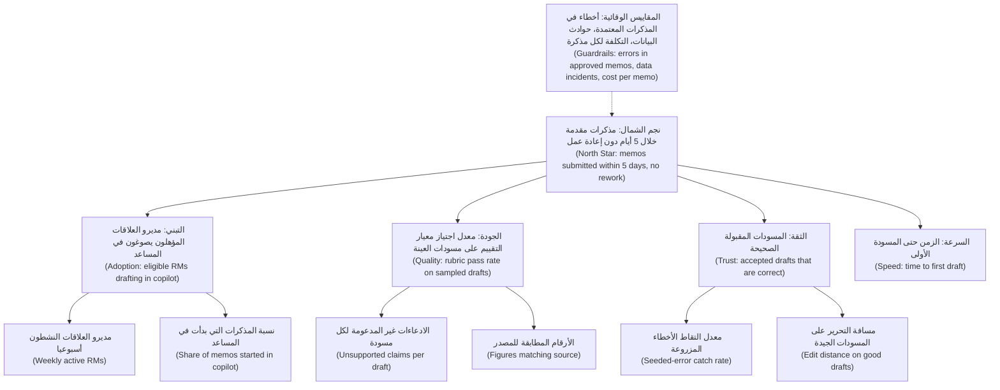
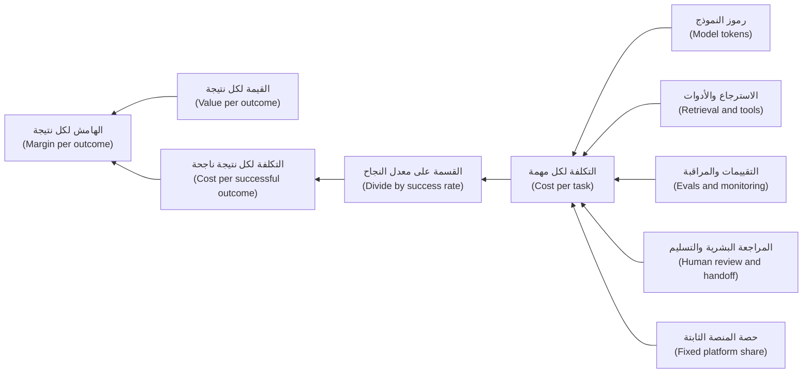
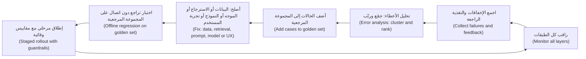

# الوحدة 8 — المقاييس والاقتصاديات والنمو

*ميزة الذكاء الاصطناعي (AI feature) التي أُطلقت لم تنجح بعد. بعد الإطلاق (launch) تتغير الأسئلة: هل يستخدمها الناس، وهل تساعدهم، وهل يثقون بها بالقدر الصحيح، وكم تكلّف كل مرة استخدام، وهل تتحسن أم تتراجع بصمت؟ تتناول هذه الوحدة إدارة منتج ذكاء اصطناعي (AI product) بعد يوم الإطلاق (launch day). ستبني شجرة مقاييس (metrics tree) لـ مساعد مذكرات الائتمان (Credit Memo Copilot) تفصل القيمة (value) عن النشاط (activity). وستحسب تكلفة الخدمة (cost to serve) لـ نجم أسيست (Najm Assist) ومساعد مذكرات الائتمان، وترى لماذا لا يكون أرخص نموذج (cheapest model) دائمًا أرخص منتج (cheapest product). ثم ستُعِدّ حلقة المراقبة والتحسين المتكرر التي تحافظ على سلامة التنبيهات الذكية (Smart Alerts) والتمويل الفوري للشركات الصغيرة (SME Instant Finance) ونجم أسيست بينما يتغير العملاء والمحتالون (fraudsters) ومورّدو النماذج (model vendors) من حولها. قاعدة رانيا لهذه الوحدة: «إن لم تستطع أن تقول كم يساوي، وكم يكلّف، وهل ينجرف، فأنت لا تملك المنتج، بل تستضيفه فقط».*

> **المراحل (Stages):** Grow — قِس القيمة والتكلفة والجودة بعد الإطلاق، وحوّل ما تتعلمه إلى التكرار التالي.

---

# 8.1 — مقاييس المنتج للذكاء الاصطناعي: القيمة والجودة والتبنّي والثقة
*المستوى (Level): 🔴 متقدم (Advanced)* · *المتطلبات (Prerequisites): 6.1، 6.3، 7.3* · *المرحلة (Stage): Grow*

## ⚡ الدرس في دقيقة (In 60 seconds)
- يحتاج منتج الذكاء الاصطناعي إلى مقاييس في **أربع عائلات (four families)**: **القيمة (value)** (هل أُنجزت مهمة المستخدم (user's job) بشكل أفضل أو أسرع أو أرخص؟)، و**الجودة (quality)** (هل كانت المخرجات (outputs) صحيحة؟)، و**التبنّي (adoption)** (هل يستخدمه المستخدمون المستهدفون (intended users) ويواصلون استخدامه؟)، و**الثقة (trust)** (هل يعتمدون عليه بالقدر الصحيح، لا أكثر ولا أقل؟).
- نظّمها في **شجرة مقاييس (metrics tree)**: مقياس نجم الشمال (North Star) واحد يعبّر عن القيمة المُقدَّمة (delivered value)، وبضعة مقاييس مُدخلة (input metrics) يستطيع الفريق تحريكها، و**مقاييس وقائية (guardrail metrics)** يجب ألا تسوء.
- يضيف الذكاء الاصطناعي إشارات (signals) تفتقر إليها المنتجات التقليدية (classic products): **معدل القبول (acceptance rate)**، و**مسافة التحرير (edit distance)** (مقدار ما يغيّره المستخدمون في المسودة)، و**معدل التجاوز (override rate)**، و**معدل إعادة التوليد (regeneration rate)**، و**التصعيد إلى إنسان (escalation to a human)**، وفي المنتجات التنبؤية (predictive products) الدقة (precision) والاستدعاء (recall) مقيسَين على النتائج الفعلية (real outcomes).
- إشارة القرار (Decision cue): يجب أن يغيّر كل مقياس قرارًا ما. إذا لم يكن أحد سيتصرف بشكل مختلف عندما يتحرك، فهو مقياس تجميلي (vanity metric). تخلّص منه.
- أكبر فخ (Biggest trap): قياس **النشاط أو التكلفة (activity or cost)** (المحادثات المُعالَجة (chats handled)، والمسودات المُولَّدة (drafts generated)، والتذاكر المُحوَّلة عن البشر) وتسميته قيمة. يمكن لروبوت المحادثة (chatbot) أن «يحتوي (contain)» محادثة أخطأ فيها.

## 🧭 لماذا يهم
بعد ثلاثة أشهر من الإطلاق، يعرض فيصل لوحة معلومات (dashboard) مساعد مذكرات الائتمان على مجموعة التوجيه (steering group). تبدو جيدة: 11,400 مسودة مُولَّدة، و190 من مديري العلاقات (relationship managers (RMs)) النشطين أسبوعيًا (weekly active)، ومتوسط تقييم بالإعجاب 4.2 من 5. يستمع خالد، ثم يطرح السؤال الوحيد الذي يهمه: «هل تصل مذكرات الائتمان (credit memos) إلى اللجنة (committee) أسرع، وهل هي جيدة أصلًا؟» لا يعرف فيصل. لم يربط أحد الاستخدام (usage) بزمن دورة المذكرة (memo cycle time) أو بإعادة العمل (rework). كما أن عدد «المسودات المُولَّدة» يشمل كل إعادة توليد (regeneration)، فيبدو مدير العلاقات المُحبَط الذي ينقر *إعادة التوليد (regenerate)* ست مرات كأنه ست وحدات نجاح.

تتدخل رانيا. الأرقام تصف النشاط لا القيمة. المسودة المُولَّدة (draft generated) تكلفة (cost). أما المسودة التي يقبلها مدير العلاقات (RM) بتعديلات خفيفة (light edits)، وتمر بمراجعة الائتمان (credit review) دون إعادة عمل إضافية (extra rework)، وتجعل الصفقة تُحسم أسرع، فهي قيمة. يحتاج الفريق مقاييس للاثنين، مرتبة بحيث تجيب لوحة المعلومات عن سؤال خالد أولًا.

تُظهر الحالات العامة (public cases) الدرس نفسه على نطاق أوسع. في فبراير 2024 أعلنت Klarna أن مساعدها بالذكاء الاصطناعي (AI assistant) يتولى حصة كبيرة من محادثات خدمة العملاء (customer-service chats). وفي 2025 قالت الشركة إنها ستعيد مزيدًا من الخدمة البشرية (human service)، وذكرت جودة الخدمة جزءًا من السبب. الدرس: «المحادثات التي عالجها الذكاء الاصطناعي» مقياس حجم (volume metric)، ويحتاج إلى مقياس جودة (quality metric) بجانبه.

## 📐 كيف يعمل

### 🟢 الأساسيات

**المقياس (A metric)** رقم تتتبعه عبر الزمن لتعرف هل المنتج يعمل. المقاييس الجيدة (good metrics) مرتبطة بمهمة المستخدم (2.1)، وتتحرك خلال أسابيع، ويمكن تقسيمها إلى شرائح (segmented).

في منتجات الذكاء الاصطناعي، صنّف المقاييس في أربع عائلات. كل عائلة تجيب عن سؤال مختلف، وكل منها قد تبدو سليمة (look healthy) بينما تفشل أخرى.

| العائلة (Family) | السؤال الذي تجيب عنه (Question it answers) | أمثلة لـ مساعد مذكرات الائتمان |
|---|---|---|
| **القيمة (Value)** | هل تُنجز مهمة المستخدم بشكل أفضل أو أسرع أو أرخص؟ | الساعات من حزمة البيانات (data pack) حتى تقديم المذكرة (memo submitted)؛ المذكرات التي تعيدها مراجعة الائتمان؛ ساعات مدير العلاقات الموفَّرة لكل مذكرة |
| **الجودة (Quality)** | هل المخرجات صحيحة ومستندة إلى مصادر (grounded) وآمنة (safe)؟ | نسبة المسودات المأخوذة عيّنةً (sampled drafts) التي تجتاز معيار التقييم (rubric) (6.1)؛ الادعاءات غير المدعومة (unsupported claims) لكل مسودة؛ الأرقام التي لا تطابق المصدر |
| **التبنّي (Adoption)** | هل يستخدمه المستخدمون المستهدفون ويواصلون استخدامه؟ | نسبة مديري العلاقات المؤهلين (eligible RMs) النشطين أسبوعيًا؛ نسبة المذكرات التي بدأت في المساعد؛ الاحتفاظ (retention) بعد 8 أسابيع |
| **الثقة (Trust)** | هل يعتمد المستخدمون عليه بشكل مناسب؟ | معدل القبول مع تعديلات قليلة على المسودات الجيدة؛ معدل اكتشاف الأخطاء المزروعة؛ استبيان مديري العلاقات عن الثقة |

ثلاث أفكار تحوّل قائمة الأرقام إلى نظام (system).

1. **مقياس نجم الشمال (The North Star metric).** رقم واحد يعبّر على أفضل وجه عن القيمة التي يقدّمها المنتج للمستخدمين، ويميل إلى أن يسبق نتائج الأعمال. لـ مساعد مذكرات الائتمان، اختار فريق رانيا *«المذكرات المقدَّمة إلى مراجعة الائتمان خلال خمسة أيام عمل من اكتمال حزمة البيانات، دون أن تُعاد لإعادة العمل»*. يجمع السرعة والجودة في رقم واحد، فالتلاعب بأحد الجانبين يضر الآخر.
2. **المقاييس المُدخلة (Input metrics).** الأشياء القليلة التي يستطيع الفريق تحريكها مباشرة والتي تدفع مقياس نجم الشمال: التبنّي بين مديري العلاقات المؤهلين، ومعدل قبول المسودات، وجودة الاستناد إلى المصادر (grounding quality)، والزمن حتى المسودة الأولى.
3. **المقاييس الوقائية (Guardrail metrics).** أرقام يجب ألا تسوء بينما تدفع الأخرى: معدل الأخطاء الوقائعية في المذكرات المعتمدة، وحوادث البيانات السرية (confidential-data incidents)، وعبء عمل محللي الائتمان (credit-analyst workload)، والتكلفة لكل مذكرة (cost per memo). يأتي المصطلح من التجارب عبر الإنترنت (online experimentation) (Kohavi, Tang and Xu, *Trustworthy Online Controlled Experiments*, 2020)، حيث تحمي المقاييس الوقائية (guardrails) الأعمال بينما تحسّن المقياس الرئيسي.

**المؤشرات السابقة واللاحقة (Leading and lagging).** بعض النتائج تصل متأخرة. فهل أدّت مذكرة صاغها المساعد (copilot-drafted memo) إلى قرار ائتماني أفضل؟ لن يظهر ذلك إلا في أداء القرض (loan performance) بعد عام أو أكثر. وهل التقط تنبيه ذكي (Smart Alert) احتيالًا حقيقيًا (real fraud)؟ قد يستغرق التأكد أسابيع عبر عمليات استرداد المدفوعات (chargebacks). تتبّع النتيجة اللاحقة (lagging outcome)، لكن وجّه أسبوعيًا بالمؤشرات السابقة (leading indicators) مثل معدل اجتياز معيار التقييم (rubric pass rate) وإعادة العمل.

### 🟡 التعمق أكثر (Going deeper)

**إشارات خاصة بالذكاء الاصطناعي (AI-specific signals).** تترك المنتجات التوليدية والتنبؤية آثارًا في السلوك لا يتركها البرنامج التقليدي (classic software). تعلّم قراءتها.

| الإشارة (Signal) | ما هي | ما تخبرك به | كيف تضلّل |
|---|---|---|---|
| **معدل القبول (Acceptance rate)** | نسبة مخرجات الذكاء الاصطناعي (AI outputs) التي يحتفظ بها المستخدم (يرسلها أو يدرجها أو يعتمدها) | فائدة تقريبية (rough usefulness) | الختم دون تدقيق (rubber-stamping) يبدو نجاحًا؛ انظر الثقة أدناه |
| **مسافة التحرير (Edit distance)** | مقدار ما يغيّره المستخدم في المسودة (draft) قبل استخدامها، مثل نسبة الأحرف أو الأقسام المُعاد كتابتها | جودة المسودة من وجهة نظر المستخدم | بعض التعديلات تفضيلات أسلوبية (style preferences) لا أخطاء |
| **معدل إعادة التوليد (Regeneration rate)** | كم مرة يطلب المستخدمون محاولة أخرى (another attempt) | الإحباط (frustration)، أو عنصر تحكم مفقود (missing control) (النبرة، الطول) | المستخدمون المتقدمون (power users) يعيدون التوليد لمقارنة الخيارات (compare options) |
| **معدل التجاوز (Override rate)** | كم مرة يختلف قرار الإنسان (human decision) عن توصية النموذج (model's recommendation) | الخلاف بين النموذج والخبراء؛ وفي التمويل الفوري للشركات الصغيرة، مواضع اختلاف النموذج عن مكتتبي الائتمان (underwriters) | التجاوز المرتفع (high override) قد يعني نموذجًا سيئًا أو موظفين لا يثقون به؛ يجب أن تنظر مَن كان محقًا |
| **معدل التصعيد / التسليم (Escalation / handoff rate)** | نسبة المحادثات المُحالة إلى موظف بشري (human agent) | أين يبلغ نجم أسيست حدوده | انخفاض التصعيد (low escalation) قد يعني أن الروبوت عنيد (stubborn) لا أنه جيد |
| **الاحتواء (Containment)** | نسبة المحادثات التي تنتهي دون إنسان | تكلفة مركز الاتصال المُتجنَّبة | يعدّ المحادثات المتروكة (abandoned) والمُجاب عنها خطأً (wrongly answered) نجاحًا |
| **الحل (Resolution)** | نسبة المحادثات التي حُلّت فيها مشكلة العميل فعلًا (actually solved) | القيمة الحقيقية (real value) | يحتاج إلى تعريف وتحقق، مثل عدم تكرار التواصل خلال 7 أيام (no repeat contact within 7 days) |
| **التغذية الراجعة الصريحة (Explicit feedback)** | الإعجاب / عدم الإعجاب (thumbs up/down)، والتقييمات (ratings)، والتعليقات (comments) | صوت المستخدم المباشر | معدلات استجابة منخفضة وانحياز نحو المستخدمين الراضين جدًا أو الغاضبين جدًا |

زوجان هما الأهم. **الاحتواء مقابل الحل (Containment versus resolution)**: العميل الذي يستسلم مع نجم أسيست ويتصل بمركز الاتصال (call centre) بعد ساعة كان «محتوى (contained)» في سجل المحادثة (chat log) لكنه لم يُساعَد. يعرّف فريق رانيا الحل بأنه «لا تواصل بشأن الموضوع نفسه، عبر أي قناة، خلال سبعة أيام»، ولا يعرض الاحتواء إلا بجانبه. **القبول مقابل الصحة (Acceptance versus correctness)**: معدل القبول المرتفع جيد فقط إذا كانت المخرجات المقبولة (accepted outputs) صحيحة. خذ عيّنة من المخرجات المقبولة وقيّمها وفق معيار التقييم (6.1)، وإلا فلن تميّز الفائدة (usefulness) من الإفراط في الاعتماد (over-reliance).

**استخدام الأطر العامة (Using public frameworks).** لا تحتاج إلى اختراع هيكل.

- **HEART** (Google: السعادة (Happiness)، والتفاعل (Engagement)، والتبنّي، والاحتفاظ، ونجاح المهمة (Task success)؛ Rodden, Hutchinson and Fu, 2010) يقرن كل بُعد (dimension) بسلسلة *الأهداف ← الإشارات ← المقاييس*. يناسب ميزات الذكاء الاصطناعي (AI features) لأن «نجاح المهمة» يجبرك على تعريف المهمة.
- **AARRR** («مقاييس القراصنة (pirate metrics)» لـ Dave McClure: الاستقطاب (Acquisition)، والتفعيل (Activation)، والاحتفاظ، والإحالة (Referral)، والإيراد) قمع للنمو. لأداة داخلية (internal tool) مثل مساعد الموظفين التوليدي (Staff GenAI)، أعد تسمية الخطوات: *مُمكَّن (enabled) ← مُفعَّل (activated)* (أول مهمة مفيدة) *← معتاد (habitual)* (استخدام أسبوعي) *← مناصر (advocate)* (يشارك الموجّهات أو القوالب) *← قيمة* (الساعات الموفَّرة (hours saved)، مقيسة بأخذ العيّنات).

**التبنّي ليس ثنائيًا (Adoption is not binary).** في المؤسسة (enterprise)، يُخفي مقياس «المستخدمون النشطون (active users)» الفرق بين مدير علاقات يفتح المساعد (copilot) مرة في الشهر وآخر يصوغ كل مذكرة فيه. تتبّع *العمق (depth)* (نسبة العمل المؤهل للمستخدم المُنجَز بالمنتج) إلى جانب *الاتساع (breadth)* (نسبة المستخدمين المؤهلين النشطين).

**قسّم كل شيء إلى شرائح (Segment everything).** المتوسطات تُخفي المشكلات. قسّم المقاييس حسب مجموعة المستخدمين (user group) (مديرو العلاقات الجدد مقابل ذوي الخبرة)، وحسب نوع المهمة (task type) (مذكرات الشركات الصغيرة مقابل مذكرات الشركات الكبرى)، وحسب اللغة (language) (الإنجليزية مقابل العربية في نجم أسيست)، وحسب السوق (market) (قطر والإمارات والاتحاد الأوروبي). قد يخفي المتوسط الإيجابي (positive average) مجموعةً يخذلها المنتج.

### 🔴 نظرة الخبير (Expert view)

**قياس الثقة بوصفها معايرة (Measuring trust as calibration).** الثقة ليست «كلما زادت كان أفضل». الهدف هو **الاعتماد المناسب (appropriate reliance)**: أن يقبل المستخدمون المخرجات الجيدة ويلتقطوا السيئة. هناك نمطا فشل (failure modes) متعاكسان. *الإفراط في الاعتماد* (انحياز الأتمتة) يعني قبول مخرجات خاطئة؛ و*قلة الاعتماد (under-reliance)* تعني إعادة عمل أنجزه الذكاء الاصطناعي جيدًا. يمكنك قياس الاثنين.

- **تدقيقات الأخطاء المزروعة (Seeded-error audits).** في بيئة تدريب أو تشغيل ظلّي، وليس في قرارات حية (live decisions) أبدًا، أدرج أخطاء معروفة (known errors) في بعض المسودات وقِس كم من مديري العلاقات يلتقطونها. انخفاض معدل الالتقاط إنذار بالإفراط في الاعتماد.
- **مصفوفة الاعتماد (Reliance matrix).** لعيّنة من المخرجات، قيّم مخرج الذكاء الاصطناعي (AI output) (جيد أو سيئ) وسجّل إجراء الإنسان (human action) (قُبل أو غُيّر). الجيد المقبول (good-and-accepted) والسيئ المُغيَّر (bad-and-changed) سليمان. السيئ المقبول (bad-and-accepted) إفراط في الاعتماد. والجيد المُعاد كتابته (good-and-rewritten) قلة اعتماد، وهي تُفقدك القيمة.

**قانون Goodhart (Goodhart's law)** (المسمّى باسم الاقتصادي Charles Goodhart) يُصاغ عادة هكذا: «عندما يصبح المقياس هدفًا، يكفّ عن أن يكون مقياسًا جيدًا». منتجات الذكاء الاصطناعي معرّضة له بشكل خاص لأن النماذج والناس كليهما يحسّنون الأداء نحو الهدف (both optimise). كافئ فريق نجم أسيست على الاحتواء وسيجعلون زر التسليم (handoff button) أصعب في الإيجاد. وكافئ فريق المساعد (copilot team) على معدل القبول وسيتعلم المنتج إنتاج مسودات باهتة (bland drafts) لا يكلّف أحد نفسه تغييرها. الدفاع (Defence): اقرن كل هدف (target) بمقياس وقائي (guardrail) على الجانب الآخر، وراجع التعريفات فصليًا.

**الإسناد: هل الذكاء الاصطناعي هو السبب؟ ⁦(Attribution: did the AI cause it?)⁩** قد ينخفض زمن دورة المذكرة بسبب المساعد، أو لأن مراجعة الائتمان وظّفت محللَين. للادعاءات التي تبرّر الميزانية، استخدم أساليب التجارب (experiment methods) من 6.3: إطلاق مرحلي (staged rollout) حسب الفريق أو المنطقة مع مجموعة ضابطة محجوزة (holdout group)، أو مقارنة قبل/بعد (before/after comparison) مع مجموعة ضابطة مطابقة (matched control). وحيث تستحيل تجربة نظيفة (clean experiment)، قل ذلك وقدّم تقديرًا (estimate) مع افتراضاته (assumptions). سيثق خالد برقم صادق متحفّظ أكثر من رقم مُضخَّم (inflated one).

**مقاييس المنتجات التنبؤية (Metrics for predictive products).** في التمويل الفوري للشركات الصغيرة والتنبيهات الذكية، يجب ربط مقاييس النموذج (model metrics) (الدقة، والاستدعاء، وAUC، والمعايرة (calibration) من 6.1) بنتائج الأعمال (business outcomes). في التنبيهات الذكية قد تكون شجرة المقاييس: *خسائر الاحتيال المُتجنَّبة* (القيمة) ← *الاستدعاء على الاحتيال المؤكد* و*الزمن حتى التنبيه* (مُدخلات)، مع *التنبيهات الكاذبة لكل 1,000 عميل نشط (false alerts per 1,000 active customers)* و*معدل إلغاء الاشتراك في التنبيهات* مقاييسَ وقائيةً، لأن إرهاق التنبيهات (alert fatigue) يجعل العملاء يتجاهلون التنبيهات المهمة أو يوقفونها. وفي التمويل الفوري للشركات الصغيرة: *الحجم المعتمد عند معدل الخسارة المستهدف* (القيمة)، مع *معدل التعثر حسب الفوج* و*معدل التجاوز* و*فجوات معدل الموافقة بين الشرائح* مقاييسَ وقائيةً. تُغطّى مراقبة العدالة (fairness monitoring) في *AI Governance: Zero to Hero*؛ تأكد أنها تظهر على لوحة معلومات المنتج (product dashboard) أيضًا.

**القياس والتتبع متطلب من متطلبات المنتج (Instrumentation is a product requirement).** لا شيء من هذا يعمل ما لم يسجّل المنتج الأحداث الصحيحة: عرض المسودة (draft shown)، وقبول المسودة (draft accepted)، والأقسام المُحرَّرة (sections edited)، والنقر على إعادة التوليد (regenerate clicked)، وطلب التسليم (handoff requested)، وتقديم التغذية الراجعة (feedback given)، مع معرّف ثابت (stable ID) يربط مخرج الذكاء الاصطناعي بنتيجة الأعمال اللاحقة. ضع قائمة الأحداث (event list) في المواصفات (spec) (5.1) قبل البناء (before build). واتفق على الاحتفاظ بالبيانات والوصول إليها مع سارة (مسؤولة حماية البيانات (DPO)): السجلات (logs) تحوي بيانات شخصية وسرية.

## 🧰 الأدوات
| الأداة أو الإطار (Tool or framework) | ما هو وماذا يفعل | متى تلجأ إليه |
|---|---|---|
| **North Star metric** — مقياس نجم الشمال | مقياس واحد يعبّر عن القيمة التي يقدمها المنتج ويميل إلى أن يسبق نتائج الأعمال | مواءمة الفريق والرعاة على معنى «يعمل (working)» |
| **Metrics tree** — شجرة المقاييس | مقياس نجم الشمال مُفكَّك إلى مقاييس مُدخلة يستطيع الفريق تحريكها، مع مقاييس وقائية بجانبها | تصميم لوحة المعلومات؛ تفسير سبب تحرك مقياس |
| **HEART framework** (Google; Rodden, Hutchinson and Fu, 2010) | السعادة، والتفاعل، والتبنّي، والاحتفاظ، ونجاح المهمة، كلٌّ مُسقَط على الأهداف ← الإشارات ← المقاييس | اختيار مقاييس تجربة المستخدم (user-experience metrics) لميزة ذكاء اصطناعي |
| **AARRR** (Dave McClure) | قمع (funnel): الاستقطاب، والتفعيل، والاحتفاظ، والإحالة، والإيراد (Revenue) | نمو منتج موجّه للعملاء؛ ويُكيَّف قمعًا للتبنّي (adoption funnel) في الأدوات الداخلية (internal tools) |
| **Guardrail metrics** (Kohavi, Tang and Xu) | مقاييس يجب ألا تتدهور بينما تحسّن المقياس الرئيسي | كل هدف تضعه؛ كل تجربة (every experiment) |
| **Reliance matrix** — مصفوفة الاعتماد | تقارن جودة مخرج الذكاء الاصطناعي بإجراء الإنسان (human's action) لكشف الإفراط في الاعتماد وقلته | قياس الثقة (measuring trust) في المساعدات وأدوات دعم القرار |
| **Resolution rate** — معدل الحل | نسبة المحادثات التي حُلّت فيها المشكلة فعلًا، مُتحقَّقًا منها بعدم تكرار التواصل | ليحلّ محل الاحتواء (replacing containment) بوصفه المقياس الرئيسي للمساعدات |

## 🏛️ عمليًا في بنك نجم
تطلب رانيا من فيصل إعادة بناء لوحة المعلومات في صفحة واحدة بعنوان **شجرة المقاييس وورقة التعريفات (metrics tree and definitions sheet)**. صارت مجموعة التوجيه تقرؤها من الأعلى إلى الأسفل (top-down).

**مساعد مذكرات الائتمان (Credit Memo Copilot) — ورقة المقاييس (metrics sheet) (الإصدار 2 (v2)، تُراجَع فصليًا (reviewed quarterly))**

| المستوى | المقياس (Metric) | التعريف (Definition) | المصدر (Source) | الهدف / العتبة (Target / threshold) | المالك (Owner) |
|---|---|---|---|---|---|
| نجم الشمال | المذكرات النظيفة في موعدها | نسبة المذكرات المقدَّمة خلال 5 أيام عمل من اكتمال حزمة البيانات وغير المُعادة لإعادة العمل | نظام سير عمل الائتمان | ارتفاع عن خط الأساس؛ يُحدَّد الهدف بعد خط أساس مدته 8 أسابيع (8-week baseline) | فيصل |
| القيمة | ساعات مدير العلاقات لكل مذكرة | وسيط الساعات المُسجَّلة لكل مذكرة، بالمساعد مقابل بدونه، في الشريحة نفسها (same segment) | أخذ عيّنات زمنية (time sampling)، أسبوعان كل فصل | يُعرض مع المدى والطريقة | فيصل |
| الجودة | معدل اجتياز معيار التقييم | نسبة 50 مسودة مختارة عشوائيًا أسبوعيًا تجتاز معيار التقييم في 6.1 | لجنة المراجعة لدى دانة | عند مستوى معيار الإطلاق أو فوقه | دانة |
| الجودة | الادعاءات غير المدعومة | ادعاءات في المسودة بلا استشهاد بمصدر، لكل مسودة | فحص آلي مع اللجنة | دون معيار الإطلاق | دانة |
| التبنّي | الاتساع | مديرو العلاقات المؤهلون الذين صاغوا مذكرة واحدة على الأقل هذا الأسبوع | أحداث المنتج (product events) | يرتفع حتى الاستقرار | فيصل |
| التبنّي | العمق | نسبة مذكرات كل مدير علاقات التي بدأت في المساعد | أحداث المنتج + سير العمل | يرتفع (rising) | فيصل |
| الثقة | الإفراط في الاعتماد | نسبة المسودات المقبولة في العيّنة التي تفشل في معيار التقييم | عيّنة مصفوفة الاعتماد | ينخفض (falling)؛ تنبيه إذا ارتفع أسبوعين متتاليين (alert if rising 2 weeks running) | حصة |
| الثقة | قلة الاعتماد | نسبة المسودات الجيدة في العيّنة التي أُعيدت كتابتها بكثافة (heavily rewritten) (أكثر من نصف الأقسام) | عيّنة مصفوفة الاعتماد | مراقبة (watch)؛ يستدعي بحث تجربة المستخدم | حصة |
| مقياس وقائي | الأخطاء في المذكرات المعتمدة | الأخطاء الوقائعية (factual errors) التي تجدها مراجعة الائتمان أو التدقيق في المذكرات المعتمدة | سجل مراجعة الائتمان | لا زيادة مقارنة بخط الأساس | خالد |
| مقياس وقائي | التكلفة لكل مذكرة | تكلفة الخدمة المُحمَّلة بالكامل (8.2) | المالية + المنصة (finance + platform) | ضمن الميزانية (within budget) | طارق |
| مقياس وقائي | حوادث البيانات (Data incidents) | بيانات سرية مكشوفة أو أُسيء التعامل معها | سجل الحوادث (incident log) | صفر؛ أي حادثة واحدة تستدعي مراجعة | ليلى |

أُزيل من المقاييس الرئيسية: *المسودات المُولَّدة* و*متوسط تقييم الإعجاب* (وصارت الآن مقاييس تشخيصية).

## 🛠️ التمارين (Exercises)
- 🟢 صنّف مقاييس نجم أسيست هذه إلى القيمة أو الجودة أو التبنّي أو الثقة أو التكلفة: المحادثات التي بدأت (conversations started)؛ الاحتواء؛ الحل خلال 7 أيام (resolution within 7 days)؛ نسبة الإجابات التي تستشهد بصفحة السياسة الصحيحة؛ مستخدمو التطبيق النشطون شهريًا الذين استخدموا المساعد؛ طلبات التسليم (handoff requests)؛ معدل عدم الإعجاب (thumbs-down rate). *يكتمل عندما (Done when):* يكون لكل منها عائلة واحدة، وتكون قد أشرت إلى المقياسين الأكثر عرضة للتلاعب.
- 🟡 ابنِ جدول HEART (HEART table) لـ مساعد الموظفين التوليدي بهدف واحد وإشارة واحدة ومقياس واحد لكل بُعد. *يكتمل عندما:* يمكن حساب كل مقياس من بيانات يستطيع بنك نجم تسجيلها واقعيًا (realistically log)، ويسمّي «نجاح المهمة» مهمة محددة (specific job).
- 🔴 صمّم شجرة المقاييس لـ التنبيهات الذكية، متضمنة مقياس نجم الشمال، وثلاثة مقاييس مُدخلة، وثلاثة مقاييس وقائية، ونتيجة لاحقة واحدة مع المدة التي تستغرقها تسمياتها (labels) للوصول. *يكتمل عندما:* تُظهر الشجرة كيف ستكتشف إرهاق التنبيهات قبل أن يوقف العملاء التنبيهات، ويكون لكل مقياس وقائي مالك.

## ⚠️ أخطاء وفخاخ (Mistakes and traps)
- **عدّ النشاط قيمةً (Counting activity as value).** المسودات المُولَّدة والمحادثات المُعالَجة والرموز المستخدمة (tokens used) تكاليف. ضع مقياس قيمة (value metric) في قمة الشجرة، وأنزِل النشاط إلى المقاييس التشخيصية (diagnostics).
- **عرض الاحتواء دون الحل (Reporting containment without resolution).** اقرنهما دائمًا، وتحقق من الحل (verify resolution) بالتحقق من تكرار التواصل (repeat contact).
- **معاملة القبول المرتفع دليلًا على الجودة (Treating high acceptance as proof of quality).** خذ عيّنة من المخرجات المقبولة وقيّمها. القبول المرتفع مع تراجع الصحة (falling correctness) إفراط في الاعتماد.
- **المتوسطات فقط (Averages only).** قسّم حسب مجموعة المستخدمين واللغة والسوق ونوع المهمة قبل أن تستنتج أي شيء.
- **القياس والتتبع بعد الإطلاق (Instrumenting after launch).** ضع قائمة الأحداث في المواصفات. البيانات التي لم تسجّلها ضاعت.
- **أهداف بلا مقاييس وقائية (Targets without guardrails).** كل هدف يدعو إلى التلاعب (invites gaming) (قانون Goodhart). اقرنه بمقياس على الجانب المقابل (opposite side).

## 🧾 الخلاصة (Recap)
- تأتي مقاييس منتجات الذكاء الاصطناعي في أربع عائلات: القيمة والجودة والتبنّي والثقة. كل منها قد تبدو سليمة بينما تفشل أخرى.
- تمتد شجرة المقاييس من مقياس نجم الشمال إلى مقاييس مُدخلة يستطيع الفريق تحريكها، مع مقاييس وقائية يجب ألا تتدهور.
- اقرأ الإشارات الخاصة بالذكاء الاصطناعي (القبول (acceptance)، ومسافة التحرير، وإعادة التوليد، والتجاوز (override)، والتصعيد) بحذر، واقرن كلًّا منها بفحص للصحة (correctness check).
- الثقة مسألة معايرة. قِس الإفراط في الاعتماد وقلته بمصفوفة الاعتماد وتدقيقات الأخطاء المزروعة.
- أثبت السببية (prove causation) بالمجموعات الضابطة المحجوزة (holdouts) أو الإطلاق المرحلي (staged rollouts) حيث تستطيع، وقدّم تقديرات صادقة (honest estimates) حيث لا تستطيع.

## ✍️ اختبر نفسك (Check yourself)

**1. ارتفع معدل الاحتواء (containment rate) في نجم أسيست (Najm Assist) من 55% إلى 70% بعد تغيير الموجّه (prompt change). ما الذي يجب أن يتحقق منه فيصل قبل أن يعدّه نجاحًا (calling it a win)؟**

- A. هل ارتفع عدد المحادثات أيضًا
- B. هل تحسّن الحل (resolution) أيضًا، مقيسًا بعدم تكرار التواصل بشأن الموضوع نفسه خلال سبعة أيام
- C. هل ارتفع متوسط تقييم الإعجاب
- D. هل انخفضت تكلفة الرموز لكل محادثة خلال الأسبوعين الأولين

الإجابة

**B.** يعدّ الاحتواء (containment) كل محادثة تنتهي دون إنسان، بما في ذلك العملاء الذين استسلموا واتصلوا لاحقًا. أما الحل (resolution) فيتحقق من أن المشكلة حُلّت فعلًا (actually solved). التقييمات (ratings) (C) مقياس تشخيصي مفيد (useful diagnostic) لكنها تعاني من استجابة منخفضة ومنحازة. (🟡 التعمق أكثر (Going deeper).)

**2. أيّ مما يلي أفضل مقياس نجم الشمال (North Star) لـ مساعد مذكرات الائتمان (Credit Memo Copilot)؟**

- A. عدد المسودات المُولَّدة أسبوعيًا عبر جميع مديري العلاقات الذين يستخدمون الأداة في كل المناطق (every region)، دون النظر إلى جودتها
- B. مديرو العلاقات النشطون أسبوعيًا
- C. نسبة المذكرات المقدَّمة في موعدها وغير المُعادة لإعادة العمل
- D. متوسط تقييم الإعجاب على المسودات

الإجابة

**C.** يعبّر عن القيمة المُقدَّمة (delivered value) ويجمع السرعة والجودة، فالتلاعب بأحدهما يضر الآخر. A يعدّ التكلفة والنشاط، وB مُدخل تبنٍّ (adoption input)، وD مقياس تشخيصي (diagnostic). (🟢 الأساسيات.)

**3. تُظهر عيّنة مصفوفة الاعتماد (reliance-matrix sample) أن 18% من المسودات التي قبلها مديرو العلاقات دون تعديلات (with no edits) فشلت في معيار الجودة (quality rubric)، ارتفاعًا من 7% في الفصل السابق. ماذا يدل هذا على الأرجح؟**

- A. قلة الاعتماد (under-reliance): مديرو العلاقات يعيدون كتابة مسودات جيدة، فيضيّعون وقتًا كان ينبغي أن يوفّره المساعد
- B. التبنّي (adoption) يتراجع، لأن عددًا أقل من مديري العلاقات يفتح المساعد قبل أن يبدأ مذكراته كل أسبوع (each week)
- C. معيار التقييم (rubric) صارم أكثر من اللازم، لأنه صار يرفض مسودات كان مديرو العلاقات ذوو الخبرة سيقبلونها بوصفها جيدة
- D. الإفراط في الاعتماد (over-reliance): مديرو العلاقات يقبلون مسودات كان عليهم تصحيحها

الإجابة

**D.** المخرجات السيئة المقبولة دون تغيير هي خانة الإفراط في الاعتماد (over-reliance cell). وهذا يستدعي النظر في احتكاك تجربة المستخدم (UX friction) والتدريب (training) وتدقيقات الأخطاء المزروعة (seeded-error audits). قلة الاعتماد (under-reliance) هي إعادة كتابة المسودات الجيدة بكثافة. (🔴 نظرة الخبير (Expert view).)

**4. يُكافأ فريق نجم أسيست (Najm Assist) على الاحتواء (containment)، ثم ينقل لاحقًا بهدوء زر «التحدث إلى شخص (talk to a person)» شاشتين إلى الداخل. أيّ فكرة تفسّر هذا أفضل تفسير؟**

- A. أثر الجِدّة (novelty effect)
- B. عدم تطابق نسبة العيّنة
- C. قانون Goodhart (Goodhart's law)
- D. نموذج Kano (Kano model)

الإجابة

**C.** عندما يصبح المقياس هدفًا يكفّ عن أن يكون مقياسًا جيدًا. الدفاع هو مقياس وقائي (guardrail) مثل الحل (resolution) أو معدل الشكاوى (complaint rate). أثر الجِدّة (novelty effect) ارتفاع مؤقت (temporary lift) ناتج عن كون الشيء جديدًا. (🔴 نظرة الخبير (Expert view).)

**5. انخفض زمن دورة المذكرة (memo cycle time) بنسبة 20% في الفصل الذي أُطلق فيه المساعد (copilot). وفي الفصل نفسه وظّفت مراجعة الائتمان (credit review) محللَين. ما الطريقة الأكثر قابلية للدفاع (most defensible) لإسناد هذا المكسب (attribute the gain)؟**

- A. نسب الفضل إلى المساعد، لأنه أُطلق في الفصل نفسه (same quarter) وانخفض زمن الدورة مباشرة بعده في أنحاء البنك كلها
- B. مقارنة الفرق التي تستخدم المساعد بمجموعة ضابطة محجوزة (holdout) أو مجموعة لم يُطرح لها بعد، خلال الفترة نفسها
- C. استبيان مديري العلاقات عن شعورهم بأنهم أسرع (survey RMs)
- D. تقسيم المكسب بالتساوي بين السببين

الإجابة

**B.** المجموعة الضابطة المحجوزة (holdout) أو الإطلاق المرحلي (staged rollout) يضبطان التغييرات التي تؤثر في الجميع، مثل المحللين الجدد. A يخلط التوقيت بالسبب. وC يقيس الانطباع لا الأثر. (🔴 نظرة الخبير (Expert view)؛ انظر 6.3.)

## 📚 المراجع (References)
- Rodden, Hutchinson and Fu, "Measuring the User Experience on a Large Scale: User-Centered Metrics for Web Applications", CHI 2010 — https://research.google/pubs/
- Kohavi, Tang and Xu, *Trustworthy Online Controlled Experiments* (Cambridge University Press, 2020) — https://experimentguide.com
- Amershi et al., "Guidelines for Human-AI Interaction", CHI 2019 — https://www.microsoft.com/en-us/research/project/guidelines-for-human-ai-interaction/
- Google PAIR, People + AI Guidebook — https://pair.withgoogle.com/guidebook
- Marty Cagan, *Inspired* (2nd ed., Wiley, 2017) — https://www.svpg.com
- Teresa Torres, *Continuous Discovery Habits* (2021) — https://www.producttalk.org
- Parasuraman and Riley, "Humans and Automation: Use, Misuse, Disuse, Abuse", *Human Factors* 39(2), 1997 — https://journals.sagepub.com/home/hfs

---

# 8.2 — اقتصاديات الوحدة: تكلفة الخدمة ونماذج التسعير والهوامش
*المستوى: 🔴 متقدم* · *المتطلبات: 1.2، 1.3، 7.2، 8.1* · *المرحلة: Grow*

## ⚡ الدرس في دقيقة (In 60 seconds)
- البرمجيات التقليدية (traditional software) لا تكلّف تقريبًا شيئًا إضافيًا لكل استخدام (per use). أما الذكاء الاصطناعي فلا: كل طلب (request) يستهلك قدرة حوسبية (compute)، وغالبًا استرجاعًا (retrieval) واستدعاءات أدوات (tool calls) وتقييمًا (evaluation) ومراجعة بشرية (human review). **تكلفة الخدمة (cost to serve)** متغيّر من متغيرات المنتج (product variable)، لا بند في ميزانية تقنية المعلومات.
- الوحدة المهمة هي **التكلفة لكل نتيجة ناجحة (cost per successful outcome)** (لكل محادثة محلولة (resolved conversation)، ولكل مذكرة مقبولة (accepted memo)، ولكل قرار صحيح)، لا التكلفة لكل رمز أو لكل طلب (per request). النموذج الرخيص الذي يفشل أكثر قد يكون أغلى منتج.
- ابنِ **نموذج تكلفة المهمة (cost-per-task model)**: الرموز × السعر (tokens × price)، مضروبة في عدد الاستدعاءات لكل مهمة (calls per task)، زائد الاسترجاع والأدوات، والتقييم والمراقبة، والمراجعة البشرية وعمليات التسليم، وحصة من تكاليف المنصة الثابتة. ثم اقسم على معدل النجاح (success rate).
- **نماذج التسعير (Pricing models)** (لكل مقعد (seat)، أو حسب الاستخدام، أو لكل مهمة أو نتيجة، أو فئة مميزة (premium tier)، أو مُضمَّن) يضع كلٌّ منها مخاطر التكلفة (cost risk) على طرف مختلف. اختر نموذجًا تطابق وحدته القيمة التي يراها العميل والتكلفة التي تتحملها.
- أكبر فخ: تحسين فاتورة النموذج (model bill) مع تجاهل التكاليف المهيمنة فعلًا: عمليات التسليم إلى البشر (human handoffs)، ووقت المراجعة (review time)، وإعادة العمل، وفي منتجات الائتمان التنبؤية **الخسائر الناتجة عن القرارات الخاطئة (losses from wrong decisions)**.

## 🧭 لماذا يهم
يُحضر طارق أول فاتورة نموذج لشهر كامل لـ نجم أسيست إلى مراجعة المنتج (product review). إنها أضعاف ما في دراسة الجدوى (business case). غريزة فيصل الأولى أن ينتقل إلى أصغر وأرخص نموذج. تحذّر دانة من أن النموذج الصغير (small model) في اختباراتها غير المتصلة (offline tests) أجاب إجابات صحيحة عن عدد أقل من أسئلة البطاقات والمدفوعات. ويطرح خالد، الذي يموّل جزءًا من مركز الاتصال (contact centre)، سؤالًا أدق: «كم ندفع مقابل كل مشكلة عميل حُلّت فعلًا، مع احتساب تلك التي تنتهي عند موظفيّ على أي حال؟»

لا أحد يستطيع الإجابة: فاتورة الرموز (token bill)، وتكلفة مركز الاتصال (contact-centre cost)، ومعدل الحل (resolution rate) (8.1) موجودة في ثلاثة أماكن. تضعها رانيا في ورقة واحدة (one sheet). فاتورة النموذج حقيقية، لكن عمليات التسليم إلى البشر تكلّف أكثر بكثير. ويتبيّن أن أرخص نموذج لكل رمز هو الأغلى لكل محادثة محلولة.

تتعلّم الصناعة الشيء نفسه علنًا. نقل المورّدون (vendors) بعض ميزات الذكاء الاصطناعي من أسعار ثابتة لكل مقعد إلى أسعار مرتبطة بوحدات العمل. سعّرت Intercom وكيلها Fin لكل محادثة محلولة (per resolved conversation) (منذ 2023)، وأطلقت Salesforce منصة Agentforce بتسعير لكل محادثة (per-conversation pricing) (2024). الأسعار الدقيقة تتغير؛ لكن الدرس ثابت: حين يكون لكل استخدام تكلفة حقيقية (real cost)، فإن الوحدة التي تسعّرها وتقيسها خيار استراتيجي (strategic choice).

## 📐 كيف يعمل

### 🟢 الأساسيات

**اقتصاديات الوحدة (Unit economics)** تسأل: لوحدة واحدة من المنتج (مهمة واحدة، أو محادثة واحدة، أو عميل واحد، أو شهر واحد)، كم يكلّف تقديمها، وما القيمة أو الإيراد الذي تجلبه، وما الذي يتبقى؟ في منتجات الذكاء الاصطناعي تجعل ثلاث حقائق ذلك أمرًا لا مفر منه.

1. **كل استخدام يكلّف مالًا (Every use costs money).** تُسعَّر النماذج اللغوية الكبيرة (large language models) عادةً لكل **رمز (token)** (قطعة من النص، نحو ثلاثة أرباع كلمة إنجليزية تقريبًا؛ والنص العربي كثيرًا ما يستهلك رموزًا أكثر للمعنى نفسه). يفرض المزوّدون (providers) رسومًا منفصلة على رموز الإدخال (input tokens) (ما ترسله: التعليمات (instructions)، والمستندات المسترجعة (retrieved documents)، وسجل المحادثة) ورموز الإخراج (output tokens) (ما يكتبه النموذج)، والإخراج عادةً أغلى لكل رمز.
2. **التكاليف تتفاوت كثيرًا بين المهام (Costs vary widely per task).** سؤال من سطر واحد وملف ائتماني من 40 صفحة (40-page credit file) يختلفان في التكلفة بمراتب عشرية. والوكيل (agent) الذي يدور عبر عشرة استدعاءات أدوات يكلّف أكثر بكثير من وكيل يجيب في استدعاء واحد.
3. **الفشل يكلّف مالًا أيضًا (Failure costs money too).** الإجابة الخاطئة التي تنتهي عند موظف بشري، والمسودة التي تحتاج إلى إعادة عمل، والموافقة الائتمانية السيئة، كلها تكلّف أكثر من استدعاء النموذج (model call) الذي تسبّب فيها.

**نموذج تكلفة المهمة (The cost-per-task model)** جدول بيانات بسيط (simple spreadsheet) يجمع كل ما يلزم لإنجاز وحدة عمل واحدة.

| مكوّن التكلفة (Cost component) | ما الذي تحسبه | مثال مساعد مذكرات الائتمان |
|---|---|---|
| استدلال النموذج (Model inference) | رموز الإدخال والإخراج × السعر، × الاستدعاءات لكل مهمة، بما في ذلك إعادة المحاولات وإعادة التوليد | ستة استدعاءات صياغة لكل مذكرة على ملف ائتماني طويل |
| الاسترجاع والأدوات | التضمين (embedding)، والبحث (search)، وتحليل المستندات (document parsing)، واستدعاءات واجهات البرمجة (API calls) | تحليل القوائم المالية، والبحث في المذكرات السابقة |
| التقييم والمراقبة | فحوص النموذج اللغوي حَكَمًا (LLM-as-judge) عبر الإنترنت (online)، والتسجيل (logging)، ولوحات المعلومات (dashboards) | استدعاء حَكَم واحد لكل مسودة |
| المراجعة البشرية والتسليم | وقت الموظفين في الفحص أو التصحيح أو تولّي العمل | لجنة دانة تأخذ عيّنات من المسودات أسبوعيًا |
| حصة المنصة الثابتة | الاستضافة (hosting)، والحدود الدنيا للمورّدين (vendor minimums)، وفريق المنصة (platform team)، والدعم (support)، مُوزَّعة على الفترة (amortised) | حصة من منصة الذكاء الاصطناعي وفريق الدعم |

ثم احسب رقمين: **التكلفة لكل مهمة (cost per task)** (مجموع الصفوف)، و**التكلفة لكل نتيجة ناجحة (cost per successful outcome)** (التكلفة لكل مهمة ÷ معدل النجاح). الثاني هو الذي يجب إدارته.

**الأسعار تتغير (Prices change).** وقت كتابة هذا النص (2026)، تنخفض أسعار الرمز (per-token prices) لمستوى قدرة معيّن، بينما تدفع النماذج الأحدث والأقدر والسياقات الأطول (longer contexts) في الاتجاه الآخر. اجعل الأسعار مُدخلات قابلة للتحديث، لا ثوابت (constants) أبدًا.

### 🟡 التعمق أكثر

**مثال محلول: نجم أسيست (A worked example: Najm Assist).** الأرقام أدناه توضيحية (illustrative)، اختيرت لإظهار الطريقة. ليست أسعارًا حقيقية ولا بيانات حقيقية لبنك نجم.

الافتراضات: 1.5 مليون محادثة شهريًا، بمتوسط أربع جولات (four turns) لكل منها. كل جولة ترسل نحو 4,000 رمز إدخال (موجّه النظام (system prompt)، ومقتطفات السياسات (policy snippets)، والسجل) وتتلقى نحو 300 رمز إخراج. يُسعَّر نموذج *كبير (large)* مثلًا بـ 3 دولارات لكل مليون رمز إدخال و15 دولارًا لكل مليون رمز إخراج. ونموذج *صغير (small)* بـ 0.25 و1.25 دولار. والتسليم إلى موظف بشري يكلّف مثلًا 4 دولارات من وقت مركز الاتصال (contact-centre time).

| | النموذج الكبير فقط | النموذج الصغير فقط | التوجيه: 80% صغير و20% كبير (Routed: 80% small, 20% large) |
|---|---|---|---|
| تكلفة النموذج لكل جولة | $0.0165 | $0.001375 | — |
| تكلفة النموذج لكل محادثة | $0.066 | $0.0055 | $0.0176 |
| فاتورة النموذج شهريًا | $99,000 | $8,250 | $26,400 |
| معدل الحل (وفق تعريف 8.1 (from 8.1 definition)) | 65% | 50% | 63% |
| معدل التسليم (Handoff rate) | 25% | 40% | 27% |
| تكلفة التسليم لكل محادثة | $1.00 | $1.60 | $1.08 |
| **إجمالي التكلفة لكل محادثة (Total cost per conversation)** | **$1.066** | **$1.6055** | **$1.0976** |
| **التكلفة لكل محادثة محلولة (Cost per resolved conversation)** | **$1.64** | **$3.21** | **$1.74** |

يخفّض النموذج الصغير فاتورة النموذج بأكثر من 90%، ومع ذلك يكلّف نحو ضعف التكلفة لكل محادثة محلولة، لأنه يرسل عملاء أكثر إلى الموظفين. في هذا المثال التوضيحي تبلغ تكلفة التسليم (handoff cost) نحو خمسة عشر ضعف تكلفة النموذج (model cost) حتى مع النموذج الكبير. التوجيه (routing) (إرسال الأسئلة السهلة إلى النموذج الصغير والصعبة إلى الكبير) يوفّر معظم فاتورة النموذج مع البقاء قريبًا في النتائج. وهنا لا يتفوّق تمامًا على استخدام النموذج الكبير وحده (large-only)، وهذه نتيجة بحد ذاتها.

**روافع التكلفة (Cost levers)، مرتبة تقريبًا بحسب عدد مرات جدواها (how often they pay off):**

| الرافعة (Lever) | ماذا تفعل | انتبه إلى (Watch out for) |
|---|---|---|
| **تقليل عمليات التسليم وإعادة العمل (Reduce handoffs and rework)** | تحسين الجودة في أعلى فئات الفشل (8.3) | عادةً أكبر رافعة (biggest lever)؛ تحتاج إلى تحليل الأخطاء (error analysis)، لا إلى نموذج أرخص |
| **تقليص السياق (Trim the context)** | إرسال مقاطع مسترجعة أقل وأحسن اختيارًا؛ تلخيص السجلات الطويلة | قطع السياق قد يقطع الاستناد إلى المصادر (grounding)؛ أعد تشغيل المجموعة المرجعية (golden set) |
| **التخزين المؤقت للموجّهات (Prompt caching)** | كثير من المزوّدين يخفّضون سعر الإدخال المتكرر (repeated input)، مثل موجّه نظام ثابت طويل | الشروط تختلف بين المورّدين؛ تحقّق من الأسعار الحالية (current pricing) |
| **توجيه النماذج (Model routing)** | نموذج صغير للطلبات السهلة، وكبير للصعبة | أخطاء الموجِّه (router errors) ترسل الحالات الصعبة إلى نموذج ضعيف؛ قيّم الموجِّه |
| **المعالجة الدفعية (Batch processing)** | تشغيل العمل غير العاجل (non-urgent work) دفعةً واحدة، غالبًا بخصم | للمهام التي يمكنها الانتظار فقط، مثل المسودات المسبقة للمذكرات ليلًا |
| **حدود الإخراج (Output limits)** | إجابات أقصر (shorter answers)، ومخرجات مُهيكلة (structured outputs) | الإيجاز المفرط يضر الفائدة (hurts usefulness) |
| **تحديد سقف لحلقات الوكيل (Cap agent loops)** | حد أقصى للخطوات أو الإنفاق لكل مهمة | المهمة التي بلغت السقف يجب أن تفشل بلطف (fail gracefully) وتُسلَّم إلى إنسان (hand off) |

**المتوسطات تُخفي الأطراف (Averages hide tails).** في الوكلاء (agents)، اعرض المئين 95 (95th percentile (p95)) لتكلفة المهمة بجانب المتوسط. تدفّق الاعتراض على معاملة (dispute-a-transaction flow) في نجم أسيست الذي يستغرق عادةً أربعة استدعاءات أدوات قد يدور أحيانًا حتى أربعين. ضع سقف إنفاق لكل مهمة وعامل تكرار بلوغه خللًا في الجودة (quality bug).

**صورة مساعد مذكرات الائتمان تبدو مختلفة (The Credit Memo Copilot picture looks different).** توضيحيًا مرة أخرى: ستة استدعاءات صياغة (drafting calls) لكل مذكرة بـ 30,000 رمز إدخال و1,500 رمز إخراج لكل منها على النموذج الكبير تبلغ $0.54 + $0.135 = $0.675 من تكلفة النموذج. أضف مثلًا $0.15 للتحليل والاسترجاع والتسجيل، ونحو $0.07 لفحص واحد بالنموذج اللغوي حَكَمًا (LLM-as-judge check)، ونحو $1.67 من وقت المراجِعين (reviewer time) (50 مسودة عيّنةً من 600 أسبوعيًا، 20 دقيقة لكل منها، بتكلفة مُحمَّلة (loaded) 60 دولارًا للساعة). التكلفة المتغيرة (variable cost) نحو $2.56 لكل مذكرة. وحصة منصة (platform share) قدرها 15,000 دولار شهريًا موزعة على 2,400 مذكرة تضيف $6.25، فتصبح التكلفة المُحمَّلة بالكامل نحو $8.80. في المقابل، إذا وفّر المساعد لمدير العلاقات 1.5 ساعة بتكلفة مُحمَّلة 80 دولارًا للساعة، فكل مذكرة تساوي نحو 120 دولارًا من الوقت. هنا فاتورة النموذج شريحة صغيرة؛ و**التبنّي والوقت الموفَّر (adoption and time saved)** هما ما يحسم دراسة الجدوى.

### 🔴 نظرة الخبير

**نماذج التسعير ومَن يتحمّل المخاطر (Pricing models and who carries the risk).** عندما تبيع منتج ذكاء اصطناعي، أو تشتريه، يحدّد نموذج التسعير (pricing model) مَن يستوعب تقلّب التكلفة والفشل.

| نموذج التسعير | كيف يعمل | أين تقع مخاطر التكلفة | يناسب عندما (Fits when) | مثال (بتحفّظ) (Example) |
|---|---|---|---|---|
| **لكل مقعد (Per seat)** | رسم ثابت لكل مستخدم شهريًا | البائع (Seller): المستخدمون الكثيفون (heavy users) قد يكلّفون أكثر مما يدفعون | الاستخدام قابل للتنبؤ؛ والقيمة لكل شخص | كثير من المساعدات المؤسسية عند إطلاقها |
| **حسب الاستخدام (Usage-based)** | لكل رمز أو استدعاء أو مستند | المشتري (Buyer): يصعب التنبؤ بالفواتير | المشترون التقنيون (technical buyers)؛ الاستخدام المتذبذب (spiky usage) | واجهات برمجة النماذج (Model APIs) |
| **لكل مهمة أو نتيجة (Per task or outcome)** | لكل محادثة محلولة، لكل مهمة مكتملة | البائع: يدفع ثمن الفشل، ويكسب عند النجاح | النتيجة معرّفة بوضوح وقابلة للتحقق | Intercom Fin (لكل حل (per resolution)، منذ 2023)؛ Salesforce Agentforce (لكل محادثة عند الإطلاق، 2024) |
| **فئة مميزة (Premium tier)** | ميزات الذكاء الاصطناعي في خطة أعلى سعرًا (higher-priced plan) | مشتركة (Shared): يجب أن يغطي سعر الفئة المستخدمين الكثيفين | منتجات المستهلكين ذات نواة مجانية | Duolingo Max (2023) |
| **مُضمَّن / مجاني (Bundled / free)** | مُدرج لتعزيز الاحتفاظ (drive retention) أو خفض تكاليف أخرى | البائع، ممولًا من الاحتفاظ أو الوفورات | الميزة تدافع عن المنتج الأساسي | المساعد داخل تطبيق البنك |

التسعير حسب النتيجة (outcome pricing) يتيح للعميل أن يدفع مقابل القيمة، لكنه يحتاج إلى تعريف نتيجة قابل للتدقيق: فكلمة «محلولة (resolved)» تعني أشياء مختلفة للمورّد (vendor) وللبنك الذي اتصل به عميله لاحقًا. إذا تفاوض يوسف (المشتريات) على عقد مسعَّر حسب النتيجة (outcome-priced contract)، فإن مدير المنتج (PM) يكتب ذلك التعريف ويتأكد من أن بنك نجم يستطيع التحقق منه من سجلاته الخاصة.

**الهوامش (Margins).** **الهامش الإجمالي (Gross margin)** هو (الإيراد − تكلفة الخدمة) ÷ الإيراد ( ÷ revenue). كثيرًا ما تتمتع البرمجيات التقليدية بهوامش إجمالية مرتفعة لأن المستخدمين الإضافيين يكلّفون قليلًا. أما ميزات الذكاء الاصطناعي فتجلب تكلفة متغيرة حقيقية، لذا قد يضغط السعر الثابت (flat price) وذيل المستخدمين الكثيفين (heavy-user tail) على الهوامش. الدفاعات (Defences): حدود الاستخدام العادل (fair-use limits) أو الفئات (tiers) للمستخدمين الكثيفين، وهدف للتكلفة لكل نتيجة (cost-per-outcome target) يعمل الفريق على خفضه مع الوقت.

**داخل البنك، يصبح «التسعير» توزيعًا (Inside a bank, "pricing" becomes allocation).** لا يبيع بنك نجم مساعد مذكرات الائتمان ولا مساعد الموظفين التوليدي. الأسئلة الاقتصادية هي: مَن يدفع (ميزانية مركزية (central budget)، أم تحميل على وحدات الأعمال)، وهل تبرّر القيمة التكلفة؟ نموذجان شائعان هما **العرض دون فوترة (showback)** (إظهار استخدام كل وحدة وتكلفته دون فوترتها) و**التحميل الداخلي (chargeback)** (فوترة كل وحدة). يبني العرض دون فوترة الوعي بالتكلفة (cost awareness) دون تثبيط التبنّي المبكر (early adoption). ويناسب التحميل الداخلي المنتجات الناضجة (mature products) التي يجب أن توازن فيها الوحدات بين التكلفة والقيمة. أما نجم أسيست، الذي لا يدفع العملاء مقابله مباشرة، فقيمته هي تكلفة التواصل المُتجنَّبة زائد آثاره على الاحتفاظ والرضا. قدّر هذه بمجموعة ضابطة محجوزة (holdout) حيثما أمكن (6.3).

**حين لا تهم فاتورة النموذج: الائتمان التنبؤي (When the model bill is irrelevant: predictive credit).** في التمويل الفوري للشركات الصغيرة، تقييم طلب يكلّف جزءًا من السنت. الاقتصاديات تحددها جودة القرار. أرقام توضيحية (illustrative numbers): فاتورة بقيمة 50,000 دولار مموّلة لمدة 60 يومًا تدرّ رسمًا (fee) قدره 1,000 دولار. تكلفة التمويل (funding) 400 دولار والعمليات (operations) 50 دولارًا. **الخسارة المتوقعة (Expected loss)** هي احتمال التعثر (probability of default (PD)) × الخسارة عند التعثر (loss given default (LGD)) × التعرض (exposure): عند 2% × 45% × 50,000 دولار تبلغ 450 دولارًا، فيبقى هامش (margin) قدره 100 دولار. إذا انجرفت موافقات النموذج بحيث صار احتمال التعثر الفعلي (true PD) للطلبات المعتمدة 3%، تصبح الخسارة المتوقعة 675 دولارًا وتخسر كل موافقة مالًا. نقطة مئوية واحدة من خطأ النموذج (model error) تمحو هامش المنتج. ولهذا يعامل الدرس 8.3 الانجراف (drift) في نماذج الائتمان (credit models) خطرًا ماليًا (financial risk)، لا تقنيًا فقط.

**التنبؤ بالتكلفة قبل الإطلاق (Forecasting cost before launch).** ضع نموذج تكلفة المهمة في المواصفات (5.1)، وشغّله بالقيم المنخفضة والمتوقعة والمرتفعة، واتخذ قرار الإطلاق (launch decision) بناءً على الحالة المرتفعة (high case). بعد الإطلاق، قارن التوقع بالفعلي شهريًا.

## 🧰 الأدوات
| الأداة أو الإطار | ما هو وماذا يفعل | متى تلجأ إليه |
|---|---|---|
| **Cost-per-task model** — نموذج تكلفة المهمة | جدول بيانات يجمع تكاليف النموذج والاسترجاع والتقييم والبشر والتكاليف الثابتة لوحدة عمل واحدة، مع الأسعار مُدخلاتٍ | دراسات الجدوى (business cases)، واختيار النموذج (model choice)، ومراجعات التكلفة الشهرية |
| **Cost per successful outcome** — التكلفة لكل نتيجة ناجحة | التكلفة لكل مهمة مقسومة على معدل النجاح | مقارنة نماذج أو تصاميم تختلف في الجودة |
| **Model routing** — توجيه النماذج | يرسل كل طلب إلى أرخص نموذج يُرجَّح أن يعالجه جيدًا | منتجات عالية الحجم (high-volume products) فيها مزيج من الطلبات السهلة والصعبة |
| **Pricing model matrix** — مصفوفة نماذج التسعير | لكل مقعد، حسب الاستخدام، حسب النتيجة، فئة مميزة، أو مُضمَّن، مع مَن يتحمّل مخاطر التكلفة | تسعير منتج تبيعه؛ التفاوض على منتج تشتريه |
| **Showback and chargeback** — العرض دون فوترة والتحميل الداخلي | إظهار استخدام الوحدات الداخلية للذكاء الاصطناعي أو فوترتها | المنتجات الداخلية مثل مساعد الموظفين التوليدي ومساعد مذكرات الائتمان |
| **Expected loss** | مقياس قياسي لمخاطر الائتمان لمتوسط الخسارة على القرض | اقتصاديات الوحدة لمنتجات الائتمان التنبؤية |

## 🏛️ عمليًا في بنك نجم
يضيف فريق رانيا **ورقة اقتصاديات الوحدة (unit economics sheet)** إلى المراجعة الشهرية (monthly review) لكل منتج ذكاء اصطناعي. هذه نسخة نجم أسيست، بقيم توضيحية (illustrative values).

**نجم أسيست (Najm Assist) — ورقة اقتصاديات الوحدة (unit economics sheet) (شهرية (monthly))**

| البند (Line) | هذا الشهر | التوقع (Forecast) | ملاحظات / المالك (Notes / owner) |
|---|---|---|---|
| المحادثات (Conversations) | 1.5M | 1.4M | فيصل |
| متوسط الجولات / المحادثة | 4.0 | 3.5 | أطول من المتوقع؛ افحص تدفّق الاعتراض على البطاقات (card-dispute flow) |
| تكلفة النموذج / المحادثة | $0.0176 | $0.015 | توجيه 80/20 (routed 80/20)؛ طارق |
| الاسترجاع والتسجيل والتقييمات / المحادثة | $0.004 | $0.004 | طارق |
| معدل الحل (7 أيام، أي قناة (7-day, any channel)) | 63% | 65% | دانة؛ التعريف في ورقة 8.1 (definition in 8.1 sheet) |
| معدل التسليم | 27% | 25% | مركز الاتصال |
| تكلفة التسليم / المحادثة | $1.08 | $1.00 | 4 دولارات لكل تواصل (per contact)، مالية مركز الاتصال (contact-centre finance) |
| **التكلفة لكل محادثة محلولة (Cost per resolved conversation)** | **$1.75** | **$1.57** | الرقم الرئيسي (headline)؛ الهدف انخفاض 10% بحلول الفصل القادم |
| مهام الوكيل: تكلفة p95 / المهمة (Agent tasks: p95 cost / task) | $0.41 | $0.30 | سقف الإنفاق (spend cap) 1.00 دولار؛ 0.2% من المهام تبلغه |
| حصة المنصة الثابتة | $40,000 | $40,000 | معروضة، وغير مُدرجة في بند التكلفة لكل محادثة |
| أعلى 3 أسباب للتسليم (Top 3 handoff reasons) | الاعتراض على البطاقات (card disputes)؛ تغيير العناوين بالعربية؛ استرداد الرسوم (fee reversals) | — | مُدخل إلى قائمة أعمال التحسين في 8.3 (input to the 8.3 iteration backlog) |

قاعدة القرار (decision rule) المتفق عليها مع خالد: *«أي تغيير يخفّض فاتورة النموذج لكنه يرفع التكلفة لكل محادثة محلولة يُرفض. وأي تغيير يرفع فاتورة النموذج مقبول إذا انخفضت التكلفة لكل محادثة محلولة وصمدت المقاييس الوقائية (guardrails hold)».*

## 🛠️ التمارين
- 🟢 باستخدام الأسعار التوضيحية (illustrative prices) في هذا الدرس، احسب تكلفة النموذج لطلب واحد في مساعد الموظفين التوليدي من 2,000 رمز إدخال و500 رمز إخراج على النموذج الكبير والصغير. *يكتمل عندما:* يكون لديك الرقمان والنسبة بينهما.
- 🟡 أعد حساب جدول نجم أسيست بافتراض أن التسليم (handoff) يكلّف 2 دولار بدلًا من 4. هل يصبح النموذج الصغير الأرخص لكل محادثة محلولة؟ *يكتمل عندما:* تُعاد حسابات الأعمدة الثلاثة كلها وتكتب جملة واحدة عمّا يعنيه ذلك للقرار.
- 🔴 لدى يوسف عرضان لمنصة وكيل خدمة العملاء: لكل مقعد لفريق مركز الاتصال، أو لكل محادثة محلولة. اكتب توصية من صفحة واحدة (one-page recommendation) تغطي مَن يتحمّل مخاطر التكلفة، وكيف يجب تعريف «محلولة» والتحقق منها، وسيناريو استخدام (usage scenario) يكون فيه كل خيار أرخص. *يكتمل عندما:* تتضمن الصفحة حساب نقطة التعادل (break-even calculation) مع افتراضات توضيحية مُعلنة، وبندًا تعاقديًا يعرّف الحل.

## ⚠️ أخطاء وفخاخ
- **إدارة فاتورة الرموز بدل النتيجة (Managing the token bill instead of the outcome).** قارن النماذج بالتكلفة لكل نتيجة ناجحة، لا بالسعر لكل رمز (price per token).
- **إغفال البشر من تكلفة الخدمة (Leaving humans out of cost to serve).** وقت المراجعة وعمليات التسليم وإعادة العمل كثيرًا ما تكون أكبر البنود. احسبها.
- **استخدام المتوسطات للوكلاء (Using averages for agents).** اعرض تكلفة p95 (p95 cost) وضع سقوف إنفاق لكل مهمة مع تسليم لطيف (graceful handoff).
- **تثبيت أسعار اليوم في الحسابات (Hard-coding today's prices).** اجعل الأسعار مُدخلات (inputs)، وشغّل الحالات المنخفضة والمتوقعة والمرتفعة، وضع تاريخًا على الأرقام.
- **توقيع تسعير حسب النتيجة دون تعريف قابل للتحقق (Signing outcome pricing without a verifiable definition).** عرّف النتيجة في العقد وتحقق منها مقابل سجلاتك الخاصة.
- **تجاهل خسائر القرارات في المنتجات التنبؤية (Ignoring decision losses in predictive products).** في الائتمان، جودة النموذج هي الاقتصاديات. انجراف صغير في معدل التعثر قد يفوق كل تكاليف الحوسبة (compute costs).

## 🧾 الخلاصة
- للذكاء الاصطناعي تكلفة حقيقية لكل استخدام، لذا فإن تكلفة الخدمة قرار منتج (product decision).
- ابنِ نموذج تكلفة المهمة يغطي تكاليف النموذج والاسترجاع والتقييم والبشر والتكاليف الثابتة، وأدِر التكلفة لكل نتيجة ناجحة.
- الجودة عادةً أكبر رافعة للتكلفة، لأن الفشل يولّد عمليات تسليم وإعادة عمل.
- نماذج التسعير (لكل مقعد، حسب الاستخدام، حسب النتيجة، فئة مميزة، مُضمَّن) تحدد مَن يتحمّل مخاطر التكلفة. والتسعير حسب النتيجة يحتاج إلى نتيجة قابلة للتدقيق (auditable outcome).
- داخل البنك، يصبح التسعير توزيعًا (العرض دون فوترة أو التحميل الداخلي)، وفي منتجات الائتمان تهيمن الخسارة المتوقعة.

## ✍️ اختبر نفسك

**1. النموذج A يكلّف عُشر ما يكلّفه النموذج B لكل رمز (per token). في نجم أسيست (Najm Assist)، يحل النموذج A نسبة 50% من المحادثات والنموذج B نسبة 65%، وتذهب المحادثات غير المحلولة إلى موظفين بشريين (human agents). أيّ عبارة هي الأدق؟**

- A. لا يمكنك الحكم دون إضافة تكاليف التسليم (handoff costs) والقسمة على معدل الحل
- B. النموذج A أرخص، لأنه يكلّف عُشر السعر لكل رمز
- C. النموذج B أرخص دائمًا، لأنه يحل أكثر
- D. التكلفة لا تهم إذا اختلفت الجودة (quality differs)، لأن العملاء يهتمون بجودة الإجابة لا بسعر الرمز الواحد (price per token)

الإجابة

**A.** قارن التكلفة لكل محادثة محلولة (cost per resolved conversation): تكلفة النموذج زائد تكلفة التسليم، مقسومة على معدل الحل. في المثال التوضيحي للدرس كان النموذج الرخيص أغلى بنحو الضعف لكل حل (per resolution)، لكن ذلك يعتمد على تكلفة التسليم (handoff cost) (انظر التمرين 🟡). وC يبالغ في ذلك (overstates it). (🟡 التعمق أكثر (Going deeper).)

**2. في مساعد مذكرات الائتمان (Credit Memo Copilot)، أيّ عامل يحدّد أكثر من غيره صمود دراسة الجدوى (business case holds)؟**

- A. سعر الرمز (per-token price) لنموذج الصياغة (drafting model)، مضروبًا في عدد الرموز في مذكرة نموذجية (typical memo)
- B. التبنّي من مديري العلاقات والوقت الموفَّر فعلًا لكل مذكرة
- C. هل التخزين المؤقت للموجّهات (prompt caching) مُفعَّل للمستندات الائتمانية الطويلة التي تُرسل مع كل طلب (every request)
- D. عدد المسودات المُولَّدة (drafts generated) كل أسبوع، محسوبًا عبر كل مدير علاقات وكل فريق (every team)

الإجابة

**B.** في مهمة داخلية منخفضة الحجم عالية القيمة، تكلفة النموذج حصة صغيرة من التكلفة المُحمَّلة بالكامل. القيمة تأتي من التبنّي والوقت الموفَّر. والتخزين المؤقت (caching) (C) يقلّص بندًا ثانويًا (minor line). (🟡 التعمق أكثر (Going deeper).)

**3. يعرض مورّد (vendor) على بنك نجم وكيل خدمة عملاء (customer-service agent) مسعَّرًا لكل «محادثة محلولة (resolved conversation)». ما الذي يجب أن يصرّ عليه مدير المنتج (PM) أولًا؟**

- A. أقل سعر ممكن لكل حل من المورّد (vendor's quote)
- B. تعريف تعاقدي لـ«محلولة (resolved)» يستطيع بنك نجم التحقق منه من بياناته الخاصة، مثل عدم تكرار التواصل خلال سبعة أيام
- C. خيار لكل مقعد (per-seat option) احتياطيًا
- D. استخدام مجاني غير محدود في المرحلة التجريبية (pilot)

الإجابة

**B.** التسعير حسب النتيجة (outcome pricing) لا يعمل إلا بنتيجة متفق عليها وقابلة للتدقيق. من دونها يحدد عدّ المورّد (vendor's count) الفاتورة. والسعر لا يهم إلا بعد تعريف الوحدة. (🔴 نظرة الخبير (Expert view).)

**4. يكسب التمويل الفوري للشركات الصغيرة (SME Instant Finance) رسمًا قدره 1,000 دولار على فاتورة بقيمة 50,000 دولار. تكلفة التمويل والعمليات (funding and operations) 450 دولارًا، والخسارة المتوقعة (expected loss) عند احتمال تعثر (PD) 2% وخسارة عند التعثر (LGD) 45% تبلغ 450 دولارًا. إذا انجرف احتمال التعثر (PD) للطلبات المعتمدة إلى 3%، فماذا يحدث للهامش لكل موافقة (margin per approval)؟**

- A. يرتفع قليلًا لأن الحجم (volume) ينمو
- B. ينخفض من 100 دولار إلى نحو −125 دولارًا
- C. لا يتغير لأن تكاليف التقييم (scoring costs) ضئيلة
- D. ينخفض بمقدار 10 دولارات

الإجابة

**B.** ترتفع الخسارة المتوقعة إلى 3% × 45% × 50,000 دولار = 675 دولارًا، فيصبح الهامش 1,000 − 450 − 675 = −125 دولارًا. في الائتمان التنبؤي (predictive credit)، تهيمن جودة القرار (decision quality) على اقتصاديات الوحدة (unit economics). (🔴 نظرة الخبير (Expert view).)

**5. متوسط التكلفة لكل مهمة وكيل (average cost per agent task) في نجم أسيست (Najm Assist) ضمن الهدف، لكن المالية تبلّغ عن فواتير كبيرة جدًا أحيانًا (occasional very large bills). ما الذي يجب أن يضيفه الفريق؟**

- A. عرض تكلفة p95 (p95 cost reporting) وسقف إنفاق لكل مهمة ينتهي بتسليم لطيف (graceful handoff)
- B. الانتقال إلى أصغر نموذج في كل المهام (smallest model)، مهما كان الأثر في جودة الإجابات
- C. إزالة ميزات الوكيل (agent features) من المنتج إلى أن تنخفض التكلفة لكل مهمة أكثر تحت الهدف
- D. مراجعة شهرية للميزانية فقط، تجريها الإدارة المالية مع فريق المنتج بعد وصول الفواتير

الإجابة

**A.** لتكاليف الوكلاء (agent costs) ذيول طويلة (long tails) ناتجة عن الحلقات وإعادة المحاولات. المئينات (percentiles) تكشفها والسقوف (caps) تحدّها، مع تسليم إلى إنسان كي لا يُترك العميل عالقًا (stranded). وB قد يخفض الجودة ويرفع عمليات التسليم. (🟡 التعمق أكثر (Going deeper).)

## 📚 المراجع
- Kohavi, Tang and Xu, *Trustworthy Online Controlled Experiments* (2020) — https://experimentguide.com
- Intercom, Fin AI agent (التسعير لكل حل؛ تحقّق من الشروط الحالية) — https://www.intercom.com
- Salesforce, Agentforce (تحقّق من الأسعار الحالية) — https://www.salesforce.com
- Duolingo, Duolingo Max announcement (2023) — https://blog.duolingo.com
- Basel Committee on Banking Supervision, credit-risk framework — https://www.bis.org/bcbs/
- Chen, Zaharia and Zou, "FrugalGPT: How to Use Large Language Models While Reducing Cost and Improving Performance" (2023) — https://arxiv.org/abs/2305.05176

---

# 8.3 — المراقبة والانجراف وحلقة التحسين بعد الإطلاق
*المستوى: 🔴 متقدم* · *المتطلبات: 6.1، 6.2، 6.3، 8.1* · *المرحلة: Grow*

## ⚡ الدرس في دقيقة (In 60 seconds)
- منتجات الذكاء الاصطناعي تسوء دون أن يلمسها أحد. يتغيّر العملاء، ويتكيّف المحتالون (fraudsters adapt)، وتُحدَّث السياسات، ويطرح مورّدو النماذج إصدارات جديدة. هذا هو **الانجراف (drift)**، وهو عادةً صامت (silent): لا رسالة خطأ (error message)، بل إجابات تسوء ببطء.
- راقب على **طبقات (layers)**: سلامة النظام (system health) (يعمل، سريع، ميسور التكلفة)، والمُدخلات (هل ما زالت حركة الطلبات (traffic) كما صمّمنا لها؟)، والمخرجات والجودة (هل ما زالت الإجابات جيدة؟)، وسلوك المستخدمين (user behaviour) (إشارات 8.1 (8.1 signals))، ونتائج الأعمال. كل طبقة تلتقط إخفاقات تفوت الأخرى.
- كثير من النتائج تصل متأخرة: عمليات استرداد المدفوعات تستغرق أسابيع، وتعثرات القروض (loan defaults) تستغرق أشهرًا. وجّه بـ **المؤشرات البديلة السابقة (leading proxies)** و**مراجعات الجودة بالعيّنات (sampled quality reviews)** ريثما تصل التسميات الحقيقية (real labels).
- شغّل **حلقة تحسين (iteration loop)** دائمة: اجمع الإخفاقات (collect failures)، وحلّل الأخطاء (analyse errors)، وأضفها إلى المجموعة المرجعية، وأصلح (fix)، وافحص التراجعات دون اتصال، وأطلق عبر إطلاق مرحلي. كل إخفاق يُكتشف في الإنتاج (production) يجب أن يصبح اختبارًا.
- أكبر فخ: معاملة الإطلاق خط النهاية (finish line) ومراقبة وقت التشغيل (uptime) فقط. قد يكون المنتج متاحًا بنسبة 100% ومخطئًا بنسبة 30% (100% available and 30% wrong).

## 🧭 لماذا يهم
في مارس، يغيّر بنك نجم رسم استبدال البطاقة ويحدّث صفحة السياسة (policy page). لا يُبلغ أحد فريق نجم أسيست. ولمدة ثلاثة أسابيع، يخبر المساعد العملاء بالرسم السابق، مستندًا إلى نسخة قديمة من الصفحة في فهرس الاسترجاع (retrieval index). تبقى لوحات المعلومات خضراء: زمن الاستجابة (latency) طبيعي، والأخطاء صفر، والاحتواء مرتفع. تظهر المشكلة حين تصل الشكاوى (complaints) إلى مركز الاتصال وينشر عميل لقطة شاشة (screenshot). تطرح ليلى السؤال الذي تطرحه كل مراجعة حوادث (incident review): «كيف كنا سنعرف في وقت أبكر؟ ⁦⁩»

تُظهر الحالات العامة أنماطًا مشابهة. في قضية *Moffatt v. Air Canada* (2024)، حمّلت محكمة (tribunal) شركة الطيران المسؤولية عن الوصف الخاطئ الذي قدّمه روبوت المحادثة على موقعها لسياسة أسعار الحداد. لم تستطع الشركة التنصّل مما قاله مساعدها. وفي يناير 2024، أُفيد على نطاق واسع بأن روبوت خدمة العملاء (customer-service chatbot) لدى شركة الطرود DPD شتم عميلًا وانتقد الشركة بعد تحديث للنظام (system update). تغيير لم يقصد أحد أن يؤثر في السلوك (affect behaviour) فعل ذلك تمامًا.

في الأثناء، تواجه التنبيهات الذكية المشكلة المعاكسة. دُرّب نموذجها على احتيال العام الماضي. ينتقل المحتالون إلى أساليب جديدة (new tactics)، فينخفض الاستدعاء. يستجيب فريق المخاطر (risk team) بتخفيف العتبات (loosening thresholds)، فترتفع التنبيهات الكاذبة (false alerts). يبدأ العملاء بتجاهل التنبيهات. لم ينكسر شيء، لكن العالم تحرّك والمنتج لم يتحرك. المراقبة والتحسين المتكرر هما الطريقة التي يواكب بها المنتج.

## 📐 كيف يعمل

### 🟢 الأساسيات

**الانجراف (Drift)** هو أي تغيير بعد الإطلاق يجعل الأداء السابق للمنتج (past performance) دليلًا ضعيفًا على أدائه الحالي (present performance). تعلّم أنواعه الرئيسية بأسمائها، لأن كلًّا منها يحتاج إلى كشف مختلف (different detection).

| نوع الانجراف | ما الذي يتغير | مثال من بنك نجم (Najm example) | كيف تلاحظه |
|---|---|---|---|
| **انجراف البيانات (Data drift)** (انجراف المُدخلات) | المُدخلات تبدو مختلفة عمّا بُني النموذج واختُبر عليه | شريحة جديدة من الشركات الصغيرة (بائعو التجارة الإلكترونية) تتقدم إلى التمويل الفوري للشركات الصغيرة | قارن توزيعات المُدخلات (input distributions) بخط أساس (baseline) |
| **انجراف المفهوم (Concept drift)** | العلاقة بين المُدخلات والإجابة الصحيحة تتغير | المحتالون يغيّرون أساليبهم، فيصبح نمط الأمس الآمن احتيال اليوم | ينخفض الأداء على النتائج الموسومة الحديثة |
| **انجراف المعرفة (Knowledge drift)** | الحقائق التي يعتمد عليها المنتج تتغير | جدول الرسوم (fee schedule) حُدِّث؛ وفهرس الاسترجاع ما زال يحوي الصفحة القديمة | فحوص حداثة المصادر؛ مراجعة الإجابات بالعيّنات |
| **انجراف التبعيات (Dependency drift)** | مكوّن لا تتحكم فيه يتغير | مورّد النموذج يحدّث إصدار النموذج أو يوقفه؛ واجهة برمجة أداة (tool API) تتغير | تثبيت الإصدار (version pinning)؛ اختبارات التراجع (regression tests) عند كل تغيير |
| **انجراف الاستخدام (Usage drift)** | المستخدمون يستخدمون المنتج لمهام جديدة (new jobs) | مديرو العلاقات يبدؤون استخدام المساعد لقروض الرهن العقاري للأفراد (retail mortgages) التي لم يشملها نطاقه (وهي مسألة حوكمة (governance issue) أيضًا) | تجميع الطلبات حسب الموضوع؛ مراجعة الاستقبال (intake review) |

**طبقات المراقبة (Monitoring layers).** خطة المراقبة الجيدة تغطي الطبقات الخمس أدناه كلها. معظم الفرق تبدأ بالأولى وتتوقف عندها.

| الطبقة (Layer) | الأسئلة (Questions) | أمثلة على الإشارات (Example signals) |
|---|---|---|
| 1. سلامة النظام | هل يعمل، وسريع، وضمن الميزانية؟ | معدل الأخطاء (error rate)، ومئينات زمن الاستجابة (latency percentiles)، والتكلفة لكل مهمة (8.2)، وبلوغ سقوف الإنفاق (spend-cap triggers) |
| 2. المُدخلات | هل حركة الطلبات هي ما صمّمناه واختبرناه؟ | توزيعات الخصائص (feature distributions)، وموضوعات الطلبات ولغاتها، ونسبة الطلبات خارج النطاق (out-of-scope requests) |
| 3. المخرجات والجودة | هل ما زالت المخرجات جيدة؟ | توزيعات الدرجات (score distributions)؛ تقييمات معيار التقييم على العيّنات؛ درجات النموذج اللغوي حَكَمًا (LLM-as-judge scores) على عيّنة؛ معدلات الضوابط الوقائية والرفض |
| 4. سلوك المستخدمين | كيف يتفاعل الناس؟ | القبول، ومسافة التحرير، وإعادة التوليد، والتسليم، والشكاوى (8.1) |
| 5. نتائج الأعمال | هل ما زال يقدّم القيمة بأمان؟ | الحل، وخسائر الاحتيال (fraud losses)، ومعدلات التعثر (default rates)، وإعادة العمل، والحوادث (incidents) |

**حلقة التحسين (The iteration loop)** تحوّل المراقبة إلى تحسين. العادة الجوهرية بسيطة: كل إخفاق في الإنتاج (production failure) يصبح حالة اختبار (test case)، فلا يعود الإخفاق نفسه دون أن يُلاحَظ.

### 🟡 التعمق أكثر

**كشف الانجراف في النماذج التنبؤية (Detecting drift in predictive models).** في النماذج الجدولية (tabular models) مثل التمويل الفوري للشركات الصغيرة، قارن توزيعات المُدخلات والدرجات اليوم بعيّنة التطوير (development sample). من المقاييس الشائعة في مخاطر الائتمان (credit risk) **مؤشر استقرار المجتمع الإحصائي (Population Stability Index (PSI))**، الذي يجمع الفروق بين توزيعين عبر الفئات (buckets). قاعدة عامة شائعة (rule of thumb) تقرأ ما دون 0.1 مستقرًا (stable)، ومن 0.1 إلى 0.25 جديرًا بالتحقيق (worth investigating)، وما فوق 0.25 تحوّلًا كبيرًا (significant shift). هذه أعراف لا قوانين. يضع فريق دانة العتبات لكل خاصية مع وظيفة التحقق من النماذج. انجراف المُدخلات (input drift) إنذار مبكر (early warning)، لا دليل على الضرر: فتحوّل مزيج المتقدمين (applicant mix) قد لا يضر الدقة (accuracy). أكّد ذلك ببيانات النتائج (outcome data) حين تصل.

**مشكلة تأخر التسميات (The label delay problem).** كثيرًا ما لا تستطيع قياس الدقة (measure accuracy) حين تحتاج إليها.

| المنتج (Product) | النتيجة الحقيقية (True outcome) | التأخر (Delay) | المؤشر البديل السابق الذي تراقبه في الأثناء |
|---|---|---|---|
| التنبيهات الذكية | احتيال مؤكد أو استرداد مدفوعات | من أيام إلى أسابيع | تأكيدات العملاء «لست أنا»؛ قرارات المحللين على التنبيهات |
| التمويل الفوري للشركات الصغيرة | التعثر أو السداد | أشهر، حتى مدة التمويل وما بعدها | المتأخرات المبكرة (early arrears) (مثل التأخر 30 يومًا (30 days past due))؛ تآكل قيمة الفواتير (invoice dilution)؛ معدل التجاوز |
| مساعد مذكرات الائتمان | أداء قروض الصفقات المحسومة | عام أو أكثر | معدل إعادة العمل (rework rate)؛ معدل اجتياز معيار التقييم؛ ملاحظات مراجعة الائتمان (credit-review findings) |
| نجم أسيست | المشكلة حُلّت فعلًا | 7 أيام (وفق تعريف 8.1 (by the 8.1 definition)) | طلبات التسليم؛ عدم الإعجاب (thumbs-down)؛ إعادة الصياغة في الجلسة نفسها (same-session rephrasing) |

المؤشرات البديلة (proxies) قد تضلّل، لذا راجعها حين تصل التسميات الحقيقية: هل تنبّأ المؤشر البديل بالنتيجة ⁦⁩

**مراقبة المنتجات التوليدية (Monitoring generative products).** لا يوجد توزيع مُدخلات واحد للمقارنة في روبوت المحادثة أو المساعد، والصحة (correctness) تحتاج إلى حكم بشري (judgement). المراقبة العملية تجمع أربعة أشياء.

1. **المراجعة البشرية بالعيّنات (Sampled human review).** عيّنة أسبوعية ثابتة تُقيَّم وفق معيار التقييم (6.1)، مع عيّنات إضافية من الموضوعات الخطرة (risky topics) (الرسوم، والاعتراضات، والشكاوى).
2. **النموذج اللغوي حَكَمًا على عيّنة أكبر (LLM-as-judge on a larger sample)** (6.2)، يُفحَص بانتظام مقابل التقييمات البشرية (human grades)، لأن الحَكَم (judge) قد ينجرف أيضًا. راقب انحيازاته المعروفة (known biases)، مثل تفضيل الإجابات الأطول.
3. **مراقبة الموضوعات والمقاصد (Topic and intent monitoring).** جمّع الطلبات الواردة لرصد الموضوعات الجديدة، وتزايد الطلبات خارج النطاق، واللغات أو اللهجات التي لم تختبرها.
4. **حداثة المصادر (Source freshness).** في الاسترجاع، تتبّع عمر كل مستند مفهرس واربط الفهرس بعملية النشر لدى مالك المحتوى، بحيث يُطلق تغيير السياسة إعادة فهرسة (re-index) وإعادة اختبار موجّهة (targeted re-test). هذا الضابط الواحد كان سيلتقط حادثة رسوم مارس.

**إدارة تغيير التبعيات (Dependency change management).** النماذج التي يُوصَل إليها عبر واجهة برمجة (API) قد تتغير خلف الاسم نفسه، ويوقف المورّدون الإصدارات (retire versions) وفق جدولهم الخاص. وثّق بحث Chen وZaharia وZou (2023) تغيّرات قابلة للقياس في السلوك في نماذج مستضافة واسعة الاستخدام خلال أشهر قليلة. استجابة المنتج (product response): ثبّت إصدارًا محددًا من النموذج حيث يسمح المورّد، وتتبّع تواريخ الإيقاف المعلنة على خارطة الطريق (roadmap) (انظر 9.2). عامل كل تغيير في النموذج أو الموجّه أو الأداة إصدارًا (release): شغّل المجموعة المرجعية كاملة، وقارن بالإصدار الحالي (current version)، وأطلق على مراحل. حادثة DPD تذكير بأن «مجرد تحديث» قد يغيّر السلوك بطرق لم يختبرها أحد.

### 🔴 نظرة الخبير

**تحليل الأخطاء يقود قائمة الأعمال (Error analysis drives the backlog).** المراقبة (monitoring) تخبرك أن شيئًا ما خطأ. وتحليل الأخطاء يخبرك بما يجب إصلاحه. كل أسبوع، يسحب فريق دانة الحالات الفاشلة أو المُعلَّمة، ويقرؤها، ويسم كلًّا منها بفئة فشل (failure category) (سياسة خاطئة (wrong policy)، مصدر قديم (stale source)، صياغة عربية أُسيء فهمها، فشل استدعاء أداة، رفض مفرط). ثم يعدّون حسب الفئة ويرجّحون حسب الأثر: التكرار × التكلفة لكل إخفاق (8.2) × الشدة. أعلى فئتين أو ثلاث تصبح عمل التكرار التالي. هذه هي الطريقة نفسها لتحليل الأخطاء قبل الإطلاق في 6.1، لكنها تُشغَّل روتينًا.

**اختيار الإصلاح (Choosing the fix).** اختر أرخص إصلاح يعالج السبب الجذري، وأعد تشغيل المجموعة المرجعية أيًّا كان اختيارك.

| السبب الجذري (Root cause) | الإصلاح المعتاد (Usual fix) | لا هذا |
|---|---|---|
| معرفة قديمة أو مفقودة | تحديث المصادر (refresh sources)؛ ربط الفهرس بنشر المحتوى | إدخال الحقائق في النموذج بالضبط الدقيق |
| سوء قراءة التعليمات أو النبرة | تغييرات في الموجّه والأمثلة | تغيير المورّدين (switching vendors) |
| مجتمع مُدخلات جديد | إعادة التدريب أو المعايرة على بيانات حديثة؛ توسيع المجموعة المرجعية | تخفيف العتبات دون بصيرة |
| انجراف المفهوم في الاحتيال | إعادة التدريب على تسميات حديثة؛ إضافة خصائص (add features)؛ دورة إعادة تدريب أقصر | انتظار المراجعة السنوية للنموذج |
| مستخدمون مرتبكون بشأن ما يستطيعه | تجربة المستخدم (UX): بيانات النطاق (scope statements)، والإجراءات المقترحة (suggested actions) (4.2) | مزيد من قدرات النموذج |

**إيقاع إعادة التدريب: مجدول أم مُحفَّز؟ ⁦(Retraining cadence: scheduled or triggered?)⁩** إعادة التدريب المجدولة (scheduled retraining) (شهريًا في التنبيهات الذكية مثلًا) قابلة للتنبؤ وسهلة الحوكمة. أما إعادة التدريب المُحفَّزة (triggered retraining) (حين يتجاوز الانجراف أو الأداء عتبةً) فتستجيب أسرع لكنها أصعب في التحقق. نماذج الائتمان الخاضعة للتنظيم كثيرًا ما تحتاج إلى تحقق مستقل (independent validation) قبل كل تغيير، مما يحد من السرعة. كثير من الفرق تجمع الاثنين: جدول منتظم (regular schedule) زائد مُحفِّز (trigger) يقدّم الدورة التالية. اتفق على السياسة مع فريق الحوكمة لدى ليلى ووظيفة التحقق من النماذج (model validation) قبل الإطلاق، لا أثناء حادثة (during an incident).

**حلقات التغذية الراجعة التي تحيّز بياناتك (Feedback loops that bias your data).** النموذج المنشور (deployed model) يشكّل البيانات التي سيتعلم منها لاحقًا. لا يرى التمويل الفوري للشركات الصغيرة نتائج السداد (repayment outcomes) إلا للطلبات التي وافق عليها، فلا يتعلم شيئًا عن تلك التي رفضها. ومع الوقت قد يجعل هذا النموذج مفرط الثقة في خياراته السابقة. تعالج فرق الائتمان ذلك بتقنيات مثل استدلال المرفوضين (reject inference) والاستكشاف الصغير المضبوط، تُصمَّم بالتعاون مع إدارة المخاطر. وتواجه التنبيهات الذكية حلقة عدائية (adversarial loop): يختبر المحتالون ما الذي يُرصد ويتكيّفون. خطّط للاثنين في تصميم المراقبة (monitoring design). المزيد عن دولاب البيانات (data flywheels) في 3.2.

**الحوادث ومفتاح الإيقاف (Incidents and the kill switch).** قرّر مسبقًا ماذا يحدث حين تُطلق المراقبة إنذارًا.

- **مستويات الشدة (Severity levels)** مع مالكين مسمّين (named owners) وأزمنة استجابة (response times)، مشتركة مع عملية الحوادث (incident process) من 7.1.
- **مفتاح إيقاف أو بديل احتياطي (kill switch or fallback)** لكل ميزة ذكاء اصطناعي: يمكن لـ نجم أسيست أن ينتقل إلى وضع «التسليم إلى موظف»؛ ويمكن لـ مساعد مذكرات الائتمان إيقاف الصياغة والإبقاء على البحث (keep search)؛ ويمكن لـ التنبيهات الذكية الرجوع إلى إصدار نموذجها السابق وعتباته.
- **مراجعة ما بعد الحادثة (post-incident review)** تتضمن مخرجاتها دائمًا حالات جديدة في المجموعة المرجعية، وعند الحاجة مراقِبًا جديدًا (new monitor).

**روابط الحوكمة (Governance hooks).** يجب على مزوّدي أنظمة الذكاء الاصطناعي عالية المخاطر (providers of high-risk AI systems) بموجب قانون الذكاء الاصطناعي الأوروبي (EU AI Act) تشغيل مراقبة ما بعد الطرح في السوق (post-market monitoring)، وتقييم الجدارة الائتمانية للأفراد (credit scoring of individuals) استخدام عالي المخاطر (high-risk use). ويتوقع المشرفون المصرفيون (banking supervisors)، ومنهم مصرف قطر المركزي (Qatar Central Bank) عبر إرشاداته للذكاء الاصطناعي للمؤسسات المالية، مراقبةً وتحققًا مستمرَّين من النماذج. لا يكتب مدير المنتج تلك السياسات، لكن خطة مراقبة المنتج هي الدليل الذي تعتمد عليه. انظر *AI Governance: Zero to Hero* للالتزامات (obligations). ولهندسة التسجيل والتتبع وخطوط التقييم، انظر *Production AI Agents*.

## 🧰 الأدوات
| الأداة أو الإطار | ما هو وماذا يفعل | متى تلجأ إليه |
|---|---|---|
| **Population Stability Index (PSI)** — مؤشر استقرار المجتمع الإحصائي | يقيس مدى تحوّل توزيع متغيّر (variable's distribution) عن خط الأساس | انجراف المُدخلات والدرجات (input and score drift) في النماذج الجدولية مثل الائتمان والاحتيال |
| **Monitoring layers** — طبقات المراقبة | سلامة النظام، والمُدخلات، والمخرجات والجودة، وسلوك المستخدمين، ونتائج الأعمال | تصميم خطة مراقبة تلتقط الإخفاقات الصامتة (silent failures) |
| **Golden set** — المجموعة المرجعية | حالات مرجعية منتقاة بمخرجات متوقعة (expected outputs)، تنمو من إخفاقات الإنتاج (production failures) | اختبار التراجع (regression testing) عند كل تغيير في الموجّه أو النموذج أو البيانات أو الأداة |
| **LLM-as-judge** — النموذج اللغوي حَكَمًا | نموذج يقيّم المخرجات وفق معيار تقييم، مُعايَر مقابل مقيّمين بشريين | مراقبة الجودة على عيّنات أكبر من المخرجات التوليدية (generative output) |
| **Error analysis** — تحليل الأخطاء | قراءة الإخفاقات وتصنيفها وترتيبها حسب الأثر | تحويل المراقبة إلى قائمة أعمال مرتبة الأولويات (prioritised backlog) |
| **Model version pinning** — تثبيت إصدار النموذج | تثبيت إصدار النموذج الدقيق الذي يستخدمه المنتج وتغييره عبر إصدار فقط | أي منتج مبني على واجهة برمجة نموذج مستضاف |
| **Kill switch** — مفتاح الإيقاف | وضع بديل احتياطي مُعَدّ مسبقًا لميزة ذكاء اصطناعي | الحوادث؛ الإطلاقات الفاشلة (failed rollouts)؛ انقطاعات المورّدين (vendor outages) |

## 🏛️ عمليًا في بنك نجم
بعد حادثة الرسوم (fee incident)، تطلب رانيا من كل منتج نشر **خطة مراقبة ودليل تشغيل (monitoring plan and runbook)**. هذه خطة نجم أسيست، مع إضافة صفوف التنبيهات الذكية للمقارنة. العتبات توضيحية (thresholds are illustrative) ويحددها كل مالك.

**نجم أسيست والتنبيهات الذكية (Najm Assist and Smart Alerts) — خطة المراقبة (monitoring plan) (الإصدار 1 (v1))**

| الطبقة | الإشارة | العتبة / المُحفِّز (Threshold / trigger) | الإجراء (Action) | المالك | الإيقاع (Cadence) |
|---|---|---|---|---|---|
| السلامة (Health) | زمن الاستجابة p95 (p95 latency)؛ معدل الأخطاء | فوق هدف مستوى الخدمة (above SLO) لمدة 15 دقيقة | استدعاء المناوب (page on-call)؛ الرجوع إلى وضع التسليم إذا استمر | طارق | فوري (real time) |
| السلامة | التكلفة لكل محادثة محلولة | أعلى من التوقع بـ 15% لمدة أسبوع | مراجعة التكلفة (cost review) (8.2) | طارق | أسبوعي (weekly) |
| المُدخلات | نسبة الطلبات خارج النطاق | تتضاعف أسبوعًا بعد أسبوع | مراجعة الموضوعات (topic review)؛ رسالة نطاق أو مقصد جديد | فيصل | أسبوعي |
| المُدخلات | حداثة المصادر | صفحة سياسة تغيّرت ولم يُعَد فهرستها خلال 24 ساعة (not re-indexed within 24 h) | إعادة فهرسة تلقائية (auto re-index)؛ إعادة اختبار موجّهة لذلك الموضوع | مالك المحتوى + طارق | عند التغيير |
| الجودة | معدل اجتياز معيار التقييم على 200 محادثة في العيّنة (Rubric pass rate on 200 sampled chats) | دون معيار الإطلاق | تحليل الأخطاء؛ تعليق الإصدارات (hold releases) | دانة | أسبوعي |
| الجودة | التوافق بين الحَكَم والبشر | ينخفض دون المستوى المتفق عليه | أعد معايرة الحَكَم (recalibrate judge) قبل الوثوق بدرجاته | دانة | شهري |
| السلوك (Behaviour) | التسليم وعدم الإعجاب حسب الموضوع | تضاعف أي موضوع | تعمّق في ذلك الموضوع | حصة | أسبوعي |
| النتيجة (Outcome) | معدل الحل (7 أيام (7-day)) | ينخفض 3 نقاط (falls 3 points) | مراجعة التوجيه (steering review) | فيصل | شهري |
| التبعية (Dependency) | إصدار النموذج (model version)؛ إشعارات الإيقاف من المورّد | الإعلان عن أي تغيير | تشغيل المجموعة المرجعية كاملة؛ إطلاق مرحلي | طارق | عند التغيير |
| التنبيهات الذكية | مؤشر PSI على الخصائص الرئيسية والدرجة | فوق 0.25، أو بين 0.1 و0.25 لمدة 4 أسابيع | تحقّق (investigate)؛ قدّم موعد إعادة التدريب | دانة | أسبوعي |
| التنبيهات الذكية | التنبيهات الكاذبة لكل 1,000 عميل (false alerts per 1,000 customers)؛ معدل إلغاء الاشتراك (opt-out rate) | ترتفع 3 أسابيع متتالية (rising 3 weeks running) | مراجعة العتبات مع عمليات الاحتيال | مالك منتج الاحتيال | أسبوعي |
| التنبيهات الذكية | الاستدعاء على الاحتيال المؤكد | دون الحد الأدنى المتفق عليه | إعادة التدريب (retrain)؛ الرجوع إلى الإصدار السابق إذا كان الأمر حادًا | دانة | شهري (بسبب تأخر التسميات) |

**مراجعة التحسين الأسبوعية (Weekly iteration review) (45 دقيقة):** (1) لوحات المعلومات حسب الطبقة، الاستثناءات فقط (exceptions only)؛ (2) أعلى فئات الفشل من تحليل الأخطاء، مع الأعداد والتكلفة؛ (3) حالات المجموعة المرجعية المضافة هذا الأسبوع؛ (4) الإصلاحات الجارية ونتائجها دون اتصال؛ (5) الإطلاقات الجارية وحالة المقاييس الوقائية؛ (6) القرارات والمالكون.

## 🛠️ التمارين
- 🟢 لكل سيناريو، سمِّ نوع الانجراف: لهجة عربية جديدة تظهر في حركة طلبات نجم أسيست؛ (b) المورّد يحدّث نموذجه؛ (c) المحتالون ينتقلون إلى أسلوب احتيال جديد (new scam)؛ (d) جدول الرسوم يتغير. *يكتمل عندما:* يكون لكل منها نوع انجراف واحد وإشارة واحدة تكشفه.
- 🟡 اكتب جدول تأخر التسميات (label-delay table) لـ مساعد الموظفين التوليدي: النتيجة الحقيقية، والتأخر، ومؤشرين بديلين سابقين على الأقل. *يكتمل عندما:* يمكن حساب كل مؤشر بديل من بيانات يسجّلها بنك نجم، وتذكر كيف ستتحقق لاحقًا من أن المؤشر البديل كان تنبّئيًا.
- 🔴 يعلن مورّدك أن النموذج الذي يقوم عليه مساعد مذكرات الائتمان سيُوقَف خلال 90 يومًا (will be retired in 90 days). اكتب خطة الترحيل (migration plan): التقييم، والإطلاق (rollout)، والمراقبة، والبديل الاحتياطي (fallback)، والتواصل مع مديري العلاقات. *يكتمل عندما:* تحوي الخطة خطوات مؤرّخة (dated steps)، وقاعدة للمضي أو عدمه (go/no-go rule) مبنية على المجموعة المرجعية والمقاييس الوقائية في 8.1 (8.1 guardrails)، ومسارًا للتراجع (rollback path).

## ⚠️ أخطاء وفخاخ
- **مراقبة وقت التشغيل وزمن الاستجابة فقط (Monitoring only uptime and latency).** أضف طبقات الجودة والمُدخلات والسلوك والنتائج. الإخفاقات الصامتة هي الشائعة.
- **انتظار التسميات النهائية (Waiting for final labels).** استخدم المؤشرات البديلة السابقة والمراجعة بالعيّنات (sampled review)، ثم تحقق من صحة المؤشرات البديلة حين تصل التسميات.
- **الإصلاح دون اختبارات تراجع (Fixing without regression tests).** أضف كل إخفاق إنتاج إلى المجموعة المرجعية وشغّلها قبل كل إصدار (before each release).
- **معاملة تحديث المورّد حدثًا عابرًا (Treating a vendor update as a non-event).** ثبّت الإصدارات (pin versions)، واختبر التغييرات كالإصدارات، وتتبّع تواريخ الإيقاف (retirement dates).
- **الوثوق بالحَكَم إلى الأبد (Trusting the judge forever).** أعد معايرة النموذج اللغوي حَكَمًا (recalibrate LLM-as-judge) مقابل التقييمات البشرية وفق جدول.
- **الارتجال أثناء الحادثة (Improvising in an incident).** حدّد مستويات الشدة والمالكين (owners) ومفتاح الإيقاف (kill switch) قبل الإطلاق.

## 🧾 الخلاصة
- تنجرف منتجات الذكاء الاصطناعي بعدة طرق: البيانات، والمفهوم، والمعرفة، والتبعيات، والاستخدام. ومعظم الانجراف صامت.
- راقب خمس طبقات (five layers) (السلامة، والمُدخلات، والجودة، والسلوك، والنتائج) مع مالكين وعتبات وإجراءات.
- تأخر التسميات (label delays) أمر طبيعي. وجّه بالمؤشرات البديلة والمراجعات بالعيّنات (sampled reviews)، ثم افحص المؤشرات البديلة.
- حلقة التحسين هي: المراقبة ← التحليل ← المجموعة المرجعية ← الإصلاح ← اختبار التراجع ← الإطلاق المرحلي، وتُشغَّل أسبوعيًا.
- خطّط لسياسة إعادة التدريب (retraining policy)، وانحياز حلقات التغذية الراجعة (feedback-loop bias)، والاستجابة للحوادث (incident response)، والبدائل الاحتياطية (fallbacks) قبل الإطلاق، وأعطِ الحوكمة (governance) الأدلة التي تحتاجها.

## ✍️ اختبر نفسك

**1. أعطى نجم أسيست (Najm Assist) العملاء رسمًا قديمًا (outdated fee) لمدة ثلاثة أسابيع بينما بدا زمن الاستجابة (latency) ومعدل الأخطاء (error rate) والاحتواء (containment) كلها سليمة. أيّ مراقِب (monitor) كان سيلتقط ذلك بأكثر الطرق مباشرة؟**

- A. عتبة أضيق لزمن الاستجابة p95 (tighter p95 latency threshold)، مع تنبيهات تُخطر المهندس المناوب (on-call engineer) كلما ارتفع زمن الاستجابة فوقها، وتُرسل إلى الفريق كله (whole team)
- B. مؤشر PSI شهري على عمر العملاء
- C. هدف أعلى للاحتواء
- D. فحص لحداثة المصادر (source-freshness check) يربط تغييرات صفحات السياسة بإعادة الفهرسة (re-indexing) وإعادة اختبار موجّهة (targeted re-test)

الإجابة

**D.** كان هذا انجرافًا معرفيًا (knowledge drift). ربط تغييرات المحتوى بإعادة الفهرسة وإعادة الاختبار يلتقطه من مصدره. مقاييس السلامة (health metrics) لا ترى الإجابات الخاطئة، وهدف الاحتواء (containment target) (C) قد يكافئ الخطأ أصلًا. (🟡 التعمق أكثر (Going deeper).)

**2. انخفض استدعاء (recall) التنبيهات الذكية (Smart Alerts) على الاحتيال المؤكد (confirmed fraud)، مع أن توزيعات المُدخلات (input distributions) تبدو مستقرة. أيّ نوع من الانجراف هو الأرجح؟**

- A. انجراف البيانات (Data drift)
- B. انجراف المفهوم (Concept drift)
- C. انجراف التبعيات (Dependency drift)
- D. انجراف الاستخدام (Usage drift)

الإجابة

**B.** المُدخلات تبدو متشابهة، لكن العلاقة بين المُدخلات والاحتيال تغيّرت مع تكيّف المحتالين. انجراف البيانات (data drift) كان سيظهر في توزيعات المُدخلات. (🟢 الأساسيات.)

**3. تعثرات التمويل الفوري للشركات الصغيرة (SME Instant Finance defaults) تستغرق أشهرًا لتظهر. ما أفضل طريقة لمراقبة أداء النموذج (model performance) في الأثناء؟**

- A. انتظار التحقق السنوي (annual validation)
- B. إعادة التدريب كل أسبوع على كل البيانات المتاحة
- C. استخدام درجات رضا العملاء بدلًا من نتائج التعثر الفعلية
- D. تتبّع مؤشرات بديلة سابقة (leading proxies) مثل المتأخرات المبكرة (early arrears) ومعدل التجاوز (override rate) إلى جانب انجراف المُدخلات والدرجات (input and score drift)، ثم التحقق لاحقًا من أن المؤشرات البديلة تنبّأت بالتعثرات

الإجابة

**D.** المؤشرات البديلة مع فحوص الانجراف تعطي إنذارًا مبكرًا (early warning)، والتحقق من المؤشرات البديلة مقابل النتائج الحقيقية (real outcomes) يُبقيها صادقة. وB يتجاهل تأخر التسميات (label delay) ومتطلبات التحقق (validation requirements) لنماذج الائتمان. (🟡 التعمق أكثر (Going deeper).)

**4. يصلح الفريق سوء فهم متكررًا لصياغة عربية (Arabic phrasing) بتغيير الموجّه (changing the prompt). ما الذي يجب أن يحدث قبل أن يصل التغيير إلى كل العملاء؟**

- A. لا شيء؛ تغييرات الموجّه منخفضة المخاطر (low risk) لأن الموجّه نص فقط ويمكن للفريق تعديله والرجوع عنه في أي وقت، فلا حاجة إلى أي فحص إضافي قبل النشر
- B. إضافة الحالات الفاشلة إلى المجموعة المرجعية (golden set)، وتشغيل المجموعة كاملة للكشف عن التراجعات (regressions)، والإطلاق عبر إطلاق مرحلي (staged rollout)
- C. مطالبة المورّد بتأكيد الإصلاح
- D. إعادة تدريب النموذج

الإجابة

**B.** كل تغيير إصدار: حالات الفشل الجديدة تصبح اختبارات، والمجموعة الكاملة تتحقق من أن شيئًا آخر لم ينكسر، والإطلاق المرحلي يحد من التعرض (limits exposure). وA هو الطريقة التي تقع بها حوادث «مجرد تحديث». (🟢 الأساسيات؛ 🔴 نظرة الخبير (Expert view).)

**5. لا يتعلم التمويل الفوري للشركات الصغيرة (SME Instant Finance) إلا من الطلبات التي وافق عليها. ما الخطر الذي ينشأ عن ذلك؟**

- A. ارتفاع تكلفة الاستدلال (inference cost)
- B. حلقة تغذية راجعة (feedback loop) تحيّز بيانات التدريب نحو القرارات السابقة، مما يستدعي تقنيات مثل استدلال المرفوضين (reject inference) تُصمَّم بالتعاون مع إدارة المخاطر
- C. انجراف المعرفة (knowledge drift) في فهرس الاسترجاع (retrieval index)
- D. انخفاض التبنّي (adoption) لدى مكتتبي الائتمان (underwriters)

الإجابة

**B.** نتائج الطلبات المرفوضة (declined requests) لا تُرى أبدًا، لذا قد يصبح النموذج مفرط الثقة في تاريخه الخاص. إنها مشكلة تصميم بيانات (data-design problem) يجب التخطيط لها، لا مسألة تكلفة أو تجربة مستخدم. (🔴 نظرة الخبير (Expert view).)

## 📚 المراجع
- Sculley et al., "Hidden Technical Debt in Machine Learning Systems", NeurIPS 2015 — https://papers.nips.cc
- Gama et al., "A Survey on Concept Drift Adaptation", *ACM Computing Surveys* 46(4), 2014 — https://dl.acm.org
- Chen, Zaharia and Zou, "How Is ChatGPT's Behavior Changing over Time?" (2023) — https://arxiv.org/abs/2307.09009
- Breck et al., "The ML Test Score: A Rubric for ML Production Readiness and Technical Debt Reduction", IEEE Big Data 2017 — https://research.google/pubs/
- Martin Zinkevich, "Rules of Machine Learning: Best Practices for ML Engineering" (Google) — https://developers.google.com/machine-learning/guides/rules-of-ml
- *Moffatt v. Air Canada*, 2024 BCCRT 149 — https://decisions.civilresolutionbc.ca
- NIST AI Risk Management Framework 1.0 — https://www.nist.gov/itl/ai-risk-management-framework
- EU AI Act, Regulation (EU) 2024/1689 — https://eur-lex.europa.eu/eli/reg/2024/1689/oj
