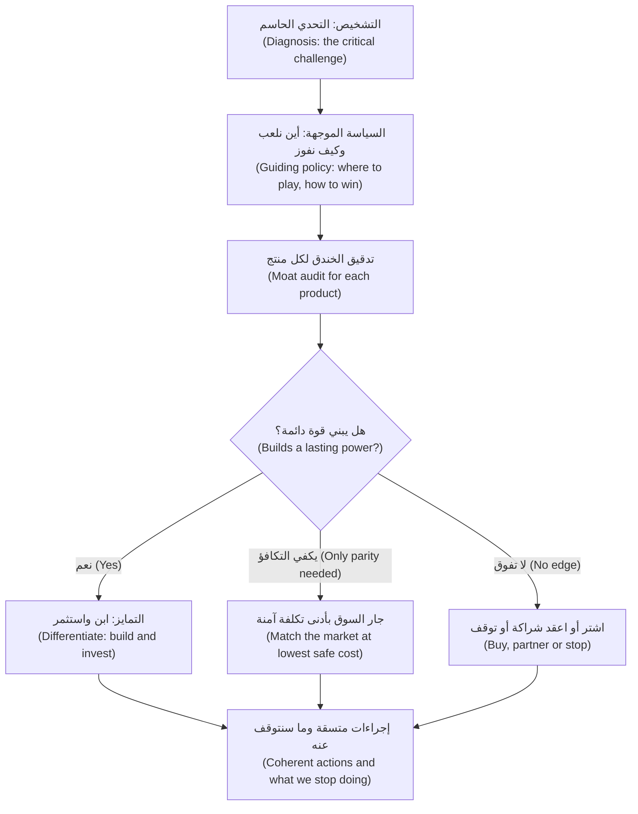
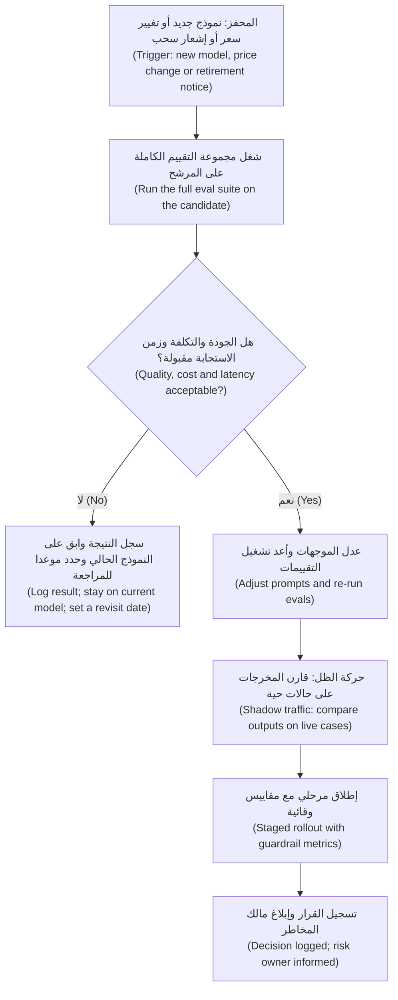
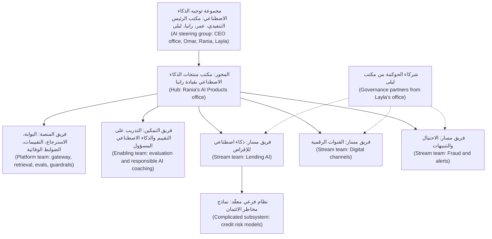
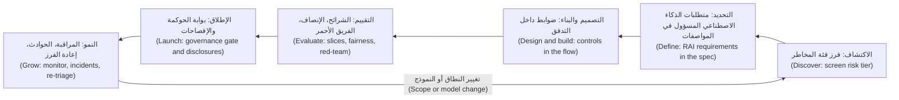

# الوحدة 9 — الاستراتيجية والقيادة

*علّمتك الوحدات السابقة كيف تدير منتج ذكاء اصطناعي واحدًا جيدًا. أما هذه الوحدة فتتناول إدارة محفظة والأشخاص الذين يقفون وراءها. على رانيا أن تعرض استراتيجية ذكاء اصطناعي (AI strategy) على مجلس إدارة (board) بنك نجم (Najm Bank)، وأن تُبقي خارطة الطريق (roadmap) مفيدة بينما تتغير النماذج (models) التي تقوم عليها كل بضعة أشهر، وأن تنظّم المصممين والمهندسين وعلماء البيانات وشركاء المخاطر بحيث يُسلّمون فعلًا، وأن تضمن أن يحمل كل منتج نصيبه من الذكاء الاصطناعي المسؤول (responsible AI) دون أن تتحول الحوكمة إلى جدار. ستتعلم كيف تجد المواضع التي يمنح فيها الذكاء الاصطناعي ميزة دائمة (lasting advantage) والمواضع التي يُبقيك فيها على مستوى السوق فقط، وكيف تخطّط بالرهانات لا بالوعود، وكيف تصمّم الفريق وصلاحيات اتخاذ القرار (decision rights)، وما الذي يملكه مدير المنتج (product manager) عندما يضع المنظّمون (regulators) والعملاء ومبادئ البنك نفسه حدودًا (set limits).*

> **المراحل (Stages):** Lead — اختيار المواضع التي يمنح فيها الذكاء الاصطناعي تفوقًا دائمًا (lasting edge)، وترتيب الرهانات (sequencing bets) بينما تتغير النماذج، وتنظيم الفريق، وتولّي نصيب المنتج من الذكاء الاصطناعي المسؤول.

---

# 9.1 — استراتيجية منتجات الذكاء الاصطناعي والقابلية للدفاع
*المستوى (Level): 🔴 متقدم (Advanced)* · *المتطلبات (Prerequisites): 2.2، 3.2، 8.2* · *المرحلة (Stage): Lead*

## ⚡ الدرس في دقيقة (In 60 seconds)
- الاستراتيجية (strategy) هي **تشخيص (diagnosis)** للوضع، و**سياسة موجِّهة (guiding policy)** للتعامل معه، ومجموعة من **الإجراءات المتّسقة (coherent actions)** (Richard Rumelt). قائمة حالات استخدام الذكاء الاصطناعي ليست استراتيجية، ولا عبارة «أن نصبح أولًا في الذكاء الاصطناعي (become AI-first)».
- الوصول إلى نموذج قادر (capable model) ليس ميزة (advantage)، لأن كل منافس يستطيع استئجار النموذج نفسه بشروط مشابهة. الميزة الدائمة تأتي مما يحيط بالنموذج: البيانات المملوكة (proprietary data) ووسوم النتائج (outcome labels)، ومكان داخل سير العمل، والتوزيع (distribution)، والثقة ورخصة العمل، وسرعة تعلّم المؤسسة.
- اختبر كل منتج بـ **تدقيق الخندق التنافسي (moat audit)**: أيّ مصدر قوة يبنيه (كتاب *7 Powers* لـ Hamilton Helmer قائمة تحقق (checklist) جيدة)، وما الذي يمنع منافسًا من نسخه خلال عام؟
- كثير من «خنادق البيانات (data moats)» أضعف مما تبدو. البيانات ميزة فقط عندما تكون مملوكة (proprietary)، ومرتبطة بالنتائج، ومتجددة باستمرار (keeps refreshing)، ويمكن استخدامها قانونيًا (used lawfully)، وتغذّي المنتج فعلًا.
- إشارة القرار (Decision cue): ابنِ واستثمر حيث يعزّز الذكاء الاصطناعي ميزة تملكها أصلًا؛ جارِ السوق بتكلفة منخفضة حيث تحتاج إلى التكافؤ فقط؛ واشترِ أو اعقد شراكة أو توقّف حيث لا تملك تفوقًا.
- أكبر فخ (Biggest trap): «الغلاف (wrapper)» الرقيق، أي منتج ميزته الحقيقية الوحيدة هي النموذج. قد يجعله إصدار النموذج التالي، أو المورّد نفسه، متقادمًا (obsolete).

## 🧭 لماذا يهم
يطلب الرئيس التنفيذي (CEO) من رانيا أن تعرض «استراتيجية نجم للذكاء الاصطناعي» على مجلس الإدارة خلال ستة أسابيع. يُعِدّ فيصل مسودة العرض في عطلة نهاية أسبوع: ثلاث وعشرون حالة استخدام (use cases)، وشريحة لشعارات المورّدين (vendor logos)، وهدف «الذكاء الاصطناعي في كل منتج بحلول 2027 (AI in every product by 2027)»، وطلب ميزانية (budget request). تطرح رانيا ثلاثة أسئلة. ما المشكلة التي يعاني منها البنك ويحلّها الذكاء الاصطناعي أفضل من أي بديل؟ أيّ من هذه سيبقى ميزة لو اشترى كل بنك في الدوحة ودبي النموذج نفسه في الفصل القادم (next quarter)؟ وما الذي سنتوقف عن فعله لنموّل ذلك؟

لا يحمل العرض إجابات لأنه قائمة أمنيات (wish list). يحتاج مجلس الإدارة إلى خيارات (choices) يستطيع أن يحاسب الإدارة عليها: أين سينافس نجم بالذكاء الاصطناعي، وأين سيكتفي بمجاراة السوق، وأين لن يدخل اللعبة.

تُظهر الحالات العامة (public cases) لماذا تهم الخيارات أكثر من الحماس. استثمرت IBM بكثافة في Watson Health وباعت وحداتها في 2022؛ فالعروض التوضيحية المبهرة (impressive demonstrations) لم تتحول إلى منتجات تناسب سير العمل السريري (clinical workflow). ووضعت Zillow خوارزمية تسعير (pricing algorithm) في قلب نشاط لشراء المنازل (home-buying business)، ثم أنهت Zillow Offers في 2021 مع شطب مبالغ كبيرة (large write-downs)، بعد أن أخطأت الخوارزمية في تسعير المنازل (mispriced homes). في الحالتين كانت التقنية حقيقية. أما الاستراتيجية فأساءت تقدير مصدر القيمة وحجم التعرّض للمخاطر الذي يتحمله النشاط.

## 📐 كيف يعمل

### 🟢 الأساسيات

**نواة الاستراتيجية (The strategy kernel).** في كتاب *Good Strategy / Bad Strategy* (2011)، يصف Richard Rumelt جوهر أي استراتيجية بثلاثة أجزاء:

1. **التشخيص (Diagnosis):** سمِّ التحدي الحاسم (critical challenge). بالنسبة إلى نجم: «تكلفة الخدمة (cost to serve) لدينا مرتفعة جدًا بحيث لا نستطيع الإقراض بربحية (lend profitably) للشركات الصغيرة والمتوسطة (SMEs) دون نحو 500,000 ريال قطري (QAR 500,000)، والمُقرضون الأصليون في الذكاء الاصطناعي (AI-native lenders) بدأوا يكتتبون (underwrite) للشركات الصغيرة من بيانات الفواتير (invoice data) في دقائق.»
2. **السياسة الموجِّهة (Guiding policy):** النهج الذي يُدخل خيارات ويُخرج أخرى. «استخدم نتائج الائتمان الخاصة بنا وعلاقاتنا (relationships) لجعل الإقراض صغير القيمة (small-ticket lending) سريعًا وآمنًا؛ ولا تحاول التفوق على شركات التقنية في بناء النماذج.»
3. **الإجراءات المتّسقة (Coherent actions):** خطوات يعزّز بعضها بعضًا. «أطلق التمويل الفوري للشركات الصغيرة (SME Instant Finance) للفواتير الصغيرة؛ وامنح مديري العلاقات (relationship managers) مساعد مذكرات الائتمان (Credit Memo Copilot) للقروض الأكبر؛ وابنِ منصة تقييم وبيانات مشتركة واحدة للاثنين.»

من علامات **الاستراتيجية السيئة (bad strategy)** عند Rumelt: الحشو (fluff)، والخلط بين الأهداف والاستراتيجية («أن نكون أكثر البنوك تمكينًا بالذكاء الاصطناعي في الخليج» هدف)، والعجز عن مواجهة المشكلة الحقيقية، والقوائم الطويلة من الغايات التي ليست خيارات. وعرض فيصل يُظهر العلامات الأربع كلها.

**أين تلعب وكيف تفوز (Where to play and how to win).** في كتاب *Playing to Win* (2013)، يصوغ A. G. Lafley وRoger Martin الاستراتيجية على أنها خمسة خيارات مترابطة: طموح الفوز (winning aspiration)، و**أين تلعب (where to play)**، و**كيف تفوز (how to win)**، والقدرات التي تحتاجها، وأنظمة الإدارة التي تدعمها (management systems). بالنسبة إلى قائد منتجات الذكاء الاصطناعي، يؤدي الخياران الأوسطان معظم العمل: أيّ العملاء والرحلات والقرارات؛ ولماذا قد يختار أحد هذا المنتج بدلًا من البديل، بما في ذلك عدم فعل شيء (doing nothing).

**من أين تأتي ميزة الذكاء الاصطناعي (Where AI advantage comes from).** تخيّل منتج الذكاء الاصطناعي (AI product) طبقاتٍ (layers). الجميع يستطيع استئجار الطبقة السفلى، أي النموذج؛ أما الطبقات فوقها فأصعب نسخًا.

| الطبقة (Layer) | ما هي | هل يستطيع منافس نسخها خلال عام؟ ⁦⁩ |
|---|---|---|
| النموذج الأساسي (Foundation model) | النموذج اللغوي الكبير (LLM) أو خوارزمية تعلّم الآلة (ML algorithm) | نعم: يستأجرون النموذج نفسه |
| الموجّهات والاسترجاع والتنسيق | كيف يُوجَّه النموذج ويُسنَد إلى مصادر (5.3) | في الغالب، بمجرد أن يروا المنتج |
| البيانات المملوكة | بيانات تملكها أنت وحدك، مثل نتائج السداد (repayment outcomes) | ببطء، إن كانت فريدة وقابلة للاستخدام حقًا |
| حلقة التغذية الراجعة (Feedback loop) | نتائج من الاستخدام الفعلي تعود إلى المنتج (3.2) | ببطء؛ فهي تحتاج إلى مستخدمين أولًا |
| الموقع في سير العمل (Workflow position) | التكاملات والقوالب والسجل حيث يجري العمل | ببطء؛ فللتحويل تكلفة |
| التوزيع | العملاء والقنوات التي تصل إليها أصلًا | ببطء شديد (very slowly) |
| الثقة والرخصة | العلامة التجارية، والإذن التنظيمي (regulatory permission)، وسجل من الدقة | ببطء شديد، لكنها تضيع في يوم واحد |
| سرعة التعلّم (Learning speed) | التقييمات (evals)، وتحليل الأخطاء (error analysis)، ووتيرة الإصدارات (release cadence) | ببطء؛ فهي تعيش في طريقة عمل الفريق |

**الغلاف (wrapper)** منتج تقع قيمته بالكامل تقريبًا في الطبقتين السفليين: واجهة (interface) على نموذج يملكه غيرك مع موجّه ذكي (clever prompt). كثيرًا ما يكون الغلاف السريع (quick wrapper) هو الخطوة الأولى الصحيحة، لكنه بلا دفاع عندما يضيف المورّد (vendor) الميزة نفسها، أو يجعل نموذج أفضل الموجّه غير ضروري، أو يعيد منافس بناءه في شهر.

### 🟡 التعمق أكثر (Going deeper)

**القوى السبع تدقيقًا للخندق (The 7 Powers as a moat audit).** يعرّف كتاب Hamilton Helmer *7 Powers* (2016) «القوة (power)» بأنها ظروف تتيح لنشاط تجاري تحقيق عوائد أفضل من منافسيه بمرور الزمن. تحتاج كل قوة إلى **منفعة (benefit)** (تكلفة أقل أو سعر أعلى) و**حاجز (barrier)** (شيء يمنع المنافسين من تبديد المنفعة بالمنافسة). معظم ادعاءات الذكاء الاصطناعي (AI claims) تسمّي منفعة وتنسى الحاجز.

| القوة | المنفعة والحاجز بكلمات بسيطة | مثال من نجم وحكم صريح |
|---|---|---|
| **اقتصاديات الحجم (Scale economies)** | تنخفض تكلفة الوحدة (unit cost) مع الحجم؛ والمنافسون أصغر من أن يجاروها | منصة ذكاء اصطناعي مشتركة موزّعة على خمسة منتجات تخفض التكلفة لكل منتج؛ لكن أمام مزوّدي الحوسبة الضخمة (hyperscalers) لا يملك نجم ميزة حجم |
| **اقتصاديات الشبكة (Network economies)** | كل مستخدم يجعل المنتج أكثر قيمة للمستخدمين الآخرين | نادرة في ذكاء البنوك الاصطناعي. كن متشككًا حين يدّعيها عرض تقديمي |
| **التموضع المضاد (Counter-positioning)** | وافد جديد (newcomer) يتبنى نموذج عمل لا يستطيع اللاعبون القائمون (incumbents) نسخه دون الإضرار بنشاطهم الحالي | هذه تعمل *ضد (against)* نجم: مُقرض للشركات الصغيرة أصيل في الذكاء الاصطناعي بلا تكاليف فروع. والتمويل الفوري للشركات الصغيرة ردّ دفاعي جزئيًا |
| **تكاليف التحويل (Switching costs)** | يكلّف الرحيل العميلَ وقتًا أو بيانات أو مخاطر | مساعد مذكرات الائتمان، بمجرد أن يحتفظ بالقوالب والمذكرات السابقة وعادات مديري العلاقات، يصبح استبداله مكلفًا |
| **العلامة التجارية (Branding)** | يدفع العملاء أكثر أو يثقون أكثر بسبب السمعة (reputation) | سمعة الإجابات الدقيقة والحذرة بطيئة البناء؛ وتُظهر قضية Air Canada (2024) كيف تتحول إجابة سيئة واحدة سريعًا إلى مشكلة قانونية (legal problem) |
| **المورد المحتكَر (Cornered resource)** | وصول تفضيلي إلى شيء قيّم | بيانات أداء الائتمان والمعاملات الخاصة بنجم، حيث يملك الأساس القانوني لاستخدامها (3.3) |
| **قوة العمليات (Process power)** | إجراءات تنظيمية روتينية (organisational routines) تحسّن التكلفة أو الجودة ويستغرق نسخها سنوات | روتين منضبط للتقييم والتغذية الراجعة: المجموعات المرجعية (golden sets)، وتحليل الأخطاء الأسبوعي، والإصدارات السريعة الآمنة (الوحدة 6 (Module 6)) |

**احذر خنادق البيانات (Be careful with data moats).** في مقال بعنوان "The Empty Promise of Data Moats" (2019)، جادل Martin Casado وPeter Lauten من Andreessen Horowitz بأن مزايا البيانات (data advantages) كثيرًا ما تكون أضعف مما يُدّعى: فقيمة البيانات الإضافية (extra data) تميل إلى الاستقرار عند حد (level off)، والحالات المفيدة الجديدة يصبح العثور عليها أكثر تكلفة، وتأثيرات شبكة البيانات الحقيقية غير شائعة. تعامل مع ذلك تحذيرًا يستحق الاختبار، لا قانونًا. اطرح خمسة أسئلة على أي ادعاء بشأن البيانات (data claim):

1. **مملوكة؟ ⁦(Proprietary?)⁩** هل يستطيع منافس شراء بيانات مكافئة أو جمعها؟
2. **موسومة بالنتائج؟ ⁦(Outcome-labelled?)⁩** هل تسجّل ما حدث (سُدّد القرض (loan repaid)، تأكّد الاحتيال (fraud confirmed)، اعتُمدت المذكرة دون تعديلات)؟
3. **متجددة؟ ⁦(Refreshing?)⁩** هل تستمر البيانات الجديدة في الوصول من الاستخدام؟
4. **قابلة للاستخدام؟ ⁦(Usable?)⁩** هل تسمح الموافقة (consent) وقانون حماية البيانات (data protection law) بهذا الاستخدام (3.3)؟
5. **مستخدَمة؟ ⁦(Used?)⁩** هل توجد حلقة حقيقية (real loop) تحوّل البيانات إلى منتج أفضل (3.2)؟

**ارسم سلسلة القيمة (Map the value chain).** تضع **خرائط Wardley (Wardley maps)** التي وضعها Simon Wardley كل مكوّن من مكونات الخدمة بحسب مدى ظهوره للمستخدم ومدى تطوره، من *النشأة (genesis)* مرورًا بـ *البناء المخصص (custom-built)* و*المنتج (product)* وصولًا إلى *السلعة (commodity)*. انتقلت النماذج اللغوية العامة الغرض بسرعة نحو طرف السلعة (commodity end). والقاعدة المستخلصة: استهلك السلع (consume commodities)، وأنفق وقت الهندسة النادر على المكونات التي ما زالت مخصصة (still custom) وقريبة من حاجة المستخدم. بالنسبة إلى نجم، يعني ذلك استئجار النماذج (renting models) والاستثمار في استرجاع خاص بالائتمان (credit-specific retrieval)، ومجموعات تقييم مبنية من حالاته الخاصة، والتكامل مع نظام إنشاء القروض (loan origination system).

### 🔴 نظرة الخبير (Expert view)

**اسأل عمّا سيصبح مجانيًا بعد ثمانية عشر شهرًا (Ask what will be free in eighteen months).** تتسع قدرات النماذج باستمرار، ويواصل مورّدو المنصات (platform vendors) إضافة الذكاء الاصطناعي إلى منتجات تدفع ثمنها أصلًا. الميزة التي تميّزك اليوم (differentiates today) قد تصبح مدمجة في النموذج أو في حزمة المكتب (office suite) العام القادم. مساعد الموظفين التوليدي (Staff GenAI) هو المثال الواضح: اشترِ تلك الطبقة وضع جهد نجم في الوصلات الخاصة بالبنك (bank-specific connections) (السياسات، وأدلة المنتجات، ومصادر البيانات المعتمدة). والخطأ المعاكس (reverse error) هو الانتظار إلى الأبد لـ «النموذج التالي» وعدم بناء الطبقات المملوكة (proprietary layers) التي لا يستطيع بناءها أحد غيرك.

**مُستدامة أم مُزعزِعة؟ ⁦(Sustaining or disruptive?)⁩** في كتاب *The Innovator's Dilemma* (1997)، يفصل Clayton Christensen بين الابتكارات المُستدامة (sustaining innovations)، التي تحسّن منتجات قائمة لعملاء قائمين ويفوز بها عادةً اللاعبون القائمون، والابتكارات المُزعزِعة (disruptive ones)، التي تبدأ بعرض أرخص وأبسط لعملاء لا يخدمهم اللاعب القائم بما يكفي (under-serves). معظم الذكاء الاصطناعي التوليدي (GenAI) داخل البنك مُستدام: مذكرات أسرع (faster memos)، وإجابات أفضل في التطبيق. أما التهديد المُزعزِع (disruptive threat) ففي الطرف الأدنى من إقراض الشركات الصغيرة، حيث يخدم المُقرضون الأصليون في الذكاء الاصطناعي شركات صغيرة يراها نجم غير مربحة (unprofitable). هذا التشخيص، لا الحماس، هو سبب انتماء التمويل الفوري للشركات الصغيرة إلى الاستراتيجية.

**امنح كل منتج دورًا استراتيجيًا (Give every product a strategic role)**، مع استثمار مطابق (matching investment):

- **التمايز (Differentiate):** يبني قوة حقيقية (real power) أو يستخدمها. استثمر في الطبقات المملوكة وسرعة التعلّم. *مساعد مذكرات الائتمان، التمويل الفوري للشركات الصغيرة.*
- **التكافؤ (Parity):** تخسر إن كان غائبًا أو سيئًا، لكن الإفراط في التحسين (gold-plating) لا يجلب الفوز. جارِ السوق بأدنى تكلفة آمنة. *نجم أسيست (Najm Assist) في صيغته للإجابة عن الأسئلة (question-answering form)؛ التنبيهات الذكية (Smart Alerts).*
- **السلعة (Commodity):** هناك من يبيعه جيدًا أصلًا. اشترِه وادمجه. *مساعد الموظفين التوليدي.*

الأدوار تتغير (roles change): فحين يصبح نجم أسيست وكيلًا (agent) يتصرف داخل أنظمة البنك، قد يصبح عنصر تمايز (differentiator)، لأن الأفعال أصعب نسخًا من الإجابات.

**تعلّم من الأمثلة العامة، بحذر (Learn from public examples, carefully).** عمل مساعد Morgan Stanley للمستشارين الماليين (financial advisers) (2023) على نموذج مورّد (vendor's model) (GPT-4)؛ وجاءت قيمته من المحتوى البحثي الخاص بالشركة ومن ملاءمته لعمل المستشارين. وأعلنت Klarna في فبراير 2024 أن مساعدها بالذكاء الاصطناعي (AI assistant) يتولى حصة كبيرة من محادثات العملاء (customer chats)، ثم قالت في 2025 إنها ستعيد مزيدًا من الخدمة البشرية (human service). قِس الجودة ونتائج العملاء، لا التكلفة وحدها: فالاستراتيجية التي تقودها التكلفة (cost-led strategy) وتُضعف الثقة (erodes trust) لا تدوم.

## 🧰 الأدوات
| الأداة أو الإطار (Tool or framework) | ما هو وماذا يفعل | متى تلجأ إليه |
|---|---|---|
| **Strategy kernel** — نواة الاستراتيجية | التشخيص، والسياسة الموجِّهة، والإجراءات المتّسقة؛ إضافة إلى علامات التحذير من الاستراتيجية السيئة | كتابة أي وثيقة استراتيجية (strategy document) أو مراجعتها، خصوصًا تلك التي تُقرأ كقائمة أمنيات |
| **Playing to Win cascade** — سلسلة خيارات Playing to Win | خمسة خيارات مترابطة من الطموح إلى أنظمة الإدارة، محورها أين تلعب وكيف تفوز | تحويل الاستراتيجية إلى خيارات بشأن العملاء والرحلات والقدرات |
| **7 Powers** (Hamilton Helmer) — القوى السبع | سبعة مصادر للميزة الدائمة (durable advantage)، يحتاج كل منها إلى منفعة وحاجز | اختبار قدرة منتج ذكاء اصطناعي على الاحتفاظ بميزته بعد أن يستأجر المنافسون النموذج نفسه |
| **Moat audit** — تدقيق الخندق التنافسي | جدول لكل منتج (per-product table): أيّ طبقة تحمل القيمة، وأيّ قوة يبنيها، وما الذي يمنع النسخ | مراجعات المحفظة (portfolio reviews) ودراسات الاستثمار (investment cases)؛ قبل الموافقة على بناء جديد (new build) |
| **Wardley map** (Simon Wardley) — خريطة Wardley | مكونات مرسومة بحسب ظهورها للمستخدم وتطورها من النشأة إلى السلعة | تقرير ما تبنيه مقابل ما تستهلكه، ورصد المكونات التي تتحول إلى سلع (commoditising) |
| **Data advantage test** — اختبار ميزة البيانات | خمسة فحوص: مملوكة، موسومة بالنتائج، متجددة، قابلة للاستخدام، مستخدَمة | أي ادعاء بأن «بياناتنا هي خندقنا» |
| **Portfolio role** — دور المحفظة | التمايز أو التكافؤ أو السلعة، مع موقف استثماري مطابق | تحديد الميزانيات وطموحات الجودة عبر عدة منتجات ذكاء اصطناعي |

## 🏛️ عمليًا في بنك نجم
تستبدل رانيا العرض التقديمي (deck) بصفحة واحدة بعنوان **استراتيجية منتجات الذكاء الاصطناعي (AI Product Strategy)** يستطيع مجلس الإدارة أن يحاسبها عليها.

**التشخيص (Diagnosis).** إقراض الشركات الصغيرة غير مربح عند تكلفة الخدمة الحالية، والمُقرضون الأصليون في الذكاء الاصطناعي يستهدفونه. يقضي مديرو العلاقات (RMs) معظم أسبوعهم في كتابة المذكرات (writing memos) لا في لقاء العملاء (meeting clients). وثقة العملاء (customer trust) هي أثمن أصول البنك وأكثرها هشاشة.

**السياسة الموجِّهة (Guiding policy).** فُز حيث تمنح بيانات النتائج الخاصة بنجم وعلاقاته ورخصته (licence) تفوقًا (edge). استأجر النماذج (rent models) ولا تدرّب أبدًا نماذج أساسية. أبقِ صانع قرار بشريًا (human decision-maker) في كل قرار ائتماني فردي خلال 2026 و2027.

**المحفظة (Portfolio).**

| المنتج | الدور (Role) | القوة التي يبنيها | الأدلة التي تُتتبَّع | الموقف (Posture) |
|---|---|---|---|---|
| التمويل الفوري للشركات الصغيرة | التمايز | المورد المحتكَر: نتائج السداد | القرارات الموسومة شهريًا؛ معدل الخسارة مقارنة بالعمل اليدوي | ابنِ؛ امتلك النموذج والبيانات |
| مساعد مذكرات الائتمان | التمايز | تكاليف التحويل، قوة العمليات | نسبة المذكرات المصاغة في الأداة؛ ساعات مديري العلاقات الموفَّرة | استأجر النموذج؛ امتلك الاسترجاع والقوالب والتقييمات |
| نجم أسيست | التكافؤ، ثم التمايز لاحقًا | العلامة التجارية، التوزيع (branding, distribution) | معدلات الحل والشكاوى | ابنِ بأقل موارد (build lean)؛ استثمر في الإسناد إلى المصادر (grounding) |
| التنبيهات الذكية | التكافؤ | لا شيء (None) | الدقة (precision)؛ إلغاء الاشتراك في التنبيهات (alert opt-outs) | حسّن باطّراد (improve steadily) |
| مساعد الموظفين التوليدي | السلعة | لا شيء | الموظفون النشطون أسبوعيًا؛ تغطية المصادر المعتمدة (approved-source coverage) | اشترِ؛ ادمج مصادر معرفة البنك |

**الإجراءات المتّسقة (Coherent actions).** منصة ذكاء اصطناعي مشتركة واحدة يملكها طارق؛ ووسوم نتائج تُلتقط بالتصميم في كل سير عمل إقراض (lending workflow)؛ ومراجعة ربع سنوية للنماذج.

**ما سنتوقف عنه (What we stop).** أحد عشر مشروعًا تجريبيًا (eleven pilots) بلا مالك ولا طريق إلى قوة، منها روبوت محادثة مخصص (bespoke chatbot) يكرّر مساعد الموظفين التوليدي.

**مؤشرات مجلس الإدارة (Board indicators).** طلبات الشركات الصغيرة التي يُبتّ فيها خلال أقل من عشر دقائق؛ ساعات مديري العلاقات المُعادة إلى العملاء؛ الأمثلة الموسومة بالنتائج في كل فصل؛ الشكاوى المرتبطة بإجابات الذكاء الاصطناعي.

## 🛠️ التمارين (Exercises)
- 🟢 خذ هدف فيصل «أن نكون أكثر البنوك تمكينًا بالذكاء الاصطناعي في الخليج» وأعد كتابته نواةَ استراتيجية (strategy kernel) لمنتج واحد من منتجات نجم. *يكتمل عندما (Done when):* يكون لديك تشخيص من جملة واحدة (one-sentence diagnosis) يسمّي تحديًا محددًا، وسياسة موجِّهة تستبعد خيارًا واحدًا على الأقل، وثلاثة إجراءات يعزّز بعضها بعضًا.
- 🟡 أجرِ تدقيق خندق على نجم أسيست في صيغته الحالية للإجابة عن الأسئلة. استخدم جدول الطبقات (layer table) والقوى السبع (7 Powers). *يكتمل عندما:* تكون قد سمّيت الطبقة التي تحمل معظم قيمته، والقوة (إن وُجدت) التي يبنيها بمنفعتها وحاجزها، وشيئًا واحدًا لا يستطيع منافس نسخه خلال عام.
- 🔴 يقترح خالد أن يدرّب نجم نموذجًا أساسيًا عربيًا خاصًا به «حتى لا نكون معتمدين على المورّدين». اكتب ردًا في نصف صفحة لمجلس الإدارة مستخدمًا فكرة خريطة Wardley (Wardley map)، واختبار ميزة البيانات، وأدوار المحفظة (portfolio roles). *يكتمل عندما:* يقدّم توصية واضحة (clear recommendation)، ويسمّي ما ينبغي أن يبنيه نجم بدلًا من ذلك، ويعرض إجراءً ملموسًا واحدًا على الأقل للتخفيف من الاعتماد على المورّدين.

## ⚠️ أخطاء وفخاخ (Mistakes and traps)
- **تقديم قائمة حالات استخدام على أنها استراتيجية (Presenting a use-case list as a strategy).** ثلاث وعشرون فكرة بلا تشخيص هي قائمة أعمال متراكمة (backlog). ابدأ بالتحدي الحاسم واتخذ خيارات، بما فيها ما لن تفعله.
- **ادعاء خندق ليس سوى منفعة (Claiming a moat that is only a benefit).** «نموذجنا أدق» منفعة. اسأل: أيّ حاجز يمنع منافسًا من مجاراتها في الفصل القادم؟
- **افتراض أن البيانات تساوي ميزة (Assuming data equals advantage).** طبّق اختبار الأسئلة الخمسة (five-question test). البيانات الخام (raw) أو غير الموسومة (unlabelled) أو غير القابلة للاستخدام قانونيًا (legally unusable) تكلفة (cost)، لا خندق (moat).
- **بناء ما سيُدمج قريبًا في الحزم (Building what will soon be bundled).** لا تنافس ما سيمنحك إياه المورّدون (vendors) خلال ثمانية عشر شهرًا.
- **خفض التكلفة على حساب الثقة (Cutting cost at the expense of trust).** قِس الجودة والنتائج إلى جانب التكلفة.

## 🧾 الخلاصة (Recap)
- للاستراتيجية تشخيص وسياسة موجِّهة وإجراءات متّسقة؛ والأهداف وقوائم حالات الاستخدام ليست استراتيجيات.
- الجميع يستطيع استئجار النموذج. الميزة تعيش في الطبقات فوقه: بيانات النتائج المملوكة، وحلقات التغذية الراجعة (feedback loops)، والموقع في سير العمل، والتوزيع، والثقة (trust)، وسرعة التعلّم.
- اختبر القابلية للدفاع (defensibility) لكل منتج بالقوى السبع (7 Powers)، واطلب حاجزًا إلى جانب المنفعة.
- البيانات ميزة فقط إن كانت مملوكة، وموسومة بالنتائج، ومتجددة، وقابلة للاستخدام، ومستخدَمة.
- امنح كل منتج دورًا (التمايز، التكافؤ، السلعة) واستثمر بما يطابقه.

## ✍️ اختبر نفسك (Check yourself)

**1. تقول مسودة فيصل: «استراتيجيتنا للذكاء الاصطناعي أن نصبح أكثر البنوك تمكينًا بالذكاء الاصطناعي في الخليج بحلول 2027 (Our AI strategy is to become the most AI-enabled bank in the Gulf by 2027).» باستخدام إطار Rumelt (Rumelt's framework)، ما المشكلة الرئيسية فيها؟**

- A. لا تسمّي مورّدًا محددًا (specific vendor)
- B. ينبغي أن تقول «الذكاء الاصطناعي التوليدي (GenAI)» بدلًا من «الذكاء الاصطناعي (AI)»، لأن المصطلح الأدق يجعل الاستراتيجية أوضح أمام مجلس الإدارة (board) وأكثر قبولًا لدى الجهات التنظيمية (regulators)، وهو ما يمنحها ثقلًا أكبر عند العرض
- C. الأفق الزمني (time horizon) قصير جدًا
- D. إنها هدف لا استراتيجية: ليس فيها تشخيص للتحدي ولا سياسة موجِّهة (guiding policy) تستبعد خيارات

الإجابة

**D.** يعدّ Rumelt الخلط بين الأهداف والاستراتيجية علامة على الاستراتيجية السيئة (bad strategy). الاستراتيجية الجيدة تبدأ بتشخيص (diagnosis) وتضع سياسة موجِّهة (guiding policy) تتخذ خيارات. قد يكون الأفق الزمني (time horizon) (C) قابلًا للنقاش، لكنه ليس العيب الجوهري (core flaw). (🟢 الأساسيات.)

**2. يطلق بنك منافس (competitor bank) مساعدًا للعملاء (customer assistant) مبنيًا على النموذج التجاري نفسه (same commercial model) الذي يستخدمه نجم، بموجّهات مشابهة (similar prompts). أيّ أصول نجم هو الأقل احتمالًا (LEAST likely) لأن يبقى ميزة؟**

- A. علاقاته مع العملاء (customer relationships) والتوزيع عبر تطبيق الهاتف (mobile-app distribution)
- B. بيانات السداد الموسومة بالنتائج على مدى عشرين عامًا
- C. النموذج الأساسي وتصميم الموجّهات
- D. سجله من الإجابات الدقيقة والحذرة ورخصته التنظيمية (regulatory licence)

الإجابة

**C.** يستطيع أي أحد استئجار النموذج، والموجّهات (prompts) سهلة النسخ. أما A وB وD فأبطأ نسخًا بكثير. (🟢 الأساسيات، جدول الطبقات (layer table).)

**3. يعرض مورّد (vendor) منتجه قائلًا: «لمنتجنا خندق بيانات (data moat): جمعنا عشرة ملايين نص محادثة غير موسوم (unlabelled customer chat transcripts) مع العملاء.» أيّ سؤال من اختبار ميزة البيانات (data advantage test) يكشف أكبر نقطة ضعف؟**

- A. هل البيانات موسومة بالنتائج (outcome-labelled)، بحيث تُظهر ما حدث فعلًا؟
- B. هل البيانات مخزّنة في السحابة؟
- C. هل جُمعت البيانات خلال العام الأخير؟
- D. هل البيانات بأكثر من لغة في الحقل النصي لكل سجل؟

الإجابة

**A.** نصوص المحادثات الخام بلا نتائج (حُلّت أم لا، صحيحة أم لا) قيمتها أقل بكثير من النتائج الموسومة (labelled outcomes)، وكثيرًا ما تستقر قيمتها عند حد (levels off). الحداثة (recency) (C) تهم في فحص «المتجددة (refreshing)» لكنها مسألة أصغر هنا. أما مكان التخزين (storage location) (B) فلا علاقة له بالميزة. (🟡 التعمق أكثر (Going deeper).)

**4. في القوى السبع (7 Powers) عند Helmer، لماذا لا تكفي عبارة «نموذجنا الائتماني أدق من نماذج المنافسين (our credit model is more accurate than competitors')» لادعاء القوة (claim power)؟**

- A. تحتاج القوة إلى منفعة وحاجز معًا، والدقة وحدها لا تمنع المنافسين من مجاراتها (matching it)
- B. الدقة (accuracy) ليست منفعة (benefit)، لأن العملاء لا يرون الفرق بين نموذجَي ائتمان ولا يقدّرونه، ولا ينتبهون إليه عند اختيار البنك
- C. اقتصاديات الشبكة (network economies) وحدها تُعدّ قوة في الذكاء الاصطناعي، لأن القوى الست الأخرى تحتاج إلى أصول مادية ومصانع، ولا مكان لها هنا
- D. لا يمكن للبنوك أن تملك قوة لأنها خاضعة للتنظيم (regulated)، ولأن كل منافس يجب أن يلتزم بالقواعد نفسها (same rules)، فلا يبقى أي حاجز يحمي أحدها

الإجابة

**A.** الدقة الأعلى (higher accuracy) منفعة؛ ومن دون حاجز (barrier) مثل المورد المحتكَر (cornered resource) أو قوة العمليات (process power)، يستطيع المنافسون سدّ الفجوة. وC خاطئ: اقتصاديات الشبكة (network economies) نادرة في ذكاء البنوك الاصطناعي (bank AI). (🟡 التعمق أكثر (Going deeper).)

**5. يقرّر نجم مقدار الاستثمار في مساعد الموظفين التوليدي (Staff GenAI)، وهو مساعد داخلي عام (general internal assistant). ومورّدو حزم الإنتاجية (productivity-suite vendors) يدمجون أصلًا مساعدات قادرة في منتجاتهم. أيّ دور محفظة وموقف (portfolio role and posture) هما الأنسب؟**

- A. التمايز (Differentiate): ابنِ مساعدًا مخصصًا ونموذجًا مملوكًا، حتى يملك بنك نجم كل طبقة من طبقات المنظومة ويتحكم في تكلفتها وتطورها
- B. التوقف (Stop): المساعدات الداخلية (internal assistants) بلا قيمة
- C. التكافؤ (Parity): ابنِ من الصفر لمجاراة ميزات المورّدين
- D. السلعة (Commodity): اشترِ القدرة المدمجة (bundled capability) واستثمر فقط في ربط مصادر المعرفة الخاصة بالبنك

الإجابة

**D.** المكوّن الذي يبيعه آخرون جيدًا سلعة (commodity): اشترِه وأضف ما لا يستطيعه إلا نجم. A ينافس منتجات مدمجة (bundled products)؛ وB يتجاهل قيمة إنتاجية حقيقية. (🔴 نظرة الخبير (Expert view).)

## 📚 المراجع (References)
- Richard Rumelt, *Good Strategy / Bad Strategy: The Difference and Why It Matters* (Crown Business, 2011)
- A. G. Lafley and Roger L. Martin, *Playing to Win: How Strategy Really Works* (Harvard Business Review Press, 2013)
- Hamilton Helmer, *7 Powers: The Foundations of Business Strategy* (Deep Strategy, 2016)
- Clayton M. Christensen, *The Innovator's Dilemma* (Harvard Business School Press, 1997)
- Simon Wardley, *Wardley Maps*
- Martin Casado and Peter Lauten, "The Empty Promise of Data Moats", Andreessen Horowitz (2019) — https://a16z.com
- Marty Cagan, *Inspired* (2nd ed., Wiley, 2017) and Silicon Valley Product Group articles — https://www.svpg.com
- Morgan Stanley, announcements on its AI assistant for financial advisers (2023) — https://www.morganstanley.com

---

# 9.2 — خرائط الطريق في ظل عدم اليقين: الرهانات والمنصات وتغيّر النماذج
*المستوى: 🔴 متقدم* · *المتطلبات: 1.3، 6.3، 9.1* · *المرحلة: Lead, Define*

## ⚡ الدرس في دقيقة (In 60 seconds)
- تحمل خارطة طريق الذكاء الاصطناعي (AI roadmap) ثلاثة أنواع من عدم اليقين (three uncertainties) في آنٍ واحد: **القيمة (value)** (هل تستحق المشكلة الحل؟ ⁦⁩)، و**الجدوى التقنية (feasibility)** (هل يستطيع المنتج بلوغ معيار الجودة؟ ⁦⁩) و**الانجراف التقني (technology drift)** (ماذا ستفعل النماذج، وكم ستكلّف، في الفصل القادم؟ ⁦⁩).
- استبدل قوائم الميزات المؤرَّخة بـ **خارطة طريق قائمة على النتائج (outcome-based roadmap)** (الآن، التالي، لاحقًا) يكون فيها كل بند **رهانًا (bet)**: النتيجة المنشودة (outcome sought)، والفرضية (hypothesis)، والأدلة حتى الآن (evidence so far)، وحجم الرهان، و**معيار إيقاف (kill criterion)** متفق عليه مسبقًا (agreed in advance).
- وزّع الإنفاق على مراحل: أنفق قليلًا لتتعلم هل الجودة قابلة للبلوغ (اختبار جدوى سريع (feasibility spike) على مجموعة مرجعية) قبل أن تنفق كثيرًا.
- ابنِ قدرة **منصة (platform)** مشتركة بمجرد أن تحتاج عدة منتجات إلى الشيء نفسه. وقبل ذلك، ابنِها داخل منتج واحد واستخرجها لاحقًا.
- تعامل مع **تغيّر النموذج بوصفه أمرًا روتينيًا (model change as routine)**: احتفظ بمجموعة تقييم (evaluation suite) تعمل اختبارَ انحدار (regression test)، ومرّر الاستدعاءات عبر بوابة، ونفّذ **دليل تغيير النموذج (model-change playbook)** مكتوبًا عندما يُصدَر نموذج أو يُعاد تسعيره أو يُسحب.
- أكبر فخ: أن تعِد التنفيذيين (executives) بموعد لمستوى جودة لم يقِسه أحد بعد. التزم بمواعيد *للتعلّم (learning)*، وبنطاقات للجودة (ranges for quality).

## 🧭 لماذا يهم
في يناير يعطي فيصل خالدًا شريحة خارطة طريق (roadmap slide) تقول: «الفصل الثاني: مساعد مذكرات الائتمان مُفعَّل لجميع قروض الشركات، بدقة 95% (Q2: Credit Memo Copilot live for all corporate loans, 95% accurate).» يضعها خالد في خطته السنوية (annual plan). لم يعرّف أحد ما تعنيه «دقة 95% (95% accurate)» لمذكرة ائتمان (credit memo)، ولم تُجرِ دانة بعدُ تقييمًا واحدًا (single evaluation) على ملفات قروض الشركات، وهي أطول وأكثر فوضى من ملفات الشركات الصغيرة (SME files) التي استخدمها المشروع التجريبي (pilot).

في مارس يحدث أمران. يُظهر أول تحليل أخطاء أجرته دانة أن المساعد (copilot) يتعامل جيدًا مع الأقسام السردية (narrative sections) لكنه يخطئ في ملخصات النسب المالية بما يكفي لأن يضطر مديرو العلاقات إلى التحقق من كل رقم. وبشكل منفصل، يعلن مورّد النموذج (model vendor) أن إصدار النموذج (model version) الذي يستخدمه نجم سيُسحب (retired) في وقت لاحق من العام، ويُعرض نموذج أحدث بسعر أقل (lower price). وعندما يشغّل طارق المجموعة المرجعية (golden set) على النموذج الجديد، تتحسن ملخصات النسب (ratio summaries) لكن الملخصات التنفيذية العربية تسوء. (هذه النتائج توضيحية (illustrative).)

صارت شريحة فيصل الآن خاطئة في النطاق والجودة والتقنية، ويشعر خالد بأنه ضُلِّل (misled). رأي رانيا: لم يحدث شيء غير عادي. هذا طبيعي لمنتج ذكاء اصطناعي. الإخفاق كان خارطة طريق تتظاهر باليقين.

## 📐 كيف يعمل

### 🟢 الأساسيات

**ثلاثة أنواع من عدم اليقين (Three kinds of uncertainty).** تنطبق المخاطر الأربع الكبرى (four big risks) عند Marty Cagan (القيمة، وسهولة الاستخدام، والجدوى التقنية، والجدوى التجارية، من كتاب *Inspired*) على كل منتج. وفي منتجات الذكاء الاصطناعي، **تبقى مخاطر الجدوى التقنية مفتوحة أطول بكثير (feasibility risk stays open far longer)** مما في البرمجيات العادية (ordinary software). فكثيرًا ما لا تستطيع أن تعرف هل يمكنه بلوغ معدل خطأ مقبول حتى تبني نموذجًا أوليًا (prototype) وتقيّمه على حالات حقيقية (real cases) (الوحدة 6 (Module 6)). وفوق ذلك يأتي **الانجراف التقني (technology drift)**: النماذج والأسعار وميزات المورّدين تتغير عدة مرات في السنة.

**الآن، التالي، لاحقًا (Now, Next, Later).** نشرت Janna Bastow، الشريكة المؤسسة لـ ProdPad، **خارطة طريق الآن-التالي-لاحقًا (Now-Next-Later roadmap)** بديلًا عن الجداول الزمنية. ولها ثلاثة أعمدة:

| العمود (Column) | ما يوضع فيه | الثقة (Confidence) | ما تلتزم به |
|---|---|---|---|
| **الآن (Now)** | عمل جارٍ أو على وشك البدء، بنتيجة واضحة (clear outcome) | عالية (High) | النطاق ونافذة التسليم |
| **التالي (Next)** | مشكلات مُشكَّلة ومدعومة بالأدلة، لم تبدأ بعد | متوسطة (Medium) | النتيجة والترتيب |
| **لاحقًا (Later)** | اتجاهات وفرص تستحق الاستكشاف | منخفضة (Low) | النية فقط |

يُصاغ كل بند **نتيجةً (outcome)** («تقليل وقت مدير العلاقات لكل مذكرة شركات»)، لا ميزةً (feature) («إضافة توليد جدول النسب»). وهذا يُبقي الفريق حرًّا في اختيار الحل، بما فيه حل لا يعتمد على الذكاء الاصطناعي (non-AI one)، عندما تصل الأدلة.

**بنود خارطة الطريق رهانات (Roadmap items are bets).** يجادل كتاب Annie Duke *Thinking in Bets* (2018) بأن القرارات في ظل عدم اليقين ينبغي أن تُقيَّم بجودة المنطق الذي يقف وراءها، لا فقط بما آلت إليه؛ وتسمّي الحكم بالنتائج وحدها «الحكم بالنتيجة (resulting)». خارطة طريق من الرهانات تجعل المنطق مرئيًا. ولـ **بطاقة الرهان (bet card)** ستة حقول:

1. **النتيجة (Outcome):** التغيير القابل للقياس (measurable change) الذي نريده.
2. **الفرضية (Hypothesis):** لماذا نعتقد أن هذا المنتج سيحدثه.
3. **الأدلة حتى الآن (Evidence so far):** نتائج الاكتشاف (discovery findings)، ونتائج النموذج الأولي (prototype results)، ودرجات التقييم (eval scores).
4. **حجم الرهان (Size of the bet):** الأشخاص والأسابيع، إضافة إلى تكلفة التشغيل (run cost).
5. **معيار الإيقاف (Kill criterion):** النتيجة التي توقف الرهان أو تعيد تشكيله، مكتوبة قبل بدء العمل.
6. **محطة التعلّم التالية (Next learning milestone):** ما الذي سنعرفه، ومتى.

معيار الإيقاف هو الأهم. فحين يُكتب مسبقًا، يحمي الفريق من تفكير التكلفة الغارقة (sunk-cost thinking) («أنفقنا أربعة أشهر، فلنواصل») ويحمي القادة من المفاجآت غير السارة (unpleasant surprises).

### 🟡 التعمق أكثر

**وزّع الاستثمار على مراحل (Stage the investment).** موّل عمل الذكاء الاصطناعي على مراحل؛ كل مرحلة تشتري معلومات (buys information) ولا تفتح ميزانية أكبر إلا إذا كانت الأدلة جيدة.

| المرحلة | السؤال الذي تجيب عنه (Question it answers) | الحجم المعتاد (توضيحي) (Typical size) | الأدلة اللازمة للانتقال |
|---|---|---|---|
| 1. أدلة المشكلة (Problem evidence) | هل المهمة مؤلمة ومتكررة بما يكفي؟ ⁦⁩ (الوحدة 2 (Module 2)) | أيام (Days) | المقابلات (interviews)، وبيانات سير العمل (workflow data)، والتكلفة الأساسية (baseline cost) |
| 2. اختبار الجدوى السريع | هل يستطيع أي نهج متاح (available approach) بلوغ معيار الجودة (quality bar)؟ | من أسبوع إلى ثلاثة أسابيع | الدرجات على مجموعة مرجعية صغيرة؛ تحليل الأخطاء |
| 3. نموذج أولي مع المستخدمين | هل يثق المستخدمون بالمخرجات ويستخدمونها في سير عملهم؟ | أسابيع (Weeks) | نجاح المهمة ومعدلات التحرير في اختبار مضبوط (controlled test) |
| 4. مشروع تجريبي محدود (Limited pilot) | هل يعمل في ظروف الإنتاج (production conditions)، بتكلفة مقبولة؟ | من شهر إلى ثلاثة أشهر | المقاييس المباشرة (online metrics)، والمقاييس الوقائية (guardrail metrics)، والتكلفة لكل مهمة (cost per task) (الوحدتان 6 و8 (Modules 6 and 8)) |
| 5. التوسّع (Scale) | هل تصمد القيمة عبر الشرائح والحجم؟ | مستمر (Ongoing) | نتائج الإطلاق المرحلي؛ مقاييس التشغيل (operating metrics) |

**اختبار الجدوى السريع (feasibility spike)** هو الخطوة الخاصة بالذكاء الاصطناعي (AI-specific step). قبل الوعد بأي شيء، يبني فريق دانة أبسط نسخة قابلة للتقييم، وكثيرًا ما تكون موجّهًا مع استرجاع، ويقيّمها على خمسين إلى مئة حالة حقيقية. لا ينتج منتجًا، بل رقمًا وقائمة بأنواع الأخطاء، وهذا ما تحتاجه خارطة الطريق.

**الشهية وطاولة الرهانات (Appetite and the betting table).** يقدّم كتاب Ryan Singer *Shape Up* (Basecamp، 2019) فكرتين مفيدتين. **الشهية (Appetite)** تعني أن تقرّر كم يستحق الوقت الذي تُخصّصه لمشكلة *قبل* تقديرها: «هذا يستحق ستة أسابيع، لا ستة أشهر». ثم يتقلص النطاق (scope) ليناسب الوقت. و**طاولة الرهانات (betting table)** اجتماع منتظم (regular meeting) يختار فيه القادة أيّ العروض المُشكَّلة (shaped pitches) يموّلون للدورة التالية (next cycle)، بدلًا من تنقيح قائمة أعمال متراكمة لا تنتهي. تهم الشهية في الذكاء الاصطناعي لأن مشكلات الجودة (quality problems) قد تستهلك جهدًا بلا حدود. وقرار مثل «ملخصات النسب تستحق دورة إضافية واحدة؛ فإن لم نبلغ المعيار، نطلق دونها ونعرض جدول المصدر بدلًا منها» يُبقي المنتج متحركًا.

**وازن المحفظة عبر الآفاق (Balance the portfolio across horizons).** في كتاب *The Alchemy of Growth* (1999)، وصف Mehrdad Baghai وStephen Coley وDavid White **ثلاثة آفاق (three horizons)** للنمو: الأفق 1 (Horizon 1) يوسّع النشاط الأساسي ويدافع عنه، والأفق 2 (Horizon 2) يبني أنشطة ناشئة (emerging businesses)، والأفق 3 (Horizon 3) يصنع خيارات للمستقبل. تحتاج محفظة الذكاء الاصطناعي (AI portfolio) إلى الثلاثة جميعًا. في نجم، الأفق 1 هو التنبيهات الذكية ومساعد مذكرات الائتمان؛ والأفق 2 هو التمويل الفوري للشركات الصغيرة ونجم أسيست بوصفه وكيلًا؛ والأفق 3 رهانات استكشافية صغيرة، مثل وكلاء يتحاورون مع أنظمة الخزينة لدى الشركات. أيّ تقسيم للجهد عبر الآفاق نقطة بداية للنقاش، لا قاعدة.

**منصة أم منتج؟ ⁦(Platform or product?)⁩** تعني **المنصة (platform)** هنا قدرات مشتركة (shared capabilities) تستخدمها عدة منتجات ذكاء اصطناعي: بوابة نماذج (model gateway) (مكان واحد لاستدعاء النماذج، وتبديل المورّدين، وتسجيل التكلفة وقياسها)، وخدمة استرجاع (retrieval service)، وإطار تقييم (evaluation harness)، وضوابط وقائية (guardrails)، وإدارة الموجّهات والإصدارات، وقابلية المراقبة (observability). والسؤال هو التوقيت (timing).

| ابنِها داخل منتج أولًا عندما… | ابنِها منصةً عندما… |
|---|---|
| يحتاجها منتج واحد فقط | تحتاج ثلاثة منتجات أو أكثر إلى القدرة نفسها (same capability) |
| لا تعرف بعد كيف يبدو «الجيد (good)» | استقر التصميم وصار التكرار يكلّف مالًا أو مخاطر |
| سرعة التعلّم هي الأهم | الاتساق (consistency) هو المهم: ضابط وقائي واحد (one guardrail)، وسجل تدقيق واحد، ورؤية واحدة للتكلفة |
| القدرة ما زالت تتغير شهريًا | القدرة مستقرة بما يكفي لتقديمها لعملاء داخليين (internal customers) |

من القواعد التقريبية العملية (practical heuristic) **قاعدة الثلاثة (rule of three)**: ابنِها مرة، وانسخها في المرة الثانية، وحوّلها إلى منصة في الثالثة. نهج *المنصة أولًا (Platform-first)* يبني بنية تحتية (infrastructure) لا يستخدمها أي منتج بعد: تكلفة كبيرة بلا تغذية راجعة. ونهج *عدم بناء منصة أبدًا (Never-platform)* يترك خمسة فرق لكل منها تسجيله وعقود مورّديه، فلا يستطيع أحد أن يقول كم ينفق البنك على النماذج أو أيّ المنتجات تستخدم نموذجًا يُسحب. تعامل مع المنصة بوصفها منتجًا له عملاء داخليون ومستويات خدمة.

### 🔴 نظرة الخبير

**تغيّر النموذج حدث متكرر، لا حالة طوارئ (Model change is a recurring event, not an emergency).** يُصدر المورّدون نماذج جديدة، ويغيّرون الأسعار، ويسحبون الإصدارات القديمة، عادةً بإشعار مسبق. وتضيف النماذج مفتوحة الأوزان (open-weight models) خيارات لإقامة البيانات (data residency) والتكلفة. وقد يتصرف النموذج بشكل مختلف بعد تحديث (after an update) ما لم تثبّت إصدارًا. لذا يحتفظ الفريق الناضج (mature team) بـ **دليل تغيير النموذج (model-change playbook)** مكتوبًا وينفّذه كل فصل (quarterly) وكلما وقع حدث محفِّز.

ثلاثة خيارات تصميمية (design choices) تجعل تنفيذ هذا الدليل رخيصًا:

1. **التقييمات هي أصل قابلية النقل (Evals are the portability asset).** المجموعات المرجعية ومعايير التقييم والمُحكِّمون من الوحدة 6 (Module 6) تعمل أيضًا مجموعةَ اختبار انحدار (regression suite). من دونها، كل تغيير للنموذج قفزة إيمانية؛ ومعها، مقارنة تُنهيها في أيام.
2. **طبقة رقيقة معتمدة على النموذج (A thin model-dependent layer).** مرّر الاستدعاءات عبر بوابة واجعل للموجّهات إصدارات لكل نموذج. لا تُفرط في التجريد: فالواجهة القائمة على القاسم المشترك الأدنى (lowest-common-denominator interface) تُهدر ما يجعل النموذج الأحدث أفضل.
3. **الحوكمة في الحلقة (Governance in the loop).** قد يغيّر تغيير النموذج ملف المخاطر (risk profile)، لذا يُبلَّغ فريق ليلى، ويراجع المنتجات عالية المخاطر (high-risk products) (9.4).

**ابنِ الآن أم انتظر النموذج التالي؟ ⁦(Build now or wait for the next model?)⁩** في الغالب: ابنِ الطبقات الدائمة (durable layers) الآن وأبقِ الطبقة المعتمدة على النموذج رقيقة. خطوط أنابيب البيانات (data pipelines)، ووسوم النتائج، ومجموعات التقييم (eval sets)، والتكامل مع سير العمل (workflow integration) تحتفظ بقيمتها أيًّا كان النموذج الفائز. أما الحلول الالتفافية المعقدة (elaborate workarounds) لضعف حالي في النموذج، مثل سلسلة موجّهات لإصلاح الحساب، فقد تذهب هدرًا عندما يتعامل النموذج التالي مع المهمة. اسأل أولًا هل تُزيل أداة بسيطة (simple tool) (استدعاء آلة حاسبة، أو بحث) المشكلة.

**إيصال عدم اليقين إلى الأعلى (Communicating uncertainty upward).** يحتاج التنفيذيون إلى التزامات (commitments)؛ وعمل الذكاء الاصطناعي لا يستطيع أن يعد بالجودة مسبقًا. التزم بأشياء مختلفة عند مستويات ثقة مختلفة:

- **مواعيد للتعلّم (Dates for learning):** «بحلول 30 أبريل سنعرف هل تستطيع ملخصات النسب بلوغ المعيار على ملفات الشركات (By 30 April we will know whether ratio summaries can reach the bar on corporate files).»
- **نطاقات للجودة (Ranges for quality):** «تشير الأدلة الحالية إلى معدل تحرير لدى مديري العلاقات بين X وY؛ وسنضيّق هذا النطاق بعد المشروع التجريبي (Current evidence suggests an RM edit rate between X and Y; we will narrow this after the pilot).»
- **نطاق مرن (Scope that flexes):** «تُطلق الأقسام السردية في الفصل الثاني في كل الأحوال؛ ولا تُطلق ملخصات النسب إلا إذا اجتازت (Narrative sections ship in Q2 regardless; ratio summaries ship only if they pass).»
- **مواعيد للتسليم (Dates for delivery)** في عمود الآن (Now column) فقط، بعد اختبار الجدوى السريع.

يحتاج خالد إلى أن يعرف ما الذي يستطيع التخطيط على أساسه، وما الذي قد يغيّر الخطة.

## 🧰 الأدوات
| الأداة أو الإطار | ما هو وماذا يفعل | متى تلجأ إليه |
|---|---|---|
| **Now-Next-Later roadmap** (Janna Bastow) — خارطة طريق الآن-التالي-لاحقًا | خارطة طريق من ثلاثة أعمدة بحسب الثقة لا بحسب التاريخ، مصاغة نتائجَ (framed as outcomes) | استبدال خرائط الطريق الزمنية (timeline roadmaps) لمنتجات ذكاء اصطناعي ما زالت جدواها التقنية مفتوحة |
| **Bet card** — بطاقة الرهان | بطاقة لكل بند في خارطة الطريق: النتيجة، والفرضية، والأدلة، والحجم، ومعيار الإيقاف، ومحطة التعلّم التالية | كل بند في خارطة الطريق يتجاوز بضعة أسابيع من الجهد؛ مراجعات المحفظة |
| **Betting table and appetite** — طاولة الرهانات والشهية | يموّل القادة عملًا مُشكَّلًا (shaped work) لدورة ثابتة (fixed cycle)؛ الوقت ثابت والنطاق مرن | منع عمل الجودة (quality work) من استهلاك جهد بلا حدود |
| **Feasibility spike** — اختبار الجدوى السريع | بناء أولي بسيط محدد الوقت يُقيَّم على مجموعة مرجعية صغيرة، مع تحليل الأخطاء | قبل وضع أي ادعاء بجودة الذكاء الاصطناعي على خارطة الطريق |
| **Three horizons** — الآفاق الثلاثة | تقسيم المحفظة بين توسيع النشاط الأساسي، والأنشطة الناشئة، وخيارات المستقبل | موازنة المحفظة بحيث لا يذهب الجهد كله إلى أفق واحد (one horizon) |
| **Rule of three for platforms** — قاعدة الثلاثة للمنصات | ابنِ مرة، وانسخ في المرة الثانية، وحوّل إلى منصة في الثالثة | تقرير متى ينبغي أن تصبح قدرة ذكاء اصطناعي مشتركة منصة |
| **Model-change playbook** — دليل تغيير النموذج | إجراء مكتوب (written procedure): المحفِّز، ومجموعة التقييم، والظل، والإطلاق المرحلي، والقرار المسجَّل | إصدارات النماذج (model releases)، وتغييرات الأسعار (price changes)، وإشعارات السحب (retirement notices) |

## 🏛️ عمليًا في بنك نجم
تستبدل رانيا الجدول الزمني (timeline) الذي أعدّه فيصل بـ **خارطة طريق للذكاء الاصطناعي بصيغة الآن-التالي-لاحقًا (Now-Next-Later AI roadmap)** وبطاقة رهان لكل بند. والنسخة الربع سنوية لمجلس الإدارة شريحة واحدة.

| | الآن (ملتزَم به) (Now) | التالي (مُشكَّل) (Next) | لاحقًا (اتجاهي) (Later) |
|---|---|---|---|
| **مساعد مذكرات الائتمان (Credit Memo Copilot)** | الأقسام السردية لمذكرات الشركات الصغيرة: تقليل وقت الصياغة لكل مذكرة | مذكرات الشركات (corporate memos)، وملخصات النسب فقط إن اجتاز الاختبار السريع | مسودات مراقبة التعهدات |
| **التمويل الفوري للشركات الصغيرة (SME Instant Finance)** | مشروع تجريبي للفواتير دون الحد المقرر، مع قرار بشري في كل حالة | حد أوسع (wider limit) إن بقي معدل الخسارة (loss rate) ضمن النطاق المتفق عليه (agreed band) | بيانات فواتير شبكة الموردين |
| **نجم أسيست (Najm Assist)** | إجابات مُسندة إلى مصادر (grounded answers) عن أسئلة البطاقات والحسابات | أول فعل وكيلي (first agentic action): تجميد البطاقة، مع التأكيد | إجراءات النزاعات والمدفوعات |
| **المنصة (Platform)** | بوابة النماذج وإطار التقييم المشترك (تستخدمهما ثلاثة منتجات الآن) | خدمة ضوابط وقائية مشتركة | بديل احتياطي بنموذج مفتوح الأوزان (open-weight fallback) لاحتياجات إقامة البيانات (data-residency needs) |
| **محطات التعلّم (Learning milestones)** | نتيجة الاختبار السريع لنسب الشركات بحلول 30 أبريل | تقرير المشروع التجريبي لأفعال الوكيل بنهاية الفصل الثالث (end of Q3) | مراجعة خيارات الأفق 3 (Horizon 3 option review) في الفصل الرابع (Q4) |

**بطاقة الرهان: مساعد مذكرات الائتمان لقروض الشركات (Bet card: Credit Memo Copilot for corporate loans).**

| الحقل (Field) | المُدخل (Entry) |
|---|---|
| النتيجة | تنخفض ساعات مدير العلاقات لكل مذكرة شركات انخفاضًا ملموسًا (fall meaningfully) مقارنة بخط الأساس اليدوي (manual baseline)، دون ارتفاع في إعادة العمل لدى لجنة الائتمان (credit-committee rework) |
| الفرضية | مكاسب السرد في الشركات الصغيرة تنتقل إلى ملفات الشركات؛ وتصبح النسب موثوقة إذا استدعى النموذج أداة حساب |
| الأدلة حتى الآن | معدلات التحرير في المشروع التجريبي للشركات الصغيرة؛ تحليل أخطاء أولي يُظهر أن أخطاء النسب (ratio errors) هي نوع الإخفاق الرئيسي |
| الحجم (Size) | مهندسان ودانة بدوام جزئي (part-time) لدورة واحدة من ستة أسابيع؛ تكلفة التشغيل مقدّرة لكل مذكرة (8.2) |
| معيار الإيقاف | إن فشلت ملخصات النسب في معيار المجموعة المرجعية (golden-set bar) بعد دورة واحدة، أطلِق الأقسام السردية فقط واعرض جداول المصدر (source tables) للنسب |
| محطة التعلّم التالية | نتيجة الاختبار السريع (spike result) على 80 ملف شركات تاريخيًا بحلول 30 أبريل |

**دليل تغيير النموذج (مقتطف) (Model-change playbook (excerpt)).** المالك (Owner): طارق. الخطوات كما في المخطط. سجل الخروج (exit record): درجات التقييم بحسب القسم واللغة، والتكلفة لكل مذكرة (cost per memo)، وزمن الاستجابة (latency)، والقرار، والاعتماد (sign-off) من مالك المنتج (product owner)، ومن فريق ليلى في المنتجات عالية المخاطر. ويصبح إشعار السحب (retirement notice) الصادر في مارس سطرًا في عمود الآن، لا أزمة.

## 🛠️ التمارين
- 🟢 أعد كتابة ثلاثة من التزامات فيصل بميزات مؤرَّخة بنودًا في خارطة الآن-التالي-لاحقًا (Now-Next-Later items) مصاغة نتائجَ. *يكتمل عندما:* يسمّي كل بند نتيجة قابلة للقياس (measurable outcome)، ويقع في عمود واحد مع سبب، ولا يعد أيٌّ منها بمستوى جودة لم يُقَس.
- 🟡 اكتب بطاقة رهان لأول فعل وكيلي في نجم أسيست (تجميد البطاقة). *يكتمل عندما:* تُملأ الحقول الستة كلها، ويكون معيار الإيقاف نتيجة محددة قابلة للقياس، ويكون لمحطة التعلّم التالية موعد.
- 🔴 يعلن المورّد الذي يقف وراء مساعد مذكرات الائتمان سحب إصدار النموذج الذي تستخدمه خلال أربعة أشهر، مع بديل أرخص (cheaper replacement). اكتب مسودة تنفيذ الدليل (playbook run): التقييمات التي ستجريها، وقاعدة القرار (decision rule)، وخطة الإطلاق (rollout plan)، ومن يعتمد. *يكتمل عندما:* تسمّي الخطة مجموعات التقييم (بما فيها الأقسام العربية والإنجليزية)، وتحدد عتبات الاجتياز نسبةً إلى النموذج الحالي، وتتضمن خطوة ظل أو خطوة مرحلية، وتقدّم بديلًا احتياطيًا (fallback) إن فشل البديل.

## ⚠️ أخطاء وفخاخ
- **تحديد موعد للجودة قبل قياسها (Dating quality before measuring it).** «دقة 95% بحلول الفصل الثاني (95% accurate by Q2)» بلا تقييم وعدٌ لا تستطيع الوفاء به. نفّذ اختبار جدوى سريعًا، ثم التزم بنطاقات.
- **خرائط الطريق بوصفها قوائم ميزات (Roadmaps as feature lists).** الميزات تُقفل على حل قبل وصول الأدلة. صُغ البنود نتائجَ ودع الفريق يختار الحل.
- **رهانات بلا معايير إيقاف (Bets without kill criteria).** من دون قاعدة توقف (stop rule) مكتوبة مسبقًا، تُبقي التكلفة الغارقة (sunk cost) الرهانات الضعيفة حية. اكتب المعيار قبل بدء العمل.
- **بناء المنصة أولًا (Building the platform first).** البنية التحتية التي لا يستخدمها منتج لا تحصل على تغذية راجعة. اتبع قاعدة الثلاثة.
- **عدم بناء المنصة أبدًا (Never building the platform).** خمسة فرق لكل منها تسجيله وعقود مورّديه تعني أن أحدًا لا يرى التكلفة أو المخاطر. استخرج القدرات المشتركة بمجرد أن تستقر.
- **معاملة كل إصدار نموذج على أنه إعادة كتابة (Treating each model release as a rewrite).** أبقِ الطبقة المعتمدة على النموذج رقيقة ودع مجموعة التقييم (eval suite) تقرّر.

## 🧾 الخلاصة
- تحمل خرائط طريق الذكاء الاصطناعي (AI roadmaps) عدم يقين في القيمة والجدوى التقنية والانجراف التقني؛ وتبقى الجدوى التقنية مفتوحة أطول مما في البرمجيات العادية.
- استخدم الآن-التالي-لاحقًا (Now-Next-Later) مصاغة نتائجَ، واجعل كل بند رهانًا بمعيار إيقاف.
- وزّع الاستثمار على مراحل (stage investment): أدلة المشكلة، واختبار الجدوى السريع، والنموذج الأولي، والمشروع التجريبي، والتوسّع.
- حوّل القدرات المشتركة إلى منصة عندما تحتاجها عدة منتجات ويستقر التصميم.
- تغيّر النموذج روتيني: التقييمات مجموعةَ اختبار انحدار، وبوابة (gateway)، وطبقة رقيقة معتمدة على النموذج، ودليل مكتوب (written playbook).
- التزم بمواعيد للتعلّم، ونطاقات للجودة، ونطاق مرن (flexible scope)؛ ولا تلتزم بمواعيد التسليم (delivery dates) إلا في عمود الآن.

## ✍️ اختبر نفسك

**1. يطلب خالد من فيصل «الموعد الذي سيصبح فيه المساعد دقيقًا بنسبة 95% في مذكرات الشركات (the date when the copilot will be 95% accurate on corporate memos)». ولا يوجد بعد أي تقييم على ملفات الشركات (no evaluation on corporate files). ما أفضل رد؟**

- A. أعطِ موعدًا بعد فصل واحد، للحفاظ على ثقة خالد (Khalid's confidence) وإظهار التزام الفريق بالهدف أمام مجلس إدارة البنك، ثم عدّل الخطة عند ظهور المشكلات (problems)
- B. ارفض إعطاء أي مواعيد حتى يكتمل المنتج
- C. التزم بموعد لنتيجة اختبار جدوى سريع على ملفات الشركات، ثم قدّم نطاقًا للجودة (quality range) وخطة تسليم (delivery plan) مبنيين عليها
- D. عِد بـ 95% وقلّص النطاق لاحقًا إن لزم

الإجابة

**C.** التزم بموعد للتعلّم، ثم بنطاقات ونطاق عمل. A وD يعدان بمستوى جودة لم يقِسه أحد. وB غير مفيد: التنفيذيون (executives) يحتاجون إلى شيء يستطيعون التخطيط على أساسه. (🔴 نظرة الخبير (Expert view).)

**2. أيّ عنصر في بطاقة الرهان (bet card) يحمي الفريق مباشرةً أكثر من غيره من تفكير التكلفة الغارقة (sunk-cost thinking)؟**

- A. الفرضية التي يختبرها الفريق، مكتوبةً بوضوح في بطاقة الرهان وقابلةً للفحص (testable)
- B. معيار الإيقاف المتفق عليه قبل بدء العمل
- C. حجم الرهان، أي الميزانية وعدد الأشخاص الذين سيُخصَّصون له
- D. النتيجة التي يريد الفريق بلوغها، مصاغةً بمقياس يمكن ملاحظته (measurable outcome)

الإجابة

**B.** قاعدة التوقف (stop rule) المكتوبة مسبقًا تسهّل إيقاف رهان ضعيف أو إعادة تشكيله بغض النظر عمّا أُنفق. الفرضية (hypothesis) تشرح المنطق لكنها لا تقول متى تتوقف. (🟢 الأساسيات.)

**3. بنى كلٌّ من فريق الاحتيال (fraud team) وفريق البطاقات (card team) وفريق الإقراض (lending team) في نجم تسجيله الخاص وتكامله مع المورّد (logging and vendor integration) لاستدعاءات النماذج اللغوية الكبيرة (LLM calls). ولا يستطيع القادة أن يقولوا أيّ المنتجات تستخدم إصدار نموذج يُسحب (model version that is being retired). ماذا يشير هذا؟**

- A. تجاوزت القدرة قاعدة الثلاثة وينبغي أن تصبح منصة مشتركة (shared platform)، مثل بوابة نماذج (model gateway)
- B. ينبغي أن يعيّن كل فريق مدير مورّدين خاصًا به (vendor manager)
- C. ينبغي أن يتوقف البنك عن استخدام النماذج اللغوية الكبيرة (LLMs)
- D. كان ينبغي بناء المنصة قبل وجود أي منتج

الإجابة

**A.** ثلاثة منتجات تحتاج إلى القدرة نفسها، مع تكرار يسبب الآن مخاطر وعمًى عن التكلفة، هي إشارة التحويل إلى منصة. وD هو الخطأ المعاكس (opposite error): المنصة أولًا (platform-first) تبني بنية تحتية بلا تغذية راجعة من المنتج (product feedback). (🟡 التعمق أكثر (Going deeper).)

**4. يُصدر مورّد نموذجًا جديدًا أرخص ويحقق درجات أعلى في المعايير المرجعية العامة (public benchmarks). ما الذي ينبغي أن يفعله نجم أولًا وفق دليل تغيير النموذج (model-change playbook)؟**

- A. تحويل كل المنتجات فورًا، لأن المعايير المرجعية تُظهر أنه أفضل، ولأن السعر الأقل سيخفض أيضًا فاتورة البنك الشهرية لكل منتج، مهما كانت النتائج الداخلية
- B. تجاهله حتى يُسحب النموذج الحالي
- C. تشغيل مجموعة التقييم الخاصة بنجم على المرشح (candidate)، ومقارنة الجودة بحسب القسم واللغة، والتكلفة وزمن الاستجابة (cost and latency)، مع النموذج الحالي
- D. مطالبة المورّد بضمان مكتوب للجودة

الإجابة

**C.** المعايير المرجعية العامة (public benchmarks) لا تقيس مهام نجم. مجموعة التقييم الخاصة بالفريق هي اختبار الانحدار (regression test) الذي يقرّر. وB يُهدر وفرًا محتملًا (possible saving)؛ وA يخاطر بتراجعات (regressions)، مثل ملخصات عربية أسوأ. (🔴 نظرة الخبير (Expert view).)

**5. يقترح طارق سلسلة معقدة من خمسة موجّهات (complex chain of five prompts) للالتفاف على أخطاء الحساب (arithmetic errors) في النموذج الحالي عند ملخصات النسب. أيّ خيار يعكس مبدأ «الطبقات الدائمة (durable layers)» على أفضل وجه؟**

- A. ابنِ سلسلة الموجّهات الخمسة (five-prompt chain)، لأنها تحل مشكلة اليوم
- B. انتظر نموذجًا مستقبليًا يصلح الحساب قبل إطلاق أي شيء، لأن سلسلة الموجّهات ستُعاد بناؤها على أي حال عندما يتحسن النموذج، ولا فائدة من الاستثمار في حل مؤقت يزول قريبًا (soon obsolete)
- C. اجعل النموذج يستدعي أداة حساب للنسب، واستثمر الجهد الموفَّر في مجموعات التقييم والتكامل مع سير العمل
- D. أزل النسب من المذكرات نهائيًا (permanently)

الإجابة

**C.** استدعاء أداة بسيط يزيل نقطة الضعف دون حل التفافي معقد خاص بالنموذج، ويذهب الجهد إلى طبقات تحتفظ بقيمتها أيًّا كان النموذج الفائز. وA قد يذهب هدرًا حين تتحسن النماذج؛ وB يوقف تقدّم المنتج. (🔴 نظرة الخبير (Expert view).)

## 📚 المراجع
- Marty Cagan, *Inspired: How to Create Tech Products Customers Love* (2nd ed., Wiley, 2017) — https://www.svpg.com
- Janna Bastow and ProdPad on the Now-Next-Later roadmap — https://www.prodpad.com
- Annie Duke, *Thinking in Bets* (Portfolio, 2018)
- Ryan Singer, *Shape Up: Stop Running in Circles and Ship Work that Matters* (Basecamp, 2019) — https://basecamp.com/shapeup
- Mehrdad Baghai, Stephen Coley and David White, *The Alchemy of Growth* (1999)
- Teresa Torres, *Continuous Discovery Habits* (2021) — https://www.producttalk.org
- Ron Kohavi, Diane Tang and Ya Xu, *Trustworthy Online Controlled Experiments* (Cambridge University Press, 2020) — https://experimentguide.com

---

# 9.3 — الفرق والأدوار ونموذج التشغيل لمنتجات الذكاء الاصطناعي
*المستوى: 🔴 متقدم* · *المتطلبات: 5.2، 9.1* · *المرحلة: Lead*

## ⚡ الدرس في دقيقة (In 60 seconds)
- يضيف فريق منتج الذكاء الاصطناعي أدوارًا (roles) إلى الثلاثي التقليدي (classic trio) المكوّن من مدير المنتج والمصمم (designer) والمهندس (engineer): علماء البيانات (data scientists) أو مهندسي تعلّم الآلة (ML engineers)، ومهندسي الذكاء الاصطناعي (AI engineers)، ومهندسي البيانات (data engineers)، وخبراء المجال (domain experts) الذين يحكمون على الجودة (judge quality)، وشريكًا مسمّى للمخاطر أو الحوكمة.
- لا يملك مدير منتج الذكاء الاصطناعي (AI product manager) النموذج (model). بل يملك **المشكلة، والنتيجة، ومعيار الجودة، والمفاضلات (problem, the outcome, the quality bar and the trade-offs)** بين الجودة والتكلفة والسرعة والمخاطر. وجوهر العمل هو تحديد معنى «الجيد ("good")» في تقييمات يتفق عليها الجميع.
- تختار المؤسسات الكبرى (Enterprises) عادةً بين مركز تميّز **مركزي (centralised)**، أو فرق **مدمجة (embedded)** في كل خط أعمال (business line)، أو مزيج **المحور والأطراف (hub-and-spoke)**. وينتهي معظمها إلى نموذج المحور والأطراف: منصة ومعايير مشتركة في المحور، وفرق المنتج (product teams) داخل الأعمال.
- يقدّم كتاب *Team Topologies* مفردات مفيدة (useful vocabulary): فرق منتج **متوائمة مع مسار القيمة (stream-aligned)**، وفريق **منصة (platform)**، وفرق **تمكين (enabling)**، وعند الحاجة فريق **نظام فرعي معقّد (complicated-subsystem)**.
- دوّن **حقوق اتخاذ القرار (decision rights)**: من يختار النموذج، ومن يضع معيار الجودة (sets the quality bar)، ومن يوافق على الإطلاق (approves launch)، ومن يستطيع إيقاف المنتج. ومعظم تأخيرات إطلاق الذكاء الاصطناعي هي في الحقيقة فجوات في الملكية (ownership gaps).
- أكبر فخ: مختبر ذكاء اصطناعي (AI lab) منفصل عن الأعمال ينتج عروضًا توضيحية (demos) لا يتبنّاها أحد (nobody adopts). ويُسمّى هذا غالبًا «مطهر التجارب ("pilot purgatory")».

## 🧭 لماذا يهم
في العام الأول لبنك نجم (Najm) مع الذكاء الاصطناعي التوليدي (generative AI)، أنشأ عمر (رئيس البيانات) مختبرًا مركزيًا للذكاء الاصطناعي. بنى المختبر أربعة عشر نموذجًا أوليًا (fourteen prototypes)، ووصل اثنان منها إلى بيئة الإنتاج (production). رأت خطوط الأعمال (Business lines) المختبر واجهة عرض تقنية (technology showcase) لا تفهم الإقراض (lending). ورأى المختبر الأعمال بطيئة ونافرة من المخاطر. ولم يملك أيٌّ منهما النتيجة.

كان مساعد مذكرات الائتمان الأقرب إلى الإطلاق، ثم تعطّل ستة أسابيع بسبب سؤال واحد: من يستطيع اعتماد معيار الجودة؟ قالت دانة إن مالك الأعمال (business owner) هو من يجب أن يقرر معدل الخطأ المقبول. وقال خالد إن ذلك سؤال مخاطر (risk question) يخص ليلى. وقالت ليلى إن الحوكمة (governance) تراجع المعيار لكنها لا تضعه؛ بل يضعه مالك المنتج. وقضى فيصل، مدير المنتج، تلك الأسابيع في ترتيب الاجتماعات (arranging meetings) بدلًا من اتخاذ القرارات (making decisions)، لأن أحدًا لم يخبره بأن له صلاحية اتخاذها.

تشخيص رانيا (Rania's diagnosis): مشكلة هيكل (structure problem)، لا مشكلة مواهب (talent problem). لاحظ ملفين كونواي (Melvin Conway) عام 1968 أن المؤسسات تصمّم أنظمة تعكس هياكل التواصل (communication structures) الخاصة بها، وهي فكرة تُسمّى اليوم **قانون كونواي (Conway's law)**. فالمختبر الذي يتحدث إلى الأعمال مرة كل ربع سنة سيبني منتجات تناسب الأعمال مرة كل ربع سنة.

## 📐 كيف يعمل

### 🟢 الأساسيات

**من يضم فريق منتج الذكاء الاصطناعي (Who is on an AI product team).** تختلف المسميات الوظيفية (Titles) بين الشركات؛ والمهم أن يملك شخصٌ ما كل مسؤولية.

| الدور | ما يملكه | التباس شائع (Common confusion) |
|---|---|---|
| **مدير منتج الذكاء الاصطناعي (AI product manager)** | المشكلة (Problem)، والنتيجة، ومعيار الجودة، وسقف التكلفة (cost envelope)، والمفاضلات (trade-offs)، وخارطة الطريق | الظن بأن عليه اختيار الخوارزميات (choose algorithms)، أو أن عالم البيانات (data scientist) يملك «الجودة ("quality")» وحده |
| **مصمم المنتج (Product designer)** (حصة) | أبحاث المستخدمين (User research)، وتجربة عدم اليقين والخطأ، وأنماط الثقة (trust patterns) (الوحدة 4 (Module 4)) | إشراكه بعد أن «يعمل ("works")» النموذج |
| **عالم البيانات / مهندس تعلّم الآلة (Data scientist / ML engineer)** (فريق دانة) | النمذجة (Modelling)، وتصميم التقييم (evaluation design)، وتحليل الأخطاء، والصرامة الإحصائية (statistical rigour) | مطالبته بموعد لتحقيق الدقة قبل معرفة الجدوى التقنية |
| **مهندس الذكاء الاصطناعي (AI engineer)** | بناء ميزات قائمة على النماذج اللغوية الكبيرة (LLM-based features): الموجّهات (prompts)، والاسترجاع (retrieval)، والأدوات (tools)، والتنسيق (orchestration)، والضوابط الوقائية | الخلط بينه وبين أبحاث تعلّم الآلة (ML research)؛ فهذا في معظمه هندسة برمجيات حول النماذج |
| **مهندس البيانات (Data engineer)** | خطوط البيانات (Pipelines)، وجودة البيانات (data quality)، والوصول (access)، وتتبّع مصدر البيانات (lineage) | معاملته كطابور تذاكر دعم لا كعضو في الفريق (team member) |
| **مهندس المنصة (Platform engineer)** (فريق طارق) | البوابة، والخدمات المشتركة (shared services)، والتكلفة، وزمن الاستجابة، والموثوقية (reliability) | سحبه إلى كل قرار منتج |
| **خبراء المجال (Domain experts)** (مديرو العلاقات، ومحللو الاكتتاب (underwriters)، ومحللو الاحتيال) | الحكم على جودة المخرجات، وكتابة معايير التقدير (writing rubrics)، ووسم الحالات (labelling cases) | مطالبتهم بالتطوع في وقت فراغهم، فلا يُنجَز عمل الجودة أبدًا |
| **شريك الحوكمة (Governance partner)** (من فريق ليلى) | فئة المخاطر (Risk tier)، والمتطلبات النابعة من القانون والسياسات، والمراجعة قبل الإطلاق | النظر إليه كبوابة نهائية (final gate) لا كمشارك منذ الاكتشاف |

**ما يملكه مدير منتج الذكاء الاصطناعي حصرًا (What the AI PM uniquely owns).** في البرمجيات العادية يملك مدير المنتج (PM) *ماذا* يُبنى و*لماذا*. أما في منتجات الذكاء الاصطناعي (AI products) فيملك أيضًا **ما مقدار الجودة الكافية (how good is good enough)**. وبشكل ملموس (Concretely):

- **النتيجة (outcome)** وكيفية قياسها (8.1).
- **معيار الجودة (quality bar)**، مكتوبًا في صورة معايير تقييم وعتبات متفق عليها مع دانة وخبراء المجال (5.1، 6.1).
- **سقف التكلفة (cost envelope)** لكل مهمة (per task)، متفقًا عليه مع طارق (8.2).
- **قرارات المفاضلة (trade-off calls)**: حين يخسر نموذج أرخص (cheaper model) نقطتين من الجودة، أو يضيف ضابط وقائي (guardrail) زمنًا إلى الاستجابة (adds latency)، يقرر مدير المنتج والأدلة أمامه.
- **التبنّي (Adoption)**، بالاشتراك مع مالك الأعمال (7.3).

يقرأ مديرو منتجات الذكاء الاصطناعي الجيدون مخرجات حقيقية (real outputs) كل أسبوع؛ فلوحة المؤشرات (dashboard) لا تستطيع الحكم على ما إذا كان المنتج جيدًا.

**فرق مُمكَّنة، لا مصانع ميزات (Empowered teams, not feature factories).** يرى كتاب مارتي كيغان (Marty Cagan) *Empowered* (2020) أن فرق المنتج القوية تُعطى **مشكلات لتحلّها (problems to solve)** وتُحاسَب على النتائج. أما الفرق الضعيفة (Weak teams) فتُعطى ميزات لتبنيها وتُحاسَب على المُخرَج. ويزداد هذا أهمية في الذكاء الاصطناعي، لأن الحل الصحيح (right solution) كثيرًا ما لا يتضح إلا بعد التقييم (after evaluation). الفريق الذي يُقال له «ابنِ روبوت محادثة» سيبني روبوت محادثة. أما الفريق الذي يُقال له «قلّص زمن الإجابة (cut time-to-answer) عن أسئلة البطاقات دون زيادة الشكاوى» فقد يكتشف أن صفحة بحث أفضل تحل نصف المشكلة.

### 🟡 التعمق أكثر

**ثلاثة نماذج تشغيل (Three operating models).**

| النموذج | كيف يعمل | نقاط القوة (Strengths) | نقاط الضعف (Weaknesses) | يناسب عندما (Fits when) |
|---|---|---|---|---|
| **مركز تميّز مركزي (Centralised centre of excellence)** | فريق ذكاء اصطناعي واحد يخدم المؤسسة كلها (whole organisation) | المهارات النادرة (Scarce skills) في مكان واحد؛ معايير متسقة (consistent standards)؛ كفاءة في البداية | بعيد عن الأعمال؛ مطهر التجارب (pilot purgatory)؛ طابور انتظار لكل طلب | في وقت مبكر جدًا (Very early)، مع قلة من المختصين بالذكاء الاصطناعي وطلب محدود (little demand) |
| **مدمج (Embedded)** | يوظّف كل خط أعمال مختصيه في الذكاء الاصطناعي | قريب من المشكلات والمستخدمين؛ سريع (fast) | الازدواجية (Duplication)؛ تفاوت الجودة وضوابط المخاطر؛ مختصون معزولون (isolated specialists) | مؤسسات ناضجة (Mature organisations) لديها معايير مشتركة قوية قائمة بالفعل |
| **المحور والأطراف (Hub-and-spoke)** | يملك محور مركزي (central hub) المنصة والمعايير (standards) والمساعدة التخصصية (specialist help) وروابط الحوكمة (governance links)؛ وتقع فرق المنتج داخل خطوط الأعمال أو بجوارها | قريب من الأعمال مع أسس مشتركة (shared foundations) | يحتاج إلى حقوق قرار واضحة (clear decision rights) بين المحور والأطراف (hub and spokes)؛ وقد ينجرف نحو أيٍّ من الطرفين | معظم المؤسسات الكبرى (Most enterprises) حين يصبح لديها عدة منتجات ذكاء اصطناعي |

**طوبولوجيا الفرق (Team Topologies).** يصف ماثيو سكيلتون ومانويل بايس في كتاب *Team Topologies* (2019) أربعة أنواع من الفرق تنطبق جيدًا على عمل الذكاء الاصطناعي (AI work):

- **الفرق المتوائمة مع مسار القيمة (Stream-aligned teams)** تملك منتجًا أو رحلة عميل (customer journey) من البداية إلى النهاية (end to end). في نجم: فريق ذكاء اصطناعي للإقراض (مساعد مذكرات الائتمان، والتمويل الفوري للشركات الصغيرة)، وفريق القنوات الرقمية (نجم أسيست)، وفريق الاحتيال (التنبيهات الذكية).
- **فريق المنصة (platform team)** يقدّم خدمات داخلية (internal services) تستخدمها الفرق المتوائمة مع مسار القيمة بنفسها، دون انتظار (without waiting). في نجم: منصة الذكاء الاصطناعي (AI platform) التي يقودها طارق (البوابة، والاسترجاع، وأداة التقييم (eval harness)، والضوابط الوقائية، وقياس التكلفة).
- **فرق التمكين (Enabling teams)** تدرّب فرقًا أخرى على قدرة جديدة (new capability) لفترة، ثم تنسحب (step back). في نجم: مجموعة تمكين صغيرة للتقييم والذكاء الاصطناعي المسؤول تساعد كل فريق منتج على بناء أول مجموعة مرجعية ومعيار تقدير (rubric) له.
- **فريق النظام الفرعي المعقّد (complicated-subsystem team)** يملك مكوّنًا (component) يحتاج إلى معرفة تخصصية عميقة. في نجم: مجموعة نمذجة مخاطر الائتمان التي تقف خلف نموذج التقييم الائتماني (scoring model) للتمويل الفوري للشركات الصغيرة، والذي يجب أن يستوفي أيضًا معايير إدارة مخاطر النماذج.

ويصف الكتاب أيضًا **أنماط التفاعل (interaction modes)** (التعاون (collaboration)، والشيء كخدمة (X-as-a-service)، والتيسير)؛ وينبغي أن تكون التفاعلات مقصودة (deliberate) ومؤقتة (temporary) حيثما أمكن. ففريق المنصة الذي يتعين عليه التعاون الوثيق مع كل فريق منتج في كل إصدار (every release) ليس منصة بعد.

**حقوق اتخاذ القرار (Decision rights).** معظم التأخيرات في إطلاقات الذكاء الاصطناعي (AI launches) سببها غموض الملكية (unclear ownership)، لا التقنية (technology). اكتب **سجل حقوق اتخاذ القرار (decision-rights register)** لكل منتج، واستخدم تسميات **RACI** المألوفة: المنفّذ (Responsible) (يؤدي العمل)، والمساءَل (Accountable) (شخص واحد يقرر ويُسأل عنه)، والمستشار (Consulted) (يُسأل قبل القرار)، والمُبلَّغ (Informed) (يُخبَر بعده). ولا يمكن أن يكون المساءَل عن كل قرار إلا شخصًا واحدًا.

| القرار (Decision) | المساءَل | المنفّذ | المستشار | المُبلَّغ |
|---|---|---|---|---|
| المشكلة والنتيجة المستهدفة | مالك الأعمال (خالد) | مدير منتج الذكاء الاصطناعي (AI PM) | رانيا، مديرو العلاقات | مجموعة التوجيه (Steering group) |
| معيار الجودة وعتبات التقييم | مدير منتج الذكاء الاصطناعي | فريق دانة (Dana's team) | خبراء المجال، فريق ليلى (Layla's team) | خالد |
| اختيار النموذج والمورّد | طارق | مهندسو الذكاء الاصطناعي | مدير منتج الذكاء الاصطناعي، يوسف (المشتريات)، سارة، مسؤول حماية البيانات (Data Protection Officer, DPO) | ليلى |
| فئة المخاطر والضوابط المطلوبة | ليلى | شريك الحوكمة | مدير منتج الذكاء الاصطناعي، سارة | مجموعة التوجيه |
| قرار الإطلاق أو عدمه | مالك الأعمال (خالد) | مدير منتج الذكاء الاصطناعي | ليلى، طارق، دانة | الدعم (Support)، العمليات (operations) |
| الإيقاف أو التراجع في بيئة الإنتاج | مدير منتج الذكاء الاصطناعي، مع صلاحية المناوبة (on-call authority) لطارق | مناوب المنصة (Platform on-call) | ليلى | خالد، مجموعة التوجيه |

لاحظ التقسيم. ليلى مساءَلة عن فئة المخاطر والضوابط (risk tier and controls)؛ وليست مساءَلة عن معيار الجودة أو الإطلاق (launch). وهذا التقسيم هو ما يكسر الجمود الذي دام ستة أسابيع (six-week deadlock). فالحوكمة تضع الحدود، ومالك المنتج يقرر داخلها، ولا يضطر أحد إلى التخمين.

### 🔴 نظرة الخبير

**طقوس تجعل الجودة مسؤولية الجميع (Rituals that make quality everyone's job).** يحتاج الهيكل (Structure) إلى إيقاع منتظم (cadence) يضع الأشخاص المناسبين أمام أدلة حقيقية (real evidence).

| الطقس (Ritual) | من يشارك | كم مرة | ماذا يحدث |
|---|---|---|---|
| مراجعة تحليل الأخطاء (Error-analysis review) | مدير المنتج، عالم البيانات، المصمم، خبير المجال (domain expert) | أسبوعيًا (Weekly) | قراءة عينة من المخرجات الحقيقية؛ وسم أنواع الإخفاق؛ اختيار أهمها لإصلاحه (6.1) |
| مراجعة تقييم الإصدار | مدير المنتج، دانة، طارق، شريك الحوكمة للمنتجات عالية المخاطر | كل إصدار | مقارنة نتائج التقييم (eval results) بالمعيار؛ تقرير الشحن أو التأجيل |
| مراجعة التكلفة والجودة | مدير المنتج، طارق، الشريك المالي (finance partner) | شهريًا (Monthly) | التكلفة لكل مهمة، وزمن الاستجابة، واتجاه الجودة (quality trend)؛ والمرشحون لتغيير النموذج (model-change candidates) (9.2) |
| طاولة الرهانات | رانيا، قادة المنتجات (product leads)، مالكو الأعمال (business owners) | ربع سنوي | تمويل الرهانات أو إعادة تشكيلها أو إلغاؤها (9.2) |
| مراجعة الحوادث (Incident review) | كل المعنيين، دون لوم | بعد أي حادث | ماذا حدث، ولماذا فاتت الضوابط الوقائية، وما الذي سيتغير |

**خبراء المجال جزء من الفريق، لا متطوعون (Domain experts are part of the team, not volunteers).** جودة منتج الذكاء الاصطناعي محدودة بسقف (capped by) جودة الحكم الذي تقوم عليه تقييماته. في نجم، يُعار (seconded) اثنان من كبار مديري العلاقات (senior RMs) يومًا في الأسبوع إلى فريق ذكاء الإقراض لكتابة معايير التقدير (write rubrics)، ومراجعة المخرجات (review outputs)، ووسم الحالات (label cases). ويوافق مديروهما على هذا الوقت كتابةً، ويُحتسب ضمن أهدافهما. ومن دون ذلك، يكتب المجموعةَ المرجعية أشخاصٌ لم يكتبوا قط مذكرة ائتمان.

**وظّف للمشكلة التي لديك (Hire for the problem you have).** كثير من مشكلات المنتج (product problems) تحتاج إلى مهندسي ذكاء اصطناعي قادرين على بناء أنظمة موثوقة (reliable systems) حول النماذج الموجودة (existing models)، لا إلى باحثين (researchers) يدرّبون نماذج جديدة. ففريق بحثي (research team) يعمل على مشكلة منتج ينتج نماذج أولية (prototypes)؛ وكتّاب الموجّهات (prompt-writers) وحدهم على نموذج ائتماني يحتاج إلى تحقق إحصائي (statistical validation) ينتجون مخاطر (produce risk). طابِق المزيج مع أدوار المحفظة في الدرس 9.1.

**موّل المنتجات لا المشاريع (Fund products, not projects).** تمويل المشاريع (Project funding) ينتهي عند الإطلاق. أما منتجات الذكاء الاصطناعي فتحتاج إلى عمل مستمر بعد الإطلاق: المراقبة (monitoring)، والانجراف (drift)، وتغييرات النموذج (model changes)، وحلقات التغذية الراجعة (8.3). ينتقل نجم من ميزانيات المشاريع (project budgets) إلى فرق دائمة (persistent teams) تُموَّل مقابل النتائج، وتُراجَع على طاولة الرهانات الربع سنوية. ولا تُعتمَد تجربة إلا إذا كان لها **مسار إلى الإنتاج (path to production)** منذ اليوم الأول: مالك أعمال مسمّى (named business owner)، وبند ميزانية لتكاليف التشغيل، وخطة تكامل (integration plan)، وفئة مخاطر مبدئية. وهذا أقوى علاج (strongest cure) لمطهر التجارب.

**شركاء الحوكمة في الغرفة، مبكرًا (Governance partners in the room, early).** المراجعة التي ترى المنتج أول مرة قبل الإطلاق بأسبوعين تكتشف مشكلات مكلفة الإصلاح. يحضر شريك ليلى المسمّى (named partner) لكل منتج عالي المخاطر (high-risk product) مراجعات الاكتشاف (discovery) ومراجعات تقييم الإصدار، ويعتمد الضوابط أثناء تصميمها (9.4).

**نمِّ مديري منتجات الذكاء الاصطناعي عن قصد (Grow AI product managers deliberately).** لم تكن فجوة فيصل (Faisal's gap) في الذكاء (intelligence)؛ بل في أن أحدًا لم يعلّمه كتابة تقييم، أو قراءة تحليل أخطاء، أو الدفاع عن مفاضلة تكلفة. وتضع رانيا معيارًا بسيطًا (simple standard): كل مدير منتج في فريقها يكتب المسودة الأولى (first draft) لمعيار تقدير التقييم (eval rubric) لمنتجه، ويراجع المخرجات أسبوعيًا، ويستطيع شرح تكلفة المنتج لكل مهمة. ويدرّبهم فريق التمكين (enabling team) حتى يتمكنوا من ذلك.

## 🧰 الأدوات
| الأداة أو الإطار | ما هو وماذا يفعل | متى تلجأ إليه |
|---|---|---|
| **Team Topologies** (سكيلتون وبايس) | أربعة أنواع من الفرق (متوائمة مع مسار القيمة، ومنصة، وتمكين، ونظام فرعي معقّد) وثلاثة أنماط تفاعل | تصميم أو إعادة تصميم طريقة تنظيم فرق الذكاء الاصطناعي (AI teams) |
| **Hub-and-spoke operating model** — نموذج تشغيل المحور والأطراف | محور مركزي للمنصة والمعايير والمختصين؛ وفرق المنتج داخل الأعمال | التوسع (Scaling) إلى ما بعد عدد قليل من منتجات الذكاء الاصطناعي |
| **Empowered product team** (مارتي كيغان) — فريق المنتج المُمكَّن | فرق تُعطى مشكلات (given problems) وتُحاسَب على النتائج، لا قوائم ميزات | تأسيس فريق منتج ذكاء اصطناعي جديد |
| **Decision-rights register** — سجل حقوق اتخاذ القرار | قائمة لكل منتج (per-product list) بالقرارات الرئيسية (key decisions)، لكلٍّ منها مالك مساءَل واحد (one accountable owner) | قبل بدء البناء؛ وكلما تعطّل قرار |
| **RACI matrix** — مصفوفة RACI | تسميات المنفّذ والمساءَل والمستشار والمُبلَّغ لكل قرار | ملء سجل حقوق اتخاذ القرار |
| **Conway's law** (ملفين كونواي) — قانون كونواي | الأنظمة تعكس هيكل التواصل (communication structure) في المؤسسة التي تبنيها | تشخيص سبب عدم ملاءمة المنتجات لسير عمل الأعمال (business workflow) |
| **Path-to-production check** — فحص المسار إلى الإنتاج | اعتماد التجربة (Pilot approval) يتطلب مالك أعمال، وميزانية لتكاليف التشغيل (run-cost budget)، وخطة تكامل، وفئة مخاطر | اعتماد أي تجربة ذكاء اصطناعي |

## 🏛️ عمليًا في بنك نجم
**نموذج تشغيل الذكاء الاصطناعي (AI Operating Model)** الذي أعدّته رانيا في صفحتين، واعتمدته مجموعة التوجيه:

**الهيكل (Structure).**

| الوحدة (Unit) | النوع (Type) | القائد (Lead) | النطاق |
|---|---|---|---|
| مكتب منتجات الذكاء الاصطناعي | المحور (Hub) | رانيا | المحفظة، والمعايير، وطاولة الرهانات، وحرفة إدارة المنتج (PM craft) |
| منصة الذكاء الاصطناعي | فريق منصة | طارق | البوابة، والاسترجاع، وأداة التقييم، والضوابط الوقائية، وقياس التكلفة (cost metering)؛ ولها مدير منتج خاص بها |
| تمكين التقييم والذكاء الاصطناعي المسؤول | فريق تمكين | دانة (التقييم)، مع شريك حوكمة | تدريب فرق المنتج على المجموعات المرجعية، ومعايير التقدير (rubrics)، واختبار الإنصاف (fairness testing)؛ ويتنقل بين الفرق |
| ذكاء الإقراض (Lending AI) | متوائم مع مسار القيمة | فيصل (مدير المنتج)، مع مهندس أول (senior engineer) وعالم بيانات | مساعد مذكرات الائتمان، وتجربة التمويل الفوري للشركات الصغيرة |
| نماذج مخاطر الائتمان | نظام فرعي معقّد (Complicated subsystem) | رئيس النمذجة الائتمانية | نموذج التقييم الائتماني للتمويل الفوري للشركات الصغيرة والتحقق منه (validation) |
| ذكاء القنوات الرقمية | متوائم مع مسار القيمة | مدير منتج نجم أسيست؛ وحصة مصممة رئيسية (lead designer) | نجم أسيست من الإجابات إلى الأفعال |
| الاحتيال والتنبيهات | متوائم مع مسار القيمة | مدير منتج التنبيهات الذكية | الدقة والاستدعاء (recall) في التنبيهات الذكية، وإرهاق التنبيهات (alert fatigue) |
| مساعد الموظفين التوليدي | يملكه المحور، ويُسلَّم مع تقنية المعلومات | مدير منتج المحور (Hub PM) | منتج مُشترى (Bought product)، وتكامل مصادر المعرفة (knowledge-source integration)، والتبنّي |

**حقوق اتخاذ القرار (Decision rights).** يُعتمَد جدول RACI أعلاه لكل منتج، مع إضافة واحدة (one addition): أي قرار غير مُدرَج يؤول افتراضيًا (defaults) إلى مدير منتج الذكاء الاصطناعي الخاص بالمنتج، والذي يجوز له التصعيد (escalate) إلى رانيا.

**قواعد التشغيل (Operating rules).**
1. لا تبدأ أي تجربة دون فحص المسار إلى الإنتاج (path-to-production check).
2. لكل فريق مسار (stream team) خبير مجال مسمّى بوقت متفق عليه (agreed time)، وشريك حوكمة مسمّى.
3. لكل منتج معيار جودة مكتوب في صورة عتبات تقييم (eval thresholds) قبل البناء (before build)، ويملكه مدير منتجه.
4. تُموَّل الفرق لمدة عام مقابل النتائج، وتُراجَع كل ربع سنة على طاولة الرهانات.
5. ينشر فريق المنصة دليل خدمات (service catalogue)، ويقيس نفسه بعدد الفرق التي تستخدمه دون مساعدة (without help).

**النتيجة بعد ربعين (Result after two quarters) (توضيحية (illustrative)).** ينتقل التوسع المؤسسي (corporate expansion) لمساعد مذكرات الائتمان من الفكرة إلى قرار الإطلاق أو عدمه (go/no-go) في دورة واحدة (one cycle)، لأن لكلٍّ من معيار الجودة وضوابط المخاطر (risk controls) وقرار الإطلاق (launch decision) مالكًا مساءَلًا واحدًا.

## 🛠️ التمارين
- 🟢 اذكر الأدوار اللازمة للنموذج التالي (next model) في التنبيهات الذكية، وسمِّ من يملك المفاضلة بين الدقة والاستدعاء (precision/recall trade-off). *يكتمل عندما:* يكون لكل دور سطر واحد يقول ما يملكه، ويكون للمفاضلة شخص مساءَل واحد بالضبط.
- 🟡 اكتب سجل حقوق اتخاذ القرار لأول فعل وكيلي في نجم أسيست (تجميد بطاقة). ضمّنه ستة قرارات على الأقل. *يكتمل عندما:* يكون لكل قرار مساءَل واحد بالضبط، ويسمّي قرار الإيقاف/التراجع (stop/rollback decision) شخصًا لديه صلاحية المناوبة، وتكون الحوكمة مساءَلة فقط عن فئة المخاطر والضوابط.
- 🔴 يرى عمر أن المختبر المركزي للذكاء الاصطناعي يجب أن يبقى كما هو، وأن «يسلّم ("hand over")» ببساطة النماذج الأولية المكتملة (finished prototypes) إلى خطوط الأعمال. اكتب ردًّا في صفحة واحدة (one-page response) توصي فيه بنموذج تشغيل (operating model). *يكتمل عندما:* تقارن بين نموذجين على الأقل بنقاط قوتهما وضعفهما، وتطبّق قانون كونواي على سجل إنجازات المختبر، وتقترح قاعدة مسار إلى الإنتاج (path-to-production rule)، وتوضح ما سيفعله موظفو المختبر (Lab's people) في النموذج الجديد.

## ⚠️ أخطاء وفخاخ
- **مختبر ذكاء اصطناعي بعيد عن الأعمال (An AI lab far from the business).** المختبرات المنفصلة (Separate labs) تنتج عروضًا توضيحية لا تناسب سير العمل (workflow). ضع فرق المنتج بجوار الأعمال، واحتفظ بالمحور للمنصة والمعايير.
- **«الحوكمة تملك الجودة» ⁦("Governance owns quality.")⁩.** الحوكمة تضع الحدود وتراجع؛ ومالك المنتج ومدير المنتج يضعان معيار الجودة ويملكانه. والخلط بين الأمرين يسبب الجمود (causes deadlock).
- **خبراء المجال كمتطوعين (Domain experts as volunteers).** إذا لم يكن وقتهم متفقًا عليه ومعترفًا به، فلن تُنجَز معايير التقدير والوسوم أبدًا. أعِرهم رسميًا.
- **عدة أشخاص «مساءَلون» (Several people "accountable").** حين يكون الجميع مساءَلًا، لا يقرر أحد (nobody decides). أعطِ كل قرار مالكًا واحدًا (one owner).
- **تمويل المشاريع للمنتجات (Project funding for products).** العمل الذي ينتهي عند الإطلاق يترك النماذج تنجرف. موّل فرقًا دائمة مقابل النتائج (against outcomes).
- **مدير منتج لا يقرأ المخرجات أبدًا (A PM who never reads outputs).** لوحات المؤشرات (Dashboards) لا تُظهر ما يراه المستخدمون. راجع المخرجات الحقيقية أسبوعيًا.

## 🧾 الخلاصة
- تضيف فرق الذكاء الاصطناعي إلى ثلاثي المنتج (product trio) علمَ البيانات (data science)، وهندسة الذكاء الاصطناعي (AI engineering)، وهندسة البيانات (data engineering)، وخبراء المجال، وشريكَ حوكمة.
- يملك مدير منتج الذكاء الاصطناعي المشكلة، والنتيجة، ومعيار الجودة، وسقف التكلفة، والمفاضلات، لا النموذج.
- تستقر معظم المؤسسات الكبرى على نموذج المحور والأطراف: منصة ومعايير مشتركة، وفرق المنتج داخل الأعمال.
- يقدّم Team Topologies المفردات (vocabulary): فرق متوائمة مع مسار القيمة، ومنصة، وتمكين، ونظام فرعي معقّد.
- حقوق اتخاذ القرار بمالك مساءَل واحد لكل قرار تزيل معظم تأخيرات الإطلاق (launch delays).
- الطقوس (Rituals) (تحليل الأخطاء الأسبوعي، ومراجعة تقييم الإصدار، والرهانات الربع سنوية) والتمويل مقابل النتائج (outcome funding) تُبقي منتجات الذكاء الاصطناعي في تحسّن بعد الإطلاق.

## ✍️ اختبر نفسك

**1. مساعد مذكرات الائتمان (Credit Memo Copilot) جاهز، لكن الإطلاق (launch) متعطّل لأن كلًّا من دانة وخالد وليلى يقول إن شخصًا آخر يجب أن يعتمد معيار الجودة (approve the quality bar). ما الحل الأكثر فاعلية (most effective fix)؟**

- A. كتابة سجل حقوق اتخاذ القرار (decision-rights register): مدير المنتج (PM) مساءَل عن معيار الجودة، ودانة منفّذة (responsible)، وليلى وخبراء المجال (domain experts) مستشارون
- B. أن يُطلب من الرئيس التنفيذي (CEO) اعتماد معيار الجودة (quality bar)، لأن القادة الثلاثة مختلفون ولا يستطيع كسر الجمود بينهم إلا أرفع مسؤول تنفيذي (senior executive) في البنك كله
- C. جعل ليلى مساءَلة عن جميع قرارات الذكاء الاصطناعي
- D. الإطلاق دون معيار جودة والقياس لاحقًا (measure later)

الإجابة

**A.** التعطّل فجوة في الملكية (ownership gap). ويحلّه مالك مساءَل واحد (One accountable owner) مع استشارة الأشخاص المناسبين. أما C فتخلط بين دور الحوكمة (governance's role) (الحدود والمراجعة) وملكية المنتج (product ownership). وD تتخطى معيار الجودة كليًا. (🟡 التعمق أكثر (Going deeper).)

**2. بنى فريق الذكاء الاصطناعي المركزي (central AI team) في أحد البنوك أربعة عشر نموذجًا أوليًا (fourteen prototypes) في عام، ووصل اثنان منها إلى الإنتاج (production). وتقول خطوط الأعمال (Business lines) إن النماذج الأولية لا تناسب طريقة عملها. أي فكرة تفسّر هذا النمط (pattern) على أفضل وجه؟**

- A. قانون كونواي (Conway's law): الأنظمة تعكس هياكل التواصل (communication structures) في المؤسسة التي تبنيها
- B. نموذج كانو
- C. عدم تطابق نسبة العينة (Sample ratio mismatch) في التجارب
- D. قاعدة الثلاثة

الإجابة

**A.** الفريق البعيد عن الأعمال يبني منتجات لا تناسب الأعمال جيدًا. أما قاعدة الثلاثة (rule of three) (D) فتتعلق بمتى تُبنى المنصات، لا بالملاءمة (fit). (🧭 لماذا يهم.)

**3. بمصطلحات Team Topologies، أي نوع من الفرق (team type) يصف على أفضل وجه مجموعةً تدرّب فرق المنتج (coaches product teams) على بناء أولى مجموعاتها المرجعية (golden sets) ومعايير تقديرها (rubrics)، ثم تنتقل إلى الفريق التالي؟**

- A. فريق متوائم مع مسار القيمة (Stream-aligned team)
- B. فريق منصة (Platform team)
- C. فريق تمكين (Enabling team)
- D. فريق نظام فرعي معقّد (Complicated-subsystem team)

الإجابة

**C.** فرق التمكين (Enabling teams) تساعد فرقًا أخرى على اكتساب قدرة لفترة ثم تنسحب (step back). أما فريق المنصة (platform team) (B) فيقدّم خدمات تستخدمها الفرق بنفسها، بدلًا من تدريبها. (🟡 التعمق أكثر (Going deeper).)

**4. أي عبارة تصف على أفضل وجه ما يملكه مدير منتج الذكاء الاصطناعي (AI product manager) حصرًا (uniquely owns)؟**

- A. اختيار الخوارزمية وبنية النموذج (model architecture)
- B. خطوط البيانات (data pipelines) وجودة البيانات (data quality)
- C. فئة المخاطر (risk tier) والتصنيف التنظيمي (regulatory classification)
- D. المشكلة (problem)، والنتيجة (outcome)، ومعيار الجودة (quality bar)، وسقف التكلفة (cost envelope)، والمفاضلات بين الجودة والتكلفة والسرعة والمخاطر

الإجابة

**D.** يملك مدير المنتج (PM) معنى «جيد بما يكفي ("good enough")» والمفاضلات (trade-offs). فاختيار النموذج (Model choice) يقع لدى الهندسة (engineering)، وفئة المخاطر (risk tier) (C) لدى الحوكمة (governance)، وخطوط البيانات (pipelines) (B) لدى هندسة البيانات (data engineering)، مع استشارة مدير المنتج في كلٍّ منها. (🟢 الأساسيات.)

**5. تريد مجموعة التوجيه (steering group) في نجم تقليل عدد التجارب (pilots) التي لا تصل أبدًا إلى الإنتاج (production). أي قاعدة هي الأرجح أن تساعد؟**

- A. إلزام كل تجربة بعرض توضيحي أمام مجلس الإدارة قبل أن تبدأ، حتى يرى التنفيذيون (executives) الفكرة تعمل ويوافقوا عليها، وبهذا يقل عدد التجارب العالقة (stalled pilots)
- B. عدم اعتماد التجربة إلا إذا كان لها مالك أعمال مسمّى (named business owner)، وميزانية لتكاليف التشغيل (run-cost budget)، وخطة تكامل (integration plan)، وفئة مخاطر مبدئية
- C. مضاعفة ميزانية مختبر الذكاء الاصطناعي
- D. حظر التجارب (Ban pilots) وبناء منتجات كاملة فقط (full products)

الإجابة

**B.** فحص المسار إلى الإنتاج (path-to-production check) يعني أن الملكية والمال والمخاطر تُحسَم في البداية، لا بعد العرض التوضيحي. أما A فتكافئ العروض التوضيحية المبهرة (impressive demos)، وهذا جزء من المشكلة. وD تزيل التعلّم (learning) الذي توفره التجارب. (🔴 نظرة الخبير (Expert view).)

## 📚 المراجع
- Matthew Skelton and Manuel Pais, *Team Topologies* (IT Revolution, 2019) — https://teamtopologies.com
- Marty Cagan with Chris Jones, *Empowered: Ordinary People, Extraordinary Products* (Wiley, 2020) — https://www.svpg.com
- Melvin E. Conway, "How Do Committees Invent?", *Datamation* (April 1968)
- Ryan Singer, *Shape Up* (Basecamp, 2019) — https://basecamp.com/shapeup
- Google, People + AI Guidebook — https://pair.withgoogle.com

---

# 9.4 — الذكاء الاصطناعي المسؤول والتنظيم: دور مدير المنتج
*المستوى: 🔴 متقدم* · *المتطلبات: 3.3، 4.2، 7.1* · *المرحلة: Lead, Launch*

## ⚡ الدرس في دقيقة (In 60 seconds)
- الذكاء الاصطناعي المسؤول **صفة من صفات جودة المنتج (product quality)**، لا بوابة في النهاية. فالحوكمة والشؤون القانونية (legal) ومسؤول حماية البيانات يحددون القواعد والحدود. ومدير المنتج يحوّلها إلى متطلبات (requirements)، وتصاميم (designs)، وتقييمات، ومعايير إطلاق (launch criteria)، وأدلة (evidence).
- اعرف المرتكزات التنظيمية (regulatory hooks) التي تغيّر التصميم: فئات **قانون الذكاء الاصطناعي الأوروبي (EU AI Act)** (التقييم الائتماني للأفراد (credit scoring of individuals) عالي المخاطر (high-risk)؛ وروبوتات المحادثة (chatbots) يجب أن تُفصح بأنها ذكاء اصطناعي)، و**المادة 22 من اللائحة العامة لحماية البيانات (GDPR Art. 22)**، و**إطار NIST لإدارة مخاطر الذكاء الاصطناعي (NIST AI RMF)**، و**ISO/IEC 42001**، و**قانون قطر لحماية خصوصية البيانات الشخصية (Qatar's PDPPL)**، و**إرشادات مصرف قطر المركزي للذكاء الاصطناعي (QCB AI guideline)**. وللتعمق (Depth): *AI Governance: Zero to Hero*.
- يحرّك مدير المنتج سبع روافع للمنتج (seven product levers): حدود الغرض والنطاق، والشفافية (transparency)، والإشراف البشري (human oversight)، والتفسير وقابلية الاعتراض (explanation and contestability)، والإنصاف والجودة عبر المجموعات، والسلامة والأمن (safety and security)، والمراقبة مع الاستجابة للحوادث.
- أدخِل **فئة المخاطر في الاكتشاف (risk tier into discovery)**: فهي تحدد مقدار الأدلة الذي تحتاجه، ولذلك مكانها في التقدير (estimate)، لا في آخر دورة عمل (last sprint).
- إشارة القرار: إذا لم تستطع أن تشرح لعميل متأثر (affected customer) ما فعله المنتج، ولماذا، وكيف يعترض عليه، فالمنتج ليس جاهزًا.
- أكبر فخ: التصرف كأن الذكاء الاصطناعي مسؤول عمّا يقوله. فالمحاكم والجهات التنظيمية تحمّل الشركة المسؤولية، كما أظهرت قضية إير كندا.

## 🧭 لماذا يهم
في قضية *Moffatt v. Air Canada* (2024)، حمّلت محكمة في كولومبيا البريطانية شركة الطيران المسؤولية (held the airline liable) بعد أن أعطى روبوت المحادثة على موقعها (website chatbot) عميلًا معلومات خاطئة عن أسعار تذاكر الحداد (bereavement fares)، ورفضت فكرة أن روبوت المحادثة مسؤول عن تصريحاته. وأُفيد في 2024 بأن روبوت المحادثة للأعمال MyCity التابع لمدينة نيويورك يقدّم إجابات تخالف القانون (contradicted the law). وفي ديسمبر 2023 جرى التلاعب (manipulated) بروبوت محادثة لدى وكيل شيفروليه (Chevrolet dealer) حتى «وافق ("agreeing")» على بيع سيارة مقابل $1. وفي يناير 2024 شتم روبوت محادثة التوصيل لدى DPD وانتقد الشركة بعد تحديث. لم يكن أيٌّ من هذه إخفاقًا غريبًا (exotic failure). بل نشأ كلٌّ منها من قرارات منتج (product decisions): ما الذي يمكن للروبوت الإجابة عنه، وكيف رُبط بالمصادر، وعلى أي شيء اختُبر (tested against)، وماذا حدث بعد التغيير.

في نجم، ينتقل التمويل الفوري للشركات الصغيرة من التجربة إلى إطلاق أوسع (wider launch). ويعامل فيصل الذكاء الاصطناعي المسؤول على أنه «جزء ليلى ("Layla's part")»، يُراجَع قبل التشغيل الفعلي (before go-live). وتثير ليلى مشكلة على الفور. فكثير من عملاء الشركات الصغيرة أصحاب منشآت فردية (sole proprietors)، أي أشخاص طبيعيون (natural persons)، وبعضهم مقيمون في الاتحاد الأوروبي (EU residents). وتقييم جدارتهم الائتمانية يقرّب المنتج من الفئة عالية المخاطر (high-risk category) في قانون الذكاء الاصطناعي الأوروبي ومن المادة 22 من اللائحة العامة لحماية البيانات (GDPR Art. 22). والمتطلبات الناتجة (resulting requirements) (الإشراف (oversight)، والتفسيرات (explanations)، وطريقة للاعتراض، واختبار الإنصاف، والتسجيل (logging)، والتوثيق) ستعيد تشكيل التدفق ومخرجات النموذج (model's outputs) وخارطة الطريق.

قاعدة رانيا (Rania's rule): «ليلى تخبرنا بالحدود. واستيفاؤها وإثباته مهمتنا ⁦⁩».

## 📐 كيف يعمل

### 🟢 الأساسيات

**من يفعل ماذا (Who does what).**

| الحوكمة والشؤون القانونية ومسؤول حماية البيانات يملكون… | مدير المنتج يملك… |
|---|---|
| سياسة الذكاء الاصطناعي ومبادئه | تحويل المبادئ إلى متطلبات منتج قابلة للاختبار |
| تحديد فئة المخاطر والتصنيف (ليلى) | وصف الغرض والمستخدمين والبيانات والأتمتة بدقة كي تكون الفئة صحيحة |
| تفسير القانون والتنظيم (الشؤون القانونية، وسارة بصفتها مسؤول حماية البيانات) | تصميم التدفقات والإفصاحات والضوابط التي تستوفيه |
| التقييمات المطلوبة (Required assessments) (تقييم أثر حماية البيانات (DPIA)، وتقييم الأثر) | تقديم الحقائق (Supplying facts) وتغيير التصميم عند اكتشاف مشكلات |
| الاعتماد عند بوابات الحوكمة | إنتاج الأدلة: نتائج التقييم، واختبارات الإنصاف (fairness tests)، ونتائج الفريق الأحمر (red-team findings)، والتوثيق (documentation) |
| الإشراف على المراقبة | تشغيل المراقبة (Running monitoring)، والاستجابة للحوادث (incident response)، وإعادة الفرز (re-triage) عند تغيّر النطاق |

**مرتكزات تنظيمية يجب أن يتعرف عليها مدير المنتج (Regulatory hooks a PM must recognise).** التفاصيل في *AI Governance: Zero to Hero*؛ وتأكّد من كيفية انطباقها مع ليلى والشؤون القانونية.

| الأداة التنظيمية (Instrument) | ما تقوله، في سطر واحد | ما تغيّره في المنتج |
|---|---|---|
| **قانون الذكاء الاصطناعي الأوروبي (EU AI Act)** (اللائحة (Regulation (EU) 2024/1689)) | قائم على المخاطر (Risk-based): بعض الممارسات محظورة (prohibited)؛ والاستخدامات المُدرجة عالية المخاطر، ومنها تقييم الجدارة الائتمانية (creditworthiness evaluation) والتقييم الائتماني للأشخاص الطبيعيين؛ وتحمل بعض الأنظمة واجبات شفافية (transparency duties) | المنتجات عالية المخاطر تحتاج إلى إدارة المخاطر (risk management)، وحوكمة البيانات (data governance)، والتسجيل، والإشراف البشري، والتوثيق، واختبار الدقة (accuracy testing)؛ ويجب أن تُفصح روبوتات المحادثة بأنها ذكاء اصطناعي |
| **المادة 22 من اللائحة العامة لحماية البيانات (GDPR Art. 22)** | للأشخاص الحق في ألّا يخضعوا لقرارات قائمة حصرًا على المعالجة الآلية ذات آثار قانونية أو آثار مماثلة في أهميتها (legal or similarly significant effects)، مع استثناءات وضمانات محدودة | صمّم مشاركة بشرية حقيقية (meaningful human involvement)، أو الضمانات (safeguards): طريقة للحصول على تدخل بشري (human intervention)، وللتعبير عن الرأي، وللاعتراض (contest) |
| **إطار NIST لإدارة مخاطر الذكاء الاصطناعي (NIST AI RMF 1.0)** (2023) | إطار طوعي (voluntary framework) بأربع وظائف (four functions): الحوكمة (Govern)، والتحديد (Map)، والقياس (Measure)، والإدارة (Manage)؛ ونشر NIST أيضًا ملفًا للذكاء الاصطناعي التوليدي (Generative AI Profile) (2024) | مفردات مشتركة (shared vocabulary) لعمل المخاطر (risk work) الذي يؤديه فريق المنتج |
| **ISO/IEC 42001** (2023) | معيار نظام إدارة (management-system standard) للذكاء الاصطناعي قابل للاعتماد (certifiable) | توقّع عمليات موثّقة (documented processes)، وتقييمات أثر (impact assessments)، وسجلات (records) |
| **قانون قطر لحماية خصوصية البيانات الشخصية (Qatar PDPPL)** (القانون رقم 13 لسنة 2016 (Law No. 13 of 2016)) | قانون حماية البيانات الشخصية (personal data protection law) في قطر | المعالجة المشروعة (Lawful processing)، والإشعار (notice)، وحقوق الأفراد (individuals' rights) لعملاء قطر (3.3) |
| **إرشادات مصرف قطر المركزي للذكاء الاصطناعي (QCB AI guideline)** | توقعات مصرف قطر المركزي لاستخدام المؤسسات المالية (financial institutions) للذكاء الاصطناعي | الحوكمة، وتقييم المخاطر (risk assessment)، والشفافية، والإشراف بما يتناسب مع الاستخدام؛ واقرأ النص الحالي |

**التوقيت (Timing).** يُطبَّق قانون الذكاء الاصطناعي الأوروبي على مراحل: المحظورات (prohibitions) منذ فبراير 2025، والتزامات نماذج الذكاء الاصطناعي العامة الأغراض منذ أغسطس 2025، ومعظم الالتزامات عالية المخاطر (high-risk obligations) لاحقًا. وفي أواخر 2025 اقترحت المفوضية الأوروبية (European Commission) تعديل بعض تلك الجداول الزمنية (timelines). وفي وقت كتابة هذا الدرس (2026)، تحقّق من التواريخ الحالية (current dates) مع الشؤون القانونية قبل التخطيط لإطلاق حولها، وابنِ وفق المتطلبات مبكرًا حيث يكون ذلك رخيصًا؛ فهي ممارسة جيدة (good practice) أيًّا كان التاريخ.

### 🟡 التعمق أكثر

**سبع روافع للمنتج (Seven product levers).** تقع معظم متطلبات الذكاء الاصطناعي المسؤول (responsible-AI requirements) على واحدة منها. ولكلٍّ منها، يقرر مدير المنتج التصميم ويملك الأدلة.

1. **حدود الغرض والنطاق (Purpose and scope limits).** دوّن الغرض المقصود (intended purpose) والمستخدمين والاستثناءات، ثم طبّقها (enforce them). يرفض نجم أسيست تقديم المشورة الاستثمارية (investment advice)؛ ويحوّل التمويل الفوري للشركات الصغيرة الفواتير التي تتجاوز الحد إلى محللي الاكتتاب. والاستخدام خارج الغرض يحتاج إلى إعادة فرز.
2. **الشفافية (Transparency).** أخبر الناس بأنهم يتعاملون مع ذكاء اصطناعي، وبما يستطيع فعله وما لا يستطيع، ومن أين تأتي معلوماته. يقول نجم أسيست إنه ذكاء اصطناعي، ويستشهد بصفحة المصدر، ويقول حين لا يعرف (4.2).
3. **الإشراف البشري (Human oversight).** اختر مستوى الأتمتة (level of automation) عن قصد (4.1). ولا يُحتسب الإشراف إلا إذا كان لدى الإنسان المعلومات والوقت والكفاءة والصلاحية ليخالف. فمحلل اكتتاب (underwriter) يؤكد 99% من الموافقات المبدئية (pre-approvals) في ثوانٍ لا يمثّل إشرافًا حقيقيًا (meaningful oversight). قِس معدلات التجاوز (override rates) وزمن المراجعة (review time)، واعرض على المراجعين (reviewers) الأسباب وعدم اليقين.
4. **التفسير وقابلية الاعتراض (Explanation and contestability).** يحتاج الناس إلى أسباب يستطيعون التصرف بناءً عليها ومسار واضح للاعتراض: في التمويل الفوري للشركات الصغيرة، رموز أسباب (reason codes) بالعربية والإنجليزية، ومسار «طلب مراجعة من موظف ائتمان» بزمن استجابة محدد (response time). و**مسار الاعتراض (contestability path)** الذي لا يستطيع أحد إيجاده لا يُحتسب.
5. **الإنصاف والجودة عبر المجموعات (Fairness and quality across groups).** الدرجة المتوسطة (average score) تخفي المجموعات التي يفشل فيها المنتج. أجرِ **تقييمات الشرائح (slice evaluations)**: نتائج مقسّمة حسب اللغة (language)، وشريحة العملاء (customer segment)، والقطاع (sector)، والمنطقة (region)، والخصائص المحمية (protected characteristics) حيث يكون اختبارها مشروعًا ومناسبًا. اختر مقاييس الإنصاف (fairness measures) الملائمة للضرر المحدد (specific harm) مع دانة وليلى. ولا يمكن استيفاء مقاييس الإنصاف الشائعة كلها في آنٍ واحد حين تختلف المعدلات الأساسية (base rates) بين المجموعات (كلاينبرغ وملايناثان وراغافان، 2016)، ولذلك فالاختيار حكم موثّق (documented judgement).
6. **السلامة والأمن (Safety and security).** تواجه منتجات الذكاء الاصطناعي التوليدي (GenAI products) حقن الموجّهات (prompt injection)، وتسرّب البيانات (data leakage)، والتلاعب (manipulation)، وهكذا حدثت قصة السيارة بدولار واحد ($1 car). استخدم OWASP Top 10 for LLM Applications قائمةَ تحقق مع طارق، وأجرِ اختبار الفريق الأحمر (red-team) قبل الإطلاق (6.2)، وقيّد ما يستطيع الوكلاء (agents) فعله: التأكيدات (confirmations)، وحدود الإنفاق (spending limits)، والأفعال القابلة للتراجع أولًا، وسجلات التدقيق (audit logs).
7. **المراقبة والاستجابة للحوادث (Monitoring and incident response).** راقب الجودة (quality)، والانجراف، والشكاوى (complaints)، ومعدلات التجاوز بعد الإطلاق (8.3). احتفظ بـ **مفتاح إيقاف (kill switch)** ودليل تشغيل (runbook): من يوقفه، وكيف يُبلَّغ العملاء، وكيف تُراجَع القرارات المتأثرة (affected decisions). أعِد تشغيل التقييمات (Re-run evals) بعد كل تغيير في النموذج أو الموجّه (model or prompt change)؛ فحادثة DPD وقعت بعد تحديث.

**التوثيق جزء من المنتج (Documentation is part of the product).** **بطاقة النموذج (model card)** (ميتشل وآخرون ⁦(Mitchell et al.)⁩، 2019) تسجّل غرض النموذج (purpose)، وتقييمه (evaluation)، والمجموعات المختبرة (groups tested)، وحدوده (limits)؛ و**ورقة بيانات مجموعات البيانات (datasheet for datasets)** (غيبرو وآخرون ⁦⁩، 2018) تفعل الشيء نفسه للبيانات. وفي منتجات الذكاء الاصطناعي التوليدي، أدِر إصدارات (version) موجّه النظام (system prompt)، ومصادر الاسترجاع (retrieval sources)، ونتائج التقييم، وإعدادات الضوابط الوقائية (guardrail settings)، مع سجل قرارات (decision log). وحين يسأل مدقق (auditor) لماذا يتصرف المنتج كما يتصرف، ينبغي أن تكون الإجابة موجودة بالفعل.

**اكتشف الأضرار قبل المستخدمين (Find harms before users do).** طريقتان خفيفتان تندمجان في عمل المنتج المعتاد:

- **التشريح المسبق (pre-mortem)** (غاري كلاين (Gary Klein)، *Harvard Business Review*، 2007): تخيّل أن المنتج فشل فشلًا ذريعًا (failed badly) بعد عام من الإطلاق، واطلب من كل شخص أن يكتب السبب. فهو يكشف المخاطر (surfaces risks) التي يتردد الناس في طرحها أثناء التخطيط.
- **مسح العواقب (Consequence scanning)** (Doteveryone، المملكة المتحدة (UK)): اذكر العواقب المقصودة وغير المقصودة لميزة ما، وقرّر أيها تعالجه (act on)، أو تراقبه (monitor)، أو تقبله (accept).

### 🔴 نظرة الخبير

**التناسب يعمل في الاتجاهين (Proportionality works in both directions).** تحدد الفئة مقدار الأدلة الذي يحتاجه المنتج. يحتاج مساعد الموظفين التوليدي إلى قواعد الاستخدام المقبول (acceptable-use rules)، وضوابط المصادر (source controls)، ومراجعة خفيفة (light review)؛ ويحتاج التمويل الفوري للشركات الصغيرة إلى تقييم أثر كامل، واختبار إنصاف، وتحقق مستقل (independent validation)، واعتماد من اللجنة (committee approval). ومعاملة كل شيء على أنه عالي المخاطر تعلّم الفرق تجنّب الحوكمة (avoid governance)؛ ومعاملة كل شيء على أنه منخفض المخاطر (low-risk) تصنع عناوين الأخبار (produces headlines). يصف مدير المنتج المنتج بصدق (honestly) كي تكون الفئة صحيحة، ويخطط للعمل الذي تتطلبه.

**ضع عمل الذكاء الاصطناعي المسؤول على خارطة الطريق (Put responsible-AI work on the roadmap).** يستغرق اختبار الإنصاف، والفريق الأحمر (red-teaming)، وتصميم التفسير (explanation design)، والتوثيق أسابيع. وإن لم تكن في التقدير فستُضغط (get squeezed)، أو يتأخر الإطلاق ويُلقى اللوم على الذكاء الاصطناعي المسؤول. وتتضمن بطاقات الرهان (bet cards) في نجم (9.2) سطرًا للضوابط المطلوبة (required controls)، يراجعه شريك الحوكمة (9.3).

**أظهر المفاضلات؛ لا تدفنها (Surface trade-offs; do not bury them).** بعض القرارات مفاضلات حقيقية (genuine trade-offs): نموذج أكثر تعقيدًا يتنبأ بشكل أفضل لكنه أصعب تفسيرًا؛ أو تعديل للإنصاف (fairness adjustment) يخفض الدقة الإجمالية للموافقات؛ أو ضابط وقائي يحجب بعض الأسئلة المشروعة (legitimate questions). اعرض الخيارات بالأدلة، ودع المالكين المساءَلين (accountable owners) يقررون والمخاطر ظاهرة. فالمفاضلة المخفية في إعداد للنموذج (model setting) تصبح قرارًا لم يتخذه أحد عن وعي.

**الوكلاء يرفعون المخاطر (Agents raise the stakes).** حين يبدأ نجم أسيست في الفعل (تجميد البطاقات (freeze cards)، وتقديم النزاعات)، تنتقل المسؤولية من ما *قاله* (*said*) إلى ما *فعله*. وتزداد المتطلبات (Requirements grow): تأكيد للأفعال ذات العواقب، وحدود للأفعال (action limits)، وقابلية التراجع (reversibility)، وسجلات تدقيق، وقواعد واضحة للمسؤولية القانونية. راجع *Production AI Agents* لأنماط الهندسة (engineering patterns).

**المورّدون لا يرفعون عنك المسؤولية (Vendors do not take the responsibility away).** شراء نموذج لا ينقل المساءلة (transfer accountability) عن طريقة استخدام نجم له. ومع يوسف (المشتريات) وسارة، مسؤول حماية البيانات، يتأكد مدير المنتج من أن العقود (contracts) تغطي استخدام البيانات (data use)، والإشعار بتغيير النموذج (model-change notice)، والإخطار بالحوادث (incident notification)، والتوثيق الذي يحتاجه نجم.

**اعرف متى تقول لا (Know when to say no).** أحيانًا تكون الإجابة المسؤولة (responsible answer) هي عدم الإطلاق، أو تضييق النطاق (narrow scope). وفي فريق رانيا يستطيع أي شخص إثارة مخاوف ضرر مباشرة مع شريك الحوكمة، وتحمل كل بطاقة رهان عالية المخاطر معيار إلغاء قائمًا على الضرر. وقول «لا» مبكرًا رخيص (cheap)؛ أما بعد الإطلاق فمكلف وعلني.

**سيظل التنظيم في حركة (Regulation will keep moving).** احتفظ بقائمة رصد تنظيمي مع ليلى، وراجعها ربع سنويًا، وحيث يكون ذلك رخيصًا، صمّم وفق أشد الأسواق صرامة (strictest market) التي يخدمها نجم.

## 🧰 الأدوات
| الأداة أو الإطار | ما هو وماذا يفعل | متى تلجأ إليه |
|---|---|---|
| **Risk tiering** — تحديد فئة المخاطر | تصنيف الاستخدام حسب الشدة والنطاق والاستقلالية لتحديد عمق الحوكمة (governance depth) | عند الاكتشاف، ومرة أخرى كلما تغيّر الغرض أو المستخدمون أو البيانات أو السوق أو النموذج |
| **NIST AI RMF** (NIST، 2023) — إطار NIST لإدارة مخاطر الذكاء الاصطناعي | إطار طوعي: الحوكمة، والتحديد، والقياس، والإدارة؛ إضافة إلى ملف الذكاء الاصطناعي التوليدي | مفردات مشتركة لعمل المخاطر مع الحوكمة والهندسة |
| **Model card** (ميتشل وآخرون ⁦⁩، 2019) — بطاقة النموذج | سجل قصير (short record) لغرض النموذج وتقييمه والمجموعات المختبرة وحدوده | قبل إطلاق أي منتج قائم على نموذج (model-based product)، وعند كل تغيير كبير (major change) |
| **Slice evaluation** — تقييم الشرائح | نتائج التقييم مقسّمة حسب اللغة والشريحة والمنطقة والمجموعات الأخرى ذات الصلة (relevant groups) | كل إصدار لمنتج يؤثر في مجموعات مختلفة من الناس |
| **Contestability path** — مسار الاعتراض | مسار ظاهر وفي الوقت المناسب يتيح للمتأثرين (affected people) الحصول على مراجعة بشرية (human review) والاعتراض على نتيجة | أي منتج يتخذ قرارات بشأن الناس أو يشكّلها |
| **Pre-mortem** (غاري كلاين) — التشريح المسبق | تخيّل أن المنتج فشل واذكر الأسباب، قبل إطلاقه | تشكيل رهان عالي المخاطر؛ وقبل بوابة الحوكمة (governance gate) |
| **Consequence scanning** (Doteveryone) — مسح العواقب | ورشة عمل (workshop) تذكر العواقب المقصودة وغير المقصودة وتقرر ما يجب معالجته | التصميم المبكر (Early design) للميزات الجديدة، خاصة الموجّهة للعملاء (customer-facing) |
| **OWASP Top 10 for LLM Applications** | قائمة مجتمعية (community list) بأهم المخاطر الأمنية للتطبيقات القائمة على النماذج اللغوية الكبيرة (LLM-based applications) | المراجعة الأمنية (Security review) وتخطيط الفريق الأحمر (red-team planning) لميزات الذكاء الاصطناعي التوليدي والوكلاء |

## 🏛️ عمليًا في بنك نجم
يكتب فيصل **قسم الذكاء الاصطناعي المسؤول في وثيقة متطلبات المنتج (Responsible AI section of the PRD)** للتمويل الفوري للشركات الصغيرة مع شريك الحوكمة وسارة. وكل صف (Each row) متطلب (requirement) له تصميم (design)، وأدلة، ومالك.

| # | المتطلب | المصدر (Source) | تصميم المنتج (Product design) | الأدلة قبل الإطلاق | المالك |
|---|---|---|---|---|---|
| 1 | غرض ونطاق واضحان | سياسة الذكاء الاصطناعي في نجم؛ قانون الذكاء الاصطناعي الأوروبي (الغرض المقصود) | الفواتير دون الحد المحدد فقط؛ وكل ما عداها يُحوَّل إلى محللي الاكتتاب | اختبارات النطاق (Scope tests)؛ ومعدل تحويل الحالات خارج النطاق في التجربة | فيصل |
| 2 | قرار بشري حقيقي في كل حالة | السياسة التوجيهية (9.1)؛ المادة 22 من اللائحة العامة لحماية البيانات (GDPR Art. 22) | موظف الائتمان (Credit officer) يؤكد كل موافقة مبدئية (pre-approval)؛ والأسباب ودرجة الثقة معروضة على الشاشة | معدل التجاوز (Override rate) ووسيط زمن المراجعة؛ وسجل تدريب المراجعين | خالد |
| 3 | أسباب يستطيع العملاء التصرف بناءً عليها | ضمانات اللائحة العامة لحماية البيانات (GDPR safeguards)؛ إرشادات مصرف قطر المركزي (QCB guideline)؛ مبدأ الإنصاف (fairness principle) | أهم رموز الأسباب بالعربية والإنجليزية في كل رفض (every decline) | اختبار فهم العملاء مع حصة | حصة، فيصل |
| 4 | مسار للاعتراض | ضمانات المادة 22 من اللائحة العامة لحماية البيانات (GDPR Art. 22 safeguards) | زر «طلب مراجعة ("Request review")» بزمن استجابة معلن | اختبار شامل من البداية إلى النهاية (End-to-end test)؛ واعتماد إجراء معالجة الشكاوى | فيصل |
| 5 | نتائج منصفة عبر المجموعات | معيار الإنصاف في نجم؛ حوكمة البيانات في قانون الذكاء الاصطناعي الأوروبي | تقييمات الشرائح (Slice evals) حسب القطاع، والمنطقة، وعمر المنشأة (business age)، والمنشأة الفردية مقابل الشركة | تقرير إنصاف (Fairness report) بالمقاييس المختارة ومبرراتها | دانة |
| 6 | استخدام مشروع للبيانات | PDPPL؛ GDPR؛ تقييم أثر حماية البيانات | البيانات ذات الأساس القانوني الموثّق فقط؛ وحدود للاحتفاظ (retention limits) | استكمال تقييم أثر حماية البيانات وتوقيعه | سارة |
| 7 | التسجيل والمراقبة | حفظ السجلات في قانون الذكاء الاصطناعي الأوروبي؛ معيار المراقبة في نجم | سجلات القرارات (Decision logs)؛ ومراجعة شهرية للانجراف والتجاوز والشكاوى | لوحة المراقبة تعمل؛ ودليل التشغيل مُختبَر (runbook tested) | طارق، فيصل |
| 8 | الاستجابة للحوادث ومفتاح الإيقاف | سياسة الحوادث في نجم | علامة ميزة (Feature flag) لتحويل كل الحالات إلى المعالجة اليدوية؛ ونموذج للتواصل مع العملاء | إكمال تمرين مفتاح الإيقاف | طارق |
| 9 | التوثيق وإعادة الفرز | سياسة مخاطر النماذج (Model risk policy)؛ التوثيق في قانون الذكاء الاصطناعي الأوروبي | بطاقة النموذج، وورقة البيانات (datasheet)، وسجل القرارات؛ وأي تغيير في الحد أو السوق أو النموذج أو البيانات يستدعي إعادة الفرز (triggers re-triage) | تقرير تحقق مستقل؛ ومحفّزات في دليل تغيير النموذج (9.2) | فيصل، ليلى |

**نتائج التشريح المسبق المضافة (Pre-mortem findings added):** قد تُرفض المنشآت الحديثة (young businesses) بمعدل أعلى (الصف 5 يقسّم الشرائح حسب عمر المنشأة)؛ وقد يستعجل المراجعون في نهاية الشهر (الصف 2 يراقب زمن المراجعة أسبوعيًا)؛ وقد لا يعرف صاحب منشأة فردية في الاتحاد الأوروبي كيف يعترض (الصف 4 يضع الزر في بريد الرفض الإلكتروني أيضًا).

تصبح مراجعة ليلى عند البوابة فحصًا للأدلة مقابل هذا الجدول، لا نظرة أولى.

## 🛠️ التمارين
- 🟢 بالنسبة إلى نجم أسيست في صيغته للإجابة عن الأسئلة، اذكر أيًّا من روافع المنتج السبع تنطبق، واكتب متطلب تصميم واحدًا (design requirement) لكلٍّ منها. *يكتمل عندما:* يكون لديك خمس روافع على الأقل، لكلٍّ منها متطلب ملموس وقابل للاختبار، بما في ذلك الإفصاح عن الذكاء الاصطناعي (AI disclosure).
- 🟡 أجرِ تشريحًا مسبقًا لمدة خمس عشرة دقيقة على التنبيهات الذكية: «مضى عام على الإطلاق، والمنتج في الأخبار للأسباب الخاطئة ⁦⁩». *يكتمل عندما:* يكون لديك ستة أسباب إخفاق على الأقل، مجمّعة حسب الرافعة، وقد تحوّل ثلاثة منها إلى متطلبات لها أدلة ومالك.
- 🔴 نجم أسيست على وشك اكتساب القدرة على تقديم نزاعات البطاقات نيابةً عن العميل. اكتب قسم الذكاء الاصطناعي المسؤول في وثيقة متطلبات المنتج لهذه القدرة. *يكتمل عندما:* يغطي الجدول حدود الغرض (purpose limits)، والتأكيد (confirmation)، وحدود الأفعال وقابلية التراجع، وسجلات التدقيق، وقابلية الاعتراض (contestability)، وتقييم الشرائح (slice evaluation)، واختبار حقن الموجّهات (prompt-injection testing)، ومفتاح الإيقاف، وإعادة الفرز، ولكلٍّ منها مصدر وأدلة ومالك واحد.

## ⚠️ أخطاء وفخاخ
- **«الذكاء الاصطناعي المسؤول مهمة الحوكمة» ⁦("Responsible AI is governance's job.")⁩.** الحوكمة تضع الحدود وتراجع؛ وفريق المنتج (product team) يبني الضوابط وينتج الأدلة. خطّط لهذا العمل بنفسك.
- **المقاييس المتوسطة فقط (Average metrics only).** قد تخفي الدرجة الإجمالية (overall score) مجموعةً يفشل فيها المنتج فشلًا ذريعًا (fails badly). أجرِ تقييمات الشرائح في كل إصدار.
- **إشراف بشري شكلي (Nominal human oversight).** المراجع (reviewer) الذي لا يملك وقتًا أو أسبابًا أو صلاحية مجرد ختم مطاطي (rubber stamp). صمّم المراجعة وقِسها.
- **افتراض أن المورّد يتحمل المخاطر (Assuming the vendor carries the risk).** المساءلة عن استخدام نجم تبقى على نجم. ضع الشروط اللازمة في العقد.

## 🧾 الخلاصة
- الذكاء الاصطناعي المسؤول صفة من صفات جودة المنتج: الحوكمة والشؤون القانونية تضع الحدود؛ ومدير المنتج يحوّلها إلى متطلبات وتصاميم وأدلة.
- تعرّف على المرتكزات الرئيسية (key hooks) (فئات قانون الذكاء الاصطناعي الأوروبي والشفافية، والمادة 22 من اللائحة العامة لحماية البيانات (GDPR Art. 22)، وNIST AI RMF، وISO/IEC 42001، وPDPPL، وإرشادات مصرف قطر المركزي)، وتحقّق من الجداول الزمنية الحالية (current timelines) مع الشؤون القانونية.
- حرّك سبع روافع: الغرض والنطاق، والشفافية، والإشراف، والتفسير وقابلية الاعتراض، والإنصاف عبر المجموعات، والسلامة والأمن، والمراقبة والحوادث (monitoring and incidents).
- بطاقات النماذج (Model cards)، وأوراق البيانات (datasheets)، وسجلات القرارات جزء من المنتج.
- طابِق الأدلة مع فئة المخاطر، وضع العمل على خارطة الطريق، وأظهر المفاضلات علنًا.
- الوكلاء والمورّدون يضيفون مسؤوليات جديدة (new responsibilities)؛ لكنهم لا يزيلون أبدًا مساءلة الشركة (company's accountability).

## ✍️ اختبر نفسك

**1. يقول فيصل: «الذكاء الاصطناعي المسؤول في التمويل الفوري للشركات الصغيرة (SME Instant Finance) مهمة ليلى؛ وستراجعه قبل التشغيل الفعلي (before go-live)». ما أفضل تصحيح (best correction)؟**

- A. هو محق؛ ينبغي أن يركز فريق المنتج (product team) على الميزات (features)
- B. الذكاء الاصطناعي المسؤول لا ينطبق إلا بعد الإطلاق (after launch)
- C. ينبغي أن تكتب الشؤون القانونية (Legal) متطلبات المنتج (product requirements) بدلًا من ذلك
- D. الحوكمة (Governance) تحدد الفئة والحدود والمراجعة؛ وعلى مدير المنتج (PM) أن يبني الضوابط داخل المنتج وينتج الأدلة، بدءًا من الاكتشاف

الإجابة

**D.** الحوكمة تحدد الحدود وتعتمد؛ وفريق المنتج يصمم الضوابط (designs controls) ويقدّم الأدلة (supplies evidence). والانتظار حتى التشغيل الفعلي (go-live) يجعل التغييرات مكلفة (expensive). (🟢 الأساسيات.)

**2. الدقة الإجمالية للموافقات (overall approval accuracy) في التمويل الفوري للشركات الصغيرة (SME Instant Finance) قوية. أي خطوة هي الأرجح أن تكشف مجموعةً يؤدي فيها المنتج أداءً سيئًا (performs badly)؟**

- A. زيادة حجم مجموعة الاختبار الإجمالية حتى يصبح المتوسط أكثر دقة (more precise) في تقدير الأداء العام
- B. طلب (asking) نتائج المقارنة المعيارية (benchmark results) من المورّد (vendor) في مهام مشابهة لقرار الإقراض
- C. التحوّل إلى نموذج أكبر (larger model) دُرّب على نطاق أوسع من بيانات الأعمال، مما يحسّن الأداء لجميع الفئات
- D. تقييم الشرائح (Slice evaluation) حسب القطاع والمنطقة وعمر المنشأة ونوع العميل

الإجابة

**D.** المتوسطات تخفي إخفاقات المجموعات الفرعية (subgroup failures)؛ وتقييم الشرائح (slice evaluation) يُظهرها. أما مجموعة الاختبار الإجمالية الأكبر فقد تظل تخفي الفجوة نفسها في متوسطها. (🟡 التعمق أكثر (Going deeper)، الرافعة 5 (lever 5).)

**3. يؤكد مراجعٌ (reviewer) 99% من الموافقات المبدئية (pre-approvals) في التمويل الفوري للشركات الصغيرة، ويقضي بضع ثوانٍ على كلٍّ منها. ماذا يشير هذا بشأن الإشراف البشري (human oversight)؟**

- A. النموذج ممتاز، إذن الإشراف يعمل كما هو مقصود، ولا حاجة إلى أي فحوص إضافية لهذه الحالات، ويمكن للمراجعين (reviewers) الانتقال إلى مهام أخرى بثقة (confidently)
- B. لا شيء؛ فمعدلات الموافقة (approval rates) لا علاقة لها بالإشراف
- C. ينبغي إزالة المراجع لتوفير التكلفة (save cost)
- D. قد يكون الإشراف شكليًا (nominal)؛ وعلى الفريق فحص زمن المراجعة (review time)، والمعلومات المعروضة (information shown)، وصلاحية المراجع وتدريبه

الإجابة

**D.** الإشراف الحقيقي (Meaningful oversight) يحتاج إلى المعلومات والوقت والكفاءة والصلاحية؛ والموافقة شبه الكاملة في ثوانٍ تشير إلى انحياز الأتمتة (automation bias). أما A فتفترض النتيجة مسبقًا. (🟡 التعمق أكثر (Going deeper)، الرافعة 3 (lever 3).)

**4. بموجب المادة 22 من اللائحة العامة لحماية البيانات (GDPR Art. 22)، أي تصميم يدعم على أفضل وجه الضمانات (safeguards) لعميل تأثّر بقرار آلي حصرًا (solely automated decision) ذي آثار مهمة (significant effects)؟**

- A. رابط لسياسة الخصوصية في تذييل التطبيق (app footer)
- B. تقرير إنصاف شهري لمجلس الإدارة (board)
- C. بطاقة نموذج أطول
- D. مسار ظاهر (visible route) لطلب مراجعة بشرية (human review)، والتعبير عن رأيه، والاعتراض على القرار (contest the decision)، يُعرض حيث يُبلَّغ بالقرار

الإجابة

**D.** تشمل ضمانات المادة 22 (Art. 22 safeguards) الحصول على تدخل بشري، والتعبير عن الرأي، والاعتراض على القرار. أما C وB فوثائق داخلية (internal documents) لا تساعد الفرد. (🟢 الأساسيات؛ 🟡 الرافعة 4 (lever 4).)

**5. يشتري نجم نموذج خدمة عملاء (customer-service model) من مورّد (vendor) لديه توثيق قوي للذكاء الاصطناعي المسؤول (strong responsible-AI documentation). ويتضرر عميل من إجابة خاطئة (wrong answer). من المساءَل (accountable) عن استخدام نجم للنموذج؟**

- A. نجم، مع أن عقده مع المورّد ينبغي أن يغطي استخدام البيانات (data use)، وإشعارات التغيير (change notices)، والإخطار بالحوادث (incident notification)
- B. المورّد وحده، لأنه بنى النموذج وتوثيقه يُظهر ممارسة قوية للذكاء الاصطناعي المسؤول (responsible-AI practice) وفق معاييره الخاصة وتدقيقاته المستقلة (independent audits)
- C. لا أحد، لأن الإجابة ولّدها الذكاء الاصطناعي ولم يقرر أي شخص ما قيل للعميل، فلا يوجد من يتحمل المسؤولية هنا
- D. العميل، الذي اختار استخدام المساعد وكان عليه أن يتحقق من الإجابة قبل أن يتصرف بناءً عليها

الإجابة

**A.** شراء نموذج لا ينقل المساءلة عن استخدامه؛ وتُظهر قضية إير كندا (Air Canada) أن «الذكاء الاصطناعي قال ذلك» ليس دفاعًا. والعقود (Contracts) تدير مخاطر المورّد (vendor risk) لكنها لا تزيل مسؤولية نجم (Najm's responsibility). (🔴 نظرة الخبير (Expert view)؛ 🧭 لماذا يهم.)

## 📚 المراجع
- EU AI Act, Regulation 2024/1689 — https://eur-lex.europa.eu/eli/reg/2024/1689/oj
- GDPR, Regulation 2016/679 — https://eur-lex.europa.eu/eli/reg/2016/679/oj
- NIST AI Risk Management Framework 1.0 and Generative AI Profile — https://www.nist.gov/itl/ai-risk-management-framework
- ISO/IEC 42001:2023 — https://www.iso.org/standard/81230.html
- Qatar Central Bank — https://www.qcb.gov.qa
- Margaret Mitchell et al., "Model Cards for Model Reporting" (FAT* 2019) — https://arxiv.org/abs/1810.03993
- Timnit Gebru et al., "Datasheets for Datasets" (2018) — https://arxiv.org/abs/1803.09010
- Jon Kleinberg, Sendhil Mullainathan and Manish Raghavan, "Inherent Trade-Offs in the Fair Determination of Risk Scores" (2016) — https://arxiv.org/abs/1609.05807
- Gary Klein, "Performing a Project Premortem", *Harvard Business Review* (September 2007) — https://hbr.org
- OWASP Top 10 for LLM Applications — https://genai.owasp.org
- Google, People + AI Guidebook — https://pair.withgoogle.com
