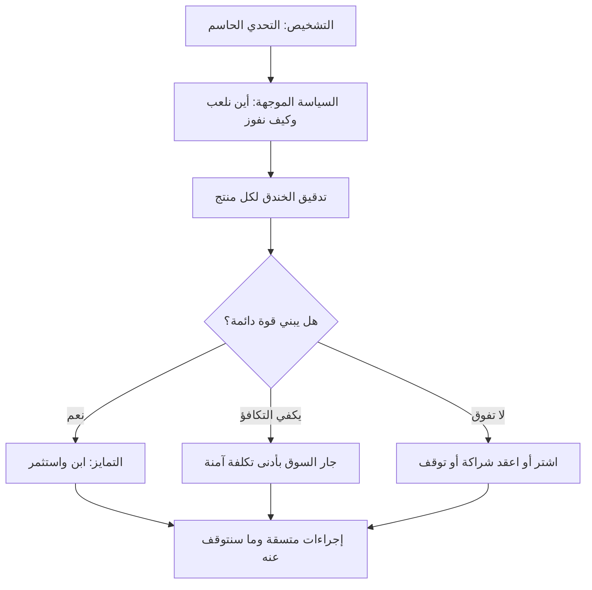
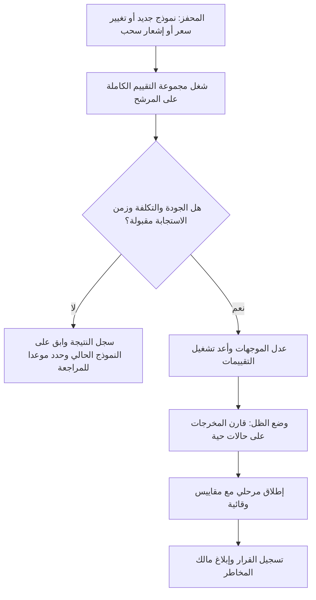
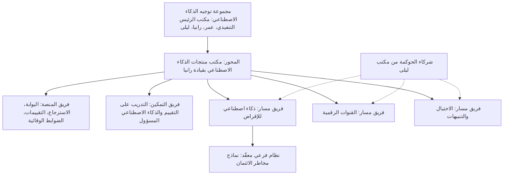
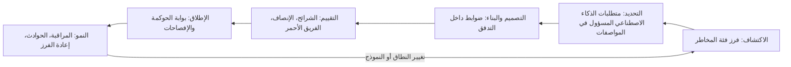

# الوحدة 9 — الاستراتيجية والقيادة

*علّمتك الوحدات السابقة كيف تدير منتج ذكاء اصطناعي واحدًا جيدًا. أما هذه الوحدة فتتناول إدارة محفظة والأشخاص الذين يقفون وراءها. على رانيا أن تعرض استراتيجية ذكاء اصطناعي على مجلس إدارة بنك نجم (Najm Bank)، وأن تُبقي خارطة الطريق مفيدة بينما تتغير النماذج التي تقوم عليها كل بضعة أشهر، وأن تنظّم المصممين والمهندسين وعلماء البيانات وشركاء المخاطر بحيث يُسلّمون فعلًا، وأن تضمن أن يحمل كل منتج نصيبه من الذكاء الاصطناعي المسؤول دون أن تتحول الحوكمة إلى جدار. ستتعلم كيف تجد المواضع التي يمنح فيها الذكاء الاصطناعي ميزة دائمة والمواضع التي يُبقيك فيها على مستوى السوق فقط، وكيف تخطّط بالرهانات لا بالوعود، وكيف تصمّم الفريق وصلاحيات اتخاذ القرار (decision rights)، وما الذي يملكه مدير المنتج عندما يضع المنظّمون والعملاء ومبادئ البنك نفسه حدودًا.*

> **المراحل:** Lead — اختيار المواضع التي يمنح فيها الذكاء الاصطناعي تفوقًا دائمًا، وترتيب الرهانات بينما تتغير النماذج، وتنظيم الفريق، وتولّي نصيب المنتج من الذكاء الاصطناعي المسؤول.

---

# 9.1 — استراتيجية منتجات الذكاء الاصطناعي والقابلية للدفاع
*المستوى: 🔴 متقدم* · *المتطلبات: 2.2، 3.2، 8.2* · *المرحلة: Lead*

**بعد هذا الدرس تستطيع** أن تعيد كتابة هدف أشبه بالشعار في صورة نواة استراتيجية من تشخيص وسياسة موجِّهة وإجراءات متسقة، وتجري تدقيقًا للخندق التنافسي يحدد الطبقة التي تحمل قيمة المنتج. *مدة الدراسة: قراءة نحو 20 دقيقةً، وعمل تطبيقي نحو 155 دقيقةً (تقدير).*

## ⚡ الدرس في دقيقة
- الاستراتيجية هي **تشخيص** للوضع، و**سياسة موجِّهة** للتعامل معه، ومجموعة من **الإجراءات المتّسقة** (Richard Rumelt). قائمة حالات استخدام الذكاء الاصطناعي ليست استراتيجية، ولا عبارة «أن نصبح أولًا في الذكاء الاصطناعي».
- الوصول إلى نموذج قادر ليس ميزة، لأن كل منافس يستطيع استئجار النموذج نفسه بشروط مشابهة. الميزة الدائمة تأتي مما يحيط بالنموذج: البيانات المملوكة ووسوم النتائج، ومكان داخل سير العمل، والتوزيع، والثقة ورخصة العمل، وسرعة تعلّم المؤسسة.
- اختبر كل منتج بـ **تدقيق الخندق التنافسي**: أيّ مصدر قوة يبنيه (كتاب *7 Powers* لـ Hamilton Helmer قائمة تحقق جيدة)، وما الذي يمنع منافسًا من نسخه خلال عام؟
- كثير من «خنادق البيانات» أضعف مما تبدو. البيانات ميزة فقط عندما تكون مملوكة، ومرتبطة بالنتائج، ومتجددة باستمرار، ويمكن استخدامها قانونيًا، وتغذّي المنتج فعلًا.
- إشارة القرار: ابنِ واستثمر حيث يعزّز الذكاء الاصطناعي ميزة تملكها أصلًا؛ جارِ السوق بتكلفة منخفضة حيث تحتاج إلى التكافؤ فقط؛ واشترِ أو اعقد شراكة أو توقّف حيث لا تملك تفوقًا.
- أكبر فخ: «الغلاف (wrapper)» الرقيق، أي منتج ميزته الحقيقية الوحيدة هي النموذج. قد يجعله إصدار النموذج التالي، أو المورّد نفسه، متقادمًا.

## 🧭 لماذا يهم
يطلب الرئيس التنفيذي (CEO) من رانيا أن تعرض «استراتيجية نجم للذكاء الاصطناعي» على مجلس الإدارة خلال ستة أسابيع. يُعِدّ فيصل مسودة العرض في عطلة نهاية أسبوع: ثلاث وعشرون حالة استخدام، وشريحة لشعارات المورّدين، وهدف «الذكاء الاصطناعي في كل منتج بحلول 2027 (AI in every product by 2027)»، وطلب ميزانية. تطرح رانيا ثلاثة أسئلة. ما المشكلة التي يعاني منها البنك ويحلّها الذكاء الاصطناعي أفضل من أي بديل؟ أيّ من هذه سيبقى ميزة لو اشترى كل بنك في الدوحة ودبي النموذج نفسه في الفصل القادم؟ وما الذي سنتوقف عن فعله لنموّل ذلك؟

لا يحمل العرض إجابات لأنه قائمة أمنيات. يحتاج مجلس الإدارة إلى خيارات يستطيع أن يحاسب الإدارة عليها: أين سينافس نجم بالذكاء الاصطناعي، وأين سيكتفي بمجاراة السوق، وأين لن يدخل اللعبة.

تُظهر الحالات العامة لماذا تهم الخيارات أكثر من الحماس. استثمرت IBM بكثافة في Watson Health ثم باعت أصول البيانات والتحليلات الخاصة به في 2022؛ فالعروض التوضيحية المبهرة لم تتحول إلى منتجات تناسب سير العمل السريري. ووضعت Zillow خوارزمية تسعير في قلب نشاط لشراء المنازل، ثم أنهت Zillow Offers في 2021 مع شطب مبالغ كبيرة، بعد أن أخطأت الخوارزمية في تسعير المنازل. في الحالتين كانت التقنية حقيقية. أما الاستراتيجية فأساءت تقدير مصدر القيمة وحجم التعرّض للمخاطر الذي يتحمله النشاط.

## 📐 كيف يعمل

### 🟢 الأساسيات

**نواة الاستراتيجية.** في كتاب *Good Strategy / Bad Strategy* (2011)، يصف Richard Rumelt جوهر أي استراتيجية بثلاثة أجزاء:

1. **التشخيص:** سمِّ التحدي الحاسم. بالنسبة إلى نجم: «تكلفة الخدمة (cost to serve) لدينا مرتفعة جدًا بحيث لا نستطيع الإقراض بربحية للشركات الصغيرة والمتوسطة (SMEs) دون نحو 500,000 ريال قطري، والمُقرضون الأصليون في الذكاء الاصطناعي بدأوا يكتتبون للشركات الصغيرة من بيانات الفواتير في دقائق.»
2. **السياسة الموجِّهة:** النهج الذي يُدخل خيارات ويُخرج أخرى. «استخدم نتائج الائتمان الخاصة بنا وعلاقاتنا لجعل الإقراض صغير القيمة سريعًا وآمنًا؛ ولا تحاول التفوق على شركات التقنية في بناء النماذج.»
3. **الإجراءات المتّسقة:** خطوات يعزّز بعضها بعضًا. «أطلق التمويل الفوري للشركات الصغيرة (SME Instant Finance) للفواتير الصغيرة؛ وامنح مديري العلاقات مساعد مذكرات الائتمان (Credit Memo Copilot) للقروض الأكبر؛ وابنِ منصة تقييم وبيانات مشتركة واحدة للاثنين.»

من علامات **الاستراتيجية السيئة** عند Rumelt: الحشو، والخلط بين الأهداف والاستراتيجية («أن نكون أكثر البنوك تمكينًا بالذكاء الاصطناعي في الخليج» هدف)، والعجز عن مواجهة المشكلة الحقيقية، والقوائم الطويلة من الغايات التي ليست خيارات. وعرض فيصل يُظهر العلامات الأربع كلها.

**أين تلعب وكيف تفوز.** في كتاب *Playing to Win* (2013)، يصوغ A. G. Lafley وRoger Martin الاستراتيجية على أنها خمسة خيارات مترابطة: طموح الفوز، و**أين تلعب**، و**كيف تفوز**، والقدرات التي تحتاجها، وأنظمة الإدارة التي تدعمها. بالنسبة إلى قائد منتجات الذكاء الاصطناعي، يؤدي الخياران الأوسطان معظم العمل: أيّ العملاء والرحلات والقرارات؛ ولماذا قد يختار أحد هذا المنتج بدلًا من البديل، بما في ذلك عدم فعل شيء.

**من أين تأتي ميزة الذكاء الاصطناعي.** تخيّل منتج الذكاء الاصطناعي طبقاتٍ. الجميع يستطيع استئجار الطبقة السفلى، أي النموذج؛ أما الطبقات فوقها فأصعب نسخًا.

| الطبقة | ما هي | هل يستطيع منافس نسخها خلال عام؟ |
|---|---|---|
| النموذج الأساسي (Foundation model) | النموذج اللغوي الكبير (LLM) أو خوارزمية تعلّم الآلة | نعم: يستأجرون النموذج نفسه |
| الموجّهات والاسترجاع والتنسيق | كيف يُوجَّه النموذج ويُسنَد إلى مصادر (5.3) | في الغالب، بمجرد أن يروا المنتج |
| البيانات المملوكة | بيانات تملكها أنت وحدك، مثل نتائج السداد | ببطء، إن كانت فريدة وقابلة للاستخدام حقًا |
| حلقة التغذية الراجعة (Feedback loop) | نتائج من الاستخدام الفعلي تعود إلى المنتج (3.2) | ببطء؛ فهي تحتاج إلى مستخدمين أولًا |
| الموقع في سير العمل | التكاملات والقوالب والسجل حيث يجري العمل | ببطء؛ فللتحويل تكلفة |
| التوزيع | العملاء والقنوات التي تصل إليها أصلًا | ببطء شديد |
| الثقة والرخصة | العلامة التجارية، والإذن التنظيمي، وسجل من الدقة | ببطء شديد، لكنها تضيع في يوم واحد |
| سرعة التعلّم | التقييمات (evals)، وتحليل الأخطاء (error analysis)، ووتيرة الإصدارات | ببطء؛ فهي تعيش في طريقة عمل الفريق |

**الغلاف** منتج تقع قيمته بالكامل تقريبًا في الطبقتين السفليين: واجهة على نموذج يملكه غيرك مع موجّه ذكي. كثيرًا ما يكون الغلاف السريع هو الخطوة الأولى الصحيحة، لكنه بلا دفاع عندما يضيف المورّد الميزة نفسها، أو يجعل نموذج أفضل الموجّه غير ضروري، أو يعيد منافس بناءه في شهر.

### 🟡 التعمق أكثر

**القوى السبع تدقيقًا للخندق.** يعرّف كتاب Hamilton Helmer *7 Powers* (2016) «القوة» بأنها ظروف تتيح لنشاط تجاري تحقيق عوائد أفضل من منافسيه بمرور الزمن. تحتاج كل قوة إلى **منفعة** (تكلفة أقل أو سعر أعلى) و**حاجز** (شيء يمنع المنافسين من تبديد المنفعة بالمنافسة). معظم ادعاءات الذكاء الاصطناعي تسمّي منفعة وتنسى الحاجز.

| القوة | المنفعة والحاجز بكلمات بسيطة | مثال من نجم وحكم صريح |
|---|---|---|
| **اقتصاديات الحجم** | تنخفض تكلفة الوحدة مع الحجم؛ والمنافسون أصغر من أن يجاروها | منصة ذكاء اصطناعي مشتركة موزّعة على خمسة منتجات تخفض التكلفة لكل منتج؛ لكن أمام مزوّدي الحوسبة الضخمة لا يملك نجم ميزة حجم |
| **اقتصاديات الشبكة** | كل مستخدم يجعل المنتج أكثر قيمة للمستخدمين الآخرين | نادرة في ذكاء البنوك الاصطناعي. كن متشككًا حين يدّعيها عرض تقديمي |
| **التموضع المضاد** | وافد جديد يتبنى نموذج عمل لا يستطيع اللاعبون القائمون نسخه دون الإضرار بنشاطهم الحالي | هذه تعمل *ضد* نجم: مُقرض للشركات الصغيرة أصيل في الذكاء الاصطناعي بلا تكاليف فروع. والتمويل الفوري للشركات الصغيرة ردّ دفاعي جزئيًا |
| **تكاليف التحويل** | يكلّف الرحيل العميلَ وقتًا أو بيانات أو مخاطر | مساعد مذكرات الائتمان، بمجرد أن يحتفظ بالقوالب والمذكرات السابقة وعادات مديري العلاقات، يصبح استبداله مكلفًا |
| **العلامة التجارية** | يدفع العملاء أكثر أو يثقون أكثر بسبب السمعة | سمعة الإجابات الدقيقة والحذرة بطيئة البناء؛ ويُظهر حكم الهيئة القضائية في الدرس 0.2 كيف تتحول إجابة سيئة واحدة سريعًا إلى مشكلة قانونية |
| **المورد المحتكَر** | وصول تفضيلي إلى شيء قيّم | بيانات أداء الائتمان والمعاملات الخاصة بنجم، حيث يملك الأساس القانوني لاستخدامها (3.3) |
| **قوة العمليات** | إجراءات تنظيمية روتينية تحسّن التكلفة أو الجودة ويستغرق نسخها سنوات | روتين منضبط للتقييم والتغذية الراجعة: المجموعات المرجعية (golden sets)، وتحليل الأخطاء الأسبوعي، والإصدارات السريعة الآمنة (الوحدة 6) |

**احذر خنادق البيانات.** في مقال بعنوان "The Empty Promise of Data Moats" (2019)، جادل Martin Casado وPeter Lauten من Andreessen Horowitz بأن مزايا البيانات كثيرًا ما تكون أضعف مما يُدّعى: فقيمة البيانات الإضافية تميل إلى الاستقرار عند حد، والحالات المفيدة الجديدة يصبح العثور عليها أكثر تكلفة، وتأثيرات شبكة البيانات الحقيقية غير شائعة. تعامل مع ذلك تحذيرًا يستحق الاختبار، لا قانونًا. اطرح خمسة أسئلة على أي ادعاء بشأن البيانات:

1. **مملوكة؟** هل يستطيع منافس شراء بيانات مكافئة أو جمعها؟
2. **موسومة بالنتائج؟** هل تسجّل ما حدث (سُدّد القرض، تأكّد الاحتيال، اعتُمدت المذكرة دون تعديلات)؟
3. **متجددة؟** هل تستمر البيانات الجديدة في الوصول من الاستخدام؟
4. **قابلة للاستخدام؟** هل تسمح الموافقة وقانون حماية البيانات بهذا الاستخدام (3.3)؟
5. **مستخدَمة؟** هل توجد حلقة حقيقية تحوّل البيانات إلى منتج أفضل (3.2)؟

**ارسم سلسلة القيمة.** تضع **خرائط Wardley** التي وضعها Simon Wardley كل مكوّن من مكونات الخدمة بحسب مدى ظهوره للمستخدم ومدى تطوره، من *النشأة* مرورًا بـ *البناء المخصص* و*المنتج* وصولًا إلى *السلعة*. انتقلت النماذج اللغوية العامة الغرض بسرعة نحو طرف السلعة. والقاعدة المستخلصة: استهلك السلع، وأنفق وقت الهندسة النادر على المكونات التي ما زالت مخصصة وقريبة من حاجة المستخدم. بالنسبة إلى نجم، يعني ذلك استئجار النماذج والاستثمار في استرجاع خاص بالائتمان، ومجموعات تقييم مبنية من حالاته الخاصة، والتكامل مع نظام إنشاء القروض.

### 🔴 نظرة الخبير

**اسأل عمّا سيصبح مجانيًا بعد ثمانية عشر شهرًا.** تتسع قدرات النماذج باستمرار، ويواصل مورّدو المنصات إضافة الذكاء الاصطناعي إلى منتجات تدفع ثمنها أصلًا. الميزة التي تميّزك اليوم قد تصبح مدمجة في النموذج أو في حزمة المكتب العام القادم. مساعد الموظفين التوليدي (Staff GenAI) هو المثال الواضح: اشترِ تلك الطبقة وضع جهد نجم في الوصلات الخاصة بالبنك (السياسات، وأدلة المنتجات، ومصادر البيانات المعتمدة). والخطأ المعاكس هو الانتظار إلى الأبد لـ «النموذج التالي» وعدم بناء الطبقات المملوكة التي لا يستطيع بناءها أحد غيرك.

**مُستدامة أم مُزعزِعة؟** في كتاب *The Innovator's Dilemma* (1997)، يفصل Clayton Christensen بين الابتكارات المُستدامة، التي تحسّن منتجات قائمة لعملاء قائمين ويفوز بها عادةً اللاعبون القائمون، والابتكارات المُزعزِعة، التي تبدأ بعرض أرخص وأبسط لعملاء لا يخدمهم اللاعب القائم بما يكفي. معظم الذكاء الاصطناعي التوليدي (GenAI) داخل البنك مُستدام: مذكرات أسرع، وإجابات أفضل في التطبيق. أما التهديد المُزعزِع ففي الطرف الأدنى من إقراض الشركات الصغيرة، حيث يخدم المُقرضون الأصليون في الذكاء الاصطناعي شركات صغيرة يراها نجم غير مربحة. هذا التشخيص، لا الحماس، هو سبب انتماء التمويل الفوري للشركات الصغيرة إلى الاستراتيجية.

**امنح كل منتج دورًا استراتيجيًا**، مع استثمار مطابق:

- **التمايز:** يبني قوة حقيقية أو يستخدمها. استثمر في الطبقات المملوكة وسرعة التعلّم. *مساعد مذكرات الائتمان، التمويل الفوري للشركات الصغيرة.*
- **التكافؤ:** تخسر إن كان غائبًا أو سيئًا، لكن الإفراط في التحسين لا يجلب الفوز. جارِ السوق بأدنى تكلفة آمنة. *نجم أسيست (Najm Assist) في صيغته للإجابة عن الأسئلة؛ التنبيهات الذكية (Smart Alerts).*
- **السلعة:** هناك من يبيعه جيدًا أصلًا. اشترِه وادمجه. *مساعد الموظفين التوليدي.*

الأدوار تتغير: فحين يصبح نجم أسيست وكيلًا (agent) يتصرف داخل أنظمة البنك، قد يصبح عنصر تمايز، لأن الأفعال أصعب نسخًا من الإجابات.

**تعلّم من الأمثلة العامة، بحذر.** عمل مساعد Morgan Stanley للمستشارين الماليين (2023) على نموذج مورّد؛ وجاءت قيمته من المحتوى البحثي الخاص بالشركة ومن ملاءمته لعمل المستشارين. وأعلنت Klarna في فبراير 2024 أن مساعدها بالذكاء الاصطناعي يتولى حصة كبيرة من محادثات العملاء، ثم قالت في 2025 إنها ستعيد مزيدًا من الخدمة البشرية. قِس الجودة ونتائج العملاء، لا التكلفة وحدها: فالاستراتيجية التي تقودها التكلفة وتُضعف الثقة لا تدوم.

## 🧰 الأدوات
| الأداة أو الإطار | ما هو وماذا يفعل | متى تلجأ إليه |
|---|---|---|
| **Strategy kernel** — نواة الاستراتيجية | التشخيص، والسياسة الموجِّهة، والإجراءات المتّسقة؛ إضافة إلى علامات التحذير من الاستراتيجية السيئة | كتابة أي وثيقة استراتيجية أو مراجعتها، خصوصًا تلك التي تُقرأ كقائمة أمنيات |
| **Playing to Win cascade** — سلسلة خيارات Playing to Win | خمسة خيارات مترابطة من الطموح إلى أنظمة الإدارة، محورها أين تلعب وكيف تفوز | تحويل الاستراتيجية إلى خيارات بشأن العملاء والرحلات والقدرات |
| **7 Powers** (Hamilton Helmer) — القوى السبع | سبعة مصادر للميزة الدائمة، يحتاج كل منها إلى منفعة وحاجز | اختبار قدرة منتج ذكاء اصطناعي على الاحتفاظ بميزته بعد أن يستأجر المنافسون النموذج نفسه |
| **Moat audit** — تدقيق الخندق التنافسي | جدول لكل منتج: أيّ طبقة تحمل القيمة، وأيّ قوة يبنيها، وما الذي يمنع النسخ | مراجعات المحفظة ودراسات الاستثمار؛ قبل الموافقة على بناء جديد |
| **Wardley map** (Simon Wardley) — خريطة Wardley | مكونات مرسومة بحسب ظهورها للمستخدم وتطورها من النشأة إلى السلعة | تقرير ما تبنيه مقابل ما تستهلكه، ورصد المكونات التي تتحول إلى سلع |
| **Data advantage test** — اختبار ميزة البيانات | خمسة فحوص: مملوكة، موسومة بالنتائج، متجددة، قابلة للاستخدام، مستخدَمة | أي ادعاء بأن «بياناتنا هي خندقنا» |
| **Portfolio role** — دور المحفظة | التمايز أو التكافؤ أو السلعة، مع موقف استثماري مطابق | تحديد الميزانيات وطموحات الجودة عبر عدة منتجات ذكاء اصطناعي |

## 🏛️ عمليًا في بنك نجم
تستبدل رانيا العرض التقديمي بصفحة واحدة بعنوان **استراتيجية منتجات الذكاء الاصطناعي (AI Product Strategy)** يستطيع مجلس الإدارة أن يحاسبها عليها.

**التشخيص.** إقراض الشركات الصغيرة غير مربح عند تكلفة الخدمة الحالية، والمُقرضون الأصليون في الذكاء الاصطناعي يستهدفونه. يقضي مديرو العلاقات (RMs) معظم أسبوعهم في كتابة المذكرات لا في لقاء العملاء. وثقة العملاء هي أثمن أصول البنك وأكثرها هشاشة.

**السياسة الموجِّهة.** فُز حيث تمنح بيانات النتائج الخاصة بنجم وعلاقاته ورخصته تفوقًا. استأجر النماذج ولا تدرّب أبدًا نماذج أساسية. أبقِ صانع قرار بشريًا في كل قرار ائتماني فردي خلال 2026 و2027.

**المحفظة.**

| المنتج | الدور | القوة التي يبنيها | الأدلة التي تُتتبَّع | الموقف |
|---|---|---|---|---|
| التمويل الفوري للشركات الصغيرة | التمايز | المورد المحتكَر: نتائج السداد | القرارات الموسومة شهريًا؛ معدل الخسارة مقارنة بالعمل اليدوي | ابنِ؛ امتلك النموذج والبيانات |
| مساعد مذكرات الائتمان | التمايز | تكاليف التحويل، قوة العمليات | نسبة المذكرات المصاغة في الأداة؛ ساعات مديري العلاقات الموفَّرة | استأجر النموذج؛ امتلك الاسترجاع والقوالب والتقييمات |
| نجم أسيست | التكافؤ، ثم التمايز لاحقًا | العلامة التجارية، التوزيع | معدلات الحل والشكاوى | ابنِ بأقل موارد؛ استثمر في الإسناد إلى المصادر (grounding) |
| التنبيهات الذكية | التكافؤ | لا شيء | الدقة (precision)؛ إلغاء الاشتراك في التنبيهات | حسّن باطّراد |
| مساعد الموظفين التوليدي | السلعة | لا شيء | الموظفون النشطون أسبوعيًا؛ تغطية المصادر المعتمدة | اشترِ؛ ادمج مصادر معرفة البنك |

**الإجراءات المتّسقة.** منصة ذكاء اصطناعي مشتركة واحدة يملكها طارق؛ ووسوم نتائج تُلتقط بالتصميم في كل سير عمل إقراض؛ ومراجعة ربع سنوية للنماذج.

**ما سنتوقف عنه.** إحدى عشرة تجربة تشغيلية بلا مالك ولا طريق إلى قوة، منها روبوت محادثة مخصص يكرّر مساعد الموظفين التوليدي.

**مؤشرات مجلس الإدارة.** طلبات الشركات الصغيرة التي يُبتّ فيها خلال أقل من عشر دقائق؛ ساعات مديري العلاقات المُعادة إلى العملاء؛ الأمثلة الموسومة بالنتائج في كل فصل؛ الشكاوى المرتبطة بإجابات الذكاء الاصطناعي.

## 🛠️ التمارين
- 🟢 خذ هدف فيصل «أن نكون أكثر البنوك تمكينًا بالذكاء الاصطناعي في الخليج» وأعد كتابته نواةَ استراتيجية لمنتج واحد من منتجات نجم. *يكتمل عندما:* يكون لديك تشخيص من جملة واحدة يسمّي تحديًا محددًا، وسياسة موجِّهة تستبعد خيارًا واحدًا على الأقل، وثلاثة إجراءات يعزّز بعضها بعضًا.
- 🟡 أجرِ تدقيق خندق على نجم أسيست في صيغته الحالية للإجابة عن الأسئلة. استخدم جدول الطبقات والقوى السبع (7 Powers). *يكتمل عندما:* تكون قد سمّيت الطبقة التي تحمل معظم قيمته، والقوة (إن وُجدت) التي يبنيها بمنفعتها وحاجزها، وشيئًا واحدًا لا يستطيع منافس نسخه خلال عام.
- 🔴 يقترح خالد أن يدرّب نجم نموذجًا أساسيًا عربيًا خاصًا به «حتى لا نكون معتمدين على المورّدين». اكتب ردًا في نصف صفحة لمجلس الإدارة مستخدمًا فكرة خريطة Wardley، واختبار ميزة البيانات، وأدوار المحفظة. *يكتمل عندما:* يقدّم توصية واضحة، ويسمّي ما ينبغي أن يبنيه نجم بدلًا من ذلك، ويعرض إجراءً ملموسًا واحدًا على الأقل للتخفيف من الاعتماد على المورّدين.

راجع عملك

**🟢 إجابة نموذجية (نجم أسيست).** التشخيص: معظم مكالمات مركز الاتصال عن خمس حاجات روتينية، والعملاء ينتظرون إجابات يستطيع التطبيق تقديمها. السياسة الموجِّهة: أتمتة المهام المتكررة منخفضة المخاطر القابلة للتراجع أولًا، مع إبقاء شخص على بُعد لمسة؛ وهذا يستبعد النصيحة المفتوحة. الأفعال: محتوى رسوم واحد حديث له مالك؛ وتجميد البطاقة مع تأكيد؛ وتحويل إلى موظف يحمل المحادثة. كل فعل يجعل الأفعال الأخرى تنجح.

**🟡 و🔴 مراجعة ذاتية.** ينجح تدقيق الخندق إذا سمّى الطبقة التي تحمل معظم القيمة (عادةً التكامل مع الأنظمة الأساسية والمحتوى المملوك، لا النموذج)، وقوةً لها منفعة وحاجز معًا، أو قال بصراحة إنه لا توجد قوة بعد. وينجح ردك على المجلس إذا أوصى بعدم تدريب نموذج أساس، وسمّى ما يُبنى بدلًا منه (التقييمات، والبيانات، والتكامل)، وقدّم تخفيفًا ملموسًا واحدًا للاعتماد على المورّد، مثل مجموعة تقييم مستقلة عن النموذج مع مزوّد ثانٍ مُختبَر.

## ⚠️ أخطاء وفخاخ
- **تقديم قائمة حالات استخدام على أنها استراتيجية.** ثلاث وعشرون فكرة بلا تشخيص هي قائمة أعمال متراكمة. ابدأ بالتحدي الحاسم واتخذ خيارات، بما فيها ما لن تفعله.
- **ادعاء خندق ليس سوى منفعة.** «نموذجنا أدق» منفعة. اسأل: أيّ حاجز يمنع منافسًا من مجاراتها في الفصل القادم؟
- **افتراض أن البيانات تساوي ميزة.** طبّق اختبار الأسئلة الخمسة. البيانات الخام أو غير الموسومة أو غير القابلة للاستخدام قانونيًا تكلفة، لا خندق (moat).
- **بناء ما سيُدمج قريبًا في الحزم.** لا تنافس ما سيمنحك إياه المورّدون خلال ثمانية عشر شهرًا.
- **خفض التكلفة على حساب الثقة.** قِس الجودة والنتائج إلى جانب التكلفة.

## 🧾 الخلاصة
- للاستراتيجية تشخيص وسياسة موجِّهة وإجراءات متّسقة؛ والأهداف وقوائم حالات الاستخدام ليست استراتيجيات.
- الجميع يستطيع استئجار النموذج. الميزة تعيش في الطبقات فوقه: بيانات النتائج المملوكة، وحلقات التغذية الراجعة (feedback loops)، والموقع في سير العمل، والتوزيع، والثقة، وسرعة التعلّم.
- اختبر القابلية للدفاع (defensibility) لكل منتج بالقوى السبع، واطلب حاجزًا إلى جانب المنفعة.
- البيانات ميزة فقط إن كانت مملوكة، وموسومة بالنتائج، ومتجددة، وقابلة للاستخدام، ومستخدَمة.
- امنح كل منتج دورًا (التمايز، التكافؤ، السلعة) واستثمر بما يطابقه.

## ✍️ اختبر نفسك

**1. تقول مسودة فيصل: «استراتيجيتنا للذكاء الاصطناعي أن نصبح أكثر البنوك تمكينًا بالذكاء الاصطناعي في الخليج بحلول 2027.» باستخدام إطار Rumelt، ما المشكلة الرئيسية فيها؟**

- A. لا تحدد مقياسًا لـ«الأكثر تمكينًا»، فلا يمكن تتبّع التقدم نحوها
- B. تقارن نجم بالبنوك الأخرى، بينما ينبغي أن تبدأ الاستراتيجية من العملاء لا من المنافسين
- C. أفقها الزمني قصير جدًا لتغيير بهذا الحجم في بنك كامل
- D. إنها هدف لا استراتيجية: ليس فيها تشخيص للتحدي ولا سياسة موجِّهة تستبعد خيارات

الإجابة

**D.** يعدّ Rumelt الخلط بين الأهداف والاستراتيجية علامة على الاستراتيجية السيئة. الاستراتيجية الجيدة تبدأ بتشخيص وتضع سياسة موجِّهة تتخذ خيارات. قد يكون الأفق الزمني (C) قابلًا للنقاش، لكنه ليس العيب الجوهري. (🟢 الأساسيات.)

**2. يطلق بنك منافس مساعدًا للعملاء مبنيًا على النموذج التجاري نفسه الذي يستخدمه نجم، بموجّهات مشابهة. أيّ أصول نجم هو الأقل احتمالًا لأن يبقى ميزة؟**

- A. علاقاته مع العملاء والتوزيع عبر تطبيق الهاتف
- B. بيانات السداد الموسومة بالنتائج على مدى عشرين عامًا
- C. النموذج الأساسي وتصميم الموجّهات
- D. سجله من الإجابات الدقيقة والحذرة ورخصته التنظيمية

الإجابة

**C.** يستطيع أي أحد استئجار النموذج، والموجّهات (prompts) سهلة النسخ. أما A وB وD فأبطأ نسخًا بكثير. (🟢 الأساسيات، جدول الطبقات.)

**3. يعرض مورّد منتجه قائلًا: «لمنتجنا خندق بيانات: جمعنا عشرة ملايين نص محادثة غير موسوم مع العملاء.» أيّ سؤال من اختبار ميزة البيانات يكشف أكبر نقطة ضعف؟**

- A. هل البيانات موسومة بالنتائج، فتُظهر ما حدث فعلًا؟
- B. هل البيانات مخزّنة بأمان في البيئة السحابية الخاصة بالمورّد؟
- C. هل جُمعت البيانات خلال الأشهر الاثني عشر الأخيرة؟
- D. هل تغطي البيانات أكثر من لغة ولهجة؟

الإجابة

**A.** نصوص المحادثات الخام بلا نتائج (حُلّت أم لا، صحيحة أم لا) قيمتها أقل بكثير من النتائج الموسومة، وكثيرًا ما تستقر قيمتها عند حد. الحداثة (C) تهم في فحص «المتجددة» لكنها مسألة أصغر هنا. أما مكان التخزين (B) فلا علاقة له بالميزة. (🟡 التعمق أكثر.)

**4. في القوى السبع عند Helmer، لماذا لا تكفي عبارة «نموذجنا الائتماني أدق من نماذج المنافسين» لادعاء القوة؟**

- A. تحتاج القوة إلى منفعة وحاجز معًا، والصحة الإجمالية وحدها لا تمنع المنافسين من مجاراتها
- B. الصحة الإجمالية ليست منفعة، لأن العملاء لا يرون الفرق بين نموذجَي ائتمان ولا يقدّرونه، ولا ينتبهون إليه عند اختيار البنك
- C. اقتصاديات الشبكة وحدها تُعدّ قوة في الذكاء الاصطناعي، لأن القوى الست الأخرى تحتاج إلى أصول مادية ومصانع، ولا مكان لها هنا
- D. القوة تحتاج إلى منفعة يدفع العملاء ثمنها، والصحة الإجمالية لنموذج الائتمان لا تخفض إلا خسائر البنك نفسه

الإجابة

**A.** الصحة الإجمالية الأعلى منفعة؛ ومن دون حاجز مثل المورد المحتكَر أو قوة العمليات، يستطيع المنافسون سدّ الفجوة. وC خاطئ: اقتصاديات الشبكة نادرة في ذكاء البنوك الاصطناعي. (🟡 التعمق أكثر.)

**5. يقرّر نجم مقدار الاستثمار في مساعد الموظفين التوليدي، وهو مساعد داخلي عام. ومورّدو حزم الإنتاجية يدمجون أصلًا مساعدات قادرة في منتجاتهم. أيّ دور محفظة وموقف هما الأنسب؟**

- A. التمايز: ابنِ مساعدًا مخصصًا ونموذجًا مملوكًا، حتى يملك بنك نجم كل طبقة من طبقات المنظومة ويتحكم في تكلفتها وتطورها
- B. التوقف: أوقف مساعد الموظفين التوليدي واترك المساعدات الداخلية لميزانية كل إدارة
- C. التكافؤ: ابنِ من الصفر لمجاراة ميزات المورّدين
- D. السلعة: اشترِ القدرة المدمجة واستثمر فقط في ربط مصادر المعرفة الخاصة بالبنك

الإجابة

**D.** المكوّن الذي يبيعه آخرون جيدًا سلعة: اشترِه وأضف ما لا يستطيعه إلا نجم. A ينافس منتجات مدمجة؛ وB يتجاهل قيمة إنتاجية حقيقية. (🔴 نظرة الخبير.)

## 📚 المراجع
- Richard Rumelt, *Good Strategy / Bad Strategy: The Difference and Why It Matters* (Crown Business, 2011)
- A. G. Lafley and Roger L. Martin, *Playing to Win: How Strategy Really Works* (Harvard Business Review Press, 2013)
- Hamilton Helmer, *7 Powers: The Foundations of Business Strategy* (Deep Strategy, 2016)
- Clayton M. Christensen, *The Innovator's Dilemma* (Harvard Business School Press, 1997)
- Simon Wardley, *Wardley Maps*
- Martin Casado and Peter Lauten, "The Empty Promise of Data Moats", Andreessen Horowitz (2019) — https://a16z.com
- Marty Cagan, *Inspired* (2nd ed., Wiley, 2017) and Silicon Valley Product Group articles — https://www.svpg.com
- Morgan Stanley, announcements on its AI assistant for financial advisers (2023) — https://www.morganstanley.com

---

# 9.2 — خرائط الطريق في ظل عدم اليقين: الرهانات والمنصات وتغيّر النماذج
*المستوى: 🔴 متقدم* · *المتطلبات: 1.3، 6.3، 9.1* · *المرحلة: Lead, Define*

**بعد هذا الدرس تستطيع** أن تحوّل الالتزامات المؤرخة بالميزات إلى نتائج في أعمدة الآن والتالي ولاحقًا، وتكتب بطاقة رهان بمعيار إيقاف قابل للقياس، وتصوغ دليلًا لتغيير النموذج بعتبات نجاح وخطة بديلة. *مدة الدراسة: قراءة نحو 20 دقيقةً، وعمل تطبيقي نحو 165 دقيقةً (تقدير).*

## ⚡ الدرس في دقيقة
- تحمل خارطة طريق الذكاء الاصطناعي ثلاثة أنواع من عدم اليقين في آنٍ واحد: **القيمة** (هل تستحق المشكلة الحل؟)، و**الجدوى التقنية** (هل يستطيع المنتج بلوغ معيار الجودة؟) و**الانجراف التقني** (ماذا ستفعل النماذج، وكم ستكلّف، في الفصل القادم؟).
- استبدل قوائم الميزات المؤرَّخة بـ **خارطة طريق قائمة على النتائج** (الآن، التالي، لاحقًا) يكون فيها كل بند **رهانًا**: النتيجة المنشودة، والفرضية، والأدلة حتى الآن، وحجم الرهان، و**معيار إيقاف (kill criterion)** متفق عليه مسبقًا.
- وزّع الإنفاق على مراحل: أنفق قليلًا لتتعلم هل الجودة قابلة للبلوغ (اختبار جدوى سريع على مجموعة مرجعية) قبل أن تنفق كثيرًا.
- ابنِ قدرة **منصة** مشتركة بمجرد أن تحتاج عدة منتجات إلى الشيء نفسه. وقبل ذلك، ابنِها داخل منتج واحد واستخرجها لاحقًا.
- تعامل مع **تغيّر النموذج بوصفه أمرًا روتينيًا**: احتفظ بمجموعة تقييم (evaluation suite) تعمل اختبارَ انحدار (regression test)، ومرّر الاستدعاءات عبر بوابة، ونفّذ **دليل تغيير النموذج** مكتوبًا عندما يُصدَر نموذج أو يُعاد تسعيره أو يُسحب.
- أكبر فخ: أن تعِد التنفيذيين بموعد لمستوى جودة لم يقِسه أحد بعد. التزم بمواعيد *للتعلّم*، وبنطاقات للجودة.

## 🧭 لماذا يهم
في يناير يعطي فيصل خالدًا شريحة خارطة طريق تقول: «الفصل الثاني: مساعد مذكرات الائتمان مُفعَّل لجميع قروض الشركات، بصحة إجمالية 95%.» يضعها خالد في خطته السنوية. لم يعرّف أحد ما تعنيه «صحة إجمالية 95%» لمذكرة ائتمان، ولم تُجرِ دانة بعدُ تقييمًا واحدًا على ملفات قروض الشركات، وهي أطول وأكثر فوضى من ملفات الشركات الصغيرة التي استخدمتها التجربة التشغيلية.

في مارس يحدث أمران. يُظهر أول تحليل أخطاء أجرته دانة أن المساعد يتعامل جيدًا مع الأقسام السردية لكنه يخطئ في ملخصات النسب المالية بما يكفي لأن يضطر مديرو العلاقات إلى التحقق من كل رقم. وبشكل منفصل، يعلن مورّد النموذج أن إصدار النموذج الذي يستخدمه نجم سيُسحب في وقت لاحق من العام، ويُعرض نموذج أحدث بسعر أقل. وعندما يشغّل طارق المجموعة المرجعية (golden set) على النموذج الجديد، تتحسن ملخصات النسب لكن الملخصات التنفيذية العربية تسوء. (هذه النتائج توضيحية.)

صارت شريحة فيصل الآن خاطئة في النطاق والجودة والتقنية، ويشعر خالد بأنه ضُلِّل. رأي رانيا: لم يحدث شيء غير عادي. هذا طبيعي لمنتج ذكاء اصطناعي. الإخفاق كان خارطة طريق تتظاهر باليقين.

## 📐 كيف يعمل

### 🟢 الأساسيات

**ثلاثة أنواع من عدم اليقين.** تنطبق المخاطر الأربع الكبرى عند Marty Cagan (القيمة، وسهولة الاستخدام، والجدوى التقنية، والجدوى التجارية، من كتاب *Inspired*) على كل منتج. وفي منتجات الذكاء الاصطناعي، **تبقى مخاطر الجدوى التقنية مفتوحة أطول بكثير** مما في البرمجيات العادية. فكثيرًا ما لا تستطيع أن تعرف هل يمكنه بلوغ معدل خطأ مقبول حتى تبني نموذجًا أوليًا وتقيّمه على حالات حقيقية (الوحدة 6). وفوق ذلك يأتي **الانجراف التقني**: النماذج والأسعار وميزات المورّدين تتغير عدة مرات في السنة.

**الآن، التالي، لاحقًا (Now, Next, Later).** نشرت Janna Bastow، الشريكة المؤسسة لـ ProdPad، **خارطة طريق الآن-التالي-لاحقًا** بديلًا عن الجداول الزمنية. ولها ثلاثة أعمدة:

| العمود | ما يوضع فيه | الثقة | ما تلتزم به |
|---|---|---|---|
| **الآن** | عمل جارٍ أو على وشك البدء، بنتيجة واضحة | عالية | النطاق ونافذة التسليم |
| **التالي** | مشكلات مُشكَّلة ومدعومة بالأدلة، لم تبدأ بعد | متوسطة | النتيجة والترتيب |
| **لاحقًا** | اتجاهات وفرص تستحق الاستكشاف | منخفضة | النية فقط |

يُصاغ كل بند **نتيجةً** («تقليل وقت مدير العلاقات لكل مذكرة شركات»)، لا ميزةً («إضافة توليد جدول النسب»). وهذا يُبقي الفريق حرًّا في اختيار الحل، بما فيه حل لا يعتمد على الذكاء الاصطناعي، عندما تصل الأدلة.

**بنود خارطة الطريق رهانات.** يجادل كتاب Annie Duke *Thinking in Bets* (2018) بأن القرارات في ظل عدم اليقين ينبغي أن تُقيَّم بجودة المنطق الذي يقف وراءها، لا فقط بما آلت إليه؛ وتسمّي الحكم بالنتائج وحدها «الحكم بالنتيجة». خارطة طريق من الرهانات تجعل المنطق مرئيًا. ولـ **بطاقة الرهان** ستة حقول:

1. **النتيجة:** التغيير القابل للقياس الذي نريده.
2. **الفرضية:** لماذا نعتقد أن هذا المنتج سيحدثه.
3. **الأدلة حتى الآن:** نتائج الاكتشاف، ونتائج النموذج الأولي، ودرجات التقييم.
4. **حجم الرهان:** الأشخاص والأسابيع، إضافة إلى تكلفة التشغيل.
5. **معيار الإيقاف:** النتيجة التي توقف الرهان أو تعيد تشكيله، مكتوبة قبل بدء العمل.
6. **محطة التعلّم التالية:** ما الذي سنعرفه، ومتى.

معيار الإيقاف هو الأهم. فحين يُكتب مسبقًا، يحمي الفريق من تفكير التكلفة الغارقة («أنفقنا أربعة أشهر، فلنواصل») ويحمي القادة من المفاجآت غير السارة.

### 🟡 التعمق أكثر

**وزّع الاستثمار على مراحل.** موّل عمل الذكاء الاصطناعي على مراحل؛ كل مرحلة تشتري معلومات ولا تفتح ميزانية أكبر إلا إذا كانت الأدلة جيدة.

| المرحلة | السؤال الذي تجيب عنه | الحجم المعتاد (توضيحي) | الأدلة اللازمة للانتقال |
|---|---|---|---|
| 1. أدلة المشكلة | هل المهمة مؤلمة ومتكررة بما يكفي؟ (الوحدة 2) | أيام | المقابلات، وبيانات سير العمل، والتكلفة الأساسية |
| 2. اختبار الجدوى السريع | هل يستطيع أي نهج متاح بلوغ معيار الجودة؟ | من أسبوع إلى ثلاثة أسابيع | الدرجات على مجموعة مرجعية صغيرة؛ تحليل الأخطاء |
| 3. نموذج أولي مع المستخدمين | هل يثق المستخدمون بالمخرجات ويستخدمونها في سير عملهم؟ | أسابيع | نجاح المهمة ومعدلات التحرير في اختبار مضبوط |
| 4. تجربة تشغيلية محدودة | هل يعمل في ظروف الإنتاج، بتكلفة مقبولة؟ | من شهر إلى ثلاثة أشهر | المقاييس المباشرة، والمقاييس الوقائية (guardrail metrics)، والتكلفة لكل مهمة (cost per task) (الوحدتان 6 و8) |
| 5. التوسّع | هل تصمد القيمة عبر الشرائح والحجم؟ | مستمر | نتائج الإطلاق المرحلي؛ مقاييس التشغيل |

**اختبار الجدوى السريع** هو الخطوة الخاصة بالذكاء الاصطناعي. قبل الوعد بأي شيء، يبني فريق دانة أبسط نسخة قابلة للتقييم، وكثيرًا ما تكون موجّهًا مع استرجاع، ويقيّمها على خمسين إلى مئة حالة حقيقية. لا ينتج منتجًا، بل رقمًا وقائمة بأنواع الأخطاء، وهذا ما تحتاجه خارطة الطريق.

**الشهية وطاولة الرهانات.** يقدّم كتاب Ryan Singer *Shape Up* (Basecamp، 2019) فكرتين مفيدتين. **الشهية** تعني أن تقرّر كم يستحق الوقت الذي تُخصّصه لمشكلة *قبل* تقديرها: «هذا يستحق ستة أسابيع، لا ستة أشهر». ثم يتقلص النطاق ليناسب الوقت. و**طاولة الرهانات** اجتماع منتظم يختار فيه القادة أيّ العروض المُشكَّلة يموّلون للدورة التالية، بدلًا من تنقيح قائمة أعمال متراكمة لا تنتهي. تهم الشهية في الذكاء الاصطناعي لأن مشكلات الجودة قد تستهلك جهدًا بلا حدود. وقرار مثل «ملخصات النسب تستحق دورة إضافية واحدة؛ فإن لم نبلغ المعيار، نطلق دونها ونعرض جدول المصدر بدلًا منها» يُبقي المنتج متحركًا.

**وازن المحفظة عبر الآفاق.** في كتاب *The Alchemy of Growth* (1999)، وصف Mehrdad Baghai وStephen Coley وDavid White **ثلاثة آفاق** للنمو: الأفق 1 يوسّع النشاط الأساسي ويدافع عنه، والأفق 2 يبني أنشطة ناشئة، والأفق 3 يصنع خيارات للمستقبل. تحتاج محفظة الذكاء الاصطناعي إلى الثلاثة جميعًا. في نجم، الأفق 1 هو التنبيهات الذكية ومساعد مذكرات الائتمان؛ والأفق 2 هو التمويل الفوري للشركات الصغيرة ونجم أسيست بوصفه وكيلًا؛ والأفق 3 رهانات استكشافية صغيرة، مثل وكلاء يتحاورون مع أنظمة الخزينة لدى الشركات. أيّ تقسيم للجهد عبر الآفاق نقطة بداية للنقاش، لا قاعدة.

**منصة أم منتج؟** تعني **المنصة** هنا قدرات مشتركة تستخدمها عدة منتجات ذكاء اصطناعي: بوابة نماذج (model gateway) (مكان واحد لاستدعاء النماذج، وتبديل المورّدين، وتسجيل التكلفة وقياسها)، وخدمة استرجاع، وإطار تقييم (evaluation harness)، وضوابط وقائية (guardrails)، وإدارة الموجّهات والإصدارات، وقابلية المراقبة. والسؤال هو التوقيت.

| ابنِها داخل منتج أولًا عندما… | ابنِها منصةً عندما… |
|---|---|
| يحتاجها منتج واحد فقط | تحتاج ثلاثة منتجات أو أكثر إلى القدرة نفسها |
| لا تعرف بعد كيف يبدو «الجيد» | استقر التصميم وصار التكرار يكلّف مالًا أو مخاطر |
| سرعة التعلّم هي الأهم | الاتساق هو المهم: ضابط وقائي واحد، وسجل تدقيق واحد، ورؤية واحدة للتكلفة |
| القدرة ما زالت تتغير شهريًا | القدرة مستقرة بما يكفي لتقديمها لعملاء داخليين |

من القواعد التقريبية العملية **قاعدة الثلاثة**: ابنِها مرة، وانسخها في المرة الثانية، وحوّلها إلى منصة في الثالثة. نهج *المنصة أولًا* يبني بنية تحتية لا يستخدمها أي منتج بعد: تكلفة كبيرة بلا تغذية راجعة. ونهج *عدم بناء منصة أبدًا* يترك خمسة فرق لكل منها تسجيله وعقود مورّديه، فلا يستطيع أحد أن يقول كم ينفق البنك على النماذج أو أيّ المنتجات تستخدم نموذجًا يُسحب. تعامل مع المنصة بوصفها منتجًا له عملاء داخليون ومستويات خدمة.

### 🔴 نظرة الخبير

**تغيّر النموذج حدث متكرر، لا حالة طوارئ.** يُصدر المورّدون نماذج جديدة، ويغيّرون الأسعار، ويسحبون الإصدارات القديمة، عادةً بإشعار مسبق. وتضيف النماذج مفتوحة الأوزان (التي تُنشر أوزانها فتستطيع استضافتها بنفسك؛ انظر 1.3) خيارات لإقامة البيانات (data residency) والتكلفة. وقد يتصرف النموذج بشكل مختلف بعد تحديث ما لم تثبّت إصدارًا. لذا يحتفظ الفريق الناضج بـ **دليل تغيير النموذج** مكتوبًا وينفّذه كل فصل وكلما وقع حدث محفِّز.

ثلاثة خيارات تصميمية تجعل تنفيذ هذا الدليل رخيصًا:

1. **التقييمات هي أصل قابلية النقل.** المجموعات المرجعية ومعايير التقييم والحكّام من الوحدة 6 تعمل أيضًا مجموعةَ اختبار انحدار (regression suite). من دونها، كل تغيير للنموذج قفزة إيمانية؛ ومعها، مقارنة تُنهيها في أيام.
2. **طبقة رقيقة معتمدة على النموذج.** مرّر الاستدعاءات عبر بوابة واجعل للموجّهات إصدارات لكل نموذج. لا تُفرط في التجريد: فالواجهة القائمة على القاسم المشترك الأدنى تُهدر ما يجعل النموذج الأحدث أفضل.
3. **الحوكمة في الحلقة.** قد يغيّر تغيير النموذج ملف المخاطر، لذا يُبلَّغ فريق ليلى، ويراجع المنتجات عالية المخاطر (9.4).

**ابنِ الآن أم انتظر النموذج التالي؟** في الغالب: ابنِ الطبقات الدائمة الآن وأبقِ الطبقة المعتمدة على النموذج رقيقة. خطوط أنابيب البيانات (data pipelines)، ووسوم النتائج، ومجموعات التقييم (eval sets)، والتكامل مع سير العمل تحتفظ بقيمتها أيًّا كان النموذج الفائز. أما الحلول الالتفافية المعقدة لضعف حالي في النموذج، مثل سلسلة موجّهات لإصلاح الحساب، فقد تذهب هدرًا عندما يتعامل النموذج التالي مع المهمة. اسأل أولًا هل تُزيل أداة بسيطة (استدعاء آلة حاسبة، أو بحث) المشكلة.

**إيصال عدم اليقين إلى الأعلى.** يحتاج التنفيذيون إلى التزامات؛ وعمل الذكاء الاصطناعي لا يستطيع أن يعد بالجودة مسبقًا. التزم بأشياء مختلفة عند مستويات ثقة مختلفة:

- **مواعيد للتعلّم:** «بحلول 30 أبريل سنعرف هل تستطيع ملخصات النسب بلوغ المعيار على ملفات الشركات.»
- **نطاقات للجودة:** «تشير الأدلة الحالية إلى معدل تحرير لدى مديري العلاقات بين X وY؛ وسنضيّق هذا النطاق بعد التجربة التشغيلية.»
- **نطاق مرن:** «تُطلق الأقسام السردية في الفصل الثاني في كل الأحوال؛ ولا تُطلق ملخصات النسب إلا إذا اجتازت.»
- **مواعيد للتسليم** في عمود الآن فقط، بعد اختبار الجدوى السريع.

يحتاج خالد إلى أن يعرف ما الذي يستطيع التخطيط على أساسه، وما الذي قد يغيّر الخطة.

## 🧰 الأدوات
| الأداة أو الإطار | ما هو وماذا يفعل | متى تلجأ إليه |
|---|---|---|
| **Now-Next-Later roadmap** (Janna Bastow) — خارطة طريق الآن-التالي-لاحقًا | خارطة طريق من ثلاثة أعمدة بحسب الثقة لا بحسب التاريخ، مصاغة نتائجَ | استبدال خرائط الطريق الزمنية لمنتجات ذكاء اصطناعي ما زالت جدواها التقنية مفتوحة |
| **Bet card** — بطاقة الرهان | بطاقة لكل بند في خارطة الطريق: النتيجة، والفرضية، والأدلة، والحجم، ومعيار الإيقاف، ومحطة التعلّم التالية | كل بند في خارطة الطريق يتجاوز بضعة أسابيع من الجهد؛ مراجعات المحفظة |
| **Betting table and appetite** — طاولة الرهانات والشهية | يموّل القادة عملًا مُشكَّلًا لدورة ثابتة؛ الوقت ثابت والنطاق مرن | منع عمل الجودة من استهلاك جهد بلا حدود |
| **Feasibility spike** — اختبار الجدوى السريع | بناء أولي بسيط محدد الوقت يُقيَّم على مجموعة مرجعية صغيرة، مع تحليل الأخطاء | قبل وضع أي ادعاء بجودة الذكاء الاصطناعي على خارطة الطريق |
| **Three horizons** — الآفاق الثلاثة | تقسيم المحفظة بين توسيع النشاط الأساسي، والأنشطة الناشئة، وخيارات المستقبل | موازنة المحفظة بحيث لا يذهب الجهد كله إلى أفق واحد |
| **Rule of three for platforms** — قاعدة الثلاثة للمنصات | ابنِ مرة، وانسخ في المرة الثانية، وحوّل إلى منصة في الثالثة | تقرير متى ينبغي أن تصبح قدرة ذكاء اصطناعي مشتركة منصة |
| **Model-change playbook** — دليل تغيير النموذج | إجراء مكتوب: المحفِّز، ومجموعة التقييم، والظل، والإطلاق المرحلي، والقرار المسجَّل | إصدارات النماذج، وتغييرات الأسعار، وإشعارات السحب |

## 🏛️ عمليًا في بنك نجم
تستبدل رانيا الجدول الزمني الذي أعدّه فيصل بـ **خارطة طريق للذكاء الاصطناعي بصيغة الآن-التالي-لاحقًا** وبطاقة رهان لكل بند. والنسخة الربع سنوية لمجلس الإدارة شريحة واحدة.

| | الآن (ملتزَم به) | التالي (مُشكَّل) | لاحقًا (اتجاهي) |
|---|---|---|---|
| **مساعد مذكرات الائتمان (Credit Memo Copilot)** | الأقسام السردية لمذكرات الشركات الصغيرة: تقليل وقت الصياغة لكل مذكرة | مذكرات الشركات، وملخصات النسب فقط إن اجتاز الاختبار السريع | مسودات مراقبة التعهدات |
| **التمويل الفوري للشركات الصغيرة (SME Instant Finance)** | تجربة تشغيلية للفواتير دون الحد المقرر، مع قرار بشري في كل حالة | حد أوسع إن بقي معدل الخسارة ضمن النطاق المتفق عليه | بيانات فواتير شبكة الموردين |
| **نجم أسيست (Najm Assist)** | إجابات مُسندة إلى مصادر عن أسئلة البطاقات والحسابات | أول فعل وكيلي: تجميد البطاقة، مع التأكيد | إجراءات النزاعات والمدفوعات |
| **المنصة** | بوابة النماذج وإطار التقييم المشترك (تستخدمهما ثلاثة منتجات الآن) | خدمة ضوابط وقائية مشتركة | بديل احتياطي بنموذج مفتوح الأوزان لاحتياجات إقامة البيانات |
| **محطات التعلّم** | نتيجة الاختبار السريع لنسب الشركات بحلول 30 أبريل | تقرير التجربة التشغيلية لأفعال الوكيل بنهاية الفصل الثالث | مراجعة خيارات الأفق 3 في الفصل الرابع |

**بطاقة الرهان: مساعد مذكرات الائتمان لقروض الشركات.**

| الحقل | المُدخل |
|---|---|
| النتيجة | تنخفض ساعات مدير العلاقات لكل مذكرة شركات انخفاضًا ملموسًا مقارنة بخط الأساس اليدوي، دون ارتفاع في إعادة العمل لدى لجنة الائتمان |
| الفرضية | مكاسب السرد في الشركات الصغيرة تنتقل إلى ملفات الشركات؛ وتصبح النسب موثوقة إذا استدعى النموذج أداة حساب |
| الأدلة حتى الآن | معدلات التحرير في التجربة التشغيلية للشركات الصغيرة؛ تحليل أخطاء أولي يُظهر أن أخطاء النسب هي نوع الإخفاق الرئيسي |
| الحجم | مهندسان ودانة بدوام جزئي لدورة واحدة من ستة أسابيع؛ تكلفة التشغيل مقدّرة لكل مذكرة (8.2) |
| معيار الإيقاف | إن فشلت ملخصات النسب في معيار المجموعة المرجعية بعد دورة واحدة، أطلِق الأقسام السردية فقط واعرض جداول المصدر للنسب |
| محطة التعلّم التالية | نتيجة الاختبار السريع على 80 ملف شركات تاريخيًا بحلول 30 أبريل |

**دليل تغيير النموذج (مقتطف).** المالك: طارق. الخطوات كما في المخطط. سجل الخروج: درجات التقييم بحسب القسم واللغة، والتكلفة لكل مذكرة، وزمن الاستجابة (latency)، والقرار، والاعتماد من مالك المنتج، ومن فريق ليلى في المنتجات عالية المخاطر. ويصبح إشعار السحب الصادر في مارس سطرًا في عمود الآن، لا أزمة.

## 🛠️ التمارين
- 🟢 أعد كتابة ثلاثة من التزامات فيصل بميزات مؤرَّخة بنودًا في خارطة الآن-التالي-لاحقًا مصاغة نتائجَ. *يكتمل عندما:* يسمّي كل بند نتيجة قابلة للقياس، ويقع في عمود واحد مع سبب، ولا يعد أيٌّ منها بمستوى جودة لم يُقَس.
- 🟡 اكتب بطاقة رهان لأول فعل وكيلي في نجم أسيست (تجميد البطاقة). *يكتمل عندما:* تُملأ الحقول الستة كلها، ويكون معيار الإيقاف نتيجة محددة قابلة للقياس، ويكون لمحطة التعلّم التالية موعد.
- 🔴 يعلن المورّد الذي يقف وراء مساعد مذكرات الائتمان سحب إصدار النموذج الذي تستخدمه خلال أربعة أشهر، مع بديل أرخص. اكتب مسودة تنفيذ الدليل: التقييمات التي ستجريها، وقاعدة القرار، وخطة الإطلاق، ومن يعتمد. *يكتمل عندما:* تسمّي الخطة مجموعات التقييم (بما فيها الأقسام العربية والإنجليزية)، وتحدد عتبات الاجتياز نسبةً إلى النموذج الحالي، وتتضمن خطوة ظل أو خطوة مرحلية، وتقدّم بديلًا احتياطيًا إن فشل البديل.

راجع عملك

**🟢 إجابة نموذجية (واحد من ثلاثة).** «إطلاق تقديم الاعتراضات في نجم أسيست في يونيو» يصبح «خفض التواصل المتكرر بشأن الاعتراضات بمقدار الخُمس»، ويوضع في «التالي» لا «الآن» لأن جودة محادثات الاعتراض لم تُقس بعد.

**🟡 و🔴 مراجعة ذاتية.** تنجح بطاقة الرهان إذا امتلأت حقولها الستة، وكان معيار الإيقاف رقمًا مع تاريخ (مثل «أكثر من 1 من كل 200 تجميد يلغيه العملاء بوصفه غير مقصود في التجربة»)، وكانت محطة التعلّم التالية مؤرَّخة. وينجح تشغيل دليل التغيير إذا سمّى مجموعات التقييم بقسميها العربي والإنجليزي، وعتبات نجاح مقارنةً بالنموذج الحالي، وخطوة بوضع الظل أو مرحلية، ومالكًا للاعتماد، وبديلًا إن فشل النموذج البديل.

## ⚠️ أخطاء وفخاخ
- **تحديد موعد للجودة قبل قياسها.** «صحة إجمالية 95% بحلول الفصل الثاني» بلا تقييم وعدٌ لا تستطيع الوفاء به. نفّذ اختبار جدوى سريعًا، ثم التزم بنطاقات.
- **خرائط الطريق بوصفها قوائم ميزات.** الميزات تُقفل على حل قبل وصول الأدلة. صُغ البنود نتائجَ ودع الفريق يختار الحل.
- **رهانات بلا معايير إيقاف.** من دون قاعدة توقف مكتوبة مسبقًا، تُبقي التكلفة الغارقة الرهانات الضعيفة حية. اكتب المعيار قبل بدء العمل.
- **بناء المنصة أولًا.** البنية التحتية التي لا يستخدمها منتج لا تحصل على تغذية راجعة. اتبع قاعدة الثلاثة.
- **عدم بناء المنصة أبدًا.** خمسة فرق لكل منها تسجيله وعقود مورّديه تعني أن أحدًا لا يرى التكلفة أو المخاطر. استخرج القدرات المشتركة بمجرد أن تستقر.
- **معاملة كل إصدار نموذج على أنه إعادة كتابة.** أبقِ الطبقة المعتمدة على النموذج رقيقة ودع مجموعة التقييم (eval suite) تقرّر.

## 🧾 الخلاصة
- تحمل خرائط طريق الذكاء الاصطناعي عدم يقين في القيمة والجدوى التقنية والانجراف التقني؛ وتبقى الجدوى التقنية مفتوحة أطول مما في البرمجيات العادية.
- استخدم الآن-التالي-لاحقًا مصاغة نتائجَ، واجعل كل بند رهانًا بمعيار إيقاف.
- وزّع الاستثمار على مراحل: أدلة المشكلة، واختبار الجدوى السريع، والنموذج الأولي، والتجربة التشغيلية، والتوسّع.
- حوّل القدرات المشتركة إلى منصة عندما تحتاجها عدة منتجات ويستقر التصميم.
- تغيّر النموذج روتيني: التقييمات مجموعةَ اختبار انحدار، وبوابة، وطبقة رقيقة معتمدة على النموذج، ودليل مكتوب.
- التزم بمواعيد للتعلّم، ونطاقات للجودة، ونطاق مرن؛ ولا تلتزم بمواعيد التسليم إلا في عمود الآن.

## ✍️ اختبر نفسك

**1. يطلب خالد من فيصل «الموعد الذي ستبلغ فيه الصحة الإجمالية للمساعد 95% في مذكرات الشركات». ولا يوجد بعد أي تقييم على ملفات الشركات. ما أفضل رد؟**

- A. أعطِ موعدًا بعد فصل واحد، للحفاظ على ثقة خالد وإظهار التزام الفريق بالهدف أمام مجلس إدارة البنك
- B. اشرح أن جودة الذكاء الاصطناعي لا يمكن جدولتها، واعرض تقارير تقدّم شهرية بدلًا من موعد محدد
- C. التزم بموعد لنتيجة اختبار جدوى سريع على ملفات الشركات، ثم قدّم نطاقًا للجودة وخطة تسليم مبنيين عليها
- D. عِد بـ 95% وقلّص النطاق لاحقًا إن لزم

الإجابة

**C.** التزم بموعد للتعلّم، ثم بنطاقات ونطاق عمل. A وD يعدان بمستوى جودة لم يقِسه أحد. وB غير مفيد: التنفيذيون يحتاجون إلى شيء يستطيعون التخطيط على أساسه. (🔴 نظرة الخبير.)

**2. أيّ عنصر في بطاقة الرهان يحمي الفريق مباشرةً أكثر من غيره من تفكير التكلفة الغارقة؟**

- A. الفرضية
- B. معيار الإيقاف المتفق عليه قبل بدء العمل
- C. حجم الرهان، أي الميزانية وعدد الأشخاص الذين سيُخصَّصون له
- D. النتيجة

الإجابة

**B.** قاعدة التوقف المكتوبة مسبقًا تسهّل إيقاف رهان ضعيف أو إعادة تشكيله بغض النظر عمّا أُنفق. الفرضية (hypothesis) (A) تشرح المنطق لكنها لا تقول متى تتوقف. (🟢 الأساسيات.)

**3. بنى كلٌّ من فريق الاحتيال وفريق البطاقات وفريق الإقراض في نجم تسجيله الخاص وتكامله مع المورّد لاستدعاءات النماذج اللغوية الكبيرة. ولا يستطيع القادة أن يقولوا أيّ المنتجات تستخدم إصدار نموذج يُسحب. ماذا يشير هذا؟**

- A. تجاوزت القدرة قاعدة الثلاثة وينبغي أن تصبح منصة مشتركة، مثل بوابة نماذج
- B. ينبغي أن يعيّن كل فريق مدير مورّدين يتتبّع إصدارات النماذج التي يعتمد عليها ومواعيد إيقافها
- C. ينبغي أن يعتمد البنك مورّدًا واحدًا كي لا يحتاج إلا إلى تكامل واحد
- D. كان ينبغي بناء المنصة أولًا، قبل أن يستخدم أي فريق منتج نموذجًا لغويًا كبيرًا

الإجابة

**A.** ثلاثة منتجات تحتاج إلى القدرة نفسها، مع تكرار يسبب الآن مخاطر وعمًى عن التكلفة، هي إشارة التحويل إلى منصة. وD هو الخطأ المعاكس: المنصة أولًا تبني بنية تحتية بلا تغذية راجعة من المنتج. (🟡 التعمق أكثر.)

**4. يُصدر مورّد نموذجًا جديدًا أرخص ويحقق درجات أعلى في المعايير المرجعية العامة (public benchmarks). ما الذي ينبغي أن يفعله نجم أولًا وفق دليل تغيير النموذج؟**

- A. تحويل كل المنتجات فورًا، لأن المعايير المرجعية تُظهر أنه أفضل، ولأن السعر الأقل سيخفض أيضًا فاتورة البنك الشهرية لكل منتج، مهما كانت النتائج الداخلية
- B. تجاهله حتى يُسحب النموذج الحالي
- C. تشغيل مجموعة التقييم الخاصة بنجم على المرشح، ومقارنة الجودة بحسب القسم واللغة، والتكلفة وزمن الاستجابة، مع النموذج الحالي
- D. مطالبة المورّد بضمان مكتوب للجودة

الإجابة

**C.** المعايير المرجعية العامة لا تقيس مهام نجم. مجموعة التقييم الخاصة بالفريق هي اختبار الانحدار الذي يقرّر. وB يُهدر وفرًا محتملًا؛ وA يخاطر بتراجعات (regressions)، مثل ملخصات عربية أسوأ. (🔴 نظرة الخبير.)

**5. يقترح طارق سلسلة معقدة من خمسة موجّهات للالتفاف على أخطاء الحساب في النموذج الحالي عند ملخصات النسب. أيّ خيار يعكس مبدأ «الطبقات الدائمة» على أفضل وجه؟**

- A. ابنِ سلسلة الموجّهات الخمسة، لأنها تحل مشكلة اليوم
- B. انتظر نموذجًا مستقبليًا يصلح الحساب قبل إطلاق أي شيء، لأن سلسلة الموجّهات ستُعاد بناؤها على أي حال عندما يتحسن النموذج، ولا فائدة من الاستثمار في حل مؤقت يزول قريبًا
- C. اجعل النموذج يستدعي أداة حساب للنسب، واستثمر الجهد الموفَّر في مجموعات التقييم والتكامل مع سير العمل
- D. اطلب من مديري العلاقات التحقق من كل نسبة يدويًا حتى يتحسن حساب النموذج

الإجابة

**C.** استدعاء أداة بسيط يزيل نقطة الضعف دون حل التفافي معقد خاص بالنموذج، ويذهب الجهد إلى طبقات تحتفظ بقيمتها أيًّا كان النموذج الفائز. وA قد يذهب هدرًا حين تتحسن النماذج؛ وB يوقف تقدّم المنتج. (🔴 نظرة الخبير.)

## 📚 المراجع
- Marty Cagan, *Inspired: How to Create Tech Products Customers Love* (2nd ed., Wiley, 2017) — https://www.svpg.com
- Janna Bastow and ProdPad on the Now-Next-Later roadmap — https://www.prodpad.com
- Annie Duke, *Thinking in Bets* (Portfolio, 2018)
- Ryan Singer, *Shape Up: Stop Running in Circles and Ship Work that Matters* (Basecamp, 2019) — https://basecamp.com/shapeup
- Mehrdad Baghai, Stephen Coley and David White, *The Alchemy of Growth* (1999)
- Teresa Torres, *Continuous Discovery Habits* (2021) — https://www.producttalk.org
- Ron Kohavi, Diane Tang and Ya Xu, *Trustworthy Online Controlled Experiments* (Cambridge University Press, 2020) — https://experimentguide.com

---

# 9.3 — الفرق والأدوار ونموذج التشغيل لمنتجات الذكاء الاصطناعي
*المستوى: 🔴 متقدم* · *المتطلبات: 5.2، 9.1* · *المرحلة: Lead*

**بعد هذا الدرس تستطيع** أن تكتب سجلًّا لحقوق القرار يكون لكل قرار فيه مسؤول محاسَب واحد فقط، وتوصي بنموذج تشغيل لمنتجات الذكاء الاصطناعي مع قاعدة للمسار إلى الإنتاج. *مدة الدراسة: قراءة نحو 20 دقيقةً، وعمل تطبيقي نحو 145 دقيقةً (تقدير).*

## ⚡ الدرس في دقيقة
- يضيف فريق منتج الذكاء الاصطناعي أدوارًا إلى الثلاثي التقليدي المكوّن من مدير المنتج والمصمم والمهندس: علماء البيانات أو مهندسي تعلّم الآلة، ومهندسي الذكاء الاصطناعي، ومهندسي البيانات، وخبراء المجال الذين يحكمون على الجودة، وشريكًا مسمّى للمخاطر أو الحوكمة.
- لا يملك مدير منتج الذكاء الاصطناعي النموذج. بل يملك **المشكلة، والنتيجة، ومعيار الجودة، والمفاضلات** بين الجودة والتكلفة والسرعة والمخاطر. وجوهر العمل هو تحديد معنى «الجيد» في تقييمات يتفق عليها الجميع.
- تختار المؤسسات الكبرى عادةً بين مركز تميّز **مركزي**، أو فرق **مدمجة** في كل خط أعمال، أو مزيج **المحور والأطراف**. وينتهي معظمها إلى نموذج المحور والأطراف: منصة ومعايير مشتركة في المحور، وفرق المنتج داخل الأعمال.
- يقدّم كتاب *Team Topologies* مفردات مفيدة: فرق منتج **متوائمة مع مسار القيمة**، وفريق **منصة**، وفرق **تمكين**، وعند الحاجة فريق **نظام فرعي معقّد**.
- دوّن **حقوق اتخاذ القرار (decision rights)**: من يختار النموذج، ومن يضع معيار الجودة، ومن يوافق على الإطلاق، ومن يستطيع إيقاف المنتج. ومعظم تأخيرات إطلاق الذكاء الاصطناعي هي في الحقيقة فجوات في الملكية.
- أكبر فخ: مختبر ذكاء اصطناعي منفصل عن الأعمال ينتج عروضًا توضيحية لا يتبنّاها أحد. ويُسمّى هذا غالبًا «مطهر التجارب».

## 🧭 لماذا يهم
في العام الأول لبنك نجم مع الذكاء الاصطناعي التوليدي (generative AI)، أنشأ عمر (رئيس البيانات) مختبرًا مركزيًا للذكاء الاصطناعي. بنى المختبر أربعة عشر نموذجًا أوليًا، ووصل اثنان منها إلى بيئة الإنتاج. رأت خطوط الأعمال المختبر واجهة عرض تقنية لا تفهم الإقراض. ورأى المختبر الأعمال بطيئة ونافرة من المخاطر. ولم يملك أيٌّ منهما النتيجة.

كان مساعد مذكرات الائتمان الأقرب إلى الإطلاق، ثم تعطّل ستة أسابيع بسبب سؤال واحد: من يستطيع اعتماد معيار الجودة؟ قالت دانة إن مالك الأعمال هو من يجب أن يقرر معدل الخطأ المقبول. وقال خالد إن ذلك سؤال مخاطر يخص ليلى. وقالت ليلى إن الحوكمة تراجع المعيار لكنها لا تضعه؛ بل يضعه مالك المنتج. وقضى فيصل، مدير المنتج، تلك الأسابيع في ترتيب الاجتماعات بدلًا من اتخاذ القرارات، لأن أحدًا لم يخبره بأن له صلاحية اتخاذها.

تشخيص رانيا: مشكلة هيكل، لا مشكلة مواهب. لاحظ ملفين كونواي (Melvin Conway) عام 1968 أن المؤسسات تصمّم أنظمة تعكس هياكل التواصل الخاصة بها، وهي فكرة تُسمّى اليوم **قانون كونواي (Conway's law)**. فالمختبر الذي يتحدث إلى الأعمال مرة كل ربع سنة سيبني منتجات تناسب الأعمال مرة كل ربع سنة.

## 📐 كيف يعمل

### 🟢 الأساسيات

**من يضم فريق منتج الذكاء الاصطناعي.** تختلف المسميات الوظيفية بين الشركات؛ والمهم أن يملك شخصٌ ما كل مسؤولية.

| الدور | ما يملكه | التباس شائع |
|---|---|---|
| **مدير منتج الذكاء الاصطناعي** | المشكلة، والنتيجة، ومعيار الجودة، وسقف التكلفة، والمفاضلات، وخارطة الطريق | الظن بأن عليه اختيار الخوارزميات، أو أن عالم البيانات يملك «الجودة» وحده |
| **مصمم المنتج** (حصة) | أبحاث المستخدمين، وتجربة عدم اليقين والخطأ، وأنماط الثقة (الوحدة 4) | إشراكه بعد أن «يعمل» النموذج |
| **عالم البيانات / مهندس تعلّم الآلة** (فريق دانة) | النمذجة، وتصميم التقييم، وتحليل الأخطاء، والصرامة الإحصائية | مطالبته بموعد لتحقيق الدقة قبل معرفة الجدوى التقنية |
| **مهندس الذكاء الاصطناعي** | بناء ميزات قائمة على النماذج اللغوية الكبيرة: الموجّهات (prompts)، والاسترجاع (retrieval)، والأدوات، والتنسيق (orchestration)، والضوابط الوقائية | الخلط بينه وبين أبحاث تعلّم الآلة؛ فهذا في معظمه هندسة برمجيات حول النماذج |
| **مهندس البيانات** | خطوط البيانات، وجودة البيانات، والوصول، وتتبّع مصدر البيانات | معاملته كطابور تذاكر دعم لا كعضو في الفريق |
| **مهندس المنصة** (فريق طارق) | البوابة، والخدمات المشتركة، والتكلفة، وزمن الاستجابة، والموثوقية | سحبه إلى كل قرار منتج |
| **خبراء المجال** (مديرو العلاقات، ومحللو الاكتتاب، ومحللو الاحتيال) | الحكم على جودة المخرجات، وكتابة معايير التقدير، ووسم الحالات | مطالبتهم بالتطوع في وقت فراغهم، فلا يُنجَز عمل الجودة أبدًا |
| **شريك الحوكمة** (من فريق ليلى) | فئة المخاطر (Risk tier)، والمتطلبات النابعة من القانون والسياسات، والمراجعة قبل الإطلاق | النظر إليه كبوابة نهائية لا كمشارك منذ الاكتشاف |

**ما يملكه مدير منتج الذكاء الاصطناعي حصرًا.** في البرمجيات العادية يملك مدير المنتج (PM) *ماذا* يُبنى و*لماذا*. أما في منتجات الذكاء الاصطناعي فيملك أيضًا **ما مقدار الجودة الكافية**. وبشكل ملموس:

- **النتيجة** وكيفية قياسها (8.1).
- **معيار الجودة**، مكتوبًا في صورة معايير تقييم وعتبات متفق عليها مع دانة وخبراء المجال (5.1، 6.1).
- **سقف التكلفة** لكل مهمة، متفقًا عليه مع طارق (8.2).
- **قرارات المفاضلة**: حين يخسر نموذج أرخص نقطتين من الجودة، أو يضيف ضابط وقائي (guardrail) زمنًا إلى الاستجابة، يقرر مدير المنتج والأدلة أمامه.
- **التبنّي**، بالاشتراك مع مالك الأعمال (7.3).

يقرأ مديرو منتجات الذكاء الاصطناعي الجيدون مخرجات حقيقية كل أسبوع؛ فلوحة المؤشرات لا تستطيع الحكم على ما إذا كان المنتج جيدًا.

**فرق مُمكَّنة، لا مصانع ميزات.** يرى كتاب مارتي كيغان (Marty Cagan) *Empowered* (2020) أن فرق المنتج القوية تُعطى **مشكلات لتحلّها** وتُحاسَب على النتائج. أما الفرق الضعيفة فتُعطى ميزات لتبنيها وتُحاسَب على المُخرَج. ويزداد هذا أهمية في الذكاء الاصطناعي، لأن الحل الصحيح كثيرًا ما لا يتضح إلا بعد التقييم. الفريق الذي يُقال له «ابنِ روبوت محادثة» سيبني روبوت محادثة. أما الفريق الذي يُقال له «قلّص زمن الإجابة عن أسئلة البطاقات دون زيادة الشكاوى» فقد يكتشف أن صفحة بحث أفضل تحل نصف المشكلة.

### 🟡 التعمق أكثر

**ثلاثة نماذج تشغيل.**

| النموذج | كيف يعمل | نقاط القوة | نقاط الضعف | يناسب عندما |
|---|---|---|---|---|
| **مركز تميّز مركزي** | فريق ذكاء اصطناعي واحد يخدم المؤسسة كلها | المهارات النادرة في مكان واحد؛ معايير متسقة؛ كفاءة في البداية | بعيد عن الأعمال؛ مطهر التجارب؛ طابور انتظار لكل طلب | في وقت مبكر جدًا، مع قلة من المختصين بالذكاء الاصطناعي وطلب محدود |
| **مدمج** | يوظّف كل خط أعمال مختصيه في الذكاء الاصطناعي | قريب من المشكلات والمستخدمين؛ سريع | الازدواجية؛ تفاوت الجودة وضوابط المخاطر؛ مختصون معزولون | مؤسسات ناضجة لديها معايير مشتركة قوية قائمة بالفعل |
| **المحور والأطراف** | يملك محور مركزي المنصة والمعايير والمساعدة التخصصية وروابط الحوكمة؛ وتقع فرق المنتج داخل خطوط الأعمال أو بجوارها | قريب من الأعمال مع أسس مشتركة | يحتاج إلى حقوق قرار واضحة بين المحور والأطراف؛ وقد ينجرف نحو أيٍّ من الطرفين | معظم المؤسسات الكبرى حين يصبح لديها عدة منتجات ذكاء اصطناعي |

**طوبولوجيا الفرق (Team Topologies).** يصف ماثيو سكيلتون ومانويل بايس في كتاب *Team Topologies* (2019) أربعة أنواع من الفرق تنطبق جيدًا على عمل الذكاء الاصطناعي:

- **الفرق المتوائمة مع مسار القيمة** تملك منتجًا أو رحلة عميل من البداية إلى النهاية. في نجم: فريق ذكاء اصطناعي للإقراض (مساعد مذكرات الائتمان، والتمويل الفوري للشركات الصغيرة)، وفريق القنوات الرقمية (نجم أسيست)، وفريق الاحتيال (التنبيهات الذكية).
- **فريق المنصة** يقدّم خدمات داخلية تستخدمها الفرق المتوائمة مع مسار القيمة بنفسها، دون انتظار. في نجم: منصة الذكاء الاصطناعي التي يقودها طارق (البوابة، والاسترجاع، وأداة التقييم، والضوابط الوقائية، وقياس التكلفة).
- **فرق التمكين** تدرّب فرقًا أخرى على قدرة جديدة لفترة، ثم تنسحب. في نجم: مجموعة تمكين صغيرة للتقييم والذكاء الاصطناعي المسؤول تساعد كل فريق منتج على بناء أول مجموعة مرجعية ومعيار تقدير (rubric) له.
- **فريق النظام الفرعي المعقّد** يملك مكوّنًا يحتاج إلى معرفة تخصصية عميقة. في نجم: مجموعة نمذجة مخاطر الائتمان التي تقف خلف نموذج التقييم الائتماني للتمويل الفوري للشركات الصغيرة، والذي يجب أن يستوفي أيضًا معايير إدارة مخاطر النماذج.

ويصف الكتاب أيضًا **أنماط التفاعل** (التعاون، والشيء كخدمة، والتيسير)؛ وينبغي أن تكون التفاعلات مقصودة ومؤقتة حيثما أمكن. ففريق المنصة الذي يتعين عليه التعاون الوثيق مع كل فريق منتج في كل إصدار ليس منصة بعد.

**حقوق اتخاذ القرار.** معظم التأخيرات في إطلاقات الذكاء الاصطناعي سببها غموض الملكية، لا التقنية. اكتب **سجل حقوق اتخاذ القرار** لكل منتج، واستخدم تسميات **RACI** المألوفة: المنفّذ (يؤدي العمل)، والمساءَل (شخص واحد يقرر ويُسأل عنه)، والمستشار (يُسأل قبل القرار)، والمُبلَّغ (يُخبَر بعده). ولا يمكن أن يكون المساءَل عن كل قرار إلا شخصًا واحدًا.

| القرار | المساءَل | المنفّذ | المستشار | المُبلَّغ |
|---|---|---|---|---|
| المشكلة والنتيجة المستهدفة | مالك الأعمال (خالد) | مدير منتج الذكاء الاصطناعي (AI PM) | رانيا، مديرو العلاقات | مجموعة التوجيه |
| معيار الجودة وعتبات التقييم | مدير منتج الذكاء الاصطناعي | فريق دانة | خبراء المجال، فريق ليلى | خالد |
| اختيار النموذج والمورّد | طارق | مهندسو الذكاء الاصطناعي | مدير منتج الذكاء الاصطناعي، يوسف (المشتريات)، سارة، مسؤول حماية البيانات (Data Protection Officer, DPO) | ليلى |
| فئة المخاطر والضوابط المطلوبة | ليلى | شريك الحوكمة | مدير منتج الذكاء الاصطناعي، سارة | مجموعة التوجيه |
| قرار الإطلاق أو عدمه | مالك الأعمال (خالد) | مدير منتج الذكاء الاصطناعي | ليلى، طارق، دانة | الدعم، العمليات |
| الإيقاف أو التراجع في بيئة الإنتاج | مدير منتج الذكاء الاصطناعي، مع صلاحية المناوبة لطارق | مناوب المنصة | ليلى | خالد، مجموعة التوجيه |

لاحظ التقسيم. ليلى مساءَلة عن فئة المخاطر والضوابط؛ وليست مساءَلة عن معيار الجودة أو الإطلاق. وهذا التقسيم هو ما يكسر الجمود الذي دام ستة أسابيع. فالحوكمة تضع الحدود، ومالك المنتج يقرر داخلها، ولا يضطر أحد إلى التخمين.

### 🔴 نظرة الخبير

**طقوس تجعل الجودة مسؤولية الجميع.** يحتاج الهيكل إلى إيقاع منتظم يضع الأشخاص المناسبين أمام أدلة حقيقية.

| الطقس | من يشارك | كم مرة | ماذا يحدث |
|---|---|---|---|
| مراجعة تحليل الأخطاء | مدير المنتج، عالم البيانات، المصمم، خبير المجال | أسبوعيًا | قراءة عينة من المخرجات الحقيقية؛ وسم أنواع الإخفاق؛ اختيار أهمها لإصلاحه (6.1) |
| مراجعة تقييم الإصدار | مدير المنتج، دانة، طارق، شريك الحوكمة للمنتجات عالية المخاطر | كل إصدار | مقارنة نتائج التقييم بالمعيار؛ تقرير الشحن أو التأجيل |
| مراجعة التكلفة والجودة | مدير المنتج، طارق، الشريك المالي | شهريًا | التكلفة لكل مهمة، وزمن الاستجابة، واتجاه الجودة؛ والمرشحون لتغيير النموذج (9.2) |
| طاولة الرهانات | رانيا، قادة المنتجات، مالكو الأعمال | ربع سنوي | تمويل الرهانات أو إعادة تشكيلها أو إلغاؤها (9.2) |
| مراجعة الحوادث | كل المعنيين، دون لوم | بعد أي حادث | ماذا حدث، ولماذا فاتت الضوابط الوقائية، وما الذي سيتغير |

**خبراء المجال جزء من الفريق، لا متطوعون.** جودة منتج الذكاء الاصطناعي محدودة بسقف جودة الحكم الذي تقوم عليه تقييماته. في نجم، يُعار اثنان من كبار مديري العلاقات يومًا في الأسبوع إلى فريق ذكاء الإقراض لكتابة معايير التقدير، ومراجعة المخرجات، ووسم الحالات. ويوافق مديروهما على هذا الوقت كتابةً، ويُحتسب ضمن أهدافهما. ومن دون ذلك، يكتب المجموعةَ المرجعية أشخاصٌ لم يكتبوا قط مذكرة ائتمان.

**وظّف للمشكلة التي لديك.** كثير من مشكلات المنتج تحتاج إلى مهندسي ذكاء اصطناعي قادرين على بناء أنظمة موثوقة حول النماذج الموجودة، لا إلى باحثين يدرّبون نماذج جديدة. ففريق بحثي يعمل على مشكلة منتج ينتج نماذج أولية؛ وكتّاب الموجّهات وحدهم على نموذج ائتماني يحتاج إلى تحقق إحصائي ينتجون مخاطر. طابِق المزيج مع أدوار المحفظة في الدرس 9.1.

**موّل المنتجات لا المشاريع.** تمويل المشاريع ينتهي عند الإطلاق. أما منتجات الذكاء الاصطناعي فتحتاج إلى عمل مستمر بعد الإطلاق: المراقبة، والانجراف (drift)، وتغييرات النموذج، وحلقات التغذية الراجعة (8.3). ينتقل نجم من ميزانيات المشاريع إلى فرق دائمة تُموَّل مقابل النتائج، وتُراجَع على طاولة الرهانات الربع سنوية. ولا تُعتمَد تجربة إلا إذا كان لها **مسار إلى الإنتاج** منذ اليوم الأول: مالك أعمال مسمّى، وبند ميزانية لتكاليف التشغيل، وخطة تكامل، وفئة مخاطر مبدئية. وهذا أقوى علاج لمطهر التجارب.

**شركاء الحوكمة في الغرفة، مبكرًا.** المراجعة التي ترى المنتج أول مرة قبل الإطلاق بأسبوعين تكتشف مشكلات مكلفة الإصلاح. يحضر شريك ليلى المسمّى لكل منتج عالي المخاطر مراجعات الاكتشاف ومراجعات تقييم الإصدار، ويعتمد الضوابط أثناء تصميمها (9.4).

**نمِّ مديري منتجات الذكاء الاصطناعي عن قصد.** لم تكن فجوة فيصل في الذكاء؛ بل في أن أحدًا لم يعلّمه كتابة تقييم، أو قراءة تحليل أخطاء، أو الدفاع عن مفاضلة تكلفة. وتضع رانيا معيارًا بسيطًا: كل مدير منتج في فريقها يكتب المسودة الأولى لمعيار تقدير التقييم لمنتجه، ويراجع المخرجات أسبوعيًا، ويستطيع شرح تكلفة المنتج لكل مهمة. ويدرّبهم فريق التمكين حتى يتمكنوا من ذلك.

## 🧰 الأدوات
| الأداة أو الإطار | ما هو وماذا يفعل | متى تلجأ إليه |
|---|---|---|
| **Team Topologies** (سكيلتون وبايس) | أربعة أنواع من الفرق (متوائمة مع مسار القيمة، ومنصة، وتمكين، ونظام فرعي معقّد) وثلاثة أنماط تفاعل | تصميم أو إعادة تصميم طريقة تنظيم فرق الذكاء الاصطناعي |
| **Hub-and-spoke operating model** — نموذج تشغيل المحور والأطراف | محور مركزي للمنصة والمعايير والمختصين؛ وفرق المنتج داخل الأعمال | التوسع إلى ما بعد عدد قليل من منتجات الذكاء الاصطناعي |
| **Empowered product team** (مارتي كيغان) — فريق المنتج المُمكَّن | فرق تُعطى مشكلات وتُحاسَب على النتائج، لا قوائم ميزات | تأسيس فريق منتج ذكاء اصطناعي جديد |
| **Decision-rights register** — سجل حقوق اتخاذ القرار | قائمة لكل منتج بالقرارات الرئيسية، لكلٍّ منها مالك مساءَل واحد | قبل بدء البناء؛ وكلما تعطّل قرار |
| **RACI matrix** — مصفوفة RACI | تسميات المنفّذ والمساءَل والمستشار والمُبلَّغ لكل قرار | ملء سجل حقوق اتخاذ القرار |
| **Conway's law** (ملفين كونواي) — قانون كونواي | الأنظمة تعكس هيكل التواصل في المؤسسة التي تبنيها | تشخيص سبب عدم ملاءمة المنتجات لسير عمل الأعمال |
| **Path-to-production check** — فحص المسار إلى الإنتاج | اعتماد التجربة يتطلب مالك أعمال، وميزانية لتكاليف التشغيل، وخطة تكامل، وفئة مخاطر | اعتماد أي تجربة ذكاء اصطناعي |

## 🏛️ عمليًا في بنك نجم
**نموذج تشغيل الذكاء الاصطناعي (AI Operating Model)** الذي أعدّته رانيا في صفحتين، واعتمدته مجموعة التوجيه:

**الهيكل.**

| الوحدة | النوع | القائد | النطاق |
|---|---|---|---|
| مكتب منتجات الذكاء الاصطناعي | المحور | رانيا | المحفظة، والمعايير، وطاولة الرهانات، وحرفة إدارة المنتج |
| منصة الذكاء الاصطناعي | فريق منصة | طارق | البوابة، والاسترجاع، وأداة التقييم، والضوابط الوقائية، وقياس التكلفة؛ ولها مدير منتج خاص بها |
| تمكين التقييم والذكاء الاصطناعي المسؤول | فريق تمكين | دانة (التقييم)، مع شريك حوكمة | تدريب فرق المنتج على المجموعات المرجعية، ومعايير التقدير (rubrics)، واختبار الإنصاف (fairness testing)؛ ويتنقل بين الفرق |
| ذكاء الإقراض (Lending AI) | متوائم مع مسار القيمة | فيصل (مدير المنتج)، مع مهندس أول وعالم بيانات | مساعد مذكرات الائتمان، وتجربة التمويل الفوري للشركات الصغيرة |
| نماذج مخاطر الائتمان | نظام فرعي معقّد | رئيس النمذجة الائتمانية | نموذج التقييم الائتماني للتمويل الفوري للشركات الصغيرة والتحقق منه |
| ذكاء القنوات الرقمية | متوائم مع مسار القيمة | مدير منتج نجم أسيست؛ وحصة مصممة رئيسية | نجم أسيست من الإجابات إلى الأفعال |
| الاحتيال والتنبيهات | متوائم مع مسار القيمة | مدير منتج التنبيهات الذكية | الدقة والشمول (recall) في التنبيهات الذكية، وإرهاق التنبيهات (alert fatigue) |
| مساعد الموظفين التوليدي | يملكه المحور، ويُسلَّم مع تقنية المعلومات | مدير منتج المحور (Hub PM) | منتج مُشترى، وتكامل مصادر المعرفة، والتبنّي |

**حقوق اتخاذ القرار.** يُعتمَد جدول RACI أعلاه لكل منتج، مع إضافة واحدة: أي قرار غير مُدرَج يؤول افتراضيًا إلى مدير منتج الذكاء الاصطناعي الخاص بالمنتج، والذي يجوز له التصعيد إلى رانيا.

**قواعد التشغيل.**
1. لا تبدأ أي تجربة دون فحص المسار إلى الإنتاج.
2. لكل فريق مسار خبير مجال مسمّى بوقت متفق عليه، وشريك حوكمة مسمّى.
3. لكل منتج معيار جودة مكتوب في صورة عتبات تقييم قبل البناء، ويملكه مدير منتجه.
4. تُموَّل الفرق لمدة عام مقابل النتائج، وتُراجَع كل ربع سنة على طاولة الرهانات.
5. ينشر فريق المنصة دليل خدمات، ويقيس نفسه بعدد الفرق التي تستخدمه دون مساعدة.

**النتيجة بعد ربعين (توضيحية).** ينتقل التوسع المؤسسي لمساعد مذكرات الائتمان من الفكرة إلى قرار الإطلاق أو عدمه (go/no-go) في دورة واحدة، لأن لكلٍّ من معيار الجودة وضوابط المخاطر وقرار الإطلاق مالكًا مساءَلًا واحدًا.

## 🛠️ التمارين
- 🟢 اذكر الأدوار اللازمة للنموذج التالي في التنبيهات الذكية، وسمِّ من يملك المفاضلة بين الدقة والشمول. *يكتمل عندما:* يكون لكل دور سطر واحد يقول ما يملكه، ويكون للمفاضلة شخص مساءَل واحد بالضبط.
- 🟡 اكتب سجل حقوق اتخاذ القرار لأول فعل وكيلي في نجم أسيست (تجميد بطاقة). ضمّنه ستة قرارات على الأقل. *يكتمل عندما:* يكون لكل قرار مساءَل واحد بالضبط، ويسمّي قرار الإيقاف/التراجع شخصًا لديه صلاحية المناوبة، وتكون الحوكمة مساءَلة فقط عن فئة المخاطر والضوابط.
- 🔴 يرى عمر أن المختبر المركزي للذكاء الاصطناعي يجب أن يبقى كما هو، وأن «يسلّم» ببساطة النماذج الأولية المكتملة إلى خطوط الأعمال. اكتب ردًّا في صفحة واحدة توصي فيه بنموذج تشغيل. *يكتمل عندما:* تقارن بين نموذجين على الأقل بنقاط قوتهما وضعفهما، وتطبّق قانون كونواي على سجل إنجازات المختبر، وتقترح قاعدة مسار إلى الإنتاج، وتوضح ما سيفعله موظفو المختبر في النموذج الجديد.

راجع عملك

**🟢 إجابة نموذجية.** مدير المنتج: الغرض من التنبيهات والنتيجة. عالم البيانات: النموذج وتقييمه. الهندسة: التشغيل وزمن الاستجابة والإصدار. عمليات الاحتيال: معالجة التنبيهات والتصنيفات. الحوكمة: فئة المخاطر والضوابط. ولمفاضلة الدقة والشمول مالك مسؤول واحد، عادةً مالك العمل المسؤول عن خسائر الاحتيال، بمشورة مدير المنتج وعالم البيانات.

**🟡 و🔴 مراجعة ذاتية.** ينجح السجل إذا كان لكل قرار من القرارات الستة مسؤول واحد بالضبط، وكان قرار الإيقاف أو التراجع بيد شخص مناوب، ولم تكن الحوكمة مسؤولة إلا عن فئة المخاطر والضوابط. وينجح ردك على نموذج التشغيل إذا قارن نموذجين على الأقل بنقاط قوتهما وضعفهما، واستخدم قانون Conway لشرح تعثّر التسليم، ووضع قاعدة للمسار إلى الإنتاج (مثل تسمية مالك عمل وفريق هندسة قبل بدء أي نموذج أولي)، وقال ماذا سيفعل أفراد المختبر.

## ⚠️ أخطاء وفخاخ
- **مختبر ذكاء اصطناعي بعيد عن الأعمال.** المختبرات المنفصلة تنتج عروضًا توضيحية لا تناسب سير العمل. ضع فرق المنتج بجوار الأعمال، واحتفظ بالمحور للمنصة والمعايير.
- **«الحوكمة تملك الجودة».** الحوكمة تضع الحدود وتراجع؛ ومالك المنتج ومدير المنتج يضعان معيار الجودة ويملكانه. والخلط بين الأمرين يسبب الجمود.
- **خبراء المجال كمتطوعين.** إذا لم يكن وقتهم متفقًا عليه ومعترفًا به، فلن تُنجَز معايير التقدير والوسوم أبدًا. أعِرهم رسميًا.
- **عدة أشخاص «مساءَلون».** حين يكون الجميع مساءَلًا، لا يقرر أحد. أعطِ كل قرار مالكًا واحدًا.
- **تمويل المشاريع للمنتجات.** العمل الذي ينتهي عند الإطلاق يترك النماذج تنجرف. موّل فرقًا دائمة مقابل النتائج.
- **مدير منتج لا يقرأ المخرجات أبدًا.** لوحات المؤشرات لا تُظهر ما يراه المستخدمون. راجع المخرجات الحقيقية أسبوعيًا.

## 🧾 الخلاصة
- تضيف فرق الذكاء الاصطناعي إلى ثلاثي المنتج علمَ البيانات، وهندسة الذكاء الاصطناعي، وهندسة البيانات، وخبراء المجال، وشريكَ حوكمة.
- يملك مدير منتج الذكاء الاصطناعي المشكلة، والنتيجة، ومعيار الجودة، وسقف التكلفة، والمفاضلات، لا النموذج.
- تستقر معظم المؤسسات الكبرى على نموذج المحور والأطراف: منصة ومعايير مشتركة، وفرق المنتج داخل الأعمال.
- يقدّم Team Topologies المفردات: فرق متوائمة مع مسار القيمة، ومنصة، وتمكين، ونظام فرعي معقّد.
- حقوق اتخاذ القرار بمالك مساءَل واحد لكل قرار تزيل معظم تأخيرات الإطلاق.
- الطقوس (تحليل الأخطاء الأسبوعي، ومراجعة تقييم الإصدار، والرهانات الربع سنوية) والتمويل مقابل النتائج تُبقي منتجات الذكاء الاصطناعي في تحسّن بعد الإطلاق.

## ✍️ اختبر نفسك

**1. مساعد مذكرات الائتمان (Credit Memo Copilot) جاهز، لكن الإطلاق متعطّل لأن كلًّا من دانة وخالد وليلى يقول إن شخصًا آخر يجب أن يعتمد معيار الجودة. ما الحل الأكثر فاعلية؟**

- A. كتابة سجل حقوق اتخاذ القرار: مدير المنتج مساءَل عن معيار الجودة، ودانة منفّذة، وليلى وخبراء المجال مستشارون
- B. أن يُطلب من الرئيس التنفيذي اعتماد معيار الجودة، لأن القادة الثلاثة مختلفون ولا يستطيع كسر الجمود بينهم إلا أرفع مسؤول تنفيذي في البنك كله
- C. جعل ليلى مساءَلة عن جميع قرارات الذكاء الاصطناعي
- D. الإطلاق الآن لمجموعة تجريبية صغيرة، وترك نتائج التجربة تحدد معيار الجودة

الإجابة

**A.** التعطّل فجوة في الملكية. ويحلّه مالك مساءَل واحد مع استشارة الأشخاص المناسبين. أما C فتخلط بين دور الحوكمة (الحدود والمراجعة) وملكية المنتج. وD تجعل النتائج تحدد المعيار بدلًا من أن يُحكم عليها به. (🟡 التعمق أكثر.)

**2. بنى فريق الذكاء الاصطناعي المركزي في أحد البنوك أربعة عشر نموذجًا أوليًا في عام، ووصل اثنان منها إلى الإنتاج. وتقول خطوط الأعمال إن النماذج الأولية لا تناسب طريقة عملها. أي فكرة تفسّر هذا النمط على أفضل وجه؟**

- A. قانون كونواي: الأنظمة تعكس هياكل التواصل في المؤسسة التي تبنيها
- B. معضلة المبتكر: الشركات القائمة تُقلّ الاستثمار في أفكار لا يطلبها عملاؤها بعد
- C. فخ العرض التوضيحي: تُقيَّم النماذج الأولية بالعروض لا بالمهام الحقيقية ومعدلات الفشل
- D. قاعدة الثلاثة: تنتظر القدرات المشتركة حتى تحتاجها ثلاثة منتجات

الإجابة

**A.** الفريق البعيد عن الأعمال يبني منتجات لا تناسب الأعمال جيدًا. أما فخ العرض التوضيحي (C) فيفسّر ضعف النماذج الأولية لا عدم ملاءمتها لطريقة عمل الإدارات، وقاعدة الثلاثة (D) تتعلق بمتى تُبنى المنصات. (🧭 لماذا يهم.)

**3. بمصطلحات Team Topologies، أي نوع من الفرق يصف على أفضل وجه مجموعةً تدرّب فرق المنتج على بناء أولى مجموعاتها المرجعية (golden sets) ومعايير تقديرها، ثم تنتقل إلى الفريق التالي؟**

- A. فريق متوائم مع مسار القيمة
- B. فريق منصة
- C. فريق تمكين
- D. فريق نظام فرعي معقّد

الإجابة

**C.** فرق التمكين تساعد فرقًا أخرى على اكتساب قدرة لفترة ثم تنسحب. أما فريق المنصة (B) فيقدّم خدمات تستخدمها الفرق بنفسها، بدلًا من تدريبها. (🟡 التعمق أكثر.)

**4. أي عبارة تصف على أفضل وجه ما يملكه مدير منتج الذكاء الاصطناعي حصرًا؟**

- A. اختيار الخوارزمية وبنية النموذج، إلى جانب انتقاء المورّد وطريقة تدريب النموذج
- B. خطوط البيانات وجودة البيانات
- C. فئة المخاطر والتصنيف التنظيمي
- D. المشكلة، والنتيجة، ومعيار الجودة، وسقف التكلفة، والمفاضلات بين الجودة والتكلفة والسرعة والمخاطر

الإجابة

**D.** يملك مدير المنتج معنى «جيد بما يكفي» والمفاضلات. فاختيار النموذج (Model choice) (A) يقع لدى الهندسة، وفئة المخاطر (C) لدى الحوكمة، وخطوط البيانات (B) لدى هندسة البيانات، مع استشارة مدير المنتج في كلٍّ منها. (🟢 الأساسيات.)

**5. تريد مجموعة التوجيه في نجم تقليل عدد التجارب التي لا تصل أبدًا إلى الإنتاج. أي قاعدة هي الأرجح أن تساعد؟**

- A. إلزام كل تجربة بعرض توضيحي أمام مجلس الإدارة قبل أن تبدأ، حتى يرى التنفيذيون الفكرة تعمل ويوافقوا عليها، وبهذا يقل عدد التجارب العالقة
- B. عدم اعتماد التجربة إلا إذا كان لها مالك أعمال مسمّى، وميزانية لتكاليف التشغيل، وخطة تكامل، وفئة مخاطر مبدئية
- C. تمويل كل تجربة لاثني عشر شهرًا، كي تجد الفرق وقتًا للوصول إلى الإنتاج
- D. استبدال التجارب ببناء منتجات كاملة، لا تُموَّل إلا بعد اعتماد دراسة جدوى

الإجابة

**B.** فحص المسار إلى الإنتاج يعني أن الملكية والمال والمخاطر تُحسَم في البداية، لا بعد العرض التوضيحي. أما A فتكافئ العروض التوضيحية المبهرة، وهذا جزء من المشكلة. وD تزيل التعلّم الذي توفره التجارب. (🔴 نظرة الخبير.)

## 📚 المراجع
- Matthew Skelton and Manuel Pais, *Team Topologies* (IT Revolution, 2019) — https://teamtopologies.com
- Marty Cagan with Chris Jones, *Empowered: Ordinary People, Extraordinary Products* (Wiley, 2020) — https://www.svpg.com
- Melvin E. Conway, "How Do Committees Invent?", *Datamation* (April 1968)
- Ryan Singer, *Shape Up* (Basecamp, 2019) — https://basecamp.com/shapeup
- Google, People + AI Guidebook — https://pair.withgoogle.com

---

# 9.4 — الذكاء الاصطناعي المسؤول والتنظيم: دور مدير المنتج
*المستوى: 🔴 متقدم* · *المتطلبات: 3.3، 4.2، 7.1* · *المرحلة: Lead, Launch*

**بعد هذا الدرس تستطيع** أن تحوّل روافع المنتج في الذكاء الاصطناعي المسؤول إلى متطلبات قابلة للاختبار لكل منها دليل ومسؤول واحد، وتكتب قسم الذكاء الاصطناعي المسؤول في وثيقة متطلبات المنتج لإجراء وكيلي. *مدة الدراسة: قراءة نحو 20 دقيقةً، وعمل تطبيقي نحو 150 دقيقةً (تقدير).*

## ⚡ الدرس في دقيقة
- الذكاء الاصطناعي المسؤول **صفة من صفات جودة المنتج**، لا بوابة في النهاية. فالحوكمة والشؤون القانونية ومسؤول حماية البيانات يحددون القواعد والحدود. ومدير المنتج يحوّلها إلى متطلبات، وتصاميم، وتقييمات، ومعايير إطلاق، وأدلة.
- اعرف المرتكزات التنظيمية التي تغيّر التصميم: فئات **قانون الذكاء الاصطناعي الأوروبي (EU AI Act)** (التقييم الائتماني للأفراد عالي المخاطر؛ وروبوتات المحادثة يجب أن تُفصح بأنها ذكاء اصطناعي)، و**المادة 22 من اللائحة العامة لحماية البيانات (GDPR Art. 22)**، و**إطار NIST لإدارة مخاطر الذكاء الاصطناعي (NIST AI RMF)**، و**ISO/IEC 42001**، و**قانون قطر لحماية خصوصية البيانات الشخصية (Qatar's PDPPL)**، و**إرشادات مصرف قطر المركزي للذكاء الاصطناعي**. وللتعمق: *AI Governance: Zero to Hero*.
- يحرّك مدير المنتج سبع روافع للمنتج: حدود الغرض والنطاق، والشفافية، والإشراف البشري (human oversight)، والتفسير وقابلية الاعتراض، والإنصاف والجودة عبر المجموعات، والسلامة والأمن، والمراقبة مع الاستجابة للحوادث.
- أدخِل **فئة المخاطر في الاكتشاف**: فهي تحدد مقدار الأدلة الذي تحتاجه، ولذلك مكانها في التقدير، لا في آخر دورة عمل.
- إشارة القرار: إذا لم تستطع أن تشرح لعميل متأثر ما فعله المنتج، ولماذا، وكيف يعترض عليه، فالمنتج ليس جاهزًا.
- أكبر فخ: التصرف كأن الذكاء الاصطناعي مسؤول عمّا يقوله. فالمحاكم والجهات التنظيمية تحمّل الشركة المسؤولية، كما أظهر حكم الهيئة القضائية في الدرس 0.2.

## 🧭 لماذا يهم
في مارس 2024 أفاد موقع The Markup الإخباري بأن روبوت المحادثة MyCity التابع لمدينة نيويورك، الذي أُطلق لإرشاد أصحاب الأعمال، أخبرهم بأن لهم أن يقتطعوا جزءًا من إكراميات العاملين وأن يرفضوا المستأجرين الذين يدفعون بقسائم الإسكان. خالفت الإجابتان القانون، وكان الروبوت يحمل اسم المدينة. وقد مرّت بك الحالات العامة الأخرى: حُمّلت شركة طيران المسؤولية عن إجابة روبوتها (0.2)، ونشأت السيارة مقابل $1 وروبوت DPD الذي شتم أحد العملاء (5.3) من حدود ضعيفة وتحديث لم يُختبر. لم يكن أيٌّ من هذه إخفاقًا غريبًا. بل نشأ كلٌّ منها من قرارات منتج: ما الذي يمكن للروبوت الإجابة عنه، وكيف رُبط بالمصادر، وعلى أي شيء اختُبر، وماذا حدث بعد التغيير.

في نجم، ينتقل التمويل الفوري للشركات الصغيرة من التجربة إلى إطلاق أوسع. ويعامل فيصل الذكاء الاصطناعي المسؤول على أنه «جزء ليلى»، يُراجَع قبل التشغيل الفعلي. وتثير ليلى مشكلة على الفور. فكثير من عملاء الشركات الصغيرة أصحاب منشآت فردية، أي أشخاص طبيعيون، وبعضهم مقيمون في الاتحاد الأوروبي. وتقييم جدارتهم الائتمانية يقرّب المنتج من الفئة عالية المخاطر في قانون الذكاء الاصطناعي الأوروبي ومن المادة 22 من اللائحة العامة لحماية البيانات (GDPR Art. 22). والمتطلبات الناتجة (الإشراف، والتفسيرات، وطريقة للاعتراض، واختبار الإنصاف، والتسجيل، والتوثيق) ستعيد تشكيل التدفق ومخرجات النموذج وخارطة الطريق.

قاعدة رانيا: «ليلى تخبرنا بالحدود. واستيفاؤها وإثباته مهمتنا».

## 📐 كيف يعمل

### 🟢 الأساسيات

**من يفعل ماذا.**

| الحوكمة والشؤون القانونية ومسؤول حماية البيانات يملكون… | مدير المنتج يملك… |
|---|---|
| سياسة الذكاء الاصطناعي ومبادئه | تحويل المبادئ إلى متطلبات منتج قابلة للاختبار |
| تحديد فئة المخاطر والتصنيف (ليلى) | وصف الغرض والمستخدمين والبيانات والأتمتة بدقة كي تكون الفئة صحيحة |
| تفسير القانون والتنظيم (الشؤون القانونية، وسارة بصفتها مسؤول حماية البيانات) | تصميم التدفقات والإفصاحات والضوابط التي تستوفيه |
| التقييمات المطلوبة (تقييم أثر حماية البيانات DPIA، وتقييم الأثر) | تقديم الحقائق وتغيير التصميم عند اكتشاف مشكلات |
| الاعتماد عند بوابات الحوكمة | إنتاج الأدلة: نتائج التقييم، واختبارات الإنصاف، ونتائج الفريق الأحمر، والتوثيق |
| الإشراف على المراقبة | تشغيل المراقبة، والاستجابة للحوادث، وإعادة الفرز عند تغيّر النطاق |

**مرتكزات تنظيمية يجب أن يتعرف عليها مدير المنتج.** التفاصيل في *AI Governance: Zero to Hero*؛ وتأكّد من كيفية انطباقها مع ليلى والشؤون القانونية.

| الأداة التنظيمية | ما تقوله، في سطر واحد | ما تغيّره في المنتج |
|---|---|---|
| **قانون الذكاء الاصطناعي الأوروبي** (اللائحة (Regulation (EU) 2024/1689)) | قائم على المخاطر: بعض الممارسات محظورة؛ والاستخدامات المُدرجة عالية المخاطر، ومنها تقييم الجدارة الائتمانية والتقييم الائتماني للأشخاص الطبيعيين؛ وتحمل بعض الأنظمة واجبات شفافية | المنتجات عالية المخاطر تحتاج إلى إدارة المخاطر، وحوكمة البيانات، والتسجيل، والإشراف البشري، والتوثيق، واختبار الدقة؛ ويجب أن تُفصح روبوتات المحادثة بأنها ذكاء اصطناعي |
| **المادة 22 من اللائحة العامة لحماية البيانات (GDPR Art. 22)** | للأشخاص الحق في ألّا يخضعوا لقرارات قائمة حصرًا على المعالجة الآلية ذات آثار قانونية أو آثار مماثلة في أهميتها، مع استثناءات وضمانات محدودة | صمّم مشاركة بشرية حقيقية، أو الضمانات: طريقة للحصول على تدخل بشري، وللتعبير عن الرأي، وللاعتراض |
| **إطار NIST لإدارة مخاطر الذكاء الاصطناعي (NIST AI RMF 1.0)** (2023) | إطار طوعي بأربع وظائف: الحوكمة، والتحديد، والقياس، والإدارة؛ ونشر NIST أيضًا ملفًا للذكاء الاصطناعي التوليدي (Generative AI Profile) (2024) | مفردات مشتركة لعمل المخاطر الذي يؤديه فريق المنتج |
| **ISO/IEC 42001** (2023) | معيار نظام إدارة للذكاء الاصطناعي قابل للاعتماد | توقّع عمليات موثّقة، وتقييمات أثر، وسجلات |
| **قانون قطر لحماية خصوصية البيانات الشخصية (Qatar PDPPL)** (القانون رقم 13 لسنة 2016 (Law No. 13 of 2016)) | قانون حماية البيانات الشخصية في قطر | المعالجة المشروعة، والإشعار، وحقوق الأفراد لعملاء قطر (3.3) |
| **إرشادات مصرف قطر المركزي للذكاء الاصطناعي** (سبتمبر 2024) | قواعد مصرف قطر المركزي لاستخدام الجهات المرخّصة للذكاء الاصطناعي، ويُذكر أنها تشترط موافقة مسبقة من المصرف قبل إطلاق نظام ذكاء اصطناعي جديد أو تعديله تعديلًا جوهريًا، مع بيئة تجريبية (sandbox) محتملة للأنظمة عالية المخاطر (تحقّق من النص الحالي) | الحوكمة، وتقييم المخاطر، والشفافية، والإشراف بما يتناسب مع الاستخدام؛ وأدرِج موافقة المصرف في الجدول الزمني للإطلاق؛ واقرأ النص الحالي |

**التوقيت.** يُطبَّق قانون الذكاء الاصطناعي الأوروبي على مراحل: المحظورات منذ فبراير 2025، والتزامات نماذج الذكاء الاصطناعي العامة الأغراض منذ أغسطس 2025، وواجبات الشفافية مثل الإفصاح عن الذكاء الاصطناعي منذ أغسطس 2026. ثم نقلت حزمة التعديلات الشاملة للذكاء الاصطناعي (AI Omnibus)، أي اللائحة (EU) 2026/1744 النافذة منذ 27 يوليو 2026، تواريخ الالتزامات عالية المخاطر: الاستخدامات المدرجة مثل التقييم الائتماني من 2 ديسمبر 2027، والذكاء الاصطناعي داخل المنتجات الخاضعة للتنظيم من 2 أغسطس 2028. وقد تغيّرت هذه التواريخ من قبل، فتحقّق منها مع الشؤون القانونية قبل التخطيط لإطلاق حولها، وابنِ وفق المتطلبات مبكرًا حيث يكون ذلك رخيصًا؛ فهي ممارسة جيدة أيًّا كان التاريخ.

### 🟡 التعمق أكثر

**سبع روافع للمنتج.** تقع معظم متطلبات الذكاء الاصطناعي المسؤول على واحدة منها. ولكلٍّ منها، يقرر مدير المنتج التصميم ويملك الأدلة.

1. **حدود الغرض والنطاق.** دوّن الغرض المقصود والمستخدمين والاستثناءات، ثم طبّقها. يرفض نجم أسيست تقديم المشورة الاستثمارية؛ ويحوّل التمويل الفوري للشركات الصغيرة الفواتير التي تتجاوز الحد إلى محللي الاكتتاب. والاستخدام خارج الغرض يحتاج إلى إعادة فرز.
2. **الشفافية.** أخبر الناس بأنهم يتعاملون مع ذكاء اصطناعي، وبما يستطيع فعله وما لا يستطيع، ومن أين تأتي معلوماته. يقول نجم أسيست إنه ذكاء اصطناعي، ويستشهد بصفحة المصدر، ويقول حين لا يعرف (4.2).
3. **الإشراف البشري.** اختر مستوى الأتمتة عن قصد (4.1). ولا يُحتسب الإشراف إلا إذا كان لدى الإنسان المعلومات والوقت والكفاءة والصلاحية ليخالف. فمحلل اكتتاب يؤكد 99% من الموافقات المبدئية في ثوانٍ لا يمثّل إشرافًا حقيقيًا. قِس معدلات التجاوز (override rates) وزمن المراجعة، واعرض على المراجعين الأسباب وعدم اليقين.
4. **التفسير وقابلية الاعتراض.** يحتاج الناس إلى أسباب يستطيعون التصرف بناءً عليها ومسار واضح للاعتراض: في التمويل الفوري للشركات الصغيرة، رموز أسباب (reason codes) بالعربية والإنجليزية، ومسار «طلب مراجعة من موظف ائتمان» بزمن استجابة محدد. و**مسار الاعتراض** الذي لا يستطيع أحد إيجاده لا يُحتسب.
5. **الإنصاف والجودة عبر المجموعات.** الدرجة المتوسطة تخفي المجموعات التي يفشل فيها المنتج. أجرِ **تقييمات الشرائح (slice evaluations)**: نتائج مقسّمة حسب اللغة، وشريحة العملاء، والقطاع، والمنطقة، والخصائص المحمية حيث يكون اختبارها مشروعًا ومناسبًا. اختر مقاييس الإنصاف الملائمة للضرر المحدد مع دانة وليلى. ولا يمكن استيفاء مقاييس الإنصاف الشائعة كلها في آنٍ واحد حين تختلف المعدلات الأساسية (base rates) بين المجموعات (كلاينبرغ وملايناثان وراغافان، 2016)، ولذلك فالاختيار حكم موثّق.
6. **السلامة والأمن.** تواجه منتجات الذكاء الاصطناعي التوليدي حقن الموجّهات (prompt injection)، وتسرّب البيانات، والتلاعب، وهكذا حدثت قصة السيارة بدولار واحد. استخدم OWASP Top 10 for LLM Applications قائمةَ تحقق مع طارق، وأجرِ اختبار الفريق الأحمر (red-team) قبل الإطلاق (6.2)، وقيّد ما يستطيع الوكلاء (agents) فعله: التأكيدات، وحدود الإنفاق، والأفعال القابلة للتراجع أولًا، وسجلات التدقيق.
7. **المراقبة والاستجابة للحوادث.** راقب الجودة، والانجراف، والشكاوى، ومعدلات التجاوز بعد الإطلاق (8.3). احتفظ بـ **مفتاح إيقاف (kill switch)** ودليل تشغيل: من يوقفه، وكيف يُبلَّغ العملاء، وكيف تُراجَع القرارات المتأثرة. أعِد تشغيل التقييمات بعد كل تغيير في النموذج أو الموجّه؛ فروبوت التوصيل في الدرس 5.3 تغيّر بعد تحديث.

**التوثيق جزء من المنتج.** **بطاقة النموذج** (ميتشل وآخرون، 2019) تسجّل غرض النموذج، وتقييمه، والمجموعات المختبرة، وحدوده؛ و**ورقة بيانات مجموعات البيانات** (غيبرو وآخرون، 2018) تفعل الشيء نفسه للبيانات. وفي منتجات الذكاء الاصطناعي التوليدي، أدِر إصدارات موجّه النظام (system prompt)، ومصادر الاسترجاع، ونتائج التقييم، وإعدادات الضوابط الوقائية، مع سجل قرارات. وحين يسأل مدقق لماذا يتصرف المنتج كما يتصرف، ينبغي أن تكون الإجابة موجودة بالفعل.

**اكتشف الأضرار قبل المستخدمين.** طريقتان خفيفتان تندمجان في عمل المنتج المعتاد:

- **التشريح المسبق** (غاري كلاين (Gary Klein)، *Harvard Business Review*، 2007): تخيّل أن المنتج فشل فشلًا ذريعًا بعد عام من الإطلاق، واطلب من كل شخص أن يكتب السبب. فهو يكشف المخاطر التي يتردد الناس في طرحها أثناء التخطيط.
- **مسح العواقب** (Doteveryone، المملكة المتحدة): اذكر العواقب المقصودة وغير المقصودة لميزة ما، وقرّر أيها تعالجه، أو تراقبه، أو تقبله.

### 🔴 نظرة الخبير

**التناسب يعمل في الاتجاهين.** تحدد الفئة مقدار الأدلة الذي يحتاجه المنتج. يحتاج مساعد الموظفين التوليدي إلى قواعد الاستخدام المقبول، وضوابط المصادر، ومراجعة خفيفة؛ ويحتاج التمويل الفوري للشركات الصغيرة إلى تقييم أثر كامل، واختبار إنصاف، وتحقق مستقل، واعتماد من اللجنة. ومعاملة كل شيء على أنه عالي المخاطر تعلّم الفرق تجنّب الحوكمة؛ ومعاملة كل شيء على أنه منخفض المخاطر تصنع عناوين الأخبار. يصف مدير المنتج المنتج بصدق كي تكون الفئة صحيحة، ويخطط للعمل الذي تتطلبه.

**ضع عمل الذكاء الاصطناعي المسؤول على خارطة الطريق.** يستغرق اختبار الإنصاف، والفريق الأحمر (red-teaming)، وتصميم التفسير، والتوثيق أسابيع. وإن لم تكن في التقدير فستُضغط، أو يتأخر الإطلاق ويُلقى اللوم على الذكاء الاصطناعي المسؤول. وتتضمن بطاقات الرهان في نجم (9.2) سطرًا للضوابط المطلوبة، يراجعه شريك الحوكمة (9.3).

**أظهر المفاضلات؛ لا تدفنها.** بعض القرارات مفاضلات حقيقية: نموذج أكثر تعقيدًا يتنبأ بشكل أفضل لكنه أصعب تفسيرًا؛ أو تعديل للإنصاف يخفض الصحة الإجمالية للموافقات؛ أو ضابط وقائي يحجب بعض الأسئلة المشروعة. اعرض الخيارات بالأدلة، ودع المالكين المساءَلين يقررون والمخاطر ظاهرة. فالمفاضلة المخفية في إعداد للنموذج تصبح قرارًا لم يتخذه أحد عن وعي.

**الوكلاء يرفعون المخاطر.** حين يبدأ نجم أسيست في الفعل (تجميد البطاقات، وتقديم النزاعات)، تنتقل المسؤولية من ما *قاله* إلى ما *فعله*. وتزداد المتطلبات: تأكيد للأفعال ذات العواقب، وحدود للأفعال، وقابلية التراجع، وسجلات تدقيق، وقواعد واضحة للمسؤولية القانونية. راجع *Production AI Agents* لأنماط الهندسة.

**المورّدون لا يرفعون عنك المسؤولية.** شراء نموذج لا ينقل المساءلة عن طريقة استخدام نجم له. ومع يوسف (المشتريات) وسارة، مسؤول حماية البيانات، يتأكد مدير المنتج من أن العقود تغطي استخدام البيانات، والإشعار بتغيير النموذج، والإخطار بالحوادث، والتوثيق الذي يحتاجه نجم.

**اعرف متى تقول لا.** أحيانًا تكون الإجابة المسؤولة هي عدم الإطلاق، أو تضييق النطاق. وفي فريق رانيا يستطيع أي شخص إثارة مخاوف ضرر مباشرة مع شريك الحوكمة، وتحمل كل بطاقة رهان عالية المخاطر معيار إلغاء قائمًا على الضرر. وقول «لا» مبكرًا رخيص؛ أما بعد الإطلاق فمكلف وعلني.

**سيظل التنظيم في حركة.** احتفظ بقائمة رصد تنظيمي مع ليلى، وراجعها ربع سنويًا، وحيث يكون ذلك رخيصًا، صمّم وفق أشد الأسواق صرامة التي يخدمها نجم.

## 🧰 الأدوات
| الأداة أو الإطار | ما هو وماذا يفعل | متى تلجأ إليه |
|---|---|---|
| **Risk tiering** — تحديد فئة المخاطر | تصنيف الاستخدام حسب الشدة والنطاق والاستقلالية لتحديد عمق الحوكمة | عند الاكتشاف، ومرة أخرى كلما تغيّر الغرض أو المستخدمون أو البيانات أو السوق أو النموذج |
| **NIST AI RMF** (NIST، 2023) — إطار NIST لإدارة مخاطر الذكاء الاصطناعي | إطار طوعي: الحوكمة، والتحديد، والقياس، والإدارة؛ إضافة إلى ملف الذكاء الاصطناعي التوليدي | مفردات مشتركة لعمل المخاطر مع الحوكمة والهندسة |
| **Model card** (ميتشل وآخرون، 2019) — بطاقة النموذج | سجل قصير لغرض النموذج وتقييمه والمجموعات المختبرة وحدوده | قبل إطلاق أي منتج قائم على نموذج، وعند كل تغيير كبير |
| **Slice evaluation** — تقييم الشرائح | نتائج التقييم مقسّمة حسب اللغة والشريحة والمنطقة والمجموعات الأخرى ذات الصلة | كل إصدار لمنتج يؤثر في مجموعات مختلفة من الناس |
| **Contestability path** — مسار الاعتراض | مسار ظاهر وفي الوقت المناسب يتيح للمتأثرين الحصول على مراجعة بشرية (human review) والاعتراض على نتيجة | أي منتج يتخذ قرارات بشأن الناس أو يشكّلها |
| **Pre-mortem** (غاري كلاين) — التشريح المسبق | تخيّل أن المنتج فشل واذكر الأسباب، قبل إطلاقه | تشكيل رهان عالي المخاطر؛ وقبل بوابة الحوكمة |
| **Consequence scanning** — مسح العواقب | ورشة عمل تذكر العواقب المقصودة وغير المقصودة وتقرر ما يجب معالجته | التصميم المبكر للميزات الجديدة، خاصة الموجّهة للعملاء |
| **OWASP Top 10 for LLM Applications** | قائمة مجتمعية بأهم المخاطر الأمنية للتطبيقات القائمة على النماذج اللغوية الكبيرة | المراجعة الأمنية وتخطيط الفريق الأحمر لميزات الذكاء الاصطناعي التوليدي والوكلاء |

## 🏛️ عمليًا في بنك نجم
يكتب فيصل **قسم الذكاء الاصطناعي المسؤول في وثيقة متطلبات المنتج** للتمويل الفوري للشركات الصغيرة مع شريك الحوكمة وسارة. وكل صف متطلب له تصميم، وأدلة، ومالك.

| # | المتطلب | المصدر | تصميم المنتج | الأدلة قبل الإطلاق | المالك |
|---|---|---|---|---|---|
| 1 | غرض ونطاق واضحان | سياسة الذكاء الاصطناعي في نجم؛ قانون الذكاء الاصطناعي الأوروبي (الغرض المقصود) | الفواتير دون الحد المحدد فقط؛ وكل ما عداها يُحوَّل إلى محللي الاكتتاب | اختبارات النطاق؛ ومعدل تحويل الحالات خارج النطاق في التجربة | فيصل |
| 2 | قرار بشري حقيقي في كل حالة | السياسة التوجيهية (9.1)؛ المادة 22 من اللائحة العامة لحماية البيانات (GDPR Art. 22) | موظف الائتمان يؤكد كل موافقة مبدئية؛ والأسباب ودرجة الثقة معروضة على الشاشة | معدل التجاوز (Override rate) ووسيط زمن المراجعة؛ وسجل تدريب المراجعين | خالد |
| 3 | أسباب يستطيع العملاء التصرف بناءً عليها | ضمانات اللائحة العامة لحماية البيانات؛ إرشادات مصرف قطر المركزي؛ مبدأ الإنصاف | أهم رموز الأسباب بالعربية والإنجليزية في كل رفض | اختبار فهم العملاء مع حصة | حصة، فيصل |
| 4 | مسار للاعتراض | ضمانات المادة 22 من اللائحة العامة لحماية البيانات (GDPR Art. 22 safeguards) | زر «طلب مراجعة» بزمن استجابة معلن | اختبار شامل من البداية إلى النهاية؛ واعتماد إجراء معالجة الشكاوى | فيصل |
| 5 | نتائج منصفة عبر المجموعات | معيار الإنصاف في نجم؛ حوكمة البيانات في قانون الذكاء الاصطناعي الأوروبي | تقييمات الشرائح حسب القطاع، والمنطقة، وعمر المنشأة، والمنشأة الفردية مقابل الشركة | تقرير إنصاف بالمقاييس المختارة ومبرراتها | دانة |
| 6 | استخدام مشروع للبيانات | PDPPL؛ GDPR؛ تقييم أثر حماية البيانات | البيانات ذات الأساس القانوني الموثّق فقط؛ وحدود للاحتفاظ | استكمال تقييم أثر حماية البيانات وتوقيعه | سارة |
| 7 | التسجيل والمراقبة | حفظ السجلات في قانون الذكاء الاصطناعي الأوروبي؛ معيار المراقبة في نجم | سجلات القرارات؛ ومراجعة شهرية للانجراف والتجاوز والشكاوى | لوحة المراقبة تعمل؛ ودليل التشغيل مُختبَر | طارق، فيصل |
| 8 | الاستجابة للحوادث ومفتاح الإيقاف | سياسة الحوادث في نجم | علامة ميزة لتحويل كل الحالات إلى المعالجة اليدوية؛ ونموذج للتواصل مع العملاء | إكمال تمرين مفتاح الإيقاف | طارق |
| 9 | التوثيق وإعادة الفرز | سياسة مخاطر النماذج؛ التوثيق في قانون الذكاء الاصطناعي الأوروبي | بطاقة النموذج، وورقة البيانات، وسجل القرارات؛ وأي تغيير في الحد أو السوق أو النموذج أو البيانات يستدعي إعادة الفرز | تقرير تحقق مستقل؛ ومحفّزات في دليل تغيير النموذج (9.2) | فيصل، ليلى |

**نتائج التشريح المسبق المضافة:** قد تُرفض المنشآت الحديثة بمعدل أعلى (الصف 5 يقسّم الشرائح حسب عمر المنشأة)؛ وقد يستعجل المراجعون في نهاية الشهر (الصف 2 يراقب زمن المراجعة أسبوعيًا)؛ وقد لا يعرف صاحب منشأة فردية في الاتحاد الأوروبي كيف يعترض (الصف 4 يضع الزر في بريد الرفض الإلكتروني أيضًا).

تصبح مراجعة ليلى عند البوابة فحصًا للأدلة مقابل هذا الجدول، لا نظرة أولى.

## 🛠️ التمارين
- 🟢 بالنسبة إلى نجم أسيست في صيغته للإجابة عن الأسئلة، اذكر أيًّا من روافع المنتج السبع تنطبق، واكتب متطلب تصميم واحدًا لكلٍّ منها. *يكتمل عندما:* يكون لديك خمس روافع على الأقل، لكلٍّ منها متطلب ملموس وقابل للاختبار، بما في ذلك الإفصاح عن الذكاء الاصطناعي.
- 🟡 أجرِ تشريحًا مسبقًا لمدة خمس عشرة دقيقة على التنبيهات الذكية: «مضى عام على الإطلاق، والمنتج في الأخبار للأسباب الخاطئة». *يكتمل عندما:* يكون لديك ستة أسباب إخفاق على الأقل، مجمّعة حسب الرافعة، وقد تحوّل ثلاثة منها إلى متطلبات لها أدلة ومالك.
- 🔴 نجم أسيست على وشك اكتساب القدرة على تقديم نزاعات البطاقات نيابةً عن العميل. اكتب قسم الذكاء الاصطناعي المسؤول في وثيقة متطلبات المنتج لهذه القدرة. *يكتمل عندما:* يغطي الجدول حدود الغرض، والتأكيد، وحدود الأفعال وقابلية التراجع، وسجلات التدقيق، وقابلية الاعتراض، وتقييم الشرائح (slice evaluation)، واختبار حقن الموجّهات، ومفتاح الإيقاف، وإعادة الفرز، ولكلٍّ منها مصدر وأدلة ومالك واحد.

راجع عملك

**🟢 إجابة نموذجية (ثلاثة من خمسة).** الشفافية: تقول الرسالة الأولى إنه مساعد ذكاء اصطناعي وما الذي يستطيع فعله. حدود النطاق: يجيب فقط من مستندات المنتجات والرسوم المعتمدة ويعتذر عن تقديم النصيحة. الإشراف البشري: خيار «تحدّث إلى شخص» ظاهر على كل شاشة. ويمكن اختبار كلٍّ منها على عيّنة من المحادثات.

**🟡 و🔴 مراجعة ذاتية.** ينجح تحليل ما قبل الفشل إذا جُمعت الأسباب الستة حسب الرافعة وتحوّلت ثلاثة منها إلى متطلبات، لكلٍّ منها دليل ومالك. وينجح قسم الذكاء الاصطناعي المسؤول إذا كان لكل صف في قائمة شروط الاكتمال (من حدود الغرض إلى إعادة الفرز) مصدر، ودليل يثبته، ومالك واحد، وأمكن اختبار مفتاح الإيقاف قبل الإطلاق.

## ⚠️ أخطاء وفخاخ
- **«الذكاء الاصطناعي المسؤول مهمة الحوكمة».** الحوكمة تضع الحدود وتراجع؛ وفريق المنتج يبني الضوابط وينتج الأدلة. خطّط لهذا العمل بنفسك.
- **المقاييس المتوسطة فقط.** قد تخفي الدرجة الإجمالية مجموعةً يفشل فيها المنتج فشلًا ذريعًا. أجرِ تقييمات الشرائح في كل إصدار.
- **إشراف بشري شكلي.** المراجع الذي لا يملك وقتًا أو أسبابًا أو صلاحية مجرد ختم مطاطي. صمّم المراجعة وقِسها.
- **افتراض أن المورّد يتحمل المخاطر.** المساءلة عن استخدام نجم تبقى على نجم. ضع الشروط اللازمة في العقد.

## 🧾 الخلاصة
- الذكاء الاصطناعي المسؤول صفة من صفات جودة المنتج: الحوكمة والشؤون القانونية تضع الحدود؛ ومدير المنتج يحوّلها إلى متطلبات وتصاميم وأدلة.
- تعرّف على المرتكزات الرئيسية (فئات قانون الذكاء الاصطناعي الأوروبي والشفافية، والمادة 22 من اللائحة العامة لحماية البيانات (GDPR Art. 22)، وNIST AI RMF، وISO/IEC 42001، وPDPPL، وإرشادات مصرف قطر المركزي)، وتحقّق من الجداول الزمنية الحالية مع الشؤون القانونية.
- حرّك سبع روافع: الغرض والنطاق، والشفافية، والإشراف، والتفسير وقابلية الاعتراض، والإنصاف عبر المجموعات، والسلامة والأمن، والمراقبة والحوادث.
- بطاقات النماذج، وأوراق البيانات، وسجلات القرارات جزء من المنتج.
- طابِق الأدلة مع فئة المخاطر، وضع العمل على خارطة الطريق، وأظهر المفاضلات علنًا.
- الوكلاء والمورّدون يضيفون مسؤوليات جديدة؛ لكنهم لا يزيلون أبدًا مساءلة الشركة.

## ✍️ اختبر نفسك

**1. يقول فيصل: «الذكاء الاصطناعي المسؤول في التمويل الفوري للشركات الصغيرة (SME Instant Finance) مهمة ليلى؛ وستراجعه قبل التشغيل الفعلي». ما أفضل تصحيح؟**

- A. هو محق؛ ينبغي أن يركز فريق المنتج على الميزات، وأن يتولى فريق الحوكمة الذكاء الاصطناعي المسؤول قبل التشغيل الفعلي حتى لا يتكرر العمل
- B. هو محق جزئيًا؛ فالذكاء الاصطناعي المسؤول موافقة إطلاق في الأساس، فليحجز مراجعة ليلى مبكرًا
- C. الذكاء الاصطناعي المسؤول من مهام فريق دانة، لأن العدالة وقابلية التفسير خصائص للنموذج
- D. الحوكمة تحدد الفئة والحدود والمراجعة؛ وعلى مدير المنتج أن يبني الضوابط داخل المنتج وينتج الأدلة، بدءًا من الاكتشاف

الإجابة

**D.** الحوكمة تحدد الحدود وتعتمد؛ وفريق المنتج يصمم الضوابط ويقدّم الأدلة. والانتظار حتى التشغيل الفعلي (go-live) (A) يجعل التغييرات مكلفة. (🟢 الأساسيات.)

**2. الصحة الإجمالية للموافقات في التمويل الفوري للشركات الصغيرة قوية. أي خطوة هي الأرجح أن تكشف مجموعةً يؤدي فيها المنتج أداءً سيئًا؟**

- A. زيادة حجم مجموعة الاختبار الإجمالية حتى يصبح المتوسط أكثر دقة في تقدير الأداء العام
- B. طلب نتائج المقارنة المعيارية من المورّد في مهام مشابهة لقرار الإقراض
- C. التحوّل إلى نموذج أكبر دُرّب على نطاق أوسع من بيانات الأعمال، مما يحسّن الأداء لجميع الفئات
- D. تقييم الشرائح حسب القطاع والمنطقة وعمر المنشأة ونوع العميل

الإجابة

**D.** المتوسطات تخفي إخفاقات المجموعات الفرعية؛ وتقييم الشرائح يُظهرها. أما مجموعة الاختبار الإجمالية الأكبر (A) فقد تظل تخفي الفجوة نفسها في متوسطها. (🟡 التعمق أكثر، الرافعة 5.)

**3. يؤكد مراجعٌ 99% من الموافقات المبدئية في التمويل الفوري للشركات الصغيرة، ويقضي بضع ثوانٍ على كلٍّ منها. ماذا يشير هذا بشأن الإشراف البشري؟**

- A. النموذج ممتاز، إذن الإشراف يعمل كما هو مقصود، ولا حاجة إلى أي فحوص إضافية لهذه الحالات، ويمكن للمراجعين الانتقال إلى مهام أخرى بثقة
- B. المراجع معايَر جيدًا، لأن الموافقات المسبقة للنموذج اختُبرت قبل الإطلاق
- C. ينبغي أن تقتصر المراجعة على عيّنة من الحالات، لأن فحص كل حالة لا يضيف كثيرًا
- D. قد يكون الإشراف شكليًا؛ وعلى الفريق فحص زمن المراجعة، والمعلومات المعروضة، وصلاحية المراجع وتدريبه

الإجابة

**D.** الإشراف الحقيقي يحتاج إلى المعلومات والوقت والكفاءة والصلاحية؛ والموافقة شبه الكاملة في ثوانٍ تشير إلى انحياز الأتمتة (automation bias). أما A فتفترض النتيجة مسبقًا. (🟡 التعمق أكثر، الرافعة 3.)

**4. بموجب المادة 22 من اللائحة العامة لحماية البيانات (GDPR Art. 22)، أي تصميم يدعم على أفضل وجه الضمانات لعميل تأثّر بقرار آلي حصرًا ذي آثار مهمة؟**

- A. إشعار خصوصية واضح في التطبيق يشرح منطق القرارات الآلية وآثارها المحتملة
- B. تقرير إنصاف شهري لمجلس الإدارة يغطي كل قرارات الائتمان الآلية
- C. بطاقة نموذج تفصيلية منشورة على موقع البنك ليطّلع عليها العملاء
- D. وسيلة ظاهرة لطلب مراجعة بشرية والتعبير عن الرأي والاعتراض، تُعرض مع القرار

الإجابة

**D.** تشمل ضمانات المادة 22 (Art. 22 safeguards) الحصول على تدخل بشري، والتعبير عن الرأي، والاعتراض على القرار. أما A وB وC فتُعلِم أو تُبلغ، لكن أيًّا منها لا يمنح الفرد وسيلة للتدخل. (🟢 الأساسيات؛ 🟡 الرافعة 4.)

**5. يشتري نجم نموذج خدمة عملاء من مورّد لديه توثيق قوي للذكاء الاصطناعي المسؤول. ويتضرر عميل من إجابة خاطئة. من المساءَل عن استخدام نجم للنموذج؟**

- A. نجم، مع أن عقده مع المورّد ينبغي أن يغطي استخدام البيانات، وإشعارات التغيير، والإخطار بالحوادث
- B. المورّد وحده، لأنه بنى النموذج وتوثيقه يُظهر ممارسة قوية للذكاء الاصطناعي المسؤول وفق معاييره الخاصة وتدقيقاته المستقلة
- C. نجم والمورّد بالتساوي، لأن كليهما أسهم في الإجابة التي تلقاها العميل
- D. المورّد، إذا تضمّن عقده مع نجم تعويضًا عن الضرر الناتج عن الإجابات الخاطئة

الإجابة

**A.** شراء نموذج لا ينقل المساءلة عن استخدامه؛ ويُظهر حكم الهيئة القضائية في الدرس 0.2 أن «الذكاء الاصطناعي قال ذلك» ليس دفاعًا. والعقود تدير مخاطر المورّد لكنها لا تزيل مسؤولية نجم. (🔴 نظرة الخبير؛ 🧭 لماذا يهم.)

## 📚 المراجع
- EU AI Act, Regulation 2024/1689 — https://eur-lex.europa.eu/eli/reg/2024/1689/oj
- GDPR, Regulation 2016/679 — https://eur-lex.europa.eu/eli/reg/2016/679/oj
- NIST AI Risk Management Framework 1.0 and Generative AI Profile — https://www.nist.gov/itl/ai-risk-management-framework
- ISO/IEC 42001:2023 — https://www.iso.org/standard/81230.html
- Qatar Central Bank — https://www.qcb.gov.qa
- Margaret Mitchell et al., "Model Cards for Model Reporting" (FAT* 2019) — https://arxiv.org/abs/1810.03993
- Timnit Gebru et al., "Datasheets for Datasets" (2018) — https://arxiv.org/abs/1803.09010
- Jon Kleinberg, Sendhil Mullainathan and Manish Raghavan, "Inherent Trade-Offs in the Fair Determination of Risk Scores" (2016) — https://arxiv.org/abs/1609.05807
- Gary Klein, "Performing a Project Premortem", *Harvard Business Review* (September 2007) — https://hbr.org
- OWASP Top 10 for LLM Applications — https://genai.owasp.org
- Google, People + AI Guidebook — https://pair.withgoogle.com
