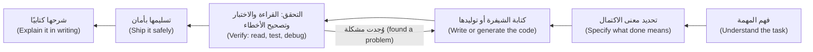
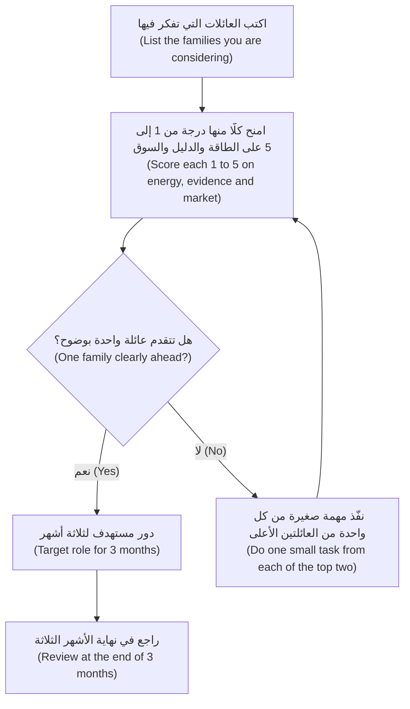
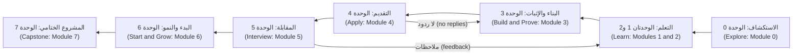

# الوحدة 0 — التوجيه

*قبل أن تكتب السيرة الذاتية أو تتدرّب على سؤال واحد من أسئلة المقابلات، تحتاج إلى ثلاثة أشياء: صورة صادقة عن السوق الذي تدخله، وفكرة واضحة عمّا تتضمّنه كل وظيفة تقنية للمبتدئين في العمل اليومي، وخطة لاستخدام هذه الدورة والمكتبة المحيطة بها. تقدّم لك هذه الوحدة الأشياء الثلاثة. تبدأ بما غيّره وكلاء البرمجة بالذكاء الاصطناعي (AI coding agents) في العمل على مستوى المبتدئين، وما لم يغيّروه. ثم ترسم خريطة الأدوار الرئيسية للمبتدئين في البرمجيات والذكاء الاصطناعي والبيانات والمنصّات والأمن: ماذا يفعل أصحابها طوال اليوم، وماذا ينتجون، وما الذي يختبره أصحاب العمل. وتنتهي بتقديم الخرّيجين الخمسة في برنامج نجم للخرّيجين التقنيين (Najm Tech Graduate Programme) الذين ستتابعهم عبر الدورة، وتبيّن كيف تحوّل الدورة إلى خطة ذات إجراءات أسبوعية. وبنهايتها سيكون لديك مسح للسوق، واختيار أول للدور المستهدف، وتدقيق أولي لمهاراتك.*

> **الخطوات:** Explore — رؤية السوق كما هو، واختيار اتجاه، وبناء العادات التي تحوّل الشهادة الجامعية إلى عرض وظيفي.

---

# 0.1 — سوق التقنية للمبتدئين في عصر الذكاء الاصطناعي: ما الذي تغيّر وما الذي لم يتغيّر
*المستوى: 🟢 مبتدئ* · *المتطلبات: لا يوجد* · *الخطوة: Explore*

**بعد هذا الدرس تستطيع** أن تبني جدول مسح للسوق من عشرة إعلانات حالية لدور مبتدئ واحد، وأن تحوّله إلى موجز عن السوق في نصف صفحة يسمّي أكبر ثلاث فجوات لديك وأول إجراء لك. *مدة الدراسة: نحو 125 دقيقة (تقدير).*

## ⚡ الدرس في دقيقة
- تتولّى وكلاء البرمجة بالذكاء الاصطناعي الآن كثيرًا من العمل الروتيني الذي كان المبتدئون يتعلّمون عليه: الشيفرة النمطية المتكررة، والميزات البسيطة، والمسودات الأولى للاختبارات، وإصلاحات الأخطاء الصغيرة.
- لم يتوقّف أصحاب العمل عن الحاجة إلى المبتدئين. لكنهم رفعوا المعيار لما يجب أن يُظهره المبتدئ: أنك قادر على **تحديد العمل والتحقّق منه وتسليمه وشرحه**، لا على إنتاج الشيفرة فحسب.
- ما الذي لم يتغيّر: قراءة الشيفرة وتصحيح أخطائها، والأساسيات المتينة، والكتابة الواضحة، والموثوقية والثقة ما زالت تحدّد من يُوظَّف ومن يُحتفظ به.
- مؤشّر القرار: اقرأ السوق بنفسك. عشرة إعلانات وظائف حقيقية لدورك المستهدف تخبرك أكثر من أي عنوان إخباري.
- الفخ الأكبر: التفاعل مع العناوين الإخبارية، إمّا بالذعر («الذكاء الاصطناعي أخذ وظائف المبتدئين») أو بتجاهل التغيير («شهادتي تكفي»).

## 🧭 لماذا يهم
نحن في أكتوبر. **عمر**، خرّيج علوم الحاسوب بدرجات ممتازة وسجل قوي في المسابقات البرمجية، أرسل السيرة الذاتية نفسها إلى أكثر من خمسين إعلانًا وظيفيًا في أنحاء الخليج: رفضان آليّان، وصمت من الباقين. أمّا **ريم**، التي بنت أربعة مشاريع جانبية باستخدام وكلاء البرمجة بالذكاء الاصطناعي، فقد وصلت إلى المقابلة التقنية (technical interview) في شركة ناشئة للتقنية المالية في الدوحة هي **سديم باي (Sadeem Pay)**. سألها المُقابِل لماذا تُعيد إحدى نقاط النهاية في واجهتها البرمجية رمز الحالة 200 عند الفشل. لم تستطع الإجابة؛ فهي لم تقرأ تلك الشيفرة بعناية قط.

يحضر الاثنان جلسة تعريفية عن **برنامج نجم للخرّيجين التقنيين**. يعرض **خالد**، مدير الهندسة (engineering manager) الذي يوظّف المبتدئين في بنك نجم (Najm Bank)، شريحة من عمودين: *ما الذي تغيّر* و*ما الذي لم يتغيّر*. ويقول: «أنتم لا تدخلون سوقًا بلا وظائف. أنتم تدخلون سوقًا انتقل فيه الدليل المطلوب للوظيفة نفسها إلى مكان آخر. تعلّموا إلى أين انتقل، واستعدّوا لذلك.»

العناوين الإخبارية حقيقية بما يكفي. أفادت عدة تحليلات صدرت عام 2025 بضعف التوظيف للعاملين في بداية مسيرتهم المهنية في المهن الأكثر تعرّضًا للذكاء الاصطناعي. ومن أكثر هذه الدراسات تداولًا دراسة لإريك برينيولفسون (Erik Brynjolfsson) وبهارات تشاندار (Bharat Chandar) وروي تشن (Ruyu Chen) في مختبر ستانفورد للاقتصاد الرقمي (أغسطس 2025)، التي أفادت بتراجع نسبي في التوظيف لأصغر العاملين سنًّا في المهن المعرّضة للذكاء الاصطناعي، ومنها تطوير البرمجيات، في حين كان حال العاملين الأكثر خبرة في المهن نفسها أفضل. يبيّن لك هذا الدرس كيف تقرأ مثل هذه الأدلة بهدوء وتحوّلها إلى خطة.

## 📐 كيف يعمل

### 🟢 الأساسيات

**ما هي وظيفة «مستوى المبتدئين».** دور مستوى المبتدئين أو الدور المبتدئ هو دور يتوقّع خبرة مهنية بدوام كامل قليلة أو معدومة، تصل عادةً إلى نحو سنتين. ستراه تحت أسماء كثيرة: *مهندس خرّيج*، و*مطوّر مبتدئ*، و*مساعد*، و*Engineer I*، و*محلّل*، و*متدرّب*، أو مقعد في *برنامج للخرّيجين* (وهو برنامج منظّم مدته سنة أو سنتان، يتضمّن تناوبًا بين الأقسام وتدريبًا، وهو شائع في البنوك وشركات الطاقة والاتصالات والجهات الحكومية).

**ما الذي تغيّر.** هناك أربعة تحوّلات هي الأهم بالنسبة إليك.

| التحوّل | كيف يبدو | ماذا يعني لك |
|---|---|---|
| **البرمجة الروتينية أصبحت مُساعَدة** | مساعدو البرمجة ووكلاؤها بالذكاء الاصطناعي تصوغ مسودات الشيفرة النمطية والميزات البسيطة والاختبارات والإصلاحات الصغيرة | عبارة «أستطيع كتابة تطبيق CRUD» لم تعد دليلًا نادرًا. أظهِر ما فعلته ولم تستطع الأداة فعله: القرارات، والفحوص، والإصلاحات |
| **التحقّق هو المهارة النادرة** | تستطيع الفرق إنتاج شيفرة أكثر مما تستطيع مراجعته بأمان | يبحث أصحاب العمل عن مبتدئين يقرؤون الشيفرة قراءة نقدية، ويختبرونها، ويكتشفون الخطأ فيها، بما في ذلك الشيفرة المكتوبة بالذكاء الاصطناعي |
| **طلبات أكثر لكل إعلان** | التقديم بنقرة واحدة والسير الذاتية المكتوبة بالذكاء الاصطناعي تجعل التقديم في كل مكان رخيصًا | الكمّ لا ينجح. ما ينجح هو الطلبات الموجّهة والإحالات والدليل الظاهر |
| **المقابلات تتغيّر** | بعض أصحاب العمل يسمحون بأدوات الذكاء الاصطناعي أو يتوقّعونها في جولات معيّنة ويمنعونها في غيرها؛ وأصبحت التمارين التي تطلب منك مراجعة طلب دمج معيب مولَّد بالذكاء الاصطناعي أكثر شيوعًا | اسأل عن قواعد كل جولة، وتدرّب على البرمجة دون مساعدة وعلى مراجعة الشيفرة نقديًا كليهما |

**ما الذي لم يتغيّر.** معظم ما كان يصنع مبتدئًا جيدًا قبل عشر سنوات ما زال يصنعه:
- **الأساسيات.** هياكل البيانات (data structures)، وكيف يعمل الويب وقواعد البيانات، وكيف تفشل البرامج. لا يمكنك الحكم على مخرجات الذكاء الاصطناعي من دونها.
- **قراءة الشيفرة وتصحيح أخطائها.** معظم العمل المهني يغيّر شيفرة موجودة.
- **التواصل.** وصف واضح لطلب الدمج، وسؤال جيد، وتحديث مكتوب قصير.
- **الموثوقية والثقة.** أن تفعل ما قلته، وأن تقول مبكرًا متى تعثّرت، وألّا تخفي خطأً أبدًا.
- **الفرق تحتاج إلى كبار المهندسين في المستقبل.** المؤسسات التي تتوقف عن توظيف المبتدئين ينتهي بها الأمر إلى نقص في كبار المهندسين، وكثير منها يدرك ذلك.

**معيار المبتدئ الجديد في صورة واحدة.** كانت الصورة القديمة للمبتدئ هي «شخص يحوّل مهمة واضحة إلى شيفرة». أمّا الصورة الجديدة فهي «شخص يستطيع أن يحمل تغييرًا صغيرًا حتى نهايته، بأمان، بمساعدة الذكاء الاصطناعي أو من دونها».

تستطيع أدوات الذكاء الاصطناعي تسريع المربّع C كثيرًا. أمّا أصحاب العمل فيوظّفون المبتدئين من أجل المربّعات المحيطة به. يتناول الدرس 1.2 كيف تبني باستخدام وكلاء البرمجة بالذكاء الاصطناعي دون أن تحملك هذه الوكلاء، ويتناول الدرس 1.3 الانتقال من «تعمل على حاسوبي المحمول» إلى «تعمل للمستخدمين».

### 🟡 التعمق أكثر

**اقرأ السوق بنفسك.** العناوين الإخبارية تحسب متوسطات على ملايين الوظائف في بلدان كثيرة. أمّا أنت فتتقدّم إلى نحو ثلاثين صاحب عمل ربما، في مكان أو مكانين. أفضل دليل على سوقك هو إعلانات الوظائف فيه. و**مسح السوق** طريقة بسيطة:

1. اختر دورًا مستهدفًا واحدًا (يساعدك الدرس 0.2) وموقعًا أو موقعين.
2. اجمع عشرة إعلانات حالية لوظائف المبتدئين أو الخرّيجين في ذلك الدور. استخدم ثلاثة مصادر على الأقل: صفحات الوظائف لدى أصحاب العمل، وموقع وظائف واحد، وLinkedIn.
3. سجّل لكل إعلان: المسمّى، ونوع صاحب العمل، والخبرة المطلوبة، والمهارات المطلوبة، والمهارات «المرغوبة»، وأي شيء عن أدوات الذكاء الاصطناعي أو الموقع أو اللغة أو الجنسية.
4. احسب عدد مرات ظهور كل مهارة. المهارات التي تظهر في سبعة إعلانات أو أكثر من العشرة هي **خط الأساس** لديك؛ والمهارات التي تظهر في ثلاثة إلى ستة هي **المهارات المميِّزة**.
5. قارن القائمة بما تستطيع إثباته اليوم. الفجوة هي خطتك الدراسية.

**كيف تقرأ الإعلان.** إعلانات الوظائف قوائم أمنيات يكتبها أشخاص مشغولون، غالبًا من قوالب جاهزة.
- عبارة «سنة إلى سنتين من الخبرة» ("1–2 years of experience") في إعلان للمبتدئين مرنة غالبًا. إن كنت تستوفي معظم المتطلبات الأساسية ولديك دليل من مشاريع أو تدريب عملي، فتقدّم.
- المهارات المذكورة أولًا والمكرّرة في المسؤوليات هي الأهم؛ أمّا قائمة الأدوات الطويلة في النهاية فهي عادةً قائمة أمنيات.
- كلمات مثل «يتولّى» و«من البداية إلى النهاية» و«بيئة الإنتاج» ("production") و«المناوبة» ("on-call") تعني أن الفريق يتوقّع من المبتدئين أن يسلّموا، لا أن يبرمجوا فقط.
- ذكر أدوات الذكاء الاصطناعي («التطوير بمساعدة الذكاء الاصطناعي»، و«واجهات النماذج اللغوية الكبيرة البرمجية») يبيّن كيف يعمل الفريق. وإن لم يذكر الإعلان شيئًا، فاسأل.

**استنتاجات ضعيفة مقابل استنتاجات قوية من الدليل نفسه.**

| استنتاج ضعيف | استنتاج قوي |
|---|---|
| «لا أحد يوظّف المبتدئين؛ عليّ أن أستسلم أو أدرس شهادة أخرى.» | «إعلانات أقل تذكر كلمة *مبتدئ* في مدينتي. لكن برامج الخرّيجين والشركات المتوسطة الحجم ما زالت توظّف. سأستهدفها وأتقدّم مبكرًا في دورتها.» |
| «الذكاء الاصطناعي يكتب الشيفرة الآن، إذن تعلّم البرمجة بلا فائدة.» | «الذكاء الاصطناعي يصوغ مسودة الشيفرة، إذن عليّ أن أكون الشخص القادر على فحصها. سأتدرّب على قراءة الشيفرة واختبارها ومراجعتها.» |
| «كل إعلان يطلب عشر أدوات؛ عليّ أن أتعلّمها كلها.» | «سبعة من عشرة إعلانات تطلب SQL وGit ومنصة سحابية واحدة. سأثبت هذه الثلاث أولًا.» |

**قراءة الأبحاث دون المبالغة في تفسيرها.** حين تصادف دراسة عن الذكاء الاصطناعي والوظائف، اطرح أربعة أسئلة:
- **بيانات من؟** استخدمت دراسة بيانات الرواتب الأمريكية. وقد لا تصف التوظيف في الدوحة أو دبي أو الرياض.
- **ارتباط أم سببية؟** تغيّر التوظيف في الوقت نفسه الذي انتشر فيه الذكاء الاصطناعي لا يثبت أن الذكاء الاصطناعي هو السبب. فأسعار الفائدة، ونهاية طفرة التوظيف في زمن الجائحة، وخفض الشركات للتكاليف حدثت كلها في السنوات نفسها. والأوراق البحثية الجيدة تناقش هذا بنفسها؛ فاقرأ ذلك القسم.
- **أي وظائف؟** «المعرّضة للذكاء الاصطناعي» مقياس يعرّفه الباحثون. اقرأ كيف عرّفوه.
- **ماذا يقولون إنه يساعد؟** تفصل دراسات عدة بين الاستخدامات *الأتمتية* للذكاء الاصطناعي (الأداة تؤدّي المهمة) والاستخدامات *المعزِّزة* (الأداة تساعد الشخص على أدائها). ضع نفسك في الجانب المعزِّز: الشخص الذي يوجّه الأدوات ويفحصها.

لا تكرّر أبدًا نسبة مئوية لم تتحقّق منها في المصدر الأصلي.

### 🔴 نظرة الخبير

**فكّر مثل الشخص الذي يدفع ثمن التوظيف.** مدير التوظيف (hiring manager) مثل خالد يوازن بين ثلاثة أمور حين يقرّر توظيف مبتدئ:
- **التكلفة:** الراتب، إضافةً إلى الوقت الذي يقضيه كبار المهندسين في الإرشاد والمراجعة. ووقت الإرشاد هو غالبًا التكلفة الأكبر.
- **القيمة:** العمل الذي سيؤدّيه المبتدئ هذا العام، والمهندس الكبير الذي سيصبحه بعد بضع سنوات.
- **المخاطرة:** احتمال أن يسلّم المبتدئ شيئًا غير متحقَّق منه إلى بيئة الإنتاج. وفي بنك، قد يعني ذلك أموالًا أو بيانات عملاء أو جهة رقابية.

تخفّض أدوات الذكاء الاصطناعي تكلفة المخرجات الروتينية، لكنها ترفع المخاطرة حين لا يستطيع مستخدمها فحصها. المبتدئون الذين يتميّزون هم الذين **يخفّضون تكلفة الإرشاد** (أسئلة جيدة، كتابة واضحة، تعلّم سريع) و**يخفّضون المخاطرة** (يختبرون، ويتحقّقون، ويصرّحون حين لا يكونون متأكدين). وكل وحدة في هذه الدورة تعمل على أحد هذين الرافعين.

**لسوق الخليج شكله الخاص.** قيّد أي ادّعاء عام بما يناسب سوقك المحلي:
- **برامج توطين القوى العاملة (Workforce nationalisation programmes)** تشكّل التوظيف: التقطير (Qatarization) في قطر، والتوطين الإماراتي (Emiratisation) (مع برنامج نافس) في الإمارات، والسعودة (Saudization) (نطاقات) في السعودية. ويدير كثير من أصحاب العمل الكبار برامج للخرّيجين للمواطنين. وإن لم تكن مواطنًا، فتوقّع أن تكون بعض الأدوار محجوزة، واستهدف الأدوار غير المحجوزة. القواعد تتغيّر؛ فراجع المواقع الرسمية.
- **القطاعات الخاضعة للتنظيم من كبار أصحاب العمل.** المصارف والحكومة والطاقة والاتصالات والصحة تُقدّر الوعي بالأمن وحماية البيانات (data protection) (مثل القانون القطري رقم 13 لسنة 2016 بشأن حماية خصوصية البيانات الشخصية (Qatar's Law No. 13 of 2016 on personal data privacy)) والحوكمة.
- **التواصل التقني ثنائي اللغة** بالعربية والإنجليزية ميزة في الفرق التي تخدم العملاء المحليين والجهات الرقابية.
- **قواعد التأشيرات والكفالة** تختلف وتتغيّر. راجع القواعد الحالية قبل أن تخطّط للانتقال.

**السوق يتحرّك؛ أمّا طريقتك فلا.** اقرأ الأدلة الحالية، واعرف ما يفحصه أصحاب العمل، وابنِ الدليل عليه، وكرّر ذلك كل ربع سنة.

## 🧰 الأدوات
| المورد أو الأداة أو النموذج | ما هو وماذا يفعل | متى تلجأ إليه |
|---|---|---|
| **Market scan** — مسح السوق | جدول يضم عشرة إعلانات وظائف حالية لدور واحد وموقع واحد، مع عدّ المهارات حسب تكرارها | في بداية بحثك عن عمل، ثم مرة أخرى كل ثلاثة أشهر |
| **"Canaries in the Coal Mine?"** (برينيولفسون وتشاندار وتشن، مختبر ستانفورد للاقتصاد الرقمي، 2025) | دراسة واسعة الاستشهاد عن توظيف العاملين في بداية مسيرتهم في المهن المعرّضة للذكاء الاصطناعي، تستند إلى بيانات الرواتب الأمريكية | حين تريد فهم الأدلة وراء العناوين الإخبارية، وحدودها |
| **Stack Overflow Developer Survey** — استبيان المطوّرين من Stack Overflow | استبيان سنوي كبير للمطوّرين، يشمل كيف يستخدمون أدوات الذكاء الاصطناعي | لترى كيف يستخدم المطوّرون العاملون أدوات الذكاء الاصطناعي فعلًا، وقت كتابة الدرس (2026) |
| **Official labour-market sources** — مصادر سوق العمل الرسمية (مثل دليل التوقعات المهنية من مكتب إحصاءات العمل الأمريكي، ومكاتب الإحصاء الوطنية) | أوصاف حكومية للمهن، ومسارات الدخول المعتادة، والتوقعات | حين تحتاج إلى رؤية رصينة موثّقة المصادر لتوقعات دور ما |
| **Nationalisation programme sites** — مواقع برامج التوطين (مثل نافس في الإمارات) | معلومات رسمية عن برامج القوى العاملة الوطنية وحوافزها | إن كنت مواطنًا، أو لتفهم أي الأدوار محجوزة، وقت كتابة الدرس (2026) |

## 🏛️ عمليًا في بنك نجم
في نهاية الجلسة التعريفية، يعطي خالد كل حاضر **نموذج مسح السوق** في صفحة واحدة، ويطلب منهم إعادته مكتملًا في ورشة العمل الأولى. إليك جزءًا من نموذج عمر، لأدوار هندسة البرمجيات للمبتدئين في قطر والإمارات. أصحاب العمل خياليّون أو عامّون.

| # | المسمّى | نوع صاحب العمل | الخبرة المطلوبة | المهارات المطلوبة | مرغوب | أدوات الذكاء الاصطناعي المذكورة | ملاحظات |
|---|---|---|---|---|---|---|---|
| 1 | مهندس برمجيات خرّيج | بنك نجم (برنامج للخرّيجين) | خرّيج، 0 سنوات | Java أو Python، وSQL، وGit، وواجهات REST البرمجية (REST APIs) | أساسيات السحابة، والاختبار | «الاستخدام المسؤول لمساعدي البرمجة بالذكاء الاصطناعي» | تناوب بين الأقسام؛ نافذة تقديم محدّدة |
| 2 | مهندس خلفيات مبتدئ | سديم باي (شركة ناشئة للتقنية المالية) | 0–2 سنة | Python أو Go، وPostgreSQL، وDocker، وGit | المدفوعات، والتكامل والتسليم المستمرّان (CI/CD) | «نستخدم وكلاء الذكاء الاصطناعي يوميًا» | مهمة منزلية ضمن العملية |
| 3 | Software Engineer I | شركة متعددة الجنسيات، مكتب إقليمي | 0–2 سنة | هياكل البيانات والخوارزميات، ولغة برمجة واحدة، وGit | الأنظمة الموزّعة | غير مذكور | اختبار برمجة عبر الإنترنت أولًا |
| 4 | مطوّر، الخدمات الرقمية | جهة حكومية رقمية | خرّيج | JavaScript أو TypeScript، وأساسيات الويب، وSQL | إتاحة الوصول (accessibility)، وواجهة عربية من اليمين إلى اليسار | غير مذكور | قد تكون بعض الأدوار محجوزة للمواطنين؛ تحقّق من ذلك |

**ملخّص عمر (أسفل النموذج):**

| البند | النتيجة |
|---|---|
| خط الأساس (في 7 إعلانات أو أكثر من 10) | Git، وSQL، ولغة خلفيات واحدة، وواجهات REST البرمجية |
| المهارات المميِّزة (في 3–6 من 10) | Docker، والتكامل والتسليم المستمرّان، وأساسيات السحابة، والاختبار، والعربية |
| ما أستطيع إثباته اليوم | الخوارزميات (سجل المسابقات)، وJava، وPython |
| الفجوات | لم أنشر أي شيء قط؛ لا مشروع يجمع SQL وواجهة برمجية (API) واختبارات معًا؛ لا تكامل مستمر |
| ثلاثة إجراءات هذا الشهر | واجهة برمجية صغيرة منشورة مع اختبارات وتكامل مستمر؛ وملف README يشرحها؛ والتقديم إلى برنامج نجم قبل الموعد النهائي |

تعليق خالد: «فجوتك ليست في المعرفة؛ بل في الدليل على أنك تستطيع التسليم. راجع الدرس 1.3 ومواصفات المشاريع في الدرس 3.1.»

## 🛠️ التمارين
- 🟢 اجمع عشرة إعلانات حالية لدور مبتدئ واحد في موقع أو موقعين ستنتقل إليهما أو تعمل فيهما فعلًا، من ثلاثة مصادر على الأقل. املأ جدول مسح السوق. *يكتمل عندما:* يضم جدولك عشرة صفوف وكل أعمدتها ممتلئة، ولكل صف رابط يعمل أو نسخة محفوظة من الإعلان.
- 🟡 من مسحك، اكتب مهارات خط الأساس والمهارات المميِّزة مع عدد مرات ظهورها، ثم اكتب «موجزًا عن السوق» في نصف صفحة: ما الذي تطلبه الإعلانات، وما الذي فاجأك، وكيف تُذكر أدوات الذكاء الاصطناعي، وثلاثة إجراءات للشهر القادم. *يكتمل عندما:* يستطيع زميل في الدراسة قراءة موجزك وتسمية دورك المستهدف، وأكبر ثلاث فجوات لديك، وأول إجراء لك دون أن يسألك.
- 🔴 أجرِ محادثتين استطلاعيتين قصيرتين (15–20 دقيقة) مع أشخاص في دورك المستهدف، ويُفضّل أن يكون أحدهما ذا خبرة تقل عن ثلاث سنوات. اسأل كيف غيّرت أدوات الذكاء الاصطناعي سنتهم الأولى، وما الذي يجعل المبتدئ يتميّز في فريقهم. يتناول الدرس 4.2 كيف تطلب ذلك. *يكتمل عندما:* تكون لديك ملاحظات من المحادثتين وقائمة بما أكّد مسحك أو ناقضه، مع تحديث خطتك الدراسية.

## ⚠️ أخطاء وفخاخ
- **التعامل مع العناوين الإخبارية على أنها سوقك.** المتوسطات الوطنية أو العالمية قد لا تطابق مدينتك أو دورك. أجرِ مسح السوق وثق به أكثر من العنوان الإخباري.
- **التقديم الجماعي بسيرة ذاتية واحدة.** المزيد من الطلبات بالسيرة الذاتية العامّة نفسها يعني عادةً مزيدًا من الصمت. الطلبات الأقل والموجّهة المدعومة بالدليل تنجح أكثر (الوحدة 4).
- **قرار عدم تعلّم الأساسيات لأن الذكاء الاصطناعي يكتب الشيفرة.** لا يمكنك فحص ما لا تفهمه، والفحص هو ما يدفع أصحاب العمل للمبتدئين مقابله الآن.
- **إخفاء استخدامك للذكاء الاصطناعي، أو المبالغة فيه.** كلاهما يضرّ بالثقة. استخدم أدوات الذكاء الاصطناعي علنًا حيث يُسمح بها، وكن قادرًا على شرح كل سطر تقدّمه والتحقّق منه.
- **الاستشهاد بأرقام لم تتحقّق منها.** إحصائية خاطئة تُقال بثقة في مقابلة تضرّك أكثر من أن تقول: «قرأت أن توظيف العاملين في بداية مسيرتهم ضعف في الأدوار المعرّضة للذكاء الاصطناعي؛ ولم أتحقّق من الأرقام الخاصة بهذه المنطقة.»

## 🧾 الخلاصة
- تساعد وكلاء البرمجة بالذكاء الاصطناعي في البرمجة الروتينية، لذا انتقل معيار المبتدئ من «يكتب الشيفرة» إلى «يحدّد ويتحقّق ويسلّم ويشرح».
- الأساسيات، وقراءة الشيفرة وتصحيح أخطائها، والتواصل الواضح، والموثوقية ما زالت تحدّد التوظيف.
- اقرأ سوقك بنفسك عبر مسح سوق من عشرة إعلانات؛ مهارات خط الأساس تظهر في معظم الإعلانات، والمهارات المميِّزة في بعضها.
- يوازن مديرو التوظيف بين التكلفة والقيمة والمخاطرة؛ والمبتدئون الذين يخفّضون تكلفة الإرشاد والمخاطرة يتميّزون.
- في الخليج، تشكّل برامج التوطين (nationalisation programmes) وبرامج الخرّيجين والقطاعات الخاضعة للتنظيم السوق؛ فراجع القواعد الحالية.

## ✍️ اختبر نفسك

**1. أرسل عمر السيرة الذاتية نفسها إلى أكثر من خمسين إعلانًا وظيفيًا ولم يتلقَّ ردًّا يُذكر تقريبًا. بناءً على هذا الدرس، ماذا ينبغي أن يفعل أولًا؟**

- A. أن يتقدّم إلى مئة إعلان آخر هذا الشهر بالسيرة الذاتية نفسها، لأن معدّلات الاستجابة منخفضة في كل مكان
- B. أن يمسح عشرة إعلانات لدور مستهدف واحد، ثم يبني الدليل على مهارات الأساس التي تنقصه
- C. أن يبدأ دراسة الماجستير الآن، لأن سوق المبتدئين مغلق أمام الخرّيجين الجدد
- D. أن يضيف كل أداة ذُكرت في أي إعلان إلى قائمة مهاراته، كي تطابقه مرشّحات الكلمات المفتاحية

الإجابة

**B.** طريقة الدرس هي أن تقرأ سوقك بنفسك، وتجد الفجوة بين ما تطلبه الإعلانات وما تستطيع إثباته، وتسدّها بالدليل. الخيار A يكرّر ما لا ينجح؛ والخيار C يتفاعل مع العناوين الإخبارية بدلًا من الأدلة؛ والخيار D يدّعي مهارات لا يستطيع إثباتها. (القسم: 🟡 التعمق أكثر)

**2. وفقًا لهذا الدرس، أي مهارة أصبحت أكثر قيمة للمبتدئين لأن أدوات الذكاء الاصطناعي تستطيع صياغة مسودات الشيفرة الروتينية؟**

- A. كتابة الشيفرة بسرعة من الذاكرة، دون الحاجة إلى البحث عن أي شيء في الوثائق أو المنتديات
- B. حفظ قواعد الكتابة للغات برمجة كثيرة عن ظهر قلب، حتى لا يحتاج إلى مراجعة الوثائق
- C. إنتاج كميات كبيرة من الشيفرة العاملة في وقت قصير، لمجاراة أدوات الذكاء الاصطناعي
- D. التحقّق من الشيفرة: قراءتها قراءة نقدية، واختبارها، واكتشاف الأخطاء فيها

الإجابة

**D.** تستطيع الفرق إنتاج شيفرة أكثر مما تستطيع مراجعته بأمان، لذا ففحص الشيفرة هو المهارة النادرة. الخيارات A وB وC تصف مخرجات أصبحت أدوات الذكاء الاصطناعي تجعلها رخيصة. (القسم: 🟢 الأساسيات)

**3. يقول زميل لك في الدراسة: «أثبتت دراسة من ستانفورد أن الذكاء الاصطناعي دمّر وظائف المطوّرين المبتدئين في كل مكان.» ما الرد الأدقّ؟**

- A. «أفادت بتراجع نسبي للعاملين الشباب في الوظائف المعرّضة للذكاء الاصطناعي، على بيانات أمريكية؛ وهذا لا يثبت السببية ولا ينطبق على منطقتنا.»
- B. «هذا صحيح، وبما أن الأدلة تشمل كل بلد وكل صاحب عمل في كل القطاعات، فعلينا جميعًا أن نتوقف الآن عن التقديم لأدوار المطوّرين.»
- C. «تلك الدراسة مزيّفة؛ لم يكن للذكاء الاصطناعي أي أثر قابل للقياس على التوظيف في أي مكان، لذا يمكننا تجاهلها بأمان والمضي قدمًا في تقديم طلباتنا كالمعتاد.»
- D. «في الواقع أثبتت العكس: توظيف المطوّرين المبتدئين ازداد في كل مكان منذ ظهور أدوات البرمجة بالذكاء الاصطناعي.»

الإجابة

**A.** أسئلة الدرس الأربعة هي: بيانات من، وارتباط أم سببية، وأي وظائف، وماذا يساعد. الخيار B يبالغ في تفسير الأدلة؛ والخياران C وD يرفضانها أو يحرّفانها. (القسم: 🟡 التعمق أكثر)

**4. يوازن خالد بين التكلفة والقيمة والمخاطرة عند توظيف مبتدئ. أي سلوك من المرشّح يخفّض تكلفة الإرشاد والمخاطرة معًا؟**

- A. العمل وحده أسبوعًا كاملًا دون طرح أي أسئلة، ليبدو مستقلًا
- B. تقديم طلبات دمج كبيرة مولَّدة بالذكاء الاصطناعي بسرعة كي يرى الفريق إنتاجية عالية مبكرًا
- C. أوصاف واضحة للتغييرات، وعمل مختبَر، والإشارة إلى الشكوك مبكرًا في العمل
- D. تجنّب أدوات الذكاء الاصطناعي تمامًا، حتى حيث يتوقّع الفريق استخدامها في العمل

الإجابة

**C.** الكتابة الواضحة والأسئلة الجيدة تخفّض تكلفة الإرشاد؛ والاختبار والإشارة إلى عدم اليقين يخفّضان المخاطرة. الخيار A يخفي المشكلات حتى وقت متأخر؛ والخيار B يرفع تكلفة المراجعة والمخاطرة؛ والخيار D يتجاهل طريقة عمل الفريق. (القسم: 🔴 نظرة الخبير)

**5. إعلان للمبتدئين يناسب ريم جيدًا في ما عدا أنه يطلب «سنة إلى سنتين من الخبرة» ("1–2 years of experience"). لديها مشروعان كبيران وتدريب صيفي. ماذا ينبغي أن تفعل؟**

- A. أن تتخطّاه، لأنها لا تستوفي الخبرة المذكورة وستضيّع وقت مسؤول التوظيف
- B. أن تتقدّم، لأن سطور الخبرة في إعلانات المبتدئين مرنة غالبًا حين يكون الدليل قويًا
- C. أن تعدّل سيرتها الذاتية لتقول سنتين، محتسبةً التدريب والمشاريع الجانبية عملًا بدوام كامل
- D. أن ترسل بريدًا إلى الشركة تشتكي فيه من أن الإعلان ليس للمبتدئين

الإجابة

**B.** الإعلانات قوائم أمنيات؛ واستيفاء معظم المتطلبات الأساسية مع الدليل يكفي عادةً للتقديم. الخيار A يضيّع فرصة جيدة؛ والخيار C غير أمين ويخالف قواعد النزاهة في هذه الدورة؛ والخيار D لا يفيد أحدًا. (القسم: 🟡 التعمق أكثر)

## 📚 المراجع
- Brynjolfsson, E., Chandar, B. and Chen, R., "Canaries in the Coal Mine? Six Facts about the Recent Employment Effects of Artificial Intelligence", Stanford Digital Economy Lab, 2025 — https://digitaleconomy.stanford.edu/
- استبيان المطوّرين من Stack Overflow — https://survey.stackoverflow.co/
- مكتب إحصاءات العمل الأمريكي، دليل التوقعات المهنية — https://www.bls.gov/ooh/
- المنتدى الاقتصادي العالمي، تقرير مستقبل الوظائف 2025 — https://www.weforum.org/publications/the-future-of-jobs-report-2025/
- برنامج نافس الإماراتي — https://www.nafis.gov.ae/
- [*تصميم الأنظمة لمبرمجي الفايب*، الدرس 0.1 — «إنها تعمل» ليست خاصية من خصائص النظام](../vibe/index.ar.html#l0-1)
- [*تصميم الأنظمة لمبرمجي الفايب*، الدرس 9.1 — أنت المعماري الآن](../vibe/index.ar.html#l9-1)

---

# 0.2 — خريطة الأدوار: ماذا يفعل المبتدئون في البرمجيات والذكاء الاصطناعي والبيانات والمنصّات والأمن طوال اليوم فعلًا
*المستوى: 🟢 مبتدئ* · *المتطلبات: 0.1* · *الخطوة: Explore*

**بعد هذا الدرس تستطيع** أن تقيّم ثلاث عائلات أدوار على الأقل في بطاقة ملاءمة الدور مع سبب من سطر واحد لكل درجة، وأن تسمّي دورًا مستهدفًا أو مهمة لكسر التعادل بين العائلتين الأعلى. *مدة الدراسة: نحو 120 دقيقة (تقدير).*

## ⚡ الدرس في دقيقة
- عبارة «وظيفة تقنية» تغطي عدة وظائف مختلفة. خمس عائلات توظّف معظم الخرّيجين: **البرمجيات والتطوير الشامل**، و**تطبيقات الذكاء الاصطناعي**، و**البيانات**، و**السحابة والمنصّات**، و**الأمن**.
- لكل عائلة يوم عمل مختلف، وتنتج أشياء مختلفة، وتُختبر بطريقة مختلفة في المقابلات.
- المسمّيات الوظيفية غير موثوقة. اقرأ المسؤوليات واسأل: «ماذا سأنتج في أسبوع عادي؟»
- مؤشّر القرار: اختر **دورًا مستهدفًا** للأشهر الثلاثة القادمة باستخدام ثلاث عدسات: أي عمل يمنحك الطاقة، وأين لديك دليل على أنك جيد فيه، وما الذي يوظّف سوقك المبتدئين من أجله.
- الفخ الأكبر: التقديم لكل العائلات دفعة واحدة. السيرة الذاتية ومعرض الأعمال الموجّهان إلى كل شيء لا يقنعان أحدًا.

## 🧭 لماذا يهم
في أول ورشة عمل لخرّيجي نجم، يطلب خالد من كل حاضر أن يكتب دوره المستهدف على ورقة لاصقة. تكتب **هدى**، خرّيجة علوم البيانات، «عالمة بيانات» ("data scientist"). ويكتب **يوسف**، خرّيج هندسة الحاسوب الذي قضى سنته الأخيرة في الأنظمة المدمجة والشبكات، «مهندس برمجيات، أو ربما بيانات، أو سحابة». ويكتب **محمد**، خرّيج المعسكر التدريبي الذي يغيّر مساره المهني، «مطوّر شامل» ("full-stack developer").

يجمع خالد الأوراق ويطلب من **دانة**، كبيرة علماء البيانات في نجم، أن تصف الشهر الماضي لفريقها. تشرح دانة أن معظمه ذهب في استخراج بيانات موثوقة من ثلاثة أنظمة مصدرية، وإصلاح خط بيانات (pipeline) تعطّل حين غيّر أحد الأنظمة اسم عمود، والاتفاق مع فريق المخاطر على المعنى الفعلي لـ«التعثّر». وتقول: «درّبنا نموذجًا واحدًا. معظم وقت المبتدئين لديّ ذهب إلى SQL وخطوط البيانات (data pipelines).» تبدو هدى متفاجئة: لم يكن شيء من مقرراتها الدراسية يشبه ذلك.

أمّا ورقة يوسف فتُظهر مشكلة مختلفة. يقضي مسؤولو التوظيف ثوانيَ في النظرة الأولى على السيرة الذاتية، والسيرة التي تقول «مهتم بالبرمجيات والبيانات والسحابة» تُقرأ على أنها «لم يحسم أمره بعد». وقبل أن تتمكّن من بناء الدليل المناسب، تحتاج إلى معرفة ما يفعله كل دور فعلًا. وهذا الدرس يرسم تلك الخريطة.

## 📐 كيف يعمل

### 🟢 الأساسيات

**العائلات الخمس.** في ما يلي ما يفعله المبتدئ في كل عائلة عادةً في أسبوع عادي. تختلف الفرق الحقيقية، لكن هذه الأنماط تصدق لدى معظم أصحاب العمل.

| العائلة | المسمّيات المعتادة للمبتدئين | أسبوع عادي | ماذا ينتجون | مع من يعملون |
|---|---|---|---|---|
| **البرمجيات والتطوير الشامل** | مهندس برمجيات (software engineer)، أو مطوّر خلفيات (backend) أو واجهات أمامية (frontend) أو تطبيقات جوّال (mobile) أو مطوّر شامل | يتسلّم تذكرة عمل، ويقرأ الشيفرة الموجودة، ويُجري تغييرًا، ويكتب الاختبارات، ويفتح طلب دمج (pull request, PR)، ويستجيب للمراجعة، ويصلح خطأً من بيئة الإنتاج | طلبات دمج (pull requests)، واختبارات، وميزات صغيرة، وإصلاحات أخطاء، وملاحظات تصميم قصيرة | مهندسون آخرون، ومديرو المنتجات، والمصمّمون، وضمان الجودة (QA) |
| **تطبيقات الذكاء الاصطناعي** | مهندس ذكاء اصطناعي (AI engineer)، مهندس ذكاء اصطناعي تطبيقي، مهندس نماذج لغوية كبيرة، مهندس برمجيات متخصّص في الذكاء الاصطناعي | يبني ميزات فوق النماذج اللغوية الكبيرة: التعليمات، والاسترجاع (retrieval)، واستدعاءات الأدوات؛ ويكتب التقييمات؛ ويخفّض التكلفة والأخطاء؛ ويتعامل مع مخرجات النموذج الرديئة | ميزات تستخدم واجهات النماذج البرمجية (model APIs)، ومجموعات التقييم، وتغييرات في التعليمات والاسترجاع، وضوابط الحماية (guardrails) | مهندسو البرمجيات، ومديرو المنتجات، وعلماء البيانات، والأمن |
| **البيانات** | محلّل بيانات (data analyst)، مهندس بيانات (data engineer)، مهندس تحليلات (analytics engineer)، عالم بيانات، مهندس تعلّم آلي مبتدئ | يكتب SQL، ويبني خطوط بيانات (pipelines) تنقل البيانات وتنظّفها أو يصلحها، ويعرّف المقاييس، ويبني لوحات المعلومات (dashboards)، ويُجري التحليلات أو التجارب، ويدرّب النماذج ويقيّمها أحيانًا | استعلامات، وخطوط بيانات، ونماذج بيانات، ولوحات معلومات، وتحليلات، وتقييمات للنماذج (model evaluations) | فرق الأعمال، والمهندسون، ومالكو البيانات، والمخاطر والامتثال |
| **السحابة والمنصّات** | مهندس سحابة (cloud engineer)، مهندس منصّات (platform engineer)، مهندس DevOps (DevOps engineer)، مهندس موثوقية المواقع | يغيّر البنية التحتية عبر الشيفرة، ويحسّن خطوط البناء والنشر، ويستجيب للتنبيهات، ويساعد المطوّرين على التسليم، ويضبط التكلفة | تغييرات البنية التحتية كشيفرة (infrastructure-as-code changes)، وخطوط CI/CD (CI/CD pipelines)، وأدلة التشغيل (runbooks)، ولوحات المعلومات، وملاحظات الحوادث | كل فرق الهندسة، والأمن، والمورّدون |
| **الأمن** | مهندس أمن التطبيقات، محلّل أمني في مركز العمليات الأمنية، مهندس أمن السحابة | يراجع الشيفرة والتصاميم بحثًا عن الثغرات الأمنية، ويفرز نتائج أدوات الفحص، ويحقّق في التنبيهات، ويساعد الفرق على إصلاح المشكلات، ويكتب الإرشادات | نتائج مع إصلاحاتها، ونماذج التهديد، وقواعد الكشف، وأدلة الأمن | المهندسون، والمخاطر، والتدقيق، وعمليات تقنية المعلومات |

**بعض المصطلحات.** *التكامل والتسليم المستمرّان* هما الأتمتة التي تختبر الشيفرة وتسلّمها. و*البنية التحتية كشيفرة (Infrastructure as code)* تعني تعريف الخوادم والشبكات في ملفات تُراجع مثل الشيفرة. و*مركز العمليات الأمنية* هو الفريق الذي يراقب الهجمات ويستجيب لها. و*مهندس موثوقية المواقع (SRE)* هو مهندس يحافظ على موثوقية الأنظمة باستخدام البرمجيات، والأهداف المقيسة، ومناوبات الاستدعاء (on-call rotations).

**كيف تُختبر كل عائلة في المقابلات.** المقابلة تعكس الوظيفة. ويتعمّق الدرسان 5.2 و5.3 أكثر.

| العائلة | ما يُختبر عادةً | الدليل الأكثر نفعًا |
|---|---|---|
| البرمجيات والتطوير الشامل | البرمجة (هياكل البيانات والخوارزميات في شركات التقنية الكبرى؛ ومهام عملية في غيرها)، ومراجعة الشيفرة (code review)، وتصحيح الأخطاء، وأساسيات تصميم الأنظمة | مشروع منشور مع اختبارات وتكامل مستمر وملف README واضح |
| تطبيقات الذكاء الاصطناعي | البرمجة، والبناء باستخدام واجهة برمجية لنموذج لغوي كبير، وتقييم المخرجات، والتعامل مع الفشل والتكلفة، والوعي بحقن التعليمات | ميزة صغيرة قائمة على نموذج لغوي كبير مع مجموعة تقييم وحالات فشل موثّقة |
| البيانات | SQL (دائمًا تقريبًا)، ونمذجة البيانات (data modelling)، ودراسة حالة أو تحليل، والإحصاء لعلوم البيانات | خط بيانات أو تحليل على بيانات عامة حقيقية، مع SQL مختبَر واستنتاج مكتوب |
| السحابة والمنصّات | Linux، والشبكات، وأساسيات مزوّد سحابي، والحاويات (containers)، وسيناريوهات حلّ المشكلات | بنية تحتية معرّفة بالشيفرة، وخط تسليم يعمل، وتقرير حادثة أو دليل تشغيل مكتوب |
| الأمن | ثغرات الويب، والمراجعة الآمنة للشيفرة، والشبكات، والأسئلة القائمة على السيناريوهات | تقارير مكتوبة عن مختبرات مصرّح بها أو تحديات «التقاط العلم»، ومراجعة آمنة لشيفرة مشروعك |

**نقاط دخول مجاورة.** هناك وظائف أولى جيدة أخرى تجاور هذه العائلات: **مهندس ضمان الجودة وأتمتة الاختبارات**، و**مهندس الدعم أو الحلول** (عمل تقني مع العملاء)، و**تقنية المعلومات والأنظمة المؤسسية** (مثل إعداد منصّات المورّدين الكبيرة التي تشغّلها البنوك)، و**مدير منتجات مساعد**. كل منها مسيرة مهنية حقيقية، وكل منها قد يقود لاحقًا إلى العائلات الخمس.

### 🟡 التعمق أكثر

**المسمّيات تكذب؛ والمسؤوليات لا تكذب.** المسمّى نفسه يعني عملًا مختلفًا لدى أصحاب عمل مختلفين. فـ«مهندس البرمجيات» في سديم باي قد يبني واجهات الدفع البرمجية (payment APIs) من البداية إلى النهاية وينشرها يوميًا. أمّا «مهندس البرمجيات» في بنك كبير فقد يقضي جزءًا كبيرًا من أسبوعه في دمج أنظمة المورّدين، أو كتابة التقارير، أو تغيير الإعدادات تحت رقابة صارمة على التغيير. وقد يكتب «عالم البيانات» في الغالب SQL ولوحات معلومات؛ وقد يكتب «مهندس الذكاء الاصطناعي» في الغالب شيفرة خلفيات. اقرأ قسم المسؤوليات واسأل في أي مقابلة: *«ماذا سأنتج في أسبوع نموذجي خلال أشهري الثلاثة الأولى؟»*

**إلى أين تقود الشهادات عادةً، وإلى أين يمكن أن تقود.**

| الشهادة أو الخلفية | الأهداف الأولى المعتادة | واقعي أيضًا مع دليل موجّه |
|---|---|---|
| علوم الحاسوب | البرمجيات، وتطبيقات الذكاء الاصطناعي | هندسة البيانات (data engineering)، والمنصّات، والأمن |
| علوم البيانات (Data science) | محلّل بيانات، وعالم بيانات | هندسة البيانات، وهندسة التحليلات، وتطبيقات الذكاء الاصطناعي |
| هندسة الحاسوب أو هندسة البرمجيات | البرمجيات، والأنظمة المدمجة، والسحابة والمنصّات | الأمن، ولا سيما أمن الشبكات والسحابة |
| معسكر تدريبي أو تعلّم ذاتي | التطوير الشامل (full-stack)، والواجهات الأمامية، وأتمتة ضمان الجودة | أي عائلة، مع دليل أقوى يعوّض غياب الشهادة |

لا شيء من هذا قاعدة. أصحاب العمل يوظّفون الدليل. فخرّيج علوم البيانات الذي لديه خط بيانات مختبَر مرشّح جدير بالثقة لهندسة البيانات؛ وخرّيج هندسة الحاسوب الذي شغّل عنقودًا صغيرًا وكتب دليل تشغيله (runbook) مرشّح جدير بالثقة للمنصّات.

**كيف يغيّر الذكاء الاصطناعي كل عائلة.** كل العائلات تستخدم أدوات الذكاء الاصطناعي الآن، لكن الأثر يختلف:
- **البرمجيات:** الوكلاء (agents) تصوغ مسودات كثير من الشيفرة الروتينية، لذا تزداد أهمية المراجعة والاختبار وحسن التقدير في التصميم.
- **تطبيقات الذكاء الاصطناعي:** عائلة كاملة لم تكن موجودة تقريبًا للمبتدئين قبل بضع سنوات. تحتاج إلى مهارات البرمجيات المعتادة إضافةً إلى التقييم والسلامة.
- **البيانات:** يساعد الذكاء الاصطناعي في كتابة SQL والشيفرة، لكن الجزء الصعب ما زال معرفة ما إذا كانت البيانات والأرقام صحيحة.
- **السحابة والمنصّات:** يصوغ الذكاء الاصطناعي مسودات الإعدادات، لكن تغييرًا خاطئًا قد يُسقط كل الخدمات، لذا تزداد أهمية المراجعة الدقيقة والتراجع (rollback) والمراقبة (monitoring).
- **الأمن:** الشيفرة المكتوبة بالذكاء الاصطناعي وميزات الذكاء الاصطناعي تخلق عملًا جديدًا (حقن التعليمات (prompt injection)، والشيفرة المولَّدة غير الآمنة)، وفرق الأمن تستخدم الذكاء الاصطناعي في الفرز (triage).

**الاختيار بثلاث عدسات.** امنح كل عائلة تفكّر فيها درجة من 1 إلى 5 على كل عدسة:

1. **الطاقة:** أي عمل ستستمتع به في يوم ثلاثاء عادي؟ بناء ميزات يراها المستخدمون، أم جعل الأرقام جديرة بالثقة، أم إبقاء الأنظمة عاملة، أم اكتشاف كيف تنكسر الأشياء؟
2. **الدليل:** أين لديك دليل بالفعل، أو درجات أو مشاريع أو ملاحظات توحي بأنك ستكون جيدًا؟
3. **السوق:** كم إعلانًا للمبتدئين وجد مسح السوق لديك (الدرس 0.1) لهذه العائلة في موقعك؟

الدور المستهدف قرار للأشهر الثلاثة القادمة، لا للعمر كله. فهو يخبرك بأي مسار دراسي تتبع (الوحدة 2)، وأي مشروع ختامي تبني (الدرس 3.1)، وأي إعلانات تتقدّم إليها (الوحدة 4).

### 🔴 نظرة الخبير

**الشكل T يتفوّق على التشتّت.** يحب أصحاب العمل المبتدئين ذوي *الشكل T (T-shaped)*: متعمّقون في مجال واحد (الخط العمودي) مع معرفة عملية بالمجالات المجاورة (الخط الأفقي). فمهندس البرمجيات الذي يفهم أيضًا SQL والنشر (deployment) وأساسيات الأمن أسهل في إلحاقه بفريق من آخر لا يعرف إلا إطار عمل واحدًا. و«الشكل T» ليس مثل «التقديم إلى كل شيء»: العمق هو ما يجعلك تُوظَّف، والاتساع هو ما يجعلك مفيدًا في الأسبوع الثاني.

**بعض الأدوار أسهل دخولًا من الباب المجاور.** في كثير من المؤسسات، توظّف فرق موثوقية المواقع والمنصّات والأمن عددًا أقل من الخرّيجين الجدد الخالصين وعددًا أكبر من الأشخاص المنتقلين إليها من البرمجيات أو عمليات تقنية المعلومات أو الشبكات. هذا نمط، لا قاعدة؛ فبرامج الخرّيجين وبعض مراكز العمليات الأمنية توظّف الخرّيجين مباشرة. وإن وجد مسح السوق لديك إعلانات قليلة للمبتدئين في عائلة تحبها، فالطريق الواقعي هو أن تبدأ في دور مجاور وتنتقل بعد سنة أو سنتين، وتبني الدليل في أثناء ذلك.

**أصحاب العمل الخاضعون للتنظيم يضيفون طبقة.** في بنك مثل نجم، تعمل كل عائلة تحت الرقابة على التغيير (موافقات قبل تغييرات بيئة الإنتاج)، وسجلّات التدقيق، وقانون حماية البيانات (data protection law)، والسياسة الأمنية. والمبتدئون الذين يفهمون سبب وجود هذه الضوابط، ولا يعاملونها على أنها بيروقراطية يجب الالتفاف عليها، يندمجون أسرع. وذِكر أنك تفهم الرقابة على التغيير أو حماية البيانات، باختصار ودقة، إشارة حقيقية في مقابلة لدى بنك.

**دورك الأول لا يحدّد مسيرتك المهنية.** الانتقال بين العائلات في السنوات الأولى شائع: من محلّل بيانات إلى مهندس بيانات، ومن مهندس برمجيات إلى المنصّات، ومن ضمان الجودة إلى البرمجيات. وما ينتقل معك هو عادة تسليم عمل متحقَّق منه والكتابة عنه. ويعود الدرس 6.3 إلى النمو بعد وظيفتك الأولى.

## 🧰 الأدوات
| المورد أو الأداة أو النموذج | ما هو وماذا يفعل | متى تلجأ إليه |
|---|---|---|
| **Role-fit scorecard** — بطاقة ملاءمة الدور | جدول يمنح كل عائلة أدوار درجة على الطاقة والدليل والسوق، وينتهي بدور مستهدف لثلاثة أشهر | عند اختيار دورك المستهدف أو تغييره |
| **roadmap.sh** | خرائط تعلّم يصونها المجتمع لكثير من الأدوار التقنية (الخلفيات، وDevOps، والبيانات، والذكاء الاصطناعي، وغيرها) | لترى قائمة المهارات المعتادة لدور غير مألوف بنظرة واحدة |
| **O\*NET OnLine** | قاعدة بيانات وزارة العمل الأمريكية للمهن والمهام والمهارات والأدوات | لمقارنة ما تتضمّنه المهن المختلفة، مهمةً بمهمة |
| **NICE Workforce Framework for Cybersecurity** (NIST) — إطار NICE للقوى العاملة في الأمن السيبراني | إطار عام يصف أدوار العمل في الأمن السيبراني والمهام والمهارات التي يحتاجها كل منها | عند استكشاف أي دور أمني يناسبك |
| **Engineering career ladders** — سلالم المسار المهني الهندسي (مثل engineeringladders.com وprogression.fyi) | أوصاف منشورة للمستويات تبيّن ما يعنيه «مبتدئ» و«متوسط المستوى» في شركات حقيقية | لفهم ما هو متوقّع في كل مستوى وكيف تنمو الأدوار |
| **Informational conversation** — المحادثة الاستطلاعية | محادثة قصيرة وصادقة مع شخص يؤدّي الدور، لمعرفة كيف يبدو أسبوعه | قبل الالتزام بدور مستهدف لم تره عن قرب |

## 🏛️ عمليًا في بنك نجم
بعد حديث دانة، يوزّع خالد **بطاقة ملاءمة الدور**. إليك بطاقة هدى، التي ملأتها بعد أسبوع من قراءة الإعلانات والتحدّث مع اثنين من فريق دانة.

| العائلة | الطاقة (1–5) | الدليل (1–5) | السوق (1–5) | المجموع | ملاحظات |
|---|---|---|---|---|---|
| عالم بيانات | 4 | 4 | 2 | 10 | جيدة في النماذج ودفاتر الملاحظات البرمجية (notebooks)؛ إعلانات قليلة للمبتدئين في الدوحة، ومعظمها يطلب سنتين فأكثر (2+ years) |
| مهندس بيانات | 4 | 2 | 4 | 10 | استمتعت بإصلاح البيانات الفوضوية في أطروحتي أكثر من النمذجة؛ SQL لديّ ضعيفة؛ إعلانات كثيرة من البنوك وشركات الاتصالات |
| محلّل بيانات | 3 | 3 | 4 | 10 | إعلانات كثيرة؛ نمذجة أقل مما أريد |
| مهندس تطبيقات ذكاء اصطناعي (AI application engineer) | 3 | 2 | 3 | 8 | مثير للاهتمام، لكن مهاراتي البرمجية ضعيفة |
| مهندس برمجيات | 2 | 2 | 4 | 8 | ليس حيث تكمن طاقتي |

**كسر التعادل (القسم الأخير من البطاقة):**

| السؤال | إجابة هدى |
|---|---|
| أي مهمة صغيرة من العائلات الأعلى جرّبتُ؟ | أعدت بناء تنظيف بيانات أطروحتي على شكل خط بيانات بـSQL (مهندس بيانات)؛ وبنيت نموذجًا للتنبّؤ بتسرّب العملاء على بيانات عامة (عالم بيانات) |
| أيّهما استمتعت به أكثر في يوم عادي؟ | خط البيانات. أحببت جعل البيانات جديرة بالثقة |
| الدور المستهدف للأشهر الثلاثة القادمة | **مهندسة بيانات مبتدئة (Junior data engineer)**، مع أدوار محلّل البيانات هدفًا ثانيًا |
| ما لن أفعله في هذه الأشهر الثلاثة | التقديم لأدوار هندسة البرمجيات؛ وبدء دورة جديدة في التعلّم الآلي |
| تاريخ المراجعة | نهاية يناير |

ملاحظة دانة في الهامش: «اختيار جيد لهذا السوق. خلفيتك في النمذجة ستجعلك مهندسة بيانات أفضل، لأنك تعرفين الغرض من البيانات. مسارك الدراسي في الدرس 2.3.»

## 🛠️ التمارين
- 🟢 لكل عائلة من العائلات الخمس، اكتب جملتين بكلماتك الخاصة: ماذا ينتج المبتدئ في أسبوع عادي، وكيف تُختبر تلك العائلة عادةً في المقابلات. *يكتمل عندما:* تستطيع شرح العائلات الخمس لصديق دون ملاحظات، وتطابق جملك الجداول في هذا الدرس.
- 🟡 أكمل بطاقة ملاءمة الدور لثلاث عائلات على الأقل، مستخدمًا مسح السوق من الدرس 0.1 لعدسة السوق. *يكتمل عندما:* يكون لكل درجة سبب في سطر واحد، ويكون لديك إمّا دور مستهدف واضح أو مهمة لكسر التعادل لكل من العائلتين الأعلى.
- 🔴 نفّذ مهمة صغيرة حقيقية من كل من العائلتين الأعلى لديك (مثلًا: اكتب خمسة استعلامات SQL (SQL queries) على مجموعة بيانات عامة وانشر واجهة برمجية صغيرة جدًا؛ أو اكتب ملف Dockerfile وراجع شيفرتك بحثًا عن قائمة OWASP لأهم عشر مخاطر (OWASP Top 10)). ثم اكتب نصف صفحة عن أيّهما استمتعت به أكثر ولماذا، واختر دورك المستهدف. *يكتمل عندما:* تكون المهمتان في مستودع عام أو قابل للمشاركة، ويكون دورك المختار وتاريخ المراجعة مكتوبين في بطاقتك.

## ⚠️ أخطاء وفخاخ
- **الاختيار بحسب المسمّى أو الضجّة.** «مهندس الذكاء الاصطناعي» يبدو مثيرًا؛ فاسأل عمّا يتضمّنه الأسبوع قبل أن تختاره. اختر بحسب العمل، لا بحسب التسمية.
- **التقديم لكل العائلات.** السيرة الذاتية الموجّهة إلى كل شيء تبدو غير مركّزة. اختر دورًا مستهدفًا واحدًا وخيارًا ثانيًا لثلاثة أشهر.
- **افتراض أن شهادتك تحدّد دورك.** أصحاب العمل يوظّفون الدليل. إن كان العمل في عائلة أخرى يمنحك الطاقة، فابنِ الدليل عليه.
- **تجاهل نقاط الدخول المجاورة.** أدوار ضمان الجودة وهندسة الدعم وتقنية المعلومات قد تكون وظائف أولى قوية وطرقًا إلى عائلات أخرى. فكّر فيها بجدية، ولا سيما حيث تندر إعلانات المبتدئين.
- **معاملة الدور المستهدف على أنه دائم.** إنه قرار لثلاثة أشهر مع تاريخ مراجعة. الاختيار أفضل من انتظار اليقين.

## 🧾 الخلاصة
- خمس عائلات توظّف معظم خرّيجي التقنية: البرمجيات، وتطبيقات الذكاء الاصطناعي، والبيانات، والسحابة والمنصّات، والأمن؛ ولكل منها أسبوع مختلف ومخرجات مختلفة ومقابلات مختلفة.
- تختلف المسمّيات بين أصحاب العمل؛ فاقرأ المسؤوليات واسأل عمّا ستنتجه في أسبوع نموذجي.
- اختر دورًا مستهدفًا لثلاثة أشهر بثلاث عدسات: الطاقة والدليل والسوق.
- كن على الشكل T: متعمّقًا في مجال واحد، مع معرفة عملية بالمجالات المحيطة به.
- بعض الأدوار أسهل وصولًا من دور مجاور؛ ودورك الأول لا يحدّد مسيرتك المهنية.

## ✍️ اختبر نفسك

**1. تقول سيرة يوسف الذاتية إنه «مهتم بأدوار البرمجيات والبيانات والسحابة» ("interested in software, data and cloud roles"). ما المشكلة الرئيسية في ذلك؟**

- A. معظم أصحاب العمل لا يوظّفون هذا العام إلا لأدوار السحابة، لذا فالأدوار الأخرى مساحة مهدرة
- B. خرّيجو هندسة الحاسوب غير مؤهّلين لأدوار البيانات، لذا فهذا الجزء مضلّل
- C. تُقرأ على أنها غير مركّزة؛ ودور مستهدف واحد واضح أكثر إقناعًا
- D. عليه أن يذكر العائلات الخمس كلها لا ثلاثًا فقط، ليصل إلى عدد أكبر من مسؤولي التوظيف

الإجابة

**C.** السيرة الذاتية الموجّهة إلى كل شيء لا تقنع أحدًا؛ فاختر دورًا مستهدفًا لثلاثة أشهر. الخيار B خاطئ، لأن أصحاب العمل يوظّفون الدليل؛ والخياران A وD لا أساس لهما في الدرس. (القسمان: ⚡ الدرس في دقيقة و🟡 التعمق أكثر)

**2. أي موضوع في المقابلات يُختبر لأدوار البيانات بصرف النظر تقريبًا عن صاحب العمل؟**

- A. استعلامات SQL بما فيها الربط والتجميع على جداول
- B. إدارة Kubernetes وترقية العناقيد
- C. تصميم شاشات تطبيقات الجوّال والتنقّل بينها وتحريكها
- D. تحديات «التقاط العلم» في أمن الويب

الإجابة

**A.** يذكر جدول الدرس أن SQL تُختبر دائمًا تقريبًا لأدوار البيانات. الخيار B ينتمي أكثر إلى السحابة والمنصّات، والخيار C إلى البرمجيات، والخيار D إلى الأمن. (القسم: 🟢 الأساسيات)

**3. صاحبا عمل يعلن كلاهما عن دور «مهندس برمجيات». ما أفضل طريقة لمعرفة ما إذا كانت الوظيفتان متشابهتين فعلًا؟**

- A. مقارنة المسمّيين الوظيفيين ومستوى الأقدمية الذي يذكره كل إعلان في عنوانه
- B. مقارنة شعارَي الشركتين ومواقع مكاتبهما ومدى شهرة كل علامة تجارية في السوق
- C. افتراض أنهما الوظيفة نفسها، لأن أصحاب العمل يستخدمون مسمّيات موحّدة في القطاع كله
- D. قراءة المسؤوليات والسؤال عمّا ستنتجه فعليًا في أسبوع نموذجي

الإجابة

**D.** المسمّيات غير موثوقة؛ والمسؤوليات والمخرجات الأسبوعية هي التي تخبرك ما الوظيفة. الخياران A وC يثقان بالمسمّى؛ والخيار B لا يخبرك شيئًا عن العمل. (القسم: 🟡 التعمق أكثر)

**4. تمنح هدى دورَي عالم البيانات ومهندس البيانات الدرجة نفسها في بطاقة ملاءمة الدور. ماذا يقترح الدرس أن تفعل؟**

- A. أن تتقدّم إلى الاثنين، وإلى أدوار هندسة البرمجيات أيضًا، لتعظيم فرصها في الحصول على عرض وظيفي
- B. أن تجرّب مهمة صغيرة حقيقية من كل منهما، وترى أيّهما تستمتع به، ثم تختار مع تاريخ مراجعة
- C. أن تنتظر حتى تشعر باليقين التام بشأن مسيرتها المهنية الطويلة قبل أن تختار أي شيء
- D. أن تختار الدور ذا المسمّى الأكثر إبهارًا، لأن المسمّيات تشكّل نظرة مسؤولي التوظيف إليها

الإجابة

**B.** كسر التعادل في البطاقة هو مهمة صغيرة من كل عائلة من العائلات الأعلى، ثم قرار لثلاثة أشهر. الخيار A يشتّت دليلها؛ والخيار C يؤخّر دون أدلة جديدة؛ والخيار D يختار بحسب التسمية لا العمل. (القسم: 🟡 التعمق أكثر)

**5. يحب يوسف هندسة المنصّات (platform engineering)، لكن مسح السوق لديه يجد إعلانات قليلة جدًا للمبتدئين في المنصّات في مدينته. أي نهج يصفه الدرس بأنه واقعي؟**

- A. أن يتخلّى عن هندسة المنصّات نهائيًا ويختار أي عائلة وظيفية لديها أكبر عدد من الإعلانات
- B. أن يدّعي في سيرته الذاتية سنتين من الخبرة في المنصّات، محتسبًا مختبرات الجامعة
- C. أن يبدأ في دور مجاور مثل عمليات تقنية المعلومات، ويواصل بناء الدليل على مهارات المنصّات بعد العمل
- D. أن يتقدّم إلى أدوار المنصّات العليا فقط، لأن أدوار المبتدئين نادرة والمعيار واحد

الإجابة

**C.** كثيرًا ما تُدخَل بعض الأدوار من الباب المجاور، والانتقال بين العائلات شائع في السنوات الأولى. الخيار A يستسلم مبكرًا جدًا؛ والخيار B غير أمين؛ والخيار D يستهدف أدوارًا لا يستطيع الفوز بها بعد. (القسم: 🔴 نظرة الخبير)

## 📚 المراجع
- O\*NET OnLine، وزارة العمل الأمريكية — https://www.onetonline.org/
- مكتب إحصاءات العمل الأمريكي، دليل التوقعات المهنية — https://www.bls.gov/ooh/
- NIST، مركز موارد إطار NICE — https://www.nist.gov/itl/applied-cybersecurity/nice/nice-framework-resource-center
- roadmap.sh — https://roadmap.sh/
- سلالم الهندسة — https://www.engineeringladders.com/
- Progression.fyi (أطر مهنية منشورة) — https://www.progression.fyi/
- Google، كتاب هندسة موثوقية المواقع (مجاني على الإنترنت) — https://sre.google/sre-book/table-of-contents/
- [*لبنات بناء البرمجيات كخدمة*، الدرس 0.1 — الـ80% التي لا يبيعها أحد: تشريح كل برمجية كخدمة](../saas/index.ar.html#/0.1)
- [*الذكاء الاصطناعي الآمن وأمن التطبيقات*، الدرس 12.2 — المسيرة المهنية في الأمن: الأدوار والشهادات ومعرض الأعمال](../secai/index.ar.html#/12.2)
- [*إدارة منتجات الذكاء الاصطناعي*، الدرس 10.2 — المسيرة المهنية لمدير منتجات الذكاء الاصطناعي: المقابلات ومعرض الأعمال والنمو](../aipm/index.ar.html#/10.2)
- [*هندسة البيانات والتحليلات: من الصفر إلى الاحتراف*، الوحدة 1 — SQL ونمذجة البيانات](../data/index.ar.html#/1.1)
- [*السحابة وDevOps: من الصفر إلى الاحتراف*، الوحدة 1 — الأسس](../cloud/index.ar.html#/1.1)
- [*تشغيل وكلاء الذكاء الاصطناعي في بيئة الإنتاج*، المستوى 2 — مهندس الوكلاء (Agent Engineer)](../agentic/learning-path.ar.html#level-2-agent-engineer)
- [*اختبار البرمجيات من الصفر إلى الاحتراف في عصر الذكاء الاصطناعي*، الدرس 8.2 — مسار الاختبار المهني: الأدوار والشهادات والمقابلات ومعرض الأعمال](../testing/index.ar.html#/8.2) — منظور الاختبار لهذا الموضوع

---

# 0.3 — تعرّف على الدفعة، وكيف تستخدم هذه الدورة والمكتبة
*المستوى: 🟢 مبتدئ* · *المتطلبات: 0.1، 0.2* · *الخطوة: Explore, Learn*

**بعد هذا الدرس تستطيع** أن تُعدّ مجلد مسيرتك المهنية وتدقيقًا أوليًا مع ميزانية زمنية أسبوعية محجوزة في تقويمك، وأن تطابق كل فجوة من أكبر ثلاث فجوات لديك مع درس في المكتبة. *مدة الدراسة: نحو 120 دقيقة (تقدير).*

## ⚡ الدرس في دقيقة
- ستتابع خمسة خرّيجين في **برنامج نجم للخرّيجين التقنيين** لدى **بنك نجم**، وهو بنك خليجي خيالي، إضافةً إلى الأشخاص الذين يوظّفونهم ويرشدونهم.
- هذه الدورة لا تعيد تدريس الهندسة. إنها تخبرك **بما يفحصه أصحاب العمل**، وترسلك إلى **الدروس المحدّدة** في المكتبة التي تبني كل مهارة، وتعلّمك مهارات البحث عن عمل التي لا تغطيها أي دورة أخرى.
- تتبع الدورة ثماني خطوات: **Explore, Learn, Build, Prove, Apply, Interview, Start, Grow** (الاستكشاف، والتعلّم، والبناء، والإثبات، والتقديم، والمقابلة، والبدء، والنمو). وكل درس موسوم بخطوته.
- مؤشّر القرار: اختر كيف ستأخذ الدورة (المسار الكامل، أو مسارًا موجّهًا، أو بصفتك مرشدًا) وحدّد ميزانية زمنية أسبوعية تستطيع الالتزام بها.
- الفخ الأكبر: القراءة دون إنتاج. كل درس ينتهي بمُنتَج عملي؛ احتفظ بها كلها في **مجلد مسيرتك المهنية**.

## 🧭 لماذا يهم
لدى محمد، الذي يغيّر مساره المهني بعد معسكر تدريبي، عادة لا يفخر بها. خلال العام الماضي بدأ ست دورات عبر الإنترنت ولم ينهِ أيًّا منها. وفي كل مرة كان يشعر بالإنتاجية وهو يشاهد المقاطع المرئية، ثم تبدو دورة جديدة أكثر إلحاحًا. معرض أعماله جيد، لكن لم يره أحد، لأنه لم يصل قط إلى مرحلة «التقديم».

في نهاية ورشة العمل الثانية، يُري خالد الدفعة كيف يسير التعلّم في البرنامج. «الدورات ليست الهدف. الهدف هو العروض الوظيفية، وبعدها أن تكونوا جيدين في الوظيفة. ستنتجون كل أسبوع شيئًا: مسحًا للسوق، أو بطاقة تقييم، أو مشروعًا، أو بندًا في السيرة الذاتية، أو رسالة تواصل، أو قصة للمقابلة. وإن مرّ أسبوع ولم تنتجوا شيئًا، فأخبروني، وسنصلح الخطة.» ويشير إلى المكتبة على الشاشة: ثماني دورات أخرى تعلّم بالفعل مهارات الهندسة والبيانات والأمن والذكاء الاصطناعي بعمق. «لن تقرؤوها كلها. ستقرؤون الدروس التي يحتاجها دوركم المستهدف، وتثبتون كل واحد منها.»

يقدّم هذا الدرس الأشخاص الذين ستتابعهم، ويشرح كيف تتكامل الدورة والمكتبة، ويساعدك على إعداد خطة ستكملها فعلًا.

## 📐 كيف يعمل

### 🟢 الأساسيات

**بنك نجم خيالي.** إنه بنك خليجي متوسط الحجم مقرّه الرئيسي في الدوحة، وله عملاء في قطر والإمارات والاتحاد الأوروبي، وهو دراسة الحالة المستمرة عبر المكتبة كلها. وأي تشابه مع بنك حقيقي هو محض مصادفة. وأصحاب العمل الآخرون في الدورة، مثل الشركة الناشئة للتقنية المالية في الدوحة **سديم باي**، وشركة اتصالات إقليمية، وجهة حكومية رقمية، ومكتب إقليمي لشركة متعددة الجنسيات، هم أيضًا خياليّون أو عامّون. ولا شيء في هذه الدورة يصف سياسة التوظيف الحقيقية لأي صاحب عمل.

**الدفعة.** خمسة خرّيجين، لكل منهم نقاط قوة حقيقية ونقطة ضعف واقعية ستتعلّم منها:

| الشخص | الخلفية | نقطة القوة | نقطة الضعف التي يجب إصلاحها | يتّجه نحو |
|---|---|---|---|---|
| **عمر** | خرّيج علوم الحاسوب | الخوارزميات، وسجل المسابقات، والدرجات القوية | لم ينشر أي شيء قط | هندسة البرمجيات |
| **هدى** | خرّيجة علوم البيانات | دفاتر الملاحظات البرمجية، والإحصاء، والنماذج | SQL والعمل على بيانات بيئة الإنتاج | هندسة البيانات |
| **يوسف** | خرّيج هندسة الحاسوب | الأنظمة المدمجة، والشبكات، وLinux | غير مركّز؛ غير متأكد من الدور | هندسة السحابة والمنصّات |
| **ريم** | خرّيجة علوم الحاسوب | تبني بسرعة باستخدام وكلاء البرمجة بالذكاء الاصطناعي؛ أربعة مشاريع جانبية | لا تستطيع دائمًا شرح شيفرتها | هندسة تطبيقات الذكاء الاصطناعي |
| **محمد** | خرّيج معسكر تدريبي، يغيّر مساره المهني | معرض أعمال قوي، وخبرة عمل سابقة | لا شهادة في المجال؛ لا يكمل البحث عن عمل أبدًا | التطوير الشامل |

**جانب التوظيف.** خمسة أشخاص في بنك نجم سيرشدونهم ويختبرونهم ويتحدّونهم أحيانًا:
- **خالد**، مدير الهندسة، يوظّف المبتدئين وهو مرشدك طوال الدورة.
- **عائشة**، رئيسة استقطاب المواهب (مسؤولة توظيف)، تشرح الفرز والسير الذاتية والعروض الوظيفية.
- **طارق**، القائد الهندسي، يدير المقابلات التقنية.
- **دانة**، كبيرة علماء البيانات، تُجري المقابلات مع مرشّحي البيانات.
- **سالم**، رئيس هندسة المنصّات، يُجري المقابلات مع مرشّحي السحابة.

سترى الدفعة أيضًا تتقدّم في أماكن أخرى، لتتمكّن من مقارنة برنامج الخرّيجين في بنك بشركة ناشئة، وشركة اتصالات، والقطاع العام، وشركة متعددة الجنسيات.

**الخطوات الثماني والوحدات.**

الأسهم المتّجهة إلى الخلف مهمّة. إن لم تتلقَّ طلباتك ردودًا، فالحلّ عادةً دليل أفضل (الوحدة 3)، لا مزيد من الطلبات. وإن كشفت المقابلات فجوة، فارجع لتتعلّمها. ويحوّل المشروع الختامي في الدرس 7.1 الدورة كلها إلى خطة من 12 أسبوعًا من التدقيق إلى العرض الوظيفي، والدرس 7.2 حزمة مقابلات تدريبية.

**كيف يسير كل درس.** لكل درس الأجزاء العشرة نفسها: ⚡ الدرس في دقيقة، و🧭 لماذا يهم، و📐 كيف يعمل (مع 🟢 الأساسيات، و🟡 التعمق أكثر، و🔴 نظرة الخبير)، و🧰 الأدوات، و🏛️ عمليًا في بنك نجم، و🛠️ التمارين، و⚠️ أخطاء وفخاخ، و🧾 الخلاصة، و✍️ اختبر نفسك، و📚 المراجع. ويعرض قسم 🏛️ دائمًا مُنتَجًا عمليًا تستطيع نسخه وتكييفه.

### 🟡 التعمق أكثر

**هذه الدورة هي الباب الأمامي للمكتبة.** المكتبة تعلّم بالفعل معظم الهندسة بعمق. أمّا هذه الدورة فتعلّم *منظور التوظيف* لكل مهارة (كيف يبدو «الجيد بما يكفي لمبتدئ»، وكيف يُختبر، وكيف تثبته) وتربطك بالدرس الذي يبنيه. والدورات التي ستُرسَل إليها:

| الدورة | ماذا تعلّم | الأكثر فائدة لـ |
|---|---|---|
| [*تصميم الأنظمة لمبرمجي الفايب*، الدرس F.1 — ماذا يحدث حين تفتح موقعًا إلكترونيًا](../vibe/index.ar.html#lF-1) | هندسة بيئة الإنتاج لمن يبنون باستخدام وكلاء الذكاء الاصطناعي (AI agents): النشر، والبيانات، والتخزين المؤقت (caching)، والأمن، وقابلية المراقبة (observability)، وتوجيه الوكلاء | الجميع، ولا سيما البرمجيات وتطبيقات الذكاء الاصطناعي |
| [*لبنات بناء البرمجيات كخدمة*، الدرس 0.1 — الـ80% التي لا يبيعها أحد: تشريح كل برمجية كخدمة](../saas/index.ar.html#/0.1) | المكوّنات التي يشترك فيها كل منتج برمجي (المصادقة، والفوترة، والبريد الإلكتروني، والمهام الخلفية، والبحث)، مع شيفرة مفتوحة المصدر للقراءة | البرمجيات والتطوير الشامل |
| [*الذكاء الاصطناعي الآمن وأمن التطبيقات*، الدرس 0.1 — ما أمن التطبيقات والذكاء الاصطناعي: الأصول والمهاجمون والمخاطر](../secai/index.ar.html#/0.1) | أمن التطبيقات والسحابة والذكاء الاصطناعي من نمذجة التهديدات (threat modelling) إلى الاستجابة للحوادث (incident response) | الأمن، وأساسيات الأمن لكل مهندس |
| [*إدارة منتجات الذكاء الاصطناعي*، الدرس 0.1 — ما إدارة منتجات الذكاء الاصطناعي، وما ليست](../aipm/index.ar.html#/0.1) | كيف تُختار منتجات الذكاء الاصطناعي وتُحدَّد مواصفاتها وتُقيَّم وتُطلق | مهندسو تطبيقات الذكاء الاصطناعي، والمهندسون ذوو العقلية المنتجية |
| [*حوكمة الذكاء الاصطناعي*، الدرس 0.1 — ما حوكمة الذكاء الاصطناعي، وما الذي تثبته شهادة AIGP](../aigp/index.ar.html#/0.1) | المخاطر والقانون والمعايير لأنظمة الذكاء الاصطناعي | كل من يعمل على الذكاء الاصطناعي في القطاعات الخاضعة للتنظيم |
| [*تشغيل وكلاء الذكاء الاصطناعي في بيئة الإنتاج*، المستوى 0 — الإلمام](../agentic/learning-path.ar.html#level-0-literate) | مسار متدرّج المستويات من الإلمام بالذكاء الاصطناعي إلى تشغيل الوكلاء في بيئة الإنتاج | مهندسو تطبيقات الذكاء الاصطناعي |
| [*هندسة البيانات والتحليلات: من الصفر إلى الاحتراف*، الوحدة 1 — SQL ونمذجة البيانات](../data/index.ar.html#/1.1) | SQL، وخطوط البيانات، والجودة، والتحليلات، والتعلّم الآلي في بيئة الإنتاج | أدوار البيانات |
| [*السحابة وDevOps: من الصفر إلى الاحتراف*، الوحدة 1 — الأسس](../cloud/index.ar.html#/1.1) | Linux، والسحابة، والحاويات، والبنية التحتية كشيفرة، والتكامل والتسليم المستمرّان، والموثوقية | السحابة والمنصّات، وأساسيات النشر لكل مهندس |

لا تحتاج إليها كلها. تمنح الوحدة 2 كل دور **جدول مسار دراسي**: المهارات التي يحتاجها ذلك الدور، والدرس الذي يعلّم كل مهارة، والدليل الذي يُظهرها.

**ثلاث طرق لأخذ هذه الدورة.**

| المسار | لمن يناسب | كيف |
|---|---|---|
| **المسار الكامل** | طلاب السنة الأخيرة والخرّيجون الذين يبدؤون من الصفر | الوحدات من 0 إلى 7 بالترتيب، بنحو 6–10 ساعات أسبوعيًا، مع خطة المشروع الختامي في الدرس 7.1 عمودًا فقريًا |
| **المسار الموجّه** | الخرّيجون الذين يتقدّمون بالفعل، ولديهم حاجة عاجلة واحدة | أنجز الدرسين 0.1 و0.2، ثم انتقل إلى الوحدة التي تحتاجها (مثلًا الوحدة 5 إن كانت لديك مقابلات الأسبوع القادم)، ثم عُد |
| **مسار المرشد** | مرشدو مراكز التوجيه المهني، والمحاضرون، ومديرو التوظيف | استخدم مُنتَجات قسم 🏛️ أوراقَ عمل، والتمارين واجبات، والدرس 7.2 بنكًا للمقابلات التجريبية |

**مجلد المسيرة المهنية.** أنشئ مجلدًا واحدًا (مستودعًا خاصًا أو مجلدًا سحابيًا) واحفظ فيه كل مُنتَج عملي، مسمًّى بحسب الدرس: `0.1-market-scan`، و`0.2-role-fit-scorecard`، و`0.3-starting-audit`، وهكذا. وبنهاية الدورة سيضم دورك المستهدف، وخطتك الدراسية، ومواصفات مشاريعك، وسيرتك الذاتية، ورسائل التواصل، وبنك القصص، وخطة الأيام التسعين. وهو أيضًا دليل التقدّم الذي تستطيع عرضه على مرشد.

**التقييمات الذاتية.** لعدة دورات في المكتبة صفحة تقييم ذاتي، مثل [التقييم الذاتي لدورة *تصميم الأنظمة لمبرمجي الفايب*](../vibe/assessment.ar.html) و[التقييم الذاتي لدورة *الذكاء الاصطناعي الآمن وأمن التطبيقات*](../secai/assessment.ar.html). استخدمها لتعرف أين تقف قبل المسار الدراسي وبعده.

### 🔴 نظرة الخبير

**استخدام الذكاء الاصطناعي بأمانة في أثناء التعلّم.** مساعدو الذكاء الاصطناعي معلّمون ممتازون وبنّاؤون سريعون، وعليك أن تستخدمهم. لكن التعلّم والإثبات أمران مختلفان. ثلاث قواعد تتبعها هذه الدورة في كل أجزائها:
1. **تعلّم بالذكاء الاصطناعي، وأثبِت دون إخفائه.** اطلب من المساعد أن يشرح لك، ويختبرك، ويراجع شيفرتك. وحين تعرض عملك على صاحب عمل، كن مستعدًا لشرح كل سطر والإفصاح عن المواضع التي ساعد فيها الذكاء الاصطناعي إن كان ذلك مهمًا.
2. **لا تختلق أبدًا.** لا خبرة مخترعة، ولا مسمّيات مضخّمة، ولا مشاريع منسوخة، ولا ذكاء اصطناعي يخوض المقابلة عنك. فإضافةً إلى أن ذلك غير أمين، فهو هشّ: سؤال متابعة واحد يكشفه، وفي القطاعات الخاضعة للتنظيم يشيع التحقّق من الخلفية والمراجع.
3. **تحقّق من كل شيء.** تعامل مع مخرجات الذكاء الاصطناعي، بما فيها نصائحه المهنية، على أنها مسودة يجب فحصها. فالرواتب ومواعيد البرامج النهائية وقواعد التأشيرات خصوصًا تتغيّر؛ فتأكّد منها من المصدر.

وقصة ريم عبر الدورة تدور حول هذا بالضبط. فهي ليست مخطئة في البناء باستخدام الوكلاء؛ بل مخطئة في عدم فهم ما بنوه. والدرس 1.2 هو حيث تُصلح ذلك.

**الخطط تفشل بسبب الوقت لا الدافعية.** لم تكن مشكلة محمد يومًا في الدافعية؛ بل في أن لا شيء مما فعله انتهى بطلب توظيف. عادتان تُصلحان ذلك:
- **ميزانية أسبوعية ثابتة.** حدّد ساعاتك الآن وضعها في تقويمك. خطة من ست ساعات أسبوعيًا تلتزم بها أفضل من عشرين تتخلّى عنها.
- **كل أسبوع ينتهي بمُنتَج عملي.** إن لم تنتج شيئًا تستطيع عرضه على أحد، فقد ذهب الأسبوع في الاستهلاك، لا في التقدّم.

**للمرشدين ومديري التوظيف.** مفردات الدورة (الدور المستهدف، ومهارات خط الأساس والمهارات المميِّزة، والدليل، وبنك القصص) مصمّمة لتكون مشتركة. يستطيع المرشدون استخدام بطاقة التقييم والتدقيق نفسيهما مع كل طالب؛ ويستطيع مديرو التوظيف استخدام جداول الأدوار ومعايير التقييم لشرح ما يبحثون عنه. واللغة المشتركة تقصّر المسافة بين الحرم الجامعي والفريق.

## 🧰 الأدوات
| المورد أو الأداة أو النموذج | ما هو وماذا يفعل | متى تلجأ إليه |
|---|---|---|
| **Career folder** — مجلد المسيرة المهنية | مجلد خاص أو مستودع واحد يضم كل مُنتَج عملي من الدورة، مسمًّى بحسب الدرس | من اليوم؛ أضف إليه كل أسبوع |
| **Starting audit** — التدقيق الأولي | لمحة من صفحة واحدة عن دورك المستهدف، ودليلك الحالي، والفجوات، والساعات الأسبوعية، والإجراءات الأولى | في بداية الدورة، ومرة أخرى في نهاية كل وحدة |
| **Study path table** — جدول المسار الدراسي | لكل دور: كل مهارة، ودرس المكتبة الذي يعلّمها، والدليل الذي يُظهرها (يُبنى في الوحدة 2) | عند تقرير ما تتعلّمه بعد ذلك وبأي ترتيب |
| **Library self-assessments** — التقييمات الذاتية في المكتبة | صفحات فحص ذاتي في عدة دورات من المكتبة | قبل المسار الدراسي وبعده، لترى التقدّم الحقيقي |
| **Weekly review** — المراجعة الأسبوعية | فحص أسبوعي مدّته 15 دقيقة: ماذا أنتجت، وما الذي أعاقني، وما التالي | كل أسبوع، في اليوم نفسه |
| **Brag document** — وثيقة الإنجازات | قائمة متجدّدة بما بنيته وأصلحته وتعلّمته وساعدت فيه، مع روابط | من اليوم؛ فهي تغذّي سيرتك الذاتية ومقابلاتك، ولاحقًا تقييمات أدائك |

## 🏛️ عمليًا في بنك نجم
يطلب خالد من كل عضو في الدفعة إكمال **تدقيق أولي** والاحتفاظ به صفحةً أولى في مجلد مسيرته المهنية. إليك تدقيق ريم.

| القسم | إجابة ريم |
|---|---|
| **الدور المستهدف (من بطاقة 0.2)** | مهندسة تطبيقات ذكاء اصطناعي مبتدئة؛ الخيار الثاني: مطوّرة شاملة مبتدئة |
| **المسار عبر هذه الدورة** | المسار الكامل، مع قفزة مبكرة إلى الوحدة 5 من أجل مقابلة في سديم باي بعد ثلاثة أسابيع |
| **الميزانية الزمنية الأسبوعية** | 8 ساعات: مساء الأحد والثلاثاء، وصباح السبت |
| **ما أستطيع إثباته اليوم** | أربعة مشاريع جانبية منشورة بُنيت باستخدام وكلاء البرمجة بالذكاء الاصطناعي؛ أحدها له مستخدمون (أداة لجدولة مجموعات الدراسة) |
| **ما لا أستطيع إثباته بعد** | أنني أفهم شيفرتي: لا اختبارات، ولا قرارات تصميم مكتوبة، ولم أستطع شرح خيار في معالجة الأخطاء في مقابلة |
| **أكبر ثلاث فجوات (من مسح السوق لديّ)** | الاختبار وتصحيح الأخطاء؛ وتقييم مخرجات النماذج اللغوية الكبيرة؛ وشرح شيفرتي وقراراتي كتابيًا |
| **أول الدروس للدراسة** | الدرس 1.1 (خط أساس المبتدئ)، والدرس 1.2 (البناء باستخدام وكلاء الذكاء الاصطناعي دون أن يحملوك)، ثم مسار تطبيقات الذكاء الاصطناعي في الدرس 2.2 |
| **أول مُنتَج عملي مستحق** | شرح تفصيلي لشيفرة أداة الجدولة مع إضافة اختبارات لأهم ثلاث دوال، بنهاية الأسبوع الثاني |
| **ملاحظة النزاهة** | في المقابلات سأقول إنني بنيت باستخدام وكلاء الذكاء الاصطناعي، وأُظهر أنني أستطيع شرح ما كتبوه واختباره |
| **تاريخ المراجعة** | نهاية الوحدة 2 |

تعليق خالد: «ملاحظة النزاهة هي أهم سطر. السرعة مع الوكلاء مفيدة لنا. أمّا السرعة *مع* القدرة على شرح ما بُني فهي ما نوظّف من أجله.»

أمّا تدقيق محمد، على النقيض، فيحدّد ميزانيته الأسبوعية بخمس ساعات، ويضع في أعلاه قاعدة واحدة: *«لا دورة جديدة حتى أرسل خمسة طلبات موجّهة.»*

## 🛠️ التمارين
- 🟢 أنشئ مجلد مسيرتك المهنية واحفظ فيه مسح السوق (الدرس 0.1) وبطاقة ملاءمة الدور (الدرس 0.2)، مسمّاةً بحسب الدرس. *يكتمل عندما:* يكون المجلد موجودًا وفيه الملفان، وتستطيع مشاركة رابط إليه مع مرشد.
- 🟡 أكمل تدقيقك الأولي باستخدام النموذج أعلاه، بما في ذلك ميزانية زمنية أسبوعية موضوعة في تقويمك. *يكتمل عندما:* يكون كل صف ممتلئًا، والفترات الزمنية في تقويمك للأسابيع الأربعة القادمة، ولأول مُنتَج عملي لديك تاريخ استحقاق.
- 🔴 افتح المكتبة، وابحث لدورك المستهدف عن درس واحد في دورة أخرى يعلّم كل فجوة من أكبر ثلاث فجوات لديك. اقرأ أولها، ونفّذ أحد تمارينه أو مهمة صغيرة قائمة عليه. ابدأ وثيقة إنجازاتك (brag document) بما فعلته. *يكتمل عندما:* يضم تدقيقك ثلاثة روابط عاملة إلى المكتبة مطابقة لفجواتك، ويكون تمرين واحد مكتملًا ومحفوظًا، وتحتوي وثيقة إنجازاتك على أول مدخل.

## ⚠️ أخطاء وفخاخ
- **قراءة كل دورة في المكتبة.** لا تحتاج إلا إلى الدروس التي يتطلّبها دورك المستهدف. اتبع المسار الدراسي في الوحدة 2.
- **الاستهلاك دون إنتاج.** المقاطع المرئية والقراءة تبدو تقدّمًا. اجعل كل أسبوع ينتهي بمُنتَج عملي في مجلد مسيرتك المهنية.
- **ميزانية زمنية غير واقعية.** عشرون ساعة مخطّطة أسبوعيًا تنهار عادةً إلى صفر. اختر ساعات تستطيع الالتزام بها، واحمِها.
- **معاملة بنك نجم على أنه حقيقي.** إنه دراسة حالة تعليمية خيالية. ابحث في برامج أصحاب العمل الحقيقيين ومواعيدهم النهائية وسياساتهم مباشرة.
- **استخدام الذكاء الاصطناعي للتزييف بدلًا من التعلّم.** استخدم المساعدين للشرح والاختبار والمراجعة؛ ولا تستخدمهم أبدًا لاختلاق الخبرة أو لخوض المقابلات عنك.
- **تخطّي التدقيق الأولي.** من دون خط أساس، لا تستطيع رؤية التقدّم، ولا يستطيع المرشد ذلك أيضًا.

## 🧾 الخلاصة
- ستتابع عمر وهدى ويوسف وريم ومحمد عبر برنامج نجم للخرّيجين التقنيين؛ وبنك نجم وأصحاب العمل الآخرون خياليّون.
- تعلّم هذه الدورة منظور التوظيف ومهارات البحث عن عمل، وتربطك بدروس المكتبة من أجل الهندسة.
- ثماني خطوات تقابل الوحدات من 0 إلى 7؛ والرجوع خطوة إلى الوراء أمر طبيعي.
- اختر مسارًا كاملًا أو موجّهًا أو مسار المرشد، وميزانية زمنية أسبوعية تستطيع الالتزام بها.
- احتفظ بكل مُنتَج عملي في مجلد المسيرة المهنية، وابدأ وثيقة إنجازات، واستخدم الذكاء الاصطناعي للتعلّم، لا للتزييف أبدًا.

## ✍️ اختبر نفسك

**1. أي عبارة عن بنك نجم صحيحة؟**

- A. إنه بنك خليجي خيالي يُستخدم دراسةَ حالة تعليمية عبر المكتبة كلها
- B. إنه بنك حقيقي، ومواعيد برنامج الخرّيجين لديه تنطبق عليك
- C. إنه شركة ناشئة حقيقية للتقنية المالية في الدوحة تتشارك مع مؤلّفي المكتبة
- D. إنه جهة حكومية في قطر تضع قواعد التوظيف للبنوك كلها

الإجابة

**A.** بنك نجم خيالي، ومقرّه الرئيسي في الدوحة في القصة، ويُستخدم عبر المكتبة. الخيارات B وC وD تعامله على أنه حقيقي؛ فابحث في أصحاب العمل الحقيقيين مباشرة. (القسم: 🟢 الأساسيات)

**2. لدى ريم مقابلة في سديم باي بعد ثلاثة أسابيع، لكنها لم تنهِ إلا الوحدة 0. ماذا يقترح الدرس؟**

- A. أن تلغي المقابلة حتى تنهي كل وحدات الدورة بالترتيب
- B. أن تقرأ كل دورات المكتبة أولًا، ثم تقرّر ما إذا كانت مستعدّة للمقابلة
- C. أن تتخطّى المقابلة وتركّز على بناء مزيد من المشاريع الجانبية باستخدام وكلاء البرمجة بالذكاء الاصطناعي
- D. أن تستخدم المسار الموجّه: تنتقل إلى وحدة المقابلات، ثم تعود

الإجابة

**D.** المسار الموجّه مخصّص للخرّيجين الذين لديهم حاجة عاجلة واحدة. الخياران A وC يضيّعان فرصة حقيقية؛ والخيار B هو فخّ «قراءة كل شيء». (القسم: 🟡 التعمق أكثر)

**3. بدأ محمد ست دورات ولم ينهِ أيًّا منها، ولم يتقدّم إلى أي مكان. أي عادة من هذا الدرس تعالج مشكلته بأكثر الطرق مباشرة؟**

- A. أن يبدأ دورة سابعة ذات تقييمات أفضل وشهادة أكثر تنظيمًا في نهايتها كي تبدو سيرته أقوى
- B. أن يخطّط لعشرين ساعة دراسة أسبوعيًا كي ينهي الدورات الست كلها أسرع من زملائه
- C. منتَجات عملية أسبوعية، وقاعدة: لا دورة جديدة حتى تُرسَل خمسة طلبات موجّهة
- D. أن ينتظر حتى يصبح معرض أعماله مثاليًا تمامًا قبل أن يتقدّم إلى أي صاحب عمل

الإجابة

**C.** الخطط تفشل بسبب الوقت والمخرجات، لا الدافعية؛ والمُنتَجات العملية الأسبوعية وقاعدة «التقديم أولًا» تدفعانه إلى الأمام. الخيار A يكرّر النمط نفسه؛ والخيار B ميزانية غير واقعية؛ والخيار D يؤجّل التقديم إلى أجل غير مسمّى. (القسم: 🔴 نظرة الخبير)

**4. وفقًا لتصميم هذه الدورة، كيف تتعامل مع مهارة مثل كتابة الاختبارات أو نشر تطبيق؟**

- A. تعيد تدريس كل مهارة كاملة، من المبادئ الأولى، في كل درس تكون فيه ذات صلة
- B. تبيّن ما يفحصه أصحاب العمل وكيف تثبته، ثم تربطك بدرس المكتبة
- C. تتجاهل المهارات الهندسية تمامًا وتغطي فقط السير الذاتية والطلبات والمقابلات
- D. توصي بدورة خارجية أو شهادة لكل مهارة يختارها المؤلّفون

الإجابة

**B.** الدورة هي الباب الأمامي للمكتبة: منظور التوظيف هنا، والعمق هناك. الخيار A يكرّر المكتبة؛ والخيار C يُغفل نصف الدورة؛ والخيار D ليس طريقة عمل الدورة. (القسم: 🟡 التعمق أكثر)

**5. تطلب ريم من مساعد ذكاء اصطناعي توليد الشيفرة لمشروع معرض أعمالها. أي استخدام يتّسق مع قواعد النزاهة في هذه الدورة؟**

- A. تقديم المشروع على أنه عملها الخاص دون مساعدة ورفض مناقشة كيف بُني أي جزء منه
- B. استخدام أداة ذكاء اصطناعي للإجابة عنها في أثناء مقابلة تقنية مباشرة، دون إخبار المُقابِل أو مسؤول التوظيف
- C. نسخ مشروع مشابه لخرّيج آخر من GitHub وتغيير الاسم والألوان
- D. البناء باستخدام الوكيل، ثم اختباره وتوثيقه كي تستطيع شرحه والإفصاح عن مساعدة الذكاء الاصطناعي

الإجابة

**D.** القاعدة هي أن تتعلّم وتبني بالذكاء الاصطناعي علنًا، وأن تكون قادرًا على شرح كل ما تقدّمه والتحقّق منه. الخيار A يحرّف حقيقة العمل؛ والخيار B يجعل الذكاء الاصطناعي يخوض المقابلة؛ والخيار C انتحال. (القسم: 🔴 نظرة الخبير)

## 📚 المراجع
- [*تصميم الأنظمة لمبرمجي الفايب*، الدرس F.4 — تعرّف على وكيلك: كيف توجّه بنّاءً لا تستطيع مراقبته](../vibe/index.ar.html#lF-4)
- [*تصميم الأنظمة لمبرمجي الفايب*، الدرس 9.4 — التحقّق قبل الإكمال](../vibe/index.ar.html#l9-4)
- [*حوكمة الذكاء الاصطناعي*، الدرس 0.3 — تعرّف على بنك نجم: جرد للذكاء الاصطناعي من اليوم الأول](../aigp/index.ar.html#/0.3)
- [*الذكاء الاصطناعي الآمن وأمن التطبيقات*، الدرس 0.3 — تعرّف على فريق الأمن في بنك نجم، وكيف تستخدم هذه الدورة](../secai/index.ar.html#/0.3)
- [*تشغيل وكلاء الذكاء الاصطناعي في بيئة الإنتاج*، مسار التعلّم](../agentic/learning-path.ar.html)
- [التقييم الذاتي لدورة *تصميم الأنظمة لمبرمجي الفايب*](../vibe/assessment.ar.html)
- استبيان المطوّرين من Stack Overflow — https://survey.stackoverflow.co/
- roadmap.sh — https://roadmap.sh/
