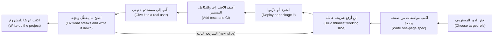
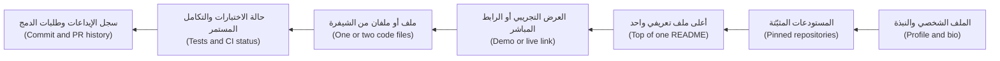
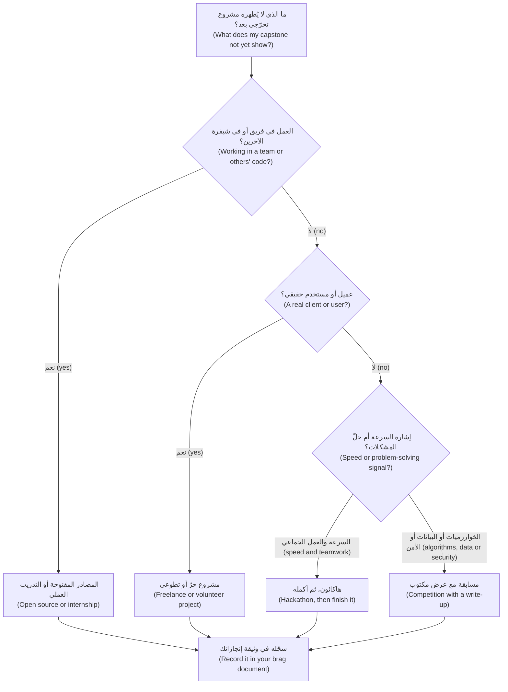

# الوحدة 3 — الإثبات: معرض الأعمال

*الشهادة الجامعية تقول إنك درست. وقائمة لغات البرمجة تقول إنك كنت حاضرًا في القاعة. ولا هذه ولا تلك تخبر صاحب العمل بأنك قادر على أداء الوظيفة، وحين تستطيع وكلاء البرمجة بالذكاء الاصطناعي (AI coding agents) إنتاج تطبيق تجريبي أنيق في فترة ما بعد الظهر، فإن تطبيقًا تجريبيًا أنيقًا لا يثبت إلا القليل جدًا. أما الذي يثبت فهو الدليل: عمل يستطيع شخص غريب أن يفتحه ويشغّله ويسائله ويثق به في دقائق معدودة. تحوّل هذه الوحدة المهارات التي اكتسبتها في الوحدتين 1 و2 إلى هذا الإثبات. تبدأ بالمشروع الأهم على الإطلاق: مشروع التخرّج التطبيقي المبني لدورك المستهدف وفق معيار الإنتاج، مع مواصفات جاهزة لكل مسار دور. ثم تبيّن كيف تعرض عملك حتى يراه فعلًا المراجع المشغول: ملفك الشخصي على GitHub، وملف README يجيب عن أسئلة المراجع بترتيبها، وكتابات قصيرة عن قراراتك. وتنتهي بالخبرة التي يمكنك اكتسابها قبل وظيفتك الأولى: التدريب العملي، والمصادر المفتوحة (open source)، والعمل الحر والتطوعي، والهاكاثونات والمسابقات. ستتابع دفعة بنك نجم بينما يستبدل عمر 23 مستودعًا لمقررات دراسية بخدمة واحدة تصمد أمام شخصين يحجزان آخر موعد في اللحظة نفسها، وتعيد ريم كتابة ملف README لم تستطع الدفاع عنه، ويحوّل محمد مسيرته المهنية السابقة إلى دليل بدلًا من اعتذار.*

> **الخطوات:** Build, Prove — تحويل ما تستطيع فعله إلى دليل يستطيع شخص غريب أن يفتحه ويشغّله ويتحقق منه في دقائق.

---

# 3.1 — مشاريع تثبت أنك قادر على أداء الوظيفة: مواصفات مشروع تخرّج واحد لكل دور
*المستوى: 🟡 متوسط* · *المتطلبات: 1.1، 1.3، 2.1، 2.2، 2.3، 2.4* · *الخطوة: Build, Prove*

**بعد هذا الدرس تستطيع** أن تمنح مستودعاتك درجات على سُلّم الإثبات، وأن تكتب مواصفات مشروع الإثبات لدورك المستهدف بحيث يقرؤها المراجع في دقيقتين. *مدة الدراسة: نحو 125 دقيقة (تقدير).*

## ⚡ الدرس في دقيقة
- يجيب **مشروع الإثبات** عن سؤال واحد لدى المراجع: «هل يستطيع هذا الشخص أداء عمل الدور بمستوى المبتدئ من دون أن يحمله أحد؟». ولا تستطيع نسخة من درس تعليمي أن تجيب عنه مهما كانت مصقولة.
- القاعدة الأهم: **مشروع تخرّج عميق واحد يتفوّق على عشرة مستودعات سطحية.** والعمق يعني: مستخدمًا حقيقيًا، ونطاقًا صغيرًا، ونظامًا يعمل، واختبارات، وقرارات مكتوبة، ودليلًا على أنك شغّلته وأدرته.
- اختر مشروع التخرّج المناسب **لدورك المستهدف** (من الدرس 2.1 إلى الدرس 2.4). فإثبات مهندس البيانات (data engineer) لا يشبه في شيء إثبات مطوّر الواجهات الأمامية (front-end developer).
- إشارة القرار: قبل كتابة الشيفرة، اكتب **السؤال الصعب الوحيد** الذي يجب أن يجيب عنه مشروعك جيدًا، مثل: «ماذا يحدث عندما يحجز شخصان آخر موعد في اللحظة نفسها؟». إن لم يكن هناك سؤال صعب، فما زال المشروع درسًا تعليميًا.
- أكبر فخ: نشر شيفرة بناها الوكيل لا تستطيع شرحها. يختار المراجعون ملفًا واحدًا ويسألون: «لماذا بهذه الطريقة؟». وإجابتك هي الإثبات.

## 🧭 لماذا يهم
في مراجعة تجريبية لمعرض الأعمال، يفتح خالد، مدير الهندسة (engineering manager) الذي يوظّف المبتدئين في برنامج نجم للخرّيجين التقنيين (Najm Tech Graduate Programme)، حساب عمر على GitHub: 23 مستودعًا (repositories) من حلول LeetCode، وواجبات مقررات، وتطبيق مهام من درس تعليمي، ونسخة متفرّعة لم تُلمس. وبعد دقيقة يقول بلطف: «كل ما هنا يخبرني بأنك قادر على إنهاء مقرر دراسي. ولا شيء يخبرني بأنك قادر على أداء الوظيفة. لا أجد شيئًا واحدًا يعمل، ولا اختبارًا واحدًا، ولا قرارًا واحدًا اتخذته بنفسك».

أما ريم فلديها المشكلة المعاكسة: اثنا عشر تطبيقًا حسن المظهر بُنيت بسرعة باستخدام وكلاء البرمجة بالذكاء الاصطناعي. يسألها خالد عمّا يمنع مستخدمًا في تطبيقها لتقسيم المصاريف من قراءة مصاريف مستخدم آخر. تفتح ريم الشيفرة وتدرك أنها تقرؤها للمرة الأولى. فريق خالد يستخدم أدوات الذكاء الاصطناعي كل يوم؛ وفكرته أضيق من ذلك: «إن وظّفتك، فأنا أثق بأنك ستتحقق مما كتبه الوكيل. أريني أنك قادرة على ذلك».

ومحمد، المتحوّل مهنيًا القادم من معسكر تدريبي، لديه ثلاثة مشاريع. أحدها نظام لحجز الحصص للنادي الرياضي الذي كان يعمل فيه، استخدمه عشرون عضوًا لمدة شهرين، مع اختبارات وملاحظة قصيرة عن خلل الحجز المزدوج الذي أصلحه. يقضي خالد عشر دقائق عليه ثم يطلب سيرته الذاتية.

## 📐 كيف يعمل

### 🟢 الأساسيات

**ما يحاول المراجع معرفته.** لدى المراجع وقت محدود وسؤال واحد: هل يُظهر هذا الشخص الإشارات التي يحتاجها الدور؟ وفي معظم أدوار المبتدئين تكون هذه الإشارات هي الأساس من الدرس 1.1، والاستخدام الأمين لأدوات الذكاء الاصطناعي من الدرس 1.2، والتفكير الإنتاجي من الدرس 1.3. ومشروع الإثبات مصمَّم لإظهار هذه الإشارات حيث يستطيع شخص غريب التحقق منها.

**سُلّم الإثبات.** تقع المشاريع على سُلّم. وكل درجة دليل أقوى من الدرجة التي تحتها.

| الدرجة | ما هي | ما الذي تثبته |
|---|---|---|
| 1. متابعة درس تعليمي | كتبتَ ما كتبه الفيديو | أنك أنهيت الفيديو |
| 2. درس تعليمي مع ميزة خاصة بك | وسّعته بشيء غير موجود في الدرس التعليمي | أنك قادر على تعديل شيفرة لم تصمّمها |
| 3. مشروعك الخاص | مشكلتك، وتصميمك، وشيفرتك | أنك قادر على اتخاذ القرارات |
| 4. منشور وقابل لإعادة الإنتاج | يستطيع أي شخص فتحه، أو تشغيله بأمر واحد | أنك قادر على الإطلاق، لا على الكتابة فقط |
| 5. يستخدمه شخص آخر | مستخدم حقيقي مسمّى، ولو كان مجموعة صغيرة | أنه يحلّ مشكلة ويصمد أمام المدخلات الحقيقية |
| 6. مُشغَّل عبر الزمن | أخطاء اكتُشفت أثناء الاستخدام وأُصلحت ووُثّقت؛ وتغييرات أُطلقت بأمان | أنه يمكن ائتمانك على نظام قيد التشغيل |

بلوغ الدرجة 5 أو 6 بمشروع واحد يميّزك عن غيرك.

**العلامات الست لمشروع الإثبات.** استخدمها قائمة تحقق:
1. **مشكلة حقيقية ومستخدم مسمّى.** «طلاب قسمي الذين ينتظرون مواعيد المختبر»، لا «تطبيق حجز».
2. **نطاق صغير.** سير عمل أساسي واحد منجز كما ينبغي. يمكنك إضافة الميزات لاحقًا؛ لكنك لا تستطيع إضافة العمق لاحقًا من دون إعادة الكتابة.
3. **إنه يعمل.** رابط مباشر، أو أمر واحد مثل `docker compose up` يعمل على جهاز نظيف.
4. **الاختبارات والتكامل المستمر.** تعمل الاختبارات الآلية مع كل دفع، والشارة خضراء لسبب حقيقي.
5. **قرارات مكتوبة.** لماذا قاعدة البيانات هذه، ولماذا هذه البنية، وما الذي اخترت ألا تفعله. يبيّن الدرس 3.2 الطريقة.
6. **دليل على التشغيل.** متتبّع أخطاء (error tracker)، وسجلّ لخلل اكتشفته وأصلحته، وسجلّ تغييرات، وتراجع تدرّبت عليه.

وهناك شرط واحد يعلو العلامات الست كلها: **أن تستطيع شرح كل سطر**، بما في ذلك الأسطر التي كتبها وكيل ذكاء اصطناعي (AI agent).

**اختيار المشكلة.** المشكلات الجيدة تأتي من حياتك ومجتمعك (نادٍ، أو مشروع عائلي، أو قسم جامعي)، أو من مجموعة بيانات عامة تهمّك، أو من منظمة تتطوّع فيها (الدرس 3.3). أما الخيارات الضعيفة فهي التي رآها المراجعون مرات كثيرة: قوائم المهام، وتطبيقات الطقس، ونسخ مواقع البثّ، ومجموعة بيانات تايتانيك، والأرقام المكتوبة بخط اليد. هي مناسبة للتعلّم، ضعيفة كإثبات: لا مستخدم حقيقي، ولا سؤال صعب، وإجابة جاهزة يستطيع أي شخص نسخها.

**حلقة البناء.** ابنِ أولًا شريحة رفيعة عاملة وضعها أمام شخص ما، ثم عمّقها.



### 🟡 التعمق أكثر

**مواصفات مشروع تخرّج واحد لكل دور.** فيما يلي خمس مواصفات، واحدة لكل مسار دور من الوحدة 2. غيّر المجال إلى شيء يهمّك؛ وحافظ على المعيار.

**مهندس البرمجيات والمهندس الشامل — خدمة حجز لمنظمة صغيرة**
- *النطاق:* عيادة أو نادٍ رياضي أو مختبر جامعي بمواعيد محدودة؛ تسجيل دخول، ودورا العضو والمسؤول، والحجز والإلغاء، وتأكيد بالبريد الإلكتروني.
- *معيار الإنتاج:* قاعدة بيانات علائقية (relational database) مع ترحيلات (migrations)، واختبارات لقواعد الحجز، وتكامل مستمر (CI)، ونشر مع متتبّع أخطاء وفحص توافر (uptime check)، ولا أسرار في المستودع.
- *السؤال الصعب:* «شخصان يضغطان زر "احجز" لآخر موعد في اللحظة نفسها. ماذا يحدث؟».
- *مسار المكتبة:* [*تصميم الأنظمة لمبرمجي الفايب*، الدرس 2.6 — نقرتان في وقت واحد: حالات التسابق والمعاملات والكتابات متساوية الأثر](../vibe/index.ar.html#l2-6)؛ [*لبنات بناء البرمجيات كخدمة*، الدرس 2.1 — طبقة البيانات: Postgres وأدوات ORM والترحيلات والبيانات الأولية](../saas/index.ar.html#/2.1).

**مهندس تطبيقات الذكاء الاصطناعي (AI application engineer) — مساعد للإجابة عن الأسئلة من مستندات يحق لك استخدامها**
- *النطاق:* مجموعة نصوص عامة ومسموح باستخدامها، مثل اللوائح المنشورة لجامعتك أو توثيق مشروع مفتوح المصدر؛ إجابات مع روابط إلى المصادر، وعبارة «لا أعرف» حين لا تكون الإجابة موجودة.
- *معيار الإنتاج:* **مجموعة ذهبية (golden set)** من 50 سؤالًا حقيقيًا على الأقل تُقيَّم مع كل تغيير، ومعدل رفض مَقيس على الأسئلة الخارجة عن النطاق، وتسجيل التكلفة وزمن الاستجابة لكل استعلام، ودفاع مُختبَر ضد التعليمات المخبّأة داخل المستندات.
- *السؤال الصعب:* «كيف تعرف أن تغيير الموجّه جعله أفضل، لا مختلفًا فحسب؟».
- *مسار المكتبة:* [*إدارة منتجات الذكاء الاصطناعي: من الصفر إلى الاحتراف*، الدرس 6.1 — جودة يمكنك قياسها: المقاييس والمجموعات الذهبية وتحليل الأخطاء](../aipm/index.ar.html#/6.1)؛ [*أمن الذكاء الاصطناعي وأمن التطبيقات: من الصفر إلى الاحتراف*، الدرس 8.2 — حقن الموجّهات وكسر القيود، المباشر وغير المباشر](../secai/index.ar.html#/8.2).

**مهندس البيانات أو محلّل البيانات أو عالم البيانات — خط بيانات يجيب عن أسئلة حقيقية**
- *النطاق:* مصدر بيانات مفتوحة عام يُحدَّث بانتظام (النقل، أو الطقس، أو الأسعار)؛ استيعاب مُجدول، وتحويلات مُختبَرة، ولوحة معلومات (dashboard) تجيب عن ثلاثة أسئلة محددة. ويضيف علماء البيانات نموذجًا، وخط أساس بسيطًا يجب التفوّق عليه، ومهمة دفعية تقيّم البيانات الجديدة.
- *معيار الإنتاج:* إعادة تشغيل آمنة من دون تكرار، وفحوص جودة بيانات تفشل بصوت عالٍ، ونتائج النموذج مقارنةً بخط الأساس مكتوبة.
- *السؤال الصعب:* «وصل ملف الأمس مرتين، ووصل ملف اليوم متأخرًا. ماذا تُظهر لوحة معلوماتك؟».
- *مسار المكتبة:* [*هندسة البيانات والتحليلات: من الصفر إلى الاحتراف*، الوحدة 2 — الاستيعاب وخطوط البيانات](../data/index.ar.html#/2.1)؛ [*هندسة البيانات والتحليلات: من الصفر إلى الاحتراف*، الوحدة 3 — التحويل والجودة](../data/index.ar.html#/3.2).

**مهندس السحابة أو المنصّات أو DevOps — شغّل تطبيقًا كما ينبغي**
- *النطاق:* خذ تطبيقًا صغيرًا (تطبيقك، أو تطبيقًا مفتوح المصدر) وضعه في حاوية، وعرّف بنيته التحتية كشيفرة (infrastructure as code)، وابنِ خط نشر (pipeline) ينشر إلى بيئة التجهيز (staging) ثم إلى الإنتاج (production).
- *معيار الإنتاج:* مراقبة (monitoring) مع هدف مستوى خدمة مكتوب واحد، ودليل تشغيل (runbook)، وتراجع تدرّبت عليه، وتقرير «يوم اختبار» عن شيء عطّلته عمدًا، وملاحظة عن التكلفة مع تفعيل تنبيهات الميزانية.
- *السؤال الصعب:* «الإصدار الجديد يفشل لدى بعض المستخدمين. اشرح لي ما تفعله في الدقائق العشر التالية».
- *مسار المكتبة:* [*السحابة وDevOps: من الصفر إلى الاحتراف*، الوحدة 4 — التكامل والنشر المستمران والإصدارات](../cloud/index.ar.html#/4.1)؛ [*تصميم الأنظمة لمبرمجي الفايب*، الدرس 4.4 — التراجع وبيئة التجهيز وبوابات الإصدار](../vibe/index.ar.html#l4-4).

**مهندس الأمن (Security engineer) — أمّن تطبيقًا من طرف إلى طرف**
- *النطاق:* تطبيقك الخاص، أو أحد المشاريع السابقة: نموذج تهديدات (threat model) مع مخطط تدفق البيانات، واختبارات التحكم في الوصول، وخط نشر فيه فحص الأسرار (secret scanning) والتحليل الساكن (static analysis) وفحوص الاعتماديات.
- *معيار الإنتاج:* لكل نتيجة درجة خطورة، وإصلاح أو قرار مسجّل، واختبار يمنع عودتها. تدرّب على الهجمات على أنظمتك الخاصة فقط أو على تطبيق تدريبي مثل **OWASP Juice Shop**، ولا تفعل ذلك أبدًا على أي شيء لا تملك إذنًا مكتوبًا باختباره.
- *السؤال الصعب:* «أيّ نتيجة ستصلحها أولًا، ولماذا هي بالذات؟».
- *مسار المكتبة:* [*أمن الذكاء الاصطناعي وأمن التطبيقات: من الصفر إلى الاحتراف*، الدرس 1.1 — نمذجة التهديدات: تدفقات البيانات وحدود الثقة وSTRIDE](../secai/index.ar.html#/1.1)؛ [*أمن الذكاء الاصطناعي وأمن التطبيقات: من الصفر إلى الاحتراف*، الدرس 6.3 — تأمين الشيفرة المولّدة بالذكاء الاصطناعي: أين تخطئ وكلاء البرمجة](../secai/index.ar.html#/6.3).

**الوقت والتكلفة والبيانات.** يستغرق مشروع تخرّج بهذا المعيار عدة أسابيع من العمل بدوام جزئي، لا عطلة نهاية أسبوع واحدة؛ ويضعه الدرس 7.1 ضمن خطة من 12 أسبوعًا. تتغيّر الفئات المجانية والأرصدة الطلابية، وبعض المشاريع تراكم فواتير حقيقية: تحقّق من الشروط الحالية (2026)، وفعّل تنبيهات الميزانية من اليوم الأول، ودوّن طريقة إزالة كل شيء. استخدم بيانات عامة أو مسموحًا بها أو اصطناعية، ولا تستخدم أبدًا سجلات حقيقية لعملاء أو مرضى أو طلاب. وإن أعطاك مستخدمون حقيقيون بيانات شخصية، فاجمع الحد الأدنى واحذفها حين لا تعود بحاجة إليها. يلاحظ أصحاب العمل في القطاعات الخاضعة للتنظيم هذه العادة؛ وفي قطر، يُعدّ القانون رقم 13 لسنة 2016 بشأن حماية البيانات الشخصية (Law No. 13 of 2016 on personal data protection) سببًا وجيهًا لإظهارها مبكرًا.

### 🔴 نظرة الخبير

**كثافة القرارات.** في معرض الأعمال القوي قرارات *حقيقية* كثيرة يستطيع المراجع مساءلتها. أما تطبيق المهام فلا يكاد يحوي أيًّا منها. وفي خدمة الحجز التي أعاد عمر بناءها قرارات كثيرة: قيد مقابل قفل لمنع الحجوزات المزدوجة، وماذا يحدث حين يتعطّل البريد الإلكتروني، وكم من الوقت تُحفظ الحجوزات الملغاة. وكل واحد منها موضوع مقابلة أعددتَه مسبقًا.

**الاتساع حول العمق.** الشكل الجيد هو مشروع تخرّج واحد مع قطعة أو قطعتين أصغر تُظهران التنوّع، مثل مساهمة في مشروع مفتوح المصدر (الدرس 3.3).

**البناء بوكلاء الذكاء الاصطناعي، علنًا.** استخدام وكلاء البرمجة بالذكاء الاصطناعي أمر طبيعي؛ أما إخفاؤه فليس كذلك. يريد المراجعون حُكمك: المواصفات التي أعطيتها للوكيل، والاختبارات التي تحققت من عمله، والأخطاء التي اكتشفتها. وقسم قصير بعنوان «كيف بُني هذا» (الدرس 3.2) يذكر الأجزاء التي ساعد فيها الوكيل وكيف تحققت منها أفضل من التظاهر بأنك كتبت كل شيء بنفسك. انظر [*تصميم الأنظمة لمبرمجي الفايب*، الدرس 9.4 — التحقق قبل الإنجاز](../vibe/index.ar.html#l9-4).

**المشاريع الجماعية.** المشروع الجماعي إثبات قوي إن كنت دقيقًا في تحديد دورك: «بنيتُ مهمة التسوية واختباراتها؛ وبنى زملائي الواجهة الأمامية (front end)» عبارة صادقة ويمكن التحقق منها في سجل الإيداعات.

**الميزة المحلية.** في سوق الخليج، يبرز التعامل السليم مع النص العربي والتخطيط من اليمين إلى اليسار (right-to-left layout)، أو العناية على الطريقة المصرفية بحماية البيانات (data protection) وسجلات التدقيق. انظر [*تصميم الأنظمة لمبرمجي الفايب*، الدرس 11.2 — التدويل والكتابة من اليمين إلى اليسار (Internationalization and RTL)](../vibe/index.ar.html#l11-2).

## 🧰 الأدوات
| المورد أو الأداة أو النموذج | ما هو وماذا يفعل | متى تلجأ إليه |
|---|---|---|
| **Proof project spec** (مواصفات مشروع الإثبات، صفحة واحدة) | مستند قصير: المشكلة، والمستخدم، والشريحة الرفيعة، ومعيار الإنتاج، والسؤال الصعب، والبيانات، والجدول الزمني | قبل كتابة أي شيفرة؛ وحين يبدأ النطاق بالتضخّم |
| **The Twelve-Factor App** (تطبيق العوامل الاثني عشر، من مؤلفين في Heroku) | دليل قصير كلاسيكي لبناء تطبيقات تُنشَر وتُهيّأ بسلاسة | عند إعداد التهيئة والسجلات (logs) والنشر (deployment) لمشروع تخرّج ويب |
| **OWASP Juice Shop** | تطبيق ويب ضعيف عمدًا للتدرّب الأمني القانوني | مشاريع التخرّج الأمنية وتعلّم الهجمات على جهازك الخاص |
| **Public open-data portals** (بوابات البيانات المفتوحة العامة) | مواقع حكومية وبلدية ولمنظمات دولية تنشر مجموعات بيانات مع ترخيص | العثور على بيانات حقيقية ومسموح بها لمشاريع البيانات والذكاء الاصطناعي |
| **Golden set** (المجموعة الذهبية) | قائمة ثابتة من المدخلات مع المخرجات المتوقعة، تُقيَّم مع كل تغيير | أي مشروع تخرّج في الذكاء الاصطناعي أو تعلّم الآلة حيث لا تُعدّ عبارة «يبدو أفضل» دليلًا |
| **Error tracker** (متتبّع الأخطاء، مثل Sentry) | خدمة تسجّل الأخطاء من تطبيقك قيد التشغيل مع سياقها | من أول نشر لأي مشروع يواجه المستخدمين |
| **Budget alerts** (تنبيهات الميزانية) | تنبيهات فوترة سحابية تحذّرك قبل أن يتجاوز الإنفاق حدًّا معيّنًا | في اليوم الذي تنشئ فيه أي حساب سحابي |

## 🏛️ عمليًا في بنك نجم
يطلب برنامج نجم للخرّيجين التقنيين من المرشحين في المرحلة التقنية إحضار مشروع واحد مع **مواصفات مشروع الإثبات** في صفحة واحدة. ويستخدمها خالد لإعداد الأسئلة. وهذه مواصفات عمر، بعد أن أعاد كتابتها إثر المراجعة.

| الحقل | إجابة عمر |
|---|---|
| الدور المستهدف | مهندس برمجيات (Software engineer) (الدرس 2.1) |
| المشكلة والمستخدم | يحجز مختبر الإلكترونيات في جامعتي 12 طاولة عمل على ورقة، فيقع الطلاب في الحجز المزدوج. المستخدمون: مشرف المختبر ونحو 60 طالبًا في السنة الأخيرة. |
| أرفع شريحة | يسجّل الطلاب الدخول ببريدهم الجامعي، ويرون الطاولات المتاحة للأسبوع، ويحجزون موعدًا واحدًا مدته ساعتان، ويلغونه. |
| معيار الإنتاج | PostgreSQL مع ترحيلات؛ وقيد تفرّد على الطاولة والموعد؛ واختبارات لقواعد الحجز؛ وتكامل مستمر مع كل دفع؛ ونشر مع تتبّع الأخطاء (error tracking) وفحص التوافر؛ والأسرار في متغيرات البيئة. |
| السؤال الصعب | طالبان يحجزان آخر طاولة في اللحظة نفسها. الإجابة: قيد في قاعدة البيانات، ورسالة واضحة «حُجز للتو». مُختبَر باختبار تزامني. |
| البيانات | الاسم، والبريد الجامعي، والحجوزات. تُحذف الحجوزات التي يزيد عمرها على فصل دراسي واحد آليًا. لا بيانات شخصية أخرى. |
| خارج النطاق | المدفوعات، وتطبيق الجوال، والحجوزات المتكررة. |
| المساعدة بالذكاء الاصطناعي | استُخدم الوكيل (agent) للهيكلة الأولية والنماذج؛ أما منطق الحجز والاختبارات فكتبتها وراجعتها بنفسي؛ واكتُشف خطآن من أخطاء الوكيل وأُصلحا، وهما مذكوران في ملف README. |
| الدليل | رابط مباشر، والمستودع (repository)، وسجل التكامل المستمر (CI history)، وملاحظة حادثة واحدة، وفيديو عرض مدته ثلاث دقائق. |
| الجدول الزمني | الأسبوعان 1–2: الشريحة الرفيعة تعمل مباشرة؛ الأسبوعان 3–4: الاختبارات والتكامل المستمر والمراقبة؛ الأسبوعان 5–6: استخدام حقيقي من المختبر وإصلاحات. |

حُكم خالد: «الآن لديّ ستة أشياء أسألك عنها، وأنت تعرف إجاباتها».

## 🛠️ التمارين
- 🟢 أعطِ كل مستودع عام درجةً من 1 إلى 6 على سُلّم الإثبات. *يكتمل عندما:* يكون لديك جدول بالمستودعات ودرجاتها، مع مستودع واحد (أو فكرة جديدة واحدة) محدَّد بدائرة بوصفه مشروع تخرّجك.
- 🟡 املأ مواصفات مشروع الإثبات أعلاه لدورك المستهدف، مستعينًا بمواصفات مشروع التخرّج المطابقة من قسم 🟡 التعمق أكثر. *يكتمل عندما:* يستطيع زميل أو مرشد قراءة المواصفات في دقيقتين وإخبارك بما تبنيه، ولمن، وما الذي سيكون صعبًا فيه.
- 🔴 أطلق أرفع شريحة من مشروع تخرّجك، قابلة للوصول أو لإعادة الإنتاج بأمر واحد، مع اختبار واحد على الأقل في التكامل المستمر ومستخدم حقيقي جرّبها. *يكتمل عندما:* يعمل الرابط المباشر أو الإعداد بأمر واحد على جهاز شخص آخر، ويكون التكامل المستمر أخضر، وتكون قد دوّنت شيئًا واحدًا فعله مستخدمك الأول ولم تتوقّعه.

## ⚠️ أخطاء وفخاخ
- **الكمّ على حساب العمق.** عشرون مستودعًا سطحيًا تخفي أفضل أعمالك. ابنِ مشروع تخرّج عميقًا واحدًا وثبّته؛ وأرشف البقية أو ألغِ تثبيتها.
- **اختيار التقنيات أولًا.** إطار عمل رائج بلا مشكلة يعطيك عرضًا تجريبيًا بلا مستخدم. اكتب المواصفات، ثم اختر أبسط مجموعة تقنيات تلبّيها.
- **إطلاق ما لا تستطيع شرحه.** يسهّل وكلاء الذكاء الاصطناعي (AI agents) البناء بما يتجاوز فهمك. اقرأ كل جزء واختبره، وكن مستعدًا لشرح أي ملف.
- **استخدام بيانات شخصية حقيقية.** لا مكان لسجلات العملاء أو المرضى في معرض الأعمال أبدًا. استخدم بيانات عامة أو مسموحًا بها أو اصطناعية.
- **عدم الإنهاء أبدًا.** مشروع تخرّج منجز بنسبة 80% ولم يُنشر قط يثبت أقل من مشروع أصغر يعمل. قلّص النطاق حتى يُطلق، ثم عمّقه.

## 🧾 الخلاصة
- يُظهر مشروع الإثبات إشارات دورك المستهدف حيث يستطيع شخص غريب التحقق منها؛ ولا تستطيع نسخ الدروس التعليمية ذلك.
- اصعد سُلّم الإثبات: مشروعك الخاص، منشورًا، يستخدمه شخص حقيقي، ومُشغَّلًا عبر الزمن.
- استخدم العلامات الست، وكن قادرًا على شرح كل سطر، بما في ذلك ما كتبه الوكيل.
- لكل دور مشروع تخرّج مختلف؛ فاربط مشروعك بسؤال صعب تستطيع الإجابة عنه جيدًا.
- استخدم وكلاء الذكاء الاصطناعي علنًا، وأظهر كيف تحققت من عملهم، واستخدم بيانات آمنة.

## ✍️ اختبر نفسك

**1. لدى عمر 23 مستودعًا: واجبات مقررات وحلول LeetCode وتطبيقات من دروس تعليمية. ولديه أربعة أسابيع قبل أن يُفتح باب التقديم. ما الذي ينبغي أن يفعله أولًا؟**

- A. يضيف حلًّا على LeetCode كل يوم حتى يُظهر ملفه نشاطًا منتظمًا على مدار الشهر
- B. يختار مشروع تخرّج واحدًا لدوره، ويحدّد سؤالًا صعبًا في المواصفات، ويطلق شريحة رفيعة
- C. يحذف كل مستودع قديم حتى لا يبقى ظاهرًا إلا أفضل مشاريع مقرراته
- D. ينقل أفضل ثلاثة تطبيقات من الدروس التعليمية إلى إطار عمل أحدث ويثبّتها

<details><summary>الإجابة</summary>

**B.** مشروع عميق واحد للدور المستهدف هو أقوى إثبات يستطيع بناءه في هذا الوقت. يضيف A نشاطًا من دون إشارات وظيفية؛ وC غير ضروري، إذ يكفي إلغاء التثبيت؛ ويبقى D في أسفل سُلّم الإثبات. (🟢 الأساسيات؛ 🔴 نظرة الخبير.)

</details>

**2. أيّ مشروع يقع في أعلى سُلّم الإثبات؟**

- A. نسخة مصقولة من موقع بثّ بتصميم مخصّص، بُنيت باتباع دورة فيديو شهيرة
- B. تطبيق مهام من درس تعليمي موسَّع بالوضع الداكن والتخزين دون اتصال اللذين لم يغطّهما الدرس
- C. مصنِّف صور أصلي ودقيق، دُرِّب وقُيِّم في دفتر لم يُشغَّل خارجه قط
- D. أداة حجز استخدمها عشرون عضوًا في نادٍ رياضي لمدة شهرين، مع ملاحظة عن خلل اكتُشف وأُصلح

<details><summary>الإجابة</summary>

**D.** إنه منشور، ويستخدمه أشخاص حقيقيون، ومُشغَّل عبر الزمن، أي الدرجة 6. أما C فمشروع أصلي (الدرجة 3) لكنه لم يعمل لأحد قط؛ وB هو الدرجة 2 وA الدرجة 1، مهما كان مصقولًا. (🟢 الأساسيات.)

</details>

**3. تبني هدى مشروع تخرّج في البيانات. أيّ «سؤال صعب» يناسب دور البيانات أكثر؟**

- A. «أيّ مكتبة رسوم بيانية تجعل لوحة معلوماتي تبدو الأحدث في نظر المراجعين؟»
- B. «كم صفًّا يستطيع دفتري تحميله في الذاكرة قبل أن تنفد ذاكرة حاسوبي المحمول؟»
- C. «وصل ملف الأمس مرتين، ووصل ملف اليوم متأخرًا. ماذا تُظهر لوحة معلوماتي لمستخدمها صباحًا؟»
- D. «هل أستطيع إضافة صفحة تسجيل دخول وحسابات مستخدمين إلى لوحة المعلومات قبل أن أتقدّم؟»

<details><summary>الإجابة</summary>

**C.** إعادة التشغيل والتكرار والبيانات المتأخرة مشكلات يومية في خطوط البيانات، والتعامل معها هو الإثبات الذي يبحث عنه من يجري مقابلات البيانات. أما A وD فشكليّان هنا؛ وB حدٌّ للحاسوب المحمول، لا سؤال إنتاجي. (🟡 التعمق أكثر.)

</details>

**4. بنت ريم معظم مشروع تخرّجها بوكيل برمجة بالذكاء الاصطناعي (AI coding agent). ما أفضل طريقة لعرضه؟**

- A. ألا تقول شيئًا عن الوكيل، لأن المراجعين قد يفترضون أنها لا تفهم الشيفرة
- B. أن تضيف قسم «كيف بُني هذا» يوضّح ما فعله الوكيل وكيف تحققت منه؛ وأن تعرف كل ملف
- C. أن تزيل كل جزء كتبه الوكيل وتعيد بناءه يدويًا، حتى يكون المشروع كله من عملها دون مساعدة
- D. أن تذكر الوكيل مؤلفًا مشاركًا في ملف README ولا تقول شيئًا آخر عن طريقة التحقق من الشيفرة

<details><summary>الإجابة</summary>

**B.** الإفصاح الصادق مع دليل التحقق هو ما يريده المراجعون. أما A فتضليل ينكشف مع أول سؤال تقني. وC إضاعة للوقت؛ فالتحقق من الشيفرة أهم من هوية من كتبها. وD يفصح عن الأداة لكنه لا يُظهر شيئًا من التحقق الذي يختبره المراجع. (🔴 نظرة الخبير.)

</details>

**5. يريد يوسف إظهار مهارات السحابة والمنصّات. أيّ مشروع تخرّج يناسبه أكثر؟**

- A. تطبيق صغير يُشغَّل بالبنية التحتية كشيفرة، ونشر على مراحل، وهدف مستوى خدمة، وتمرين تراجع، وملاحظة عن التكلفة
- B. ثلاث شهادات سحابية بمستوى مشارك في ملفه، من دون أي مشروع يستخدم ما تغطيه تلك الشهادات
- C. سلسلة تدوينات مفصّلة تقارن خدمات الحوسبة والتخزين والشبكات لدى كبار مزوّدي السحابة
- D. موقع معرض أعمال مصقول للواجهة الأمامية على منصة استضافة مجانية، بنطاق مخصّص وHTTPS

<details><summary>الإجابة</summary>

**A.** يُظهر العمل اليومي لمهندس المنصّات: النشر الآمن، والمراقبة، والتحكم في التكلفة. أما B فإشارة إضافية مفيدة لكنها ليست إثباتًا على تشغيل أي شيء؛ وC وD يُظهران مهارات أخرى. (🟡 التعمق أكثر.)

</details>

## 📚 المراجع
- The Twelve-Factor App — https://12factor.net/
- OWASP Juice Shop — https://owasp.org/www-project-juice-shop/
- توثيق GitHub Actions — https://docs.github.com/en/actions
- [*تصميم الأنظمة لمبرمجي الفايب*، الدرس 2.6 — نقرتان في وقت واحد: حالات التسابق والمعاملات والكتابات متساوية الأثر](../vibe/index.ar.html#l2-6)
- [*تصميم الأنظمة لمبرمجي الفايب*، الدرس 9.4 — التحقق قبل الإنجاز](../vibe/index.ar.html#l9-4)
- [*بناء تطبيقات الذكاء الاصطناعي والوكلاء من الصفر إلى الاحتراف*، الدرس 16.1 — المشروع الختامي: خذ نجم ديسك من الاستكشاف إلى الإطلاق الفعلي](../aiapps/index.ar.html#/16.1) — منظور البناء والتسليم لهذا الموضوع

---

# 3.2 — ملفك على GitHub وملفات README والكتابة عن عملك
*المستوى: 🟡 متوسط* · *المتطلبات: 1.1، 3.1* · *الخطوة: Prove*

**بعد هذا الدرس تستطيع** أن تعيد صياغة ملفك على GitHub وملف README لمشروع تخرّجك بحيث يسمّي شخص غريب دورك المستهدف خلال 30 ثانية ويشغّل المشروع خلال خمس دقائق. *مدة الدراسة: نحو 120 دقيقة (تقدير).*

## ⚡ الدرس في دقيقة
- لا يقرأ المراجعون شيفرتك أولًا. بل يتصفّحون ملفك الشخصي سريعًا، ويفتحون مستودعًا مثبّتًا واحدًا، ويقرؤون أعلى ملف README الخاص به، ثم ينظرون في ملف أو ملفين. **صمّم من أجل التصفّح السريع.**
- القاعدة الأهم: يجيب ملف README عن أسئلة المراجع **بالترتيب الذي يطرحها به**: ما هذا، وهل يعمل، وكيف بُني، ولماذا هذه الاختيارات، وماذا تعلّمت.
- إن **سجل الإيداعات والاختبارات والقرارات المكتوبة** دليل أيضًا. فرسائل مثل "fix" و"fix2" و"final" تروي قصة؛ وكذلك يرويها طلب دمج (pull request) نظيف بوصف واضح.
- إشارة القرار: سلّم مستودعك إلى شخص لم يره قط. إن لم يستطع أن يقول ما يفعله وأن يشغّله خلال خمس دقائق، فملف README لم يكتمل بعد.
- أكبر فخ: سرّ مُودَع في المستودع، مثل مفتاح API (API key) في ملف `.env`. حذف الملف لا يكفي؛ يجب إبطال المفتاح واستبداله.

## 🧭 لماذا يهم
يستعدّ طارق، قائد الهندسة الذي يدير المقابلات التقنية في بنك نجم (Najm Bank)، لمقابلة ريم. مشروع تخرّجها المثبّت، وهو مساعد لتخطيط الدراسة، له ملف README من أربعة أسطر: اسم المشروع، وعبارة "Built with Next.js, Supabase, Tailwind and an AI agent"، و`npm install && npm run dev`. لا وصف، ولا لقطة شاشة، ولا رابط مباشر. وفي السجل 140 إيداعًا أُجريت في يومين، معظمها بعنوان "update" أو "fix". وفي إيداع مبكر يوجد ملف `.env` فيه مفتاح API حقيقي.

ما زال طارق قادرًا على مقابلة ريم، لكنه يدخل الآن محمّلًا بالشكوك بدلًا من الأسئلة. ولدى هدى نسخة أهدأ من المشكلة نفسها: ثلاثة دفاتر ممتازة بلا ملف README على الإطلاق، وخلايا لا تعمل إلا بترتيب معيّن، ومجموعة بيانات تُحمَّل من مسار على حاسوبها المحمول الخاص. ودانة، عالمة البيانات الرئيسية، لا تستطيع تشغيل أيٍّ منها.

ليست أيٌّ من المشكلتين مشكلة مهارة. كلتاهما تتعلق بالعرض والنظافة، وهو ما تقرؤه فرق التوظيف بوصفه إشارات على سلوكك في فريق حقيقي، حيث يجب على الآخرين قراءة عملك وتشغيله والثقة به. يجعل هذا الدرس عملك سهل الرؤية وآمن المشاركة.

## 📐 كيف يعمل

### 🟢 الأساسيات

**كيف يتصفّح المراجع.** يتبع مسؤولو التوظيف والمهندسون والمديرون عادةً المسار نفسه، ويتوقفون حالما يفقدون الثقة أو يجدون ما يحتاجونه:



كل خطوة موضع تكسبهم فيه أو تخسرهم. اجعل الخطوات الثلاث الأولى بلا أي عناء.

**ملفك الشخصي.** على GitHub (أو GitLab، أو أينما كانت شيفرتك):
- اسم واضح ونبذة من سطر واحد تسمّي دورك المستهدف: "Graduate software engineer. Building reliable web services. Doha." («مهندس برمجيات خرّيج. أبني خدمات ويب موثوقة. الدوحة.»)
- **ثبّت** من أربعة إلى ستة مستودعات، ومشروع التخرّج أولًا (الدرس 3.1). ألغِ تثبيت الواجبات الدراسية التي تطمره أو أرشفها.
- اختياريًا، **ملف README للملف الشخصي**: على GitHub، هو مستودع عام يحمل اسم المستخدم نفسه ويظهر ملف README الخاص به في أعلى ملفك الشخصي. ثلاثة أسطر أو أربعة تكفي: ماذا تبني، ورابط مشروع تخرّجك، وكيف يُتواصل معك.
- رابط إلى ملفك على LinkedIn أو موقعك الشخصي (الدرس 4.2).

**ملف README يجيب عن أسئلة المراجع.** نسختان ضعيفة وقوية للمشروع نفسه:

```markdown
<!-- Weak -->
# study-planner
Built with Next.js, Supabase, Tailwind and an AI agent.
npm install && npm run dev
```

```markdown
<!-- Strong (top section) -->
# Study Planner: turns a course syllabus into a weekly plan
Final-year students paste a syllabus; the app proposes a week-by-week plan
and reminds them before deadlines. Used by 14 classmates for one semester.

Live demo: <link>  ·  3-minute video: <link>  ·  CI: passing

### How it works
<architecture diagram: browser, API, database, model provider, email>

### Run it locally
cp .env.example .env   # add your own keys
docker compose up      # app on http://localhost:3000
make test              # 42 tests, about 20 seconds
```

تجيب النسخة القوية عن «ما هذا، ولمن، وهل يعمل، وهل أستطيع تشغيله» قبل أن يمرّر المراجع الصفحة إلى الأسفل.

**الأقسام بالترتيب.** استخدم هذا بوصفه **قالب README للمشروع**:
1. **العنوان ووصف من سطر واحد**، والمشكلة أولًا.
2. **لمن هو والمشكلة التي يحلّها.**
3. **العرض التجريبي**: رابط مباشر، أو لقطات شاشة أو صورة GIF قصيرة، وفيديو مدته دقيقتان إلى ثلاث.
4. **كيف يعمل**: مخطط معماري بسيط وفقرة. انظر [*تصميم الأنظمة لمبرمجي الفايب*، الدرس 1.1 — ارسم الصناديق قبل أن يكتب الوكيل الشيفرة](../vibe/index.ar.html#l1-1).
5. **شغّله محليًا**: أوامر تعمل على جهاز نظيف، مع ملف `.env.example` فيه قيم بديلة.
6. **الاختبارات والجودة**: كيف تُشغَّل الاختبارات، وما الذي تغطيه، وحالة التكامل المستمر.
7. **القرارات والمفاضلات**: من ثلاثة إلى خمسة اختيارات وأسبابها، مع روابط إلى سجلات القرارات.
8. **كيف بُني هذا**: الأجزاء التي ساعد فيها الذكاء الاصطناعي وكيف تحققت منها.
9. **القيود المعروفة والخطوات التالية**: صادقة ومحددة.
10. **الترخيص.**

**الأسرار: الخطأ الوحيد غير الشكلي.** يمكن أن تعثر الماسحات الآلية على مفتاح مُودَع في مستودع عام بعد وقت قصير من دفعه. إن حدث ذلك:
1. **أبطل المفتاح أو بدّله أولًا**، لدى المزوّد. فهذا ما يوقف إساءة الاستخدام فعلًا.
2. ثم نظّف السجل إن أردت، وافحص الاستخدام والفوترة بحثًا عن أي شيء لم تفعله أنت.
3. امنع التكرار: ضع `.env` في `.gitignore`، وأودِع ملف `.env.example`، وأضف ماسحًا للأسرار (secret scanner) مثل **gitleaks** بوصفه خطّاف ما قبل الإيداع (pre-commit hook).

انظر [*تصميم الأنظمة لمبرمجي الفايب*، الدرس 5.7 — الأسرار والتهيئة: مفاتيح المملكة](../vibe/index.ar.html#l5-7) و[*أمن الذكاء الاصطناعي وأمن التطبيقات: من الصفر إلى الاحتراف*، الدرس 5.2 — إدارة الأسرار: المفاتيح والرموز وأين تتسرّب](../secai/index.ar.html#/5.2).

### 🟡 التعمق أكثر

**سجل الإيداعات بوصفه دليلًا.** نادرًا ما يقرأ المراجعون كل إيداع، لكنهم يلقون نظرة على السجل، وهو يخبرهم كيف تعمل. فالإيداعات الصغيرة ذات الرسائل الواضحة توحي بشخص قادر على العمل في قاعدة شيفرة فريق.

| ضعيف | قوي |
|---|---|
| `update` | `feat(booking): reject bookings for slots in the past` |
| `fix` | `fix(auth): expire sessions after 30 minutes of inactivity` |
| `final final 2` | `test(booking): add concurrent booking test for last slot` |
| `stuff` | `docs: add ADR 003 on choosing a unique constraint over locks` |

يتبع العمود القوي **الإيداعات الاصطلاحية (Conventional Commits)**، وهي اصطلاح واسع الاستخدام يتكوّن من نوع (`feat`، `fix`، `docs`، `test`، `refactor`)، ونطاق اختياري، ووصف قصير. لست مضطرًا إلى اعتماده، لكن وجود اصطلاح متّسق ما يساعد.

حتى حين تعمل وحدك، افتح **طلبات دمج (pull requests)** على فرعك الرئيسي للتغييرات المهمة: وصفًا لما تغيّر ولماذا، وتشغيل التكامل المستمر، وملاحظة عن طريقة اختبارك له. والمراجع الذي يفتح ثلاثة منها يرى بالضبط كيف سيكون العمل معك. وإن كنت تستخدم وكلاء الذكاء الاصطناعي، فطلب الدمج هو المكان الطبيعي لتدوين ما أنتجه الوكيل وما تحققت منه.

**سجلات القرارات المعمارية (Architecture decision records).** **سجل القرار المعماري** ملف قصير، يوضع غالبًا في `docs/adr/`، يسجّل قرارًا واحدًا: السياق، والقرار، وعواقبه. ويُنسب هذا الشكل عادةً إلى مايكل نايغارد (Michael Nygard). يقع سجل القرار 003 لدى عمر في نحو 150 كلمة: كانت الحجوزات المزدوجة ممكنة؛ والخيارات كانت فحصًا على مستوى التطبيق، أو قفلًا في قاعدة البيانات، أو قيد تفرّد؛ واختار القيد لأنه يصمد حتى لو وصل طلبان في اللحظة نفسها؛ والثمن رسالة خطأ أقل ودًّا، عولجت في الواجهة. وفي المقابلة، يصبح هذا الملف إجابة مدتها خمس دقائق تدرّب عليها مسبقًا.

**الدفاتر ومشاريع البيانات.** لهدى ولكل مرشح في مجال البيانات:
- اجعل **إعادة التشغيل وتنفيذ الكل** ينجح من بداية نظيفة.
- ثبّت إصدارات الاعتماديات (pin dependencies) في `requirements.txt` أو في ملف بيئة.
- اشرح كيف يُحصل على البيانات: نص تنزيل، أو رابط إلى المصدر العام وترخيصه، أو عيّنة صغيرة مُودَعة في المستودع. لا تودِع أبدًا بيانات شخصية أو سرية.
- ضع الاستنتاج في الأعلى بكلمات بسيطة، مع الرسم البياني الرئيسي، قبل الشيفرة.
- انقل المنطق القابل لإعادة الاستخدام من الخلايا إلى دوال أو وحدات مع اختبارات، وهي الخطوة الأولى نحو خط بيانات. انظر [*هندسة البيانات والتحليلات: من الصفر إلى الاحتراف*، الوحدة 5 — علم البيانات وتعلّم الآلة في الإنتاج](../data/index.ar.html#/5.1).

**الكتابة عن عملك.** يصل **عرض المشروع المكتوب** القصير (دراسة حالة أو تدوينة) إلى أشخاص لن يفتحوا مستودعك أبدًا، ومنهم مسؤولو التوظيف. وهذا شكل مفيد في 600 إلى 1,200 كلمة:
1. المشكلة ومن كان يعانيها.
2. القيود: الوقت، والمال، والبيانات، ومهاراتك.
3. ما بنيته، مع مخطط واحد.
4. ما الذي تعطّل، وكيف اكتشفته وأصلحته. وهذا هو الجزء الأكثر قراءة.
5. ما قِسته، مع ظروف القياس. عبارة "Search fell from about 2 seconds to under 200 ms on my laptop with one million synthetic rows" («انخفض زمن البحث من نحو ثانيتين إلى أقل من 200 ملّي ثانية على حاسوبي المحمول مع مليون صف اصطناعي») صادقة؛ أما "blazing fast" («سريع كالبرق») فليست كذلك.
6. ما كنت ستفعله بشكل مختلف.

انشره على موقع شخصي، أو منصة تدوين للمطوّرين، أو بوصفه مقالًا على LinkedIn (الدرس 4.2)، وضع رابطه في ملف README. وفي سوق الخليج، يُظهر ملخص عربي قصير بجانب العرض المكتوب بالإنجليزية تواصلًا تقنيًا ثنائي اللغة، وهو ما يقدّره كثير من أصحاب العمل.

**التراخيص.** من دون ملف ترخيص، لا يملك الآخرون حقًا واضحًا في إعادة استخدام شيفرتك. اختر ترخيصًا شائعًا مفتوح المصدر بمساعدة **Choose a License** إن أردت السماح بإعادة الاستخدام، واحترم تراخيص كل ما تستخدمه، بما في ذلك مجموعات البيانات ومخرجات النماذج حيث تنطبق الشروط.

### 🔴 نظرة الخبير

**مخطط المساهمات ليس درجة تقييم.** شبكة المربعات الخضراء في ملف GitHub الشخصي تحصي النشاط لا الجودة. ويعرف المراجعون ذوو الخبرة أنه يمكن التلاعب بها وأن كثيرًا من العمل الحقيقي يجري في مستودعات خاصة. لا تصطنع إيداعات لملئها. فالمراجع الذي يرى 300 إيداع في مساء واحد بعنوان "update" يتعلّم شيئًا، لكنه ليس ما كنت تأمله.

**الكتابة هي جوهر العمل.** يقضي المهندسون جزءًا كبيرًا من وقتهم في الكتابة: أوصاف طلبات الدمج، ومستندات التصميم، وملاحظات الحوادث، والتذاكر، والرسائل إلى الزملاء. ومعرض الأعمال الذي يحوي كتابة واضحة يتنبّأ بأنك ستحسن ذلك. ويساعد أيضًا في المقابلات، لأن تدوين القرار يجبرك على فهمه. وجدت ريم أن كتابة قسم «كيف بُني هذا» كانت أسرع طريقة لاكتشاف أجزاء شيفرتها التي لم تكن قادرة على شرحها بعد.

**أرقام صادقة وحجم صادق.** لا تضخّم أبدًا أعداد المستخدمين أو حجم الحركة أو النتائج. عبارة "Used by 14 classmates" («يستخدمه 14 زميلًا») ذات مصداقية ويمكن التحقق منها؛ أما "used by thousands" («يستخدمه الآلاف») فتستدعي سؤالًا لا تستطيع الإجابة عنه. اذكر ظروف أي قياس، وقل ما الذي لم تختبره.

**العمل الذي لا تستطيع عرضه.** شيفرة التدريب العملي والعمل الحر غالبًا ما تكون ملكًا لشخص آخر. لا تنشرها من دون إذن مكتوب. بدلًا من ذلك، صِف المشكلة ودورك والنتيجة في عرض مكتوب خالٍ من التفاصيل السرية، أو أعد بناء نسخة صغيرة عامة من التقنية على بيانات عامة وصرّح بذلك.

**سهل الوصول وسهل القراءة.** استخدم لغة بسيطة، وعناوين، ونصًا بديلًا للصور، ومخططات يُفهم معناها نصًّا أيضًا. فكثير من المراجعين يقرؤون على الهاتف بين الاجتماعات.

## 🧰 الأدوات
| المورد أو الأداة أو النموذج | ما هو وماذا يفعل | متى تلجأ إليه |
|---|---|---|
| **GitHub profile README** (ملف README للملف الشخصي على GitHub) | ملف README من مستودع يحمل اسم المستخدم، يُعرض في أعلى ملفك الشخصي | عند إعداد ملفك الشخصي؛ ولتوجيه المراجعين إلى مشروع تخرّجك |
| **Project README template** (قالب README للمشروع) | الأقسام العشرة أعلاه، بالترتيب الذي يسأل به المراجعون | كل مستودع مثبّت |
| **Conventional Commits** (الإيداعات الاصطلاحية) | اصطلاح خفيف لرسائل الإيداع: النوع، والنطاق الاختياري، والوصف | ابتداءً من إيداعك التالي في أي مشروع من مشاريع معرض الأعمال |
| **Architecture decision record (ADR)** (سجل القرار المعماري) | ملف قصير يسجّل قرارًا واحدًا: السياق، والقرار، والعواقب | كل اختيار مهم في مشروع تخرّجك |
| **Mermaid** | مخططات نصية تُعرض على GitHub وكثير من مواقع التوثيق | مخططات المعمارية والتدفق التي تعيش بجانب الشيفرة |
| **gitleaks** | ماسح مفتوح المصدر يعثر على الأسرار في الملفات وفي سجل git | خطّاف ما قبل الإيداع، وفحص واحد لسجلك الكامل اليوم |
| **Choose a License** | دليل تديره GitHub لتراخيص المصادر المفتوحة الشائعة | قبل أن تجعل أي مستودع عامًا |

## 🏛️ عمليًا في بنك نجم
يستخدم خالد وطارق **معيار تقييم لمراجعة معرض الأعمال** مدته 10 دقائق قبل مقابلات الخرّيجين. ويشاركانه مع المرشحين مسبقًا، لأن البرنامج يريد أن يرى أفضل أعمال الناس، لا أن يوقعهم في الخطأ.

| المعيار | 0 | 1 | 2 |
|---|---|---|---|
| الوضوح | لا يمكن معرفة ما يفعله | واضح بعد قراءة الشيفرة | واضح من أول ثلاثة أسطر في ملف README |
| التشغيل | تعذّر تشغيله | عمل بعد جهد أو إصلاحات | نجح الرابط المباشر أو الأمر الواحد |
| الاختبارات والتكامل المستمر | لا شيء | بعض الاختبارات، ليست في التكامل المستمر | اختبارات ذات معنى تعمل في التكامل المستمر |
| القرارات | لا شيء مكتوب | مذكورة في ملف README | المفاضلات مشروحة، مع سجلات قرارات أو عرض مكتوب |
| السجل | إيداعات جماعية ضخمة، و"update" | مختلط | إيداعات صغيرة، ورسائل واضحة، وبعض طلبات الدمج |
| الذكاء الاصطناعي والنزاهة | غير مُفصَح عنه، ولا يستطيع الشرح | مُفصَح عنه، ومشروح جزئيًا | مُفصَح عنه، مع دليل على التحقق |
| النظافة | أسرار أو بيانات شخصية مُودَعة | مشكلات بسيطة | نظيف، و`.env.example`، وترخيص |

حصل مشروع تخرّج ريم على 3 من 14 قبل إعادة الكتابة. فبدّلت المفتاح المسرَّب أولًا، ثم أعادت كتابة ملف README بترتيب القالب، وسجّلت عرضًا تجريبيًا مدته ثلاث دقائق، وأضافت سجل قرار عن طريقة تخزين الجلسات، وكتبت قسم «كيف بُني هذا» يعدّد خطأين كتبهما الوكيل واكتشفتهما، وفتحت تغييراتها الثلاثة التالية بوصفها طلبات دمج. المراجعة الثانية: 12 من 14. وتغيّرت ملاحظات طارق للمقابلة من «تحقّق مما إذا كانت هي من كتب هذا» إلى «اسألها عن سجل القرار 002».

## 🛠️ التمارين
- 🟢 أصلح ملفك الشخصي: نبذة من سطر واحد تسمّي دورك المستهدف، ومن أربعة إلى ستة مستودعات مثبّتة ومشروع تخرّجك أولها، والواجبات الدراسية ملغى تثبيتها أو مؤرشفة، وملف README للملف الشخصي من ثلاثة أسطر. *يكتمل عندما:* يستطيع صديق فتح ملفك الشخصي، وفي غضون 30 ثانية، تسمية دورك المستهدف والنقر وصولًا إلى مشروع تخرّجك.
- 🟡 أعد كتابة ملف README لمشروع تخرّجك باستخدام القالب ذي الأقسام العشرة، مع `.env.example` وقسم «شغّله محليًا» يعمل فعلًا. ثم أجرِ اختبار الدقائق الخمس مع شخص لم يره قط. *يكتمل عندما:* يستطيع أن يقول ما يفعله ويشغّله (أو يفتح العرض المباشر) خلال خمس دقائق من دون أن يسألك شيئًا، وتكون قد منحته 10 درجات أو أكثر على معيار تقييم نجم.
- 🔴 شغّل gitleaks على السجل الكامل لكل مستودع عام، وبدّل أي شيء يعثر عليه. ثم اكتب سجل قرار معماري واحدًا لأهم قرار في مشروع تخرّجك، وعرضًا مكتوبًا للمشروع من 600 إلى 1,200 كلمة، منشورًا ومرتبطًا من ملف README. *يكتمل عندما:* يُظهر تقرير الفحص عدم وجود أسرار سارية، ويكون سجل القرار في `docs/adr/`، ويكون العرض المكتوب منشورًا على الإنترنت مع قسم «ما الذي تعطّل».

## ⚠️ أخطاء وفخاخ
- **ملف README يعدّد مجموعة التقنيات ولا شيء غيرها.** يريد المراجعون المشكلة، والمستخدم، والدليل على أنه يعمل. ابدأ بها؛ ومجموعة التقنيات تأتي في الأسفل.
- **حذف إيداع المفتاح المسرَّب والمضيّ قُدمًا.** ربما نُسخ المفتاح بالفعل. أبطله أو بدّله لدى المزوّد أولًا، ثم نظّف وأضف ماسحًا.
- **التلاعب بمربعات النشاط الخضراء.** النشاط المزيّف يسهل كشفه ولا يقول شيئًا عن المهارة. دع العمل الحقيقي المنتظم يظهر.
- **الادعاءات المضخّمة.** عبارة "Used by thousands" («يستخدمه الآلاف») أو أرقام السرعة بلا ظروف قياس تنهار أمام سؤال واحد. استخدم أرقامًا يمكن التحقق منها مع ظروفها.
- **نشر شيفرة صاحب عمل أو عميل.** هذا يكسر الثقة وربما العقود أيضًا. احصل على إذن مكتوب، أو اكتب عن العمل من دون الشيفرة.

## 🧾 الخلاصة
- صمّم من أجل التصفّح السريع: الملف الشخصي، والمستودعات المثبّتة، وأعلى ملف README.
- رتّب أقسام README كما يسأل المراجعون: ما هو، ولمن، وهل يعمل، وكيف يُشغَّل، وكيف بُني، ولماذا هذه الاختيارات، وكيف استُخدم الذكاء الاصطناعي، والقيود.
- الإيداعات وطلبات الدمج وسجلات القرارات والعروض المكتوبة دليل على طريقة عملك مع الآخرين.
- الأسرار في السجل حادثة أمنية: بدّل أولًا، ثم نظّف وامنع.
- اكتب بصدق عن الحجم والنتائج والمساعدة بالذكاء الاصطناعي؛ ولا تنشر أبدًا عملًا لا يحق لك مشاركته.

## ✍️ اختبر نفسك

**1. تجد ريم مفتاح API في إيداع مبكر في مستودعها العام. ما الذي ينبغي أن تفعله أولًا؟**

- A. تحذف ملف `.env` في إيداع جديد وتضيف `.env` إلى `.gitignore`
- B. تجعل المستودع خاصًّا فورًا حتى لا يرى أي زائر جديد المفتاح بعد الآن
- C. تبطل المفتاح أو تبدّله لدى المزوّد، ثم تفحص الاستخدام وتنظّف
- D. تعيد كتابة سجل git بأداة تنظيف حتى يختفي المفتاح من كل إيداع

<details><summary>الإجابة</summary>

**C.** حين يصبح المفتاح عامًا مرة، فربما نُسخ بالفعل؛ ولا يوقف إساءة الاستخدام إلا إبطاله. أما A وB وD فتخفي المفتاح عن الزوار المستقبليين لكنها تترك المفتاح القديم ساريًا. وتنظيف السجل خطوة ثانية جيدة. (🟢 الأساسيات.)

</details>

**2. أيّ افتتاحية لملف README تخدم على أفضل وجه مراجعًا يتصفّح بين الاجتماعات؟**

- A. المشكلة والمستخدم في سطر واحد، وجملة عن الاستخدام الحقيقي، ثم روابط العرض التجريبي والفيديو والتكامل المستمر
- B. قائمة كاملة بأطر العمل والمكتبات والخدمات السحابية المستخدمة مع إصداراتها ورقم كل نسخة وتاريخ إصدارها
- C. قصة شخصية عن سبب تعلّم المؤلف البرمجة وما يعنيه المشروع له شخصيًا وعاطفيًا
- D. أوامر التثبيت والتشغيل فقط، حتى يبدأ المراجع المشروع بأسرع ما يمكن دون قراءة شيء آخر

<details><summary>الإجابة</summary>

**A.** يجيب عن «ما هذا، ولمن، وهل يعمل» أولًا. أما B وD فمفيدان في الأسفل؛ وC مكانه في موضع آخر، إن كان له موضع أصلًا. (🟢 الأساسيات.)

</details>

**3. لا تعمل دفاتر هدى (notebooks) إلا إذا نُفِّذت الخلايا بترتيب معيّن، وهي تحمّل البيانات من حاسوبها المحمول. أيّ إصلاح هو الأهم لمراجعة مثل دانة؟**

- A. إضافة مزيد من الرسوم البيانية وجدول ملخّص حتى يسهل رؤية الاستنتاجات بنظرة واحدة على الشاشة
- B. تحويل الدفاتر إلى عرض شرائح يأخذ دانة في جولة عبر النتائج خطوة بخطوة
- C. إعادة تسمية الدفاتر وترقيمها حتى يتضح ترتيب التشغيل المقصود لمن يقرأها
- D. جعل «إعادة التشغيل وتنفيذ الكل» يعمل، وتثبيت إصدارات الاعتماديات، وشرح طريقة الحصول على البيانات

<details><summary>الإجابة</summary>

**D.** يجب أن يستطيع المراجع إعادة إنتاج العمل؛ وهذا هو الحد الأدنى للثقة في مشروع بيانات. أما A وB فيغيّران العرض، لا قابلية العمل للتشغيل؛ وC يصف المشكلة دون أن يصلحها، إذ تظل الخلايا معتمدة على الترتيب وتظل البيانات على حاسوبها المحمول. (🟡 التعمق أكثر.)

</details>

**4. يريد عمر أن يبيّن سبب استخدامه قيد تفرّد في قاعدة البيانات لمنع الحجوزات المزدوجة. ما أفضل مكان لتسجيل ذلك؟**

- A. تعليق طويل فوق كل استعلام حجز، يشرح القيد في كل مرة
- B. سجل قرار معماري قصير فيه السياق والقرار والعواقب، مع رابط إليه من ملف README
- C. رسالة إيداع على الترحيل الذي يضيفه، تقول "add unique constraint"
- D. لا مكان في المستودع؛ سيشرح المنطق في المقابلة إن سُئل

<details><summary>الإجابة</summary>

**B.** سجل القرار المعماري موجز، وسهل العثور عليه، ويصبح إجابة مقابلة جرى التدرّب عليها. أما A فيبعثره؛ وC يسجّل «ماذا» لا «لماذا»؛ وD يضيّع فرصة لإظهار حُسن التقدير قبل المقابلة. (🟡 التعمق أكثر.)

</details>

**5. بنى محمد أداة تقارير خلال عمل حرّ. والعميل يملك الشيفرة. كيف ينبغي أن يستخدمها في معرض أعماله؟**

- A. ينشر الشيفرة على GitHub الخاص به، لأنه كتب كل سطر فيها بنفسه ومن الصفر
- B. يستبعدها تمامًا من معرض أعماله وسيرته الذاتية، لأنه لا يستطيع عرض أي جزء من الشيفرة أبدًا
- C. من دون إذن مكتوب، يصف دوره والنتيجة، أو يعيد بناء نسخة عامة
- D. ينشرها باسم مشروع مختلف، بعد إزالة اسم العميل وشعاره وهويته التجارية

<details><summary>الإجابة</summary>

**C.** يحافظ على الدليل مع احترام ملكية العميل. أما A وD فيكسران الثقة وربما العقد؛ وB يهدر خبرة حقيقية يستطيع وصفها بصدق. (🔴 نظرة الخبير.)

</details>

## 📚 المراجع
- توثيق GitHub، إدارة ملف README للملف الشخصي — https://docs.github.com/en/account-and-profile
- Make a README — https://www.makeareadme.com/
- Conventional Commits — https://www.conventionalcommits.org/
- سجلات القرارات المعمارية، منظمة ADR على GitHub — https://adr.github.io/
- توثيق Mermaid — https://mermaid.js.org/
- gitleaks — https://github.com/gitleaks/gitleaks
- Choose a License — https://choosealicense.com/
- [*تصميم الأنظمة لمبرمجي الفايب*، الدرس 5.7 — الأسرار والتهيئة: مفاتيح المملكة](../vibe/index.ar.html#l5-7)

---

# 3.3 — الخبرة قبل وظيفتك الأولى: التدريب العملي والمصادر المفتوحة والعمل الحر والهاكاثونات والمسابقات
*المستوى: 🟡 متوسط* · *المتطلبات: 3.1، 3.2* · *الخطوة: Build, Prove*

**بعد هذا الدرس تستطيع** أن تحتفظ بوثيقة إنجازات فيها بنود مؤرّخة يمكن التحقق منها، وأن تفتح طلب دمج صغيرًا في مشروع مفتوح المصدر يلتزم بسياساته بشأن المساهمة والذكاء الاصطناعي. *مدة الدراسة: نحو 125 دقيقة (تقدير).*

## ⚡ الدرس في دقيقة
- عبارة «مستوى المبتدئين، مع اشتراط سنة خبرة واحدة» محبطة لكنها شائعة. يمكنك اكتساب خبرة حقيقية قبل وظيفتك الأولى: **التدريب العملي، والمساهمات في المصادر المفتوحة، والعمل الحر أو التطوعي، والهاكاثونات، والمسابقات، والبحث والتدريس.**
- القاعدة الأهم: تُحتسب الخبرة حين **يعتمد شخص آخر على عملك**: مشرف مشروع دمجه، أو عميل استخدمه، أو فريق أطلقه، أو حَكَم قيّمه.
- كل طريق يثبت شيئًا مختلفًا. اختر وفق الإشارة التي تنقصك وقيودك (الوقت، والمال، والموقع).
- إشارة القرار: إن لم تستطع فعل إلا شيء واحد في الأسابيع الثمانية القادمة، فاختر الطريق الذي يضيف إشارة لا يُظهرها مشروع تخرّجك (الدرس 3.1) بالفعل.
- أكبر فخ: الكمّ قليل الجهد. فإغراق مشاريع المصادر المفتوحة بطلبات دمج تافهة أو مولّدة بالذكاء الاصطناعي، أو جمع شهادات الهاكاثونات عن عروض تجريبية غير مكتملة، قد يضرّ أكثر مما ينفع.

## 🧭 لماذا يهم
يجد محمد وظيفة مطوّر مبتدئ في سديم باي (Sadeem Pay)، وهي شركة ناشئة في التقنية المالية في الدوحة، تطلب «سنة إلى سنتين من الخبرة». فيكاد يتجاوزها. فليست لديه شهادة في هذا المجال ولا وظيفة مطوّر في سيرته الذاتية، ويرى سنواته الثماني في إدارة نادٍ رياضي فجوة عليه تبريرها. أما خالد، الذي يراجع سيرته الذاتية في جلسة إرشاد، فيخالفه الرأي: «بنيتَ نظام حجز استخدمه عشرون عضوًا، وأدرتَ العمليات، وتعاملتَ مع عملاء حقيقيين. هذه خبرة. كل ما في الأمر أنك لم تكتبها بوصفها خبرة».

ولدى هدى القلق المعاكس. لديها شهادة قوية لكنها لم تعمل قط إلا وحدها على الواجبات الدراسية ودفاتر Kaggle (Kaggle notebooks). وتريد إثباتًا على أنها قادرة على العمل في قاعدة شيفرة شخص آخر، وتلقّي المراجعة، وإنهاء الأشياء مع فريق. ويريد يوسف دليلًا لأدوار السحابة لكنه لا يملك مالًا لفاتورة سحابية كبيرة. كلٌّ منهم يحتاج إلى خبرة، وكلٌّ منهم يحتاج إلى طريق مختلف إليها. وهذا الدرس هو الخريطة.

## 📐 كيف يعمل

### 🟢 الأساسيات

**ما تعنيه «الخبرة» لفريق التوظيف.** خلف اشتراط الخبرة، يريد فريق التوظيف عادةً دليلًا على أنك عملت مع شيفرة الآخرين وتوقعاتهم؛ وتلقّيت ملاحظات وعملت بها؛ وأنهيت شيئًا اعتمد عليه أحد؛ وتصرّفت بمهنية حين ساءت الأمور. والوظيفة المدفوعة إحدى طرق إظهار ذلك، لا الطريقة الوحيدة. ويتعامل كثير من الفرق مع اشتراطات مثل «سنة إلى سنتين» بوصفها دليلًا إرشاديًا لا قاعدة صارمة، فإن كنت تطابق معظم الإعلان وتستطيع إظهار هذا الدليل، فتقدّم (يغطي الدرس 4.3 أين وكيف).

**الطرق في لمحة.**

| الطريق | ما يثبته على أفضل وجه | التكلفة المعتادة | كيف تُظهره |
|---|---|---|---|
| **التدريب العملي** | العمل داخل فريق حقيقي، بعملية حقيقية | الوقت؛ وأحيانًا الانتقال إلى مكان آخر | بند في السيرة الذاتية، وتزكية من المدير، وعرض مكتوب خالٍ من التفاصيل السرية |
| **المساهمة في المصادر المفتوحة** | قراءة قاعدة شيفرة كبيرة غير مألوفة، وتلقّي مراجعة الشيفرة (code review)، والتعاون العلني | الوقت فقط | روابط إلى طلبات دمج مدموجة ونقاشات القضايا |
| **مشروع حرّ أو تطوعي** | العمل مع عميل حقيقي: تحديد النطاق، والمواعيد النهائية، والتسليم | الوقت؛ وبعض الأعمال الإدارية | تزكية من العميل، ونظام يعمل مباشرة، ودراسة حالة |
| **الهاكاثون** | السرعة، والعمل الجماعي، وتحديد النطاق تحت الضغط | عطلة نهاية أسبوع | مشروع مكتمل ومنشور ودورك المحدد فيه |
| **المسابقة** (الخوارزميات، والبيانات، والأمن) | حلّ المشكلات ضمن قواعد وحدود زمنية | الوقت | الترتيب أو النتائج، مع عرض مكتوب لطريقتك |
| **مساعد بحث أو تدريس** | العمق، والصرامة، وشرح الأفكار للآخرين | الوقت؛ وغالبًا ما يكون مدفوعًا | تزكية من المشرف، وورقة بحثية، ومواد المقرر |
| **المسيرة المهنية السابقة** | العادات المهنية، والمعرفة بالمجال، والتعامل مع العملاء | مكتسبة بالفعل | بنود في السيرة الذاتية مكتوبة بوصفها نتائج، مرتبطة بالعمل التقني |

**اختيار طريقك.** ابدأ من الإشارة التي تنقصك، ثم افحص قيودك:



**احتفظ بوثيقة إنجازات.** **وثيقة الإنجازات (brag document)** قائمة خاصة متجدّدة بما فعلته، مع التواريخ والروابط والنتائج. حدّثها أسبوعيًا. وحين تكتب سيرتك الذاتية (الدرس 4.1) أو تُعدّ قصص المقابلات (الدرس 5.1)، ستستقي منها بدلًا من ذاكرتك. ويبدو البند الواحد هكذا:

```text
2026-09-14  Open source: fixed date parsing for Arabic month names in <library>.
            Issue #<n>, PR #<n> merged after two rounds of review.
            Learned: the project's test fixtures; how to write a failing test first.
            Proof: <link to merged PR>
```

### 🟡 التعمق أكثر

**التدريب العملي.** التدريب العملي هو الطريق الأكثر مباشرة، لأنه مصمَّم بوصفه تجربة أولية للطرفين.
- *التوقيت:* كثيرًا ما يوظّف كبار أصحاب العمل قبل بدء التدريب العملي بأشهر عديدة. افحص صفحة الوظائف لدى كل صاحب عمل مبكرًا في العام الدراسي، واطلب من مركز الخدمات المهنية في جامعتك تقويمه.
- *أين:* تدير البنوك، وشركات الطاقة، وشركات الاتصالات، والجهات الحكومية، والمكاتب الإقليمية للشركات متعددة الجنسيات برامج تدريب عملي وبرامج للخرّيجين في أنحاء الخليج؛ أما الشركات الناشئة فتوظّف المتدرّبين بشكل أقل رسمية، وغالبًا عبر شبكات العلاقات (الدرس 4.2). وبعض البرامج مرتبط بخطط توطين القوى العاملة مثل التقطير (Qatarization) في قطر أو التوطين الإماراتي (Emiratisation) في الإمارات، وقد تكون مفتوحة للمواطنين فقط أو لها قواعدها الخاصة.
- *إن كنت طالبًا أو خرّيجًا دوليًا:* تختلف قواعد العمل أثناء الدراسة وبعدها من بلد إلى آخر وتتغيّر. تحقّق من القواعد الحالية مع جامعتك ومع المصادر الحكومية الرسمية قبل أن تتقدّم.
- *اجعله يُحتسب:* اتفق على مشروع ذي نتيجة مرئية، واطلب ملاحظات في منتصف المدة، واكتب وثيقة إنجازاتك أسبوعيًا، واسأل في النهاية ما إذا كان مديرك سيقبل أن يكون مُزكّيًا لك.

**المصادر المفتوحة.** المساهمة في مشروع مفتوح المصدر قائم هي أفضل طريق لإظهار أنك قادر على العمل في قاعدة شيفرة لم تصمّمها، مع أشخاص لم تلتقهم قط. وهذا مسار معقول:
1. اختر مشروعًا **تستخدمه بالفعل**، فيه نشاط حديث ومشرفون متجاوبون.
2. اقرأ ملف `CONTRIBUTING` الخاص به، ومدوّنة السلوك، وأي **سياسة بشأن المساهمات المولّدة بالذكاء الاصطناعي**. فلدى بعض المشاريع الآن قواعد صريحة.
3. ابدأ صغيرًا: أعد إنتاج خلل مُبلَّغ عنه، أو حسّن التوثيق، أو أضف اختبارًا ناقصًا. وتشير تسميات مثل "good first issue" («قضية أولى جيدة») إلى مهام خصّصها المشرفون للقادمين الجدد.
4. علّق على القضية قبل أن تبدأ، حتى لا يعمل شخصان على الشيء نفسه.
5. افتح طلب دمج صغيرًا ومركّزًا يتبع أسلوب المشروع، ويشرح التغيير، ويتضمن اختبارًا.
6. استجب للمراجعة بأدب وسرعة. فمحادثة المراجعة نفسها دليل.

يدفع **Google Summer of Code** (صيف البرمجة من Google) للمساهمين مقابل العمل على مشروع مع منظمة مصادر مفتوحة ومرشد؛ وقد اتسعت شروط الأهلية في السنوات الأخيرة، فتحقّق من القواعد الحالية. ويقدّم **Outreachy** تدريبًا عمليًا مدفوعًا عن بُعد في المصادر المفتوحة لمن يواجهون نقص التمثيل أو التحيّز المنهجي في قطاع التقنية. ويشجّع **Hacktoberfest**، الذي يُقام كل أكتوبر، على المساهمات؛ وبعد أن أبلغ المشرفون عن سيل من طلبات الدمج منخفضة الجودة في عام 2020، غيّر المنظمون القواعد بحيث تختار المشاريع المشاركة طوعًا. فاتخذ من هذا التاريخ تحذيرًا.

**العمل الحر والتطوعي.** بناء شيء لعميل حقيقي، مثل مشروع تجاري صغير، أو جمعية خيرية، أو لجنة مسجد، أو قسم جامعي، يثبت ما لا يستطيع أي مقرر إثباته: تحويل طلب مبهم إلى برمجيات عاملة والوفاء بالوعد. توجد منصات للعمل الحر المدفوع، لكن العمل بمستوى المبتدئين عليها شديد التنافس وقت كتابة هذا النص (2026)، لذلك تكون العلاقات الشخصية والتطوع في الغالب بداية أسرع. احمِ نفسك والعميل:
- **اكتب النطاق**: ما الذي ستسلّمه، ومتى، وما الخارج عن النطاق، ومن يملك الشيفرة، وماذا يحدث بعد التسليم.
- **اجعل تشغيل النظام بسيطًا.** فضّل الخدمات المُدارة التي يستطيع العميل الاستمرار في دفع اشتراكها من دونك.
- **لا تتعامل مع بيانات البطاقات بنفسك.** استخدم صفحة الدفع المستضافة لدى مزوّد دفع راسخ.
- **تعامل مع البيانات الشخصية بجدية.** اجمع الحد الأدنى، وأمّنه، واتفقوا على من يتحمّل المسؤولية. في قطر، ينطبق القانون رقم 13 لسنة 2016 بشأن حماية البيانات الشخصية على معالجة البيانات الشخصية؛ وتوجد قوانين مماثلة في أنحاء المنطقة وفي الاتحاد الأوروبي.
- **اطلب الإذن** قبل أن تعرض العمل علنًا (الدرس 3.2).

**الهاكاثونات.** الهاكاثونات جيدة للسرعة والعمل الجماعي والتعرّف إلى الناس، ومنهم مهندسو الجهات الراعية الذين يوظّفون أحيانًا. ونقطة ضعفها أن كثيرًا من المشاريع يُهجر ليلة الأحد. وتأتي القيمة مما تفعله بعد ذلك: أكمل الميزة الأساسية، وانشرها، وأضف اختبارات وملف README، واكتب عرضًا لدورك. واقرأ قواعد الفعالية بشأن ملكية الشيفرة، خصوصًا في الفعاليات التي ترعاها الشركات. تُدرج Major League Hacking (MLH) كثيرًا من هاكاثونات الطلاب؛ كما تنظّمها في الخليج الجامعات والبنوك وشركات الاتصالات وبرامج الابتكار الحكومية.

**المسابقات.**
- *الخوارزميات:* تبني مسابقات مثل **ICPC** (المسابقة الدولية للبرمجة الجامعية) ومواقع التحكيم الإلكترونية مهارة حلّ المشكلات التي تختبرها مقابلات هياكل البيانات والخوارزميات (الدرس 5.2). والترتيب الإقليمي إشارة معترف بها لأدوار البرمجيات.
- *البيانات:* تعلّم مسابقات **Kaggle** النمذجة في ظل مقياس واضح. ويقدّر المراجعون عرضًا مكتوبًا صادقًا لطريقتك، بما في ذلك ما لم ينجح، أكثر من موقعك في لوحة المتصدّرين. واقرنها بعادات خطوط البيانات من الدرس 3.1.
- *الأمن:* تبني مسابقات التقاط العلم (capture-the-flag, CTF)، مثل **picoCTF** المناسبة للمبتدئين، مهارات عملية؛ ويُدرج موقع CTFtime الفعاليات. ولا تهاجم أبدًا إلا الأنظمة التي توفّرها المسابقة. أما برامج الإفصاح المسؤول ومكافآت الثغرات فخطوة لاحقة، ضمن نطاقها المنشور حصرًا؛ انظر [*أمن الذكاء الاصطناعي وأمن التطبيقات: من الصفر إلى الاحتراف*، الدرس 10.3 — إدارة الثغرات والإفصاح عنها ومكافآت الثغرات](../secai/index.ar.html#/10.3).

**البحث والتدريس.** تُظهر وظائف مساعد البحث العمق والصرامة، وهي مفيدة خصوصًا لأدوار علم البيانات والذكاء الاصطناعي؛ والورقة القصيرة أو الملصق العلمي إثبات قوي. ويُظهر عمل مساعد التدريس أنك قادر على شرح الأفكار، وهو ما يختبره من يجرون المقابلات باستمرار. وكلاهما يأتي مع مشرف يمكن أن يكون مُزكّيًا لك.

### 🔴 نظرة الخبير

**المسيرة المهنية السابقة خبرة.** كثيرًا ما يُخفي المتحوّلون مهنيًا ماضيهم. وقد شملت سنوات محمد الثماني في النادي الرياضي جدولة الموظفين، ومعالجة الشكاوى، وتشغيل نظام مكتب الاستقبال، وهذا كله معرفة بالمجال، وتعاطف مع العملاء، وانضباط تشغيلي. وحين تُكتب بوصفها نتائج وتُربط بنظام الحجز الخاص به، تصبح السبب الذي قد يجعل فريقًا يختاره على خرّيج بلا تاريخ عمل. وينطبق الأمر نفسه على محاسب ينتقل إلى البيانات أو فنّي شبكات ينتقل إلى السحابة.

**العمق على حساب الشارات.** طلب دمج مدموج واحد مع محادثة مراجعة حقيقية يتفوّق على عشرين إصلاحًا لأخطاء مطبعية. ومشروع هاكاثون مكتمل واحد يتفوّق على خمس شهادات مشاركة. وقد اشتكى المشرفون علنًا من المساهمات الجماعية قليلة الجهد، ومنها طلبات الدمج المولّدة بالذكاء الاصطناعي. استخدم أدوات الذكاء الاصطناعي لمساعدتك على فهم قاعدة الشيفرة، ثم لا تقدّم إلا تغييرات اختبرتها وتستطيع الدفاع عنها سطرًا سطرًا.

**اجمع الطرق في قصة واحدة.** أقوى الملفات في بداية المسيرة المهنية تربط خبراتها بعضها ببعض. تساهم هدى بإصلاح في مكتبة مفتوحة المصدر لجودة البيانات تستخدمها في خط بيانات مشروع تخرّجها، وتكتب عرضًا عن الاثنين. ويتطوّع يوسف لنقل موقع جمعية جامعته إلى منصة حاويات مع خط نشر ومراقبة وملاحظة عن التكلفة، فيكون ذلك في الوقت نفسه مشروع تخرّجه. فيرى المراجع اتجاهًا واحدًا، لا نشاطًا متناثرًا.

**طرق رخيصة إلى الخبرة السحابية.** لا تتطلب الخبرة السحابية فاتورة كبيرة. فالفئات المجانية، والأرصدة الطلابية، وعناقيد Kubernetes المحلية على حاسوب محمول، ومختبر منزلي من أجهزة قديمة يمكن أن تغطي معظم المهارات بمستوى المبتدئين، شريطة أن تفعّل تنبيهات الميزانية وتزيل الموارد بعد الانتهاء. انظر [*السحابة وDevOps: من الصفر إلى الاحتراف*، الوحدة 1 — الأسس](../cloud/index.ar.html#/1.2).

## 🧰 الأدوات
| المورد أو الأداة أو النموذج | ما هو وماذا يفعل | متى تلجأ إليه |
|---|---|---|
| **Brag document** (وثيقة الإنجازات) | قائمة خاصة مؤرّخة بما فعلته، مع الروابط والنتائج | أسبوعيًا، بدءًا من اليوم؛ وقبل كل تحديث للسيرة الذاتية وكل مقابلة |
| **"good first issue" label** (تسمية «قضية أولى جيدة») | تسمية يستخدمها كثير من مشاريع المصادر المفتوحة لتمييز المهام المناسبة للقادمين الجدد | العثور على مساهمة أولى في مشروع تستخدمه |
| **Google Summer of Code** | برنامج يدفع للمساهمين مقابل العمل على مشاريع مفتوحة المصدر مع مرشدين | خبرة منظَّمة مع إرشاد في المصادر المفتوحة؛ تحقّق من شروط الأهلية الحالية |
| **Outreachy** | تدريب عملي مدفوع عن بُعد في المصادر المفتوحة لمن يعانون نقص التمثيل في قطاع التقنية | إن كنت مؤهّلًا وتريد تدريبًا عمليًا مع إرشاد |
| **Kaggle** | مسابقات علم البيانات، ومجموعات البيانات، والدفاتر المشتركة | التدرّب على النمذجة في ظل مقياس واضح؛ ومعارض أعمال البيانات |
| **ICPC** | المسابقة الدولية للبرمجة الجامعية، مع جولات إقليمية | حلّ المشكلات الخوارزمية بنتيجة معترف بها |
| **picoCTF** | مسابقة أمنية مجانية من نوع التقاط العلم مناسبة للمبتدئين | بدء التدرّب الأمني بشكل قانوني |
| **Freelance scope agreement** (اتفاقية نطاق العمل الحر) | اتفاقية مكتوبة من صفحة واحدة للمخرجات والمواعيد والملكية والتسليم | قبل أي مشروع حرّ أو تطوعي |

## 🏛️ عمليًا في بنك نجم
في جلسة الإرشاد الثانية للبرنامج، يملأ كل عضو في الدفعة **خطة خبرة**: الإشارة الناقصة من معرض أعماله، والطريق، والخطوة الأولى، والإثبات المتوقع بحلول الأسبوع 8.

| الخرّيج | الإشارة الناقصة | الطريق | الخطوة الأولى هذا الأسبوع | الإثبات بحلول الأسبوع 8 |
|---|---|---|---|---|
| عمر | العمل في قاعدة شيفرة شخص آخر | المصادر المفتوحة: إطار الويب الذي يستخدمه مشروع تخرّجه | قراءة CONTRIBUTING؛ وإعادة إنتاج خلل مفتوح واحد | طلب دمج مدموج واحد مع مراجعة، مع عرض مكتوب |
| هدى | عمل بيانات إنتاجي مع فريق | مكتبة مفتوحة المصدر لجودة البيانات، مع لوحة معلومات تطوعية لجمعية خيرية | الاتفاق على النطاق كتابةً مع الجمعية | إصلاح مدموج؛ ولوحة معلومات قيد الاستخدام؛ ودراسة حالة |
| يوسف | تشغيل البنية التحتية السحابية | تطوّع: نقل موقع جمعية جامعية | تفعيل تنبيهات الميزانية؛ وكتابة خطة النقل | موقع يعمل مع خط نشر ومراقبة وملاحظة تكلفة |
| ريم | شرح شيفرتها والدفاع عنها تحت المراجعة | المصادر المفتوحة في إطار ذكاء اصطناعي تستخدمه، بتغييرات صغيرة فقط | قراءة سياسة المشروع بشأن المساهمات بالذكاء الاصطناعي | طلبا دمج مدموجان تستطيع شرحهما سطرًا سطرًا |
| محمد | تحويل مسيرة مهنية سابقة إلى دليل | المسيرة المهنية السابقة، مع عمل حرّ لعيادة محلية | إعادة كتابة خبرة النادي الرياضي بوصفها نتائج في وثيقة إنجازاته | بنود في السيرة الذاتية بالنتائج؛ وتزكية من العميل |

قاعدة خالد للجلسة: «طريق واحد لكلٍّ منكم، يُنجَز كما ينبغي. سنفحص الروابط في الأسبوع 8».

## 🛠️ التمارين
- 🟢 ابدأ وثيقة إنجازات واملأها بكل ما هو ذو صلة من العامين الماضيين: الواجبات الدراسية التي قدتها، والمشاريع، والوظائف (أيّ وظائف)، والتطوع، والمسابقات. اكتب كل بند بوصفه ما فعلته، والنتيجة، ورابطًا حيثما وُجد. *يكتمل عندما:* تحوي الوثيقة ثمانية بنود مؤرّخة على الأقل، ولثلاثة منها على الأقل رابط أو شخص مسمّى يستطيع تأكيدها.
- 🟡 قدّم أول مساهمة لك في المصادر المفتوحة: اختر مشروعًا تستخدمه، واقرأ سياساته بشأن المساهمة والذكاء الاصطناعي، وابحث عن قضية مناسبة، وعلّق عليها، وافتح طلب دمج صغيرًا مع اختبار أو تغيير في التوثيق. *يكتمل عندما:* يكون طلب الدمج مفتوحًا بوصف واضح، ومرتبطًا بقضيته، ومسجّلًا في وثيقة إنجازاتك (الدمج أفضل، لكن الفتح يُحتسب).
- 🔴 املأ صفّ خطة الخبرة الخاص بك باستخدام جدول نجم، ثم نفّذه: مساهمة مدموجة، أو مشروع مكتمل لعميل أو تطوعي مع نطاق مكتوب وتزكية، أو مشاركة في مسابقة مع عرض مكتوب منشور. *يكتمل عندما:* يستطيع زميل النقر على رابط إثباتك والتأكد مما فعلته ومن اعتمد عليه.

## ⚠️ أخطاء وفخاخ
- **تجاوز الإعلانات التي تطلب سنة أو سنتين من الخبرة.** إن كنت تطابق معظم الإعلان ولديك دليل على عمل حقيقي، فتقدّم.
- **إغراق مشاريع المصادر المفتوحة.** تهدر طلبات الدمج التافهة أو المولّدة بالذكاء الاصطناعي وقت المشرفين وقد تؤدي إلى حظرك. قدّم مساهمات قليلة، ومُختبَرة، ومركّزة.
- **العمل الحر من دون نطاق مكتوب.** تتحوّل الاتفاقات الشفهية إلى تغييرات لا تنتهي وعمل غير مدفوع. اكتب أولًا المخرجات والمواعيد والملكية والتسليم.
- **هجر مشاريع الهاكاثون.** العرض التجريبي الذي لم يعمل إلا يوم الأحد لا يثبت إلا القليل. أكمل مشروع هاكاثون واحدًا وانشره واكتب عنه.
- **إخفاء مسيرة مهنية سابقة.** الخبرة المهنية خارج قطاع التقنية تظل خبرة. اكتبها بوصفها نتائج واربطها بعملك التقني.

## 🧾 الخلاصة
- الخبرة تعني أن شخصًا ما اعتمد على عملك؛ ويمكنك اكتسابها قبل وظيفتك الأولى.
- كل طريق يثبت إشارة مختلفة.
- اختر الطريق الذي يضيف إشارة يفتقر إليها مشروع تخرّجك، ضمن قيودك.
- افعل أشياء أقل ولكن كما ينبغي: مدموجة ومُراجَعة، ومكتملة ومنشورة، ومكتوب عنها.
- سجّل كل شيء في وثيقة إنجازات؛ فهي تغذّي سيرتك الذاتية وقصص مقابلاتك.

## ✍️ اختبر نفسك

**1. يُظهر مشروع تخرّج هدى نمذجة قوية، لكنها لم تعمل قط إلا وحدها. أيّ طريق يضيف الإشارة التي تنقصها بأكثر الطرق مباشرة؟**

- A. المشاركة في ثلاث مسابقات Kaggle أخرى لرفع ترتيبها
- B. المساهمة بإصلاح خضع للمراجعة في مكتبة مفتوحة المصدر تستخدمها
- C. جمع شهادات إلكترونية في العمل الجماعي والمنهجية الرشيقة وإدارة المشاريع
- D. إضافة مزيد من الرسوم البيانية وملخص مصقول إلى دفاترها الحالية

<details><summary>الإجابة</summary>

**B.** تُظهر المساهمة في المصادر المفتوحة أنها قادرة على العمل في قاعدة شيفرة شخص آخر والعمل بالمراجعة. أما A فيضيف مزيدًا من النمذجة الفردية، وهي الإشارة التي تملكها بالفعل؛ وC وD لا يُظهران العمل الجماعي. (🟢 الأساسيات.)

</details>

**2. يرى محمد وظيفة مبتدئ في سديم باي تطلب «سنة إلى سنتين من الخبرة ("one to two years of experience")». وهو يطابق معظم المتطلبات الأخرى ولديه نظام حجز يستخدمه أعضاء حقيقيون. ما الذي ينبغي أن يفعله؟**

- A. يتجاوزها، ويتقدّم مجددًا حين يمضي عامين كاملين في وظيفة مطوّر مدفوعة
- B. يتقدّم، لكن يحذف مسيرته في النادي الرياضي من السيرة الذاتية حتى تبدو ملفًا تقنيًا بحتًا
- C. يتقدّم، ويصف نظام الحجز بأنه سنتان من التطوير الحرّ
- D. يتقدّم، ويكتب عمله في عمليات النادي الرياضي ونظام الحجز بوصفها نتائج مع أدلة

<details><summary>الإجابة</summary>

**D.** الاشتراطات غالبًا ما تكون دليلًا إرشاديًا، ودليله حقيقي. أما A فيتخلّى عن فرصة معقولة؛ وB يخفي خبرة ذات صلة؛ وC تلفيق، وهو ما لا توصي به هذه الدورة أبدًا، ويميل إلى الانكشاف في عمليات التحقق أو المقابلات. (🟢 الأساسيات؛ 🔴 نظرة الخبير.)

</details>

**3. يوافق يوسف على إعادة بناء موقع التبرعات لجمعية خيرية مجانًا. أيّ خطوة هي الأهم قبل أن يبدأ؟**

- A. اختيار أحدث إطار عمل حتى تحصل الجمعية على موقع حديث يدوم لسنوات طويلة
- B. بناؤه بسرعة على حسابه السحابي الشخصي وتسليم بيانات الدخول لاحقًا بعد الانتهاء
- C. كتابة النطاق والمواعيد والملكية والتسليم، واستخدام صفحة دفع مستضافة للبطاقات
- D. تصميم قاعدة البيانات لجمع أكبر قدر ممكن من بيانات المتبرعين من أجل ميزات مستقبلية محتملة

<details><summary>الإجابة</summary>

**C.** النطاق المكتوب يحمي الطرفين، وصفحة الدفع المستضافة تُبقي بيانات البطاقات بعيدًا عن شيفرته. أما B فيربط الجمعية بحسابه الشخصي، بلا تسليم حقيقي؛ وD يخالف مبادئ تقليل البيانات؛ وA لا علاقة له باحتياجات العميل. (🟡 التعمق أكثر.)

</details>

**4. تخطط ريم لاستخدام وكيل ذكاء اصطناعي لفتح عشرين طلب دمج صغيرًا في مشاريع مفتوحة المصدر شهيرة خلال أسبوع واحد. ما أفضل نصيحة؟**

- A. أن تقرأ سياسات المساهمة والذكاء الاصطناعي في كل مشروع؛ وتقدّم تغييرات قليلة مُختبَرة تستطيع شرحها
- B. أن تمضي قُدمًا، لأن العدد الكبير من طلبات الدمج يُظهر للمراجعين الحماس والالتزام بوضوح
- C. أن تساهم فقط في المشاريع التي ليست لديها سياسة مساهمة على الإطلاق، حتى لا توجد قواعد تُخرَق ولا مراجعون يعترضون
- D. أن تفتح طلبات الدمج من دون اختبارات في البداية، لإبقاء كل تغيير صغيرًا على المشرفين أكثر

<details><summary>الإجابة</summary>

**A.** يقدّر المشرفون العمل المركّز والمُختبَر، ولدى كثير منهم قواعد بشأن المساهمات المولّدة بالذكاء الاصطناعي. أما B فيخاطر بأن يُرى إغراقًا؛ وC يتجنّب المشاريع التي ينبغي أن تتعلّم من قواعدها؛ وD يخلق مزيدًا من العمل على المشرفين لا أقل. (🟡 التعمق أكثر؛ 🔴 نظرة الخبير.)

</details>

**5. فاز فريق عمر بالمركز الثاني في هاكاثون نهاية أسبوع. وقد عمل العرض التجريبي مرة واحدة مساء الأحد. كيف يحصل على أكبر قيمة منه؟**

- A. يُدرج «وصيف الهاكاثون» في سيرته الذاتية وينتقل إلى الفعالية التالية ما دامت التجربة حاضرة في ذهنه ولا يعود إلى الشيفرة
- B. يُكمل الميزة الأساسية، وينشرها، ويضيف اختبارات وملف README، ويكتب عرضًا لدوره في الفريق خلال الأسبوع
- C. يثبّت المستودع كما كان تمامًا عند الموعد النهائي، حتى يرى المراجعون عمل الفعالية الحقيقي
- D. يتفرّع من الشيفرة ويقدّمها بوصفها مشروعًا فرديًا، لأنه كتب معظم المنطق الأساسي

<details><summary>الإجابة</summary>

**B.** الإكمال والكتابة يحوّلان عرضًا تجريبيًا من عطلة نهاية أسبوع إلى إثبات. أما A وC فيتركان عرضًا تجريبيًا غير مكتمل بوصفه الدليل الوحيد؛ وD يحرّف جهدًا جماعيًا؛ وإن واصل المشروع، فعليه أن يتبع قواعد الفعالية، ويتفق مع زملائه، ويحفظ لهم حقّهم في الإسناد. (🟡 التعمق أكثر.)

</details>

## 📚 المراجع
- أدلة المصادر المفتوحة، كيف تساهم في المصادر المفتوحة — https://opensource.guide/how-to-contribute/
- Google Summer of Code — https://summerofcode.withgoogle.com/
- Outreachy — https://www.outreachy.org/
- Hacktoberfest — https://hacktoberfest.com/
- Major League Hacking — https://mlh.io/
- ICPC — https://icpc.global/
- Kaggle — https://www.kaggle.com/
- picoCTF — https://picoctf.org/
- CTFtime — https://ctftime.org/
- [*أمن الذكاء الاصطناعي وأمن التطبيقات: من الصفر إلى الاحتراف*، الدرس 10.3 — إدارة الثغرات والإفصاح عنها ومكافآت الثغرات](../secai/index.ar.html#/10.3)
