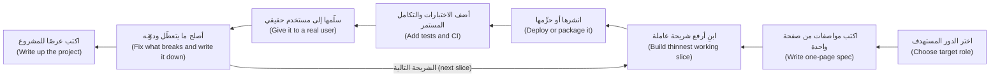
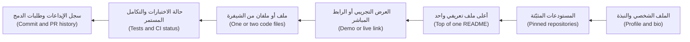
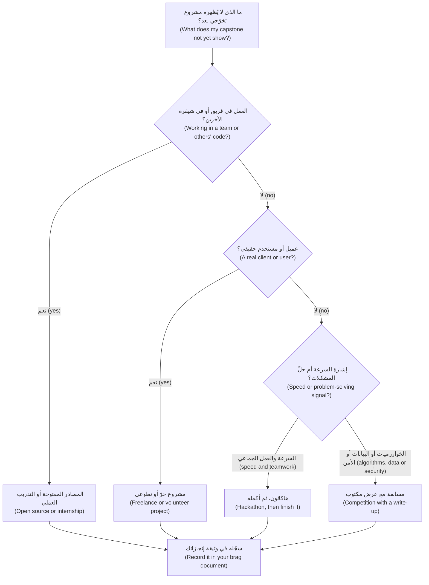

# الوحدة 3 — الإثبات (Proof): معرض الأعمال (portfolio)

*الشهادة الجامعية (degree) تقول إنك درست. وقائمة لغات البرمجة تقول إنك كنت حاضرًا في القاعة. ولا هذه ولا تلك تخبر صاحب العمل (employer) بأنك قادر على أداء الوظيفة، وحين تستطيع وكلاء البرمجة بالذكاء الاصطناعي (AI coding agents) إنتاج تطبيق تجريبي أنيق في فترة ما بعد الظهر، فإن تطبيقًا تجريبيًا أنيقًا لا يثبت إلا القليل جدًا. أما ما يثبت فهو الإثبات: عمل يستطيع شخص غريب (stranger) أن يفتحه ويشغّله ويسائله ويثق به في دقائق معدودة. تحوّل هذه الوحدة المهارات (skills) التي اكتسبتها في الوحدتين 1 و2 إلى هذا الإثبات. تبدأ بالمشروع الأهم على الإطلاق: مشروع التخرّج التطبيقي (capstone) المبني لدورك المستهدف (target role) وفق معيار الإنتاج (production bar)، مع مواصفات جاهزة (ready-made spec) لكل مسار دور (role path). ثم تبيّن كيف تعرض عملك حتى يراه فعلًا المراجع المشغول (busy reviewer): ملفك الشخصي على GitHub (GitHub profile)، وملف README يجيب عن أسئلة المراجع بترتيبها، وكتابات قصيرة عن قراراتك. وتنتهي بالخبرة التي يمكنك اكتسابها قبل وظيفتك الأولى: التدريب العملي (internships)، والمصادر المفتوحة (open source)، والعمل الحر (freelance) والتطوعي (volunteer work)، والهاكاثونات (hackathons) والمسابقات (competitions). ستتابع دفعة بنك نجم بينما يستبدل عمر 23 مستودعًا لمقررات دراسية (course repositories) بخدمة واحدة تصمد أمام شخصين يحجزان آخر موعد (last slot) في اللحظة نفسها، وتعيد ريم كتابة ملف README لم تستطع الدفاع عنه، ويحوّل محمد مسيرته المهنية السابقة (previous career) إلى دليل (evidence) بدلًا من اعتذار.*

> **الخطوات (Steps):** Build, Prove — تحويل ما تستطيع فعله إلى دليل يستطيع شخص غريب أن يفتحه ويشغّله ويتحقق منه في دقائق.

---

# 3.1 — مشاريع تثبت أنك قادر على أداء الوظيفة: مواصفات مشروع تخرّج واحد لكل دور (one capstone spec per role)
*المستوى (Level): 🟡 متوسط (Intermediate)* · *المتطلبات (Prerequisites): 1.1، 1.3، 2.1، 2.2، 2.3، 2.4* · *الخطوة (Step): Build, Prove*

## ⚡ الدرس في دقيقة (In 60 seconds)
- يجيب **مشروع الإثبات (proof project)** عن سؤال واحد لدى المراجع (reviewer): «هل يستطيع هذا الشخص أداء عمل الدور بمستوى المبتدئ (junior) من دون أن يحمله أحد؟» ⁦⁩. ولا تستطيع نسخة من درس تعليمي (tutorial clone) أن تجيب عنه مهما كانت مصقولة (polished).
- القاعدة الأهم: **مشروع تخرّج عميق واحد يتفوّق على عشرة مستودعات سطحية (one deep capstone beats ten shallow repositories).** والعمق (depth) يعني: مستخدمًا حقيقيًا (real user)، ونطاقًا صغيرًا (small scope)، ونظامًا يعمل (running system)، واختبارات (tests)، وقرارات مكتوبة (written decisions)، ودليلًا على أنك شغّلته وأدرته.
- اختر مشروع التخرّج المناسب **لدورك المستهدف (your target role)** (من الدرس 2.1 إلى الدرس 2.4). فإثبات مهندس البيانات (data engineer) لا يشبه في شيء إثبات مطوّر الواجهات الأمامية (front-end developer).
- إشارة القرار (decision cue): قبل كتابة الشيفرة (before coding)، اكتب **السؤال الصعب الوحيد (one hard question)** الذي يجب أن يجيب عنه مشروعك جيدًا، مثل: «ماذا يحدث عندما يحجز شخصان آخر موعد في اللحظة نفسها؟ ⁦⁩». إن لم يكن هناك سؤال صعب، فما زال المشروع درسًا تعليميًا (tutorial).
- أكبر فخ (biggest trap): نشر شيفرة بناها الوكيل (agent-built code) لا تستطيع شرحها. يختار المراجعون ملفًا واحدًا ويسألون: «لماذا بهذه الطريقة؟ ⁦⁩». وإجابتك هي الإثبات.

## 🧭 لماذا يهم
في مراجعة تجريبية لمعرض الأعمال، يفتح خالد، مدير الهندسة (engineering manager) الذي يوظّف المبتدئين (juniors) في برنامج نجم للخرّيجين التقنيين (Najm Tech Graduate Programme)، حساب عمر على GitHub: 23 مستودعًا (repositories) من حلول LeetCode، وواجبات مقررات (course assignments)، وتطبيق مهام من درس تعليمي، ونسخة متفرّعة لم تُلمس (untouched fork). وبعد دقيقة يقول بلطف: «كل ما هنا يخبرني بأنك قادر على إنهاء مقرر دراسي. ولا شيء يخبرني بأنك قادر على أداء الوظيفة. لا أجد شيئًا واحدًا يعمل، ولا اختبارًا واحدًا (one test)، ولا قرارًا واحدًا اتخذته بنفسك».

أما ريم فلديها المشكلة المعاكسة: اثنا عشر تطبيقًا حسن المظهر بُنيت بسرعة باستخدام وكلاء البرمجة بالذكاء الاصطناعي. يسألها خالد عمّا يمنع مستخدمًا في تطبيقها لتقسيم المصاريف (expense-splitting app) من قراءة مصاريف مستخدم آخر. تفتح ريم الشيفرة (code) وتدرك أنها تقرؤها للمرة الأولى. فريق خالد يستخدم أدوات الذكاء الاصطناعي (AI tools) كل يوم؛ وفكرته أضيق من ذلك: «إن وظّفتك، فأنا أثق بأنك ستتحقق مما كتبه الوكيل. أريني أنك قادرة على ذلك».

ومحمد، المتحوّل مهنيًا (career-switcher) القادم من معسكر تدريبي (bootcamp)، لديه ثلاثة مشاريع. أحدها نظام لحجز الحصص (class-booking system) للنادي الرياضي (gym) الذي كان يعمل فيه، استخدمه عشرون عضوًا لمدة شهرين، مع اختبارات وملاحظة قصيرة عن خلل الحجز المزدوج (double-booking bug) الذي أصلحه. يقضي خالد عشر دقائق عليه ثم يطلب سيرته الذاتية (CV).

## 📐 كيف يعمل

### 🟢 الأساسيات

**ما يحاول المراجع معرفته (What a reviewer is trying to learn).** لدى المراجع وقت محدود وسؤال واحد: هل يُظهر هذا الشخص الإشارات (signals) التي يحتاجها الدور؟ وفي معظم أدوار المبتدئين (junior roles) تكون هذه الإشارات هي الأساس (baseline) من الدرس 1.1، والاستخدام الأمين لأدوات الذكاء الاصطناعي من الدرس 1.2، والتفكير الإنتاجي (production thinking) من الدرس 1.3. ومشروع الإثبات مصمَّم لإظهار هذه الإشارات حيث يستطيع شخص غريب التحقق منها.

**سُلّم الإثبات (The proof ladder).** تقع المشاريع على سُلّم (ladder). وكل درجة (rung) دليل أقوى من الدرجة التي تحتها.

| الدرجة | ما هي | ما الذي تثبته |
|---|---|---|
| 1. متابعة درس تعليمي (Tutorial follow-along) | كتبتَ ما كتبه الفيديو | أنك أنهيت الفيديو |
| 2. درس تعليمي مع ميزة خاصة بك | وسّعته بشيء غير موجود في الدرس التعليمي | أنك قادر على تعديل شيفرة لم تصمّمها |
| 3. مشروعك الخاص | مشكلتك، وتصميمك، وشيفرتك | أنك قادر على اتخاذ القرارات (make decisions) |
| 4. منشور وقابل لإعادة الإنتاج | يستطيع أي شخص فتحه، أو تشغيله بأمر واحد (one command) | أنك قادر على الإطلاق (ship)، لا على الكتابة فقط |
| 5. يستخدمه شخص آخر | مستخدم حقيقي مسمّى، ولو كان مجموعة صغيرة (small group) | أنه يحلّ مشكلة ويصمد أمام المدخلات الحقيقية |
| 6. مُشغَّل عبر الزمن (Operated over time) | أخطاء اكتُشفت أثناء الاستخدام وأُصلحت ووُثّقت؛ وتغييرات أُطلقت بأمان | أنه يمكن ائتمانك على نظام قيد التشغيل |

بلوغ الدرجة 5 أو 6 بمشروع واحد يميّزك عن غيرك.

**العلامات الست لمشروع الإثبات (The six marks of a proof project).** استخدمها قائمة تحقق (checklist):
1. **مشكلة حقيقية ومستخدم مسمّى (A real problem and a named user).** «طلاب قسمي الذين ينتظرون مواعيد المختبر»، لا «تطبيق حجز».
2. **نطاق صغير (A small scope).** سير عمل أساسي واحد منجز كما ينبغي. يمكنك إضافة الميزات (features) لاحقًا؛ لكنك لا تستطيع إضافة العمق لاحقًا من دون إعادة الكتابة (rewriting).
3. **إنه يعمل (It runs).** رابط مباشر (live link)، أو أمر واحد (single command) مثل `docker compose up` يعمل على جهاز نظيف (clean machine).
4. **الاختبارات والتكامل المستمر (Tests and continuous integration, CI).** تعمل الاختبارات الآلية (automated tests) مع كل دفع (push)، والشارة (badge) خضراء لسبب حقيقي.
5. **قرارات مكتوبة (Decisions written down).** لماذا قاعدة البيانات هذه، ولماذا هذه البنية، وما الذي اخترت ألا تفعله. يبيّن الدرس 3.2 الطريقة.
6. **دليل على التشغيل (Evidence of operation).** متتبّع أخطاء (error tracker)، وسجلّ لخلل اكتشفته وأصلحته، وسجلّ تغييرات (changelog)، وتراجع تدرّبت عليه.

وهناك شرط واحد يعلو العلامات الست كلها: **أن تستطيع شرح كل سطر (you can explain every line)**، بما في ذلك الأسطر التي كتبها وكيل ذكاء اصطناعي (AI agent).

**اختيار المشكلة (Choosing the problem).** المشكلات الجيدة تأتي من حياتك ومجتمعك (نادٍ، أو مشروع عائلي (family business)، أو قسم جامعي)، أو من مجموعة بيانات عامة (public dataset) تهمّك، أو من منظمة تتطوّع فيها (الدرس 3.3). أما الخيارات الضعيفة فهي التي رآها المراجعون مرات كثيرة: قوائم المهام (to-do lists)، وتطبيقات الطقس (weather apps)، ونسخ مواقع البثّ (streaming-site clones)، ومجموعة بيانات تايتانيك (Titanic dataset)، والأرقام المكتوبة بخط اليد (handwritten digits). هي مناسبة للتعلّم، ضعيفة كإثبات: لا مستخدم حقيقي، ولا سؤال صعب، وإجابة جاهزة يستطيع أي شخص نسخها.

**حلقة البناء (The build loop).** ابنِ أولًا شريحة رفيعة عاملة وضعها أمام شخص ما، ثم عمّقها (deepen it).



### 🟡 التعمق أكثر (Going deeper)

**مواصفات مشروع تخرّج واحد لكل دور (One capstone spec per role).** فيما يلي خمس مواصفات (specs)، واحدة لكل مسار دور من الوحدة 2. غيّر المجال (domain) إلى شيء يهمّك؛ وحافظ على المعيار.

**مهندس البرمجيات والمهندس الشامل (Software and full-stack engineer) — خدمة حجز لمنظمة صغيرة (a booking service for a small organisation)**
- *النطاق (Scope):* عيادة (clinic) أو نادٍ رياضي أو مختبر جامعي (university lab) بمواعيد محدودة (limited slots)؛ تسجيل دخول (login)، ودورا العضو والمسؤول، والحجز والإلغاء، وتأكيد بالبريد الإلكتروني (email confirmation).
- *معيار الإنتاج:* قاعدة بيانات علائقية (relational database) مع ترحيلات (migrations)، واختبارات لقواعد الحجز، وتكامل مستمر (CI)، ونشر (deployed) مع متتبّع أخطاء وفحص توافر (uptime check)، ولا أسرار في المستودع.
- *السؤال الصعب (Hard question):* «شخصان يضغطان زر "احجز" ('Book') لآخر موعد في اللحظة نفسها. ماذا يحدث؟ ⁦⁩».
- *مسار المكتبة (Library path):* [*تصميم الأنظمة للمبرمجين بالحدس (System Design for Vibe Coders)*، الدرس 2.6 — نقرتان في وقت واحد: حالات التسابق والمعاملات والكتابات متساوية الأثر](../vibe/index.ar.html#l2-6)؛ [*لبنات بناء البرمجيات كخدمة (SaaS Building Blocks)*، الدرس 2.1 — طبقة البيانات: Postgres وأدوات ORM والترحيلات والبيانات الأولية](../saas/index.ar.html#/2.1).

**مهندس تطبيقات الذكاء الاصطناعي (AI application engineer) — مساعد للإجابة عن الأسئلة من مستندات يحق لك استخدامها (a question-answering assistant over documents you may use)**
- *النطاق:* مجموعة نصوص عامة ومسموح باستخدامها، مثل اللوائح المنشورة لجامعتك (published regulations) أو توثيق مشروع مفتوح المصدر؛ إجابات مع روابط إلى المصادر، وعبارة «لا أعرف» حين لا تكون الإجابة موجودة.
- *معيار الإنتاج:* **مجموعة ذهبية (golden set)** من 50 سؤالًا حقيقيًا على الأقل تُقيَّم مع كل تغيير، ومعدل رفض مَقيس على الأسئلة الخارجة عن النطاق (out-of-scope questions)، وتسجيل التكلفة وزمن الاستجابة لكل استعلام، ودفاع مُختبَر ضد التعليمات المخبّأة داخل المستندات.
- *السؤال الصعب:* «كيف تعرف أن تغيير الموجّه (prompt change) جعله أفضل، لا مختلفًا فحسب؟ ⁦⁩».
- *مسار المكتبة:* [*إدارة منتجات الذكاء الاصطناعي: من الصفر إلى الاحتراف*، الدرس 6.1 — جودة يمكنك قياسها: المقاييس والمجموعات الذهبية وتحليل الأخطاء](../aipm/index.ar.html#/6.1)؛ [*أمن الذكاء الاصطناعي وأمن التطبيقات: من الصفر إلى الاحتراف*، الدرس 8.2 — حقن الموجّهات وكسر القيود، المباشر وغير المباشر](../secai/index.ar.html#/8.2).

**مهندس البيانات أو محلّل البيانات أو عالم البيانات (Data engineer, analyst or data scientist) — خط بيانات يجيب عن أسئلة حقيقية (a pipeline that answers real questions)**
- *النطاق:* مصدر بيانات مفتوحة عام يُحدَّث بانتظام (النقل، أو الطقس، أو الأسعار)؛ استيعاب مُجدول (scheduled ingestion)، وتحويلات مُختبَرة (tested transformations)، ولوحة معلومات (dashboard) تجيب عن ثلاثة أسئلة محددة. ويضيف علماء البيانات (data scientists) نموذجًا (model)، وخط أساس بسيطًا يجب التفوّق عليه، ومهمة دفعية (batch job) تقيّم البيانات الجديدة.
- *معيار الإنتاج:* إعادة تشغيل آمنة من دون تكرار، وفحوص جودة بيانات تفشل بصوت عالٍ، ونتائج النموذج مقارنةً بخط الأساس مكتوبة.
- *السؤال الصعب:* «وصل ملف الأمس مرتين، ووصل ملف اليوم متأخرًا. ماذا تُظهر لوحة معلوماتك؟ ⁦⁩».
- *مسار المكتبة:* [*هندسة البيانات والتحليلات: من الصفر إلى الاحتراف*، الوحدة 2 — الاستيعاب وخطوط البيانات (Ingestion and pipelines)](../data/index.ar.html#/2.1)؛ [*هندسة البيانات والتحليلات: من الصفر إلى الاحتراف*، الوحدة 3 — التحويل والجودة (Transformation and quality)](../data/index.ar.html#/3.2).

**مهندس السحابة أو المنصّات أو DevOps (Cloud, platform or DevOps engineer) — شغّل تطبيقًا كما ينبغي (run an app properly)**
- *النطاق:* خذ تطبيقًا صغيرًا (small application) (تطبيقك، أو تطبيقًا مفتوح المصدر) وضعه في حاوية (containerise it)، وعرّف بنيته التحتية كشيفرة (infrastructure as code)، وابنِ خط نشر (pipeline) ينشر إلى بيئة التجهيز (staging) ثم إلى الإنتاج (production).
- *معيار الإنتاج:* مراقبة (monitoring) مع هدف مستوى خدمة مكتوب واحد، ودليل تشغيل (runbook)، وتراجع تدرّبت عليه (practised rollback)، وتقرير «يوم اختبار» عن شيء عطّلته عمدًا، وملاحظة عن التكلفة (cost note) مع تفعيل تنبيهات الميزانية (budget alerts).
- *السؤال الصعب:* «الإصدار الجديد (new release) يفشل لدى بعض المستخدمين. اشرح لي ما تفعله في الدقائق العشر التالية ⁦⁩».
- *مسار المكتبة:* [*السحابة وDevOps: من الصفر إلى الاحتراف (Cloud & DevOps: Zero to Hero)*، الوحدة 4 — التكامل والنشر المستمران والإصدارات (CI/CD and releases)](../cloud/index.ar.html#/4.1)؛ [*تصميم الأنظمة للمبرمجين بالحدس*، الدرس 4.4 — التراجع وبيئة التجهيز وبوابات الإصدار (Rollback, staging, and release gates)](../vibe/index.ar.html#l4-4).

**مهندس الأمن (Security engineer) — أمّن تطبيقًا من طرف إلى طرف (secure an application end to end)**
- *النطاق:* تطبيقك الخاص، أو أحد المشاريع السابقة: نموذج تهديدات (threat model) مع مخطط تدفق البيانات (data-flow diagram)، واختبارات التحكم في الوصول (access-control tests)، وخط نشر فيه فحص الأسرار (secret scanning) والتحليل الساكن (static analysis) وفحوص الاعتماديات (dependency checks).
- *معيار الإنتاج:* لكل نتيجة (finding) درجة خطورة (severity)، وإصلاح أو قرار مسجّل، واختبار يمنع عودتها. تدرّب على الهجمات (practise attacks) على أنظمتك الخاصة فقط أو على تطبيق تدريبي (training app) مثل **OWASP Juice Shop**، ولا تفعل ذلك أبدًا على أي شيء لا تملك إذنًا مكتوبًا باختباره (written permission to test).
- *السؤال الصعب:* «أيّ نتيجة ستصلحها أولًا، ولماذا هي بالذات؟ ⁦⁩».
- *مسار المكتبة:* [*أمن الذكاء الاصطناعي وأمن التطبيقات: من الصفر إلى الاحتراف*، الدرس 1.1 — نمذجة التهديدات: تدفقات البيانات وحدود الثقة وSTRIDE](../secai/index.ar.html#/1.1)؛ [*أمن الذكاء الاصطناعي وأمن التطبيقات: من الصفر إلى الاحتراف*، الدرس 6.3 — تأمين الشيفرة المولّدة بالذكاء الاصطناعي: أين تخطئ وكلاء البرمجة](../secai/index.ar.html#/6.3).

**الوقت والتكلفة والبيانات (Time, cost and data).** يستغرق مشروع تخرّج بهذا المعيار عدة أسابيع من العمل بدوام جزئي، لا عطلة نهاية أسبوع واحدة؛ ويضعه الدرس 7.1 ضمن خطة من 12 أسبوعًا (12-week plan). تتغيّر الفئات المجانية (free tiers) والأرصدة الطلابية (student credits)، وبعض المشاريع تراكم فواتير حقيقية (real bills): تحقّق من الشروط الحالية (current terms) (2026)، وفعّل تنبيهات الميزانية من اليوم الأول، ودوّن طريقة إزالة كل شيء. استخدم بيانات عامة أو مسموحًا بها أو اصطناعية، ولا تستخدم أبدًا سجلات حقيقية لعملاء أو مرضى أو طلاب. وإن أعطاك مستخدمون حقيقيون بيانات شخصية (personal data)، فاجمع الحد الأدنى واحذفها حين لا تعود بحاجة إليها. يلاحظ أصحاب العمل في القطاعات الخاضعة للتنظيم (regulated sectors) هذه العادة؛ وفي قطر، يُعدّ القانون رقم 13 لسنة 2016 بشأن حماية البيانات الشخصية (Law No. 13 of 2016 on personal data protection) سببًا وجيهًا لإظهارها مبكرًا.

### 🔴 نظرة الخبير (Expert view)

**كثافة القرارات (Decision density).** في معرض الأعمال القوي قرارات *حقيقية* كثيرة يستطيع المراجع مساءلتها. أما تطبيق المهام (to-do app) فلا يكاد يحوي أيًّا منها. وفي خدمة الحجز التي أعاد عمر بناءها قرارات كثيرة: قيد (constraint) مقابل قفل (lock) لمنع الحجوزات المزدوجة (double bookings)، وماذا يحدث حين يتعطّل البريد الإلكتروني، وكم من الوقت تُحفظ الحجوزات الملغاة (cancelled bookings). وكل واحد منها موضوع مقابلة (interview topic) أعددتَه مسبقًا.

**الاتساع حول العمق (Breadth around depth).** الشكل الجيد هو مشروع تخرّج واحد (one capstone) مع قطعة أو قطعتين أصغر تُظهران التنوّع (show range)، مثل مساهمة في مشروع مفتوح المصدر (open-source contribution) (الدرس 3.3).

**البناء بوكلاء الذكاء الاصطناعي، علنًا (Building with AI agents, in the open).** استخدام وكلاء البرمجة بالذكاء الاصطناعي أمر طبيعي؛ أما إخفاؤه فليس كذلك. يريد المراجعون حُكمك: المواصفات التي أعطيتها للوكيل، والاختبارات التي تحققت من عمله، والأخطاء التي اكتشفتها. وقسم قصير بعنوان «كيف بُني هذا» (الدرس 3.2) يذكر الأجزاء التي ساعد فيها الوكيل (agent-assisted) وكيف تحققت منها أفضل من التظاهر بأنك كتبت كل شيء بنفسك. انظر [*تصميم الأنظمة للمبرمجين بالحدس*، الدرس 9.4 — التحقق قبل الإنجاز (Verification before completion)](../vibe/index.ar.html#l9-4).

**المشاريع الجماعية (Team projects).** المشروع الجماعي (group project) إثبات قوي إن كنت دقيقًا في تحديد دورك: «بنيتُ مهمة التسوية (reconciliation job) واختباراتها؛ وبنى زملائي الواجهة الأمامية (front end)» عبارة صادقة ويمكن التحقق منها في سجل الإيداعات (commit history).

**الميزة المحلية (Local advantage).** في سوق الخليج (Gulf market)، يبرز التعامل السليم مع النص العربي (Arabic text) والتخطيط من اليمين إلى اليسار (right-to-left layout)، أو العناية على الطريقة المصرفية (banking-style care) بحماية البيانات (data protection) وسجلات التدقيق (audit trails). انظر [*تصميم الأنظمة للمبرمجين بالحدس*، الدرس 11.2 — التدويل والكتابة من اليمين إلى اليسار (Internationalization and RTL)](../vibe/index.ar.html#l11-2).

## 🧰 الأدوات
| المورد أو الأداة أو النموذج (Resource, tool or template) | ما هو وماذا يفعل | متى تلجأ إليه |
|---|---|---|
| **Proof project spec** (مواصفات مشروع الإثبات، صفحة واحدة) | مستند قصير (short document): المشكلة (problem)، والمستخدم (user)، والشريحة الرفيعة (thin slice)، ومعيار الإنتاج، والسؤال الصعب، والبيانات (data)، والجدول الزمني (timeline) | قبل كتابة أي شيفرة؛ وحين يبدأ النطاق بالتضخّم |
| **The Twelve-Factor App** (تطبيق العوامل الاثني عشر، من مؤلفين في Heroku) | دليل قصير كلاسيكي لبناء تطبيقات تُنشَر وتُهيّأ بسلاسة | عند إعداد التهيئة (configuration) والسجلات (logs) والنشر (deployment) لمشروع تخرّج ويب (web capstone) |
| **OWASP Juice Shop** | تطبيق ويب ضعيف عمدًا (deliberately vulnerable web application) للتدرّب الأمني القانوني | مشاريع التخرّج الأمنية (security capstones) وتعلّم الهجمات على جهازك الخاص |
| **Public open-data portals** (بوابات البيانات المفتوحة العامة) | مواقع حكومية وبلدية ولمنظمات دولية تنشر مجموعات بيانات مع ترخيص | العثور على بيانات حقيقية ومسموح بها لمشاريع البيانات والذكاء الاصطناعي |
| **Golden set** (المجموعة الذهبية) | قائمة ثابتة من المدخلات مع المخرجات المتوقعة، تُقيَّم مع كل تغيير | أي مشروع تخرّج في الذكاء الاصطناعي أو تعلّم الآلة حيث لا تُعدّ عبارة «يبدو أفضل» دليلًا |
| **Error tracker** (متتبّع الأخطاء، مثل Sentry) | خدمة تسجّل الأخطاء من تطبيقك قيد التشغيل مع سياقها | من أول نشر (first deploy) لأي مشروع يواجه المستخدمين (user-facing project) |
| **Budget alerts** (تنبيهات الميزانية) | تنبيهات فوترة سحابية تحذّرك قبل أن يتجاوز الإنفاق حدًّا معيّنًا | في اليوم الذي تنشئ فيه أي حساب سحابي (cloud account) |

## 🏛️ عمليًا في بنك نجم
يطلب برنامج نجم للخرّيجين التقنيين من المرشحين (candidates) في المرحلة التقنية (technical stage) إحضار مشروع واحد مع **مواصفات مشروع الإثبات (Proof project spec)** في صفحة واحدة. ويستخدمها خالد لإعداد الأسئلة (prepare questions). وهذه مواصفات عمر، بعد أن أعاد كتابتها إثر المراجعة.

| الحقل (Field) | إجابة عمر (Omar's answer) |
|---|---|
| الدور المستهدف | مهندس برمجيات (Software engineer) (الدرس 2.1) |
| المشكلة والمستخدم | يحجز مختبر الإلكترونيات (electronics lab) في جامعتي 12 طاولة عمل (workbenches) على ورقة، فيقع الطلاب في الحجز المزدوج (double-book). المستخدمون: مشرف المختبر (lab supervisor) ونحو 60 طالبًا في السنة الأخيرة (final-year students). |
| أرفع شريحة (Thinnest slice) | يسجّل الطلاب الدخول ببريدهم الجامعي (university email)، ويرون الطاولات المتاحة للأسبوع، ويحجزون موعدًا واحدًا مدته ساعتان، ويلغونه. |
| معيار الإنتاج | PostgreSQL مع ترحيلات؛ وقيد تفرّد (unique constraint) على الطاولة والموعد؛ واختبارات لقواعد الحجز؛ وتكامل مستمر مع كل دفع؛ ونشر مع تتبّع الأخطاء (error tracking) وفحص التوافر؛ والأسرار في متغيرات البيئة. |
| السؤال الصعب | طالبان يحجزان آخر طاولة في اللحظة نفسها. الإجابة: قيد في قاعدة البيانات (database constraint)، ورسالة واضحة «حُجز للتو ('just taken')». مُختبَر باختبار تزامني (concurrent test). |
| البيانات | الاسم، والبريد الجامعي، والحجوزات. تُحذف الحجوزات التي يزيد عمرها على فصل دراسي واحد آليًا (deleted automatically). لا بيانات شخصية أخرى. |
| خارج النطاق (Out of scope) | المدفوعات (payments)، وتطبيق الجوال (mobile app)، والحجوزات المتكررة (recurring bookings). |
| المساعدة بالذكاء الاصطناعي (AI assistance) | استُخدم الوكيل (agent) للهيكلة الأولية (scaffolding) والنماذج (forms)؛ أما منطق الحجز والاختبارات فكتبتها وراجعتها بنفسي؛ واكتُشف خطآن من أخطاء الوكيل وأُصلحا، وهما مذكوران في ملف README. |
| الدليل | رابط مباشر، والمستودع (repository)، وسجل التكامل المستمر (CI history)، وملاحظة حادثة واحدة، وفيديو عرض مدته ثلاث دقائق. |
| الجدول الزمني | الأسبوعان 1–2: الشريحة الرفيعة تعمل مباشرة؛ الأسبوعان 3–4: الاختبارات والتكامل المستمر والمراقبة؛ الأسبوعان 5–6: استخدام حقيقي من المختبر وإصلاحات. |

حُكم خالد: «الآن لديّ ستة أشياء أسألك عنها، وأنت تعرف إجاباتها (Now I have six things to ask you, and you know the answers)».

## 🛠️ التمارين (Exercises)
- 🟢 أعطِ كل مستودع عام (public repository) درجةً من 1 إلى 6 على سُلّم الإثبات (proof ladder). *يكتمل عندما (Done when):* يكون لديك جدول بالمستودعات ودرجاتها، مع مستودع واحد (أو فكرة جديدة واحدة) محدَّد بدائرة بوصفه مشروع تخرّجك.
- 🟡 املأ مواصفات مشروع الإثبات أعلاه لدورك المستهدف، مستعينًا بمواصفات مشروع التخرّج المطابقة من قسم 🟡 التعمق أكثر. *يكتمل عندما:* يستطيع زميل أو مرشد قراءة المواصفات في دقيقتين وإخبارك بما تبنيه، ولمن، وما الذي سيكون صعبًا فيه.
- 🔴 أطلق أرفع شريحة من مشروع تخرّجك، قابلة للوصول أو لإعادة الإنتاج بأمر واحد، مع اختبار واحد على الأقل في التكامل المستمر ومستخدم حقيقي جرّبها. *يكتمل عندما:* يعمل الرابط المباشر أو الإعداد بأمر واحد (one-command setup) على جهاز شخص آخر، ويكون التكامل المستمر أخضر، وتكون قد دوّنت شيئًا واحدًا فعله مستخدمك الأول (first user) ولم تتوقّعه.

## ⚠️ أخطاء وفخاخ (Mistakes and traps)
- **الكمّ على حساب العمق (Quantity over depth).** عشرون مستودعًا سطحيًا (shallow repositories) تخفي أفضل أعمالك. ابنِ مشروع تخرّج عميقًا واحدًا وثبّته (pin it)؛ وأرشف البقية أو ألغِ تثبيتها.
- **اختيار التقنيات أولًا (Picking the stack first).** إطار عمل رائج (fashionable framework) بلا مشكلة يعطيك عرضًا تجريبيًا بلا مستخدم. اكتب المواصفات، ثم اختر أبسط مجموعة تقنيات تلبّيها.
- **إطلاق ما لا تستطيع شرحه (Shipping what you cannot explain).** يسهّل وكلاء الذكاء الاصطناعي (AI agents) البناء بما يتجاوز فهمك. اقرأ كل جزء واختبره، وكن مستعدًا لشرح أي ملف.
- **استخدام بيانات شخصية حقيقية (Using real personal data).** لا مكان لسجلات العملاء أو المرضى في معرض الأعمال أبدًا. استخدم بيانات عامة أو مسموحًا بها أو اصطناعية.
- **عدم الإنهاء أبدًا (Never finishing).** مشروع تخرّج منجز بنسبة 80% ولم يُنشر قط (never deployed) يثبت أقل من مشروع أصغر يعمل. قلّص النطاق (cut scope) حتى يُطلق، ثم عمّقه (then deepen).

## 🧾 الخلاصة (Recap)
- يُظهر مشروع الإثبات إشارات دورك المستهدف حيث يستطيع شخص غريب التحقق منها؛ ولا تستطيع نسخ الدروس التعليمية (tutorial clones) ذلك.
- اصعد سُلّم الإثبات: مشروعك الخاص، منشورًا، يستخدمه شخص حقيقي، ومُشغَّلًا عبر الزمن.
- استخدم العلامات الست (six marks)، وكن قادرًا على شرح كل سطر (explain every line)، بما في ذلك ما كتبه الوكيل.
- لكل دور مشروع تخرّج مختلف (different capstone)؛ فاربط مشروعك بسؤال صعب تستطيع الإجابة عنه جيدًا.
- استخدم وكلاء الذكاء الاصطناعي علنًا، وأظهر كيف تحققت من عملهم، واستخدم بيانات آمنة (safe data).

## ✍️ اختبر نفسك (Check yourself)

**1. لدى عمر 23 مستودعًا (repositories): واجبات مقررات (course assignments) وحلول LeetCode وتطبيقات من دروس تعليمية (tutorial apps). ولديه أربعة أسابيع قبل أن يُفتح باب التقديم (applications open). ما الذي ينبغي أن يفعله أولًا؟**

- A. يضيف حلًّا على LeetCode كل يوم حتى يُظهر ملفه نشاطًا منتظمًا (steady activity) على مدار الشهر
- B. يختار مشروع تخرّج واحدًا (one capstone) لدوره، ويحدّد سؤالًا صعبًا في المواصفات، ويطلق شريحة رفيعة
- C. يحذف كل مستودع قديم (old repository) حتى لا يبقى ظاهرًا إلا أفضل مشاريع مقرراته
- D. ينقل أفضل ثلاثة تطبيقات من الدروس التعليمية إلى إطار عمل أحدث (newer framework) ويثبّتها (pin them)

<details><summary>الإجابة</summary>

**B.** مشروع عميق واحد للدور المستهدف هو أقوى إثبات يستطيع بناءه في هذا الوقت. يضيف A نشاطًا (activity) من دون إشارات وظيفية (job signals)؛ وC غير ضروري، إذ يكفي إلغاء التثبيت (unpinning)؛ ويبقى D في أسفل سُلّم الإثبات. (🟢 الأساسيات؛ 🔴 نظرة الخبير (Expert view).)

</details>

**2. أيّ مشروع يقع في أعلى سُلّم الإثبات (proof ladder)؟**

- A. نسخة مصقولة من موقع بثّ بتصميم مخصّص (custom design)، بُنيت باتباع دورة فيديو شهيرة
- B. تطبيق مهام من درس تعليمي موسَّع بالوضع الداكن (dark mode) والتخزين دون اتصال (offline storage) اللذين لم يغطّهما الدرس
- C. مصنِّف صور أصلي ودقيق، دُرِّب وقُيِّم في دفتر (notebook) لم يُشغَّل خارجه قط
- D. أداة حجز (booking tool) استخدمها عشرون عضوًا في نادٍ رياضي لمدة شهرين، مع ملاحظة عن خلل اكتُشف وأُصلح

<details><summary>الإجابة</summary>

**D.** إنه منشور (deployed)، ويستخدمه أشخاص حقيقيون، ومُشغَّل عبر الزمن (operated over time)، أي الدرجة 6 (rung 6). أما C فمشروع أصلي (original project) (الدرجة 3) لكنه لم يعمل لأحد قط؛ وB هو الدرجة 2 وA الدرجة 1، مهما كان مصقولًا (however polished). (🟢 الأساسيات.)

</details>

**3. تبني هدى مشروع تخرّج في البيانات (data capstone). أيّ «سؤال صعب (hard question)» يناسب دور البيانات (data role) أكثر؟**

- A. «أيّ مكتبة رسوم بيانية (chart library) تجعل لوحة معلوماتي تبدو الأحدث في نظر المراجعين؟»
- B. «كم صفًّا (rows) يستطيع دفتري تحميله في الذاكرة قبل أن تنفد ذاكرة حاسوبي المحمول؟»
- C. «وصل ملف الأمس مرتين، ووصل ملف اليوم متأخرًا. ماذا تُظهر لوحة معلوماتي (dashboard) لمستخدمها صباحًا؟»
- D. «هل أستطيع إضافة صفحة تسجيل دخول (login page) وحسابات مستخدمين (user accounts) إلى لوحة المعلومات قبل أن أتقدّم؟»

<details><summary>الإجابة</summary>

**C.** إعادة التشغيل (reruns) والتكرار (duplicates) والبيانات المتأخرة (late data) مشكلات يومية في خطوط البيانات، والتعامل معها هو الإثبات الذي يبحث عنه من يجري مقابلات البيانات (data interviewers). أما A وD فشكليّان (cosmetic) هنا؛ وB حدٌّ للحاسوب المحمول (laptop limit)، لا سؤال إنتاجي (production question). (🟡 التعمق أكثر (Going deeper).)

</details>

**4. بنت ريم معظم مشروع تخرّجها بوكيل برمجة بالذكاء الاصطناعي (AI coding agent). ما أفضل طريقة لعرضه؟**

- A. ألا تقول شيئًا عن الوكيل، لأن المراجعين قد يفترضون أنها لا تفهم الشيفرة
- B. أن تضيف قسم «كيف بُني هذا» يوضّح ما فعله الوكيل وكيف تحققت منه؛ وأن تعرف كل ملف
- C. أن تزيل كل جزء كتبه الوكيل وتعيد بناءه يدويًا، حتى يكون المشروع كله من عملها دون مساعدة (unaided work)
- D. أن تذكر الوكيل مؤلفًا مشاركًا (co-author) في ملف README ولا تقول شيئًا آخر عن طريقة التحقق من الشيفرة

<details><summary>الإجابة</summary>

**B.** الإفصاح الصادق (honest disclosure) مع دليل التحقق هو ما يريده المراجعون. أما A فتضليل (misrepresentation) ينكشف مع أول سؤال تقني. وC إضاعة للوقت؛ فالتحقق من الشيفرة أهم من هوية من كتبها. وD يفصح عن الأداة لكنه لا يُظهر شيئًا من التحقق الذي يختبره المراجع. (🔴 نظرة الخبير (Expert view).)

</details>

**5. يريد يوسف إظهار مهارات السحابة والمنصّات (cloud and platform skills). أيّ مشروع تخرّج يناسبه أكثر؟**

- A. تطبيق صغير يُشغَّل بالبنية التحتية كشيفرة (infrastructure as code)، ونشر على مراحل، وهدف مستوى خدمة (SLO)، وتمرين تراجع، وملاحظة عن التكلفة
- B. ثلاث شهادات سحابية بمستوى مشارك في ملفه، من دون أي مشروع يستخدم ما تغطيه تلك الشهادات
- C. سلسلة تدوينات مفصّلة تقارن خدمات الحوسبة والتخزين والشبكات لدى كبار مزوّدي السحابة
- D. موقع معرض أعمال مصقول للواجهة الأمامية على منصة استضافة مجانية، بنطاق مخصّص (custom domain) وHTTPS

<details><summary>الإجابة</summary>

**A.** يُظهر العمل اليومي لمهندس المنصّات: النشر الآمن (deploying safely)، والمراقبة (observing)، والتحكم في التكلفة (controlling cost). أما B فإشارة إضافية مفيدة لكنها ليست إثباتًا على تشغيل أي شيء؛ وC وD يُظهران مهارات أخرى (other skills). (🟡 التعمق أكثر (Going deeper).)

</details>

## 📚 المراجع (References)
- The Twelve-Factor App — https://12factor.net/
- OWASP Juice Shop — https://owasp.org/www-project-juice-shop/
- توثيق GitHub Actions (GitHub Actions documentation) — https://docs.github.com/en/actions
- [*تصميم الأنظمة للمبرمجين بالحدس*، الدرس 2.6 — نقرتان في وقت واحد: حالات التسابق والمعاملات والكتابات متساوية الأثر](../vibe/index.ar.html#l2-6)
- [*تصميم الأنظمة للمبرمجين بالحدس*، الدرس 9.4 — التحقق قبل الإنجاز](../vibe/index.ar.html#l9-4)
- [*بناء تطبيقات الذكاء الاصطناعي والوكلاء من الصفر إلى الاحتراف*، الدرس 16.1 — المشروع الختامي: خذ نجم ديسك من الاستكشاف إلى الإطلاق الفعلي](../aiapps/index.ar.html#/16.1) — منظور البناء والتسليم (build and ship) لهذا الموضوع

---

# 3.2 — ملفك على GitHub وملفات README والكتابة عن عملك
*المستوى: 🟡 متوسط* · *المتطلبات: 1.1، 3.1* · *الخطوة: Prove*

## ⚡ الدرس في دقيقة (In 60 seconds)
- لا يقرأ المراجعون (reviewers) شيفرتك أولًا. بل يتصفّحون ملفك الشخصي سريعًا، ويفتحون مستودعًا مثبّتًا واحدًا، ويقرؤون أعلى ملف README الخاص به، ثم ينظرون في ملف أو ملفين. **صمّم من أجل التصفّح السريع (Design for the skim).**
- القاعدة الأهم: يجيب ملف README عن أسئلة المراجع **بالترتيب الذي يطرحها به (in the order they ask them)**: ما هذا، وهل يعمل، وكيف بُني، ولماذا هذه الاختيارات، وماذا تعلّمت.
- إن **سجل الإيداعات والاختبارات والقرارات المكتوبة (commit history, tests and written decisions)** دليل أيضًا. فرسائل مثل "fix" و"fix2" و"final" تروي قصة؛ وكذلك يرويها طلب دمج (pull request) نظيف بوصف واضح (clear description).
- إشارة القرار: سلّم مستودعك إلى شخص لم يره قط. إن لم يستطع أن يقول ما يفعله وأن يشغّله خلال خمس دقائق، فملف README لم يكتمل بعد.
- أكبر فخ: سرّ مُودَع في المستودع (committed secret)، مثل مفتاح API (API key) في ملف `.env`. حذف الملف لا يكفي؛ يجب إبطال المفتاح واستبداله.

## 🧭 لماذا يهم
يستعدّ طارق، قائد الهندسة (engineering lead) الذي يدير المقابلات التقنية (technical interviews) في بنك نجم (Najm Bank)، لمقابلة ريم. مشروع تخرّجها المثبّت (pinned capstone)، وهو مساعد لتخطيط الدراسة (study-planner assistant)، له ملف README من أربعة أسطر: اسم المشروع، وعبارة "Built with Next.js, Supabase, Tailwind and an AI agent"، و`npm install && npm run dev`. لا وصف، ولا لقطة شاشة، ولا رابط مباشر. وفي السجل (history) 140 إيداعًا (commits) أُجريت في يومين، معظمها بعنوان "update" أو "fix". وفي إيداع مبكر (early commit) يوجد ملف `.env` فيه مفتاح API حقيقي.

ما زال طارق قادرًا على مقابلة ريم، لكنه يدخل الآن محمّلًا بالشكوك (doubts) بدلًا من الأسئلة (questions). ولدى هدى نسخة أهدأ من المشكلة نفسها: ثلاثة دفاتر ممتازة (excellent notebooks) بلا ملف README على الإطلاق، وخلايا (cells) لا تعمل إلا بترتيب معيّن، ومجموعة بيانات (dataset) تُحمَّل من مسار على حاسوبها المحمول الخاص. ودانة، عالمة البيانات الرئيسية (lead data scientist)، لا تستطيع تشغيل أيٍّ منها.

ليست أيٌّ من المشكلتين مشكلة مهارة (about skill). كلتاهما تتعلق بالعرض والنظافة، وهو ما تقرؤه فرق التوظيف (hiring teams) بوصفه إشارات على سلوكك في فريق حقيقي (real team)، حيث يجب على الآخرين قراءة عملك وتشغيله والثقة به. يجعل هذا الدرس عملك سهل الرؤية وآمن المشاركة.

## 📐 كيف يعمل

### 🟢 الأساسيات

**كيف يتصفّح المراجع (How a reviewer skims).** يتبع مسؤولو التوظيف والمهندسون والمديرون عادةً المسار نفسه (same path)، ويتوقفون حالما يفقدون الثقة أو يجدون ما يحتاجونه:



كل خطوة موضع تكسبهم فيه أو تخسرهم. اجعل الخطوات الثلاث الأولى بلا أي عناء (effortless).

**ملفك الشخصي (Your profile).** على GitHub (أو GitLab، أو أينما كانت شيفرتك):
- اسم واضح (clear name) ونبذة من سطر واحد (one-line bio) تسمّي دورك المستهدف: "Graduate software engineer. Building reliable web services. Doha." («مهندس برمجيات خرّيج. أبني خدمات ويب موثوقة. الدوحة.»)
- **ثبّت (Pin)** من أربعة إلى ستة مستودعات، ومشروع التخرّج أولًا (capstone first) (الدرس 3.1). ألغِ تثبيت الواجبات الدراسية (coursework) التي تطمره أو أرشفها.
- اختياريًا، **ملف README للملف الشخصي (profile README)**: على GitHub، هو مستودع عام يحمل اسم المستخدم نفسه ويظهر ملف README الخاص به في أعلى ملفك الشخصي. ثلاثة أسطر أو أربعة تكفي: ماذا تبني، ورابط مشروع تخرّجك (capstone link)، وكيف يُتواصل معك.
- رابط إلى ملفك على LinkedIn أو موقعك الشخصي (personal site) (الدرس 4.2).

**ملف README يجيب عن أسئلة المراجع (A README that answers the reviewer).** نسختان ضعيفة وقوية للمشروع نفسه:

```markdown
<!-- Weak -->
# study-planner
Built with Next.js, Supabase, Tailwind and an AI agent.
npm install && npm run dev
```

```markdown
<!-- Strong (top section) -->
# Study Planner: turns a course syllabus into a weekly plan
Final-year students paste a syllabus; the app proposes a week-by-week plan
and reminds them before deadlines. Used by 14 classmates for one semester.

Live demo: <link>  ·  3-minute video: <link>  ·  CI: passing

### How it works
<architecture diagram: browser, API, database, model provider, email>

### Run it locally
cp .env.example .env   # add your own keys
docker compose up      # app on http://localhost:3000
make test              # 42 tests, about 20 seconds
```

تجيب النسخة القوية (strong version) عن «ما هذا، ولمن، وهل يعمل، وهل أستطيع تشغيله (what is it, for whom, does it work, can I run it)» قبل أن يمرّر المراجع الصفحة إلى الأسفل.

**الأقسام بالترتيب (The sections, in order).** استخدم هذا بوصفه **قالب README للمشروع (Project README template)**:
1. **العنوان ووصف من سطر واحد (Title and one-line description)**، والمشكلة أولًا (problem first).
2. **لمن هو والمشكلة التي يحلّها (Who it is for and the problem it solves).**
3. **العرض التجريبي (Demo)**: رابط مباشر، أو لقطات شاشة (screenshots) أو صورة GIF قصيرة، وفيديو مدته دقيقتان إلى ثلاث.
4. **كيف يعمل (How it works)**: مخطط معماري بسيط وفقرة. انظر [*تصميم الأنظمة للمبرمجين بالحدس*، الدرس 1.1 — ارسم الصناديق قبل أن يكتب الوكيل الشيفرة](../vibe/index.ar.html#l1-1).
5. **شغّله محليًا (Run it locally)**: أوامر تعمل على جهاز نظيف، مع ملف `.env.example` فيه قيم بديلة (placeholder values).
6. **الاختبارات والجودة (Tests and quality)**: كيف تُشغَّل الاختبارات، وما الذي تغطيه، وحالة التكامل المستمر (CI status).
7. **القرارات والمفاضلات (Decisions and trade-offs)**: من ثلاثة إلى خمسة اختيارات وأسبابها، مع روابط إلى سجلات القرارات (decision records).
8. **كيف بُني هذا (How this was built)**: الأجزاء التي ساعد فيها الذكاء الاصطناعي (AI-assisted) وكيف تحققت منها.
9. **القيود المعروفة والخطوات التالية (Known limitations and next steps)**: صادقة ومحددة.
10. **الترخيص (Licence).**

**الأسرار: الخطأ الوحيد غير الشكلي (Secrets: the one mistake that is not cosmetic).** يمكن أن تعثر الماسحات الآلية (automated scanners) على مفتاح مُودَع في مستودع عام بعد وقت قصير من دفعه. إن حدث ذلك:
1. **أبطل المفتاح أو بدّله أولًا (Revoke or rotate the key first)**، لدى المزوّد. فهذا ما يوقف إساءة الاستخدام فعلًا (stops misuse).
2. ثم نظّف السجل إن أردت، وافحص الاستخدام والفوترة بحثًا عن أي شيء لم تفعله أنت.
3. امنع التكرار: ضع `.env` في `.gitignore`، وأودِع ملف `.env.example`، وأضف ماسحًا للأسرار (secret scanner) مثل **gitleaks** بوصفه خطّاف ما قبل الإيداع (pre-commit hook).

انظر [*تصميم الأنظمة للمبرمجين بالحدس*، الدرس 5.7 — الأسرار والتهيئة: مفاتيح المملكة](../vibe/index.ar.html#l5-7) و[*أمن الذكاء الاصطناعي وأمن التطبيقات: من الصفر إلى الاحتراف*، الدرس 5.2 — إدارة الأسرار: المفاتيح والرموز وأين تتسرّب](../secai/index.ar.html#/5.2).

### 🟡 التعمق أكثر

**سجل الإيداعات بوصفه دليلًا (Commit history as evidence).** نادرًا ما يقرأ المراجعون كل إيداع (every commit)، لكنهم يلقون نظرة على السجل، وهو يخبرهم كيف تعمل. فالإيداعات الصغيرة (small commits) ذات الرسائل الواضحة (clear messages) توحي بشخص قادر على العمل في قاعدة شيفرة فريق (team's codebase).

| ضعيف (Weak) | قوي (Strong) |
|---|---|
| `update` | `feat(booking): reject bookings for slots in the past` |
| `fix` | `fix(auth): expire sessions after 30 minutes of inactivity` |
| `final final 2` | `test(booking): add concurrent booking test for last slot` |
| `stuff` | `docs: add ADR 003 on choosing a unique constraint over locks` |

يتبع العمود القوي (strong column) **الإيداعات الاصطلاحية (Conventional Commits)**، وهي اصطلاح واسع الاستخدام يتكوّن من نوع (type) (`feat`، `fix`، `docs`، `test`، `refactor`)، ونطاق اختياري (optional scope)، ووصف قصير (short description). لست مضطرًا إلى اعتماده، لكن وجود اصطلاح متّسق ما يساعد.

حتى حين تعمل وحدك، افتح **طلبات دمج (pull requests)** على فرعك الرئيسي (main branch) للتغييرات المهمة (meaningful changes): وصفًا لما تغيّر ولماذا، وتشغيل التكامل المستمر (CI run)، وملاحظة عن طريقة اختبارك له. والمراجع الذي يفتح ثلاثة منها يرى بالضبط كيف سيكون العمل معك. وإن كنت تستخدم وكلاء الذكاء الاصطناعي، فطلب الدمج هو المكان الطبيعي لتدوين ما أنتجه الوكيل وما تحققت منه.

**سجلات القرارات المعمارية (Architecture decision records).** **سجل القرار المعماري (architecture decision record, ADR)** ملف قصير (short file)، يوضع غالبًا في `docs/adr/`، يسجّل قرارًا واحدًا (one decision): السياق (context)، والقرار (decision)، وعواقبه (consequences). ويُنسب هذا الشكل عادةً إلى مايكل نايغارد (Michael Nygard). يقع سجل القرار 003 (ADR 003) لدى عمر في نحو 150 كلمة: كانت الحجوزات المزدوجة ممكنة؛ والخيارات كانت فحصًا على مستوى التطبيق (application-level check)، أو قفلًا في قاعدة البيانات (database lock)، أو قيد تفرّد؛ واختار القيد لأنه يصمد حتى لو وصل طلبان في اللحظة نفسها؛ والثمن رسالة خطأ أقل ودًّا، عولجت في الواجهة. وفي المقابلة (interview)، يصبح هذا الملف إجابة مدتها خمس دقائق تدرّب عليها مسبقًا (already rehearsed).

**الدفاتر ومشاريع البيانات (Notebooks and data projects).** لهدى ولكل مرشح في مجال البيانات (data candidate):
- اجعل **إعادة التشغيل وتنفيذ الكل (Restart and run all)** ينجح من بداية نظيفة (clean start).
- ثبّت إصدارات الاعتماديات (pin dependencies) في `requirements.txt` أو في ملف بيئة (environment file).
- اشرح كيف يُحصل على البيانات: نص تنزيل (download script)، أو رابط إلى المصدر العام (public source) وترخيصه، أو عيّنة صغيرة (small sample) مُودَعة في المستودع. لا تودِع أبدًا بيانات شخصية أو سرية.
- ضع الاستنتاج (conclusion) في الأعلى بكلمات بسيطة (plain words)، مع الرسم البياني الرئيسي (key chart)، قبل الشيفرة.
- انقل المنطق القابل لإعادة الاستخدام (reusable logic) من الخلايا إلى دوال أو وحدات مع اختبارات، وهي الخطوة الأولى نحو خط بيانات. انظر [*هندسة البيانات والتحليلات: من الصفر إلى الاحتراف*، الوحدة 5 — علم البيانات وتعلّم الآلة في الإنتاج](../data/index.ar.html#/5.1).

**الكتابة عن عملك (Writing about your work).** يصل **عرض المشروع المكتوب (project write-up)** القصير (دراسة حالة (case study) أو تدوينة) إلى أشخاص لن يفتحوا مستودعك أبدًا، ومنهم مسؤولو التوظيف (recruiters). وهذا شكل مفيد (useful shape) في 600 إلى 1,200 كلمة:
1. المشكلة ومن كان يعانيها.
2. القيود (constraints): الوقت، والمال، والبيانات، ومهاراتك.
3. ما بنيته، مع مخطط واحد (one diagram).
4. ما الذي تعطّل، وكيف اكتشفته وأصلحته. وهذا هو الجزء الأكثر قراءة (most-read part).
5. ما قِسته، مع ظروف القياس. عبارة "Search fell from about 2 seconds to under 200 ms on my laptop with one million synthetic rows" («انخفض زمن البحث من نحو ثانيتين إلى أقل من 200 ملّي ثانية على حاسوبي المحمول مع مليون صف اصطناعي») صادقة؛ أما "blazing fast" («سريع كالبرق») فليست كذلك.
6. ما كنت ستفعله بشكل مختلف.

انشره على موقع شخصي، أو منصة تدوين للمطوّرين، أو بوصفه مقالًا على LinkedIn (LinkedIn article) (الدرس 4.2)، وضع رابطه في ملف README. وفي سوق الخليج، يُظهر ملخص عربي قصير بجانب العرض المكتوب بالإنجليزية تواصلًا تقنيًا ثنائي اللغة، وهو ما يقدّره كثير من أصحاب العمل.

**التراخيص (Licences).** من دون ملف ترخيص (licence file)، لا يملك الآخرون حقًا واضحًا في إعادة استخدام شيفرتك. اختر ترخيصًا شائعًا مفتوح المصدر بمساعدة **Choose a License** إن أردت السماح بإعادة الاستخدام، واحترم تراخيص كل ما تستخدمه، بما في ذلك مجموعات البيانات (datasets) ومخرجات النماذج (model outputs) حيث تنطبق الشروط.

### 🔴 نظرة الخبير

**مخطط المساهمات ليس درجة تقييم (The contribution graph is not a score).** شبكة المربعات الخضراء في ملف GitHub الشخصي تحصي النشاط لا الجودة. ويعرف المراجعون ذوو الخبرة (experienced reviewers) أنه يمكن التلاعب بها وأن كثيرًا من العمل الحقيقي يجري في مستودعات خاصة (private repositories). لا تصطنع إيداعات (manufacture commits) لملئها. فالمراجع الذي يرى 300 إيداع في مساء واحد بعنوان "update" يتعلّم شيئًا، لكنه ليس ما كنت تأمله.

**الكتابة هي جوهر العمل (Writing is the job).** يقضي المهندسون جزءًا كبيرًا من وقتهم في الكتابة (writing): أوصاف طلبات الدمج (pull request descriptions)، ومستندات التصميم (design documents)، وملاحظات الحوادث (incident notes)، والتذاكر (tickets)، والرسائل إلى الزملاء. ومعرض الأعمال الذي يحوي كتابة واضحة (clear writing) يتنبّأ بأنك ستحسن ذلك. ويساعد أيضًا في المقابلات، لأن تدوين القرار يجبرك على فهمه. وجدت ريم أن كتابة قسم «كيف بُني هذا» كانت أسرع طريقة (fastest way) لاكتشاف أجزاء شيفرتها التي لم تكن قادرة على شرحها بعد.

**أرقام صادقة وحجم صادق (Honest numbers and honest scale).** لا تضخّم أبدًا أعداد المستخدمين أو حجم الحركة أو النتائج. عبارة "Used by 14 classmates" («يستخدمه 14 زميلًا») ذات مصداقية ويمكن التحقق منها؛ أما "used by thousands" («يستخدمه الآلاف») فتستدعي سؤالًا لا تستطيع الإجابة عنه. اذكر ظروف أي قياس، وقل ما الذي لم تختبره.

**العمل الذي لا تستطيع عرضه (Work you cannot show).** شيفرة التدريب العملي والعمل الحر غالبًا ما تكون ملكًا لشخص آخر. لا تنشرها من دون إذن مكتوب (written permission). بدلًا من ذلك، صِف المشكلة ودورك والنتيجة في عرض مكتوب خالٍ من التفاصيل السرية، أو أعد بناء نسخة صغيرة عامة من التقنية على بيانات عامة (public data) وصرّح بذلك.

**سهل الوصول وسهل القراءة (Accessible and readable).** استخدم لغة بسيطة (plain language)، وعناوين (headings)، ونصًا بديلًا للصور، ومخططات يُفهم معناها نصًّا أيضًا. فكثير من المراجعين يقرؤون على الهاتف بين الاجتماعات.

## 🧰 الأدوات
| المورد أو الأداة أو النموذج | ما هو وماذا يفعل | متى تلجأ إليه |
|---|---|---|
| **GitHub profile README** (ملف README للملف الشخصي على GitHub) | ملف README من مستودع يحمل اسم المستخدم، يُعرض في أعلى ملفك الشخصي | عند إعداد ملفك الشخصي؛ ولتوجيه المراجعين إلى مشروع تخرّجك |
| **Project README template** (قالب README للمشروع) | الأقسام العشرة أعلاه، بالترتيب الذي يسأل به المراجعون | كل مستودع مثبّت |
| **Conventional Commits** (الإيداعات الاصطلاحية) | اصطلاح خفيف لرسائل الإيداع: النوع، والنطاق الاختياري، والوصف (description) | ابتداءً من إيداعك التالي في أي مشروع من مشاريع معرض الأعمال (portfolio project) |
| **Architecture decision record (ADR)** (سجل القرار المعماري) | ملف قصير يسجّل قرارًا واحدًا: السياق، والقرار، والعواقب | كل اختيار مهم (significant choice) في مشروع تخرّجك |
| **Mermaid** | مخططات نصية (text-based diagrams) تُعرض على GitHub وكثير من مواقع التوثيق (documentation sites) | مخططات المعمارية والتدفق التي تعيش بجانب الشيفرة |
| **gitleaks** | ماسح مفتوح المصدر (open-source scanner) يعثر على الأسرار في الملفات وفي سجل git | خطّاف ما قبل الإيداع، وفحص واحد لسجلك الكامل (full history) اليوم |
| **Choose a License** | دليل تديره GitHub (GitHub-run guide) لتراخيص المصادر المفتوحة الشائعة | قبل أن تجعل أي مستودع عامًا |

## 🏛️ عمليًا في بنك نجم
يستخدم خالد وطارق **معيار تقييم لمراجعة معرض الأعمال (portfolio review rubric)** مدته 10 دقائق قبل مقابلات الخرّيجين (graduate interviews). ويشاركانه مع المرشحين مسبقًا، لأن البرنامج يريد أن يرى أفضل أعمال الناس، لا أن يوقعهم في الخطأ.

| المعيار (Criterion) | 0 | 1 | 2 |
|---|---|---|---|
| الوضوح (Clarity) | لا يمكن معرفة ما يفعله | واضح بعد قراءة الشيفرة | واضح من أول ثلاثة أسطر في ملف README |
| التشغيل (Runs) | تعذّر تشغيله | عمل بعد جهد أو إصلاحات | نجح الرابط المباشر أو الأمر الواحد |
| الاختبارات والتكامل المستمر (Tests and CI) | لا شيء (none) | بعض الاختبارات، ليست في التكامل المستمر | اختبارات ذات معنى تعمل في التكامل المستمر |
| القرارات (Decisions) | لا شيء مكتوب (none written) | مذكورة في ملف README | المفاضلات مشروحة (trade-offs explained)، مع سجلات قرارات (ADRs) أو عرض مكتوب (write-up) |
| السجل | إيداعات جماعية ضخمة (bulk dumps)، و"update" | مختلط (mixed) | إيداعات صغيرة، ورسائل واضحة، وبعض طلبات الدمج |
| الذكاء الاصطناعي والنزاهة | غير مُفصَح عنه، ولا يستطيع الشرح | مُفصَح عنه، ومشروح جزئيًا | مُفصَح عنه، مع دليل على التحقق |
| النظافة (Hygiene) | أسرار أو بيانات شخصية مُودَعة | مشكلات بسيطة (minor issues) | نظيف، و`.env.example`، وترخيص (clean, licence) |

حصل مشروع تخرّج ريم على 3 من 14 قبل إعادة الكتابة. فبدّلت المفتاح المسرَّب أولًا، ثم أعادت كتابة ملف README بترتيب القالب (template order)، وسجّلت عرضًا تجريبيًا مدته ثلاث دقائق (three-minute demo)، وأضافت سجل قرار عن طريقة تخزين الجلسات، وكتبت قسم «كيف بُني هذا» يعدّد خطأين كتبهما الوكيل واكتشفتهما، وفتحت تغييراتها الثلاثة التالية بوصفها طلبات دمج. المراجعة الثانية (second review): 12 من 14. وتغيّرت ملاحظات طارق للمقابلة (interview notes) من «تحقّق مما إذا كانت هي من كتب هذا» إلى «اسألها عن سجل القرار 002 ⁦("ask about ADR 002.")⁩».

## 🛠️ التمارين
- 🟢 أصلح ملفك الشخصي: نبذة من سطر واحد تسمّي دورك المستهدف، ومن أربعة إلى ستة مستودعات مثبّتة (pinned repositories) ومشروع تخرّجك أولها، والواجبات الدراسية ملغى تثبيتها أو مؤرشفة، وملف README للملف الشخصي من ثلاثة أسطر. *يكتمل عندما:* يستطيع صديق فتح ملفك الشخصي، وفي غضون 30 ثانية (within 30 seconds)، تسمية دورك المستهدف والنقر وصولًا إلى مشروع تخرّجك.
- 🟡 أعد كتابة ملف README لمشروع تخرّجك باستخدام القالب ذي الأقسام العشرة (ten-section template)، مع `.env.example` وقسم «شغّله محليًا» يعمل فعلًا. ثم أجرِ اختبار الدقائق الخمس (five-minute test) مع شخص لم يره قط. *يكتمل عندما:* يستطيع أن يقول ما يفعله ويشغّله (أو يفتح العرض المباشر) خلال خمس دقائق من دون أن يسألك شيئًا، وتكون قد منحته 10 درجات أو أكثر على معيار تقييم نجم (Najm rubric).
- 🔴 شغّل gitleaks على السجل الكامل لكل مستودع عام، وبدّل أي شيء يعثر عليه. ثم اكتب سجل قرار معماري واحدًا (one ADR) لأهم قرار في مشروع تخرّجك، وعرضًا مكتوبًا للمشروع من 600 إلى 1,200 كلمة، منشورًا ومرتبطًا من ملف README. *يكتمل عندما:* يُظهر تقرير الفحص (scan report) عدم وجود أسرار سارية، ويكون سجل القرار في `docs/adr/`، ويكون العرض المكتوب منشورًا على الإنترنت مع قسم «ما الذي تعطّل».

## ⚠️ أخطاء وفخاخ
- **ملف README يعدّد مجموعة التقنيات ولا شيء غيرها (A README that lists the tech stack and nothing else).** يريد المراجعون المشكلة، والمستخدم، والدليل على أنه يعمل. ابدأ بها؛ ومجموعة التقنيات (stack) تأتي في الأسفل.
- **حذف إيداع المفتاح المسرَّب والمضيّ قُدمًا (Deleting a leaked key's commit and moving on).** ربما نُسخ المفتاح بالفعل. أبطله أو بدّله لدى المزوّد أولًا، ثم نظّف وأضف ماسحًا.
- **التلاعب بالمربعات الخضراء (Gaming the green squares).** النشاط المزيّف (fake activity) يسهل كشفه ولا يقول شيئًا عن المهارة. دع العمل الحقيقي المنتظم يظهر.
- **الادعاءات المضخّمة (Inflated claims).** عبارة "Used by thousands" («يستخدمه الآلاف») أو أرقام السرعة بلا ظروف قياس تنهار أمام سؤال واحد. استخدم أرقامًا يمكن التحقق منها (checkable numbers) مع ظروفها.
- **نشر شيفرة صاحب عمل أو عميل (Publishing an employer's or client's code).** هذا يكسر الثقة (breaks trust) وربما العقود (contracts) أيضًا. احصل على إذن مكتوب، أو اكتب عن العمل من دون الشيفرة.

## 🧾 الخلاصة
- صمّم من أجل التصفّح السريع: الملف الشخصي (profile)، والمستودعات المثبّتة، وأعلى ملف README.
- رتّب أقسام README كما يسأل المراجعون: ما هو، ولمن، وهل يعمل، وكيف يُشغَّل، وكيف بُني، ولماذا هذه الاختيارات، وكيف استُخدم الذكاء الاصطناعي، والقيود (limits).
- الإيداعات وطلبات الدمج وسجلات القرارات والعروض المكتوبة دليل على طريقة عملك مع الآخرين.
- الأسرار في السجل حادثة أمنية (security incident): بدّل أولًا (rotate first)، ثم نظّف وامنع.
- اكتب بصدق عن الحجم والنتائج والمساعدة بالذكاء الاصطناعي؛ ولا تنشر أبدًا عملًا لا يحق لك مشاركته.

## ✍️ اختبر نفسك

**1. تجد ريم مفتاح API (API key) في إيداع مبكر (early commit) في مستودعها العام. ما الذي ينبغي أن تفعله أولًا؟**

- A. تحذف ملف `.env` في إيداع جديد (new commit) وتضيف `.env` إلى `.gitignore`
- B. تجعل المستودع خاصًّا (private) فورًا حتى لا يرى أي زائر جديد المفتاح بعد الآن
- C. تبطل المفتاح أو تبدّله لدى المزوّد (revoke or rotate)، ثم تفحص الاستخدام وتنظّف
- D. تعيد كتابة سجل git بأداة تنظيف (cleanup tool) حتى يختفي المفتاح من كل إيداع

<details><summary>الإجابة</summary>

**C.** حين يصبح المفتاح عامًا مرة، فربما نُسخ بالفعل؛ ولا يوقف إساءة الاستخدام إلا إبطاله. أما A وB وD فتخفي المفتاح عن الزوار المستقبليين (future visitors) لكنها تترك المفتاح القديم ساريًا. وتنظيف السجل خطوة ثانية جيدة. (🟢 الأساسيات.)

</details>

**2. أيّ افتتاحية لملف README تخدم على أفضل وجه مراجعًا يتصفّح بين الاجتماعات (skimming between meetings)؟**

- A. المشكلة والمستخدم في سطر واحد، وجملة عن الاستخدام الحقيقي، ثم روابط العرض التجريبي والفيديو والتكامل المستمر
- B. قائمة كاملة بأطر العمل والمكتبات والخدمات السحابية المستخدمة مع إصداراتها ورقم كل نسخة وتاريخ إصدارها
- C. قصة شخصية (personal story) عن سبب تعلّم المؤلف البرمجة وما يعنيه المشروع له شخصيًا وعاطفيًا
- D. أوامر التثبيت والتشغيل فقط، حتى يبدأ المراجع المشروع بأسرع ما يمكن دون قراءة شيء آخر

<details><summary>الإجابة</summary>

**A.** يجيب عن «ما هذا، ولمن، وهل يعمل» أولًا. أما B وD فمفيدان في الأسفل؛ وC مكانه في موضع آخر، إن كان له موضع أصلًا. (🟢 الأساسيات.)

</details>

**3. لا تعمل دفاتر هدى (notebooks) إلا إذا نُفِّذت الخلايا (cells) بترتيب معيّن (particular order)، وهي تحمّل البيانات من حاسوبها المحمول. أيّ إصلاح هو الأهم (which fix matters most) لمراجعة مثل دانة؟**

- A. إضافة مزيد من الرسوم البيانية وجدول ملخّص (summary table) حتى يسهل رؤية الاستنتاجات (conclusions) بنظرة واحدة على الشاشة
- B. تحويل الدفاتر إلى عرض شرائح (slide deck) يأخذ دانة في جولة عبر النتائج خطوة بخطوة (step by step)
- C. إعادة تسمية الدفاتر وترقيمها حتى يتضح ترتيب التشغيل المقصود لمن يقرأها
- D. جعل «إعادة التشغيل وتنفيذ الكل» يعمل، وتثبيت إصدارات الاعتماديات، وشرح طريقة الحصول على البيانات

<details><summary>الإجابة</summary>

**D.** يجب أن يستطيع المراجع إعادة إنتاج العمل؛ وهذا هو الحد الأدنى للثقة في مشروع بيانات. أما A وB فيغيّران العرض (presentation)، لا قابلية العمل للتشغيل؛ وC يصف المشكلة دون أن يصلحها، إذ تظل الخلايا معتمدة على الترتيب وتظل البيانات على حاسوبها المحمول. (🟡 التعمق أكثر (Going deeper).)

</details>

**4. يريد عمر أن يبيّن سبب استخدامه قيد تفرّد في قاعدة البيانات (unique database constraint) لمنع الحجوزات المزدوجة. ما أفضل مكان لتسجيل ذلك؟**

- A. تعليق طويل (long comment) فوق كل استعلام حجز (booking query)، يشرح القيد في كل مرة
- B. سجل قرار معماري قصير (short ADR) فيه السياق والقرار والعواقب، مع رابط إليه من ملف README
- C. رسالة إيداع (commit message) على الترحيل (migration) الذي يضيفه، تقول "add unique constraint"
- D. لا مكان في المستودع؛ سيشرح المنطق في المقابلة إن سُئل

<details><summary>الإجابة</summary>

**B.** سجل القرار المعماري (ADR) موجز، وسهل العثور عليه (findable)، ويصبح إجابة مقابلة جرى التدرّب عليها. أما A فيبعثره (scatters it)؛ وC يسجّل «ماذا» لا «لماذا»؛ وD يضيّع فرصة لإظهار حُسن التقدير (show judgement) قبل المقابلة. (🟡 التعمق أكثر (Going deeper).)

</details>

**5. بنى محمد أداة تقارير (reporting tool) خلال عمل حرّ (freelance job). والعميل (client) يملك الشيفرة. كيف ينبغي أن يستخدمها في معرض أعماله؟**

- A. ينشر الشيفرة على GitHub الخاص به، لأنه كتب كل سطر فيها بنفسه ومن الصفر
- B. يستبعدها تمامًا من معرض أعماله وسيرته الذاتية (CV)، لأنه لا يستطيع عرض أي جزء من الشيفرة أبدًا
- C. من دون إذن مكتوب (written permission)، يصف دوره والنتيجة، أو يعيد بناء نسخة عامة
- D. ينشرها باسم مشروع مختلف، بعد إزالة اسم العميل وشعاره وهويته التجارية (branding)

<details><summary>الإجابة</summary>

**C.** يحافظ على الدليل مع احترام ملكية العميل (client's ownership). أما A وD فيكسران الثقة وربما العقد؛ وB يهدر خبرة حقيقية (real experience) يستطيع وصفها بصدق. (🔴 نظرة الخبير (Expert view).)

</details>

## 📚 المراجع
- توثيق GitHub، إدارة ملف README للملف الشخصي — https://docs.github.com/en/account-and-profile
- Make a README — https://www.makeareadme.com/
- Conventional Commits — https://www.conventionalcommits.org/
- سجلات القرارات المعمارية، منظمة ADR على GitHub — https://adr.github.io/
- توثيق Mermaid (Mermaid documentation) — https://mermaid.js.org/
- gitleaks — https://github.com/gitleaks/gitleaks
- Choose a License — https://choosealicense.com/
- [*تصميم الأنظمة للمبرمجين بالحدس*، الدرس 5.7 — الأسرار والتهيئة: مفاتيح المملكة](../vibe/index.ar.html#l5-7)

---

# 3.3 — الخبرة قبل وظيفتك الأولى: التدريب العملي والمصادر المفتوحة والعمل الحر والهاكاثونات والمسابقات
*المستوى: 🟡 متوسط* · *المتطلبات: 3.1، 3.2* · *الخطوة: Build, Prove*

## ⚡ الدرس في دقيقة (In 60 seconds)
- عبارة «مستوى المبتدئين، مع اشتراط سنة خبرة واحدة» محبطة لكنها شائعة. يمكنك اكتساب خبرة حقيقية (real experience) قبل وظيفتك الأولى: **التدريب العملي (internships)، والمساهمات في المصادر المفتوحة (open-source contributions)، والعمل الحر أو التطوعي (freelance or volunteer work)، والهاكاثونات (hackathons)، والمسابقات (competitions)، والبحث (research) والتدريس (teaching).**
- القاعدة الأهم: تُحتسب الخبرة حين **يعتمد شخص آخر على عملك (someone else depended on your work)**: مشرف مشروع (maintainer) دمجه، أو عميل استخدمه، أو فريق أطلقه، أو حَكَم قيّمه.
- كل طريق (route) يثبت شيئًا مختلفًا. اختر وفق الإشارة التي تنقصك وقيودك (الوقت، والمال، والموقع).
- إشارة القرار: إن لم تستطع فعل إلا شيء واحد في الأسابيع الثمانية القادمة، فاختر الطريق الذي يضيف إشارة لا يُظهرها مشروع تخرّجك (الدرس 3.1) بالفعل.
- أكبر فخ: الكمّ قليل الجهد (low-effort volume). فإغراق مشاريع المصادر المفتوحة بطلبات دمج تافهة أو مولّدة بالذكاء الاصطناعي، أو جمع شهادات الهاكاثونات (hackathon certificates) عن عروض تجريبية غير مكتملة (unfinished demos)، قد يضرّ أكثر مما ينفع.

## 🧭 لماذا يهم
يجد محمد وظيفة مطوّر مبتدئ في سديم باي (Sadeem Pay)، وهي شركة ناشئة في التقنية المالية (fintech startup) في الدوحة، تطلب «سنة إلى سنتين من الخبرة». فيكاد يتجاوزها. فليست لديه شهادة في هذا المجال ولا وظيفة مطوّر في سيرته الذاتية، ويرى سنواته الثماني في إدارة نادٍ رياضي فجوة عليه تبريرها. أما خالد، الذي يراجع سيرته الذاتية في جلسة إرشاد (mentoring session)، فيخالفه الرأي: «بنيتَ نظام حجز (booking system) استخدمه عشرون عضوًا، وأدرتَ العمليات (ran operations)، وتعاملتَ مع عملاء حقيقيين (real customers). هذه خبرة. كل ما في الأمر أنك لم تكتبها بوصفها خبرة».

ولدى هدى القلق المعاكس. لديها شهادة قوية (strong degree) لكنها لم تعمل قط إلا وحدها على الواجبات الدراسية ودفاتر Kaggle (Kaggle notebooks). وتريد إثباتًا على أنها قادرة على العمل في قاعدة شيفرة شخص آخر، وتلقّي المراجعة (take review)، وإنهاء الأشياء مع فريق. ويريد يوسف دليلًا لأدوار السحابة (cloud roles) لكنه لا يملك مالًا لفاتورة سحابية كبيرة. كلٌّ منهم يحتاج إلى خبرة، وكلٌّ منهم يحتاج إلى طريق مختلف إليها. وهذا الدرس هو الخريطة.

## 📐 كيف يعمل

### 🟢 الأساسيات

**ما تعنيه «الخبرة» لفريق التوظيف (What "experience" means to a hiring team).** خلف اشتراط الخبرة (experience requirement)، يريد فريق التوظيف (hiring team) عادةً دليلًا على أنك عملت مع شيفرة الآخرين وتوقعاتهم؛ وتلقّيت ملاحظات (feedback) وعملت بها؛ وأنهيت شيئًا اعتمد عليه أحد؛ وتصرّفت بمهنية حين ساءت الأمور. والوظيفة المدفوعة (paid job) إحدى طرق إظهار ذلك، لا الطريقة الوحيدة. ويتعامل كثير من الفرق مع اشتراطات مثل «سنة إلى سنتين» بوصفها دليلًا إرشاديًا لا قاعدة صارمة، فإن كنت تطابق معظم الإعلان وتستطيع إظهار هذا الدليل، فتقدّم (apply) (يغطي الدرس 4.3 أين وكيف).

**الطرق في لمحة (The routes at a glance).**

| الطريق | ما يثبته على أفضل وجه | التكلفة المعتادة (Typical cost) | كيف تُظهره |
|---|---|---|---|
| **التدريب العملي (Internship)** | العمل داخل فريق حقيقي، بعملية حقيقية | الوقت؛ وأحيانًا الانتقال إلى مكان آخر (relocation) | بند في السيرة الذاتية (CV entry)، وتزكية من المدير (manager reference)، وعرض مكتوب خالٍ من التفاصيل السرية |
| **المساهمة في المصادر المفتوحة (Open-source contribution)** | قراءة قاعدة شيفرة كبيرة غير مألوفة، وتلقّي مراجعة الشيفرة (code review)، والتعاون العلني (public collaboration) | الوقت فقط (time only) | روابط إلى طلبات دمج مدموجة ونقاشات القضايا (issue discussions) |
| **مشروع حرّ أو تطوعي (Freelance or volunteer project)** | العمل مع عميل حقيقي (real client): تحديد النطاق (scoping)، والمواعيد النهائية (deadlines)، والتسليم (handover) | الوقت؛ وبعض الأعمال الإدارية | تزكية من العميل (client reference)، ونظام يعمل مباشرة (live system)، ودراسة حالة |
| **الهاكاثون (Hackathon)** | السرعة (speed)، والعمل الجماعي (teamwork)، وتحديد النطاق تحت الضغط | عطلة نهاية أسبوع | مشروع مكتمل ومنشور ودورك المحدد فيه |
| **المسابقة (Competition)** (الخوارزميات، والبيانات، والأمن) | حلّ المشكلات ضمن قواعد وحدود زمنية | الوقت | الترتيب أو النتائج، مع عرض مكتوب لطريقتك |
| **مساعد بحث أو تدريس (Research or teaching assistant)** | العمق، والصرامة (rigour)، وشرح الأفكار للآخرين | الوقت؛ وغالبًا ما يكون مدفوعًا (often paid) | تزكية من المشرف (supervisor reference)، وورقة بحثية (paper)، ومواد المقرر (course materials) |
| **المسيرة المهنية السابقة (Previous career)** | العادات المهنية (professional habits)، والمعرفة بالمجال (domain knowledge)، والتعامل مع العملاء | مكتسبة بالفعل (already earned) | بنود في السيرة الذاتية مكتوبة بوصفها نتائج، مرتبطة بالعمل التقني |

**اختيار طريقك (Choosing your route).** ابدأ من الإشارة التي تنقصك، ثم افحص قيودك:



**احتفظ بوثيقة إنجازات (Keep a brag document).** **وثيقة الإنجازات (brag document)** قائمة خاصة متجدّدة بما فعلته، مع التواريخ والروابط والنتائج. حدّثها أسبوعيًا. وحين تكتب سيرتك الذاتية (الدرس 4.1) أو تُعدّ قصص المقابلات (interview stories) (الدرس 5.1)، ستستقي منها بدلًا من ذاكرتك. ويبدو البند الواحد هكذا:

```text
2026-09-14  Open source: fixed date parsing for Arabic month names in <library>.
            Issue #<n>, PR #<n> merged after two rounds of review.
            Learned: the project's test fixtures; how to write a failing test first.
            Proof: <link to merged PR>
```

### 🟡 التعمق أكثر

**التدريب العملي (Internships).** التدريب العملي هو الطريق الأكثر مباشرة، لأنه مصمَّم بوصفه تجربة أولية للطرفين.
- *التوقيت (Timing):* كثيرًا ما يوظّف كبار أصحاب العمل (large employers) قبل بدء التدريب العملي بأشهر عديدة. افحص صفحة الوظائف (careers page) لدى كل صاحب عمل مبكرًا في العام الدراسي، واطلب من مركز الخدمات المهنية في جامعتك تقويمه (calendar).
- *أين (Where):* تدير البنوك (banks)، وشركات الطاقة (energy companies)، وشركات الاتصالات (telecoms)، والجهات الحكومية (government agencies)، والمكاتب الإقليمية للشركات متعددة الجنسيات برامج تدريب عملي وبرامج للخرّيجين (graduate programmes) في أنحاء الخليج؛ أما الشركات الناشئة (startups) فتوظّف المتدرّبين بشكل أقل رسمية، وغالبًا عبر شبكات العلاقات (through networks) (الدرس 4.2). وبعض البرامج مرتبط بخطط توطين القوى العاملة مثل التقطير (Qatarization) في قطر أو التوطين الإماراتي (Emiratisation) في الإمارات، وقد تكون مفتوحة للمواطنين فقط أو لها قواعدها الخاصة.
- *إن كنت طالبًا أو خرّيجًا دوليًا:* تختلف قواعد العمل أثناء الدراسة وبعدها من بلد إلى آخر وتتغيّر. تحقّق من القواعد الحالية مع جامعتك ومع المصادر الحكومية الرسمية قبل أن تتقدّم.
- *اجعله يُحتسب:* اتفق على مشروع ذي نتيجة مرئية، واطلب ملاحظات في منتصف المدة، واكتب وثيقة إنجازاتك أسبوعيًا، واسأل في النهاية ما إذا كان مديرك سيقبل أن يكون مُزكّيًا لك.

**المصادر المفتوحة (Open source).** المساهمة في مشروع مفتوح المصدر قائم هي أفضل طريق لإظهار أنك قادر على العمل في قاعدة شيفرة لم تصمّمها، مع أشخاص لم تلتقهم قط. وهذا مسار معقول (sensible path):
1. اختر مشروعًا **تستخدمه بالفعل (you already use)**، فيه نشاط حديث (recent activity) ومشرفون متجاوبون (responsive maintainers).
2. اقرأ ملف `CONTRIBUTING` الخاص به، ومدوّنة السلوك، وأي **سياسة بشأن المساهمات المولّدة بالذكاء الاصطناعي (policy on AI-generated contributions)**. فلدى بعض المشاريع الآن قواعد صريحة (explicit rules).
3. ابدأ صغيرًا (start small): أعد إنتاج خلل مُبلَّغ عنه، أو حسّن التوثيق (improve documentation)، أو أضف اختبارًا ناقصًا. وتشير تسميات مثل "good first issue" («قضية أولى جيدة») إلى مهام خصّصها المشرفون للقادمين الجدد (newcomers).
4. علّق على القضية قبل أن تبدأ، حتى لا يعمل شخصان على الشيء نفسه.
5. افتح طلب دمج صغيرًا ومركّزًا يتبع أسلوب المشروع (project's style)، ويشرح التغيير، ويتضمن اختبارًا.
6. استجب للمراجعة بأدب وسرعة. فمحادثة المراجعة نفسها دليل.

يدفع **Google Summer of Code** (صيف البرمجة من Google) للمساهمين (pays contributors) مقابل العمل على مشروع مع منظمة مصادر مفتوحة ومرشد (mentor)؛ وقد اتسعت شروط الأهلية (eligibility) في السنوات الأخيرة، فتحقّق من القواعد الحالية. ويقدّم **Outreachy** تدريبًا عمليًا مدفوعًا عن بُعد في المصادر المفتوحة لمن يواجهون نقص التمثيل أو التحيّز المنهجي في قطاع التقنية. ويشجّع **Hacktoberfest**، الذي يُقام كل أكتوبر، على المساهمات؛ وبعد أن أبلغ المشرفون عن سيل من طلبات الدمج منخفضة الجودة في عام 2020، غيّر المنظمون القواعد بحيث تختار المشاريع المشاركة طوعًا. فاتخذ من هذا التاريخ تحذيرًا.

**العمل الحر والتطوعي (Freelance and volunteer work).** بناء شيء لعميل حقيقي، مثل مشروع تجاري صغير (small business)، أو جمعية خيرية (charity)، أو لجنة مسجد (mosque committee)، أو قسم جامعي (university department)، يثبت ما لا يستطيع أي مقرر إثباته: تحويل طلب مبهم (vague request) إلى برمجيات عاملة (working software) والوفاء بالوعد. توجد منصات للعمل الحر المدفوع، لكن العمل بمستوى المبتدئين (entry-level work) عليها شديد التنافس وقت كتابة هذا النص (2026)، لذلك تكون العلاقات الشخصية والتطوع في الغالب بداية أسرع. احمِ نفسك والعميل:
- **اكتب النطاق (Write down the scope)**: ما الذي ستسلّمه، ومتى، وما الخارج عن النطاق، ومن يملك الشيفرة، وماذا يحدث بعد التسليم (after handover).
- **اجعل تشغيل النظام بسيطًا (Keep the system simple to run).** فضّل الخدمات المُدارة (managed services) التي يستطيع العميل الاستمرار في دفع اشتراكها من دونك.
- **لا تتعامل مع بيانات البطاقات بنفسك (Do not handle card details yourself).** استخدم صفحة الدفع المستضافة (hosted checkout) لدى مزوّد دفع راسخ.
- **تعامل مع البيانات الشخصية بجدية (Treat personal data seriously).** اجمع الحد الأدنى، وأمّنه، واتفقوا على من يتحمّل المسؤولية. في قطر، ينطبق القانون رقم 13 لسنة 2016 بشأن حماية البيانات الشخصية (Law No. 13 of 2016 on personal data protection) على معالجة البيانات الشخصية؛ وتوجد قوانين مماثلة في أنحاء المنطقة وفي الاتحاد الأوروبي (EU).
- **اطلب الإذن (Ask permission)** قبل أن تعرض العمل علنًا (الدرس 3.2).

**الهاكاثونات (Hackathons).** الهاكاثونات جيدة للسرعة والعمل الجماعي والتعرّف إلى الناس، ومنهم مهندسو الجهات الراعية (sponsors' engineers) الذين يوظّفون أحيانًا. ونقطة ضعفها أن كثيرًا من المشاريع يُهجر ليلة الأحد. وتأتي القيمة مما تفعله بعد ذلك: أكمل الميزة الأساسية (core feature)، وانشرها (deploy it)، وأضف اختبارات وملف README، واكتب عرضًا لدورك. واقرأ قواعد الفعالية بشأن ملكية الشيفرة، خصوصًا في الفعاليات التي ترعاها الشركات (corporate-sponsored events). تُدرج Major League Hacking (MLH) كثيرًا من هاكاثونات الطلاب (student hackathons)؛ كما تنظّمها في الخليج الجامعات والبنوك وشركات الاتصالات وبرامج الابتكار الحكومية.

**المسابقات (Competitions).**
- *الخوارزميات (Algorithms):* تبني مسابقات مثل **ICPC** (المسابقة الدولية للبرمجة الجامعية) ومواقع التحكيم الإلكترونية (online judges) مهارة حلّ المشكلات (problem-solving) التي تختبرها مقابلات هياكل البيانات والخوارزميات (data-structures-and-algorithms interviews) (الدرس 5.2). والترتيب الإقليمي (regional ranking) إشارة معترف بها (recognised signal) لأدوار البرمجيات.
- *البيانات:* تعلّم مسابقات **Kaggle** النمذجة في ظل مقياس واضح. ويقدّر المراجعون عرضًا مكتوبًا صادقًا لطريقتك، بما في ذلك ما لم ينجح، أكثر من موقعك في لوحة المتصدّرين (leaderboard position). واقرنها بعادات خطوط البيانات (pipeline habits) من الدرس 3.1.
- *الأمن (Security):* تبني مسابقات التقاط العلم (capture-the-flag, CTF)، مثل **picoCTF** المناسبة للمبتدئين (beginner-friendly)، مهارات عملية (practical skills)؛ ويُدرج موقع CTFtime الفعاليات. ولا تهاجم أبدًا إلا الأنظمة التي توفّرها المسابقة. أما برامج الإفصاح المسؤول ومكافآت الثغرات فخطوة لاحقة، ضمن نطاقها المنشور حصرًا؛ انظر [*أمن الذكاء الاصطناعي وأمن التطبيقات: من الصفر إلى الاحتراف*، الدرس 10.3 — إدارة الثغرات والإفصاح عنها ومكافآت الثغرات](../secai/index.ar.html#/10.3).

**البحث والتدريس (Research and teaching).** تُظهر وظائف مساعد البحث العمق والصرامة، وهي مفيدة خصوصًا لأدوار علم البيانات والذكاء الاصطناعي؛ والورقة القصيرة أو الملصق العلمي إثبات قوي. ويُظهر عمل مساعد التدريس أنك قادر على شرح الأفكار (explain ideas)، وهو ما يختبره من يجرون المقابلات باستمرار. وكلاهما يأتي مع مشرف (supervisor) يمكن أن يكون مُزكّيًا لك.

### 🔴 نظرة الخبير

**المسيرة المهنية السابقة خبرة (A previous career is experience).** كثيرًا ما يُخفي المتحوّلون مهنيًا (career-switchers) ماضيهم. وقد شملت سنوات محمد الثماني في النادي الرياضي جدولة الموظفين (scheduling staff)، ومعالجة الشكاوى (handling complaints)، وتشغيل نظام مكتب الاستقبال، وهذا كله معرفة بالمجال، وتعاطف مع العملاء (customer empathy)، وانضباط تشغيلي (operational discipline). وحين تُكتب بوصفها نتائج وتُربط بنظام الحجز الخاص به، تصبح السبب الذي قد يجعل فريقًا يختاره على خرّيج بلا تاريخ عمل. وينطبق الأمر نفسه على محاسب ينتقل إلى البيانات أو فنّي شبكات ينتقل إلى السحابة.

**العمق على حساب الشارات (Depth over badges).** طلب دمج مدموج واحد مع محادثة مراجعة حقيقية يتفوّق على عشرين إصلاحًا لأخطاء مطبعية (typo fixes). ومشروع هاكاثون مكتمل واحد يتفوّق على خمس شهادات مشاركة (participation certificates). وقد اشتكى المشرفون علنًا من المساهمات الجماعية قليلة الجهد، ومنها طلبات الدمج المولّدة بالذكاء الاصطناعي. استخدم أدوات الذكاء الاصطناعي لمساعدتك على فهم قاعدة الشيفرة، ثم لا تقدّم إلا تغييرات اختبرتها وتستطيع الدفاع عنها سطرًا سطرًا.

**اجمع الطرق في قصة واحدة (Combine routes into one story).** أقوى الملفات في بداية المسيرة المهنية تربط خبراتها بعضها ببعض. تساهم هدى بإصلاح في مكتبة مفتوحة المصدر لجودة البيانات تستخدمها في خط بيانات مشروع تخرّجها (capstone pipeline)، وتكتب عرضًا عن الاثنين. ويتطوّع يوسف لنقل موقع جمعية جامعته إلى منصة حاويات (container platform) مع خط نشر ومراقبة وملاحظة عن التكلفة، فيكون ذلك في الوقت نفسه مشروع تخرّجه. فيرى المراجع اتجاهًا واحدًا (one direction)، لا نشاطًا متناثرًا (scattered activity).

**طرق رخيصة إلى الخبرة السحابية (Cheap routes to cloud experience).** لا تتطلب الخبرة السحابية (cloud experience) فاتورة كبيرة. فالفئات المجانية، والأرصدة الطلابية، وعناقيد Kubernetes المحلية على حاسوب محمول، ومختبر منزلي من أجهزة قديمة يمكن أن تغطي معظم المهارات بمستوى المبتدئين (junior-level skills)، شريطة أن تفعّل تنبيهات الميزانية وتزيل الموارد بعد الانتهاء. انظر [*السحابة وDevOps: من الصفر إلى الاحتراف*، الوحدة 1 — الأسس (Foundations)](../cloud/index.ar.html#/1.2).

## 🧰 الأدوات
| المورد أو الأداة أو النموذج | ما هو وماذا يفعل | متى تلجأ إليه |
|---|---|---|
| **Brag document** (وثيقة الإنجازات) | قائمة خاصة مؤرّخة بما فعلته، مع الروابط والنتائج | أسبوعيًا، بدءًا من اليوم؛ وقبل كل تحديث للسيرة الذاتية (CV update) وكل مقابلة |
| **"good first issue" label** (تسمية «قضية أولى جيدة») | تسمية (label) يستخدمها كثير من مشاريع المصادر المفتوحة لتمييز المهام المناسبة للقادمين الجدد | العثور على مساهمة أولى (first contribution) في مشروع تستخدمه |
| **Google Summer of Code** | برنامج يدفع للمساهمين مقابل العمل على مشاريع مفتوحة المصدر مع مرشدين | خبرة منظَّمة مع إرشاد في المصادر المفتوحة؛ تحقّق من شروط الأهلية الحالية (current eligibility) |
| **Outreachy** | تدريب عملي مدفوع عن بُعد في المصادر المفتوحة لمن يعانون نقص التمثيل في قطاع التقنية | إن كنت مؤهّلًا (eligible) وتريد تدريبًا عمليًا مع إرشاد (mentored internship) |
| **Kaggle** | مسابقات علم البيانات، ومجموعات البيانات، والدفاتر المشتركة (shared notebooks) | التدرّب على النمذجة في ظل مقياس واضح؛ ومعارض أعمال البيانات (data portfolios) |
| **ICPC** | المسابقة الدولية للبرمجة الجامعية، مع جولات إقليمية (regional rounds) | حلّ المشكلات الخوارزمية (algorithmic problem-solving) بنتيجة معترف بها (recognised result) |
| **picoCTF** | مسابقة أمنية مجانية من نوع التقاط العلم مناسبة للمبتدئين | بدء التدرّب الأمني بشكل قانوني |
| **Freelance scope agreement** (اتفاقية نطاق العمل الحر) | اتفاقية مكتوبة من صفحة واحدة للمخرجات والمواعيد والملكية والتسليم | قبل أي مشروع حرّ أو تطوعي |

## 🏛️ عمليًا في بنك نجم
في جلسة الإرشاد الثانية للبرنامج، يملأ كل عضو في الدفعة (cohort member) **خطة خبرة (experience plan)**: الإشارة الناقصة من معرض أعماله، والطريق، والخطوة الأولى (first step)، والإثبات المتوقع بحلول الأسبوع 8 (proof expected by week 8).

| الخرّيج (Graduate) | الإشارة الناقصة (Missing signal) | الطريق | الخطوة الأولى هذا الأسبوع | الإثبات بحلول الأسبوع 8 (Proof by week 8) |
|---|---|---|---|---|
| عمر | العمل في قاعدة شيفرة شخص آخر | المصادر المفتوحة: إطار الويب (web framework) الذي يستخدمه مشروع تخرّجه | قراءة CONTRIBUTING؛ وإعادة إنتاج خلل مفتوح واحد | طلب دمج مدموج واحد مع مراجعة، مع عرض مكتوب |
| هدى | عمل بيانات إنتاجي مع فريق | مكتبة مفتوحة المصدر لجودة البيانات، مع لوحة معلومات تطوعية لجمعية خيرية | الاتفاق على النطاق كتابةً مع الجمعية | إصلاح مدموج (merged fix)؛ ولوحة معلومات قيد الاستخدام؛ ودراسة حالة |
| يوسف | تشغيل البنية التحتية السحابية | تطوّع (volunteer): نقل موقع جمعية جامعية | تفعيل تنبيهات الميزانية؛ وكتابة خطة النقل (migration plan) | موقع يعمل مع خط نشر ومراقبة وملاحظة تكلفة |
| ريم | شرح شيفرتها والدفاع عنها تحت المراجعة | المصادر المفتوحة في إطار ذكاء اصطناعي (AI framework) تستخدمه، بتغييرات صغيرة فقط | قراءة سياسة المشروع بشأن المساهمات بالذكاء الاصطناعي | طلبا دمج مدموجان تستطيع شرحهما سطرًا سطرًا |
| محمد | تحويل مسيرة مهنية سابقة إلى دليل | المسيرة المهنية السابقة، مع عمل حرّ لعيادة محلية | إعادة كتابة خبرة النادي الرياضي بوصفها نتائج في وثيقة إنجازاته | بنود في السيرة الذاتية بالنتائج؛ وتزكية من العميل |

قاعدة خالد للجلسة: «طريق واحد لكلٍّ منكم، يُنجَز كما ينبغي. سنفحص الروابط في الأسبوع 8 (One route each, done properly. We will check the links in week 8)».

## 🛠️ التمارين
- 🟢 ابدأ وثيقة إنجازات واملأها بكل ما هو ذو صلة من العامين الماضيين: الواجبات الدراسية التي قدتها، والمشاريع، والوظائف (أيّ وظائف)، والتطوع (volunteering)، والمسابقات. اكتب كل بند بوصفه ما فعلته، والنتيجة (outcome)، ورابطًا حيثما وُجد. *يكتمل عندما:* تحوي الوثيقة ثمانية بنود مؤرّخة على الأقل، ولثلاثة منها على الأقل رابط أو شخص مسمّى يستطيع تأكيدها.
- 🟡 قدّم أول مساهمة لك في المصادر المفتوحة: اختر مشروعًا تستخدمه، واقرأ سياساته بشأن المساهمة والذكاء الاصطناعي، وابحث عن قضية مناسبة (suitable issue)، وعلّق عليها، وافتح طلب دمج صغيرًا مع اختبار أو تغيير في التوثيق. *يكتمل عندما:* يكون طلب الدمج مفتوحًا بوصف واضح، ومرتبطًا بقضيته، ومسجّلًا في وثيقة إنجازاتك (الدمج أفضل، لكن الفتح يُحتسب).
- 🔴 املأ صفّ خطة الخبرة الخاص بك باستخدام جدول نجم (Najm table)، ثم نفّذه: مساهمة مدموجة (merged contribution)، أو مشروع مكتمل لعميل أو تطوعي مع نطاق مكتوب وتزكية، أو مشاركة في مسابقة مع عرض مكتوب منشور (published write-up). *يكتمل عندما:* يستطيع زميل النقر على رابط إثباتك (proof link) والتأكد مما فعلته ومن اعتمد عليه.

## ⚠️ أخطاء وفخاخ
- **تجاوز الإعلانات التي تطلب سنة أو سنتين من الخبرة (Skipping adverts that ask for one or two years of experience).** إن كنت تطابق معظم الإعلان ولديك دليل على عمل حقيقي، فتقدّم.
- **إغراق مشاريع المصادر المفتوحة (Spamming open-source projects).** تهدر طلبات الدمج التافهة أو المولّدة بالذكاء الاصطناعي وقت المشرفين وقد تؤدي إلى حظرك. قدّم مساهمات قليلة، ومُختبَرة، ومركّزة.
- **العمل الحر من دون نطاق مكتوب (Freelancing without a written scope).** تتحوّل الاتفاقات الشفهية (verbal agreements) إلى تغييرات لا تنتهي وعمل غير مدفوع (unpaid work). اكتب أولًا المخرجات والمواعيد والملكية والتسليم.
- **هجر مشاريع الهاكاثون (Abandoning hackathon projects).** العرض التجريبي الذي لم يعمل إلا يوم الأحد لا يثبت إلا القليل. أكمل مشروع هاكاثون واحدًا وانشره واكتب عنه.
- **إخفاء مسيرة مهنية سابقة (Hiding a previous career).** الخبرة المهنية خارج قطاع التقنية تظل خبرة. اكتبها بوصفها نتائج واربطها بعملك التقني.

## 🧾 الخلاصة
- الخبرة تعني أن شخصًا ما اعتمد على عملك؛ ويمكنك اكتسابها قبل وظيفتك الأولى.
- كل طريق يثبت إشارة مختلفة.
- اختر الطريق الذي يضيف إشارة يفتقر إليها مشروع تخرّجك، ضمن قيودك.
- افعل أشياء أقل ولكن كما ينبغي: مدموجة ومُراجَعة، ومكتملة ومنشورة، ومكتوب عنها (written up).
- سجّل كل شيء في وثيقة إنجازات؛ فهي تغذّي سيرتك الذاتية وقصص مقابلاتك.

## ✍️ اختبر نفسك

**1. يُظهر مشروع تخرّج هدى نمذجة قوية (strong modelling)، لكنها لم تعمل قط إلا وحدها. أيّ طريق يضيف الإشارة التي تنقصها بأكثر الطرق مباشرة (most directly)؟**

- A. المشاركة في ثلاث مسابقات Kaggle أخرى لرفع ترتيبها (ranking)
- B. المساهمة بإصلاح خضع للمراجعة (reviewed fix) في مكتبة مفتوحة المصدر تستخدمها
- C. جمع شهادات إلكترونية (online certificates) في العمل الجماعي والمنهجية الرشيقة وإدارة المشاريع
- D. إضافة مزيد من الرسوم البيانية وملخص مصقول (polished summary) إلى دفاترها الحالية

<details><summary>الإجابة</summary>

**B.** تُظهر المساهمة في المصادر المفتوحة (open-source contribution) أنها قادرة على العمل في قاعدة شيفرة شخص آخر والعمل بالمراجعة. أما A فيضيف مزيدًا من النمذجة الفردية (solo modelling)، وهي الإشارة التي تملكها بالفعل؛ وC وD لا يُظهران العمل الجماعي (teamwork). (🟢 الأساسيات.)

</details>

**2. يرى محمد وظيفة مبتدئ (junior role) في سديم باي (Sadeem Pay) تطلب «سنة إلى سنتين من الخبرة ("one to two years of experience")». وهو يطابق معظم المتطلبات الأخرى ولديه نظام حجز (booking system) يستخدمه أعضاء حقيقيون. ما الذي ينبغي أن يفعله؟**

- A. يتجاوزها، ويتقدّم مجددًا حين يمضي عامين كاملين في وظيفة مطوّر مدفوعة
- B. يتقدّم، لكن يحذف مسيرته في النادي الرياضي من السيرة الذاتية حتى تبدو ملفًا تقنيًا بحتًا
- C. يتقدّم، ويصف نظام الحجز بأنه سنتان من التطوير الحرّ
- D. يتقدّم، ويكتب عمله في عمليات النادي الرياضي ونظام الحجز بوصفها نتائج مع أدلة

<details><summary>الإجابة</summary>

**D.** الاشتراطات غالبًا ما تكون دليلًا إرشاديًا، ودليله حقيقي. أما A فيتخلّى عن فرصة معقولة (reasonable chance)؛ وB يخفي خبرة ذات صلة (relevant experience)؛ وC تلفيق (fabrication)، وهو ما لا توصي به هذه الدورة أبدًا، ويميل إلى الانكشاف في عمليات التحقق أو المقابلات. (🟢 الأساسيات؛ 🔴 نظرة الخبير (Expert view).)

</details>

**3. يوافق يوسف على إعادة بناء موقع التبرعات (donation website) لجمعية خيرية مجانًا. أيّ خطوة هي الأهم قبل أن يبدأ؟**

- A. اختيار أحدث إطار عمل (newest framework) حتى تحصل الجمعية على موقع حديث يدوم لسنوات طويلة
- B. بناؤه بسرعة على حسابه السحابي الشخصي وتسليم بيانات الدخول (login) لاحقًا بعد الانتهاء
- C. كتابة النطاق (scope) والمواعيد والملكية والتسليم، واستخدام صفحة دفع مستضافة (hosted checkout) للبطاقات
- D. تصميم قاعدة البيانات لجمع أكبر قدر ممكن من بيانات المتبرعين (donor data) من أجل ميزات مستقبلية محتملة

<details><summary>الإجابة</summary>

**C.** النطاق المكتوب (written scope) يحمي الطرفين، وصفحة الدفع المستضافة تُبقي بيانات البطاقات بعيدًا عن شيفرته. أما B فيربط الجمعية بحسابه الشخصي، بلا تسليم حقيقي؛ وD يخالف مبادئ تقليل البيانات (data-minimisation principles)؛ وA لا علاقة له باحتياجات العميل. (🟡 التعمق أكثر (Going deeper).)

</details>

**4. تخطط ريم لاستخدام وكيل ذكاء اصطناعي (AI agent) لفتح عشرين طلب دمج صغيرًا في مشاريع مفتوحة المصدر شهيرة خلال أسبوع واحد (in one week). ما أفضل نصيحة (best advice)؟**

- A. أن تقرأ سياسات المساهمة والذكاء الاصطناعي في كل مشروع؛ وتقدّم تغييرات قليلة مُختبَرة تستطيع شرحها
- B. أن تمضي قُدمًا، لأن العدد الكبير من طلبات الدمج يُظهر للمراجعين الحماس والالتزام بوضوح
- C. أن تساهم فقط في المشاريع التي ليست لديها سياسة مساهمة (contribution policy) على الإطلاق، حتى لا توجد قواعد (rules) تُخرَق ولا مراجعون يعترضون
- D. أن تفتح طلبات الدمج من دون اختبارات في البداية، لإبقاء كل تغيير صغيرًا على المشرفين أكثر

<details><summary>الإجابة</summary>

**A.** يقدّر المشرفون العمل المركّز والمُختبَر، ولدى كثير منهم قواعد بشأن المساهمات المولّدة بالذكاء الاصطناعي (AI-generated contributions). أما B فيخاطر بأن يُرى إغراقًا؛ وC يتجنّب المشاريع التي ينبغي أن تتعلّم من قواعدها؛ وD يخلق مزيدًا من العمل على المشرفين لا أقل. (🟡 التعمق أكثر (Going deeper)؛ 🔴 نظرة الخبير (Expert view).)

</details>

**5. فاز فريق عمر بالمركز الثاني في هاكاثون نهاية أسبوع (weekend hackathon). وقد عمل العرض التجريبي (demo) مرة واحدة مساء الأحد. كيف يحصل على أكبر قيمة منه؟**

- A. يُدرج «وصيف الهاكاثون ("hackathon runner-up")» في سيرته الذاتية وينتقل إلى الفعالية التالية ما دامت التجربة حاضرة في ذهنه
- B. يُكمل الميزة الأساسية (core feature)، وينشرها، ويضيف اختبارات وملف README، ويكتب عرضًا لدوره في الفريق خلال الأسبوع
- C. يثبّت المستودع كما كان تمامًا عند الموعد النهائي، حتى يرى المراجعون عمل الفعالية الحقيقي
- D. يتفرّع من الشيفرة ويقدّمها بوصفها مشروعًا فرديًا (solo project)، لأنه كتب معظم المنطق الأساسي

<details><summary>الإجابة</summary>

**B.** الإكمال والكتابة يحوّلان عرضًا تجريبيًا من عطلة نهاية أسبوع (weekend demo) إلى إثبات (proof). أما A وC فيتركان عرضًا تجريبيًا غير مكتمل (unfinished demo) بوصفه الدليل الوحيد؛ وD يحرّف جهدًا جماعيًا؛ وإن واصل المشروع، فعليه أن يتبع قواعد الفعالية (event rules)، ويتفق مع زملائه، ويحفظ لهم حقّهم في الإسناد. (🟡 التعمق أكثر (Going deeper).)

</details>

## 📚 المراجع
- أدلة المصادر المفتوحة، كيف تساهم في المصادر المفتوحة — https://opensource.guide/how-to-contribute/
- Google Summer of Code — https://summerofcode.withgoogle.com/
- Outreachy — https://www.outreachy.org/
- Hacktoberfest — https://hacktoberfest.com/
- Major League Hacking — https://mlh.io/
- ICPC — https://icpc.global/
- Kaggle — https://www.kaggle.com/
- picoCTF — https://picoctf.org/
- CTFtime — https://ctftime.org/
- [*أمن الذكاء الاصطناعي وأمن التطبيقات: من الصفر إلى الاحتراف*، الدرس 10.3 — إدارة الثغرات والإفصاح عنها ومكافآت الثغرات](../secai/index.ar.html#/10.3)
