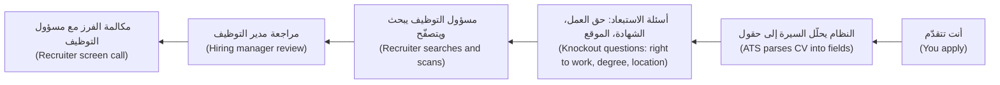
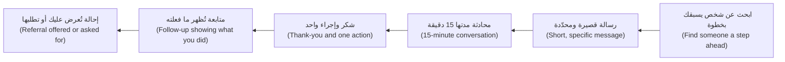
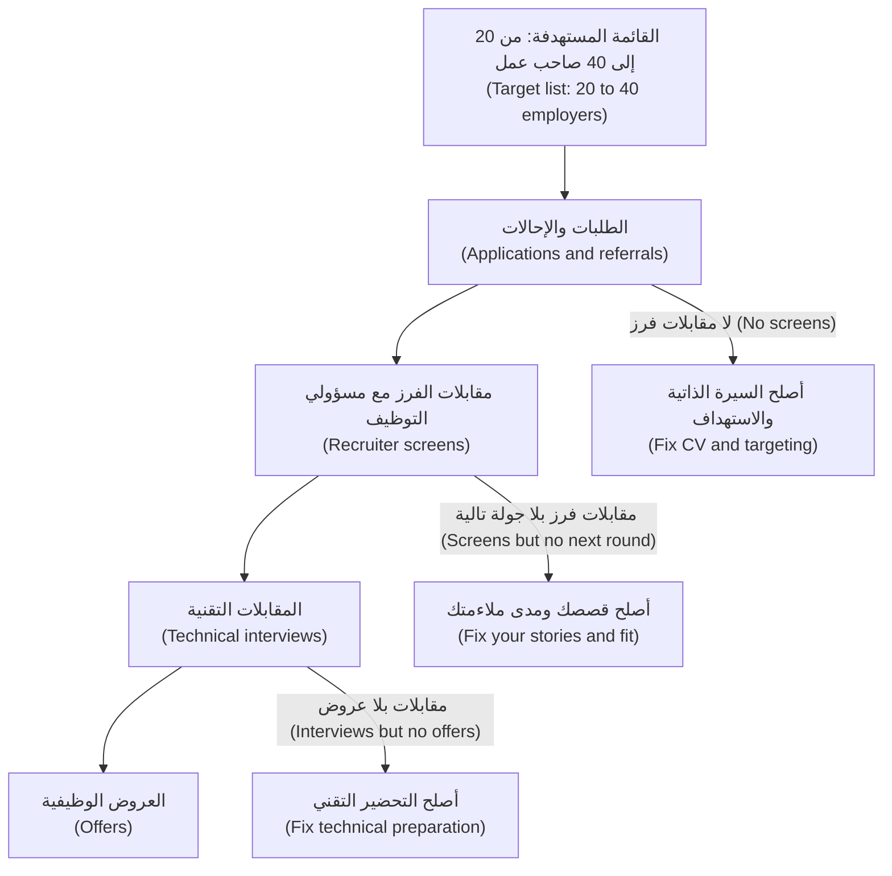

# الوحدة 4 — أن يراك أصحاب العمل

*قد تملك المهارات والدليل ثم لا يصلك أي ردّ. فبين معرض أعمالك والمقابلة تقف ثلاثة مرشِّحات: برنامج يقرأ سيرتك الذاتية، ومسؤول توظيف (recruiter) يتصفّحها في ثوانٍ، والحقيقة البسيطة أن مدير التوظيف (hiring manager) لا يستطيع مقابلة شخص لم يسمع به قط. تتناول هذه الوحدة كيف تعبر المرشِّحات الثلاثة بأمانة. يحوّل الدرس 4.1 دليلك إلى سيرة ذاتية تُحلَّل آليًا بسلاسة وتُقرأ جيدًا في نظرة سريعة. ويبيّن الدرس 4.2 كيف تبني شبكة علاقات صغيرة وحقيقية وتطلب الإحالات دون أن تشعر بأنك تستجدي. ويرسم الدرس 4.3 خريطة المصادر الفعلية لوظائف مستوى المبتدئين، من برامج الخرّيجين والشركات الناشئة إلى القطاع العام وبرامج التوطين (nationalisation programmes) في دول الخليج (GCC)، وكيف تدير بحثًا أسبوعيًا تستطيع الاستمرار فيه لأشهر. سترى السيرة الذاتية الأولى لعمر تخفق في الفرز لدى بنك نجم (Najm Bank)، وهدى تحوّل لقاء قهوة إلى إحالة في هندسة البيانات (data engineering)، ويوسف ومحمد يبنيان قوائم مستهدفة تناسب ظروفًا مختلفة جدًا، فيما تشرح عائشة، رئيسة استقطاب المواهب في نجم، ما يراه جانب التوظيف فعلًا.*

> **الخطوات:** Apply, Prove — تحويل الدليل الذي بنيته إلى طلبات توظيف يفتحها أشخاص حقيقيون ويقرؤونها ويتصرّفون بناءً عليها.

---

# 4.1 — سيرة ذاتية تجتاز نظام تتبّع المتقدّمين والفحص البشري في ثوانٍ قليلة
*المستوى: 🟡 متوسط* · *المتطلبات: 3.1، 3.2* · *الخطوة: Apply, Prove*

**بعد هذا الدرس تستطيع** أن تجعل سيرتك الذاتية تجتاز اختبار اللصق في نص عادي، وأن تعيد كتابة النقاط الضعيفة بنمط «ماذا، وكيف، وما الذي تغيّر»، وأن تخصّصها لإعلان وظيفة حقيقي في أقل من 20 دقيقة. *مدة الدراسة: قراءة نحو 15 دقيقة، وعمل تطبيقي نحو 4 ساعة (تقدير).*

## ⚡ الدرس في دقيقة
- لسيرتك الذاتية قارئان قبل أن يقابلك أحد: **نظام تتبّع المتقدّمين (applicant-tracking system, ATS)**، وهو البرنامج الذي يخزّن الطلبات ويحلّلها، و**مسؤول التوظيف** الذي يتصفّح النتيجة بسرعة.
- صمّم للقارئين بالخيارات نفسها: عمود واحد، وعناوين قياسية، ونص حقيقي لا صور، وصيغ ملفات شائعة، وكلمات إعلان الوظيفة نفسها حيثما تصفك بصدق.
- كل نقطة يجب أن تُظهر **ماذا فعلت، وبأي أدوات، وما الذي تغيّر** — أدلة لا صفات. عبارتا "مسؤول عن" و"شغوف بـ" لا تقولان شيئًا.
- ضع أقوى أدلتك في الثلث العلوي: الدور المستهدف، ومشروعين أو ثلاثة مع روابطها، ومهارات الإعلان.
- مؤشر القرار: سيرة ذاتية أساسية واحدة لكل دور مستهدف من الوحدة 2، ثم جولة تخصيص صغيرة وصادقة لكل طلب.
- أكبر فخ: التحسين من أجل أداة "درجة ATS" أو حشو الكلمات المفتاحية. فهذا لا يساعد بشكل موثوق، والنتيجة يقرؤها إنسان.

## 🧭 لماذا يهم
يتقدّم عمر إلى برنامج نجم للخرّيجين التقنيين (Najm Tech Graduate Programme) بالسيرة الذاتية التي أنتجها قالب جامعته: عمودان، وصورة شخصية، ومخطط أعمدة للمهارات، واسمه داخل مربع نص، وقسم "المشاريع" يسرد عناوين مقرّرات بلا روابط. لا يسمع شيئًا طوال ثلاثة أسابيع. وحين يسأل خالد، مدير الهندسة (Engineering Manager)، عائشة عن الأمر لاحقًا، تفتح سجلّ عمر في نظام تتبّع المتقدّمين (ATS) لدى نجم. يُظهر الملف المحلَّل اسمه في الحقل الخطأ، وقسم مهاراته فارغًا (لأن المخطط كان صورة)، وتواريخ مشاريعه مدموجة بعنوان جامعته. ومن بين مئات طلبات الخرّيجين، ذهب ملف عمر نصف الفارغ إلى كومة "ربما لاحقًا".

لم يكن في سيرة عمر شيء كاذب؛ لكن لا البرنامج ولا الشخص الذي يتصفّحها استطاع أن يجد الدليل. لا يدور هذا الدرس حول حيل "التغلّب على ATS"؛ بل حول جعل الأدلة الصادقة سهلة القراءة، للآلات وللبشر المتعبين.

## 📐 كيف يعمل

### 🟢 الأساسيات

**ما الذي يحدث لسيرتك بعد أن تنقر "تقدّم".** لدى معظم أصحاب العمل المتوسطين والكبار، تصل الطلبات إلى **نظام تتبّع المتقدّمين (applicant-tracking system)**: برنامج مثل Workday أو Greenhouse أو Lever أو SAP SuccessFactors يخزّن المرشّحين، ويحلّل السير الذاتية إلى حقول (الاسم، ووسائل التواصل، والتعليم، والخبرة، والمهارات)، ويتيح لمسؤولي التوظيف البحث والتصفية ونقل الأشخاص عبر المراحل. أما الشركات الناشئة الصغيرة فقد تكتفي بصندوق بريد أو جدول بيانات.

هنا نقطتان مهمتان. أولًا، **قد يفشل التحليل الآلي بصمت.** فالنص داخل الصور ومربعات النص والترويسات والتذييلات والجداول والتخطيطات متعددة الأعمدة كثيرًا ما يُقرأ بترتيب خاطئ أو يضيع. أنت لا ترى النتيجة المحلَّلة، لكن مسؤول التوظيف يراها غالبًا. ثانيًا، **معظم التصفية يقوم بها أشخاص بمساعدة البحث.** يبحث مسؤولو التوظيف عن مصطلحات، ويطبّقون أسئلة الاستبعاد في نموذج الطلب (مثل حق العمل أو شهادة مطلوبة)، ثم يتصفّحون. لا تصدّق الادعاءات بأن نظام تتبّع بعينه يرفض السير الذاتية تلقائيًا لسبب بعينه؛ فالإعدادات تختلف من صاحب عمل إلى آخر. لكن افترض أنه إذا تعذّر العثور على مهاراتك بالبحث ورؤيتها في التصفّح، فهي غير موجودة بالنسبة إلى هذا الطلب.

**التصفّح في ثوانٍ قليلة.** أفادت دراسة شهيرة لتتبّع حركة العين أجراها موقع الوظائف Ladders بأن مسؤولي التوظيف لا يقضون سوى ثوانٍ قليلة في التصفّح الأولي للسيرة الذاتية: نحو 6 ثوانٍ عام 2012، ونحو 7.4 ثانية في تحديث عام 2018. تعامل مع الرقم الدقيق بمرونة؛ فهي دراسة شركة واحدة. في تلك النظرة الأولى، يتحقّق القارئ: ما الدور الذي يستهدفه هذا الشخص، وهل يطابق أكثر عمله صلة الوظيفة، وهل يوجد رابط إلى دليل؟ وإن لم يجد ذلك، ينتقل إلى غيره.

**التخطيط الذي يناسب القارئين.**

| اختر | تجنّب | لماذا |
|---|---|---|
| عمود واحد من الأعلى إلى الأسفل | عمودان أو ثلاثة، وأشرطة جانبية | المحلّلات كثيرًا ما تقرأ عبر الأعمدة فتخلط الأسطر |
| عناوين قياسية: الملخّص، الخبرة، المشاريع، التعليم، المهارات | عناوين إبداعية ("رحلتي"، "ما أقدّمه") | المحلّلات ومسؤولو التوظيف يبحثون عن التسميات المعتادة |
| نص حقيقي في المتن | المهارات في صورة أيقونات أو أشرطة أو مخططات أو صور | الصور لا يمكن البحث فيها؛ و"4 من 5 نقاط" لا تعني شيئًا |
| بيانات التواصل في المتن | الاسم والبريد الإلكتروني في الترويسة أو التذييل | بعض المحلّلات تتخطّى الترويسات والتذييلات |
| ملف PDF مُصدَّر من محرّر نصوص، أو .docx إن طلبه النموذج | ملفات PDF ممسوحة ضوئيًا، وتصديرات أدوات التصميم التي تحوّل النص إلى أشكال | يجب أن يكون النص قابلًا للتحديد كي يُحلَّل |
| صفحة واحدة لمعظم الخرّيجين؛ وصفحتان إن كانت لديك خبرة حقيقية | ثلاث صفحات من المقرّرات الدراسية | الطول ليس دليلًا |
| خط بسيط مقروء بحجم 10–12 نقطة | خطوط صغيرة جدًا لحشر المزيد | البشر يتصفّحون؛ والنص الصغير يُتخطّى |

اختبار ذاتي سريع: افتح ملف PDF، وحدّد الكل، وانسخه والصقه في ملف نصي عادي. إن كان الترتيب خاطئًا أو كانت كلمات مفقودة، فسيتعثّر المحلّل أيضًا.

**البنية من الأعلى إلى الأسفل.**
1. **الاسم ووسائل التواصل:** الاسم، والمدينة والدولة، والهاتف، وبريد إلكتروني مهني، ورابط LinkedIn، ورابط GitHub أو معرض الأعمال. اجعل الروابط قابلة للنقر وقصيرة.
2. **العنوان التعريفي أو الملخّص (سطران):** الدور الذي تريده وأقوى أدلتك. "مهندس برمجيات خرّيج. بنيت ونشرت واجهة برمجية لمطابقة المدفوعات مع اختبارات وتكامل مستمر (CI) ومراقبة (monitoring)؛ متمكّن في الخوارزميات وPython."
3. **المشاريع** (لمعظم الخرّيجين، فوق الخبرة): من اثنين إلى أربعة، لكلٍّ منها رابط، والتقنيات المستخدمة، ونقطتان أو ثلاث عن النتائج. هذه هي المشاريع التي حدّدت مواصفاتها في الدرس 3.1 ووثّقتها في الدرس 3.2.
4. **الخبرة:** التدريب العملي، والوظائف بدوام جزئي، والعمل الحر، وأدوار مساعد التدريس، والمساهمات مفتوحة المصدر (الدرس 3.3). والوظائف غير التقنية تُحتسب حين تُظهر النقاط تحمّل مسؤولية.
5. **التعليم:** الشهادة، والجامعة، وتاريخ التخرّج؛ والمعدّل إن كان مفيدًا؛ وسطر قصير عن "المقرّرات ذات الصلة" فقط إن كان يرتبط بالوظيفة.
6. **المهارات:** مجمّعة وصادقة — اللغات، وأطر العمل، والبيانات، والسحابة والأدوات. ولا تذكر إلا ما يمكن أن تُسأل عنه.
7. **اختياري:** الشهادات المهنية، والجوائز، واللغات (العربية والإنجليزية، مع المستوى).

### 🟡 التعمق أكثر

**النقاط: أدلة لا صفات.** تجيب النقطة الجيدة عن ثلاثة أسئلة: ماذا فعلت، وكيف (بأي أدوات أو أساليب)، وما الذي تغيّر نتيجة لذلك. وقد نشر لازلو بوك (Laszlo Bock)، الرئيس السابق لعمليات الموارد البشرية في Google، صيغة من ذلك هي "أنجزتُ X، مقيسًا بـ Y، عبر القيام بـ Z". ليست كل نقطة بحاجة إلى رقم؛ لكن كل نقطة بحاجة إلى نتيجة.

| ضعيفة | قوية |
|---|---|
| مسؤول عن الواجهة الخلفية (backend) لمشروع جماعي. | بنيت واجهة REST البرمجية (REST API) لمشروع مقرّر من 4 أشخاص؛ وكتبت 38 اختبارًا وخط معالجة GitHub Actions يمنع الدمج عند الفشل. |
| شغوف بالبيانات وتعلّم الآلة (machine learning). | حوّلت تجهيز بيانات التدريب لنموذج التنبؤ بتسرّب العملاء من دفتر يدوي إلى خط معالجة SQL مجدول؛ ووثّقت فحوصات البيانات التي اكتشفت تغييرين في المخطّط. |
| استخدمت أدوات الذكاء الاصطناعي لبناء تطبيق. | بنيت تطبيق أسئلة وأجوبة على المستندات باستخدام واجهة برمجية لنموذج لغوي كبير (LLM API) واسترجاع (retrieval)؛ وصمّمت مجموعة تقييم من 50 سؤالًا ورفعت الإجابات الصحيحة من 31 إلى 42 بتغيير التقطيع (chunking). |
| على دراية بالسحابة. | نشرت مشروعي الختامي (capstone) على خدمة حاويات مُدارة باستخدام البنية التحتية كشيفرة (infrastructure as code) (Terraform)؛ وأضفت تنبيهات للجاهزية والأخطاء. |

يجب أن تكون الأرقام في العمود القوي أرقامك الحقيقية أنت. وإن لم تقِس شيئًا، فاذكر كيف تحقّقت ("اختُبر باستخدام…"، "استخدمه 12 من زملائي في تجربة تشغيلية"). لا تخترع مقياسًا أبدًا؛ فالمحاورون يسألون عن كل رقم.

**الكلمات المفتاحية: عكسٌ صادق.** اقرأ إعلان الوظيفة ودوّن أسماءه الملموسة: اللغات، والأدوات، والممارسات ("مراجعة الشيفرة (code review)"، "اختبار الوحدات"، "REST APIs"، "SQL"، "CI/CD"). وحيثما يصف مصطلح ما بصدق شيئًا فعلته، استخدم صياغة الإعلان نفسها — إن قال الإعلان "PostgreSQL" فاكتب "PostgreSQL"، لا "Postgres" فقط؛ وإن قال "التكامل المستمر (continuous integration)" فأدرجه مرة واحدة. هذا يساعد البحث ويساعد الإنسان على مطابقتك بالإعلان. لا تُدرج مهارة لا تستطيع مناقشتها، ولا تُخفِ الكلمات المفتاحية أبدًا بنص أبيض أو خطوط صغيرة جدًا: فمسؤولو التوظيف يرون النص المحلَّل، ويبدو على حقيقته.

**أدوات "درجة ATS".** المواقع التي تقيّم سيرتك مقابل إعلان ما يمكنها أن تنبّه إلى كلمات مفتاحية ناقصة، لكنها لا ترى إعدادات صاحب العمل ولا حكم مسؤول التوظيف. استخدمها قائمةَ تحقّق، لا هدفًا أبدًا.

**التخصيص دون إعادة كتابة.** احتفظ بـ **سيرة ذاتية أساسية لكل دور مستهدف** (اختيار الدور الذي قمت به في الوحدة 2). ولكل طلب، اقضِ من خمس عشرة إلى عشرين دقيقة: عدّل العنوان التعريفي، وضع المشروع الأكثر صلة أولًا، واستبدل نقطتين أو ثلاثًا لتعكس الإعلان، وراجع سطر المهارات. وضع اسم الشركة والتاريخ في اسم الملف.

**عرض العمل المُنجَز بمساعدة الذكاء الاصطناعي بأمانة.** يعرف أصحاب العمل أن الخرّيجين يبنون باستخدام وكلاء البرمجة بالذكاء الاصطناعي (AI coding agents)؛ وكثيرون منهم يتوقّعون ذلك. ما يتحقّقون منه هو هل وجّهت العمل وتحقّقت منه. اكتب نقاطًا تُظهر دورك: "صمّمت نموذج البيانات وعقد الواجهة البرمجية، واستخدمت وكيل برمجة بالذكاء الاصطناعي (AI coding agent) للتنفيذ، وكتبت مجموعة الاختبارات (test suite) وراجعت كل تغيير". كانت مسوّدة ريم الأولى تقول "بنيت تطبيق ذكاء اصطناعي متكاملًا في أسبوعين"؛ أما نسختها النهائية فذكرت ما صمّمته وما تحقّقت منه، وهو بالضبط ما سأل عنه طارق في مقابلتها. ويبني الدرس 1.2 المهارة الكامنة وراء هذه النقطة.

### 🔴 نظرة الخبير

**اكتب للقارئ الذي يقرّر، لا لمن يُصفّي فقط.** عائشة، مسؤولة التوظيف، تتحقّق من المطابقة والأساسيات؛ أما خالد، مدير التوظيف، فيبحث عن حسن التقدير: اختبارات ونشر (deployment)، وملف README يشرح المفاضلات، وخلل اكتشفته أو تراجع (rollback) خطّطت له. ونقطة واحدة تُظهر التفكير الإنتاجي (الدرس 1.3) كثيرًا ما تتفوّق على خمس نقاط تسرد أطر العمل.

**الأعراف الإقليمية والقطاعية.** تختلف أعراف السيرة الذاتية. ففي أجزاء من دول الخليج، كثيرًا ما تطلب نماذج التقديم الجنسية وحالة التأشيرة أو الإقامة، لأن برامج التوطين وقواعد الكفالة تؤثّر في الأهلية؛ فأجب بدقة. والصور الشخصية وتاريخ الميلاد والحالة الاجتماعية شائعة في بعض الأسواق وغير محبّذة في أخرى؛ فاتّبع تعليمات صاحب العمل. وإن تقدّمت بالعربية والإنجليزية معًا، فاجعل النسختين متّسقتين — التواريخ نفسها والمسمّيات نفسها — واطلب من قارئ متمكّن مراجعة العربية التقنية. ولدى أصحاب العمل الخاضعين للتنظيم كالبنوك، فإن سطرًا يُظهر العناية بحماية البيانات في مشروع ("أزلت البيانات الشخصية من السجلات") دليل حقيقي؛ ويبني ذلك [*أمن الذكاء الاصطناعي وأمن التطبيقات*، الدرس 5.3 — حماية البيانات الشخصية: التقليل، والتسجيل، وهندسة الخصوصية](../secai/index.ar.html#/5.3).

**الفجوات والتحوّلات والمسارات غير التقليدية.** لدى محمد، المتحوّل مهنيًا من معسكر تدريبي، ست سنوات في الخدمات اللوجستية. أخفتها سيرته الأولى؛ أما الثانية فاستثمرتها: "أتمتة تقارير المخزون الأسبوعية باستخدام Python وSQL، بدلًا من عملية يدوية بجداول البيانات" تقع تحت الخبرة. وسنة الانقطاع أو المسؤولية العائلية أو الخدمة العسكرية يمكن أن تكون سطرًا صادقًا واحدًا. لا تخترع مسمّيات وظيفية أبدًا — فالتحقّق من المزكّين موجود، وأي تعارض يكلّفك العرض الوظيفي.

**السيرة الذاتية فهرسٌ للدليل.** كل ادعاء مهم ينبغي أن يكون على بُعد نقرة واحدة من الدليل: المستودع (repo)، والعرض التجريبي، والتقرير المكتوب من الدرس 3.2. ومدير التوظيف الذي يجد ملف README واضحًا وشارة اختبارات يكون قد بدأ تقييم مهندس.

## 🧰 الأدوات
| المورد أو الأداة أو النموذج | ما هو وماذا يفعل | متى تلجأ إليه |
|---|---|---|
| **Applicant-tracking system (ATS)** — نظام تتبّع المتقدّمين | برنامج يخزّن الطلبات، ويحلّل السير الذاتية إلى حقول، ويتيح لمسؤولي التوظيف البحث ونقل المرشّحين عبر المراحل | لفهم سبب أهمية التخطيط والصياغة؛ ولقراءة بوابة التقديم لدى صاحب العمل |
| **Plain-text paste test** — اختبار اللصق في نص عادي | انسخ كل النص من ملف PDF إلى ملف نصي عادي وتحقّق من الترتيب والاكتمال | قبل كل إرسال أول لتخطيط سيرة ذاتية جديد |
| **XYZ bullet formula** — صيغة النقاط XYZ (نشرها لازلو بوك) | "أنجزتُ X، مقيسًا بـ Y، عبر القيام بـ Z" — نمط لنقاط قائمة على الأدلة | عند إعادة كتابة أي نقطة تبدأ بـ "مسؤول عن" |
| **Base CV per role** — سيرة ذاتية أساسية لكل دور | سيرة ذاتية رئيسية واحدة تُصان لكل دور مستهدف، تُخصَّص لكل طلب | عند التقدّم إلى أكثر من عائلة أدوار |
| **Job-ad keyword list** — قائمة الكلمات المفتاحية لإعلان الوظيفة | الأسماء والعبارات الملموسة في الإعلان، مطابَقة مع خبرتك الحقيقية | في جولة التخصيص ذات الخمس عشرة دقيقة قبل كل طلب |
| **University career service CV review** — مراجعة السيرة الذاتية لدى خدمات التوظيف الجامعية | مراجعات مجانية وقوالب ومقابلات فرز تجريبية من مكتب التوظيف في جامعتك | قبل إرسال طلباتك العشرة الأولى |
| **Application log** — سجلّ الطلبات | جدول بيانات بالجهات التي تقدّمت إليها، ونسخة السيرة الذاتية، والتاريخ، وجهة الاتصال، والحالة | من أول طلب تقدّمه فصاعدًا (انظر الدرس 4.3) |

## 🏛️ عمليًا في بنك نجم
تشارك عائشة قائمة التحقّق التي يستخدمها فريقها في الفرز الأول لطلبات الخرّيجين، ويعيد عمر كتابة سيرته الذاتية وفقًا لها. (عملية نجم خيالية وتوضيحية؛ وكل صاحب عمل يضبط إعداداته الخاصة.)

**برنامج نجم للخرّيجين التقنيين — قائمة التحقّق للفرز الأول للسيرة الذاتية (لمسؤول التوظيف)**

| الفحص | شكل النجاح | عمر، النسخة 1 | عمر، النسخة 2 |
|---|---|---|---|
| حُلِّلت بسلاسة | الاسم ووسائل التواصل والتعليم والمهارات في الحقول الصحيحة | لا: ضاعت المهارات، والاسم في غير موضعه | نعم |
| الدور المستهدف واضح في الثلث العلوي | العنوان التعريفي يسمّي المسار (برمجيات، بيانات، منصّات، ذكاء اصطناعي) | لا يوجد عنوان تعريفي | "مهندس برمجيات خرّيج…" |
| يستوفي معايير الاستبعاد | شهادة أو ما يعادلها؛ والإجابة عن حق العمل في النموذج | نعم | نعم |
| مشروع واحد على الأقل مع رابط ودليل | رابط مستودع أو عرض تجريبي؛ واختبارات أو نشر أو نتيجة مقيسة | عناوين مقرّرات فقط | مشروعان مع روابطهما |
| المهارات تطابق المسار | المهارات الأساسية في الإعلان موجودة ومدعومة بنقطة | مخطط أعمدة، لا يمكن البحث فيه | نص مجمّع، وكل مهارة مستخدمة في نقطة |
| مقروءة في مرور واحد | عمود واحد، وصفحة واحدة، ولا جدران من النص | عمودان، ومكتظّة | عمود واحد، وصفحة واحدة |

**قسم المشاريع لدى عمر، قبل وبعد**

قبل:
> **المشاريع:** مشروع هياكل البيانات؛ مشروع نظم قواعد البيانات؛ مشروع التخرّج (تطبيق مصرفي)

بعد:
> **واجهة المطابقة البرمجية** — github.com/omar-example/recon-api · Python, FastAPI, PostgreSQL, Docker
> - بنيت واجهة برمجية (API) تطابق أسطر كشف الحساب البنكي مع قيود دفتر الأستاذ (ledger entries)؛ وتعالج المدفوعات المكرّرة والجزئية بعمليات كتابة متساوية الأثر.
> - كتبت 52 اختبار وحدة وتكامل؛ وتمنع GitHub Actions الدمج عند الفشل؛ ونشرت على خدمة حاويات مُدارة مع فحص سلامة (health check) وتنبيهات للأخطاء.
> - وثّقت مفاضلات التصميم وخطة تراجع في ملف README؛ واستخدمت وكيل برمجة بالذكاء الاصطناعي للهيكلة الأولية وراجعت كل تغيير.
>
> **مخطِّط المسارات (الخوارزميات)** — github.com/omar-example/route-planner · C++, Python
> - نفّذت خوارزميتَي A* وDijkstra على مخطط مدينة من 200,000 حافة؛ وحلّلت الأداء وخفّضت زمن الاستعلام بالانتقال إلى كومة ثنائية (binary heap).

(روابط افتراضية.) وصلت النسخة الثانية من سيرة عمر إلى كومة مراجعة خالد في دفعة القبول التالية.

## 🛠️ التمارين
- 🟢 طبّق اختبار اللصق في نص عادي وقائمة تحقّق عائشة على سيرتك الحالية. أصلح كل إخفاق. *يكتمل عندما:* يُقرأ النص الملصوق بالترتيب الصحيح دون أي نقص، ويكون كل صف في قائمة التحقّق ناجحًا.
- 🟡 أعد كتابة أضعف خمس نقاط لديك بنمط "ماذا، وكيف، وما الذي تغيّر"، مستخدمًا الحقائق والأرقام الحقيقية فقط. *يكتمل عندما:* يستطيع زميل قراءة كل نقطة بصوت عالٍ وطرح سؤال متابعة محدّد واحد تستطيع الإجابة عنه من الذاكرة.
- 🔴 اختر إعلانَي وظيفة حقيقيين في دورك المستهدف، وابنِ قائمة كلمات مفتاحية لكلٍّ منهما، وأنتج نسختين مخصّصتين من سيرتك الأساسية في أقل من 20 دقيقة لكلٍّ منهما. *يكتمل عندما:* يوجد الملفّان واسم الشركة والتاريخ في اسميهما، وكل كلمة مفتاحية أدرجتها من الإعلان مدعومة بنقطة، وكل كلمة مفتاحية تركتها هي مما لا تستطيع ادعاءه بصدق.

## ⚠️ أخطاء وفخاخ
- **قوالب المصمّمين.** الأعمدة والأيقونات وأشرطة المهارات تبدو جميلة لكنها تُحلَّل بشكل سيئ. استخدم تخطيطًا بسيطًا بعمود واحد واصرف جهدك على المحتوى.
- **سرد المهام بدل النتائج.** عبارة "عملت على الواجهة الأمامية" مهمة. قل ماذا بنيت، وكيف، وكيف عرفت أنه يعمل.
- **حشو الكلمات المفتاحية والنص المخفي.** مسؤولو التوظيف يرون النص المحلَّل. اعكس الإعلان فقط حيث يكون ذلك صحيحًا.
- **الأرقام المختلقة أو المسمّيات المضخّمة.** كل رقم ومسمّى سيُسأل عنه أو يُتحقّق منه. استخدم مقاييس حقيقية أو صِف طريقة تحقّقك بدلًا من ذلك.
- **قوائم المقرّرات بوصفها مشاريع.** عنوان المقرّر ليس دليلًا. ضع رابطًا إلى المستودع والعرض التجريبي وملف README.
- **سيرة ذاتية واحدة لكل الأدوار.** إعلان هندسة البيانات وإعلان الواجهة الأمامية يريدان ثلثًا علويًا مختلفًا. احتفظ بسيرة أساسية لكل دور وخصّصها بإيجاز.

## 🧾 الخلاصة
- نظام تتبّع المتقدّمين يحلّل ويخزّن؛ والأشخاص يبحثون ويصفّون ويقرّرون. اكتب بحيث يستطيع كلاهما العثور على أدلتك.
- عمود واحد، وعناوين قياسية، ونص حقيقي، وروابط قابلة للنقر. واختبر باللصق في نص عادي.
- النقاط تُظهر ماذا فعلت، وكيف، وما الذي تغيّر — بأرقام حقيقية أو تحقّق حقيقي.
- اعكس صياغة إعلان الوظيفة فقط حيث تكون صحيحة؛ ولا تجعل "درجة ATS" هدفًا.
- اعرض العمل المُنجَز بمساعدة الذكاء الاصطناعي بأمانة: ما الذي صمّمته ووجّهته وتحقّقت منه.
- سيرتك الذاتية فهرس للدليل: كل ادعاء رئيسي على بُعد نقرة من مستودع أو عرض تجريبي أو تقرير مكتوب.

## ✍️ اختبر نفسك

**1. عرضت سيرة عمر مهاراته في مخطط أعمدة من النقاط، وجاء قسم المهارات في ملفه المحلَّل في نظام تتبّع المتقدّمين فارغًا. ما السبب الأرجح؟**

- A. رفضه نظام تتبّع المتقدّمين تلقائيًا لأنه سرد مهارات قليلة جدًا
- B. لم تطابق شهادته سؤال الاستبعاد في البرنامج
- C. كانت المهارات صورًا لا نصًا، فلم يستطع المحلّل قراءتها
- D. استبعد مرشِّح البحث لدى مسؤول التوظيف كل طلبات PDF

الإجابة

**C.** النص داخل الصور والأيقونات والمخططات لا يمكن في العادة تحليله أو البحث فيه. يفترض الخيار A قاعدة رفض تلقائي يحذّرك الدرس من افتراضها؛ ولا شيء في السيناريو يشير إلى B أو D. (🟢 الأساسيات.)

**2. أي نقطة هي الأقوى لطلب خرّيج في هندسة البيانات؟**

- A. نقلت تجهيز بيانات نموذج تسرّب العملاء من دفتر إلى خط معالجة SQL مجدول مع فحوصات اكتشفت تغييرين في المخطّط.
- B. شغوف بالبيانات، وسريع التعلّم، ومتحمّس دائمًا لاكتساب أدوات ومنصّات وتقنيات جديدة.
- C. مسؤول عن مجموعة من مهام تجهيز البيانات وتحليلها في مشروع فريق من أربعة أشخاص.
- D. خبير في SQL وPython وSpark وAirflow وdbt وKafka وSnowflake ومنصّات البيانات السحابية الحديثة.

الإجابة

**A.** إنها تقول ماذا أُنجز، وكيف، وما الذي تغيّر. الخيار D مغرٍ لأنه مليء بالكلمات المفتاحية، لكنه قائمة غير مدعومة، وكلمة "خبير" تستدعي أسئلة قد لا يصمد أمامها خرّيج. أما B وC فلا يقدّمان أي دليل. (🟡 التعمق أكثر.)

**3. يمنح موقع مجاني سيرةَ هدى "درجة ATS" قدرها 54% مقابل إعلان وظيفة. ماذا ينبغي أن تفعل؟**

- A. تضيف كل كلمة مفتاحية ناقصة بنص أبيض كي ترتفع الدرجة دون تغيير التخطيط
- B. تواصل إعادة كتابة السيرة حتى تمنحها الأداة أكثر من 90% لهذا الإعلان
- C. تتجاهل إعلان الوظيفة تمامًا وترسل سيرتها العامة غير المخصّصة بدلًا من ذلك
- D. تعامل قائمة المصطلحات الناقصة كقائمة تحقّق وتضيف المصطلحات الصحيحة فقط

الإجابة

**D.** أدوات التقييم لا ترى إعدادات صاحب العمل ولا حكم مسؤول التوظيف، لكن قائمة الكلمات المفتاحية الناقصة قد تكون تذكيرًا مفيدًا. الخيار A خادع ومرئي في النص المحلَّل؛ والخيار B يجعل درجة غير موثوقة هي الهدف. (🟡 التعمق أكثر.)

**4. بنت ريم معظم مشروعها باستخدام وكيل برمجة بالذكاء الاصطناعي. أي نقطة في السيرة الذاتية تعكس ذلك بأمانة وقوة؟**

- A. بنيت تطبيق ذكاء اصطناعي متكاملًا في أسبوعين باستخدام أحدث أدوات الذكاء الاصطناعي ونماذجه وأطر عمله.
- B. صمّمت نموذج البيانات والواجهة البرمجية، واستخدمت وكيل ذكاء اصطناعي للتنفيذ، وكتبت الاختبارات وراجعت كل تغيير.
- C. تحذف المشروع من السيرة الذاتية تمامًا، لأن وكيل البرمجة بالذكاء الاصطناعي كتب جزءًا كبيرًا من الشيفرة.
- D. كتبت كل الأسطر العشرين ألفًا في التطبيق بمفردي على مدى فصل جامعي واحد.

الإجابة

**B.** إنها تُظهر ما وجّهته ريم وما تحقّقت منه، وهو ما سيستقصيه المحاورون. الخيار A يخفي دورها ويستدعي أسئلة لا تستطيع الإجابة عنها؛ والخيار D يحرّف العمل؛ والخيار C يهدر دليلًا حقيقيًا. (🟡 التعمق أكثر.)

**5. محمد خرّيج معسكر تدريبي لديه ست سنوات في الخدمات اللوجستية. ماذا ينبغي أن تفعل سيرته الذاتية بسنوات الخدمات اللوجستية؟**

- A. تحذفها، كي تبدو السيرة تقنية بحتة وتختفي سنوات الخدمات اللوجستية
- B. تسمّي الوظيفة "مهندس برمجيات"، لأنه كتب بعض نصوص Python هناك
- C. تُبقيها، مع نقاط صادقة تُظهر العمل القابل للنقل، مثل تقاريره المؤتمتة
- D. تنقلها إلى صفحة ثانية بخط صغير، حيث يُستبعد أن ينظر مسؤولو التوظيف

الإجابة

**C.** الخبرة الحقيقية مع نقاط ذات صلة دليلٌ، وإخفاء السنوات يخلق فجوة غير مبرّرة. والخيار B مسمّى مضخّم يمكن أن يكشفه التحقّق من المزكّين. (🔴 نظرة الخبير.)

## 📚 المراجع
- Workday Recruiting — https://www.workday.com/
- Greenhouse — https://www.greenhouse.com/
- Lever — https://www.lever.co/
- SAP SuccessFactors — https://www.sap.com/products/hcm.html
- خدمات الإرشاد المهني والتطوير الوظيفي في MIT (السير الذاتية وخطابات التقديم) — https://capd.mit.edu/
- مكتب الخدمات المهنية في هارفارد (السير الذاتية) — https://ocs.fas.harvard.edu/
- Ladders (ناشر دراسة تتبّع حركة العين لدى مسؤولي التوظيف) — https://www.theladders.com/
- لازلو بوك، *Work Rules!* (Twelve، 2015)؛ وقد انتشرت صيغته X-Y-Z عبر منشوره على LinkedIn ⁦"My Personal Formula for a Winning Resume"⁩ (سبتمبر 2014)
- الدرس 3.1 (مواصفات المشروع الختامي لكل دور)، والدرس 3.2 (GitHub وملفات README)، والدرس 1.2 (البناء باستخدام وكلاء البرمجة بالذكاء الاصطناعي)

---

# 4.2 — LinkedIn وبناء العلاقات المهنية والإحالات دون إحراج
*المستوى: 🟡 متوسط* · *المتطلبات: 3.2، 4.1* · *الخطوة: Apply*

**بعد هذا الدرس تستطيع** أن تجعل عنوانك التعريفي وقسم النبذة على LinkedIn متّسقين مع سيرتك الذاتية، وأن ترسل ثلاث رسائل تواصل محدّدة أقل من 100 كلمة، مسجّلة كلٌّ منها بتاريخ متابعة. *مدة الدراسة: قراءة نحو 15 دقيقة، وعمل تطبيقي نحو 5 ساعة (تقدير).*

## ⚡ الدرس في دقيقة
- كثير من الوظائف تُشغَل عبر أشخاص يعرفون المرشّح مسبقًا أو سمعوا عنه. و**الإحالة** — أي أن يقدّم موظف اسمك — تجعل في العادة طلبك يُقرأ من قِبل إنسان.
- بناء العلاقات المهنية ليس تملّقًا. إنه **محادثات مفيدة ومحدّدة** مع أشخاص يسبقونك بخطوة أو خطوتين، إضافة إلى عرض عملك حيث يمكنهم رؤيته.
- **ملفك على LinkedIn** سيرة ذاتية ثانية يجدها الناس بأنفسهم؛ فاجعل العنوان التعريفي وقسم النبذة والروابط المميّزة تقوم بالعمل.
- اطرح أسئلة صغيرة وواضحة وسهلة الإجابة. عبارة "هل يمكنني أن أسألك ثلاثة أسئلة عن فريق البيانات؟" تنجح؛ أما "هل يمكنك أن تجد لي وظيفة؟" فلا.
- مؤشر القرار: لا تطلب أبدًا إحالة من شخص غريب في الرسالة الأولى. اطلب النصيحة؛ ولا تطلب الإحالة إلا بعد أن يعرف عملك.
- أكبر فخ: الإرسال الجماعي لطلب التواصل نفسه إلى مئات الأشخاص. فهذا يهدر أفضل جهات اتصالك وقد يصنّفك مُرسِلًا للرسائل المزعجة.

## 🧭 لماذا يهم
أرسلت هدى 40 طلبًا لأدوار علم البيانات خلال شهرين وحصلت على مقابلة فرز واحدة. كانت دفاترها (notebooks) جيدة، لكن مهارتها في SQL ضعيفة، وكانت سيرتها الذاتية تقول "عالمة بيانات (data scientist)" لوظائف تريد في معظمها محلّلين ومهندسين. ثم، في أمسية لخرّيجي الجامعة، قضت عشر دقائق مع مهندس بيانات (data engineer) في بنك نجم شرح لها ما يفعله فريقه طوال اليوم: خطوط معالجة البيانات (pipelines)، وجودة البيانات (data quality)، وSQL، ومزيد من SQL. تابعت معه في اليوم التالي برسالة شكر وسؤال واحد. وبعد أسبوعين أرسلت له رابطًا إلى مشروع خط معالجة صغير بنته بعد حديثهما (اتجاهها الجديد من الدرس 2.3). فردّ قائلًا: "هذا هو نوع العمل الذي نحتاجه — هل تريدين أن أرسله إلى دانة؟" كانت دانة، كبيرة علماء البيانات في نجم، عضوًا في لجنة التوظيف لهندسة البيانات. ووصل طلب هدى مرفقًا بملاحظة من موظف رأى عملها.

لا شيء في هذه القصة حيلة. سألت هدى سؤالًا حقيقيًا، وأصغت، وتصرّفت بناءً على الإجابة، وأظهرت النتيجة. هذه هي المهارة كلها، ويمكن تعلّمها حتى لو كنت تجد الحديث مع الغرباء مزعجًا.

## 📐 كيف يعمل

### 🟢 الأساسيات

**لماذا تهم الإحالات.** مدير التوظيف الذي لديه شاغر واحد ومئات المتقدّمين يبحث عن أسباب للثقة بشخص ما. وزميل يقول "لقد رأيت عمل هذا الشخص" هو أحد هذه الأسباب. يدير كثير من أصحاب العمل برامج إحالة رسمية؛ ويعتمد آخرون على التعريفات غير الرسمية. الإحالة لا تتخطّى المقابلات، ولا تنقذ طلبًا ضعيفًا، لكنها في العادة تجعل طلبك يُقرأ من قِبل شخص بدل أن يبقى في طابور الانتظار (queue). وقد وجدت الأدبيات البحثية حول البحث عن عمل منذ زمن أن العلاقات الشخصية مهمة، وأن "الروابط الضعيفة" — أي المعارف لا الأصدقاء المقرّبين — هي غالبًا ما تحمل أكثر المعلومات الجديدة عن الشواغر (وورقة مارك غرانوفيتر (Mark Granovetter) لعام 1973 "قوة الروابط الضعيفة" هي المرجع الكلاسيكي). وقد أفادت دراسة كبيرة عام 2022 لتجارب ميزة "أشخاص قد تعرفهم" على LinkedIn (راجكومار وزملاؤه، *Science*) بأن الروابط الضعيفة باعتدال كانت الأكثر فائدة للتنقّل الوظيفي — لذا فإن الخرّيج الذي التقيته مرة في فعالية يستحق رسالة مدروسة.

**من هم في شبكتك أصلًا.** أشخاص أكثر مما تظن:
- **زملاء الدراسة والخرّيجون** من جامعتك أو معسكرك التدريبي — لا سيما خرّيجو السنوات الاثنتين إلى الخمس الأخيرة الذين صاروا الآن مبتدئين أو في المستوى المتوسط.
- **المحاضرون ومساعدو التدريس ومشرفو المشاريع.**
- **زملاء التدريب العملي ومديروه** (الدرس 3.3).
- **مشرفو المشاريع مفتوحة المصدر والمراجِعون** الذين رأوا طلبات الدمج (pull requests) الخاصة بك.
- **منظّمو الهاكاثونات والمسابقات ومرشدوها ومحكّموها.**
- **المجموعات المجتمعية:** لقاءات المطوّرين المحلية، ومجموعات المستخدمين للغة برمجة أو مزوّد سحابي، ومجتمعات البيانات والذكاء الاصطناعي، ومجموعات النساء في التقنية، والأندية الجامعية.
- **معارف العائلة والأصدقاء** — فمن يعمل في تقنية المعلومات في بنك أو شركة اتصالات يمكنه أن يشرح لك كيف يجري التوظيف هناك.

**ملفك على LinkedIn، قسمًا قسمًا.** من يسمعون اسمك سيبحثون عنك. LinkedIn ليس المكان الوحيد، لكنه في دول الخليج وفي معظم التوظيف لدى الشركات أول مكان يتحقّق منه مسؤولو التوظيف. (أسماء الميزات وخياراتها تتغيّر؛ فراجع صفحات المساعدة في LinkedIn لمعرفة الحالية منها.)

| القسم | ضعيف | قوي |
|---|---|---|
| الصورة | لا صورة، أو صورة حفلة مقصوصة | صورة واضحة وبسيطة وحديثة للرأس والكتفين |
| العنوان التعريفي | "طالب في جامعة X" | "مهندس بيانات خرّيج · SQL، Python، Airflow · أبني خطوط معالجة مع فحوصات جودة البيانات" |
| النبذة | فقرة عن الشغف | ثلاث فقرات قصيرة: ما تفعله، وأفضل مشروعين لديك مع روابطهما، والأدوار التي تبحث عنها وأين |
| المميّز | فارغ | روابط إلى أفضل مستودعاتك، أو تقرير مكتوب عن مشروع، أو عرض تجريبي |
| الخبرة والمشاريع | المسمّيات فقط | النقاط القائمة على الأدلة نفسها الموجودة في سيرتك الذاتية (الدرس 4.1) |
| المهارات | 50 مهارة | من 10 إلى 15 مهارة تطابق دورك المستهدف ويدعمها عملك |
| متاح للعمل | شعار يُعرض للجميع دون تفكير | اختر عن قصد؛ فـ LinkedIn يتيح لك الإشارة إلى مسؤولي التوظيف فقط أو إلى الجميع |

اجعله متّسقًا مع سيرتك الذاتية: التواريخ نفسها والمسمّيات نفسها. وإن كنت ثنائي اللغة، فإن LinkedIn يدعم ملفًا بلغة ثانية؛ وقد تساعد نسخة عربية مع أصحاب العمل الإقليميين، لكن احرص على دقّة النسختين.

### 🟡 التعمق أكثر

**المحادثة الاستطلاعية.** الحركة الجوهرية في بناء العلاقات المهنية محادثة قصيرة — من 15 إلى 20 دقيقة، عبر مكالمة فيديو أو هاتف أو لقاء قهوة — تسأل فيها شخصًا عن عمله. إنها ليست مقابلة ولا طلب وظيفة. أنت تتعلّم ما يفعله فريقه، وما يبحثون عنه في المبتدئين، وما ينبغي أن تتعلّمه بعد ذلك. والناس عمومًا يحبّون الحديث عن عملهم حين تكون الأسئلة محدّدة والوقت قصيرًا.

**كتابة الرسالة الأولى.** اجعلها أقل من 100 كلمة. قل من أنت، ولماذا هذا الشخص تحديدًا، وما الذي تطلبه — مع طريقة سهلة للرفض.

ضعيفة:
> مرحبًا، أنا خرّيج جديد أبحث عن فرص. أرجو أن تحيلني إلى أي وظيفة شاغرة في شركتك. مرفقة سيرتي الذاتية.

قوية:
> مرحبًا فيصل — أنا هدى، خرّيجة علم البيانات من [الجامعة]. شاهدت محاضرتك عن فحوصات جودة البيانات في [اللقاء] الشهر الماضي. أنا أتّجه نحو هندسة البيانات، وسأقدّر 15 دقيقة لأسألك كيف يقرّر فريقك ما يختبره في خط معالجة البيانات (pipeline). أي وقت خلال الأسبوعين القادمين يناسبني؛ ولا بأس إن كنت مشغولًا جدًا.

النسخة القوية محدّدة (محاضرته، موضوعه)، وصغيرة (15 دقيقة، وموضوع واحد)، وسهلة الرفض. إنها تطلب نصيحة لا وظيفة.

**أسئلة تنجح في المحادثة.**
- "كيف يبدو الأسبوع العادي لمبتدئ في فريقك؟"
- "ما الذي يميّز المبتدئين الذين ينجحون في سنتهم الأولى عن الذين يتعثّرون؟"
- "لو كنت مكاني، ما المهارة الواحدة التي كنت ستعمل عليها في الشهر القادم؟"
- "كيف يستخدم فريقك أدوات البرمجة بالذكاء الاصطناعي، وما الذي تتوقّع أن يستطيع المبتدئون التحقّق منه بأنفسهم؟"
- "هل هناك شخص آخر تظن أن عليّ التحدّث إليه؟"

أدِّ واجبك المنزلي أولًا كي لا تسأل عمّا يقوله موقع الشركة أصلًا. دوّن الملاحظات. وأنهِ المحادثة في موعدها.

**المتابعة هي ما يُحدث الفرق.** أرسل رسالة شكر في اليوم نفسه، تذكر فيها شيئًا واحدًا ستفعله بسبب المحادثة. ثم افعله. وبعد أسبوعين إلى أربعة، أرسل تحديثًا قصيرًا مع رابط: "اقترحتَ أن أضيف فحوصات للبيانات إلى خط المعالجة — هذا ما بنيته." هذه هي الخطوة التي يتخطّاها معظم الناس، وهي ما يحوّل معرفة عابرة إلى شخص سيزكّيك.

**طلب الإحالة.** لا تطلبها إلا من شخص رأى عملك أو يعرفك، واجعل الأمر سهلًا:
> شكرًا مجددًا على النصيحة بشأن خطوط المعالجة. نشر بنك نجم للتو وظيفة مهندس بيانات خرّيج [الرابط]. أظن أن مشروع خط المعالجة الذي بنيته يناسب ما وصفته. هل يريحك أن تحيلني؟ أرفقت سيرتي الذاتية وملخّصًا من سطرين يمكنك تمريره. لا بأس إطلاقًا إن لم يكن ذلك ممكنًا.

أعطه رابط الوظيفة وسيرتك الذاتية وملخّصًا قصيرًا يستطيع لصقه. وتقبّل الرفض بلطف؛ فقد لا يعرف عملك بما يكفي، أو قد تقيّد شركته الإحالات.

### 🔴 نظرة الخبير

**أن تكون مرئيًا دون أن تصبح مؤثّرًا.** لا تحتاج إلى علامة شخصية. تحتاج إلى أثر صغير من العمل يستطيع الناس العثور عليه. خيارات عملية:
- اكتب منشورًا قصيرًا حين تنهي مشروعًا: المشكلة، وقرار واحد اتّخذته، وشيء واحد سار على نحو خاطئ، ورابط (يتناول الدرس 3.2 الكتابة عن عملك).
- علّق تعليقًا مفيدًا على منشورات مهندسين في مجالك المستهدف — سؤال حقيقي أو إضافة صغيرة، لا "منشور رائع!".
- أجب عن أسئلة في مجتمع تعرفه جيدًا (منتدى مقرّر، أو مجموعة دردشة لقاء).
- قدّم محاضرة خاطفة مدتها خمس دقائق في نادٍ طلابي أو لقاء عن مشروع.

مرة في الشهر تكفي. الاستمرارية على مدى أشهر تتفوّق على سيل من المنشورات في أسبوع واحد.

**بناء العلاقات للانطوائيين ولمن لا معارف لهم.** إن بدت لك الرسائل الباردة مستحيلة، فابدأ حيث تكون المحادثة جزءًا من النشاط أصلًا: تطوّع في لقاء أو هاكاثون (فالمنظّمون يلتقون الجميع)، أو ساهم في مشروع مفتوح المصدر (فالمراجِعون يتعرّفون إليك من خلال طلبات الدمج)، أو انضم إلى مجموعة دراسة لشهادة مهنية. محمد، الذي لم يكن يعرف أحدًا في مجال التقنية بعد تركه الخدمات اللوجستية، بدأ بالمساعدة في تنظيم لقاء شهري لـ Python؛ وفي غضون ثلاثة أشهر كان يعرف معظم الحضور المنتظمين، واثنان منهم يعملان في الشركات الناشئة التي أراد الانضمام إليها.

**الثقافة واللياقة في المنطقة.** في كثير من دول الخليج، للعلاقات والتعريفات الشخصية وزن، وكثيرًا ما يذهب التعريف الدافئ من معارف مشتركين أبعد من رسالة باردة. استخدم اللغة التي يستخدمها الشخص؛ وحيِّه بما يليق؛ واحترم أيام العمل وساعاته (فعطلة نهاية الأسبوع تختلف من دولة إلى أخرى وقد تغيّرت في السنوات الأخيرة، فتحقّق). وكن حذرًا مع العلاقات العائلية والمجتمعية: طلب النصيحة أو التعريف أمر طبيعي؛ أما أن تطلب من أحد تجاوز عملية التوظيف أو تزكية عمل لم يره، فهذا يضعه في موقف صعب، وقد يخالف لدى أصحاب العمل الخاضعين للتنظيم قواعد تضارب المصالح (conflict-of-interest rules) لديهم.

**ما لا ينبغي فعله.**
- لا تستخدم أدوات الأتمتة التي ترسل طلبات التواصل أو الرسائل بالجملة؛ فهي تخالف شروط معظم المنصّات وتحرق سمعتك.
- لا تراسل مسؤولي التوظيف والمهندسين في الشركة نفسها بالنص المنسوخ الملصوق نفسه؛ فهم يتحدّثون مع بعضهم.
- لا تطلب من أداة ذكاء اصطناعي كتابة رسالة ترسلها بعد ذلك دون قراءتها. صُغ مسوّدتك بمساعدة إن شئت، لكن يجب أن تبدو كل رسالة بصوتك وأن تحتوي حقائق لا يعرفها سواك.
- لا تبالغ في وصف علاقة ("طلب مني خالد أن أتقدّم") حين كانت مجرد تبادل من سطرين.

## 🧰 الأدوات
| المورد أو الأداة أو النموذج | ما هو وماذا يفعل | متى تلجأ إليه |
|---|---|---|
| **LinkedIn** | شبكة مهنية ومنصّة وظائف؛ يعمل ملفك فيها سيرةً ذاتية عامة يبحث فيها مسؤولو التوظيف | إعداد الملف الآن؛ واستخدام أسبوعي خلال بحثك |
| **Informational conversation** — المحادثة الاستطلاعية | دردشة من 15 إلى 20 دقيقة للتعرّف على عمل شخص ما، لا لطلب وظيفة | عند استكشاف دور أو فريق أو شركة قبل التقدّم |
| **Outreach message template** — نموذج رسالة التواصل | أقل من 100 كلمة: من أنت، ولماذا هو، وطلب صغير ومحدّد، وطريقة سهلة للرفض | عند كل تواصل أول مع شخص لا تعرفه |
| **Referral request template** — نموذج طلب الإحالة | رابط الوظيفة، والسيرة الذاتية، وملخّص من سطرين يمكنه تمريره، ومخرج لبق | فقط مع أشخاص يعرفونك أو يعرفون عملك |
| **Network tracker** — متتبّع الشبكة | جدول بسيط: الاسم، ومكان اللقاء، والتاريخ، والموضوع، والإجراء التالي، وتاريخ المتابعة | من محادثتك الأولى؛ وراجعه أسبوعيًا |
| **Meetup.com** والمجموعات المجتمعية | قوائم بلقاءات المطوّرين والبيانات والسحابة والذكاء الاصطناعي المحلية | للعثور على أشخاص قريبين منك؛ والتطوّع للقاء المنظّمين |
| **University alumni network** — شبكة خرّيجي الجامعة | دليل الخرّيجين، وبرامج الإرشاد، والفعاليات التي تنظّمها جامعتك | للعثور على خرّيجين يسبقونك بسنتين إلى خمس سنوات |

## 🏛️ عمليًا في بنك نجم
يطلب خالد من كل عضو في الدفعة أن يحتفظ بـ **متتبّع للشبكة** مدة أربعة أسابيع وأن يحضره إلى جلسة الإرشاد. إليك جزءًا من متتبّع هدى، يليه الملخّص الذي أرسلته مع طلب الإحالة.

**متتبّع شبكة هدى (مقتطف)**

| الاسم والدور | أين التقينا | التاريخ | ما تعلّمته | الإجراء الذي اتّخذته | المتابعة |
|---|---|---|---|---|---|
| فيصل، مهندس بيانات، بنك نجم | أمسية الخرّيجين | الأسبوع 1 | الفريق يقضي معظم وقته في خطوط المعالجة وجودة البيانات؛ وSQL يُختبر في المقابلات | بناء خط معالجة صغير مع فحوصات للبيانات؛ وتمرين يومي على SQL | الأسبوع 4: أرسلت رابط المستودع — فعرض إحالة |
| لينا، محلّلة، شركة اتصالات إقليمية | LinkedIn، بعد منشورها عن لوحات المعلومات (dashboards) | الأسبوع 2 | يُطلب من المحلّلين هناك عرض النتائج على المديرين بالعربية والإنجليزية | إضافة ملخّص ثنائي اللغة إلى مشروع لوحة المعلومات الخاص بي | الأسبوع 5: أرسلت تحديثًا |
| د. سمير، المشرف على مشروع تخرّجي | الجامعة | الأسبوع 2 | اقترح اثنين من الخرّيجين في أدوار البيانات | مراسلة كليهما | الأسبوع 3: أُجريت مكالمة واحدة |
| مشرف مشروع مفتوح المصدر، مكتبة للتحقّق من البيانات | مسألة على GitHub | الأسبوع 3 | وجّهني إلى "مسألة أولى جيدة" | فتحت طلب دمج للتوثيق | الأسبوع 4: دُمج |

**الملخّص القابل للتمرير**

> هدى [اسم العائلة] — خرّيجة علم البيانات (data science). بنت خط معالجة دفعيًا (batch pipeline) يحمّل بيانات النقل العام إلى PostgreSQL مع تشغيلات مجدولة وفحوصات لجودة البيانات اكتشفت تغييرين في المخطّط؛ المستودع: [الرابط]. متمكّنة في Python والإحصاء، وتركّز الآن على SQL وهندسة البيانات. تتقدّم إلى: مهندس بيانات خرّيج، برنامج نجم للخرّيجين التقنيين [الرابط].

مرّره فيصل بسطر واحد: "التقيت هدى في أمسية الخرّيجين؛ أخذت بنصيحتي وبنت هذا." فدعتها دانة إلى الجولة التقنية.

## 🛠️ التمارين
- 🟢 أعد كتابة عنوانك التعريفي وقسم النبذة والروابط المميّزة على LinkedIn باستخدام الجدول أعلاه، مع إبقائها متّسقة مع سيرتك الذاتية. *يكتمل عندما:* يستطيع زميل دراسة قراءة عنوانك التعريفي وقسم النبذة فقط وتحديد دورك المستهدف وأفضل مشاريعك.
- 🟡 اكتب وأرسل ثلاث رسائل تواصل إلى أشخاص يسبقونك بخطوة أو خطوتين في دورك المستهدف، كلٌّ منها أقل من 100 كلمة ويذكر شيئًا محدّدًا عنهم. *يكتمل عندما:* تُسجَّل الرسائل الثلاث وأي ردود عليها في متتبّع شبكتك، مع تاريخ متابعة لكلٍّ منها.
- 🔴 أجرِ محادثة استطلاعية واحدة، وتصرّف بناءً على نصيحة واحدة، وأرسل متابعة مع رابط إلى ما فعلته. *يكتمل عندما:* يُظهر متتبّعك المحادثة، والإجراء، ورسالة المتابعة مع رابط يعمل إلى النتيجة.

## ⚠️ أخطاء وفخاخ
- **طلب وظيفة أو إحالة في الرسالة الأولى.** هذا يحرج الناس. اطلب النصيحة أولًا؛ واطلب الإحالة حين يعرفون عملك.
- **الرسائل الطويلة والمبهمة.** عبارة "أودّ أن أستفيد من خبرتك" ليست سؤالًا. اطلب 15 دقيقة حول موضوع محدّد واحد.
- **غياب المتابعة.** المحادثة الواحدة تُنسى في أسبوع. اشكرهم، وتصرّف، وأرسل تحديثًا مع دليل.
- **التواصل الجماعي المؤتمت.** يخالف شروط المنصّات ويجعلك مُتجاهَلًا. رسائل أقل ومحدّدة تنجح أكثر.
- **ملف على LinkedIn يخالف سيرتك الذاتية.** اختلاف التواريخ أو المسمّيات يثير الشكوك. اجعلهما متّسقين.
- **استخدام العلاقات العائلية لتجاوز الإجراءات.** اطلب النصيحة والتعريفات، لا خدمات تعرّض وظيفة أحدهم للخطر.

## 🧾 الخلاصة
- الإحالات والتعريفات تجعل الطلبات تُقرأ من قِبل أشخاص؛ لكنها لا تحلّ محلّ المقابلات.
- تبدأ شبكتك بزملاء الدراسة، والخرّيجين، والمحاضرين، والزملاء، ومشرفي المشاريع مفتوحة المصدر، والمجموعات المجتمعية.
- LinkedIn سيرة ذاتية عامة: عنوان تعريفي واضح، وقسم نبذة قصير، وروابط مميّزة إلى عملك.
- اطلب نصيحة صغيرة ومحدّدة؛ وتابع بما فعلته؛ ولا تطلب الإحالات إلا ممّن يعرفون عملك.
- كن مرئيًا من خلال عملك، شهريًا وباستمرار، لا من خلال الكمّ.

## ✍️ اختبر نفسك

**1. يريد يوسف العمل في هندسة المنصّات (platform engineering) لدى شركة اتصالات إقليمية. وجد على LinkedIn مهندسًا هناك لم يلتقه قط. أي رسالة أولى هي الأفضل؟**

- A. "مرحبًا، أنا خرّيج هندسة حاسوب. أرجو أن تحيلني إلى أي دور منصّات شاغر في شركتك؛ مرفقة سيرتي الذاتية وكشف درجاتي لمراجعتك."
- B. "استمتعت بمنشورك عن نقل عمليات البناء إلى الحاويات. أنا خرّيج هندسة حاسوب أتّجه إلى عمل المنصّات — هل يمكنني أن أطرح عليك أسئلة لمدة 15 دقيقة حول كيفية إدارة فريقك للتكامل المستمر؟ لا بأس إن لم يكن ذلك ممكنًا."
- C. "مرحبًا! أنا خرّيج حديث وأودّ أن أستفيد من خبرتك في وقت ما حول مسيرتك المهنية، وكيف هو العمل في شركتك، والقطاع عمومًا — أخبرني بما يناسبك."
- D. لا رسالة على الإطلاق: فقط سيرته الذاتية الكاملة وخطاب تقديم مرفقان بطلب التواصل، كي يرى المهندس خلفيّته.

الإجابة

**B.** إنها محدّدة وصغيرة وسهلة الرفض، وتطلب نصيحة لا وظيفة. الخيار A يطلب إحالة من غريب؛ والخيار C مبهم ولا يعطي الشخص شيئًا ملموسًا يوافق عليه. (🟡 التعمق أكثر.)

**2. بعد محادثة مفيدة مع مهندس بيانات في نجم، ماذا ينبغي أن تفعل هدى بعد ذلك لتجعل الإحالة أرجح ما يمكن؟**

- A. تنتظر بهدوء أن يتواصل معها متى شغرت وظيفة مناسبة في فريقه
- B. ترسل إليه سيرتها الذاتية الأحدث كل أسبوع حتى يظهر دور يناسبها
- C. تطلب منه فورًا، ما دام يتذكّرها، أن يحيلها إلى أي دور
- D. تشكره في اليوم نفسه، وتعمل بنصيحته، ثم ترسل تحديثًا مع رابط إلى عملها

الإجابة

**D.** العمل بالنصيحة وإظهار النتيجة يمنحانه دليلًا يزكّيها بناءً عليه. الخيار C يطلب قبل أن يرى عملها؛ والخيار B ضغط دون معلومات جديدة. (🟡 التعمق أكثر.)

**3. لماذا تساعد الإحالة الطلبَ في العادة؟**

- A. إنها إشارة ثقة من شخص يعرف عمل المرشّح، فيقرأ الطلبَ شخصٌ ما
- B. إنها تتيح للمرشّح تخطّي المقابلات التقنية والانتقال مباشرة إلى الجولة النهائية
- C. إنها تضمن عرضًا وظيفيًا ما دام الموظف الذي أحال المرشّح في منصب رفيع
- D. إنها تحلّ محلّ السيرة الذاتية، لأن ملاحظة المُحيل تصف المرشّح أصلًا

الإجابة

**A.** الإحالة إشارة ثقة تجعل طلبك يُقرأ؛ لكنها لا تتخطّى المقابلات ولا تضمن شيئًا، ولهذا فإن B وC خاطئان. (🟢 الأساسيات.)

**4. محمد، المتحوّل مهنيًا، لا يعرف أحدًا في مجال التقنية ويجد الرسائل الباردة صعبة جدًا. أي نهج من الدرس يناسبه أكثر؟**

- A. يستخدم أداة أتمتة لإرسال 300 طلب تواصل إلى مهندسين في الشركات المستهدفة
- B. ينتظر حتى يحصل على أول وظيفة تقنية له قبل أن يبدأ بناء أي شبكة على الإطلاق
- C. يتطوّع في لقاء محلي أو يساهم في مشاريع مفتوحة المصدر، حيث تحدث المحادثات بشكل طبيعي
- D. يطلب من أقارب لديهم معارف أن يوظّفوه في شركاتهم دون مقابلة

الإجابة

**C.** التطوّع والمساهمة يبنيان العلاقات من خلال عمل مشترك. الخيار A يخالف شروط المنصّات ويضرّ بسمعته؛ والخيار D يطلب من أحدهم تجاوز الإجراءات. (🔴 نظرة الخبير.)

**5. يقول العنوان التعريفي لريم على LinkedIn "طالبة في جامعة X". ما أفضل تحسين؟**

- A. "خرّيجة شغوفة ومجتهدة، متحمّسة للتعلّم والنمو في فريق تقني سريع الإيقاع"
- B. "مهندسة تطبيقات ذكاء اصطناعي (خرّيجة) · تطبيقات نماذج لغوية كبيرة مع الاسترجاع والتقييم · Python"
- C. حذف العنوان التعريفي تمامًا، كي يركّز مسؤولو التوظيف على مشاريعها وخبرتها بدلًا منه
- D. قائمة بكل المهارات الخمسين التي استخدمتها يومًا، كي يعثر عليها كل بحث لمسؤولي التوظيف

الإجابة

**B.** إنه يسمّي دورها المستهدف والدليل الذي يدعمه، فيعرف القارئ في سطر واحد ما تفعله. الخيار A يستخدم صفات بلا دليل؛ والخيار D يشتّت تركيزها. (🟢 الأساسيات.)

## 📚 المراجع
- مركز مساعدة LinkedIn — https://www.linkedin.com/help/linkedin
- Mark S. Granovetter، "The Strength of Weak Ties" (قوة الروابط الضعيفة)، *American Journal of Sociology* 78(6)، 1973 — https://www.jstor.org/stable/2776392
- Karthik Rajkumar وGuillaume Saint-Jacques وIavor Bojinov وErik Brynjolfsson وSinan Aral، "A causal test of the strength of weak ties" (اختبار سببي لقوة الروابط الضعيفة)، *Science* 377(6612)، 2022 — https://www.science.org/doi/10.1126/science.abl4476
- Meetup — https://www.meetup.com/
- خدمات الإرشاد المهني والتطوير الوظيفي في MIT (بناء العلاقات المهنية والمقابلات الاستطلاعية) — https://capd.mit.edu/
- مكتب الخدمات المهنية في هارفارد (بناء العلاقات المهنية) — https://ocs.fas.harvard.edu/
- توثيق GitHub، المساهمة في المشاريع مفتوحة المصدر — https://docs.github.com/en/get-started/exploring-projects-on-github/finding-ways-to-contribute-to-open-source-on-github
- الدرس 3.2 (الكتابة عن عملك)، والدرس 3.3 (المصادر المفتوحة والتدريب العملي)، والدرس 4.1 (نقاط السيرة الذاتية)

---

# 4.3 — أين توجد الوظائف: برامج الخرّيجين، ومواقع الوظائف، والشركات الناشئة، والقطاع العام، وسوق الخليج
*المستوى: 🟡 متوسط* · *المتطلبات: 0.2، 4.1، 4.2* · *الخطوة: Explore, Apply*

**بعد هذا الدرس تستطيع** أن تبني قائمة مستهدفة من 20 صاحب عمل على الأقل عبر ثلاث قنوات أو أكثر، وتقويمًا لبرامج الخرّيجين للأشهر الاثني عشر القادمة مع رابط مصدر لكل برنامج. *مدة الدراسة: قراءة نحو 15 دقيقة، وعمل تطبيقي نحو 16 ساعة (تقدير).*

## ⚡ الدرس في دقيقة
- تأتي وظائف مستوى المبتدئين من قنوات عدّة لكلٍّ منها مواعيدها وقواعدها: **برامج الخرّيجين**، و**إعلانات الوظائف المباشرة**، و**الشركات الناشئة**، و**القطاع العام والبرامج الوطنية**، و**مسؤولو التوظيف الخارجيون**، و**الإحالات**.
- كثيرًا ما توظّف برامج الخرّيجين قبل التخرّج بأشهر، وفق دفعات قبول ثابتة؛ والشركات الناشئة توظّف حين تحتاج إلى شخص؛ ومواقع الوظائف مستمرة. اعرف على أي ساعة تسير كل جهة مستهدفة.
- في دول الخليج، تحدّد **برامج توطين القوى العاملة (workforce nationalisation programmes)** (التقطير (Qatarization)، والتوطين الإماراتي (Emiratisation) وبرنامج نافس، والسعودة (Saudization) وبرنامج نطاقات) من يُوظَّف وفي أي أدوار. اعرف موقعك وابحث عن البرامج المصمّمة لك.
- ابنِ **قائمة مستهدفة من 20 إلى 40 صاحب عمل** عبر القنوات، لا مئات الطلبات العشوائية.
- مؤشر القرار: اصرف ساعاتك الأسبوعية حيث تناسب أدلتك أكثر، وقِس مسار طلباتك كل أسبوع.
- أكبر فخ: التقدّم عبر موقع وظائف كبير واحد فقط والحكم على نفسك من خلال الصمت.

## 🧭 لماذا يهم
قضى يوسف شهره الأول بعد التخرّج يتقدّم إلى كل إعلان "مهندس DevOps (DevOps engineer)" على موقع وظائف واحد، ومعظمها يطلب خبرة من ثلاث إلى خمس سنوات. لم يسمع شيئًا وبدأ يظن أنه غير قابل للتوظيف. وحين التقى سالم، رئيس هندسة المنصّات في نجم، في معرض للتوظيف، طرح عليه سالم سؤالًا بسيطًا: "أين تتقدّم؟" كان يوسف قد فاتته نافذة التقديم لبرنامج نجم للخرّيجين التقنيين بأسبوعين، ولم ينظر قط في برنامج الخرّيجين لدى شركة الاتصالات الإقليمية، ولم يكن يعلم أن جهة حكومية رقمية توظّف مبتدئين عبر برنامج وطني، ولم يتواصل مع شركتَي الاستشارات السحابية في الدوحة اللتين تستقبلان الخرّيجين مهندسين مبتدئين.

أما مشكلة محمد فكانت مختلفة. فبصفته متحوّلًا مهنيًا بلا شهادة في الحوسبة، استبعدته متطلبات الشهادة في عدد من برامج الخرّيجين. وكان طريقه الشركات الناشئة والشركات الأصغر التي تحكم على معرض الأعمال لا على الشهادات — ومنها سديم باي (Sadeem Pay)، شركة التقنية المالية في الدوحة. السوق نفسه، وخريطتان مختلفتان. يساعدك هذا الدرس على رسم خريطتك.

## 📐 كيف يعمل

### 🟢 الأساسيات

**القنوات الست.**

| القناة | ما هي | التوقيت | الأنسب لـ | انتبه إلى |
|---|---|---|---|---|
| **برامج الخرّيجين** | برامج منظّمة مدتها سنة إلى سنتين في البنوك وشركات الطاقة والاتصالات والاستشارات وشركات التقنية الكبرى؛ مع تدوير بين الفرق، وتدريب، ودفعة | دفعات قبول ثابتة؛ وكثيرًا ما يُفتح التقديم قبل تاريخ البدء بأشهر عديدة | طلاب السنة النهائية والخرّيجون الجدد الذين يستوفون معايير الشهادة والتاريخ | فوات النافذة؛ وأهلية صارمة تتعلّق بالشهادة أو سنة التخرّج أو الجنسية |
| **إعلانات الوظائف المباشرة** | أدوار مبتدئ أو مساعد أو "مهندس I" على صفحات الوظائف في مواقع الشركات ومواقع الوظائف | مستمرة | أي شخص لديه أدلة مطابقة | إعلانات بعنوان "مبتدئ" تطلب سنوات من الخبرة؛ ومنافسة عالية |
| **الشركات الناشئة والمتوسعة** | شركات صغيرة توظّف لاحتياجات محدّدة | حين تحصل على تمويل وحين تنشأ الحاجة | البنّاؤون أصحاب معرض أعمال قوي؛ والمتحوّلون مهنيًا | تدريب أقل وغموض أكبر؛ فتحقّق من تمويل الشركة واستقرارها |
| **القطاع العام والبرامج الوطنية** | الجهات الحكومية، والوكالات الرقمية، والشركات شبه الحكومية، وبرامج التنمية الوطنية | غالبًا سنوية أو قائمة على حملات؛ وإجراءات رسمية | المواطنون في البرامج المصمّمة لهم؛ وغيرهم حيث تكون الأدوار مفتوحة | جداول زمنية أطول؛ وقواعد الأهلية |
| **مسؤولو التوظيف الخارجيون والوكالات** | مسؤولو توظيف خارجيون يشغلون أدوارًا لصالح عملائهم | مستمرة | أدوار التعاقد والأدوار المتوسطة؛ وبعض أدوار المبتدئين | يدفع لهم صاحب العمل؛ وأنت لست عميلهم. لا تدفع أبدًا لمسؤول توظيف كي يجد لك وظيفة |
| **الإحالات والمجتمع** | تعريفات عبر أشخاص يعرفون عملك (الدرس 4.2) | مستمرة | الجميع | يستغرق بناؤها أسابيع؛ فابدأ مبكرًا |

**أين تجد الإعلانات.** صفحات الوظائف في مواقع الشركات هي المصدر الأكثر موثوقية. أما المجمّعات ومواقع الوظائف فتوسّع نطاق الوصول: LinkedIn Jobs مستخدم على نطاق واسع في المنطقة؛ وBayt.com وGulfTalent وNaukrigulf مواقع وظائف خليجية عريقة؛ وWellfound (المعروف سابقًا بـ AngelList Talent) يسرد أدوار الشركات الناشئة دوليًا. ومنصّات التوظيف الحكومية والوطنية التي تديرها وزارات العمل تسرد أدوار القطاع العام والبرامج الوطنية. وكثيرًا ما يملك مكتب التوظيف في جامعتك شراكات مع أصحاب العمل ومعارض لا تظهر أبدًا على المواقع العامة. هذه أمثلة لا توصيات؛ فتحقّق من النطاق الحالي لكلٍّ منها.

**قراءة إعلان وظيفة للمبتدئين.** الإعلانات قوائم أمنيات يكتبها أشخاص مشغولون. افصل **المتطلبات الأساسية** (الشهادة إن كانت قاعدة صارمة، وحق العمل، واللغة أو الأداة الجوهرية) عن **المتطلبات المستحبّة**. إن استوفيت المتطلبات الأساسية ونصيبًا جيدًا من البقية، ولديك دليل على ما تدّعيه، فتقدّم. وعبارة "خبرة سنتين" في إعلان للمبتدئين تشمل أحيانًا التدريب العملي والمشاريع الكبيرة؛ وأحيانًا لا تشملها. وإن لم تكن متأكدًا، فاسأل مسؤول التوظيف أو أحد معارفك. لا تتقدّم إلى أدوار تريد بوضوح شخصًا متمرّسًا؛ فذلك الوقت يُصرف على نحو أفضل في مكان آخر.

### 🟡 التعمق أكثر

**برامج الخرّيجين: كيف لا تفوتك.** كثير من أصحاب العمل الكبار في القطاع المصرفي والطاقة والاتصالات والاستشارات يديرون برامج للخرّيجين أو برامج "تطوير" وفق دورة سنوية. والمراحل المعتادة هي: طلب إلكتروني، واختبارات إلكترونية (عددية أو منطقية أو برمجية)، ومقابلة بالفيديو أو الهاتف، ويوم تقييم فيه تمارين جماعية ومقابلات، ثم عرض وظيفي لتاريخ بدء بعد أشهر. ضع تقويمًا في سنتك النهائية: سجّل البرامج المستهدفة، ودوّن متى فُتح التقديم في العام الماضي (من موقع الشركة، أو مكتب التوظيف، أو المتقدّمين السابقين)، واضبط تذكيرات قبل ذلك بشهر. بعض البرامج مخصّصة لجنسيات بعينها أو لنوافذ الخرّيجين الجدد؛ فاقرأ شروط الأهلية أولًا.

في نجم، تشرح عائشة دورة برنامج نجم للخرّيجين التقنيين الخيالي: يُفتح التقديم مرة في السنة، تليه اختبارات إلكترونية في البرمجة والاستدلال، ثم مقابلة تقنية (technical interview) مع طارق أو دانة أو سالم بحسب المسار، ثم يوم تقييم. وتُرسَل العروض قبل بدء شهر سبتمبر بأشهر. تقول لخالد: "كان ملف يوسف جيدًا. لكنه وصل بعد إغلاق النافذة"

**سوق الخليج: ما الذي يشكّل التوظيف.** أربع قوى مهمة للخرّيجين في المنطقة:
- **توطين القوى العاملة (Workforce nationalisation).** لكل دولة خليجية سياسات لرفع نسبة المواطنين في وظائف القطاع الخاص: التقطير في قطر، والتوطين الإماراتي في الإمارات (مع برنامج نافس الذي يدعم الإماراتيين في مسيراتهم المهنية بالقطاع الخاص)، والسعودة في السعودية (مع نظام تصنيف نطاقات)، وبرامج مماثلة في عُمان والكويت والبحرين. وهي تحدّد الأدوار المحجوزة أو المستهدفة أو المدعومة، وتموّل التدريب وبرامج الخرّيجين للمواطنين. والقواعد والمستهدفات تتغيّر (راجعنا أسماء البرامج في نوفمبر 2026)؛ فاقرأ الصفحات الرسمية الحالية بدل الاعتماد على منشورات المنتديات.
- **أصحاب العمل الكبار الخاضعون للتنظيم.** البنوك وشركات الطاقة والاتصالات والجهات الحكومية والرعاية الصحية من كبار موظِّفي خرّيجي التقنية. وهم يقدّرون الوعي بالأمن وحماية البيانات والحوكمة — ومن ذلك مثلًا قانون حماية خصوصية البيانات الشخصية في قطر (القانون رقم 13 لسنة 2016 (Law No. 13 of 2016)) — ويتحرّكون بحذر أكبر من الشركات الناشئة. و[*أمن الذكاء الاصطناعي وأمن التطبيقات*، الدرس 11.2 — التنظيمات التي تمسّ الأمن: GDPR وPDPPL وقانون الذكاء الاصطناعي الأوروبي وقواعد القطاع المالي](../secai/index.ar.html#/11.2) هو المكان المناسب لبناء هذا الوعي.
- **منظومات متنامية للشركات الناشئة والاقتصاد الرقمي.** المراكز والحاضنات المدعومة حكوميًا (مثل واحة قطر للعلوم والتكنولوجيا في الدوحة وHub71 في أبوظبي) ونشاط التقنية المالية الإقليمي تخلق أدوارًا للمبتدئين في شركات أصغر. وهذه تتغيّر بسرعة؛ فتحقّق من البرامج الحالية.
- **اللغة.** التواصل التقني ثنائي اللغة بالعربية والإنجليزية — كتابة ملاحظة حادثة واضحة أو شرح لوحة معلومات (dashboard) لمدير بأيٍّ من اللغتين — ميزة حقيقية في كثير من الأدوار.

**إن لم تكن من مواطني الدولة التي تتقدّم فيها.** قواعد التأشيرة والكفالة تختلف من دولة إلى أخرى وتتغيّر؛ فتحقّق من القواعد الحالية في المواقع الحكومية الرسمية ولدى صاحب العمل. وكن صادقًا في نماذج التقديم بشأن وضعك. بعض برامج الخرّيجين مفتوحة للجميع؛ وأخرى مقيّدة. والمكاتب الإقليمية للشركات متعددة الجنسيات والشركات الناشئة وشركات الاستشارات كثيرًا ما تكون أكثر انفتاحًا على التوظيف الدولي، لكن ذلك يتفاوت كثيرًا. لا تدفع أبدًا لأي شخص مقابل وظيفة أو تأشيرة "مضمونة" — فهذه عملية احتيال شائعة.

**قائمتك المستهدفة.** بدل مئات الطلبات العشوائية، ابنِ قائمة من 20 إلى 40 صاحب عمل يناسبون دورك ووضعك، عبر ثلاث قنوات على الأقل. ولكلٍّ منهم دوّن: لماذا يناسبك، والقناة (برنامج خرّيجين، أو تقديم مباشر، أو إحالة)، والتوقيت، وجهة اتصال إن وُجدت، والحالة. واهدف إلى مزيج: بعض أصحاب العمل "الطموحين"، ومعظمهم "واقعيون"، وبعضهم حيث تكون أدلتك قوية بوضوح.

### 🔴 نظرة الخبير

**أدِر البحث كمسار أسبوعي.** البحث عن عمل قمع يمكنك قياسه. تتبّع كل أسبوع: الطلبات المرسلة، والمحادثات التي أجريتها، ومقابلات الفرز، والمقابلات، والعروض. والنِّسب تخبرك بما يجب إصلاحه.

إن لم تُثمر طلبات كثيرة أي مقابلات فرز، فالمشكلة في العادة في السيرة الذاتية أو الاستهداف أو القناة (الدرس 4.1) — لا فيك أنت كشخص. وإن لم تقُد مقابلات الفرز إلى شيء، فتدرّب على طريقة حديثك عن عملك (الدرس 5.1). وإن وصلت إلى الجولات النهائية ولم تحصل على عروض، فانظر في التحضير التقني في الوحدة 5. غيّر شيئًا واحدًا في كل مرة وراقب الأسبوعين أو الثلاثة التالية.

**إيقاع أسبوعي مستدام.** قد يستغرق البحث عن الوظيفة الأولى أشهرًا، وسوق مستوى المبتدئين أصعب مما كان قبل بضع سنوات (الدرس 0.1). خطّط للتحمّل. وهذا إيقاع ينجح مع كثير من الخرّيجين، بنحو 15 إلى 25 ساعة أسبوعيًا إلى جانب الدراسة أو عمل آخر:
- 40% لبناء الدليل وتحسينه (المشاريع، والمهارات من مسارك الدراسي في الوحدة 2)؛
- 30% للطلبات المستهدفة، كلٌّ منها مخصّص (الدرس 4.1)؛
- 20% لبناء العلاقات المهنية والمتابعات (الدرس 4.2)؛
- 10% لمراجعة مسار طلباتك والتخطيط للأسبوع التالي.

واصل البناء خلال البحث: فمشروع جديد أو طلب دمج مدموج يمنحك أخبارًا تشاركها مع معارفك ويبقي مهاراتك حادّة.

**الاختيار بين المسارات.** لكل قناة مفاضلات في سنتيك الأوليين. برامج الخرّيجين تمنح البنية والتدريب والدفعة، لكنها قد تدوّرك بين فرق لم تخترها. والشركات الناشئة تمنح الاتساع والمسؤولية السريعة، لكن مع إرشاد أقل ومخاطرة أكبر. والقطاع العام يمنح الاستقرار، وللمواطنين دعمًا قويًا، لكن مع تغيّر تقني أبطأ أحيانًا. لا يوجد "المسار الصحيح"؛ فاختر المسار الذي تناسبك مفاضلاته، وتذكّر أن الوظيفة الأولى بداية لا حكم مؤبّد (الدرس 6.3). ويمكن أن تساعدك النصائح المهنية الخاصة بالأدوار في الدورات الشقيقة — مثل [*إدارة منتجات الذكاء الاصطناعي*، الدرس 10.2 — المسيرة المهنية لمدير منتجات الذكاء الاصطناعي: المقابلات ومعرض الأعمال والنمو](../aipm/index.ar.html#/10.2) و[*أمن الذكاء الاصطناعي وأمن التطبيقات*، الدرس 12.2 — المسيرة المهنية في الأمن: الأدوار والشهادات المهنية ومعرض الأعمال](../secai/index.ar.html#/12.2) — وكذلك [*السحابة وDevOps: من الصفر إلى الاحتراف*، الوحدة 7 — المشروع الختامي، والمسيرة المهنية في السحابة، والامتحان التدريبي](../cloud/index.ar.html#/7.1) ليوسف، و[*هندسة البيانات والتحليلات: من الصفر إلى الاحتراف*، الوحدة 7 — المشروع الختامي، والمسيرة المهنية في البيانات، والامتحان التدريبي](../data/index.ar.html#/7.1) لهدى.

**عمليات الاحتيال والعلامات التحذيرية.** كن حذرًا من: طلبات الدفع مقابل التقديم أو التدريب أو تأمين تأشيرة؛ و"المقابلات" التي تُجرى فقط عبر تطبيقات الدردشة دون بريد إلكتروني أو موقع للشركة؛ والعروض المقدّمة دون أي مقابلة؛ وطلبات البيانات المصرفية أو نسخ الهوية قبل خطاب العرض؛ و"الوظائف" التي تطلب منك استلام أموال أو بضائع وتحويلها. تحقّق من الموقع الرسمي للشركة، وإن ساورك الشك، فتواصل مع الشركة عبر بيانات الاتصال المنشورة.

## 🧰 الأدوات
| المورد أو الأداة أو النموذج | ما هو وماذا يفعل | متى تلجأ إليه |
|---|---|---|
| **Target employer list** — قائمة أصحاب العمل المستهدفين | من 20 إلى 40 صاحب عمل عبر القنوات، مع مدى الملاءمة والتوقيت وجهة الاتصال والحالة | قبل طلبك الأول؛ وراجعها شهريًا |
| **Graduate programme calendar** — تقويم برامج الخرّيجين | تواريخ فتح التقديم في البرامج المستهدفة في الدورة الماضية، مع تذكيرات قبلها بشهر | في السنة الدراسية النهائية والسنة التي تلي التخرّج |
| **Application log** — سجلّ الطلبات | لكل طلب: التاريخ، والدور، والقناة، ونسخة السيرة الذاتية، وجهة الاتصال، والحالة، والخطوة التالية | لكل طلب، بدءًا من الأول |
| **Weekly pipeline review** — المراجعة الأسبوعية لمسار الطلبات | عُدّ الطلبات ومقابلات الفرز والمقابلات والعروض؛ وحدّد المرحلة المتعثّرة | كل أسبوع، 30 دقيقة |
| **Company careers pages** — صفحات الوظائف في مواقع الشركات | قوائم الوظائف الخاصة بأصحاب العمل أنفسهم، وغالبًا ما تكون الأحدث | لكل صاحب عمل مستهدف، قبل أي موقع وظائف |
| **Regional job boards** — مواقع الوظائف الإقليمية | قوائم مجمّعة من أصحاب عمل متعدّدين | لاكتشاف أصحاب عمل تضيفهم إلى قائمتك المستهدفة |
| **Nationalisation programme portals** — بوابات برامج التوطين (مثل نافس في الإمارات؛ ومواقع وزارات العمل في قطر والسعودية) | معلومات رسمية عن البرامج والأهلية والدعم المقدّم للمواطنين | إن كنت مواطنًا، فقبل التخطيط لبحثك؛ وإلا ففهم السوق |
| **University careers office** — مكتب التوظيف الجامعي | شراكات مع أصحاب العمل، ومعارض، ومراجعات للسيرة الذاتية، وجهات اتصال من الخرّيجين | طوال سنتك النهائية وما بعدها |

## 🏛️ عمليًا في بنك نجم
بعد معرض التوظيف، يطلب سالم من يوسف أن يعيد بناء بحثه في صورة قائمة مستهدفة ومسار أسبوعي. إليك مقتطفًا من قائمة يوسف، ومسار طلباته بعد ستة أسابيع. (كل أصحاب العمل خياليون أو عامّون.)

**قائمة يوسف المستهدفة (مقتطف) — الدور المستهدف: مهندس سحابة أو منصّات خرّيج**

| صاحب العمل | القناة | لماذا يناسب | التوقيت | جهة الاتصال | الحالة |
|---|---|---|---|---|---|
| بنك نجم، برنامج الخرّيجين التقنيين (مسار المنصّات) | برنامج خرّيجين | مسار المنصّات؛ وخلفيته في الشبكات مقدّرة | فاتته هذه الدورة؛ وضُبط تذكير في التقويم للفتح التالي | سالم (معرض التوظيف) | ينتظر النافذة التالية؛ وسيرسل تحديثًا عن مشروع في الشهر الثالث |
| شركة اتصالات إقليمية، برنامج خرّيجين | برنامج خرّيجين | تركيز على الشبكات والبنية التحتية | مفتوح الآن | خرّيج يعمل في عمليات الشبكات | تقدّم؛ وأنجز الاختبار الإلكتروني |
| جهة حكومية رقمية | القطاع العام | أدوار سحابية للمبتدئين؛ وشركاء في برنامج وطني | حملة مستمرة | جناح في معرض التوظيف | تقدّم |
| شركة الاستشارات السحابية A في الدوحة | مباشر، شركة صغيرة | توظّف مبتدئين لدعم عمليات الترحيل إلى السحابة | مستمرة | منظّم لقاء يعمل هناك | طلب إحالة |
| سديم باي | شركة ناشئة | تحتاج مساعدة في CI/CD والحاويات (containers) | مستمرة | لا أحد بعد | حُجزت دردشة استطلاعية |
| مكتب إقليمي لشركة متعددة الجنسيات | إعلان مباشر | دور مهندس سحابة مساعد | نُشر هذا الشهر | لا أحد | تقدّم بالنسخة الثالثة المخصّصة من السيرة الذاتية |

**مسار طلبات يوسف بعد ستة أسابيع**

| الأسبوع | الطلبات | المحادثات | مقابلات الفرز | المقابلات | العروض | التغيير الذي أجراه |
|---|---|---|---|---|---|---|
| 1–2 | 14 | 1 | 0 | 0 | 0 | أعاد بناء السيرة الذاتية وفق الدرس 4.1؛ واستبعد إعلانات المستوى المتمرّس |
| 3–4 | 8 | 4 | 2 | 0 | 0 | أضاف مشروع Terraform والتكامل المستمر إلى أعلى السيرة الذاتية |
| 5–6 | 6 | 3 | 2 | 1 | 0 | تدرّب على قصص STAR (الدرس 5.1) |

طلبات أقل وأحسن توجيهًا أثمرت مقابلات فرز أكثر. وتعليق سالم: "الآن يمكنك أن ترى على أي مرحلة يجب أن تعمل"

## 🛠️ التمارين
- 🟢 ابنِ قائمتك المستهدفة من 20 صاحب عمل على الأقل عبر ثلاث قنوات على الأقل، مع ملء عمود "لماذا يناسب" لكلٍّ منهم. *يكتمل عندما:* توجد القائمة، ولكل صف قناة وسبب، ولا يأتي أكثر من نصفها من قناة واحدة.
- 🟡 أعدّ تقويم برامج الخرّيجين للأشهر الاثني عشر القادمة لخمسة برامج على الأقل، مستعينًا بصفحات الشركات الرسمية أو بمكتب التوظيف. *يكتمل عندما:* يكون لكل برنامج رابط مصدر، وشهر فتح التقديم في الدورة الماضية أو "غير معروف — سألت مكتب التوظيف"، وتذكير مضبوط قبله بشهر.
- 🔴 أدِر بحثك كمسار لمدة أربعة أسابيع: سجّل كل طلب ومحادثة، وراجع أسبوعيًا، وأجرِ تغييرًا واحدًا بناءً على الأرقام. *يكتمل عندما:* يُظهر سجلّك أربع مراجعات أسبوعية، تسمّي كلٌّ منها المرحلة الأضعف والتغيير الواحد الذي أجريته.

## ⚠️ أخطاء وفخاخ
- **قناة واحدة فقط.** الاقتصار على مواقع الوظائف يعني منافسة عالية وملاحظات قليلة. امزج بين برامج الخرّيجين والطلبات المباشرة والشركات الناشئة والإحالات.
- **فوات نوافذ برامج الخرّيجين.** كثير منها يوظّف قبل تاريخ البدء بوقت طويل. ابنِ تقويمًا في سنتك النهائية.
- **التقدّم إلى كل شيء.** مئات الطلبات غير المستهدفة تُنتج الصمت والإنهاك. قائمة مستهدفة وسير ذاتية مخصّصة تنجح أكثر.
- **تجاهل الأهلية.** قواعد الجنسية والشهادة وسنة التخرّج حقيقية. اقرأها أولًا واصرف ساعاتك حيث تكون مؤهّلًا.
- **الحكم على نفسك من خلال الصمت.** الصمت بيانات عن سيرتك الذاتية أو استهدافك أو قناتك. استخدم مسار الطلبات لتعرف أي مرحلة تحتاج إلى إصلاح.
- **الدفع مقابل الوظائف أو التأشيرات.** أصحاب العمل الشرعيون لا يتقاضون منك مالًا لتوظيفك. تحقّق عبر القنوات الرسمية.

## 🧾 الخلاصة
- تأتي وظائف مستوى المبتدئين عبر برامج الخرّيجين، والإعلانات المباشرة، والشركات الناشئة، والقطاع العام، ومسؤولي التوظيف الخارجيين، والإحالات — ولكلٍّ منها توقيته الخاص.
- تسير برامج الخرّيجين وفق دورات ثابتة؛ فابنِ تقويمًا مبكرًا.
- في دول الخليج، تشكّل برامج التوطين، وأصحاب العمل الكبار الخاضعون للتنظيم، ومراكز الشركات الناشئة المتنامية، والتواصل ثنائي اللغة ملامحَ التوظيف؛ فتحقّق من القواعد الرسمية الحالية.
- ابنِ قائمة مستهدفة من 20 إلى 40 صاحب عمل عبر القنوات؛ وخصّص كل طلب.
- أدِر البحث كمسار أسبوعي وأصلح المرحلة الأضعف، تغييرًا واحدًا في كل مرة.

## ✍️ اختبر نفسك

**1. تقدّم يوسف إلى 60 إعلانًا لهندسة المنصّات على موقع وظائف واحد في شهر ولم يحصل على أي مقابلة فرز. ما الذي تقترح رؤية المسار أن يصلحه أولًا؟**

- A. أسلوبه في المقابلات، لأنه سيحتاج إليه في الجولات التقنية اللاحقة
- B. توقّعاته للراتب، التي قد تُنفّر أصحاب العمل قبل أن يردّوا عليه أصلًا
- C. تفاوضه على العرض، كي تكون العروض التي سيتلقّاها في النهاية أقوى
- D. سيرته الذاتية واستهدافه وقنواته، فالطلبات لا تتحوّل إلى مقابلات فرز

الإجابة

**D.** حين لا تُثمر الطلبات أي مقابلات فرز، تكون المشكلة في مرحلة سابقة: السيرة الذاتية أو الاستهداف أو القناة. أما A وC فينطبقان على مراحل لاحقة لم يصل إليها بعد. (🔴 نظرة الخبير.)

**2. يريد عمر الانضمام إلى برنامج خرّيجين في بنك يبدأ في سبتمبر القادم. متى ينبغي أن يبدأ الاستعداد للتقديم؟**

- A. بعد أن يتخرّج، حين يكون لديه وقت فراغ أكبر للتركيز على الطلبات كما ينبغي
- B. الآن: يعرف متى فُتح التقديم في الدورة الماضية ويضبط تذكيرًا قبل ذلك بوقت كافٍ
- C. في أغسطس، قبل بدء سبتمبر ببضعة أسابيع، حين تتشكّل الدفعة الجديدة
- D. فقط حين يتواصل معه مسؤول توظيف من البنك مباشرة بشأن البرنامج

الإجابة

**B.** تسير برامج الخرّيجين وفق دفعات قبول ثابتة وكثيرًا ما توظّف قبل بدئها بوقت طويل. أما A وC فيعرّضانه لخطر فوات النافذة، كما حدث ليوسف. (🟡 التعمق أكثر.)

**3. لدى محمد معرض أعمال قوي لكن بلا شهادة في الحوسبة، وعدد من برامج الخرّيجين يشترطها. أي جزء من السوق يناسبه أولًا؟**

- A. الشركات الناشئة والشركات الأصغر التي تحكم على معارض الأعمال، إضافة إلى الإحالات من عمله المجتمعي
- B. برامج الخرّيجين التي تشترط الشهادة فقط، على أمل أن يستثنيه كلٌّ منها
- C. وكالة تتقاضى منه رسومًا لكنها تعده بوظيفة مضمونة خلال ثلاثة أشهر
- D. إيقاف بحثه كله حتى يُكمل شهادة في الحوسبة بدوام جزئي

الإجابة

**A.** القنوات التي تزن الدليل أكثر من المؤهّلات تناسب أدلته. الخيار B يتجاهل الأهلية؛ والخيار C علامة تحذيرية على احتيال. (🟢 الأساسيات.)

**4. أي عبارة عن برامج توطين القوى العاملة في دول الخليج دقيقة ومتحفّظة على نحو جيد؟**

- A. يجب على كل شركة خاصة في الخليج الآن ألا توظّف إلا المواطنين في جميع الأدوار التقنية
- B. أُلغيت تدريجيًا قبل بضع سنوات ولم يعد لها أي أثر حقيقي في التوظيف التقني
- C. التقطير والتوطين الإماراتي والسعودة تشكّل التوظيف وتدعم المواطنين؛ والقواعد تتغيّر، فتحقّق من المصادر الرسمية
- D. تنطبق على الوزارات الحكومية فقط ولا أثر لها في أصحاب العمل في القطاع الخاص

الإجابة

**C.** إنها حقيقية، وتشكّل التوظيف في القطاعين الخاص والعام، وتفاصيلها تتغيّر. أما A وD فيبالغان في نطاقها أو يخطئان في وصفه. (🟡 التعمق أكثر.)

**5. تتلقّى ريم رسالة عبر تطبيق دردشة تعرض عليها وظيفة في هندسة الذكاء الاصطناعي في الخارج، دون مقابلة، إن دفعت أولًا "رسوم معالجة التأشيرة". ماذا ينبغي أن تفعل؟**

- A. تدفع الرسوم بسرعة، لأن العروض الجيدة في الخارج تنتهي بسرعة والمبلغ صغير
- B. ترسل نسخة من جواز سفرها كي يبدأوا معالجة التأشيرة فورًا
- C. تتفاوض لخفض الرسوم قبل الدفع، وتطلب منهم إيصالًا لسجلّاتها
- D. تعامل الأمر على أنه احتيال محتمل وتتحقّق من الشركة عبر موقعها الرسمي وبيانات الاتصال الخاصة بها

الإجابة

**D.** طلبات الدفع، وغياب المقابلة، والتواصل عبر الدردشة فقط علامات تحذيرية كلاسيكية. والخيارات A وB وC كلها تسلّم المال أو البيانات الشخصية لطرف غير موثّق. (🔴 نظرة الخبير.)

## 📚 المراجع
- وزارة العمل في قطر — https://www.mol.gov.qa/
- نافس (برنامج المواهب الإماراتية) — https://www.nafis.gov.ae/
- البوابة الرسمية لحكومة الإمارات، التوطين — https://u.ae/
- وزارة الموارد البشرية والتنمية الاجتماعية السعودية (نطاقات والسعودة) — https://www.hrsd.gov.sa/
- القانون القطري رقم 13 لسنة 2016 بشأن حماية خصوصية البيانات الشخصية (Qatar Law No. 13 of 2016 on Personal Data Privacy Protection)، عبر بوابة الميزان (البوابة القانونية القطرية) — https://www.almeezan.qa/
- واحة قطر للعلوم والتكنولوجيا — https://qstp.org.qa/
- Hub71 — https://www.hub71.com/
- LinkedIn Jobs — https://www.linkedin.com/jobs/
- Bayt.com — https://www.bayt.com/
- GulfTalent — https://www.gulftalent.com/
- Naukrigulf — https://www.naukrigulf.com/
- Wellfound — https://wellfound.com/
- لجنة التجارة الفيدرالية الأمريكية، عمليات الاحتيال الوظيفي — https://consumer.ftc.gov/articles/job-scams
- [*أمن الذكاء الاصطناعي وأمن التطبيقات*، الدرس 11.2 — التنظيمات التي تمسّ الأمن: GDPR وPDPPL وقانون الذكاء الاصطناعي الأوروبي وقواعد القطاع المالي](../secai/index.ar.html#/11.2)
- [*إدارة منتجات الذكاء الاصطناعي*، الدرس 10.2 — المسيرة المهنية لمدير منتجات الذكاء الاصطناعي: المقابلات ومعرض الأعمال والنمو](../aipm/index.ar.html#/10.2)
- [*أمن الذكاء الاصطناعي وأمن التطبيقات*، الدرس 12.2 — المسيرة المهنية في الأمن: الأدوار والشهادات المهنية ومعرض الأعمال](../secai/index.ar.html#/12.2)
