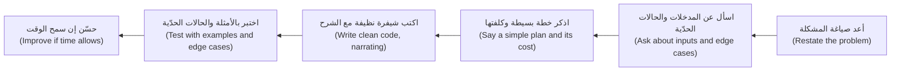
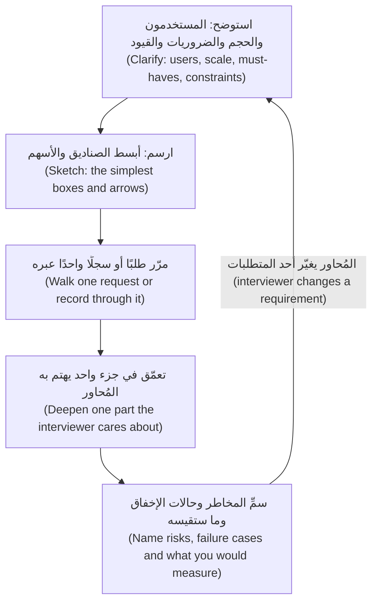

# الوحدة 5 — المقابلات (Interviews)

*المقابلة (interview) ليست امتحانًا تجتازه بالذكاء في يومه. إنها مجموعة من الفحوص (checks) صمّمها صاحب العمل (employer)، وغالبًا بعناية، للإجابة عن بضعة أسئلة: هل يستطيع هذا الشخص أداء العمل، وهل سيتعلّم، وهل سيثق به الفريق؟ تُريك هذه الوحدة تلك الفحوص من الداخل. تبدأ بجولات التوظيف كاملةً (hiring loop)، ومقابلة الفرز مع مسؤول التوظيف (recruiter screen)، والمقابلة السلوكية (behavioural interview)، حيث تحوّل مشاريعك وأخطاءك إلى رصيد من القصص الصادقة. ثم تتناول المقابلات التقنية (technical interviews) كما تُدار اليوم: اختبارات فرز الخوارزميات (algorithm screens)، والبرمجة المباشرة (live coding)، والمهام المنزلية (take-home tasks)، وتمرينًا أحدث هو مراجعة طلب دمج (pull request) كتبه وكيل ذكاء اصطناعي (AI agent). وتنتهي بنقاشات التصميم (design conversations) التي يواجهها المبتدئون (juniors) الآن أكثر مما يتوقعون: تصميم نظام صغير، أو حالة بيانات أو SQL، أو سؤال عن تقييم تعلّم الآلة، أو شرح متدرّج لاستكشاف أعطال السحابة. ستتابع جولات المقابلات في برنامج نجم للخرّيجين التقنيين (Najm Tech Graduate Programme) بينما تفرز عائشة الدفعة (cohort)، ويدير طارق الجولات التقنية (technical rounds)، وتختبر دانة وسالم مرشّحي البيانات والمنصّات. يتعلّم عمر أن الخوارزمية الصحيحة التي تُقال في صمت تنال درجة أقل مما ظنّ، وتضطر ريم إلى شرح شيفرة لم تكتبها سطرًا بسطر، وتكتشف هدى أن عبارة "سأستخدم XGBoost" ليست تصميمًا.*

> **الخطوات (Steps):** Interview — أن تعرف ما تفحصه كل جولة (round)، وتُعدّ لها أدلة صادقة (honest evidence)، وتُظهر تفكيرك بصوت مسموع (out loud).

---

# 5.1 — جولات التوظيف، ومقابلة الفرز مع مسؤول التوظيف، والمقابلات السلوكية (STAR)
*المستوى (Level): 🟡 متوسط (Intermediate)* · *المتطلبات (Prerequisites): 1.1، 3.1، 4.1* · *الخطوة (Step): Interview*

## ⚡ الدرس في دقيقة (In 60 seconds)
- **جولات التوظيف (hiring loop)** هي التسلسل الكامل للخطوات من التقديم (application) إلى العرض الوظيفي (offer): الفرز (screen)، والتقييمات (assessments)، والمقابلات، واجتماع التقييم الختامي (debrief)، والمراجع (references). كل خطوة تفحص شيئًا محددًا؛ اعرف ما هو، واستعدّ له.
- **مقابلة الفرز مع مسؤول التوظيف (recruiter screen)** تفحص الملاءمة للدور، والأمور اللوجستية (logistics) (الموقع، وتاريخ البدء، وحق العمل (right to work)، وتوقعات الراتب)، وما إذا كنت تستطيع التعبير عن نفسك بوضوح. إنها مقابلة حقيقية، لا مجرد إجراء شكلي (formality).
- **المقابلات السلوكية (behavioural interviews)** تسأل عن السلوك الماضي (past behaviour) ("حدّثني عن موقف…")، لأنه أفضل دليل يملكه المُحاور (interviewer) على السلوك المستقبلي. أجب باستخدام **STAR**: الموقف (Situation)، والمهمة (Task)، والإجراء (Action)، والنتيجة (Result).
- ابنِ **رصيد القصص (story bank)** قبل أن تتقدّم: من 8 إلى 10 قصص حقيقية من المشاريع والتدريب الميداني (internships) والدراسة والعمل، وكل قصة موسومة بالمهارات التي تُظهرها.
- إشارة القرار (Decision cue): قبل كل جولة، اسأل مسؤول التوظيف (recruiter) عمّا تفحصه، وكم تستغرق، وهل يُسمح بأدوات الذكاء الاصطناعي (AI tools).
- الفخ الأكبر (Biggest trap): قصص تملؤها "نحن" في كل مكان، بلا إجراء واضح خاص بك، وبلا نتيجة. لا يستطيع المُحاور أن يمنح درجة لما لم تقله.

## 🧭 لماذا يهم
محمد، المتحوّل مهنيًا عبر معسكر تدريبي (bootcamp career-switcher)، يجتاز التقييم الإلكتروني (online assessment) في نجم بسهولة. معرض أعماله (portfolio) قوي، وهو متمكّن من البرمجة. ثم تتصل به عائشة (قائدة استقطاب المواهب) لمقابلة فرز مدتها 30 دقيقة. تسأله: "لماذا نجم، ولماذا هذا البرنامج؟" ⁦⁩. يتحدث أربع دقائق عن حبّه للبناء، ولا يذكر البنك أبدًا، ويذكر راتبًا رآه في منتدى لبلد آخر. لاحقًا يسأله خالد (مدير الهندسة): "حدّثني عن موقف اختلفت فيه مع زميل في الفريق" ⁦⁩. يقول محمد: "عادةً كنا نتفق على الأمور. أنا سهل التعامل" ⁦("We usually agreed on things. I am easy to work with.")⁩. فيكتب خالد "لا دليل" أمام كفاءة العمل الجماعي (teamwork competency).

محمد يستطيع أداء العمل؛ لكنه لم يُظهر ذلك بالصيغة (format) التي تستخدمها جولات التوظيف (loop). الجولات غير التقنية (non-technical rounds) ليست "ليّنة" (soft). فهي كثيرًا ما تحسم الاختيار بين مرشّحين بدرجات تقنية متقاربة، وهي الأسهل في الاستعداد، لأن الأسئلة متوقَّعة (predictable) والإجابات تأتي من حياتك أنت.

## 📐 كيف يعمل

### 🟢 الأساسيات

**جولات التوظيف (The hiring loop).** يسمّي أصحاب العمل الخطوات بأسماء مختلفة، لكن معظم جولات مستوى المبتدئين (entry-level loops) تبدو هكذا:


| الخطوة | ما تفحصه | من يديرها عادةً | كيف تستعد |
|---|---|---|---|
| التقديم والسيرة الذاتية | التطابق الأساسي مع الدور | نظام تتبّع المتقدّمين (applicant-tracking system) ومسؤول توظيف (4.1) | فصّل سيرتك الذاتية على الإعلان |
| مقابلة الفرز مع مسؤول التوظيف | الدافع (Motivation)، والأمور اللوجستية، والتواصل (communication)، والملاءمة التقريبية (rough fit) | مسؤول توظيف أو شريك استقطاب مواهب (talent-acquisition partner) | تعريف بنفسك في 60 ثانية (60-second introduction)، وإجابة "لماذا صاحب العمل هذا"، وأمورك اللوجستية جاهزة |
| التقييم الإلكتروني | أساسيات البرمجة أو الاستدلال، على نطاق واسع | منصّة آلية (automated platform) | تدرّب بتوقيت (Timed practice) على النوع نفسه من المنصّات |
| المقابلات التقنية | حل المشكلات (Problem solving)، وجودة الشيفرة (code quality)، والاستدلال بصوت مسموع | مهندسون (Engineers) (5.2، 5.3) | تدرّب مع شخص، لا وحدك فقط |
| المقابلة السلوكية | كيف تعمل مع الآخرين، وتتعلّم، وتتعامل مع الانتكاسات (handle setbacks) | مدير (manager) أو مهندس أول (senior engineer) | رصيد القصص وطريقة STAR |
| اجتماع التقييم الختامي | يقارن المُحاورون الأدلة المكتوبة (written evidence) بمعيار التقييم (rubric) | لجنة المقابلة (interview panel) ومدير التوظيف (hiring manager) | لا شيء في اليوم نفسه؛ أدلتك مكتوبة سلفًا |
| المراجع والتحقّقات | أن ما قلته صحيح | الموارد البشرية (HR)، وأحيانًا طرف ثالث (third party) | أخبر من يزكّونك (referees) مسبقًا؛ ولا تبالغ في أي شيء أبدًا |

أمران أهم مما يبدوان. أولًا، يكتب معظم المُحاورين ملاحظاتهم وفق **معيار تقييم (rubric)**، وهو قائمة بالكفاءات (competencies) مع وصف للإجابات الضعيفة والمقبولة والقوية؛ وفي اجتماع التقييم الختامي لا يُحتسب إلا ما دوّنوه. ثانيًا، كثيرًا ما تُقيم برامج الخرّيجين (graduate programmes) **مراكز التقييم (assessment centres)**: يومًا من التمارين مثل مهمة جماعية (group task) وعرض تقديمي (presentation) ومقابلات، تُراقَب فيه وأنت تفعل الأشياء، لا وأنت تتحدث عنها فقط.

**مقابلة الفرز مع مسؤول التوظيف (The recruiter screen).** توقّع من 15 إلى 45 دقيقة، وهذه الأسئلة:
- "حدّثني عن نفسك" ⁦⁩ نحو 60 ثانية: من أنت الآن، وماذا بنيت، وماذا تريد بعد ذلك، ولماذا هذا الدور.
- "لماذا نحن؟ لماذا هذا الدور؟" ⁦⁩ اذكر شيئًا محددًا: التناوبات (rotations) في البرنامج، أو منتجًا (product)، أو القطاع (sector). اقرأ صفحة الوظائف (careers page) أولًا.
- "ما توقعاتك للراتب؟" ⁦⁩ إن استطعت، فاطلب النطاق (range) أولًا: "هل يمكنك مشاركة النطاق المرصود لهذا الدور؟" ⁦⁩ وإن اضطررت لذكر رقم، فاذكر نطاقًا مدروسًا (researched range) لذلك البلد وذلك الدور (يشرح الدرس 6.1 كيف تبحث عنه). لا تذكر أبدًا رقمًا من سوق أخرى (another market).
- الأمور اللوجستية: تاريخ البدء (start date)، والموقع (location)، وحق العمل. في دول الخليج (GCC) تختلف قواعد التأشيرات والكفالة (visa and sponsorship rules) من بلد إلى آخر وتتغيّر؛ أجب بصدق وتحقّق من القواعد الحالية (current rules).
- "هل لديك أسئلة لي؟" ⁦⁩ الجواب دائمًا نعم: اسأل عن الخطوات التالية (next steps)، والجدول الزمني (timeline)، وما تفحصه الجولة التالية.

**طريقة STAR.** للإجابة السلوكية (behavioural answer) أربعة أجزاء:
- **الموقف (Situation):** السياق (context) في جملة أو جملتين.
- **المهمة (Task):** ما كنتَ *أنت* مسؤولًا عنه (responsible for)، أو المشكلة التي كان عليك حلّها.
- **الإجراء (Action):** ما فعلتَه *أنت*، خطوة بخطوة (step by step). هذا معظم الإجابة، نحو نصف الوقت.
- **النتيجة (Result):** ما حدث، مع الدليل (evidence) إن وُجد، وما تعلّمته.

يسأل خالد هدى: "حدّثني عن موقف وجدتِ فيه مشكلة في عملك أنتِ" ⁦⁩

> **إجابة ضعيفة (Weak):** "في مشروع التخرّج (final-year project) بنينا نموذجًا للتنبؤ بتسرّب العملاء (churn model). كانت هناك بعض مشكلات البيانات (data issues) لكننا أصلحناها وكان النموذج جيدًا في النهاية. تعلّمت الكثير عن جودة البيانات (data quality)."

> **إجابة قوية (Strong (STAR)):** "**الموقف (Situation):** في مشروع التخرّج، ضمن فريق من ثلاثة، كنا نتنبأ بعملاء الاتصالات الذين سيُلغون اشتراكهم. **المهمة (Task):** كنت مسؤولة عن النموذج والتقييم (I owned the model and the evaluation). **الإجراء (Action):** حقق نموذجي الأول درجة عالية جدًا على مجموعة الاختبار (test set)، وهذا أثار شكّي. فحصت أي السمات (features) كانت الأهم، فوجدت أن إحداها حقل يُعبّأ *بعد* أن يكون العميل قد ألغى فعلًا، أي إن النموذج كان يرى الإجابة. أزلته، وأعدت تقسيم البيانات حسب التاريخ بدلًا من التقسيم العشوائي بحيث تأتي مجموعة الاختبار بعد فترة التدريب (training period)، وكتبت ملاحظة قصيرة للفريق أشرح فيها السبب. **النتيجة (Result):** انخفضت الدرجة إلى مستوى أكثر واقعية، لكن مشرفنا قال إنه أول مشروع في ذلك العام يكتشف تسرّب البيانات (leakage) بنفسه. ومنذ ذلك الحين أفحص توقيت السمات (feature timing) قبل أن أثق بأي درجة."

للإجابة القوية مالك واحد ("أنا")، وإجراءات محددة (specific actions)، ونتيجة صادقة (honest result)، ودرس دائم (lasting lesson)، في نحو 90 ثانية. لم تخترع نسبة مئوية؛ وإن كنت لا تتذكر رقمًا، فصِف النتيجة بالكلمات.

### 🟡 التعمق أكثر (Going deeper)

**ما الذي تسأل عنه الأسئلة السلوكية حقًا (What behavioural questions are really asking).** يربط المُحاورون الأسئلة بالكفاءات. إذا عرفت الكفاءة، عرفت أي قصة تختار.

| السؤال الذي تسمعه | الكفاءة وراءه | ما تُظهره الإجابة القوية |
|---|---|---|
| "حدّثني عن موقف اختلفت فيه مع أحد" ⁦⁩ | التعاون (Collaboration)، والتواصل | أثرتَ الأمر باحترام، واستمعت، واستخدمت الأدلة (used evidence)، وقبلت النتيجة أو غيّرتها |
| "حدّثني عن خطأ ارتكبته" ⁦⁩ | تحمّل المسؤولية (Ownership)، والتعلّم (learning) | اعترفت به سريعًا، وأصلحته، وغيّرت شيئًا كي لا يتكرر |
| "حدّثني عن شيء تعلّمته بسرعة" ⁦⁩ | القدرة على التعلّم (Learning ability) | منهجية: كيف تعلّمت، لا مجرد أنك تعلّمت |
| "حدّثني عن موقف كان لديك فيه عمل أكثر من اللازم" ⁦⁩ | تحديد الأولويات (Prioritisation) | اخترت ما يهم، وقلت لا أو أعدت التفاوض (renegotiated)، وأبلغت الناس مبكرًا |
| "حدّثني عن مشروع تفخر به" ⁦⁩ | تحمّل المسؤولية، والعمق (depth) | دورك أنت، وأصعب قرار (hardest decision)، والمفاضلة (trade-off) التي أجريتها |
| "حدّثني عن موقف استخدمت فيه أدوات الذكاء الاصطناعي في عملك" ⁦⁩ | حسن التقدير (Judgement)، والنزاهة (integrity) | أين ساعد الذكاء الاصطناعي، وكيف تحققت من مخرجاته، وأين لم تستخدمه ولماذا |

الصف الأخير شائع على نحو متزايد وقت كتابة هذا النص (2026). تُعدّ ريم له بعناية: فهي لا تُخفي استخدامها للوكيل (agent use) ولا تبالغ فيه (overclaims). كتب الوكيل معظم النسخة الأولى من تطبيقها لتتبّع المصروفات (expense tracker)؛ فوجدت أنه خزّن رموز الجلسة (session tokens) في التخزين المحلي للمتصفح، وتشرح لماذا كان ذلك خطرًا (risk)، وكيف أصلحته وأضافت اختبارًا. هذا هو حسن التقدير الذي يريده أصحاب العمل ممن يعمل مع الوكلاء (agents) (1.2).

**رصيد القصص (The story bank).** أعدّ من 8 إلى 10 قصص قوية (strong stories)، لا إجابات عن 50 سؤالًا، ووجّه كل قصة نحو عدة أسئلة. الرصيد الجيد يغطي:
- مشكلة تقنية حللتها (تصحيح الأخطاء (debugging)، أو الأداء (performance)، أو قرار تصميمي)؛
- خطأ أو إخفاقًا وما غيّرته بعده؛
- خلافًا أو نزاعًا؛
- العمل الجماعي في مشروع جماعي، خصوصًا حين لم يكن أحدهم يساهم؛
- تعلّم شيء جديد بسرعة؛
- موقفًا ساعدت فيه شخصًا آخر؛
- موعدًا نهائيًا تحت الضغط؛
- استخدام أدوات الذكاء الاصطناعي بمسؤولية؛
- موقفًا تجاوزت فيه المطلوب.

المصادر (Sources): مشروعك الختامي (capstone) ومشاريع معرض أعمالك (portfolio projects) (3.1)، والتدريب الميداني والوظائف الجزئية (3.3)، والهاكاثونات (hackathons)، والتطوع (volunteering)، وحتى وظيفة غير تقنية (non-technical job)، ما دامت إجراءاتك واضحة.

**"نحن" مقابل "أنا" ("We" versus "I").** لا يستطيع المُحاورون توظيف فريقك. قل "نحن" للسياق و"أنا" لإجراءاتك؛ وإن كان زميل هو من أنجز الجزء الذكي (clever part)، فقل ذلك وتحدّث عن جزئك.

**أسئلة تطرحها عليهم (Questions to ask them).** الختام بأسئلة جيدة جزء من التقييم. اسأل: "على ماذا يعمل الخرّيج الجديد في أشهره الثلاثة الأولى؟" ⁦⁩ أو "كيف يستخدم الفريق أدوات البرمجة بالذكاء الاصطناعي، وما القواعد؟" ⁦⁩ وتجنّب الأسئلة التي تجيب عنها صفحة الوظائف أصلًا.

### 🔴 نظرة الخبير (Expert view)

**كيف يمنحك المُحاورون الدرجات (How interviewers score you).** يستخدم كثير من أصحاب العمل الكبار **المقابلات المنظَّمة (structured interviews)**: يتلقى كل مرشّح الأسئلة نفسها، ويُقيَّم وفق معيار التقييم نفسه (same rubric). ووجدت أبحاث التوظيف (hiring research) منذ زمن أنها أقدر على التنبؤ (more predictive) من الأحاديث غير المنظَّمة (unstructured chats). يُصغي المُحاور إلى أدلة يستطيع تدوينها أمام كفاءات مسمّاة (named competencies)، فسهّل عليه ذلك: الموقف باختصار، والإجراءات صريحة (actions explicit)، والنتيجة مذكورة، ثم توقّف.

يبدو سطر نموذجي من معيار التقييم، بصورة مبسّطة، هكذا:

| الكفاءة (Competency) | 1 — ضعيف | 2 — متفاوت (Mixed) | 3 — قوي (Strong) |
|---|---|---|---|
| تحمّل المسؤولية | يلوم الآخرين أو الظروف؛ إجراءات مبهمة (vague actions) | يتحمّل بعض المسؤولية؛ إجراءات عامة (actions general) | إجراءات شخصية واضحة، يعترف بدوره، ويتابع حتى النهاية (follows through) |
| التعلّم | لا تأمّل | يتأمّل لكن لم يتغيّر شيء | تغيير محدد في طريقة عمله بعد ذلك |

**أسئلة المتابعة هي الاختبار الحقيقي (Follow-up questions are the real test).** المُحاور الجيد يتعمّق: "ما الذي غيّرته في التقسيم بالضبط؟" ⁦⁩، "ما الذي كنت ستفعله بشكل مختلف؟" ⁦⁩ القصص المختلقة أو المبالَغ فيها تنهار هنا، وتكشف تحقّقات الخلفية (background checks) في القطاعات المنظَّمة (regulated sectors) مثل البنوك المزيد: أسباب عملية، تتجاوز الأخلاق، لئلا تختلق شيئًا أبدًا.

**مقابلات قيم الشركة (Company values interviews).** ينشر بعض أصحاب العمل قيمًا أو مبادئ ويبنون عليها أسئلتهم؛ ومبادئ القيادة لدى Amazon مثال علني معروف. اقرأها ووسِم قصصك بها. وينشر برنامج نجم للخرّيجين ثلاثًا: *امتلك النتيجة*، و*احمِ العميل*، و*تعلّم علنًا*.

**السياق ثنائي اللغة (Bilingual context).** في دول الخليج قد تُجرى المقابلات بالإنجليزية أو العربية أو كلتيهما. تدرّب على أهم قصصك باللغتين إن كان صاحب العمل ثنائي اللغة (bilingual)؛ والمصطلحات التقنية (technical terms) تبقى عادةً بالإنجليزية. وقد تسأل البرامج الحكومية وبرامج التنمية الوطنية عن دافعك لخدمة القطاع؛ أجب بصدق وتحديد.

**النزاهة في عصر الذكاء الاصطناعي (Integrity in the AI era).** الأدوات التي تستمع إلى المقابلة وتقترح إجابات في الوقت الحقيقي غشٌّ (cheating) في أي جولة لا يُسمح فيها بالذكاء الاصطناعي، وتكشفها أسئلة المتابعة (follow-up questions)، والجولات النهائية الحضورية، وتحقّقات المراجع (reference checks). وإن لم تكن متأكدًا، فاسأل مسؤول التوظيف كتابيًا.

## 🧰 الأدوات
| المورد أو الأداة أو النموذج (Resource, tool or template) | ما هو وماذا يفعل | متى تلجأ إليه |
|---|---|---|
| **STAR method** — طريقة STAR | الموقف، والمهمة، والإجراء، والنتيجة: بنية من أربعة أجزاء للإجابات السلوكية (behavioural answers) | كل سؤال سلوكي؛ عند صياغة رصيد قصصك |
| **Story bank** — رصيد القصص | جدول من 8 إلى 10 قصص حقيقية، كلٌّ منها موسومة بالكفاءات ومعها ملاحظات STAR | يُبنى مرة واحدة قبل التقديم؛ ويُراجَع قبل كل مقابلة |
| **Brag document** — سجلّ الإنجازات | سجلّ متجدد (running log) لما فعلته، والقرارات التي اتخذتها، والأدلة (روابط، وملاحظات) | يُحدَّث أسبوعيًا من الآن فصاعدًا؛ وهو المادة الخام (raw material) للقصص ونقاط السيرة الذاتية (CV bullets) |
| **60-second introduction** — التعريف بنفسك في 60 ثانية | إجابة شفهية قصيرة عن "حدّثني عن نفسك": الآن، وما بنيته، والخطوة التالية، ولماذا أنت | مقابلات الفرز مع مسؤولي التوظيف (recruiter screens)، ومكالمات بناء العلاقات المهنية (networking calls)، والدقيقة الأولى من كل مقابلة |
| **Employer values page** — صفحة قيم صاحب العمل | القيم أو المبادئ أو الكفاءات التي ينشرها صاحب العمل على موقع الوظائف (careers site) | وسم قصصك قبل الجولة السلوكية (behavioural round) |
| **Mock interview with a peer** — مقابلة تجريبية مع زميل | جولة تدريبية يطرح فيها صديق أسئلة من قائمة ويمنح الدرجات وفق معيار تقييم (scores with a rubric) | قبل المقابلات الحقيقية بأسبوع إلى أسبوعين؛ وبعد كل جولة لم تنجح فيها (failed round) |

## 🏛️ عمليًا في بنك نجم
تشارك عائشة **جولات المقابلات في برنامج نجم للخرّيجين التقنيين (Najm Tech Graduate Programme interview loop)** مع كل مرشّح يجتاز الفرز، ويعطي خالد الدفعة **نموذج رصيد القصص (story bank template)**. وكلاهما معروض هنا (البرنامج وتفاصيله خيالية).

**الجزء A: جولات المقابلات كما ترسلها عائشة إلى المرشّحين (Part A: the loop, as Aisha sends it to candidates)**

| الجولة | المدة (Length) | ما تفحصه | هل يُسمح بأدوات الذكاء الاصطناعي؟ ⁦⁩ |
|---|---|---|---|
| مقابلة الفرز مع مسؤول التوظيف (عائشة) | 30 دقيقة | الدافع، والأمور اللوجستية، والتواصل | لا ينطبق |
| التقييم البرمجي الإلكتروني | 75 دقيقة | أساسيات البرمجة والاستدلال | لا |
| المقابلة التقنية 1 (Technical interview 1) (طارق أو مهندس أول) | 60 دقيقة | البرمجة المباشرة والاستدلال بصوت مسموع | لا |
| المقابلة التقنية 2، حسب المسار (Technical interview 2, by track) | 60 دقيقة | مراجعة الشيفرة (Code review) لطلب دمج كتبه الذكاء الاصطناعي (البرمجيات والذكاء الاصطناعي)، أو حالة بيانات (data case) (دانة)، أو استكشاف أعطال المنصّة (platform troubleshooting) (سالم) | نعم، مساعد المرشّح نفسه، مع مشاركة الشاشة (screen shared) |
| المقابلة السلوكية (خالد) | 45 دقيقة | تحمّل المسؤولية، والتعلّم، والتعاون، وقيم نجم (Najm's values) | لا ينطبق |
| اجتماع التقييم الختامي | — | تمنح اللجنة (Panel) كل كفاءة درجة من 1 إلى 3 وفق معيار التقييم | — |

**الجزء B: نموذج رصيد القصص (أول صفّين لدى ريم) (Part B: the story bank template (Reem's first two rows))**

| # | القصة (عنوان من سطر واحد) (Story) | الكفاءات | الموقف / المهمة (S / T) | الإجراء (ما فعلتُه *أنا*) (A) | النتيجة (الدليل) (R) | تناسب أسئلة عن |
|---|---|---|---|---|---|---|
| 1 | الوكيل خزّن الرموز بطريقة غير آمنة في تطبيق المصروفات الخاص بي | حسن التقدير، وتحمّل المسؤولية، واستخدام الذكاء الاصطناعي (AI use) | مشروع جانبي فردي؛ كنت مسؤولة عنه من البداية إلى النهاية (end to end) | قرأت شيفرة المصادقة (auth code) التي كتبها الوكيل؛ وجدت الرموز في التخزين المحلي (local storage)؛ بحثت في الخطر؛ انتقلت إلى ملفات تعريف الارتباط من نوع HTTP-only (HTTP-only cookies)؛ أضفت اختبارًا | اختبار في المستودع؛ قسم في README بعنوان "ما الذي غيّرته بعد المراجعة" ("What I changed after review") | الأخطاء (Mistakes)؛ استخدام الذكاء الاصطناعي؛ التعلّم |
| 2 | زميل في المشروع الجماعي توقّف عن المساهمة (stopped contributing) | التعاون | تطبيق ويب لفريق من أربعة؛ كنت أنسّق قائمة المهام (backlog) | تحدثت معه على انفراد (privately)؛ علمت أن لديه ظرفًا عائليًا (family issue)؛ أعدت توزيع المهام (re-split tasks)؛ أبلغت المشرف مبكرًا بموافقته | سُلِّم في الموعد؛ وقيّم تقييم الأقران (peer review) الفريق تقييمًا عاليًا | النزاع (Conflict)؛ العمل الجماعي (teamwork)؛ الضغط (pressure) |

قاعدة خالد للدفعة: يجب أن يكون لكل قصة رابط أو شخص يستطيع تأكيدها.

## 🛠️ التمارين (Exercises)
- 🟢 اكتب تعريفك بنفسك في 60 ثانية (60-second introduction) وسجّله لدور محدد تستهدفه. استمع إليه واحذف كل ما لا يجيب عن "الآن، وما بنيته، والخطوة التالية، ولماذا أنت". *يكتمل عندما (Done when):* يكون طول التسجيل بين 50 و75 ثانية، ويسمّي صاحب العمل أو الدور بالتحديد.
- 🟡 ابنِ رصيد قصصك: ثماني قصص على الأقل بصيغة الجزء B، تغطي المجالات التسعة في 🟡 التعمق أكثر (قد تغطي قصة واحدة مجالين). *يكتمل عندما:* يحتوي كل صف على إجراء شخصي (personal action)، ونتيجة، ومُتحقِّق (verifier) (رابط أو شخص)، ويكون لكل كفاءة في جدول 🟡 قصة.
- 🔴 أجرِ مقابلتين سلوكيتين تجريبيتين مع زميل باستخدام ستة أسئلة من هذا الدرس. يمنحك الزميل درجة من 1 إلى 3 في تحمّل المسؤولية والتعلّم والتعاون باستخدام معيار التقييم في 🔴 (🔴 rubric)، ويطرح سؤالَي متابعة على الأقل لكل قصة. *يكتمل عندما:* تكون لديك ورقتا الدرجات (score sheets)، وقد أعدت كتابة القصتين الأقل درجة بعد إصلاح نقطة الضعف.

## ⚠️ أخطاء وفخاخ (Mistakes and traps)
- **التعامل مع مقابلة الفرز كإجراء شكلي (Treating the recruiter screen as a formality).** إنها تستبعد كثيرًا من المرشّحين. أعدّ تعريفك بنفسك، وإجابة "لماذا نحن"، وأمورك اللوجستية بجدية الجولة التقنية نفسها.
- **"نحن" من البداية إلى النهاية ("We" all the way through).** لا يستطيع المُحاور منح فريقك درجة. استخدم "نحن" للسياق و"أنا" للإجراءات.
- **لا نتيجة، أو نتيجة مختلقة (No result, or an invented one).** لا تتوقف عند الإجراء، ولا تخترع رقمًا. صِف النتيجة بصدق (outcome honestly)، بالكلمات إن لم تكن لديك أرقام دقيقة (exact figures).
- **افتراض قواعد الذكاء الاصطناعي (Assuming the AI rules).** تختلف القواعد بين أصحاب العمل وبين الجولات. اسأل كتابيًا قبل كل جولة.

## 🧾 الخلاصة (Recap)
- جولات التوظيف سلسلة من الفحوص؛ اسأل عمّا تفحصه كل جولة واستعدّ له.
- ترتبط الأسئلة السلوكية (Behavioural questions) بالكفاءات. أجب بطريقة STAR، مع تخصيص نصف الوقت لإجراءاتك أنت.
- أعدّ رصيدًا من 8 إلى 10 قصص حقيقية قابلة للتحقق ووجّهها نحو أسئلة كثيرة.
- يمنح المُحاورون الدرجات عادةً وفق معيار تقييم ويتعمّقون بأسئلة المتابعة (follow-ups)، لذا تفوز الأدلة المحددة والصادقة.

## ✍️ اختبر نفسك (Check yourself)

**1. يُسأل محمد: "حدّثني عن موقف اختلفت فيه مع زميل في الفريق" ⁦("Tell me about a time you disagreed with a teammate.")⁩ أي إجابة ستنال أعلى درجة في معيار تقييم التعاون (collaboration rubric)؟**

- A. "عادةً كنا نتفق على الأمور، فلم يظهر النزاع حقًا. أنا سهل التعامل" ⁦("We usually agreed on things, so conflict never really came up. I am easy to work with.")⁩
- B. قصة مدتها 90 ثانية عن خلاف حقيقي واحد: أدلته، واقتراحه، والنتيجة
- C. سرد مدته خمس دقائق للمشروع كله، من الاجتماع الأول إلى العرض النهائي (final demo)
- D. "سأستمع بعناية، وأبقى هادئًا، وأبحث عن حل وسط (compromise) يقبله الطرفان" ⁦⁩

<details><summary>الإجابة</summary>

**B.** إنها حدث ماضٍ محدد بإجراءاته هو ونتيجة، وهذا ما يمنحه معيار التقييم الدرجات؛ أما C فتدفن هذا الدليل في التفاصيل. وD مغرية لكنها افتراضية (hypothetical) ("سأفعل")، فلا تقدّم دليلًا على السلوك الماضي (past behaviour)؛ وA لا تقدّم أي دليل إطلاقًا. (🟢 الأساسيات.)

</details>

**2. في مقابلة الفرز مع مسؤول التوظيف (recruiter screen)، تسأل عائشة يوسف عن توقعاته للراتب (salary expectations). لم يبحث في النطاق (range). ما أفضل ردّ؟**

- A. أن يذكر أعلى رقم رآه على الإنترنت، من أي بلد، ليرسّخ نقطة ارتكاز عالية (anchor high)
- B. أن يرفض مناقشة الأجر (pay) تمامًا حتى يحصل على عرض مكتوب (written offer)
- C. أن يقول إنه سيقبل أي شيء يعرضه البنك، ليبدو مرنًا (flexible)
- D. أن يطلب النطاق المرصود (budgeted range) ويعرض العودة بنطاق مدروس (researched one)

<details><summary>الإجابة</summary>

**D.** طلب النطاق أولًا أمر طبيعي ويمنحه معلومات حقيقية؛ والنطاق المدروس للسوق الصحيحة (right market) ذو مصداقية (credible). أما A فترتكز على السوق الخطأ (wrong market) وقد تُنهي العملية. (🟢 الأساسيات.)

</details>

**3. ماذا يعني حرف "A" في STAR، وكم ينبغي أن يأخذ من الإجابة؟**

- A. الإجراء (Action): ما فعلتَه أنت شخصيًا، نحو نصف الإجابة
- B. الإنجاز (Achievement): أفضل نتيجة حققتها، معظم الإجابة
- C. التحليل (Analysis): ما كان على الفريق فعله، سطر ختامي قصير
- D. النهج (Approach): المنهجية العامة التي استخدمها فريقك، جملة واحدة (one sentence)

<details><summary>الإجابة</summary>

**A.** الإجراءات التي اتخذتها هي الدليل الذي يمنحه المُحاور الدرجات، لذا تستحق معظم الوقت. وD تصف الفريق، لا أنت. (🟢 الأساسيات.)

</details>

**4. تُسأل ريم: "حدّثني عن موقف استخدمتِ فيه أدوات الذكاء الاصطناعي في عملك" ⁦("Tell me about a time you used AI tools in your work.")⁩ أي نهج هو الأفضل؟**

- A. أن تقول إنها لا تستخدم أدوات الذكاء الاصطناعي أبدًا، كي لا تبدو معتمدة عليها
- B. أن تقول إن الوكيل (agent) بنى كل شيء وإنها اكتفت بتصفّحه (skimmed it) قبل الإطلاق (shipping)
- C. أن تصف أين ساعدها، والعيب (flaw) الذي اكتشفته، وكيف أصلحته واختبرته
- D. أن تتحدث عن اتجاهات الذكاء الاصطناعي في الصناعة بدلًا من مشاريعها هي

<details><summary>الإجابة</summary>

**C.** إنها تُظهر إفصاحًا صادقًا (honest disclosure) وحسن تقدير (judgement): التحقق من مخرجات الذكاء الاصطناعي وتحمّل مسؤولية النتيجة. أما A فغير صادقة وتنهار أمام أسئلة المتابعة (follow-up questions)؛ وB لا تُظهر حسن تقدير. (🟡 التعمق أكثر (Going deeper).)

</details>

**5. لماذا تهمّ أسئلة المتابعة مثل "ما الذي غيّرته بالضبط؟" ⁦("What exactly did you change?")⁩ إلى هذا الحد في المقابلة السلوكية المنظَّمة (structured behavioural interview)؟**

- A. تتيح للمُحاور ملء الوقت حين ينهي المرشّح إجابته مبكرًا
- B. تختبر ما إذا كانت القصة حقيقية وما إذا كان العمل حقًا عمل المرشّح نفسه
- C. تُستخدم غالبًا بعد أن يكون المُحاور قد قرر رفض أحدهم (reject someone)
- D. تفحص أساسًا قواعد اللغة (grammar) لدى المرشّح وطلاقته في الإنجليزية

<details><summary>الإجابة</summary>

**B.** تسبر أسئلة المتابعة (Follow-ups) العمق والأصالة، وهما الدليل الذي يُدوَّن في معيار التقييم (rubric)؛ والقصة المبالَغ فيها (exaggerated story) تنهار أمامها. وهذا سبب عملي لئلا تختلق شيئًا أبدًا. (🔴 نظرة الخبير (Expert view).)

</details>

## 📚 المراجع
- MIT Career Advising & Professional Development (الإرشاد المهني والتطوير المهني في MIT) — https://capd.mit.edu/
- Tech Interview Handbook — دليل المقابلات التقنية (قسم المقابلة السلوكية) — https://www.techinterviewhandbook.org/
- Google، كيف نوظّف — https://www.google.com/about/careers/applications/how-we-hire/
- Amazon، مبادئ القيادة (Leadership Principles) — https://www.amazon.jobs/content/en/our-workplace/leadership-principles
- Julia Evans، "احصل على تقدير لعملك: اكتب سجلّ إنجازات" — https://jvns.ca/blog/brag-documents/
- [*إدارة منتجات الذكاء الاصطناعي: من الصفر إلى الاحتراف*، الدرس 10.2 — المسار المهني لمدير منتجات الذكاء الاصطناعي: المقابلات ومعرض الأعمال والنمو](../aipm/index.ar.html#/10.2)
- [*أمن الذكاء الاصطناعي والتطبيقات: من الصفر إلى الاحتراف*، الدرس 12.2 — المسار المهني في الأمن: الأدوار والشهادات ومعرض الأعمال](../secai/index.ar.html#/12.2)

---

# 5.2 — المقابلات التقنية اليوم: الخوارزميات، والبرمجة المباشرة، والمهام المنزلية، ومراجعة الشيفرة التي كتبها الذكاء الاصطناعي
*المستوى: 🟡 متوسط* · *المتطلبات: 1.1، 1.2، 5.1* · *الخطوة: Interview*

## ⚡ الدرس في دقيقة (In 60 seconds)
- تأتي الجولات التقنية في أربع صيغ شائعة: **اختبارات فرز الخوارزميات (algorithm screens)** (هياكل البيانات والخوارزميات (data structures and algorithms)، وغالبًا على منصّة)، و**البرمجة المباشرة (live coding)** (بناء شيء صغير بينما يراقبك مُحاور)، و**المهام المنزلية (take-home tasks)** (مشروع صغير في وقتك الخاص)، و**مراجعة الشيفرة (code review)**، وهي على نحو متزايد مراجعة لطلب دمج كتبه وكيل ذكاء اصطناعي.
- في كل صيغة يمنح المُحاور الدرجات على **استدلالك وتواصلك وتحقّقك (reasoning, communication and verification)**، لا على مجرد تشغيل الشيفرة. فكّر بصوت مسموع.
- تختلف قواعد أدوات الذكاء الاصطناعي (AI-tool rules) حسب صاحب العمل وحسب الجولة. كثير من أصحاب العمل يسمحون بأدوات الذكاء الاصطناعي أو يتوقعونها في بعض الجولات ويحظرونها في غيرها. اسأل قبل كل جولة، والتزم بالجواب حرفيًا.
- إشارة القرار: قبل كتابة الشيفرة، أعد صياغة المشكلة، واسأل عن المدخلات والحالات الحدّية، واذكر خطتك. وقبل أن تقول "انتهيت" ("done")، اختبرها.
- الفخ الأكبر: البرمجة في صمت (silent coding). الإجابة الصحيحة التي لا تستطيع شرحها تنال درجة أقل من إجابة شبه صحيحة استدللت عليها بوضوح.

## 🧭 لماذا يهم
عمر هو أقوى طالب في الخوارزميات (algorithm student) في الدفعة. في جولة البرمجة المباشرة (live-coding round) مع طارق، يسمع المشكلة، ويقول "حسنًا" ("OK")، ويكتب 25 دقيقة في صمت. حلّه صحيح. لكن ملاحظات طارق تقول: "حل صحيح. لا أسئلة توضيحية. لم يختبر. لم يستطع قول ما يحدث مع مُدخل فارغ (empty input) حتى سُئل. التواصل: 1 من 3."

في الأسبوع نفسه، تحصل ريم على جولة مراجعة الذكاء الاصطناعي (AI-review round). يعطيها طارق طلب دمج قصيرًا كتبه وكيل لنقطة نهاية لتحويل الأموال (funds-transfer endpoint) ويقول: "هل ستدمجين هذا؟" ⁦⁩ هي معتادة على الوكلاء؛ تتصفّحه وتقول إنه يبدو سليمًا لأن الاختبارات تنجح. يشير طارق إلى سطر واحد، فتدرك أن استعلام SQL (SQL query) مبني من سلسلة نصية (string) فيها مُدخلات المستخدم (user input). ولم تكتشف أيضًا غياب فحص الملكية.

كلا المرشّحَين يستطيع البرمجة. لكن أيًّا منهما لم يُظهر ما يوظّف طارق من أجله: شخصًا يمكن ائتمانه على الشيفرة، سواء كتبها إنسان أو آلة. هذا ما تفحصه الجولات التقنية الآن.

## 📐 كيف يعمل

### 🟢 الأساسيات

**الصيغ الأربع (The four formats).**

| الصيغة | كيف تبدو | ما تفحصه | أين تشيع |
|---|---|---|---|
| اختبار فرز الخوارزميات (Algorithm screen) | مشكلة أو مشكلتان على منصّة مثل HackerRank أو Codility، بتوقيت (timed)، وغالبًا آلية (automated) | هياكل البيانات (Data structures)، والتعقيد (complexity)، والصحة تحت ضغط الوقت | ما زالت شائعة في شركات التقنية الكبرى وبرامج الخرّيجين ذات الأعداد الكبيرة؛ وأقل شيوعًا في الشركات الأصغر |
| البرمجة المباشرة | من 45 إلى 60 دقيقة مع مهندس، في محرّر مشترك (shared editor) أو في بيئتك الخاصة | حل المشكلات، والتواصل، وعادات الاختبار (testing habits) | شائعة جدًا لدى أصحاب العمل |
| المهمة المنزلية (Take-home task) | مشروع صغير في ساعات أو أيام، ثم نقاش حوله | جودة الشيفرة، والبنية (structure)، والاختبارات (tests)، وملف README، وحسن التقدير | شائعة في الشركات الناشئة (startups) وشركات المنتجات (product companies) |
| مراجعة الشيفرة | قراءة طلب دمج والتعليق عليه، وغالبًا يكون مكتوبًا بوكيل ذكاء اصطناعي | قراءة الشيفرة (Reading code)، ورصد الأخطاء والمخاطر، وشرح الأولويات (explaining priorities) | اتجاه متنامٍ (growing trend) وقت كتابة هذا النص (2026)؛ وتتفاوت صيغته كثيرًا |

قد تصادف أيضًا **البرمجة الثنائية (pair programming)** (أنت ومهندس تعملان معًا على شيفرة شبه حقيقية) و**جولات تصحيح الأخطاء (debugging rounds)** (هذا اختبار فاشل (failing test)، جد الخطأ). وكلتاهما تكافئ العادات نفسها التي تكافئها البرمجة المباشرة.

**منهجية لأي مشكلة برمجية (A method for any coding problem).** استخدم الخطوات الخمس نفسها في كل مرة، بصوت مسموع:



1. **أعد الصياغة (Restate).** "إذن أحصل على قائمة بالمعاملات (transactions) ويجب أن أُرجع معرّفات (IDs) أي معاملات تبدو مكرّرة (duplicates)، أي الحساب نفسه والمبلغ نفسه خلال 60 ثانية. هل هذا صحيح؟" ⁦("So I get a list of transactions and must return the IDs of any that look like duplicates, meaning the same account and amount within 60 seconds. Is that right?")⁩
2. **استوضح (Clarify).** اسأل عن الحجم (size)، والترتيب (sorting)، والمُدخل الفارغ، والتعادلات (ties)، والبيانات غير الصالحة (invalid data). "هل القائمة مرتّبة حسب الوقت؟ هل يمكن أن تكون المبالغ سالبة؟ ما أقصى حجم للقائمة؟" ⁦⁩
3. **خطّط (Plan).** اذكر أولًا نهجًا بسيطًا يعمل، مع كلفته بـ**ترميز Big-O (Big-O notation)** (كيف ينمو زمن التشغيل (running time) مع حجم المُدخل). "طريقة بسيطة تقارن كل زوج (every pair): هذا O(n²). وإذا كانت القائمة مرتّبة حسب الوقت، يمكنني التجميع حسب الحساب والمبلغ ومقارنة كل عنصر بالعنصر السابق فقط: O بسبب الترتيب، أو O(n) إن كانت مرتّبة أصلًا."
4. **برمِج (Code).** استخدم أسماء واضحة (clear names). اشرح القرارات (Narrate decisions)، لا ضغطات المفاتيح (keystrokes).
5. **اختبر (Test).** امشِ عبر مثال عادي (normal example)، ثم عبر الحالات الحدّية (edge cases): قائمة فارغة، وعنصر واحد، وعنصران تفصل بينهما 60 ثانية بالضبط.

إليك إجابة نظيفة (clean answer) لتلك المشكلة بلغة Python:

```python
from collections import defaultdict

def find_duplicates(transactions, window_seconds=60):
    """transactions: list of dicts with id, account, amount, ts (seconds).
    Returns IDs of transactions that repeat an earlier one with the
    same account and amount within window_seconds."""
    last_seen = {}                        # (account, amount) -> last timestamp
    duplicates = []
    for tx in sorted(transactions, key=lambda t: t["ts"]):
        key = (tx["account"], tx["amount"])
        if key in last_seen and tx["ts"] - last_seen[key] <= window_seconds:
            duplicates.append(tx["id"])
        last_seen[key] = tx["ts"]
    return duplicates

assert find_duplicates([]) == []
assert find_duplicates([{"id": 1, "account": "A", "amount": 50, "ts": 0},
                        {"id": 2, "account": "A", "amount": 50, "ts": 60}]) == [2]
```

عبارات التحقق السريعة (quick asserts) في النهاية أثمن مما تبدو: فهي تُري المُحاور أنك تختبر دون أن يُطلب منك. ومن أسئلة المتابعة الجيدة (good follow-up) التي تطرحها بنفسك: "تمثيل المال بأعداد صحيحة بأصغر وحدة (الفلس أو السنت) أكثر أمانًا من الأعداد العشرية (floats)؛ وقد افترضت هنا أعدادًا صحيحة."

**حين تتعثّر (Getting stuck).** الجميع يتعثّر. قل ما تفكّر فيه: "أنا عالق في كيفية التعامل مع النافذة (window) حين تكون هناك ثلاثة تكرارات. دعني أجرّب مثالًا صغيرًا يدويًا." كثيرًا ما يعطي المُحاورون تلميحات (hints)؛ وتلقّي التلميح بشكل جيد إشارة إيجابية (positive signal).

**قواعد الذكاء الاصطناعي (AI rules).** اسأل مسؤول التوظيف قبل كل جولة: "هل يُسمح بمساعدات الذكاء الاصطناعي (AI assistants) في هذه الجولة، وإن كان كذلك، فأيها وكيف ينبغي أن أشارك شاشتي؟" ⁦("Are AI assistants allowed in this round, and if so, which ones and how should I share my screen?")⁩ إذا كانت محظورة (banned)، فلا تستخدمها، بما في ذلك الأدوات التي تعمل بشكل خفي (run invisibly). وإذا كانت مسموحة، فاستخدمها علنًا (openly) واستمر في الشرح.

### 🟡 التعمق أكثر

**الاستعداد لاختبارات فرز الخوارزميات دون إضاعة أشهر (Preparing for algorithm screens without wasting months).** تختبر اختبارات فرز الخوارزميات مجموعة صغيرة نسبيًا من الأنماط (patterns). والخطة المركّزة (focused plan) تتفوّق على حل مئات المشكلات العشوائية بلا هدف:

| النمط (Pattern) | مشكلات نموذجية (Typical problems) |
|---|---|
| المصفوفات وجداول التجزئة | إيجاد الأزواج (Find pairs)، وعدّ التكرارات (count frequencies)، واكتشاف المكرّرات (detect duplicates) |
| المؤشران والنافذة المنزلقة | أطول سلسلة جزئية بخاصية معيّنة، ودمج القوائم المرتّبة |
| المكدّسات والطوابير | الأقواس الصالحة (Valid brackets)، والعنصر الأكبر التالي |
| الأشجار والرسوم البيانية (BFS، DFS) | الاجتياز حسب المستوى، وعدد الجزر، وأقصر مسار في رسم بياني غير موزون |
| الترتيب والبحث الثنائي | البحث في مصفوفة مرتّبة، وأول نسخة سيئة |
| الأكوام (Heaps) | أعلى k عنصر، ودمج k قائمة مرتّبة |
| البرمجة الديناميكية الأساسية | صعود الدرج (Climbing stairs)، وصرف العملات (coin change) |

القوائم المنتقاة للمشكلات المعروفة (مثل قائمة "Blind 75" وقوائم NeetCode) تجمع المشكلات حسب هذه الأنماط. تدرّب باللغة نفسها التي ستستخدمها في المقابلة، مع مؤقّت (timer)، وقل استدلالك بصوت مسموع حتى وأنت وحدك. بعد كل مشكلة، اكتب سطرًا واحدًا عن النمط الذي استخدمته. وتحقّق مما إذا كان أصحاب العمل الذين تستهدفهم يستخدمون اختبارات فرز الخوارزميات أصلًا؛ فكثير من الشركات الأصغر والشركات الناشئة وفرق القطاع العام (public-sector teams) لا تستخدمها، وقد يكون من الأفضل أن تقضي وقتك في مشروع على غرار المهام المنزلية (take-home-style project).

**المهام المنزلية (Take-home tasks).** تعامل معها كمشاريع إنتاجية صغيرة (1.3). يقرأ المُحاورون عادةً:
- **ملف README أولًا (The README first).** كيف يُشغَّل، وماذا بنيت، وما الذي تخطّيته ولماذا، وكيف ستوسّعه.
- **الاختبارات (Tests).** بضعة اختبارات ذات معنى (meaningful tests) أفضل من لا شيء. اختبر المنطق الأساسي (core logic) وحالة حدّية واحدة.
- **البنية والتسمية (Structure and naming).** دوال صغيرة (Small functions)، وأسماء واضحة، ولا شيفرة ميتة.
- **سجلّ الإيداعات (Commit history).** الإيداعات الصغيرة ذات الرسائل الواضحة تروي قصة؛ والإيداع العملاق الواحد لا يروي شيئًا.
- **الصدق بشأن الذكاء الاصطناعي (Honesty about AI).** إذا كانت أدوات الذكاء الاصطناعي مسموحة، فاذكر أين استخدمتها، كما يطلب صاحب العمل. وتوقّع مقابلة متابعة (follow-up interview) تعدّل فيها شيفرتك مباشرةً. إن لم تستطع شرح سطر، فسيظهر ذلك.

احترم الحدّ الزمني (time limit). إذا قال التكليف (brief) "نحو أربع ساعات"، فقد تشير تحفة استغرقت يومين إلى ضعف في تقدير النطاق. اكتب المفاضلات (trade-offs) في README بدلًا من ذلك.

**مراجعة طلب دمج كتبه الذكاء الاصطناعي (Reviewing an AI-written pull request).** في هذا التمرين تحصل على فرق التغييرات (diff) (الأسطر المضافة والمحذوفة) ووصف قصير، ويُطلب منك أن تقول هل ستوافق عليه (approve it). ترتيب مفيد للمراجعة:

1. **افهم القصد (Understand intent).** ماذا ينبغي أن يفعل هذا التغيير؟ هل تفعل الشيفرة ذلك؟
2. **الصحة (Correctness).** الأخطاء المنطقية (Logic errors)، والحالات الحدّية، والأنواع الخاطئة (wrong types)، ومعالجة الأخطاء (error handling).
3. **الأمن (Security).** مُدخلات غير موثوقة (Untrusted input) تصل إلى الاستعلامات أو الأوامر، وغياب فحوص التفويض (missing authorisation checks)، والأسرار (secrets)، والبيانات الحساسة في السجلات.
4. **الاختبارات (Tests).** هل تختبر السلوك (behaviour)، أم فقط أن الشيفرة تعمل؟ هل تغطي حالات الإخفاق (failure cases)؟
5. **قابلية الصيانة (Maintainability).** الأسماء، والتكرار (duplication)، والتعقيد غير الضروري (unnecessary complexity)، واستدعاءات مكتبات مختلقة.
6. **حدّد الأولويات (Prioritise).** قل أي المشكلات تمنع الدمج (block merging) وأيها مجرد اقتراحات (suggestions).

تُدرّس المكتبة هذه المهارة بعمق في [*تصميم الأنظمة للمبرمجين بالحدس (System Design for Vibe Coders)*، الدرس 9.7 — تدقيق الشيفرة ومراجعتها بسرعة الوكيل](../vibe/index.ar.html#l9-7) و[*أمن الذكاء الاصطناعي والتطبيقات: من الصفر إلى الاحتراف*، الدرس 6.3 — تأمين الشيفرة المولَّدة بالذكاء الاصطناعي: ما يخطئ فيه وكلاء البرمجة](../secai/index.ar.html#/6.3).

### 🔴 نظرة الخبير

**كيف تبدو الإشارة القوية في كل صيغة (What a strong signal looks like in each format).** كثيرًا ما يمنح المُحاورون الدرجات على أربعة أبعاد (four dimensions): حل المشكلات، والبرمجة (coding)، والتحقّق (verification)، والتواصل. المرشّحون الأقوياء يُظهرون الأربعة معًا: يطرحون سؤالًا توضيحيًا حادًا، ويذكرون حلًا بسيطًا قبل التحسين (before optimising)، ويكتبون شيفرة مقروءة (readable code)، ويجدون خطأهم بأنفسهم عبر اختبار، ويُبقون المُحاور على اطلاع طوال الوقت.

**العمل مع الذكاء الاصطناعي في جولة تسمح به (Working with AI in an allowed round).** حين يُسمح بأدوات الذكاء الاصطناعي، يراقب المُحاور كيف توجّهها وتتحقق منها، لا سرعة ظهور النص. الممارسة الجيدة (Good practice):
- اكتب الخطة والاختبارات الأساسية (key tests) بنفسك قبل كتابة الأوامر للمساعد (before prompting).
- أعطِ المساعد (assistant) طلبًا ضيقًا ومحددًا.
- اقرأ كل سطر يُنتجه، بصوت مسموع حيث يفيد. ارفض ما هو خاطئ أو أصلحه.
- شغّل الاختبارات (Run the tests). وأشِر إلى أي شيء لا تثق به.

نهج ريم المحسَّن في جولة تجريبية لاحقة: تطلب من الوكيل صياغة نقطة النهاية، ثم تقول: "قبل أن أشغّل هذا، أتحقق من ثلاثة أشياء: معالجة المُدخلات (input handling)، ومن يُسمح له باستدعائها، وهل يغطي الاختبار مسار الإخفاق (failure path)." تلك الجملة وحدها تغيّر طريقة تقييم الجولة. والمهارات التي وراءها تُدرَّس في [*تصميم الأنظمة للمبرمجين بالحدس*، الدرس 9.4 — التحقق قبل الإنجاز (Verification before completion)](../vibe/index.ar.html#l9-4).

**الحديث عن التعقيد بلا خوف (Complexity talk without fear).** لا تحتاج إلى براهين (proofs). تحتاج إلى أن تقول، عن حلك، كيف ينمو الوقت والذاكرة مع حجم المُدخل، وما المفاضلة التي أجريتها. عبارة "يستخدم هذا ذاكرة إضافية للقاموس (dictionary) لتجنّب مقارنة كل زوج" إجابة كاملة على مستوى المبتدئين (junior level).

## 🧰 الأدوات
| المورد أو الأداة أو النموذج | ما هو وماذا يفعل | متى تلجأ إليه |
|---|---|---|
| **LeetCode** | بنك كبير من مشكلات الخوارزميات (algorithm problems) مع مُقيِّم إلكتروني (online judge) ونقاشات | التدرّب على أنماط الخوارزميات (algorithm patterns) حين يستخدم أصحاب العمل المستهدفون اختبارات فرز الخوارزميات |
| **HackerRank** | موقع للتدرّب على البرمجة يستخدمه أيضًا كثير من أصحاب العمل لإجراء التقييمات الإلكترونية (online assessments) | التعوّد على بيئة التقييم (assessment environment) قبل اختبار بتوقيت (timed test) |
| **NeetCode** (Navdeep Singh) | قوائم مشكلات مجانية وشروحات بالفيديو مجمّعة حسب النمط | بناء خطة دراسة منظَّمة بدلًا من التدرّب العشوائي (random practice) |
| **Tech Interview Handbook** (Yangshun Tay) | دليل مجاني يغطي مقابلات البرمجة (coding interviews)، والجولات السلوكية (behavioural rounds)، وخطط الدراسة (study plans) | تخطيط الجدول الزمني لاستعدادك (preparation timeline) وقوائم التحقق (checklists) |
| **Cracking the Coding Interview** | كتاب واسع الاستخدام في الاستعداد لمقابلات الخوارزميات | تعلّم كيف تُدار مقابلات الخوارزميات والتدرّب على المشكلات الكلاسيكية (classic problems) |
| **Pull request review checklist** — قائمة التحقق لمراجعة طلبات الدمج | القصد (Intent)، والصحة، والأمن، والاختبارات، وقابلية الصيانة، والأولوية (priority) | كل جولة مراجعة شيفرة (code-review round) وكل تغيير كتبه وكيل (agent-written change) تراجعه |
| **Five-step problem method** — منهجية الخطوات الخمس لحل المشكلات | أعد الصياغة، استوضح، خطّط، برمِج، اختبر، بصوت مسموع | كل جولة برمجة مباشرة (live-coding) وكل جولة خوارزميات |
| **Mock interview with a peer** — مقابلة تجريبية مع زميل | جولة تدريبية يطرح فيها صديق أسئلة من قائمة ويمنح الدرجات وفق معيار تقييم | أسبوعيًا في الشهر الذي يسبق الجولات التقنية |

## 🏛️ عمليًا في بنك نجم
يستخدم طارق معيار تقييم ثابتًا (fixed rubric) وتمرينًا ثابتًا (fixed exercise) لجولة مراجعة الذكاء الاصطناعي في نجم. يرى المرشّحون طلب الدمج هذا، مبسّطًا هنا. عنوانه "إضافة نقطة نهاية لتحويل الأموال بين حسابات العميل"، والوصف الذي كتبه وكيل البرمجة (coding agent) يقول فقط: "ينفّذ التحويل. كل الاختبارات تنجح" ⁦⁩

```python
@app.post("/transfers")
def transfer(req):
    src = req.json["from_account"]
    dst = req.json["to_account"]
    amount = float(req.json["amount"])
    db.execute(f"UPDATE accounts SET balance = balance - {amount} WHERE id = '{src}'")
    db.execute(f"UPDATE accounts SET balance = balance + {amount} WHERE id = '{dst}'")
    log.info(f"Transfer {req.json}")
    return {"status": "ok"}

def test_transfer(client):
    resp = client.post("/transfers", json={"from_account": "A1", "to_account": "A2", "amount": "10"})
    assert resp.status_code == 200
```

**ما يجده المرشّح القوي، مرتّبًا حسب الأولوية (What a strong candidate finds, in priority order)**

| # | المشكلة (Issue) | لماذا تهم | هل تمنع الدمج؟ ⁦(Blocks merge?)⁩ |
|---|---|---|---|
| 1 | استعلام SQL مبني من سلاسل نصية فيها مُدخلات المستخدم | حقن SQL (SQL injection) | نعم (Yes) |
| 2 | لا فحص لملكية المستدعي للحساب المصدر | يستطيع أي شخص نقل أموال أي شخص | نعم |
| 3 | التحديثان ليسا داخل معاملة واحدة | إخفاق بينهما يخلق أموالًا أو يُتلفها | نعم |
| 4 | لا فحص للمبالغ السالبة أو الصفرية، ولا لكفاية الرصيد (sufficient balance) | التحويل السالب (Negative transfer) يسحب المال في الاتجاه المعاكس | نعم |
| 5 | تمثيل المال بنوع `float` | أخطاء التقريب (Rounding errors)؛ استخدم أعدادًا صحيحة بأصغر وحدة أو نوعًا عشريًا (decimal type) | نعم |
| 6 | يسجّل الطلب كاملًا | قد يكتب بيانات شخصية أو بيانات حسابات في السجلات | ينبغي إصلاحها |
| 7 | الاختبار يفحص رمز الحالة (status code) فقط | لا يثبت شيئًا عن الأرصدة أو حالات الإخفاق | ينبغي إصلاحها |

**معيار التقييم لدى طارق (من 1 إلى 3 لكل سطر) (Tariq's scoring rubric (1–3 per line))**

| البُعد (Dimension) | 1 | 3 |
|---|---|---|
| إيجاد المشكلات (Finding issues) | يجد مشكلة أو مشكلتين سطحيتين (surface issues) | يجد معظم المشكلات من 1 إلى 5 دون تلميح (unprompted) |
| تحديد الأولويات (Prioritising) | يسرد كل شيء بوزن متساوٍ (equal weight) | يفصل المشكلات المانعة (blockers) عن الاقتراحات ويشرح السبب |
| الشرح (Explaining) | يسمّي المشكلات بلا أسباب (without reasons) | يشرح الخطر بلغة بسيطة (plain language) ويقترح إصلاحًا |
| التحقّق | يثق بعبارة "كل الاختبارات تنجح" | يقرأ الاختبار ويسأل ماذا يثبت فعلًا |
| التعاون | مستخفّ بالكاتب | يكتب تعليقات يستطيع الكاتب العمل بها |

محاولة ريم الثانية، بعد شهر في جولة تجريبية (mock round) مع خالد، تجد المشكلات من 1 إلى 5 وتقول: "لن أدمج هذا، وسأضيف اختبارًا يثبت أن المستخدم لا يستطيع التحويل من حساب لا يملكه" ⁦("I would not merge this, and I would add a test that a user cannot transfer from an account they do not own.")⁩ يمنحها خالد 3 في تحديد الأولويات والتحقّق.

## 🛠️ التمارين
- 🟢 حلّ ثلاث مشكلات من نمط واحد في جدول 🟡، كلٌّ منها في أقل من 40 دقيقة، وأنت تسجّل نفسك تقول الخطوات الخمس بصوت مسموع. *يكتمل عندما:* تكون لديك ثلاثة تسجيلات، ويتضمن كلٌّ منها سؤالًا توضيحيًا (clarifying question) واختبارًا واحدًا على الأقل لحالة حدّية (edge-case test).
- 🟡 أنجز مهمة على غرار المهام المنزلية (take-home-style task) في أربع ساعات: أداة سطر أوامر صغيرة أو واجهة برمجة تطبيقات (API) من اختيارك، مع اختبارات وملف README يذكر ما تخطّيته ولماذا. *يكتمل عندما:* يستطيع زميل استنساخها (clone it) وتشغيلها وتشغيل اختباراتها من README وحده، ويحتوي README على قسم "المفاضلات" ("Trade-offs").
- 🔴 راجع طلب الدمج الخاص بنجم أعلاه كتابيًا قبل قراءة الجدول، ثم قارن قائمتك به. بعد ذلك، اطلب من مساعد برمجة بالذكاء الاصطناعي (AI coding assistant) كتابة ميزة صغيرة (small feature) في أحد مشاريعك وراجع طلب الدمج الخاص بها بترتيب الخطوات الست (six-step order). *يكتمل عندما:* تكون لديك مراجعتان مكتوبتان تفصلان المشكلات المانعة عن الاقتراحات، واختبار واحد على الأقل أضفته بسبب المراجعة.

## ⚠️ أخطاء وفخاخ
- **البرمجة في صمت (Coding in silence).** لا يستطيع المُحاور منح الدرجات على تفكير لا يسمعه. اشرح القرارات واطرح الأسئلة.
- **القفز إلى الحل الذكي (Jumping to the clever solution).** اذكر أولًا نهجًا بسيطًا يعمل، ثم حسّنه. الحل البسيط المكتمل يتفوّق على الحل الذكي غير المكتمل.
- **قول "انتهيت" دون اختبار (Saying "done" without testing).** امشِ عبر مثال وحالة حدّية (edge case) في كل مرة.
- **الثقة بعبارة "كل الاختبارات تنجح" (Trusting "all tests pass").** اقرأ ما تفحصه الاختبارات. كثير من الاختبارات التي يكتبها الذكاء الاصطناعي (AI-written tests) لا تثبت إلا أن الشيفرة تعمل.
- **استخدام الذكاء الاصطناعي حيث يُحظر، أو إخفاؤه حيث يُسمح (Using AI where it is banned, or hiding it where it is allowed).** اسأل عن القواعد، والتزم بها، وكن صريحًا بشأن استخدامك.
- **حل مئات المشكلات لصاحب عمل لا يستخدمها (Grinding hundreds of problems for an employer that does not use them).** اعرف الصيغة أولًا واستعدّ لها.

## 🧾 الخلاصة
- تأتي الجولات التقنية في صورة اختبارات فرز الخوارزميات، والبرمجة المباشرة، والمهام المنزلية (take-homes)، ومراجعة الشيفرة، وهي على نحو متزايد مراجعة لشيفرة كتبها الذكاء الاصطناعي (AI-written code).
- استخدم الخطوات الخمس في كل مرة: أعد الصياغة، استوضح، خطّط، برمِج، اختبر، بصوت مسموع.
- استعدّ للخوارزميات حسب النمط، وبالقدر الذي يتطلبه أصحاب العمل المستهدفون فقط.
- تعامل مع المهام المنزلية كمشاريع إنتاجية صغيرة مع README واختبارات ومفاضلات صادقة (honest trade-offs).
- في جولة المراجعة (review round)، جد ثغرات الصحة والأمن والاختبارات ورتّبها حسب الأولوية؛ ولا تثق أبدًا باختبار ناجح (passing test) لم تقرأه.

## ✍️ اختبر نفسك

**1. ينهي عمر حلًا صحيحًا في صمت ويقول "انتهيت" ("done"). أي عادة ستحسّن درجته أكثر من غيرها؟**

- A. الكتابة بسرعة أكبر ليبقى لديه وقت لمحاولة مشكلة ثانية (second problem)
- B. الانتقال إلى هيكل بيانات أكثر تقدّمًا لإظهار العمق
- C. إعادة الصياغة (Restating)، واستيضاح الحالات الحدّية، والشرح (narrating)، والاختبار قبل قول "انتهيت"
- D. حفظ مزيد من المشكلات ليرصد النمط أسرع

<details><summary>الإجابة</summary>

**C.** يمنح المُحاورون الدرجات على الاستدلال والتواصل والتحقّق إلى جانب الصحة (correctness). قد تساعد B أو D في المشكلات الأصعب، لكنهما لا تعالجان الإشارات الغائبة (missing signals). (🟢 الأساسيات.)

</details>

**2. قبل جولة تقنية، لا يعرف يوسف هل يُسمح بمساعدات الذكاء الاصطناعي (AI assistants). ماذا ينبغي أن يفعل؟**

- A. أن يسأل مسؤول التوظيف كتابيًا عمّا تسمح به تلك الجولة، ويلتزم به
- B. أن يستخدم واحدًا بهدوء (quietly)، لأن معظم الشركات يبدو أنها تسمح بها الآن
- C. أن يفترض أنها محظورة (banned) في كل جولة، فلا داعي للسؤال
- D. أن ينتظر ويسأل المُحاور في منتصف الجولة نفسها

<details><summary>الإجابة</summary>

**A.** تختلف القواعد حسب صاحب العمل وحسب الجولة، لذا فالسؤال مسبقًا هو الطريق الآمن الوحيد. أما B فتخاطر بأن تُعامَل كغش (cheating)؛ وقد تتركه C غير مستعد لجولة تتوقع استخدام الذكاء الاصطناعي. (🟢 الأساسيات.)

</details>

**3. في جولة المراجعة لدى نجم، أي مشكلة في طلب دمج التحويل (transfer pull request) هي أخطر مشكلة مانعة (most serious blocker)؟**

- A. أسماء المتغيرات (variable names) قصيرة وتخالف دليل أسلوب الفريق (style guide)
- B. الاختبار يفحص رمز الحالة (status code) فقط، لا الأرصدة (balances)
- C. جسم الطلب كاملًا يُكتب في سجل التطبيق (application log)
- D. مُدخلات المستخدم تُلصق في استعلام SQL (SQL query)، مما يسمح بالحقن (injection)

<details><summary>الإجابة</summary>

**D.** يتيح الحقن (Injection) للمهاجم (attacker) تغيير الاستعلام نفسه، وفي نقطة نهاية تنقل الأموال (money-moving endpoint) هذا أمر حرج (critical). B وC مشكلتان حقيقيتان لكنهما أقل خطورة؛ وA مسألة أسلوب (style point). (🏛️ عمليًا في بنك نجم.)

</details>

**4. تحصل هدى على مهمة منزلية (take-home task) بوقت مقترح نحو أربع ساعات. أي نهج هو الأفضل؟**

- A. أن تقضي عطلة نهاية الأسبوع كلها في إضافة ميزات إضافية (extra features) لإبهار المراجِع
- B. أن تبقى قريبة من الحد الزمني (time limit)، وتختبر الجوهر، وتشرح المفاضلات (trade-offs) في README
- C. أن تتخطّى الاختبارات لتنجز ميزات أكثر في الوقت المتاح
- D. أن تسلّم دون README، لأن الشيفرة الجيدة ينبغي أن تتحدث عن نفسها

<details><summary>الإجابة</summary>

**B.** يقرأ المراجِعون README والاختبارات أولًا، ويقدّرون حسن التقدير في النطاق. وقد تشير A إلى ضعف في تحديد النطاق (poor scoping)، والتسليم الموسَّع (extended submission) ليس ما طُلب. (🟡 التعمق أكثر (Going deeper).)

</details>

**5. في جولة يُسمح فيها بأدوات الذكاء الاصطناعي، ما الذي يراقبه طارق أساسًا؟**

- A. كيف توجّه ريم المساعد وتتحقق من كل سطر يُنتجه
- B. مدى سرعة توليد المساعد لحل كامل يعمل
- C. أي علامة تجارية للمساعد (assistant brand) وأي خطة مدفوعة (paid plan) اختارت استخدامها
- D. هل تستطيع الإنهاء دون أن تكتب أي شيفرة بنفسها إطلاقًا

<details><summary>الإجابة</summary>

**A.** تختبر جولات الذكاء الاصطناعي المسموح (Allowed-AI rounds) حسن التقدير والتحقّق: خطتها واختباراتها الخاصة، والأوامر الضيقة (narrow prompts)، وقراءة كل سطر، وتشغيل الاختبارات. وB مغرية، لكن السرعة بلا تحقّق هي بالضبط ما صُمّمت الجولة لاكتشافه. (🔴 نظرة الخبير (Expert view).)

</details>

## 📚 المراجع
- LeetCode — https://leetcode.com/
- HackerRank — https://www.hackerrank.com/
- NeetCode — https://neetcode.io/
- Tech Interview Handbook (دليل المقابلات التقنية) — https://www.techinterviewhandbook.org/
- Gayle Laakmann McDowell، *Cracking the Coding Interview*، الطبعة السادسة (6th edition) (CareerCup، 2015)
- interviewing.io (مقابلات تدريبية وأدلة مقابلات منشورة) — https://interviewing.io/
- Google Engineering Practices، إرشادات مراجعة الشيفرة — https://google.github.io/eng-practices/review/
- [*تصميم الأنظمة للمبرمجين بالحدس*، الدرس 9.7 — تدقيق الشيفرة ومراجعتها بسرعة الوكيل](../vibe/index.ar.html#l9-7)
- [*تصميم الأنظمة للمبرمجين بالحدس*، الدرس 8.2 — الاختبارات بوصفها المواصفات التي لا يستطيع الوكيل تجاهلها](../vibe/index.ar.html#l8-2)
- [*أمن الذكاء الاصطناعي والتطبيقات: من الصفر إلى الاحتراف*، الدرس 2.1 — الحقن: حقن SQL والأوامر والقوالب](../secai/index.ar.html#/2.1)
- [*دليل عملي لتصبح مهندسًا أصيلًا في الذكاء الاصطناعي*، الدرس 5.2 — المختبر: راجع طلب دمج كتبه وكيل](../ainative/index.ar.html#/5.2) — منظور الهندسة اليومية الأصيلة في الذكاء الاصطناعي (AI-native engineering) لهذا الموضوع

---

# 5.3 — مقابلات تصميم الأنظمة والبيانات وتعلّم الآلة للمبتدئين
*المستوى: 🟡 متوسط* · *المتطلبات: 1.3، 5.2* · *الخطوة: Interview*

## ⚡ الدرس في دقيقة (In 60 seconds)
- يواجه المبتدئون على نحو متزايد **جولات على نمط التصميم (design-style rounds)**: تصميم نظام صغير، أو حالة SQL أو نمذجة بيانات، أو سؤال عن تقييم تعلّم الآلة، أو شرح متدرّج لاستكشاف أعطال السحابة. التوقعات أقل منها للخبراء (seniors)، لكن المنهجية واحدة.
- يفحص المُحاور هل **تسأل عن المتطلبات (ask about requirements)، وتختار مكوّنات بسيطة لأسباب واضحة (simple components for clear reasons)، وتسمّي المفاضلات وحالات الإخفاق (trade-offs and failure cases)**. لا أحد يتوقع منك أن تصمّم منصّة عالمية (global platform) وحدك.
- استخدم بنية واحدة لكل سؤال تصميم: **استوضح (clarify)، ارسم مخططًا (sketch)، مرّر طلبًا عبره (walk a request through it)، ثم تعمّق في جزء واحد وسمِّ المخاطر (deepen one part and name the risks).**
- إشارة القرار: حين لا تكون متأكدًا، اختر أبسط تصميم يلبّي المتطلبات المذكورة، وقل ما الذي سيجعلك تغيّره.
- الفخ الأكبر: ذكر تقنيات رائجة (fashionable technologies) ("Kafka، Kubernetes، الخدمات المصغّرة (microservices)") دون قول المشكلة التي تحلّها كلٌّ منها. كل صندوق (box) يحتاج إلى سبب.

## 🧭 لماذا يهم
جولة هدى الثانية مع دانة، كبيرة علماء البيانات (lead data scientist) في نجم. تسأل دانة: "نريد تمييز معاملات البطاقات (card transactions) التي قد تكون احتيالًا (fraud). كيف ستتناولين ذلك؟" ⁦⁩ تجيب هدى فورًا: "سأستخدم XGBoost، وأضبط المعاملات الفائقة، وأرفع الدقة (accuracy) إلى أعلى حد ممكن." تسأل دانة: "ما نسبة المعاملات الاحتيالية؟" ⁦⁩ لا تعرف هدى. "إذن ماذا تخبرنا دقة 99%؟" ⁦("Then what does 99% accuracy tell us?")⁩ تدرك هدى، بعد فوات الأوان، أنه إذا كان الاحتيال نادرًا (rare)، فإن نموذجًا لا يميّز أي شيء إطلاقًا سينال دقة عالية جدًا. ملاحظات دانة: "قوية في أسماء النماذج (model names). لم تسأل عن المشكلة، ولا البيانات، ولا كلفة الأخطاء."

يوسف، في جولة المنصّات (platform round) مع سالم، يُسأل: "تطبيق الويب الداخلي لدينا يُرجع فجأة أخطاء لبعض المستخدمين. اشرح لي خطوة بخطوة ما الذي ستفحصه" ⁦⁩ يعرف يوسف الشبكات (networks) جيدًا، فيمشي عبرها بمنهجية (methodically): DNS، ثم فحوص السلامة في موزّع الأحمال، ثم عمليات النشر الأخيرة (recent deploys)، ثم السجلات (logs). ويسأل عمّا تغيّر مؤخرًا. ملاحظات سالم إيجابية، رغم أن يوسف لم يشغّل Kubernetes في بيئة الإنتاج (production) قط.

الفرق في المنهجية (method)، لا في المعرفة (knowledge). يمنحك هذا الدرس المنهجية لكل نوع من جولات التصميم (design round)، ويوجّهك إلى دروس المكتبة (library lessons) التي تبني المعرفة الكامنة وراءها.

## 📐 كيف يعمل

### 🟢 الأساسيات

**البنية الشاملة (The universal structure).** كل جولة تصميم، أيًا كان مجالها (domain)، تكافئ الحركات الأربع نفسها (four moves):



1. **استوضح (Clarify).** من يستخدمه؟ ماذا يجب أن يفعل، وما الذي خارج النطاق (out of scope)؟ كم الحِمل أو البيانات تقريبًا؟ هل هناك قيود صارمة (hard constraints)، مثل التنظيم (regulation) أو زمن الاستجابة (latency) أو الكلفة (cost)؟ اكتب الإجابات حيث يستطيع المُحاور رؤيتها.
2. **ارسم مخططًا (Sketch).** ارسم أبسط تصميم يعمل: العميل (client)، وخادم التطبيق (application server)، وقاعدة البيانات (database)، وما يلزم فقط غير ذلك. انظر [*تصميم الأنظمة للمبرمجين بالحدس*، الدرس 1.1 — ارسم الصناديق قبل أن يكتب الوكيل الشيفرة](../vibe/index.ar.html#l1-1).
3. **مرّره عبر النظام (Walk it through).** تتبّع طلبًا واحدًا (one request) من المستخدم إلى قاعدة البيانات وعودةً. هذا يكشف الأجزاء الناقصة (missing pieces) بسرعة. ويعلّم [*تصميم الأنظمة للمبرمجين بالحدس*، الدرس 1.2 — رحلة الطلب](../vibe/index.ar.html#l1-2) هذا بالضبط.
4. **تعمّق وحدّد المخاطر (Deepen and risk).** سيضغط المُحاور على مجال واحد: "ماذا لو زادت حركة المرور (traffic) عشر مرات؟" ⁦⁩ أو "ماذا لو تعطّل مزوّد البريد الإلكتروني (email provider)؟" ⁦⁩ قل ما الذي ينكسر، وما الذي ستغيّره، وما الذي ستراقبه (monitor).

**ما يُتوقع من المبتدئين معرفته وما لا يُتوقع (What juniors are and are not expected to know).**

| متوقع على مستوى المبتدئين | غير متوقع على مستوى المبتدئين |
|---|---|
| ما يفعله كلٌّ من العميل، والخادم (server)، وقاعدة البيانات، وذاكرة التخزين المؤقت (cache)، والطابور (queue)، وموزّع الأحمال (load balancer) | تصميم قاعدة بيانات موزّعة عالميًا |
| الجداول العلائقية (Relational tables)، والمفاتيح (keys)، ومتى يفيد الفهرس (index) | ضبط عنقود قاعدة بيانات (database cluster) من الذاكرة |
| لماذا لا تنفّذ عملًا بطيئًا داخل طلب ويب (استخدم طابورًا) | خوارزميات الإجماع (consensus algorithms) بالتفصيل |
| التفكير الأساسي في الإخفاق: ماذا لو تعطّل هذا الصندوق؟ ⁦⁩ | أرقام السعة الدقيقة من الذاكرة |
| أساسيات الأمن (Security basics): المصادقة (authentication)، والتفويض (authorisation)، والأسرار، والتحقق من المُدخلات (input validation) | نموذج تهديدات كامل تحت ضغط الوقت |
| قول "لا أعرف، لكن إليك كيف سأعرف" ("I don't know, but here is how I would find out") | التظاهر بالمعرفة |

**أرقام تقريبية، موسومة بوصفها افتراضات (Rough numbers, labelled as assumptions).** قد يطلب منك المُحاورون تقدير الحِمل (estimate load). ضع افتراضات مُقرَّبة (round assumptions) بصوت مسموع وأبقِ الحساب بسيطًا. "لنفترض 100,000 عميل نشط، وكلٌّ منهم يتلقى نحو خمسة تنبيهات (alerts) يوميًا. هذا 500,000 تنبيه يوميًا. في اليوم نحو 86,400 ثانية، أي قرابة ستة في الثانية في المتوسط، وأكثر في الذروة (peak). يستطيع خادم واحد التعامل مع ذلك؛ الجزء الصعب هو الموثوقية (reliability)، لا الحجم (scale)." الأرقام افتراضاتك أنت، لا حقائق، وقول ذلك جزء من الإجابة الجيدة.

### 🟡 التعمق أكثر

**تصميم الأنظمة لمرشّحي البرمجيات والذكاء الاصطناعي (System design for software and AI candidates).** سؤال التصميم للمبتدئين لدى طارق في نجم: "صمّم الخدمة التي ترسل للعملاء تنبيهًا حين تحدث معاملة بطاقة" ⁦⁩ الإجابة القوية للمبتدئ تغطي:
- **استوضح (Clarify):** إشعار فوري (push)، أم رسالة SMS، أم بريد إلكتروني؟ ما السرعة المطلوبة لوصول التنبيهات؟ هل يستطيع العميل إيقافها؟ هل يجب إرسال كل تنبيه مرة واحدة بالضبط (exactly once)؟
- **ارسم مخططًا (Sketch):** ينشر نظام البطاقات حدث "وقعت معاملة" في **طابور (queue)** (قائمة بعناصر عمل (work items) يأخذها العمّال واحدًا تلو الآخر)؛ و**عامل (worker)** يقرأ الأحداث، ويبحث عن تفضيلات العميل (customer's preferences) في قاعدة البيانات، ويستدعي مزوّد الإشعارات الفورية أو SMS.
- **مرّره عبر النظام (Walk):** معاملة واحدة من نظام البطاقات عبر الطابور، والعامل، والبحث عن التفضيلات (preference lookup)، والمزوّد، حتى هاتف العميل.
- **المخاطر (Risks):** تعطّل مزوّد SMS (أعد المحاولة مع تباطؤ تدريجي، ثم نبّه مهندسًا)؛ معالجة الحدث نفسه مرتين (خزّن سجلًا للتنبيهات المرسلة مفتاحه معرّف المعاملة كي لا ترسل إعادة المحاولة مرتين، وهذا ما يُسمّى **عدم التأثر بالتكرار (idempotency)**)؛ البيانات الشخصية في السجلات (سجّل المعرّفات (log IDs)، لا أرقام البطاقات).

وراء كل فكرة درس في المكتبة: [*تصميم الأنظمة للمبرمجين بالحدس*، الدرس 10.2 — الطوابير والعمل غير المتزامن (Queues and asynchronous work)](../vibe/index.ar.html#l10-2)، و[*تصميم الأنظمة للمبرمجين بالحدس*، الدرس 2.6 — نقرتان في آن واحد: حالات السباق والمعاملات والكتابات غير المتأثرة بالتكرار](../vibe/index.ar.html#l2-6)، و[*لبنات بناء SaaS (SaaS Building Blocks)*، الدرس 4.2 — الإشعارات: داخل التطبيق، والفورية، وSlack، وSMS — والتفضيلات](../saas/index.ar.html#/4.2). ولأدوار تطبيقات الذكاء الاصطناعي، توقّع صيغة مختلفة مثل "صمّم روبوت محادثة (chatbot) يجيب عن الأسئلة من وثائق سياساتنا (policy documents)"؛ وتنطبق البنية نفسها، مضافًا إليها الاسترجاع (retrieval)، والتقييم (evaluation)، وخطر حقن الأوامر (prompt-injection risk)، وهي مشروحة في [*أمن الذكاء الاصطناعي والتطبيقات: من الصفر إلى الاحتراف*، الدرس 9.3 — تأمين الاسترجاع (RAG): حدود البيانات والتحكم في الوصول (Securing retrieval: data boundaries and access control)](../secai/index.ar.html#/9.3).

**جولات البيانات للمحلّلين ومهندسي البيانات (Data rounds for analysts and data engineers).** تستخدم دانة وفريقها ثلاثة أنواع من الأسئلة:
- **SQL مباشرة (SQL live).** اكتب استعلامًا (query) على مخطط صغير (small schema)، غالبًا مع عمليات الربط (joins)، والتجميع (grouping)، ودوال النوافذ (window functions). مثال: "لكل عميل، جد أكبر معاملة له في الشهر الماضي" ⁦⁩ اذكر الحُبيبية (grain) (ما الذي يمثّله الصف الواحد) قبل الكتابة؛ وهنا، الشهر الماضي هو سبتمبر 2026.

```sql
SELECT customer_id, transaction_id, amount
FROM (
  SELECT customer_id, transaction_id, amount,
         ROW_NUMBER() OVER (PARTITION BY customer_id ORDER BY amount DESC) AS rn
  FROM transactions
  WHERE txn_date >= DATE '2026-09-01' AND txn_date < DATE '2026-10-01'
) ranked
WHERE rn = 1;
```

  ويسأل المرشّح القوي أيضًا: "ماذا يحدث مع التعادلات؟ هل ينبغي احتساب المبالغ المستردّة (refunds)؟" ⁦⁩
- **نمذجة البيانات (Data modelling).** "صمّم جداول لبرنامج نقاط الولاء (loyalty-points programme)." سمِّ الكيانات (entities)، والمفاتيح، والعلاقات (relationships)، وقل ما الذي سيكون جدول حقائق (fact) وما الذي سيكون بُعدًا في نموذج التقارير (reporting model). انظر [*هندسة البيانات والتحليلات: من الصفر إلى الاحتراف*، الوحدة 1 — SQL ونمذجة البيانات (SQL and data modelling)](../data/index.ar.html#/1.2).
- **خطوط المعالجة والمقاييس (Pipelines and metrics).** "كيف ستحمّل بيانات البطاقات اليومية إلى مستودع البيانات (warehouse) وتتحقق من صحتها؟" ⁦⁩ أو "انخفضت عمليات التسجيل (sign-ups) في تطبيق الجوال 20% هذا الأسبوع. كيف تحقّق في ذلك؟" ⁦("Mobile app sign-ups dropped 20% this week. How do you investigate?")⁩ افحص البيانات أولًا (هل تعطّل التتبّع (tracking)؟)، ثم قسّم إلى شرائح (segment) (المنصّة، والبلد، وإصدار التطبيق)، ثم ابحث عن التغييرات (إصدار جديد (release)، أو انتهاء حملة). والمقاييس والتجارب مشروحة في [*هندسة البيانات والتحليلات: من الصفر إلى الاحتراف*، الوحدة 4 — التحليلات (Analytics)](../data/index.ar.html#/4.1).

**جولات تعلّم الآلة لعلماء البيانات ومهندسي تعلّم الآلة (ML rounds for data scientists and ML engineers).** أسئلة المبتدئين الشائعة تدور حول **صياغة المشكلة والتقييم (framing and evaluation)**، لا حول النماذج الغريبة (exotic models):
- ما الذي نتنبأ به بالضبط، ولمن، وما الإجراء الذي يلي التنبؤ؟
- ما البيانات التي لدينا، وهل أيٌّ منها لا يتوفّر إلا بعد وقوع الحدث (تسرّب البيانات)؟
- كيف نقسّم بيانات التدريب والاختبار؟ في المشكلات الزمنية (time-based problems) مثل الاحتيال، قسّم حسب الوقت (split by time).
- أي مقياس (metric) يطابق كلفة الأخطاء؟ مع الأحداث النادرة (rare events)، تكون **الدقة (accuracy)** مضلِّلة. استخدم **الدقة الإيجابية (precision)** (من الحالات التي ميّزناها، كم منها كان احتيالًا فعلًا) و**الاستدعاء (recall)** (من كل حالات الاحتيال الحقيقية، كم منها اكتشفنا)، وناقش العتبة (threshold) مع جهة العمل (business).
- كيف سنراقبه بعد الإطلاق (after launch) لرصد **الانجراف (drift)** (تغيّر البيانات أو السلوك مع الوقت)؟

وراء هذه الأسئلة [*هندسة البيانات والتحليلات: من الصفر إلى الاحتراف*، الوحدة 5 — علم البيانات وتعلّم الآلة في بيئة الإنتاج](../data/index.ar.html#/5.2) و[*إدارة منتجات الذكاء الاصطناعي: من الصفر إلى الاحتراف*، الدرس 6.1 — جودة يمكنك قياسها: المقاييس والمجموعات الذهبية وتحليل الأخطاء](../aipm/index.ar.html#/6.1).

**جولات السحابة والمنصّات (Cloud and platform rounds).** أسئلة سالم عادةً أسئلة استكشاف أعطال (troubleshooting) أو شروح متدرّجة من نوع "اشرح كيف يعمل هذا":
- "ماذا يحدث حين يكتب أحدهم عنوان موقعنا ويضغط Enter؟" ⁦⁩ (DNS، وTLS، وموزّع الأحمال، والتطبيق، وقاعدة البيانات، والاستجابة (response).) انظر [*تصميم الأنظمة للمبرمجين بالحدس*، الدرس F.1 — ماذا يحدث حين تفتح موقعًا إلكترونيًا](../vibe/index.ar.html#lF-1).
- "خادم بطيء. ماذا تفحص؟" ⁦⁩ (المعالج (CPU)، والذاكرة (memory)، والقرص (disk)، والشبكة (network)، والتغييرات الأخيرة (recent changes)، والسجلات.)
- "كيف ستنشر هذا التطبيق بأمان؟" ⁦⁩ (ابنِ مرة واحدة (Build once)، واختبر، وانشر إلى بيئة التجهيز (staging)، وطبّق تدريجيًا (roll out gradually)، وكن مستعدًا للتراجع (roll back).) انظر [*تصميم الأنظمة للمبرمجين بالحدس*، الدرس 4.4 — التراجع، وبيئة التجهيز، وبوابات الإصدار (Rollback, staging, and release gates)](../vibe/index.ar.html#l4-4) و[*السحابة وDevOps: من الصفر إلى الاحتراف (Cloud & DevOps: Zero to Hero)*، الوحدة 4 — CI/CD والإصدارات (CI/CD and releases)](../cloud/index.ar.html#/4.1).

### 🔴 نظرة الخبير

**المفاضلات هي الإجابة (Trade-offs are the answer).** يُصغي المُحاورون إلى كلمة "لأن" ("because"). عبارة "سأستخدم قاعدة بيانات علائقية (relational database) *لأن* التحويلات تحتاج إلى معاملات وللبيانات علاقات واضحة" تنال درجة أعلى من "سأستخدم Postgres". وحين تسمّي خيارًا، سمِّ البديل الذي رفضته والسبب. وعبارة "يضيف الطابور جزءًا متحركًا إضافيًا، لكنه يعني أن مزوّد SMS بطيئًا لا يستطيع إبطاء مدفوعات البطاقات (card payments)" إجابة مبتدئ تبدو كإجابة خبير (sounds senior).

**الوعي بالقطاعات المنظَّمة (Regulated-sector awareness).** في مقابلات البنوك والحكومة والصحة في دول الخليج، اذكر حماية البيانات (data protection) والتحكم في الوصول (access control) بشكل طبيعي، دون محاضرة: تقليل البيانات الشخصية إلى الحد الأدنى وإبقاؤها خارج السجلات، وتقييد الوصول حسب الدور، وسجلات تدقيق (audit records) للإجراءات الحساسة، والوعي بأن قوانين مثل قانون حماية البيانات الشخصية في قطر (القانون رقم 13 لسنة 2016 (Law No. 13 of 2016)) تنطبق. جملة واحدة في اللحظة المناسبة تُظهر أنك تفهم السياق الذي ستعمل فيه.

**استخدام معرض أعمالك حالةً للتصميم (Using your portfolio as the design case).** يبدأ كثير من المُحاورين بعبارة "اشرح لي معمارية (architecture) مشروع في سيرتك الذاتية" ⁦⁩. هذه جولة تصميم على أرضك. أعدّ مخططًا واحدًا (one diagram) لمشروعك الختامي (3.1) وكن مستعدًا للإجابة: لماذا هذه المكوّنات، وما الذي يتعطّل أولًا تحت الحِمل، وما الذي ستغيّره بعد التجربة، وما الذي كتبه وكيل ذكاء اصطناعي مقابل ما صمّمته أنت. تُعدّ ريم هذا بالضبط لتطبيقها للأسئلة عن المستندات (document-question app) وتجد أنه أسهل جولة لديها، لأن كل إجابة شيء فعلته بنفسها.

**قول "لا أعرف" بشكل جيد (Saying "I don't know" well).** "لم أستخدم Kubernetes في بيئة الإنتاج. فهمي أنه يجدول الحاويات (schedules containers) عبر الأجهزة ويعيد تشغيل الحاويات المتعطلة. في هذا التصميم سأبدأ بخدمة حاويات مُدارة (managed container service)، وأودّ أن أتعلّم كيف يشغّله الفريق." هذا صادق، ويُظهر الاستدلال (reasoning)، ويُبقي المحادثة مستمرة.

## 🧰 الأدوات
| المورد أو الأداة أو النموذج | ما هو وماذا يفعل | متى تلجأ إليه |
|---|---|---|
| **Four-move design structure** — بنية التصميم ذات الحركات الأربع | استوضح، ارسم مخططًا، مرّر طلبًا عبره، تعمّق وسمِّ المخاطر | كل سؤال تصميم أنظمة (system design) أو بيانات أو تصميم تعلّم الآلة (ML design) |
| **System Design Primer** (Donne Martin) | مجموعة مجانية مفتوحة المصدر (open-source) من مفاهيم تصميم الأنظمة وأسئلة نموذجية (example questions) | تعلّم مفردات المكوّنات والمفاضلات |
| **Designing Data-Intensive Applications** | كتاب يحظى باحترام واسع عن كيفية عمل قواعد البيانات والنسخ المتماثل (replication) وأنظمة البيانات (data systems) | تعميق الفهم بعد الأساسيات؛ لأدوار هندسة البيانات (data engineering) والواجهة الخلفية (backend) |
| **Designing Machine Learning Systems** (Chip Huyen, O'Reilly, 2022) | كتاب عن بناء أنظمة تعلّم الآلة وتقييمها وتشغيلها في بيئة الإنتاج | الاستعداد لجولات التصميم لمهندسي تعلّم الآلة (ML engineer) وعلماء البيانات (data scientist) |
| **StrataScratch** | موقع تدريب فيه أسئلة مقابلات في SQL وعلم البيانات | التدرّب على حالات SQL والبيانات بتوقيت |
| **Machine Learning Interviews Book** (Chip Huyen) | كتاب مجاني على الإنترنت عن صيغ مقابلات تعلّم الآلة وأسئلتها | فهم ما تغطيه جولات مقابلات تعلّم الآلة |
| **Portfolio architecture diagram** — مخطط معمارية معرض الأعمال | مخطط واحد واضح لمشروعك الختامي مع جملة لكل مكوّن تشرح سبب وجوده | أسئلة "اشرح لي مشروعك" |

## 🏛️ عمليًا في بنك نجم
يتفق طارق ودانة وسالم على **معيار تقييم واحد لجولة التصميم للمبتدئين (junior design-round rubric)** كي يُقيَّم المرشّحون في المسارات المختلفة (different tracks) على السلوكيات نفسها. يُمنح كل سطر درجة من 1 إلى 3.

| البُعد | 1 — ضعيف | 3 — قوي | مثال البرمجيات (Software example) (طارق) | مثال البيانات وتعلّم الآلة (دانة) | مثال المنصّات (Platform example) (سالم) |
|---|---|---|---|---|---|
| يستوضح المشكلة | يبدأ التصميم فورًا | يسأل عن المستخدمين والحجم والضروريات والقيود، ويدوّنها | "هل يجب أن تصل التنبيهات خلال ثوانٍ؟" ⁦⁩ | "ما مدى ندرة الاحتيال، وكم تكلّف الحالة الفائتة (missed case)؟" ⁦⁩ | "هل هم كل المستخدمين أم بعضهم؟ ما الذي تغيّر اليوم؟" ⁦⁩ |
| تصميم بسيط ومبرَّر | يسرد التقنيات بلا أسباب | أبسط تصميم يعمل؛ ولكل مكوّن "لأن" | طابور كي لا يستطيع مزوّد SMS إبطاء المدفوعات | التقسيم حسب الوقت لأن أنماط الاحتيال (fraud patterns) تتغيّر | فحص عمليات النشر الأخيرة أولًا لأن كثيرًا من الانقطاعات (outages) تلي تغييرًا |
| يمرّره عبر النظام | مخطط ثابت فقط | يتتبّع طلبًا أو سجلًا واحدًا من البداية إلى النهاية | من المعاملة إلى الهاتف | من المعاملة الخام (Raw transaction) إلى تنبيه مُقيَّم ومُراجَع | من المتصفح إلى DNS إلى موزّع الأحمال إلى التطبيق إلى قاعدة البيانات |
| الإخفاق والمخاطر | يفترض أن كل شيء يعمل | يسمّي ما ينكسر، وكيف يُكتشف، وكيف يُتعافى منه | التنبيهات المكرّرة (Duplicate alerts)، وانقطاع المزوّد (provider outage) | تسرّب البيانات، والانجراف، واختيار العتبة (threshold choice) | خطة التراجع (Rollback plan)، وفحوص السلامة (health checks) |
| الوعي بالسياق (Context awareness) | يتجاهل التنظيم والبيانات | يذكر البيانات الشخصية والوصول والتدقيق حيث يلزم | أرقام البطاقات ليست في السجلات | الوصول إلى بيانات العملاء مقيّد حسب الدور | وصول بأقل الصلاحيات (Least-privilege access) إلى بيئة الإنتاج |
| الصدق والتعلّم | يخادع (Bluffs) | يقول ما لا يعرفه وكيف سيعرفه | "لم أستخدم Kafka؛ وطابور مُدار بسيط يكفي هنا" | "سأتحقق مع فريق الاحتيال (fraud team) من كيفية إنشاء التصنيفات (labels)" | "سأقرأ دليل التشغيل (runbook) قبل لمس بيئة الإنتاج" |

**إجابة هدى المعاد كتابتها (Huda's rewritten answer)**، بعد شهر في جولة تجريبية (mock) مع دانة: "قبل اختيار نموذج، هل يمكنني أن أسأل عن مدى ندرة الاحتيال وما الذي يحدث بعد التمييز؟ إذا كان المحلّلون (analysts) يراجعون الحالات المميَّزة، فسأضبط النموذج على دقة إيجابية يستطيعون التعامل معها مع إبقاء الاستدعاء أعلى ما يمكن. سأقسّم بيانات التدريب والاختبار حسب الوقت، وأتحقق من أنه لا توجد سمة (feature) لا تُعرف إلا بعد استرداد المبلغ (chargeback)، وأبدأ بخط أساس بسيط قابل للتفسير مثل الانحدار اللوجستي (logistic regression)، وبعدها فقط أجرّب التعزيز التدرّجي (gradient boosting). وبعد الإطلاق، سأراقب معدّلات التمييز (flag rates) والدقة الإيجابية أسبوعيًا لرصد الانجراف." تمنحها دانة 3 في الاستيضاح (clarifying) والتصميم (design) والمخاطر.

## 🛠️ التمارين
- 🟢 خذ مشروعًا واحدًا من معرض أعمالك وارسم معماريته صناديقَ وأسهمًا، مع جملة لكل صندوق تقول لماذا هو موجود، وجملة عمّا سيتعطّل أولًا. *يكتمل عندما:* يكون المخطط في ملف README في مستودعك (repository README)، ويستطيع زميل أن يشرح لك نظامك منه.
- 🟡 اختر سؤال التصميم الخاص بمسارك (track) (البرمجيات: خدمة تنبيهات المعاملات (transaction-alert service)؛ البيانات: جداول نقاط الولاء (loyalty-points tables) واستعلام SQL واحد عليها؛ تعلّم الآلة: خطة تقييم تمييز الاحتيال؛ المنصّات: الشرح المتدرّج لـ"أخطاء لبعض المستخدمين"). أجب عنه بصوت مسموع لمدة 30 دقيقة مع زميل، متّبعًا الحركات الأربع. *يكتمل عندما:* يكون الزميل قد منحك الدرجات بمعيار تقييم نجم (Najm rubric)، وتكون قد دوّنت السطرين الأقل درجة وما ستدرسه لكلٍّ منهما، مع رابط من المكتبة (library link).
- 🔴 أجرِ جولة تصميم تجريبية كاملة مع مهندس عامل (working engineer) أو عالم بيانات أو طالب متقدّم (senior student)، على سؤال يختاره هو. اطلب منه تغيير أحد المتطلبات في منتصف الجولة. *يكتمل عندما:* تكون لديك ملاحظاته المكتوبة (written feedback) وفق معيار التقييم، وإجابة منقّحة (revised answer) تتعامل مع المتطلب المتغيّر وتسمّي حالتَي إخفاق على الأقل.

## ⚠️ أخطاء وفخاخ
- **التصميم قبل السؤال (Designing before asking).** استوضح المستخدمين والحجم والقيود أولًا؛ فالمُحاور كثيرًا ما يُخفي المتطلب الأساسي (key requirement) في الإجابة عن سؤالك الأول.
- **التباهي بأسماء التقنيات (Technology name-dropping).** كل مكوّن يحتاج إلى سبب. "لأن" هي أثمن كلمة في جولة التصميم.
- **البناء الزائد (Over-building).** الخدمات المصغّرة وKubernetes وثلاث قواعد بيانات لأداة داخلية صغيرة تشير إلى ضعف في حسن التقدير (poor judgement). ابدأ ببساطة، ثم قل ما الذي سيجعلك تتوسّع.
- **الدقة مع الأحداث النادرة (Accuracy on rare events).** في الاحتيال أو العيوب (defects) أو تسرّب العملاء (churn)، تكون الدقة مضلِّلة. تحدّث عن الدقة الإيجابية والاستدعاء وكلفة كل خطأ.
- **تجاهل الإخفاق (Ignoring failure).** اسأل نفسك "ماذا لو تعطّل هذا الصندوق؟" ⁦⁩ لكل مكوّن قبل أن يسألك المُحاور.

## 🧾 الخلاصة
- يواجه المبتدئون الآن جولات تصميم (design rounds) لأدوار البرمجيات والذكاء الاصطناعي والبيانات وتعلّم الآلة والمنصّات؛ والتوقعات أقل منها للخبراء، لكن المنهجية واحدة.
- استخدم الحركات الأربع: استوضح، ارسم مخططًا، مرّر طلبًا واحدًا عبره، ثم تعمّق وسمِّ المخاطر.
- في جولات البيانات وتعلّم الآلة، حدّد الحُبيبية، والهدف (target)، والتقسيم (split)، والمقياس الذي يطابق كلفة الأخطاء.
- مشروعك الخاص في معرض أعمالك (portfolio project) هو أفضل حالة تصميم أعددتها.

## ✍️ اختبر نفسك

**1. يطلب طارق من عمر تصميم خدمة تنبيهات المعاملات (transaction-alert service). ماذا ينبغي أن يفعل عمر أولًا؟**

- A. أن يرسم تصميمًا فيه Kafka وKubernetes والخدمات المصغّرة (microservices) لإظهار سعة معرفته (show range)
- B. أن يختار لغة برمجة وإطار عمل للعامل (worker)
- C. أن يقدّر الفاتورة السحابية الشهرية للخدمة كلها
- D. أن يسأل عن القنوات (channels)، والسرعة (speed)، وإمكانية إلغاء الاشتراك (opt-outs)، والحجم (volume)، والتكرارات (duplicates)

<details><summary>الإجابة</summary>

**D.** استيضاح المتطلبات (Clarifying requirements) يسبق أي تصميم؛ فالإجابات تشكّل كل ما عداها. وA تباهٍ بأسماء التقنيات بلا أسباب. (🟢 الأساسيات.)

</details>

**2. تخبر دانة هدى بأن الاحتيال نادر جدًا. لماذا تُعدّ الدقة (accuracy) مقياسًا ضعيفًا هنا؟**

- A. لا يمكن حساب الدقة حين تأتي التصنيفات (labels) من بلاغات الاحتيال (fraud reports)
- B. النموذج الذي لا يميّز الاحتيال أبدًا سينال مع ذلك دقة عالية جدًا
- C. الدقة مقياس لمشكلات الانحدار (regression problems)، لا التصنيف (classification)
- D. تحظر الجهات التنظيمية المصرفية (Banking regulators) استخدام الدقة مقياسًا للنماذج

<details><summary>الإجابة</summary>

**B.** مع الأحداث النادرة (rare events)، يكون التنبؤ بـ"ليس احتيالًا" لكل شيء صحيحًا في كل الحالات تقريبًا، لكنه عديم الفائدة. وتقيس الدقة الإيجابية (Precision) والاستدعاء (recall) جودة الحالات المميَّزة (flagged-case quality) والاحتيال الذي اكتُشف. (🟡 التعمق أكثر (Going deeper).)

</details>

**3. في تصميم التنبيهات، قد يعالج العامل (worker) حدث المعاملة نفسه مرتين بعد إعادة المحاولة (retry). ما الإجابة المعيارية على مستوى المبتدئين (standard junior-level answer)؟**

- A. أن يتجاهل ذلك، لأن الأحداث المكرّرة (duplicate events) نادرة عمليًا
- B. أن يزيل إعادة المحاولة تمامًا كي يُعالَج كل حدث مرة واحدة فقط
- C. أن يسجّل التنبيهات المرسلة حسب معرّف المعاملة (transaction ID) ويتخطّى أي تنبيه أُرسل سابقًا
- D. أن يرسل كل تنبيه مرتين كي يتأكد من وصول واحد على الأقل إلى العميل

<details><summary>الإجابة</summary>

**C.** هذا يجعل الإرسال غير متأثر بالتكرار (idempotent): العملية المكرّرة آمنة. أما B فتستبدل التكرارات بتنبيهات مفقودة (lost alerts) كلما أخفق المزوّد. (🟡 التعمق أكثر (Going deeper).)

</details>

**4. يسأل سالم يوسف عن Kubernetes، الذي لم يستخدمه قط في بيئة الإنتاج (production). ما أفضل ردّ؟**

- A. أن يعترف بذلك، ويشرح ما يفهمه عن وظيفته، ويستدل انطلاقًا من ذلك
- B. أن يدّعي بعض الخبرة في بيئة الإنتاج (production experience) كي يبقى منافسًا
- C. أن يرفض الإجابة، لأنها خارج خلفيته
- D. أن يوجّه المحادثة إلى الشبكات (networking)، التي يعرفها أفضل بكثير

<details><summary>الإجابة</summary>

**A.** الإجابات الصادقة المستدَلّة تنال درجة جيدة في سطر "الصدق والتعلّم"؛ أما الخداع (bluffing) فينهار أمام أسئلة المتابعة (follow-up questions). وD تتهرّب من السؤال بدلًا من الاستدلال عليه. (🔴 نظرة الخبير (Expert view).)

</details>

**5. أي عبارة هي أقوى تبرير تصميمي (strongest design justification) في مقابلة للمبتدئين؟**

- A. "سأستخدم Postgres لأنها أكثر قواعد البيانات شعبية الآن" ⁦⁩
- B. "سأستخدم الخدمات المصغّرة لأن أكبر شركات التقنية تستخدمها" ⁦⁩
- C. "طابور، لأن مزوّد SMS البطيء يجب ألّا يُبطئ مدفوعات البطاقات" ⁦⁩
- D. "سأستخدم أحدث قاعدة بيانات قرأت عنها، لأنها الأفضل في التوسّع" ⁦("I would use the newest database I have read about, because it scales best.")⁩

<details><summary>الإجابة</summary>

**C.** إنها تسمّي المكوّن (component)، والمشكلة التي يحلّها، والمفاضلة (trade-off). أما A وB وD فتستند إلى الشعبية أو الحداثة بدلًا من متطلب (requirement). (🔴 نظرة الخبير (Expert view).)

</details>

## 📚 المراجع
- Donne Martin، System Design Primer (مدخل إلى تصميم الأنظمة) — https://github.com/donnemartin/system-design-primer
- Martin Kleppmann، *Designing Data-Intensive Applications* (O'Reilly) — https://dataintensive.net/
- Chip Huyen، *Designing Machine Learning Systems* (O'Reilly، 2022) — https://huyenchip.com/
- Chip Huyen، Machine Learning Interviews Book (كتاب مقابلات تعلّم الآلة) — https://huyenchip.com/ml-interviews-book/
- Google for Developers، قواعد تعلّم الآلة — https://developers.google.com/machine-learning/guides/rules-of-ml
- StrataScratch — https://www.stratascratch.com/
- قطر، القانون رقم 13 لسنة 2016 بشأن حماية خصوصية البيانات الشخصية (Law No. 13 of 2016 on Personal Data Privacy Protection) — بوابة الميزان القانونية القطرية، https://www.almeezan.qa/
- [*تصميم الأنظمة للمبرمجين بالحدس*، الدرس 10.2 — الطوابير والعمل غير المتزامن](../vibe/index.ar.html#l10-2)
- [*هندسة البيانات والتحليلات: من الصفر إلى الاحتراف*، الوحدة 1 — SQL ونمذجة البيانات](../data/index.ar.html#/1.1)
- [*السحابة وDevOps: من الصفر إلى الاحتراف*، الوحدة 5 — قابلية المراقبة والموثوقية (Observability and reliability)](../cloud/index.ar.html#/5.1)
