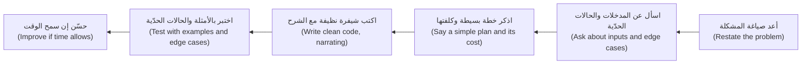
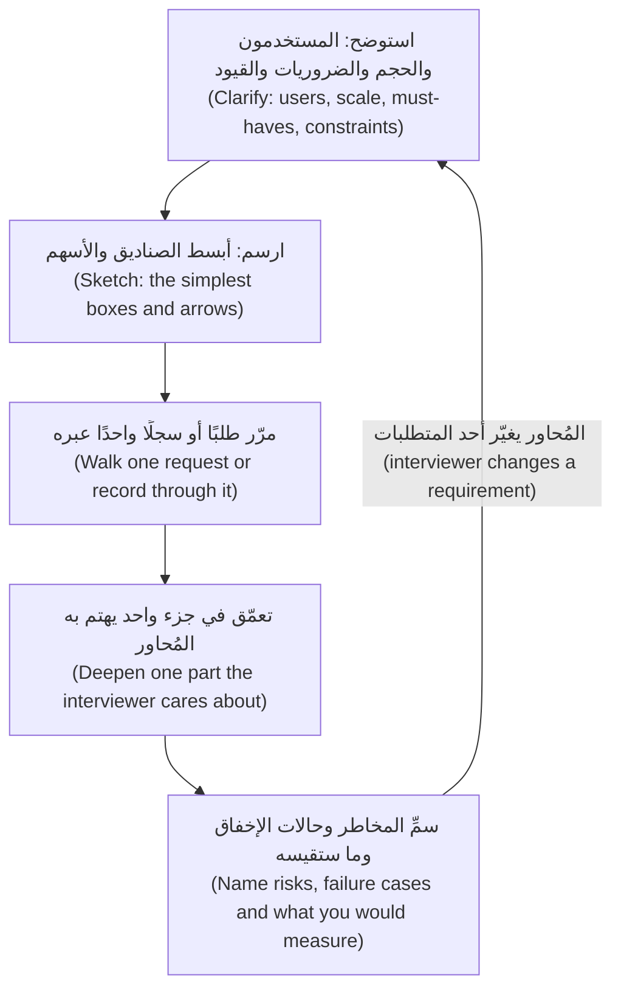

# الوحدة 5 — المقابلات

*المقابلة ليست امتحانًا تجتازه بالذكاء في يومه. إنها مجموعة من الفحوص صمّمها صاحب العمل، وغالبًا بعناية، للإجابة عن بضعة أسئلة: هل يستطيع هذا الشخص أداء العمل، وهل سيتعلّم، وهل سيثق به الفريق؟ تُريك هذه الوحدة تلك الفحوص من الداخل. تبدأ بجولات التوظيف كاملةً، ومقابلة الفرز مع مسؤول التوظيف، والمقابلة السلوكية (behavioural interview)، حيث تحوّل مشاريعك وأخطاءك إلى رصيد من القصص الصادقة. ثم تتناول المقابلات التقنية كما تُدار اليوم: اختبارات فرز الخوارزميات، والبرمجة المباشرة، والمهام المنزلية، وتمرينًا أحدث هو مراجعة طلب دمج (pull request) كتبه وكيل ذكاء اصطناعي (AI agent). وتنتهي بنقاشات التصميم التي يواجهها المبتدئون الآن أكثر مما يتوقعون: تصميم نظام صغير، أو حالة بيانات أو SQL، أو سؤال عن تقييم تعلّم الآلة، أو شرح متدرّج لاستكشاف أعطال السحابة. ستتابع جولات المقابلات في برنامج نجم للخرّيجين التقنيين (Najm Tech Graduate Programme) بينما تفرز عائشة الدفعة، ويدير طارق الجولات التقنية، وتختبر دانة وسالم مرشّحي البيانات والمنصّات. يتعلّم عمر أن الخوارزمية الصحيحة التي تُقال في صمت تنال درجة أقل مما ظنّ، وتضطر ريم إلى شرح شيفرة لم تكتبها سطرًا بسطر، وتكتشف هدى أن عبارة "سأستخدم XGBoost" ليست تصميمًا.*

> **الخطوات:** Interview — أن تعرف ما تفحصه كل جولة، وتُعدّ لها أدلة صادقة، وتُظهر تفكيرك بصوت مسموع.

---

# 5.1 — جولات التوظيف، ومقابلة الفرز مع مسؤول التوظيف، والمقابلات السلوكية (STAR)
*المستوى: 🟡 متوسط* · *المتطلبات: 1.1، 3.1، 4.1* · *الخطوة: Interview*

## ⚡ الدرس في دقيقة
- **جولات التوظيف** هي التسلسل الكامل للخطوات من التقديم إلى العرض الوظيفي: الفرز، والتقييمات، والمقابلات، واجتماع التقييم الختامي، والمراجع. كل خطوة تفحص شيئًا محددًا؛ اعرف ما هو، واستعدّ له.
- **مقابلة الفرز مع مسؤول التوظيف** تفحص الملاءمة للدور، والأمور اللوجستية (الموقع، وتاريخ البدء، وحق العمل، وتوقعات الراتب)، وما إذا كنت تستطيع التعبير عن نفسك بوضوح. إنها مقابلة حقيقية، لا مجرد إجراء شكلي.
- **المقابلات السلوكية (behavioural interviews)** تسأل عن السلوك الماضي ("حدّثني عن موقف…")، لأنه أفضل دليل يملكه المُحاور على السلوك المستقبلي. أجب باستخدام **STAR**: الموقف، والمهمة، والإجراء، والنتيجة.
- ابنِ **رصيد القصص** قبل أن تتقدّم: من 8 إلى 10 قصص حقيقية من المشاريع والتدريب الميداني والدراسة والعمل، وكل قصة موسومة بالمهارات التي تُظهرها.
- إشارة القرار: قبل كل جولة، اسأل مسؤول التوظيف (recruiter) عمّا تفحصه، وكم تستغرق، وهل يُسمح بأدوات الذكاء الاصطناعي.
- الفخ الأكبر: قصص تملؤها "نحن" في كل مكان، بلا إجراء واضح خاص بك، وبلا نتيجة. لا يستطيع المُحاور أن يمنح درجة لما لم تقله.

## 🧭 لماذا يهم
محمد، المتحوّل مهنيًا عبر معسكر تدريبي، يجتاز التقييم الإلكتروني في نجم بسهولة. معرض أعماله قوي، وهو متمكّن من البرمجة. ثم تتصل به عائشة (قائدة استقطاب المواهب) لمقابلة فرز مدتها 30 دقيقة. تسأله: "لماذا نجم، ولماذا هذا البرنامج؟". يتحدث أربع دقائق عن حبّه للبناء، ولا يذكر البنك أبدًا، ويذكر راتبًا رآه في منتدى لبلد آخر. لاحقًا يسأله خالد (مدير الهندسة): "حدّثني عن موقف اختلفت فيه مع زميل في الفريق". يقول محمد: "عادةً كنا نتفق على الأمور. أنا سهل التعامل". فيكتب خالد "لا دليل" أمام كفاءة العمل الجماعي.

محمد يستطيع أداء العمل؛ لكنه لم يُظهر ذلك بالصيغة التي تستخدمها جولات التوظيف. الجولات غير التقنية ليست "ليّنة". فهي كثيرًا ما تحسم الاختيار بين مرشّحين بدرجات تقنية متقاربة، وهي الأسهل في الاستعداد، لأن الأسئلة متوقَّعة والإجابات تأتي من حياتك أنت.

## 📐 كيف يعمل

### 🟢 الأساسيات

**جولات التوظيف.** يسمّي أصحاب العمل الخطوات بأسماء مختلفة، لكن معظم جولات مستوى المبتدئين تبدو هكذا:


| الخطوة | ما تفحصه | من يديرها عادةً | كيف تستعد |
|---|---|---|---|
| التقديم والسيرة الذاتية | التطابق الأساسي مع الدور | نظام تتبّع المتقدّمين (applicant-tracking system) ومسؤول توظيف (4.1) | فصّل سيرتك الذاتية على الإعلان |
| مقابلة الفرز مع مسؤول التوظيف | الدافع، والأمور اللوجستية، والتواصل، والملاءمة التقريبية | مسؤول توظيف أو شريك استقطاب مواهب | تعريف بنفسك في 60 ثانية، وإجابة "لماذا صاحب العمل هذا"، وأمورك اللوجستية جاهزة |
| التقييم الإلكتروني | أساسيات البرمجة أو الاستدلال، على نطاق واسع | منصّة آلية | تدرّب بتوقيت على النوع نفسه من المنصّات |
| المقابلات التقنية | حل المشكلات، وجودة الشيفرة، والاستدلال بصوت مسموع | مهندسون (5.2، 5.3) | تدرّب مع شخص، لا وحدك فقط |
| المقابلة السلوكية | كيف تعمل مع الآخرين، وتتعلّم، وتتعامل مع الانتكاسات | مدير أو مهندس أول | رصيد القصص وطريقة STAR |
| اجتماع التقييم الختامي | يقارن المُحاورون الأدلة المكتوبة بمعيار التقييم | لجنة المقابلة ومدير التوظيف (hiring manager) | لا شيء في اليوم نفسه؛ أدلتك مكتوبة سلفًا |
| المراجع والتحقّقات | أن ما قلته صحيح | الموارد البشرية، وأحيانًا طرف ثالث | أخبر من يزكّونك مسبقًا؛ ولا تبالغ في أي شيء أبدًا |

أمران أهم مما يبدوان. أولًا، يكتب معظم المُحاورين ملاحظاتهم وفق **معيار تقييم**، وهو قائمة بالكفاءات مع وصف للإجابات الضعيفة والمقبولة والقوية؛ وفي اجتماع التقييم الختامي لا يُحتسب إلا ما دوّنوه. ثانيًا، كثيرًا ما تُقيم برامج الخرّيجين **مراكز التقييم**: يومًا من التمارين مثل مهمة جماعية وعرض تقديمي ومقابلات، تُراقَب فيه وأنت تفعل الأشياء، لا وأنت تتحدث عنها فقط.

**مقابلة الفرز مع مسؤول التوظيف.** توقّع من 15 إلى 45 دقيقة، وهذه الأسئلة:
- "حدّثني عن نفسك" نحو 60 ثانية: من أنت الآن، وماذا بنيت، وماذا تريد بعد ذلك، ولماذا هذا الدور.
- "لماذا نحن؟ لماذا هذا الدور؟" اذكر شيئًا محددًا: التناوبات في البرنامج، أو منتجًا، أو القطاع. اقرأ صفحة الوظائف أولًا.
- "ما توقعاتك للراتب؟" إن استطعت، فاطلب النطاق أولًا: "هل يمكنك مشاركة النطاق المرصود لهذا الدور؟" وإن اضطررت لذكر رقم، فاذكر نطاقًا مدروسًا لذلك البلد وذلك الدور (يشرح الدرس 6.1 كيف تبحث عنه). لا تذكر أبدًا رقمًا من سوق أخرى.
- الأمور اللوجستية: تاريخ البدء، والموقع، وحق العمل. في دول الخليج (GCC) تختلف قواعد التأشيرات والكفالة من بلد إلى آخر وتتغيّر؛ أجب بصدق وتحقّق من القواعد الحالية.
- "هل لديك أسئلة لي؟" الجواب دائمًا نعم: اسأل عن الخطوات التالية، والجدول الزمني، وما تفحصه الجولة التالية.

**طريقة STAR.** للإجابة السلوكية أربعة أجزاء:
- **الموقف:** السياق في جملة أو جملتين.
- **المهمة:** ما كنتَ *أنت* مسؤولًا عنه، أو المشكلة التي كان عليك حلّها.
- **الإجراء:** ما فعلتَه *أنت*، خطوة بخطوة. هذا معظم الإجابة، نحو نصف الوقت.
- **النتيجة:** ما حدث، مع الدليل إن وُجد، وما تعلّمته.

يسأل خالد هدى: "حدّثني عن موقف وجدتِ فيه مشكلة في عملك أنتِ"

> **إجابة ضعيفة:** "في مشروع التخرّج بنينا نموذجًا للتنبؤ بتسرّب العملاء. كانت هناك بعض مشكلات البيانات لكننا أصلحناها وكان النموذج جيدًا في النهاية. تعلّمت الكثير عن جودة البيانات (data quality)."

> **إجابة قوية:** "**الموقف:** في مشروع التخرّج، ضمن فريق من ثلاثة، كنا نتنبأ بعملاء الاتصالات الذين سيُلغون اشتراكهم. **المهمة:** كنت مسؤولة عن النموذج والتقييم. **الإجراء:** حقق نموذجي الأول درجة عالية جدًا على مجموعة الاختبار، وهذا أثار شكّي. فحصت أي السمات كانت الأهم، فوجدت أن إحداها حقل يُعبّأ *بعد* أن يكون العميل قد ألغى فعلًا، أي إن النموذج كان يرى الإجابة. أزلته، وأعدت تقسيم البيانات حسب التاريخ بدلًا من التقسيم العشوائي بحيث تأتي مجموعة الاختبار بعد فترة التدريب، وكتبت ملاحظة قصيرة للفريق أشرح فيها السبب. **النتيجة:** انخفضت الدرجة إلى مستوى أكثر واقعية، لكن مشرفنا قال إنه أول مشروع في ذلك العام يكتشف تسرّب البيانات (leakage) بنفسه. ومنذ ذلك الحين أفحص توقيت السمات قبل أن أثق بأي درجة."

للإجابة القوية مالك واحد ("أنا")، وإجراءات محددة، ونتيجة صادقة، ودرس دائم، في نحو 90 ثانية. لم تخترع نسبة مئوية؛ وإن كنت لا تتذكر رقمًا، فصِف النتيجة بالكلمات.

### 🟡 التعمق أكثر

**ما الذي تسأل عنه الأسئلة السلوكية حقًا.** يربط المُحاورون الأسئلة بالكفاءات. إذا عرفت الكفاءة، عرفت أي قصة تختار.

| السؤال الذي تسمعه | الكفاءة وراءه | ما تُظهره الإجابة القوية |
|---|---|---|
| "حدّثني عن موقف اختلفت فيه مع أحد" | التعاون، والتواصل | أثرتَ الأمر باحترام، واستمعت، واستخدمت الأدلة، وقبلت النتيجة أو غيّرتها |
| "حدّثني عن خطأ ارتكبته" | تحمّل المسؤولية، والتعلّم | اعترفت به سريعًا، وأصلحته، وغيّرت شيئًا كي لا يتكرر |
| "حدّثني عن شيء تعلّمته بسرعة" | القدرة على التعلّم | منهجية: كيف تعلّمت، لا مجرد أنك تعلّمت |
| "حدّثني عن موقف كان لديك فيه عمل أكثر من اللازم" | تحديد الأولويات | اخترت ما يهم، وقلت لا أو أعدت التفاوض، وأبلغت الناس مبكرًا |
| "حدّثني عن مشروع تفخر به" | تحمّل المسؤولية، والعمق | دورك أنت، وأصعب قرار، والمفاضلة التي أجريتها |
| "حدّثني عن موقف استخدمت فيه أدوات الذكاء الاصطناعي في عملك" | حسن التقدير، والنزاهة | أين ساعد الذكاء الاصطناعي، وكيف تحققت من مخرجاته، وأين لم تستخدمه ولماذا |

الصف الأخير شائع على نحو متزايد وقت كتابة هذا النص (2026). تُعدّ ريم له بعناية: فهي لا تُخفي استخدامها للوكيل ولا تبالغ فيه. كتب الوكيل معظم النسخة الأولى من تطبيقها لتتبّع المصروفات؛ فوجدت أنه خزّن رموز الجلسة (session tokens) في التخزين المحلي للمتصفح، وتشرح لماذا كان ذلك خطرًا، وكيف أصلحته وأضافت اختبارًا. هذا هو حسن التقدير الذي يريده أصحاب العمل ممن يعمل مع الوكلاء (agents) (1.2).

**رصيد القصص.** أعدّ من 8 إلى 10 قصص قوية، لا إجابات عن 50 سؤالًا، ووجّه كل قصة نحو عدة أسئلة. الرصيد الجيد يغطي:
- مشكلة تقنية حللتها (تصحيح الأخطاء، أو الأداء، أو قرار تصميمي)؛
- خطأ أو إخفاقًا وما غيّرته بعده؛
- خلافًا أو نزاعًا؛
- العمل الجماعي في مشروع جماعي، خصوصًا حين لم يكن أحدهم يساهم؛
- تعلّم شيء جديد بسرعة؛
- موقفًا ساعدت فيه شخصًا آخر؛
- موعدًا نهائيًا تحت الضغط؛
- استخدام أدوات الذكاء الاصطناعي بمسؤولية؛
- موقفًا تجاوزت فيه المطلوب.

المصادر: مشروعك الختامي ومشاريع معرض أعمالك (3.1)، والتدريب الميداني والوظائف الجزئية (3.3)، والهاكاثونات، والتطوع، وحتى وظيفة غير تقنية، ما دامت إجراءاتك واضحة.

**"نحن" مقابل "أنا".** لا يستطيع المُحاورون توظيف فريقك. قل "نحن" للسياق و"أنا" لإجراءاتك؛ وإن كان زميل هو من أنجز الجزء الذكي، فقل ذلك وتحدّث عن جزئك.

**أسئلة تطرحها عليهم.** الختام بأسئلة جيدة جزء من التقييم. اسأل: "على ماذا يعمل الخرّيج الجديد في أشهره الثلاثة الأولى؟" أو "كيف يستخدم الفريق أدوات البرمجة بالذكاء الاصطناعي، وما القواعد؟" وتجنّب الأسئلة التي تجيب عنها صفحة الوظائف أصلًا.

### 🔴 نظرة الخبير

**كيف يمنحك المُحاورون الدرجات.** يستخدم كثير من أصحاب العمل الكبار **المقابلات المنظَّمة**: يتلقى كل مرشّح الأسئلة نفسها، ويُقيَّم وفق معيار التقييم نفسه. ووجدت أبحاث التوظيف منذ زمن أنها أقدر على التنبؤ من الأحاديث غير المنظَّمة. يُصغي المُحاور إلى أدلة يستطيع تدوينها أمام كفاءات مسمّاة، فسهّل عليه ذلك: الموقف باختصار، والإجراءات صريحة، والنتيجة مذكورة، ثم توقّف.

يبدو سطر نموذجي من معيار التقييم، بصورة مبسّطة، هكذا:

| الكفاءة | 1 — ضعيف | 2 — متفاوت | 3 — قوي |
|---|---|---|---|
| تحمّل المسؤولية | يلوم الآخرين أو الظروف؛ إجراءات مبهمة | يتحمّل بعض المسؤولية؛ إجراءات عامة | إجراءات شخصية واضحة، يعترف بدوره، ويتابع حتى النهاية |
| التعلّم | لا تأمّل | يتأمّل لكن لم يتغيّر شيء | تغيير محدد في طريقة عمله بعد ذلك |

**أسئلة المتابعة هي الاختبار الحقيقي.** المُحاور الجيد يتعمّق: "ما الذي غيّرته في التقسيم بالضبط؟"، "ما الذي كنت ستفعله بشكل مختلف؟" القصص المختلقة أو المبالَغ فيها تنهار هنا، وتكشف تحقّقات الخلفية في القطاعات المنظَّمة مثل البنوك المزيد: أسباب عملية، تتجاوز الأخلاق، لئلا تختلق شيئًا أبدًا.

**مقابلات قيم الشركة.** ينشر بعض أصحاب العمل قيمًا أو مبادئ ويبنون عليها أسئلتهم؛ ومبادئ القيادة لدى Amazon مثال علني معروف. اقرأها ووسِم قصصك بها. وينشر برنامج نجم للخرّيجين ثلاثًا: *امتلك النتيجة*، و*احمِ العميل*، و*تعلّم علنًا*.

**السياق ثنائي اللغة.** في دول الخليج قد تُجرى المقابلات بالإنجليزية أو العربية أو كلتيهما. تدرّب على أهم قصصك باللغتين إن كان صاحب العمل ثنائي اللغة؛ والمصطلحات التقنية تبقى عادةً بالإنجليزية. وقد تسأل البرامج الحكومية وبرامج التنمية الوطنية عن دافعك لخدمة القطاع؛ أجب بصدق وتحديد.

**النزاهة في عصر الذكاء الاصطناعي.** الأدوات التي تستمع إلى المقابلة وتقترح إجابات في الوقت الحقيقي غشٌّ في أي جولة لا يُسمح فيها بالذكاء الاصطناعي، وتكشفها أسئلة المتابعة، والجولات النهائية الحضورية، وتحقّقات المراجع. وإن لم تكن متأكدًا، فاسأل مسؤول التوظيف كتابيًا.

## 🧰 الأدوات
| المورد أو الأداة أو النموذج | ما هو وماذا يفعل | متى تلجأ إليه |
|---|---|---|
| **STAR method** — طريقة STAR | الموقف، والمهمة، والإجراء، والنتيجة: بنية من أربعة أجزاء للإجابات السلوكية | كل سؤال سلوكي؛ عند صياغة رصيد قصصك |
| **Story bank** — رصيد القصص | جدول من 8 إلى 10 قصص حقيقية، كلٌّ منها موسومة بالكفاءات ومعها ملاحظات STAR | يُبنى مرة واحدة قبل التقديم؛ ويُراجَع قبل كل مقابلة |
| **Brag document** — سجلّ الإنجازات | سجلّ متجدد لما فعلته، والقرارات التي اتخذتها، والأدلة (روابط، وملاحظات) | يُحدَّث أسبوعيًا من الآن فصاعدًا؛ وهو المادة الخام للقصص ونقاط السيرة الذاتية |
| **60-second introduction** — التعريف بنفسك في 60 ثانية | إجابة شفهية قصيرة عن "حدّثني عن نفسك": الآن، وما بنيته، والخطوة التالية، ولماذا أنت | مقابلات الفرز مع مسؤولي التوظيف، ومكالمات بناء العلاقات المهنية، والدقيقة الأولى من كل مقابلة |
| **Employer values page** — صفحة قيم صاحب العمل | القيم أو المبادئ أو الكفاءات التي ينشرها صاحب العمل على موقع الوظائف | وسم قصصك قبل الجولة السلوكية |
| **Mock interview with a peer** — مقابلة تجريبية مع زميل | جولة تدريبية يطرح فيها صديق أسئلة من قائمة ويمنح الدرجات وفق معيار تقييم | قبل المقابلات الحقيقية بأسبوع إلى أسبوعين؛ وبعد كل جولة لم تنجح فيها |

## 🏛️ عمليًا في بنك نجم
تشارك عائشة **جولات المقابلات في برنامج نجم للخرّيجين التقنيين** مع كل مرشّح يجتاز الفرز، ويعطي خالد الدفعة **نموذج رصيد القصص**. وكلاهما معروض هنا (البرنامج وتفاصيله خيالية).

**الجزء A: جولات المقابلات كما ترسلها عائشة إلى المرشّحين**

| الجولة | المدة | ما تفحصه | هل يُسمح بأدوات الذكاء الاصطناعي؟ |
|---|---|---|---|
| مقابلة الفرز مع مسؤول التوظيف (عائشة) | 30 دقيقة | الدافع، والأمور اللوجستية، والتواصل | لا ينطبق |
| التقييم البرمجي الإلكتروني | 75 دقيقة | أساسيات البرمجة والاستدلال | لا |
| المقابلة التقنية 1 (طارق أو مهندس أول) | 60 دقيقة | البرمجة المباشرة والاستدلال بصوت مسموع | لا |
| المقابلة التقنية 2، حسب المسار | 60 دقيقة | مراجعة الشيفرة (Code review) لطلب دمج كتبه الذكاء الاصطناعي (البرمجيات والذكاء الاصطناعي)، أو حالة بيانات (دانة)، أو استكشاف أعطال المنصّة (سالم) | نعم، مساعد المرشّح نفسه، مع مشاركة الشاشة |
| المقابلة السلوكية (خالد) | 45 دقيقة | تحمّل المسؤولية، والتعلّم، والتعاون، وقيم نجم | لا ينطبق |
| اجتماع التقييم الختامي | — | تمنح اللجنة كل كفاءة درجة من 1 إلى 3 وفق معيار التقييم | — |

**الجزء B: نموذج رصيد القصص (أول صفّين لدى ريم)**

| # | القصة (عنوان من سطر واحد) | الكفاءات | الموقف / المهمة | الإجراء (ما فعلتُه *أنا*) | النتيجة (الدليل) | تناسب أسئلة عن |
|---|---|---|---|---|---|---|
| 1 | الوكيل خزّن الرموز بطريقة غير آمنة في تطبيق المصروفات الخاص بي | حسن التقدير، وتحمّل المسؤولية، واستخدام الذكاء الاصطناعي | مشروع جانبي فردي؛ كنت مسؤولة عنه من البداية إلى النهاية | قرأت شيفرة المصادقة التي كتبها الوكيل؛ وجدت الرموز في التخزين المحلي؛ بحثت في الخطر؛ انتقلت إلى ملفات تعريف الارتباط من نوع HTTP-only (HTTP-only cookies)؛ أضفت اختبارًا | اختبار في المستودع؛ قسم في README بعنوان "ما الذي غيّرته بعد المراجعة" ("What I changed after review") | الأخطاء؛ استخدام الذكاء الاصطناعي؛ التعلّم |
| 2 | زميل في المشروع الجماعي توقّف عن المساهمة | التعاون | تطبيق ويب لفريق من أربعة؛ كنت أنسّق قائمة المهام | تحدثت معه على انفراد؛ علمت أن لديه ظرفًا عائليًا؛ أعدت توزيع المهام؛ أبلغت المشرف مبكرًا بموافقته | سُلِّم في الموعد؛ وقيّم تقييم الأقران الفريق تقييمًا عاليًا | النزاع؛ العمل الجماعي؛ الضغط |

قاعدة خالد للدفعة: يجب أن يكون لكل قصة رابط أو شخص يستطيع تأكيدها.

## 🛠️ التمارين
- 🟢 اكتب تعريفك بنفسك في 60 ثانية وسجّله لدور محدد تستهدفه. استمع إليه واحذف كل ما لا يجيب عن "الآن، وما بنيته، والخطوة التالية، ولماذا أنت". *يكتمل عندما:* يكون طول التسجيل بين 50 و75 ثانية، ويسمّي صاحب العمل أو الدور بالتحديد.
- 🟡 ابنِ رصيد قصصك: ثماني قصص على الأقل بصيغة الجزء B، تغطي المجالات التسعة في 🟡 التعمق أكثر (قد تغطي قصة واحدة مجالين). *يكتمل عندما:* يحتوي كل صف على إجراء شخصي، ونتيجة، ومُتحقِّق (رابط أو شخص)، ويكون لكل كفاءة في جدول 🟡 قصة.
- 🔴 أجرِ مقابلتين سلوكيتين تجريبيتين مع زميل باستخدام ستة أسئلة من هذا الدرس. يمنحك الزميل درجة من 1 إلى 3 في تحمّل المسؤولية والتعلّم والتعاون باستخدام معيار التقييم في 🔴، ويطرح سؤالَي متابعة على الأقل لكل قصة. *يكتمل عندما:* تكون لديك ورقتا الدرجات، وقد أعدت كتابة القصتين الأقل درجة بعد إصلاح نقطة الضعف.

## ⚠️ أخطاء وفخاخ
- **التعامل مع مقابلة الفرز كإجراء شكلي.** إنها تستبعد كثيرًا من المرشّحين. أعدّ تعريفك بنفسك، وإجابة "لماذا نحن"، وأمورك اللوجستية بجدية الجولة التقنية نفسها.
- **"نحن" من البداية إلى النهاية ("We" all the way through).** لا يستطيع المُحاور منح فريقك درجة. استخدم "نحن" للسياق و"أنا" للإجراءات.
- **لا نتيجة، أو نتيجة مختلقة.** لا تتوقف عند الإجراء، ولا تخترع رقمًا. صِف النتيجة بصدق، بالكلمات إن لم تكن لديك أرقام دقيقة.
- **افتراض قواعد الذكاء الاصطناعي.** تختلف القواعد بين أصحاب العمل وبين الجولات. اسأل كتابيًا قبل كل جولة.

## 🧾 الخلاصة
- جولات التوظيف سلسلة من الفحوص؛ اسأل عمّا تفحصه كل جولة واستعدّ له.
- ترتبط الأسئلة السلوكية بالكفاءات. أجب بطريقة STAR، مع تخصيص نصف الوقت لإجراءاتك أنت.
- أعدّ رصيدًا من 8 إلى 10 قصص حقيقية قابلة للتحقق ووجّهها نحو أسئلة كثيرة.
- يمنح المُحاورون الدرجات عادةً وفق معيار تقييم ويتعمّقون بأسئلة المتابعة، لذا تفوز الأدلة المحددة والصادقة.

## ✍️ اختبر نفسك

**1. يُسأل محمد: "حدّثني عن موقف اختلفت فيه مع زميل في الفريق" أي إجابة ستنال أعلى درجة في معيار تقييم التعاون؟**

- A. "عادةً كنا نتفق على الأمور، فلم يظهر النزاع حقًا. أنا سهل التعامل"
- B. قصة مدتها 90 ثانية عن خلاف حقيقي واحد: أدلته، واقتراحه، والنتيجة
- C. سرد مدته خمس دقائق للمشروع كله، من الاجتماع الأول إلى العرض النهائي
- D. "سأستمع بعناية، وأبقى هادئًا، وأبحث عن حل وسط يقبله الطرفان"

<details><summary>الإجابة</summary>

**B.** إنها حدث ماضٍ محدد بإجراءاته هو ونتيجة، وهذا ما يمنحه معيار التقييم الدرجات؛ أما C فتدفن هذا الدليل في التفاصيل. وD مغرية لكنها افتراضية ("سأفعل")، فلا تقدّم دليلًا على السلوك الماضي؛ وA لا تقدّم أي دليل إطلاقًا. (🟢 الأساسيات.)

</details>

**2. في مقابلة الفرز مع مسؤول التوظيف، تسأل عائشة يوسف عن توقعاته للراتب. لم يبحث في النطاق. ما أفضل ردّ؟**

- A. أن يذكر أعلى رقم رآه على الإنترنت، من أي بلد، ليرسّخ نقطة ارتكاز عالية
- B. أن يرفض مناقشة الأجر تمامًا حتى يحصل على عرض مكتوب
- C. أن يقول إنه سيقبل أي شيء يعرضه البنك، ليبدو مرنًا
- D. أن يطلب النطاق المرصود ويعرض العودة بنطاق مدروس

<details><summary>الإجابة</summary>

**D.** طلب النطاق أولًا أمر طبيعي ويمنحه معلومات حقيقية؛ والنطاق المدروس للسوق الصحيحة ذو مصداقية. أما A فترتكز على السوق الخطأ وقد تُنهي العملية. (🟢 الأساسيات.)

</details>

**3. ماذا يعني حرف "A" في STAR، وكم ينبغي أن يأخذ من الإجابة؟**

- A. الإجراء: ما فعلتَه أنت شخصيًا، نحو نصف الإجابة
- B. الإنجاز: أفضل نتيجة حققتها، معظم الإجابة
- C. التحليل: ما كان على الفريق فعله، سطر ختامي قصير
- D. النهج: المنهجية العامة التي استخدمها فريقك، جملة واحدة

<details><summary>الإجابة</summary>

**A.** الإجراءات التي اتخذتها هي الدليل الذي يمنحه المُحاور الدرجات، لذا تستحق معظم الوقت. وD تصف الفريق، لا أنت. (🟢 الأساسيات.)

</details>

**4. تُسأل ريم: "حدّثني عن موقف استخدمتِ فيه أدوات الذكاء الاصطناعي في عملك" أي نهج هو الأفضل؟**

- A. أن تقول إنها لا تستخدم أدوات الذكاء الاصطناعي أبدًا، كي لا تبدو معتمدة عليها
- B. أن تقول إن الوكيل بنى كل شيء وإنها اكتفت بتصفّحه قبل الإطلاق
- C. أن تصف أين ساعدها، والعيب الذي اكتشفته، وكيف أصلحته واختبرته
- D. أن تتحدث عن اتجاهات الذكاء الاصطناعي في الصناعة بدلًا من مشاريعها هي

<details><summary>الإجابة</summary>

**C.** إنها تُظهر إفصاحًا صادقًا وحسن تقدير: التحقق من مخرجات الذكاء الاصطناعي وتحمّل مسؤولية النتيجة. أما A فغير صادقة وتنهار أمام أسئلة المتابعة؛ وB لا تُظهر حسن تقدير. (🟡 التعمق أكثر.)

</details>

**5. لماذا تهمّ أسئلة المتابعة مثل "ما الذي غيّرته بالضبط؟" إلى هذا الحد في المقابلة السلوكية المنظَّمة؟**

- A. تتيح للمُحاور ملء الوقت حين ينهي المرشّح إجابته مبكرًا
- B. تختبر ما إذا كانت القصة حقيقية وما إذا كان العمل حقًا عمل المرشّح نفسه
- C. تُستخدم غالبًا بعد أن يكون المُحاور قد قرر رفض أحدهم
- D. تفحص أساسًا قواعد اللغة لدى المرشّح وطلاقته في الإنجليزية

<details><summary>الإجابة</summary>

**B.** تسبر أسئلة المتابعة العمق والأصالة، وهما الدليل الذي يُدوَّن في معيار التقييم؛ والقصة المبالَغ فيها تنهار أمامها. وهذا سبب عملي لئلا تختلق شيئًا أبدًا. (🔴 نظرة الخبير.)

</details>

## 📚 المراجع
- MIT Career Advising & Professional Development (الإرشاد المهني والتطوير المهني في MIT) — https://capd.mit.edu/
- Tech Interview Handbook — دليل المقابلات التقنية (قسم المقابلة السلوكية) — https://www.techinterviewhandbook.org/
- Google، كيف نوظّف — https://www.google.com/about/careers/applications/how-we-hire/
- Amazon، مبادئ القيادة — https://www.amazon.jobs/content/en/our-workplace/leadership-principles
- Julia Evans، "احصل على تقدير لعملك: اكتب سجلّ إنجازات" — https://jvns.ca/blog/brag-documents/
- [*إدارة منتجات الذكاء الاصطناعي: من الصفر إلى الاحتراف*، الدرس 10.2 — المسار المهني لمدير منتجات الذكاء الاصطناعي: المقابلات ومعرض الأعمال والنمو](../aipm/index.ar.html#/10.2)
- [*أمن الذكاء الاصطناعي والتطبيقات: من الصفر إلى الاحتراف*، الدرس 12.2 — المسار المهني في الأمن: الأدوار والشهادات ومعرض الأعمال](../secai/index.ar.html#/12.2)

---

# 5.2 — المقابلات التقنية اليوم: الخوارزميات، والبرمجة المباشرة، والمهام المنزلية، ومراجعة الشيفرة التي كتبها الذكاء الاصطناعي
*المستوى: 🟡 متوسط* · *المتطلبات: 1.1، 1.2، 5.1* · *الخطوة: Interview*

## ⚡ الدرس في دقيقة
- تأتي الجولات التقنية في أربع صيغ شائعة: **اختبارات فرز الخوارزميات** (هياكل البيانات والخوارزميات، وغالبًا على منصّة)، و**البرمجة المباشرة** (بناء شيء صغير بينما يراقبك مُحاور)، و**المهام المنزلية** (مشروع صغير في وقتك الخاص)، و**مراجعة الشيفرة**، وهي على نحو متزايد مراجعة لطلب دمج كتبه وكيل ذكاء اصطناعي.
- في كل صيغة يمنح المُحاور الدرجات على **استدلالك وتواصلك وتحقّقك**، لا على مجرد تشغيل الشيفرة. فكّر بصوت مسموع.
- تختلف قواعد أدوات الذكاء الاصطناعي حسب صاحب العمل وحسب الجولة. كثير من أصحاب العمل يسمحون بأدوات الذكاء الاصطناعي أو يتوقعونها في بعض الجولات ويحظرونها في غيرها. اسأل قبل كل جولة، والتزم بالجواب حرفيًا.
- إشارة القرار: قبل كتابة الشيفرة، أعد صياغة المشكلة، واسأل عن المدخلات والحالات الحدّية، واذكر خطتك. وقبل أن تقول "انتهيت"، اختبرها.
- الفخ الأكبر: البرمجة في صمت. الإجابة الصحيحة التي لا تستطيع شرحها تنال درجة أقل من إجابة شبه صحيحة استدللت عليها بوضوح.

## 🧭 لماذا يهم
عمر هو أقوى طالب في الخوارزميات في الدفعة. في جولة البرمجة المباشرة مع طارق، يسمع المشكلة، ويقول "حسنًا"، ويكتب 25 دقيقة في صمت. حلّه صحيح. لكن ملاحظات طارق تقول: "حل صحيح. لا أسئلة توضيحية. لم يختبر. لم يستطع قول ما يحدث مع مُدخل فارغ حتى سُئل. التواصل: 1 من 3."

في الأسبوع نفسه، تحصل ريم على جولة مراجعة الذكاء الاصطناعي. يعطيها طارق طلب دمج قصيرًا كتبه وكيل لنقطة نهاية لتحويل الأموال ويقول: "هل ستدمجين هذا؟" هي معتادة على الوكلاء؛ تتصفّحه وتقول إنه يبدو سليمًا لأن الاختبارات تنجح. يشير طارق إلى سطر واحد، فتدرك أن استعلام SQL (SQL query) مبني من سلسلة نصية فيها مُدخلات المستخدم. ولم تكتشف أيضًا غياب فحص الملكية.

كلا المرشّحَين يستطيع البرمجة. لكن أيًّا منهما لم يُظهر ما يوظّف طارق من أجله: شخصًا يمكن ائتمانه على الشيفرة، سواء كتبها إنسان أو آلة. هذا ما تفحصه الجولات التقنية الآن.

## 📐 كيف يعمل

### 🟢 الأساسيات

**الصيغ الأربع.**

| الصيغة | كيف تبدو | ما تفحصه | أين تشيع |
|---|---|---|---|
| اختبار فرز الخوارزميات | مشكلة أو مشكلتان على منصّة مثل HackerRank أو Codility، بتوقيت، وغالبًا آلية | هياكل البيانات (Data structures)، والتعقيد، والصحة تحت ضغط الوقت | ما زالت شائعة في شركات التقنية الكبرى وبرامج الخرّيجين ذات الأعداد الكبيرة؛ وأقل شيوعًا في الشركات الأصغر |
| البرمجة المباشرة | من 45 إلى 60 دقيقة مع مهندس، في محرّر مشترك أو في بيئتك الخاصة | حل المشكلات، والتواصل، وعادات الاختبار | شائعة جدًا لدى أصحاب العمل |
| المهمة المنزلية | مشروع صغير في ساعات أو أيام، ثم نقاش حوله | جودة الشيفرة، والبنية، والاختبارات، وملف README، وحسن التقدير | شائعة في الشركات الناشئة وشركات المنتجات |
| مراجعة الشيفرة | قراءة طلب دمج والتعليق عليه، وغالبًا يكون مكتوبًا بوكيل ذكاء اصطناعي | قراءة الشيفرة، ورصد الأخطاء والمخاطر، وشرح الأولويات | اتجاه متنامٍ وقت كتابة هذا النص (2026)؛ وتتفاوت صيغته كثيرًا |

قد تصادف أيضًا **البرمجة الثنائية (pair programming)** (أنت ومهندس تعملان معًا على شيفرة شبه حقيقية) و**جولات تصحيح الأخطاء** (هذا اختبار فاشل، جد الخطأ). وكلتاهما تكافئ العادات نفسها التي تكافئها البرمجة المباشرة.

**منهجية لأي مشكلة برمجية.** استخدم الخطوات الخمس نفسها في كل مرة، بصوت مسموع:



1. **أعد الصياغة.** "إذن أحصل على قائمة بالمعاملات (transactions) ويجب أن أُرجع معرّفات أي معاملات تبدو مكرّرة، أي الحساب نفسه والمبلغ نفسه خلال 60 ثانية. هل هذا صحيح؟"
2. **استوضح.** اسأل عن الحجم، والترتيب، والمُدخل الفارغ، والتعادلات، والبيانات غير الصالحة. "هل القائمة مرتّبة حسب الوقت؟ هل يمكن أن تكون المبالغ سالبة؟ ما أقصى حجم للقائمة؟"
3. **خطّط.** اذكر أولًا نهجًا بسيطًا يعمل، مع كلفته بـ**ترميز Big-O (Big-O notation)** (كيف ينمو زمن التشغيل مع حجم المُدخل). "طريقة بسيطة تقارن كل زوج: هذا O(n²). وإذا كانت القائمة مرتّبة حسب الوقت، يمكنني التجميع حسب الحساب والمبلغ ومقارنة كل عنصر بالعنصر السابق فقط: O(n log n) بسبب الترتيب، أو O(n) إن كانت مرتّبة أصلًا."
4. **برمِج.** استخدم أسماء واضحة. اشرح القرارات، لا ضغطات المفاتيح.
5. **اختبر.** امشِ عبر مثال عادي، ثم عبر الحالات الحدّية: قائمة فارغة، وعنصر واحد، وعنصران تفصل بينهما 60 ثانية بالضبط.

إليك إجابة نظيفة لتلك المشكلة بلغة Python:

```python
from collections import defaultdict

def find_duplicates(transactions, window_seconds=60):
    """transactions: list of dicts with id, account, amount, ts (seconds).
    Returns IDs of transactions that repeat an earlier one with the
    same account and amount within window_seconds."""
    last_seen = {}                        # (account, amount) -> last timestamp
    duplicates = []
    for tx in sorted(transactions, key=lambda t: t["ts"]):
        key = (tx["account"], tx["amount"])
        if key in last_seen and tx["ts"] - last_seen[key] <= window_seconds:
            duplicates.append(tx["id"])
        last_seen[key] = tx["ts"]
    return duplicates

assert find_duplicates([]) == []
assert find_duplicates([{"id": 1, "account": "A", "amount": 50, "ts": 0},
                        {"id": 2, "account": "A", "amount": 50, "ts": 60}]) == [2]
```

عبارات التحقق السريعة في النهاية أثمن مما تبدو: فهي تُري المُحاور أنك تختبر دون أن يُطلب منك. ومن أسئلة المتابعة الجيدة التي تطرحها بنفسك: "تمثيل المال بأعداد صحيحة بأصغر وحدة (الفلس أو السنت) أكثر أمانًا من الأعداد العشرية؛ وقد افترضت هنا أعدادًا صحيحة."

**حين تتعثّر.** الجميع يتعثّر. قل ما تفكّر فيه: "أنا عالق في كيفية التعامل مع النافذة حين تكون هناك ثلاثة تكرارات. دعني أجرّب مثالًا صغيرًا يدويًا." كثيرًا ما يعطي المُحاورون تلميحات؛ وتلقّي التلميح بشكل جيد إشارة إيجابية.

**قواعد الذكاء الاصطناعي.** اسأل مسؤول التوظيف قبل كل جولة: "هل يُسمح بمساعدات الذكاء الاصطناعي في هذه الجولة، وإن كان كذلك، فأيها وكيف ينبغي أن أشارك شاشتي؟" إذا كانت محظورة، فلا تستخدمها، بما في ذلك الأدوات التي تعمل بشكل خفي. وإذا كانت مسموحة، فاستخدمها علنًا واستمر في الشرح.

### 🟡 التعمق أكثر

**الاستعداد لاختبارات فرز الخوارزميات دون إضاعة أشهر.** تختبر اختبارات فرز الخوارزميات مجموعة صغيرة نسبيًا من الأنماط. والخطة المركّزة تتفوّق على حل مئات المشكلات العشوائية بلا هدف:

| النمط | مشكلات نموذجية |
|---|---|
| المصفوفات وجداول التجزئة | إيجاد الأزواج، وعدّ التكرارات، واكتشاف المكرّرات |
| المؤشران والنافذة المنزلقة | أطول سلسلة جزئية بخاصية معيّنة، ودمج القوائم المرتّبة |
| المكدّسات والطوابير | الأقواس الصالحة، والعنصر الأكبر التالي |
| الأشجار والرسوم البيانية (BFS، DFS) | الاجتياز حسب المستوى، وعدد الجزر، وأقصر مسار في رسم بياني غير موزون |
| الترتيب والبحث الثنائي | البحث في مصفوفة مرتّبة، وأول نسخة سيئة |
| الأكوام (Heaps) | أعلى k عنصر، ودمج k قائمة مرتّبة |
| البرمجة الديناميكية الأساسية | صعود الدرج، وصرف العملات |

القوائم المنتقاة للمشكلات المعروفة (مثل قائمة "Blind 75" وقوائم NeetCode) تجمع المشكلات حسب هذه الأنماط. تدرّب باللغة نفسها التي ستستخدمها في المقابلة، مع مؤقّت، وقل استدلالك بصوت مسموع حتى وأنت وحدك. بعد كل مشكلة، اكتب سطرًا واحدًا عن النمط الذي استخدمته. وتحقّق مما إذا كان أصحاب العمل الذين تستهدفهم يستخدمون اختبارات فرز الخوارزميات أصلًا؛ فكثير من الشركات الأصغر والشركات الناشئة وفرق القطاع العام لا تستخدمها، وقد يكون من الأفضل أن تقضي وقتك في مشروع على غرار المهام المنزلية.

**المهام المنزلية.** تعامل معها كمشاريع إنتاجية صغيرة (1.3). يقرأ المُحاورون عادةً:
- **ملف README أولًا.** كيف يُشغَّل، وماذا بنيت، وما الذي تخطّيته ولماذا، وكيف ستوسّعه.
- **الاختبارات.** بضعة اختبارات ذات معنى أفضل من لا شيء. اختبر المنطق الأساسي وحالة حدّية واحدة.
- **البنية والتسمية.** دوال صغيرة، وأسماء واضحة، ولا شيفرة ميتة.
- **سجلّ الإيداعات.** الإيداعات الصغيرة ذات الرسائل الواضحة تروي قصة؛ والإيداع العملاق الواحد لا يروي شيئًا.
- **الصدق بشأن الذكاء الاصطناعي.** إذا كانت أدوات الذكاء الاصطناعي مسموحة، فاذكر أين استخدمتها، كما يطلب صاحب العمل. وتوقّع مقابلة متابعة تعدّل فيها شيفرتك مباشرةً. إن لم تستطع شرح سطر، فسيظهر ذلك.

احترم الحدّ الزمني. إذا قال التكليف "نحو أربع ساعات"، فقد تشير تحفة استغرقت يومين إلى ضعف في تقدير النطاق. اكتب المفاضلات في README بدلًا من ذلك.

**مراجعة طلب دمج كتبه الذكاء الاصطناعي.** في هذا التمرين تحصل على فرق التغييرات (الأسطر المضافة والمحذوفة) ووصف قصير، ويُطلب منك أن تقول هل ستوافق عليه. ترتيب مفيد للمراجعة:

1. **افهم القصد.** ماذا ينبغي أن يفعل هذا التغيير؟ هل تفعل الشيفرة ذلك؟
2. **الصحة.** الأخطاء المنطقية، والحالات الحدّية، والأنواع الخاطئة، ومعالجة الأخطاء.
3. **الأمن.** مُدخلات غير موثوقة تصل إلى الاستعلامات أو الأوامر، وغياب فحوص التفويض، والأسرار (secrets)، والبيانات الحساسة في السجلات.
4. **الاختبارات.** هل تختبر السلوك، أم فقط أن الشيفرة تعمل؟ هل تغطي حالات الإخفاق؟
5. **قابلية الصيانة.** الأسماء، والتكرار، والتعقيد غير الضروري، واستدعاءات مكتبات مختلقة.
6. **حدّد الأولويات.** قل أي المشكلات تمنع الدمج وأيها مجرد اقتراحات.

تُدرّس المكتبة هذه المهارة بعمق في [*تصميم الأنظمة لمبرمجي الفايب*، الدرس 9.7 — تدقيق الشيفرة ومراجعتها بسرعة الوكيل](../vibe/index.ar.html#l9-7) و[*أمن الذكاء الاصطناعي والتطبيقات: من الصفر إلى الاحتراف*، الدرس 6.3 — تأمين الشيفرة المولَّدة بالذكاء الاصطناعي: ما يخطئ فيه وكلاء البرمجة](../secai/index.ar.html#/6.3).

### 🔴 نظرة الخبير

**كيف تبدو الإشارة القوية في كل صيغة.** كثيرًا ما يمنح المُحاورون الدرجات على أربعة أبعاد: حل المشكلات، والبرمجة، والتحقّق، والتواصل. المرشّحون الأقوياء يُظهرون الأربعة معًا: يطرحون سؤالًا توضيحيًا حادًا، ويذكرون حلًا بسيطًا قبل التحسين، ويكتبون شيفرة مقروءة، ويجدون خطأهم بأنفسهم عبر اختبار، ويُبقون المُحاور على اطلاع طوال الوقت.

**العمل مع الذكاء الاصطناعي في جولة تسمح به.** حين يُسمح بأدوات الذكاء الاصطناعي، يراقب المُحاور كيف توجّهها وتتحقق منها، لا سرعة ظهور النص. الممارسة الجيدة:
- اكتب الخطة والاختبارات الأساسية بنفسك قبل كتابة الأوامر للمساعد.
- أعطِ المساعد طلبًا ضيقًا ومحددًا.
- اقرأ كل سطر يُنتجه، بصوت مسموع حيث يفيد. ارفض ما هو خاطئ أو أصلحه.
- شغّل الاختبارات. وأشِر إلى أي شيء لا تثق به.

نهج ريم المحسَّن في جولة تجريبية لاحقة: تطلب من الوكيل صياغة نقطة النهاية، ثم تقول: "قبل أن أشغّل هذا، أتحقق من ثلاثة أشياء: معالجة المُدخلات، ومن يُسمح له باستدعائها، وهل يغطي الاختبار مسار الإخفاق." تلك الجملة وحدها تغيّر طريقة تقييم الجولة. والمهارات التي وراءها تُدرَّس في [*تصميم الأنظمة لمبرمجي الفايب*، الدرس 9.4 — التحقق قبل الإنجاز](../vibe/index.ar.html#l9-4).

**الحديث عن التعقيد بلا خوف.** لا تحتاج إلى براهين. تحتاج إلى أن تقول، عن حلك، كيف ينمو الوقت والذاكرة مع حجم المُدخل، وما المفاضلة التي أجريتها. عبارة "يستخدم هذا ذاكرة إضافية للقاموس (dictionary) لتجنّب مقارنة كل زوج" إجابة كاملة على مستوى المبتدئين.

## 🧰 الأدوات
| المورد أو الأداة أو النموذج | ما هو وماذا يفعل | متى تلجأ إليه |
|---|---|---|
| **LeetCode** | بنك كبير من مشكلات الخوارزميات مع مُقيِّم إلكتروني ونقاشات | التدرّب على أنماط الخوارزميات حين يستخدم أصحاب العمل المستهدفون اختبارات فرز الخوارزميات |
| **HackerRank** | موقع للتدرّب على البرمجة يستخدمه أيضًا كثير من أصحاب العمل لإجراء التقييمات الإلكترونية | التعوّد على بيئة التقييم قبل اختبار بتوقيت |
| **NeetCode** (Navdeep Singh) | قوائم مشكلات مجانية وشروحات بالفيديو مجمّعة حسب النمط | بناء خطة دراسة منظَّمة بدلًا من التدرّب العشوائي |
| **Tech Interview Handbook** (Yangshun Tay) | دليل مجاني يغطي مقابلات البرمجة، والجولات السلوكية، وخطط الدراسة | تخطيط الجدول الزمني لاستعدادك وقوائم التحقق |
| **Cracking the Coding Interview** | كتاب واسع الاستخدام في الاستعداد لمقابلات الخوارزميات | تعلّم كيف تُدار مقابلات الخوارزميات والتدرّب على المشكلات الكلاسيكية |
| **Pull request review checklist** — قائمة التحقق لمراجعة طلبات الدمج | القصد، والصحة، والأمن، والاختبارات، وقابلية الصيانة، والأولوية | كل جولة مراجعة شيفرة وكل تغيير كتبه وكيل تراجعه |
| **Five-step problem method** — منهجية الخطوات الخمس لحل المشكلات | أعد الصياغة، استوضح، خطّط، برمِج، اختبر، بصوت مسموع | كل جولة برمجة مباشرة وكل جولة خوارزميات |
| **Mock interview with a peer** — مقابلة تجريبية مع زميل | جولة تدريبية يطرح فيها صديق أسئلة من قائمة ويمنح الدرجات وفق معيار تقييم | أسبوعيًا في الشهر الذي يسبق الجولات التقنية |

## 🏛️ عمليًا في بنك نجم
يستخدم طارق معيار تقييم ثابتًا وتمرينًا ثابتًا لجولة مراجعة الذكاء الاصطناعي في نجم. يرى المرشّحون طلب الدمج هذا، مبسّطًا هنا. عنوانه "إضافة نقطة نهاية لتحويل الأموال بين حسابات العميل"، والوصف الذي كتبه وكيل البرمجة يقول فقط: "ينفّذ التحويل. كل الاختبارات تنجح"

```python
@app.post("/transfers")
def transfer(req):
    src = req.json["from_account"]
    dst = req.json["to_account"]
    amount = float(req.json["amount"])
    db.execute(f"UPDATE accounts SET balance = balance - {amount} WHERE id = '{src}'")
    db.execute(f"UPDATE accounts SET balance = balance + {amount} WHERE id = '{dst}'")
    log.info(f"Transfer {req.json}")
    return {"status": "ok"}

def test_transfer(client):
    resp = client.post("/transfers", json={"from_account": "A1", "to_account": "A2", "amount": "10"})
    assert resp.status_code == 200
```

**ما يجده المرشّح القوي، مرتّبًا حسب الأولوية**

| # | المشكلة | لماذا تهم | هل تمنع الدمج؟ |
|---|---|---|---|
| 1 | استعلام SQL مبني من سلاسل نصية فيها مُدخلات المستخدم | حقن SQL (SQL injection) | نعم |
| 2 | لا فحص لملكية المستدعي للحساب المصدر | يستطيع أي شخص نقل أموال أي شخص | نعم |
| 3 | التحديثان ليسا داخل معاملة واحدة | إخفاق بينهما يخلق أموالًا أو يُتلفها | نعم |
| 4 | لا فحص للمبالغ السالبة أو الصفرية، ولا لكفاية الرصيد | التحويل السالب يسحب المال في الاتجاه المعاكس | نعم |
| 5 | تمثيل المال بنوع `float` | أخطاء التقريب؛ استخدم أعدادًا صحيحة بأصغر وحدة أو نوعًا عشريًا | نعم |
| 6 | يسجّل الطلب كاملًا | قد يكتب بيانات شخصية أو بيانات حسابات في السجلات | ينبغي إصلاحها |
| 7 | الاختبار يفحص رمز الحالة (status code) فقط | لا يثبت شيئًا عن الأرصدة أو حالات الإخفاق | ينبغي إصلاحها |

**معيار التقييم لدى طارق (من 1 إلى 3 لكل سطر)**

| البُعد | 1 | 3 |
|---|---|---|
| إيجاد المشكلات | يجد مشكلة أو مشكلتين سطحيتين | يجد معظم المشكلات من 1 إلى 5 دون تلميح |
| تحديد الأولويات | يسرد كل شيء بوزن متساوٍ | يفصل المشكلات المانعة عن الاقتراحات ويشرح السبب |
| الشرح | يسمّي المشكلات بلا أسباب | يشرح الخطر بلغة بسيطة ويقترح إصلاحًا |
| التحقّق | يثق بعبارة "كل الاختبارات تنجح" | يقرأ الاختبار ويسأل ماذا يثبت فعلًا |
| التعاون | مستخفّ بالكاتب | يكتب تعليقات يستطيع الكاتب العمل بها |

محاولة ريم الثانية، بعد شهر في جولة تجريبية مع خالد، تجد المشكلات من 1 إلى 5 وتقول: "لن أدمج هذا، وسأضيف اختبارًا يثبت أن المستخدم لا يستطيع التحويل من حساب لا يملكه" يمنحها خالد 3 في تحديد الأولويات والتحقّق.

## 🛠️ التمارين
- 🟢 حلّ ثلاث مشكلات من نمط واحد في جدول 🟡، كلٌّ منها في أقل من 40 دقيقة، وأنت تسجّل نفسك تقول الخطوات الخمس بصوت مسموع. *يكتمل عندما:* تكون لديك ثلاثة تسجيلات، ويتضمن كلٌّ منها سؤالًا توضيحيًا واختبارًا واحدًا على الأقل لحالة حدّية.
- 🟡 أنجز مهمة على غرار المهام المنزلية في أربع ساعات: أداة سطر أوامر صغيرة أو واجهة برمجة تطبيقات (API) من اختيارك، مع اختبارات وملف README يذكر ما تخطّيته ولماذا. *يكتمل عندما:* يستطيع زميل استنساخها وتشغيلها وتشغيل اختباراتها من README وحده، ويحتوي README على قسم "المفاضلات".
- 🔴 راجع طلب الدمج الخاص بنجم أعلاه كتابيًا قبل قراءة الجدول، ثم قارن قائمتك به. بعد ذلك، اطلب من مساعد برمجة بالذكاء الاصطناعي (AI coding assistant) كتابة ميزة صغيرة في أحد مشاريعك وراجع طلب الدمج الخاص بها بترتيب الخطوات الست. *يكتمل عندما:* تكون لديك مراجعتان مكتوبتان تفصلان المشكلات المانعة عن الاقتراحات، واختبار واحد على الأقل أضفته بسبب المراجعة.

## ⚠️ أخطاء وفخاخ
- **البرمجة في صمت.** لا يستطيع المُحاور منح الدرجات على تفكير لا يسمعه. اشرح القرارات واطرح الأسئلة.
- **القفز إلى الحل الذكي.** اذكر أولًا نهجًا بسيطًا يعمل، ثم حسّنه. الحل البسيط المكتمل يتفوّق على الحل الذكي غير المكتمل.
- **قول "انتهيت" دون اختبار.** امشِ عبر مثال وحالة حدّية في كل مرة.
- **الثقة بعبارة "كل الاختبارات تنجح".** اقرأ ما تفحصه الاختبارات. كثير من الاختبارات التي يكتبها الذكاء الاصطناعي لا تثبت إلا أن الشيفرة تعمل.
- **استخدام الذكاء الاصطناعي حيث يُحظر، أو إخفاؤه حيث يُسمح.** اسأل عن القواعد، والتزم بها، وكن صريحًا بشأن استخدامك.
- **حل مئات المشكلات لصاحب عمل لا يستخدمها.** اعرف الصيغة أولًا واستعدّ لها.

## 🧾 الخلاصة
- تأتي الجولات التقنية في صورة اختبارات فرز الخوارزميات، والبرمجة المباشرة، والمهام المنزلية، ومراجعة الشيفرة، وهي على نحو متزايد مراجعة لشيفرة كتبها الذكاء الاصطناعي.
- استخدم الخطوات الخمس في كل مرة: أعد الصياغة، استوضح، خطّط، برمِج، اختبر، بصوت مسموع.
- استعدّ للخوارزميات حسب النمط، وبالقدر الذي يتطلبه أصحاب العمل المستهدفون فقط.
- تعامل مع المهام المنزلية كمشاريع إنتاجية صغيرة مع README واختبارات ومفاضلات صادقة.
- في جولة المراجعة، جد ثغرات الصحة والأمن والاختبارات ورتّبها حسب الأولوية؛ ولا تثق أبدًا باختبار ناجح لم تقرأه.

## ✍️ اختبر نفسك

**1. ينهي عمر حلًا صحيحًا في صمت ويقول "انتهيت". أي عادة ستحسّن درجته أكثر من غيرها؟**

- A. الكتابة بسرعة أكبر ليبقى لديه وقت لمحاولة مشكلة ثانية
- B. الانتقال إلى هيكل بيانات أكثر تقدّمًا لإظهار العمق
- C. إعادة الصياغة، واستيضاح الحالات الحدّية، والشرح، والاختبار قبل قول "انتهيت"
- D. حفظ مزيد من المشكلات ليرصد النمط أسرع

<details><summary>الإجابة</summary>

**C.** يمنح المُحاورون الدرجات على الاستدلال والتواصل والتحقّق إلى جانب الصحة. قد تساعد B أو D في المشكلات الأصعب، لكنهما لا تعالجان الإشارات الغائبة. (🟢 الأساسيات.)

</details>

**2. قبل جولة تقنية، لا يعرف يوسف هل يُسمح بمساعدات الذكاء الاصطناعي. ماذا ينبغي أن يفعل؟**

- A. أن يسأل مسؤول التوظيف كتابيًا عمّا تسمح به تلك الجولة، ويلتزم به
- B. أن يستخدم واحدًا بهدوء، لأن معظم الشركات يبدو أنها تسمح بها الآن
- C. أن يفترض أنها محظورة في كل جولة، فلا داعي للسؤال
- D. أن ينتظر ويسأل المُحاور في منتصف الجولة نفسها

<details><summary>الإجابة</summary>

**A.** تختلف القواعد حسب صاحب العمل وحسب الجولة، لذا فالسؤال مسبقًا هو الطريق الآمن الوحيد. أما B فتخاطر بأن تُعامَل كغش؛ وقد تتركه C غير مستعد لجولة تتوقع استخدام الذكاء الاصطناعي. (🟢 الأساسيات.)

</details>

**3. في جولة المراجعة لدى نجم، أي مشكلة في طلب دمج التحويل هي أخطر مشكلة مانعة؟**

- A. أسماء المتغيرات قصيرة وتخالف دليل أسلوب الفريق
- B. الاختبار يفحص رمز الحالة فقط، لا الأرصدة
- C. جسم الطلب كاملًا يُكتب في سجل التطبيق
- D. مُدخلات المستخدم تُلصق في استعلام SQL، مما يسمح بالحقن

<details><summary>الإجابة</summary>

**D.** يتيح الحقن للمهاجم تغيير الاستعلام نفسه، وفي نقطة نهاية تنقل الأموال هذا أمر حرج. B وC مشكلتان حقيقيتان لكنهما أقل خطورة؛ وA مسألة أسلوب. (🏛️ عمليًا في بنك نجم.)

</details>

**4. تحصل هدى على مهمة منزلية بوقت مقترح نحو أربع ساعات. أي نهج هو الأفضل؟**

- A. أن تقضي عطلة نهاية الأسبوع كلها في إضافة ميزات إضافية لإبهار المراجِع
- B. أن تبقى قريبة من الحد الزمني، وتختبر الجوهر، وتشرح المفاضلات في README
- C. أن تتخطّى الاختبارات لتنجز ميزات أكثر في الوقت المتاح، فالمراجِع يهتم بعدد الميزات
- D. أن تسلّم دون README، لأن الشيفرة الجيدة ينبغي أن تتحدث عن نفسها

<details><summary>الإجابة</summary>

**B.** يقرأ المراجِعون README والاختبارات أولًا، ويقدّرون حسن التقدير في النطاق. وقد تشير A إلى ضعف في تحديد النطاق، والتسليم الموسَّع ليس ما طُلب. (🟡 التعمق أكثر.)

</details>

**5. في جولة يُسمح فيها بأدوات الذكاء الاصطناعي، ما الذي يراقبه طارق أساسًا؟**

- A. كيف توجّه ريم المساعد وتتحقق من كل سطر يُنتجه
- B. مدى سرعة توليد المساعد لحل كامل يعمل
- C. أي علامة تجارية للمساعد وأي خطة مدفوعة اختارت استخدامها
- D. هل تستطيع الإنهاء دون أن تكتب أي شيفرة بنفسها إطلاقًا

<details><summary>الإجابة</summary>

**A.** تختبر جولات الذكاء الاصطناعي المسموح حسن التقدير والتحقّق: خطتها واختباراتها الخاصة، والأوامر الضيقة، وقراءة كل سطر، وتشغيل الاختبارات. وB مغرية، لكن السرعة بلا تحقّق هي بالضبط ما صُمّمت الجولة لاكتشافه. (🔴 نظرة الخبير.)

</details>

## 📚 المراجع
- LeetCode — https://leetcode.com/
- HackerRank — https://www.hackerrank.com/
- NeetCode — https://neetcode.io/
- Tech Interview Handbook (دليل المقابلات التقنية) — https://www.techinterviewhandbook.org/
- Gayle Laakmann McDowell، *Cracking the Coding Interview*، الطبعة السادسة (CareerCup، 2015)
- interviewing.io (مقابلات تدريبية وأدلة مقابلات منشورة) — https://interviewing.io/
- Google Engineering Practices، إرشادات مراجعة الشيفرة — https://google.github.io/eng-practices/review/
- [*تصميم الأنظمة لمبرمجي الفايب*، الدرس 9.7 — تدقيق الشيفرة ومراجعتها بسرعة الوكيل](../vibe/index.ar.html#l9-7)
- [*تصميم الأنظمة لمبرمجي الفايب*، الدرس 8.2 — الاختبارات بوصفها المواصفات التي لا يستطيع الوكيل تجاهلها](../vibe/index.ar.html#l8-2)
- [*أمن الذكاء الاصطناعي والتطبيقات: من الصفر إلى الاحتراف*، الدرس 2.1 — الحقن: حقن SQL والأوامر والقوالب](../secai/index.ar.html#/2.1)
- [*دليل عملي لتصبح مهندسًا أصيلًا في الذكاء الاصطناعي*، الدرس 5.2 — المختبر: راجع طلب دمج كتبه وكيل](../ainative/index.ar.html#/5.2) — منظور الهندسة اليومية الأصيلة في الذكاء الاصطناعي (AI-native engineering) لهذا الموضوع

---

# 5.3 — مقابلات تصميم الأنظمة والبيانات وتعلّم الآلة للمبتدئين
*المستوى: 🟡 متوسط* · *المتطلبات: 1.3، 5.2* · *الخطوة: Interview*

## ⚡ الدرس في دقيقة
- يواجه المبتدئون على نحو متزايد **جولات على نمط التصميم**: تصميم نظام صغير، أو حالة SQL أو نمذجة بيانات، أو سؤال عن تقييم تعلّم الآلة، أو شرح متدرّج لاستكشاف أعطال السحابة. التوقعات أقل منها للخبراء، لكن المنهجية واحدة.
- يفحص المُحاور هل **تسأل عن المتطلبات، وتختار مكوّنات بسيطة لأسباب واضحة، وتسمّي المفاضلات وحالات الإخفاق**. لا أحد يتوقع منك أن تصمّم منصّة عالمية وحدك.
- استخدم بنية واحدة لكل سؤال تصميم: **استوضح، ارسم مخططًا، مرّر طلبًا عبره، ثم تعمّق في جزء واحد وسمِّ المخاطر.**
- إشارة القرار: حين لا تكون متأكدًا، اختر أبسط تصميم يلبّي المتطلبات المذكورة، وقل ما الذي سيجعلك تغيّره.
- الفخ الأكبر: ذكر تقنيات رائجة ("Kafka، Kubernetes، الخدمات المصغّرة (microservices)") دون قول المشكلة التي تحلّها كلٌّ منها. كل صندوق يحتاج إلى سبب.

## 🧭 لماذا يهم
جولة هدى الثانية مع دانة، كبيرة علماء البيانات في نجم. تسأل دانة: "نريد تمييز معاملات البطاقات التي قد تكون احتيالًا. كيف ستتناولين ذلك؟" تجيب هدى فورًا: "سأستخدم XGBoost، وأضبط المعاملات الفائقة، وأرفع الدقة إلى أعلى حد ممكن." تسأل دانة: "ما نسبة المعاملات الاحتيالية؟" لا تعرف هدى. "إذن ماذا تخبرنا دقة 99%؟" تدرك هدى، بعد فوات الأوان، أنه إذا كان الاحتيال نادرًا، فإن نموذجًا لا يميّز أي شيء إطلاقًا سينال دقة عالية جدًا. ملاحظات دانة: "قوية في أسماء النماذج. لم تسأل عن المشكلة، ولا البيانات، ولا كلفة الأخطاء."

يوسف، في جولة المنصّات مع سالم، يُسأل: "تطبيق الويب الداخلي لدينا يُرجع فجأة أخطاء لبعض المستخدمين. اشرح لي خطوة بخطوة ما الذي ستفحصه" يعرف يوسف الشبكات جيدًا، فيمشي عبرها بمنهجية: DNS، ثم فحوص السلامة في موزّع الأحمال، ثم عمليات النشر الأخيرة، ثم السجلات (logs). ويسأل عمّا تغيّر مؤخرًا. ملاحظات سالم إيجابية، رغم أن يوسف لم يشغّل Kubernetes في بيئة الإنتاج (production) قط.

الفرق في المنهجية، لا في المعرفة. يمنحك هذا الدرس المنهجية لكل نوع من جولات التصميم، ويوجّهك إلى دروس المكتبة التي تبني المعرفة الكامنة وراءها.

## 📐 كيف يعمل

### 🟢 الأساسيات

**البنية الشاملة.** كل جولة تصميم، أيًا كان مجالها، تكافئ الحركات الأربع نفسها:



1. **استوضح.** من يستخدمه؟ ماذا يجب أن يفعل، وما الذي خارج النطاق؟ كم الحِمل أو البيانات تقريبًا؟ هل هناك قيود صارمة، مثل التنظيم أو زمن الاستجابة (latency) أو الكلفة؟ اكتب الإجابات حيث يستطيع المُحاور رؤيتها.
2. **ارسم مخططًا.** ارسم أبسط تصميم يعمل: العميل، وخادم التطبيق، وقاعدة البيانات (database)، وما يلزم فقط غير ذلك. انظر [*تصميم الأنظمة لمبرمجي الفايب*، الدرس 1.1 — ارسم الصناديق قبل أن يكتب الوكيل الشيفرة](../vibe/index.ar.html#l1-1).
3. **مرّره عبر النظام.** تتبّع طلبًا واحدًا من المستخدم إلى قاعدة البيانات وعودةً. هذا يكشف الأجزاء الناقصة بسرعة. ويعلّم [*تصميم الأنظمة لمبرمجي الفايب*، الدرس 1.2 — رحلة الطلب](../vibe/index.ar.html#l1-2) هذا بالضبط.
4. **تعمّق وحدّد المخاطر.** سيضغط المُحاور على مجال واحد: "ماذا لو زادت حركة المرور عشر مرات؟" أو "ماذا لو تعطّل مزوّد البريد الإلكتروني؟" قل ما الذي ينكسر، وما الذي ستغيّره، وما الذي ستراقبه.

**ما يُتوقع من المبتدئين معرفته وما لا يُتوقع.**

| متوقع على مستوى المبتدئين | غير متوقع على مستوى المبتدئين |
|---|---|
| ما يفعله كلٌّ من العميل، والخادم، وقاعدة البيانات، وذاكرة التخزين المؤقت (cache)، والطابور (queue)، وموزّع الأحمال (load balancer) | تصميم قاعدة بيانات موزّعة عالميًا |
| الجداول العلائقية، والمفاتيح، ومتى يفيد الفهرس (index) | ضبط عنقود قاعدة بيانات من الذاكرة |
| لماذا لا تنفّذ عملًا بطيئًا داخل طلب ويب (استخدم طابورًا) | خوارزميات الإجماع بالتفصيل |
| التفكير الأساسي في الإخفاق: ماذا لو تعطّل هذا الصندوق؟ | أرقام السعة الدقيقة من الذاكرة |
| أساسيات الأمن: المصادقة (authentication)، والتفويض (authorisation)، والأسرار، والتحقق من المُدخلات (input validation) | نموذج تهديدات كامل تحت ضغط الوقت |
| قول "لا أعرف، لكن إليك كيف سأعرف" ("I don't know, but here is how I would find out") | التظاهر بالمعرفة |

**أرقام تقريبية، موسومة بوصفها افتراضات.** قد يطلب منك المُحاورون تقدير الحِمل. ضع افتراضات مُقرَّبة بصوت مسموع وأبقِ الحساب بسيطًا. "لنفترض 100,000 عميل نشط، وكلٌّ منهم يتلقى نحو خمسة تنبيهات يوميًا. هذا 500,000 تنبيه يوميًا. في اليوم نحو 86,400 ثانية، أي قرابة ستة في الثانية في المتوسط، وأكثر في الذروة. يستطيع خادم واحد التعامل مع ذلك؛ الجزء الصعب هو الموثوقية، لا الحجم." الأرقام افتراضاتك أنت، لا حقائق، وقول ذلك جزء من الإجابة الجيدة.

### 🟡 التعمق أكثر

**تصميم الأنظمة لمرشّحي البرمجيات والذكاء الاصطناعي.** سؤال التصميم للمبتدئين لدى طارق في نجم: "صمّم الخدمة التي ترسل للعملاء تنبيهًا حين تحدث معاملة بطاقة" الإجابة القوية للمبتدئ تغطي:
- **استوضح:** إشعار فوري، أم رسالة SMS، أم بريد إلكتروني؟ ما السرعة المطلوبة لوصول التنبيهات؟ هل يستطيع العميل إيقافها؟ هل يجب إرسال كل تنبيه مرة واحدة بالضبط؟
- **ارسم مخططًا:** ينشر نظام البطاقات حدث "وقعت معاملة" في **طابور** (قائمة بعناصر عمل يأخذها العمّال واحدًا تلو الآخر)؛ و**عامل** يقرأ الأحداث، ويبحث عن تفضيلات العميل في قاعدة البيانات، ويستدعي مزوّد الإشعارات الفورية أو SMS.
- **مرّره عبر النظام:** معاملة واحدة من نظام البطاقات عبر الطابور، والعامل، والبحث عن التفضيلات، والمزوّد، حتى هاتف العميل.
- **المخاطر:** تعطّل مزوّد SMS (أعد المحاولة مع تباطؤ تدريجي، ثم نبّه مهندسًا)؛ معالجة الحدث نفسه مرتين (خزّن سجلًا للتنبيهات المرسلة مفتاحه معرّف المعاملة كي لا ترسل إعادة المحاولة مرتين، وهذا ما يُسمّى **عدم التأثر بالتكرار (idempotency)**)؛ البيانات الشخصية في السجلات (سجّل المعرّفات، لا أرقام البطاقات).

وراء كل فكرة درس في المكتبة: [*تصميم الأنظمة لمبرمجي الفايب*، الدرس 10.2 — الطوابير والعمل غير المتزامن](../vibe/index.ar.html#l10-2)، و[*تصميم الأنظمة لمبرمجي الفايب*، الدرس 2.6 — نقرتان في آن واحد: حالات السباق والمعاملات والكتابات غير المتأثرة بالتكرار](../vibe/index.ar.html#l2-6)، و[*لبنات بناء SaaS*، الدرس 4.2 — الإشعارات: داخل التطبيق، والفورية، وSlack، وSMS — والتفضيلات](../saas/index.ar.html#/4.2). ولأدوار تطبيقات الذكاء الاصطناعي، توقّع صيغة مختلفة مثل "صمّم روبوت محادثة يجيب عن الأسئلة من وثائق سياساتنا"؛ وتنطبق البنية نفسها، مضافًا إليها الاسترجاع (retrieval)، والتقييم (evaluation)، وخطر حقن الأوامر (prompt-injection risk)، وهي مشروحة في [*أمن الذكاء الاصطناعي والتطبيقات: من الصفر إلى الاحتراف*، الدرس 9.3 — تأمين الاسترجاع (RAG): حدود البيانات والتحكم في الوصول](../secai/index.ar.html#/9.3).

**جولات البيانات للمحلّلين ومهندسي البيانات.** تستخدم دانة وفريقها ثلاثة أنواع من الأسئلة:
- **SQL مباشرة.** اكتب استعلامًا على مخطط صغير، غالبًا مع عمليات الربط (joins)، والتجميع، ودوال النوافذ (window functions). مثال: "لكل عميل، جد أكبر معاملة له في الشهر الماضي" اذكر الحُبيبية (ما الذي يمثّله الصف الواحد) قبل الكتابة؛ وهنا، الشهر الماضي هو سبتمبر 2026.

```sql
SELECT customer_id, transaction_id, amount
FROM (
  SELECT customer_id, transaction_id, amount,
         ROW_NUMBER() OVER (PARTITION BY customer_id ORDER BY amount DESC) AS rn
  FROM transactions
  WHERE txn_date >= DATE '2026-09-01' AND txn_date < DATE '2026-10-01'
) ranked
WHERE rn = 1;
```

  ويسأل المرشّح القوي أيضًا: "ماذا يحدث مع التعادلات؟ هل ينبغي احتساب المبالغ المستردّة؟"
- **نمذجة البيانات (Data modelling).** "صمّم جداول لبرنامج نقاط الولاء." سمِّ الكيانات، والمفاتيح، والعلاقات، وقل ما الذي سيكون جدول حقائق وما الذي سيكون بُعدًا في نموذج التقارير. انظر [*هندسة البيانات والتحليلات: من الصفر إلى الاحتراف*، الوحدة 1 — SQL ونمذجة البيانات](../data/index.ar.html#/1.2).
- **خطوط المعالجة والمقاييس.** "كيف ستحمّل بيانات البطاقات اليومية إلى مستودع البيانات (warehouse) وتتحقق من صحتها؟" أو "انخفضت عمليات التسجيل في تطبيق الجوال 20% هذا الأسبوع. كيف تحقّق في ذلك؟" افحص البيانات أولًا (هل تعطّل التتبّع؟)، ثم قسّم إلى شرائح (المنصّة، والبلد، وإصدار التطبيق)، ثم ابحث عن التغييرات (إصدار جديد، أو انتهاء حملة). والمقاييس والتجارب مشروحة في [*هندسة البيانات والتحليلات: من الصفر إلى الاحتراف*، الوحدة 4 — التحليلات](../data/index.ar.html#/4.1).

**جولات تعلّم الآلة لعلماء البيانات ومهندسي تعلّم الآلة.** أسئلة المبتدئين الشائعة تدور حول **صياغة المشكلة والتقييم**، لا حول النماذج الغريبة:
- ما الذي نتنبأ به بالضبط، ولمن، وما الإجراء الذي يلي التنبؤ؟
- ما البيانات التي لدينا، وهل أيٌّ منها لا يتوفّر إلا بعد وقوع الحدث (تسرّب البيانات)؟
- كيف نقسّم بيانات التدريب والاختبار؟ في المشكلات الزمنية مثل الاحتيال، قسّم حسب الوقت.
- أي مقياس يطابق كلفة الأخطاء؟ مع الأحداث النادرة، تكون **الدقة** مضلِّلة. استخدم **الدقة الإيجابية** (من الحالات التي ميّزناها، كم منها كان احتيالًا فعلًا) و**الاستدعاء** (من كل حالات الاحتيال الحقيقية، كم منها اكتشفنا)، وناقش العتبة مع جهة العمل.
- كيف سنراقبه بعد الإطلاق لرصد **الانجراف** (تغيّر البيانات أو السلوك مع الوقت)؟

وراء هذه الأسئلة [*هندسة البيانات والتحليلات: من الصفر إلى الاحتراف*، الوحدة 5 — علم البيانات وتعلّم الآلة في بيئة الإنتاج](../data/index.ar.html#/5.2) و[*إدارة منتجات الذكاء الاصطناعي: من الصفر إلى الاحتراف*، الدرس 6.1 — جودة يمكنك قياسها: المقاييس والمجموعات الذهبية وتحليل الأخطاء](../aipm/index.ar.html#/6.1).

**جولات السحابة والمنصّات.** أسئلة سالم عادةً أسئلة استكشاف أعطال أو شروح متدرّجة من نوع "اشرح كيف يعمل هذا":
- "ماذا يحدث حين يكتب أحدهم عنوان موقعنا ويضغط Enter؟" (DNS، وTLS، وموزّع الأحمال، والتطبيق، وقاعدة البيانات، والاستجابة.) انظر [*تصميم الأنظمة لمبرمجي الفايب*، الدرس F.1 — ماذا يحدث حين تفتح موقعًا إلكترونيًا](../vibe/index.ar.html#lF-1).
- "خادم بطيء. ماذا تفحص؟" (المعالج، والذاكرة، والقرص، والشبكة، والتغييرات الأخيرة، والسجلات.)
- "كيف ستنشر هذا التطبيق بأمان؟" (ابنِ مرة واحدة، واختبر، وانشر إلى بيئة التجهيز (staging)، وطبّق تدريجيًا، وكن مستعدًا للتراجع (roll back).) انظر [*تصميم الأنظمة لمبرمجي الفايب*، الدرس 4.4 — التراجع، وبيئة التجهيز، وبوابات الإصدار](../vibe/index.ar.html#l4-4) و[*السحابة وDevOps: من الصفر إلى الاحتراف*، الوحدة 4 — CI/CD والإصدارات](../cloud/index.ar.html#/4.1).

### 🔴 نظرة الخبير

**المفاضلات هي الإجابة.** يُصغي المُحاورون إلى كلمة "لأن". عبارة "سأستخدم قاعدة بيانات علائقية (relational database) *لأن* التحويلات تحتاج إلى معاملات وللبيانات علاقات واضحة" تنال درجة أعلى من "سأستخدم Postgres". وحين تسمّي خيارًا، سمِّ البديل الذي رفضته والسبب. وعبارة "يضيف الطابور جزءًا متحركًا إضافيًا، لكنه يعني أن مزوّد SMS بطيئًا لا يستطيع إبطاء مدفوعات البطاقات" إجابة مبتدئ تبدو كإجابة خبير.

**الوعي بالقطاعات المنظَّمة.** في مقابلات البنوك والحكومة والصحة في دول الخليج، اذكر حماية البيانات (data protection) والتحكم في الوصول (access control) بشكل طبيعي، دون محاضرة: تقليل البيانات الشخصية إلى الحد الأدنى وإبقاؤها خارج السجلات، وتقييد الوصول حسب الدور، وسجلات تدقيق للإجراءات الحساسة، والوعي بأن قوانين مثل قانون حماية البيانات الشخصية في قطر (القانون رقم 13 لسنة 2016 (Law No. 13 of 2016)) تنطبق. جملة واحدة في اللحظة المناسبة تُظهر أنك تفهم السياق الذي ستعمل فيه.

**استخدام معرض أعمالك حالةً للتصميم.** يبدأ كثير من المُحاورين بعبارة "اشرح لي معمارية مشروع في سيرتك الذاتية". هذه جولة تصميم على أرضك. أعدّ مخططًا واحدًا لمشروعك الختامي (3.1) وكن مستعدًا للإجابة: لماذا هذه المكوّنات، وما الذي يتعطّل أولًا تحت الحِمل، وما الذي ستغيّره بعد التجربة، وما الذي كتبه وكيل ذكاء اصطناعي مقابل ما صمّمته أنت. تُعدّ ريم هذا بالضبط لتطبيقها للأسئلة عن المستندات وتجد أنه أسهل جولة لديها، لأن كل إجابة شيء فعلته بنفسها.

**قول "لا أعرف" بشكل جيد.** "لم أستخدم Kubernetes في بيئة الإنتاج. فهمي أنه يجدول الحاويات عبر الأجهزة ويعيد تشغيل الحاويات المتعطلة. في هذا التصميم سأبدأ بخدمة حاويات مُدارة، وأودّ أن أتعلّم كيف يشغّله الفريق." هذا صادق، ويُظهر الاستدلال، ويُبقي المحادثة مستمرة.

## 🧰 الأدوات
| المورد أو الأداة أو النموذج | ما هو وماذا يفعل | متى تلجأ إليه |
|---|---|---|
| **Four-move design structure** — بنية التصميم ذات الحركات الأربع | استوضح، ارسم مخططًا، مرّر طلبًا عبره، تعمّق وسمِّ المخاطر | كل سؤال تصميم أنظمة (system design) أو بيانات أو تصميم تعلّم الآلة |
| **System Design Primer** (Donne Martin) | مجموعة مجانية مفتوحة المصدر (open-source) من مفاهيم تصميم الأنظمة وأسئلة نموذجية | تعلّم مفردات المكوّنات والمفاضلات |
| **Designing Data-Intensive Applications** | كتاب يحظى باحترام واسع عن كيفية عمل قواعد البيانات والنسخ المتماثل (replication) وأنظمة البيانات | تعميق الفهم بعد الأساسيات؛ لأدوار هندسة البيانات (data engineering) والواجهة الخلفية (backend) |
| **Designing Machine Learning Systems** | كتاب عن بناء أنظمة تعلّم الآلة وتقييمها وتشغيلها في بيئة الإنتاج | الاستعداد لجولات التصميم لمهندسي تعلّم الآلة (ML engineer) وعلماء البيانات (data scientist) |
| **StrataScratch** | موقع تدريب فيه أسئلة مقابلات في SQL وعلم البيانات | التدرّب على حالات SQL والبيانات بتوقيت |
| **Machine Learning Interviews Book** (Chip Huyen) | كتاب مجاني على الإنترنت عن صيغ مقابلات تعلّم الآلة وأسئلتها | فهم ما تغطيه جولات مقابلات تعلّم الآلة |
| **Portfolio architecture diagram** — مخطط معمارية معرض الأعمال | مخطط واحد واضح لمشروعك الختامي مع جملة لكل مكوّن تشرح سبب وجوده | أسئلة "اشرح لي مشروعك" |

## 🏛️ عمليًا في بنك نجم
يتفق طارق ودانة وسالم على **معيار تقييم واحد لجولة التصميم للمبتدئين** كي يُقيَّم المرشّحون في المسارات المختلفة على السلوكيات نفسها. يُمنح كل سطر درجة من 1 إلى 3.

| البُعد | 1 — ضعيف | 3 — قوي | مثال البرمجيات (طارق) | مثال البيانات وتعلّم الآلة (دانة) | مثال المنصّات (سالم) |
|---|---|---|---|---|---|
| يستوضح المشكلة | يبدأ التصميم فورًا | يسأل عن المستخدمين والحجم والضروريات والقيود، ويدوّنها | "هل يجب أن تصل التنبيهات خلال ثوانٍ؟" | "ما مدى ندرة الاحتيال، وكم تكلّف الحالة الفائتة؟" | "هل هم كل المستخدمين أم بعضهم؟ ما الذي تغيّر اليوم؟" |
| تصميم بسيط ومبرَّر | يسرد التقنيات بلا أسباب | أبسط تصميم يعمل؛ ولكل مكوّن "لأن" | طابور كي لا يستطيع مزوّد SMS إبطاء المدفوعات | التقسيم حسب الوقت لأن أنماط الاحتيال تتغيّر | فحص عمليات النشر الأخيرة أولًا لأن كثيرًا من الانقطاعات تلي تغييرًا |
| يمرّره عبر النظام | مخطط ثابت فقط | يتتبّع طلبًا أو سجلًا واحدًا من البداية إلى النهاية | من المعاملة إلى الهاتف | من المعاملة الخام إلى تنبيه مُقيَّم ومُراجَع | من المتصفح إلى DNS إلى موزّع الأحمال إلى التطبيق إلى قاعدة البيانات |
| الإخفاق والمخاطر | يفترض أن كل شيء يعمل | يسمّي ما ينكسر، وكيف يُكتشف، وكيف يُتعافى منه | التنبيهات المكرّرة، وانقطاع المزوّد | تسرّب البيانات، والانجراف، واختيار العتبة | خطة التراجع، وفحوص السلامة (health checks) |
| الوعي بالسياق | يتجاهل التنظيم والبيانات | يذكر البيانات الشخصية والوصول والتدقيق حيث يلزم | أرقام البطاقات ليست في السجلات | الوصول إلى بيانات العملاء مقيّد حسب الدور | وصول بأقل الصلاحيات (Least-privilege access) إلى بيئة الإنتاج |
| الصدق والتعلّم | يخادع | يقول ما لا يعرفه وكيف سيعرفه | "لم أستخدم Kafka؛ وطابور مُدار بسيط يكفي هنا" | "سأتحقق مع فريق الاحتيال من كيفية إنشاء التصنيفات" | "سأقرأ دليل التشغيل (runbook) قبل لمس بيئة الإنتاج" |

**إجابة هدى المعاد كتابتها**، بعد شهر في جولة تجريبية مع دانة: "قبل اختيار نموذج، هل يمكنني أن أسأل عن مدى ندرة الاحتيال وما الذي يحدث بعد التمييز؟ إذا كان المحلّلون يراجعون الحالات المميَّزة، فسأضبط النموذج على دقة إيجابية يستطيعون التعامل معها مع إبقاء الاستدعاء أعلى ما يمكن. سأقسّم بيانات التدريب والاختبار حسب الوقت، وأتحقق من أنه لا توجد سمة لا تُعرف إلا بعد استرداد المبلغ (chargeback)، وأبدأ بخط أساس بسيط قابل للتفسير مثل الانحدار اللوجستي (logistic regression)، وبعدها فقط أجرّب التعزيز التدرّجي (gradient boosting). وبعد الإطلاق، سأراقب معدّلات التمييز والدقة الإيجابية أسبوعيًا لرصد الانجراف." تمنحها دانة 3 في الاستيضاح والتصميم والمخاطر.

## 🛠️ التمارين
- 🟢 خذ مشروعًا واحدًا من معرض أعمالك وارسم معماريته صناديقَ وأسهمًا، مع جملة لكل صندوق تقول لماذا هو موجود، وجملة عمّا سيتعطّل أولًا. *يكتمل عندما:* يكون المخطط في ملف README في مستودعك، ويستطيع زميل أن يشرح لك نظامك منه.
- 🟡 اختر سؤال التصميم الخاص بمسارك (البرمجيات: خدمة تنبيهات المعاملات؛ البيانات: جداول نقاط الولاء واستعلام SQL واحد عليها؛ تعلّم الآلة: خطة تقييم تمييز الاحتيال؛ المنصّات: الشرح المتدرّج لـ"أخطاء لبعض المستخدمين"). أجب عنه بصوت مسموع لمدة 30 دقيقة مع زميل، متّبعًا الحركات الأربع. *يكتمل عندما:* يكون الزميل قد منحك الدرجات بمعيار تقييم نجم، وتكون قد دوّنت السطرين الأقل درجة وما ستدرسه لكلٍّ منهما، مع رابط من المكتبة.
- 🔴 أجرِ جولة تصميم تجريبية كاملة مع مهندس عامل أو عالم بيانات أو طالب متقدّم، على سؤال يختاره هو. اطلب منه تغيير أحد المتطلبات في منتصف الجولة. *يكتمل عندما:* تكون لديك ملاحظاته المكتوبة وفق معيار التقييم، وإجابة منقّحة تتعامل مع المتطلب المتغيّر وتسمّي حالتَي إخفاق على الأقل.

## ⚠️ أخطاء وفخاخ
- **التصميم قبل السؤال.** استوضح المستخدمين والحجم والقيود أولًا؛ فالمُحاور كثيرًا ما يُخفي المتطلب الأساسي في الإجابة عن سؤالك الأول.
- **التباهي بأسماء التقنيات.** كل مكوّن يحتاج إلى سبب. "لأن" هي أثمن كلمة في جولة التصميم.
- **البناء الزائد.** الخدمات المصغّرة وKubernetes وثلاث قواعد بيانات لأداة داخلية صغيرة تشير إلى ضعف في حسن التقدير. ابدأ ببساطة، ثم قل ما الذي سيجعلك تتوسّع.
- **الدقة مع الأحداث النادرة.** في الاحتيال أو العيوب أو تسرّب العملاء، تكون الدقة مضلِّلة. تحدّث عن الدقة الإيجابية والاستدعاء وكلفة كل خطأ.
- **تجاهل الإخفاق.** اسأل نفسك "ماذا لو تعطّل هذا الصندوق؟" لكل مكوّن قبل أن يسألك المُحاور.

## 🧾 الخلاصة
- يواجه المبتدئون الآن جولات تصميم لأدوار البرمجيات والذكاء الاصطناعي والبيانات وتعلّم الآلة والمنصّات؛ والتوقعات أقل منها للخبراء، لكن المنهجية واحدة.
- استخدم الحركات الأربع: استوضح، ارسم مخططًا، مرّر طلبًا واحدًا عبره، ثم تعمّق وسمِّ المخاطر.
- في جولات البيانات وتعلّم الآلة، حدّد الحُبيبية، والهدف، والتقسيم، والمقياس الذي يطابق كلفة الأخطاء.
- مشروعك الخاص في معرض أعمالك هو أفضل حالة تصميم أعددتها.

## ✍️ اختبر نفسك

**1. يطلب طارق من عمر تصميم خدمة تنبيهات المعاملات. ماذا ينبغي أن يفعل عمر أولًا؟**

- A. أن يرسم تصميمًا فيه Kafka وKubernetes والخدمات المصغّرة لإظهار سعة معرفته
- B. أن يختار لغة برمجة وإطار عمل للعامل
- C. أن يقدّر الفاتورة السحابية الشهرية للخدمة كلها
- D. أن يسأل عن القنوات، والسرعة، وإمكانية إلغاء الاشتراك، والحجم، والتكرارات

<details><summary>الإجابة</summary>

**D.** استيضاح المتطلبات يسبق أي تصميم؛ فالإجابات تشكّل كل ما عداها. وA تباهٍ بأسماء التقنيات بلا أسباب. (🟢 الأساسيات.)

</details>

**2. تخبر دانة هدى بأن الاحتيال نادر جدًا. لماذا تُعدّ الدقة مقياسًا ضعيفًا هنا؟**

- A. لا يمكن حساب الدقة حين تأتي التصنيفات من بلاغات الاحتيال
- B. النموذج الذي لا يميّز الاحتيال أبدًا سينال مع ذلك دقة عالية جدًا
- C. الدقة مقياس لمشكلات الانحدار، لا التصنيف
- D. تحظر الجهات التنظيمية المصرفية استخدام الدقة مقياسًا للنماذج في أي سياق

<details><summary>الإجابة</summary>

**B.** مع الأحداث النادرة، يكون التنبؤ بـ"ليس احتيالًا" لكل شيء صحيحًا في كل الحالات تقريبًا، لكنه عديم الفائدة. وتقيس الدقة الإيجابية والاستدعاء جودة الحالات المميَّزة والاحتيال الذي اكتُشف. (🟡 التعمق أكثر.)

</details>

**3. في تصميم التنبيهات، قد يعالج العامل حدث المعاملة نفسه مرتين بعد إعادة المحاولة (retry). ما الإجابة المعيارية على مستوى المبتدئين؟**

- A. أن يتجاهل ذلك، لأن الأحداث المكرّرة نادرة عمليًا
- B. أن يزيل إعادة المحاولة تمامًا كي يُعالَج كل حدث مرة واحدة فقط
- C. أن يسجّل التنبيهات المرسلة حسب معرّف المعاملة ويتخطّى أي تنبيه أُرسل سابقًا
- D. أن يرسل كل تنبيه مرتين كي يتأكد من وصول واحد على الأقل إلى العميل

<details><summary>الإجابة</summary>

**C.** هذا يجعل الإرسال غير متأثر بالتكرار: العملية المكرّرة آمنة. أما B فتستبدل التكرارات بتنبيهات مفقودة كلما أخفق المزوّد. (🟡 التعمق أكثر.)

</details>

**4. يسأل سالم يوسف عن Kubernetes، الذي لم يستخدمه قط في بيئة الإنتاج. ما أفضل ردّ؟**

- A. أن يعترف بذلك، ويشرح ما يفهمه عن وظيفته، ويستدل انطلاقًا من ذلك
- B. أن يدّعي بعض الخبرة في بيئة الإنتاج كي يبقى منافسًا
- C. أن يرفض الإجابة، لأنها خارج خلفيته
- D. أن يوجّه المحادثة إلى الشبكات، التي يعرفها أفضل بكثير

<details><summary>الإجابة</summary>

**A.** الإجابات الصادقة المستدَلّة تنال درجة جيدة في سطر "الصدق والتعلّم"؛ أما الخداع فينهار أمام أسئلة المتابعة. وD تتهرّب من السؤال بدلًا من الاستدلال عليه. (🔴 نظرة الخبير.)

</details>

**5. أي عبارة هي أقوى تبرير تصميمي في مقابلة للمبتدئين؟**

- A. "سأستخدم Postgres لأنها أكثر قواعد البيانات شعبية الآن"
- B. "سأستخدم الخدمات المصغّرة لأن أكبر شركات التقنية تستخدمها"
- C. "طابور، لأن مزوّد SMS البطيء يجب ألّا يُبطئ مدفوعات البطاقات"
- D. "سأستخدم أحدث قاعدة بيانات قرأت عنها، لأنها الأفضل في التوسّع"

<details><summary>الإجابة</summary>

**C.** إنها تسمّي المكوّن، والمشكلة التي يحلّها، والمفاضلة. أما A وB وD فتستند إلى الشعبية أو الحداثة بدلًا من متطلب. (🔴 نظرة الخبير.)

</details>

## 📚 المراجع
- Donne Martin، System Design Primer (مدخل إلى تصميم الأنظمة) — https://github.com/donnemartin/system-design-primer
- Martin Kleppmann، *Designing Data-Intensive Applications* (O'Reilly) — https://dataintensive.net/
- Chip Huyen، *Designing Machine Learning Systems* (O'Reilly، 2022) — https://huyenchip.com/
- Chip Huyen، Machine Learning Interviews Book (كتاب مقابلات تعلّم الآلة) — https://huyenchip.com/ml-interviews-book/
- Google for Developers، قواعد تعلّم الآلة — https://developers.google.com/machine-learning/guides/rules-of-ml
- StrataScratch — https://www.stratascratch.com/
- قطر، القانون رقم 13 لسنة 2016 بشأن حماية خصوصية البيانات الشخصية (Law No. 13 of 2016 on Personal Data Privacy Protection) — بوابة الميزان القانونية القطرية، https://www.almeezan.qa/
- [*تصميم الأنظمة لمبرمجي الفايب*، الدرس 10.2 — الطوابير والعمل غير المتزامن](../vibe/index.ar.html#l10-2)
- [*هندسة البيانات والتحليلات: من الصفر إلى الاحتراف*، الوحدة 1 — SQL ونمذجة البيانات](../data/index.ar.html#/1.1)
- [*السحابة وDevOps: من الصفر إلى الاحتراف*، الوحدة 5 — قابلية المراقبة والموثوقية](../cloud/index.ar.html#/5.1)
