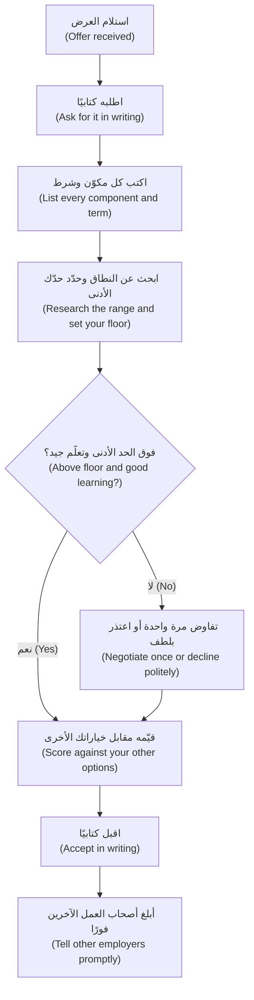
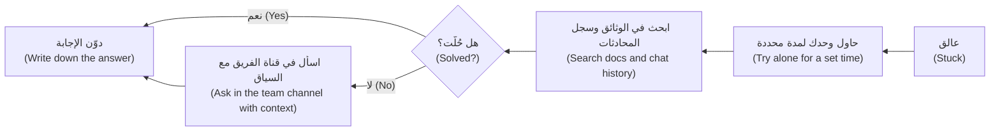
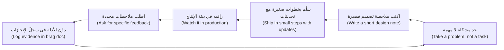

# الوحدة 6 — العرض الوظيفي والأيام التسعون الأولى

*الحصول على العرض الوظيفي ليس خط النهاية، بل هو اللحظة التي تبدأ فيها اختياراتك بالتراكم. تتناول هذه الوحدة القرارات الثلاثة التي تشكّل سنتيك الأوليين: أيّ عرض تقبل وبأي شروط؛ وكيف تبدأ بحيث يأتمنك فريقك على عمل حقيقي خلال 90 يومًا؛ وكيف تنمو من شخص تُسند إليه مهام إلى شخص تُسند إليه مشكلات. يوازن عمر بين عرض مكتوب من برنامج الخرّيجين في بنك نجم (Najm Bank)، وعرض من شركة ناشئة يتضمّن حصة ملكية (equity) وموعد نهائي للرد خلال 48 ساعة. وفي أسبوعها الثاني، توشك ريم أن تلصق شيفرة داخلية في أداة ذكاء اصطناعي شخصية، فتتعلّم كيف يُسلِّم فريق خاضع للتنظيم عمله. أما يوسف، في شهره التاسع، فيسمع أنه "قوي تقنيًا لكنه يفاجئ الناس"، فيحوّل هذه الملاحظات إلى خطة نموّ. لا تظهر هنا أي أرقام رواتب. ستتعلّم كيف تجد الأرقام الحالية، وتقرأ الحزمة كاملة، وتتخذ قرارًا تستطيع الدفاع عنه.*

> **الخطوات:** Apply, Start, Grow — تحويل العرض الوظيفي إلى قرار جيد، وبداية قوية، ومسار واضح نحو المستوى المتوسط.

---

# 6.1 — العروض الوظيفية: المقارنة والتفاوض وحسن الاختيار
*المستوى: 🔴 متقدم* · *المتطلبات: 4.3، 5.1* · *الخطوة: Apply, Start*

**بعد هذا الدرس تستطيع** أن تسرد كل مكوّن وشرط في خطاب العرض الوظيفي، وأن تحسب الحدّ الأدنى لراتبك من ميزانية شهرية، وأن تكتب رسالة تفاوض فيها طلب محدد وسبب وبديل. *مدة الدراسة: قراءة نحو 20 دقيقة، وعمل تطبيقي نحو 5 ساعة (تقدير).*

## ⚡ الدرس في دقيقة
- **العرض الوظيفي** هو حزمة (الراتب، والبدلات، والمزايا، وحصة الملكية)، وشروط تعاقدية (فترة التجربة (probation)، وفترة الإشعار، والتزامات الخدمة، وبنود الملكية الفكرية)، ووظيفة (الفريق، والمرشد، والتعلّم).
- **احصل على كل عرض كتابيًا قبل أن تقرّر أي شيء.** عبارة شفهية مثل "يسعدنا انضمامك إلينا" ليست عرضًا وظيفيًا.
- قارن **إجمالي التعويضات (total compensation)** و**التعلّم الذي ستحصل عليه في السنتين الأوليين**. لمعظم الخرّيجين، الثاني أهمّ من فرق صغير في الأول.
- تفاوض بأدب، ومرة واحدة، مع أسباب ومعلومات حقيقية، وعلى الحزمة كلها. لا تختلق أبدًا عرضًا منافسًا.
- إشارة القرار: "أيّ عرض يمنحني أفضل تعلّم ودعم، فوق حدّ أدنى للأجر حسبتُه وأستطيع العيش به؟"
- الفخ الأكبر: القبول على عجل بسبب عرض ضاغط (exploding offer) بموعد نهائي قصير جدًا، أو قبول عرض ثم الاستمرار خفيةً في عرضه على جهات أخرى.

## 🧭 لماذا يهم
لدى عمر عرضان وظيفيان في الأسبوع نفسه. أرسل **برنامج نجم للخرّيجين التقنيين (Najm Tech Graduate Programme)** عرضًا مكتوبًا: نطاق رواتب ثابت للخرّيجين، وبدلَي سكن ومواصلات، وثلاث تناوبات مدة كلٍّ منها ستة أشهر، ومرشدًا محددًا بالاسم هو خالد. أما **سديم باي (Sadeem Pay)**، وهي شركة ناشئة في التقنية المالية في الدوحة، فقدّمت عرضًا شفهيًا في مكالمة. ذكر المؤسّس "راتبًا أساسيًا أعلى" و"خيارات أسهم" ("stock options")، ويريد ردًا خلال 48 ساعة. غريزة عمر الأولى أن يأخذ الرقم الذي يبدو أكبر؛ وغريزته الثانية أن يراسل نجم طالبًا "مالًا أكثر"، دون مبلغ أو سبب.

رأت عائشة، قائدة استقطاب المواهب في نجم، هذا مرات كثيرة. فالخرّيجون الذين يقارنون حزمة مكتوبة بوعد شفهي كثيرًا ما يكتشفون الشروط الحقيقية عند التوقيع فقط: فترة التجربة، وفترة الإشعار، وبند ملكية فكرية يشمل مشاريعهم الجانبية، أو خيارات لا يمكن بيعها لسنوات. وآخرون يُفسدون علاقة جيدة بالضغط الشديد على أمر لا يستطيع صاحب العمل تغييره، مثل نطاق رواتب موحّد للدفعة. وتحتاج هدى (التي تنتظر نجم وفي يدها عرض من شركة اتصالات) ومحمد (الذي يظنّ أن خرّيج المعسكر التدريبي لا يحق له طرح الأسئلة) المهارة نفسها: أن يقرأ العرض كاملًا، ويبحث عن النطاق، ويسأل بوضوح، ويختار بطريقة يستطيع الدفاع عنها بعد عام.

## 📐 كيف يعمل

### 🟢 الأساسيات

**تشريح العرض الوظيفي.** قبل مقارنة أي شيء، اكتب قائمة بما يحتويه كل عرض. في دول الخليج (GCC)، كثيرًا ما تُقسَّم الحزم إلى عدة أجزاء، لذا قد يكون "الراتب الأساسي" وحده مضلِّلًا.

| المكوّن | ما هو | أسئلة تطرحها |
|---|---|---|
| **الراتب الأساسي** | أجر شهري ثابت | شهري أم سنوي؟ متى يُراجَع؟ |
| **البدلات** | السكن والمواصلات وغيرها، وهي شائعة في حزم الخليج | نقدية أم عينية؟ هل تُحتسب في مكافأة نهاية الخدمة أو المكافأة؟ |
| **المكافأة** | أجر متغيّر مرتبط بالأداء | ما المستهدف؟ هل تُحتسب بالتناسب في السنة الأولى؟ هل هي مضمونة؟ |
| **حصة الملكية** | أسهم أو خيارات، في الشركات الناشئة غالبًا | النوع، والعدد، وسعر التنفيذ (strike price)، والاستحقاق التدريجي (vesting)؟ (انظر 🟡.) |
| **المزايا** | التأمين الصحي، والإجازات، وتذاكر السفر إلى الوطن، والمعاش أو التأمينات الاجتماعية | من المشمول، ومن متى؟ |
| **مكافأة نهاية الخدمة (End-of-service benefit)** | مبلغ يُدفع عند ترك العمل، تحدّده قوانين العمل الخليجية | كيف تُحسب؟ تحقّق من القواعد الحالية لوزارة العمل. |
| **فترة التجربة** | فترة اختبار يسهل فيها إنهاء العقد على الطرفين | كم مدتها؟ ما الإشعار المطبَّق خلالها؟ |
| **فترة الإشعار** | المدة التي يجب أن تمنحها، وتُمنح لك، قبل المغادرة | هل هي نفسها للطرفين؟ |
| **التزام التدريب أو اتفاقية الخدمة** | التزام بالبقاء بعد أن يموّل صاحب العمل تدريبًا أو دراسة | كم مدته؟ ماذا تردّ إن غادرت مبكرًا؟ |
| **الموقع والتأشيرة وتاريخ البدء** | مكان عملك، وقواعد العمل الهجين، وكفالة الإقامة | ما المستندات المطلوبة، مثل شهادات الدرجة العلمية المصدَّقة؟ |

**كتابيًا، ثم القرار.** العرض الشفهي يدلّ على جدّية صاحب العمل؛ أما المكتوب فيبيّن ما يلتزم به. قل شكرًا واسأل: "هل يمكنكم إرسال العرض كتابيًا، مع الحزمة كاملة وشروط العقد، كي أراجعه كما ينبغي؟" هذا طلب عادي.

**الشروط.** كثير من العروض **مشروطة** بالتحقّق من المزكّين، أو التحقّق من الخلفية، أو تصديق الشهادة، أو الفحوص الطبية، أو تصريح العمل. وإلى أن تُستوفى الشروط، لا تستقِل من عملك ولا ترفض عروضًا أخرى.

**البحث عن النطاق.** لا يمكنك الحكم على عرض دون أن تعرف ما تدفعه الأدوار المماثلة. وقت كتابة هذا الدرس (2026)، المصادر الجيدة هي:
- **مسؤولو التوظيف**، بمن فيهم مسؤول التوظيف لدى صاحب العمل نفسه: "ما النطاق لهذا الدور؟"
- **إعلانات الوظائف التي تنشر النطاقات**، وهي أقل شيوعًا في الخليج، وإن كان بعض أصحاب العمل والمنصّات يعرضونها.
- **أدلة الرواتب الإقليمية** الصادرة عن شركات التوظيف؛ لاحظ السنة والمنهجية.
- **الأقران** الذين يسبقونك بسنة أو سنتين، ومركز التوجيه المهني في جامعتك، وشبكات الخرّيجين (الدرس 4.2).
- **المواقع المعتمدة على مساهمات المستخدمين** مثل Levels.fyi أو Glassdoor. بيانات مستوى المبتدئين الخليجية فيها شحيحة؛ فتعامل معها كإشارة تقريبية.

دوّن نطاقًا من عدة مصادر، لا رقمًا واحدًا. ثم احسب **حدّك الأدنى**: أدنى حزمة إجمالية تغطي تكاليفك الحقيقية (الإيجار، والمواصلات، والالتزامات العائلية، والادّخار) في تلك المدينة. ما دون الحد الأدنى يعني "تفاوض" أو "لا".

مثال توضيحي للحدّ الأدنى، بوحدات مفترضة؛ استخدم أرقام مدينتك:

| التكلفة الشهرية | الوحدات |
|---|---|
| الإيجار (شقة مشتركة) | 40 |
| المواصلات | 8 |
| الطعام والهاتف والفواتير | 22 |
| إعالة الأسرة | 15 |
| الادّخار وصندوق الطوارئ | 15 |
| **الحد الأدنى: الصافي الشهري المضمون** | **100** |

لا تحسب مقابل الحد الأدنى إلا النقد المضمون: الراتب الأساسي مع البدلات الثابتة. فالمكافأة التقديرية أو حصة الملكية في شركة ناشئة في مراحلها الأولى لا تدفع الإيجار.

**قارن التعلّم، لا المال فقط.** سنتاك الأوليان تبنيان المهارات التي يدفع مقابلها كل عرض لاحق. اسأل: هل سيكون لي مرشد لديه وقت لي؟ هل سأسلّم عملًا حقيقيًا مع مراجعة الشيفرة (code review)؟ هل يوجد تدريب منظّم؟ ما مدى استقرار الفريق؟ هل يبني العمل الدور الذي اخترته في الوحدة 2؟

### 🟡 التعمق أكثر

**عملية قرار يمكنك شرحها لاحقًا.**

**التفاوض بصدق.** التفاوض محادثة للوصول إلى شروط يقبلها الطرفان، لا معركة. ثلاث أفكار تساعد:
- **BATNA**، أي أفضل بديل للاتفاق المتفاوض عليه، وهو مصطلح من كتاب فيشر ويوري *Getting to Yes*. الـBATNA الخاص بك هو ما ستفعله إن فشل هذا العرض: عرض آخر، أو مواصلة البحث، أو مزيد من الدراسة. الـBATNA الحقيقي يمنحك ثقة هادئة؛ أما المتخيَّل فيغريك بالخداع.
- **المصالح لا المواقف.** "أريد 20% أكثر" ("I want 20% more") موقف. أما "تكاليف سكني أعلى مما يفترضه البدل" فهي مصلحة. وكثيرًا ما يستطيع أصحاب العمل تلبية المصلحة بطريقة أخرى.
- **وسّع الحزمة.** إن كان الراتب الأساسي ثابتًا، فقد لا تكون الأشياء الأخرى كذلك: تاريخ البدء، ومكافأة التوقيع، والانتقال، وميزانية للشهادات المهنية، والفريق الذي تنضمّ إليه، أو مراجعة أولى للراتب في وقت أبكر.

**ما الذي يمكن للخرّيجين التفاوض عليه.** كثيرًا ما تدفع برامج الخرّيجين الكبيرة، ومنها برنامج نجم، نطاقًا موحّدًا للدفعة كي يُعامَل الخرّيجون بالتساوي؛ والضغط الشديد على الراتب الأساسي هناك يُهدر حسن النية. أما الشركات الناشئة والشركات الأصغر فلديها عادةً مرونة أكبر. وقد يُعيَّن المتحوّلون مهنيًا مثل محمد على نطاق المبتدئين بدلًا من نطاق الخرّيجين. والطريقة الوحيدة لمعرفة ذلك هي أن تسأل، بأدب، مرة واحدة.

**رسائل التفاوض الضعيفة مقابل القوية.**

ضعيفة:
> مرحبًا، شكرًا على العرض. كنت آمل في مال أكثر. هل يمكنكم تقديم أفضل من ذلك؟ لديّ عروض أخرى.

قوية (يوسف، ردًا على عرض نجم في مسار المنصّات):
> شكرًا لكم على العرض. أنا متحمّس لفريق المنصّات وللعمل مع سالم. بعد مراجعة الحزمة، أودّ السؤال عن أمرين. أولًا، يشير بحثي مع مسؤولي التوظيف والأقران إلى أن نطاق الأدوار المبتدئة المماثلة في الدوحة أعلى قليلًا من الراتب الأساسي في العرض. هل توجد مرونة في ذلك؟ ثانيًا، إن كان الراتب الأساسي محددًا بنطاق البرنامج، فهل تنظرون في دعم شهادة سحابية بمستوى مشارك في السنة الأولى؟ يمكنني إعطاؤكم ردّي بحلول يوم الخميس.

الصيغة القوية تُظهر الاهتمام، وتسأل بتحديد، وتقدّم سببًا، وتعرض بديلًا، وتحدّد جدولًا زمنيًا، بلا تهديدات ولا اختلاقات.

**العروض المنافسة والمواعيد النهائية.** إن كان لديك عرض آخر فعلًا، فيمكنك قول ذلك: "لديّ عرض مكتوب آخر ينتهي موعده يوم الأحد. نجم هو خياري الأول. هل توجد طريقة لتسريع قراركم؟" لا تدّعِ أبدًا عرضًا ليس لديك؛ فيمكن التحقّق منه. وفي حالة **العرض الضاغط** (موعد نهائي قصير جدًا للرد)، اطلب وقتًا أطول: "هذا قرار مهم. هل يمكن أن تمهلوني حتى يوم الاثنين؟" يوافق كثير من أصحاب العمل. وإن لم يتزحزحوا إطلاقًا، فهذا يخبرك بشيء عن الطريقة التي قد يعاملونك بها لاحقًا.

**حصة الملكية في الشركات الناشئة بكلمات بسيطة.**
- **الأسهم** ملكية جزئية للشركة. و**الخيارات** هي الحق في شراء أسهم لاحقًا بسعر ثابت يُسمّى **سعر التنفيذ**.
- **الاستحقاق التدريجي** يعني أنك تكسب حصة الملكية بمرور الوقت. النمط الشائع هو استحقاق على عدة سنوات مع **فترة انتظار أولية (cliff)** (لا يُستحق شيء حتى، مثلًا، اكتمال سنتك الأولى)، لكن الشروط تختلف. اقرأ خطتك.
- **التخفيف**: كل جولة تمويل جديدة تُصدر أسهمًا جديدة، فتتقلّص نسبتك عادةً.
- **السيولة**: لا يمكنك البيع عادةً إلا إذا استُحوذ على الشركة، أو أُدرجت في سوق للأوراق المالية، أو نفّذت إعادة شراء. وكثير من الشركات الناشئة لا تصل إلى أيٍّ من ذلك أبدًا.

القاعدة العملية: لأغراض الميزانية، قيّم حصة الملكية في المرحلة المبكرة بصفر، وقارن النقد بحدّك الأدنى.

### 🔴 نظرة الخبير

**اقرأ العقد، لا الخطاب فقط.** خطاب العرض يلخّص؛ أما العقد فهو المُلزِم. ابحث عن:
- **بنود الملكية الفكرية (IP clauses).** كثير من العقود تنقل إلى صاحب العمل ما تبتكره أثناء عملك لديه، وأحيانًا حتى خارج ساعات العمل. إن كانت لديك مشاريع مفتوحة المصدر أو معرض أعمال (الوحدة 3)، فاطلب استثناءً مكتوبًا للمشاريع القائمة والشخصية التي لا تستخدم وقت الشركة أو معدّاتها أو معلوماتها.
- **بنود عدم المنافسة وعدم الاستقطاب.** قد تقيّد المكان الذي تعمل فيه لاحقًا. ومدى قابليتها للتنفيذ يعتمد على البلد والصياغة. اسأل عمّا تعنيه عمليًا.
- **التزامات الخدمة واستردادات المبالغ.** قد يلزم ردّ تكاليف الدراسة المموّلة والشهادات المهنية والانتقال إن غادرت مبكرًا. وهي عادلة حين تكون واضحة؛ فاعرف المبلغ والمدة.
- **سياسات السرية والاستخدام المقبول**، بما فيها قواعد أدوات الذكاء الاصطناعي (الدرس 6.2).

لأي شيء غير مألوف، راجع إرشادات وزارة العمل في بلد العمل، واطلب من الموارد البشرية أن تشرح، واطلب مشورة مستقلة إن كانت المخاطر عالية. قواعد العمل والتأشيرات والكفالة تختلف وتتغيّر؛ فتحقّق من القواعد الحالية، لا من تجربة صديق. وبالنسبة للمواطنين، قد تتضمّن العروض التي تشكّلها برامج التوطين، مثل التقطير (Qatarization) والتوطين الإماراتي (Emiratisation) والسعودة (Saudization)، مسارًا تطويريًا، أو دراسة مموّلة، أو اتفاقية خدمة؛ فقارنها كأي عرض آخر.

**الاختيار بنزاهة.** بمجرد أن تقبل كتابيًا، يتوقّف صاحب العمل عن إجراء المقابلات، ويبلغ المرشّحين الآخرين بالرفض، ويبدأ في ترتيب حاسوبك المحمول وصلاحيات الوصول والتأشيرة. لا تنسحب بعد القبول إلا لأسباب جدّية، ومبكرًا وبصدق، عبر الهاتف ثم البريد الإلكتروني. وبمجرد قبولك، أبلغ بلطف كل صاحب عمل آخر لا تزال في إجراءاته؛ فمسؤول التوظيف (recruiter) الذي تعتذر له اليوم قد يوظّفك بعد ثلاث سنوات.

**حين يكون الاختيار متقاربًا،** اختر المدير الأفضل والتعلّم الأفضل. اطلب مكالمة مدتها 20 دقيقة مع شخص انضمّ قبل سنة أو سنتين؛ فما يقوله عن مراجعة الشيفرة والإرشاد والأخطاء أثمن من فجوة صغيرة في الأجر.

## 🧰 الأدوات
| المورد أو الأداة أو النموذج | ما هو وماذا يفعل | متى تلجأ إليه |
|---|---|---|
| **Offer comparison sheet** — ورقة مقارنة العروض | جدول يضع كل مكوّن وشرط وعامل تعلّم جنبًا إلى جنب، مع أوزان | بمجرد أن يصبح لديك أكثر من عرض، أو عرض واحد وبديل حقيقي |
| **Total compensation** — إجمالي التعويضات | الراتب الأساسي مضافًا إليه البدلات والمكافأة وحصة الملكية وقيمة المزايا، على مدى عام | عند مقارنة حزم ذات هياكل مختلفة |
| **BATNA** — أفضل بديل للاتفاق المتفاوض عليه | أفضل بديل لديك إن لم تتمّ هذه الصفقة | قبل أي تفاوض، لتعرف إلى أي مدى يمكنك المضيّ بهدوء |
| **Salary guides from recruitment firms** — أدلة الرواتب من شركات التوظيف | استبيانات أجور إقليمية سنوية حسب الدور والمستوى | عند تحديد نطاق مدروس؛ لاحظ دائمًا السنة والمنهجية |
| **Levels.fyi** | بيانات مكافآت يساهم بها المستخدمون، وهي الأقوى لشركات التقنية الكبيرة | إشارة تقريبية لأدوار الشركات متعددة الجنسيات؛ وشحيحة لأدوار الخرّيجين في الخليج |
| **Labour ministry guidance** — إرشادات وزارة العمل (مثل وزارة العمل في قطر، ووزارة الموارد البشرية والتوطين (MOHRE) في الإمارات) | القواعد الرسمية للعقود وفترة التجربة والإشعار ومكافأة نهاية الخدمة (end-of-service benefits) | عند التحقّق من شرط في العقد لا تفهمه |
| **Negotiation email template** — نموذج بريد التفاوض | الشكر، والاهتمام، وطلب محدد مع سبب، وبديل، وجدول زمني | أي تفاوض مكتوب |

## 🏛️ عمليًا في بنك نجم
تشارك عائشة **ورقة مقارنة العروض** التي يقدّمها فريق الخرّيجين في نجم لكل مرشّح يطلب مساعدة في اتخاذ القرار. يملؤها عمر. المبالغ هنا قيم مؤقتة؛ استخدم أرقامك الحقيقية.

**الجزء A: الوقائع**

| البند | برنامج نجم للخرّيجين التقنيين | سديم باي (شركة ناشئة) |
|---|---|---|
| حالة العرض | مكتوب، مشروط بتصديق الشهادة والتحقّق من الخلفية | شفهي؛ طُلبت النسخة المكتوبة في اليوم 1، ووصلت في اليوم 3 |
| الراتب الأساسي (شهري) | [الراتب الأساسي في نجم] | [الراتب الأساسي في سديم]، أعلى من نجم |
| البدلات | سكن ومواصلات، نقدًا | لا يوجد؛ "مشمولة في الراتب الأساسي" |
| المكافأة | سنوية، تقديرية، بالتناسب في السنة 1 | غير مذكورة |
| حصة الملكية | لا يوجد | خيارات؛ استحقاق على 4 سنوات، مع فترة انتظار أولية سنة واحدة؛ سعر التنفيذ لم يُذكر بعد |
| التأمين الصحي | للموظف؛ وللعائلة بعد فترة التجربة | للموظف فقط |
| فترة التجربة / الإشعار | [حسب العقد] / [حسب العقد] | [حسب العقد] / [حسب العقد] |
| التزام الخدمة | لا يوجد للبرنامج؛ التزام للشهادة المهنية إن كانت مموّلة | لا يوجد |
| بند الملكية الفكرية | قياسي؛ تمّت الموافقة عند الطلب على استثناء للمشاريع الشخصية المُدرجة | واسع، يشمل "كل الاختراعات"؛ طُلب استثناء |
| التعلّم | 3 تناوبات، ومرشد (خالد)، وتدريب للدفعة، ومراجعة شيفرة على كل طلب دمج | فريق صغير، وملكية واسعة للمسؤوليات، بلا إرشاد رسمي؛ يراجع المدير التقني طلبات الدمج (PRs) "عندما يتسنّى ذلك" |

**الجزء B: التقييم بالدرجات** (أوزان اختارها عمر قبل التقييم، لتجنّب إمالة النتيجة)

| العامل | الوزن | نجم (1–5) | سديم (1–5) |
|---|---|---|---|
| إجمالي النقد مقابل الحد الأدنى | 25% | 4 | 4 |
| التعلّم والإرشاد | 30% | 5 | 3 |
| تسليم حقيقي للمستخدمين | 15% | 3 | 5 |
| الاستقرار والمزايا | 15% | 5 | 2 |
| الملاءمة مع الدور المستهدف (مهندس برمجيات) | 15% | 4 | 4 |
| **الدرجة المرجّحة** | 100% | **4.30** | **3.55** |

**الجزء C: ملاحظة القرار** (ثلاث جمل يكتبها عمر لنفسه في المستقبل)
> أختار نجم لأن الإرشاد ومراجعة الشيفرة سيبنيان مهارات النشر (deployment) وبيئة الإنتاج (production) التي تنقصني (الدرس 1.3)، والنقد أعلى من حدّي الأدنى. حصة الملكية في الشركة الناشئة قيمتها مجهولة وقد قيّمتها بصفر. سأشكر سديم باي هاتفيًا اليوم، وأؤكّد ذلك بالبريد الإلكتروني، وأسأل إن كان بإمكاني البقاء على تواصل.

نموذج خطاب عرض لتمرين 🟢 (خيالي ومختصر)

> **سديم باي — عرض توظيف.** عزيزي عمر، يسعدنا أن نعرض عليك منصب مهندس برمجيات مبتدئ، تتبع فيه المدير التقني، ويبدأ في تاريخ يُتّفق عليه. راتبك الشهري [المبلغ]، شاملًا جميع البدلات. ستكون مؤهلًا لخيارات أسهم ضمن خطة الشركة، تُستحق على أربع سنوات مع فترة انتظار أولية مدتها سنة. ستكون تحت الاختبار مدة [الفترة]، يجوز خلالها لأي طرف إنهاء العمل بإشعار [المدة]. كل الاختراعات التي تنجزها خلال عملك ملك للشركة. هذا العرض مشروط بتزكيات مُرضية من المزكّين وصالح لمدة 48 ساعة.

بعض الشروط مذكور، وبعضها غير واضح، وبعضها مفقود؛ وهذا هو الغرض من التمرين.

## 🛠️ التمارين
- 🟢 خذ خطاب عرض حقيقيًا أو نموذجيًا (أو النموذج أعلاه مباشرة)، واكتب قائمة بكل مكوّن وشرط من جدول التشريح في 🟢 الأساسيات. علّم كلًا منها بـ"مذكور" أو "غير واضح" أو "مفقود". *يكتمل عندما:* تكون لديك قائمة من صفحة واحدة، ومجموعة مكتوبة من خمسة أسئلة على الأقل سترسلها إلى صاحب العمل.
- 🟡 ابحث عن النطاق لدور مستهدف واحد في مدينة واحدة مستخدمًا ثلاثة مصادر مختلفة على الأقل، واحسب حدّك الأدنى الشخصي من ميزانية شهرية. *يكتمل عندما:* يستطيع زميل أن يرى مصادرك وتواريخها، والنطاق الذي خلصت إليه، وحساب حدّك الأدنى، وأن يتتبّع كيف انتقلت من أحدها إلى الآخر.
- 🔴 اكتب بريد تفاوض لسيناريو يكون فيه الراتب الأساسي ثابتًا بنطاق الخرّيجين لكن لديك مصلحة حقيقية واحدة (مثلًا تاريخ بدء لاحق، أو ميزانية للشهادات المهنية، أو تكلفة انتقال). ثم مثّل الموقف مع زميل يؤدي دور مسؤول التوظيف، وعليه أن يرفض طلبك الأول. *يكتمل عندما:* يحتوي بريدك على الشكر، والاهتمام، وطلب محدد مع سبب، وبديل، وموعد نهائي؛ وينتهي تمثيل الأدوار بنتيجة واضحة يستطيع كلاكما تدوينها.

## ⚠️ أخطاء وفخاخ
- **القرار بناءً على رقم شفهي.** اطلب العرض المكتوب أولًا؛ فالمفاجآت تختبئ في الشروط.
- **مقارنة الرواتب الأساسية فقط.** قارن إجمالي التعويضات، ثم التعلّم.
- **الخداع بشأن عروض منافسة.** لا تذكر إلا العروض الحقيقية، وبدقة.
- **تقييم حصة الملكية في الشركات الناشئة كأنها نقد.** قيّم الخيارات في المرحلة المبكرة بصفر؛ واسأل عن الاستحقاق التدريجي وسعر التنفيذ والتخفيف.
- **توقيع بند ملكية فكرية يبتلع معرض أعمالك.** اطلب استثناءً مكتوبًا للمشاريع القائمة والشخصية.
- **القبول ثم مواصلة التسوّق.** بمجرد أن تقبل، أوقف الإجراءات الأخرى وأبلغ أصحاب العمل المعنيين.

## 🧾 الخلاصة
- العرض الوظيفي حزمة وعقد ووظيفة. احصل عليه كتابيًا واكتب قائمة بكل أجزائه.
- ابحث عن نطاق من عدة مصادر، واحسب حدّك الأدنى قبل أن تقارن.
- بالنسبة للخرّيجين، كثيرًا ما يكون التعلّم والإرشاد والتسليم الحقيقي أهمّ من فرق صغير في الأجر.
- تفاوض مرة واحدة، بأدب، بالمصالح والمعلومات الحقيقية. ووسّع الحزمة حين يكون الراتب الأساسي ثابتًا.
- اقرأ العقد (الملكية الفكرية، وعدم المنافسة (non-compete)، والتزامات الخدمة، وفترة التجربة، والإشعار)، وراجع إرشادات العمل الرسمية، واختر بنزاهة.

## ✍️ اختبر نفسك

**1. يتلقّى عمر عرضًا شفهيًا من سديم باي بموعد نهائي للرد خلال 48 ساعة. ما أول ما ينبغي أن يفعله؟**

- A. أن يقبل فورًا في أثناء المكالمة، ثم يطلب التفاصيل المكتوبة بعد ذلك
- B. أن يطلب العرض كاملًا كتابيًا، ويسأل هل يمكن تمديد الموعد النهائي
- C. أن يخبر نجم بأن لديه عرضًا أفضل، ويطلب منهم تجاوزه اليوم
- D. أن يترك الموعد النهائي يمرّ، ويردّ الأسبوع القادم بعد أن يفكّر

الإجابة

**B.** لا يستطيع مقارنة رقم شفهي بحزمة مكتوبة، وطلب الوقت بأدب أمر عادي. A يُلزمه بشروط لم يرها؛ وC ادّعاء لا يستطيع إثباته؛ وD قد يُفقده العرض دون أن يطلب وقتًا أصلًا. (🟢 الأساسيات؛ 🟡 التعمق أكثر.)

**2. يدفع برنامج الخرّيجين في نجم لكل خرّيجي الدفعة النطاق نفسه. يريد يوسف حزمة أفضل. ما النهج الأكثر فاعلية؟**

- A. أن يسأل مرة واحدة، بأدب، عن المرونة، ويقترح بديلًا مثل دعم الشهادة المهنية
- B. أن يصرّ على راتب أساسي أعلى ويرفض التوقيع حتى يُرفع النطاق له
- C. أن يذكر عرضًا أعلى من شركة متعددة الجنسيات ليس لديه فعلًا
- D. أن يقبل دون أن يسأل شيئًا، لأن الخرّيجين لا يُسمح لهم بالتفاوض

الإجابة

**A.** حين يكون الراتب الأساسي محددًا بنطاق، فإن توسيع الحزمة يلبّي مصالحه دون إهدار حسن النية. B يضغط على ما لا يستطيع صاحب العمل تغييره؛ وC غير نزيه؛ وD يتخلّى عن خيار يملكه بحق. (🟡 التعمق أكثر.)

**3. تعرض شركة ناشئة على ريم خيارات باستحقاق تدريجي على أربع سنوات وفترة انتظار أولية سنة واحدة. كيف ينبغي أن تقيّمها عند مقارنتها بحدّها الأدنى؟**

- A. بأي قيمة قدّرها المؤسّس في مكالمة العرض
- B. بسعر التنفيذ مضروبًا في عدد الخيارات الممنوحة
- C. بآخر تقييم تمويلي مضروبًا في نسبة حصتها
- D. بصفر لأغراض الميزانية، بعد التحقّق من الاستحقاق التدريجي وسعر التنفيذ والتخفيف

الإجابة

**D.** أي قيمة مستقبلية مكسب إضافي. فالخيارات في المرحلة المبكرة لا يمكن بيعها عادةً لسنوات، وقد تتعرّض للتخفيف، وقد لا تساوي شيئًا أبدًا. A وC يعتمدان على تقديرات لا تستطيع أن تدفع بها الإيجار؛ وB هو تكلفة شراء الأسهم، لا قيمتها. (🟡 التعمق أكثر.)

**4. ينقل عقد محمد إلى صاحب العمل "كل الاختراعات التي تتمّ خلال مدة التوظيف" ("all inventions made during the term of employment"). وهو يتولّى صيانة مكتبة مفتوحة المصدر منذ أيام المعسكر التدريبي. ماذا ينبغي أن يفعل؟**

- A. أن يوقّع كما هو مكتوب، لأن بنودًا كهذه لا تُطبَّق أبدًا عمليًا
- B. أن يحذف مكتبته مفتوحة المصدر أو ينقلها قبل يومه الأول
- C. أن يطلب استثناءً مكتوبًا يُدرج مشاريعه الشخصية القائمة
- D. أن يرفض العرض، لأنه لا يوجد صاحب عمل سيغيّر الصياغة

الإجابة

**C.** الاستثناء للمشاريع القائمة والشخصية يحمي معرض أعماله، وهو طلب شائع ومعقول. A افتراض لا يستطيع الاعتماد عليه؛ وB وD خسائر غير ضرورية. (🔴 نظرة الخبير.)

**5. تقبل هدى كتابيًا عرض شركة الاتصالات الإقليمية. وبعد أسبوعين، يقدّم لها مسار البيانات في نجم عرضًا. أيّ ردّ يعكس هذا الدرس على أفضل وجه؟**

- A. أن تقبل عرض نجم أيضًا، ثم تختار لاحقًا أيّ تاريخ بدء يناسبها أكثر
- B. أن تقبل نجم ولا تحضر ببساطة إلى شركة الاتصالات في أول يوم عمل لها
- C. أن تعدّ قبولها المكتوب غير مُلزِم بشيء حتى تبدأ فعلًا
- D. أن تفي بكلمتها ما لم يكن السبب جدّيًا؛ وإن كان كذلك، فلتبلغ شركة الاتصالات مبكرًا هاتفيًا

الإجابة

**D.** بمجرد قبولها، تتوقّف شركة الاتصالات عن التوظيف وتستعدّ لقدومها، لذا لا تنسحب إلا لأسباب جدّية، ومبكرًا وبصدق. وكان ينبغي أيضًا أن تُبلغ نجم حينها بأنها خرجت من الإجراءات. A وB يُضرّان بالثقة؛ وC غير صحيح. (🔴 نظرة الخبير.)

## 📚 المراجع
- Fisher, R., Ury, W. and Patton, B., *Getting to Yes: Negotiating Agreement Without Giving In*, Penguin — فيشر ويوري وباتون، كتاب «الوصول إلى نعم» (طبعات منقّحة)
- Program on Negotiation, Harvard Law School — برنامج التفاوض، كلية الحقوق بجامعة هارفارد — https://www.pon.harvard.edu/
- Qatar Ministry of Labour — وزارة العمل في قطر — https://www.mol.gov.qa/
- UAE Ministry of Human Resources and Emiratisation — وزارة الموارد البشرية والتوطين في الإمارات — https://www.mohre.gov.ae/
- Levels.fyi — https://www.levels.fyi/
- Glassdoor — https://www.glassdoor.com/

---

# 6.2 — أيامك التسعون الأولى: التهيئة الوظيفية، وأول طلب دمج، وطرح الأسئلة الجيدة
*المستوى: 🔴 متقدم* · *المتطلبات: 1.1، 1.2، 6.1* · *الخطوة: Start*

**بعد هذا الدرس تستطيع** أن تكتب خطة 30-60-90 بأدلة يستطيع المدير التحقق منها، وأن تعيد كتابة سؤال ووصف طلب دمج بحيث يتابعهما المراجع دون أن يسألك. *مدة الدراسة: قراءة نحو 20 دقيقة، وعمل تطبيقي نحو 7 ساعة (تقدير).*

## ⚡ الدرس في دقيقة
- لأيامك التسعين الأولى ثلاث مهام: أن **تتعلّم** النظام والناس وكيف يُسلَّم العمل؛ وأن **تساهم** بتغييرات صغيرة وآمنة مبكرًا؛ وأن **تبني الثقة** بأنك أهل لأن يُسند إليك المزيد.
- استهدف **طلب دمج أول صغيرًا** في أسبوعك الأول أو الثاني. فهو يثبت أن بيئة عملك تعمل، ويعلّمك عملية المراجعة والإصدار لدى الفريق.
- **اطرح أسئلة جيدة**: حاول لمدة محددة، ودوّن ما جرّبته، ثم اسأل في المكان الصحيح مع السياق. الصمت، لا الجهل، هو أكثر إخفاقات المبتدئين شيوعًا.
- لا تستخدم إلا **أدوات الذكاء الاصطناعي وقواعد البيانات التي وافق عليها صاحب العمل**. لا تلصق أبدًا شيفرة داخلية أو بيانات عملاء في حساب شخصي.
- إشارة القرار: في الأسبوع الأول، اسأل مديرك: "كيف سيبدو النجاح بالنسبة لي عند 30 و60 و90 يومًا؟" ودوّن الإجابة.
- الفخ الأكبر: أن تختفي أسبوعين ثم تفتح طلب دمج ضخمًا لم يطلبه أحد.

## 🧭 لماذا يهم
إنه الأسبوع الثاني لريم في فريق تطبيقات الذكاء الاصطناعي في نجم. أول تذكرة لها هي إضافة حقل إلى واجهة برمجة داخلية (internal API) تخدم مساعد دعم العملاء. وهي معتادة على البناء بسرعة باستخدام وكلاء البرمجة بالذكاء الاصطناعي (AI coding agents) في مشاريعها الخاصة، لذا تفتح حسابها الشخصي للذكاء الاصطناعي وتبدأ لصق شيفرة الخدمة فيه. يلاحظ ذلك رفيقها في الفريق، وهو مهندس من المستوى المتوسط، في الوقت المناسب ويوقفها. فلدى نجم، مثل معظم البنوك، أداة ذكاء اصطناعي معتمدة تعمل بموجب اتفاقية البنك وضوابط البيانات لديه. ولصق شيفرة داخلية في حساب شخصي قد يخالف سياسة الاستخدام المقبول (acceptable-use policy) في البنك وقواعد التعامل مع البيانات. لم تكن ريم سيئة النية؛ ببساطة لم تكن قد قرأت السياسة التي كانت في حزمة التهيئة الخاصة بها.

وفي طابق آخر، أمضى عمر تسعة أيام يعيد بصمت كتابة وحدة برمجية "لجعلها أنظف". أول طلب دمج (pull request) له بطول 1,200 سطر، ويغيّر سلوكًا لم يطلب منه أحد تغييره، وبلا اختبارات. لا يستطيع طارق مراجعته بأمان، فيُغلق. يشعر عمر بالحرج. ومع ذلك، يرى خالد أنه لم يحدث خطأ جسيم: فكلاهما خطأ عادي في الشهر الأول. المهم هو ما يفعلانه بعد ذلك. هذا الدرس هو دليل العمل الذي يتمنّى خالد أن يصل به كل خرّيج.

## 📐 كيف يعمل

### 🟢 الأساسيات

**ما تتضمّنه التهيئة الوظيفية عادةً.** توقّع معظم ما يلي في الأسبوعين الأولين. وإن نقص شيء، فاسأل.
- **صلاحيات الوصول**: الحاسوب المحمول، والحسابات، ونظام التحكّم بالشيفرة المصدرية (source control)، ونظام التذاكر، والمحادثة، والتوثيق. في الشركات الخاضعة للتنظيم مثل البنوك، تحتاج بعض الصلاحيات إلى موافقات وقد تستغرق أيامًا. وكثيرًا ما يكون الوصول إلى بيئة الإنتاج مقيّدًا للمبتدئين، وهذا أمر طبيعي.
- **التدريب الإلزامي**: أمن المعلومات، وحماية البيانات (data protection)، وفي البنوك غالبًا وحدات مكافحة غسل الأموال (anti-money-laundering) ومدوّنة السلوك. أنجزها مبكرًا؛ فقد يعتمد الوصول إلى بعض الأنظمة عليها.
- **السياسات**: الاستخدام المقبول (acceptable use)، وتصنيف البيانات (ما هو عام، أو داخلي، أو سرّي، أو مقيّد)، وقواعد أدوات الذكاء الاصطناعي. اقرأها؛ فهي تخبرك بما يجب ألا تفعله أبدًا.
- **الناس**: مديرك، ورفيقك في الفريق أو مرشدك، وفريقك، والفرق التي تعتمد عليها (الأمن، والعمليات، والبيانات، والمنتج).
- **بيئة التطوير**: أن تجعل الشيفرة تُبنى وتعمل وتجتاز الاختبارات على جهازك.

**خطة 30-60-90.** إطار بسيط تتفق عليه مع مديرك:

| المرحلة | التركيز | النتائج المعتادة |
|---|---|---|
| الأيام 1–30: **تعلّم** | الإعداد، والقراءة، والإصغاء، وتسليم شيء صغير | بيئة العمل تعمل؛ دُمج أول طلب دمج صغير؛ تستطيع شرح ما يفعله نظام الفريق ومن يستخدمه |
| الأيام 31–60: **ساهم** | تولّي تذاكر عادية مع الدعم | دُمجت عدة طلبات دمج؛ أُصلح خلل واحد من البداية إلى النهاية؛ تستطيع التنقّل في قاعدة الشيفرة وحدك |
| الأيام 61–90: **امتلك** | تولّي ميزة صغيرة أو مجال صغير | ميزة سُلّمت وروقبت في بيئة الإنتاج؛ راجعت طلبات دمج الآخرين؛ حسّنت وثيقة أو عملية واحدة |

**طلب الدمج الأول.** **طلب الدمج (pull request, PR)** تغيير مقترح يراجعه الآخرون قبل دمجه. ينبغي أن يكون طلبك الأول صغيرًا وآمنًا. مرشّحات جيدة:
- إصلاح شيء في دليل الإعداد الذي اتّبعته للتو. فأنت الشخص الوحيد الذي رآه بعيون جديدة هذا العام.
- خلل أو تذكرة صغيرة ومحددة جيدًا يختارها لك مديرك.
- اختبار مفقود لسلوك قائم.

طلبات الدمج الأولى الصغيرة تعلّمك المسار الكامل الذي يقطعه أي تغيير: الفرع (branch)، والإيداع (commit)، وفحوص التكامل المستمر، والمراجعة، والدمج (merge)، والنشر (deploy). وهذا المسار نظام بحد ذاته؛ انظر [*تصميم الأنظمة لمبرمجي الفايب*، الدرس 4.1 — النشر إلى بيئة الإنتاج عملية متكاملة](../vibe/index.ar.html#l4-1).

**وصف جيد لطلب الدمج.**

ضعيف:
> أصلحت أشياء

قوي:
> **ماذا:** يضيف `preferred_language` إلى استجابة `/support/profile` كي يتمكّن المساعد من الرد بالعربية أو الإنجليزية.
> **لماذا:** التذكرة SUP-412. المساعد حاليًا يخمّن اللغة من إعدادات لغة المتصفح.
> **كيف:** عمود جديد يقبل القيمة الفارغة مع ترحيل (migration)؛ قيمته الافتراضية null؛ ولا تُعيده واجهة البرمجة (API) إلا عند تعيينه.
> **الاختبار:** اختبارات وحدة (Unit tests) للمُسلسِل؛ شغّلت الترحيل على قاعدة بيانات اختبار محلية ببيانات اصطناعية (synthetic data)؛ استدعيت نقطة النهاية (endpoint) يدويًا (لقطة الشاشة مرفقة).
> **مساعدة الذكاء الاصطناعي:** صغت مسودة الترحيل باستخدام مساعد البرمجة المعتمد؛ راجعت كل سطر وكتبت الاختبارات بنفسي.
> **المخاطر:** منخفضة؛ حقل إضافي، ولا يتعطّل أي عميل قائم.

الصيغة القوية تخبر المراجِع بماذا، ولماذا، وكيف، وكيف اختُبر، وهي صادقة بشأن مساعدة الذكاء الاصطناعي. كتابتها تستغرق خمس دقائق، وتوفّر على المراجِع عشرين.

**طرح الأسئلة الجيدة.** يُتوقّع من المبتدئين أن يطرحوا الأسئلة. والفرق تخسر من الوقت بسبب مبتدئين عالقين في صمت أكثر مما تخسره بسبب مبتدئين يسألون. السؤال الجيد:
1. يذكر هدفك "أحاول تشغيل اختبارات التكامل (integration tests) محليًا".
2. يقدّم السياق "على مستودع `support-api`، الفرع الرئيسي، بعد اتّباع دليل الإعداد".
3. يذكر ما جرّبته "أعدت تعيين حاوية قاعدة البيانات وتحقّقت من ملف البيئة؛ والخطأ مستمر".
4. يعرض الدليل (الخطأ بنصّه الدقيق، كنص).
5. يسأل عن شيء محدد "هل توجد خطوة ناقصة لقاعدة بيانات الاختبار، أم أنني أخطأت في إعداد شيء ما؟"

المدة التي تحاول فيها وحدك تعتمد على الفريق. كثير من الفرق تستخدم قاعدة تقريبية بين 15 دقيقة وساعة. اسأل مديرك عمّا يفضّله. واسأل في القناة المشتركة للفريق بدلًا من رسالة خاصة حين تستطيع، كي تفيد الإجابةُ الشخصَ التالي. ثم أضفها إلى التوثيق.

### 🟡 التعمق أكثر

**قراءة قاعدة شيفرة غير مألوفة.** لن تفهم النظام كله في 90 يومًا، ولا أحد يتوقّع منك ذلك. اعمل من الخارج إلى الداخل:
- **شغّله.** استخدم المنتج كما يستخدمه المستخدم.
- **تتبّع طلبًا واحدًا** من واجهة المستخدم إلى قاعدة البيانات (database) وبالعكس. دوّن كل خدمة يعبرها؛ انظر [*تصميم الأنظمة لمبرمجي الفايب*، الدرس 1.2 — رحلة الطلب](../vibe/index.ar.html#l1-2).
- **اقرأ الاختبارات.** فهي تُظهر ما يُفترض أن تفعله الشيفرة.
- **استخدم السجل.** يُظهر `git log` و`git blame` على ملف محيّر لماذا تغيّر ومن تسأل.
- **ارسم الصناديق** وتحقّق من رسمك مع رفيقك في الفريق.

لقواعد الشيفرة الكبيرة، يقدّم [*لبنات بناء SaaS*، الدرس 0.2 — كيف تقرأ قاعدة شيفرة مفتوحة المصدر عملاقة دون أن تغرق](../saas/index.ar.html#/0.2) منهجًا ينجح بالقدر نفسه داخل الشركة.

**أدوات الذكاء الاصطناعي في العمل.** كل ما في الدرس 1.2 لا يزال ساريًا، مضافًا إليه ثلاث قواعد لبيئة العمل:
- **الأدوات المعتمدة فقط.** استخدم الأدوات والحسابات التي اعتمدها صاحب عملك، بموجب اتفاقيات البيانات لديه. وإن كانت السياسة غير واضحة، فاسأل قبل أن تستخدم أي شيء.
- **تصنيف البيانات ينطبق على الموجّهات.** الموجّه (prompt) بيانات تغادر جهازك. والشيفرة الداخلية وبيانات العملاء والأسرار (secrets) يجب ألا تذهب إلى أي مكان لا تسمح به السياسة.
- **أنت تملك ما تقدّمه.** سيسألك المراجِع لماذا يوجد سطر ما. وعبارة "الوكيل كتبه" ليست إجابة. اقرأ [*تصميم الأنظمة لمبرمجي الفايب*، الدرس 9.8 — نظرة الحوكمة: أنت مسؤول عمّا ينشره وكيل الذكاء الاصطناعي](../vibe/index.ar.html#l9-8).

**التعامل مع تعليقات المراجعة.** مراجعة الشيفرة هي طريقة الفريق في التعليم. ردّ على كل تعليق: نفّذ التغيير، أو اشرح بأدب لماذا لا، أو اطرح سؤالًا. لا تأخذ التعليقات على محمل شخصي؛ فهي عن الشيفرة. وحين يظهر التعليق نفسه مرتين، أضفه إلى قائمة التحقّق الشخصية لديك كي لا يظهر مرة ثالثة. وتعلّم مراجعة شيفرة الآخرين جزء من العمل أيضًا، حتى وأنت مبتدئ. فكثيرًا ما ستلاحظ أسماء غير واضحة، أو اختبارات مفقودة، أو توثيقًا محيّرًا. انظر [*تصميم الأنظمة لمبرمجي الفايب*، الدرس 9.7 — تدقيق الشيفرة ومراجعتها بسرعة الوكيل](../vibe/index.ar.html#l9-7).

**مديرك واجتماعاتكما الثنائية.** **الاجتماع الثنائي (1:1)** اجتماع خاص منتظم مع مديرك. احتفظ بوثيقة مشتركة فيها جدول أعمال متجدد: ما أنجزته، وأين أنت عالق، وما تريد ملاحظات عليه، وأي شيء يقلقك. وفي الأسبوع الأول، اسأل:
- "كيف يبدو النجاح بالنسبة لي عند 30 و60 و90 يومًا؟"
- "كيف تفضّل أن أطلب المساعدة، وكم ينبغي أن أحاول وحدي أولًا؟"
- "كيف سأحصل على الملاحظات، ومتى مراجعة فترة التجربة الخاصة بي؟"

**ابدأ سجل عمل الآن.** سطر واحد في اليوم: ما سلّمته، أو تعلّمته، أو أزلت عنه العوائق. بعد ثلاثة أشهر يصبح الدليل لمراجعة فترة التجربة؛ وبعد عام، لأول حديث عن الترقية (الدرس 6.3).

### 🔴 نظرة الخبير

**تعلّم كيف يُقاس أداء الفريق.** لكل فريق بضعة أشياء يُحكم عليه بها: وقت التشغيل (uptime)، وتواتر الإصدارات، وعدد الحوادث، وجودة النموذج، والتذاكر المُغلقة، وملاحظات التدقيق. اسأل ما هي. العمل الذي يحرّك تلك الأرقام يُلاحَظ. أما العمل الذي لا يحرّكها، مهما كان بارعًا، فغالبًا لا يُلاحَظ.

**تعلّم المجال، لا الشيفرة فقط.** في البنك، مصطلحات مثل "KYC" (اعرف عميلك)، و"التسوية" ("settlement")، و"استرداد المدفوعات" ("chargeback")، أو "مبدأ العينين الأربع" (يجب أن يوافق شخصان على الإجراءات الحساسة) لها أهمية إطار العمل نفسه. احتفظ بمسرد مصطلحات. المبتدئ الذي يفهم لماذا يوجد ضابط رقابي يطرح أسئلة أفضل من مبتدئ لا يراه إلا عائقًا.

**التسليم في البيئات الخاضعة للتنظيم أبطأ لأسباب وجيهة.** موافقات التغيير، والفصل بين المهام (segregation of duties) (من يكتب التغيير ليس من يوافق على نقله إلى بيئة الإنتاج)، ومسارات التدقيق، والوصول المقيّد إلى بيئة الإنتاج، قد تبدو بيروقراطية. لكنها موجودة لأن أخطاء البنك تؤذي العملاء وتستقطب انتباه الجهات الرقابية. تعلّمها، واقترح تحسينات عبر القناة الصحيحة بمجرد أن تفهمها.

**المناوبة والحوادث (On-call and incidents).** لن تنضمّ عادةً إلى جدول مناوبة (on-call rotation) في أيامك التسعين الأولى، لكن يمكنك **مرافقة** مناوبة: تشاهد كيف تُعالَج التنبيهات، وتقرأ مراجعات الحوادث السابقة، وتتعلّم أدلة التشغيل (runbooks). الأفكار موجودة في [*السحابة وDevOps: من الصفر إلى الاحتراف*، الوحدة 5 — قابلية المراقبة والموثوقية](../cloud/index.ar.html#/5.2).

**حين تكسر شيئًا.** على الأرجح سيحدث ذلك. أبلغ عنه فورًا، وقل ما فعلته وما تراه، وساعد في إصلاحه. لا تُخفِه، ولا تحاول التراجع عنه خفيةً. الفرق الجيدة تُجري مراجعات **بلا لوم**: تُصلح النظام الذي سمح بمرور الخطأ بدلًا من لوم الشخص. وسرعتك وصدقك في تلك الحادثة الأولى يشكّلان سمعتك أكثر من الخطأ نفسه.

**إشارات على أنك تُحسن الأداء في اليوم 90.** تستطيع شرح نظام الفريق ومستخدميه. طلبات الدمج الخاصة بك صغيرة ومُختبرة وتحتاج جولات مراجعة أقل. تطرح أسئلة "أين" أقل وأسئلة "لماذا" أكثر. يلجأ إليك الناس في الشيء الذي تعلّمته أولًا. حسّنت وثيقة واحدة على الأقل. ولا يفاجأ مديرك بأي شيء تفعله.

## 🧰 الأدوات
| المورد أو الأداة أو النموذج | ما هو وماذا يفعل | متى تلجأ إليه |
|---|---|---|
| **30-60-90 day plan** — خطة الأيام التسعين الأولى (30-60-90) | خطة من صفحة واحدة لنتائج التعلّم والمساهمة والامتلاك، يُتّفق عليها مع مديرك | الأسبوع الأول؛ وراجعها في كل اجتماع ثنائي (1:1) |
| **Pull request template** — نموذج طلب الدمج | وصف يتضمّن ماذا، ولماذا، وكيف، والاختبار، ومساعدة الذكاء الاصطناعي، والمخاطر | كل طلب دمج (PR)؛ كثير من المستودعات (repositories) تحتفظ بنموذج في `.github/` |
| **Conventional Commits** — الإيداعات الاصطلاحية | اصطلاح تسمية لرسائل الإيداع (`feat:`، `fix:`، `docs:`) | حين يستخدمه الفريق، أو لإبقاء سجلّك الخاص مقروءًا |
| **Google engineering practices: code review** — ممارسات Google الهندسية: مراجعة الشيفرة | دليل Google المنشور للمراجِعين والمؤلفين | لتعلّم ما يبحث عنه المراجِعون وكيف تستجيب |
| **Question template** — نموذج السؤال | الهدف، والسياق، وما جرّبته، والدليل، والسؤال المحدد | في كل مرة تبقى فيها عالقًا بعد تجاوز حدّك الزمني |
| **1:1 agenda doc** — وثيقة جدول أعمال الاجتماع الثنائي | وثيقة مشتركة متجددة لاجتماعاتك مع مديرك | من أول اجتماع ثنائي فصاعدًا |
| **Brag document** (Julia Evans) — سجلّ الإنجازات | قائمة متجددة بعملك وتعلّمك وأثرك | ابدأها في الأسبوع الأول؛ واستخدمها في كل مراجعة |

## 🏛️ عمليًا في بنك نجم
بعد الحادثة الوشيكة، تعيد ريم كتابة خطتها مع رفيقها في الفريق وخالد. هذا نموذج **خطة 30-60-90** الذي يقدّمه نجم الآن لكل خرّيج، معبّأً بخطتها.

| الأيام | التعلّم | المساهمة | الدليل بحلول النهاية |
|---|---|---|---|
| 1–30 | إكمال تدريب الأمن وحماية البيانات واستخدام الذكاء الاصطناعي؛ قراءة سياسات الاستخدام المقبول وأدوات الذكاء الاصطناعي؛ تتبّع طلب واحد للمساعد من البداية إلى النهاية؛ تعلّم عملية الإصدار | إصلاح خطأين في دليل الإعداد (طلب الدمج 1)؛ تسليم حقل `preferred_language` للتذكرة SUP-412 (طلب الدمج 2) | شهادات التدريب؛ دُمج طلبا الدمج كلاهما؛ مخطط لمسار طلبات المساعد، راجعه رفيقها في الفريق |
| 31–60 | قراءة آخر ثلاث مراجعات حوادث (incident reviews)؛ مرافقة أسبوع مناوبة واحد؛ تعلّم كيف تُقيَّم جودة المساعد | تولّي تذاكر عادية؛ إضافة حالة تقييم للردود العربية؛ مراجعة طلبَي دمج لرفيقها في الفريق | 6+ طلبات دمج مدموجة، لكلٍّ منها اختبارات وملاحظة عن مساعدة الذكاء الاصطناعي؛ تعليقات مراجعة على طلبات دمج الآخرين |
| 61–90 | تعلّم مسار الموافقة على التغيير لإصدارات بيئة الإنتاج | امتلاك "لغة الرد" من البداية إلى النهاية: ملاحظة تصميم، والبناء، والإصدار، ومراجعة لوحات المتابعة (dashboards) بعد أسبوع | الميزة تعمل؛ ملاحظة تصميم من صفحة واحدة؛ لقطة شاشة للوحة المتابعة؛ ملخّص قصير لقناة الفريق |
| دائمًا | اجتماع ثنائي أسبوعي (Weekly 1:1) مع خالد باستخدام جدول الأعمال المشترك؛ سجل عمل يومي من سطر واحد | السؤال في قناة الفريق بعد 30 دقيقة من التعثّر، باستخدام نموذج السؤال | سجل العمل جاهز لمراجعة فترة التجربة |

**قائمة التحقّق لطلبات الدمج للخرّيجين** في نجم (مثبّتة في قناة الفريق):
- [ ] أقل من نحو 300 سطر متغيّر، أو مقسّم إلى أجزاء
- [ ] تذكرة مرتبطة؛ ووصف يتضمّن ماذا، ولماذا، وكيف، والاختبار، والمخاطر
- [ ] اختبارات مضافة أو محدّثة، وتنجح محليًا وفي التكامل المستمر
- [ ] الإفصاح عن مساعدة الذكاء الاصطناعي؛ وشرح كل سطر عند الطلب
- [ ] لا أسرار، ولا بيانات عملاء، ولا عناوين URL داخلية في الشيفرة أو السجلات (logs) أو لقطات الشاشة
- [ ] الرد على كل تعليقات المراجِع قبل طلب المراجعة مجددًا

## 🛠️ التمارين
- 🟢 اكتب خطة 30-60-90 لدور تستهدفه (أو للوظيفة التي بدأتها للتو) باستخدام الجدول في "عمليًا في بنك نجم". *يكتمل عندما:* يحتوي كل صف على بند تعلّم واحد على الأقل، وبند مساهمة واحد، ودليل يستطيع المدير التحقّق منه.
- 🟡 اختر مشروعًا مفتوح المصدر لم تستخدمه قط. شغّله محليًا، وتتبّع طلبًا أو أمرًا واحدًا عبر الشيفرة، وافتح (أو جهّز) طلب دمج صغيرًا للتوثيق يُصلح شيئًا في تعليمات الإعداد الخاصة به. *يكتمل عندما:* يكون لديك مخطط للمسار الذي تتبّعته، وطلب دمج (أو فرع جاهز) بوصف كامل بالصيغة الواردة في 🟢 الأساسيات.
- 🔴 خذ مشكلة حقيقية واحدة واجهتك في الشهر الماضي واكتبها سؤالًا باستخدام النموذج الخماسي، ثم أعد كتابة أحد أوصاف طلبات الدمج القديمة بالصيغة القوية. اطلب من زميل تقييم الاثنين قبل التعديل وبعده. *يكتمل عندما:* يستطيع الزميل الإجابة عن "ماذا جُرّب؟" و "كيف اختُبر هذا؟" من النسختين المُعاد كتابتهما وحدهما.

## ⚠️ أخطاء وفخاخ
- **الصمت.** أيام من الكفاح الصامت تبدو كأنها بلا تقدّم. استخدم حدًا زمنيًا، ثم اسأل مع السياق.
- **طلب الدمج الأول الضخم.** إعادات الكتابة الكبيرة غير المطلوبة لا يمكن مراجعتها بأمان. سلّم تغييرات صغيرة متّفقًا عليها أولًا.
- **حسابات الذكاء الاصطناعي الشخصية مع شيفرة الشركة.** قد يخالف ذلك سياسة الشركة وقواعد التعامل مع البيانات. لا تستخدم إلا الأدوات المعتمدة، واسأل حين لا تكون متأكدًا.
- **إخفاء خطأ.** أبلغ عنه فورًا، وساعد في إصلاحه، وتعلّم من المراجعة.
- **معاملة الضوابط كعقبات.** في الشركات الخاضعة للتنظيم، تحمي الموافقات والفصل بين المهام العملاء. تعلّم لماذا وُجدت قبل أن تحاول تغييرها.
- **عدم السؤال عن شكل النجاح.** بلا أهداف متّفق عليها، ستحكم أنت ومديرك على أيامك التسعين الأولى بمعايير مختلفة.

## 🧾 الخلاصة
- الأيام التسعون الأولى للتعلّم، والمساهمات الصغيرة، وبناء الثقة، بهذا الترتيب.
- اتفق على خطة 30-60-90 في الأسبوع الأول، وراجعها في اجتماعاتك الثنائية (1:1s).
- اجعل طلب الدمج الأول صغيرًا وآمنًا؛ واكتب أوصافًا تقول ماذا، ولماذا، وكيف، وكيف اختُبر، وكيف ساعد الذكاء الاصطناعي.
- اطرح أسئلة جيدة: حاول لمدة محددة، ثم اسأل في القناة المشتركة مع الهدف والسياق والمحاولات والدليل وسؤال محدد.
- اتّبع سياسات الذكاء الاصطناعي والبيانات لدى صاحب العمل بدقة، وأبلغ عن الأخطاء بسرعة، واحتفظ بسجل عمل من اليوم الأول.

## ✍️ اختبر نفسك

**1. في أسبوعها الثاني، تريد ريم مساعدة من مساعد برمجة بالذكاء الاصطناعي (AI coding assistant) في واجهة برمجة داخلية. ماذا ينبغي أن تفعل؟**

- A. أن تستخدم حسابها الشخصي للذكاء الاصطناعي، لأن نموذجه أقدر
- B. أن تحذف التعليقات من الشيفرة، ثم تلصقها في أي أداة
- C. أن تستخدم أداة الذكاء الاصطناعي المعتمدة من البنك، وتسأل إن كانت السياسة غير واضحة
- D. أن تتجنّب كل أدوات الذكاء الاصطناعي تمامًا حتى تنتهي سنتها الأولى

الإجابة

**C.** الأدوات المعتمدة تعمل بموجب اتفاقيات البيانات وسياسات صاحب العمل. A وB لا يزالان يرسلان شيفرة داخلية إلى حيث قد لا تسمح السياسة؛ وD غير ضروري حيث توجد أداة معتمدة. (🟡 التعمق أكثر.)

**2. أيّ مما يلي هو أفضل طلب دمج أول لخرّيج جديد؟**

- A. إعادة هيكلة بطول 1,200 سطر لوحدة برمجية "يمكن أن تكون أنظف"
- B. إصلاح في دليل الإعداد الذي اتّبعه للتو
- C. ترقية كل الاعتماديات في المستودع دفعة واحدة
- D. ميزة جديدة قد يحبّها المستخدمون، بُنيت دون تذكرة

الإجابة

**B.** فهو صغير وآمن ومفيد، ويعلّم المسار الكامل من الفرع إلى النشر. A وC وD كبيرة أو محفوفة بالمخاطر أو غير مطلوبة، مما يجعل مراجعتها صعبة. (🟢 الأساسيات.)

**3. ظلّ عمر عالقًا 40 دقيقة في اختبار محلي فاشل. أيّ رسالة هي الأفضل؟**

- A. في قناة الفريق: "اختبارات التكامل معطّلة على حاسوبي مجددًا. هل من أحد يساعدني؟"
- B. رسالة خاصة إلى طارق: "هل أنت متفرّغ في وقت ما اليوم؟ لديّ سؤال سريع."
- C. لا شيء بعد؛ سيواصل المحاولة وحده حتى نهاية الأسبوع
- D. في قناة الفريق: الهدف، والمستودع والفرع، وما جرّبه، والخطأ بنصّه الدقيق، وسؤال محدد

الإجابة

**D.** فهي تتبع النموذج الخماسي، وتُنشر حيث تفيد الإجابة الآخرين. A في المكان الصحيح لكنها لا تقدّم سياقًا؛ وB تفرض جولة ذهاب وإياب ثانية ولا تفيد أحدًا غيره؛ وC هي الصمت الذي يكلّف الفرق أكثر من غيره. (🟢 الأساسيات.)

**4. في اليوم 50، تشغّل هدى استعلامًا يُبطئ قاعدة بيانات تقارير مشتركة لمدة ساعة. ماذا ينبغي أن تفعل؟**

- A. أن تبلغ عنه فورًا مع ما شغّلته، وتساعد في إصلاحه، وتشارك في المراجعة بلا لوم
- B. أن تلغي الاستعلام ولا تقول شيئًا، لأن البطء قد توقّف بالفعل
- C. أن تنتظر بهدوء لترى إن كان أحد في الفريق سيلاحظ البطء
- D. أن تخبر الفريق بأن قاعدة البيانات أصغر من اللازم وكان ينبغي أن تتحمّل ذلك

الإجابة

**A.** السرعة والصدق في الحادثة الأولى يبنيان الثقة؛ والمراجعات بلا لوم تُصلح النظام. B وC يُخفيان معلومات يحتاجها الآخرون؛ وD تتهرّب من المسؤولية. (🔴 نظرة الخبير.)

**5. أيّ سؤال ينبغي أن يطرحه الخرّيج الجديد على مديره في الأسبوع الأول؟**

- A. "بعد كم من انتهاء فترة التجربة يمكنني توقّع ترقيتي الأولى؟"
- B. "كيف يبدو النجاح بالنسبة لي عند 30 و60 و90 يومًا؟"
- C. "أيّ وحدات التدريب الإلزامي يمكنني تخطّيها بأمان؟"
- D. "هل يمكن أن أحصل على صلاحية الوصول إلى بيئة الإنتاج اليوم كي أتقدّم أسرع؟"

الإجابة

**B.** فهو يضع توقعات مشتركة للفترة التي سيُحكم عليك فيها. A سابق لأوانه؛ وC يتجاهل متطلبات كثيرًا ما تكون شرطًا للحصول على الصلاحيات؛ وD يتجاهل القيود المعتادة في الشركات الخاضعة للتنظيم. (🟡 التعمق أكثر.)

## 📚 المراجع
- Google, Engineering Practices Documentation: code review — توثيق Google للممارسات الهندسية: مراجعة الشيفرة — https://google.github.io/eng-practices/
- GitHub Docs, About pull requests — توثيق GitHub: حول طلبات الدمج — https://docs.github.com/en/pull-requests
- Conventional Commits — الإيداعات الاصطلاحية — https://www.conventionalcommits.org/
- Julia Evans, "Get your work recognized: write a brag document" — جوليا إيفانز، "احصل على التقدير لعملك: اكتب سجلّ إنجازات" — https://jvns.ca/blog/brag-documents/
- Watkins, M., *The First 90 Days*, Harvard Business Review Press — واتكينز، كتاب «الأيام التسعون الأولى» (طبعة محدّثة وموسّعة، 2013)
- Google SRE book, "Postmortem Culture: Learning from Failure" — كتاب SRE من Google، "ثقافة مراجعة ما بعد الحادثة: التعلّم من الإخفاق" — https://sre.google/sre-book/postmortem-culture/
- [*تصميم الأنظمة لمبرمجي الفايب*، الدرس 4.1 — النشر إلى بيئة الإنتاج عملية متكاملة](../vibe/index.ar.html#l4-1)
- [*لبنات بناء SaaS*، الدرس 0.2 — كيف تقرأ قاعدة شيفرة مفتوحة المصدر عملاقة دون أن تغرق](../saas/index.ar.html#/0.2)
- [*دليل عملي لتصبح مهندسًا أصيلًا في الذكاء الاصطناعي*، الدرس 6.1 — فهم الشيفرة غير المألوفة وتصحيح الأخطاء مع وكيل: أعد الإنتاج أولًا، والفرضيات، والسبب الجذري](../ainative/index.ar.html#/6.1) — منظور الهندسة اليومية الأصيلة في الذكاء الاصطناعي (AI-native engineering) لهذا الموضوع

---

# 6.3 — النموّ من المستوى المبتدئ إلى المتوسط: الملاحظات، وامتلاك المسؤولية، والتعلّم المستمر
*المستوى: 🔴 متقدم* · *المتطلبات: 6.2* · *الخطوة: Grow*

**بعد هذا الدرس تستطيع** أن تقارن مستويين في سُلّم مهني منشور، وأن تحوّل ملاحظتين تلقيتهما إلى ملاحظات بصيغة SBI مع تغيير واحد تختاره، وأن تصوغ خطة نموّ لستة أشهر بأهداف يمكن التحقق منها. *مدة الدراسة: قراءة نحو 15 دقيقة، وعمل تطبيقي نحو 6 ساعة (تقدير).*

## ⚡ الدرس في دقيقة
- الانتقال من المبتدئ إلى **المستوى المتوسط** يتعلّق في الغالب بـ**النطاق والاستقلالية**: المبتدئ تُسند إليه مهام محددة جيدًا؛ أما مهندس المستوى المتوسط فتُسند إليه مشكلة فيحوّلها إلى مهام، ويسلّمها، ويدير النتيجة.
- يصف معظم أصحاب العمل ذلك في **سلّم مهني** (أو إطار). احصل على السلّم الخاص بجهتك، واقرأ المستوى التالي، واجمع الأدلة مقابله.
- **الملاحظات** هي أسرع طريق إلى الأعلى. اطلبها بتحديد وكثيرًا، وتلقّها دون دفاع، وأظهر ما غيّرته.
- **امتلاك المسؤولية** يعني الاهتمام بما يحدث بعد الدمج: الإصدار، والمراقبة (monitoring)، والحوادث (incidents)، والتوثيق، والأشخاص الذين يستخدمونه.
- إشارة القرار: "ما الشيء الواحد في المستوى التالي الذي لا أفعله بعد، وما أصغر عمل حقيقي يتيح لي فعله؟"
- الفخ الأكبر: مطاردة الدورات أو الشهادات أو تغيير المسمّى الوظيفي بدلًا من عمل أكبر ومرئي ومُسلَّم.

## 🧭 لماذا يهم
أمضى يوسف تسعة أشهر في فريق المنصّات في نجم تحت إشراف سالم. تقول مراجعة منتصف العام إنه "قوي تقنيًا" والأسرع في الفريق في مشكلات Linux والشبكات. وتقول أيضًا إنه "يفاجئ الناس". فقد غيّر خط بناء مشتركًا بعد ظهر يوم خميس، آخر يوم عمل في الأسبوع، دون أن يُبلغ الفريقين اللذين يعتمدان عليه، فتأخّر إصدار. أصلحه بسرعة، لكن قائدَي فريقين يطلبان الآن من سالم أن يتحقّق من تغييراته. يشعر يوسف بالأذى؛ فقد ظنّ أن المراجعة ستتحدّث عن الترقية.

وفي الوقت نفسه، يسأل عمر خالدًا مباشرةً: "ماذا عليّ أن أفعل لأُرقّى؟" يفتح خالد السلّم الهندسي في نجم ويشير إلى سطر واحد في وصف المستوى المتوسط: "يفكّك المشكلات الغامضة، ويُبقي أصحاب المصلحة على اطّلاع، ويمتلك النتائج بعد الإصدار." لم تُسند إلى عمر مشكلة غامضة قط، لأنه لم يطلب واحدة قط.

تُظهر القصتان الشيء نفسه. بعد السنة الأولى، تتوقّف المهارة التقنية وحدها عن أن تكون العامل المُقيِّد. ما يدفعك إلى الأمام هو النطاق، والتواصل، والموثوقية، والأدلة. ووكلاء البرمجة بالذكاء الاصطناعي يزيدون هذا صحةً لا العكس: فحين يستطيع الوكيل كتابة كثير من الشيفرة الروتينية، تنتقل قيمة الإنسان نحو الحكم، والتحقّق، وامتلاك النظام بأكمله.

## 📐 كيف يعمل

### 🟢 الأساسيات

**السلالم المهنية.** **السلّم المهني** (ويُسمّى أيضًا الإطار المهني أو دليل المستويات) يصف المتوقَّع في كل مستوى، عادةً عبر عدة أبعاد. تنشر شركات كثيرة سلالمها، وتجمع مجموعات مثل Progression.fyi أمثلة منها. والسلّم الذي يُعتدّ به هو سلّم صاحب عملك، فاطلبه من مديرك. الأبعاد المعتادة، وكيف يختلف المبتدئ عن المتوسط:

| البُعد | المبتدئ | المستوى المتوسط |
|---|---|---|
| **النطاق** | مهمة أو تذكرة محددة جيدًا | ميزة أو مشكلة تحتاج إلى تقسيمها إلى مهام |
| **الاستقلالية** | يحتاج توجيهًا منتظمًا؛ يسأل حين يتعثّر | يعمل وحده في الغالب؛ يعرف متى يصعّد |
| **الجودة التقنية** | الشيفرة تعمل وتجتاز المراجعة بعد بضع جولات | الشيفرة مُختبرة ومقروءة ومصمّمة للتغيير؛ جولات مراجعة قليلة |
| **العمليات** | يسلّم وينتقل إلى غيرها | يراقب الإصدار، ويُصلح ما ينكسر، ويحسّن المراقبة |
| **التواصل** | يقدّم تحديثات عند الطلب | يقدّم تحديثات استباقية؛ يكتب ملاحظات تصميم قصيرة؛ ينبّه إلى المخاطر مبكرًا |
| **الفريق** | يتعلّم من الآخرين | يراجع شيفرة الآخرين؛ يساعد الخرّيجين الأحدث |

المدة التي يستغرقها الانتقال تختلف كثيرًا حسب صاحب العمل والدور والشخص. لا تحكم على نفسك برقم يذكره شخص ما على الإنترنت. احكم على نفسك بالسلّم وبأدلتك.

**الملاحظات: اطلب، وتلقَّ، وتصرّف.**
- **اطلب بتحديد.** سؤال "أي ملاحظات؟" يحصد عادةً "كل شيء جيد". بدلًا من ذلك اسأل: "في تغيير خط البناء الأسبوع الماضي، ما الشيء الواحد الذي كان بإمكاني تحسينه في طريقة إبلاغي عنه؟"
- **تلقَّ دون دفاع.** قل شكرًا. اطرح سؤالًا توضيحيًا إن لزم. لا تشرح لماذا هم مخطئون، على الأقل ليس في تلك اللحظة.
- **تصرّف وأظهر ذلك.** غيّر سلوكًا واحدًا، ثم اذكره لاحقًا: "بعد ملاحظاتك، صرت أنشر تغييرات خط البناء في قناتَي الفريقين قبل يومين. هل هذا مُجدٍ؟"

من الهياكل البسيطة لتقديم الملاحظات وفهمها نموذج **SBI**، من مركز القيادة الإبداعية: **الموقف** (متى وأين)، و**السلوك** (ما لوحظ، لا أحكام على الشخصية)، و**الأثر** (ما الذي سبّبه). ملاحظات يوسف بصيغة SBI: "بعد ظهر يوم الخميس (S) غيّرت خط البناء المشترك دون إشعار (B)، فتأخّر إصدار فريق المدفوعات يومًا (I)." حين تُصاغ هكذا، تصبح عن فعل يستطيع تغييره، لا عن هويته.

**اجعل عملك مرئيًا.** مديرك لا يرى كل ما تفعله. احتفظ بـ**سجلّ الإنجازات (brag document)** الذي بدأته في الدرس 6.2: العمل المُسلَّم، والمشكلات المحلولة، والأشخاص الذين ساعدتهم، والأشياء التي تعلّمتها، مع الروابط. وقبل كل مراجعة، حوّله إلى ملخّص من صفحة واحدة منظّم حسب أبعاد السلّم.

### 🟡 التعمق أكثر

**امتلاك المسؤولية عمليًا.** أن تمتلك شيئًا يعني أنك الشخص الذي يعرف حالته ويهتم بنتيجته. وبالنسبة لمبتدئ يتقدّم، يبدو ذلك عادةً هكذا:
- **قبل البناء:** **ملاحظة تصميم** قصيرة (صفحة أو صفحتان) فيها المشكلة، والخيارات، والاختيار وسببه، والمخاطر. شاركها قبل أن تكتب الشيفرة. تُدرَّس هذه العادات في [*تصميم الأنظمة لمبرمجي الفايب*، الدرس 1.1 — ارسم الصناديق قبل أن يكتب الوكيل الشيفرة](../vibe/index.ar.html#l1-1).
- **أثناء البناء:** طلبات دمج صغيرة، وتحديثات منتظمة، وإنذار مبكر حين ستفوّت موعدًا. عبارة "أنا متأخر يومين لأن توثيق واجهة البرمجة كان خاطئًا؛ وهذا تقديري الجديد" هي سلوك المستوى المتوسط.
- **بعد الإصدار:** راقب لوحات المتابعة، واقرأ الأخطاء، وأصلح ما ينكسر، وحدّث دليل التشغيل (runbook). انظر [*السحابة وDevOps: من الصفر إلى الاحتراف*، الوحدة 5 — قابلية المراقبة والموثوقية](../cloud/index.ar.html#/5.3) للحوادث والمراجعات.
- **الإبلاغ عن التغيير:** أي شيء يؤثّر في فرق أخرى (خط بناء مشترك، أو واجهة برمجة، أو مخطط بيانات) يحصل على إشعار مسبق في قناتها، وخطة تراجع، وجهة اتصال محددة بالاسم. وهذا بالضبط ما فات يوسف.

**المراجعات بلا لوم وسمعتك.** حين يسوء أمر تمتلكه، شارك في المراجعة بانفتاح. **مراجعة ما بعد الحادثة بلا لوم (blameless postmortem)** تبحث عن الظروف التي سمحت بالإخفاق (لا توجد عملية إشعار لخطوط البناء المشتركة، ولا توجد بيئة اختبار لخط البناء) بدلًا من شخص تلومه. واقتراح إصلاح للنظام، لا لتغييرك فقط، من أوضح إشارات الحكم على مستوى المتوسط.

**تعلّم مستمر يتراكم.** تعلّم في الغالب من خلال العمل، واستخدم الدورات لسدّ فجوات محددة.
- **اختر هدف عمق واحدًا وهدف اتساع واحدًا لكل نصف سنة.** العمق في دورك (مثلًا، عمليات Kubernetes‏ ليوسف)؛ والاتساع في مجال مجاور (مثلًا، أساسيات الأمن لعمل المنصّات).
- **اربط كل هدف بعمل حقيقي.** "تعلّم Kubernetes" هدف مبهم. أما "انقل موقع التوثيق الداخلي إلى العنقود، مع المراقبة، بحلول يونيو" فهو هدف.
- **استخدم المكتبة لسدّ فجوات محددة.** المنصّات والسحابة: [*السحابة وDevOps: من الصفر إلى الاحتراف*، الوحدة 7 — المشروع الختامي، والمسيرة المهنية في السحابة، والامتحان التدريبي](../cloud/index.ar.html#/7.1). البيانات: [*هندسة البيانات والتحليلات: من الصفر إلى الاحتراف*، الوحدة 7 — المشروع الختامي، والمسيرة المهنية في البيانات، والامتحان التدريبي](../data/index.ar.html#/7.1). الأمن: [*أمن الذكاء الاصطناعي والتطبيقات*، الدرس 12.2 — المسار المهني في الأمن: الأدوار والشهادات ومعرض الأعمال](../secai/index.ar.html#/12.2). منتجات الذكاء الاصطناعي: [*إدارة منتجات الذكاء الاصطناعي*، الدرس 10.2 — المسار المهني لمدير منتجات الذكاء الاصطناعي: المقابلات ومعرض الأعمال والنمو](../aipm/index.ar.html#/10.2). وكلاء الذكاء الاصطناعي في بيئة الإنتاج: [*تشغيل وكلاء الذكاء الاصطناعي في بيئة الإنتاج*، المستوى 3 — مهندس بيئة الإنتاج](../agentic/learning-path.ar.html#level-3-production-engineer).
- **الشهادات المهنية** (مستويات المشارك السحابية، وCKA أو CKAD، وSecurity+ وغيرها) قد تساعد في بعض الأدوار، ويقدّرها بعض أصحاب العمل، لكنها مكمّل للعمل المُسلَّم، لا بديل عنه. الأسماء والإصدارات تتغيّر؛ فتحقّق من الحالية منها.

**توجيه وكلاء الذكاء الاصطناعي صار جزءًا من السلّم.** مع تولّي الوكلاء مزيدًا من البرمجة الروتينية، تقدّر الفرق على نحو متزايد الأشخاص القادرين على تحديد العمل بوضوح، والتحقّق من المخرجات، وامتلاك النظام الذي تعمل فيه الشيفرة. والنسخة المتوسطة المستوى من الدرس 1.2 هي رؤية المعماري في [*تصميم الأنظمة لمبرمجي الفايب*، الدرس 9.1 — أنت المعماري الآن](../vibe/index.ar.html#l9-1).

### 🔴 نظرة الخبير

**كيف تجري الترقيات عادةً.** تختلف التفاصيل، لكن في كثير من المنظمات يعرض مديرك قضيتك مع الأدلة، وتقارن مجموعة من المديرين القضايا عبر الفرق (وكثيرًا ما يُسمّى ذلك **المعايرة**). ما يترتّب على ذلك:
- يحتاج مديرك إلى أدلة مكتوبة يستطيع تكرارها في غرفة لست فيها. وسجلّ إنجازاتك وملاحظات التصميم توفّرها.
- كثير من المنظمات تتوقّع أن تؤدي عمل المستوى التالي باستمرار قبل أن تُرقّى إليه. اسأل مديرك إن كانت منظمتك كذلك.
- دورات الترقية كثيرًا ما تكون ثابتة (مرة أو مرتين في السنة). اسأل متى تكون، وأجرِ الحديث قبلها بأشهر، لا قبلها بأسبوع.

**مساعدة الدفعة التالية.** حين يصل الخرّيجون التالون، تكون أنت الشخص الذي انضمّ مؤخرًا. تطوّع لتكون رفيقًا في الفريق. حدّث دليل الإعداد. أدِر جلسة قصيرة عمّا تمنّيت لو عرفته. هذا يُظهر أثرًا على مستوى الفريق، وهو من أوضح إشارات المستوى المتوسط، وتكلفته قليلة.

**البقاء، أو الانتقال داخليًا، أو المغادرة.** بعد سنة أو سنتين قد تتساءل إن كان عليك البقاء. أسئلة مفيدة:
- هل ما زلت أتعلّم شيئًا جديدًا كل شهر؟
- هل توجد هنا مشكلة من المستوى التالي أستطيع امتلاكها؟
- هل يدعم مديري نموّي، بملاحظات محددة وفرص؟
- هل سيمنحني انتقال داخلي (فريق آخر، أو مسار آخر) ما أريده بمخاطرة أقل؟

إن كانت الإجابات "لا" في الغالب، فقد يكون الانتقال صائبًا. وإن كانت "نعم" في الغالب، فالمغادرة من أجل زيادة صغيرة في الأجر كثيرًا ما تكلّف من التعلّم أكثر مما تكسب. غادر بشكل لائق: قدّم إشعارًا مناسبًا، وسلّم عملك بنظافة، واشكر الناس. وبالنسبة لمواطني دول الخليج في برامج التطوير، تحقّق من أي اتفاقية خدمة قبل أن تقرّر.

**وتيرة مستدامة.** النموّ عملية تمتدّ سنوات. العمل كل مساء لتبدو سريعًا في الشهر التاسع قد يوصلك إلى الاحتراق الوظيفي بحلول الشهر الثامن عشر. احمِ نومك وراحتك، وأخبر مديرك مبكرًا إن كان عبء العمل غير مستدام. فإخباره جزء من امتلاك مسؤولية عملك، لا ضعف.

## 🧰 الأدوات
| المورد أو الأداة أو النموذج | ما هو وماذا يفعل | متى تلجأ إليه |
|---|---|---|
| **Career ladder** — السلّم المهني (مثل الأمثلة المجموعة على Progression.fyi) | توقّعات كل مستوى عبر أبعاد مثل النطاق والجودة والتواصل | من الشهر الثالث؛ وقبل كل مراجعة وحديث عن الترقية |
| **Brag document** — سجلّ الإنجازات | قائمة متجددة بعملك وتعلّمك وأثرك | أسبوعيًا؛ ويُلخَّص قبل كل مراجعة |
| **SBI feedback model** — نموذج SBI للملاحظات (مركز القيادة الإبداعية) | الموقف، والسلوك، والأثر: طريقة لتقديم الملاحظات وفهمها | عند طلب الملاحظات وتلقّيها وتقديمها |
| **Design note** — ملاحظة التصميم | صفحة أو صفحتان: المشكلة، والخيارات، والقرار، والمخاطر | قبل أي تغيير يستغرق أكثر من بضعة أيام أو يؤثّر في فرق أخرى |
| **Blameless postmortem** — مراجعة ما بعد الحادثة بلا لوم | مراجعة حادثة (incident review) تُصلح الظروف لا الأشخاص | بعد أي حادثة تتعلّق بعملك |
| **Individual development plan (IDP)** — خطة التطوير الفردي | خطة نصف سنوية لأهداف العمق والاتساع، كلٌّ منها مرتبط بعمل حقيقي | يُتّفق عليها مع مديرك مرتين في السنة |
| **1:1 agenda doc** — وثيقة جدول أعمال الاجتماع الثنائي | وثيقة مشتركة متجددة لاجتماعاتك مع مديرك | كل اجتماع ثنائي (1:1)؛ وهي تحفظ الملاحظات والإجراءات المتّفق عليها |

## 🏛️ عمليًا في بنك نجم
بعد المراجعة، يبني يوسف وسالم **خطة نموّه** مقابل السلّم الهندسي في نجم. يحتفظ نجم بها في وثيقة جدول أعمال الاجتماع الثنائي المشتركة ويراجعها شهريًا.

**الجزء A: التقييم الذاتي مقابل السلّم (من مبتدئ إلى مهندس، مسار المنصّات)**

| البُعد | توقّع المستوى التالي | أين يقف يوسف | الأدلة حتى الآن | الفجوة والإجراء التالي |
|---|---|---|---|---|
| النطاق | يمتلك مشكلة من البداية إلى النهاية | يمتلك المهام جيدًا | أصلح 14 إخفاقًا في البناء؛ أتمتة تنظيف المشغّلات | امتلاك مشكلة "ذاكرة البناء المؤقتة" للربع الثالث |
| الجودة التقنية | يصمّم للتغيير؛ جولات مراجعة قليلة | قوي | طلبات دمج خط البناء دُمجت في جولة أو جولتين | الاستمرار؛ كتابة اختبارات لسكربتات خط البناء |
| العمليات | يراقب الإصدارات؛ يحسّن المراقبة | جيد | أضاف تنبيهًا لمساحة القرص كشف مشكلتين | إضافة لوحة متابعة لصحة خط البناء |
| التواصل | استباقي؛ ينبّه إلى المخاطر مبكرًا | **فجوة** | تغيير خط البناء بعد ظهر الخميس دون إشعار | قاعدة إشعار التغيير (أدناه)؛ ملاحظة تصميم لعمل الذاكرة المؤقتة |
| الفريق | يراجع أعمال الآخرين؛ يساعد الأحدث | في البداية | 6 مراجعات هذا الربع | رفيق لخرّيج واحد في الدفعة التالية |

**الجزء B: قاعدة إشعار التغيير التي يقترحها يوسف على الفريق** (إصلاحه للنظام، المنبثق من المراجعة بلا لوم)
- أي تغيير في خط بناء مشترك يُنشر في قنوات الفرق المتأثرة قبل يومَي عمل على الأقل، مع ماذا، ولماذا، وخطة التراجع، وجهة اتصال محددة بالاسم.
- لا تغييرات في خطوط البناء المشتركة بعد منتصف نهار الخميس، باستثناء إصلاحات الحوادث.
- يُضاف إلى نموذج طلب الدمج في مستودع خط البناء حقل "من المتأثر، وهل أُبلغوا؟".

**الجزء C: خطة التطوير الفردي لستة أشهر**

| الهدف | النوع | مرتبط بـ | يكتمل عندما |
|---|---|---|---|
| عمليات Kubernetes‏ | عمق | نقل موقع التوثيق الداخلي إلى العنقود | الموقع يعمل على العنقود مع المراقبة ودليل تشغيل؛ ويعتمده سالم |
| أساسيات الأمن للمنصّات | اتساع | مراجعة طريقة التعامل مع الأسرار في خط البناء | ملخّص قصير للنتائج يُشارَك مع فريق الأمن |
| كتابة التصميم | مهارة | مشروع ذاكرة البناء المؤقتة | ملاحظة تصميم يراجعها الفريقان المتأثران قبل بدء البناء |

## 🛠️ التمارين
- 🟢 ابحث عن سلّم مهني منشور (لصاحب عملك، أو من Progression.fyi) لدورك المستهدف. انسخ وصفَي المستوى المبتدئ والمستوى التالي في جدول من عمودين، وأبرز ثلاثة فروق بكلماتك الخاصة. *يكتمل عندما:* يكون لديك الجدول مع مصدره وثلاثة فروق مُبرزة، كلٌّ منها جملة واحدة.
- 🟡 اطلب من شخصين (مدير، أو مرشد، أو محاضر، أو زميل في الفريق، أو شريك في مشروع) ملاحظات محددة على عمل حديث لك، باستخدام سؤال يسمّي الموقف. اكتب كل إجابة بصيغة SBI‏، واختر سلوكًا واحدًا لتغييره. *يكتمل عندما:* تكون لديك ملاحظتان بصيغة SBI، وتغيير واحد مختار، وتاريخ تتحقّق فيه مع الشخص نفسه إن كان التغيير قد نجح.
- 🔴 ابنِ خطة نموّك الخاصة باستخدام الأجزاء الثلاثة في "عمليًا في بنك نجم": تقييم ذاتي مقابل السلّم مع الأدلة، وقاعدة أو تحسين عملية واحد يمكنك اقتراحه، وخطة تطوير لستة أشهر بأهداف عمق واتساع مرتبطة بعمل حقيقي. *يكتمل عندما:* يكون كل "يكتمل عندما" في خطتك شيئًا يستطيع شخص آخر التحقّق منه، وقد راجعها مرشد.

## ⚠️ أخطاء وفخاخ
- **انتظار أن يلاحظك أحد.** المديرون لا يرون كل شيء. احتفظ بسجلّ إنجازات وحوّله إلى أدلة مقابل السلّم.
- **جمع الشهادات بدلًا من النطاق.** الشهادات المهنية تكمّل العمل المُسلَّم ولا تحلّ محلّه. اطلب مشكلة أكبر.
- **الدفاع في مواجهة الملاحظات.** قل شكرًا، واستوضح، وغيّر شيئًا واحدًا، وأظهر التغيير.
- **امتلاك الشيفرة لا النتائج.** راقب الإصدارات، وأصلح ما ينكسر، وأخبر الأشخاص الذين يتأثّرون بتغييرك، قبل أن تُجريه.
- **السؤال عن الترقية قبل الدورة بأسبوع.** اطلب السلّم والجدول الزمني قبلها بأشهر، واتفق على الأدلة المطلوبة.
- **الاحتراق الوظيفي لتبدو سريعًا.** النموّ يستغرق سنوات. قل مبكرًا حين يكون عبء العمل غير مستدام.

## 🧾 الخلاصة
- الانتقال من المبتدئ إلى المتوسط هو في الغالب تغيّر في النطاق والاستقلالية والتواصل، يُقاس مقابل سلّم مهني.
- اطلب ملاحظات محددة، وتلقَّها بهدوء، وتصرّف بناءً عليها وأظهر التغيير؛ ونموذج SBI يُبقيها متعلّقة بالأفعال.
- امتلك النتائج: ملاحظات تصميم قبل، وتحديثات صغيرة أثناء، ومراقبة بعد، وإشعار لكل من يتأثّر.
- تعلّم من خلال العمل الحقيقي؛ واستخدم الدورات والشهادات لسدّ فجوات محددة، لا بديلًا عن النطاق.
- اجعل أدلتك مرئية، وافهم كيف تجري الترقيات لدى صاحب عملك، وحافظ على وتيرة مستدامة.

## ✍️ اختبر نفسك

**1. أيّ وصف يحدّد على أفضل وجه الانتقال من المبتدئ إلى المستوى المتوسط؟**

- A. كتابة الشيفرة أسرع من أي شخص آخر في الفريق، مع أخطاء أقل
- B. حيازة شهادات سحابية وأمنية أكثر من المبتدئين الآخرين
- C. أن تُسند إليك مشكلة لا مهمة، وأن تمتلكها حتى تحقيق النتيجة
- D. أن تكون قد عملت في الشركة نفسها سنتين كاملتين على الأقل

الإجابة

**C.** النطاق والاستقلالية وامتلاك المسؤولية هي الفروق الجوهرية في معظم السلالم. A وB عن السرعة والمؤهلات، لا عن النطاق؛ وD هو مدة الخدمة، التي لا تقيسها السلالم مباشرةً. (🟢 الأساسيات.)

**2. تقول مراجعة يوسف إنه "يفاجئ الناس" بعد أن غيّر خط بناء مشتركًا دون إشعار. ما أفضل استجابة؟**

- A. أن يشرح لسالم أن التغيير كان صحيحًا تقنيًا، فالملاحظات إذن غير عادلة
- B. أن يشكر سالم، ويتبنّى عادة الإشعار بالتغيير، ويقترح قاعدة للفريق تمنع التكرار
- C. أن يتوقّف عن أي تغييرات على خطوط البناء المشتركة، كي لا يُفاجأ أحد مجددًا
- D. أن يطلب من سالم النقل إلى فريق تُقدَّر فيه سرعته أكثر

الإجابة

**B.** يتلقّى الملاحظات، ويغيّر سلوكه، ويُصلح النظام، وهذه إشارة على المستوى المتوسط. A يدافع بدلًا من أن يتعلّم؛ وC وD يتجنّبان المشكلة بدلًا من حلّها. (🟢 الأساسيات؛ 🟡 التعمق أكثر.)

**3. يسأل عمر كيف يُظهر أنه مستعد للترقية. أيّ مما يلي الأكثر فائدة؟**

- A. سجلّ إنجازات مربوط بالسلّم، يربط العمل المُسلَّم بالملاحظات التي تصرّف بناءً عليها
- B. قائمة بكل دورة إلكترونية وشهادة أكملها هذا العام
- C. رسالة مباشرة إلى رئيس الهندسة يطلب فيها ترقيته في هذه الدورة
- D. العمل حتى وقت متأخر كل مساء لمدة شهر كي يلاحظ الناس جهده

الإجابة

**A.** في كثير من المنظمات يعرض المدير القضية بالأدلة في المعايرة، ويحتاج إلى أدلة مكتوبة مقابل السلّم. B مُدخلات لا أثر؛ وC يتجاوز العملية؛ وD يخاطر بالاحتراق الوظيفي وليس دليلًا. (🔴 نظرة الخبير.)

**4. تريد هدى تعلّم هندسة البيانات (data engineering) بعمق أكبر. أيّ هدف يناسب هذا الدرس على أفضل وجه؟**

- A. "أن أتعلّم هندسة البيانات كما ينبغي في وقت ما هذا العام"
- B. "أن أشاهد كل فيديو في دورة هندسة بيانات بحلول نهاية يونيو"
- C. "أن أجتاز ثلاث شهادات بيانات سحابية قبل دورة المراجعة في يونيو"
- D. "أن أنقل تقرير التسرّب الأسبوعي إلى خط بيانات مُختبر ومُراقَب بحلول يونيو"

الإجابة

**D.** فهو محدد، ومرتبط بعمل حقيقي، وقابل للتحقّق. A مبهم؛ وB وC يقيسان النشاط أو المؤهلات بدلًا من العمل المُسلَّم. (🟡 التعمق أكثر.)

**5. تقول ملاحظة لمحمد: "في إصدار يوم الثلاثاء دمجت دون انتظار المراجعة الثانية، فوصل ترحيل غير مُختبر إلى بيئة التجهيز (staging)." أيّ نموذج هذا، ولماذا هو مفيد؟**

- A. STAR؛ فهو يبني قصة عن إنجاز سابق لمقابلة عمل
- B. SBI؛ فهو يسمّي موقفًا، وسلوكًا قابلًا للملاحظة، وأثره
- C. BATNA؛ فهو يعرض أفضل بدائله إن ساء الموقف
- D. مراجعة ما بعد الحادثة بلا لوم؛ فهي تزيل أي مسؤولية فردية

الإجابة

**B.** يُبقي SBI الملاحظات ملموسة وقابلة للتغيير: فهي عن فعل يستطيع تغييره، لا عن شخصيته. A لإجابات المقابلات (الدرس 5.1)؛ وC مفهوم تفاوضي (الدرس 6.1)؛ وD مراجعة حادثة تُصلح الظروف، وليست طريقة لصياغة ملاحظات فردية. (🟢 الأساسيات.)

## 📚 المراجع
- Progression.fyi, a collection of published career frameworks — مجموعة من الأطر المهنية المنشورة — https://www.progression.fyi/
- Center for Creative Leadership, the Situation-Behavior-Impact feedback model — مركز القيادة الإبداعية، نموذج الموقف والسلوك والأثر للملاحظات — https://www.ccl.org/
- Julia Evans, "Get your work recognized: write a brag document" — جوليا إيفانز، "احصل على التقدير لعملك: اكتب سجلّ إنجازات" — https://jvns.ca/blog/brag-documents/
- Google SRE book, "Postmortem Culture: Learning from Failure" — كتاب SRE من Google، "ثقافة مراجعة ما بعد الحادثة: التعلّم من الإخفاق" — https://sre.google/sre-book/postmortem-culture/
- Fournier, C., *The Manager's Path*, O'Reilly Media, 2017 — فورنييه، كتاب «مسار المدير»
- Larson, W., *Staff Engineer: Leadership Beyond the Management Track* — لارسون، كتاب «المهندس الأول: القيادة خارج مسار الإدارة» — https://staffeng.com/
- [*تصميم الأنظمة لمبرمجي الفايب*، الدرس 9.1 — أنت المعماري الآن](../vibe/index.ar.html#l9-1)
- [*أمن الذكاء الاصطناعي والتطبيقات*، الدرس 12.2 — المسار المهني في الأمن: الأدوار والشهادات ومعرض الأعمال](../secai/index.ar.html#/12.2)
