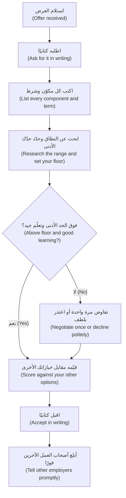
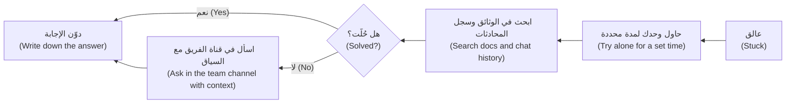
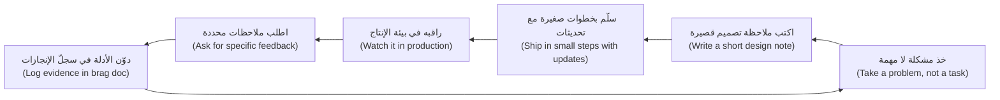

# الوحدة 6 — العرض الوظيفي والأيام التسعون الأولى (Offer and the first 90 days)

*الحصول على العرض الوظيفي (offer) ليس خط النهاية (finish line)، بل هو اللحظة التي تبدأ فيها اختياراتك بالتراكم. تتناول هذه الوحدة القرارات الثلاثة التي تشكّل سنتيك الأوليين: أيّ عرض تقبل وبأي شروط؛ وكيف تبدأ بحيث يأتمنك فريقك على عمل حقيقي (real work) خلال 90 يومًا؛ وكيف تنمو من شخص تُسند إليه مهام (tasks) إلى شخص تُسند إليه مشكلات (problems). يوازن عمر بين عرض مكتوب (written offer) من برنامج الخرّيجين (graduate programme) في بنك نجم (Najm Bank)، وعرض من شركة ناشئة (startup) يتضمّن حصة ملكية (equity) ومهلة 48 ساعة (48-hour deadline). وفي أسبوعها الثاني، توشك ريم أن تلصق شيفرة داخلية (internal code) في أداة ذكاء اصطناعي شخصية، فتتعلّم كيف يُسلِّم فريق خاضع للتنظيم (regulated team) عمله. أما يوسف، في شهره التاسع، فيسمع أنه "قوي تقنيًا لكنه يفاجئ الناس"، فيحوّل هذه الملاحظات (feedback) إلى خطة نموّ (growth plan). لا تظهر هنا أي أرقام رواتب (salary figures). ستتعلّم كيف تجد الأرقام الحالية (current numbers)، وتقرأ الحزمة كاملة، وتتخذ قرارًا تستطيع الدفاع عنه.*

> **الخطوات (Steps):** Apply, Start, Grow — تحويل العرض الوظيفي إلى قرار جيد (good decision)، وبداية قوية (strong start)، ومسار واضح (visible path) نحو المستوى المتوسط (mid-level).

---

# 6.1 — العروض الوظيفية (Offers): المقارنة والتفاوض وحسن الاختيار
*المستوى (Level): 🔴 متقدم (Advanced)* · *المتطلبات (Prerequisites): 4.3، 5.1* · *الخطوة (Step): Apply, Start*

## ⚡ الدرس في دقيقة (In 60 seconds)
- **العرض الوظيفي (offer)** هو حزمة (package) (الراتب (pay)، والبدلات (allowances)، والمزايا (benefits)، وحصة الملكية)، وشروط تعاقدية (contract terms) (فترة التجربة (probation)، وفترة الإشعار (notice)، والتزامات الخدمة (bonds)، وبنود الملكية الفكرية)، ووظيفة (job) (الفريق (team)، والمرشد (mentor)، والتعلّم).
- **احصل على كل عرض كتابيًا قبل أن تقرّر أي شيء (Get every offer in writing before you decide anything).** عبارة شفهية مثل "يسعدنا انضمامك إلينا" ليست عرضًا وظيفيًا.
- قارن **إجمالي المكافآت (total compensation)** و**التعلّم الذي ستحصل عليه في السنتين الأوليين (learning you will get in the first two years)**. لمعظم الخرّيجين، الثاني أهمّ من فرق صغير في الأول.
- تفاوض بأدب (politely)، ومرة واحدة (once)، مع أسباب (reasons) ومعلومات حقيقية (real information)، وعلى الحزمة كلها. لا تختلق أبدًا عرضًا منافسًا (competing offer).
- إشارة القرار (Decision cue): ⁦("Which offer gives me the best learning and support, above a pay floor I have calculated and can live on?")⁩ "أيّ عرض يمنحني أفضل تعلّم ودعم، فوق حدّ أدنى للأجر (pay floor) حسبتُه وأستطيع العيش به؟"
- الفخ الأكبر (Biggest trap): القبول على عجل بسبب مهلة متفجّرة (exploding deadline)، أو قبول عرض ثم الاستمرار خفيةً في عرضه على جهات أخرى.

## 🧭 لماذا يهم
لدى عمر عرضان وظيفيان في الأسبوع نفسه. أرسل **برنامج نجم للخرّيجين التقنيين (Najm Tech Graduate Programme)** عرضًا مكتوبًا: نطاق رواتب ثابت للخرّيجين، وبدلَي سكن ومواصلات، وثلاث تناوبات (rotations) مدة كلٍّ منها ستة أشهر، ومرشدًا محددًا بالاسم (named mentor) هو خالد. أما **سديم باي (Sadeem Pay)**، وهي شركة ناشئة في التقنية المالية (fintech startup) في الدوحة، فقدّمت عرضًا شفهيًا (verbal offer) في مكالمة. ذكر المؤسّس (founder) "راتبًا أساسيًا أعلى" ("higher base") و"خيارات أسهم" ("stock options")، ويريد ردًا خلال 48 ساعة. غريزة عمر الأولى أن يأخذ الرقم الذي يبدو أكبر؛ وغريزته الثانية أن يراسل نجم طالبًا "مالًا أكثر" ("more money")، دون مبلغ أو سبب.

رأت عائشة، قائدة استقطاب المواهب (talent acquisition lead) في نجم، هذا مرات كثيرة. فالخرّيجون الذين يقارنون حزمة مكتوبة (written package) بوعد شفهي (verbal promise) كثيرًا ما يكتشفون الشروط الحقيقية (real terms) عند التوقيع فقط: فترة التجربة، وفترة الإشعار، وبند ملكية فكرية (intellectual-property clause) يشمل مشاريعهم الجانبية (side projects)، أو خيارات (options) لا يمكن بيعها لسنوات. وآخرون يُفسدون علاقة جيدة بالضغط الشديد على أمر لا يستطيع صاحب العمل (employer) تغييره، مثل نطاق رواتب موحّد للدفعة. وتحتاج هدى (التي تنتظر نجم وفي يدها عرض من شركة اتصالات) ومحمد (الذي يظنّ أن خرّيج المعسكر التدريبي (bootcamp graduate) لا يحق له طرح الأسئلة) المهارة نفسها: أن يقرأ العرض كاملًا، ويبحث عن النطاق، ويسأل بوضوح (ask clearly)، ويختار بطريقة يستطيع الدفاع عنها بعد عام.

## 📐 كيف يعمل

### 🟢 الأساسيات

**تشريح العرض الوظيفي (The anatomy of an offer).** قبل مقارنة أي شيء، اكتب قائمة بما يحتويه كل عرض. في دول الخليج (GCC)، كثيرًا ما تُقسَّم الحزم (packages) إلى عدة أجزاء، لذا قد يكون "الراتب الأساسي" ("base salary") وحده مضلِّلًا (mislead).

| المكوّن (Component) | ما هو | أسئلة تطرحها |
|---|---|---|
| **الراتب الأساسي (Base salary)** | أجر شهري ثابت | شهري أم سنوي؟ متى يُراجَع؟ |
| **البدلات (Allowances)** | السكن والمواصلات (Housing, transport) وغيرها، وهي شائعة في حزم الخليج (GCC packages) | نقدية أم عينية؟ هل تُحتسب في مكافأة نهاية الخدمة (end-of-service) أو المكافأة (bonus)؟ |
| **المكافأة (Bonus)** | أجر متغيّر (Variable pay) مرتبط بالأداء (performance) | ما المستهدف (Target)؟ هل تُحتسب بالتناسب (Pro-rated) في السنة الأولى؟ هل هي مضمونة (Guaranteed)؟ |
| **حصة الملكية (Equity)** | أسهم (Shares) أو خيارات، في الشركات الناشئة (startups) غالبًا | النوع (Type)، والعدد (number)، وسعر التنفيذ (strike price)، والاستحقاق التدريجي (vesting)؟ (انظر 🟡.) |
| **المزايا (Benefits)** | التأمين الصحي (Health insurance)، والإجازات (leave)، وتذاكر السفر إلى الوطن (flights home)، والمعاش أو التأمينات الاجتماعية | من المشمول، ومن متى؟ |
| **مكافأة نهاية الخدمة (End-of-service benefit)** | مبلغ يُدفع عند ترك العمل، تحدّده قوانين العمل الخليجية | كيف تُحسب؟ تحقّق من القواعد الحالية لوزارة العمل. |
| **فترة التجربة (Probation)** | فترة اختبار (trial period) يسهل فيها إنهاء العقد (easier termination) على الطرفين | كم مدتها؟ ما الإشعار المطبَّق خلالها؟ |
| **فترة الإشعار (Notice period)** | المدة التي يجب أن تمنحها، وتُمنح لك، قبل المغادرة (before leaving) | هل هي نفسها للطرفين؟ |
| **التزام التدريب أو اتفاقية الخدمة (Training bond or service agreement)** | التزام بالبقاء بعد أن يموّل صاحب العمل تدريبًا أو دراسة | كم مدته؟ ماذا تردّ إن غادرت مبكرًا؟ |
| **الموقع والتأشيرة وتاريخ البدء (Location, visa and start date)** | مكان عملك، وقواعد العمل الهجين (hybrid rules)، وكفالة الإقامة (residency sponsorship) | ما المستندات المطلوبة، مثل شهادات الدرجة العلمية المصدَّقة؟ |

**كتابيًا، ثم القرار (Written, then decided).** العرض الشفهي يدلّ على جدّية صاحب العمل؛ أما المكتوب (written one) فيبيّن ما يلتزم به. قل شكرًا واسأل: ⁦("Could you send the offer in writing, with the full package and contract terms, so I can review it properly?")⁩ "هل يمكنكم إرسال العرض كتابيًا، مع الحزمة كاملة وشروط العقد، كي أراجعه كما ينبغي؟" هذا طلب عادي (normal request).

**الشروط (Conditions).** كثير من العروض **مشروطة (conditional)** بالمراجع (references)، أو التحقّق من الخلفية (background checks)، أو تصديق الشهادة (degree attestation)، أو الفحوص الطبية (medical checks)، أو تصريح العمل (work permit). وإلى أن تُستوفى الشروط (conditions clear)، لا تستقِل من عملك ولا ترفض عروضًا أخرى.

**البحث عن النطاق (Researching the range).** لا يمكنك الحكم على عرض دون أن تعرف ما تدفعه الأدوار المماثلة (similar roles). وقت كتابة هذا الدرس (2026)، المصادر الجيدة هي:
- **مسؤولو التوظيف (Recruiters)**، بمن فيهم مسؤول التوظيف لدى صاحب العمل نفسه: ⁦⁩ "ما النطاق لهذا الدور؟"
- **إعلانات الوظائف التي تنشر النطاقات (Job adverts that publish ranges)**، وهي أقل شيوعًا في الخليج، وإن كان بعض أصحاب العمل والمنصّات (platforms) يعرضونها.
- **أدلة الرواتب الإقليمية (Regional salary guides)** الصادرة عن شركات التوظيف (recruitment firms)؛ لاحظ السنة والمنهجية.
- **الأقران (Peers)** الذين يسبقونك بسنة أو سنتين، ومركز التوجيه المهني في جامعتك، وشبكات الخرّيجين (alumni networks) (الدرس 4.2).
- **المواقع المعتمدة على مساهمات المستخدمين (Crowd-sourced sites)** مثل Levels.fyi أو Glassdoor. بيانات مستوى المبتدئين (entry-level) الخليجية فيها شحيحة (thin)؛ فتعامل معها كإشارة تقريبية (rough signal).

دوّن نطاقًا (range) من عدة مصادر، لا رقمًا واحدًا. ثم احسب **حدّك الأدنى (floor)**: أدنى حزمة إجمالية تغطي تكاليفك الحقيقية (real costs) (الإيجار، والمواصلات، والالتزامات العائلية (family commitments)، والادّخار) في تلك المدينة. ما دون الحد الأدنى يعني "تفاوض" ("negotiate") أو "لا".

**قارن التعلّم، لا المال فقط (Compare learning, not just money).** سنتاك الأوليان تبنيان المهارات التي يدفع مقابلها كل عرض لاحق. اسأل: هل سيكون لي مرشد لديه وقت لي؟ هل سأسلّم عملًا حقيقيًا مع مراجعة الشيفرة (code review)؟ هل يوجد تدريب منظّم (structured training)؟ ما مدى استقرار الفريق (team stable)؟ هل يبني العمل الدور الذي اخترته في الوحدة 2 (Module 2)؟

### 🟡 التعمق أكثر (Going deeper)

**عملية قرار يمكنك شرحها لاحقًا (A decision process you can explain later).**

**التفاوض بصدق (Negotiation, honestly).** التفاوض (negotiation) محادثة للوصول إلى شروط يقبلها الطرفان، لا معركة. ثلاث أفكار تساعد:
- **BATNA**، أي أفضل بديل للاتفاق المتفاوض عليه، وهو مصطلح من كتاب فيشر ويوري *Getting to Yes*. الـBATNA الخاص بك هو ما ستفعله إن فشل هذا العرض: عرض آخر (another offer)، أو مواصلة البحث، أو مزيد من الدراسة (further study). الـBATNA الحقيقي يمنحك ثقة هادئة (calm confidence)؛ أما المتخيَّل فيغريك بالخداع (bluff).
- **المصالح لا المواقف (Interests, not positions).** "أريد 20% أكثر" ("I want 20% more") موقف (position). أما "تكاليف سكني أعلى مما يفترضه البدل" فهي مصلحة (interest). وكثيرًا ما يستطيع أصحاب العمل تلبية المصلحة بطريقة أخرى.
- **وسّع الحزمة (Expand the package).** إن كان الراتب الأساسي (base) ثابتًا، فقد لا تكون الأشياء الأخرى كذلك: تاريخ البدء (start date)، ومكافأة التوقيع (signing bonus)، والانتقال (relocation)، وميزانية للشهادات المهنية (certification budget)، والفريق الذي تنضمّ إليه، أو مراجعة أولى للراتب في وقت أبكر.

**ما الذي يمكن للخرّيجين التفاوض عليه (What is negotiable for graduates).** كثيرًا ما تدفع برامج الخرّيجين الكبيرة، ومنها برنامج نجم، نطاقًا موحّدًا للدفعة (cohort-wide band) كي يُعامَل الخرّيجون بالتساوي؛ والضغط الشديد على الراتب الأساسي هناك يُهدر حسن النية (wastes goodwill). أما الشركات الناشئة والشركات الأصغر (smaller firms) فلديها عادةً مرونة أكبر (more flexibility). وقد يُعيَّن المتحوّلون مهنيًا (career-switchers) مثل محمد على نطاق المبتدئين (junior band) بدلًا من نطاق الخرّيجين (graduate one). والطريقة الوحيدة لمعرفة ذلك هي أن تسأل، بأدب، مرة واحدة.

**رسائل التفاوض الضعيفة مقابل القوية (Weak vs strong negotiation messages).**

ضعيفة (Weak):
> مرحبًا، شكرًا على العرض. كنت آمل في مال أكثر. هل يمكنكم تقديم أفضل من ذلك؟ لديّ عروض أخرى.

قوية (Strong) (يوسف، ردًا على عرض نجم في مسار المنصّات):
> شكرًا لكم على العرض. أنا متحمّس لفريق المنصّات (platform team) وللعمل مع سالم. بعد مراجعة الحزمة، أودّ السؤال عن أمرين. أولًا، يشير بحثي مع مسؤولي التوظيف والأقران إلى أن نطاق الأدوار المبتدئة المماثلة في الدوحة أعلى قليلًا من الراتب الأساسي في العرض. هل توجد مرونة (flexibility) في ذلك؟ ثانيًا، إن كان الراتب الأساسي محددًا بنطاق البرنامج (programme band)، فهل تنظرون في دعم شهادة سحابية بمستوى مشارك في السنة الأولى؟ يمكنني إعطاؤكم ردّي بحلول يوم الخميس.

الصيغة القوية تُظهر الاهتمام، وتسأل بتحديد (specifically)، وتقدّم سببًا (reason)، وتعرض بديلًا (alternative)، وتحدّد جدولًا زمنيًا (timeline)، بلا تهديدات ولا اختلاقات.

**العروض المنافسة والمهل (Competing offers and deadlines).** إن كان لديك عرض آخر فعلًا، فيمكنك قول ذلك: ⁦⁩ "لديّ عرض مكتوب آخر ينتهي موعده يوم الأحد. نجم هو خياري الأول. هل توجد طريقة لتسريع قراركم؟" لا تدّعِ أبدًا عرضًا ليس لديك؛ فيمكن التحقّق منه. وفي حالة **العرض المتفجّر (exploding offer)** (مهلة قصيرة جدًا)، اطلب وقتًا أطول: ⁦("This is an important decision. Could I have until Monday?")⁩ "هذا قرار مهم. هل يمكن أن تمهلوني حتى يوم الاثنين؟" يوافق كثير من أصحاب العمل. وإن لم يتزحزحوا إطلاقًا، فهذا يخبرك بشيء عن الطريقة التي قد يعاملونك بها لاحقًا.

**حصة الملكية في الشركات الناشئة بكلمات بسيطة (Startup equity in plain words).**
- **الأسهم (Shares)** ملكية جزئية للشركة. و**الخيارات (Options)** هي الحق في شراء أسهم لاحقًا بسعر ثابت يُسمّى **سعر التنفيذ (strike price)**.
- **الاستحقاق التدريجي (Vesting)** يعني أنك تكسب حصة الملكية بمرور الوقت. النمط الشائع (common pattern) هو استحقاق على عدة سنوات مع **فترة حدّ أدنى (cliff)** (لا يُستحق شيء حتى، مثلًا، اكتمال سنتك الأولى)، لكن الشروط تختلف. اقرأ خطتك.
- **التخفيف (Dilution)**: كل جولة تمويل جديدة تُصدر أسهمًا جديدة، فتتقلّص نسبتك عادةً.
- **السيولة (Liquidity)**: لا يمكنك البيع عادةً إلا إذا استُحوذ على الشركة، أو أُدرجت في سوق للأوراق المالية، أو نفّذت إعادة شراء (buy-back). وكثير من الشركات الناشئة لا تصل إلى أيٍّ من ذلك أبدًا.

القاعدة العملية: لأغراض الميزانية، قيّم حصة الملكية في المرحلة المبكرة (early-stage equity) بصفر، وقارن النقد (cash) بحدّك الأدنى.

### 🔴 نظرة الخبير (Expert view)

**اقرأ العقد، لا الخطاب فقط (Read the contract, not only the letter).** خطاب العرض (offer letter) يلخّص؛ أما العقد (contract) فهو المُلزِم (binds). ابحث عن:
- **بنود الملكية الفكرية (Intellectual-property (IP) clauses).** كثير من العقود تنقل إلى صاحب العمل ما تبتكره أثناء عملك لديه، وأحيانًا حتى خارج ساعات العمل. إن كانت لديك مشاريع مفتوحة المصدر (open-source projects) أو معرض أعمال (portfolio) (الوحدة 3)، فاطلب استثناءً مكتوبًا (written carve-out) للمشاريع القائمة والشخصية التي لا تستخدم وقت الشركة أو معدّاتها أو معلوماتها.
- **بنود عدم المنافسة وعدم الاستقطاب (Non-compete and non-solicitation clauses).** قد تقيّد المكان الذي تعمل فيه لاحقًا. ومدى قابليتها للتنفيذ يعتمد على البلد والصياغة. اسأل عمّا تعنيه عمليًا.
- **التزامات الخدمة واستردادات المبالغ (Bonds and clawbacks).** قد يلزم ردّ تكاليف الدراسة المموّلة (Sponsored study) والشهادات المهنية (certifications) والانتقال إن غادرت مبكرًا (leave early). وهي عادلة حين تكون واضحة؛ فاعرف المبلغ والمدة.
- **سياسات السرية والاستخدام المقبول (Confidentiality and acceptable-use policies)**، بما فيها قواعد أدوات الذكاء الاصطناعي (AI-tool rules) (الدرس 6.2).

لأي شيء غير مألوف (unusual)، راجع إرشادات وزارة العمل في بلد العمل، واطلب من الموارد البشرية (HR) أن تشرح، واطلب مشورة مستقلة (independent advice) إن كانت المخاطر عالية. قواعد العمل والتأشيرات والكفالة تختلف وتتغيّر؛ فتحقّق من القواعد الحالية (current rules)، لا من تجربة صديق. وبالنسبة للمواطنين (nationals)، قد تتضمّن العروض التي تشكّلها برامج التوطين (nationalisation programmes) (التقطير (Qatarization)، والتوطين الإماراتي (Emiratisation)، والسعودة) مسارًا تطويريًا (development track)، أو دراسة مموّلة، أو اتفاقية خدمة (service agreement)؛ فقارنها كأي عرض آخر.

**الاختيار بنزاهة (Choosing with integrity).** بمجرد أن تقبل كتابيًا، يتوقّف صاحب العمل عن إجراء المقابلات، ويبلغ المرشّحين الآخرين بالرفض، ويبدأ في ترتيب حاسوبك المحمول (laptop) وصلاحيات الوصول (access) والتأشيرة (visa). لا تنسحب بعد القبول إلا لأسباب جدّية (serious reasons)، ومبكرًا وبصدق، عبر الهاتف ثم البريد الإلكتروني. وبمجرد قبولك، أبلغ بلطف كل صاحب عمل آخر لا تزال في إجراءاته؛ فمسؤول التوظيف (recruiter) الذي تعتذر له اليوم قد يوظّفك بعد ثلاث سنوات.

**حين يكون الاختيار متقاربًا (When the choice is close)،** اختر المدير الأفضل والتعلّم الأفضل. اطلب مكالمة مدتها 20 دقيقة مع شخص انضمّ قبل سنة أو سنتين؛ فما يقوله عن مراجعة الشيفرة والإرشاد (mentorship) والأخطاء (mistakes) أثمن من فجوة صغيرة في الأجر.

## 🧰 الأدوات
| المورد أو الأداة أو النموذج (Resource, tool or template) | ما هو وماذا يفعل | متى تلجأ إليه |
|---|---|---|
| **Offer comparison sheet** — ورقة مقارنة العروض | جدول يضع كل مكوّن وشرط (term) وعامل تعلّم (learning factor) جنبًا إلى جنب (side by side)، مع أوزان (weights) | بمجرد أن يصبح لديك أكثر من عرض، أو عرض واحد وبديل حقيقي (real alternative) |
| **Total compensation** — إجمالي المكافآت | الراتب الأساسي مضافًا إليه البدلات والمكافأة وحصة الملكية وقيمة المزايا، على مدى عام | عند مقارنة حزم ذات هياكل مختلفة (structured differently) |
| **BATNA** — أفضل بديل للاتفاق المتفاوض عليه | أفضل بديل لديك (best alternative) إن لم تتمّ هذه الصفقة (deal) | قبل أي تفاوض، لتعرف إلى أي مدى يمكنك المضيّ بهدوء (calmly) |
| **Salary guides from recruitment firms** — أدلة الرواتب من شركات التوظيف | استبيانات أجور إقليمية سنوية حسب الدور والمستوى | عند تحديد نطاق مدروس (researched range)؛ لاحظ دائمًا السنة والمنهجية |
| **Levels.fyi** | بيانات مكافآت يساهم بها المستخدمون، وهي الأقوى لشركات التقنية الكبيرة | إشارة تقريبية لأدوار الشركات متعددة الجنسيات (multinational roles)؛ وشحيحة لأدوار الخرّيجين في الخليج |
| **Labour ministry guidance** — إرشادات وزارة العمل (مثل وزارة العمل في قطر، ووزارة الموارد البشرية والتوطين (MOHRE) في الإمارات) | القواعد الرسمية (Official rules) للعقود وفترة التجربة والإشعار ومكافأة نهاية الخدمة (end-of-service benefits) | عند التحقّق من شرط في العقد لا تفهمه |
| **Negotiation email template** — نموذج بريد التفاوض | الشكر (Thanks)، والاهتمام، وطلب محدد مع سبب، وبديل، وجدول زمني | أي تفاوض مكتوب (written negotiation) |

## 🏛️ عمليًا في بنك نجم
تشارك عائشة **ورقة مقارنة العروض (offer comparison sheet)** التي يقدّمها فريق الخرّيجين في نجم لكل مرشّح يطلب مساعدة في اتخاذ القرار. يملؤها عمر. المبالغ عناصر نائبة (placeholders)؛ استخدم أرقامك الحقيقية (real figures).

**الجزء A: الوقائع (Part A: the facts)**

| البند (Item) | برنامج نجم للخرّيجين التقنيين | سديم باي (شركة ناشئة) |
|---|---|---|
| حالة العرض (Offer status) | مكتوب (Written)، مشروط بتصديق الشهادة والتحقّق من الخلفية (background check) | شفهي (Verbal)؛ طُلبت النسخة المكتوبة في اليوم 1، ووصلت في اليوم 3 |
| الراتب الأساسي (شهري) (Base salary) | [الراتب الأساسي في نجم (Najm base)] | [الراتب الأساسي في سديم (Sadeem base)]، أعلى من نجم |
| البدلات | سكن ومواصلات، نقدًا | لا يوجد؛ "مشمولة في الراتب الأساسي" |
| المكافأة | سنوية، تقديرية (discretionary)، بالتناسب في السنة 1 | غير مذكورة (None stated) |
| حصة الملكية | لا يوجد | خيارات؛ استحقاق على 4 سنوات (4-year vesting)، مع فترة حدّ أدنى سنة واحدة (1-year cliff)؛ سعر التنفيذ لم يُذكر بعد |
| التأمين الصحي | للموظف؛ وللعائلة بعد فترة التجربة (after probation) | للموظف فقط (Employee only) |
| فترة التجربة / الإشعار (Probation / notice) | [حسب العقد (Per contract)] / [حسب العقد] | [حسب العقد] / [حسب العقد] |
| التزام الخدمة (Bond) | لا يوجد للبرنامج؛ التزام للشهادة المهنية (certification bond) إن كانت مموّلة (sponsored) | لا يوجد |
| بند الملكية الفكرية (IP clause) | قياسي (Standard)؛ تمّت الموافقة عند الطلب على استثناء (carve-out) للمشاريع الشخصية المُدرجة | واسع (Broad)، يشمل "كل الاختراعات"؛ طُلب استثناء (carve-out requested) |
| التعلّم (Learning) | 3 تناوبات، ومرشد (خالد)، وتدريب للدفعة (cohort training)، ومراجعة شيفرة على كل طلب دمج | فريق صغير، وملكية واسعة للمسؤوليات (broad ownership)، بلا إرشاد رسمي؛ يراجع المدير التقني (CTO) طلبات الدمج (PRs) "عندما يتسنّى ذلك" |

**الجزء B: التقييم بالدرجات (Part B: the scoring)** (أوزان اختارها عمر قبل التقييم، لتجنّب إمالة النتيجة)

| العامل (Factor) | الوزن (Weight) | نجم (Najm) (1–5) | سديم (Sadeem) (1–5) |
|---|---|---|---|
| إجمالي النقد مقابل الحد الأدنى | 25% | 4 | 4 |
| التعلّم والإرشاد | 30% | 5 | 3 |
| تسليم حقيقي للمستخدمين | 15% | 3 | 5 |
| الاستقرار والمزايا | 15% | 5 | 2 |
| الملاءمة مع الدور المستهدف (مهندس برمجيات) (Fit with target role) | 15% | 4 | 4 |
| **الدرجة المرجّحة (Weighted score)** | 100% | **4.30** | **3.55** |

**الجزء C: ملاحظة القرار (Part C: the decision note)** (ثلاث جمل يكتبها عمر لنفسه في المستقبل)
> أختار نجم لأن الإرشاد ومراجعة الشيفرة سيبنيان مهارات النشر (deployment) وبيئة الإنتاج (production) التي تنقصني (الدرس 1.3)، والنقد أعلى من حدّي الأدنى. حصة الملكية في الشركة الناشئة قيمتها مجهولة (unknown value) وقد قيّمتها بصفر. سأشكر سديم باي هاتفيًا اليوم، وأؤكّد ذلك بالبريد الإلكتروني، وأسأل إن كان بإمكاني البقاء على تواصل.

## 🛠️ التمارين (Exercises)
- 🟢 خذ خطاب عرض حقيقيًا أو نموذجيًا، واكتب قائمة بكل مكوّن وشرط من جدول التشريح (anatomy table) في 🟢 الأساسيات. علّم كلًا منها بـ"مذكور" ("stated") أو "غير واضح" ("unclear") أو "مفقود" ("missing"). *يكتمل عندما (Done when):* تكون لديك قائمة من صفحة واحدة، ومجموعة مكتوبة من خمسة أسئلة على الأقل سترسلها إلى صاحب العمل.
- 🟡 ابحث عن النطاق لدور مستهدف واحد (one target role) في مدينة واحدة مستخدمًا ثلاثة مصادر مختلفة على الأقل، واحسب حدّك الأدنى الشخصي (personal floor) من ميزانية شهرية (monthly budget). *يكتمل عندما:* يستطيع زميل (peer) أن يرى مصادرك وتواريخها، والنطاق الذي خلصت إليه، وحساب حدّك الأدنى، وأن يتتبّع كيف انتقلت من أحدها إلى الآخر.
- 🔴 اكتب بريد تفاوض (negotiation email) لسيناريو يكون فيه الراتب الأساسي ثابتًا بنطاق الخرّيجين (graduate band) لكن لديك مصلحة حقيقية واحدة (مثلًا تاريخ بدء لاحق، أو ميزانية للشهادات المهنية، أو تكلفة انتقال). ثم مثّل الموقف (role-play it) مع زميل يؤدي دور مسؤول التوظيف، وعليه أن يرفض طلبك الأول. *يكتمل عندما:* يحتوي بريدك على الشكر، والاهتمام، وطلب محدد مع سبب، وبديل، وموعد نهائي (deadline)؛ وينتهي تمثيل الأدوار بنتيجة واضحة (clear outcome) يستطيع كلاكما تدوينها.

## ⚠️ أخطاء وفخاخ (Mistakes and traps)
- **القرار بناءً على رقم شفهي (Deciding on a verbal number).** اطلب العرض المكتوب أولًا؛ فالمفاجآت تختبئ في الشروط.
- **مقارنة الرواتب الأساسية فقط (Comparing base salaries only).** قارن إجمالي المكافآت، ثم التعلّم.
- **الخداع بشأن عروض منافسة (Bluffing about competing offers).** لا تذكر إلا العروض الحقيقية، وبدقة (accurately).
- **تقييم حصة الملكية في الشركات الناشئة كأنها نقد (Valuing startup equity as cash).** قيّم الخيارات في المرحلة المبكرة (early-stage options) بصفر؛ واسأل عن الاستحقاق التدريجي وسعر التنفيذ والتخفيف.
- **توقيع بند ملكية فكرية يبتلع معرض أعمالك (Signing an IP clause that swallows your portfolio).** اطلب استثناءً مكتوبًا للمشاريع القائمة والشخصية.
- **القبول ثم مواصلة التسوّق (Accepting, then still shopping around).** بمجرد أن تقبل، أوقف الإجراءات الأخرى وأبلغ أصحاب العمل المعنيين.

## 🧾 الخلاصة (Recap)
- العرض الوظيفي حزمة وعقد ووظيفة. احصل عليه كتابيًا واكتب قائمة بكل أجزائه.
- ابحث عن نطاق من عدة مصادر، واحسب حدّك الأدنى قبل أن تقارن.
- بالنسبة للخرّيجين، كثيرًا ما يكون التعلّم والإرشاد والتسليم الحقيقي (real shipping) أهمّ من فرق صغير في الأجر.
- تفاوض مرة واحدة، بأدب، بالمصالح (interests) والمعلومات الحقيقية. ووسّع الحزمة حين يكون الراتب الأساسي ثابتًا.
- اقرأ العقد (الملكية الفكرية، وعدم المنافسة (non-compete)، والتزامات الخدمة، وفترة التجربة، والإشعار)، وراجع إرشادات العمل الرسمية، واختر بنزاهة.

## ✍️ اختبر نفسك (Check yourself)

**1. يتلقّى عمر عرضًا شفهيًا (verbal offer) من سديم باي (Sadeem Pay) بمهلة 48 ساعة (48-hour deadline). ما أول ما ينبغي أن يفعله؟**

- A. أن يقبل فورًا في المكالمة، ثم يطلب التفاصيل المكتوبة (written details) بعد ذلك
- B. أن يطلب العرض كاملًا كتابيًا، ويسأل إن كان يمكن تمديد المهلة
- C. أن يخبر نجم بأن لديه عرضًا أفضل، ويطلب منهم تجاوزه (beat it) اليوم
- D. أن يترك المهلة تنقضي، ويردّ الأسبوع القادم بعد أن يفكّر

الإجابة

**B.** لا يستطيع مقارنة رقم شفهي (verbal number) بحزمة مكتوبة (written package)، وطلب الوقت بأدب أمر عادي. A يُلزمه بشروط لم يرها (unseen terms)؛ وC ادّعاء لا يستطيع إثباته؛ وD قد يُفقده العرض دون أن يطلب وقتًا أصلًا. (🟢 الأساسيات؛ 🟡 التعمق أكثر (Going deeper).)

**2. يدفع برنامج الخرّيجين (graduate programme) في نجم لكل خرّيجي الدفعة (cohort) النطاق نفسه (same band). يريد يوسف حزمة أفضل. ما النهج الأكثر فاعلية؟**

- A. أن يسأل مرة واحدة، بأدب، عن المرونة (flexibility)، ويقترح بديلًا مثل دعم الشهادة المهنية (certification support)
- B. أن يصرّ على راتب أساسي أعلى (higher base) ويرفض التوقيع حتى يُرفع النطاق له
- C. أن يذكر عرضًا أعلى من شركة متعددة الجنسيات (multinational) ليس لديه فعلًا
- D. أن يقبل دون أن يسأل شيئًا، لأن الخرّيجين لا يُسمح لهم بالتفاوض

الإجابة

**A.** حين يكون الراتب الأساسي محددًا بنطاق، فإن توسيع الحزمة يلبّي مصالحه (interests) دون إهدار حسن النية (goodwill). B يضغط على ما لا يستطيع صاحب العمل تغييره؛ وC غير نزيه (dishonest)؛ وD يتخلّى عن خيار يملكه بحق (legitimately). (🟡 التعمق أكثر (Going deeper).)

**3. تعرض شركة ناشئة (startup) على ريم خيارات (options) باستحقاق تدريجي على أربع سنوات (four-year vesting) وفترة حدّ أدنى سنة واحدة (one-year cliff). كيف ينبغي أن تقيّمها عند مقارنتها بحدّها الأدنى (floor)؟**

- A. بأي قيمة قدّرها المؤسّس (founder estimated) في مكالمة العرض
- B. بسعر التنفيذ (strike price) مضروبًا في عدد الخيارات الممنوحة (options granted)
- C. بآخر تقييم تمويلي مضروبًا في نسبة حصتها (percentage stake)
- D. بصفر لأغراض الميزانية، بعد التحقّق من الاستحقاق التدريجي (vesting) وسعر التنفيذ والتخفيف (dilution)

الإجابة

**D.** أي قيمة مستقبلية مكسب إضافي (bonus). فالخيارات في المرحلة المبكرة (Early-stage options) لا يمكن بيعها عادةً لسنوات، وقد تتعرّض للتخفيف (diluted)، وقد لا تساوي شيئًا أبدًا. A وC يعتمدان على تقديرات (estimates) لا تستطيع أن تدفع بها الإيجار؛ وB هو تكلفة شراء الأسهم، لا قيمتها. (🟡 التعمق أكثر (Going deeper).)

**4. ينقل عقد محمد إلى صاحب العمل "كل الاختراعات التي تتمّ خلال مدة التوظيف" ("all inventions made during the term of employment"). وهو يتولّى صيانة مكتبة مفتوحة المصدر (open-source library) منذ أيام المعسكر التدريبي (bootcamp). ماذا ينبغي أن يفعل؟**

- A. أن يوقّع كما هو مكتوب، لأن بنودًا كهذه لا تُطبَّق أبدًا عمليًا
- B. أن يحذف مكتبته مفتوحة المصدر (open-source library) أو ينقلها (transfer) قبل يومه الأول (first day)
- C. أن يطلب استثناءً مكتوبًا (written carve-out) يُدرج مشاريعه الشخصية القائمة
- D. أن يرفض العرض، لأنه لا يوجد صاحب عمل سيغيّر الصياغة

الإجابة

**C.** الاستثناء (carve-out) للمشاريع القائمة والشخصية يحمي معرض أعماله (portfolio)، وهو طلب شائع ومعقول. A افتراض لا يستطيع الاعتماد عليه؛ وB وD خسائر غير ضرورية (unnecessary losses). (🔴 نظرة الخبير (Expert view).)

**5. تقبل هدى كتابيًا (in writing) عرض شركة الاتصالات الإقليمية (regional telecom). وبعد أسبوعين، يقدّم لها مسار البيانات (data track) في نجم عرضًا. أيّ ردّ يعكس هذا الدرس على أفضل وجه؟**

- A. أن تقبل عرض نجم أيضًا، ثم تختار لاحقًا أيّ تاريخ بدء (start date) يناسبها أكثر
- B. أن تقبل نجم ولا تحضر ببساطة إلى شركة الاتصالات في أول يوم عمل لها
- C. أن تعدّ قبولها المكتوب (written acceptance) غير مُلزِم بشيء حتى تبدأ فعلًا
- D. أن تفي بكلمتها ما لم يكن السبب جدّيًا (serious)؛ وإن كان كذلك، فلتبلغ شركة الاتصالات مبكرًا هاتفيًا

الإجابة

**D.** بمجرد قبولها، تتوقّف شركة الاتصالات عن التوظيف وتستعدّ لقدومها، لذا لا تنسحب إلا لأسباب جدّية، ومبكرًا وبصدق. وكان ينبغي أيضًا أن تُبلغ نجم حينها بأنها خرجت من الإجراءات. A وB يُضرّان بالثقة (damage trust)؛ وC غير صحيح (false). (🔴 نظرة الخبير (Expert view).)

## 📚 المراجع
- Fisher, R., Ury, W. and Patton, B., *Getting to Yes: Negotiating Agreement Without Giving In*, Penguin (revised editions) — فيشر ويوري وباتون، كتاب «الوصول إلى نعم» (طبعات منقّحة)
- Program on Negotiation, Harvard Law School — برنامج التفاوض، كلية الحقوق بجامعة هارفارد — https://www.pon.harvard.edu/
- Qatar Ministry of Labour — وزارة العمل في قطر — https://www.mol.gov.qa/
- UAE Ministry of Human Resources and Emiratisation — وزارة الموارد البشرية والتوطين في الإمارات — https://www.mohre.gov.ae/
- Levels.fyi — https://www.levels.fyi/
- Glassdoor — https://www.glassdoor.com/

---

# 6.2 — أيامك التسعون الأولى (Your first 90 days): التهيئة الوظيفية (onboarding)، وأول طلب دمج، وطرح الأسئلة الجيدة (asking good questions)
*المستوى: 🔴 متقدم* · *المتطلبات: 1.1، 1.2، 6.1* · *الخطوة: Start*

## ⚡ الدرس في دقيقة (In 60 seconds)
- لأيامك التسعين الأولى ثلاث مهام: أن **تتعلّم (learn)** النظام والناس وكيف يُسلَّم العمل؛ وأن **تساهم (contribute)** بتغييرات صغيرة وآمنة مبكرًا؛ وأن **تبني الثقة (build trust)** بأنك أهل لأن يُسند إليك المزيد.
- استهدف **طلب دمج أول صغيرًا (small first pull request)** في أسبوعك الأول أو الثاني. فهو يثبت أن بيئة عملك (setup) تعمل، ويعلّمك عملية المراجعة والإصدار لدى الفريق.
- **اطرح أسئلة جيدة (Ask good questions)**: حاول لمدة محددة (fixed time)، ودوّن ما جرّبته، ثم اسأل في المكان الصحيح مع السياق (context). الصمت (Silence)، لا الجهل (ignorance)، هو أكثر إخفاقات المبتدئين شيوعًا.
- لا تستخدم إلا **أدوات الذكاء الاصطناعي وقواعد البيانات التي وافق عليها صاحب العمل (AI tools and data rules your employer has approved)**. لا تلصق أبدًا شيفرة داخلية أو بيانات عملاء (customer data) في حساب شخصي (personal account).
- إشارة القرار: في الأسبوع الأول، اسأل مديرك: ⁦("What would success look like for me at 30, 60 and 90 days?")⁩ "كيف سيبدو النجاح بالنسبة لي عند 30 و60 و90 يومًا؟" ودوّن الإجابة.
- الفخ الأكبر: أن تختفي أسبوعين ثم تفتح طلب دمج ضخمًا لم يطلبه أحد.

## 🧭 لماذا يهم
إنه الأسبوع الثاني لريم في فريق تطبيقات الذكاء الاصطناعي في نجم. أول تذكرة (ticket) لها هي إضافة حقل (field) إلى واجهة برمجة داخلية (internal API) تخدم مساعد دعم العملاء (customer-support assistant). وهي معتادة على البناء بسرعة باستخدام وكلاء البرمجة بالذكاء الاصطناعي (AI coding agents) في مشاريعها الخاصة، لذا تفتح حسابها الشخصي للذكاء الاصطناعي وتبدأ لصق شيفرة الخدمة (service's code) فيه. يلاحظ ذلك رفيقها في الفريق (buddy)، وهو مهندس من المستوى المتوسط (mid-level engineer)، في الوقت المناسب ويوقفها. فلدى نجم، مثل معظم البنوك، أداة ذكاء اصطناعي معتمدة تعمل بموجب اتفاقية البنك (bank's agreement) وضوابط البيانات (data controls) لديه. ولصق شيفرة داخلية في حساب شخصي قد يخالف سياسة الاستخدام المقبول (acceptable-use policy) في البنك وقواعد التعامل مع البيانات (data-handling rules). لم تكن ريم سيئة النية (malicious)؛ ببساطة لم تكن قد قرأت السياسة التي كانت في حزمة التهيئة (onboarding pack) الخاصة بها.

وفي طابق آخر، أمضى عمر تسعة أيام يعيد بصمت كتابة وحدة برمجية (module) "لجعلها أنظف". أول طلب دمج (pull request) له بطول 1,200 سطر، ويغيّر سلوكًا (behaviour) لم يطلب منه أحد تغييره، وبلا اختبارات (tests). لا يستطيع طارق مراجعته بأمان، فيُغلق. يشعر عمر بالحرج. ومع ذلك، يرى خالد أنه لم يحدث خطأ جسيم: فكلاهما خطأ عادي في الشهر الأول. المهم هو ما يفعلانه بعد ذلك. هذا الدرس هو دليل العمل (playbook) الذي يتمنّى خالد أن يصل به كل خرّيج.

## 📐 كيف يعمل

### 🟢 الأساسيات

**ما تتضمّنه التهيئة الوظيفية عادةً (What onboarding usually includes).** توقّع معظم ما يلي في الأسبوعين الأولين. وإن نقص شيء، فاسأل.
- **صلاحيات الوصول (Access)**: الحاسوب المحمول، والحسابات (accounts)، ونظام التحكّم بالشيفرة المصدرية (source control)، ونظام التذاكر (ticketing)، والمحادثة (chat)، والتوثيق (documentation). في الشركات الخاضعة للتنظيم (regulated firms) مثل البنوك، تحتاج بعض الصلاحيات إلى موافقات (approvals) وقد تستغرق أيامًا. وكثيرًا ما يكون الوصول إلى بيئة الإنتاج (Production access) مقيّدًا للمبتدئين، وهذا أمر طبيعي.
- **التدريب الإلزامي (Mandatory training)**: أمن المعلومات (information security)، وحماية البيانات (data protection)، وفي البنوك غالبًا وحدات مكافحة غسل الأموال (anti-money-laundering) ومدوّنة السلوك (code-of-conduct). أنجزها مبكرًا؛ فقد يعتمد الوصول إلى بعض الأنظمة عليها.
- **السياسات (Policies)**: الاستخدام المقبول (acceptable use)، وتصنيف البيانات (data classification) (ما هو عام (public)، أو داخلي (internal)، أو سرّي (confidential)، أو مقيّد)، وقواعد أدوات الذكاء الاصطناعي. اقرأها؛ فهي تخبرك بما يجب ألا تفعله أبدًا.
- **الناس (People)**: مديرك، ورفيقك في الفريق أو مرشدك، وفريقك، والفرق التي تعتمد عليها (الأمن (security)، والعمليات (operations)، والبيانات (data)، والمنتج).
- **بيئة التطوير (The development environment)**: أن تجعل الشيفرة تُبنى وتعمل وتجتاز الاختبارات على جهازك.

**خطة 30-60-90 (The 30-60-90 plan).** إطار بسيط (simple frame) تتفق عليه مع مديرك:

| المرحلة (Phase) | التركيز (Focus) | النتائج المعتادة (Typical outcomes) |
|---|---|---|
| الأيام 1–30: **تعلّم (Learn)** | الإعداد (Set up)، والقراءة، والإصغاء، وتسليم شيء صغير | بيئة العمل تعمل (Environment working)؛ دُمج أول طلب دمج صغير؛ تستطيع شرح ما يفعله نظام الفريق ومن يستخدمه |
| الأيام 31–60: **ساهم (Contribute)** | تولّي تذاكر عادية (normal tickets) مع الدعم | دُمجت عدة طلبات دمج؛ أُصلح خلل واحد من البداية إلى النهاية (end to end)؛ تستطيع التنقّل في قاعدة الشيفرة (codebase) وحدك |
| الأيام 61–90: **امتلك (Own)** | تولّي ميزة صغيرة (small feature) أو مجال صغير | ميزة سُلّمت وروقبت في بيئة الإنتاج؛ راجعت طلبات دمج الآخرين؛ حسّنت وثيقة أو عملية واحدة |

**طلب الدمج الأول (The first pull request).** **طلب الدمج (pull request, PR)** تغيير مقترح (proposed change) يراجعه الآخرون قبل دمجه (merged). ينبغي أن يكون طلبك الأول صغيرًا وآمنًا. مرشّحات جيدة (Good candidates):
- إصلاح شيء في دليل الإعداد (setup guide) الذي اتّبعته للتو. فأنت الشخص الوحيد الذي رآه بعيون جديدة (fresh eyes) هذا العام.
- خلل (bug) أو تذكرة صغيرة ومحددة جيدًا يختارها لك مديرك.
- اختبار مفقود (missing test) لسلوك قائم (existing behaviour).

طلبات الدمج الأولى الصغيرة تعلّمك المسار الكامل (whole path) الذي يقطعه أي تغيير: الفرع (branch)، والإيداع (commit)، وفحوص التكامل المستمر (CI checks)، والمراجعة (review)، والدمج (merge)، والنشر (deploy). وهذا المسار نظام بحد ذاته؛ انظر [*تصميم الأنظمة للمبرمجين بالحدس (System Design for Vibe Coders)*، الدرس 4.1 — الشحن نظام بحد ذاته (Shipping is a system)](../vibe/index.ar.html#l4-1).

**وصف جيد لطلب الدمج (A good PR description).**

ضعيف:
> أصلحت أشياء (fixed stuff)

قوي:
> **ماذا (What):** يضيف `preferred_language` إلى استجابة `/support/profile` كي يتمكّن المساعد من الرد بالعربية أو الإنجليزية.
> **لماذا (Why):** التذكرة SUP-412. المساعد حاليًا يخمّن اللغة من إعدادات لغة المتصفح (browser locale).
> **كيف (How):** عمود جديد يقبل القيمة الفارغة مع ترحيل (migration)؛ قيمته الافتراضية null؛ ولا تُعيده واجهة البرمجة (API) إلا عند تعيينه.
> **الاختبار (Tested):** اختبارات وحدة (Unit tests) للمُسلسِل (serializer)؛ شغّلت الترحيل على قاعدة بيانات اختبار محلية ببيانات اصطناعية (synthetic data)؛ استدعيت نقطة النهاية (endpoint) يدويًا (لقطة الشاشة مرفقة).
> **مساعدة الذكاء الاصطناعي (AI assistance):** صغت مسودة الترحيل باستخدام مساعد البرمجة المعتمد؛ راجعت كل سطر وكتبت الاختبارات بنفسي.
> **المخاطر (Risk):** منخفضة (Low)؛ حقل إضافي (additive field)، ولا يتعطّل أي عميل قائم.

الصيغة القوية تخبر المراجِع (reviewer) بماذا، ولماذا، وكيف، وكيف اختُبر، وهي صادقة بشأن مساعدة الذكاء الاصطناعي (AI help). كتابتها تستغرق خمس دقائق، وتوفّر على المراجِع عشرين.

**طرح الأسئلة الجيدة (Asking good questions).** يُتوقّع من المبتدئين (Juniors) أن يطرحوا الأسئلة. والفرق تخسر من الوقت بسبب مبتدئين عالقين في صمت أكثر مما تخسره بسبب مبتدئين يسألون. السؤال الجيد:
1. يذكر هدفك ⁦⁩ "أحاول تشغيل اختبارات التكامل (integration tests) محليًا".
2. يقدّم السياق (Gives context) ⁦("on the `support-api` repo, main branch, after following the setup guide")⁩ "على مستودع support-api ‏(repo)، الفرع الرئيسي (main branch)، بعد اتّباع دليل الإعداد".
3. يذكر ما جرّبته ⁦⁩ "أعدت تعيين حاوية قاعدة البيانات (database container) وتحقّقت من ملف البيئة (env file)؛ والخطأ مستمر".
4. يعرض الدليل (الخطأ بنصّه الدقيق (exact error)، كنص).
5. يسأل عن شيء محدد ⁦("Is there a step missing for the test database, or have I misconfigured something?")⁩ "هل توجد خطوة ناقصة لقاعدة بيانات الاختبار (test database)، أم أنني أخطأت في إعداد شيء ما (misconfigured)؟"

المدة التي تحاول فيها وحدك تعتمد على الفريق. كثير من الفرق تستخدم قاعدة تقريبية (rule of thumb) بين 15 دقيقة وساعة. اسأل مديرك عمّا يفضّله. واسأل في القناة المشتركة للفريق بدلًا من رسالة خاصة (private message) حين تستطيع، كي تفيد الإجابةُ الشخصَ التالي. ثم أضفها إلى التوثيق.

### 🟡 التعمق أكثر

**قراءة قاعدة شيفرة غير مألوفة (Reading an unfamiliar codebase).** لن تفهم النظام كله في 90 يومًا، ولا أحد يتوقّع منك ذلك. اعمل من الخارج إلى الداخل:
- **شغّله (Run it).** استخدم المنتج كما يستخدمه المستخدم.
- **تتبّع طلبًا واحدًا (Trace one request)** من واجهة المستخدم (user interface) إلى قاعدة البيانات (database) وبالعكس. دوّن كل خدمة (service) يعبرها؛ انظر [*تصميم الأنظمة للمبرمجين بالحدس*، الدرس 1.2 — رحلة الطلب](../vibe/index.ar.html#l1-2).
- **اقرأ الاختبارات (Read the tests).** فهي تُظهر ما يُفترض أن تفعله الشيفرة.
- **استخدم السجل (Use history).** يُظهر `git log` و`git blame` على ملف محيّر (confusing file) لماذا تغيّر ومن تسأل.
- **ارسم الصناديق (Draw the boxes)** وتحقّق من رسمك مع رفيقك في الفريق.

لقواعد الشيفرة الكبيرة (large codebases)، يقدّم [*لبنات بناء SaaS (SaaS Building Blocks)*، الدرس 0.2 — كيف تقرأ قاعدة شيفرة مفتوحة المصدر عملاقة دون أن تغرق](../saas/index.ar.html#/0.2) منهجًا (method) ينجح بالقدر نفسه داخل الشركة.

**أدوات الذكاء الاصطناعي في العمل (AI tools at work).** كل ما في الدرس 1.2 لا يزال ساريًا، مضافًا إليه ثلاث قواعد لبيئة العمل (workplace rules):
- **الأدوات المعتمدة فقط (Approved tools only).** استخدم الأدوات والحسابات التي اعتمدها صاحب عملك، بموجب اتفاقيات البيانات (data agreements) لديه. وإن كانت السياسة غير واضحة، فاسأل قبل أن تستخدم أي شيء.
- **تصنيف البيانات ينطبق على الموجّهات (Data classification applies to prompts).** الموجّه (prompt) بيانات تغادر جهازك. والشيفرة الداخلية وبيانات العملاء والأسرار (secrets) يجب ألا تذهب إلى أي مكان لا تسمح به السياسة.
- **أنت تملك ما تقدّمه (You own what you submit).** سيسألك المراجِع لماذا يوجد سطر ما. وعبارة "الوكيل كتبه" ليست إجابة. اقرأ [*تصميم الأنظمة للمبرمجين بالحدس*، الدرس 9.8 — نظرة الحوكمة: أنت تملك ما يشحنه وكيلك](../vibe/index.ar.html#l9-8).

**التعامل مع تعليقات المراجعة (Handling review comments).** مراجعة الشيفرة هي طريقة الفريق في التعليم. ردّ على كل تعليق: نفّذ التغيير، أو اشرح بأدب لماذا لا، أو اطرح سؤالًا. لا تأخذ التعليقات على محمل شخصي (personally)؛ فهي عن الشيفرة. وحين يظهر التعليق نفسه مرتين، أضفه إلى قائمة التحقّق الشخصية (personal checklist) لديك كي لا يظهر مرة ثالثة. وتعلّم مراجعة شيفرة الآخرين جزء من العمل أيضًا، حتى وأنت مبتدئ (junior). فكثيرًا ما ستلاحظ أسماء غير واضحة (unclear names)، أو اختبارات مفقودة (missing tests)، أو توثيقًا محيّرًا (confusing documentation). انظر [*تصميم الأنظمة للمبرمجين بالحدس*، الدرس 9.7 — تدقيق الشيفرة ومراجعتها بسرعة الوكيل](../vibe/index.ar.html#l9-7).

**مديرك واجتماعاتكما الثنائية (Your manager and your 1:1s).** **الاجتماع الثنائي (1:1)** اجتماع خاص منتظم مع مديرك. احتفظ بوثيقة مشتركة (shared document) فيها جدول أعمال متجدد (running agenda): ما أنجزته، وأين أنت عالق، وما تريد ملاحظات عليه، وأي شيء يقلقك. وفي الأسبوع الأول، اسأل:
- ⁦("What does success look like for me at 30, 60 and 90 days?")⁩ "كيف يبدو النجاح بالنسبة لي عند 30 و60 و90 يومًا؟"
- ⁦("How do you prefer I ask for help, and how long should I try alone first?")⁩ "كيف تفضّل أن أطلب المساعدة، وكم ينبغي أن أحاول وحدي أولًا؟"
- ⁦("How will I get feedback, and when is my probation review?")⁩ "كيف سأحصل على الملاحظات، ومتى مراجعة فترة التجربة (probation review) الخاصة بي؟"

**ابدأ سجل عمل الآن (Start a work log now).** سطر واحد في اليوم: ما سلّمته (shipped)، أو تعلّمته (learned)، أو أزلت عنه العوائق (unblocked). بعد ثلاثة أشهر يصبح الدليل (evidence) لمراجعة فترة التجربة؛ وبعد عام، لأول حديث عن الترقية (الدرس 6.3).

### 🔴 نظرة الخبير

**تعلّم كيف يُقاس أداء الفريق (Learn how the team is measured).** لكل فريق بضعة أشياء يُحكم عليه بها: وقت التشغيل (uptime)، وتواتر الإصدارات (release frequency)، وعدد الحوادث (incident count)، وجودة النموذج (model quality)، والتذاكر المُغلقة (tickets closed)، وملاحظات التدقيق (audit findings). اسأل ما هي. العمل الذي يحرّك تلك الأرقام يُلاحَظ. أما العمل الذي لا يحرّكها، مهما كان بارعًا (however clever)، فغالبًا لا يُلاحَظ.

**تعلّم المجال، لا الشيفرة فقط (Learn the domain, not only the code).** في البنك، مصطلحات مثل "KYC" (اعرف عميلك)، و"التسوية" ("settlement")، و"استرداد المدفوعات" ("chargeback")، أو "مبدأ العينين الأربع" ("four-eyes principle") (يجب أن يوافق شخصان على الإجراءات الحساسة) لها أهمية إطار العمل (framework) نفسه. احتفظ بمسرد مصطلحات (glossary). المبتدئ الذي يفهم لماذا يوجد ضابط رقابي (control) يطرح أسئلة أفضل من مبتدئ لا يراه إلا عائقًا (friction).

**التسليم في البيئات الخاضعة للتنظيم أبطأ لأسباب وجيهة (Regulated delivery is slower for good reasons).** موافقات التغيير (Change approvals)، والفصل بين المهام (segregation of duties) (من يكتب التغيير ليس من يوافق على نقله إلى بيئة الإنتاج)، ومسارات التدقيق (audit trails)، والوصول المقيّد إلى بيئة الإنتاج، قد تبدو بيروقراطية (bureaucratic). لكنها موجودة لأن أخطاء البنك تؤذي العملاء وتستقطب انتباه الجهات الرقابية (attract regulators). تعلّمها، واقترح تحسينات عبر القناة الصحيحة (proper channel) بمجرد أن تفهمها.

**المناوبة والحوادث (On-call and incidents).** لن تنضمّ عادةً إلى جدول مناوبة (on-call rotation) في أيامك التسعين الأولى، لكن يمكنك **مرافقة (shadow)** مناوبة: تشاهد كيف تُعالَج التنبيهات (alerts)، وتقرأ مراجعات الحوادث السابقة، وتتعلّم أدلة التشغيل (runbooks). الأفكار موجودة في [*السحابة وDevOps: من الصفر إلى الاحتراف (Cloud & DevOps: Zero to Hero)*، الوحدة 5 — قابلية المراقبة والموثوقية (Observability and reliability)](../cloud/index.ar.html#/5.2).

**حين تكسر شيئًا (When you break something).** على الأرجح سيحدث ذلك. أبلغ عنه فورًا، وقل ما فعلته وما تراه، وساعد في إصلاحه. لا تُخفِه، ولا تحاول التراجع عنه خفيةً. الفرق الجيدة تُجري مراجعات **بلا لوم (blameless)**: تُصلح النظام الذي سمح بمرور الخطأ بدلًا من لوم الشخص. وسرعتك وصدقك في تلك الحادثة الأولى يشكّلان سمعتك (reputation) أكثر من الخطأ نفسه.

**إشارات على أنك تُحسن الأداء في اليوم 90 (Signals you are doing well at day 90).** تستطيع شرح نظام الفريق ومستخدميه. طلبات الدمج الخاصة بك صغيرة ومُختبرة (small, tested) وتحتاج جولات مراجعة أقل. تطرح أسئلة "أين" ("where is") أقل وأسئلة "لماذا" أكثر. يلجأ إليك الناس في الشيء الذي تعلّمته أولًا. حسّنت وثيقة واحدة على الأقل. ولا يفاجأ مديرك بأي شيء تفعله.

## 🧰 الأدوات
| المورد أو الأداة أو النموذج | ما هو وماذا يفعل | متى تلجأ إليه |
|---|---|---|
| **30-60-90 day plan** — خطة الأيام التسعين الأولى (30-60-90) | خطة من صفحة واحدة لنتائج التعلّم والمساهمة والامتلاك، يُتّفق عليها مع مديرك | الأسبوع الأول؛ وراجعها في كل اجتماع ثنائي (1:1) |
| **Pull request template** — نموذج طلب الدمج | وصف يتضمّن ماذا، ولماذا، وكيف، والاختبار، ومساعدة الذكاء الاصطناعي، والمخاطر | كل طلب دمج (PR)؛ كثير من المستودعات (repositories) تحتفظ بنموذج في `.github/` |
| **Conventional Commits** — الإيداعات الاصطلاحية | اصطلاح تسمية (naming convention) لرسائل الإيداع (commit messages) (`feat:`، `fix:`، `docs:`) | حين يستخدمه الفريق، أو لإبقاء سجلّك الخاص مقروءًا (readable) |
| **Google engineering practices: code review** — ممارسات Google الهندسية: مراجعة الشيفرة | دليل Google المنشور للمراجِعين والمؤلفين | لتعلّم ما يبحث عنه المراجِعون وكيف تستجيب |
| **Question template** — نموذج السؤال | الهدف (Goal)، والسياق، وما جرّبته (what I tried)، والدليل، والسؤال المحدد (specific question) | في كل مرة تبقى فيها عالقًا بعد تجاوز حدّك الزمني (time limit) |
| **1:1 agenda doc** — وثيقة جدول أعمال الاجتماع الثنائي | وثيقة مشتركة متجددة لاجتماعاتك مع مديرك | من أول اجتماع ثنائي فصاعدًا |
| **Brag document** (Julia Evans) — سجلّ الإنجازات | قائمة متجددة (running list) بعملك وتعلّمك وأثرك (impact) | ابدأها في الأسبوع الأول؛ واستخدمها في كل مراجعة |

## 🏛️ عمليًا في بنك نجم
بعد الحادثة الوشيكة (near-miss)، تعيد ريم كتابة خطتها مع رفيقها في الفريق وخالد. هذا نموذج **خطة 30-60-90 (30-60-90 plan)** الذي يقدّمه نجم الآن لكل خرّيج، معبّأً بخطتها.

| الأيام (Days) | التعلّم | المساهمة | الدليل بحلول النهاية |
|---|---|---|---|
| 1–30 | إكمال تدريب الأمن وحماية البيانات واستخدام الذكاء الاصطناعي؛ قراءة سياسات الاستخدام المقبول وأدوات الذكاء الاصطناعي؛ تتبّع طلب واحد للمساعد من البداية إلى النهاية؛ تعلّم عملية الإصدار (release process) | إصلاح خطأين في دليل الإعداد (طلب الدمج 1 (PR 1))؛ تسليم حقل `preferred_language` للتذكرة SUP-412 (طلب الدمج 2 (PR 2)) | شهادات التدريب (Training certificates)؛ دُمج طلبا الدمج كلاهما؛ مخطط لمسار طلبات المساعد، راجعه رفيقها في الفريق |
| 31–60 | قراءة آخر ثلاث مراجعات حوادث (incident reviews)؛ مرافقة أسبوع مناوبة واحد؛ تعلّم كيف تُقيَّم جودة المساعد | تولّي تذاكر عادية؛ إضافة حالة تقييم (evaluation case) للردود العربية؛ مراجعة طلبَي دمج لرفيقها في الفريق | 6+ طلبات دمج مدموجة (merged PRs)، لكلٍّ منها اختبارات وملاحظة عن مساعدة الذكاء الاصطناعي (AI-assistance note)؛ تعليقات مراجعة (review comments) على طلبات دمج الآخرين |
| 61–90 | تعلّم مسار الموافقة على التغيير (change-approval path) لإصدارات بيئة الإنتاج (production releases) | امتلاك "لغة الرد" ("reply language") من البداية إلى النهاية: ملاحظة تصميم (design note)، والبناء (build)، والإصدار (release)، ومراجعة لوحات المتابعة (dashboards) بعد أسبوع | الميزة تعمل (Feature live)؛ ملاحظة تصميم من صفحة واحدة؛ لقطة شاشة للوحة المتابعة (dashboard screenshot)؛ ملخّص قصير (short write-up) لقناة الفريق |
| دائمًا (Always) | اجتماع ثنائي أسبوعي (Weekly 1:1) مع خالد باستخدام جدول الأعمال المشترك (shared agenda)؛ سجل عمل يومي من سطر واحد | السؤال في قناة الفريق بعد 30 دقيقة من التعثّر، باستخدام نموذج السؤال (question template) | سجل العمل جاهز لمراجعة فترة التجربة |

**قائمة التحقّق لطلبات الدمج للخرّيجين (PR checklist for graduates)** في نجم (مثبّتة في قناة الفريق):
- [ ] أقل من نحو 300 سطر متغيّر (changed lines)، أو مقسّم إلى أجزاء
- [ ] تذكرة مرتبطة (Linked ticket)؛ ووصف يتضمّن ماذا، ولماذا، وكيف، والاختبار، والمخاطر
- [ ] اختبارات مضافة أو محدّثة، وتنجح محليًا وفي التكامل المستمر
- [ ] الإفصاح عن مساعدة الذكاء الاصطناعي؛ وشرح كل سطر عند الطلب
- [ ] لا أسرار، ولا بيانات عملاء، ولا عناوين URL داخلية (internal URLs) في الشيفرة أو السجلات (logs) أو لقطات الشاشة (screenshots)
- [ ] الرد على كل تعليقات المراجِع قبل طلب المراجعة مجددًا (re-requesting review)

## 🛠️ التمارين
- 🟢 اكتب خطة 30-60-90 (30-60-90 plan) لدور تستهدفه (أو للوظيفة التي بدأتها للتو) باستخدام الجدول في "عمليًا في بنك نجم". *يكتمل عندما:* يحتوي كل صف على بند تعلّم (learn item) واحد على الأقل، وبند مساهمة (contribute item) واحد، ودليل يستطيع المدير التحقّق منه.
- 🟡 اختر مشروعًا مفتوح المصدر (open-source project) لم تستخدمه قط. شغّله محليًا (running locally)، وتتبّع طلبًا أو أمرًا واحدًا عبر الشيفرة، وافتح (أو جهّز) طلب دمج صغيرًا للتوثيق يُصلح شيئًا في تعليمات الإعداد (setup instructions) الخاصة به. *يكتمل عندما:* يكون لديك مخطط (diagram) للمسار الذي تتبّعته، وطلب دمج (أو فرع جاهز) بوصف كامل بالصيغة الواردة في 🟢 الأساسيات.
- 🔴 خذ مشكلة حقيقية واحدة واجهتك في الشهر الماضي واكتبها سؤالًا باستخدام النموذج الخماسي (five-part template)، ثم أعد كتابة أحد أوصاف طلبات الدمج القديمة بالصيغة القوية (strong format). اطلب من زميل تقييم الاثنين قبل التعديل وبعده. *يكتمل عندما:* يستطيع الزميل الإجابة عن ⁦⁩ "ماذا جُرّب؟" و⁦⁩ "كيف اختُبر هذا؟" من النسختين المُعاد كتابتهما وحدهما.

## ⚠️ أخطاء وفخاخ
- **الصمت (Going quiet).** أيام من الكفاح الصامت (silent struggle) تبدو كأنها بلا تقدّم. استخدم حدًا زمنيًا، ثم اسأل مع السياق.
- **طلب الدمج الأول الانفجاري (The big-bang first PR).** إعادات الكتابة الكبيرة غير المطلوبة لا يمكن مراجعتها بأمان. سلّم تغييرات صغيرة متّفقًا عليها أولًا.
- **حسابات الذكاء الاصطناعي الشخصية مع شيفرة الشركة (Personal AI accounts with company code).** قد يخالف ذلك السياسة وقواعد البيانات. لا تستخدم إلا الأدوات المعتمدة (approved tools)، واسأل حين لا تكون متأكدًا.
- **إخفاء خطأ (Hiding a mistake).** أبلغ عنه فورًا، وساعد في إصلاحه، وتعلّم من المراجعة.
- **معاملة الضوابط كعقبات (Treating controls as obstacles).** في الشركات الخاضعة للتنظيم، تحمي الموافقات والفصل بين المهام العملاء. تعلّم لماذا وُجدت قبل أن تحاول تغييرها.
- **عدم السؤال عن شكل النجاح (Not asking what success looks like).** بلا أهداف متّفق عليها (agreed goals)، ستحكم أنت ومديرك على أيامك التسعين الأولى بمعايير مختلفة (different standards).

## 🧾 الخلاصة
- الأيام التسعون الأولى للتعلّم، والمساهمات الصغيرة (small contributions)، وبناء الثقة (building trust)، بهذا الترتيب.
- اتفق على خطة 30-60-90 (30-60-90 plan) في الأسبوع الأول، وراجعها في اجتماعاتك الثنائية (1:1s).
- اجعل طلب الدمج الأول (first PR) صغيرًا وآمنًا؛ واكتب أوصافًا تقول ماذا، ولماذا، وكيف، وكيف اختُبر، وكيف ساعد الذكاء الاصطناعي.
- اطرح أسئلة جيدة (good questions): حاول لمدة محددة، ثم اسأل في القناة المشتركة (shared channel) مع الهدف والسياق والمحاولات والدليل وسؤال محدد.
- اتّبع سياسات الذكاء الاصطناعي والبيانات لدى صاحب العمل بدقة، وأبلغ عن الأخطاء بسرعة، واحتفظ بسجل عمل (work log) من اليوم الأول.

## ✍️ اختبر نفسك

**1. في أسبوعها الثاني، تريد ريم مساعدة من مساعد برمجة بالذكاء الاصطناعي (AI coding assistant) في واجهة برمجة داخلية (internal API). ماذا ينبغي أن تفعل؟**

- A. أن تستخدم حسابها الشخصي للذكاء الاصطناعي، لأن نموذجه أقدر (more capable)
- B. أن تحذف التعليقات (comments) من الشيفرة، ثم تلصقها في أي أداة
- C. أن تستخدم أداة الذكاء الاصطناعي المعتمدة من البنك، وتسأل إن كانت السياسة غير واضحة
- D. أن تتجنّب كل أدوات الذكاء الاصطناعي تمامًا حتى تنتهي سنتها الأولى (first year)

الإجابة

**C.** الأدوات المعتمدة (Approved tools) تعمل بموجب اتفاقيات البيانات (data agreements) وسياسات صاحب العمل. A وB لا يزالان يرسلان شيفرة داخلية (internal code) إلى حيث قد لا تسمح السياسة؛ وD غير ضروري حيث توجد أداة معتمدة. (🟡 التعمق أكثر (Going deeper).)

**2. أيّ مما يلي هو أفضل طلب دمج أول (first pull request) لخرّيج جديد؟**

- A. إعادة هيكلة (refactor) بطول 1,200 سطر لوحدة برمجية "يمكن أن تكون أنظف"
- B. إصلاح في دليل الإعداد (setup guide) الذي اتّبعه للتو
- C. ترقية كل الاعتماديات (dependency) في المستودع (repository) دفعة واحدة
- D. ميزة جديدة (new feature) قد يحبّها المستخدمون، بُنيت دون تذكرة (ticket)

الإجابة

**B.** فهو صغير وآمن ومفيد، ويعلّم المسار الكامل من الفرع إلى النشر. A وC وD كبيرة أو محفوفة بالمخاطر (risky) أو غير مطلوبة (unrequested)، مما يجعل مراجعتها صعبة. (🟢 الأساسيات.)

**3. ظلّ عمر عالقًا 40 دقيقة في اختبار محلي فاشل (failing local test). أيّ رسالة هي الأفضل؟**

- A. في قناة الفريق (team channel): ⁦⁩ "اختبارات التكامل معطّلة على حاسوبي مجددًا. هل يستطيع أحد المساعدة؟"
- B. رسالة خاصة (private message) إلى طارق: ⁦("Are you free at some point today? I have a quick question.")⁩ "هل أنت متفرّغ في وقت ما اليوم؟ لديّ سؤال سريع."
- C. لا شيء بعد (Nothing yet)؛ سيواصل المحاولة وحده حتى نهاية الأسبوع
- D. في قناة الفريق: الهدف (goal)، والمستودع والفرع، وما جرّبه، والخطأ بنصّه الدقيق (exact error)، وسؤال محدد (specific question)

الإجابة

**D.** فهي تتبع النموذج الخماسي (five-part template)، وتُنشر حيث تفيد الإجابة الآخرين. A في المكان الصحيح لكنها لا تقدّم سياقًا (context)؛ وB تفرض جولة ذهاب وإياب ثانية ولا تفيد أحدًا غيره؛ وC هي الصمت الذي يكلّف الفرق أكثر من غيره. (🟢 الأساسيات.)

**4. في اليوم 50، تشغّل هدى استعلامًا (query) يُبطئ قاعدة بيانات تقارير مشتركة (shared reporting database) لمدة ساعة. ماذا ينبغي أن تفعل؟**

- A. أن تبلغ عنه فورًا مع ما شغّلته، وتساعد في إصلاحه، وتشارك في المراجعة بلا لوم (blameless review)
- B. أن تلغي الاستعلام ولا تقول شيئًا، لأن البطء (slowdown) قد توقّف بالفعل
- C. أن تنتظر بهدوء (Wait quietly) لترى إن كان أحد في الفريق سيلاحظ البطء (slowdown)
- D. أن تخبر الفريق بأن قاعدة البيانات أصغر من اللازم (under-sized) وكان ينبغي أن تتحمّل ذلك

الإجابة

**A.** السرعة والصدق في الحادثة الأولى يبنيان الثقة؛ والمراجعات بلا لوم (blameless reviews) تُصلح النظام. B وC يُخفيان معلومات يحتاجها الآخرون؛ وD تتهرّب من المسؤولية (avoids responsibility). (🔴 نظرة الخبير (Expert view).)

**5. أيّ سؤال ينبغي أن يطرحه الخرّيج الجديد على مديره في الأسبوع الأول؟**

- A. ⁦("How soon after probation can I expect my first promotion?")⁩ "بعد كم من انتهاء فترة التجربة يمكنني توقّع ترقيتي الأولى؟"
- B. ⁦("What does success look like for me at 30, 60 and 90 days?")⁩ "كيف يبدو النجاح بالنسبة لي عند 30 و60 و90 يومًا؟"
- C. ⁦("Which of the mandatory training modules can I safely skip?")⁩ "أيّ وحدات التدريب الإلزامي (mandatory training) يمكنني تخطّيها بأمان؟"
- D. ⁦("Could I have production access today so I can move faster?")⁩ "هل يمكن أن أحصل على صلاحية الوصول إلى بيئة الإنتاج (production access) اليوم كي أتقدّم أسرع؟"

الإجابة

**B.** فهو يضع توقعات مشتركة (shared expectations) للفترة التي سيُحكم عليك فيها. A سابق لأوانه (premature)؛ وC يتجاهل متطلبات كثيرًا ما تكون شرطًا للحصول على الصلاحيات (gate access)؛ وD يتجاهل القيود المعتادة (normal restrictions) في الشركات الخاضعة للتنظيم (regulated firms). (🟡 التعمق أكثر (Going deeper).)

## 📚 المراجع
- Google, Engineering Practices Documentation: code review — توثيق Google للممارسات الهندسية: مراجعة الشيفرة — https://google.github.io/eng-practices/
- GitHub Docs, About pull requests — توثيق GitHub: حول طلبات الدمج — https://docs.github.com/en/pull-requests
- Conventional Commits — الإيداعات الاصطلاحية — https://www.conventionalcommits.org/
- Julia Evans, "Get your work recognized: write a brag document" — جوليا إيفانز، "احصل على التقدير لعملك: اكتب سجلّ إنجازات" — https://jvns.ca/blog/brag-documents/
- Watkins, M., *The First 90 Days*, Harvard Business Review Press (updated and expanded edition, 2013) — واتكينز، كتاب «الأيام التسعون الأولى» (طبعة محدّثة وموسّعة، 2013)
- Google SRE book, "Postmortem Culture: Learning from Failure" — كتاب SRE من Google، "ثقافة المراجعة اللاحقة: التعلّم من الإخفاق" — https://sre.google/sre-book/postmortem-culture/
- [*تصميم الأنظمة للمبرمجين بالحدس*، الدرس 4.1 — الشحن نظام بحد ذاته](../vibe/index.ar.html#l4-1)
- [*لبنات بناء SaaS*، الدرس 0.2 — كيف تقرأ قاعدة شيفرة مفتوحة المصدر عملاقة دون أن تغرق](../saas/index.ar.html#/0.2)
- [*دليل عملي لتصبح مهندسًا أصيلًا في الذكاء الاصطناعي*، الدرس 6.1 — فهم الشيفرة غير المألوفة وتصحيح الأخطاء مع وكيل: أعد الإنتاج أولًا، والفرضيات، والسبب الجذري](../ainative/index.ar.html#/6.1) — منظور الهندسة اليومية الأصيلة في الذكاء الاصطناعي (AI-native engineering) لهذا الموضوع

---

# 6.3 — النموّ من المستوى المبتدئ إلى المتوسط: الملاحظات، وامتلاك المسؤولية (ownership)، والتعلّم المستمر (continuous learning)
*المستوى: 🔴 متقدم* · *المتطلبات: 6.2* · *الخطوة: Grow*

## ⚡ الدرس في دقيقة (In 60 seconds)
- الانتقال من المبتدئ إلى **المستوى المتوسط (mid-level)** يتعلّق في الغالب بـ**النطاق والاستقلالية (scope and independence)**: المبتدئ تُسند إليه مهام محددة جيدًا (well-defined tasks)؛ أما مهندس المستوى المتوسط فتُسند إليه مشكلة (problem) فيحوّلها إلى مهام، ويسلّمها (ships them)، ويدير النتيجة.
- يصف معظم أصحاب العمل ذلك في **سلّم مهني (career ladder)** (أو إطار). احصل على السلّم الخاص بجهتك، واقرأ المستوى التالي (next level)، واجمع الأدلة مقابله.
- **الملاحظات (Feedback)** هي أسرع طريق إلى الأعلى. اطلبها بتحديد وكثيرًا، وتلقّها دون دفاع (without defending)، وأظهر ما غيّرته.
- **امتلاك المسؤولية (Ownership)** يعني الاهتمام بما يحدث بعد الدمج (after the merge): الإصدار، والمراقبة (monitoring)، والحوادث (incidents)، والتوثيق، والأشخاص الذين يستخدمونه.
- إشارة القرار: ⁦("What is one thing at the next level I am not yet doing, and what is the smallest real piece of work that would let me do it?")⁩ "ما الشيء الواحد في المستوى التالي الذي لا أفعله بعد، وما أصغر عمل حقيقي يتيح لي فعله؟"
- الفخ الأكبر: مطاردة الدورات (courses) أو الشهادات (certificates) أو تغيير المسمّى الوظيفي (title change) بدلًا من عمل أكبر ومرئي ومُسلَّم.

## 🧭 لماذا يهم
أمضى يوسف تسعة أشهر في فريق المنصّات في نجم تحت إشراف سالم. تقول مراجعة منتصف العام (mid-year review) إنه "قوي تقنيًا" ("technically strong") والأسرع في الفريق في مشكلات Linux والشبكات (networking). وتقول أيضًا إنه "يفاجئ الناس" ("surprises people"). فقد غيّر خط بناء مشتركًا بعد ظهر يوم خميس، آخر يوم عمل في الأسبوع، دون أن يُبلغ الفريقين (squads) اللذين يعتمدان عليه، فتأخّر إصدار. أصلحه بسرعة، لكن قائدَي فريقين (team leads) يطلبان الآن من سالم أن يتحقّق من تغييراته. يشعر يوسف بالأذى؛ فقد ظنّ أن المراجعة ستتحدّث عن الترقية (promotion).

وفي الوقت نفسه، يسأل عمر خالدًا مباشرةً: ⁦("What do I need to do to be promoted?")⁩ "ماذا عليّ أن أفعل لأُرقّى؟" يفتح خالد السلّم الهندسي (engineering ladder) في نجم ويشير إلى سطر واحد في وصف المستوى المتوسط (mid-level description): ⁦⁩ "يفكّك المشكلات الغامضة (ambiguous problems)، ويُبقي أصحاب المصلحة (stakeholders) على اطّلاع، ويمتلك النتائج بعد الإصدار." لم تُسند إلى عمر مشكلة غامضة قط، لأنه لم يطلب واحدة قط.

تُظهر القصتان الشيء نفسه. بعد السنة الأولى، تتوقّف المهارة التقنية وحدها عن أن تكون العامل المُقيِّد. ما يدفعك إلى الأمام هو النطاق (scope)، والتواصل (communication)، والموثوقية (reliability)، والأدلة. ووكلاء البرمجة بالذكاء الاصطناعي يزيدون هذا صحةً لا العكس: فحين يستطيع الوكيل كتابة كثير من الشيفرة الروتينية (routine code)، تنتقل قيمة الإنسان نحو الحكم (judgement)، والتحقّق (verification)، وامتلاك النظام بأكمله.

## 📐 كيف يعمل

### 🟢 الأساسيات

**السلالم المهنية (Career ladders).** **السلّم المهني (career ladder)** (ويُسمّى أيضًا الإطار المهني (career framework) أو دليل المستويات) يصف المتوقَّع في كل مستوى، عادةً عبر عدة أبعاد (dimensions). تنشر شركات كثيرة سلالمها، وتجمع مجموعات (collections) مثل Progression.fyi أمثلة منها. والسلّم الذي يُعتدّ به هو سلّم صاحب عملك، فاطلبه من مديرك. الأبعاد المعتادة (Typical dimensions)، وكيف يختلف المبتدئ عن المتوسط:

| البُعد (Dimension) | المبتدئ | المستوى المتوسط |
|---|---|---|
| **النطاق (Scope)** | مهمة أو تذكرة محددة جيدًا | ميزة أو مشكلة تحتاج إلى تقسيمها إلى مهام |
| **الاستقلالية (Independence)** | يحتاج توجيهًا منتظمًا (regular guidance)؛ يسأل حين يتعثّر | يعمل وحده في الغالب؛ يعرف متى يصعّد |
| **الجودة التقنية (Technical quality)** | الشيفرة تعمل وتجتاز المراجعة بعد بضع جولات | الشيفرة مُختبرة ومقروءة ومصمّمة للتغيير؛ جولات مراجعة قليلة |
| **العمليات (Operations)** | يسلّم وينتقل إلى غيرها | يراقب الإصدار، ويُصلح ما ينكسر، ويحسّن المراقبة (improves monitoring) |
| **التواصل (Communication)** | يقدّم تحديثات عند الطلب | يقدّم تحديثات استباقية (proactively)؛ يكتب ملاحظات تصميم قصيرة؛ ينبّه إلى المخاطر مبكرًا |
| **الفريق (Team)** | يتعلّم من الآخرين | يراجع شيفرة الآخرين؛ يساعد الخرّيجين الأحدث (newer graduates) |

المدة التي يستغرقها الانتقال تختلف كثيرًا حسب صاحب العمل والدور والشخص. لا تحكم على نفسك برقم يذكره شخص ما على الإنترنت. احكم على نفسك بالسلّم وبأدلتك.

**الملاحظات: اطلب، وتلقَّ، وتصرّف (Feedback: ask, receive, act).**
- **اطلب بتحديد (Ask specifically).** سؤال "أي ملاحظات؟" يحصد عادةً "كل شيء جيد". بدلًا من ذلك اسأل: ⁦("In the pipeline change last week, what is one thing I could have done better in how I communicated it?")⁩ "في تغيير خط البناء (pipeline change) الأسبوع الماضي، ما الشيء الواحد الذي كان بإمكاني تحسينه في طريقة إبلاغي عنه؟"
- **تلقَّ دون دفاع (Receive without defending).** قل شكرًا. اطرح سؤالًا توضيحيًا (clarifying question) إن لزم. لا تشرح لماذا هم مخطئون، على الأقل ليس في تلك اللحظة.
- **تصرّف وأظهر ذلك (Act and show it).** غيّر سلوكًا واحدًا (one behaviour)، ثم اذكره لاحقًا: ⁦("After your feedback I now post pipeline changes in both squads' channels two days ahead. Is that working?")⁩ "بعد ملاحظاتك، صرت أنشر تغييرات خط البناء في قناتَي الفريقين قبل يومين. هل هذا مُجدٍ؟"

من الهياكل البسيطة لتقديم الملاحظات وفهمها نموذج **SBI**، من مركز القيادة الإبداعية: **الموقف (Situation)** (متى وأين)، و**السلوك (Behaviour)** (ما لوحظ، لا أحكام على الشخصية)، و**الأثر (Impact)** (ما الذي سبّبه). ملاحظات يوسف بصيغة SBI (SBI form): "بعد ظهر يوم الخميس (S) غيّرت خط البناء المشترك (shared pipeline) دون إشعار (B)، فتأخّر إصدار فريق المدفوعات يومًا (I)." حين تُصاغ هكذا، تصبح عن فعل يستطيع تغييره، لا عن هويته.

**اجعل عملك مرئيًا (Make your work visible).** مديرك لا يرى كل ما تفعله. احتفظ بـ**سجلّ الإنجازات (brag document)** الذي بدأته في الدرس 6.2: العمل المُسلَّم (shipped work)، والمشكلات المحلولة، والأشخاص الذين ساعدتهم، والأشياء التي تعلّمتها، مع الروابط (links). وقبل كل مراجعة، حوّله إلى ملخّص من صفحة واحدة (one-page summary) منظّم حسب أبعاد السلّم (ladder's dimensions).

### 🟡 التعمق أكثر

**امتلاك المسؤولية عمليًا (Ownership in practice).** أن تمتلك شيئًا يعني أنك الشخص الذي يعرف حالته ويهتم بنتيجته. وبالنسبة لمبتدئ يتقدّم، يبدو ذلك عادةً هكذا:
- **قبل البناء (Before building):** **ملاحظة تصميم (design note)** قصيرة (صفحة أو صفحتان) فيها المشكلة، والخيارات، والاختيار وسببه، والمخاطر (risks). شاركها قبل أن تكتب الشيفرة. تُدرَّس هذه العادات في [*تصميم الأنظمة للمبرمجين بالحدس*، الدرس 1.1 — ارسم الصناديق قبل أن يكتب الوكيل الشيفرة](../vibe/index.ar.html#l1-1).
- **أثناء البناء (While building):** طلبات دمج صغيرة (small PRs)، وتحديثات منتظمة (regular updates)، وإنذار مبكر (early warning) حين ستفوّت موعدًا. عبارة ⁦⁩ "أنا متأخر يومين لأن توثيق واجهة البرمجة (API docs) كان خاطئًا؛ وهذا تقديري الجديد (new estimate)" هي سلوك المستوى المتوسط (mid-level behaviour).
- **بعد الإصدار (After release):** راقب لوحات المتابعة، واقرأ الأخطاء (errors)، وأصلح ما ينكسر، وحدّث دليل التشغيل (runbook). انظر [*السحابة وDevOps: من الصفر إلى الاحتراف*، الوحدة 5 — قابلية المراقبة والموثوقية](../cloud/index.ar.html#/5.3) للحوادث والمراجعات.
- **الإبلاغ عن التغيير (Communicating change):** أي شيء يؤثّر في فرق أخرى (خط بناء مشترك، أو واجهة برمجة، أو مخطط بيانات) يحصل على إشعار مسبق (advance notice) في قناتها، وخطة تراجع (rollback plan)، وجهة اتصال محددة بالاسم (named contact). وهذا بالضبط ما فات يوسف.

**المراجعات بلا لوم وسمعتك (Blameless reviews and your reputation).** حين يسوء أمر تمتلكه، شارك في المراجعة بانفتاح (openly). **المراجعة اللاحقة بلا لوم (blameless postmortem)** تبحث عن الظروف التي سمحت بالإخفاق (لا توجد عملية إشعار لخطوط البناء المشتركة، ولا توجد بيئة اختبار لخط البناء) بدلًا من شخص تلومه. واقتراح إصلاح للنظام، لا لتغييرك فقط، من أوضح إشارات الحكم على مستوى المتوسط (mid-level judgement).

**تعلّم مستمر يتراكم (Continuous learning that compounds).** تعلّم في الغالب من خلال العمل (through work)، واستخدم الدورات لسدّ فجوات محددة (specific gaps).
- **اختر هدف عمق واحدًا وهدف اتساع واحدًا لكل نصف سنة (Pick one depth and one breadth goal per half-year).** العمق (Depth) في دورك (مثلًا، عمليات Kubernetes ‏(Kubernetes operations) ليوسف)؛ والاتساع (breadth) في مجال مجاور (neighbouring area) (مثلًا، أساسيات الأمن (security basics) لعمل المنصّات).
- **اربط كل هدف بعمل حقيقي (Tie each goal to real work).** "تعلّم Kubernetes" ("Learn Kubernetes") هدف مبهم (vague). أما "انقل موقع التوثيق الداخلي إلى العنقود (cluster)، مع المراقبة، بحلول يونيو" فهو هدف.
- **استخدم المكتبة لسدّ فجوات محددة (Use the library for targeted gaps).** المنصّات والسحابة: [*السحابة وDevOps: من الصفر إلى الاحتراف*، الوحدة 7 — مشروع التخرّج، والمسيرة المهنية في السحابة، والامتحان التدريبي](../cloud/index.ar.html#/7.1). البيانات: [*هندسة البيانات والتحليلات: من الصفر إلى الاحتراف*، الوحدة 7 — مشروع التخرّج، والمسيرة المهنية في البيانات، والامتحان التدريبي](../data/index.ar.html#/7.1). الأمن: [*أمن الذكاء الاصطناعي والتطبيقات (Secure AI & Application Security)*، الدرس 12.2 — المسار المهني في الأمن: الأدوار والشهادات ومعرض الأعمال](../secai/index.ar.html#/12.2). منتجات الذكاء الاصطناعي (AI products): [*إدارة منتجات الذكاء الاصطناعي (AI Product Management)*، الدرس 10.2 — المسار المهني لمدير منتجات الذكاء الاصطناعي: المقابلات ومعرض الأعمال والنمو](../aipm/index.ar.html#/10.2). وكلاء الذكاء الاصطناعي في بيئة الإنتاج: [*تشغيل وكلاء الذكاء الاصطناعي في بيئة الإنتاج (Running AI Agents in Production)*، المستوى 3 — مهندس بيئة الإنتاج (Level 3 — Production Engineer)](../agentic/learning-path.ar.html#level-3-production-engineer).
- **الشهادات المهنية (Certifications)** (مستويات المشارك السحابية، وCKA أو CKAD، وSecurity+ وغيرها) قد تساعد في بعض الأدوار، ويقدّرها بعض أصحاب العمل، لكنها مكمّل للعمل المُسلَّم، لا بديل عنه. الأسماء والإصدارات تتغيّر؛ فتحقّق من الحالية منها.

**توجيه وكلاء الذكاء الاصطناعي صار جزءًا من السلّم (Directing AI agents is now part of the ladder).** مع تولّي الوكلاء مزيدًا من البرمجة الروتينية (routine coding)، تقدّر الفرق على نحو متزايد الأشخاص القادرين على تحديد العمل بوضوح، والتحقّق من المخرجات (verify output)، وامتلاك النظام الذي تعمل فيه الشيفرة. والنسخة المتوسطة المستوى (mid-level version) من الدرس 1.2 هي رؤية المعماري (architect's view) في [*تصميم الأنظمة للمبرمجين بالحدس*، الدرس 9.1 — أنت المعماري الآن](../vibe/index.ar.html#l9-1).

### 🔴 نظرة الخبير

**كيف تجري الترقيات عادةً (How promotions usually work).** تختلف التفاصيل، لكن في كثير من المؤسسات يعرض مديرك قضيتك مع الأدلة، وتقارن مجموعة من المديرين القضايا عبر الفرق (وكثيرًا ما يُسمّى ذلك **المعايرة (calibration)**). ما يترتّب على ذلك (Implications):
- يحتاج مديرك إلى أدلة مكتوبة (written evidence) يستطيع تكرارها في غرفة لست فيها. وسجلّ إنجازاتك وملاحظات التصميم (design notes) توفّرها.
- كثير من المؤسسات تتوقّع أن تؤدي عمل المستوى التالي باستمرار (consistently) قبل أن تُرقّى إليه. اسأل مديرك إن كانت مؤسستك كذلك.
- دورات الترقية (Promotion cycles) كثيرًا ما تكون ثابتة (مرة أو مرتين في السنة). اسأل متى تكون، وأجرِ الحديث قبلها بأشهر، لا قبلها بأسبوع.

**مساعدة الدفعة التالية (Helping the next cohort).** حين يصل الخرّيجون التالون، تكون أنت الشخص الذي انضمّ مؤخرًا. تطوّع لتكون رفيقًا في الفريق. حدّث دليل الإعداد. أدِر جلسة قصيرة عمّا تمنّيت لو عرفته. هذا يُظهر أثرًا على مستوى الفريق (team-level impact)، وهو من أوضح إشارات المستوى المتوسط (mid-level signals)، وتكلفته قليلة.

**البقاء، أو الانتقال داخليًا، أو المغادرة (Staying, moving internally or leaving).** بعد سنة أو سنتين قد تتساءل إن كان عليك البقاء. أسئلة مفيدة (Useful questions):
- هل ما زلت أتعلّم شيئًا جديدًا كل شهر؟
- هل توجد هنا مشكلة من المستوى التالي (next-level problem) أستطيع امتلاكها؟
- هل يدعم مديري نموّي، بملاحظات محددة (specific feedback) وفرص (opportunities)؟
- هل سيمنحني انتقال داخلي (internal move) (فريق آخر، أو مسار آخر) ما أريده بمخاطرة أقل؟

إن كانت الإجابات "لا" في الغالب، فقد يكون الانتقال صائبًا. وإن كانت "نعم" في الغالب، فالمغادرة من أجل زيادة صغيرة في الأجر كثيرًا ما تكلّف من التعلّم أكثر مما تكسب. غادر بشكل لائق (Leave well): قدّم إشعارًا مناسبًا (proper notice)، وسلّم عملك بنظافة، واشكر الناس. وبالنسبة لمواطني دول الخليج (GCC nationals) في برامج التطوير (development programmes)، تحقّق من أي اتفاقية خدمة قبل أن تقرّر.

**وتيرة مستدامة (Sustainable pace).** النموّ عملية تمتدّ سنوات (multi-year process). العمل كل مساء لتبدو سريعًا في الشهر التاسع قد يوصلك إلى الاحتراق الوظيفي بحلول الشهر الثامن عشر. احمِ نومك وراحتك، وأخبر مديرك مبكرًا إن كان عبء العمل (workload) غير مستدام. فإخباره جزء من امتلاك مسؤولية عملك، لا ضعف.

## 🧰 الأدوات
| المورد أو الأداة أو النموذج | ما هو وماذا يفعل | متى تلجأ إليه |
|---|---|---|
| **Career ladder** — السلّم المهني (مثل الأمثلة المجموعة على Progression.fyi) | توقّعات كل مستوى (Level-by-level expectations) عبر أبعاد مثل النطاق والجودة (quality) والتواصل | من الشهر الثالث؛ وقبل كل مراجعة وحديث عن الترقية (promotion conversation) |
| **Brag document** — سجلّ الإنجازات | قائمة متجددة بعملك وتعلّمك وأثرك | أسبوعيًا؛ ويُلخَّص قبل كل مراجعة |
| **SBI feedback model** — نموذج SBI للملاحظات (مركز القيادة الإبداعية) | الموقف، والسلوك، والأثر: طريقة لتقديم الملاحظات وفهمها | عند طلب الملاحظات وتلقّيها وتقديمها |
| **Design note** — ملاحظة التصميم | صفحة أو صفحتان: المشكلة، والخيارات، والقرار (decision)، والمخاطر | قبل أي تغيير يستغرق أكثر من بضعة أيام أو يؤثّر في فرق أخرى |
| **Blameless postmortem** — المراجعة اللاحقة بلا لوم | مراجعة حادثة (incident review) تُصلح الظروف لا الأشخاص | بعد أي حادثة تتعلّق بعملك |
| **Individual development plan (IDP)** — خطة التطوير الفردي | خطة نصف سنوية (half-yearly plan) لأهداف العمق والاتساع، كلٌّ منها مرتبط بعمل حقيقي | يُتّفق عليها مع مديرك مرتين في السنة |
| **1:1 agenda doc** — وثيقة جدول أعمال الاجتماع الثنائي | وثيقة مشتركة متجددة لاجتماعاتك مع مديرك | كل اجتماع ثنائي (1:1)؛ وهي تحفظ الملاحظات والإجراءات المتّفق عليها (agreed actions) |

## 🏛️ عمليًا في بنك نجم
بعد المراجعة، يبني يوسف وسالم **خطة نموّه (growth plan)** مقابل السلّم الهندسي في نجم. يحتفظ نجم بها في وثيقة جدول أعمال الاجتماع الثنائي المشتركة (shared 1:1 agenda doc) ويراجعها شهريًا.

**الجزء A: التقييم الذاتي مقابل السلّم (Part A: ladder self-assessment) (من مبتدئ إلى مهندس، مسار المنصّات (Junior → Engineer, platform track))**

| البُعد | توقّع المستوى التالي (Next-level expectation) | أين يقف يوسف | الأدلة حتى الآن (Evidence so far) | الفجوة والإجراء التالي |
|---|---|---|---|---|
| النطاق | يمتلك مشكلة من البداية إلى النهاية | يمتلك المهام جيدًا | أصلح 14 إخفاقًا في البناء (build failures)؛ أتمتة تنظيف المشغّلات | امتلاك مشكلة "ذاكرة البناء المؤقتة" ("build cache") للربع الثالث (Q3) |
| الجودة التقنية | يصمّم للتغيير؛ جولات مراجعة قليلة | قوي | طلبات دمج خط البناء (Pipeline PRs) دُمجت في جولة أو جولتين (1–2 rounds) | الاستمرار؛ كتابة اختبارات لسكربتات خط البناء (pipeline scripts) |
| العمليات | يراقب الإصدارات؛ يحسّن المراقبة | جيد (Good) | أضاف تنبيهًا لمساحة القرص (disk-space alert) كشف مشكلتين | إضافة لوحة متابعة لصحة خط البناء (pipeline-health dashboard) |
| التواصل | استباقي (Proactive)؛ ينبّه إلى المخاطر مبكرًا | **فجوة (Gap)** | تغيير خط البناء بعد ظهر الخميس دون إشعار (without notice) | قاعدة إشعار التغيير (Change-notice rule) (أدناه)؛ ملاحظة تصميم لعمل الذاكرة المؤقتة |
| الفريق | يراجع أعمال الآخرين؛ يساعد الأحدث | في البداية (Starting) | 6 مراجعات هذا الربع | رفيق لخرّيج واحد في الدفعة التالية (next cohort) |

**الجزء B: قاعدة إشعار التغيير التي يقترحها يوسف على الفريق (Part B: the change-notice rule Yousef proposes to the team)** (إصلاحه للنظام، المنبثق من المراجعة بلا لوم)
- أي تغيير في خط بناء مشترك يُنشر في قنوات الفرق المتأثرة قبل يومَي عمل على الأقل، مع ماذا، ولماذا، وخطة التراجع، وجهة اتصال محددة بالاسم.
- لا تغييرات في خطوط البناء المشتركة بعد منتصف نهار الخميس، باستثناء إصلاحات الحوادث.
- يُضاف إلى نموذج طلب الدمج (PR template) في مستودع خط البناء (pipeline repository) حقل ⁦⁩ "من المتأثر، وهل أُبلغوا؟".

**الجزء C: خطة التطوير الفردي لستة أشهر (Part C: the six-month individual development plan)**

| الهدف | النوع | مرتبط بـ (Tied to) | يكتمل عندما |
|---|---|---|---|
| عمليات Kubernetes ‏ | عمق | نقل موقع التوثيق الداخلي إلى العنقود | الموقع يعمل على العنقود مع المراقبة ودليل تشغيل؛ ويعتمده سالم (signs off) |
| أساسيات الأمن للمنصّات | اتساع | مراجعة طريقة التعامل مع الأسرار (secrets handling) في خط البناء | ملخّص قصير للنتائج يُشارَك مع فريق الأمن (security team) |
| كتابة التصميم (Design writing) | مهارة (Skill) | مشروع ذاكرة البناء المؤقتة (Build-cache project) | ملاحظة تصميم يراجعها الفريقان المتأثران قبل بدء البناء |

## 🛠️ التمارين
- 🟢 ابحث عن سلّم مهني منشور (لصاحب عملك، أو من Progression.fyi) لدورك المستهدف. انسخ وصفَي المستوى المبتدئ والمستوى التالي في جدول من عمودين، وأبرز ثلاثة فروق (three differences) بكلماتك الخاصة. *يكتمل عندما:* يكون لديك الجدول مع مصدره وثلاثة فروق مُبرزة، كلٌّ منها جملة واحدة.
- 🟡 اطلب من شخصين (مدير، أو مرشد، أو محاضر، أو زميل في الفريق، أو شريك في مشروع) ملاحظات محددة على عمل حديث لك، باستخدام سؤال يسمّي الموقف. اكتب كل إجابة بصيغة SBI ‏، واختر سلوكًا واحدًا لتغييره. *يكتمل عندما:* تكون لديك ملاحظتان بصيغة SBI، وتغيير واحد مختار، وتاريخ تتحقّق فيه مع الشخص نفسه إن كان التغيير قد نجح.
- 🔴 ابنِ خطة نموّك الخاصة باستخدام الأجزاء الثلاثة في "عمليًا في بنك نجم": تقييم ذاتي مقابل السلّم (ladder self-assessment) مع الأدلة، وقاعدة أو تحسين عملية (process improvement) واحد يمكنك اقتراحه، وخطة تطوير لستة أشهر بأهداف عمق واتساع مرتبطة بعمل حقيقي. *يكتمل عندما:* يكون كل "يكتمل عندما" ("Done when") في خطتك شيئًا يستطيع شخص آخر التحقّق منه، وقد راجعها مرشد.

## ⚠️ أخطاء وفخاخ
- **انتظار أن يلاحظك أحد (Waiting to be noticed).** المديرون لا يرون كل شيء. احتفظ بسجلّ إنجازات وحوّله إلى أدلة مقابل السلّم.
- **جمع الشهادات بدلًا من النطاق (Collecting certificates instead of scope).** الشهادات المهنية تكمّل العمل المُسلَّم ولا تحلّ محلّه. اطلب مشكلة أكبر (bigger problem).
- **الدفاع في مواجهة الملاحظات (Defending against feedback).** قل شكرًا، واستوضح، وغيّر شيئًا واحدًا، وأظهر التغيير.
- **امتلاك الشيفرة لا النتائج (Owning code but not outcomes).** راقب الإصدارات (Watch releases)، وأصلح ما ينكسر، وأخبر الأشخاص الذين يتأثّرون بتغييرك، قبل أن تُجريه.
- **السؤال عن الترقية قبل الدورة بأسبوع (Asking about promotion the week before the cycle).** اطلب السلّم والجدول الزمني قبلها بأشهر، واتفق على الأدلة المطلوبة.
- **الاحتراق الوظيفي لتبدو سريعًا (Burning out to look fast).** النموّ يستغرق سنوات. قل مبكرًا حين يكون عبء العمل غير مستدام.

## 🧾 الخلاصة
- الانتقال من المبتدئ إلى المتوسط هو في الغالب تغيّر في النطاق والاستقلالية والتواصل، يُقاس مقابل سلّم مهني.
- اطلب ملاحظات محددة، وتلقَّها بهدوء، وتصرّف بناءً عليها وأظهر التغيير؛ ونموذج SBI يُبقيها متعلّقة بالأفعال (about actions).
- امتلك النتائج (Own outcomes): ملاحظات تصميم قبل، وتحديثات صغيرة أثناء، ومراقبة بعد، وإشعار لكل من يتأثّر.
- تعلّم من خلال العمل الحقيقي؛ واستخدم الدورات والشهادات لسدّ فجوات محددة، لا بديلًا عن النطاق.
- اجعل أدلتك مرئية (visible)، وافهم كيف تجري الترقيات (promotions) لدى صاحب عملك، وحافظ على وتيرة مستدامة.

## ✍️ اختبر نفسك

**1. أيّ وصف يحدّد على أفضل وجه الانتقال من المبتدئ (junior) إلى المستوى المتوسط (mid-level)؟**

- A. كتابة الشيفرة أسرع من أي شخص آخر في الفريق، مع أخطاء (bugs) أقل
- B. حيازة شهادات سحابية وأمنية أكثر من المبتدئين الآخرين
- C. أن تُسند إليك مشكلة لا مهمة، وأن تمتلكها حتى النتيجة
- D. أن تكون قد عملت في الشركة نفسها (same company) سنتين كاملتين على الأقل

الإجابة

**C.** النطاق (Scope) والاستقلالية (independence) وامتلاك المسؤولية (ownership) هي الفروق الجوهرية في معظم السلالم. A وB عن السرعة والمؤهلات (credentials)، لا عن النطاق؛ وD هو مدة الخدمة (time served)، التي لا تقيسها السلالم مباشرةً. (🟢 الأساسيات.)

**2. تقول مراجعة يوسف إنه "يفاجئ الناس" ("surprises people") بعد أن غيّر خط بناء مشتركًا (shared pipeline) دون إشعار. ما أفضل استجابة؟**

- A. أن يشرح لسالم أن التغيير كان صحيحًا تقنيًا (technically correct)، فالملاحظات إذن غير عادلة
- B. أن يشكر سالم، ويتبنّى عادة الإشعار بالتغيير (change-notice habit)، ويقترح قاعدة للفريق تمنع التكرار
- C. أن يتوقّف عن إجراء أي تغييرات على خطوط البناء المشتركة (shared pipelines)، كي لا يُفاجأ أحد مجددًا
- D. أن يطلب من سالم النقل (transfer) إلى فريق تُقدَّر فيه سرعته أكثر

الإجابة

**B.** يتلقّى الملاحظات، ويغيّر سلوكه، ويُصلح النظام، وهذه إشارة على المستوى المتوسط (mid-level signal). A يدافع بدلًا من أن يتعلّم؛ وC وD يتجنّبان المشكلة بدلًا من حلّها. (🟢 الأساسيات؛ 🟡 التعمق أكثر (Going deeper).)

**3. يسأل عمر كيف يُظهر أنه مستعد للترقية (ready for promotion). أيّ مما يلي الأكثر فائدة؟**

- A. سجلّ إنجازات (brag document) مربوط بالسلّم، يربط العمل المُسلَّم بالملاحظات التي تصرّف بناءً عليها
- B. قائمة بكل دورة إلكترونية (online course) وشهادة أكملها هذا العام
- C. رسالة مباشرة إلى رئيس الهندسة يطلب فيها ترقيته في هذه الدورة
- D. العمل حتى وقت متأخر كل مساء لمدة شهر كي يلاحظ الناس جهده

الإجابة

**A.** في كثير من المؤسسات يعرض المدير القضية بالأدلة في المعايرة (calibration)، ويحتاج إلى أدلة مكتوبة مقابل السلّم. B مُدخلات لا أثر؛ وC يتجاوز العملية؛ وD يخاطر بالاحتراق الوظيفي (risks burnout) وليس دليلًا. (🔴 نظرة الخبير (Expert view).)

**4. تريد هدى تعلّم هندسة البيانات (data engineering) بعمق أكبر. أيّ هدف يناسب هذا الدرس على أفضل وجه؟**

- A. ⁦⁩ "أن أتعلّم هندسة البيانات كما ينبغي في وقت ما هذا العام"
- B. ⁦⁩ "أن أشاهد كل فيديو في دورة هندسة بيانات بحلول نهاية يونيو"
- C. ⁦⁩ "أن أجتاز ثلاث شهادات بيانات سحابية قبل دورة المراجعة في يونيو"
- D. ⁦⁩ "أن أنقل تقرير التسرّب الأسبوعي إلى خط بيانات مُختبر ومُراقَب بحلول يونيو"

الإجابة

**D.** فهو محدد (specific)، ومرتبط بعمل حقيقي، وقابل للتحقّق (checkable). A مبهم (vague)؛ وB وC يقيسان النشاط (activity) أو المؤهلات بدلًا من العمل المُسلَّم (shipped work). (🟡 التعمق أكثر (Going deeper).)

**5. تقول ملاحظة لمحمد: ⁦("On Tuesday's release you merged without waiting for the second review, and an untested migration reached staging.")⁩ "في إصدار يوم الثلاثاء دمجت دون انتظار المراجعة الثانية، فوصل ترحيل غير مُختبر (untested migration) إلى بيئة التجهيز (staging)." أيّ نموذج هذا، ولماذا هو مفيد؟**

- A. STAR؛ فهو يبني قصة عن إنجاز سابق (past achievement) لمقابلة عمل
- B. SBI؛ فهو يسمّي موقفًا (situation)، وسلوكًا قابلًا للملاحظة (observable behaviour)، وأثره (impact)
- C. BATNA؛ فهو يعرض أفضل بدائله (best alternatives) إن ساء الموقف
- D. مراجعة لاحقة بلا لوم (blameless postmortem)؛ فهي تزيل أي مسؤولية فردية (individual responsibility)

الإجابة

**B.** يُبقي SBI الملاحظات ملموسة وقابلة للتغيير: فهي عن فعل يستطيع تغييره، لا عن شخصيته. A لإجابات المقابلات (interview answers) (الدرس 5.1)؛ وC مفهوم تفاوضي (negotiation concept) (الدرس 6.1)؛ وD مراجعة حادثة تُصلح الظروف، وليست طريقة لصياغة ملاحظات فردية (one-to-one feedback). (🟢 الأساسيات.)

## 📚 المراجع
- Progression.fyi, a collection of published career frameworks — مجموعة من الأطر المهنية المنشورة — https://www.progression.fyi/
- Center for Creative Leadership, the Situation-Behavior-Impact feedback model — مركز القيادة الإبداعية، نموذج الموقف والسلوك والأثر للملاحظات — https://www.ccl.org/
- Julia Evans, "Get your work recognized: write a brag document" — جوليا إيفانز، "احصل على التقدير لعملك: اكتب سجلّ إنجازات" — https://jvns.ca/blog/brag-documents/
- Google SRE book, "Postmortem Culture: Learning from Failure" — كتاب SRE من Google، "ثقافة المراجعة اللاحقة: التعلّم من الإخفاق" — https://sre.google/sre-book/postmortem-culture/
- Fournier, C., *The Manager's Path*, O'Reilly Media, 2017 — فورنييه، كتاب «مسار المدير»
- Larson, W., *Staff Engineer: Leadership Beyond the Management Track* — لارسون، كتاب «المهندس الأول: القيادة خارج مسار الإدارة» — https://staffeng.com/
- [*تصميم الأنظمة للمبرمجين بالحدس*، الدرس 9.1 — أنت المعماري الآن](../vibe/index.ar.html#l9-1)
- [*أمن الذكاء الاصطناعي والتطبيقات*، الدرس 12.2 — المسار المهني في الأمن: الأدوار والشهادات ومعرض الأعمال](../secai/index.ar.html#/12.2)
