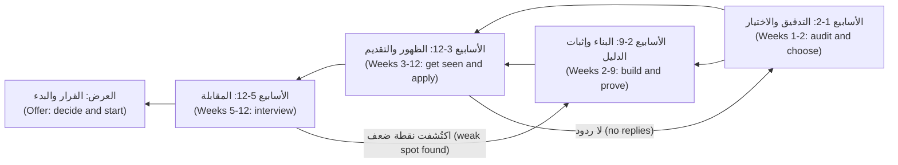

# الوحدة 7 — البطل (Hero): المشروع الختامي والتدريب

*تجمع هذه الوحدة الدورة كلّها في خطة واحدة (one plan) تستطيع تنفيذها فعلًا. لقد اخترت دورًا مستهدفًا (target role)، ورسمت فجواتك مقارنةً بما يتحقّق منه أصحاب العمل (employers)، وبنيت الدليل (built proof)، وكتبت السيرة الذاتية (CV)، وتدرّبت على المقابلات (practised interviews)، وتعلّمت كيف تعمل العروض الوظيفية (offers) والوظائف الأولى (first jobs). كلٌّ منها وحده درس منفصل (separate lessons). لكن حين تُجمع بالترتيب الصحيح، مع إيقاع أسبوعي (weekly rhythm) وتتبّع صادق (honest tracking)، تصبح بحثًا عن عمل (job search). يحوّل المشروع الختامي (capstone) كل شيء إلى خطة جاهزية وظيفية من 12 أسبوعًا (12-week job-readiness plan)، من تدقيق المهارات (skills audit) في الأسبوع الأول إلى قرار العرض (offer decision) في النهاية، ويبيّن كيف تعدّلها حين يقول الدليل (evidence) إن شيئًا ما لا ينجح. ستتابع دفعة (cohort) برنامج نجم للخرّيجين التقنيين (Najm Tech Graduate Programme) بينما يطلب خالد (Khalid) من كلٍّ منهم أن يكتب خطته قبل أن تُفتح نافذة التقديم (application window): عمر (Omar)، الذي «يستعدّ» ("preparing") منذ أشهر دون أن يتقدّم بطلب، وريم (Reem)، التي تقدّمت إلى كل مكان بسيرة ذاتية واحدة (one CV)، وهدى (Huda) ويوسف (Yousef) ومحمد (Mohammed)، ولكلٍّ منهم قيد مختلف (different constraint). وتنتهي الوحدة بحزمة تدريب على المقابلات (practice interview pack) من 40 سؤالًا تغطّي كل الوحدات.*

> **الخطوات (Steps):** Apply, Interview — تحويل كل ما تعلّمته إلى خطة واحدة تنفّذها أسبوعًا بأسبوع، والتمرّن على القرارات التي توصلك إلى التوظيف.

---

# 7.1 — المشروع الختامي: خطة جاهزيتك الوظيفية في 12 أسبوعًا (your 12-week job-readiness plan)، من التدقيق إلى العرض
*المستوى (Level): 🔴 متقدم (Advanced)* · *المتطلبات (Prerequisites): 0.2، 3.1، 4.1، 5.1، 6.1* · *الخطوة (Step): Build, Apply*

## ⚡ الدرس في دقيقة (In 60 seconds)
- البحث عن عمل مشروع (project): **التدقيق، والبناء وإثبات الدليل، والتقديم، والمقابلة، والقرار (audit, build and prove, apply, interview, decide)**، بمراحل متداخلة (overlapping phases) ومراجعة أسبوعية (weekly review).
- القاعدة الأهم: **ابدأ التقديم قبل أن تشعر بأنك جاهز (start applying before you feel ready)**. الدليل (proof) والطلبات (applications) والتدرّب على المقابلات (interview practice) يحسّن بعضها بعضًا، لذا تسير بالتوازي ابتداءً من الأسبوع 4 أو 5 تقريبًا.
- تتبّع مسارًا صغيرًا للطلبات (small pipeline): الطلبات، والردود (replies)، والمقابلات الأولية (screens)، والجولات التقنية (technical rounds)، والجولات النهائية (finals)، والعروض. والموضع الذي يخرج فيه الناس من مسارك يخبرك بما يجب إصلاحه تاليًا.
- مؤشّر القرار (Decision cue): في الأسابيع 4 و8 و12، قارن الدليل بالخطة (plan) وغيّر شيئًا واحدًا عن قصد: الهدف (target)، أو السيرة الذاتية، أو المشروع، أو التدرّب على المقابلات.
- الفخ الأكبر (Biggest trap): الاستعداد إلى ما لا نهاية (preparing forever) لأن التقديم يبدو محفوفًا بالمخاطر. الاستعداد دون طلبات لا يُنتج أي تغذية راجعة.

## 🧭 لماذا يهم
يلتقي خالد بالدفعة قبل اثني عشر أسبوعًا من إغلاق نافذة التقديم في برنامج نجم للخرّيجين التقنيين. ويسأل كلًّا منهم: «ماذا فعلت الأسبوع الماضي لتحصل على وظيفة، وكيف تعرف أن ذلك نجح؟» ⁦⁩

حلّ عمر قائمة طويلة من مسائل الخوارزميات (algorithm problems) وأنهى دورتين عبر الإنترنت (online courses)، لكنه لم يتقدّم إلى أي مكان: «لست جاهزًا لتصميم الأنظمة بعد» ⁦⁩. وأرسلت ريم سيرة ذاتية واحدة إلى عشرات الإعلانات الوظيفية (postings) ولم يصلها ردّ من أيٍّ منها تقريبًا؛ ولأنها لا تحتفظ بسجلّ، لا تستطيع أن تقول لماذا. وتواصل هدى تلميع مشاريع الدفاتر التفاعلية (notebook projects) بينما يطلب كل إعلان تقرؤه SQL وخطوط معالجة البيانات (pipelines). ويعمل يوسف بدوام كامل (full time) ولديه نحو ثماني ساعات في الأسبوع (eight hours a week). أمّا محمد فلديه معرض أعمال (portfolio) قوي، لكنه يصادف باستمرار إعلانات تشترط شهادة في التخصّص.

لا ينقص أيًّا منهم الجهد (effort). ما ينقصهم خطة تحوّل الجهد إلى دليل، والدليل إلى قرارات. قاعدة خالد (Khalid's rule): «بحلول الخميس، أرسلوا إليّ خطة من صفحة واحدة لاثني عشر أسبوعًا (one-page 12-week plan). لكل أسبوع مُخرَج (deliverable) يستطيع شخص آخر التحقّق منه، ولكل أسبوع رابع قرار (decision).» يشرح هذا الدرس كيف يكتبونها، والمُنتَج (artefact) الذي تخرج به هو خطتك أنت.

## 📐 كيف يعمل

### 🟢 الأساسيات

**المراحل الخمس (The five phases).** تصبح كل وحدة سابقة مرحلةً (phase). وهي تتداخل عن قصد: تواصل البناء (keep building) بينما تتقدّم بالطلبات، وتواصل التدرّب على المقابلات (practising interviews) بينما تنتظر الردود.

| المرحلة | الأسابيع (Weeks) | مُخرَج يستطيع شخص ما التحقّق منه | الدروس (Lessons) |
|---|---|---|---|
| **1. التدقيق والاختيار (Audit and choose)** | 1–2 | الدور المستهدف ودور بديل واحد (one fallback)؛ تدقيق المهارات؛ قائمة الفجوات (gap list)؛ جدول المسار الدراسي (study path table) | 0.2، 1.1–1.3، مسارك في 2.1–2.4 (your path in 2.1–2.4) |
| **2. البناء وإثبات الدليل (Build and prove)** | 2–9 | مشروع ختامي واحد لذلك الدور، قابل للتشغيل أو منشور، مع ملف README يستطيع غريب أن يتبعه | 3.1، 3.2، 3.3 |
| **3. الظهور أمام أصحاب العمل (Get seen)** | 3–12 | سيرة ذاتية رئيسية (master CV) ونسخ مُكيَّفة (tailored versions)؛ قائمة الأهداف (target list)؛ طلبات مُكيَّفة (tailored applications) كل أسبوع | 4.1، 4.2، 4.3 |
| **4. المقابلة (Interview)** | 5–12 | بنك قصص (story bank) من 8–10 قصص؛ ملاحظات المقابلات التجريبية (mock-interview notes)؛ قائمة بنقاط الضعف المتكرّرة | 5.1–5.3، 7.2 |
| **5. القرار والبدء (Decide and start)** | العروض | مقارنة العروض (offer comparison)؛ خطة الأيام التسعين الأولى (30-60-90 plan) | 6.1، 6.2، 6.3 |

تبدأ المرحلة 3 قبل أن يكتمل المشروع لأن المحادثات (conversations) تحتاج إلى وقت لتؤتي ثمارها؛ وتبدأ المرحلة 4 في الأسبوع 5 لأن المقابلات قد تأتي مبكرًا.



الأسهم الراجعة (backward arrows) هي بيت القصيد: المقابلات تكشف فجوات (reveal gaps) تعود إلى مرحلة البناء، والصمت (silence) يعيدك في العادة إلى التدقيق.

**إيقاع أسبوعي تستطيع الالتزام به (A weekly rhythm you can keep).** يجب أن تصمد الخطة في أسبوع عادي. حدّد ساعاتك الحقيقية أولًا، ثم قسّمها. تقسيم أوّلي معقول: نحو النصف للبناء والتعلّم، ونحو الربع للتقديم وبناء العلاقات المهنية (تكييف الطلبات (tailoring)، والطلبات، ورسالة أو طلب إحالة)، ونحو الربع للتدرّب على المقابلات (مقابلة تجريبية واحدة (one mock)، وبعض المسائل بصيغة الجهات التي تستهدفها، وقصص تتدرّب على روايتها بصوت عالٍ)، و30 دقيقة للمراجعة الأسبوعية. وإن لم يكن لديك سوى ثماني ساعات في الأسبوع، كما هو حال يوسف، فحافظ على النِّسَب وقلّص النطاق: مشروع واحد (one project)، وقائمة أهداف أقصر، ومقابلة تجريبية كل أسبوعين.

**جدول التتبّع (The tracker).** احتفظ بجدول واحد (one table)، في جدول بيانات (spreadsheet) أو ملف ملاحظات (notes file)، فيه صفّ واحد لكل طلب:

| صاحب العمل (Employer) | الدور (Role) | المصدر (Source) | مُكيَّف؟ ⁦(Tailored?)⁩ | إحالة؟ ⁦(Referral?)⁩ | المرحلة (Stage) | الإجراء التالي وتاريخه |
|---|---|---|---|---|---|---|
| سديم باي (Sadeem Pay) | مهندس واجهات خلفية مبتدئ | زميل فريق في هاكاثون (Hackathon teammate) | نعم (Yes) | نعم | تقدّمتُ، الأسبوع 5 (Applied, week 5) | المتابعة بعد أسبوع إن لم يصل ردّ |

بعد بضعة أسابيع، يُظهر عمودا **المصدر (source)** و**الإحالة (referral)** أيّ القنوات (channels) تُنتج ردودًا لك أنت، وهذا أفضل من أي نصيحة عامة.

### 🟡 التعمق أكثر (Going deeper)

**اقرأ مسار طلباتك، لا مزاجك (Read your funnel, not your mood).** التغذية الراجعة (feedback) في البحث عن عمل ضعيفة ومتأخّرة ومشوّشة، والرفض (rejection) يبدو أمرًا شخصيًا (feels personal). يحوّلها جدول التتبّع (tracker) إلى تشخيص (diagnosis). انظر أين تتوقّف الطلبات عن التقدّم:

| أين تتوقّف | السبب الأرجح (Most likely cause) | ما الذي تغيّره أولًا | الدرس (Lesson) |
|---|---|---|---|
| ردود قليلة أو معدومة | استهداف بعيد جدًا عن دليلك، أو سيرة ذاتية غير مُكيَّفة (untailored CV)، أو الاكتفاء بالقنوات الباردة | ضيّق الهدف، وكيّف السيرة لكل إعلان، وأضف الإحالات (add referrals) | 4.1–4.3 |
| مقابلات أولية، لكن لا جولات تقنية | إجابة غير واضحة عن «من أنا ولماذا هذا الدور» ("who I am and why this role")؛ أو أمور لوجستية (logistics) مثل موعد التفرّغ (availability) أو تصريح العمل (work authorisation) | أعد كتابة تقديمك لنفسك في دقيقتين (two-minute introduction)؛ وجهّز إجابات لوجستية واضحة | 5.1 |
| جولات تقنية، لكن لا جولات نهائية | فجوة مهارية حقيقية أو صيغة غير مألوفة (unfamiliar format) (البرمجة الحيّة (live coding)، أو المهمة المنزلية (take-home)، أو مراجعة شيفرة مكتوبة بالذكاء الاصطناعي) | تدرّب على الصيغة نفسها بالضبط؛ وعُد إلى قائمة الفجوات | 5.2، 5.3 |
| جولات نهائية، لكن لا عروض | الإجابات السلوكية (behavioural answers)، أو طريقة شرحك للقرارات والأخطاء | قوِّ قصصك بالنتائج والدروس؛ وأجرِ مقابلة تجريبية مع شخص أقدم منك | 5.1 |

لا تبحث عن معدّل ردود «طبيعي»؛ فالمعدّلات تختلف حسب السوق والدور والموسم. قارن نفسك بأسابيعك السابقة أنت.

**كيّف الخطة مع قيدك (Adapt the plan to your constraint).** لكل عضو في الدفعة (cohort member) قيد واحد (one constraint) يشكّل خطته أكثر من أي شيء آخر.

| الشخص (Person) | القيد (Constraint) | كيف تتغيّر الخطة |
|---|---|---|
| **عمر (Omar)** | يُفرط في الاستعداد (over-prepares)؛ ولم ينشر أي مشروع قط | يتقدّم بالطلبات من الأسبوع 3؛ ويجب أن يكون مشروعه الختامي منشورًا ومراقَبًا، لأن هذه فجوته، لا الخوارزميات (algorithms) |
| **ريم (Reem)** | لا تستطيع دائمًا شرح شيفرتها المبنية بالذكاء الاصطناعي (AI-built code) | طلبات أقل ومُكيَّفة؛ ويحصل كل ملف README على قسم «ما الذي تحقّقتُ منه» ("what I verified")؛ وكل أسبوع تشرح أحد ملفاتها بصوت عالٍ |
| **هدى (Huda)** | ضعف في SQL وفي بيئة الإنتاج | تعيد توجيه هدفها (retargets) إلى هندسة البيانات (data engineering)؛ وتُخصَّص الأسابيع 2–6 لـ SQL ولخط معالجة بيانات واحد (one pipeline) |
| **يوسف (Yousef)** | ثماني ساعات في الأسبوع | مشروع واحد للبنية التحتية بوصفها شيفرة، وقائمة أهداف قصيرة؛ وشهادة سحابية (cloud certification) فقط إن طلبتها الإعلانات التي يستهدفها |
| **محمد (Mohammed)** | لا يحمل شهادة في التخصّص | يستهدف أصحاب العمل الذين يعلنون معايير قائمة على المهارات (skills-based criteria)؛ ويعتمد على الإحالات؛ ويقرأ قواعد الأهلية (eligibility rules) لكل برنامج أولًا |

**اختر المشروع الختامي من مسار دورك (Pick the capstone from your role path).** اختر مشروعًا يثبت الوظيفة المستهدفة (يقدّم الدرس 3.1 مواصفات (spec) لكل دور)، وتعلّم ما يحتاج إليه من المكتبة (library):
- البرمجيات (Software): انشر وتحقّق باستخدام [*تصميم الأنظمة لمبرمجي الحدس (System Design for Vibe Coders)*، الدرس F.5 — صفحتك الحيّة الأولى، مع الدليل](../vibe/index.ar.html#lF-5)، ثم أضف [*تصميم الأنظمة لمبرمجي الحدس*، الدرس 4.4 — التراجع وبيئة التجهيز وبوابات الإصدار (Rollback, staging, and release gates)](../vibe/index.ar.html#l4-4).
- تطبيقات الذكاء الاصطناعي (AI applications): [*تصميم الأنظمة لمبرمجي الحدس*، الدرس 8.2 — الاختبارات بوصفها المواصفات التي لا يستطيع الوكيل تجاهلها](../vibe/index.ar.html#l8-2) و[*إدارة منتجات الذكاء الاصطناعي (AI Product Management)*، الدرس 6.1 — جودة تستطيع قياسها: المقاييس والمجموعات الذهبية وتحليل الأخطاء](../aipm/index.ar.html#/6.1).
- البيانات (Data): [*هندسة البيانات والتحليلات (Data Engineering & Analytics)*، الوحدة 1](../data/index.ar.html#/1.1) لـ SQL والنمذجة (modelling)، ثم خط معالجة بيانات (pipeline) من [*هندسة البيانات والتحليلات*، الوحدة 2](../data/index.ar.html#/2.1).
- السحابة والمنصّات (Cloud and platform): البنية التحتية بوصفها شيفرة (infrastructure as code) من [*السحابة وDevOps (Cloud & DevOps)*، الوحدة 3](../cloud/index.ar.html#/3.1)، تُنشر عبر خط نشر من [*السحابة وDevOps*، الوحدة 4](../cloud/index.ar.html#/4.1).
- الأمن (Security): أضف [*الذكاء الاصطناعي الآمن وأمن التطبيقات (Secure AI & Application Security)*، الدرس 1.1 — نمذجة التهديدات: تدفّقات البيانات وحدود الثقة وSTRIDE](../secai/index.ar.html#/1.1) إلى أيّ مشروع تبنيه.

أجرِ تقييمًا ذاتيًا (self-assessment)، مثل [التقييم الذاتي لدورة *تصميم الأنظمة لمبرمجي الحدس*](../vibe/assessment.ar.html)، في الأسبوعين 1 و8.

**النزاهة جزء من الخطة (Integrity is part of the plan).** تحت ضغط المواعيد النهائية (deadline pressure)، تُغري الطرق المختصرة (shortcuts tempt): مشروع من درس تعليمي (tutorial project) يُقدَّم على أنه أصلي (original)، أو مهمة منزلية مكتوبة بالذكاء الاصطناعي (AI-written take-home) لا تستطيع شرحها، أو مسمّى وظيفي مُبالَغ فيه (stretched title). وكلها تنهار حين يتعيّن عليك شرح عملك والبناء عليه. أفصح عن مساعدة الذكاء الاصطناعي حيث يُطلب منك ذلك، وكن قادرًا على شرح كل سطر تقدّمه والتحقّق منه.

### 🔴 نظرة الخبير (Expert view)

**تعامل مع الخطة على أنها تجارب (Treat the plan as experiments).** كل كتلة من أربعة أسابيع (four-week block) تختبر فرضية مكتوبة (written hypothesis)، مثل: «بهذا الهدف وهذه السيرة الذاتية وهذا المشروع، سأحصل على مقابلات تقنية» ⁦("With this target, CV and project, I will get technical interviews.")⁩. وعند نقطة المراجعة (checkpoint)، قرّر بناءً على الدليل:

| نقطة المراجعة | السؤال (Question) | إن كانت الإجابة نعم | إن كانت الإجابة لا |
|---|---|---|---|
| **الأسبوع 4 (Week 4)** | هل المشروع يسير وفق الخطة، وهل تُنتج السيرة الذاتية المُكيَّفة (tailored CV) ردودًا أو محادثات؟ | حافظ على الهدف | غيّر شيئًا واحدًا: الهدف، أو القسم العلوي من السيرة الذاتية، أو القناة (channel) (أضف الإحالات) |
| **الأسبوع 8 (Week 8)** | هل تصل إلى الجولات التقنية، والمشروع منشور ويعمل (project live)؟ | انقل الساعات نحو التدرّب على المقابلات | عُد إلى جدول مسار الطلبات (funnel table)؛ وفكّر في دورك البديل (fallback role) |
| **الأسبوع 12 (Week 12)** | هل لديك عروض أو جولات نهائية أو مسار طلبات ممتلئ (full pipeline)؟ | قرّر وابدأ (6.1، 6.2) | اكتب خطة الأسابيع الاثني عشر التالية (next 12-week plan) ممّا تعلّمته |

تغيير متغيّر واحد في كل مرة هو الطريقة الوحيدة التي تجعل عيّنة صغيرة ومشوّشة تخبرك بشيء.

**حزمة الأدلة (The evidence pack).** بحلول الأسبوع 9، يجب أن تستطيع إرسال رابط واحد (one link) يُظهر ما يتحقّق منه مدير التوظيف (hiring manager) في دورك: المشروع، وملف README الخاص به مع قراراتك وما تحقّقت منه، وسيرتك الذاتية، وملاحظة قصيرة عن كيفية استخدامك أدوات الذكاء الاصطناعي. يسمّيها خالد «الصفحة التي أقرؤها قبل المقابلة» ("the page I read before the interview").

**الأسبوع 12 نقطة مراجعة، لا موعد نهائي (Week 12 is a checkpoint, not a deadline).** الجداول الزمنية للتوظيف (hiring timelines) خارجة عن سيطرتك، وقد أُفيد بأن التوظيف في بداية المسيرة المهنية (early-career hiring) أضعف في المهن المعرّضة للذكاء الاصطناعي (AI-exposed occupations) (برينيولفسون وتشاندار وتشن، 2025)؛ والبحث الطويل (long search) ليس حكمًا عليك. كثير من برامج الخرّيجين (graduate programmes) توظّف وفق دورة سنوية (annual cycle)، وقد يتحرّك أصحاب العمل الكبار (large employers) أبطأ من الشركات الناشئة (startups)؛ فتحقّق من مواعيد كل صاحب عمل. واستمرّ بعد الأسبوع 12 بمستوى تستطيع الاستمرار عليه (sustainable level): بضعة طلبات مُكيَّفة في الأسبوع، ومقابلة تجريبية واحدة، وتحسين واحد للمشروع.

**اعتنِ بمدرج الإقلاع (Look after the runway).** قبل الأسبوع الأول، اكتب عدد الأسابيع التي تستطيع تحمّل كلفة البحث خلالها، وأي قيود تتعلّق بالتأشيرة أو الكفالة (تحقّق من القواعد الحالية)، ومتى توظّف الجهات التي تستهدفها. هذه الحقائق تحدّد ما إذا كنت ستقبل دورًا انتقاليًا (bridge role)، مثل عقد مؤقّت (contract) أو تدريب (internship) أو وظيفة في مسارك البديل (fallback track)، بينما تواصل البحث.

## 🧰 الأدوات
| المورد أو الأداة أو النموذج (Resource, tool or template) | ما هو وماذا يفعل | متى تلجأ إليه |
|---|---|---|
| **12-week job-readiness plan** — خطة الجاهزية الوظيفية في 12 أسبوعًا | صفحة واحدة (one page): الهدف والبديل، والمُخرَجات الأسبوعية (weekly deliverables)، ونقاط المراجعة (checkpoints) في الأسابيع 4 و8 و12 | الأسبوع 1، ثم تُراجَع عند كل نقطة مراجعة |
| **Skills audit** — تدقيق المهارات | مهاراتك مُقيَّمة بدرجات (scored) مقارنةً بإعلانات وظائف حقيقية (real postings)، مع دليل لكل درجة | الأسبوعان 1–2، ومرة أخرى في الأسبوع 8 |
| **Study path table** — جدول المسار الدراسي | المهارات التي يحتاج إليها دورك، والدروس التي تبنيها، والدليل الذي يُظهرها (الوحدة 2) | عند اختيار ما تتعلّمه في المرحلة 2 (choosing what to learn in phase 2) |
| **Application log** — سجلّ الطلبات | جدول تتبّعك: صفّ لكل طلب، مع المصدر والتكييف والإحالة والمرحلة والإجراء التالي (next action) | مع كل طلب (every application) وفي كل مراجعة أسبوعية |
| **Story bank** — بنك القصص | 8–10 قصص حقيقية بأسلوب STAR (الموقف، والمهمة، والإجراء، والنتيجة)، كما في الدرس 5.1 | من الأسبوع 5، قبل أول مقابلة أولية |
| **Brag document** — مستند الإنجازات | قائمة متجدّدة (running list) بما بنيته وأصلحته وتعلّمته، مع روابط (links) | أسبوعيًا (weekly)؛ فهو يغذّي السيرة الذاتية وقصصك |
| **Mock interview with a peer** — مقابلة تجريبية مع زميل | جولة تدريبية (practice round) مع زميل أو مرشد أو مركز التوظيف المهني، بصيغة الجهات التي تستهدفها ومُقيَّمة وفق معايير تقييم | أسبوعيًا من الأسبوع 5 (weekly from week 5) |
| **Weekly review** — المراجعة الأسبوعية | 30 دقيقة: حدّث جدول التتبّع، ودوّن درسًا واحدًا، وحدّد ثلاث أولويات | في الوقت نفسه كل أسبوع |

## 🏛️ عمليًا في بنك نجم
خطة هدى (Huda's plan)، كما أرسلتها إلى خالد. أظهر تدقيقها أن كل إعلان تقريبًا أرادته كان يطلب SQL وخطوط معالجة البيانات، فأعادت توجيه هدفها (retargeted) إلى هندسة البيانات، مع إبقاء علم البيانات (data science) دورًا بديلًا (fallback).

**خطة هدى للجاهزية الوظيفية في 12 أسبوعًا (Huda's 12-week job-readiness plan) (16 ساعة في الأسبوع (16 hours a week))**

| الأسبوع (Week) | المُخرَج (قابل للتحقّق) | الدروس |
|---|---|---|
| 1 | الهدف: مهندسة بيانات مبتدئة (junior data engineer) في بنوك الخليج وشركات التقنية المالية؛ البديل: عالمة بيانات (data scientist). تدقيق المهارات من 15 إعلانًا وظيفيًا (15 postings) | 0.2، 2.3 |
| 2 | جدول المسار الدراسي؛ مواصفات من صفحة واحدة (one-page spec) لخط معالجة بيانات المعاملات (transactions pipeline) على بيانات عامة (public data) | 2.3، 3.1 |
| 3 | تمارين SQL مكتوبة ومشروحة؛ نموذج البيانات للمشروع؛ السيرة الذاتية الرئيسية | [*هندسة البيانات والتحليلات*، الوحدة 1](../data/index.ar.html#/1.1)، 4.1 |
| 4 | **نقطة مراجعة (Checkpoint).** يعمل خط المعالجة من البداية إلى النهاية وفق جدول زمني؛ قائمة الأهداف؛ أول 3 طلبات مُكيَّفة (first 3 tailored applications) | 4.3 |
| 5 | فحوص جودة البيانات التي تفشل بوضوح؛ النسخة الأولى من بنك القصص (story bank v1)؛ أول طلب إحالة | [*هندسة البيانات والتحليلات*، الوحدة 3 — جودة البيانات (data quality)](../data/index.ar.html#/3.2)، 4.2، 5.1 |
| 6 | ملف README مع مخطّط وقرارات؛ تحديث LinkedIn (LinkedIn updated)؛ 4 طلبات (4 applications) | 3.2، 4.2 |
| 7 | مقابلتان تجريبيتان في SQL ومقابلة تجريبية في نمذجة البيانات مع الزملاء؛ 4 طلبات (4 applications) | 5.2، 5.3 |
| 8 | **نقطة مراجعة (Checkpoint).** مراجعة مسار الطلبات (funnel review)؛ إعادة تقييم التدقيق (audit re-scored) | 7.1 |
| 9 | حزمة الأدلة (evidence pack): رابط واحد فيه المشروع وملف README والسيرة الذاتية وملاحظة عن استخدام الذكاء الاصطناعي | 3.2 |
| 10–11 | حزمة التدريب من الدرس 7.2 (practice pack from 7.2)؛ التمرّن على أضعف قصّتين؛ المتابعات (follow-ups) | 5.1، 7.2 |
| 12 | **نقطة مراجعة (Checkpoint).** مقارنة العروض، أو خطة الأسابيع الاثني عشر التالية (next 12-week plan) | 6.1 |

**نموذج مراجعتها الأسبوعية (Her weekly review template)** (ملاحظة واحدة، خمسة أسطر):

```text
Week: 6        Hours planned / actual: 16 / 13
Shipped: README with diagram; 4 tailored applications
Funnel this week: 4 applied, 1 reply (Sadeem Pay recruiter), 0 screens done yet
One thing I learned: postings from banks mention data governance; add a section on it to my README
Next week's top three: SQL mock x2; data-modelling mock; book Sadeem Pay screen
```

في الأسبوع 8، أظهر جدول تتبّعها أن الطلبات التي جاءت بعد إحالة أو محادثة حصلت على ردود، وأن الطلبات الباردة (cold ones) لم تحصل عليها في الغالب. فأبقت على هدفها ونقلت الساعات من الطلبات الباردة إلى المحادثات: متغيّر واحد، غُيِّر بناءً على الدليل.

## 🛠️ التمارين (Exercises)
- 🟢 اكتب بيان دورك المستهدف (target-role statement) (الدور، والقطاع، والموقع، ودور بديل واحد)، وتدقيقًا للمهارات من عشرة إعلانات وظيفية حقيقية على الأقل، مع تقييم كل مهارة بدليل. *يكتمل عندما (Done when):* يكون لكل مهارة في الجدول درجة وملاحظة دليل، ويستطيع زميل (peer) أن يسمّي أهم ثلاث فجوات لديك دون أن يسألك.
- 🟡 اكتب خطتك لاثني عشر أسبوعًا في صفحة واحدة (one-page 12-week plan) على نموذج هدى: مُخرَج قابل للتحقّق (checkable deliverable) كل أسبوع، وميزانية ساعات حقيقية، وثلاث نقاط مراجعة (three checkpoints) في صورة قرارات «إن كانت الإجابة نعم / إن كانت لا». وأعِدّ جدول التتبّع. *يكتمل عندما:* يستطيع زميل التحقّق من كل مُخرَج عبر ملف أو رابط أو صفّ في جدول التتبّع، ويحتوي جدول التتبّع على صفوفه الخمسة الأولى.
- 🔴 نفّذ خطتك أربعة أسابيع، ثم اكتب نقطة مراجعة الأسبوع 4 (week-4 checkpoint): الفرضية (hypothesis)، ودليل مسار الطلبات (funnel evidence)، والمتغيّر الواحد الذي ستغيّره ولماذا. واطلب من مرشد أو مستشار مهني مراجعتها. *يكتمل عندما:* تكون لديك أربع مراجعات أسبوعية، وجدول تتبّع محدَّث (updated tracker)، وملاحظة نقطة مراجعة مؤرَّخة تسمّي تغييرًا واحدًا بالضبط ودليله.

## ⚠️ أخطاء وفخاخ (Mistakes and traps)
- **الاستعداد إلى ما لا نهاية (Preparing forever).** «دورة واحدة أخرى» لا تُنتج أي تغذية راجعة. ابدأ التقديم بين الأسبوعين 3 و5 (by week 3 to 5)، ودع المقابلات تُظهر لك ما تتعلّمه تاليًا.
- **رشّ سيرة ذاتية واحدة في كل مكان (Spraying one CV everywhere).** الكمّ غير المُكيَّف (untailored volume) دون جدول تتبّع لا يعلّمك شيئًا. أرسل طلبات أقل ومُكيَّفة وسجّل النتائج (record results).
- **تغيير كل شيء دفعة واحدة (Changing everything at once).** عندها لا يمكن تفسير النتيجة التالية. غيّر متغيّرًا واحدًا في كل نقطة مراجعة.
- **خطة تتجاهل أسبوعك الحقيقي (A plan that ignores your real week).** خطة من 40 ساعة (40-hour plan) لشخص لديه 8 ساعات فراغ (8 free hours) تفشل بحلول الأسبوع الثاني. ضع ميزانية لساعاتك الحقيقية، ثم قلّص النطاق (cut scope).
- **التعامل مع الأسبوع 12 كموعد نهائي (Treating week 12 as a deadline).** إنه نقطة مراجعة؛ استمرّ بإيقاع تستطيع المحافظة عليه (sustainable rhythm) أو اقبل دورًا انتقاليًا معقولًا.
- **الطرق المختصرة التي تمسّ النزاهة تحت الضغط (Integrity shortcuts under pressure).** المشاريع المنسوخة (copied projects)، والمسمّيات الوظيفية المضخَّمة (inflated titles)، والعمل المكتوب بالذكاء الاصطناعي الذي لا تستطيع شرحه تنهار في المقابلات. ابنِ النسخة الصادقة.

## 🧾 الخلاصة (Recap)
- البحث عن عمل مشروع بمراحل متداخلة: التدقيق (audit)، والبناء وإثبات الدليل، والظهور أمام أصحاب العمل، والمقابلة، والقرار (decide). ابدأ التقديم مبكرًا.
- الإيقاع الأسبوعي مع ميزانية ساعات حقيقية وجدول تتبّع ومراجعة من 30 دقيقة (30-minute review) يُبقي الخطة حيّة.
- اقرأ مسار طلباتك لتشخّص المشكلة: غياب الردود يشير إلى الاستهداف والسيرة الذاتية؛ وتعثّر الجولات التقنية يشير إلى المهارات والصيغة؛ وتعثّر الجولات النهائية (stalled finals) يشير إلى القصص والملاءمة.
- نقاط المراجعة في الأسابيع 4 و8 و12 تغيّر متغيّرًا واحدًا في كل مرة، بناءً على الدليل.
- الأسبوع 12 نقطة مراجعة، لا حكم نهائي. خطّط لمدرج الإقلاع، وحافظ على نزاهتك، وواصل (keep going).

## ✍️ اختبر نفسك (Check yourself)

**1. قضى عمر (Omar) عشرة أسابيع في التدرّب على الخوارزميات (algorithm practice) وأنهى دورتين عبر الإنترنت (two online courses)، ولم يتقدّم إلى أي مكان لأنه لا يشعر بأنه جاهز (does not feel ready). ما أفضل خطوة تالية في خطته (best next step for his plan)؟**

- A. أن ينهي دورة ثالثة عبر الإنترنت أولًا، كي يشعر بأنه مستعدّ تمامًا (fully prepared) حين تُطرح أسئلة تصميم الأنظمة (system-design questions)
- B. أن يبدأ الطلبات المُكيَّفة (tailored applications) الآن بينما يبني مشروعًا منشورًا (deployed project)، وأن يراجع النتائج أسبوعيًا
- C. أن يرسل سيرته الذاتية الحالية غير المُكيَّفة إلى أكبر عدد ممكن من الإعلانات (postings) هذا الأسبوع ليزيد فرصه إلى أقصى حدّ
- D. أن ينتظر دورة برامج الخرّيجين في العام المقبل كي يتوفّر له وقت أطول للاستعداد كما يجب (prepare properly)

<details><summary>الإجابة</summary>

**B.** التقديم (applying) يُنتج تغذية راجعة (feedback) لا يستطيع الاستعداد (preparation) إنتاجها، وفجوته الحقيقية (real gap) هي النشر (deployment)، لا الخوارزميات (algorithms). أمّا C فيستبدل فخًّا بفخ آخر هو الكمّ غير المُكيَّف (untailored volume)؛ وA وD يُبقيانه في الاستعداد إلى ما لا نهاية (preparing forever). (🟢 الأساسيات.)

</details>

**2. بعد شهر، يُظهر جدول تتبّع ريم (Reem's tracker) طلبات كثيرة (many applications)، وبضع مقابلات أولية مع مسؤولي التوظيف (a few recruiter screens)، ولا جولات تقنية (no technical rounds) بعد أيٍّ منها. وفقًا لجدول مسار الطلبات (funnel table)، إلامَ يجب أن تنظر أولًا (look at first)؟**

- A. تدرّبها على الخوارزميات (algorithm practice)، لأن المهارة التقنية (technical skill) هي عادةً ما يعيق الخرّيجين (blocks graduates) في هذه المرحلة
- B. صورة ملفّها الشخصي على GitHub وصورة الغلاف على LinkedIn (LinkedIn banner)، كي يكوّن مسؤولو التوظيف (recruiters) انطباعًا أوّل أفضل
- C. نشر مشروع معرض أعمالها، كي يستطيع مُجري المقابلة الأولية (screener) النقر على رابط حيّ (live link) أثناء المكالمة
- D. تقديمها لنفسها وقصة «لماذا هذا الدور»، إضافةً إلى إجابات واضحة عن موعد التفرّغ (availability) وتصريح العمل (work authorisation)

<details><summary>الإجابة</summary>

**D.** المقابلات الأولية التي لا تؤدّي إلى شيء تشير إلى طريقة تقديمها لنفسها وإلى الأمور اللوجستية (logistics). أمّا A فيناسب الإخفاق في الجولات التقنية، وهي لا تصل إليها أصلًا. (🟡 التعمق أكثر (Going deeper).)

</details>

**3. عند نقطة مراجعة الأسبوع 4 (week-4 checkpoint)، لم يتلقَّ يوسف (Yousef) أي ردّ على اثني عشر طلبًا باردًا (twelve cold applications). ويريد أن يغيّر دوره المستهدف (target role)، ويعيد كتابة سيرته الذاتية كلها (rewrite his whole CV)، ويبدأ مشروعًا جديدًا (new project)، وينتقل إلى مواقع وظائف أخرى (different job boards)، وكل ذلك هذا الأسبوع. بماذا يجب أن ينصحه خالد (Khalid)؟**

- A. أن يغيّر متغيّرًا واحدًا، مثل القسم العلوي من السيرة الذاتية أو إضافة الإحالات (adding referrals)، وأن يُبقي الباقي ثابتًا
- B. أن يجري التغييرات الأربعة كلها هذا الأسبوع، لأن اثني عشر طلبًا بلا ردّ تُظهر أن الخطة فشلت بوضوح (clearly failed)
- C. ألّا يغيّر شيئًا على الإطلاق، لأن أربعة أسابيع وقت مبكر جدًا للحكم على أي شيء في البحث عن عمل
- D. أن يتوقّف عن التقديم (stop applying) حتى ينتهي المشروع الجديد، كي يكون كل طلب لاحق أقوى

<details><summary>الإجابة</summary>

**A.** مع عيّنة صغيرة ومشوّشة، لا يمكن التعلّم إلا من تغيير واحد في كل مرة. أمّا B فيجعل النتائج التالية غير قابلة للقراءة؛ وC يتجاهل الدليل (ignores evidence)؛ وD هو فخ الاستعداد إلى ما لا نهاية (preparing-forever trap). (🔴 نظرة الخبير (Expert view).)

</details>

**4. لدى يوسف (Yousef) نحو ثماني ساعات في الأسبوع (eight hours a week) إلى جانب وظيفة بدوام كامل (full-time job). أيّ خطة هي الأكثر واقعية (most realistic)؟**

- A. الخطة نفسها التي يتّبعها الباحث عن عمل بدوام كامل (full-time searcher)، مضغوطة في أمسياته وعطلات نهاية الأسبوع حتى تنتهي
- B. تأجيل البحث كله حتى يستطيع تحمّل ترك وظيفته والبحث بدوام كامل
- C. النِّسَب نفسها بنطاق أصغر: مشروع واحد (one project)، وقائمة أهداف قصيرة، ومقابلة تجريبية كل أسبوعين
- D. التدرّب على المقابلات فقط، لأن وظيفته الحالية تثبت أصلًا المهارات التي يريدها أصحاب العمل

<details><summary>الإجابة</summary>

**C.** ضع ميزانية لساعاتك الحقيقية، ثم قلّص النطاق مع الحفاظ على التوازن. أمّا A فيفشل بحلول الأسبوع الثاني؛ وB وD يُسقطان مراحل تحتاج إليها الخطة. (🟢 الأساسيات.)

</details>

**5. نحن في الأسبوع 12. لدى محمد (Mohammed) مقابلتان في الجولة النهائية (two final-round interviews) لا تزالان جاريتين، لكن لا عرض حتى الآن (no offer yet). بماذا يوصي الدرس (What does the lesson recommend)؟**

- A. أن يعدّ الخطة فاشلة ويبدأ من جديد بدور مستهدف جديد، لأن اثني عشر أسبوعًا لم تُنتج عرضًا
- B. أن يعامل الأسبوع 12 كنقطة مراجعة (treat week 12 as a checkpoint): يخطّط للأسابيع الاثني عشر التالية (plan the next 12 weeks) ويحافظ على إيقاع ثابت (steady rhythm) بينما تجري الجولات النهائية
- C. أن يوقف كل نشاط آخر في البحث عن عمل وينتظر ببساطة حتى يردّ صاحبا العمل في الجولة النهائية (final-round employers)
- D. أن يقبل أول دور انتقالي يظهر، أيًّا كان، كي ينتهي البحث أخيرًا

<details><summary>الإجابة</summary>

**B.** الجداول الزمنية (timelines) خارجة عن سيطرته، وجولتان نهائيتان (two finals) تُظهران أن الخطة تنجح. أمّا A فيسيء قراءة الدليل؛ وC يتركه بلا شيء إن رفضه كلاهما؛ وD يتجاهل تخطيطه لمدرج الإقلاع. (🔴 نظرة الخبير (Expert view).)

</details>

## 📚 المراجع (References)
- برينيولفسون وتشاندار وتشن ⁦⁩، ⁦"Canaries in the Coal Mine? Six Facts about the Recent Employment Effects of Artificial Intelligence"⁩، مختبر ستانفورد للاقتصاد الرقمي (Stanford Digital Economy Lab)، أغسطس 2025 — https://digitaleconomy.stanford.edu/
- توثيق GitHub (GitHub Docs)، حول ملفات README (About READMEs) — https://docs.github.com/en/repositories/managing-your-repositorys-settings-and-features/customizing-your-repository/about-readmes
- [التقييم الذاتي لدورة *تصميم الأنظمة لمبرمجي الحدس*](../vibe/assessment.ar.html)
- [*الذكاء الاصطناعي الآمن وأمن التطبيقات*، الدرس 12.2 — المسيرة المهنية في الأمن: الأدوار والشهادات ومعرض الأعمال](../secai/index.ar.html#/12.2)
- [*إدارة منتجات الذكاء الاصطناعي*، الدرس 10.2 — المسيرة المهنية لمدير منتجات الذكاء الاصطناعي: المقابلات ومعرض الأعمال والنمو](../aipm/index.ar.html#/10.2)

---

# 7.2 — حزمة المقابلات التدريبية: 40 سؤالًا قائمًا على سيناريوهات (40 scenario questions)
*المستوى: 🔴 متقدم* · *المتطلبات: 7.1* · *الخطوة: Interview*

> **قيد المراجعة (under revision)، نوفمبر 2026.** في كثير من أسئلة هذا الامتحان التدريبي (practice exam) يمكن تمييز الخيار الصحيح من طوله أو صياغته، لذا فالدرجة العالية هنا لا تدل على الجاهزية (readiness) لأي امتحان حقيقي. استخدمه للتدرّب على التفكير (reasoning): أجب عن كل سؤال بكلماتك قبل أن تقرأ الخيارات، ثم قارن.

## ⚡ الدرس في دقيقة (In 60 seconds)
- هذه حزمة تدريبية (practice pack) من 40 سؤالًا تغطي كل الوحدات، من قراءة سوق العمل إلى النمو بعد سنتك الأولى. معظم الأسئلة سيناريوهات (scenarios) مع أفراد الدفعة: أي مشروع تبني، وأي بند في السيرة الذاتية (CV bullet) أقوى، وكيف تجيب، وأي عرض وظيفي (offer) تقبل، وماذا تفعل في أسبوعك الثاني (week two).
- أجب عنها في جلسة واحدة (one sitting) مدتها نحو 60 دقيقة، دون ملاحظات ودون مساعد ذكاء اصطناعي. اختر إجابتك قبل أن تفتح الإجابة المخفية.
- تنتهي كل إجابة بوسم (tag) مثل *(Interview · 5.1)*: خطوة البحث عن عمل، ثم الدرس الذي تعود إليه.
- صحّح لنفسك (score yourself)، ثم جمّع أخطاءك حسب الخطوة. تكتّل الأخطاء يشير إلى الجزء من خطتك الذي يجب إصلاحه تاليًا، تمامًا كالقمع في الدرس 7.1.
- أكبر فخ: قراءة الإجابات أولًا. التعرّف على الإجابة الصحيحة أسهل بكثير من اختيارها، ولا يخبرك بشيء عن أدائك في جولة حقيقية.

## 🧭 لماذا يهم
في الأسبوع العاشر من خطتها ذات الاثني عشر أسبوعًا (12-week plan)، تملك هدى بنك قصص ومسار ترشيحات نشطًا (live pipeline) وجولتين تقنيتين محجوزتين. ما لا تعرفه هو مواضع ضعفها المتبقية. يعطي خالد الدفعة هذه الحزمة مساء يوم أحد بقاعدة واحدة (one rule): "أجيبوا أولًا، ثم انظروا. ثم أرسلوا لي سجل المراجعة (review log)، لا درجتكم."

يحصل عمر على 34 من 40 ويشعر بالرضا حتى يجمّع أخطاءه: خمسة من الأخطاء الستة أسئلة من خطوتي التقديم والبدء، عن العروض الوظيفية والإحالات (referrals) وأسابيعه الأولى في الوظيفة. كانت إجاباته في الخوارزميات والتصميم شبه مثالية؛ أما حكمه (judgement) على كل ما يحيط بالمقابلة فلم يكن كذلك. تخطئ ريم في أسئلة أقل مما توقعت، لكنها تعلّم أربعًا من إجاباتها الصحيحة على أنها تخمينات (guesses)، وكلها عن التحقق من الشيفرة التي يكتبها الذكاء الاصطناعي. صار كلاهما يعرف ما يجب أن يتدرب عليه في الأسبوعين الأخيرين قبل الجولات النهائية. وهذا هو الغرض من الحزمة: ليست درجة، بل خريطة لما يجب إصلاحه.

## 📐 كيف يعمل

### 🟢 الأساسيات
**طريقة أدائها (How to take it).** اضبط مؤقتًا (timer) على 60 دقيقة. أغلق ملاحظاتك وأي مساعد ذكاء اصطناعي (AI assistant). لكل سؤال، اختر خيارًا واحدًا (one option) واكتبه، مع علامة ثقة سريعة: *متأكد (sure)* أو *تخمين (guess)*. وبعد ذلك فقط افتح الإجابة. في المقابلة تجيب قبل أن ترى التغذية الراجعة؛ فتدرّب بالطريقة نفسها.

**كيف تعمل الأسئلة (How the questions work).** لكل سؤال إجابة واحدة هي الأفضل (one best answer). الخيارات الخاطئة واقعية (realistic)، من النوع الذي يفعله الخرّيج القلق (anxious graduate) فعلًا: التقديم في كل مكان بسيرة ذاتية واحدة، والادعاء بمعرفة Kubernetes، وقبول عرض شفهي. تشرح الإجابات لماذا يكون الخيار المغري خاطئًا، إلى جانب سبب صحة الخيار الصحيح.

### 🟡 التعمق أكثر
**طريقة المراجعة (How to review).** احتفظ بسجل مراجعة فيه صف واحد لكل سؤال أخطأت فيه، أو أصبت فيه بالتخمين. سجّل إجابتك، والإجابة الصحيحة، وسبب اختيارك، والدرس المذكور في الوسم. ثم جمّع الصفوف حسب الخطوة:

| تتكتّل الأخطاء في | ما يعنيه ذلك عادةً | إلى أين تذهب |
|---|---|---|
| الاستكشاف والتعلّم (Explore, Learn) | تصوّرك للأدوار أو لخط الأساس المطلوب من المبتدئ غير واضح | الوحدات 0–2 (Modules 0–2) |
| البناء والإثبات (Build, Prove) | تعرف المهارات لكن لا تعرف ما يُعدّ إثباتًا | الوحدة 3 (Module 3) |
| التقديم (Apply) | السيرة الذاتية أو شبكة العلاقات (network) أو القنوات أو العروض الوظيفية | الوحدة 4، الدرس 6.1 (Module 4, lesson 6.1) |
| المقابلة | الصيغة (format) أو البنية (structure) أو الصدق تحت الضغط | الوحدة 5 (Module 5) |
| البدء والنمو (Start, Grow) | الأيام التسعون الأولى (the first 90 days) وما بعدها | الدرسان 6.2 و6.3 (Lessons 6.2 and 6.3) |

الإجابات الصحيحة المعلَّمة بـ *تخمين* تُحسب أخطاءً. ثم أعد قراءة قسم الدرس الذي يسمّيه الوسم وأعد حلّ أحد تمارينه. إعادة القراءة وحدها لا تكفي.

### 🔴 نظرة الخبير
**استخدمها مقابلةً تجريبية (Use it as a mock interview).** اطلب من زميل أن يقرأ عشرة أسئلة بصوت عالٍ (aloud) دون الخيارات. أجب بكلماتك الخاصة، ثم قل ما *لن* تفعله ولماذا. هذا أقرب إلى الجولة الحقيقية، حيث لا يعرض عليك أحد أربعة خيارات. وبعد أسبوعين، أعد الحزمة كاملة بترتيب مختلف؛ فالدرجة التي ترتفع فقط لأنك تتذكر الحروف لا تعني شيئًا.

**للمرشدين المهنيين ومديري التوظيف (For advisers and hiring managers).** تصلح الحزمة بنكَ أسئلة مشتركًا. يمكن للمرشدين (advisers) تكليف الطلاب بها بعد خطة المشروع الختامي (capstone plan)؛ ويمكن لمديري التوظيف (hiring managers) استخدام السيناريوهات أسئلةَ متابعة (follow-up prompts) في الجولات السلوكية (behavioural rounds). غيّر الأسماء وجهة العمل، وأبقِ على المعضلة.

## 🧰 الأدوات
| المورد أو الأداة أو النموذج | ما هو وماذا يفعل | متى تلجأ إليه |
|---|---|---|
| **Practice exam review log** — سجل مراجعة الامتحان التدريبي | صف واحد لكل سؤال أخطأت فيه أو خمّنته: إجابتك، والإجابة الصحيحة، والسبب، والدرس الذي تراجعه، وإجراء واحد (one action) | مباشرة بعد أداء الحزمة، ومرة أخرى بعد إعادتها |
| **Mock interview with a peer** — مقابلة تجريبية مع زميل | جولة تدريبية يطرح فيها صديق أسئلة من قائمة ويقيّم بمعيار تقييم (scores with a rubric) | عند قراءة السيناريوهات بصوت عالٍ دون الخيارات، في الأسبوعين 10–11 من خطتك (weeks 10–11 of your plan) |
| **Story bank** — بنك القصص | ‏8–10 قصص حقيقية بطريقة STAR، كل منها موسوم بالكفاءات التي تُظهرها | عندما يذكّرك سيناريو بقصة لم تدوّنها بعد |

## 🏛️ عمليًا في بنك نجم
سجل المراجعة الخاص بعمر، وهي الصفوف التي طلب خالد أن يحضرها إلى اجتماعهما الثنائي (1:1):

| السؤال (Q) | إجابتي | الصحيحة (Correct) | متأكد أم تخمين | لماذا اخترت إجابتي (Why I chose mine) | الدرس | الإجراء (Action) |
|---|---|---|---|---|---|---|
| 13 | B | D | متأكد | ظننت أن السيرة الذاتية وحدها تكفي | 4.2 | أكتب ملخصًا من سطرين قابلًا لإعادة التوجيه لمشروعي الختامي |
| 14 | B | A | متأكد | ظننت أن العرض المكتوب نهائي | 6.1 | أعيد قراءة قسم "الشروط (Conditions)"؛ وأدرج الشروط الواردة في عرض نجم |
| 29 | C | D | تخمين | رأيت الموافقات عائقًا | 6.2 | أقرأ دليل نجم لاعتماد التغييرات (change-approval guide) قبل دورتي التدريبية (rotation) |
| 32 | A | B | متأكد | وثقت بموقع رواتب واحد | 6.1 | أسأل اثنين من الخريجين السابقين (alumni) ومسؤول توظيف (recruiter) عن النطاق |

تعليق خالد: "أخطأت في أسئلة تقنية (technical questions) قليلة. اقضِ هذا الأسبوع على الصفين 13 و14: فهما يتعلقان بطريقة تعاملك مع الناس والوعود، وهذا ما تختبره الجولة النهائية."

## 🛠️ التمارين
- 🟢 أدِّ الحزمة كاملة في جلسة واحدة مدتها 60 دقيقة (one 60-minute sitting)، دون ملاحظات أو أدوات ذكاء اصطناعي (AI tools)، معلّمًا كل إجابة بـ *متأكد* أو *تخمين*. *يكتمل عندما:* تكون لديك درجة من 40 (a score out of 40) وعدد تخميناتك، وكلاهما مكتوب في ملف مسيرتك المهنية (career folder).
- 🟡 ابنِ سجل المراجعة لكل سؤال أخطأت فيه أو خمّنته، وجمّع الصفوف حسب الخطوة، وأعد حل تمرين واحد من الدرس الذي يقف وراء أكبر تكتّل لديك. *يكتمل عندما:* يسمّي كل صف درسًا وإجراءً، ويستوفي التمرين المُعاد سطر *يكتمل عندما* الخاص به.
- 🔴 أدِر عشرة أسئلة مقابلةً تجريبية شفهية مع زميل، دون الخيارات، ثم أعد الحزمة كاملة بعد أسبوعين بترتيب مختلف. *يكتمل عندما:* يكون الزميل قد قيّم إجاباتك الشفهية من 1 إلى 3 (scored your spoken answers 1–3)، وتُظهر إعادتك أخطاءً أقل في الخطوة التي تكتّلت فيها محاولتك الأولى.

## ⚠️ أخطاء وفخاخ
- **استراق النظر إلى الإجابات (Peeking at the answers).** التعرّف يوهمك بالمعرفة. التزم بإجابة أولًا، في كل مرة.
- **الاكتفاء بعدّ الدرجة (Counting only the score).** التخمين الصحيح خطأ متنكّر. علّم درجة ثقتك (mark confidence) وسجّل التخمينات.
- **إعادة القراءة دون تطبيق (Rereading without doing).** عد إلى الدرس، ثم أدِّ أحد تمارينه أو حدّث أحد مُخرجاتك.
- **حفظ الحروف (Memorising letters).** أعد الحزمة بترتيب مختلف، وأجب بصوت عالٍ دون خيارات.
- **معاملة الحزمة كأنها المقابلة (Treating the pack as the interview).** الجولات الحقيقية فيها أسئلة متابعة (follow-up questions). استخدم الحزمة لاكتشاف نقاط الضعف (weak spots)، ثم تدرّب عليها مع شخص.

## ✍️ الامتحان التدريبي

**1. يجد مسح السوق (market scan) الذي أجراه يوسف لعشرة إعلانات لوظائف منصات للمبتدئين (junior platform ads) أن Git ورد في تسعة إعلانات وDocker في أربعة. كيف ينبغي أن يقرأ هذه الأعداد (read those counts)؟**

- A. كلاهما مهارة أساسية (baseline skills)، لأن كلًّا منهما يظهر في أكثر من ثلاثة من الإعلانات العشرة
- B. Git مهارة أساسية (baseline skill) وDocker عامل تمييز (differentiator)، لذا يُثبت Git أولًا ثم Docker
- C. كلاهما عامل تمييز (differentiators)، لأن أيًّا منهما لا يظهر في كل إعلان جمعه
- D. Docker هو الأساس الحقيقي، لأن الأدوات الأحدث تهم أصحاب العمل أكثر من القديمة

<details><summary>الإجابة</summary>

**B.** المهارات الواردة في سبعة إعلانات أو أكثر من عشرة هي الأساس؛ والواردة في ثلاثة إلى ستة هي عوامل التمييز (differentiators). يسيء A وC تطبيق العتبات؛ ويستبدل D بالدليل تخمينًا عمّا هو رائج. *(Explore · 0.1)*

</details>

**2. تجد هدى إعلانًا بعنوان "عالم بيانات (Data Scientist)". المهام (duties) هي كتابة تقارير SQL (SQL reports)، وصيانة لوحات المعلومات (dashboards)، والإجابة عن أسئلة شبكة الفروع (the branch network). كيف ينبغي أن تتعامل معه؟**

- A. على أنه دور عالم بيانات، لأن المسمى هو ما سيظهر في سيرتها الذاتية لاحقًا
- B. على أنه دور تطبيقات ذكاء اصطناعي، لأن لوحات المعلومات الحديثة تُبنى بالنماذج (models) بشكل متزايد
- C. على أنه دور هندسة برمجيات، لأن تقارير SQL ولوحات المعلومات نوع من الشيفرة
- D. على أنه أقرب إلى دور محلل بيانات، بالحكم من مهامه المدرجة (listed duties) لا من مسماه

<details><summary>الإجابة</summary>

**D.** تختلف المسميات (titles) بين أصحاب العمل؛ أما المهام فتصف الأسبوع الحقيقي، وهذه مهام محلل (analyst duties). يثق A بالتسمية؛ ويمطّ B وC المهام لتناسب عائلة أدوار لا تصفها. *(Explore · 0.2)*

</details>

**3. تبدأ عائشة مقابلة الفرز مع مسؤول التوظيف (recruiter screen) لعمر بعبارة "حدثني عن نفسك" ⁦("Tell me about yourself.")⁩. أي إجابة تناسب شكل الدقيقة الواحدة الذي يقدمه الدرس (the lesson's 60-second shape) أكثر؟**

- A. خرّيج (Graduate)؛ بنى ونشر واجهة برمجية للحجز (booking API) مع اختبارات؛ يريد عملًا في الواجهة الخلفية؛ تجذبه دورات نجم التدريبية (Najm's rotations)
- B. استعراض لشهادته الجامعية (degree) مدته خمس دقائق، سنة بسنة، ينتهي بدرجات سنته الأخيرة (final-year grades) وسجله في المسابقات (contest record)
- C. قائمة بالتقنيات الإحدى عشرة (eleven technologies) في سيرته الذاتية، كي تطابقه مع الإعلان بسرعة
- D. "كل شيء موجود في سيرتي الذاتية. هل هناك شيء محدد فيها تودّين أن أشرحه أكثر؟"

<details><summary>الإجابة</summary>

**A.** يغطي التعريف بالنفس من أنت الآن، وماذا بنيت، وماذا تريد تاليًا، ولماذا هذه الجهة، في نحو دقيقة. يطول B وC دون أن يقولا لماذا هذا الدور؛ ويهدر D السؤال الوحيد الذي تطرحه كل مقابلة فرز (every screen). *(Interview · 5.1)*

</details>

**4. كان مولّد التقارير (report generator) لدى محمد يعمل الأسبوع الماضي ويفشل اليوم. بينهما 30 إيداعًا صغيرًا (small commits)، واختبار واحد يعيد إنتاج الفشل (reproduces the failure). ما أسرع طريقة موثوقة (fastest reliable way) لإيجاد السبب؟**

- A. قراءة كل فرق (diff) منذ الأسبوع الماضي من البداية، بالترتيب، حتى يبدو شيء مريبًا (suspicious)
- B. التراجع عن (revert) الإيداعات الثلاثين (30 commits) كلها، ثم إعادة تطبيقها واحدًا تلو الآخر يدويًا وإعادة تشغيل التطبيق في كل مرة
- C. تشغيل `git bisect` على الإيداعات الثلاثين، باستخدام الاختبار الفاشل لتعليم كل إيداع بأنه سليم أو معيب
- D. إعادة كتابة المولّد من الصفر، لأن تتبع السبب عبر السجل (history) سيستغرق وقتًا طويلًا

<details><summary>الإجابة</summary>

**C.** يجري `git bisect` بحثًا ثنائيًا (binary-searches) في السجل، والإيداعات الصغيرة تعني أنه يشير إلى بضعة أسطر. B نسخة يدوية بطيئة من الفكرة نفسها؛ وA تخمين (guesswork)؛ وD يتخلص من الدليل وقد يعيد الخلل. *(Learn · 1.1)*

</details>

**5. لدى ريم تسعة مستودعات مثبّتة (pinned repositories): ستة واجبات دراسية (course assignments)، ودرسان تعليميان قديمان (old tutorials)، ومشروعها الختامي (capstone) في المرتبة السادسة من القائمة. سيقضي المراجع (a reviewer) نحو دقيقة على ملفها الشخصي (profile). ما الذي ينبغي أن تغيّره أولًا؟**

- A. إضافة مزيد من المستودعات (more repositories)، كي يبدو ملفها الشخصي نشطًا وواسعًا قدر الإمكان للمراجعين الذين يتصفحونه
- B. ملء مخطط المساهمات (contribution graph) بإيداعات صغيرة، كي يبدو الملف مشغولًا كل يوم أمام المراجعين
- C. تثبيت أربعة إلى ستة مستودعات، المشروع الختامي أولًا، وإلغاء تثبيت الواجبات والدروس القديمة
- D. جعل كل مستودع خاصًا (private) عدا المشروع الختامي، وحذف ملفات README من البقية كلها

<details><summary>الإجابة</summary>

**C.** يتصفح المراجعون (reviewers skim) الملف الشخصي، ثم المستودعات المثبتة، ثم ملف README واحدًا، لذا يجب أن يكون المشروع الختامي أول ما يرونه. يتلاعب B بمخطط يتجاهله المراجعون المتمرسون؛ ويدفن A وD العمل أو يخفيانه دون فائدة. *(Prove · 3.2)*

</details>

**6. في أسبوعه الأول في نجم، لا يعرف يوسف كم ينبغي أن يحاول وحده (try alone) قبل طلب المساعدة (asking for help). لم يخبره أحد. ماذا ينبغي أن يفعل؟**

- A. أن يسأل سالم في أول اجتماع ثنائي (first 1:1) عن المدة التي يحاول فيها وحده قبل السؤال، لأن الفرق تختلف
- B. ألا يسأل أبدًا خلال فترة التجربة (probation)، كي يبدو مستقلًا وكفؤًا أمام الفريق
- C. أن يسأل فورًا (immediately) كلما فشل أي شيء، لأن كل دقيقة يقضيها عالقًا وقت مهدر
- D. أن يراسل أكبر المهندسين خبرة على انفراد في كل مرة، لأن كبار المهندسين يجيبون أسرع

<details><summary>الإجابة</summary>

**A.** الفرق تختلف، لذا اسأل عن تفضيل المدير، ثم استخدم ذلك الحد الزمني (time limit) وقالب السؤال. B هو الصمت الذي يكلّف الفرق أكثر من غيره؛ وC يتخطى المحاولة أولًا؛ وD يرسل الأسئلة إلى حيث لا تفيد الإجابة أحدًا آخر. *(Start · 6.2)*

</details>

**7. أمام ريم ستة أسابيع قبل التقديم على أدوار تطبيقات الذكاء الاصطناعي للمبتدئين (junior AI application roles). أي خطة تطابق أفضل مطابقة مستوى المبتدئ المطلوب (the junior bar) لهذا الدور؟**

- A. تدريب نموذج لغوي صغير خاص بها من الصفر على بيانات عامة، لإظهار معرفة عميقة بالنماذج
- B. بناء منصة متعددة الوكلاء (multi-agent platform) بعشرة وكلاء متعاونين، لإظهار قدرتها على العمل بمستوى كبار المهندسين (senior level)
- C. جمع شهادات (certificates) من خمسة أطر ذكاء اصطناعي (AI frameworks)، كي تطابق سيرتها الذاتية أكبر عدد ممكن من الإعلانات
- D. ميزة RAG واحدة تستطيع شرحها، مع مجموعة مرجعية من 30 حالة (30-case golden set)، واختبارات حقن (injection tests)، وتكلفة لكل طلب

<details><summary>الإجابة</summary>

**D.** هذا هو مستوى المبتدئ المطلوب: بناء ميزة واحدة تفهمها وتقييمها وتأمينها وحساب تكلفتها. أما A وB فهما "غير متوقعين بعد" على مستوى المبتدئ؛ وC يضيف ادعاءات لا أدلة. *(Learn · 2.2)*

</details>

**8. يحتفظ يوسف بسيرة ذاتية أساسية واحدة (one base CV) لأدوار المنصات (platform roles). إعلان جديد لوظيفة منصات للخريجين يشدد على البنية التحتية كشيفرة (infrastructure as code) والمراقبة (monitoring). كيف ينبغي أن يكيّف سيرته الذاتية (tailor his CV) له؟**

- A. إعادة بناء السيرة الذاتية كلها من الصفر حول هذا الإعلان، وإعادة كتابة كل قسم (every section) بكلمات صاحب العمل نفسها
- B. قضاء نحو 15 دقيقة: عنوان رئيسي جديد (new headline)، ومشروع Terraform أولًا، واستبدال بندين أو ثلاثة لتطابق الإعلان
- C. إرسال السيرة الأساسية (base CV) دون تغيير، لأن الوقت المصروف على التكييف (tailoring) أنفع لإرسال طلبات أكثر ذلك الأسبوع
- D. إضافة كل أداة يذكرها الإعلان إلى سطر المهارات، بما فيها أداتان لم يستخدمهما قط، كي يطابقه المحلّل الآلي

<details><summary>الإجابة</summary>

**B.** تبدأ جولة التكييف (tailoring pass) في الدرس من سيرة ذاتية أساسية واحدة لكل دور مستهدف وتستغرق خمس عشرة إلى عشرين دقيقة: عدّل العنوان الرئيسي (headline)، وضع المشروع الأكثر صلة أولًا، واستبدل بندين أو ثلاثة لتعكس الإعلان، وتحقق من سطر المهارات (skills line). A يصرف ساعات على إعادة بناء ما يعمل أصلًا؛ وC يتخطى الخطوة التي تطابقه مع الإعلان؛ وD يدرج مهارات لا يستطيع مناقشتها. *(Apply · 4.1)*

</details>

**9. في استعراض لمشروع (project walk-through)، يسأل طارق محمدًا: "ماذا ستفعل لو كان لتطبيقك مستخدمون أكثر بألف مرة؟" ⁦("What would you do if your app had a thousand times more users?")⁩ أي إجابة تُظهر التفكير بمنطق بيئة الإنتاج (production thinking) على مستوى المبتدئ؟**

- A. قياس أين يذهب الوقت، والأرجح أنه في الاستعلامات (queries)؛ وتجربة الفهارس (indexes) أو التخزين المؤقت (caching) قبل إضافة خوادم
- B. نقل التطبيق كله إلى Kubernetes وتقسيمه إلى خدمات مصغّرة (microservices) قبل قياس أي شيء على الإطلاق، لأنها أحدث طريقة للتوسع (scaling)
- C. شراء أكبر خادم قاعدة بيانات (database server) يبيعه مزوّده، كي لا يكون الحِمل (load) مشكلة أبدًا في المستقبل
- D. إعادة كتابة التطبيق بلغة برمجة أسرع، لأن سرعة اللغة هي التي تحدد قابلية التوسع (scale)

<details><summary>الإجابة</summary>

**A.** إنها إجابة محددة ومتناسبة (specific, proportionate) وتنطلق من الدليل. B هي إجابة "استخدم Kubernetes (use Kubernetes)" التي يصفها الدرس بالضعيفة؛ وC وD ينفقان المال أو الجهد قبل معرفة عنق الزجاجة. *(Learn · 1.3)*

</details>

**10. بعد عشرين دقيقة من جولة البرمجة الحية (live-coding round)، تعلق هدى في كيفية التعامل مع ثلاث معاملات متكررة (repeated transactions) داخل نافذة زمنية واحدة (one time window). ماذا ينبغي أن تفعل؟**

- A. أن تصمت وتواصل الكتابة، كي لا يلاحظ المحاوِر أنها عالقة (stuck) تمامًا في هذه المسألة
- B. أن تحذف شيفرتها وتبدأ نهجًا مختلفًا أذكى دون أن تقول لماذا تفعل ذلك
- C. أن تخبر المحاوِر بأن المسألة غير عادلة (unfair) وتطلب الانتقال إلى سؤال آخر فورًا
- D. أن تقول ما تفكر فيه، وتجرّب مثالًا صغيرًا يدويًا، وتتقبل أي تلميح (hint)

<details><summary>الإجابة</summary>

**D.** الجميع يعلقون؛ والتفكير بصوت عالٍ (narrating)، وحل مثال يدويًا، وحسن استخدام التلميح كلها إشارات إيجابية (positive signals). A يخفي طريقة تفكيرها؛ وB يتخلى عن التقدم بصمت؛ وC ينهي الجولة بشكل سيئ. *(Interview · 5.2)*

</details>

**11. يُظهر متتبّع هدى (Huda's tracker) أربع جولات تقنية (technical rounds) في شهر، كلها تمارين SQL حية (live SQL exercises)، ولا دعوات إلى جولات نهائية (final-round invitations). وفقًا لجدول القمع (the funnel table)، ما الذي ينبغي أن تغيّره أولًا؟**

- A. إعادة كتابة سيرتها الذاتية وقائمة الجهات المستهدفة (target list)، لأن المراحل المبكرة من بحثها تفشل
- B. التدرّب على مقابلات SQL حية مؤقّتة بالصيغة نفسها، ثم العودة إلى قائمة الفجوات
- C. إعادة التوجه نحو هندسة البرمجيات، حيث تظن أن المقابلات ستكون أسهل عليها
- D. التوقف عن التقديم لمدة شهر وإنهاء مشروعين جديدين لمعرض الأعمال (portfolio projects) قبل المحاولة مجددًا

<details><summary>الإجابة</summary>

**B.** الجولات التقنية دون جولات نهائية تشير إلى فجوة مهارية (skill gap) أو صيغة غير مألوفة (unfamiliar format)، لذا تتدرب على الصيغة نفسها تمامًا. A يصلح مراحل تعمل جيدًا؛ وC وD يغيّران أكثر بكثير مما يدعمه الدليل. *(Apply · 7.1)*

</details>

**12. يجب أن يختار محمد مشروعًا ختاميًا (capstone) واحدًا لدور مطوّر متكامل (full-stack role). أي فكرة هي الأقوى بوصفها إثباتًا (as proof)؟**

- A. نسخة مقلّدة من موقع بث موسيقي أعاد بناءها من دورة فيديو (video course)، بنظام ألوان خاص به
- B. لوحة معلومات للطقس (weather dashboard) على واجهة برمجية عامة (public API)، بأيقونات متحركة وعرض توقعات لخمسة أيام
- C. حجز الملاعب (pitch booking) لناديه القديم لكرة القدم، حيث قد يحجز قائدان آخر موعد متاح في الوقت نفسه
- D. تطبيق قائمة مهام بالسحب والإفلات، وست سمات ألوان (colour themes)، وتصميم مصقول للهاتف (mobile layout)

<details><summary>الإجابة</summary>

**C.** فيه مستخدم حقيقي هو النادي، ونطاق صغير (small scope)، وسؤال صعب يمكن للمحاوِر التعمق فيه: ماذا يحدث عندما يحجز شخصان آخر موعد في اللحظة نفسها. أما A وB وD فأفكار رآها المراجعون مرات كثيرة، بلا مستخدم حقيقي ولا سؤال صعب. *(Build · 3.1)*

</details>

**13. بعد ثلاثة أسابيع من لقاء مهني (meetup)، ردّ مهندس من سديم باي (Sadeem Pay) بحرارة على تحديث ريم الذي يضم رابطًا إلى نتائج تقييمها (evaluation results). والآن تعلن سديم باي عن وظيفة للمبتدئين (junior role). ما أفضل طلب إحالة (referral request)؟**

- A. أن تطلب منه إخبار مدير التوظيف (hiring manager) بأنهما صديقان قديمان، كي يؤخذ طلبها بجدية أكبر من غيرها
- B. أن ترسل سيرتها الذاتية (CV) دون رسالة، واثقة بأنه سيفهم ما تريده أن يفعل بها من تلقاء نفسه
- C. أن تطلب منه أن يؤكد للفريق أنها قوية في الواجهة الخلفية (backend work)، وهو ما لم يره بنفسه
- D. أن ترسل رابط الوظيفة وسيرتها الذاتية وملخصًا من سطرين لإعادة توجيهه (two-line summary)، وطريقة سهلة للرفض

<details><summary>الإجابة</summary>

**D.** لقد رأى عملها، وهي تجعل الإحالة سهلة واختيارية. A يبالغ في العلاقة؛ وB يتركه يخمّن؛ وC يطلب منه أن يشهد لعمل لم يره. *(Apply · 4.2)*

</details>

**14. العرض المكتوب (written offer) من نجم لعمر مشروط بتصديق الشهادة (degree attestation) والتحقق من الخلفية (background check). ولديه أيضًا جولة نهائية (final round) لدى شركة اتصالات الأسبوع المقبل. ماذا ينبغي أن يفعل الآن؟**

- A. أن يُبقي عملية شركة الاتصالات مفتوحة، ولا يستقيل أو يرفض حتى تُستوفى الشروط (conditions)
- B. أن يلغي الجولة النهائية (final round) لدى شركة الاتصالات اليوم، لأن العرض المكتوب يعني أن الوظيفة صارت مؤكدة
- C. أن يستقيل فورًا من وظيفته بدوام جزئي (part-time job)، كي يبدأ في نجم متى طلبوا منه ذلك دون تأخير
- D. أن يخبر شركة الاتصالات بأنه قبل عرضًا في مكان آخر (accepted elsewhere)، توفيرًا لوقت الجميع في هذه الأثناء

<details><summary>الإجابة</summary>

**A.** إلى أن تُستوفى الشروط، لا يكون العرض نهائيًا، لذا لا ينبغي أن يستقيل أو يرفض خيارات أخرى. B وC يتصرفان كأن العرض غير مشروط (unconditional)؛ وD غير صحيح، لأنه لم يقبل أي شيء. *(Apply · 6.1)*

</details>

**15. في تمرين SQL (SQL exercise)، تطلب دانة من هدى أحدث معاملة (most recent transaction) لكل عميل. أي نهج صحيح؟**

- A. `GROUP BY customer_id` مع `MAX(amount)`، لأن أكبر مبلغ هو الأحدث عادةً
- B. `ROW_NUMBER()` مقسّمًا حسب العميل، ومرتبًا حسب الوقت تنازليًا، مع الإبقاء على الصف 1 لكل عميل
- C. `SELECT DISTINCT customer_id` من جدول المعاملات (transactions)، مرتبًا حسب وقت المعاملة تنازليًا
- D. ترتيب الجدول كله حسب وقت المعاملة تنازليًا، ثم أخذ `LIMIT 1` للإجابة

<details><summary>الإجابة</summary>

**B.** دالة النافذة (window function) ترتّب الصفوف داخل كل عميل، وهذا بالضبط "الأحدث لكل عميل". A يجيب عن سؤال مختلف؛ وC يفقد المعاملة نفسها؛ وD يعيد صفًا واحدًا للجدول كله. *(Learn · 2.3)*

</details>

**16. في مراجعة الأسبوع السادس (six-week check-in)، يطلب خالد من يوسف أن يعرض ما أنتجه. ملاحظاته ومسوداته (notes and drafts) مبعثرة بين حاسوبه المحمول وهاتفه وبريده الإلكتروني، ولا يستطيع إيجاد معظمها. أي عادة من الدورة (habit from the course) تعالج هذا بأكثر شكل مباشر؟**

- A. كتابة ملخص من الذاكرة في الليلة السابقة لكل مراجعة، كي يرى خالد أبرز النقاط
- B. إرسال شهادات الدورات (course certificates) وساعات الدراسة (study hours) إلى خالد دليلًا على الجهد الذي بذله
- C. ملف مسيرة مهنية واحد يضم كل المُخرجات، كلٌّ منها مسمى باسم الدرس، مثل `0.3-starting-audit`
- D. حفظ الملاحظات في أي مكان متاح وجمعها في معرض أعمال (portfolio) واحد في نهاية الدورة

<details><summary>الإجابة</summary>

**C.** يضم ملف المسيرة المهنية (career folder) المُخرَج من كل درس، مسمى باسم الدرس، وهو دليل التقدم الذي يستطيع المرشد التحقق منه. A يقدم ملخصًا بدل العمل؛ وB يُظهر المُدخلات لا المُخرجات؛ وD يؤجل الدليل حتى يفوت أوان نفعه. *(Explore · 0.3)*

</details>

**17. في جولة بيانات (data round)، تقول دانة: "انخفضت التسجيلات عبر الهاتف (mobile sign-ups) بنسبة 20% هذا الأسبوع. كيف ستحققين في ذلك؟" ⁦("Mobile sign-ups dropped 20% this week. How would you investigate?")⁩ ماذا ينبغي أن تقول هدى أولًا؟**

- A. التحقق أولًا من أن التتبّع (tracking) ما زال يعمل، ثم التقسيم حسب المنصة والبلد وإصدار التطبيق (app version)
- B. بناء نموذج للتنبؤ بالتسجيلات كي يرى الفريق العوامل التي تفسر الانخفاض
- C. إبلاغ المديرين بالانخفاض فورًا على أنه تراجع حقيقي في اهتمام العملاء (customer interest) هذا الأسبوع
- D. إجراء اختبار A/B (A/B test) لصفحة تسجيل جديدة لاستعادة كل العملاء الذين توقفوا عن التسجيل (sign up)

<details><summary>الإجابة</summary>

**A.** تحقق من البيانات أولًا — هل تعطّل التتبع ⁦⁩ —، ثم قسّم، ثم ابحث عن تغييرات مثل إصدار جديد أو انتهاء حملة. B وD يقفزان إلى الحلول؛ وC يبلّغ عن رقم لم يتحقق منه أحد. *(Interview · 5.3)*

</details>

**18. يطلب محمد من وكيل (an agent) إصلاح خلل تحقق واحد (one validation bug). يُصلح الفرق (the diff) الخلل، و"يرتّب (tidies)" أيضًا خمسة ملفات لا علاقة لها بالأمر. ماذا ينبغي أن يفعل؟**

- A. أن يدمج (merge) كل شيء، لأن الشيفرة الأكثر ترتيبًا أفضل، وملخص الوكيل يقول إن الاختبارات تنجح
- B. أن يطلب من الوكيل ترتيب بقية المستودع أيضًا، كي يكون الأسلوب (style) متسقًا في كل مكان
- C. أن يدمجه، ثم يذكر التغييرات الإضافية في طلب الدمج (pull request) بعد دمجه، وربما في اليوم التالي
- D. أن يُبقي على الإصلاح المطلوب فقط، ويرفض التغييرات غير المطلوبة (unasked changes)، ويشغّل الاختبارات بنفسه

<details><summary>الإجابة</summary>

**D.** التغييرات الواسعة أكثر من اللازم (over-broad changes) إخفاق شائع لدى الوكلاء؛ وقراءة قائمة الملفات كاملة ورفض التغييرات غير المطلوبة يُبقيان التغيير قابلًا للمراجعة (reviewable). A يثق بالملخص؛ وB يوسّع المشكلة؛ وC يُفصح بعد تحمّل المخاطرة. *(Learn · 1.2)*

</details>

**19. تضم قائمة هدى المستهدفة (target list) 35 جهة عمل، وُجدت كلها على لوحة وظائف واحدة (one job board). ما التغيير الأكثر فائدة؟**

- A. إضافة 100 جهة أخرى من اللوحة نفسها، لأن القائمة الأكبر تعني فرصًا أكثر (more chances)
- B. الإبقاء على القائمة وإرسال سيرتها الذاتية العامة (generic CV) إليها كلها هذا الأسبوع، توفيرًا لوقت التكييف (tailoring time) ولبذل جهد أقل
- C. المزج بين برامج الخريجين (graduate programmes) وصفحات الوظائف والإحالات (referrals)، بثلاث قنوات على الأقل
- D. تضييق القائمة إلى العلامات الخمس الأشهر (best-known brands) فقط، لأنها توظف أكبر عدد من الخريجين

<details><summary>الإجابة</summary>

**C.** القائمة المستهدفة الموزعة على قنوات متعددة تتجنب فخ اللوحة الواحدة بما فيه من منافسة عالية (high competition) وتغذية راجعة قليلة (little feedback). A وB يضيفان كمًّا دون استهداف؛ وD يُبقي فقط على الجهات صعبة المنال (reach employers). *(Apply · 4.3)*

</details>

**20. يريد عمر أن يصل إلى المستوى المتوسط (mid-level). يقول السلّم الوظيفي (the ladder) إن أصحاب المستوى المتوسط "يفكّكون المشكلات الغامضة (break down ambiguous problems)"، لكنه لم يتلقَّ يومًا إلا تذاكر واضحة (clear tickets). ما أفضل خطوة تالية (next step)؟**

- A. انتظار دورة الترقيات التالية (promotion cycle) على أمل أن يلاحظ خالد عدد التذاكر (tickets) التي أغلقها
- B. أن يطلب من خالد مشكلة صغيرة غامضة، ويكتب مذكرة تصميم، ثم يطلقها (ship) ويراقبها
- C. الحصول على شهادة في المعمارية (architecture certificate) أولًا، كي يُظهر ملفه الشخصي (profile) أنه جاهز لأعمال التصميم
- D. التطوع لكل تذكرة واضحة (clear ticket) في قائمة المهام المتراكمة، لإثبات قدرته على تحمّل ضعف عبء العمل

<details><summary>الإجابة</summary>

**B.** مؤشر القرار هو أصغر عمل حقيقي يتيح له أداء عمل المستوى التالي (next-level work)، مع دليل. A ينتظر أن يُلاحَظ؛ وC مُدخل لا نطاق؛ وD يخاطر بالاحتراق الوظيفي (burnout) ويبقى عملًا على تذاكر واضحة، لا غموضًا. *(Grow · 6.3)*

</details>

**21. يريد يوسف خبرة سحابية (cloud experience) لسيرته الذاتية، لكنه لا يستطيع تحمّل فاتورة سحابية كبيرة (a large cloud bill). أي خطة تناسب الدرس؟**

- A. الانتظار حتى يدفع صاحب عمل تكلفة حسابه السحابي (cloud account) قبل أن يبني أي شيء (anything) على الإطلاق
- B. بناء بيئات كبيرة (large environments) على حساب شخصي (personal account) وحذفها عندما تصل الفاتورة
- C. تخطي العمل التطبيقي (hands-on work) والاعتماد على شهادة سحابية (cloud certification) لإظهار المهارات بدلًا منه تمامًا
- D. استخدام الفئات المجانية (free tiers) أو أرصدة الطلاب أو عنقود محلي (local cluster)، مع تنبيهات الميزانية (budget alerts) والهدم بعد الاستخدام

<details><summary>الإجابة</summary>

**D.** تغطي المسارات الرخيصة (cheap routes) معظم مهارات المبتدئين ما دامت تنبيهات الميزانية مفعّلة والبيئات تُهدم بعد الاستخدام (torn down). B يخاطر بفاتورة مفاجئة؛ وA وC يتركانه دون إثبات يعمل فعليًا. *(Build · 3.3)*

</details>

**22. تقول قصة هدى عن مشروع جماعي (team project) "نحن (we)" في كل جملة. يسألها خالد: "ماذا فعلتِ أنتِ؟" ⁦("What did you do?")⁩ كيف ينبغي أن تصلح القصة؟**

- A. أن تستخدم "نحن" للسياق (context)، و"أنا" لأفعالها هي، وأن تنسب إلى زملائها أجزاءهم (credit)
- B. أن تحوّل كل "نحن" إلى "أنا (I)"، بما في ذلك الأجزاء التي أنجزها زملاؤها فعلًا
- C. أن تواصل قول "نحن"، لأن الحديث عن نفسها يبدو تكبّرًا (sounds arrogant) في المقابلة
- D. أن تستبدل القصة بإجابة افتراضية (hypothetical answer) عمّا ستفعله في المرة القادمة (next time)

<details><summary>الإجابة</summary>

**A.** لا يستطيع المحاورون توظيف فريقها، لذا يجب أن تكون أفعالها صريحة (explicit)، ونسبة الفضل لأصحابه بصدق تُبقي القصة صادقة. B ينسب عمل الآخرين لنفسه؛ وC يخفي دليلها؛ وD لا يقدم دليلًا على سلوك سابق (past behaviour). *(Interview · 5.1)*

</details>

**23. يستخدم مسار النشر التدريبي (practice deploy pipeline) لدى يوسف مفتاح المسؤول الشخصي (personal admin key) الخاص به، الذي يستطيع تغيير أي شيء في الحساب. ماذا ستطلب منه قائمة سالم لإعادة البناء (Salem's rebuild checklist)؟**

- A. الإبقاء على مفتاح المسؤول، لكن تخزينه في ملف نصي (text file) خارج المستودع على حاسوبه المحمول
- B. مشاركة مفتاح المسؤول (admin key) مع صديق، كي يتمكن شخص آخر من النشر (deploy) إذا لم يكن متاحًا في ذلك اليوم
- C. منح مسار النشر دورًا خاصًا به يستطيع نشر هذه الخدمة الواحدة ولا شيء غيرها في الحساب
- D. إزالة مسار النشر (pipeline) والنشر يدويًا من وحدة التحكم، كي لا يلزم أي مفتاح بعد ذلك

<details><summary>الإجابة</summary>

**C.** أقل الصلاحيات (least privilege) يعني أن دور مسار النشر يستطيع نشر هذه الخدمة ولا شيء غيرها، دون مفاتيح شخصية طويلة الأمد. A وB يُبقيان مفتاحًا واسع الصلاحيات (over-broad key) قيد الاستخدام؛ وD يفقد المراجعة والسجل اللذين يوفرهما مسار النشر. *(Learn · 2.4)*

</details>

**24. يقول إعلان لدور للمبتدئين إن الفريق "يمتلك الخدمات من طرف إلى طرف، في بيئة الإنتاج، مع جدول مناوبات (owns services end to end, in production, with an on-call rota)". ما الذي تخبر به هذه الصياغة عمر على الأرجح؟**

- A. أن الدور في الحقيقة دور لكبار المهندسين، لذا لا ينبغي للخريج التقديم عليه أصلًا أو الاتصال بالشركة
- B. أن المبتدئين يُتوقع منهم أن يطلقوا أعمالهم ويشغّلوها (ship and operate)، لا أن يكتبوها فقط
- C. أن الفريق لا يستخدم أدوات البرمجة بالذكاء الاصطناعي (AI coding tools)، لذا سيكتب كل سطر بنفسه
- D. أن الكلمات نص جاهز (boilerplate) من قالب (template)، لذا يمكن تجاهلها بأمان في كل مرة

<details><summary>الإجابة</summary>

**B.** كلمات "يمتلك (own)" و"من طرف إلى طرف (end to end)" و"بيئة الإنتاج (production)" و"المناوبة (on-call)" تشير إلى أن الفريق يتوقع من المبتدئين الإطلاق، ما يجعل فجوة النشر (deployment gap) لدى عمر مهمة. A يبالغ في قراءة الصياغة؛ وC وD يقرآن فيه أشياء لا يقولها الإعلان. *(Explore · 0.1)*

</details>

**25. يُصلح عمر خللًا كانت فيه المبالغ المستردة (refunds) تُقرَّب في الاتجاه الخاطئ (rounded the wrong way). ماذا ينبغي أن يضيف قبل فتح طلب الدمج (pull request)؟**

- A. اختبار انحدار (regression test) للتقريب يفشل قبل الإصلاح وينجح بعده
- B. تعليقًا في الشيفرة (code comment) يطلب من المراجعين التحقق من التقريب يدويًا حين يتسع وقتهم
- C. ملاحظة في ملف README تقول إن خلل التقريب (rounding bug) أُصلح ولا ينبغي أن يعود أبدًا
- D. لا شيء آخر، لأنه اختبره يدويًا والمبلغ المسترد يبدو الآن صحيحًا على الشاشة

<details><summary>الإجابة</summary>

**A.** كل إصلاح لخلل يأتي مع اختبار كان سيكتشفه: فهو يُثبت الإصلاح ويمنع الخلل من العودة. B وC يعتمدان على تذكّر الناس (people remembering)؛ وD هو "اختبرته يدويًا (I tested it manually)". *(Learn · 1.1)*

</details>

**26. عند نقطة التحقق في الأسبوع الثامن (week-8 checkpoint)، كان المشروع الختامي (capstone) لعمر منشورًا وحيًّا (live)، ووصل إلى جولات تقنية (technical rounds) لدى ثلاث جهات عمل. ماذا يقترح جدول نقاط التحقق (the checkpoint table)؟**

- A. تغيير دوره المستهدف (target role)، لأنه لم يصله أي عرض بعد ثمانية أسابيع من البحث (searching)
- B. إعادة بناء المشروع الختامي بإطار عمل أحدث قبل أن يرسل أي طلبات أخرى للشركات
- C. التوقف عن التقديم (stop applying) ريثما ينتظر نتائج الجولات التقنية الثلاث من الشركات
- D. الإبقاء على الهدف وتحويل مزيد من ساعاته الأسبوعية (weekly hours) نحو التدرب على المقابلات (interview practice)

<details><summary>الإجابة</summary>

**D.** في الأسبوع الثامن، تعني الجولات التقنية مع مشروع منشور أن الخطة تعمل، لذا تنتقل الساعات نحو التدرب على المقابلات. A وB يغيّران ما يدعمه الدليل؛ وC يُفرغ مسار ترشيحاته. *(Apply · 7.1)*

</details>

**27. يقول التقرير المكتوب عن مشروع ريم (project write-up) إن ميزة البحث لديها "سريعة بشكل مذهل (blazing fast)". ماذا ينبغي أن تكتب بدلًا من ذلك؟**

- A. "سريعة للغاية (extremely fast)، وأسرع من معظم التطبيقات المشابهة (similar apps) في السوق اليوم"
- B. زمنًا مقيسًا مع شروطه، مثل حجم البيانات (data size) والجهاز
- C. لا شيء عن السرعة (speed)، لأن الأرقام في التقرير تستدعي أسئلة صعبة من المراجعين
- D. "يستخدمها آلاف الناس كل يوم، ويقولون جميعًا إنها سريعة جدًا"

<details><summary>الإجابة</summary>

**B.** الأرقام الصادقة (honest numbers) تذكر شروطها، ويستطيع المحاوِر مناقشتها. A ما زال غامضًا (still vague)؛ وD يختلق حجم استخدام (invents scale)؛ وC يتخلى عن نتيجة حقيقية. *(Prove · 3.2)*

</details>

**28. تضم قائمة عمر المستهدفة (target list) بنكًا وشركة ناشئة (a startup) وجهة حكومية للتحول الرقمي (government digital agency). لا تستخدم أي منها اختبارات فرز خوارزمية (algorithm screens)؛ واثنتان تكلّفان بمهام منزلية (take-home tasks). كيف ينبغي أن يستعد؟**

- A. أن يحل بإصرار مئتي مسألة خوارزمية أخرى، لأن كل جهة تستخدمها عاجلًا أم آجلًا
- B. ألا يُعدّ شيئًا محددًا (nothing specific)، لأن سجله في المسابقات (contest record) يُثبت بالفعل أنه يبرمج جيدًا
- C. أن يضع حدًا للتدرب على الخوارزميات وينفّذ مشروعًا مؤقّتًا بأسلوب المهمة المنزلية مع README واختبارات
- D. أن يطلب من كل جهة استبدال مهمتها المنزلية (take-home) بجولة خوارزميات (algorithm round) تناسبه أكثر

<details><summary>الإجابة</summary>

**C.** اعرف الصيغة أولًا واستعد لها؛ فالمهام المنزلية تكافئ ملف README والاختبارات والمفاضلات الصادقة (honest trade-offs). A يجتهد لاختبارات فرز لا تستخدمها الجهات المستهدفة؛ وB وD يتجاهلان الصيغة. *(Interview · 5.2)*

</details>

**29. في الأسبوع الخامس، يجب أن يوافق مهندس ثانٍ (a second engineer) على تغيير صغير أجرته ريم قبل أن يصل إلى بيئة الإنتاج (production). تجد ذلك بطيئًا. ما أفضل استجابة؟**

- A. أن تطلب من زميلها المرافق مشاركة بيانات اعتماده للإنتاج (production credentials)، كي تنشر التغيير بنفسها
- B. أن تجمع التغييرات العشرة التالية في إصدار واحد (one release)، كي لا تنتظر الموافقة إلا مرة واحدة
- C. أن تشتكي في قناة الفريق (team channel) من أن إجراء الموافقة بيروقراطية عفا عليها الزمن (outdated bureaucracy)
- D. أن تتعلم لماذا يوجد الفصل بين المهام (segregation of duties)، وتتبعه، وتقترح تحسينات لاحقًا

<details><summary>الإجابة</summary>

**D.** في الشركات الخاضعة للتنظيم (regulated firms)، تحمي الضوابط (controls) مثل الفصل بين المهام العملاءَ؛ تعلّم لماذا توجد، ثم اقترح التحسينات عبر القناة المناسبة. A يكسر الضابط؛ وB يجعل مراجعة التغييرات أصعب؛ وC يعامل وسيلة حماية كأنها عائق (friction). *(Start · 6.2)*

</details>

**30. يلصق محمد نص سيرته الذاتية المبنية على قالب مصمَّم (designer-template CV) في ملف نصي عادي (plain text file). مهاراته مفقودة، ومسمياته الوظيفية (job titles) تظهر بجوار تواريخ خاطئة. ماذا ينبغي أن يفعل؟**

- A. أن ينتقل إلى تخطيط بعمود واحد ونص فقط (one-column)، ثم يعيد اختبار اللصق كنص عادي
- B. أن يُبقي على القالب، لأن مسؤولي التوظيف (recruiters) يرون دائمًا التصميم الأصلي (original design) لا النص
- C. أن يضيف مهاراته مرة ثانية بنص أبيض صغير، كي يجدها المحلّل الآلي
- D. أن يحوّل السيرة الذاتية إلى صورة، كي لا يتمكن أي محلّل (parser) من بعثرة تخطيطها (layout)

<details><summary>الإجابة</summary>

**A.** إذا كان النص الملصوق مبعثرًا (scrambled)، فسيواجه المحلّل الآلي صعوبة أيضًا؛ والتخطيط البسيط بعمود واحد يعالج ذلك. B خاطئ، لأن مسؤولي التوظيف يرون غالبًا النص المحلَّل؛ وC نص مخفي (hidden text) سيرونه؛ وD يجعل السيرة الذاتية غير قابلة للبحث (unsearchable). *(Apply · 4.1)*

</details>

**31. لدى عمر أسبوع واحد من وقت الدراسة على مسار البرمجيات (software path) الخاص به. أي خطة تترك أكبر قدر من الإثبات (the most proof) يستطيع صاحب العمل التحقق منه؟**

- A. مشاهدة دورة لإطار عمل (framework course) مدتها اثنتا عشرة ساعة من أولها إلى آخرها وتدوين ملاحظات عن كل فيديو
- B. القراءة عن خمسة أطر عمل جديدة كي يدرجها كلها في سيرته الذاتية (CV) بنهاية الأسبوع
- C. إضافة تسجيل الدخول (login)، واختبار أن المستخدم A لا يرى حجوزات المستخدم B، ونشره، ثم توثيقه (document it)
- D. حل خمسين مسألة خوارزمية أخرى (algorithm problems)، لأن عدد المسائل التي حلّها هو الرقم الوارد في سيرته الذاتية

<details><summary>الإجابة</summary>

**C.** كثافة الإشارة (signal density): يترك الأسبوع وراءه إيداعًا واختبارًا وفقرة. A وB مُدخلات بلا شيء يُعرض؛ وD يعمّق نقطة قوة بدل سد فجوته في الإطلاق. *(Learn · 2.1)*

</details>

**32. لدى محمد عرض من شركة ناشئة (startup offer)، ووجد رقمًا واحدًا للراتب على موقع قائم على مساهمات المستخدمين (crowd-sourced site). كيف ينبغي أن يحكم على عدالة المبلغ النقدي (whether the cash is fair)؟**

- A. أن يثق بالرقم الواحد، لأن المواقع القائمة على مساهمات المستخدمين دقيقة لأدوار الخريجين (graduate roles)
- B. أن يبني نطاقًا من مصادر عدة، ثم يقارن العرض بالحد الأدنى لتكاليفه الفعلية
- C. أن يطلب من المؤسس مطابقة أعلى رقم يجده على الإنترنت من أي بلد في العالم
- D. أن يقبل أي مبلغ يُعرض، لأن المنتقلين من مسارات مهنية أخرى (career-switchers) لا يحق لهم طرح أي أسئلة

<details><summary>الإجابة</summary>

**B.** النطاق المأخوذ من مسؤولي التوظيف (recruiters) وأدلة الرواتب المؤرخة والأقران (peers)، مقارنًا بحد أدنى مبني على تكاليفه الفعلية، يجعل المقارنة قابلة للدفاع عنها (defensible). A يثق ببيانات شحيحة (thin data)؛ وC يستخدم السوق الخطأ؛ وD يتخلى عن سؤال مشروع. *(Apply · 6.1)*

</details>

**33. ينتهي التدريب العملي (internship) لهدى الذي امتد ثلاثة أشهر لدى شركة اتصالات الأسبوع المقبل. ما الذي سيجعله أكثر نفعًا في بحثها عن عمل؟**

- A. أن تطلب من مديرها أن يكون مرجعًا لها، وأن تكتب عن التدريب مع استبعاد التفاصيل السرية (confidential details)
- B. أن تنشر كل شيفرة تدريبها على GitHub، لأنها كتبت كل سطر بنفسها
- C. أن تدرجه في سيرتها الذاتية بمسمى "مهندسة بيانات (Data Engineer)"، لأنها أدّت عملًا هندسيًا فعلًا
- D. أن تحذفه من سيرتها الذاتية، لأن ثلاثة أشهر مدة أقصر بكثير من أن تُعدّ خبرة حقيقية (real experience)

<details><summary>الإجابة</summary>

**A.** المرجع والتقرير المكتوب الذي يستبعد التفاصيل السرية يحوّلان التدريب إلى دليل (evidence). B ينشر شيفرة يملكها صاحب العمل؛ وC يضخّم مسمى سيكشفه التحقق من المراجع؛ وD يتخلى عن خبرة حقيقية. *(Build · 3.3)*

</details>

**34. يطلب طارق من ريم تقدير الحِمل (estimate the load) على خدمة تنبيهات البطاقات (card-alert service). وهي لا تعرف الأرقام الحقيقية. ما أفضل نهج؟**

- A. أن ترفض التقدير، لأن أي رقم تعطيه دون بيانات حقيقية (real data) سيكون خاطئًا
- B. أن تذكر رقمًا كبيرًا بثقة، كي يبدو التصميم كله طموحًا بالقدر المناسب
- C. أن تطلب من طارق أرقام الإنتاج الدقيقة وتنتظر حتى يقدّمها كلها دون أن تقدّر شيئًا
- D. أن تذكر افتراضات تقريبية بصوت عالٍ، وتُجري حسابات بسيطة (simple sums)، وتقول ما تعنيه النتيجة

<details><summary>الإجابة</summary>

**D.** الافتراضات التقريبية المعلَّمة على أنها افتراضات، مع حساب بسيط (simple arithmetic) واستنتاج، هي ما تبحث عنه الجولة. A وC يعطّلان المحادثة؛ وB يخادع برقم لا تستطيع الدفاع عنه. *(Interview · 5.3)*

</details>

**35. تريد ريم من وكيل (an agent) إضافة خطوة تحويل عملات (currency-conversion step) إلى تطبيق المصروفات (expense app) الخاص بها. أي طلب يُبقيها صاحبة القرار (keeps her in charge)؟**

- A. "أضف تحويل العملات (currency conversion) إلى التطبيق وتأكد من أن كل شيء يعمل كما ينبغي في النهاية."
- B. "أعد كتابة الواجهة الخلفية (backend) لدعم كل العملات، ثم حدّث أي اختبارات تبدأ بالفشل."
- C. "قرّب إلى منزلتين عشريتين (round to 2 places)، وأعطِ خطأً عند غياب الأسعار، وأبقِ الاختبارات الحالية (existing tests)؛ وأرني حالات الاختبار أولًا."
- D. "افعل ما تراه الأفضل بشأن العملات، ثم أعطني ملخصًا قصيرًا (short summary) بعد ذلك."

<details><summary>الإجابة</summary>

**C.** مهمة صغيرة محددة مع حالات اختبار تُعتمد أولًا تعني أنها هي من تقرر معنى "صحيح (correct)". B يدعو إلى إضعاف الاختبارات؛ وA وD يسلّمان حكمها إلى الوكيل. *(Learn · 1.2)*

</details>

**36. يسأل عمر هل ينبغي أن يتعلم ستة أطر عمل (six frameworks) كي يبدو قابلًا للتوظيف (employable) في كل عائلة أدوار (every role family). ماذا تقترح فكرة الشكل T (the T-shaped idea)؟**

- A. تعلّم الستة كلها إلى مستوى أساسي (basic level)، لأن الاتساع عبر العائلات هو ما يوظِّف المبتدئين
- B. التعمق في عائلة أدوار واحدة أولًا، مع الاحتفاظ بمعرفة عملية بالمجالات المجاورة لها
- C. تعلّم الخوارزميات (algorithms) فقط بعمق، لأن أطر العمل (frameworks) تتغير أسرع من أن تستحق التعلم
- D. التقديم على كل العائلات (every family) دفعة واحدة بالسيرة الذاتية نفسها، ثم التخصص (specialise) بعد أول عرض

<details><summary>الإجابة</summary>

**B.** العمق (depth) يُكسبك الوظيفة، والاتساع (breadth) يجعلك مفيدًا في الأسبوع الثاني (week two). A مشتت (scattered)؛ وC يتجاهل ما تحتاجه الوظيفة؛ وD هو فخ "التقديم على كل العائلات". *(Explore · 0.2)*

</details>

**37. يجد يوسف برنامجًا للخريجين (graduate programme) تقول صفحة الأهلية (eligibility page) فيه إنه مخصص لمواطني البلد المضيف (nationals of the host country). وهو ليس منهم. ماذا ينبغي أن يفعل؟**

- A. أن يقدّم على أي حال ويترك سؤال الجنسية (nationality question) فارغًا، على أمل ألا يُتحقق منه
- B. أن يدفع لوكيل يعده بمقعد مضمون (guaranteed place) في البرنامج مقابل رسوم
- C. أن يستنتج أنه لا توجد جهة عمل في ذلك البلد ستنظر في طلبه، ويتوقف عن البحث هناك تمامًا
- D. أن يحترم القاعدة ويستهدف الأدوار المتاحة له؛ وأن يتحقق من القواعد في المصادر الرسمية

<details><summary>الإجابة</summary>

**D.** قواعد الأهلية (eligibility rules) حقيقية، لذا يضع ساعاته حيث يكون مؤهلًا ويتحقق من القواعد الحالية في المواقع الرسمية (official sites). A غير أمين في نموذج؛ وB احتيال تقليدي؛ وC يعمّم أكثر من اللازم (over-generalises) انطلاقًا من برنامج واحد. *(Apply · 4.3)*

</details>

**38. بعد ثمانية عشر شهرًا في نجم، تتلقى هدى عرضًا خارجيًا (an outside offer) بزيادة صغيرة في الراتب (small pay rise). ما زالت تتعلم كل شهر، وأمامها مشكلة من المستوى التالي (a next-level problem) متاحة لها. ماذا يقترح الدرس؟**

- A. قد يكون البقاء أحكم، لأن زيادة صغيرة قد تكلّفها من التعلم أكثر مما تكسب
- B. أن تغادر فورًا، لأن أي زيادة في الراتب تفوق كل عامل آخر في مرحلتها
- C. أن تقبل العرض، ثم تطلب من نجم مطابقته (match it) قبل أن تقرر أيهما تُبقي
- D. أن تتوقف عن تعلم أشياء جديدة حاليًا، لأن العرض الخارجي يُظهر أنها جاهزة بالفعل

<details><summary>الإجابة</summary>

**A.** إذا كانت ما تزال تتعلم ولديها مشكلة من المستوى التالي تتولاها، فإن المغادرة مقابل زيادة صغيرة تكلّف غالبًا من التعلم أكثر مما تكسب. B يتجاهل الأسئلة التي يطرحها الدرس؛ وC يقبل بسوء نية؛ وD يسيء فهم ما يعنيه العرض. *(Grow · 6.3)*

</details>

**39. عند نقطة التحقق في الأسبوع الثامن (week-8 checkpoint)، يُظهر متتبّع ريم (tracker) ردودًا على كل طلب تقريبًا جاء بعد إحالة (a referral) أو محادثة (a conversation)، وعلى ما يكاد يكون لا شيء من طلباتها الباردة (cold ones). ما الذي ينبغي أن تغيّره؟**

- A. أن تعيد كتابة سيرتها الذاتية، وتعيد الاستهداف (retarget)، وتبدأ مشروعًا جديدًا (new project)، كل ذلك هذا الأسبوع، لتسريع الأمور
- B. أن تُبقي على هدفها وتنقل الساعات من الطلبات الباردة (cold applications) إلى محادثات الإحالة (referral conversations)
- C. أن توقف كل بناء للعلاقات المهنية (networking)، لأن الطلبات الباردة (cold applications) هي القناة الوحيدة التي تتحكم فيها
- D. أن تضاعف عدد الطلبات الباردة (cold applications)، لأن الكمّ (volume) سيأتي بالردود في النهاية

<details><summary>الإجابة</summary>

**B.** يُظهر عمودا المصدر والإحالة أي قناة تنجح معها، لذا تغيّر متغيرًا واحدًا (one variable) بناءً على هذا الدليل. A يغيّر كل شيء دفعة واحدة؛ وC وD يتجاهلان ما يُظهره المتتبّع. *(Apply · 7.1)*

</details>

**40. بعد مقابلته لدور المنصات (platform interview)، ينجذب يوسف إلى الأمن (security). ماذا ينبغي أن يكون أول إثبات أمني (first security proof) له؟**

- A. فحص الموقع العام (public website) لشركة محلية لمعرفة نقاط الضعف (weaknesses) التي يستطيع إيجادها
- B. قائمة بشهادات الأمن (security certifications) التي يخطط لنيلها، مضافة إلى ملفه على LinkedIn
- C. نموذج تهديدات لمشروع يملكه، يكتبه بعد إنهاء المرحلة الأولى من مسار المنصات
- D. اختبار صفحة تسجيل الدخول لبنك برفق، ما دام لا شيء ينكسر أو يتباطأ بشكل ظاهر

<details><summary>الإجابة</summary>

**C.** يبدأ مسار الأمن بنمذجة التهديدات (threat modelling) لنظام تملكه، بعد أسس المنصات. A وD يختبران أنظمة دون إذن (without permission)، وهو ما قد يكون غير قانوني (illegal) ويُعدّ علامة تحذير في التوظيف؛ وB خطة لا إثبات. *(Learn · 2.4)*

</details>

## 🧾 الخلاصة
- تضم الحزمة 40 سؤالًا قائمًا على سيناريوهات (scenario questions) عبر كل الوحدات؛ وكل إجابة تسمّي خطوة والدرس الذي تراجعه.
- أدِّها بتوقيت محدد (timed)، دون ملاحظات أو أدوات ذكاء اصطناعي، والتزم بإجابة قبل أن تفتح الإجابة المخفية.
- علّم درجة ثقتك، وعامل التخمينات الصحيحة (right guesses) على أنها أخطاء (misses).
- جمّع أخطاءك حسب الخطوة لتعرف ما تصلحه تاليًا، ثم أدِّ تمرين الدرس بدل الاكتفاء بإعادة قراءته.
- أعدها بترتيب مختلف وتدرّب بصوت عالٍ دون خيارات، لأن الجولات الحقيقية (real rounds) لا خيارات فيها، وفيها كثير من أسئلة المتابعة.

## 📚 المراجع
- دليل المقابلات التقنية — https://www.techinterviewhandbook.org/
- الإرشاد المهني والتطوير المهني في MIT (MIT Career Advising & Professional Development)، التحضير للمقابلات (interview preparation) — https://capd.mit.edu/
- ممارسات الهندسة في Google، إرشادات مراجعة الشيفرة — https://google.github.io/eng-practices/review/
- [التقييم الذاتي لدورة *System Design for Vibe Coders*](../vibe/assessment.ar.html)
- [التقييم الذاتي لدورة *Secure AI & Application Security*](../secai/assessment.ar.html)
- [دورة *Data Engineering & Analytics: Zero to Hero*، الوحدة 7 — المشروع الختامي، والمسيرة المهنية في البيانات، والامتحان التدريبي](../data/index.ar.html#/7.1)
- [دورة *Cloud & DevOps: Zero to Hero*، الوحدة 7 — المشروع الختامي، والمسيرة المهنية السحابية، والامتحان التدريبي](../cloud/index.ar.html#/7.1)
- [دورة *AI Product Management*، الدرس 10.2 — المسيرة المهنية لمدير منتجات الذكاء الاصطناعي: المقابلات ومعرض الأعمال والنمو](../aipm/index.ar.html#/10.2)
- [دورة *Secure AI & Application Security*، الدرس 12.2 — المسيرة المهنية في الأمن: الأدوار والشهادات ومعرض الأعمال](../secai/index.ar.html#/12.2)
