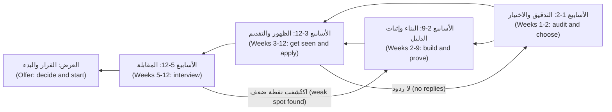

# الوحدة 7 — البطل: المشروع الختامي والتدريب

*تجمع هذه الوحدة الدورة كلّها في خطة واحدة تستطيع تنفيذها فعلًا. لقد اخترت دورًا مستهدفًا، ورسمت فجواتك مقارنةً بما يتحقّق منه أصحاب العمل، وبنيت الدليل، وكتبت السيرة الذاتية، وتدرّبت على المقابلات، وتعلّمت كيف تعمل العروض الوظيفية والوظائف الأولى. كلٌّ منها وحده درس منفصل. لكن حين تُجمع بالترتيب الصحيح، مع إيقاع أسبوعي وتتبّع صادق، تصبح بحثًا عن عمل. يحوّل المشروع الختامي كل شيء إلى خطة جاهزية وظيفية من 12 أسبوعًا، من تدقيق المهارات في الأسبوع الأول إلى قرار العرض في النهاية، ويبيّن كيف تعدّلها حين يقول الدليل إن شيئًا ما لا ينجح. ستتابع دفعة برنامج نجم للخرّيجين التقنيين (Najm Tech Graduate Programme) بينما يطلب خالد من كلٍّ منهم أن يكتب خطته قبل أن تُفتح نافذة التقديم: عمر، الذي «يستعدّ» منذ أشهر دون أن يتقدّم بطلب، وريم، التي تقدّمت إلى كل مكان بسيرة ذاتية واحدة، وهدى ويوسف ومحمد، ولكلٍّ منهم قيد مختلف. وتنتهي الوحدة بحزمة تدريب على المقابلات من 40 سؤالًا تغطّي كل الوحدات.*

> **الخطوات:** Apply, Interview — تحويل كل ما تعلّمته إلى خطة واحدة تنفّذها أسبوعًا بأسبوع، والتمرّن على القرارات التي توصلك إلى التوظيف.

---

# 7.1 — المشروع الختامي: خطة جاهزيتك الوظيفية في 12 أسبوعًا، من التدقيق إلى العرض
*المستوى: 🔴 متقدم* · *المتطلبات: 0.2، 3.1، 4.1، 5.1، 6.1* · *الخطوة: Build, Apply*

**بعد هذا الدرس تستطيع** أن تكتب بيان دورك المستهدف، وتدقيقًا للمهارات مقيّمًا من عشرة إعلانات وظيفية حقيقية على الأقل، وخطة من صفحة واحدة لاثني عشر أسبوعًا فيها مُخرَج قابل للتحقق كل أسبوع وثلاث نقاط مراجعة «إن كانت الإجابة نعم / إن كانت لا». *مدة الدراسة: نحو 125 دقيقة (تقدير).*

## ⚡ الدرس في دقيقة
- البحث عن عمل مشروع: **التدقيق، والبناء وإثبات الدليل، والتقديم، والمقابلة، والقرار**، بمراحل متداخلة ومراجعة أسبوعية.
- القاعدة الأهم: **ابدأ التقديم قبل أن تشعر بأنك جاهز**. الدليل والطلبات والتدرّب على المقابلات يحسّن بعضها بعضًا، لذا تسير بالتوازي ابتداءً من الأسبوع 4 أو 5 تقريبًا.
- تتبّع مسارًا صغيرًا للطلبات: الطلبات، والردود، والمقابلات الأولية، والجولات التقنية، والجولات النهائية، والعروض. والموضع الذي يخرج فيه الناس من مسارك يخبرك بما يجب إصلاحه تاليًا.
- مؤشّر القرار: في الأسابيع 4 و8 و12، قارن الدليل بالخطة وغيّر شيئًا واحدًا عن قصد: الهدف، أو السيرة الذاتية، أو المشروع، أو التدرّب على المقابلات.
- الفخ الأكبر: الاستعداد إلى ما لا نهاية لأن التقديم يبدو محفوفًا بالمخاطر. الاستعداد دون طلبات لا يُنتج أي تغذية راجعة.

## 🧭 لماذا يهم
يلتقي خالد بالدفعة قبل اثني عشر أسبوعًا من إغلاق نافذة التقديم في برنامج نجم للخرّيجين التقنيين. ويسأل كلًّا منهم: «ماذا فعلت الأسبوع الماضي لتحصل على وظيفة، وكيف تعرف أن ذلك نجح؟»

حلّ عمر قائمة طويلة من مسائل الخوارزميات وأنهى دورتين عبر الإنترنت، لكنه لم يتقدّم إلى أي مكان: «لست جاهزًا لتصميم الأنظمة بعد». وأرسلت ريم سيرة ذاتية واحدة إلى عشرات الإعلانات الوظيفية ولم يصلها ردّ من أيٍّ منها تقريبًا؛ ولأنها لا تحتفظ بسجلّ، لا تستطيع أن تقول لماذا. وتواصل هدى تلميع مشاريع الدفاتر التفاعلية بينما يطلب كل إعلان تقرؤه SQL وخطوط معالجة البيانات (pipelines). ويعمل يوسف بدوام كامل ولديه نحو ثماني ساعات في الأسبوع. أمّا محمد فلديه معرض أعمال قوي، لكنه يصادف باستمرار إعلانات تشترط شهادة في التخصّص.

لا ينقص أيًّا منهم الجهد. ما ينقصهم خطة تحوّل الجهد إلى دليل، والدليل إلى قرارات. قاعدة خالد: «بحلول الخميس، أرسلوا إليّ خطة من صفحة واحدة لاثني عشر أسبوعًا. لكل أسبوع مُخرَج يستطيع شخص آخر التحقّق منه، ولكل أسبوع رابع قرار.» يشرح هذا الدرس كيف يكتبونها، والمُنتَج الذي تخرج به هو خطتك أنت.

## 📐 كيف يعمل

### 🟢 الأساسيات

**المراحل الخمس.** تصبح كل وحدة سابقة مرحلةً. وهي تتداخل عن قصد: تواصل البناء بينما تتقدّم بالطلبات، وتواصل التدرّب على المقابلات بينما تنتظر الردود.

| المرحلة | الأسابيع | مُخرَج يستطيع شخص ما التحقّق منه | الدروس |
|---|---|---|---|
| **1. التدقيق والاختيار** | 1–2 | الدور المستهدف ودور بديل واحد؛ تدقيق المهارات؛ قائمة الفجوات؛ جدول المسار الدراسي | 0.2، 1.1–1.3، مسارك في 2.1–2.4 |
| **2. البناء وإثبات الدليل** | 2–9 | مشروع ختامي واحد لذلك الدور، قابل للتشغيل أو منشور، مع ملف README يستطيع غريب أن يتبعه | 3.1، 3.2، 3.3 |
| **3. الظهور أمام أصحاب العمل** | 3–12 | سيرة ذاتية رئيسية ونسخ مُكيَّفة؛ قائمة الأهداف؛ طلبات مُكيَّفة كل أسبوع | 4.1، 4.2، 4.3 |
| **4. المقابلة** | 5–12 | بنك قصص من 8–10 قصص؛ ملاحظات المقابلات التجريبية؛ قائمة بنقاط الضعف المتكرّرة | 5.1–5.3، 7.2 |
| **5. القرار والبدء** | العروض | مقارنة العروض؛ خطة الأيام التسعين الأولى | 6.1، 6.2، 6.3 |

تبدأ المرحلة 3 قبل أن يكتمل المشروع لأن المحادثات تحتاج إلى وقت لتؤتي ثمارها؛ وتبدأ المرحلة 4 في الأسبوع 5 لأن المقابلات قد تأتي مبكرًا.



الأسهم الراجعة هي بيت القصيد: المقابلات تكشف فجوات تعود إلى مرحلة البناء، والصمت يعيدك في العادة إلى التدقيق.

**إيقاع أسبوعي تستطيع الالتزام به.** يجب أن تصمد الخطة في أسبوع عادي. حدّد ساعاتك الحقيقية أولًا، ثم قسّمها. تقسيم أوّلي معقول: نحو النصف للبناء والتعلّم، ونحو الربع للتقديم وبناء العلاقات المهنية (تكييف الطلبات، والطلبات، ورسالة أو طلب إحالة)، ونحو الربع للتدرّب على المقابلات (مقابلة تجريبية واحدة، وبعض المسائل بصيغة الجهات التي تستهدفها، وقصص تتدرّب على روايتها بصوت عالٍ)، و30 دقيقة للمراجعة الأسبوعية. وإن لم يكن لديك سوى ثماني ساعات في الأسبوع، كما هو حال يوسف، فحافظ على النِّسَب وقلّص النطاق: مشروع واحد، وقائمة أهداف أقصر، ومقابلة تجريبية كل أسبوعين.

**جدول التتبّع.** احتفظ بجدول واحد، في جدول بيانات أو ملف ملاحظات، فيه صفّ واحد لكل طلب:

| صاحب العمل | الدور | المصدر | مُكيَّف؟ | إحالة؟ | المرحلة | الإجراء التالي وتاريخه |
|---|---|---|---|---|---|---|
| سديم باي (Sadeem Pay) | مهندس واجهات خلفية مبتدئ | زميل فريق في هاكاثون | نعم | نعم | تقدّمتُ، الأسبوع 5 | المتابعة بعد أسبوع إن لم يصل ردّ |

بعد بضعة أسابيع، يُظهر عمودا **المصدر** و**الإحالة** أيّ القنوات تُنتج ردودًا لك أنت، وهذا أفضل من أي نصيحة عامة.

### 🟡 التعمق أكثر

**اقرأ مسار طلباتك، لا مزاجك.** التغذية الراجعة في البحث عن عمل ضعيفة ومتأخّرة ومشوّشة، والرفض يبدو أمرًا شخصيًا. يحوّلها جدول التتبّع إلى تشخيص. انظر أين تتوقّف الطلبات عن التقدّم:

| أين تتوقّف | السبب الأرجح | ما الذي تغيّره أولًا | الدرس |
|---|---|---|---|
| ردود قليلة أو معدومة | استهداف بعيد جدًا عن دليلك، أو سيرة ذاتية غير مُكيَّفة، أو الاكتفاء بالقنوات الباردة | ضيّق الهدف، وكيّف السيرة لكل إعلان، وأضف الإحالات | 4.1–4.3 |
| مقابلات أولية، لكن لا جولات تقنية | إجابة غير واضحة عن «من أنا ولماذا هذا الدور» ("who I am and why this role")؛ أو أمور لوجستية مثل موعد التفرّغ أو تصريح العمل | أعد كتابة تقديمك لنفسك في دقيقتين؛ وجهّز إجابات لوجستية واضحة | 5.1 |
| جولات تقنية، لكن لا جولات نهائية | فجوة مهارية حقيقية أو صيغة غير مألوفة (البرمجة الحيّة، أو المهمة المنزلية (take-home)، أو مراجعة شيفرة مكتوبة بالذكاء الاصطناعي) | تدرّب على الصيغة نفسها بالضبط؛ وعُد إلى قائمة الفجوات | 5.2، 5.3 |
| جولات نهائية، لكن لا عروض | الإجابات السلوكية، أو طريقة شرحك للقرارات والأخطاء | قوِّ قصصك بالنتائج والدروس؛ وأجرِ مقابلة تجريبية مع شخص أقدم منك | 5.1 |

لا تبحث عن معدّل ردود «طبيعي»؛ فالمعدّلات تختلف حسب السوق والدور والموسم. قارن نفسك بأسابيعك السابقة أنت.

**كيّف الخطة مع قيدك.** لكل عضو في الدفعة قيد واحد يشكّل خطته أكثر من أي شيء آخر.

| الشخص | القيد | كيف تتغيّر الخطة |
|---|---|---|
| **عمر** | يُفرط في الاستعداد؛ ولم ينشر أي مشروع قط | يتقدّم بالطلبات من الأسبوع 3؛ ويجب أن يكون مشروعه الختامي منشورًا ومراقَبًا، لأن هذه فجوته، لا الخوارزميات |
| **ريم** | لا تستطيع دائمًا شرح شيفرتها المبنية بالذكاء الاصطناعي | طلبات أقل ومُكيَّفة؛ ويحصل كل ملف README على قسم «ما الذي تحقّقتُ منه»؛ وكل أسبوع تشرح أحد ملفاتها بصوت عالٍ |
| **هدى** | ضعف في SQL وفي بيئة الإنتاج | تعيد توجيه هدفها إلى هندسة البيانات (data engineering)؛ وتُخصَّص الأسابيع 2–6 لـ SQL ولخط معالجة بيانات واحد |
| **يوسف** | ثماني ساعات في الأسبوع | مشروع واحد للبنية التحتية بوصفها شيفرة، وقائمة أهداف قصيرة؛ وشهادة سحابية فقط إن طلبتها الإعلانات التي يستهدفها |
| **محمد** | لا يحمل شهادة في التخصّص | يستهدف أصحاب العمل الذين يعلنون معايير قائمة على المهارات؛ ويعتمد على الإحالات؛ ويقرأ قواعد الأهلية لكل برنامج أولًا |

**اختر المشروع الختامي من مسار دورك.** اختر مشروعًا يثبت الوظيفة المستهدفة (يقدّم الدرس 3.1 مواصفات لكل دور)، وتعلّم ما يحتاج إليه من المكتبة:
- البرمجيات: انشر وتحقّق باستخدام [*تصميم الأنظمة لمبرمجي الفايب*، الدرس F.5 — صفحتك الحيّة الأولى، مع الدليل](../vibe/index.ar.html#lF-5)، ثم أضف [*تصميم الأنظمة لمبرمجي الفايب*، الدرس 4.4 — التراجع وبيئة التجهيز وبوابات الإصدار](../vibe/index.ar.html#l4-4).
- تطبيقات الذكاء الاصطناعي: [*تصميم الأنظمة لمبرمجي الفايب*، الدرس 8.2 — الاختبارات بوصفها المواصفات التي لا يستطيع الوكيل تجاهلها](../vibe/index.ar.html#l8-2) و[*إدارة منتجات الذكاء الاصطناعي*، الدرس 6.1 — جودة تستطيع قياسها: المقاييس والمجموعات الذهبية وتحليل الأخطاء](../aipm/index.ar.html#/6.1).
- البيانات: [*هندسة البيانات والتحليلات*، الوحدة 1](../data/index.ar.html#/1.1) لـ SQL والنمذجة، ثم خط معالجة بيانات (pipeline) من [*هندسة البيانات والتحليلات*، الوحدة 2](../data/index.ar.html#/2.1).
- السحابة والمنصّات: البنية التحتية بوصفها شيفرة (infrastructure as code) من [*السحابة وDevOps*، الوحدة 3](../cloud/index.ar.html#/3.1)، تُنشر عبر خط نشر من [*السحابة وDevOps*، الوحدة 4](../cloud/index.ar.html#/4.1).
- الأمن: أضف [*الذكاء الاصطناعي الآمن وأمن التطبيقات*، الدرس 1.1 — نمذجة التهديدات: تدفّقات البيانات وحدود الثقة وSTRIDE](../secai/index.ar.html#/1.1) إلى أيّ مشروع تبنيه.

أجرِ تقييمًا ذاتيًا، مثل [التقييم الذاتي لدورة *تصميم الأنظمة لمبرمجي الفايب*](../vibe/assessment.ar.html)، في الأسبوعين 1 و8.

**النزاهة جزء من الخطة.** تحت ضغط المواعيد النهائية، تُغري الطرق المختصرة: مشروع من درس تعليمي يُقدَّم على أنه أصلي، أو مهمة منزلية مكتوبة بالذكاء الاصطناعي لا تستطيع شرحها، أو مسمّى وظيفي مُبالَغ فيه. وكلها تنهار حين يتعيّن عليك شرح عملك والبناء عليه. أفصح عن مساعدة الذكاء الاصطناعي حيث يُطلب منك ذلك، وكن قادرًا على شرح كل سطر تقدّمه والتحقّق منه.

### 🔴 نظرة الخبير

**تعامل مع الخطة على أنها تجارب.** كل كتلة من أربعة أسابيع تختبر فرضية مكتوبة، مثل: «بهذا الهدف وهذه السيرة الذاتية وهذا المشروع، سأحصل على مقابلات تقنية». وعند نقطة المراجعة، قرّر بناءً على الدليل:

| نقطة المراجعة | السؤال | إن كانت الإجابة نعم | إن كانت الإجابة لا |
|---|---|---|---|
| **الأسبوع 4** | هل المشروع يسير وفق الخطة، وهل تُنتج السيرة الذاتية المُكيَّفة ردودًا أو محادثات؟ | حافظ على الهدف | غيّر شيئًا واحدًا: الهدف، أو القسم العلوي من السيرة الذاتية، أو القناة (أضف الإحالات) |
| **الأسبوع 8** | هل تصل إلى الجولات التقنية، والمشروع منشور ويعمل؟ | انقل الساعات نحو التدرّب على المقابلات | عُد إلى جدول مسار الطلبات؛ وفكّر في دورك البديل |
| **الأسبوع 12** | هل لديك عروض أو جولات نهائية أو مسار طلبات ممتلئ؟ | قرّر وابدأ (6.1، 6.2) | اكتب خطة الأسابيع الاثني عشر التالية ممّا تعلّمته |

تغيير متغيّر واحد في كل مرة هو الطريقة الوحيدة التي تجعل عيّنة صغيرة ومشوّشة تخبرك بشيء.

**حزمة الأدلة.** بحلول الأسبوع 9، يجب أن تستطيع إرسال رابط واحد يُظهر ما يتحقّق منه مدير التوظيف (hiring manager) في دورك: المشروع، وملف README الخاص به مع قراراتك وما تحقّقت منه، وسيرتك الذاتية، وملاحظة قصيرة عن كيفية استخدامك أدوات الذكاء الاصطناعي. يسمّيها خالد «الصفحة التي أقرؤها قبل المقابلة» ("the page I read before the interview").

**الأسبوع 12 نقطة مراجعة، لا موعد نهائي.** الجداول الزمنية للتوظيف خارجة عن سيطرتك، وقد أُفيد بأن التوظيف في بداية المسيرة المهنية أضعف في المهن المعرّضة للذكاء الاصطناعي (برينيولفسون وتشاندار وتشن، 2025)؛ والبحث الطويل ليس حكمًا عليك. كثير من برامج الخرّيجين توظّف وفق دورة سنوية، وقد يتحرّك أصحاب العمل الكبار أبطأ من الشركات الناشئة؛ فتحقّق من مواعيد كل صاحب عمل. واستمرّ بعد الأسبوع 12 بمستوى تستطيع الاستمرار عليه: بضعة طلبات مُكيَّفة في الأسبوع، ومقابلة تجريبية واحدة، وتحسين واحد للمشروع.

**اعتنِ بمدرج الإقلاع.** قبل الأسبوع الأول، اكتب عدد الأسابيع التي تستطيع تحمّل كلفة البحث خلالها، وأي قيود تتعلّق بالتأشيرة أو الكفالة (تحقّق من القواعد الحالية)، ومتى توظّف الجهات التي تستهدفها. هذه الحقائق تحدّد ما إذا كنت ستقبل دورًا انتقاليًا، مثل عقد مؤقّت أو تدريب أو وظيفة في مسارك البديل، بينما تواصل البحث.

## 🧰 الأدوات
| المورد أو الأداة أو النموذج | ما هو وماذا يفعل | متى تلجأ إليه |
|---|---|---|
| **12-week job-readiness plan** — خطة الجاهزية الوظيفية في 12 أسبوعًا | صفحة واحدة: الهدف والبديل، والمُخرَجات الأسبوعية، ونقاط المراجعة في الأسابيع 4 و8 و12 | الأسبوع 1، ثم تُراجَع عند كل نقطة مراجعة |
| **Skills audit** — تدقيق المهارات | مهاراتك مُقيَّمة بدرجات مقارنةً بإعلانات وظائف حقيقية، مع دليل لكل درجة | الأسبوعان 1–2، ومرة أخرى في الأسبوع 8 |
| **Study path table** — جدول المسار الدراسي | المهارات التي يحتاج إليها دورك، والدروس التي تبنيها، والدليل الذي يُظهرها (الوحدة 2) | عند اختيار ما تتعلّمه في المرحلة 2 |
| **Application log** — سجلّ الطلبات | جدول تتبّعك: صفّ لكل طلب، مع المصدر والتكييف والإحالة والمرحلة والإجراء التالي | مع كل طلب وفي كل مراجعة أسبوعية |
| **Story bank** — بنك القصص | 8–10 قصص حقيقية بأسلوب STAR (الموقف، والمهمة، والإجراء، والنتيجة)، كما في الدرس 5.1 | من الأسبوع 5، قبل أول مقابلة أولية |
| **Brag document** — مستند الإنجازات | قائمة متجدّدة بما بنيته وأصلحته وتعلّمته، مع روابط | أسبوعيًا؛ فهو يغذّي السيرة الذاتية وقصصك |
| **Mock interview with a peer** — مقابلة تجريبية مع زميل | جولة تدريبية مع زميل أو مرشد أو مركز التوظيف المهني، بصيغة الجهات التي تستهدفها ومُقيَّمة وفق معايير تقييم | أسبوعيًا من الأسبوع 5 |
| **Weekly review** — المراجعة الأسبوعية | 30 دقيقة: حدّث جدول التتبّع، ودوّن درسًا واحدًا، وحدّد ثلاث أولويات | في الوقت نفسه كل أسبوع |

## 🏛️ عمليًا في بنك نجم
خطة هدى، كما أرسلتها إلى خالد. أظهر تدقيقها أن كل إعلان تقريبًا أرادته كان يطلب SQL وخطوط معالجة البيانات، فأعادت توجيه هدفها إلى هندسة البيانات، مع إبقاء علم البيانات (data science) دورًا بديلًا.

**خطة هدى للجاهزية الوظيفية في 12 أسبوعًا (16 ساعة في الأسبوع)**

| الأسبوع | المُخرَج (قابل للتحقّق) | الدروس |
|---|---|---|
| 1 | الهدف: مهندسة بيانات مبتدئة (junior data engineer) في بنوك الخليج وشركات التقنية المالية؛ البديل: عالمة بيانات (data scientist). تدقيق المهارات من 15 إعلانًا وظيفيًا | 0.2، 2.3 |
| 2 | جدول المسار الدراسي؛ مواصفات من صفحة واحدة لخط معالجة بيانات المعاملات على بيانات عامة | 2.3، 3.1 |
| 3 | تمارين SQL مكتوبة ومشروحة؛ نموذج البيانات للمشروع؛ السيرة الذاتية الرئيسية | [*هندسة البيانات والتحليلات*، الوحدة 1](../data/index.ar.html#/1.1)، 4.1 |
| 4 | **نقطة مراجعة.** يعمل خط المعالجة من البداية إلى النهاية وفق جدول زمني؛ قائمة الأهداف؛ أول 3 طلبات مُكيَّفة | 4.3 |
| 5 | فحوص جودة البيانات التي تفشل بوضوح؛ النسخة الأولى من بنك القصص؛ أول طلب إحالة | [*هندسة البيانات والتحليلات*، الوحدة 3 — جودة البيانات (data quality)](../data/index.ar.html#/3.2)، 4.2، 5.1 |
| 6 | ملف README مع مخطّط وقرارات؛ تحديث LinkedIn؛ 4 طلبات | 3.2، 4.2 |
| 7 | مقابلتان تجريبيتان في SQL ومقابلة تجريبية في نمذجة البيانات مع الزملاء؛ 4 طلبات | 5.2، 5.3 |
| 8 | **نقطة مراجعة.** مراجعة مسار الطلبات؛ إعادة تقييم التدقيق | 7.1 |
| 9 | حزمة الأدلة: رابط واحد فيه المشروع وملف README والسيرة الذاتية وملاحظة عن استخدام الذكاء الاصطناعي | 3.2 |
| 10–11 | حزمة التدريب من الدرس 7.2؛ التمرّن على أضعف قصّتين؛ المتابعات | 5.1، 7.2 |
| 12 | **نقطة مراجعة.** مقارنة العروض، أو خطة الأسابيع الاثني عشر التالية | 6.1 |

**نموذج مراجعتها الأسبوعية** (ملاحظة واحدة، خمسة أسطر):

```text
Week: 6        Hours planned / actual: 16 / 13
Shipped: README with diagram; 4 tailored applications
Funnel this week: 4 applied, 1 reply (Sadeem Pay recruiter), 0 screens done yet
One thing I learned: postings from banks mention data governance; add a section on it to my README
Next week's top three: SQL mock x2; data-modelling mock; book Sadeem Pay screen
```

في الأسبوع 8، أظهر جدول تتبّعها أن الطلبات التي جاءت بعد إحالة أو محادثة حصلت على ردود، وأن الطلبات الباردة لم تحصل عليها في الغالب. فأبقت على هدفها ونقلت الساعات من الطلبات الباردة إلى المحادثات: متغيّر واحد، غُيِّر بناءً على الدليل.

## 🛠️ التمارين
- 🟢 اكتب بيان دورك المستهدف (الدور، والقطاع، والموقع، ودور بديل واحد)، وتدقيقًا للمهارات من عشرة إعلانات وظيفية حقيقية على الأقل، مع تقييم كل مهارة بدليل. *يكتمل عندما:* يكون لكل مهارة في الجدول درجة وملاحظة دليل، ويستطيع زميل أن يسمّي أهم ثلاث فجوات لديك دون أن يسألك.
- 🟡 اكتب خطتك لاثني عشر أسبوعًا في صفحة واحدة على نموذج هدى: مُخرَج قابل للتحقّق كل أسبوع، وميزانية ساعات حقيقية، وثلاث نقاط مراجعة في صورة قرارات «إن كانت الإجابة نعم / إن كانت لا». وأعِدّ جدول التتبّع. *يكتمل عندما:* يستطيع زميل التحقّق من كل مُخرَج عبر ملف أو رابط أو صفّ في جدول التتبّع، ويحتوي جدول التتبّع على صفوفه الخمسة الأولى.
- 🔴 نفّذ خطتك أربعة أسابيع، ثم اكتب نقطة مراجعة الأسبوع 4: الفرضية، ودليل مسار الطلبات، والمتغيّر الواحد الذي ستغيّره ولماذا. واطلب من مرشد أو مستشار مهني مراجعتها. *يكتمل عندما:* تكون لديك أربع مراجعات أسبوعية، وجدول تتبّع محدَّث، وملاحظة نقطة مراجعة مؤرَّخة تسمّي تغييرًا واحدًا بالضبط ودليله.

## ⚠️ أخطاء وفخاخ
- **الاستعداد إلى ما لا نهاية.** «دورة واحدة أخرى» لا تُنتج أي تغذية راجعة. ابدأ التقديم بين الأسبوعين 3 و5، ودع المقابلات تُظهر لك ما تتعلّمه تاليًا.
- **إرسال سيرة ذاتية واحدة إلى كل مكان.** الكمّ غير المُكيَّف دون جدول تتبّع لا يعلّمك شيئًا. أرسل طلبات أقل ومُكيَّفة وسجّل النتائج.
- **تغيير كل شيء دفعة واحدة.** عندها لا يمكن تفسير النتيجة التالية. غيّر متغيّرًا واحدًا في كل نقطة مراجعة.
- **خطة تتجاهل أسبوعك الحقيقي.** خطة من 40 ساعة لشخص لديه 8 ساعات فراغ تفشل بحلول الأسبوع الثاني. ضع ميزانية لساعاتك الحقيقية، ثم قلّص النطاق.
- **التعامل مع الأسبوع 12 كموعد نهائي.** إنه نقطة مراجعة؛ استمرّ بإيقاع تستطيع المحافظة عليه أو اقبل دورًا انتقاليًا معقولًا.
- **الطرق المختصرة التي تمسّ النزاهة تحت الضغط.** المشاريع المنسوخة، والمسمّيات الوظيفية المضخَّمة، والعمل المكتوب بالذكاء الاصطناعي الذي لا تستطيع شرحه تنهار في المقابلات. ابنِ النسخة الصادقة.

## 🧾 الخلاصة
- البحث عن عمل مشروع بمراحل متداخلة: التدقيق، والبناء وإثبات الدليل، والظهور أمام أصحاب العمل، والمقابلة، والقرار. ابدأ التقديم مبكرًا.
- الإيقاع الأسبوعي مع ميزانية ساعات حقيقية وجدول تتبّع ومراجعة من 30 دقيقة يُبقي الخطة حيّة.
- اقرأ مسار طلباتك لتشخّص المشكلة: غياب الردود يشير إلى الاستهداف والسيرة الذاتية؛ وتعثّر الجولات التقنية يشير إلى المهارات والصيغة؛ وتعثّر الجولات النهائية يشير إلى القصص والملاءمة.
- نقاط المراجعة في الأسابيع 4 و8 و12 تغيّر متغيّرًا واحدًا في كل مرة، بناءً على الدليل.
- الأسبوع 12 نقطة مراجعة، لا حكم نهائي. خطّط لمدرج الإقلاع، وحافظ على نزاهتك، وواصل.

## ✍️ اختبر نفسك

**1. قضى عمر عشرة أسابيع في التدرّب على الخوارزميات وأنهى دورتين عبر الإنترنت، ولم يتقدّم إلى أي مكان لأنه لا يشعر بأنه جاهز. ما أفضل خطوة تالية في خطته؟**

- A. أن ينهي دورة ثالثة عبر الإنترنت أولًا، كي يشعر بأنه مستعدّ تمامًا حين تُطرح أسئلة تصميم الأنظمة
- B. أن يبدأ الطلبات المُكيَّفة الآن بينما يبني مشروعًا منشورًا، وأن يراجع النتائج أسبوعيًا
- C. أن يرسل سيرته الذاتية الحالية غير المُكيَّفة إلى أكبر عدد ممكن من الإعلانات هذا الأسبوع ليزيد فرصه إلى أقصى حدّ
- D. أن ينتظر دورة برامج الخرّيجين في العام المقبل كي يتوفّر له وقت أطول للاستعداد كما يجب

<details><summary>الإجابة</summary>

**B.** التقديم يُنتج تغذية راجعة لا يستطيع الاستعداد إنتاجها، وفجوته الحقيقية هي النشر، لا الخوارزميات. أمّا C فيستبدل فخًّا بفخ آخر هو الكمّ غير المُكيَّف؛ وA وD يُبقيانه في الاستعداد إلى ما لا نهاية. (🟢 الأساسيات.)

</details>

**2. بعد شهر، يُظهر جدول تتبّع ريم طلبات كثيرة، وبضع مقابلات أولية مع مسؤولي التوظيف، ولا جولات تقنية بعد أيٍّ منها. وفقًا لجدول مسار الطلبات، إلامَ يجب أن تنظر أولًا؟**

- A. تدرّبها على الخوارزميات، لأن المهارة التقنية هي عادةً ما يعيق الخرّيجين في هذه المرحلة
- B. صورة ملفّها الشخصي على GitHub وصورة الغلاف على LinkedIn، كي يكوّن مسؤولو التوظيف انطباعًا أوّل أفضل
- C. نشر مشروع معرض أعمالها، كي يستطيع مُجري المقابلة الأولية النقر على رابط حيّ أثناء المكالمة
- D. تقديمها لنفسها وقصة «لماذا هذا الدور»، إضافةً إلى إجابات واضحة عن موعد التفرّغ وتصريح العمل

<details><summary>الإجابة</summary>

**D.** المقابلات الأولية التي لا تؤدّي إلى شيء تشير إلى طريقة تقديمها لنفسها وإلى الأمور اللوجستية. أمّا A فيناسب الإخفاق في الجولات التقنية، وهي لا تصل إليها أصلًا. (🟡 التعمق أكثر.)

</details>

**3. عند نقطة مراجعة الأسبوع 4، لم يتلقَّ يوسف أي ردّ على اثني عشر طلبًا باردًا. ويريد أن يغيّر دوره المستهدف، ويعيد كتابة سيرته الذاتية كلها، ويبدأ مشروعًا جديدًا، وينتقل إلى مواقع وظائف أخرى، وكل ذلك هذا الأسبوع. بماذا يجب أن ينصحه خالد؟**

- A. أن يغيّر متغيّرًا واحدًا، مثل القسم العلوي من السيرة الذاتية أو إضافة الإحالات، وأن يُبقي الباقي ثابتًا
- B. أن يجري التغييرات الأربعة كلها هذا الأسبوع، لأن اثني عشر طلبًا بلا ردّ تُظهر أن الخطة فشلت بوضوح
- C. ألّا يغيّر شيئًا على الإطلاق، لأن أربعة أسابيع وقت مبكر جدًا للحكم على أي شيء في البحث عن عمل
- D. أن يتوقّف عن التقديم حتى ينتهي المشروع الجديد، كي يكون كل طلب لاحق أقوى

<details><summary>الإجابة</summary>

**A.** مع عيّنة صغيرة ومشوّشة، لا يمكن التعلّم إلا من تغيير واحد في كل مرة. أمّا B فيجعل النتائج التالية غير قابلة للقراءة؛ وC يتجاهل الدليل؛ وD هو فخ الاستعداد إلى ما لا نهاية. (🔴 نظرة الخبير.)

</details>

**4. لدى يوسف نحو ثماني ساعات في الأسبوع إلى جانب وظيفة بدوام كامل. أيّ خطة هي الأكثر واقعية؟**

- A. الخطة نفسها التي يتّبعها الباحث عن عمل بدوام كامل، مضغوطة في أمسياته وعطلات نهاية الأسبوع حتى تنتهي
- B. تأجيل البحث كله حتى يستطيع تحمّل ترك وظيفته والبحث بدوام كامل
- C. النِّسَب نفسها بنطاق أصغر: مشروع واحد، وقائمة أهداف قصيرة، ومقابلة تجريبية كل أسبوعين
- D. التدرّب على المقابلات فقط، لأن وظيفته الحالية تثبت أصلًا المهارات التي يريدها أصحاب العمل

<details><summary>الإجابة</summary>

**C.** ضع ميزانية لساعاتك الحقيقية، ثم قلّص النطاق مع الحفاظ على التوازن. أمّا A فيفشل بحلول الأسبوع الثاني؛ وB وD يُسقطان مراحل تحتاج إليها الخطة. (🟢 الأساسيات.)

</details>

**5. نحن في الأسبوع 12. لدى محمد مقابلتان في الجولة النهائية لا تزالان جاريتين، لكن لا عرض حتى الآن. بماذا يوصي الدرس؟**

- A. أن يعدّ الخطة فاشلة ويبدأ من جديد بدور مستهدف جديد، لأن اثني عشر أسبوعًا لم تُنتج عرضًا
- B. أن يعامل الأسبوع 12 كنقطة مراجعة: يخطّط للأسابيع الاثني عشر التالية ويحافظ على إيقاع ثابت بينما تجري الجولات النهائية
- C. أن يوقف كل نشاط آخر في البحث عن عمل وينتظر ببساطة حتى يردّ صاحبا العمل في الجولة النهائية
- D. أن يقبل أول دور انتقالي يظهر، أيًّا كان، كي ينتهي البحث أخيرًا

<details><summary>الإجابة</summary>

**B.** الجداول الزمنية خارجة عن سيطرته، وجولتان نهائيتان تُظهران أن الخطة تنجح. أمّا A فيسيء قراءة الدليل؛ وC يتركه بلا شيء إن رفضه كلاهما؛ وD يتجاهل تخطيطه لمدرج الإقلاع. (🔴 نظرة الخبير.)

</details>

## 📚 المراجع
- برينيولفسون وتشاندار وتشن، ⁦"Canaries in the Coal Mine? Six Facts about the Recent Employment Effects of Artificial Intelligence"⁩، مختبر ستانفورد للاقتصاد الرقمي، أغسطس 2025 — https://digitaleconomy.stanford.edu/
- توثيق GitHub، حول ملفات README — https://docs.github.com/en/repositories/managing-your-repositorys-settings-and-features/customizing-your-repository/about-readmes
- [التقييم الذاتي لدورة *تصميم الأنظمة لمبرمجي الفايب*](../vibe/assessment.ar.html)
- [*الذكاء الاصطناعي الآمن وأمن التطبيقات*، الدرس 12.2 — المسيرة المهنية في الأمن: الأدوار والشهادات ومعرض الأعمال](../secai/index.ar.html#/12.2)
- [*إدارة منتجات الذكاء الاصطناعي*، الدرس 10.2 — المسيرة المهنية لمدير منتجات الذكاء الاصطناعي: المقابلات ومعرض الأعمال والنمو](../aipm/index.ar.html#/10.2)

---

# 7.2 — حزمة المقابلات التدريبية: 40 سؤالًا قائمًا على سيناريوهات
*المستوى: 🔴 متقدم* · *المتطلبات: 7.1* · *الخطوة: Interview*

**بعد هذا الدرس تستطيع** أن تؤدّي حزمة الأسئلة الأربعين في 60 دقيقة معلّمًا كل إجابة بـ«متأكد» أو «تخمين»، وأن تحوّل أخطاءك وتخميناتك إلى سجل مراجعة يسمّي درسًا وإجراءً لكل منها. *مدة الدراسة: نحو 90 دقيقة (تقدير).*

> **قيد المراجعة، نوفمبر 2026.** في كثير من أسئلة هذا الامتحان التدريبي يمكن تمييز الخيار الصحيح من طوله أو صياغته، لذا فالدرجة العالية هنا لا تدل على الجاهزية لأي امتحان حقيقي. استخدمه للتدرّب على التفكير: أجب عن كل سؤال بكلماتك قبل أن تقرأ الخيارات، ثم قارن.

## ⚡ الدرس في دقيقة
- هذه حزمة تدريبية من 40 سؤالًا تغطي كل الوحدات، من قراءة سوق العمل إلى النمو بعد سنتك الأولى. معظم الأسئلة سيناريوهات مع أفراد الدفعة: أي مشروع تبني، وأي بند في السيرة الذاتية أقوى، وكيف تجيب، وأي عرض وظيفي تقبل، وماذا تفعل في أسبوعك الثاني.
- أجب عنها في جلسة واحدة مدتها نحو 60 دقيقة، دون ملاحظات ودون مساعد ذكاء اصطناعي. اختر إجابتك قبل أن تفتح الإجابة المخفية.
- تنتهي كل إجابة بوسم مثل *(Interview · 5.1)*: خطوة البحث عن عمل، ثم الدرس الذي تعود إليه.
- صحّح لنفسك، ثم جمّع أخطاءك حسب الخطوة. تكتّل الأخطاء يشير إلى الجزء من خطتك الذي يجب إصلاحه تاليًا، تمامًا كالقمع في الدرس 7.1.
- أكبر فخ: قراءة الإجابات أولًا. التعرّف على الإجابة الصحيحة أسهل بكثير من اختيارها، ولا يخبرك بشيء عن أدائك في جولة حقيقية.

## 🧭 لماذا يهم
في الأسبوع العاشر من خطتها ذات الاثني عشر أسبوعًا، تملك هدى بنك قصص ومسار ترشيحات نشطًا وجولتين تقنيتين محجوزتين. ما لا تعرفه هو مواضع ضعفها المتبقية. يعطي خالد الدفعة هذه الحزمة مساء يوم أحد بقاعدة واحدة: "أجيبوا أولًا، ثم انظروا. ثم أرسلوا لي سجل المراجعة، لا درجتكم."

يحصل عمر على 34 من 40 ويشعر بالرضا حتى يجمّع أخطاءه: خمسة من الأخطاء الستة أسئلة من خطوتي التقديم والبدء، عن العروض الوظيفية والإحالات وأسابيعه الأولى في الوظيفة. كانت إجاباته في الخوارزميات والتصميم شبه مثالية؛ أما حكمه على كل ما يحيط بالمقابلة فلم يكن كذلك. تخطئ ريم في أسئلة أقل مما توقعت، لكنها تعلّم أربعًا من إجاباتها الصحيحة على أنها تخمينات، وكلها عن التحقق من الشيفرة التي يكتبها الذكاء الاصطناعي. صار كلاهما يعرف ما يجب أن يتدرب عليه في الأسبوعين الأخيرين قبل الجولات النهائية. وهذا هو الغرض من الحزمة: ليست درجة، بل خريطة لما يجب إصلاحه.

## 📐 كيف يعمل

### 🟢 الأساسيات
**طريقة أدائها.** اضبط مؤقتًا على 60 دقيقة. أغلق ملاحظاتك وأي مساعد ذكاء اصطناعي. لكل سؤال، اختر خيارًا واحدًا واكتبه، مع علامة ثقة سريعة: *متأكد* أو *تخمين*. وبعد ذلك فقط افتح الإجابة. في المقابلة تجيب قبل أن ترى التغذية الراجعة؛ فتدرّب بالطريقة نفسها.

**كيف تعمل الأسئلة.** لكل سؤال إجابة واحدة هي الأفضل. الخيارات الخاطئة واقعية، من النوع الذي يفعله الخرّيج القلق فعلًا: التقديم في كل مكان بسيرة ذاتية واحدة، والادعاء بمعرفة Kubernetes، وقبول عرض شفهي. تشرح الإجابات لماذا يكون الخيار المغري خاطئًا، إلى جانب سبب صحة الخيار الصحيح.

### 🟡 التعمق أكثر
**طريقة المراجعة.** احتفظ بسجل مراجعة فيه صف واحد لكل سؤال أخطأت فيه، أو أصبت فيه بالتخمين. سجّل إجابتك، والإجابة الصحيحة، وسبب اختيارك، والدرس المذكور في الوسم. ثم جمّع الصفوف حسب الخطوة:

| تتكتّل الأخطاء في | ما يعنيه ذلك عادةً | إلى أين تذهب |
|---|---|---|
| الاستكشاف والتعلّم | تصوّرك للأدوار أو لخط الأساس المطلوب من المبتدئ غير واضح | الوحدات 0–2 |
| البناء والإثبات | تعرف المهارات لكن لا تعرف ما يُعدّ إثباتًا | الوحدة 3 |
| التقديم | السيرة الذاتية أو شبكة العلاقات أو القنوات أو العروض الوظيفية | الوحدة 4، الدرس 6.1 |
| المقابلة | الصيغة أو البنية أو الصدق تحت الضغط | الوحدة 5 |
| البدء والنمو | الأيام التسعون الأولى وما بعدها | الدرسان 6.2 و6.3 |

الإجابات الصحيحة المعلَّمة بـ *تخمين* تُحسب أخطاءً. ثم أعد قراءة قسم الدرس الذي يسمّيه الوسم وأعد حلّ أحد تمارينه. إعادة القراءة وحدها لا تكفي.

### 🔴 نظرة الخبير
**استخدمها مقابلةً تجريبية.** اطلب من زميل أن يقرأ عشرة أسئلة بصوت عالٍ دون الخيارات. أجب بكلماتك الخاصة، ثم قل ما *لن* تفعله ولماذا. هذا أقرب إلى الجولة الحقيقية، حيث لا يعرض عليك أحد أربعة خيارات. وبعد أسبوعين، أعد الحزمة كاملة بترتيب مختلف؛ فالدرجة التي ترتفع فقط لأنك تتذكر الحروف لا تعني شيئًا.

**للمرشدين المهنيين ومديري التوظيف.** تصلح الحزمة بنكَ أسئلة مشتركًا. يمكن للمرشدين تكليف الطلاب بها بعد خطة المشروع الختامي؛ ويمكن لمديري التوظيف استخدام السيناريوهات أسئلةَ متابعة في الجولات السلوكية. غيّر الأسماء وجهة العمل، وأبقِ على المعضلة.

## 🧰 الأدوات
| المورد أو الأداة أو النموذج | ما هو وماذا يفعل | متى تلجأ إليه |
|---|---|---|
| **Practice exam review log** — سجل مراجعة الامتحان التدريبي | صف واحد لكل سؤال أخطأت فيه أو خمّنته: إجابتك، والإجابة الصحيحة، والسبب، والدرس الذي تراجعه، وإجراء واحد | مباشرة بعد أداء الحزمة، ومرة أخرى بعد إعادتها |
| **Mock interview with a peer** — مقابلة تجريبية مع زميل | جولة تدريبية يطرح فيها صديق أسئلة من قائمة ويقيّم بمعيار تقييم | عند قراءة السيناريوهات بصوت عالٍ دون الخيارات، في الأسبوعين 10–11 من خطتك |
| **Story bank** — بنك القصص | ‏8–10 قصص حقيقية بطريقة STAR، كل منها موسوم بالكفاءات التي تُظهرها | عندما يذكّرك سيناريو بقصة لم تدوّنها بعد |

## 🏛️ عمليًا في بنك نجم
سجل المراجعة الخاص بعمر، وهي الصفوف التي طلب خالد أن يحضرها إلى اجتماعهما الثنائي (1:1):

| السؤال (Q) | إجابتي | الصحيحة | متأكد أم تخمين | لماذا اخترت إجابتي | الدرس | الإجراء |
|---|---|---|---|---|---|---|
| 13 | B | D | متأكد | ظننت أن السيرة الذاتية وحدها تكفي | 4.2 | أكتب ملخصًا من سطرين قابلًا لإعادة التوجيه لمشروعي الختامي |
| 14 | B | A | متأكد | ظننت أن العرض المكتوب نهائي | 6.1 | أعيد قراءة قسم "الشروط"؛ وأدرج الشروط الواردة في عرض نجم |
| 29 | C | D | تخمين | رأيت الموافقات عائقًا | 6.2 | أقرأ دليل نجم لاعتماد التغييرات قبل دورتي التدريبية |
| 32 | A | B | متأكد | وثقت بموقع رواتب واحد | 6.1 | أسأل اثنين من الخريجين السابقين ومسؤول توظيف (recruiter) عن النطاق |

تعليق خالد: "أخطأت في أسئلة تقنية قليلة. اقضِ هذا الأسبوع على الصفين 13 و14: فهما يتعلقان بطريقة تعاملك مع الناس والوعود، وهذا ما تختبره الجولة النهائية."

## 🛠️ التمارين
- 🟢 أدِّ الحزمة كاملة في جلسة واحدة مدتها 60 دقيقة، دون ملاحظات أو أدوات ذكاء اصطناعي، معلّمًا كل إجابة بـ *متأكد* أو *تخمين*. *يكتمل عندما:* تكون لديك درجة من 40 وعدد تخميناتك، وكلاهما مكتوب في ملف مسيرتك المهنية.
- 🟡 ابنِ سجل المراجعة لكل سؤال أخطأت فيه أو خمّنته، وجمّع الصفوف حسب الخطوة، وأعد حل تمرين واحد من الدرس الذي يقف وراء أكبر تكتّل لديك. *يكتمل عندما:* يسمّي كل صف درسًا وإجراءً، ويستوفي التمرين المُعاد سطر *يكتمل عندما* الخاص به.
- 🔴 أدِر عشرة أسئلة مقابلةً تجريبية شفهية مع زميل، دون الخيارات، ثم أعد الحزمة كاملة بعد أسبوعين بترتيب مختلف. *يكتمل عندما:* يكون الزميل قد قيّم إجاباتك الشفهية من 1 إلى 3، وتُظهر إعادتك أخطاءً أقل في الخطوة التي تكتّلت فيها محاولتك الأولى.

## ⚠️ أخطاء وفخاخ
- **استراق النظر إلى الإجابات.** التعرّف يوهمك بالمعرفة. التزم بإجابة أولًا، في كل مرة.
- **الاكتفاء بعدّ الدرجة.** التخمين الصحيح خطأ متنكّر. علّم درجة ثقتك وسجّل التخمينات.
- **إعادة القراءة دون تطبيق.** عد إلى الدرس، ثم أدِّ أحد تمارينه أو حدّث أحد مُخرجاتك.
- **حفظ الحروف.** أعد الحزمة بترتيب مختلف، وأجب بصوت عالٍ دون خيارات.
- **معاملة الحزمة كأنها المقابلة.** الجولات الحقيقية فيها أسئلة متابعة. استخدم الحزمة لاكتشاف نقاط الضعف، ثم تدرّب عليها مع شخص.

## ✍️ الامتحان التدريبي

**1. يجد مسح السوق الذي أجراه يوسف لعشرة إعلانات لوظائف منصات للمبتدئين أن Git ورد في تسعة إعلانات وDocker في أربعة. كيف ينبغي أن يقرأ هذه الأعداد؟**

- A. كلاهما مهارة أساسية، لأن كلًّا منهما يظهر في أكثر من ثلاثة من الإعلانات العشرة
- B. Git مهارة أساسية وDocker عامل تمييز، لذا يُثبت Git أولًا ثم Docker
- C. كلاهما عامل تمييز، لأن أيًّا منهما لا يظهر في كل إعلان جمعه
- D. Docker هو الأساس الحقيقي، لأن الأدوات الأحدث تهم أصحاب العمل أكثر من القديمة

<details><summary>الإجابة</summary>

**B.** المهارات الواردة في سبعة إعلانات أو أكثر من عشرة هي الأساس؛ والواردة في ثلاثة إلى ستة هي عوامل التمييز. يسيء A وC تطبيق العتبات؛ ويستبدل D بالدليل تخمينًا عمّا هو رائج. *(Explore · 0.1)*

</details>

**2. تجد هدى إعلانًا بعنوان "عالم بيانات". المهام هي كتابة تقارير SQL، وصيانة لوحات المعلومات (dashboards)، والإجابة عن أسئلة شبكة الفروع. كيف ينبغي أن تتعامل معه؟**

- A. على أنه دور عالم بيانات، لأن المسمى هو ما سيظهر في سيرتها الذاتية لاحقًا
- B. على أنه دور تطبيقات ذكاء اصطناعي، لأن لوحات المعلومات الحديثة تُبنى بالنماذج بشكل متزايد
- C. على أنه دور هندسة برمجيات، لأن تقارير SQL ولوحات المعلومات نوع من الشيفرة
- D. على أنه أقرب إلى دور محلل بيانات، بالحكم من مهامه المدرجة لا من مسماه

<details><summary>الإجابة</summary>

**D.** تختلف المسميات بين أصحاب العمل؛ أما المهام فتصف الأسبوع الحقيقي، وهذه مهام محلل. يثق A بالتسمية؛ ويمطّ B وC المهام لتناسب عائلة أدوار لا تصفها. *(Explore · 0.2)*

</details>

**3. تبدأ عائشة مقابلة الفرز مع مسؤول التوظيف لعمر بعبارة "حدثني عن نفسك". أي إجابة تناسب شكل الدقيقة الواحدة الذي يقدمه الدرس أكثر؟**

- A. خرّيج؛ بنى ونشر واجهة برمجية للحجز مع اختبارات؛ يريد عملًا في الواجهة الخلفية؛ تجذبه دورات نجم التدريبية
- B. استعراض لشهادته الجامعية مدته خمس دقائق، سنة بسنة، ينتهي بدرجات سنته الأخيرة وسجله في المسابقات
- C. قائمة بالتقنيات الإحدى عشرة في سيرته الذاتية، كي تطابقه مع الإعلان بسرعة
- D. "كل شيء موجود في سيرتي الذاتية. هل هناك شيء محدد فيها تودّين أن أشرحه أكثر؟"

<details><summary>الإجابة</summary>

**A.** يغطي التعريف بالنفس من أنت الآن، وماذا بنيت، وماذا تريد تاليًا، ولماذا هذه الجهة، في نحو دقيقة. يطول B وC دون أن يقولا لماذا هذا الدور؛ ويهدر D السؤال الوحيد الذي تطرحه كل مقابلة فرز. *(Interview · 5.1)*

</details>

**4. كان مولّد التقارير لدى محمد يعمل الأسبوع الماضي ويفشل اليوم. بينهما 30 إيداعًا صغيرًا، واختبار واحد يعيد إنتاج الفشل. ما أسرع طريقة موثوقة لإيجاد السبب؟**

- A. قراءة كل فرق منذ الأسبوع الماضي من البداية، بالترتيب، حتى يبدو شيء مريبًا
- B. التراجع عن الإيداعات الثلاثين كلها، ثم إعادة تطبيقها واحدًا تلو الآخر يدويًا وإعادة تشغيل التطبيق في كل مرة
- C. تشغيل `git bisect` على الإيداعات الثلاثين، باستخدام الاختبار الفاشل لتعليم كل إيداع بأنه سليم أو معيب
- D. إعادة كتابة المولّد من الصفر، لأن تتبع السبب عبر السجل سيستغرق وقتًا طويلًا

<details><summary>الإجابة</summary>

**C.** يجري `git bisect` بحثًا ثنائيًا في السجل، والإيداعات الصغيرة تعني أنه يشير إلى بضعة أسطر. B نسخة يدوية بطيئة من الفكرة نفسها؛ وA تخمين؛ وD يتخلص من الدليل وقد يعيد الخلل. *(Learn · 1.1)*

</details>

**5. لدى ريم تسعة مستودعات مثبّتة: ستة واجبات دراسية، ودرسان تعليميان قديمان، ومشروعها الختامي في المرتبة السادسة من القائمة. سيقضي المراجع نحو دقيقة على ملفها الشخصي. ما الذي ينبغي أن تغيّره أولًا؟**

- A. إضافة مزيد من المستودعات، كي يبدو ملفها الشخصي نشطًا وواسعًا قدر الإمكان للمراجعين الذين يتصفحونه
- B. ملء مخطط المساهمات بإيداعات صغيرة، كي يبدو الملف مشغولًا كل يوم أمام المراجعين
- C. تثبيت أربعة إلى ستة مستودعات، المشروع الختامي أولًا، وإلغاء تثبيت الواجبات والدروس القديمة
- D. جعل كل مستودع خاصًا عدا المشروع الختامي، وحذف ملفات README من البقية كلها

<details><summary>الإجابة</summary>

**C.** يتصفح المراجعون الملف الشخصي، ثم المستودعات المثبتة، ثم ملف README واحدًا، لذا يجب أن يكون المشروع الختامي أول ما يرونه. يتلاعب B بمخطط يتجاهله المراجعون المتمرسون؛ ويدفن A وD العمل أو يخفيانه دون فائدة. *(Prove · 3.2)*

</details>

**6. في أسبوعه الأول في نجم، لا يعرف يوسف كم ينبغي أن يحاول وحده قبل طلب المساعدة. لم يخبره أحد. ماذا ينبغي أن يفعل؟**

- A. أن يسأل سالم في أول اجتماع ثنائي عن المدة التي يحاول فيها وحده قبل السؤال، لأن الفرق تختلف
- B. ألا يسأل أبدًا خلال فترة التجربة، كي يبدو مستقلًا وكفؤًا أمام الفريق
- C. أن يسأل فورًا كلما فشل أي شيء، لأن كل دقيقة يقضيها عالقًا وقت مهدر
- D. أن يراسل أكبر المهندسين خبرة على انفراد في كل مرة، لأن كبار المهندسين يجيبون أسرع

<details><summary>الإجابة</summary>

**A.** الفرق تختلف، لذا اسأل عن تفضيل المدير، ثم استخدم ذلك الحد الزمني وقالب السؤال. B هو الصمت الذي يكلّف الفرق أكثر من غيره؛ وC يتخطى المحاولة أولًا؛ وD يرسل الأسئلة إلى حيث لا تفيد الإجابة أحدًا آخر. *(Start · 6.2)*

</details>

**7. أمام ريم ستة أسابيع قبل التقديم على أدوار تطبيقات الذكاء الاصطناعي للمبتدئين. أي خطة تطابق أفضل مطابقة مستوى المبتدئ المطلوب لهذا الدور؟**

- A. تدريب نموذج لغوي صغير خاص بها من الصفر على بيانات عامة، لإظهار معرفة عميقة بالنماذج
- B. بناء منصة متعددة الوكلاء بعشرة وكلاء متعاونين، لإظهار قدرتها على العمل بمستوى كبار المهندسين
- C. جمع شهادات من خمسة أطر ذكاء اصطناعي، كي تطابق سيرتها الذاتية أكبر عدد ممكن من الإعلانات
- D. ميزة RAG واحدة تستطيع شرحها، مع مجموعة مرجعية من 30 حالة، واختبارات حقن، وتكلفة لكل طلب

<details><summary>الإجابة</summary>

**D.** هذا هو مستوى المبتدئ المطلوب: بناء ميزة واحدة تفهمها وتقييمها وتأمينها وحساب تكلفتها. أما A وB فهما "غير متوقعين بعد" على مستوى المبتدئ؛ وC يضيف ادعاءات لا أدلة. *(Learn · 2.2)*

</details>

**8. يحتفظ يوسف بسيرة ذاتية أساسية واحدة لأدوار المنصات. إعلان جديد لوظيفة منصات للخريجين يشدد على البنية التحتية كشيفرة والمراقبة (monitoring). كيف ينبغي أن يكيّف سيرته الذاتية له؟**

- A. إعادة بناء السيرة الذاتية كلها من الصفر حول هذا الإعلان، وإعادة كتابة كل قسم بكلمات صاحب العمل نفسها
- B. قضاء نحو 15 دقيقة: عنوان رئيسي جديد، ومشروع Terraform أولًا، واستبدال بندين أو ثلاثة لتطابق الإعلان
- C. إرسال السيرة الأساسية دون تغيير، لأن الوقت المصروف على التكييف أنفع لإرسال طلبات أكثر ذلك الأسبوع
- D. إضافة كل أداة يذكرها الإعلان إلى سطر المهارات، بما فيها أداتان لم يستخدمهما قط، كي يطابقه المحلّل الآلي

<details><summary>الإجابة</summary>

**B.** تبدأ جولة التكييف في الدرس من سيرة ذاتية أساسية واحدة لكل دور مستهدف وتستغرق خمس عشرة إلى عشرين دقيقة: عدّل العنوان الرئيسي، وضع المشروع الأكثر صلة أولًا، واستبدل بندين أو ثلاثة لتعكس الإعلان، وتحقق من سطر المهارات. A يصرف ساعات على إعادة بناء ما يعمل أصلًا؛ وC يتخطى الخطوة التي تطابقه مع الإعلان؛ وD يدرج مهارات لا يستطيع مناقشتها. *(Apply · 4.1)*

</details>

**9. في استعراض لمشروع، يسأل طارق محمدًا: "ماذا ستفعل لو كان لتطبيقك مستخدمون أكثر بألف مرة؟" أي إجابة تُظهر التفكير بمنطق بيئة الإنتاج على مستوى المبتدئ؟**

- A. قياس أين يذهب الوقت، والأرجح أنه في الاستعلامات؛ وتجربة الفهارس أو التخزين المؤقت قبل إضافة خوادم
- B. نقل التطبيق كله إلى Kubernetes وتقسيمه إلى خدمات مصغّرة قبل قياس أي شيء على الإطلاق، لأنها أحدث طريقة للتوسع
- C. شراء أكبر خادم قاعدة بيانات يبيعه مزوّده، كي لا يكون الحِمل مشكلة أبدًا في المستقبل
- D. إعادة كتابة التطبيق بلغة برمجة أسرع، لأن سرعة اللغة هي التي تحدد قابلية التوسع

<details><summary>الإجابة</summary>

**A.** إنها إجابة محددة ومتناسبة وتنطلق من الدليل. B هي إجابة "استخدم Kubernetes" التي يصفها الدرس بالضعيفة؛ وC وD ينفقان المال أو الجهد قبل معرفة عنق الزجاجة. *(Learn · 1.3)*

</details>

**10. بعد عشرين دقيقة من جولة البرمجة الحية، تعلق هدى في كيفية التعامل مع ثلاث معاملات متكررة داخل نافذة زمنية واحدة. ماذا ينبغي أن تفعل؟**

- A. أن تصمت وتواصل الكتابة، كي لا يلاحظ المحاوِر أنها عالقة تمامًا في هذه المسألة
- B. أن تحذف شيفرتها وتبدأ نهجًا مختلفًا أذكى دون أن تقول لماذا تفعل ذلك
- C. أن تخبر المحاوِر بأن المسألة غير عادلة وتطلب الانتقال إلى سؤال آخر فورًا
- D. أن تقول ما تفكر فيه، وتجرّب مثالًا صغيرًا يدويًا، وتتقبل أي تلميح

<details><summary>الإجابة</summary>

**D.** الجميع يعلقون؛ والتفكير بصوت عالٍ، وحل مثال يدويًا، وحسن استخدام التلميح كلها إشارات إيجابية. A يخفي طريقة تفكيرها؛ وB يتخلى عن التقدم بصمت؛ وC ينهي الجولة بشكل سيئ. *(Interview · 5.2)*

</details>

**11. يُظهر متتبّع هدى أربع جولات تقنية في شهر، كلها تمارين SQL حية (live SQL exercises)، ولا دعوات إلى جولات نهائية. وفقًا لجدول القمع، ما الذي ينبغي أن تغيّره أولًا؟**

- A. إعادة كتابة سيرتها الذاتية وقائمة الجهات المستهدفة، لأن المراحل المبكرة من بحثها تفشل
- B. التدرّب على مقابلات SQL حية مؤقّتة بالصيغة نفسها، ثم العودة إلى قائمة الفجوات
- C. إعادة التوجه نحو هندسة البرمجيات، حيث تظن أن المقابلات ستكون أسهل عليها
- D. التوقف عن التقديم لمدة شهر وإنهاء مشروعين جديدين لمعرض الأعمال قبل المحاولة مجددًا

<details><summary>الإجابة</summary>

**B.** الجولات التقنية دون جولات نهائية تشير إلى فجوة مهارية أو صيغة غير مألوفة، لذا تتدرب على الصيغة نفسها تمامًا. A يصلح مراحل تعمل جيدًا؛ وC وD يغيّران أكثر بكثير مما يدعمه الدليل. *(Apply · 7.1)*

</details>

**12. يجب أن يختار محمد مشروعًا ختاميًا واحدًا لدور مطوّر متكامل. أي فكرة هي الأقوى بوصفها إثباتًا؟**

- A. نسخة مقلّدة من موقع بث موسيقي أعاد بناءها من دورة فيديو، بنظام ألوان خاص به
- B. لوحة معلومات للطقس على واجهة برمجية عامة، بأيقونات متحركة وعرض توقعات لخمسة أيام
- C. حجز الملاعب لناديه القديم لكرة القدم، حيث قد يحجز قائدان آخر موعد متاح في الوقت نفسه
- D. تطبيق قائمة مهام بالسحب والإفلات، وست سمات ألوان، وتصميم مصقول للهاتف

<details><summary>الإجابة</summary>

**C.** فيه مستخدم حقيقي هو النادي، ونطاق صغير، وسؤال صعب يمكن للمحاوِر التعمق فيه: ماذا يحدث عندما يحجز شخصان آخر موعد في اللحظة نفسها. أما A وB وD فأفكار رآها المراجعون مرات كثيرة، بلا مستخدم حقيقي ولا سؤال صعب. *(Build · 3.1)*

</details>

**13. بعد ثلاثة أسابيع من لقاء مهني، ردّ مهندس من سديم باي بحرارة على تحديث ريم الذي يضم رابطًا إلى نتائج تقييمها. والآن تعلن سديم باي عن وظيفة للمبتدئين. ما أفضل طلب إحالة؟**

- A. أن تطلب منه إخبار مدير التوظيف بأنهما صديقان قديمان، كي يؤخذ طلبها بجدية أكبر من غيرها
- B. أن ترسل سيرتها الذاتية دون رسالة، واثقة بأنه سيفهم ما تريده أن يفعل بها من تلقاء نفسه
- C. أن تطلب منه أن يؤكد للفريق أنها قوية في الواجهة الخلفية، وهو ما لم يره بنفسه
- D. أن ترسل رابط الوظيفة وسيرتها الذاتية وملخصًا من سطرين لإعادة توجيهه، وطريقة سهلة للرفض

<details><summary>الإجابة</summary>

**D.** لقد رأى عملها، وهي تجعل الإحالة سهلة واختيارية. A يبالغ في العلاقة؛ وB يتركه يخمّن؛ وC يطلب منه أن يشهد لعمل لم يره. *(Apply · 4.2)*

</details>

**14. العرض المكتوب من نجم لعمر مشروط بتصديق الشهادة والتحقق من الخلفية. ولديه أيضًا جولة نهائية لدى شركة اتصالات الأسبوع المقبل. ماذا ينبغي أن يفعل الآن؟**

- A. أن يُبقي عملية شركة الاتصالات مفتوحة، ولا يستقيل أو يرفض حتى تُستوفى الشروط
- B. أن يلغي الجولة النهائية لدى شركة الاتصالات اليوم، لأن العرض المكتوب يعني أن الوظيفة صارت مؤكدة
- C. أن يستقيل فورًا من وظيفته بدوام جزئي، كي يبدأ في نجم متى طلبوا منه ذلك دون تأخير
- D. أن يخبر شركة الاتصالات بأنه قبل عرضًا في مكان آخر، توفيرًا لوقت الجميع في هذه الأثناء

<details><summary>الإجابة</summary>

**A.** إلى أن تُستوفى الشروط، لا يكون العرض نهائيًا، لذا لا ينبغي أن يستقيل أو يرفض خيارات أخرى. B وC يتصرفان كأن العرض غير مشروط؛ وD غير صحيح، لأنه لم يقبل أي شيء. *(Apply · 6.1)*

</details>

**15. في تمرين SQL (SQL exercise)، تطلب دانة من هدى أحدث معاملة لكل عميل. أي نهج صحيح؟**

- A. `GROUP BY customer_id` مع `MAX(amount)`، لأن أكبر مبلغ هو الأحدث عادةً
- B. `ROW_NUMBER()` مقسّمًا حسب العميل، ومرتبًا حسب الوقت تنازليًا، مع الإبقاء على الصف 1 لكل عميل
- C. `SELECT DISTINCT customer_id` من جدول المعاملات، مرتبًا حسب وقت المعاملة تنازليًا
- D. ترتيب الجدول كله حسب وقت المعاملة تنازليًا، ثم أخذ `LIMIT 1` للإجابة

<details><summary>الإجابة</summary>

**B.** دالة النافذة ترتّب الصفوف داخل كل عميل، وهذا بالضبط "الأحدث لكل عميل". A يجيب عن سؤال مختلف؛ وC يفقد المعاملة نفسها؛ وD يعيد صفًا واحدًا للجدول كله. *(Learn · 2.3)*

</details>

**16. في مراجعة الأسبوع السادس، يطلب خالد من يوسف أن يعرض ما أنتجه. ملاحظاته ومسوداته مبعثرة بين حاسوبه المحمول وهاتفه وبريده الإلكتروني، ولا يستطيع إيجاد معظمها. أي عادة من الدورة تعالج هذا بأكثر شكل مباشر؟**

- A. كتابة ملخص من الذاكرة في الليلة السابقة لكل مراجعة، كي يرى خالد أبرز النقاط
- B. إرسال شهادات الدورات وساعات الدراسة إلى خالد دليلًا على الجهد الذي بذله
- C. ملف مسيرة مهنية واحد يضم كل المُخرجات، كلٌّ منها مسمى باسم الدرس، مثل `0.3-starting-audit`
- D. حفظ الملاحظات في أي مكان متاح وجمعها في معرض أعمال واحد في نهاية الدورة

<details><summary>الإجابة</summary>

**C.** يضم ملف المسيرة المهنية المُخرَج من كل درس، مسمى باسم الدرس، وهو دليل التقدم الذي يستطيع المرشد التحقق منه. A يقدم ملخصًا بدل العمل؛ وB يُظهر المُدخلات لا المُخرجات؛ وD يؤجل الدليل حتى يفوت أوان نفعه. *(Explore · 0.3)*

</details>

**17. في جولة بيانات، تقول دانة: "انخفضت التسجيلات عبر الهاتف بنسبة 20% هذا الأسبوع. كيف ستحققين في ذلك؟" ماذا ينبغي أن تقول هدى أولًا؟**

- A. التحقق أولًا من أن التتبّع ما زال يعمل، ثم التقسيم حسب المنصة والبلد وإصدار التطبيق
- B. بناء نموذج للتنبؤ بالتسجيلات كي يرى الفريق العوامل التي تفسر الانخفاض
- C. إبلاغ المديرين بالانخفاض فورًا على أنه تراجع حقيقي في اهتمام العملاء هذا الأسبوع
- D. إجراء اختبار A/B لصفحة تسجيل جديدة لاستعادة كل العملاء الذين توقفوا عن التسجيل

<details><summary>الإجابة</summary>

**A.** تحقق من البيانات أولًا — هل تعطّل التتبع —، ثم قسّم، ثم ابحث عن تغييرات مثل إصدار جديد أو انتهاء حملة. B وD يقفزان إلى الحلول؛ وC يبلّغ عن رقم لم يتحقق منه أحد. *(Interview · 5.3)*

</details>

**18. يطلب محمد من وكيل إصلاح خلل تحقق واحد. يُصلح الفرق الخلل، و"يرتّب" أيضًا خمسة ملفات لا علاقة لها بالأمر. ماذا ينبغي أن يفعل؟**

- A. أن يدمج كل شيء، لأن الشيفرة الأكثر ترتيبًا أفضل، وملخص الوكيل يقول إن الاختبارات تنجح
- B. أن يطلب من الوكيل ترتيب بقية المستودع أيضًا، كي يكون الأسلوب متسقًا في كل مكان
- C. أن يدمجه، ثم يذكر التغييرات الإضافية في طلب الدمج بعد دمجه، وربما في اليوم التالي
- D. أن يُبقي على الإصلاح المطلوب فقط، ويرفض التغييرات غير المطلوبة، ويشغّل الاختبارات بنفسه

<details><summary>الإجابة</summary>

**D.** التغييرات الواسعة أكثر من اللازم إخفاق شائع لدى الوكلاء؛ وقراءة قائمة الملفات كاملة ورفض التغييرات غير المطلوبة يُبقيان التغيير قابلًا للمراجعة. A يثق بالملخص؛ وB يوسّع المشكلة؛ وC يُفصح بعد تحمّل المخاطرة. *(Learn · 1.2)*

</details>

**19. تضم قائمة هدى المستهدفة 35 جهة عمل، وُجدت كلها على لوحة وظائف واحدة. ما التغيير الأكثر فائدة؟**

- A. إضافة 100 جهة أخرى من اللوحة نفسها، لأن القائمة الأكبر تعني فرصًا أكثر
- B. الإبقاء على القائمة وإرسال سيرتها الذاتية العامة إليها كلها هذا الأسبوع، توفيرًا لوقت التكييف ولبذل جهد أقل
- C. المزج بين برامج الخريجين وصفحات الوظائف والإحالات، بثلاث قنوات على الأقل
- D. تضييق القائمة إلى العلامات الخمس الأشهر فقط، لأنها توظف أكبر عدد من الخريجين

<details><summary>الإجابة</summary>

**C.** القائمة المستهدفة الموزعة على قنوات متعددة تتجنب فخ اللوحة الواحدة بما فيه من منافسة عالية وتغذية راجعة قليلة. A وB يضيفان كمًّا دون استهداف؛ وD يُبقي فقط على الجهات صعبة المنال. *(Apply · 4.3)*

</details>

**20. يريد عمر أن يصل إلى المستوى المتوسط. يقول السلّم الوظيفي إن أصحاب المستوى المتوسط "يفكّكون المشكلات الغامضة"، لكنه لم يتلقَّ يومًا إلا تذاكر واضحة. ما أفضل خطوة تالية؟**

- A. انتظار دورة الترقيات التالية على أمل أن يلاحظ خالد عدد التذاكر التي أغلقها
- B. أن يطلب من خالد مشكلة صغيرة غامضة، ويكتب مذكرة تصميم، ثم يطلقها ويراقبها
- C. الحصول على شهادة في المعمارية أولًا، كي يُظهر ملفه الشخصي أنه جاهز لأعمال التصميم
- D. التطوع لكل تذكرة واضحة في قائمة المهام المتراكمة، لإثبات قدرته على تحمّل ضعف عبء العمل

<details><summary>الإجابة</summary>

**B.** مؤشر القرار هو أصغر عمل حقيقي يتيح له أداء عمل المستوى التالي، مع دليل. A ينتظر أن يُلاحَظ؛ وC مُدخل لا نطاق؛ وD يخاطر بالاحتراق الوظيفي ويبقى عملًا على تذاكر واضحة، لا غموضًا. *(Grow · 6.3)*

</details>

**21. يريد يوسف خبرة سحابية لسيرته الذاتية، لكنه لا يستطيع تحمّل فاتورة سحابية كبيرة. أي خطة تناسب الدرس؟**

- A. الانتظار حتى يدفع صاحب عمل تكلفة حسابه السحابي قبل أن يبني أي شيء على الإطلاق
- B. بناء بيئات كبيرة على حساب شخصي وحذفها عندما تصل الفاتورة
- C. تخطي العمل التطبيقي والاعتماد على شهادة سحابية لإظهار المهارات بدلًا منه تمامًا
- D. استخدام الفئات المجانية أو أرصدة الطلاب أو عنقود محلي، مع تنبيهات الميزانية والهدم بعد الاستخدام

<details><summary>الإجابة</summary>

**D.** تغطي المسارات الرخيصة معظم مهارات المبتدئين ما دامت تنبيهات الميزانية مفعّلة والبيئات تُهدم بعد الاستخدام. B يخاطر بفاتورة مفاجئة؛ وA وC يتركانه دون إثبات يعمل فعليًا. *(Build · 3.3)*

</details>

**22. تقول قصة هدى عن مشروع جماعي "نحن" في كل جملة. يسألها خالد: "ماذا فعلتِ أنتِ؟" كيف ينبغي أن تصلح القصة؟**

- A. أن تستخدم "نحن" للسياق، و"أنا" لأفعالها هي، وأن تنسب إلى زملائها أجزاءهم
- B. أن تحوّل كل "نحن" إلى "أنا (I)"، بما في ذلك الأجزاء التي أنجزها زملاؤها فعلًا
- C. أن تواصل قول "نحن"، لأن الحديث عن نفسها يبدو تكبّرًا في المقابلة
- D. أن تستبدل القصة بإجابة افتراضية عمّا ستفعله في المرة القادمة

<details><summary>الإجابة</summary>

**A.** لا يستطيع المحاورون توظيف فريقها، لذا يجب أن تكون أفعالها صريحة، ونسبة الفضل لأصحابه بصدق تُبقي القصة صادقة. B ينسب عمل الآخرين لنفسه؛ وC يخفي دليلها؛ وD لا يقدم دليلًا على سلوك سابق. *(Interview · 5.1)*

</details>

**23. يستخدم مسار النشر التدريبي لدى يوسف مفتاح المسؤول الشخصي (personal admin key) الخاص به، الذي يستطيع تغيير أي شيء في الحساب. ماذا ستطلب منه قائمة سالم لإعادة البناء؟**

- A. الإبقاء على مفتاح المسؤول، لكن تخزينه في ملف نصي خارج المستودع على حاسوبه المحمول
- B. مشاركة مفتاح المسؤول مع صديق، كي يتمكن شخص آخر من النشر إذا لم يكن متاحًا في ذلك اليوم
- C. منح مسار النشر دورًا خاصًا به يستطيع نشر هذه الخدمة الواحدة ولا شيء غيرها في الحساب
- D. إزالة مسار النشر والنشر يدويًا من وحدة التحكم، كي لا يلزم أي مفتاح بعد ذلك

<details><summary>الإجابة</summary>

**C.** أقل الصلاحيات يعني أن دور مسار النشر يستطيع نشر هذه الخدمة ولا شيء غيرها، دون مفاتيح شخصية طويلة الأمد. A وB يُبقيان مفتاحًا واسع الصلاحيات قيد الاستخدام؛ وD يفقد المراجعة والسجل اللذين يوفرهما مسار النشر. *(Learn · 2.4)*

</details>

**24. يقول إعلان لدور للمبتدئين إن الفريق "يمتلك الخدمات من طرف إلى طرف، في بيئة الإنتاج، مع جدول مناوبات". ما الذي تخبر به هذه الصياغة عمر على الأرجح؟**

- A. أن الدور في الحقيقة دور لكبار المهندسين، لذا لا ينبغي للخريج التقديم عليه أصلًا أو الاتصال بالشركة
- B. أن المبتدئين يُتوقع منهم أن يطلقوا أعمالهم ويشغّلوها، لا أن يكتبوها فقط
- C. أن الفريق لا يستخدم أدوات البرمجة بالذكاء الاصطناعي، لذا سيكتب كل سطر بنفسه
- D. أن الكلمات نص جاهز من قالب، لذا يمكن تجاهلها بأمان في كل مرة

<details><summary>الإجابة</summary>

**B.** كلمات "يمتلك" و"من طرف إلى طرف" و"بيئة الإنتاج" و"المناوبة" تشير إلى أن الفريق يتوقع من المبتدئين الإطلاق، ما يجعل فجوة النشر لدى عمر مهمة. A يبالغ في قراءة الصياغة؛ وC وD يقرآن فيه أشياء لا يقولها الإعلان. *(Explore · 0.1)*

</details>

**25. يُصلح عمر خللًا كانت فيه المبالغ المستردة تُقرَّب في الاتجاه الخاطئ. ماذا ينبغي أن يضيف قبل فتح طلب الدمج (pull request)؟**

- A. اختبار انحدار للتقريب يفشل قبل الإصلاح وينجح بعده
- B. تعليقًا في الشيفرة يطلب من المراجعين التحقق من التقريب يدويًا حين يتسع وقتهم
- C. ملاحظة في ملف README تقول إن خلل التقريب أُصلح ولا ينبغي أن يعود أبدًا
- D. لا شيء آخر، لأنه اختبره يدويًا والمبلغ المسترد يبدو الآن صحيحًا على الشاشة

<details><summary>الإجابة</summary>

**A.** كل إصلاح لخلل يأتي مع اختبار كان سيكتشفه: فهو يُثبت الإصلاح ويمنع الخلل من العودة. B وC يعتمدان على تذكّر الناس؛ وD هو "اختبرته يدويًا". *(Learn · 1.1)*

</details>

**26. عند نقطة التحقق في الأسبوع الثامن، كان المشروع الختامي لعمر منشورًا وحيًّا، ووصل إلى جولات تقنية لدى ثلاث جهات عمل. ماذا يقترح جدول نقاط التحقق؟**

- A. تغيير دوره المستهدف، لأنه لم يصله أي عرض بعد ثمانية أسابيع من البحث
- B. إعادة بناء المشروع الختامي بإطار عمل أحدث قبل أن يرسل أي طلبات أخرى للشركات
- C. التوقف عن التقديم ريثما ينتظر نتائج الجولات التقنية الثلاث من الشركات
- D. الإبقاء على الهدف وتحويل مزيد من ساعاته الأسبوعية نحو التدرب على المقابلات

<details><summary>الإجابة</summary>

**D.** في الأسبوع الثامن، تعني الجولات التقنية مع مشروع منشور أن الخطة تعمل، لذا تنتقل الساعات نحو التدرب على المقابلات. A وB يغيّران ما يدعمه الدليل؛ وC يُفرغ مسار ترشيحاته. *(Apply · 7.1)*

</details>

**27. يقول التقرير المكتوب عن مشروع ريم إن ميزة البحث لديها "سريعة بشكل مذهل". ماذا ينبغي أن تكتب بدلًا من ذلك؟**

- A. "سريعة للغاية، وأسرع من معظم التطبيقات المشابهة في السوق اليوم"
- B. زمنًا مقيسًا مع شروطه، مثل حجم البيانات والجهاز
- C. لا شيء عن السرعة، لأن الأرقام في التقرير تستدعي أسئلة صعبة من المراجعين
- D. "يستخدمها آلاف الناس كل يوم، ويقولون جميعًا إنها سريعة جدًا"

<details><summary>الإجابة</summary>

**B.** الأرقام الصادقة تذكر شروطها، ويستطيع المحاوِر مناقشتها. A ما زال غامضًا؛ وD يختلق حجم استخدام؛ وC يتخلى عن نتيجة حقيقية. *(Prove · 3.2)*

</details>

**28. تضم قائمة عمر المستهدفة بنكًا وشركة ناشئة وجهة حكومية للتحول الرقمي. لا تستخدم أي منها اختبارات فرز خوارزمية؛ واثنتان تكلّفان بمهام منزلية. كيف ينبغي أن يستعد؟**

- A. أن يحل بإصرار مئتي مسألة خوارزمية أخرى، لأن كل جهة تستخدمها عاجلًا أم آجلًا
- B. ألا يُعدّ شيئًا محددًا، لأن سجله في المسابقات يُثبت بالفعل أنه يبرمج جيدًا
- C. أن يضع حدًا للتدرب على الخوارزميات وينفّذ مشروعًا مؤقّتًا بأسلوب المهمة المنزلية مع README واختبارات
- D. أن يطلب من كل جهة استبدال مهمتها المنزلية بجولة خوارزميات تناسبه أكثر

<details><summary>الإجابة</summary>

**C.** اعرف الصيغة أولًا واستعد لها؛ فالمهام المنزلية تكافئ ملف README والاختبارات والمفاضلات الصادقة. A يجتهد لاختبارات فرز لا تستخدمها الجهات المستهدفة؛ وB وD يتجاهلان الصيغة. *(Interview · 5.2)*

</details>

**29. في الأسبوع الخامس، يجب أن يوافق مهندس ثانٍ على تغيير صغير أجرته ريم قبل أن يصل إلى بيئة الإنتاج (production). تجد ذلك بطيئًا. ما أفضل استجابة؟**

- A. أن تطلب من زميلها المرافق مشاركة بيانات اعتماده للإنتاج، كي تنشر التغيير بنفسها
- B. أن تجمع التغييرات العشرة التالية في إصدار واحد، كي لا تنتظر الموافقة إلا مرة واحدة
- C. أن تشتكي في قناة الفريق من أن إجراء الموافقة بيروقراطية عفا عليها الزمن
- D. أن تتعلم لماذا يوجد الفصل بين المهام، وتتبعه، وتقترح تحسينات لاحقًا

<details><summary>الإجابة</summary>

**D.** في الشركات الخاضعة للتنظيم، تحمي الضوابط مثل الفصل بين المهام العملاءَ؛ تعلّم لماذا توجد، ثم اقترح التحسينات عبر القناة المناسبة. A يكسر الضابط؛ وB يجعل مراجعة التغييرات أصعب؛ وC يعامل وسيلة حماية كأنها عائق. *(Start · 6.2)*

</details>

**30. يلصق محمد نص سيرته الذاتية المبنية على قالب مصمَّم في ملف نصي عادي. مهاراته مفقودة، ومسمياته الوظيفية تظهر بجوار تواريخ خاطئة. ماذا ينبغي أن يفعل؟**

- A. أن ينتقل إلى تخطيط بعمود واحد ونص فقط، ثم يعيد اختبار اللصق كنص عادي
- B. أن يُبقي على القالب، لأن مسؤولي التوظيف يرون دائمًا التصميم الأصلي لا النص
- C. أن يضيف مهاراته مرة ثانية بنص أبيض صغير، كي يجدها المحلّل الآلي
- D. أن يحوّل السيرة الذاتية إلى صورة، كي لا يتمكن أي محلّل من بعثرة تخطيطها

<details><summary>الإجابة</summary>

**A.** إذا كان النص الملصوق مبعثرًا، فسيواجه المحلّل الآلي صعوبة أيضًا؛ والتخطيط البسيط بعمود واحد يعالج ذلك. B خاطئ، لأن مسؤولي التوظيف يرون غالبًا النص المحلَّل؛ وC نص مخفي سيرونه؛ وD يجعل السيرة الذاتية غير قابلة للبحث. *(Apply · 4.1)*

</details>

**31. لدى عمر أسبوع واحد من وقت الدراسة على مسار البرمجيات الخاص به. أي خطة تترك أكبر قدر من الإثبات يستطيع صاحب العمل التحقق منه؟**

- A. مشاهدة دورة لإطار عمل مدتها اثنتا عشرة ساعة من أولها إلى آخرها وتدوين ملاحظات عن كل فيديو
- B. القراءة عن خمسة أطر عمل جديدة كي يدرجها كلها في سيرته الذاتية بنهاية الأسبوع
- C. إضافة تسجيل الدخول، واختبار أن المستخدم A لا يرى حجوزات المستخدم B، ونشره، ثم توثيقه
- D. حل خمسين مسألة خوارزمية أخرى، لأن عدد المسائل التي حلّها هو الرقم الوارد في سيرته الذاتية

<details><summary>الإجابة</summary>

**C.** كثافة الإشارة: يترك الأسبوع وراءه إيداعًا واختبارًا وفقرة. A وB مُدخلات بلا شيء يُعرض؛ وD يعمّق نقطة قوة بدل سد فجوته في الإطلاق. *(Learn · 2.1)*

</details>

**32. لدى محمد عرض من شركة ناشئة، ووجد رقمًا واحدًا للراتب على موقع قائم على مساهمات المستخدمين. كيف ينبغي أن يحكم على عدالة المبلغ النقدي؟**

- A. أن يثق بالرقم الواحد، لأن المواقع القائمة على مساهمات المستخدمين دقيقة لأدوار الخريجين
- B. أن يبني نطاقًا من مصادر عدة، ثم يقارن العرض بالحد الأدنى لتكاليفه الفعلية
- C. أن يطلب من المؤسس مطابقة أعلى رقم يجده على الإنترنت من أي بلد في العالم
- D. أن يقبل أي مبلغ يُعرض، لأن المنتقلين من مسارات مهنية أخرى لا يحق لهم طرح أي أسئلة

<details><summary>الإجابة</summary>

**B.** النطاق المأخوذ من مسؤولي التوظيف وأدلة الرواتب المؤرخة والأقران، مقارنًا بحد أدنى مبني على تكاليفه الفعلية، يجعل المقارنة قابلة للدفاع عنها. A يثق ببيانات شحيحة؛ وC يستخدم السوق الخطأ؛ وD يتخلى عن سؤال مشروع. *(Apply · 6.1)*

</details>

**33. ينتهي التدريب العملي لهدى الذي امتد ثلاثة أشهر لدى شركة اتصالات الأسبوع المقبل. ما الذي سيجعله أكثر نفعًا في بحثها عن عمل؟**

- A. أن تطلب من مديرها أن يكون مرجعًا لها، وأن تكتب عن التدريب مع استبعاد التفاصيل السرية
- B. أن تنشر كل شيفرة تدريبها على GitHub، لأنها كتبت كل سطر بنفسها
- C. أن تدرجه في سيرتها الذاتية بمسمى "مهندسة بيانات"، لأنها أدّت عملًا هندسيًا فعلًا
- D. أن تحذفه من سيرتها الذاتية، لأن ثلاثة أشهر مدة أقصر بكثير من أن تُعدّ خبرة حقيقية

<details><summary>الإجابة</summary>

**A.** المرجع والتقرير المكتوب الذي يستبعد التفاصيل السرية يحوّلان التدريب إلى دليل. B ينشر شيفرة يملكها صاحب العمل؛ وC يضخّم مسمى سيكشفه التحقق من المراجع؛ وD يتخلى عن خبرة حقيقية. *(Build · 3.3)*

</details>

**34. يطلب طارق من ريم تقدير الحِمل على خدمة تنبيهات البطاقات. وهي لا تعرف الأرقام الحقيقية. ما أفضل نهج؟**

- A. أن ترفض التقدير، لأن أي رقم تعطيه دون بيانات حقيقية سيكون خاطئًا
- B. أن تذكر رقمًا كبيرًا بثقة، كي يبدو التصميم كله طموحًا بالقدر المناسب
- C. أن تطلب من طارق أرقام الإنتاج الدقيقة وتنتظر حتى يقدّمها كلها دون أن تقدّر شيئًا
- D. أن تذكر افتراضات تقريبية بصوت عالٍ، وتُجري حسابات بسيطة، وتقول ما تعنيه النتيجة

<details><summary>الإجابة</summary>

**D.** الافتراضات التقريبية المعلَّمة على أنها افتراضات، مع حساب بسيط واستنتاج، هي ما تبحث عنه الجولة. A وC يعطّلان المحادثة؛ وB يخادع برقم لا تستطيع الدفاع عنه. *(Interview · 5.3)*

</details>

**35. تريد ريم من وكيل إضافة خطوة تحويل عملات إلى تطبيق المصروفات الخاص بها. أي طلب يُبقيها صاحبة القرار؟**

- A. "أضف تحويل العملات إلى التطبيق وتأكد من أن كل شيء يعمل كما ينبغي في النهاية."
- B. "أعد كتابة الواجهة الخلفية لدعم كل العملات، ثم حدّث أي اختبارات تبدأ بالفشل."
- C. "قرّب إلى منزلتين عشريتين، وأعطِ خطأً عند غياب الأسعار، وأبقِ الاختبارات الحالية؛ وأرني حالات الاختبار أولًا."
- D. "افعل ما تراه الأفضل بشأن العملات، ثم أعطني ملخصًا قصيرًا بعد ذلك."

<details><summary>الإجابة</summary>

**C.** مهمة صغيرة محددة مع حالات اختبار تُعتمد أولًا تعني أنها هي من تقرر معنى "صحيح". B يدعو إلى إضعاف الاختبارات؛ وA وD يسلّمان حكمها إلى الوكيل. *(Learn · 1.2)*

</details>

**36. يسأل عمر هل ينبغي أن يتعلم ستة أطر عمل كي يبدو قابلًا للتوظيف في كل عائلة أدوار. ماذا تقترح فكرة الشكل T؟**

- A. تعلّم الستة كلها إلى مستوى أساسي، لأن الاتساع عبر العائلات هو ما يوظِّف المبتدئين
- B. التعمق في عائلة أدوار واحدة أولًا، مع الاحتفاظ بمعرفة عملية بالمجالات المجاورة لها
- C. تعلّم الخوارزميات فقط بعمق، لأن أطر العمل تتغير أسرع من أن تستحق التعلم
- D. التقديم على كل العائلات دفعة واحدة بالسيرة الذاتية نفسها، ثم التخصص بعد أول عرض

<details><summary>الإجابة</summary>

**B.** العمق يُكسبك الوظيفة، والاتساع يجعلك مفيدًا في الأسبوع الثاني. A مشتت؛ وC يتجاهل ما تحتاجه الوظيفة؛ وD هو فخ "التقديم على كل العائلات". *(Explore · 0.2)*

</details>

**37. يجد يوسف برنامجًا للخريجين تقول صفحة الأهلية فيه إنه مخصص لمواطني البلد المضيف. وهو ليس منهم. ماذا ينبغي أن يفعل؟**

- A. أن يقدّم على أي حال ويترك سؤال الجنسية فارغًا، على أمل ألا يُتحقق منه
- B. أن يدفع لوكيل يعده بمقعد مضمون في البرنامج مقابل رسوم
- C. أن يستنتج أنه لا توجد جهة عمل في ذلك البلد ستنظر في طلبه، ويتوقف عن البحث هناك تمامًا
- D. أن يحترم القاعدة ويستهدف الأدوار المتاحة له؛ وأن يتحقق من القواعد في المصادر الرسمية

<details><summary>الإجابة</summary>

**D.** قواعد الأهلية حقيقية، لذا يضع ساعاته حيث يكون مؤهلًا ويتحقق من القواعد الحالية في المواقع الرسمية. A غير أمين في نموذج؛ وB احتيال تقليدي؛ وC يعمّم أكثر من اللازم انطلاقًا من برنامج واحد. *(Apply · 4.3)*

</details>

**38. بعد ثمانية عشر شهرًا في نجم، تتلقى هدى عرضًا خارجيًا بزيادة صغيرة في الراتب. ما زالت تتعلم كل شهر، وأمامها مشكلة من المستوى التالي متاحة لها. ماذا يقترح الدرس؟**

- A. قد يكون البقاء أحكم، لأن زيادة صغيرة قد تكلّفها من التعلم أكثر مما تكسب
- B. أن تغادر فورًا، لأن أي زيادة في الراتب تفوق كل عامل آخر في مرحلتها
- C. أن تقبل العرض، ثم تطلب من نجم مطابقته قبل أن تقرر أيهما تُبقي
- D. أن تتوقف عن تعلم أشياء جديدة حاليًا، لأن العرض الخارجي يُظهر أنها جاهزة بالفعل

<details><summary>الإجابة</summary>

**A.** إذا كانت ما تزال تتعلم ولديها مشكلة من المستوى التالي تتولاها، فإن المغادرة مقابل زيادة صغيرة تكلّف غالبًا من التعلم أكثر مما تكسب. B يتجاهل الأسئلة التي يطرحها الدرس؛ وC يقبل بسوء نية؛ وD يسيء فهم ما يعنيه العرض. *(Grow · 6.3)*

</details>

**39. عند نقطة التحقق في الأسبوع الثامن، يُظهر متتبّع ريم ردودًا على كل طلب تقريبًا جاء بعد إحالة أو محادثة، وعلى ما يكاد يكون لا شيء من طلباتها الباردة. ما الذي ينبغي أن تغيّره؟**

- A. أن تعيد كتابة سيرتها الذاتية، وتعيد الاستهداف، وتبدأ مشروعًا جديدًا، كل ذلك هذا الأسبوع، لتسريع الأمور
- B. أن تُبقي على هدفها وتنقل الساعات من الطلبات الباردة إلى محادثات الإحالة
- C. أن توقف كل بناء للعلاقات المهنية، لأن الطلبات الباردة هي القناة الوحيدة التي تتحكم فيها
- D. أن تضاعف عدد الطلبات الباردة، لأن الكمّ سيأتي بالردود في النهاية

<details><summary>الإجابة</summary>

**B.** يُظهر عمودا المصدر والإحالة أي قناة تنجح معها، لذا تغيّر متغيرًا واحدًا بناءً على هذا الدليل. A يغيّر كل شيء دفعة واحدة؛ وC وD يتجاهلان ما يُظهره المتتبّع. *(Apply · 7.1)*

</details>

**40. بعد مقابلته لدور المنصات، ينجذب يوسف إلى الأمن. ماذا ينبغي أن يكون أول إثبات أمني له؟**

- A. فحص الموقع العام لشركة محلية لمعرفة نقاط الضعف التي يستطيع إيجادها
- B. قائمة بشهادات الأمن التي يخطط لنيلها، مضافة إلى ملفه على LinkedIn
- C. نموذج تهديدات لمشروع يملكه، يكتبه بعد إنهاء المرحلة الأولى من مسار المنصات
- D. اختبار صفحة تسجيل الدخول لبنك برفق، ما دام لا شيء ينكسر أو يتباطأ بشكل ظاهر

<details><summary>الإجابة</summary>

**C.** يبدأ مسار الأمن بنمذجة التهديدات لنظام تملكه، بعد أسس المنصات. A وD يختبران أنظمة دون إذن، وهو ما قد يكون غير قانوني ويُعدّ علامة تحذير في التوظيف؛ وB خطة لا إثبات. *(Learn · 2.4)*

</details>

## 🧾 الخلاصة
- تضم الحزمة 40 سؤالًا قائمًا على سيناريوهات عبر كل الوحدات؛ وكل إجابة تسمّي خطوة والدرس الذي تراجعه.
- أدِّها بتوقيت محدد، دون ملاحظات أو أدوات ذكاء اصطناعي، والتزم بإجابة قبل أن تفتح الإجابة المخفية.
- علّم درجة ثقتك، وعامل التخمينات الصحيحة على أنها أخطاء.
- جمّع أخطاءك حسب الخطوة لتعرف ما تصلحه تاليًا، ثم أدِّ تمرين الدرس بدل الاكتفاء بإعادة قراءته.
- أعدها بترتيب مختلف وتدرّب بصوت عالٍ دون خيارات، لأن الجولات الحقيقية لا خيارات فيها، وفيها كثير من أسئلة المتابعة.

## 📚 المراجع
- دليل المقابلات التقنية — https://www.techinterviewhandbook.org/
- الإرشاد المهني والتطوير المهني في MIT، التحضير للمقابلات — https://capd.mit.edu/
- ممارسات الهندسة في Google، إرشادات مراجعة الشيفرة — https://google.github.io/eng-practices/review/
- [التقييم الذاتي لدورة *System Design for Vibe Coders*](../vibe/assessment.ar.html)
- [التقييم الذاتي لدورة *Secure AI & Application Security*](../secai/assessment.ar.html)
- [دورة *Data Engineering & Analytics: Zero to Hero*، الوحدة 7 — المشروع الختامي، والمسيرة المهنية في البيانات، والامتحان التدريبي](../data/index.ar.html#/7.1)
- [دورة *Cloud & DevOps: Zero to Hero*، الوحدة 7 — المشروع الختامي، والمسيرة المهنية السحابية، والامتحان التدريبي](../cloud/index.ar.html#/7.1)
- [دورة *AI Product Management*، الدرس 10.2 — المسيرة المهنية لمدير منتجات الذكاء الاصطناعي: المقابلات ومعرض الأعمال والنمو](../aipm/index.ar.html#/10.2)
- [دورة *Secure AI & Application Security*، الدرس 12.2 — المسيرة المهنية في الأمن: الأدوار والشهادات ومعرض الأعمال](../secai/index.ar.html#/12.2)
