<!-- Generated by scripts/build-cloud.mjs from cloud/README.ar.md and cloud/modules/*.ar.md. Do not edit by hand. -->
<!-- cloud-source: 1d4c9fd29c8db4cc -->

<div dir="rtl">

# السحابة وDevOps من الصفر إلى الاحتراف — الدورة كاملة

*8 وحدات · 24 درسًا · 132 أداة وممارسة وخدمة · من الصفر إلى الاحتراف*

**أطلِق الخدمة (ship it)، وشغّلها (run it)، وحافظ على سلامتها (keep it healthy). دورة مجانية ثنائية اللغة (bilingual course) تأخذك من الصفر إلى مهندس واثق في السحابة (cloud engineer) أو المنصات (platform engineer) أو DevOps أو موثوقية المواقع (site-reliability engineer).**

## ما هذه الدورة

كتابة الشيفرة (code) ليست إلا البداية. لا بد أن يتولى أحدٌ بناءها (build) واختبارها (test) وتحزيمها (package). ثم عليه أن ينشرها بأمان (deploy safely)، ويراقبها (watch)، ويوسّعها (scale)، ويتحمّل تكلفتها، وأن يستيقظ حين تتعطل (breaks). وهذا الشخص يحتاج على نحو متزايد إلى معرفة Linux، والشبكات (networks)، والحاويات (containers)، وKubernetes، والبنية التحتية بوصفها شيفرة (infrastructure as code)، وخطوط التسليم (pipelines)، وقابلية المراقبة (observability)، والتكلفة (cost)، وكذلك كيفية تشغيل نماذج الذكاء الاصطناعي (AI models) في بيئة الإنتاج (production).

تُعلّم هذه الدورة ذلك العمل بأسلوب محايد تجاه مزوّدي السحابة (cloud-neutral) وتطبيقي عملي (hands-on):
- أساسيات Linux والشبكات (networking) والسحابة (cloud fundamentals)، والهوية في السحابة.
- الحاويات وKubernetes.
- البنية التحتية بوصفها شيفرة وGitOps.
- التكامل المستمر (continuous integration) والإطلاقات الآمنة (safe releases).
- القياس عن بُعد (telemetry)، وأهداف مستوى الخدمة (SLOs)، ومناوبة (on-call) يستطيع الناس تحمّلها، والحوادث بلا لوم (blameless incidents).
- التوسّع (scaling) والتعافي من الكوارث (disaster recovery)، وتكلفة السحابة (cloud cost) أو FinOps.
- تشغيل أحمال الذكاء الاصطناعي (AI workloads) على وحدات معالجة الرسومات (GPUs) وخلف بوابات النماذج اللغوية (LLM gateways).

كل تمرين (exercise) يعمل محليًا (locally) أو على الفئة المجانية (free tier). وهي مكتوبة لخرّيجي هندسة الحاسوب (computer engineering) وعلوم الحاسوب (computer science) والبيانات (data)، وللمطوّرين (developers) الذين يريدون امتلاك ما يُطلقونه، وللفِرق التي تنقل الأنظمة إلى السحابة في البنوك والجهات الحكومية (government bodies) والمؤسسات (enterprises).

## كيف يعمل كل درس

لكل درس الأجزاء العشرة نفسها (ten parts)، فتعرف دائمًا أين أنت:

| الجزء (Part) | ما تحصل عليه |
|---|---|
| ⚡ **الدرس في دقيقة (In 60 seconds)** | الدرس في خمس نقاط (five bullets): ما هو، والقاعدة الأهم، وإشارة القرار (decision cue)، والفخ الأكبر (biggest trap). |
| 🧭 **لماذا يهم (Why it matters)** | موقف في بنك نجم (Najm Bank)، أو انقطاع عام موثّق جيدًا، يجعل الموضوع أمرًا لا مفرّ منه. |
| 📐 **كيف يعمل (How it works)** | الأفكار متدرّجة كسُلّم (climbing a ladder): 🟢 *الأساسيات* ← 🟡 *التعمق أكثر (Going deeper)* ← 🔴 *نظرة الخبير (Expert view)*، مع الإعدادات الخطرة (risky configurations) والمُحصّنة (hardened configurations) جنبًا إلى جنب. |
| 🧰 **الأدوات (The toolkit)** | الأدوات (tools) والممارسات (practices) والخدمات (services) ذات الصلة: ما يفعله كلٌّ منها ومتى تلجأ إليه. |
| 🏛️ **عمليًا في بنك نجم (In practice at Najm Bank)** | الأثر البرمجي (artefact) الذي ينتجه الدرس: ملف Dockerfile مُحصّن (hardened)، أو ملف بيان (manifest)، أو خط تسليم (pipeline)، أو قائمة تحقق للإطلاق (release checklist)، أو هدف مستوى الخدمة (SLO)، أو دليل تشغيل (runbook)، أو مراجعة ما بعد الحادثة (postmortem)، أو تقرير تكلفة (cost report). |
| 🛠️ **التمارين (Exercises)** | ثلاثة تمارين متدرّجة (graded exercises) (🟢 🟡 🔴)، لكلٍّ منها معايير «يكتمل عندما (done when)». |
| ⚠️ **أخطاء وفخاخ (Mistakes and traps)** | ما يسوء في الممارسة الفعلية، وما ينبغي فعله بدلًا منه (instead). |
| 🧾 **الخلاصة (Recap)** | الدروس المستفادة (takeaways) الجديرة بالتذكّر. |
| ✍️ **اختبر نفسك (Check yourself)** | خمسة أسئلة، معظمها سيناريوهات (scenarios)، مع إجابات مخفية (hidden answers) وشروح (explanations). |
| 📚 **المراجع (References)** | التوثيق الرسمي (official documentation)، وكتب SRE، وأبحاث DORA، ومراجعات ما بعد الحوادث العامة (public postmortems). |

كل درس موسوم بـ**مرحلة التسليم (delivery phase)** الخاصة به: Plan أو Code أو Build أو Test أو Release أو Deploy أو Operate أو Monitor. ويجمع [فهرس الأدوات (toolkit catalogue)](#appendix-the-repo-catalog) كل أداة (tool) وممارسة (practice) في مكان واحد.

## الحالة المستمرة: فريق المنصات في بنك نجم

تتابع الدورة فريق **هندسة المنصات وهندسة موثوقية المواقع (Platform Engineering & SRE)** في **بنك نجم (Najm Bank)**، وهو البنك الخليجي الخيالي (fictional Gulf bank) المستخدم في هذه المكتبة كلها. ينقل الفريق واجهة برمجة تطبيق نجم للهاتف (Najm Mobile API) وخدمة المدفوعات (payments service) إلى سحابة مُدارة (managed cloud)، ويبني منصة المطوّرين الداخلية (internal developer platform)، ويشغّل بوابة النماذج اللغوية (LLM gateway) نجم أسيست (Najm Assist). **سالم**، رئيس هندسة المنصات (Head of Platform Engineering)، هو مرشدك (mentor). و**يوسف**، مهندس منصات حديث التخرّج (new graduate)، يتعلّم إلى جانبك.

## الطريق من الصفر إلى الاحتراف

| المرحلة (Stage) | الوحدات (Modules) | ستكون قادرًا على… |
|---|---|---|
| 🟢 **الأسس (Foundations)** | 0–1 | شرح الطريق إلى بيئة الإنتاج (path to production)، والعمل بثقة في Linux والشبكات، والتفكير المنهجي في الخدمات السحابية (cloud services) والهوية (identity). |
| 🟡 **الممارس (Practitioner)** | 2–5 | تحويل الخدمات إلى حاويات (containerise) وتشغيلها على Kubernetes، وإدارة البنية التحتية بوصفها شيفرة، وبناء خطوط التسليم والإطلاقات الآمنة، وتحديد أهداف مستوى الخدمة والتنبيهات (alerts) وممارسات الحوادث (incident practice). |
| 🔴 **المحترف (Hero)** | 6–7 | توسيع الأنظمة واستعادتها (recover)، وضبط تكلفة السحابة، وتشغيل أحمال الذكاء الاصطناعي، ونقل خدمة من مستودع فارغ (empty repo) إلى بيئة الإنتاج، وخوض امتحان تدريبي (practice exam) من 60 سؤالًا. |

## الدورات المرافقة (Companion courses)

حين يتناول درسٌ الأمن (security)، أو النشر لغير المبرمجين، أو تشغيل SaaS (SaaS operations)، أو منصات البيانات (data platforms)، أو تشغيل الوكلاء (agent operations)، فإنه يحيل إلى الدورة المرافقة (companion course) بدلًا من تكرارها: *Secure AI & Application Security*، و*System Design for Vibe Coders*، و*SaaS Building Blocks*، و*Running AI Agents in Production*، و*Data Engineering & Analytics*، و*From Graduate to Hired*.

## لغتان (Two languages)

كل درس متاح بالإنجليزية والعربية. وفي النسخة العربية (Arabic edition) تحمل المصطلحات التقنية (technical terms) اسمها الإنجليزي بين قوسين، مثل «البنية التحتية بوصفها شيفرة»، لأن الأدوات والتوثيق (documentation) وإعلانات الوظائف (job ads) التي ستتعامل معها مكتوبة بالإنجليزية.

## إلى أين بعد ذلك (Where to go next)

افتح خريطة الدورة (course map)، أو ابدأ بالدرس 0.1.

<a id="contents"></a>

## المحتويات

- **[الوحدة 0 — التوجيه (Orientation)](#m0)**
  - [0.1 — ما هي السحابة وDevOps وهندسة المنصات وهندسة موثوقية المواقع (SRE)](#l0-1) · 🟢 مبتدئ
  - [0.2 — المسار إلى الإنتاج: من الإيداع إلى العميل (customer)، وكل ما قد ينكسر في الطريق](#l0-2) · 🟢 مبتدئ
  - [0.3 — تعرّف على فريق المنصة في بنك نجم، وكيف تستخدم هذه الدورة](#l0-3) · 🟢 مبتدئ
- **[الوحدة 1 — الأسس (Foundations)](#m1)**
  - [1.1 — لينكس وسطر الأوامر وأساسيات الشبكات: العمليات والملفات والمنافذ وDNS وHTTP وTLS](#l1-1) · 🟢 مبتدئ
  - [1.2 — أساسيات السحابة (Cloud fundamentals): المناطق ومناطق التوافر والحوسبة والتخزين والخدمات المُدارة والمسؤولية المشتركة](#l1-2) · 🟢 مبتدئ
  - [1.3 — الهوية والوصول في السحابة: المستخدمون والأدوار والسياسات وهوية أحمال العمل](#l1-3) · 🟢 مبتدئ
- **[الوحدة 2 — الحاويات (Containers) و Kubernetes](#m2)**
  - [2.1 — الحاويات على الوجه الصحيح (Containers done right): الصور والطبقات وملفات Dockerfile والسجلات (registries)](#l2-1) · 🟡 متوسط
  - [2.2 — أساسيات Kubernetes (Kubernetes fundamentals): الحجيرات وعمليات النشر والخدمات وطريقة تفكير العنقود](#l2-2) · 🟡 متوسط
  - [2.3 — Kubernetes عمليًا: الإعدادات والأسرار ومجسّات الصحة والتوسّع التلقائي و Helm](#l2-3) · 🟡 متوسط
- **[الوحدة 3 — البنية التحتية بوصفها شيفرة (Infrastructure as code)](#m3)**
  - [3.1 — البنية التحتية بوصفها شيفرة باستخدام Terraform/OpenTofu: الحالة والوحدات والخطط](#l3-1) · 🟡 متوسط
  - [3.2 — البيئات وGitOps: ترقية التغييرات من بيئة التطوير إلى الإنتاج](#l3-2) · 🟡 متوسط
  - [3.3 — السياسة بوصفها شيفرة والانحراف والحواجز الواقية](#l3-3) · 🟡 متوسط
- **[الوحدة 4 — التكامل والتسليم المستمران (CI/CD) والإطلاقات الآمنة (safe releases)](#m4)**
  - [4.1 — التكامل المستمر: خطوط التسليم والاختبارات والآثار البرمجية والتغذية الراجعة السريعة](#l4-1) · 🟡 متوسط
  - [4.2 — استراتيجيات الإطلاق: المتدرّج والأزرق والأخضر والكناري وأعلام الميزات والتراجع](#l4-2) · 🟡 متوسط
  - [4.3 — تأمين خط التسليم (securing the pipeline): الأسرار والآثار البرمجية الموقّعة وعمليات النشر بأقل الصلاحيات](#l4-3) · 🟡 متوسط
- **[الوحدة 5 — قابلية المراقبة والموثوقية (Observability and reliability)](#m5)**
  - [5.1 — القياس عن بُعد: السجلات والمقاييس والتتبّعات وOpenTelemetry](#l5-1) · 🟡 متوسط
  - [5.2 — أهداف مستوى الخدمة وميزانيات الأخطاء والتنبيه ومناوبةٌ يستطيع الناس تحمّلها](#l5-2) · 🟡 متوسط
  - [5.3 — الحوادث ومراجعات ما بعد الحادثة الخالية من اللوم (Incidents and blameless postmortems)](#l5-3) · 🟡 متوسط
- **[الوحدة 6 — التوسّع والتكلفة والبنية التحتية للذكاء الاصطناعي (Scale, cost and AI infrastructure)](#m6)**
  - [6.1 — التوسّع والمرونة: التوسّع التلقائي وتعدّد المناطق والنسخ الاحتياطية والتعافي من الكوارث](#l6-1) · 🔴 متقدم
  - [6.2 — FinOps: فهم تكلفة السحابة وتوزيعها وخفضها](#l6-2) · 🔴 متقدم
  - [6.3 — تشغيل أعباء عمل الذكاء الاصطناعي: وحدات معالجة الرسوميات وتقديم النماذج وبوابات النماذج اللغوية وتكلفتها](#l6-3) · 🔴 متقدم
- **[الوحدة 7 — الاحتراف: المشروع الختامي والامتحان التدريبي (Hero: capstone and practice exam)](#m7)**
  - [7.1 — المشروع الختامي: خذ خدمةً جديدة في نجم من مستودعٍ فارغ إلى الإنتاج مع هدف مستوى خدمة](#l7-1) · 🔴 متقدم
  - [7.2 — المسار المهني في السحابة: الأدوار والشهادات والمقابلات وملف الأعمال](#l7-2) · 🔴 متقدم
  - [7.3 — الامتحان التدريبي: 60 سؤالًا قائمًا على السيناريوهات (Practice exam: 60 scenario questions)](#l7-3) · 🔴 متقدم
- **[الملحق — دليل الأدوات (Toolkit)](#appendix-the-repo-catalog)**

---

<a id="m0"></a>

# الوحدة 0 — التوجيه (Orientation)

*قبل أن تلمس حاوية (container) أو عنقودًا (cluster)، تحتاج إلى خريطة (map). تمنحك هذه الوحدة ثلاثة أشياء. أولها المفردات (vocabulary): ما المعنى الفعلي لكل من "السحابة (cloud)" و"DevOps" و"هندسة المنصات (platform engineering)" و"هندسة موثوقية المواقع (site reliability engineering)"، وكيف تتداخل، وما الذي يتحمّل كل منها مسؤوليته (responsible for). وثانيها المسار (path) الذي يقطعه كل تغيير من إيداع المطوّر (developer's commit) إلى هاتف العميل (customer's phone)، والمواضع على امتداد هذا المسار التي تنكسر فيها الأمور (things break). فبعض هذه الأعطال كلّف شركات حقيقية مئات الملايين، أو أخرج جزءًا كبيرًا من الإنترنت عن الخدمة (offline) لساعات. وثالثها الأشخاص الذين ستعمل معهم طوال الدورة: فريق هندسة المنصات وهندسة موثوقية المواقع (Platform Engineering & SRE team) في بنك نجم (Najm Bank)، الذين ينقلون واجهة برمجة تطبيق نجم للهاتف (Najm Mobile API) وخدمة المدفوعات (payments service) من مركز بيانات (data centre) إلى سحابة مُدارة (managed cloud)، ويبنون منصة (platform) ستستخدمها فرق التطبيقات (app teams) في البنك كل يوم. ستُنهي الوحدة ومعك مختبر محلي يعمل وخطة واضحة لطريقة الدراسة.*

> **المراحل (Phases):** Plan، Release، Deploy — خريطة حلقة التسليم الكاملة، والمفردات اللازمة للحديث عنها.

<a id="l0-1"></a>

## 0.1 — ما هي السحابة وDevOps وهندسة المنصات وهندسة موثوقية المواقع (SRE)

*المستوى: 🟢 مبتدئ* · *المتطلبات: لا يوجد (none)* · *المرحلة (Phase): Plan*

### ⚡ الدرس في دقيقة (In 60 seconds)
- **السحابة (cloud)** طريقة للحصول على الحوسبة (computing): تستأجر الخوادم (servers) والتخزين (storage) والشبكات (networks) والخدمات المُدارة (managed services) عند الطلب، عبر واجهة برمجة تطبيقات (API)، وتدفع مقابل ما تستخدمه. إنها ليست "حاسوب شخص آخر" بقدر ما هي *أتمتة (automation)* شخص آخر.
- **DevOps** طريقة عمل: الأشخاص الذين يبنون البرمجيات (build software) يشاركون أيضًا في شحنها (shipping) وتشغيلها (running)، مدعومين بالأتمتة والتغذية الراجعة السريعة (fast feedback). إنها ثقافة (culture) ومجموعة ممارسات، وليست مسمّى وظيفيًا (job title) ولا أداة (tool).
- **هندسة المنصات (platform engineering)** تبني *منتجًا داخليًا (internal product)*، هو منصة المطوّرين الداخلية (internal developer platform)، كي تتمكن فرق التطبيقات من الشحن بأمان (ship safely) دون أن تصبح خبيرة في كل ما يقع تحتها (everything underneath).
- **هندسة موثوقية المواقع (site reliability engineering, SRE)** تتعامل مع الموثوقية (reliability) بوصفها مسألة هندسية بالأرقام: أهداف مستوى الخدمة (service level objectives)، وميزانيات الأخطاء (error budgets)، وحدّ أقصى للعمل اليدوي المتكرر.
- إشارة القرار (Decision cue): عندما يقول أحدهم "نحتاج إلى DevOps"، اسأله أي مشكلة يقصد: إطلاقات بطيئة (slow releases)، أم إطلاقات غير آمنة (unsafe releases)، أم خدمات غير موثوقة (unreliable services)، أم فرق تغرق في البنية التحتية. فكلٌّ منها يشير إلى علاج مختلف (different fix).
- الفخ الأكبر (Biggest trap): إعادة تسمية فريق العمليات القديم إلى "DevOps"، وشراء أداة، وتوقّع أن يتغير أي شيء.

### 🧭 لماذا يهم
ينضم يوسف إلى فريق هندسة المنصات وهندسة موثوقية المواقع في بنك نجم مباشرةً بعد شهادته في هندسة الحاسوب (computer-engineering degree). وفي أسبوعه الأول يسمع أربع كلمات تُستخدم كأنها تعني الشيء نفسه. تقول شريحة مدير تقنية المعلومات (CIO's slide) إن البنك "يتجه إلى السحابة (going cloud)". ويطلب فريق تطبيقات (app team) "مهندس DevOps" لإصلاح خط التسليم (pipeline) لديه. ويتحدث سالم، رئيس هندسة المنصات (Head of Platform Engineering)، عن "المنصة" كأنها منتج (product) له عملاء (customers). وترفض مها، قائدة هندسة موثوقية المواقع (SRE lead)، الموافقة على إطلاق (launch) لأن "الخدمة ليس لها هدف مستوى خدمة".

يوم الخميس يُطلب من يوسف أن يمنح فريق واجهة برمجة تطبيق نجم للهاتف "صلاحية DevOps (DevOps access)" على حساب السحابة الجديد، فيمنح كل مطوّر صلاحيات مدير كاملة. لا ينكسر شيء، لكن نورة، رئيسة أمن التطبيقات والذكاء الاصطناعي (Head of Application & AI Security)، تكتشف ذلك في مراجعة الصلاحيات التالية.

كان السبب الجذري (root cause) هو المفردات. فـ DevOps تعني المسؤولية المشتركة (shared responsibility)، لا صلاحيات المستخدم الخارق المشتركة، وفريق المنصة (platform team) يمنح فرق التطبيقات *طريقًا ممهّدًا آمنًا*، لا مفاتيح كل شيء. يمنحك هذا الدرس الكلمات.

### 📐 كيف يعمل

#### 🟢 الأساسيات

**الحوسبة السحابية (Cloud computing).** التعريف الأكثر استشهادًا يأتي من المعهد الوطني الأمريكي للمعايير والتقنية، في الوثيقة NIST SP 800-145 (2011). وهو يسرد خمس خصائص أساسية:

| الخاصية (Characteristic) | بكلمات بسيطة | لماذا تغيّر طريقة عملك |
|---|---|---|
| الخدمة الذاتية عند الطلب (On-demand self-service) | تُنشئ خادمًا (server) أو قاعدة بيانات (database) بنفسك، في دقائق، دون تذكرة (ticket) إلى إنسان | تصبح البنية التحتية (infrastructure) شيئًا يمكن للشيفرة (code) إنشاؤه (الوحدة 3) |
| الوصول الواسع عبر الشبكة | يُوصَل إلى كل شيء عبر الشبكة (network) من خلال واجهات قياسية (standard interfaces) | لكل خدمة واجهة برمجة تطبيقات، لذا يمكن أتمتة (automated) كل شيء |
| تجميع الموارد (Resource pooling) | يتشارك المزوّد (provider) مجمّعات كبيرة من العتاد بين عملاء كثيرين | لا تختار الجهاز المادي (physical machine)؛ بل تختار منطقة (region) ومنطقة توافر (zone) (1.2) |
| المرونة السريعة (Rapid elasticity) | يمكن للسعة (capacity) أن تكبر وتصغر بسرعة، وأحيانًا تلقائيًا (automatically) | يمكنك التوسّع مع الطلب بدل الشراء لتغطية الذروة (6.1) |
| الخدمة المقيسة (Measured service) | يُقاس الاستخدام ويُفوتر (billed) | تصبح التكلفة (cost) خاصية هندسية (engineering property) يمكنك رؤيتها وتغييرها (6.2) |

ويصف NIST أيضًا ثلاثة **نماذج خدمة (service models)**. في **IaaS** (البنية التحتية بوصفها خدمة) تستأجر أجهزة افتراضية (virtual machines) وأقراصًا (disks) وشبكات وتدير نظام التشغيل (operating system) بنفسك. وفي **PaaS** (المنصة بوصفها خدمة) تسلّم شيفرتك أو حاويتك فيشغّلها المزوّد. وفي **SaaS** (البرمجيات بوصفها خدمة) تستخدم ببساطة تطبيقًا جاهزًا (finished application)، مثل البريد الإلكتروني (email). ومنذ ذلك الحين أصبح نموذج **الحوسبة بلا خوادم (serverless)** شائعًا: تقدّم دوالًا (functions) أو حاويات (containers)، ويشغّلها المزوّد فقط عند وصول الطلبات، وتدفع مقابل الاستخدام. ويسرد NIST كذلك نماذج النشر (deployment models): السحابة **العامة (public)**، والسحابة **الخاصة (private)** (الأتمتة نفسها داخل مركز بياناتك)، وسحابة **المجتمع (community)** (تتشاركها مجموعة من المؤسسات)، والسحابة **الهجينة (hybrid)** (مزيج، مثل أعباء عمل نجم السحابية المتصلة بنظامها المصرفي الأساسي المحلي).

**DevOps.** نشأت الكلمة من مؤتمرات "DevOpsDays" التي بدأت عام 2009. لكن الفكرة التي تسمّيها أقدم من ذلك: الجدار (wall) بين "المطوّرين الذين يغيّرون الأشياء" و"أفراد العمليات الذين يحافظون على استقرار الأشياء" يسبب إطلاقات بطيئة ومؤلمة، لأن كل طرف يُقاس على الهدف المعاكس (opposite goal). يزيل DevOps هذا الجدار. فالفرق تملك خدمتها من الشيفرة إلى الإنتاج. وتؤتمت البناء والاختبار والنشر، وتقيس مدى جودة تسليم النظام بأكمله.

يأتي الدليل الأكثر استشهادًا على ما ينجح من برنامج أبحاث **DORA**، الملخَّص في كتاب *Accelerate* لنيكول فورسغرين (Nicole Forsgren) وجيز هَمبل (Jez Humble) وجين كيم (Gene Kim) (2018). ولا تزال مقاييسه الأربعة الرئيسة نقطة الانطلاق القياسية:

| المقياس (Metric) | ما الذي يقيسه | النوع (Kind) |
|---|---|---|
| تكرار النشر (Deployment frequency) | كم مرة تشحن إلى الإنتاج | السرعة (Speed) |
| مهلة التغييرات (Lead time for changes) | الوقت من الإيداع (commit) إلى تشغيل ذلك الإيداع في الإنتاج (running in production) | السرعة |
| معدل فشل التغييرات (Change failure rate) | نسبة عمليات النشر (deployments) التي تسبب عطلًا (failure) يحتاج إلى إصلاح (fix) أو تراجع (rollback) | الاستقرار (Stability) |
| زمن استعادة الخدمة (Time to restore service) | المدة اللازمة للتعافي (recover) عندما يتعطل الإنتاج (production fails) | الاستقرار |

أنفع ما توصّل إليه البحث أن السرعة والاستقرار *ليسا* مقايضة (trade-off). فالفرق الأفضل أداءً (best-performing teams) أسرع وأكثر استقرارًا في آنٍ واحد، لأن التغييرات الصغيرة المتكررة المؤتمتة أسهل في الاختبار، وأسهل في الفهم، وأسهل في التراجع عنها. وقد أضافت تقارير DORA اللاحقة مقياسًا للموثوقية (reliability measure) وحسّنت بعض الأسماء والتعريفات؛ راجع dora.dev لمعرفة المجموعة الحالية (current set) وقت قراءتك هذا.

**هندسة موثوقية المواقع (Site reliability engineering).** بدأت SRE في Google ووُصفت علنًا في كتاب *Site Reliability Engineering* (2016) وكتاب *The Site Reliability Workbook* (2018). أفكارها المحورية (central ideas):
- **مؤشر مستوى الخدمة (service level indicator, SLI)** قياسٌ لما يختبره المستخدمون، مثل "نسبة طلبات واجهة برمجة التطبيقات (API requests) التي تنجح في أقل من 300 ملّي ثانية (milliseconds)".
- **هدف مستوى الخدمة (service level objective, SLO)** هو الهدف (target) لذلك المؤشر عبر نافذة زمنية (window)، مثل "99.9% على مدى 28 يومًا".
- **ميزانية الأخطاء (error budget)** هي ما يتبقى: 100% ناقص هدف مستوى الخدمة (SLO). إن كنت ضمن الميزانية، فاشحن (ship). وإن استنفدتها (spent it)، فأبطئ (slow down) وأصلح الموثوقية (fix reliability). وهذا يحوّل الجدل بين "اشحن أسرع (ship faster)" و"كن حذرًا" إلى رقم متفق عليه مسبقًا (5.2).
- **العمل الرتيب (toil)** هو العمل اليدوي المتكرر الذي يكبر مع حجم الخدمة ولا يضيف قيمة دائمة، مثل إعادة تشغيل مهمة عالقة (stuck job) يدويًا كل ليلة. ويصف كتاب SRE من Google إبقاء العمل التشغيلي (operational work) عند نصف وقت مهندس SRE تقريبًا على الأكثر، كي يذهب الباقي إلى التخلص منه هندسيًا.
- **مراجعات ما بعد الحادثة الخالية من اللوم (blameless postmortems)** تبحث عمّا في النظام سمح بوقوع الخطأ، لا عمّن يجب معاقبته (5.3).

**هندسة المنصات (Platform engineering).** تبدو عبارة "أنت تبنيه، وأنت تشغّله" جيدة، لكن مطالبة كل فريق تطبيقات بإتقان Kubernetes والشبكات (networking) والهوية (identity) وخطوط التسليم (pipelines) وقابلية المراقبة (observability) والتكلفة عبءٌ معرفي (cognitive load) مفرط. وهندسة المنصات هي الجواب عن ذلك. فيبني فريق المنصة **منصة المطوّرين الداخلية (internal developer platform, IDP)**: مجموعة من أدوات الخدمة الذاتية (self-service tools) والقوالب (templates) والطرق الممهّدة (paved roads) (وتُسمّى غالبًا **المسارات الذهبية (golden paths)**) التي تجعل الطريق الآمن هو الطريق السهل. ويسمّي كتاب *Team Topologies* لماثيو سكلتون (Matthew Skelton) ومانويل باييس (Manuel Pais) (2019) هذا "فريق منصة" يخدم فرق المنتجات "المحاذية للتدفق (stream-aligned)". وقد نشرت مؤسسة CNCF ورقة بيضاء (white paper) تصف ما توفّره المنصات؛ راجع cncf.io للاطلاع على النسخة الحالية (current version).

#### 🟡 التعمق أكثر (Going deeper)

**كيف تتكامل الأفكار الأربع (How the four ideas fit together).** إنها ليست متنافسة؛ بل تقع في طبقات مختلفة (different layers).

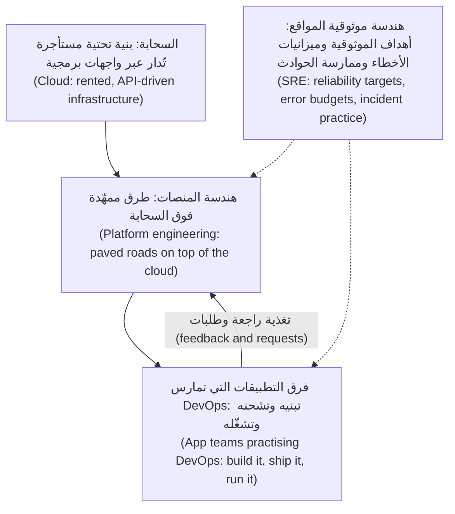

توفّر السحابة القدرة الخام (raw capability). ويحوّلها فريق المنصة إلى عدد صغير من الخيارات الآمنة المدعومة. وتستخدم فرق التطبيقات هذه الخيارات لتسلّم كثيرًا (deliver often) وتملك خدماتها. أما ممارسات SRE فتمتد عبر الاثنين: فهي تقرر مدى الموثوقية التي تحتاجها كل خدمة، وتُلزم الجميع بها.

**من يفعل ماذا (Who does what).** تختلف المسمّيات (titles) بين الشركات، لذا تعلّم *المسؤوليات (responsibilities)*، لا التسميات (labels):

| الدور (Role) | السؤال الرئيس الذي يجيب عنه | العمل المعتاد (Typical work) |
|---|---|---|
| مهندس السحابة (Cloud engineer) | "كيف نستخدم خدمات المزوّد جيدًا وبأمان؟ ⁦⁩" | الحسابات (accounts)، والشبكات، والهوية، والخدمات المُدارة، ومناطق الهبوط (landing zones) |
| مهندس DevOps (DevOps engineer) | "كيف تنتقل الشيفرة من الإيداع إلى الإنتاج بسرعة وأمان؟ ⁦⁩" | خطوط التسليم، وأدوات البناء (build tooling)، وأتمتة الإطلاق (release automation)، والبيئات (environments). وغالبًا مزيج من الصفوف الثلاثة الأخرى |
| مهندس المنصات (Platform engineer) | "ما الذي ينبغي أن يحصل عليه كل فريق مجانًا كي لا يعيد بناءه؟ ⁦⁩" | القوالب، ومنصة Kubernetes، وGitOps، وبوابة المطوّرين (developer portal)، والخدمة الذاتية (self-service) |
| مهندس موثوقية المواقع (Site reliability engineer) | "هل الخدمة موثوقة بما يكفي، وكيف نعرف ذلك؟ ⁦⁩" | أهداف مستوى الخدمة (SLOs)، والتنبيه (alerting)، والمناوبة (on-call)، والحوادث (incidents)، والسعة، وإزالة العمل الرتيب (removing toil) |

في الشركة الصغيرة (small company) يؤدي شخص واحد الأدوار الأربعة. وفي بنك نجم هم أشخاص منفصلون يجلسون في فريق واحد (one team).

**لماذا يكون "فريق DevOps" غالبًا نمطًا مضادًا (Why "DevOps team" is often an anti-pattern).** إذا أنشأت شركة "فريق DevOps (DevOps team)" يتلقى التذاكر (tickets) من المطوّرين وينشر (deploys) نيابةً عنهم، فقد أعادت بناء الجدار باسم جديد. والاختبار بسيط: هل يستطيع فريق التطبيقات شحن تغيير إلى الإنتاج، بأمان، دون تقديم تذكرة وانتظار شخص؟ إن لم يكن كذلك، فلديك تسليم يدوي بين فريقين (handoff)، لا DevOps. ومهمة فريق المنصة هي إزالة هذا التسليم، لا أن يصبح هو التسليم.

**تطبيق العوامل الاثني عشر (The Twelve-Factor App).** منهجية قصيرة (short methodology) نشرها مهندسون في Heroku تصف خدمات تعمل جيدًا على المنصات السحابية (cloud platforms): الإعدادات في البيئة لا في الشيفرة؛ والعمليات عديمة الحالة (stateless processes)؛ وبدء التشغيل السريع والإيقاف الرشيق؛ والبناء والإطلاق والتشغيل بوصفها مراحل منفصلة. ستلتقي هذه الأفكار مجددًا في الوحدتين 2 و4.

#### 🔴 نظرة الخبير (Expert view)

**قِس النتائج لا التبنّي (Measure outcomes, not adoption).** عبارة "نقلنا 80 خدمة إلى Kubernetes" نشاطٌ (activity). أما "انخفضت مهلة التغييرات (lead time) من ثلاثة أسابيع إلى يوم واحد، ولم يرتفع معدل فشل التغييرات" فهي نتيجة (outcome). يرفع سالم إلى مدير تقنية المعلومات (CIO) مقاييس DORA (DORA metrics) ومدى تحقيق أهداف مستوى الخدمة (SLO attainment)، لا أعداد الأدوات (tool counts). والمنصة التي لا يستخدمها أحد طوعًا (voluntarily) قد فشلت: تعامل معها بوصفها منتجًا له مستخدمون (users) وخارطة طريق (roadmap) ومقاييس تبنٍّ (adoption metrics).

**الموثوقية قرار منتج (Reliability is a product decision).** نسبة 100% هي الهدف الخطأ (wrong target) لكل شيء تقريبًا. فكل "تسعة (nine)" إضافية تكلّف أكثر، ولا يستطيع المستخدمون التمييز بين 99.99% و99.999% حين تتعطل شبكة هاتفهم المحمول (mobile network) نفسها أكثر من ذلك. فهدف مستوى الخدمة الصحيح يأتي مما يحتاجه المستخدمون: مرتفع لخدمة المدفوعات، وأدنى بكثير لأداة تقارير داخلية.

**التنظيم يشكّل المنصة (Regulation shapes the platform).** بالنسبة إلى بنك، ليست السحابة مجرد خيار هندسي (engineering choice). فالجهات التنظيمية المالية في دول الخليج، ومنها مصرف قطر المركزي (Qatar Central Bank)، تنشر توقعاتها بشأن الإسناد الخارجي السحابي (cloud outsourcing) وإقامة البيانات (data residency) والمرونة (resilience). وفي الاتحاد الأوروبي (EU)، يضع قانون المرونة التشغيلية الرقمية (Digital Operational Resilience Act) (DORA، اللائحة 2022/2554، المطبَّقة اعتبارًا من يناير 2025) قواعد بشأن مخاطر تقنية المعلومات والاتصالات (ICT risk)، والإبلاغ عن الحوادث (incident reporting)، واختبار المرونة (resilience testing)، ومخاطر الأطراف الثالثة (third-party risk) (ومنها السحابة) للكيانات المالية (financial entities). لاحظ تشابه الاسمين (name clash): *DORA* اللائحة الأوروبية و*DORA* برنامج أبحاث DevOps لا علاقة بينهما (unrelated). تبقى هذه الدورة في الجانب الهندسي (engineering)؛ أما القواعد فراجع [*أمن الذكاء الاصطناعي والتطبيقات (Secure AI & Application Security)*، الدرس 11.2 — التنظيم الذي يمسّ الأمن (Regulation that touches security)](../secai/index.ar.html#/11.2).

### 🧰 الأدوات
| الأداة أو الممارسة أو الخدمة (Tool, practice or service) | ما هي وماذا تفعل | متى تلجأ إليها |
|---|---|---|
| **DORA metrics** — مقاييس DORA | أربعة مقاييس لأداء التسليم (delivery performance): تكرار النشر، ومهلة التغييرات، ومعدل فشل التغييرات، وزمن استعادة الخدمة | تحديد خط أساس (baseline) قبل أي تغيير، والإبلاغ عن التقدم (reporting progress) بالنتائج (outcomes) لا بالأدوات (tools) |
| **Service level objective** — هدف مستوى الخدمة | هدف لقياس يواجه المستخدم (user-facing measurement) عبر نافذة زمنية (time window) | تحديد مدى الموثوقية التي يجب أن تتمتع بها الخدمة، ومتى تُبطئ الإطلاقات |
| **Error budget** — ميزانية الأخطاء | مقدار عدم الموثوقية (unreliability) الذي يسمح به هدف مستوى الخدمة | حسم سؤال "نشحن أم نثبّت الاستقرار؟ ⁦⁩" برقم متفق عليه مسبقًا (agreed in advance) |
| **Internal developer platform** — منصة المطوّرين الداخلية | أدوات خدمة ذاتية وقوالب وطرق ممهّدة تستخدمها فرق التطبيقات لبناء الخدمات وتشغيلها | حين تكرر فرق كثيرة عمل البنية التحتية نفسه، أو يؤديه كل منها بطريقة مختلفة |
| **Backstage** — مفتوح المصدر (open source)، من CNCF | بوابة مطوّرين: فهرس البرمجيات (software catalogue) والقوالب والتوثيق (documentation) في مكان واحد | منح فرق التطبيقات بابًا أماميًا واحدًا إلى المنصة |
| **Twelve-Factor App** — تطبيق العوامل الاثني عشر | منهجية قصيرة لبناء خدمات تعمل جيدًا على المنصات السحابية | مراجعة ما إذا كانت الخدمة جاهزة للحوسبة في حاويات والتوسّع (scaled) |
| **Well-Architected frameworks** — أطر البنية الجيدة | إرشادات الممارسات الجيدة المنظّمة لدى كل مزوّد، مرتّبة في ركائز (pillars) | مراجعة تصميم (design) مقابل قائمة تحقق (checklist) قبل تشغيله فعليًا (goes live) |

### 🏛️ عمليًا في بنك نجم
بعد حادثة "صلاحية DevOps"، يطلب سالم من يوسف صياغة **خريطة المسؤوليات (responsibility map)** للفريق: صفحة واحدة تبيّن من يملك ماذا مع انتقال الخدمات إلى السحابة. وتُنشر على بوابة المطوّرين الداخلية.

**هندسة المنصات وهندسة موثوقية المواقع في نجم (Najm Platform Engineering & SRE) — خريطة المسؤوليات (responsibility map) الإصدار 1 (v1)**

| المجال (Area) | يملكه فريق المنصة | تملكه فرق التطبيقات | تملكه هندسة موثوقية المواقع (مها) | الأمن (Security) (نورة) |
|---|---|---|---|---|
| حسابات السحابة والشبكات والهوية | منطقة الهبوط (landing zone)، وتخطيط الشبكة (network layout)، والأدوار (roles) لكل فريق | طلب الأدوار التي تحتاجها خدمتها | — | تعتمد تصميم الأدوار، وتجري مراجعات الصلاحيات (access reviews) |
| عناقيد Kubernetes (Kubernetes clusters) | دورة حياة العنقود (cluster lifecycle)، والترقيات (upgrades)، والإضافات المشتركة (shared add-ons) | مساحات أسمائها (namespaces)، وملفات التعريف (manifests)، وطلبات الموارد (resource requests) | مراجعات السعة (capacity reviews) | خط الأساس لسياسات العنقود |
| خطوط التسليم والمسارات الذهبية | القوالب، والمشغّلات المشتركة (shared runners)، وبنية مستودع GitOps | خط تسليم خدمتها، واختباراتها (tests)، وخيارات الإطلاق (release choices) | بوابات الإطلاق المرتبطة بميزانيات الأخطاء | ضوابط سلسلة التوريد (supply-chain controls) |
| قابلية المراقبة | منظومة القياس عن بُعد (telemetry stack)، وقوالب لوحات المتابعة (dashboards templates) | تجهيز شيفرتها بأدوات القياس، ولوحات متابعة الخدمة (service dashboards) | تعريفات أهداف مستوى الخدمة (SLO definitions) مع فرق التطبيقات، ومعايير التنبيه (alert standards) | متطلبات التسجيل الأمني |
| المناوبة والحوادث | جدول مناوبة المنصة | جدول مناوبة الخدمة | عملية الحوادث (incident process)، ومراجعات ما بعد الحادثة (postmortem reviews) | تصعيد الحوادث الأمنية (جاسم) |
| التكلفة | لوحات متابعة التكلفة (cost dashboards) وقواعد الوسم (tagging rules) | إنفاق خدمتها وتكلفة الوحدة (unit cost) | — | — |

**القواعد المصاحبة لها (Rules that come with it):**
- لا يحصل أحد على صلاحيات مدير دائمة في الإنتاج (production). فالصلاحيات المرفوعة (elevated access) محدودة زمنيًا (time-limited)، ومعتمدة (approved)، ومسجّلة (logged) (1.3).
- "صلاحية DevOps" ليست نوع طلب (request type). فالطلبات تسمّي الإجراء والمورد: "النشر (deploy) إلى مساحة الأسماء (namespace) `mobile-api` في بيئة التجهيز (staging)".
- يقيس فريق المنصة نجاحه بمقاييس DORA لفرق التطبيقات وبتبنّي المسارات الذهبية، ويرفعها إلى سالم شهريًا (monthly).
- تتلقى منى من الإدارة المالية (Finance) لوحة متابعة التكلفة (cost dashboard) شهريًا، ولها جهة اتصال مسمّاة (named contact) في كل فريق تطبيقات.

### 🛠️ التمارين (Exercises)
- 🟢 اكتب تعريفًا من فقرة واحدة (one-paragraph definition)، بكلماتك الخاصة، للسحابة وDevOps وهندسة المنصات وهندسة موثوقية المواقع، ثم جملة واحدة عن علاقة كل منها بالبقية. ضمّنه خصائص السحابة الخمس لدى NIST ومقاييس DORA الأربعة. *يكتمل عندما (Done when):* يستطيع صديق لا يعمل في التقنية قراءته وأن يشرح لك بدوره الفرق بين DevOps وSRE.
- 🟡 ابحث عن خمسة إعلانات وظائف حقيقية لأدوار السحابة أو DevOps أو المنصات أو SRE في منطقتك، وطابق مسؤوليات كل منها مع جدول "من يفعل ماذا". *يكتمل عندما:* يُظهر جدولٌ أيّ الأدوار الأربعة يطلبه كل إعلان فعلًا، مع جملة واحدة عمّا فاجأك.
- 🔴 خذ مشروعًا تملكه وله سجل git (git history) (مشروعًا شخصيًا أو مستودعًا عامًا مفتوح المصدر). قدّر مقاييس DORA الخاصة به للأشهر الثلاثة الأخيرة: تكرار النشر أو الإطلاق من الوسوم (tags) أو الإصدارات (releases)، ومهلة التغييرات من تاريخ الإيداع (commit date) إلى تاريخ الإطلاق (release date)، ومعدل فشل التغييرات من عمليات الإرجاع (reverts) أو إصدارات الإصلاح العاجل (hotfix releases)، وزمن الاستعادة (time to restore) من الفجوة بين إطلاق سيئ (bad release) والإصلاح أو الإرجاع الذي تلاه (استخدم الطوابع الزمنية للمشكلات (issue timestamps) إن توفرت لديك). *يكتمل عندما:* تكون لديك الأرقام الأربعة، والأوامر (commands) أو الاستعلامات (queries) التي استخدمتها للحصول عليها، وملاحظة عن الرقم الذي كان أصعب في القياس بأمانة ولماذا.

### ⚠️ أخطاء وفخاخ (Mistakes and traps)
- **إعادة تسمية العمليات إلى "DevOps" (Renaming ops to "DevOps").** طابور التذاكر (ticket queue) باسم جديد يظل تسليمًا يدويًا بين فريقين. قِس ما إذا كانت الفرق تستطيع الشحن دون انتظار شخص.
- **التعامل مع DevOps بوصفه شراء أداة (Treating DevOps as a tool purchase).** لا توجد أداة تصلح نموذج ملكية معطوبًا. ابدأ بمن يملك ماذا، ثم أتمت (automate).
- **بناء منصة لم يطلبها أحد (Building a platform nobody asked for).** تحدّث إلى فرق التطبيقات أولًا. المنصة منتج؛ وإذا تجنّبتها الفرق فقد فشلت.
- **مساواة "صلاحية DevOps" بصلاحيات المدير (Equating "DevOps access" with administrator rights).** المسؤولية المشتركة لا تعني مستخدمًا خارقًا مشتركًا (shared superuser). امنح صلاحيات محددة ومحدودة زمنيًا.

### 🧾 الخلاصة (Recap)
- السحابة بنية تحتية عند الطلب (on-demand)، تُدار عبر واجهات برمجة التطبيقات (API-driven)، ومقيسة (metered)؛ وخصائصها الخمس لدى NIST تفسّر لماذا تصبح الأتمتة والتكلفة شأنين هندسيين (engineering concerns).
- DevOps هو الملكية المشتركة (shared ownership) مضافًا إليها الأتمتة، ويُقاس بمقاييس DORA الأربعة؛ والسرعة والاستقرار يتحسّنان معًا.
- تجعل SRE الموثوقية رقمًا: مؤشرات مستوى الخدمة (SLIs) وأهداف مستوى الخدمة وميزانيات الأخطاء، إضافة إلى سقف للعمل الرتيب ومراجعات ما بعد الحادثة الخالية من اللوم.
- تبني هندسة المنصات منتجًا داخليًا، هو الطريق الممهّد (paved road)، كي تتحرك فرق التطبيقات بسرعة دون إتقان كل طبقة.
- تعلّم المسؤوليات لا المسمّيات. فالسؤال دائمًا: "من يملك هذا، وهل يستطيع التصرف دون انتظار؟ ⁦⁩"

### ✍️ اختبر نفسك (Check yourself)

**1. يطلب فريق تطبيقات (app team) في بنك نجم من يوسف "صلاحية DevOps (DevOps access)" كي ينشر تغييراته بنفسه (deploy their own changes). ما أفضل استجابة (best response)؟**

- A. منح كل مطوّر في الفريق صلاحيات مدير (administrator rights) على حساب السحابة (cloud account)، لأن DevOps يعني المسؤولية المشتركة (shared responsibility)
- B. سؤالهم عن الإجراءات (actions) التي يحتاجونها وعلى أي موارد، ومنح دور محدد (specific role) مثل النشر إلى مساحة أسمائهم الخاصة في بيئة التجهيز (staging)
- C. الرفض، لأن فريق المنصة (platform team) وحده يحق له النشر (deploy)
- D. إنشاء طابور تذاكر (ticket queue) كي ينشر فريق المنصة (platform team) نيابةً عنهم

<details><summary>الإجابة</summary>

**B.** يعني DevOps أن الفرق تستطيع الشحن (ship) دون تسليم يدوي بين فريقين (handoff)، ولكن بصلاحيات محددة وفق مبدأ أقل الصلاحيات (least-privilege permissions). أما A فيخلط بين الملكية المشتركة (shared ownership) وصلاحيات المستخدم الخارق المشتركة. وC وD يعيدان بناء الجدار بين البناء والتشغيل. (🟡 التعمق أكثر (Going deeper)؛ 🏛️ عمليًا.)

</details>

**2. أيٌّ مما يلي ليس (NOT) أحد مقاييس DORA الأربعة الرئيسة (four key metrics)؟**

- A. تكرار النشر (Deployment frequency) إلى الإنتاج
- B. مهلة التغييرات (Lead time for changes) من الإيداع إلى الإنتاج
- C. معدل فشل التغييرات (Change failure rate) بعد النشر
- D. عدد الخوادم المُدارة لكل مهندس

<details><summary>الإجابة</summary>

**D.** المقاييس الأربعة الرئيسة (four keys) هي تكرار النشر (deployment frequency)، ومهلة التغييرات (lead time for changes)، ومعدل فشل التغييرات (change failure rate)، وزمن استعادة الخدمة (time to restore service). أما عدد الخوادم لكل مهندس فيقيس النشاط (activity)، لا نتائج التسليم (delivery outcomes). (🟢 الأساسيات.)

</details>

**3. لخدمة المدفوعات (payments service) هدف مستوى خدمة (SLO) قدره 99.95% من التحويلات الناجحة (successful transfers) على مدى 28 يومًا. وفي منتصف النافذة (halfway through the window)، استهلكت الحوادث (incidents) كامل ميزانية الأخطاء (error budget) تقريبًا. بماذا توحي ممارسة SRE (SRE practice)؟**

- A. إبطاء إطلاقات الميزات الخطرة وتوجيه الجهد إلى الموثوقية (reliability) حتى تتعافى الميزانية
- B. رفع هدف مستوى الخدمة (SLO) إلى 99.99% كي يأخذ الفريق الموثوقية بجدية أكبر
- C. المضيّ كما هو مخطط والنظر مجددًا عند إعادة ضبط نافذة الـ 28 يومًا (window resets)
- D. خفض هدف مستوى الخدمة (SLO) بهدوء كي تبدو الميزانية المتبقية (remaining budget) سليمة مجددًا

<details><summary>الإجابة</summary>

**A.** ميزانية الأخطاء (error budget) هي الإشارة المتفق عليها (agreed signal) لسؤال "نشحن أم نثبّت الاستقرار". وحين تُستنفد، يأخذ عمل الموثوقية (reliability work) الأولوية. أما B فيزيد المشكلة سوءًا؛ وD يُبطل الغاية من الاتفاق على الهدف مسبقًا. (🟢 الأساسيات.)

</details>

**4. أنشأت شركة "فريق DevOps (DevOps team)" يتلقى التذاكر (tickets) من المطوّرين ويشغّل عمليات النشر (deployments) الخاصة بهم يدويًا (by hand). ما المشكلة الرئيسة (main problem)؟**

- A. الفريق أصغر من أن يتعامل مع حجم التذاكر الذي سيتلقاه
- B. يجب إعادة تسمية الفريق إلى "SRE" كي يتضح غرضه للجميع
- C. لقد أعاد بناء التسليم اليدوي (handoff) بين البناء والتشغيل الذي يزيله DevOps
- D. في البنك، يجب أن تتم عمليات النشر (deployments) يدويًا كي يتحقق شخص من كل واحدة منها

<details><summary>الإجابة</summary>

**C.** اختبار DevOps هو ما إذا كان الفريق يستطيع الشحن بأمان (ship safely) دون انتظار شخص آخر. وطابور التذاكر (ticket queue) تسليم يدوي (handoff)، أيًّا كان اسمه. أما A فيعالج العَرَض (treats the symptom)؛ وB يغيّر التسمية فقط؛ وD خاطئ، لأن الأتمتة (automation) تجعل عمليات النشر أكثر أمانًا (safer) وأكثر قابلية للتدقيق (more auditable). (🟡 التعمق أكثر (Going deeper).)

</details>

**5. يريد سالم أن يُثبت لمدير تقنية المعلومات (CIO) أن منصة المطوّرين الداخلية (internal developer platform) الجديدة تعمل. أي دليل هو الأقوى (strongest evidence)؟**

- A. قائمة بكل أداة (tool) تتضمنها المنصة الآن، مع حالة الترخيص والدعم لكل منها
- B. مهلة التغييرات (lead time) ومعدل الفشل (failure rate) لفرق التطبيقات قبل تبنّي المسارات الذهبية وبعده، والتبنّي الطوعي
- C. عدد عناقيد Kubernetes (Kubernetes clusters) ومساحات الأسماء (namespaces) التي تعمل الآن، مقارنة بالربع الماضي (last quarter)
- D. نمو فريق المنصة (platform team) وعدد التذاكر (tickets) التي أغلقها هذا الربع

<details><summary>الإجابة</summary>

**B.** المنصة منتج؛ وهي تنجح حين يحقق مستخدموها نتائج أفضل (better outcomes) ويختارون استخدامها. أما A وC وD فتقيس المدخلات والنشاط. (🔴 نظرة الخبير (Expert view).)

</details>

### 📚 المراجع (References)
- NIST SP 800-145، تعريف NIST للحوسبة السحابية — https://csrc.nist.gov/pubs/sp/800/145/final
- برنامج أبحاث DORA (DORA research programme) — https://dora.dev/
- Google، كتابا Site Reliability Engineering وThe Site Reliability Workbook (متاحان مجانًا على الإنترنت) — https://sre.google/books/
- CNCF، الورقة البيضاء عن المنصات — https://www.cncf.io/
- توثيق Backstage (Backstage documentation) — https://backstage.io/docs/
- تطبيق العوامل الاثني عشر — https://12factor.net/
- إطار AWS للبنية الجيدة — https://aws.amazon.com/architecture/well-architected/
- إطار Microsoft Azure للبنية الجيدة — https://learn.microsoft.com/azure/well-architected/
- إطار Google Cloud للبنية الجيدة (المعروف سابقًا بإطار Google Cloud المعماري) — https://cloud.google.com/architecture/framework
- اللائحة 2022/2554 (قانون المرونة التشغيلية الرقمية) — https://eur-lex.europa.eu/eli/reg/2022/2554/oj

<a id="l0-2"></a>

## 0.2 — المسار إلى الإنتاج: من الإيداع إلى العميل (customer)، وكل ما قد ينكسر في الطريق

*المستوى: 🟢 مبتدئ* · *المتطلبات: 0.1* · *المرحلة (Phase): Release, Deploy*

### ⚡ الدرس في دقيقة (In 60 seconds)
- كل تغيير يقطع **المسار إلى الإنتاج (path to production)** نفسه: الإيداع، والبناء (build)، والاختبار (test)، والتحزيم (package)، والتخزين (store)، والنشر، والإطلاق للمستخدمين، والمراقبة (observe). وكل خطوة إما تلتقط المشكلات (catches problems) وإما تسمح بمرورها.
- القاعدة الأهم: **ابنِ مرة واحدة، ورقِّ الأثر البرمجي نفسه (build once, promote the same artefact)**. فالشيء الذي اختبرته يجب أن يكون، بايتًا ببايت (byte-for-byte)، هو الشيء الذي تشغّله في الإنتاج.
- **النشر (deploying)** (وضع الشيفرة الجديدة على الخوادم) و**الإطلاق (releasing)** (السماح للمستخدمين بالوصول إليها) خطوتان مختلفتان. والفصل بينهما أساس الطرح الآمن (safe rollout).
- إشارة القرار: قبل شحن أي شيء (shipping anything)، اسأل: "إن كان هذا خاطئًا، فكم مستخدمًا سيراه، وبأي سرعة سنعرف، وبأي سرعة نستطيع التراجع؟ ⁦⁩"
- الفخ الأكبر: خطوات تُنفَّذ يدويًا، وبطريقة مختلفة في كل مرة. فمعظم الانقطاعات الشهيرة (famous outages) تعود إلى خطوة يدوية (manual step)، أو فحص مُتخطّى (skipped check)، أو تغيير وصل إلى الجميع دفعة واحدة.

### 🧭 لماذا يهم
في 1 أغسطس 2012، نشرت شركة Knight Capital، وهي شركة تداول أمريكية كبيرة، شيفرة تداول جديدة على خوادمها. ووفقًا لأمر هيئة الأوراق المالية والبورصات الأمريكية الصادر عام 2013، نُسخت الشيفرة الجديدة يدويًا إلى الخوادم، وفات أحدُ الخوادم الثمانية. وكان ذلك الخادم لا يزال يحمل شيفرة قديمة غير مستخدمة. فأعاد علمٌ (flag) أعادت الشيفرة الجديدة استخدامه تشغيلَ الشيفرة القديمة. وفي نحو 45 دقيقة أرسلت الشركة ملايين الأوامر غير المقصودة (unintended orders) وخسرت أكثر من 460 مليون دولار أمريكي. لم يكن هناك نشر مؤتمت (automated deployment)، ولا فحص يتأكد من أن جميع الخوادم تشغّل الإصدار نفسه (same version)، ولا طريقة سريعة للإيقاف.

وبعد اثني عشر عامًا، في 19 يوليو 2024، دفعت CrowdStrike تحديث محتوى معيبًا لمستشعرها الأمني Falcon. فأسقط أجهزة Windows التي تلقّته؛ وقدّرت Microsoft لاحقًا أن نحو 8.5 مليون جهاز تأثّر بذلك. وتوقفت شركات طيران ومستشفيات وبنوك. والتزمت مراجعة CrowdStrike الخاصة بطرح مرحلي (staged rollouts) لمثل هذه التحديثات، كي يصل التغيير السيئ (bad change) إلى مجموعة صغيرة أولًا.

يستخدم سالم الحالتين في يوم يوسف الأول. "كانت كلتاهما إخفاقًا في *المسار إلى الإنتاج (path-to-production failures)*: خطوة يدوية سارت على نحو خاطئ، وتغيير أُرسل إلى الجميع دفعة واحدة." يرسم هذا الدرس خريطة ذلك المسار؛ وكل وحدة لاحقة تقرّب العدسة (zooms in) على جزء منه.

### 📐 كيف يعمل

#### 🟢 الأساسيات

**المراحل (The stages).** أيًّا كانت الأدوات، يمرّ التغيير على واجهة برمجة تطبيق نجم للهاتف بهذه الخطوات:

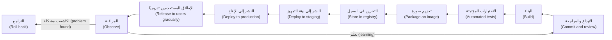

| المرحلة (Stage) | ما الذي يحدث | ما الذي ينبغي أن تلتقطه | أين تغطيها هذه الدورة |
|---|---|---|---|
| الإيداع والمراجعة | يدفع مطوّر (developer pushes) تغييرًا؛ ويراجعه زميل في طلب سحب (pull request) | الأخطاء المنطقية (logic errors)، والتغييرات الخطرة (risky changes)، والاختبارات المفقودة (missing tests) | 4.1 |
| البناء | تُصرَّف الشيفرة وتُجلب الاعتماديات | الشيفرة التي لا تُصرَّف؛ والاعتماديات المعطوبة (broken dependencies) | 4.1 |
| الاختبارات المؤتمتة (Automated tests) | تعمل اختبارات الوحدة (unit) والتكامل (integration) وغيرها | التراجعات الوظيفية (regressions)، والعقود المكسورة (broken contracts) | 4.1 |
| التحزيم | تُحزَّم الخدمة في صورة حاوية (container image) | الصور التي لا تبدأ؛ والصور المتضخمة أو غير الآمنة | 2.1 |
| التخزين | تُدفع الصورة إلى سجل (registry) بمعرّف فريد (unique identifier) | العبث (tampering)، والارتباك بشأن "أي إصدار هذا؟ ⁦⁩" | 2.1، 4.3 |
| النشر | تُطرح الصورة (rolled out) في بيئة (environment) بواسطة الأتمتة | أخطاء الإعدادات (configuration errors)، وفشل بدء التشغيل (failed startup)، وفحوص الصحة السيئة | 2.2، 3.2 |
| الإطلاق (Release) | يُمنح المستخدمون الإصدار الجديد تدريجيًا (gradually) | المشكلات التي لا تُظهرها إلا الحركة الحقيقية | 4.2 |
| المراقبة | يُظهر القياس عن بُعد (telemetry) ما إذا كان المستخدمون يُخدَمون جيدًا (well served) | الأخطاء (errors)، والبطء (slowness)، واستهلاك هدف مستوى الخدمة (SLO burn) | 5.1، 5.2 |

**خط التسليم (pipeline)** هو الأتمتة التي تشغّل هذه الخطوات. و**التكامل المستمر (continuous integration, CI)** يعني أن الجميع يدمجون تغييرات صغيرة في الفرع الرئيس (main branch) كثيرًا، وأن كل دمج (merge) يُبنى ويُختبر تلقائيًا (built and tested automatically). و**التسليم المستمر (continuous delivery, CD)** يعني أن كل تغيير يجتاز الفحوص جاهز للنشر بضغطة زر. أما **النشر المستمر (continuous deployment)** فيخطو خطوة أبعد: كل تغيير ناجح يُنشر تلقائيًا (deployed automatically).

**ابنِ مرة واحدة، ورقِّ الأثر البرمجي نفسه (Build once, promote the same artefact).** **الأثر البرمجي (artefact)** هو مخرَج البناء، وهو عندنا عادةً صورة حاوية. ابنِه مرة واحدة، وامنحه هوية فريدة (unique identity) (تجزئة الإيداع (commit hash) في وسمه (tag)، وبصمة محتواه)، وانقل الصورة *نفسها* من بيئة التجهيز إلى الإنتاج. فإن أعدت البناء للإنتاج، فأنت تشحن شيئًا لم تختبره قط (never tested): فقد تكون إحدى الاعتماديات (dependency) قد تغيّرت، وقد يختلف أحد خيارات البناء (build flag).

خط تسليم بسيط في GitHub Actions يختبر الشيفرة ويبني صورة واحدة موسومة بإيداعها:

```yaml
# .github/workflows/ci.yml — a starting point, hardened in Module 4
name: ci
on:
  pull_request:
  push:
    branches: [main]
permissions:
  contents: read          # least privilege: this job only reads the code
jobs:
  test-and-build:
    runs-on: ubuntu-latest
    steps:
      - uses: actions/checkout@v4   # in production pipelines, pin to a full commit SHA (4.3)
      - name: Run tests
        run: make test          # replace with your project's test command
      - name: Build one image, named after the commit
        run: docker build -t najm-mobile-api:${{ github.sha }} .
```

**البيئات (Environments).** تمرّ التغييرات عبر سلسلة من **البيئات (environments)**: نسخ منفصلة من النظام. ومن المجموعات الشائعة: التطوير (development)، والتجهيز (أقرب ما يمكن إلى الإنتاج)، والإنتاج. وينبغي ألا تختلف البيئات إلا في الإعدادات (configuration) (عناوين قواعد البيانات (database addresses)، والأحجام (sizes)، وأعلام الميزات)، ولا تختلف أبدًا في الشيفرة. ويُبيّن الدرس 3.2 كيف تُرقّى التغييرات بينها (promote changes) باستخدام GitOps.

**النشر ليس إطلاقًا (Deploy is not release).** أن *تنشر* يعني أن تضع الإصدار الجديد على الخوادم. وأن *تطلق* يعني أن تسمح للمستخدمين بالوصول إليه. يمكنك نشر شيفرة فيها ميزة جديدة مُطفأة بواسطة **علم ميزة (feature flag)**، ثم تشغيلها لـ 1% من المستخدمين. ويمكنك نشر إصدار جديد بجانب القديم وإرسال 5% من الحركة (traffic) إليه، وهذا هو **الكناري (canary)**. والفصل بين الخطوتين يعني أن التغيير السيئ يصل إلى قلة من المستخدمين، لا إليهم جميعًا. وهذا بالضبط درس تحديث CrowdStrike (CrowdStrike update).

#### 🟡 التعمق أكثر

**ما الذي ينكسر، مرحلة بمرحلة (What breaks, stage by stage).** كل انقطاع علني (public outage) يعلّمنا شيئًا عن مرحلة واحدة. وإليك حالات موثّقة جيدًا (well-documented cases)، مع الضابط (control) الذي كان سيحدّ من كل منها:

| الحالة (Case) | ما الذي حدث (التقارير العلنية) | المرحلة التي فشلت | الضابط |
|---|---|---|---|
| Knight Capital، 2012 | فات النشرُ اليدوي (manual deploy) خادمًا من ثمانية؛ فأُعيد تفعيل الشيفرة القديمة | النشر | عمليات نشر مؤتمتة ومتطابقة؛ وفحوص الإصدار على كل خادم؛ ومفتاح إيقاف طارئ (kill switch) |
| AWS S3، us-east-1، فبراير 2017 | أثناء تصحيح الأخطاء (debugging)، كُتب أمرٌ مُعدّ لإزالة عدد صغير من الخوادم بشكل خاطئ (mistyped) فأزال عددًا أكبر بكثير | التشغيل (Operate) | أدوات تحدّ من مقدار ما يستطيع أمر واحد إزالته، ومن سرعة ذلك |
| GitLab.com، يناير 2017 | حذف مهندس دليل قاعدة بيانات إنتاجية عن طريق الخطأ؛ وتبيّن أن عدة طرق نسخ احتياطي (backup methods) لا تعمل؛ وفُقدت ساعات من البيانات | التشغيل والتعافي (Operate, Recover) | استعادات مُختبرة (tested restores)، لا مجرد نسخ احتياطية؛ وفصل واضح لطرفيات الإنتاج (production terminals) |
| Facebook، أكتوبر 2021 | فصل أمرُ صيانة (maintenance command) الشبكة الأساسية (backbone)؛ ثم سحبت خوادم DNS مساراتها؛ وتوقفت الخدمات والأدوات الداخلية لساعات | النشر والتشغيل (Deploy, Operate) | أدوات تدقيق (audit tools) تمنع التغييرات الخطرة (dangerous changes)؛ ووصول خارج النطاق (out-of-band access) للتعافي |
| CrowdStrike، يوليو 2024 | ذهب تحديث محتوى معيب إلى جميع مستشعرات Windows (Windows sensors) دفعة واحدة فأسقطها | الإطلاق | طرح مرحلي إلى مجموعة صغيرة أولًا؛ وإيقاف تلقائي عند الأخطاء |

يبرز نمطان (two patterns). معظمها كان أفعالًا بشرية عادية لم يحمِ المسارُ منها، لا أخطاء برمجية غريبة (exotic bugs). وجاء الضرر من *نطاق الأثر (blast radius)* (عدد المستخدمين الذين يمكن أن يصلهم تغيير واحد) ومن *زمن الاكتشاف والتراجع*. والهندسة الجيدة (good engineering) تقلّص كليهما.

**الأسئلة الثلاثة لكل مرحلة (The three questions per stage).** لكل مرحلة في مسارك، اسأل:
1. **ما الذي قد يسوء هنا؟ ⁦(What can go wrong here?)⁩** اختبار فاشل (failed test)، أو اعتمادية مصابة بثغرة (vulnerable dependency)، أو قيمة إعدادات خاطئة، أو خادم لم يصله التحديث قط.
2. **ما الذي يلتقطه تلقائيًا؟ ⁦(What catches it, automatically?)⁩** اختبار، أو فحص (scan)، أو فحص صحة (health check)، أو مقياس كناري (canary metric)، أو تنبيه (alert).
3. **كيف نتراجع عنه، وكم يستغرق ذلك؟ ⁦(How do we undo it, and how long does that take?)⁩** إرجاع الإيداع، أو إعادة نشر الصورة السابقة، أو إطفاء علم الميزة، أو الاستعادة من النسخة الاحتياطية.

إن كان جواب السؤال 2 هو "شخصٌ يتذكر أن ينظر"، فتلك هي مهمة الأتمتة التالية لديك.

**التراجع خير من تصحيح الأخطاء في الإنتاج (Rollback beats debugging in production).** حين يسوء إطلاق، استعِد الخدمة أولًا. ومع صورة غير قابلة للتغيير (immutable image)، يعني التراجع (rolling back) إعادة نشر الصورة السابقة، وهو أمر يستغرق دقائق. ابحث عن السبب الجذري بعد ذلك، والمستخدمون في أمان. ولهذا فإن مقياس DORA هو "زمن *استعادة* الخدمة"، لا "زمن الإصلاح".

**ليس كل تغيير شيفرة (Not every change is code).** فالإعدادات، والبنية التحتية، وتغييرات المخطط (schema changes)، وتبديل الأعلام (flag flips)، وتحديثات محتوى أدوات الأمن تصل إلى الإنتاج أيضًا، وعددٌ من الانقطاعات أعلاه لم يكن نشرًا لتطبيقات (application deploys) أصلًا. تعامل مع *كل* تغيير في الإنتاج بالطريقة نفسها: مُراجَعًا (reviewed)، ومُصدَّرًا بإصدار (versioned)، ومؤتمتًا، ومرحليًا (staged)، وقابلًا للتراجع (reversible).

#### 🔴 نظرة الخبير

**مهلة التغييرات خريطةٌ لانتظارك (Lead time is a map of your waiting).** حين قاس نجم مهلة التغييرات لواجهة الهاتف (Mobile API) في مركز البيانات، كان معظمها انتظارًا (waiting): لمجلس اعتماد التغييرات (change-approval board)، أو لنافذة إطلاق (release window)، أو لشخص يشغّل نصًا برمجيًا. فالمهلة الأقصر تأتي دائمًا تقريبًا من إزالة الطوابير والتسليمات اليدوية، لا من حواسيب أسرع (faster computers). ارسم خريطة المواضع التي *ينتظر (waits)* فيها التغيير، لا فقط المواضع التي *يعمل (works)* فيها.

**الدفعات الصغيرة إجراء أمان (Small batches are a safety measure).** يصعب تشخيص إطلاق فاشل (failed release) يحوي 200 تغيير؛ أما إطلاق فاشل يحوي تغييرًا واحدًا فيشير مباشرة إلى سببه. وتبدو عمليات النشر الصغيرة المتكررة خطرة، لكن أبحاث DORA (DORA research) وجدت أن الفرق التي تنشر أكثر تفشل أيضًا أقل (fail less) وتتعافى أسرع (recover faster).

**ضبط التغيير في بنك خاضع للتنظيم (Change control in a regulated bank).** استخدمت البنوك تقليديًا مجالس استشارية للتغيير (change-advisory boards) تعتمد كل إطلاق يدويًا. لكن خط تسليم مبنيًّا جيدًا (well-built pipeline) يستطيع أن يقدّم دليلًا *أفضل (better evidence)* من اجتماع: طلب سحب مُراجَع، ونتائج الاختبارات (test results)، وأثرًا برمجيًا موقّعًا (signed artefact)، وسجل نشر مؤتمتًا لكل تغيير. فالمدققون (auditors) يحتاجون إلى أن تكون التغييرات مضبوطة (controlled) ومُختبرة (tested) وقابلة للتتبّع (traceable). واستراتيجية سالم هي أن يجعل خط التسليم ينتج ذلك الدليل، كي تتدفق التغييرات منخفضة المخاطر (low-risk changes) دون مجلس، بينما تظل التغييرات عالية المخاطر (high-risk ones) تحظى بمراجعة بشرية (human review).

**الأمن يسير في المسار نفسه (Security travels the same path).** كل مرحلة هي أيضًا موضع يستطيع فيه مهاجم (attacker) إدخال شيء ما: اعتمادية خبيثة (malicious dependency) وقت البناء، أو صورة مُبدَّلة (swapped image) في السجل، أو بيانات اعتماد مسروقة (stolen credentials) في خط التسليم. يؤمّن الدرس 4.3 خط التسليم؛ وللصورة الكاملة لسلسلة التوريد (supply-chain)، راجع [*أمن الذكاء الاصطناعي والتطبيقات*، الدرس 6.2 — سلسلة توريد البرمجيات: الاعتماديات وقوائم مكونات البرمجيات وSLSA والتوقيع](../secai/index.ar.html#/6.2). وللرحلة نفسها مرويّةً لمن يبنون باستخدام وكلاء الذكاء الاصطناعي (AI agents) ولا يكتبون الشيفرة يدويًا، راجع [*تصميم الأنظمة لمبرمجي الفايب (System Design for Vibe Coders)*، الدرس 4.1 — الشحن منظومة (Shipping is a system)](../vibe/index.ar.html#l4-1).

### 🧰 الأدوات
| الأداة أو الممارسة أو الخدمة | ما هي وماذا تفعل | متى تلجأ إليها |
|---|---|---|
| **GitHub Actions** — خدمة CI/CD من GitHub | خدمة تكامل وتسليم مستمرين (CI/CD) مدمجة في GitHub تشغّل سير عمل (workflows) عند أحداث مثل الدفع (push) أو طلب السحب | أتمتة البناء والاختبار والتحزيم للشيفرة المستضافة على GitHub؛ وGitLab CI وJenkins بديلان شائعان (common alternatives) |
| **Build once, promote** — ابنِ مرة واحدة ورقِّ | ممارسة بناء أثر برمجي واحد غير قابل للتغيير (one immutable artefact) ونقل هذا الأثر نفسه عبر كل بيئة (every environment) | دائمًا؛ فإعادة البناء لكل بيئة (rebuilding per environment) تشحن شيفرة غير مُختبرة (untested code) |
| **Container registry** — سجل الحاويات | مخزن لصور الحاويات (container images)، لكل منها وسم وبصمة محتوى (content digest) | الاحتفاظ بالأثر البرمجي الواحد (single artefact) الذي تنشره كل بيئة |
| **Feature flag** — علم الميزة | مفتاح وقت التشغيل (runtime switch) يشغّل ميزة أو يطفئها دون عملية نشر | فصل النشر عن الإطلاق؛ و"إطفاء" فوري (instant "off") لميزة سيئة |
| **Canary release** — الإطلاق الكناري | إرسال حصة صغيرة من الحركة إلى إصدار جديد ومقارنته بالقديم | أي تغيير قد تكسره الحركة الحقيقية (real traffic)؛ ويُغطّى بالكامل في 4.2 |
| **Rollback** — التراجع | إعادة الإنتاج إلى آخر إصدار معروف بأنه سليم، عادةً بإعادة نشر الأثر البرمجي السابق | الاستجابة الأولى لإطلاق سيئ: استعِد الخدمة (restore service)، ثم حقّق (investigate) |

### 🏛️ عمليًا في بنك نجم
يطلب سالم من يوسف إعداد **خريطة المسار إلى الإنتاج (path-to-production map)** لواجهة برمجة تطبيق نجم للهاتف، كما تعمل اليوم في مركز البيانات وكما ينبغي أن تعمل بعد الانتقال إلى السحابة (cloud move). وتصبح هذه الخريطة قائمة الأعمال المتراكمة (backlog) لعملية الترحيل (migration) بأكملها.

**واجهة برمجة تطبيق نجم للهاتف (Najm Mobile API) — خريطة المسار إلى الإنتاج (path-to-production map) (الحالة المستهدفة (target state)، الإصدار 1 (v1))**

| المرحلة | ما الذي قد يسوء | الالتقاط المؤتمت (Automated catch) | التراجع (Undo) | المالك (Owner) |
|---|---|---|---|---|
| الإيداع والمراجعة | تغيير غير مُراجَع أو خطر | حماية الفرع (branch protection): موافقة واحدة، واثنتان للشيفرة المتعلقة بالمدفوعات (payment-related code) | إرجاع الإيداع | فريق التطبيقات |
| البناء والاختبار | تراجع وظيفي (regression)، أو اعتمادية معطوبة (broken dependency) | اختبارات الوحدة والتكامل (unit and integration tests)؛ وفحص الاعتماديات (dependency scan) | حجب طلب السحب | فريق التطبيقات |
| التحزيم | الصورة تختلف عمّا اختُبر؛ أو تعمل بصلاحيات الجذر (runs as root) | صورة واحدة لكل إيداع، موسومة بتجزئة الإيداع؛ وفحص عدم التشغيل بصلاحيات الجذر (non-root check) | التخلص من الصورة؛ والإصلاح وإعادة البناء عبر خط التسليم كاملًا (full pipeline) | المسار الذهبي للمنصة |
| التخزين | صورة خاطئة أو عُبث بها | يحتفظ السجل بالبصمات؛ والصورة موقّعة (image signed) (4.3) | النشر ببصمة آخر صورة سليمة | المنصة |
| النشر إلى التجهيز | خطأ في الإعدادات (configuration error)؛ أو فشل الصورة في البدء | مسابير الصحة (health probes)؛ واختبارات الدخان (smoke tests) | تراجع تلقائي عن الطرح | GitOps لدى المنصة (Platform GitOps) |
| النشر إلى الإنتاج | مثل التجهيز، لكن على نطاق واسع | بصمة الصورة نفسها كما في التجهيز؛ وتحديث متدرّج (rolling update) مع فحوص الصحة | إعادة نشر البصمة السابقة (الهدف: أقل من 10 دقائق) | فريق التطبيقات مع المنصة |
| الإطلاق | خلل لا تُظهره إلا الحركة الحقيقية | كناري بنسبة 5%، يُقارن على معدل الأخطاء (error rate) وزمن الاستجابة (latency) | إعادة توجيه الحركة إلى الإصدار السابق؛ وإطفاء العلم (flag off) | فريق التطبيقات |
| المراقبة | المستخدمون يتضررون دون أن يلاحظ أحد | تنبيهات معدل استهلاك هدف مستوى الخدمة (5.2) | عملية الحوادث (5.3) | هندسة موثوقية المواقع، مها |

**مقاييس DORA الأساسية (Baseline DORA metrics)** (يملأ الفريق الأرقام الحقيقية للربع الماضي؛ وتُحدَّد الأهداف (targets) مع مها):

| المقياس | اليوم (Today) | الهدف بعد الترحيل |
|---|---|---|
| تكرار النشر | ___ | ___ |
| مهلة التغييرات | ___ | ___ |
| معدل فشل التغييرات | ___ | ___ |
| زمن استعادة الخدمة | ___ | ___ |

**قاعدة أُضيفت إلى معيار الفريق (Rule added to the team standard):** أي مرحلة يقول عمود "الالتقاط المؤتمت" فيها "شخص يتحقق" هي بند في قائمة الأعمال المتراكمة (backlog item) له مالك وتاريخ (date).

### 🛠️ التمارين
- 🟢 اختر موقعًا إلكترونيًا تستخدمه. شغّل `dig +short example.com` و`curl -sI https://example.com` (مع النطاق الحقيقي) ودوّن عناوين IP (IP addresses)، وحالة HTTP (HTTP status)، والترويسات (headers) مثل `cache-control`. ثم اكتب المراحل الخمس التي سيمرّ بها تغيير قبل أن يظهر على ذلك الموقع. *يكتمل عندما:* يكون المخرَج (output) محفوظًا، وتسمّي كل مرحلة من مراحلك الخمس شيئًا واحدًا قد يسوء.
- 🟡 ارسم خريطة المسار إلى الإنتاج لمشروع خاص بك (أو لمشروع صغير مفتوح المصدر (open-source project) تعرفه)، مستخدمًا الأعمدة نفسها في خريطة نجم. *يكتمل عندما:* يكون لكل مرحلة "التقاط مؤتمت" و"تراجع"، وتكون قد علّمت بلون مختلف كل موضع يكون فيه الجواب حاليًا "شخص يتذكر".
- 🔴 في مستودع عام (public repository) على حسابك الخاص في GitHub، أنشئ خدمة ويب صغيرة جدًا فيها اختبار واحد (one test) وملف Dockerfile، وأضف سير عمل التكامل المستمر (CI workflow) من هذا الدرس. ادفع تغييرًا يكسر الاختبار وتأكد من أن خط التسليم يفشل (pipeline fails). ثم أصلحه، ودع خط التسليم يبني الصورة، وابنِ الإيداع نفسه (same commit) وشغّله محليًا باستخدام `docker run`. *يكتمل عندما:* تستطيع أن تُظهر تشغيلًا فاشلًا (failed run)، وتشغيلًا ناجحًا (passing run)، ووسم الصورة (image tag) مطابقًا لتجزئة الإيداع الذي نجح.

### ⚠️ أخطاء وفخاخ
- **إعادة البناء لكل بيئة (Rebuilding for each environment).** ينتهي بك الأمر إلى شحن شيفرة لم تختبرها قط. ابنِ مرة واحدة ورقِّ الصورة نفسها، المعرَّفة ببصمتها.
- **خطوات الإنتاج اليدوية (Manual production steps).** كل أمر يُشغَّل يدويًا (hand-run command) فرصةٌ لتكرار الخادم المنسيّ لدى Knight Capital. أتمته (automate it)، أو على الأقل اكتبه نصًا برمجيًا (script it) وراجع النص.
- **الإطلاق للجميع دفعة واحدة (Releasing to everyone at once).** عندها يصل التغيير السيئ إلى كل مستخدم قبل أن يلاحظ أحد. افصل النشر عن الإطلاق واطرح تدريجيًا (roll out gradually).
- **اعتبار تغييرات الإعدادات والبنية التحتية "ليست نشرًا" (Treating config and infrastructure changes as "not a deploy").** عدة انقطاعات شهيرة نتجت عن هذه بالضبط. مرّر كل تغيير في الإنتاج عبر المسار نفسه (same path).
- **نسخ احتياطية لم يستعِدها أحد (Backups nobody has restored).** أظهرت حادثة GitLab عام 2017 نسخًا احتياطية لم تكن تعمل بصمت. لا تُحتسب النسخة الاحتياطية (backup) إلا بعد اختبار الاستعادة (6.1).

### 🧾 الخلاصة
- يقطع كل تغيير مراحل الإيداع، والبناء، والاختبار، والتحزيم، والتخزين، والنشر، والإطلاق، والمراقبة؛ ويجب على كل مرحلة أن تلتقط شيئًا (catch something) وأن تكون قابلة للتراجع (undoable).
- ابنِ مرة واحدة ورقِّ الأثر البرمجي نفسه غير القابل للتغيير؛ ولا تُعِد البناء للإنتاج أبدًا.
- النشر والإطلاق مختلفان؛ والفصل بينهما باستخدام الكناري (canaries) وأعلام الميزات (feature flags) يقلّص نطاق الأثر.
- معظم الانقطاعات الشهيرة كانت إخفاقات في المسار (path failures): خطوة يدوية، أو فحص مفقود (missing check)، أو تغيير أُرسل إلى الجميع دفعة واحدة.
- استعِد أولًا وحقّق لاحقًا؛ والتغييرات الصغيرة المتكررة أكثر أمانًا من الكبيرة النادرة.

### ✍️ اختبر نفسك

**1. يقترح يوسف بناء صورة واجهة برمجة تطبيق نجم للهاتف (Najm Mobile API image) مجددًا للإنتاج (production)، "كي تلتقط أحدث التصحيحات الأمنية (latest security patches)"، بعد اختبار بناء مختلف في بيئة التجهيز (staging). ما المشكلة؟**

- A. تستغرق عمليات البناء للإنتاج (production builds) وقتًا أطول، فتفوت نافذة الإطلاق (release window)
- B. يرفض السجل (registry) صورة ثانية مبنية من الإيداع نفسه (same commit)
- C. سيشغّل الإنتاج صورة لم تُختبر قط؛ وينبغي أن تمرّ التصحيحات (patches) عبر خط التسليم كاملًا
- D. لا مشكلة، ما دامت الصورتان مبنيتين من تجزئة الإيداع نفسها

<details><summary>الإجابة</summary>

**C.** قد تجلب إعادة البناء (rebuild) إصدارات اعتماديات مختلفة أو تستخدم إعدادات مختلفة (different settings)، فيختلف الأثر البرمجي المُختبر (tested artefact) عن الأثر البرمجي المشحون (shipped artefact). وD هو المُشتِّت المغري (tempting distractor): فالإيداع نفسه لا يضمن الصورة نفسها (same image). وينبغي أن تتدفق التصحيحات عبر خط التسليم بأكمله (whole pipeline). (🟢 الأساسيات.)

</details>

**2. ما الفرق بين النشر (deploying) والإطلاق (releasing)؟**

- A. النشر يضع الإصدار الجديد على الخوادم؛ والإطلاق يسمح للمستخدمين بالوصول إليه
- B. هما اسمان للخطوة نفسها (same step)، تستخدمهما أدوات مختلفة
- C. الإطلاق هو اجتماع الموافقة (approval meeting) الذي يجب أن يُعقد قبل النشر
- D. النشر يخص شيفرة التطبيق (application code)؛ والإطلاق يخص البنية التحتية التي تعمل عليها (infrastructure)

<details><summary>الإجابة</summary>

**A.** يمكن أن يكون الإطلاق (releasing) تدريجيًا (gradual) (كناري) أو يُبدَّل بعلم ميزة (feature flag). والفصل بين الاثنين يتيح لك النشر بأمان (deploy safely)، ثم تعريض التغيير لحصة صغيرة من المستخدمين أولًا. (🟢 الأساسيات.)

</details>

**3. وفقًا لأمر هيئة الأوراق المالية والبورصات الأمريكية (SEC's order)، أي إخفاق كان في صميم خسائر Knight Capital عام 2012؟**

- A. انقطاع لدى مزوّد الاستضافة (hosting provider) ترك الأوامر عالقة في طابور
- B. قاعدة بيانات إنتاجية (production database) حُذفت عن طريق الخطأ، مع نسخ احتياطية (backups) لم تكن تعمل
- C. تحديث معيب لمستشعر أمني أُرسل إلى جميع أجهزتها دفعة واحدة
- D. نشر يدوي (manual deployment) فات خادمًا واحدًا، حيث أيقظ علمٌ أُعيد استخدامه الشيفرة القديمة

<details><summary>الإجابة</summary>

**D.** نُسخت الشيفرة الجديدة يدويًا وفات خادم من ثمانية. أما B فيصف GitLab عام 2017، وC يصف CrowdStrike عام 2024. (🧭 لماذا يهم؛ 🟡 التعمق أكثر (Going deeper).)

</details>

**4. يرفع إصدار جديد من واجهة برمجة تطبيق نجم للهاتف (Najm Mobile API) معدلَ الأخطاء (error rate) بحدة بعد عشر دقائق من الطرح (rollout). يريد طارق أن يجد الخلل (find the bug) قبل فعل أي شيء. بماذا ينبغي أن تنصح مها؟**

- A. إبقاء الإطلاق قيد التشغيل كي يتمكن الفريق من إعادة إنتاج الخلل بالحركة الحقيقية (real traffic)
- B. التراجع إلى الصورة السابقة (roll back) لاستعادة الخدمة، ثم إيجاد السبب الجذري (root cause)
- C. كتابة إصلاح سريع (quick fix) ونشره مباشرة إلى الإنتاج، مع تخطّي الاختبارات
- D. إعادة تشغيل جميع الخوادم في العنقود (cluster) ومراقبة ما إذا كانت الأخطاء ستختفي

<details><summary>الإجابة</summary>

**B.** الهدف الأول هو استعادة الخدمة (restore service)؛ ومع الصور غير القابلة للتغيير (immutable images)، تستغرق إعادة نشر الإصدار السابق دقائق. أما A فيُبقي المستخدمين على إطلاق معطوب (broken release)؛ وC يتخطى الفحوص ذاتها التي تحمي المستخدمين؛ وD يخفي العَرَض دون إزالة الإصدار السيئ (bad version). (🟡 التعمق أكثر (Going deeper).)

</details>

**5. يقيس نجم مهلة تغييرات (lead time) قدرها ثلاثة أسابيع لواجهة الهاتف (Mobile API). ويستغرق البناء والاختبار (building and testing) نحو 40 دقيقة. ما الطريقة الأرجح لتقليص مهلة التغييرات؟**

- A. شراء خوادم بناء أسرع كي يتقلص تشغيل البناء والاختبار الذي يستغرق 40 دقيقة
- B. حذف أبطأ الاختبارات (slowest tests) كي تصل التغييرات إلى بيئة التجهيز (staging) أسرع
- C. إزالة الطوابير التي تنتظر فيها التغييرات، مع الإبقاء على دليل الضبط
- D. النشر بتكرار أقل، في دفعات أكبر (bigger batches)، لتقليل عدد الموافقات (approvals)

<details><summary>الإجابة</summary>

**C.** حين يستغرق العمل دقائق بينما تبلغ مهلة التغييرات أسابيع، يكون الوقت مُنفَقًا في الانتظار (spent waiting). والموافقات اليدوية (manual approvals) ونوافذ الإطلاق (release windows) طوابير نموذجية (typical queues). أما A فيسرّع خطوة ليست هي عنق الزجاجة؛ وB يُضعف الأمان (weakens safety) مقابل مكسب ضئيل؛ وD يزيد المخاطر (increases risk). (🔴 نظرة الخبير (Expert view).)

</details>

### 📚 المراجع
- هيئة الأوراق المالية والبورصات الأمريكية (US SEC)، In the Matter of Knight Capital Americas LLC (2013) — https://www.sec.gov/litigation/admin/2013/34-70694.pdf
- AWS، ملخص انقطاع خدمة Amazon S3 في منطقة فرجينيا الشمالية (Summary of the Amazon S3 Service Disruption in the Northern Virginia (US-EAST-1) Region) — https://aws.amazon.com/message/41926/
- GitLab، مراجعة ما بعد حادثة انقطاع قاعدة البيانات في 31 يناير (Postmortem of database outage of January 31) — https://about.gitlab.com/blog/
- Meta Engineering، مزيد من التفاصيل عن انقطاع 4 أكتوبر (More details about the October 4 outage) — https://engineering.fb.com/
- CrowdStrike، مركز المعالجة والإرشاد بشأن تحديث محتوى Falcon — https://www.crowdstrike.com/
- برنامج أبحاث DORA — https://dora.dev/
- توثيق GitHub Actions (GitHub Actions documentation) — https://docs.github.com/actions
- تطبيق العوامل الاثني عشر — https://12factor.net/

<a id="l0-3"></a>

## 0.3 — تعرّف على فريق المنصة في بنك نجم، وكيف تستخدم هذه الدورة

*المستوى: 🟢 مبتدئ* · *المتطلبات: 0.1، 0.2* · *المرحلة (Phase): Plan*

### ⚡ الدرس في دقيقة (In 60 seconds)
- **بنك نجم (Najm Bank)** بنك خليجي متوسط الحجم خيالي (fictional mid-sized Gulf bank) يعمل في قطر والإمارات والاتحاد الأوروبي. ستتابع فريق **هندسة المنصات وهندسة موثوقية المواقع (Platform Engineering & SRE)** فيه عبر ترحيل سحابي بملامح واقعية.
- يشغّل الفريق خمسة أنظمة (five systems) ستلقاها في كل وحدة: **واجهة برمجة تطبيق نجم للهاتف (Najm Mobile API)**، و**خدمة المدفوعات (payments service)**، و**نجم أسيست (Najm Assist)** (مساعد قائم على نموذج لغوي كبير)، و**منصة المطوّرين الداخلية (internal developer platform)**، ونظام **الخدمات المصرفية الأساسية في مركز البيانات (data-centre core banking)** الذي يبقى محليًا (on-premises).
- لكل درس الأجزاء العشرة نفسها (same ten parts)، ويتدرج من 🟢 الأساسيات (essentials) إلى 🔴 نظرة الخبير، وينتج **أثرًا (artefact)** قابلًا لإعادة الاستخدام (reusable).
- تتدرّب على **مختبر محلي (local lab)**: Docker، وعنقود Kubernetes محلي (kind أو k3d أو minikube)، وOpenTofu أو Terraform، وGit، وGitHub Actions. لا شيء في هذه الدورة يتطلب الدفع لمزوّد سحابي.
- إشارة القرار: إن استخدمت فئة مجانية سحابية، **فاضبط تنبيه ميزانية (budget alert) قبل أن تُنشئ أي شيء**.
- الفخ الأكبر: القراءة دون تطبيق. فمهارات العمليات (operations skills) تعيش في يديك، لا في ملاحظاتك.

### 🧭 لماذا يهم
وظّف سالم خرّيجَين (two graduates) كل عام خلال السنوات الثلاث الماضية. والذين تعثّروا لم يكونوا أضعف المبرمجين (weakest programmers). بل كانوا الذين قرأوا كل وثيقة ولم يكسروا شيئًا عن قصد. لم يروا قط حجيرة (pod) تدخل في حلقة انهيار متكرر (crash-loop)، ولا خطة Terraform (Terraform plan) تريد تدمير قاعدة بيانات، ولا تنبيهًا انطلق في الثالثة فجرًا بلا سبب. أما الذين ازدهروا فكان لديهم مختبر في المنزل ارتكبوا فيه تلك الأخطاء بتكلفة زهيدة (cheaply).

هكذا تعمل هذه الدورة. ستلقى الأشخاص والأنظمة والمشكلات أنفسها في كل درس. وستنتج آثارًا (artefacts) يحتفظ بها فريق منصة حقيقي. وستشغّل كل تمرين على جهازك الخاص أو على فئة مجانية (free tier)، كي تقع الأخطاء المكلفة (expensive mistakes) في مختبرك لا في الإنتاج. يعرّفك هذا الدرس بالفريق والأنظمة، ويشرح كيف بُنيت الدورة، ويُشغّل مختبرك.

### 📐 كيف يعمل

#### 🟢 الأساسيات

**بنك نجم، ولماذا بنك (Najm Bank, and why a bank).** بنك نجم خيالي (fictional). وهو البنك نفسه المستخدم في الدورات الأخرى لهذه المكتبة، لذا تروي دورات الأمن والحوكمة والمنتج كلها أجزاءً من قصة واحدة. والبنك حالة تعليمية جيدة لأن المخاطر واضحة. فالعملاء يتوقعون أن يعمل التطبيق في كل الأوقات؛ والتحويل (transfer) يجب ألا يضيع أبدًا ولا يُرسل مرتين؛ والجهات التنظيمية (regulators) تتوقع دليلًا على أن الأنظمة مضبوطة وقابلة للاستعادة. فإن استطعت تشغيل الأنظمة جيدًا لبنك، فإنك تستطيع تشغيلها جيدًا في أي مكان تقريبًا.

**الوضع (The situation).** يشغّل نجم معظم أنظمته في مركز بياناته الخاص. وهو ينقل الخدمات التي تواجه العملاء (customer-facing services) إلى سحابة عامة مُدارة، بينما يبقى نظام الخدمات المصرفية الأساسية (core banking system) محليًا ومتصلًا عبر روابط خاصة (private links): أي إعداد **هجين (hybrid)**. وفي الوقت نفسه، يبني فريق سالم **منصة المطوّرين الداخلية (internal developer platform)** كي تتمكن فرق التطبيقات في البنك من الشحن دون أن يصبح كل منها خبيرًا في البنية التحتية (infrastructure experts).

**الأنظمة (The systems).**

| النظام (System) | ما هو | لماذا يهم في هذه الدورة |
|---|---|---|
| **واجهة برمجة تطبيق نجم للهاتف (Najm Mobile API)** | واجهة برمجة التطبيقات العامة (public API) خلف تطبيق الخدمات المصرفية للأفراد. حاويات على خدمة Kubernetes مُدارة (managed Kubernetes service)، وقاعدة بيانات PostgreSQL مُدارة، وتخزين كائنات (object storage)، وشبكة توصيل محتوى (CDN) وجدار حماية لتطبيقات الويب (web application firewall, WAF) على الحافة | المثال الرئيس للحاويات، وKubernetes، والإطلاقات، وقابلية المراقبة |
| **خدمة المدفوعات (Payments service)** | تنقل أموال العملاء. يجب ألا تُضيّع تحويلًا ولا تكرّره؛ ولها أهداف صارمة لوقت التشغيل والتعافي | المثال لأهداف مستوى الخدمة، والإطلاقات الآمنة (safe releases)، والنسخ الاحتياطي (backups)، والتعافي من الكوارث (disaster recovery) |
| **نجم أسيست (Najm Assist)** | مساعد البنك القائم على نموذج لغوي كبير (LLM assistant). تُوجّه **بوابة النماذج اللغوية (LLM gateway)** الطلبات إلى واجهات نماذج مستضافة وإلى نموذج صغير مستضاف ذاتيًا على وحدات معالجة الرسوميات (GPUs) | المثال لأعباء عمل الذكاء الاصطناعي (AI workloads)، وسعة وحدات معالجة الرسوميات (GPU capacity)، وتكلفة الرموز (token cost) |
| **منصة المطوّرين الداخلية (Internal developer platform)** | قوالب المسار الذهبي (golden-path templates)، وخطوط التسليم CI/CD (CI/CD pipelines)، ومستودع GitOps (GitOps repository)، ومنظومة قابلية المراقبة (observability stack)، ولوحات متابعة التكلفة | ما يبنيه فريق المنصة ويشغّله بوصفه منتجًا |
| **الخدمات المصرفية الأساسية (محليًا) (Core banking (on-premises))** | نظام السجلات القديم الذي يبقى في مركز البيانات | المثال للشبكات الهجينة (hybrid networking) والاعتماديات التي لا تستطيع تغييرها |

**الأشخاص (The people).**

| الشخص (Person) | الدور | ما الذي يهمه |
|---|---|---|
| **سالم (Salem)** | رئيس هندسة المنصات؛ مرشدك | النتائج لا الأدوات؛ ومنصة تريد فرق التطبيقات استخدامها فعلًا |
| **يوسف (Yousef)** | مهندس منصات حديث التخرج؛ زميلك | التعلّم بسرعة (learning fast). يرتكب الأخطاء التي ينبغي أن تتجنبها |
| **مها (Maha)** | قائدة هندسة موثوقية المواقع | أهداف مستوى الخدمة، ومناوبة يستطيع الناس الاستمرار فيها، والحوادث ومراجعات ما بعد الحادثة (postmortems) |
| **طارق (Tariq)** | القائد الهندسي لفرق التطبيقات | شحن الميزات بسرعة دون الاستيقاظ ليلًا |
| **نورة (Noura)** | رئيسة أمن التطبيقات والذكاء الاصطناعي | أقل الصلاحيات (least privilege)، وسلسلة التوريد (supply chain)، وإعدادات السحابة (cloud configuration) |
| **جاسم (Jassim)** | قائد مركز العمليات الأمنية والاستجابة للحوادث | اكتشاف الحوادث الأمنية والاستجابة لها |
| **حمد (Hamad)** | الرئيس التنفيذي لأمن المعلومات (CISO) | المخاطر على البنك، والجهات التنظيمية، والأدلة (evidence) |
| **منى (Mona)** | محللة FinOps في الإدارة المالية | كم تكلّف السحابة، ومن ينفق، وهل يستحق الأمر ذلك (worth it) |

قد تعرف بالفعل طارق ونورة وجاسم وحمد من دورة *أمن الذكاء الاصطناعي والتطبيقات*. وهنا ترى الأحداث نفسها من جانب المنصة (platform side).

**كيف بُني كل درس (How every lesson is built).** لكل درس الأجزاء العشرة نفسها، بالترتيب نفسه: ⚡ الدرس في دقيقة (In 60 seconds)، و🧭 لماذا يهم، و📐 كيف يعمل، و🧰 الأدوات، و🏛️ عمليًا في بنك نجم، و🛠️ التمارين، و⚠️ أخطاء وفخاخ، و🧾 الخلاصة، و✍️ اختبر نفسك، و📚 المراجع. ويتسلّق قسم "كيف يعمل" سُلّمًا: 🟢 *الأساسيات* (ما يحتاجه الجميع)، و🟡 *التعمق أكثر* (ما يحتاجه الممارس)، و🔴 *نظرة الخبير* (ما يزنه المهندس الأول). ويحمل كل درس **وسم مرحلة (phase tag)** من حلقة التسليم (delivery loop) التي قُدّمت في الدرس 0.2: Plan أو Code أو Build أو Test أو Release أو Deploy أو Operate أو Monitor.

#### 🟡 التعمق أكثر

**المسار عبر الدورة (The route through the course).**

| المرحلة | الوحدات (Modules) | ما الذي ستستطيع فعله |
|---|---|---|
| 🟢 الأسس (Foundations) | 0 التوجيه، 1 الأسس | شرح المسار إلى الإنتاج؛ والعمل في Linux والشبكات؛ والتفكير المنهجي في الخدمات السحابية (cloud services) والهوية |
| 🟡 الممارس (Practitioner) | 2 الحاويات وKubernetes (Containers and Kubernetes)، 3 البنية التحتية بوصفها شيفرة (Infrastructure as code)، 4 التكامل والتسليم المستمران والإطلاقات الآمنة، 5 قابلية المراقبة والموثوقية (Observability and reliability) | وضع الخدمات في حاويات (containerise) وتشغيلها على Kubernetes، وإدارة البنية التحتية بوصفها شيفرة وGitOps، وبناء خطوط التسليم والإطلاقات الآمنة، وضبط أهداف مستوى الخدمة والتنبيهات (alerts) وممارسة الحوادث (incident practice) |
| 🔴 البطل (Hero) | 6 التوسّع والتكلفة والبنية التحتية للذكاء الاصطناعي (Scale, cost and AI infrastructure)، 7 المشروع الختامي والامتحان التدريبي (Capstone and practice exam) | توسيع الأنظمة واستعادتها، وضبط التكلفة (control cost)، وتشغيل أعباء عمل الذكاء الاصطناعي، ونقل خدمة من مستودع فارغ إلى الإنتاج، وخوض امتحان تدريبي (practice exam) من 60 سؤالًا |

**ثلاث طرق للدراسة (Three ways to study).**
- **من البداية إلى النهاية (Straight through).** الأفضل إن كنت جديدًا. فكل وحدة تبني على التي قبلها؛ والمتطلبات المسبقة للدروس (lesson prerequisites) مدرجة تحت كل عنوان.
- **حسب الدور (By role).** تستهدف هندسة موثوقية المواقع؟ أعطِ الأولوية للوحدات 1 و2 و5 والدرس 6.1. هندسة المنصات؟ الوحدات 2 و3 و4، ثم المشروع الختامي (capstone). هندسة السحابة (cloud engineering)؟ الوحدة 1، والوحدة 3، والدرسان 6.1 و6.2. واقرأ مع ذلك الوحدة 0 وقسم ⚡ في كل درس.
- **حسب المشكلة (By problem).** تواجه مشكلة حقيقية في العمل، مثل التنبيهات المزعجة (noisy alerts) أو فاتورة سحابية مفاجئة؟ انتقل إلى الدرس، واقرأ أثر قسم 🏛️ (🏛️ artefact)، ثم عُد لسدّ الثغرات (fill gaps).

**مختبرك (Your lab).** تحتاج إلى حاسوب يستطيع تشغيل Docker (ذاكرة 8 GB حدٌّ أدنى مريح (comfortable minimum) لعنقود Kubernetes محلي صغير؛ راجع متطلبات كل أداة الخاصة) وإلى هذه الأدوات المجانية (free tools):

| الأداة | فيمَ تستخدمها | أول استخدام في |
|---|---|---|
| Git وحساب GitHub | التحكم في الإصدارات (version control)، وطلبات السحب (pull requests)، وGitHub Actions | 0.2 |
| Docker | بناء الحاويات وتشغيلها | 2.1 |
| kind أو k3d أو minikube | عنقود Kubernetes (Kubernetes cluster) على جهازك الخاص | 2.2 |
| kubectl وHelm | التخاطب مع Kubernetes؛ وتثبيت التطبيقات المحزّمة | 2.2، 2.3 |
| OpenTofu أو Terraform | البنية التحتية بوصفها شيفرة | 3.1 |
| Prometheus وGrafana وOpenTelemetry | القياس عن بُعد ولوحات المتابعة (dashboards)، مثبّتة في عنقودك المحلي (local cluster) | 5.1 |
| Argo CD | عمليات نشر GitOps (GitOps deployments) في عنقودك المحلي | 3.2 |

ثبّت كلًّا منها من موقعه الرسمي (official site)؛ فخطوات التثبيت (installation steps) تتغير، لذا اتبع التوثيق الحالي (current docs) بدل نسخ الأوامر من تدوينة قديمة. وحين تُثبَّت، تحقق منها:

```bash
# Check your lab tools. Each should print a version, not an error.
git --version
docker version
kind version          # or: k3d version / minikube version
kubectl version --client
helm version
tofu version          # or: terraform version
```

ثم أنشئ أول عنقود محلي لك وألقِ نظرة عليه:

```bash
# Create a local Kubernetes cluster called najm-lab, look at it, then delete it
kind create cluster --name najm-lab
kubectl get nodes
kubectl get pods --all-namespaces
kind delete cluster --name najm-lab
```

إذا أظهر `kubectl get nodes` عقدة واحدة (one node) بالحالة `Ready`، فمختبرك يعمل.

**حسابات السحابة، بأمان (Cloud accounts, safely).** معظم التمارين لا تلمس سحابة حقيقية (real cloud) أبدًا. وقليل من التمارين الاختيارية (optional ones) يستخدم الفئة المجانية لدى أحد المزوّدين. قبل أن تُنشئ أي مورد (resource) في أي حساب سحابي (cloud account):
1. استخدم حسابًا يخصّك أنت. ولا تتدرّب أبدًا على حساب صاحب العمل (employer's account) دون إذن كتابي (written permission).
2. فعّل المصادقة متعددة العوامل (multi-factor authentication) للمستخدم الرئيس للحساب (الجذر) (main (root) user)، وأدِّ عملك اليومي بوصفك مستخدمًا منفصلًا أقل صلاحيات (1.3).
3. أنشئ **تنبيه ميزانية (budget alert)** عند مبلغ صغير كي تتلقى بريدًا إلكترونيًا قبل أن يتضخم الإنفاق (spending grows). فللفئات المجانية (free tiers) حدود (limits) تختلف باختلاف المزوّد وتتغير مع الوقت؛ اقرأ صفحة الفئة المجانية الحالية لدى المزوّد بدل الاعتماد على هذه الدورة.
4. احذف ما تُنشئه عند انتهاء التمرين.

#### 🔴 نظرة الخبير

**الآثار هي ملف أعمالك (Artefacts are your portfolio).** قسم 🏛️ في كل درس وثيقة حقيقية (real document): خريطة مسؤوليات، أو ملف Dockerfile مُقوّى (hardened Dockerfile)، أو واجهة وحدة بنية تحتية بوصفها شيفرة، أو قائمة تحقق للإطلاق (release checklist)، أو هدف مستوى خدمة، أو دليل تشغيل للحوادث (incident runbook)، أو مراجعة ما بعد الحادثة (postmortem)، أو تقرير تكلفة (cost report). وإن أعدت بناء كل منها لمشروع مختبرك الخاص واحتفظت بها في مستودع عام، فستُنهي الدورة ومعك ملف أعمال (portfolio) يُظهر كيف تفكر، لا فقط أي الأدوات سمعت بها. يحوّله الدرس 7.2 إلى طلبات توظيف (job applications)؛ أما البحث عن العمل نفسه (job search) فراجع [*من التخرج إلى التوظيف*، الدرس 2.4 — مهندس السحابة والمنصات وDevOps والأمن](../career/index.ar.html#/2.4) (تلك الدورة قيد الكتابة الآن).

**استخدم الدورات المرافقة (Use the companion courses).** تبقى هذه الدورة في قرار العمليات (operations decision). وحيث تتعمق دورة أخرى في المكتبة (library) أكثر، يشير إليها الدرس في سطر واحد:
- أمن السحابة والحاويات وخطوط التسليم: [*أمن الذكاء الاصطناعي والتطبيقات*، الدرس 7.1 — أمن السحابة: المسؤولية المشتركة وإدارة الهوية والوصول والإعدادات الخاطئة](../secai/index.ar.html#/7.1).
- النشر والبيئات من جانب باني البرمجيات بوصفها خدمة: [*لبنات بناء SaaS (SaaS Building Blocks)*، الدرس 7.4 — النشر والبيئات وSaaS القابلة للاستضافة الذاتية](../saas/index.ar.html#/7.4).
- كيف تنتقل البرمجيات، مشروحًا لمن يبنون باستخدام وكلاء الذكاء الاصطناعي: [*تصميم الأنظمة لمبرمجي الفايب*، الدرس F.3 — الإصدارات والمستودعات وعمليات النشر (Versions, repos, and deploys)](../vibe/index.ar.html#lF-3).
- تشغيل وكلاء الذكاء الاصطناعي في الإنتاج: [*تشغيل وكلاء الذكاء الاصطناعي في الإنتاج (Running AI Agents in Production)*، المستوى 3 — مهندس الإنتاج (Level 3 — Production Engineer)](../agentic/learning-path.ar.html#level-3-production-engineer).

**كن صادقًا بشأن ما يتغير (Be honest about what changes).** الخدمات السحابية، وإصدارات الأدوات (tool versions)، والأسعار (prices)، وحدود الفئات المجانية (free-tier limits) تتغير باستمرار. لا تذكر هذه الدورة الإصدارات إلا حيث تكون متأكدة، وتقول "وقت كتابة هذه السطور (2026) (at the time of writing (2026))" حيث تتحرك الأمور، ولا تقتبس أبدًا سعرًا (price) أو حصة (quota). وحين تعمل، افعل الشيء نفسه. فعادة المهندس الأول هي مراجعة التوثيق الحالي للمزوّد قبل الاعتماد على رقم.

### 🧰 الأدوات
| الأداة أو الممارسة أو الخدمة | ما هي وماذا تفعل | متى تلجأ إليها |
|---|---|---|
| **Docker** — منصة الحاويات | تبني الحاويات وتشغّلها على جهازك | من الوحدة 2 فصاعدًا، وفي تمرين الدرس 0.2 |
| **kind** — Kubernetes داخل Docker (Kubernetes in Docker) | تشغّل عنقود Kubernetes داخل حاويات Docker؛ وk3d وminikube بديلان (alternatives) | أي تمرين على Kubernetes، دون الدفع مقابل عنقود سحابي (cloud cluster) |
| **OpenTofu** — من Linux Foundation | أداة مفتوحة المصدر للبنية التحتية بوصفها شيفرة، متفرعة (forked) من Terraform؛ وTerraform من HashiCorp تُستخدم بالطريقة نفسها | الوحدة 3 والمشروع الختامي |
| **GitHub Actions** — سير عمل CI/CD | سير عمل للتكامل والتسليم المستمرين (CI/CD workflows) يعمل عند الدفع (pushes) وطلبات السحب | خطوط تسليم مختبرك (lab pipelines) من الدرس 0.2 إلى المشروع الختامي |
| **Budget alert** — تنبيه الميزانية | إعداد لدى المزوّد (provider setting) يُخطرك حين يتجاوز الإنفاق مبلغًا تختاره | قبل إنشاء أي شيء في أي حساب سحابي |
| **Lab journal** — دفتر المختبر | مستودع (repository) تحتفظ فيه بالأوامر والمخرجات (outputs) والأخطاء (mistakes) والآثار من كل درس | كل درس؛ ويصبح ملف أعمالك |

### 🏛️ عمليًا في بنك نجم
يُكمل كل منضمّ جديد (new joiner) إلى فريق سالم **قائمة التحقق للتهيئة (onboarding checklist)** في أول أسبوعين. وهذه نسخة يوسف كما ملأها:

**هندسة المنصات وهندسة موثوقية المواقع في نجم (Najm Platform Engineering & SRE) — قائمة التحقق لتهيئة المنضمّ الجديد (new joiner onboarding checklist)**

| البند (Item) | يكتمل عندما | المالك |
|---|---|---|
| قراءة خريطة المسؤوليات (الدرس 0.1) | تستطيع أن تقول من يملك العناقيد (clusters) وخطوط التسليم وأهداف مستوى الخدمة والتكلفة | المنضمّ الجديد |
| قراءة خريطة المسار إلى الإنتاج لواجهة الهاتف (الدرس 0.2) | تستطيع تسمية طريقة التراجع لكل مرحلة | المنضمّ الجديد |
| جاهزية المختبر (Lab ready) | تطبع جميع أدوات المختبر إصداراتها (print versions)؛ ويبلغ عنقود kind محلي (local kind cluster) الحالة `Ready` | المنضمّ الجديد |
| طلب الصلاحيات (Access requested) | أدوار مسمّاة (named roles) لبيئة التجهيز فقط؛ ولا صلاحية على الإنتاج في الشهر الأول | المنضمّ الجديد، باعتماد سالم |
| المناوبة الظلّية (Shadow on-call) | أسبوع واحد في مرافقة جدول مناوبة مها، دون جهاز استدعاء خاص بك | مها |
| التغيير الأول (First change) | طلب سحب صغير واحد إلى قوالب المسار الذهبي، يُدمج عبر خط التسليم المعتاد (normal pipeline) | المنضمّ الجديد، بمراجعة مهندس منصات |
| التعرّف على الجيران | 30 دقيقة مع كل من طارق (فرق التطبيقات) ونورة (الأمن) ومنى (FinOps) | المنضمّ الجديد |
| بطاقات الخدمات (Service cards) | بطاقة من صفحة واحدة (one-page card) لكل نظام من الأنظمة الخمسة: الغرض (purpose)، والمالك، والاعتماديات (dependencies)، وهدف مستوى الخدمة (أو "لم يُحدَّد بعد") | المنضمّ الجديد |

**قالب بطاقة الخدمة (Service card template)** (الذي كتبه يوسف لخدمة المدفوعات):

| الحقل (Field) | القيمة (Value) |
|---|---|
| الخدمة (Service) | خدمة المدفوعات |
| الفريق المالك (Owning team) | فرقة المدفوعات (Payments squad) (ضمن نطاق طارق)؛ مع دعم المنصة (platform support) من فريق سالم |
| الغرض | تقبل تحويلات العملاء (customer transfers) وتتحقق منها وتنفّذها |
| تعتمد على (Depends on) | الخدمات المصرفية الأساسية (core banking) (محليًا، عبر رابط خاص)، وقاعدة بيانات PostgreSQL مُدارة (managed database)، وطابور رسائل (message queue) |
| تستخدمها (Used by) | واجهة برمجة تطبيق نجم للهاتف |
| يجب ألا | تُضيّع تحويلًا ولا تنفّذه مرتين |
| هدف مستوى الخدمة | مسودة مع مها (الوحدة 5) |
| أهداف التعافي (Recovery targets) | RTO وRPO قيد الاتفاق (6.1) |
| دليل التشغيل (Runbook) | رابط (Link) (سيُكتب لاحقًا) |

### 🛠️ التمارين
- 🟢 ثبّت أدوات المختبر (lab tools) وشغّل فحص الإصدارات (version check) من هذا الدرس. *يكتمل عندما:* يطبع كل أمر إصدارًا، وتكون قد حفظت المخرَج في ملف اسمه `lab-check.txt` في مستودع Git جديد سيكون دفتر مختبرك (lab journal).
- 🟡 أنشئ عنقود kind محليًا، وشغّل `kubectl get nodes` و`kubectl get pods --all-namespaces`، ودوّن الغرض من كل حجيرة نظام (system pod) تراها (ابحث عنها في توثيق Kubernetes). ثم احذف العنقود. *يكتمل عندما:* يحوي دفتر مختبرك المخرجات وشرحًا من سطر واحد لكل حجيرة نظام، ولا يُظهر `kind get clusters` شيئًا متبقيًا قيد التشغيل. وإن فتحت أيضًا حساب فئة مجانية سحابية، فإن شرط *الاكتمال* يشمل تنبيه ميزانية اختبرته بقراءة إعداداته مجددًا.
- 🔴 اكتب بطاقة خدمة (service card)، مستخدمًا قالب نجم، لخدمة حقيقية تستخدمها أو تصونها (مشروعًا شخصيًا، أو نظامًا جامعيًا تعرفه جيدًا، أو نشرًا تجريبيًا (demo deployment) لمشروع مفتوح المصدر). ثم اكتب خطة دراسة شخصية: أي مسار عبر الدورة (من البداية إلى النهاية، أو حسب الدور، أو حسب المشكلة)، وأي الدروس وبأي ترتيب، وكم ساعة في الأسبوع. *يكتمل عندما:* لا تحوي بطاقة الخدمة حقولًا فارغة (استخدم "غير معروف (unknown)" بأمانة حيث يلزم)، وتسرد الخطة كل درس ستؤديه مع أسبوع مستهدف (target week).

### ⚠️ أخطاء وفخاخ
- **القراءة دون تطبيق (Reading without doing).** لا يمكنك أن تتعلم تصحيح حجيرة في حلقة انهيار متكرر (crash-looping pod) من فقرة. أدِّ كل تمرين، واكسر الأشياء عن قصد.
- **التدرّب على حساب صاحب العمل (Practising on an employer's account).** هذا محفوف بالمخاطر وقد يخالف السياسة (breach policy). استخدم مختبرك المحلي الخاص أو حساب الفئة المجانية الخاص بك.
- **غياب تنبيه الميزانية (No budget alert).** قد يظل مورد منسيّ (forgotten resource) يعمل لأسابيع. اضبط التنبيه أولًا، واحذف ما تُنشئه.
- **نسخ أوامر التثبيت من تدوينات قديمة (Copying install commands from old posts).** الأدوات تتغير. ثبّت من التوثيق الرسمي (official documentation).
- **تخطّي الوحدتين 0 و1 لأن "أعرف Linux" (Skipping Module 0 and 1 because "I know Linux").** تفترض الوحدات اللاحقة المفردات والعادات من هنا. تصفّحهما على الأقل (skim them)، وأدِّ تمارين 🔴.
- **عدم الاحتفاظ بملاحظات (Keeping no notes).** بعد ستة أشهر لن تتذكر كيف أصلحت المشكلة. احتفظ بدفتر مختبر في Git.

### 🧾 الخلاصة
- بنك نجم خيالي؛ وفريق هندسة المنصات وهندسة موثوقية المواقع فيه، وأنظمته الخمسة، وشخصياته (cast) تمتد عبر كل درس.
- لكل درس عشرة أجزاء (ten parts)، ويتدرج من 🟢 إلى 🔴، ويحمل وسم مرحلة، وينتج أثرًا قابلًا لإعادة الاستخدام (reusable artefact).
- مختبرك محلي ومجاني: Git، وDocker، وkind أو ما يشبهه، وkubectl، وHelm، وOpenTofu أو Terraform، وGitHub Actions.
- لا تستخدم إلا حساباتك الخاصة، واضبط تنبيه ميزانية قبل إنشاء أي شيء، واحذف ما تُنشئه.
- احتفظ بدفتر مختبر؛ فآثارك تصبح ملف أعمالك.

### ✍️ اختبر نفسك

**1. أي أنظمة نجم هو المثال الرئيس في الدورة لوحدات معالجة الرسوميات (GPUs) وبوابات النماذج اللغوية (LLM gateways) وتكلفة الرموز (token cost)؟**

- A. خدمة المدفوعات (payments service)
- B. الخدمات المصرفية الأساسية (core banking)
- C. منصة المطوّرين الداخلية (internal developer platform)
- D. نجم أسيست (Najm Assist)

<details><summary>الإجابة</summary>

**D.** يوجّه نجم أسيست (Najm Assist) الطلبات عبر بوابة النماذج اللغوية (LLM gateway) إلى نماذج مستضافة (hosted models) وإلى نموذج صغير مستضاف ذاتيًا على وحدات معالجة الرسوميات (GPUs). أما خدمة المدفوعات (payments service) فهي المثال الرئيس لأهداف مستوى الخدمة (SLOs) والتعافي (recovery). (🟢 الأساسيات.)

</details>

**2. تريد أن تتدرّب على تمرين اختياري (optional exercise) على الفئة المجانية (free tier) لدى مزوّد سحابي (cloud provider). ماذا ينبغي أن تفعل قبل إنشاء أي مورد (resource)؟**

- A. قراءة التمرين مرتين وتدوين كل مورد (resource) سيُنشئه
- B. استخدام حسابك الخاص (own account)، وتفعيل المصادقة متعددة العوامل (MFA)، وضبط تنبيه ميزانية
- C. استخدام حساب صاحب العمل التجريبي، لأنه ليس إنتاجًا
- D. لا شيء؛ فحسابات الفئة المجانية (free-tier accounts) لا يمكن تحميلها أي رسوم مقابل ما تُنشئه

<details><summary>الإجابة</summary>

**B.** للفئات المجانية (free tiers) حدود (limits)، وقد يكلّف مورد منسيّ (forgotten resource) مالًا. وC هو المُشتِّت المغري (tempting distractor): فحساب صاحب العمل يحتاج إلى إذن كتابي (written permission)، أيًّا كان اسمه. أما A فمعقول لكنه لا يضع سقفًا للإنفاق؛ وD خاطئ. (🟡 التعمق أكثر (Going deeper).)

</details>

**3. يُظهر فحص مختبر يوسف (lab check) أن `kind create cluster` نجح، وأن `kubectl get nodes` يسرد عقدة واحدة (one node) بالحالة `Ready`. ماذا يخبره ذلك؟**

- A. مختبره المحلي يعمل ويستطيع البدء بتمارين Kubernetes
- B. لديه الآن عنقود (cluster) جاهز لاستضافة أعباء عمل إنتاجية (production workloads)
- C. أنشأ عنقودًا مُدارًا (managed cluster) في حسابه السحابي (cloud account)
- D. Docker غير مثبّت، لذا استخدم kind بيئة تشغيل مدمجة (built-in runtime)

<details><summary>الإجابة</summary>

**A.** يشغّل kind عنقود Kubernetes (Kubernetes cluster) داخل Docker على جهازه الخاص، وهذا بالضبط ما يحتاجه المختبر. وهو ليس جاهزًا للإنتاج (B) وليس في السحابة (C)؛ ويحتاج kind إلى بيئة تشغيل حاويات (container runtime) مثل Docker كي يعمل أصلًا (D). (🟡 التعمق أكثر (Going deeper).)

</details>

**4. قارئ يستهدف دورًا في هندسة موثوقية المواقع (site reliability engineering role) ولديه وقت محدود. أي مسار عبر الدورة (route through the course) يقترحه هذا الدرس؟**

- A. الانتقال مباشرة إلى الوحدة 7 والامتحان التدريبي (practice exam)، ثم سدّ الثغرات من هناك
- B. قراءة قسم ⚡ فقط في كل درس وتخطّي التمارين
- C. الوحدة 0، ثم الوحدات 1 و2 و5 والدرس 6.1، إضافة إلى كل قسم ⚡
- D. تخطّي الوحدتين 0 و1 والبدء بالحاويات (containers) في الوحدة 2

<details><summary>الإجابة</summary>

**C.** يركّز المسار حسب الدور (by-role route) لهندسة موثوقية المواقع (SRE) على الأسس (foundations)، وKubernetes، وقابلية المراقبة (observability)، والمرونة (resilience)، مع الاستمرار في قراءة الوحدة 0 وكل قسم ⚡. أما D فيتخطى المفردات (vocabulary) التي تعتمد عليها الوحدات اللاحقة. (🟡 التعمق أكثر (Going deeper).)

</details>

**5. يكتب يوسف بطاقة خدمة (service card) لخدمة المدفوعات (payments service) لكن لا يوجد بعد هدف مستوى خدمة متفق عليه (agreed SLO). ماذا ينبغي أن يضع في ذلك الحقل؟**

- A. 100%، لأن المدفوعات يجب أن تعمل دائمًا لكل عميل
- B. ترك الحقل فارغًا (blank) حتى يتوفر لمها وقت للاتفاق على رقم
- C. نسخ هدف مستوى الخدمة لواجهة الهاتف، لأن المدفوعات تُستدعى عبرها
- D. "مسودة مع مها"، مع تعليمه بأنه لم يُحدَّد بعد

<details><summary>الإجابة</summary>

**D.** عبارة "لم يُحدَّد بعد" الصادقة مع مالك (owner) تجعل الثغرة مرئية وقابلة للإصلاح. أما A فليس هدفًا قابلًا للاستخدام (راجع الدرس 0.1)؛ وB يخفي الثغرة؛ وC ينسخ هدفًا وُضع لخدمة مختلفة ذات احتياجات مختلفة (different needs). (🏛️ عمليًا.)

</details>

### 📚 المراجع
- توثيق Docker (Docker documentation) — https://docs.docker.com/
- توثيق kind (kind documentation) — https://kind.sigs.k8s.io/
- توثيق Kubernetes (Kubernetes documentation) — https://kubernetes.io/docs/
- توثيق Helm (Helm documentation) — https://helm.sh/docs/
- توثيق OpenTofu (OpenTofu documentation) — https://opentofu.org/docs/
- توثيق Terraform (Terraform documentation) — https://developer.hashicorp.com/terraform/docs
- توثيق GitHub Actions — https://docs.github.com/actions
- AWS Budgets — https://docs.aws.amazon.com/cost-management/latest/userguide/budgets-managing-costs.html
- ميزانيات Microsoft Cost Management — https://learn.microsoft.com/azure/cost-management-billing/costs/tutorial-acm-create-budgets
- ميزانيات الفوترة في Google Cloud — https://cloud.google.com/billing/docs/how-to/budgets

---

<a id="m1"></a>

# الوحدة 1 — الأسس (Foundations)

*كل خدمة سحابية (cloud service) ومنصة حاويات (container platform) وخط تسليم (pipeline) ستقابلها في هذه الدورة تقوم على ثلاث أفكار أقدم: جهاز لينكس (Linux machine) يشغّل عمليات (processes)، وشبكة (network) تنقل الحزم (packets) بين الأسماء والمنافذ، وقرار بشأن من يُسمح له بفعل ماذا. عندما يتعطّل شيء في بيئة الإنتاج (production)، يكون السبب عادةً في إحدى هذه الطبقات الثلاث (three layers)، مهما بدت الحزمة التقنية (stack) فوقها حديثة. تمنحك هذه الوحدة المعرفة العملية (working knowledge) التي يعتمد عليها مهندسو المنصات (platform engineers) كل يوم. تبدأ بسطر الأوامر وبالمسار الشبكي (network path) الذي يسلكه الطلب (request)، من DNS إلى TLS إلى HTTP، وكيف تعرف أي قفزة (hop) فشلت. ثم تشرح ما يبيعه مزوّد السحابة (cloud provider) فعلًا: المناطق والمناطق الفرعية، والحوسبة (compute)، والتخزين (storage)، والخدمات المُدارة (managed services)، ونموذج المسؤولية المشتركة (shared responsibility model) الذي يحدد أي الأعطال (failures) تقع على عاتقك. وتنتهي بالهوية والوصول (identity and access)، أي مستوى التحكم في السحابة، حيث يمكن لسياسة واحدة مفرطة الاتساع أو مفتاح واحد مُسرَّب أن يهدم كل ما عداه. تتابع يوسف، الخريج الجديد في فريق هندسة المنصات وهندسة موثوقية المواقع (Platform Engineering & SRE team) في بنك نجم (Najm Bank)، وهو يلاحق بلاغًا بأن «التطبيق متوقف» يتبيّن أنه شهادة منتهية الصلاحية (expired certificate)، ويساعد سالم على تحديد مكان واجهة برمجة تطبيق نجم للهاتف (Najm Mobile API) في السحابة، ويتعلّم لماذا يجب التخلّص من مفتاح النشر (deploy key) الذي لصقه في خط تسليم.*

> **المراحل (Phases):** Plan, Deploy, Operate — الجهاز والشبكة والسحابة والهويات التي يُبنى عليها كل ما يأتي لاحقًا في الدورة.

<a id="l1-1"></a>

## 1.1 — لينكس وسطر الأوامر وأساسيات الشبكات: العمليات والملفات والمنافذ وDNS وHTTP وTLS

*المستوى: 🟢 مبتدئ* · *المتطلبات: 0.1، 0.2* · *المرحلة (Phase): Operate, Monitor*

### ⚡ الدرس في دقيقة (In 60 seconds)
- تعمل الغالبية العظمى من الخوادم (servers) والحاويات (containers) والدوال السحابية (cloud functions) على **لينكس (Linux)** في الأساس. تحتاج إلى مجموعة صغيرة من مهارات سطر الأوامر (shell skills): العمليات، والسجلات (logs)، والملفات والصلاحيات، والمنافذ المُنصِتة (listening ports).
- يعبر الطلب المتّجه إلى `api.najm.example` سلسلة ثابتة من القفزات: يحوّل **نظام أسماء النطاقات (DNS)** الاسم إلى عنوان (address)، ويفتح **بروتوكول التحكم بالنقل (TCP)** اتصالًا (connection) بمنفذ (port)، ويُثبت **أمن طبقة النقل (TLS)** هوية الخادم (server's identity) ويشفّر حركة البيانات، ويحمل **بروتوكول نقل النص التشعبي (HTTP)** الطلب والاستجابة.
- القاعدة الأهم: حين يُقال «إنه متوقف» (it's down)، **امشِ على السلسلة بالترتيب (walk the chain in order)** واختبر كل قفزة بأداتها الخاصة (`dig`، ثم `nc` أو `curl`، ثم `openssl`، ثم `curl -v`) بدلًا من التخمين.
- إشارة القرار (decision cue): تخبرك **فئة حالة HTTP (HTTP status class)** أين تبحث. الرمز 4xx يعني أن الطلب رُفض؛ والرمز 5xx يعني أن خادمًا فشل؛ والرمز 502 أو 504 الصادر عن موازن الأحمال (load balancer) يعني أن المشكلة *خلفه* (behind it).
- أكبر فخ (biggest trap): إعادة تشغيل الأشياء (restarting things) قبل أن تعرف أي قفزة فشلت. إعادة التشغيل تُتلف الأدلة (destroys evidence) ولا يمكنها إصلاح DNS أو جدار حماية (firewall) أو شهادة (certificate).

### 🧭 لماذا يهم
في ثاني يوم اثنين يقضيه يوسف في العمل، يُبلغ مركز الاتصال (contact centre) أن تطبيق نجم للأفراد «لا يفتح» (won't load). كل الحجيرات (pods) تعمل، وسجلات التطبيق (application logs) لا تُظهر أي أخطاء. يعيد يوسف تشغيل النشر على أي حال؛ فلا يتغير شيء. تكتب مها، قائدة فريق هندسة موثوقية المواقع (SRE lead)، أمرًا واحدًا: `curl -v https://api.najm.example/health`. يتوقف عند مصافحة TLS (TLS handshake) برسالة `certificate has expired`. كانت شهادة الحافة (edge certificate) تُجدَّد يدويًا مرة في السنة، وكان الشخص الذي يتولى ذلك قد انتقل إلى فريق آخر. كان التطبيق سليمًا (healthy) طوال الوقت؛ كل ما في الأمر أن العملاء لم يستطيعوا الوصول إليه.

كانت إعادة تشغيل الحجيرات (restarting pods) تخمينًا. أما `curl -v` الذي نفّذته مها فقد اختبر قفزة محددة واحدة. هذه هي العادة التي يبنيها هذا الدرس: اعرف القفزات التي يعبرها الطلب، واعرف الأداة التي تختبر كلًّا منها، وامشِ عليها بالترتيب.

تُظهر حالات الانقطاع العامة الكبرى البنية نفسها. في 4 أكتوبر 2021، تعذّر الوصول إلى Facebook وInstagram وWhatsApp لنحو ست ساعات. وفقًا لمنشورات Meta الهندسية العامة، فإن أمرًا صدر أثناء صيانة الشبكة الأساسية (backbone maintenance) فصل مراكز بياناتها (data centres)، ثم سحبت خوادم DNS لديها مساراتها من الإنترنت. توقفت أسماء Facebook عن التحليل (stopped resolving)، وكانت الأدوات الداخلية (internal tools) التي يحتاجها المهندسون تعتمد على الشبكة نفسها. كانت الخوادم سليمة؛ لكن المسار إليها اختفى.

### 📐 كيف يعمل

#### 🟢 الأساسيات

**سطر الأوامر (The shell).** سطر الأوامر (عادةً `bash` أو `zsh`) واجهة نصية (text interface) لنظام التشغيل (operating system). ستستخدمه على الخوادم، وداخل الحاويات (inside containers)، وفي مهام التكامل المستمر (CI jobs)، وعلى حاسوبك المحمول (laptop).

**العمليات (Processes).** **العملية (process)** برنامج قيد التشغيل. لكل عملية **مُعرِّف عملية (process ID, PID)**، ومالك (owner) هو مستخدم، وعملية أم (parent process). على خادم لينكس حديث، تكون العملية الأولى (PID 1) عادةً **systemd**، الذي يشغّل الخدمات ويشرف عليها. أما داخل الحاوية، فالعملية PID 1 هي تطبيقك نفسه، وهذا مهم للنقطة التالية.

تتخاطب مع العمليات عبر **الإشارات (signals)**. أهم إشارتين:
- **SIGTERM** (الإشارة 15) تطلب من العملية أن تتوقف. الخدمة المكتوبة جيدًا (well-written service) تُنهي طلباتها الجارية (in-flight requests)، وتغلق اتصالات قاعدة البيانات (database connections)، ثم تخرج (exits).
- **SIGKILL** (الإشارة 9) تُنهي العملية فورًا. لا يُنظَّف شيء؛ وتضيع الطلبات الجارية.

يرسل Kubernetes الإشارة SIGTERM عندما يوقف حجيرة، وينتظر مهلة سماح (grace period) مدتها 30 ثانية افتراضيًا، ثم يرسل SIGKILL؛ لذلك فإن الخدمة التي تتجاهل SIGTERM (ignores SIGTERM) تُسقط طلبات مع كل عملية نشر (الدرس 2.3).

**الملفات والصلاحيات (Files and permissions).** لكل ملف مالك ومجموعة (group) وثلاث مجموعات صلاحيات هي المالك والمجموعة والآخرون، ولكلٍّ منها القراءة (read) (`r`) والكتابة (write) (`w`) والتنفيذ (execute) (`x`). يعرضها الأمر `ls -l`:

```text
-rw-r----- 1 najm-api najm-api 1204 Oct  2 08:01 /etc/najm-api/config.yaml
```

يستطيع المالك القراءة والكتابة، وتستطيع المجموعة القراءة، والآخرون لا شيء: أي `640` بالصيغة الرقمية (numeric form). ينبغي أن يكون المفتاح الخاص (private key) بصلاحيات `600` (للمالك فقط، owner only)؛ والصلاحية `644` المقروءة للجميع (world-readable) خاطئة لأي شيء سرّي (anything secret).

**الأوامر اليومية (The everyday commands).** تعلّم هذه أولًا:

```bash
ps aux | grep najm-api          # running processes, and their users
systemctl status najm-api       # is the service up, and since when
journalctl -u najm-api --since "10 min ago"   # recent logs
ss -tlnp                        # listening TCP ports and their processes
df -h ; free -h                 # disk and memory: full disks break many services
kill -TERM <pid>                # ask a process to stop cleanly
```

**العناوين والمنافذ (Addresses and ports).** لكل جهاز على الشبكة **عنوان IP (IP address)**: يبدو عنوان IPv4 هكذا `10.20.1.15`، وعنوان IPv6 هكذا `2001:db8::15`. **المنفذ (port)** رقم من 0 إلى 65535 يحدد خدمة واحدة على ذلك الجهاز: 443 لبروتوكول HTTPS، و22 لـ SSH، و5432 لـ PostgreSQL. العنوان مع المنفذ يحددان خدمة واحدة على جهاز واحد.

يجب أن **ترتبط (bind)** الخدمة بعنوان كي تستقبل حركة البيانات (receive traffic). العنوان `127.0.0.1` (عنوان الاسترجاع، loopback) يعني «لا يتصل إلا البرامج على هذا الجهاز نفسه»؛ والعنوان `0.0.0.0` يعني «كل واجهات الشبكة». داخل الحاوية، يشير `127.0.0.1` إلى الحاوية نفسها، فالخدمة المرتبطة به لا يمكن الوصول إليها من الخارج: وهو خلل كلاسيكي من نوع «يعمل محليًا، لا يعمل في الحاوية».

**بروتوكولا TCP وUDP (TCP and UDP).** يوفر **TCP** اتصالًا موثوقًا ومرتّبًا يُفتح بمصافحة (handshake) قبل أن تتدفق البيانات؛ وتستخدمه HTTP/1.1 وHTTP/2 وقواعد البيانات (databases) وSSH. أما **UDP** فيرسل حزمًا بلا اتصال ولا ضمان؛ وتستخدمه معظم استعلامات DNS (DNS queries)، وكذلك QUIC، وهو بروتوكول النقل الذي يقوم عليه HTTP/3.

**مسار طلب واحد (The path of one request).** عندما يستدعي تطبيق نجم العنوان `https://api.najm.example/v1/accounts`، يحدث ما يلي:

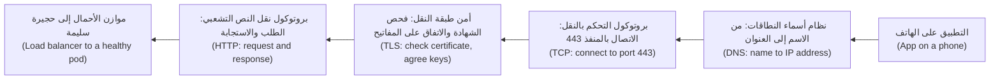

**نظام أسماء النطاقات (DNS).** يحوّل **نظام أسماء النطاقات (Domain Name System)** الأسماء إلى عناوين. أنواع السجلات (record types) التي ستستخدمها أكثر من غيرها:

| السجل (Record) | يربط (Maps) | مثال استخدام (Example use) |
|---|---|---|
| **A** | اسم إلى عنوان IPv4 (Name to an IPv4 address) | `api.najm.example` إلى عنوان IPv4 لموازن الأحمال |
| **AAAA** | اسم إلى عنوان IPv6 (Name to an IPv6 address) | الأمر نفسه، لعملاء IPv6 (IPv6 clients) |
| **CNAME** | اسم إلى اسم آخر | `api.najm.example` إلى الاسم الذي يمنحك إياه موازن أحمال سحابي أو شبكة توصيل محتوى (CDN) |
| **TXT** | اسم إلى نص حر | إثبات ملكية النطاق لهيئة شهادات (certificate authority) أو لمزوّد بريد إلكتروني (email provider) |

لكل سجل **مدة بقاء (TTL, time to live)**: أي عدد الثواني التي يجوز فيها للمحلِّلات (resolvers) تخزين الإجابة مؤقتًا. مع TTL قيمته 3600، قد يستغرق التغيير ساعة كي يصل إلى الجميع. قبل ترحيل مخطط له (planned migration)، اخفض قيمة TTL قبل الموعد بمدة TTL قديمة واحدة على الأقل؛ ثم ارفعها مجددًا بعد ذلك.

**فئات حالة HTTP (HTTP status classes).** يخبرك الرقم الأول من رمز الحالة (status code) على من يقع اللوم:

| الفئة (Class) | المعنى (Meaning) | أمثلة نموذجية (Typical examples) |
|---|---|---|
| 2xx | نجاح (Success) | 200 OK، 201 Created |
| 3xx | اذهب إلى مكان آخر (Go elsewhere) | 301 أو 308 إعادة توجيه دائمة (permanent redirect) |
| 4xx | رُفض طلب العميل | 401 غير مُصادَق، 403 غير مسموح، 404 غير موجود، 429 طلبات كثيرة جدًا (too many requests) |
| 5xx | فشل جانب الخادم | 500 خطأ في التطبيق (application error)، 502 بوابة سيئة (bad gateway)، 503 غير متاح (unavailable)، 504 انتهاء مهلة البوابة (gateway timeout) |

الرمز **502** أو **504** الذي يعيده موازن أحمال أو وكيل (proxy) يعني عادةً أن *الشيء الذي خلفه* فشل أو لم يُجب في الوقت المحدد. انظر إلى الخلفية، لا إلى موازن الأحمال.

**أمن طبقة النقل (TLS).** يشفّر **أمن طبقة النقل (Transport Layer Security)** حركة البيانات ويُثبت هوية الخادم. يقدّم الخادم **شهادة (certificate)**: وهي بيان موقَّع يقول «هذا المفتاح العام (public key) يخص `api.najm.example`، وهو صالح من هذا التاريخ إلى ذاك»، تُصدره **هيئة شهادات (certificate authority, CA)** يثق بها العميل مسبقًا، غالبًا عبر شهادة وسيطة أو أكثر (intermediate certificates) تشكّل **السلسلة (chain)**. إذا فشل الاسم أو التواريخ أو السلسلة في فحوص العميل، يتوقف الاتصال قبل إرسال أي HTTP، ولهذا لم يرَ يوسف شيئًا في سجلات التطبيق. الإصدار TLS 1.3 (RFC 8446) هو الحالي؛ وما زال TLS 1.2 شائعًا. أما التفاصيل التشفيرية (cryptographic detail) فمكانها [*أمن الذكاء الاصطناعي والتطبيقات (Secure AI & Application Security)*، الدرس 5.1 — التشفير للبنّائين: TLS والتجزئة والتشفير والمفاتيح](../secai/index.ar.html#/5.1)؛ أما هنا فيعنينا تشغيله (operating it).

#### 🟡 التعمق أكثر (Going deeper)

**المشي على السلسلة (Walking the chain).** حين يقول أحدهم «إنه متوقف»، اختبر كل قفزة بالترتيب وتوقّف عند أول قفزة تفشل:

```bash
# 1. DNS: does the name resolve, and to what?
dig +short api.najm.example A
dig api.najm.example            # full answer, including the TTL

# 2. TCP: can we open a connection to the port?
nc -vz api.najm.example 443

# 3. TLS: what certificate is presented, for which name, valid until when?
openssl s_client -connect api.najm.example:443 -servername api.najm.example </dev/null 2>/dev/null \
  | openssl x509 -noout -subject -issuer -dates

# 4. HTTP: what does the server answer?
curl -sv https://api.najm.example/health -o /dev/null
```

غالبًا ما يغطي `curl -v` وحده الخطوات الأربع كلها؛ تعلّم قراءة مخرجاته سطرًا سطرًا.

**قراءة النتيجة (Reading the result).**

| العَرَض (Symptom) | القفزة التي فشلت | الأسباب المعتادة (Usual causes) |
|---|---|---|
| `NXDOMAIN` أو لا إجابة من `dig` | DNS | سجل مفقود أو محذوف، منطقة خاطئة (wrong zone)، انتهاء تسجيل النطاق |
| `Connection refused` | TCP | لا شيء يُنصت على ذلك المنفذ، أو خدمة مرتبطة بـ `127.0.0.1` |
| يتعلّق الاتصال ثم تنتهي مهلته | الشبكة | جدار حماية أو مجموعة أمان (security group) تُسقط الحزم، مسار خاطئ (wrong route)، شبكة فرعية خاطئة (wrong subnet) |
| `certificate has expired` أو عدم تطابق الاسم (name mismatch) | TLS | فشل التجديد (renewal failed)، شهادة خاطئة على المُنصِت، غياب SNI (missing SNI) |
| 502 أو 504 من موازن الأحمال | خلف موازن الأحمال | لا خلفيات سليمة، انتهاء مهلة الخلفية (backend timeout)، فشل فحص السلامة |
| 401 أو 403 | التطبيق أو البوابة | رمز منتهي الصلاحية (expired token)، صلاحية مفقودة (missing permission)، قاعدة جدار حماية تطبيقات الويب (WAF rule) |

*الرفض (Refused)* يعني أن جهازًا أجاب ولا شيء يُنصت (nothing is listening)؛ أي أن المسار يعمل. أما *انتهاء المهلة (timeout)* فيعني عادةً أن شيئًا ما أسقط الحزم بصمت، وهو في الغالب قاعدة جدار حماية (firewall rule).

**إشارة اسم الخادم (SNI).** كثيرًا ما يخدم موازن أحمال واحد أسماء كثيرة على عنوان واحد؛ فيسمّي العميل المضيف الذي يريده في مصافحة TLS عبر **إشارة اسم الخادم (Server Name Indication)** كي تُختار الشهادة الصحيحة. ومن هنا الخيار `-servername` أعلاه: من دونه قد ترى شهادة افتراضية (default certificate) فتستنتج استنتاجًا خاطئًا.

**موازنات الأحمال من الطبقة 4 والطبقة 7 (Layer 4 and layer 7 load balancers).** يمرّر موازن الأحمال من **الطبقة 4 (layer 4, L4)** اتصالات TCP أو UDP دون قراءة HTTP بداخلها: سريع ومستقل عن البروتوكول. أما موازن الأحمال من **الطبقة 7 (layer 7, L7)** فيفهم HTTP: فهو يُنهي TLS (terminates TLS)، ويوجّه حسب المضيف أو المسار (`/v1/payments` إلى خدمة، و`/v1/cards` إلى أخرى)، ويعيد صفحات أخطاء خاصة به. تقع واجهة برمجة تطبيق نجم للهاتف خلف موازن أحمال L7، لذا فإن 502 هناك يعني أن الخلفية أساءت التصرف.

**الخدمات مع systemd (Services with systemd).** على الجهاز الافتراضي (VM)، يحدد **ملف الوحدة (unit file)** في systemd كيف تعمل الخدمة: الأمر، والمستخدم الذي تعمل باسمه — وليس الجذر (root) أبدًا إلا عند الضرورة — وهل يُعاد تشغيلها عند الفشل (`Restart=on-failure`). في الحاويات، تحلّ بيئة التشغيل وKubernetes محل systemd، لكن الأفكار تنتقل كما هي: عملية خاضعة للإشراف، وسياسة إعادة تشغيل، ومستخدم غير جذري.

**العناوين الخاصة (Private addresses).** يحجز RFC 1918 ثلاثة نطاقات IPv4 للشبكات الخاصة (private networks): `10.0.0.0/8` و`172.16.0.0/12` و`192.168.0.0/16`. اللاحقة `/16` هي ترميز **CIDR (CIDR notation)**: أول 16 بتًا تسمّي الشبكة، فيضم `10.20.0.0/16` عدد 65,536 عنوانًا، ويضم `10.20.1.0/24` عدد 256 عنوانًا. يستخدم الدرس 1.2 هذه النطاقات لتخطيط الشبكات السحابية.

#### 🔴 نظرة الخبير (Expert view)

**أتمِت الشهادات، ثم أطلق التنبيهات على أي حال (Automate certificates, then alert anyway).** التجديد السنوي اليدوي انقطاعٌ موقوتٌ ينتظر موعده. استخدم **ACME** (RFC 8555)، وهو البروتوكول الذي يقوم عليه Let's Encrypt، أو مدير الشهادات لدى مزوّدك، وفي Kubernetes متحكّمًا (controller) مثل cert-manager. وقد اتفق منتدى CA/Browser Forum على تقصير الحد الأقصى لعمر الشهادات العامة على مراحل خلال السنوات المقبلة، مما يجعل التجديد اليدوي غير عملي (unworkable). ومع ذلك أطلق تنبيهًا (alert) قبل انتهاء الصلاحية بـ 14 يومًا مثلًا: فالأتمتة تفشل بصمت عندما يتغير DNS أو الصلاحيات (permissions).

**نظام DNS تبعيةٌ لكل شيء (DNS is a dependency of everything).** قد تعتمد أدوات المراقبة (monitoring) وأدوات النشر (deploy tools) ومحادثة الحوادث (incident chat) لديك على نظام DNS والشبكة نفسيهما اللذين تحاول إصلاحهما، كما أظهر انقطاع Facebook عام 2021. احتفظ بقائمة «خارج النطاق» (out-of-band) لكيفية الوصول إلى لوحات التحكم (consoles) وأدلة التشغيل (runbooks) وبعضكم بعضًا إذا توقفت أسماؤكم عن التحليل (stop resolving).

**افحص من الخارج (Probe from outside).** تُظهر لوحات المعلومات (dashboards) داخل العنقود (cluster) حجيرات سليمة (healthy pods)، لا ما إذا كان العملاء قادرين على الوصول إليها. أما **الفحص الاصطناعي (synthetic check)** — وهو طلب مُجدوَل من خارج شبكتك، ويُفضَّل من عدة أماكن — فيختبر السلسلة كاملة من جهة العميل، وكان سيكتشف شهادة نجم المنتهية قبل أن يكتشفها مركز الاتصال. يبني الدرس 5.2 هذا الفحص.

**اختبر من حيث يوجد العميل (Test from where the client is).** قد يختلف المحلِّل (resolver) أو الوكيل أو مسار الشبكة الافتراضية الخاصة (VPN route) على حاسوبك عن تلك التي لدى العميل.

### 🧰 الأدوات
| الأداة أو الممارسة أو الخدمة (Tool, practice or service) | ما هي وماذا تفعل | متى تلجأ إليها |
|---|---|---|
| **curl** | عميل HTTP لسطر الأوامر؛ يعرض الخيار `-v` نظام DNS والاتصال وTLS وHTTP في تشغيل واحد | أول اختبار لأي بلاغ «إنه متوقف»؛ فحوص السلامة (health checks)؛ النصوص البرمجية (scripts) |
| **dig** | يستعلم DNS ويعرض السجلات (records) وقيم TTL وأي خادم أجاب | فحص سجل بعد تغيير؛ تشخيص فشل التحليل |
| **openssl s_client** | يفتح اتصال TLS ويعرض سلسلة الشهادات المقدَّمة | فحص أسماء الشهادات (certificate names) وجهات إصدارها (issuers) وتواريخ انتهائها (expiry dates) |
| **ss** | يسرد المقابس (lists sockets): المنافذ المُنصِتة والعمليات التي تملكها | حالة «رُفض الاتصال» (Connection refused)؛ فحص العنوان الذي ترتبط به الخدمة (bound to) |
| **ACME** (RFC 8555) | بروتوكول للإصدار والتجديد التلقائيين للشهادات | كل شهادة عامة؛ لا تجدّد يدويًا أبدًا |
| **Synthetic check** | الفحص الاصطناعي: طلب مُجدوَل إلى خدمتك من خارج شبكتك | اكتشاف أعطال DNS وTLS والحافة (edge failures) التي تفوّتها لوحات المعلومات الداخلية (internal dashboards) |

### 🏛️ عمليًا في بنك نجم
بعد حادثة الشهادة (certificate incident)، تطلب مها من يوسف كتابة **دليل تشغيل الاستجابة الأولى (first-response runbook)** للفريق لحالة «تعذّر الوصول إلى واجهة برمجة تطبيق نجم للهاتف». يوضع الدليل بجوار التنبيه، فيتبع المناوب الخطوات نفسها.

**دليل التشغيل RB-001: تعذّر الوصول إلى واجهة برمجة تطبيق نجم للهاتف — امشِ على السلسلة (Najm Mobile API unreachable — walk the chain)**

| الخطوة (Step) | الأمر (Command) — من خارج الشبكة أولًا، ثم من حجيرة | النتيجة السليمة (Healthy result) | إن فشلت، افحص |
|---|---|---|---|
| 1. نظام أسماء النطاقات | `dig +short api.najm.example` | اسم شبكة توصيل المحتوى أو موازن الأحمال | سجل تغييرات DNS؛ تسجيل النطاق (domain registration) |
| 2. بروتوكول التحكم بالنقل | `nc -vz api.najm.example 443` | `succeeded` | حالة الحافة أو جدار حماية تطبيقات الويب؛ تغييرات جدار الحماية (firewall changes) |
| 3. أمن طبقة النقل | `openssl s_client ... \| openssl x509 -noout -dates -subject` | الاسم الصحيح (right name)؛ انتهاء الصلاحية بعد أكثر من 14 يومًا (expiry over 14 days away) | مدير الشهادات (certificate manager)؛ سجلات تجديد ACME |
| 4. بروتوكول نقل النص التشعبي | `curl -sv https://api.najm.example/health` | `200` | 502 أو 504: جاهزية الخلفية (backend readiness)؛ 403: قواعد جدار حماية تطبيقات الويب (WAF rules)؛ 5xx: سجلات التطبيق (app logs) |
| 5. الخلفية (Backend) | `kubectl get pods -n mobile-api`، ثم السجلات (then logs) | كلها جاهزة | عمليات النشر الأخيرة (recent deploys): تراجَع أولًا، وحقّق ثانيًا |

**قواعد مرفقة بدليل التشغيل (Rules attached to the runbook):**
- انشر أول قفزة فاشلة ومخرجاتها الدقيقة (exact output) في قناة الحادثة (incident channel) قبل تغيير أي شيء؛ ولا تُعِد تشغيل أحمال العمل حتى تشير الخطوة 4 إلى الخلفية.
- متابعات هذه الحادثة: تجديد ACME لكل شهادة، وتنبيه قبل انتهاء الصلاحية بـ 14 يومًا (an alert 14 days before expiry)، وفحص اصطناعي خارجي على `/health` كل دقيقة من موقعين.

### 🛠️ التمارين (Exercises)
تُنفَّذ جميع التمارين على جهازك الخاص باستخدام Docker وطرفية (terminal).

- 🟢 نفّذ `curl -v https://example.com` وصنّف كل سطر من المخرجات على أنه DNS أو TCP أو TLS أو HTTP. ثم استخدم `dig` و`openssl s_client` لتدوين قيمة TTL للسجل وجهة إصدار الشهادة وتاريخ انتهائها. *يكتمل عندما (Done when):* تستطيع أن تشير إلى موضع نجاح كل قفزة وأن تقول متى تنتهي صلاحية الشهادة.
- 🟡 اكتب خادم HTTP صغيرًا يُنصت على `127.0.0.1:8080`، وشغّله بالأمر `docker run -p 8080:8080`، وحاول الوصول إليه من جهازك المضيف. شخّص المشكلة بالأمر `ss -tlnp` داخل الحاوية، وأصلح عنوان الربط، وتحقّق. ثم اجعله يسجّل «shutting down» عند استقبال SIGTERM وتحقّق من أن `docker stop` يُظهر الرسالة. *يكتمل عندما:* يُصلَح السلوكان كلاهما وتستطيع شرح كل فشل في جملتين.
- 🔴 اكتب `walk-the-chain.sh <hostname>`: ينفّذ الاختبارات الأربعة بالترتيب، ويطبع PASS أو FAIL لكل قفزة (per hop) مع التفصيل الأساسي — العنوان، وانتهاء صلاحية الشهادة (certificate expiry)، وحالة HTTP (HTTP status) — ويخرج برمز غير صفري (exit non-zero) عند أول فشل. اختبره على موقع يعمل، واسم غير موجود، ومنفذ محلي مغلق، وشهادة منتهية الصلاحية — يستضيف badssl.com مواقع اختبار معطوبة عمدًا. *يكتمل عندما:* يتوقف كل فشل عند القفزة الصحيحة برسالة واضحة.

### ⚠️ أخطاء وفخاخ (Mistakes and traps)
- **إعادة التشغيل قبل التشخيص (Restarting before diagnosing).** امشِ على السلسلة أولًا؛ ولا تُعِد التشغيل إلا حين تشير الأدلة إلى العملية.
- **الربط بالمضيف المحلي داخل الحاوية (Binding to localhost in a container).** يتعذّر الوصول إلى الخدمة من الخارج. اربطها بـ `0.0.0.0` ودع سياسة الشبكة (network policy) تقرر من يحق له الاتصال.
- **تجديد الشهادات يدويًا (Renewing certificates by hand).** ينسى أحدهم فيُظلم الموقع. أتمِت باستخدام ACME وأطلق تنبيهًا قبل انتهاء الصلاحية (alert before expiry).
- **تجاهل SIGTERM (Ignoring SIGTERM).** كل عملية نشر تُسقط طلبات. توقّف عن قبول عمل جديد، وأنهِ الطلبات الحالية، ثم اخرج (then exit).
- **تشغيل الخدمات بصلاحيات الجذر (Running services as root).** يتحوّل خلل واحد (one bug) إلى سيطرة كاملة على الجهاز. شغّلها باسم مستخدم مخصّص لا يملك إلا الملفات التي يحتاجها.

### 🧾 الخلاصة (Recap)
- لينكس وسطر الأوامر هما أرضية كل منصة: العمليات، والإشارات، والصلاحيات، والخدمات (services)، والسجلات.
- يعبر الطلب DNS ثم TCP ثم TLS ثم HTTP بالترتيب؛ ولكل قفزة اختبارها الخاص.
- «الرفض» يعني أن لا شيء يُنصت؛ وانتهاء المهلة يعني عادةً أن شيئًا يُسقط الحزم (dropping packets).
- تشير فئات حالة HTTP إلى الجانب المذنب؛ والرمز 502 أو 504 عند موازن الأحمال يشير إلى ما خلفه.
- أتمِت الشهادات (automate certificates)، وأطلق التنبيه قبل انتهاء الصلاحية، وافحص من الخارج.

### ✍️ اختبر نفسك (Check yourself)

**1. يُبلغ العملاء أن تطبيق نجم لا يفتح (will not load). جميع الحجيرات تعمل (all pods are running) وسجلات التطبيق (application logs) لا تُظهر أخطاء. ماذا ينبغي أن يفعل يوسف أولًا (first)؟**

- A. يعيد تشغيل النشر لمسح أي حالة سيئة في الذاكرة
- B. ينفّذ `curl -v` على نقطة فحص السلامة (health endpoint) من الخارج ويجد القفزة الفاشلة
- C. يوسّع النشر كي تتقاسم نسخ متماثلة أكثر (more replicas) الحمل
- D. يتراجع (roll back) عن آخر عملية نشر إلى آخر إصدار معروف السلامة

<details><summary>الإجابة</summary>

**B.** الحجيرات السليمة مع سجلات فارغة توحي بأن الطلبات لا تصل إلى التطبيق أصلًا، فاختبر السلسلة من جهة العميل. أما A وC وD فتغيّر الأشياء دون دليل (without evidence). (🟡 التعمق أكثر، Going deeper).

</details>

**2. تعمل خدمة جيدًا على حاسوب مطوّر (developer's laptop). داخل حاوية، يفشل `curl` من الجهاز المضيف فورًا (fails at once) — رفض أو إعادة تعيين (refused or reset) — ويُظهر `ss -tlnp` داخل الحاوية أنها تُنصت على `127.0.0.1:8080`. ما الخطأ؟**

- A. جدار حماية (firewall) داخل صورة الحاوية (container image) يحجب حركة البيانات الواردة (inbound traffic) على المنفذ 8080
- B. شهادة TLS المقدَّمة لا تطابق اسم المضيف المطلوب
- C. لا يستطيع DNS الداخلي في Docker تحليل اسم الحاوية
- D. تُنصت الخدمة على عنوان الاسترجاع، فلا يمكن الوصول إليها إلا من داخل الحاوية

<details><summary>الإجابة</summary>

**D.** العنوان `127.0.0.1` داخل الحاوية هو الحاوية نفسها. اربط الخدمة بـ `0.0.0.0`. جدار الحماية يسبب عادةً انتهاء مهلة (timeout)، لا فشلًا فوريًا (immediate failure)، والطلب لا يصل إلى TLS (B) ولا يحتاج إلى DNS (C)..

</details>

**3. سينقل الفريق `api.najm.example` إلى موازن أحمال جديد (new load balancer) يوم الثلاثاء المقبل. قيمة TTL للسجل 86,400 ثانية (يوم واحد). ماذا ينبغي أن يفعلوا؟**

- A. خفض TTL إلى دقائق قبل يوم أو أكثر، ثم التبديل (switch)، ثم رفعها مجددًا
- B. تغيير السجل يوم الثلاثاء؛ فقيمة TTL لا تؤثر إلا في العملاء الذين لم يسألوا من قبل
- C. حذف السجل القديم أولًا، وانتظار مسح ذاكرات التخزين المؤقت، ثم إنشاء السجل الجديد
- D. رفع TTL مسبقًا كي تبقى الإجابة الجديدة مخزّنة مؤقتًا مدة أطول بعد وصولها

<details><summary>الإجابة</summary>

**A.** تحتفظ ذاكرات التخزين المؤقت (caches) بالإجابة القديمة مدة تصل إلى TTL، لذا فإن خفضها مسبقًا يجعل التبديل ينتشر سريعًا (propagate quickly). يتجاهل B التخزين المؤقت (ignores caching)؛ ويسبب C فشل التحليل (resolution failures)؛ ويزيد D الأمر سوءًا..

</details>

**4. يعيد موازن الأحمال L7 (L7 load balancer) الواقع أمام واجهة برمجة تطبيق نجم للهاتف الرمز 504 Gateway Timeout. من أين ينبغي أن يبدأ التحقيق (the investigation)؟**

- A. سجلات DNS للواجهة كما يراها العميل
- B. شهادة TLS على موازن الأحمال وتاريخ انتهائها
- C. الخلفيات خلف موازن الأحمال (backends): سلامتها وجاهزيتها وأزمنة استجابتها
- D. شبكة الهاتف المحمول لدى العميل أثناء تنقّله

<details><summary>الإجابة</summary>

**C.** كي يعيد موازن الأحمال 504 أصلًا، لا بد أن DNS وTLS (B) وشبكة العميل (D) قد عملت؛ فالخلفية لم تُجب في الوقت المحدد..

</details>

**5. يوقف Kubernetes حجيرة أثناء عملية نشر (during a deploy). ماذا يحدث، وماذا يجب أن يفعل التطبيق؟**

- A. يرسل SIGKILL فورًا (immediately)، فلا يحظى التطبيق بفرصة للتنظيف (clean up)
- B. يرسل SIGTERM، ثم SIGKILL بعد مهلة سماح (grace period)؛ وعلى التطبيق تصريف العمل الجاري ثم الخروج
- C. يرسل SIGHUP، وعلى التطبيق إعادة تحميل إعداداته ومواصلة الخدمة
- D. يحذف صورة الحاوية (container image)، فيجب على التطبيق أولًا حفظ حالته على القرص المحلي (local disk)

<details><summary>الإجابة</summary>

**B.** الإشارة SIGTERM هي الطلب المهذّب؛ وتليها SIGKILL بعد مهلة السماح (30 ثانية افتراضيًا، by default). تجاهل SIGTERM يُسقط طلبات مع كل عملية نشر..

</details>

### 📚 المراجع (References)
- RFC 8446، بروتوكول أمن طبقة النقل الإصدار 1.3 (The Transport Layer Security Protocol Version 1.3) — https://www.rfc-editor.org/rfc/rfc8446
- RFC 9110، دلالات HTTP (HTTP Semantics) — https://www.rfc-editor.org/rfc/rfc9110
- RFC 1035، أسماء النطاقات: التنفيذ والمواصفات — https://www.rfc-editor.org/rfc/rfc1035
- RFC 1918، تخصيص العناوين للإنترنتات الخاصة — https://www.rfc-editor.org/rfc/rfc1918
- RFC 8555، بيئة الإدارة الآلية للشهادات — https://www.rfc-editor.org/rfc/rfc8555
- صفحات دليل لينكس — https://man7.org/linux/man-pages/
- توثيق systemd (systemd documentation) — https://systemd.io/
- Kubernetes، دورة حياة الحجيرة وإنهاؤها — https://kubernetes.io/docs/concepts/workloads/pods/pod-lifecycle/
- Meta Engineering، «مزيد من التفاصيل حول انقطاع 4 أكتوبر» (More details about the October 4 outage) — https://engineering.fb.com/2021/10/05/networking-traffic/outage-details/
- للتوسّع (Going further): [*تصميم الأنظمة لمبرمجي الحدس (System Design for Vibe Coders)*، الدرس F.1 — ماذا يحدث عندما تفتح موقعًا إلكترونيًا](../vibe/index.ar.html#lF-1) و[*تصميم الأنظمة لمبرمجي الحدس*، الدرس 11.1 — النطاقات وDNS وTLS (Domains, DNS, and TLS)](../vibe/index.ar.html#l11-1)

<a id="l1-2"></a>

## 1.2 — أساسيات السحابة (Cloud fundamentals): المناطق ومناطق التوافر والحوسبة والتخزين والخدمات المُدارة والمسؤولية المشتركة

*المستوى: 🟢 مبتدئ* · *المتطلبات: 1.1* · *المرحلة (Phase): Plan, Deploy*

### ⚡ الدرس في دقيقة (In 60 seconds)
- يؤجّرك مزوّد السحابة قدرة حوسبة عند الطلب، عبر واجهة برمجة تطبيقات، بفوترة حسب الاستخدام. تبيع **AWS** و**Microsoft Azure** و**Google Cloud** لبنات بناء متشابهة بأسماء مختلفة.
- التخطيط المادي هو أول قرار تصميمي: **المنطقة (region)** مساحة جغرافية؛ و**منطقة التوافر (availability zone)** مركز بيانات منفصل أو أكثر داخلها. وزّع بيئة الإنتاج (spread production) على **منطقتَي توافر على الأقل (at least two zones)**؛ ولا تفكّر في منطقة ثانية إلا لسبب واضح يتعلق بالتعافي أو بمكان إقامة البيانات.
- اختر **الخدمة الأكثر إدارةً (the most managed service)** التي تلبّي احتياجاتك: فأنت تدفع لتسليم الترقيع (patching) والنسخ الاحتياطي (backups) وتجاوز الفشل (failover) لغيرك.
- يأتي التخزين في ثلاثة أشكال: **الكائنات (object)** — ملفات بمفتاح عبر HTTP، و**الكتل (block)** — قرص لجهاز واحد، و**الملفات (file)** — مجلد شبكي مشترك. اختر حسب نمط الوصول، لا حسب العادة.
- يقول **نموذج المسؤولية المشتركة (shared responsibility model)** إن المزوّد يؤمّن السحابة وأنت تؤمّن ما تضعه فيها. الإعدادات (configuration) والهوية (identity) والبيانات (data) مسؤوليتك دائمًا.
- أكبر فخ: اعتبار «إنه في السحابة» مرادفًا لـ«إنه مرن» (it's resilient). النشر في منطقة توافر واحدة (single-zone deployment) بلا نسخ احتياطية مُختبَرة يفشل تمامًا كما كان يفشل الخادم الواحد.

### 🧭 لماذا يهم
قرّر بنك نجم نقل واجهة برمجة تطبيق نجم للهاتف خارج مركز بياناته (data centre). يطلب سالم من يوسف صياغة مذكرة التموضع (placement note): أي منطقة، وكم منطقة توافر، وأي خدمات، وما الذي يبقى نجم مالكًا له بعد أن يشغّل المزوّد العتاد. تسرد المسودة الأولى ليوسف «عنقود Kubernetes وجهاز افتراضي لـ PostgreSQL» في منطقة توافر واحدة، لأن هذه هي الطريقة التي كان يعمل بها في المقر (on-premises). يعيدها سالم مع ثلاثة أسئلة: «ماذا يحدث عندما تمر منطقة التوافر تلك بيوم سيئ؟ من يرقّع قاعدة البيانات تلك؟ وأي من الجهات التنظيمية (regulators) للبنك تحتاج إلى معرفة مكان بيانات العملاء؟»

في 28 فبراير 2017، تعطّلت خدمة Amazon S3 في منطقة US-EAST-1 (شمال فرجينيا، Northern Virginia) لعدة ساعات. وفقًا للملخّص العام من AWS، أُدخل أمر يُقصد به إزالة عدد صغير من الخوادم بمُدخل خاطئ، فأزال مجموعة أكبر بكثير، منها خوادم كانت تعتمد عليها أنظمة S3 الفرعية الأساسية (core S3 subsystems). وتعطّلت معها خدمات كثيرة كانت تحفظ بياناتها في تلك المنطقة الوحيدة. لم يكن الدرس «تجنّب السحابة»، بل كان: اعرف أي منطقة وأي خدمات تعتمد عليها، واعرف ما الذي يفشل معًا، وصمّم لذلك عن قصد.

### 📐 كيف يعمل

#### 🟢 الأساسيات

**ما معنى «السحابة» (What "cloud" means).** يسرد تعريف NIST (SP 800-145، 2011): الخدمة الذاتية عند الطلب (on-demand self-service)، والوصول الواسع عبر الشبكة، وتجميع الموارد (resource pooling)، والمرونة السريعة (rapid elasticity)، والخدمة المُقاسة (measured service). عمليًا: تطلب من واجهة برمجة تطبيقات (API) خادمًا (server) أو قاعدة بيانات (database) أو حاوية تخزين (bucket)، فيوجد خلال دقائق، وتدفع حتى تحذفه. ولأن كل شيء استدعاء لواجهة برمجة تطبيقات، يديره الدرس 3.1 بوصفه شيفرة.

**نماذج الخدمة (Service models).** تختلف النماذج في مقدار الحزمة التقنية الذي تشغّله أنت:

| النموذج (Model) | ما تحصل عليه | ما تظل تديره | مثال من نجم (Najm example) |
|---|---|---|---|
| **IaaS** | أجهزة افتراضية (virtual machines)، وأقراص (disks)، وشبكات (networks) | نظام التشغيل، والترقيع، وبيئة التشغيل (runtime)، والتطبيق (application)، والبيانات | جهاز افتراضي لمهمة دفعية قديمة |
| **PaaS** | بيئة تشغيل أو خدمة مُدارة: قاعدة بيانات، ومستوى تحكم Kubernetes (Kubernetes control plane)، ومنصة تطبيقات (app platform) | الإعدادات، والتطبيق، والبيانات، والوصول (access) | PostgreSQL مُدار (managed PostgreSQL) لواجهة برمجة تطبيق نجم للهاتف |
| **Serverless** (الحوسبة بلا خوادم) | شيفرة أو حاويات تعمل لكل طلب أو حدث؛ لا خوادم ظاهرة؛ فوترة حسب الاستخدام | الشيفرة (code)، والإعدادات، والصلاحيات، والبيانات | دالة (function) تغيّر حجم صور الشيكات المرفوعة |
| **SaaS** | تطبيق جاهز | المستخدمون (users)، والإعدادات، والبيانات | أدوات البريد الإلكتروني والتذاكر في البنك |

**المناطق ومناطق التوافر (Regions and zones).** **المنطقة (region)** مساحة جغرافية منفصلة تضم مراكز بيانات المزوّد. **منطقة التوافر (availability zone, AZ)** — وتسميها Google ببساطة «zones» — مركز بيانات واحد أو أكثر داخل المنطقة، له طاقته (power) وتبريده (cooling) وشبكته (networking) المستقلة، ومتصل بمناطق التوافر الأخرى بروابط خاصة سريعة. صُمّمت مناطق التوافر بحيث تفشل إحداها دون الأخرى. لا توفّر كل منطقة عدة مناطق توافر، ولا تتوفر كل خدمة في كل منطقة؛ راجع قائمة المناطق الحالية لكل مزوّد.

يتوقف اختيار المنطقة (region choice) على **زمن الاستجابة (latency)** للمستخدمين، و**مكان إقامة البيانات (data residency)** — أي حيث تشترط الجهات التنظيمية أو العقود بقاء البيانات — و**توفر الخدمات (service availability)**، و**التكلفة (cost)** التي تختلف من منطقة إلى أخرى. يشغّل المزوّدون الثلاثة الكبار مناطق في الخليج (Gulf regions) وقت كتابة هذا النص (2026)؛ تحقّق من الخدمات التي يوفّرها كلٌّ منهم.

**الحوسبة (Compute).** ثلاثة أشكال رئيسية:
- **الأجهزة الافتراضية (Virtual machines)** (AWS EC2، Azure Virtual Machines، Google Compute Engine): تختار حجمًا — المعالج والذاكرة (CPU, memory) — وصورة وشبكة؛ وتدير نظام التشغيل.
- **Kubernetes المُدار (Managed Kubernetes)**: يشغّل المزوّد مستوى التحكم في Kubernetes؛ وتشغّل أنت الحاويات على العُقد العاملة (worker nodes)، التي قد تكون هي نفسها مُدارة. تغطي الوحدة 2 هذا الموضوع.
- **الدوال والحاويات بلا خوادم (Serverless functions and containers)**: تسلّم الشيفرة أو حاوية؛ وتتولى المنصة توسيعها، بما في ذلك التقليص إلى الصفر.

**التخزين (Storage).** اختر حسب طريقة الوصول إلى البيانات:

| النوع (Type) | ما هو | مناسب لـ (Good for) | غير مناسب لـ |
|---|---|---|---|
| **تخزين الكائنات (Object storage)** (S3، Azure Blob Storage، Google Cloud Storage) | ملفات («كائنات»، objects) في حاوية تخزين، يُشار إليها بمفتاح عبر واجهة HTTP (HTTP API) | المستندات (documents)، وكشوف الحساب (statements)، والنسخ الاحتياطية، والسجلات، وبحيرات البيانات (data lakes) | قواعد البيانات؛ الملفات المعدَّلة في مكانها |
| **تخزين الكتل (Block storage)** | قرص افتراضي مُلحق بجهاز افتراضي، عادةً في منطقة توافر واحدة | قواعد البيانات التي تشغّلها بنفسك؛ أقراص الإقلاع (boot disks) | المشاركة بين الأجهزة |
| **تخزين الملفات (File storage)** | نظام ملفات شبكي مشترك — NFS أو SMB — تركّبه أجهزة كثيرة | التطبيقات القديمة (legacy apps) التي تحتاج مجلدًا مشتركًا (shared folder) | قواعد البيانات عالية الأداء (high-performance databases) |

تخزين الكائنات هو الخيار الافتراضي لأي شيء هو ملف: يتوسّع دون تخطيط للسعة ويخزّن البيانات بتكرار (redundantly). تحقّق دائمًا من إعدادات الوصول (access settings) بدلًا من افتراض أنه خاص.

**قواعد البيانات المُدارة (Managed databases).** تشغّل لك خدمة قاعدة البيانات المُدارة — مثل Amazon RDS وAzure Database for PostgreSQL وGoogle Cloud SQL وغيرها — محرك قاعدة البيانات (database engine): فهي تثبّت الرقع (installs patches)، وتأخذ نسخًا احتياطية آلية (automated backups)، ويمكنها الإبقاء على **نسخة متماثلة احتياطية (standby replica)** في منطقة توافر أخرى تتولى المهمة تلقائيًا إذا فشلت النسخة الأساسية. يظل عليك اختيار الحجم (size)، والإعدادات، ومدة الاحتفاظ بالنسخ الاحتياطية (backup retention)، ومن يمكنه الاتصال.

**المسؤولية المشتركة (Shared responsibility).** المزوّد مسؤول عن أمن السحابة *ذاتها*: المباني (buildings)، والعتاد (hardware)، وطبقة المحاكاة الافتراضية (virtualisation layer)، وبرمجيات الخدمات المُدارة. وأنت مسؤول عن الأمن *داخل* السحابة: ما تُعدّه، ومن تمنحه الوصول، وبياناتك. ويتحرك الخط الفاصل مع نموذج الخدمة (service model):

| الطبقة (Layer) | جهاز افتراضي IaaS (IaaS VM) | قاعدة بيانات أو Kubernetes مُدار | بلا خوادم (Serverless) | SaaS |
|---|---|---|---|---|
| البيانات وتصنيفها والوصول إليها | أنت | أنت | أنت | أنت |
| الهويات والصلاحيات | أنت | أنت | أنت | أنت |
| شيفرة التطبيق (Application code) | أنت | أنت | أنت | المزوّد (Provider) |
| إعدادات الشبكة — من يمكنه الوصول إليها | أنت | أنت | أنت في الغالب (Mostly you) | المزوّد |
| نظام التشغيل والترقيع | أنت | المزوّد لمستوى التحكم؛ ومشتركة للعقد العاملة | المزوّد | المزوّد |
| العتاد ومراكز البيانات | المزوّد | المزوّد | المزوّد | المزوّد |

انظر إلى الصفّين العلويين: البيانات والهوية تبقيان لديك أيًّا كان ما تشتريه. كثير من اختراقات السحابة واسعة الانتشار جاءت من إعدادات في جانب العميل (customer-side configuration)، مثل حاوية تخزين جُعلت عامة أو مفتاح تسرّب، لا من عتاد المزوّد. التفاصيل الأمنية في [*أمن الذكاء الاصطناعي والتطبيقات*، الدرس 7.1 — أمن السحابة (Cloud security): المسؤولية المشتركة وIAM وسوء الإعداد](../secai/index.ar.html#/7.1).

#### 🟡 التعمق أكثر

**الشبكات السحابية (Cloud networking).** يتيح لك كل مزوّد إنشاء شبكة خاصة (private network): **سحابة افتراضية خاصة (VPC, virtual private cloud)** على AWS وGoogle Cloud، و**شبكة افتراضية (virtual network, VNet)** على Azure. وتنشئ بداخلها **شبكات فرعية (subnets)**، وهي نطاقات من العناوين الخاصة مثل `10.20.1.0/24`:
- **الشبكة الفرعية العامة (public subnet)** لها مسار إلى الإنترنت؛ ويمكن أن تحمل الموارد فيها عناوين عامة (public addresses). لا تضع فيها إلا ما يجب أن يواجه الإنترنت، وهو عادةً موازنات الأحمال (load balancers).
- **الشبكة الفرعية الخاصة (private subnet)** ليس لها مسار وارد من الإنترنت. تعيش هنا خوادم التطبيقات (application servers) وعقد Kubernetes (Kubernetes nodes) وقواعد البيانات.
- **بوابة ترجمة عناوين الشبكة (NAT gateway)** تتيح للموارد في الشبكات الفرعية الخاصة إجراء اتصالات *صادرة* (*outbound* connections) — لتنزيل التحديثات (download updates) أو استدعاء واجهة برمجة تطبيقات خارجية — دون أن يمكن الوصول إليها من الخارج.
- **مجموعات الأمان (Security groups)** في AWS، و**مجموعات أمان الشبكة (network security groups)** في Azure، و**قواعد جدار الحماية (firewall rules)** في Google Cloud تقرر أي حركة بيانات يمكنها الوصول إلى أي مورد، حسب العنوان والمنفذ.

في AWS وAzure تنتمي السحابة الافتراضية الخاصة (VPC) أو الشبكة الافتراضية (VNet) إلى منطقة واحدة (one region)، بينما السحابة الافتراضية الخاصة في Google Cloud عالمية (global)، بشبكات فرعية إقليمية (regional subnets).

**تموضع أول (A first placement).** هذا هو الشكل الذي يريده سالم لواجهة برمجة تطبيق نجم للهاتف:

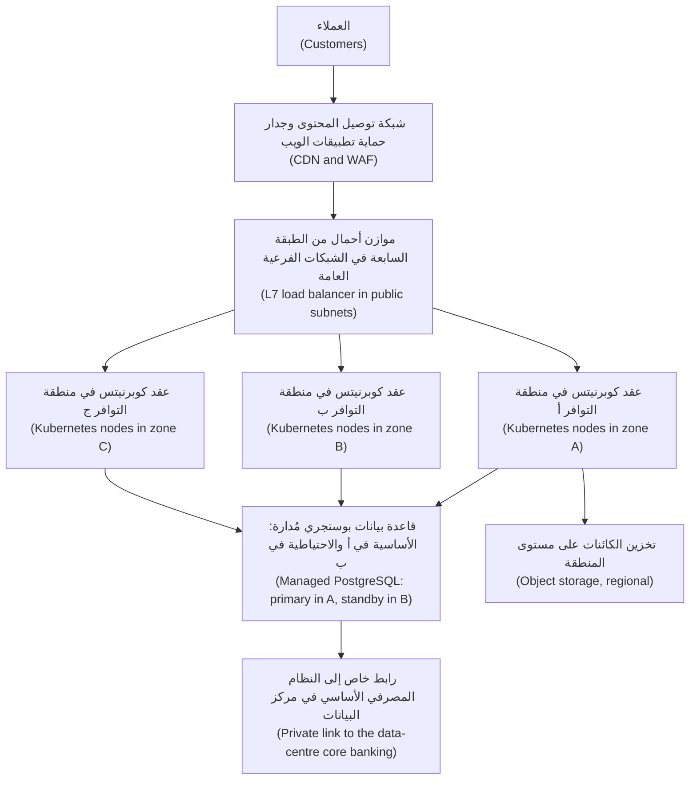

كل طبقة (every tier) تمتد عبر مناطق التوافر (spans zones)، والحافة وحدها تواجه الإنترنت، وقاعدة البيانات تتجاوز الفشل تلقائيًا.

**الاتصال الهجين (Hybrid connectivity).** يبقى النظام المصرفي الأساسي (core banking) لدى نجم في المقر، لذا يجب أن تصل السحابة إلى مركز البيانات بشكل خاص (privately): إما عبر **شبكة افتراضية خاصة من موقع إلى موقع (site-to-site VPN)** فوق الإنترنت — سريعة الإعداد ومشفّرة ومحدودة بالإنترنت — أو عبر **اتصال خاص مخصّص (dedicated private connection)**، وهو أبطأ في الترتيب لكنه أكثر قابلية للتنبؤ (more predictable). كثيرًا ما تستخدم البنوك رابطًا مخصّصًا مع شبكة افتراضية خاصة احتياطية. خطّط لنطاقات العناوين مبكرًا: إذا تداخل النطاق `10.20.0.0/16` للسحابة الافتراضية الخاصة مع شبكة في مركز البيانات، يتعطّل التوجيه (routing breaks).

**المقابلات بين المزوّدين (Provider equivalents).** المفاهيم تنتقل؛ أما الأسماء فلا:

| المفهوم (Concept) | AWS | Microsoft Azure | Google Cloud |
|---|---|---|---|
| الجهاز الافتراضي (Virtual machine) | EC2 | Virtual Machines | Compute Engine |
| Kubernetes المُدار | EKS | AKS | GKE |
| تخزين الكائنات | S3 | Blob Storage | Cloud Storage |
| الشبكة الخاصة | VPC | Virtual Network | VPC |
| PostgreSQL المُدار | RDS / Aurora | Azure Database for PostgreSQL | Cloud SQL / AlloyDB |
| الهوية والوصول | IAM | Microsoft Entra ID وAzure RBAC | Cloud IAM |
| الرابط الخاص إلى المقر | Direct Connect | ExpressRoute | Cloud Interconnect |

**المُدار مقابل التشغيل الذاتي (Managed versus self-run).** القاعدة الافتراضية لدى نجم (Najm's default) هي «استخدم الخدمة المُدارة ما لم يوجد سبب مكتوب لعدم ذلك». تشغيل PostgreSQL ذاتيًا على أجهزة افتراضية يعني أن فريقك يملك الترقيع، والتكرار (replication)، وتجاوز الفشل، والنسخ الاحتياطي، واختبارات الاستعادة (restore tests). أما الخدمة المُدارة فتتولى معظم ذلك، مقابل ثمن ومع تحكم أقل (less control) — فليست كل إضافة أو إعداد متاحًا. الأسباب الوجيهة للتشغيل الذاتي: ميزة مفقودة، أو قابلية النقل (portability)، أو احتياجات أداء محددة؛ اكتب السبب.

#### 🔴 نظرة الخبير

**صمّم وفق نطاقات الفشل (Design for failure domains).** **نطاق الفشل (failure domain)** هو مجموعة الأشياء التي تفشل معًا: خادم، أو منطقة توافر، أو منطقة، أو مزوّد، أو حساب. يغطي النشر متعدد مناطق التوافر (multi-zone) الأعطال المادية الشائعة بتكلفة زهيدة، وهو الخيار الافتراضي للإنتاج. أما النشر متعدد المناطق (multi-region) فيضيف تعقيدًا أكبر بكثير: بيانات تُكرَّر عبر المسافة، وتجاوز فشل يُقرَّر ويُتمرَّن عليه. اختره حين يتطلبه هدف تعافٍ أو جهة تنظيمية، لا بوصفه ردّ فعل تلقائيًا؛ ويحوّل الدرس 6.1 ذلك إلى أهداف RTO وRPO. ولا يحمي أي تصميم لمناطق التوافر من نشر سيئ، أو دفع إعدادات سيئ، أو شهادة منتهية الصلاحية: فمعظم الانقطاعات تغييرات، لا أعطال عتاد.

**التنظيم يشكّل المعمارية (Regulation shapes architecture).** تضع الجهات التنظيمية المالية في دول مجلس التعاون الخليجي، مثل مصرف قطر المركزي (Qatar Central Bank)، توقعات بشأن الإسناد السحابي (cloud outsourcing) وبشأن الأماكن التي يجوز فيها تخزين بيانات العملاء ومعالجتها؛ اقرأ القواعد الحالية مع فريق الامتثال (compliance team). وفي الاتحاد الأوروبي، يُلزم قانون المرونة التشغيلية الرقمية، أي اللائحة (EU) 2022/2554 السارية اعتبارًا من يناير 2025، الكيانات المالية (financial entities) بإدارة مخاطر تقنية المعلومات والاتصالات، والإبلاغ عن الحوادث الكبرى، واختبار المرونة (test resilience)، وإدارة مزوّدي تقنية المعلومات والاتصالات من الأطراف الثالثة، بما في ذلك السحابة، مع خطط خروج (exit plans). لذلك يجب أن تذكر ملاحظاتك المعمارية (architecture notes) كيف ستغادر مزوّدًا.

**مراجعات المعمارية الجيدة (Well-architected reviews).** تنشر كلٌّ من AWS وAzure وGoogle Cloud إطار عمل Well-Architected Framework، الذي ينظّم المراجعات حول الموثوقية (reliability) والأمن (security) والتكلفة والعمليات (operations) والأداء (performance). استخدم أحدها قائمةَ تحقق لأي خدمة إنتاج جديدة.

**التكلفة مُدخل تصميمي (Cost is a design input).** الخدمات المُدارة، وحركة البيانات بين مناطق التوافر (cross-zone traffic)، والبيانات الخارجة من السحابة (**egress**، خروج البيانات) كلها تكلّف مالًا، وتختلف الأسعار حسب المنطقة وعبر الزمن. استخدم حاسبة المزوّد وصفحات الأسعار الحالية، لا الذاكرة أبدًا (never memory)، واضبط تنبيه ميزانية أولًا (الدرس 6.2).

### 🧰 الأدوات
| الأداة أو الممارسة أو الخدمة | ما هي وماذا تفعل | متى تلجأ إليها |
|---|---|---|
| **Availability zone** | منطقة التوافر: موقع مركز بيانات معزول داخل منطقة | توزيع كل طبقة إنتاج على منطقتين على الأقل |
| **Managed database** | قاعدة البيانات المُدارة: محرك قاعدة بيانات يشغّله المزوّد، مع النسخ الاحتياطي والترقيع ونسخة احتياطية اختيارية عبر مناطق التوافر | الخيار الافتراضي لقواعد بيانات التطبيقات |
| **Object storage** | تخزين الكائنات: حاويات تخزين (buckets) لملفات يُشار إليها بمفتاح عبر HTTP، مخزّنة بتكرار (stored redundantly) | المستندات، والنسخ الاحتياطية، والسجلات، والأصول الثابتة (static assets)، وبحيرات البيانات |
| **VPC** | السحابة الافتراضية الخاصة: شبكة خاصة بشبكات فرعية ومسارات (routes) وقواعد جدار حماية، وتُسمى VNet على Azure | كل نشر سحابي؛ خطّط لنطاقات العناوين أولًا |
| **NAT gateway** | بوابة ترجمة عناوين الشبكة: وصول صادر فقط إلى الإنترنت للشبكات الفرعية الخاصة (private subnets) | أحمال العمل الخاصة (private workloads) التي يجب أن تتصل بالخارج (call out) دون أن يُتصل بها من الخارج أبدًا |
| **Shared responsibility model** | نموذج المسؤولية المشتركة: تقسيم واجبات الأمن بين المزوّد والعميل حسب نموذج الخدمة | كل مراجعة معمارية وكل تقييم إسناد |
| **Well-Architected Framework** | إطار المعمارية الجيدة: أسئلة مراجعة منظّمة للموثوقية والأمن والتكلفة والعمليات | مراجعة تصميم إنتاج جديد |
| **Budget alert** | تنبيه الميزانية: إشعار حين يتجاوز الإنفاق حدًّا معيّنًا | قبل إنشاء أي مورد في أي حساب |

### 🏛️ عمليًا في بنك نجم
تصبح المسودة الثانية ليوسف، بعد مراجعة سالم، قالبَ الفريق لكل عملية ترحيل (every migration).

**مذكرة التموضع PN-01: واجهة برمجة تطبيق نجم للهاتف (Placement note PN-01: Najm Mobile API)**

| القسم (Section) | القرار (Decision) | السبب (Reason) |
|---|---|---|
| المنطقة | منطقة خليجية واحدة لدى المزوّد المختار، توفّر ثلاث مناطق توافر على الأقل وجميع الخدمات المطلوبة | زمن الاستجابة للعملاء؛ مكان إقامة البيانات مؤكَّد مع إدارة الامتثال (Compliance) |
| مناطق التوافر (Zones) | ثلاث مناطق توافر لعقد Kubernetes؛ والنسخة الأساسية والاحتياطية لقاعدة البيانات في منطقتين مختلفتين | الصمود أمام فشل منطقة توافر واحدة دون تدخل يدوي |
| الحوسبة | Kubernetes المُدار؛ والعقد العاملة في شبكات فرعية خاصة | الحاويات معيار قائم أصلًا؛ والمزوّد يشغّل مستوى التحكم |
| قاعدة البيانات | PostgreSQL مُدار مع نسخة احتياطية عبر مناطق التوافر (cross-zone standby)، ونسخ احتياطي آلي، وتشفير البيانات المخزّنة (encryption at rest) | يزيل عبء الترقيع وتجاوز الفشل؛ وتُختبر استعادة النسخ الاحتياطية فصليًا (restore-tested quarterly) |
| الملفات (Files) | تخزين الكائنات لكشوف الحساب والملفات المرفوعة؛ خاص (private)؛ مع تفعيل الإصدارات (versioning on) | يتوسّع دون تخطيط للسعة؛ والإصدارات تحمي من الكتابة فوق الملفات |
| الحافة (Edge) | شبكة توصيل المحتوى وجدار حماية تطبيقات الويب، ثم موازن أحمال L7 (L7 load balancer) في شبكات فرعية عامة (public subnets) | الحافة وحدها تواجه الإنترنت |
| الهجين (Hybrid) | رابط خاص مخصّص إلى مركز البيانات، مع شبكة افتراضية خاصة احتياطية؛ وخطة عناوين متفق عليها مع فريق الشبكات | يبقى النظام المصرفي الأساسي في المقر |
| المنطقة الثانية (Second region) | ليس الآن؛ تُنسخ النسخ الاحتياطية إلى منطقة ثانية؛ ويُعاد النظر مع أهداف التعافي من الكوارث في الدرس 6.1 (DR targets) | التعقيد غير مبرَّر بعد |
| الخروج (Exit) | الحاويات وPostgreSQL والبنية التحتية بوصفها شيفرة (IaC) تُبقي الترحيل ممكنًا؛ وتُراجَع خطة الخروج سنويًا | توقعات مخاطر الأطراف الثالثة في DORA الأوروبي |

**المسؤولية المشتركة لهذه الخدمة (Shared responsibility for this service)**

| ما يملكه نجم (Najm owns) | ما يملكه المزوّد |
|---|---|
| تصنيف البيانات (data classification)، وسياسة المفاتيح (key policy)، ومدة الاحتفاظ بالنسخ الاحتياطية، واختبارات الاستعادة | الأمن المادي (physical security)، والعتاد، والمشرف الافتراضي (hypervisor) |
| أدوار IAM والوصول (الدرس 1.3)؛ وقواعد الشبكة وجدار حماية تطبيقات الويب والتعرّض | مستوى تحكم Kubernetes، وترقيع محرك قاعدة البيانات وتجاوز فشله |
| صور العقد العاملة — ما لم تكن مُدارة بالكامل — والشيفرة، والصور (images)، والإعدادات | متانة تخزين الكائنات؛ والبنية التحتية للمناطق ومناطق التوافر |

### 🛠️ التمارين
إن استخدمت حسابًا سحابيًا، فاستخدم حسابك الخاص من الفئة المجانية (free-tier account) و**اضبط تنبيه ميزانية قبل إنشاء أي شيء (set a budget alert before creating anything)**. احذف كل شيء عند الانتهاء.

- 🟢 من قائمة المناطق الحالية لكل مزوّد رئيسي، دوّن المناطق الخليجية، وعدد مناطق التوافر في كلٍّ منها، وما إذا كان Kubernetes المُدار وPostgreSQL المُدار متوفرَين هناك. *يكتمل عندما:* يكون لديك جدول صغير مع تاريخ تحقّقك.
- 🟡 ارسم سحابة افتراضية خاصة لتطبيق من طبقتين (two-tier app): نطاق العناوين (address range)، وشبكات فرعية عامة وخاصة في منطقتَي توافر، وبوابة NAT، وموازن أحمال، وقواعد جدار حماية بين الطبقات — المصدر والمنفذ. تجنّب `10.0.0.0/16`، الذي يستخدمه مركز بيانات افتراضي أصلًا. *يكتمل عندما:* يحمل كل سهم منفذًا ولكل شبكة فرعية نطاق ومنطقة توافر.
- 🔴 اكتب مذكرة تموضع بتنسيق PN-01 (in the PN-01 format) لخدمة من اختيارك — مثل بوابة نزاعات البطاقات (card-dispute portal) الخيالية لدى نجم — مع جدول المسؤولية المشتركة، وسبب كل اختيار بين المُدار والتشغيل الذاتي (managed-versus-self-run choice)، وما الذي سيستدعي منطقة ثانية. *يكتمل عندما:* يستطيع زميل أن يجيب عن «ماذا يحدث عندما تفشل منطقة توافر واحدة؟» و«من يرقّع قاعدة البيانات؟» من مذكرتك وحدها.

### ⚠️ أخطاء وفخاخ
- **نقل تخطيط مركز البيانات كما هو (Lifting the data centre layout as is).** جهاز افتراضي واحد لكل دور في منطقة توافر واحدة يجلب هشاشة مركز البيانات. وزّع عبر مناطق التوافر؛ واستخدم الخدمات المُدارة.
- **«المزوّد يتولى الأمن» (The provider handles security).** جزءه فقط. الهوية والإعدادات والتعرّض الشبكي (network exposure) والبيانات مسؤوليتك في كل نموذج خدمة.
- **تداخل نطاقات العناوين (Overlapping address ranges).** اختر نطاقات العناوين السحابية مع فريق الشبكات قبل البناء، وإلا فسيفشل التوجيه الهجين (hybrid routing) لاحقًا.
- **التعدد الإقليمي بردّ فعل تلقائي (Multi-region by reflex).** ابدأ بتعدد مناطق التوافر (start multi-zone)؛ وأضف منطقة حين تتطلب ذلك أهداف التعافي (recovery targets) أو التنظيم (regulation).

### 🧾 الخلاصة
- السحابة حوسبة عند الطلب عبر واجهة برمجة تطبيقات؛ ويبيع المزوّدون الثلاثة الكبار لبنات متشابهة بأسماء مختلفة.
- المناطق (regions) جغرافية؛ ومناطق التوافر مواقع معزولة داخل المنطقة. وتمتد بيئة الإنتاج على منطقتَي توافر على الأقل.
- فضّل الخدمات المُدارة؛ واختر تخزين الكائنات أو الكتل أو الملفات حسب نمط الوصول.
- شبكات فرعية خاصة لأحمال العمل، وشبكات فرعية عامة للحافة فقط، وNAT للحركة الصادرة، وخطة عناوين متفق عليها مبكرًا.
- في ظل المسؤولية المشتركة، البيانات والهوية والإعدادات مسؤوليتك دائمًا (always yours).

### ✍️ اختبر نفسك

**1. تضع المسودة الأولى ليوسف جميع عقد Kubernetes وقاعدة البيانات في منطقة توافر واحدة (one availability zone). ما الخطر الرئيسي (the main risk)؟**

- A. يفرض المزوّد رسومًا إضافية على إبقاء كل مورد في منطقة توافر واحدة حتى لو لم يكن ذلك ضروريًا
- B. سيرى العملاء البعيدون عن المنطقة زمن استجابة أعلى (higher latency) في كل طلب
- C. فشل منطقة توافر واحدة يُسقط الخدمة كلها، دون شيء يُتجاوَز إليه الفشل
- D. يرفض Kubernetes المُدار إنشاء عنقود تتشارك عقده منطقة توافر واحدة

<details><summary>الإجابة</summary>

**C.** وُجدت مناطق التوافر كي تفشل إحداها دون الأخرى؛ واستخدام منطقة واحدة يهدر ذلك. زمن الاستجابة (B) يعتمد على المنطقة، لا على عدد مناطق التوافر؛ وD خاطئ..

</details>

**2. يحتاج نجم إلى تخزين كشوف حساب شهرية بصيغة PDF (monthly PDF statements) لملايين العملاء، تُكتب مرة واحدة (written once) وتُنزَّل أحيانًا (downloaded occasionally). أي تخزين هو الأنسب؟**

- A. تخزين الكائنات (object storage)، خاص (private)، مع تفعيل الإصدارات (versioning enabled)
- B. وحدات تخزين كتل مُلحقة بجهاز افتراضي واحد كبير
- C. نظام ملفات شبكي مشترك تركّبه كل حجيرة
- D. صفوف ثنائية (binary rows) في قاعدة بيانات التطبيق PostgreSQL

<details><summary>الإجابة</summary>

**A.** الملفات التي تُكتب مرة وتُجلب عبر HTTP هي بالضبط ما وُجد تخزين الكائنات من أجله. تخزين الكتل (B) يربطها بجهاز واحد؛ والمشاركة الملفية (C) تضيف تكلفة؛ والملفات في قاعدة البيانات (D) تُضخّمها (bloat it)..

</details>

**3. في ظل نموذج المسؤولية المشتركة (shared responsibility model)، أيٌّ مما يلي يبقى نجم مسؤولًا عنه حتى عند استخدام خدمة PostgreSQL مُدارة (managed PostgreSQL service)؟**

- A. ترقيع محرك قاعدة البيانات عند صدور إصلاحات أمنية (security fixes)
- B. استبدال الأقراص المعطوبة في مركز بيانات المزوّد
- C. تشغيل المشرف الافتراضي (hypervisor) الذي تحتها وتحديثه بأمان
- D. تحديد من وأي شبكات يمكنها الاتصال بقاعدة البيانات

<details><summary>الإجابة</summary>

**D.** الوصول والإعدادات تبقى لدى العميل في كل نموذج. A من مهام المزوّد في الخدمة المُدارة؛ وB وC من مهامه دائمًا..

</details>

**4. يجب أن تستدعي حجيرات التطبيق (application pods) في الشبكات الفرعية الخاصة (private subnets) واجهة برمجة تطبيقات خارجية لتقييم الاحتيال (external fraud-scoring API)، لكن يجب ألا تقبل أبدًا اتصالات من الإنترنت. ما الذي يحقق لها ذلك؟**

- A. نقل الحجيرات إلى شبكة فرعية عامة (public subnet)
- B. بوابة NAT للحركة الصادرة (NAT gateway)
- C. شبكة توصيل محتوى (CDN) أمام الحجيرات
- D. منح كل حجيرة عنوان IP عامًا

<details><summary>الإجابة</summary>

**B.** تتيح NAT الاتصالات الصادرة (outbound connections) دون جعل الحجيرات قابلة للوصول (reachable). أما A وD فتكشفانها (expose them)؛ وشبكة توصيل المحتوى (C) تتعامل مع الحركة الواردة (inbound traffic)، لا مع الاستدعاءات الصادرة (outbound calls). (🟡 التعمق أكثر، Going deeper).

</details>

**5. يطلب مدير منتج (product manager) تشغيل واجهة برمجة تطبيق نجم للهاتف في منطقتين «من باب الاحتياط» (to be safe). ما أفضل ردّ أولي (the best first response)؟**

- A. الموافقة؛ فمنطقتان أكثر أمانًا من واحدة دائمًا، أيًّا كانت التكلفة
- B. الرفض (refuse)؛ فالبنك لا يحتاج أبدًا إلى أكثر من منطقة واحدة إذا استخدم ثلاث مناطق توافر (three zones)
- C. السؤال عن الفشل وهدف التعافي الذي يجب تلبيته، ثم التصميم وفقه
- D. اقتراح الانتقال إلى مزوّد تكون منطقته الواحدة أكثر موثوقية (more reliable)

<details><summary>الإجابة</summary>

**C.** يضيف التعدد الإقليمي (multi-region) تعقيدًا وتكلفة كبيرين، فيجب أن يلبّي حاجة معلنة للتعافي أو حاجة تنظيمية؛ وحتى ذلك الحين، يكون الخيار الافتراضي تعدد مناطق التوافر مع نسخ احتياطية عبر المناطق. A ردّ فعل تلقائي؛ وB يتجاهل المتطلبات الحقيقية؛ وD لا يجيب عن السؤال. (🔴 نظرة الخبير، Expert view).

</details>

### 📚 المراجع
- NIST SP 800-145، تعريف NIST للحوسبة السحابية — https://csrc.nist.gov/pubs/sp/800/145/final
- AWS، نموذج المسؤولية المشتركة — https://aws.amazon.com/compliance/shared-responsibility-model/
- Microsoft، المسؤولية المشتركة في السحابة — https://learn.microsoft.com/azure/security/fundamentals/shared-responsibility
- توثيق Google Cloud — https://cloud.google.com/docs
- توثيق AWS (AWS documentation) — https://docs.aws.amazon.com/
- توثيق Microsoft Azure — https://learn.microsoft.com/azure/
- AWS، ملخّص تعطّل خدمة Amazon S3 في منطقة شمال فرجينيا (Summary of the Amazon S3 Service Disruption in the Northern Virginia (US-EAST-1) Region) — https://aws.amazon.com/message/41926/
- AWS Well-Architected — https://aws.amazon.com/architecture/well-architected/
- اللائحة 2022/2554، قانون المرونة التشغيلية الرقمية (Regulation 2022/2554, Digital Operational Resilience Act) — https://eur-lex.europa.eu/eli/reg/2022/2554/oj
- للتوسّع: [*لبنات بناء البرمجيات بوصفها خدمة (SaaS Building Blocks)*، الدرس 2.2 — رفع الملفات وتخزين الكائنات](../saas/index.ar.html#/2.2) و[*تصميم الأنظمة لمبرمجي الحدس*، الدرس 10.1 — الخدمات عديمة الحالة وموازنة الأحمال (Stateless services and load balancing)](../vibe/index.ar.html#l10-1)

<a id="l1-3"></a>

## 1.3 — الهوية والوصول في السحابة: المستخدمون والأدوار والسياسات وهوية أحمال العمل

*المستوى: 🟢 مبتدئ* · *المتطلبات: 1.2* · *المرحلة (Phase): Plan, Deploy*

### ⚡ الدرس في دقيقة (In 60 seconds)
- في السحابة، كل إجراء استدعاءٌ لواجهة برمجة تطبيقات، وكل استدعاء يُفحص مقابل **إدارة الهوية والوصول (identity and access management, IAM)**: *من* يستدعي، و*ماذا* يريد أن يفعل، على *أي* **مورد (resource)**، وتحت أي **شروط (conditions)**.
- ينبغي أن يسجّل الأشخاص الدخول (sign in) عبر مزوّد الهوية في الشركة باستخدام **تسجيل الدخول الموحّد والمصادقة متعددة العوامل (single sign-on and MFA)**، وأن يحصلوا على الوصول عبر **الأدوار (roles)**، لا عبر مفاتيح شخصية طويلة العمر أبدًا.
- ينبغي أن تحصل البرمجيات على **هوية أحمال العمل (workload identity)**: تمنح المنصة الجهاز الافتراضي أو الحجيرة (pod) أو مهمة التكامل المستمر (CI job) بيانات اعتماد قصيرة العمر (short-lived credentials) تلقائيًا. وينبغي أن يستخدم خط التسليم **اتحاد الهوية عبر OIDC (OIDC federation)**، لا مفتاح وصول مخزّنًا.
- القاعدة الأهم: **أقل الصلاحيات (least privilege)**. امنح أصغر مجموعة من الإجراءات، على أضيق الموارد، لأقصر مدة، وابدأ من لا شيء.
- إشارة القرار: قبل أن تنشئ أي بيانات اعتماد، اسأل ⁦⁩ «هل تستطيع المنصة إصدار هذه الهوية بدلًا من ذلك؟».
- أكبر فخ: مفتاح طويل العمر بصلاحيات واسعة، يُنسخ إلى مستودع أو سرّ في خط تسليم أو حاسوب محمول. يعمل إلى الأبد (works forever)، لكل من يعثر عليه.

### 🧭 لماذا يهم
يحتاج يوسف إلى أن يدفع خط التكامل المستمر (CI pipeline) لواجهة برمجة تطبيق نجم للهاتف الصور (push images) ويحدّث العنقود. أسرع طريق وجده: إنشاء مستخدم سحابي (cloud user) باسم `ci-deployer`، وإرفاق سياسة المسؤول المدمجة لدى المزوّد «فقط ليعمل الأمر»، وتوليد مفتاح وصول (access key) ولصقه في إعدادات أسرار خط التسليم. نجح من المحاولة الأولى. وبعد أسبوعين، يُجري فريق نورة فحص الأسرار الدوري فيجد المفتاح نفسه في سجل تصحيح (debug log) طبعته إحدى خطوات خط التسليم وأرفقه أحدهم بقضية عامة. المفتاح لا تنتهي صلاحيته أبدًا (never expires)، ويستطيع فعل أي شيء في حساب الإنتاج (production account)، وإلى أن تُفحص سجلات التدقيق (audit logs)، لا أحد يعرف من غيره قد استخدمه.

يرشد سالم يوسف خلال عملية التنظيف (clean-up): إبطال المفتاح، ومراجعة مسار التدقيق (audit trail) لكل استدعاء أُجري به، وإعادة بناء خط التسليم دون أي مفتاح مخزّن إطلاقًا. يقول سالم: «في السحابة، الهوية هي محيطك الأمني. جدار الحماية لا يفيد حين يحمل المهاجم مفتاحًا صالحًا لواجهة برمجة التطبيقات.» يبني هذا الدرس هويات ضيّقة (narrow) وقصيرة العمر (short-lived) تُصدرها المنصة، بحيث يكون التسرّب مستحيلًا أو غير ضار.

### 📐 كيف يعمل

#### 🟢 الأساسيات

**المصادقة والتفويض (Authentication and authorisation).** **المصادقة (Authentication)** تُثبت من أنت: كلمة مرور مع مصادقة متعددة العوامل، أو شهادة، أو رمز موقَّع. أما **التفويض (Authorisation)** فيقرر ما يحق لك فعله بعد أن تُعرف. يتولى IAM السحابي (Cloud IAM) الأمرين لكل استدعاء لواجهة برمجة التطبيقات: فلوحة التحكم وسطر الأوامر وTerraform وتطبيقك كلها تستدعي واجهات برمجة التطبيقات نفسها.

**الجهات الفاعلة (Principals).** الجهة الفاعلة (principal) هي أي شيء يستطيع إجراء استدعاء:
- **المستخدمون البشريون (Human users)**، ويُفضَّل أن يكونوا متّحدين (federated) من مزوّد الهوية في الشركة — مثل Microsoft Entra ID أو Okta أو Google Workspace — عبر تسجيل الدخول الموحّد (single sign-on).
- **المجموعات (Groups)**، وهي تجمّعات من المستخدمين، كي تمنح الوصول مرة واحدة إلى «payments-engineers» بدلًا من 20 فردًا.
- **هويات أحمال العمل (Workload identities)**، للبرمجيات: **أدوار IAM (IAM roles)** في AWS، و**الهويات المُدارة (managed identities)** وكيانات الخدمة (service principals) في Azure، و**حسابات الخدمة (service accounts)** في Google Cloud.

**الأدوار والسياسات (Roles and policies).** تُكتب الصلاحيات في **سياسات (policies)**. تسرد السياسة الإجراءات (actions) — مثل «قراءة الكائنات» (read objects) — والموارد التي تنطبق عليها — مثل «هذه الحاوية» — والأثر، أي السماح أو الرفض، وأحيانًا مع شروط مثل «من هذه الشبكة فقط» أو «فقط إذا استُخدمت المصادقة متعددة العوامل». ترفق السياسات بالهويات، أو تربط الهويات بأدوار على مورد. وتختلف الأسماء من مزوّد إلى آخر:

| المفهوم | AWS | Microsoft Azure | Google Cloud |
|---|---|---|---|
| هوية الأشخاص | مستخدمو IAM Identity Center ومجموعاته، متّحدة | مستخدمو Microsoft Entra ID ومجموعاته | حسابات Google أو هويات متّحدة، ومجموعات |
| هوية البرمجيات | دور IAM (IAM role) | هوية مُدارة، كيان خدمة | حساب خدمة (Service account) |
| كيف يُمنح الوصول | سياسات مُرفقة بالهويات أو الموارد | تعيين دور (role assignment): جهة فاعلة + دور + نطاق | ربط سياسة سماح: جهة فاعلة + دور على مورد |
| الافتراضي (Default) | الرفض ما لم يُسمح؛ والرفض الصريح يغلب دائمًا | لا وصول دون تعيين | لا وصول دون ربط |

النموذج واحد في كل مكان: **لا شيء مسموح حتى يسمح به شيء (nothing is allowed until something allows it)**.

**أقل الصلاحيات عمليًا (Least privilege, in practice).** قارن بين سياستين لخدمة كشوف الحساب في نجم، التي لا تحتاج إلا إلى قراءة ملفات كشوف الحساب من حاوية تخزين واحدة (one bucket):

سياسة خطرة (Risky): أي إجراء على أي مورد، في الحساب كله.

```json
{
  "Version": "2012-10-17",
  "Statement": [{ "Effect": "Allow", "Action": "*", "Resource": "*" }]
}
```

سياسة مُحصَّنة (Hardened): قراءة الكائنات من بادئة واحدة في حاوية تخزين واحدة، ولا شيء غير ذلك (nothing else).

```json
{
  "Version": "2012-10-17",
  "Statement": [{
    "Effect": "Allow",
    "Action": "s3:GetObject",
    "Resource": "arn:aws:s3:::najm-statements-prod/statements/*"
  }]
}
```

الفكرة نفسها لدى المزوّدَين الآخرَين:

```bash
# Azure: give a managed identity read access to blobs in one storage account only
az role assignment create \
  --assignee <managed-identity-principal-id> \
  --role "Storage Blob Data Reader" \
  --scope /subscriptions/<sub-id>/resourceGroups/rg-statements/providers/Microsoft.Storage/storageAccounts/najmstatementsprod

# Google Cloud: let one service account read objects in one bucket only
gcloud storage buckets add-iam-policy-binding gs://najm-statements-prod \
  --member="serviceAccount:statements@<project-id>.iam.gserviceaccount.com" \
  --role="roles/storage.objectViewer"
```

كل منحٍ (each grant) يسمّي هوية واحدة (one identity)، ودورًا ضيّقًا واحدًا، وموردًا واحدًا (one resource).

**الأشخاص: تسجيل الدخول الموحّد والمصادقة متعددة العوامل والأدوار (People: SSO, MFA and roles).** لا يحصل المهندسون على كلمات مرور سحابية منفصلة ولا على مفاتيح شخصية (personal keys). يسجّلون الدخول عبر مزوّد الهوية في الشركة مع المصادقة متعددة العوامل ويتقمّصون دورًا للمهمة: القراءة فقط افتراضيًا، وصلاحيات النشر في البيئات غير الإنتاجية، والكتابة في الإنتاج (production writes) فقط عبر خط التسليم أو عبر رفع صلاحيات معتمَد ومسجَّل ومحدود المدة. وعندما يغادر شخص ما، يُزيل تعطيل حساب واحد وصوله السحابي في كل مكان.

**البرمجيات: لا مفاتيح مخزّنة (Software: no stored keys).** يمكن لحمل عمل يعمل على السحابة الحصول على بيانات الاعتماد من المنصة نفسها:
- يحصل الجهاز الافتراضي على **دور مثيل (instance role)** في AWS، أو **هوية مُدارة (managed identity)** في Azure، أو **حساب خدمة مُرفق (attached service account)** في Google Cloud. وتجلب مجموعة أدوات تطوير البرمجيات (SDK) في التطبيق بيانات اعتماد قصيرة العمر من نقطة بيانات وصفية محلية وتجدّدها تلقائيًا.
- تحصل حجيرة Kubernetes (Kubernetes pod) على هويتها الخاصة، المربوطة من **حساب الخدمة (service account)** الخاص بها في Kubernetes إلى هوية سحابية — التفاصيل أدناه.
- تستخدم مهمة التكامل المستمر خارج السحابة **اتحاد الهوية عبر OIDC (OIDC federation)** لاستبدال رمز موقَّع ببيانات اعتماد سحابية قصيرة العمر.

في كل الحالات لا يوجد سرّ يُنسخ أو يُدوَّر أو يتسرّب. وتلتقط مجموعات أدوات التطوير السحابية بيانات الاعتماد هذه افتراضيًا، فلا تتغير شيفرة التطبيق.

#### 🟡 التعمق أكثر

**كيف يعمل اتحاد الهوية عبر OIDC في التكامل المستمر (How OIDC federation for CI works).** OpenID Connect (OIDC) طبقة هوية فوق OAuth 2.0. يمكن لمنصة تكامل مستمر (CI platform) مثل GitHub Actions أن تُصدر لكل مهمة **رمز هوية (ID token)** موقَّعًا يصف المهمة: أي مستودع، وأي فرع أو بيئة، وأي سير عمل. ويُهيَّأ مزوّد السحابة للثقة بتلك الجهة المُصدِرة ولاستبدال الرموز المطابقة (matching tokens) ببيانات اعتماد قصيرة العمر لدور واحد محدد.

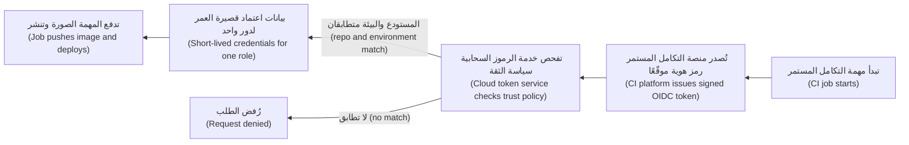

في AWS، تحدد **سياسة الثقة (trust policy)** الخاصة بالدور أي الرموز يجوز لها تقمّصه. لاحظ الشرط: لا تتأهل إلا بيئة `production` في مستودع واحد (one repository).

```json
{
  "Version": "2012-10-17",
  "Statement": [{
    "Effect": "Allow",
    "Principal": { "Federated": "arn:aws:iam::111122223333:oidc-provider/token.actions.githubusercontent.com" },
    "Action": "sts:AssumeRoleWithWebIdentity",
    "Condition": {
      "StringEquals": {
        "token.actions.githubusercontent.com:aud": "sts.amazonaws.com",
        "token.actions.githubusercontent.com:sub": "repo:najm-bank/mobile-api:environment:production"
      }
    }
  }]
}
```

يطلب سير العمل رمزًا ويتقمّص الدور؛ ولا يُخزَّن أي سرّ في أي مكان:

```yaml
permissions:
  id-token: write      # allow this job to request an OIDC token
  contents: read
jobs:
  deploy:
    runs-on: ubuntu-latest
    environment: production
    steps:
      # Check the action's current major version; pin to a full commit SHA in production (lesson 4.3)
      - uses: aws-actions/configure-aws-credentials@v4
        with:
          role-to-assume: arn:aws:iam::111122223333:role/najm-mobile-api-deploy
          aws-region: <region>
```

يدعم Azure — عبر اتحاد هوية أحمال العمل (workload identity federation) على تسجيل تطبيق (app registration) أو هوية مُدارة يعيّنها المستخدم — وGoogle Cloud — عبر Workload Identity Federation — النمطَ نفسه. والخطأ الأكثر شيوعًا شرط ثقة فضفاض جدًا، مثل أي مستودع في المؤسسة أو أي فرع: عندها تستطيع شيفرة غير مُراجَعة (unreviewed code) النشر إلى الإنتاج.

**هوية أحمال العمل في Kubernetes (Workload identity in Kubernetes).** ينبغي ألا تتشارك الحجيرات هوية العقدة، وإلا حصلت كل حجيرة على العقدة على كل صلاحية تحتاجها أي حجيرة. تربط كل خدمة Kubernetes مُدارة (managed Kubernetes service) حساب خدمة Kubernetes بهوية سحابية: في Amazon EKS عبر IAM Roles for Service Accounts (IRSA) أو EKS Pod Identity؛ وفي AKS عبر Microsoft Entra Workload ID؛ وفي GKE عبر Workload Identity Federation for GKE. مع IRSA مثلًا، يكون الربط تعليقًا توضيحيًا:

```yaml
apiVersion: v1
kind: ServiceAccount
metadata:
  name: statements-reader
  namespace: mobile-api
  annotations:
    eks.amazonaws.com/role-arn: arn:aws:iam::111122223333:role/najm-statements-reader
```

الحجيرة التي تعمل بـ `serviceAccountName: statements-reader` تحصل على بيانات اعتماد لذلك الدور فقط. أما الحجيرات الأخرى في العنقود فلا.

**كيف تتجمّع السياسات (How policies combine).** في AWS، يُرفض الطلب افتراضيًا؛ ولا يُسمح به إلا إذا سمحت به سياسة ما ولم ترفضه أي سياسة رفضًا صريحًا. ويمكن للحواجز الحامية على مستوى المؤسسة (organisation-wide guardrails) — **سياسات التحكم بالخدمات (service control policies)** في AWS Organizations — و**حدود الصلاحيات (permissions boundaries)** أن تضع سقفًا (cap) لما يمكن لأي هوية في الحساب فعله، حتى لو منحتها سياسةٌ أكثر. أما Azure RBAC فتراكمي (additive) عبر تعيينات الأدوار (role assignments) على نطاقات مجموعة الإدارة (management group) والاشتراك (subscription) ومجموعة الموارد (resource group) والمورد، مع التوريث نزولًا (inheritance downwards). وتُورَّث سياسات السماح (allow policies) في Google Cloud نزولًا عبر تسلسل المؤسسة والمجلد والمشروع والمورد، كما يوفّر Google Cloud سياسات رفض (deny policies). والقاعدة للثلاثة جميعًا: **امنح على أضيق نطاق يفي بالغرض (grant at the narrowest scope that works)**؛ فالمنح العالي في التسلسل الهرمي يتدفق إلى كل ما تحته.

**مسارات التدقيق (Audit trails).** يسجّل كل مزوّد استدعاءات واجهة برمجة التطبيقات: AWS CloudTrail، وAzure Activity Log، وGoogle Cloud Audit Logs. وهي تجيب عن سؤال «من فعل ماذا، ومتى، ومن أين». تأكد من أنها مفعّلة لكل الحسابات، ومُرسَلة إلى مكان مركزي لا يستطيع الأشخاص الخاضعون للتدقيق تغييره، ومحفوظة طوال المدة التي تتطلبها السياسة. بهذه الطريقة تمكّن فريق نورة من إعادة بناء ما فعله مفتاح يوسف المسرَّب.

#### 🔴 نظرة الخبير

**بنية الحسابات والمشاريع قرار وصول (Account and project structure is an access decision).** افصل الإنتاج عن البيئات غير الإنتاجية عند أقوى حد يوفّره المزوّد: حسابات AWS (AWS accounts)، أو اشتراكات Azure (Azure subscriptions)، أو مشاريع Google Cloud. عندها لا يستطيع خطأ في التطوير أن يمس بيانات الإنتاج، ويمكن أن تكون حواجز الإنتاج الحامية (production guardrails) أكثر صرامة.

**اعثر على الوصول غير المستخدم وأزله (Find and remove unused access).** الصلاحيات تتراكم (permissions accumulate). تُظهر أدوات مثل AWS IAM Access Analyzer ومراجعات الوصول في Microsoft Entra ومُوصي IAM في Google Cloud الصلاحيات غير المستخدمة (unused permissions) والموارد المشتركة خارجيًا. راجع الوصول بانتظام، وعندما ينتقل شخص بين الفرق — «المنضم والمنتقل والمغادر» — أزل وصوله القديم في اليوم نفسه.

**احمِ نقطة البيانات الوصفية (Protect the metadata endpoint).** تأتي بيانات اعتماد أحمال العمل (workload credentials) من نقطة بيانات وصفية يمكن الوصول إليها من داخل الجهاز. وخلل في التطبيق يسمح لمهاجم بجعل الخادم يجلب عنوانًا اعتباطيًا — أي تزوير الطلبات من جانب الخادم (server-side request forgery, SSRF) — قد يكشف بيانات الاعتماد تلك. اشترط النسخة المُحصَّنة من نقطة النهاية حيثما توفرت — IMDSv2 في AWS، التي تتطلب رمز جلسة — وأبقِ أدوار أحمال العمل ضيّقة، واحجب وصول الحجيرات إلى نقطة البيانات الوصفية للعقدة حيث تملك الحجيرات هوياتها الخاصة. انظر [*أمن الذكاء الاصطناعي والتطبيقات*، الدرس 2.3 — فخاخ جانب الخادم (Server-side traps): SSRF ورفع الملفات واجتياز المسارات وإلغاء التسلسل](../secai/index.ar.html#/2.3).

**وصول كسر الزجاج (Break-glass access).** إذا تعطّل مزوّد الهوية أثناء حادثة (during an incident)، فما زال المهندسون يحتاجون إلى طريقة للدخول: بضعة حسابات طوارئ بمصادقة متعددة العوامل قوية (strong MFA)، وبيانات اعتماد محروسة (guarded credentials)، وكل استخدام لها ينبّه فريق الأمن (alerting security) ويُراجَع. اختبرها كما تختبر النسخة الاحتياطية.

**أين تبقى الأسرار (Where secrets remain).** بعض الأشياء ما زالت تحتاج إلى أسرار: مفتاح واجهة برمجة تطبيقات لطرف ثالث، أو كلمة مرور قاعدة بيانات لنظام لا يدعم تسجيل الدخول القائم على الهوية (identity-based login). احفظها في مدير أسرار، واجلبها وقت التشغيل باستخدام هوية أحمال العمل، ودوّرها (rotate them)، ولا تطبعها في السجلات أبدًا. المعالجة الكاملة في [*أمن الذكاء الاصطناعي والتطبيقات*، الدرس 5.2 — إدارة الأسرار (Secrets management): المفاتيح والرموز وأين تتسرّب](../secai/index.ar.html#/5.2)؛ ويطبّقها الدرس 4.3 من هذه الدورة على خطوط التسليم (pipelines).

### 🧰 الأدوات
| الأداة أو الممارسة أو الخدمة | ما هي وماذا تفعل | متى تلجأ إليها |
|---|---|---|
| **Least privilege** | أقل الصلاحيات: امنح فقط الإجراءات والموارد المطلوبة، على أضيق نطاق، لأقصر مدة | كل منح (every grant)، وكل مراجعة (every review) |
| **Single sign-on with MFA** | تسجيل الدخول الموحّد مع المصادقة متعددة العوامل: يسجّل الأشخاص الدخول عبر مزوّد الهوية في الشركة، بعامل ثانٍ | كل وصول بشري إلى لوحات التحكم وأدوات سطر الأوامر |
| **Workload identity** | هوية أحمال العمل: تُصدر المنصة بيانات اعتماد قصيرة العمر لجهاز افتراضي أو حجيرة أو دالة تلقائيًا (automatically) | أي برمجيات تستدعي واجهات برمجة التطبيقات السحابية (cloud APIs) |
| **OIDC federation for CI** | اتحاد الهوية عبر OIDC للتكامل المستمر: تستبدل مهام التكامل المستمر رمز مهمة موقَّعًا ببيانات اعتماد سحابية قصيرة العمر | كل خط تسليم ينشر إلى السحابة؛ ويحلّ محل المفاتيح المخزّنة |
| **Audit logs** | سجلات التدقيق: سجل لكل استدعاء لواجهة برمجة التطبيقات (every API call): من، وماذا، ومتى، ومن أين | التحقيقات (investigations)، ومراجعات الوصول (access reviews)، والأدلة التنظيمية (regulatory evidence) |
| **Access analyser** | محلّل الوصول: يجد الصلاحيات غير المستخدمة والموارد المشتركة خارج المؤسسة | مراجعات الوصول الفصلية؛ وقبل منح المزيد |
| **Break-glass account** | حساب كسر الزجاج: وصول طارئ (emergency access) حين يفشل تسجيل الدخول المعتاد، محروس بإحكام (tightly guarded) وينبّه عند الاستخدام | الجاهزية للحوادث (incident readiness)؛ ويُختبر وفق جدول |

### 🏛️ عمليًا في بنك نجم
بعد المفتاح المسرَّب، يتفق سالم ونورة على **معيار الوصول السحابي في نجم، الإصدار 1 (Najm Cloud Access Standard v1)**. ويكتب يوسف نموذج الوصول لواجهة برمجة تطبيق نجم للهاتف بوصفه أول مثال تطبيقي عليه.

**الجزء A: القواعد (Part A: rules)**
1. لا مفاتيح وصول سحابية طويلة العمر للأشخاص أو لخطوط التسليم. تحتاج الاستثناءات (exceptions) إلى موافقة نورة الكتابية (written approval) وتاريخ انتهاء.
2. يسجّل الأشخاص الدخول عبر مزوّد الهوية في نجم مع المصادقة متعددة العوامل ويتقمّصون أدوار المهام (task roles)؛ ووصول الكتابة في الإنتاج للأشخاص محدود المدة ومعتمَد ومسجَّل.
3. لكل حمل عمل هويته الخاصة؛ ولا مشاركة بين الخدمات؛ ولا أدوار على مستوى العقدة لحجيرات التطبيقات.
4. يعيش الإنتاج والبيئات غير الإنتاجية في حسابات أو اشتراكات أو مشاريع منفصلة.
5. سجلات التدقيق مفعّلة في كل مكان، ومُرسَلة إلى مخزن مركزي لا يستطيع فريق المنصة تعديله (cannot alter)، ومحفوظة وفق سياسة البنك.
6. يُراجَع الوصول فصليًا (reviewed quarterly)؛ وتُزال الصلاحيات غير المستخدمة الأقدم من 90 يومًا (unused permissions older than 90 days).

**الجزء B: نموذج الوصول لواجهة برمجة تطبيق نجم للهاتف (Part B: access model for the Najm Mobile API)**

| الهوية | النوع | ما يمكنها فعله | أين (Where) | كيف تحصل على بيانات الاعتماد |
|---|---|---|---|---|
| `mobile-api-ci-build` | دور تكامل مستمر (CI role) | دفع الصور إلى مستودع السجل (registry repository) لهذه الخدمة | السجل المشترك (shared registry) | عبر OIDC، فقط من الفرع المحمي (protected branch) `main` في `mobile-api` |
| `mobile-api-deploy-prod` | دور تكامل مستمر | تحديث موارد هذه الخدمة في عنقود الإنتاج (production cluster) | الإنتاج | عبر OIDC، فقط من بيئة `production` في `mobile-api`، التي تتطلب موافقة (requires approval) |
| `statements-reader` | حمل عمل (Workload) | قراءة الكائنات تحت `statements/` في حاوية تخزين كشوف الحساب الإنتاجية | الإنتاج | حساب خدمة Kubernetes مربوط بدور سحابي |
| `mobile-api-db-app` | حمل عمل | الاتصال بقاعدة بيانات التطبيق (application database) بوصفه مستخدم التطبيق (application user) | الإنتاج | هوية أحمال العمل لجلب رمز قصير العمر أو سرّ مُدوَّر |
| `platform-engineer` | أشخاص (People) | القراءة فقط في الإنتاج؛ وصلاحيات كاملة في التطوير | الكل | تسجيل الدخول الموحّد والمصادقة متعددة العوامل |
| `platform-oncall-elevated` | أشخاص | تغييرات في الإنتاج لمدة أربع ساعات | الإنتاج | تسجيل الدخول الموحّد والمصادقة متعددة العوامل، بموافقة قائد المناوبة، ومسجَّل (logged) |
| `breakglass-01`، `breakglass-02` | طوارئ (Emergency) | مسؤول (Administrator) | الكل | مصادقة متعددة العوامل بالعتاد (hardware MFA)، وبيانات اعتماد يحتفظ بها مكتب كبير مسؤولي أمن المعلومات (CISO's office)، وكل استخدام ينبّه مركز العمليات الأمنية لدى جاسم (Jassim's SOC) |

### 🛠️ التمارين
استخدم حسابك الخاص من الفئة المجانية مع **ضبط تنبيه الميزانية أولًا (budget alert set first)**، أو توثيق المزوّدين ومحاكيات السياسات (policy simulators). لا تتدرّب أبدًا على حساب جهة عملك دون إذن (without permission).

- 🟢 خذ السياسة الخطرة `"Action": "*"` أعلاه واكتب نسخة أقل الصلاحيات لخدمة يجب أن تقرأ وتكتب الكائنات تحت بادئة واحدة في حاوية تخزين واحدة ولا شيء غير ذلك. ثم اكتب المقابل في Azure أو Google Cloud بوصفه تعيين دور أو ربطًا. *يكتمل عندما:* يسمّي كل منح هوية واحدة، وإجراءات محددة أو دورًا مدمجًا ضيّقًا، ونطاق مورد واحدًا.
- 🟡 في مستودع GitHub شخصي، ابنِ سير عمل يستخدم OIDC للحصول على بيانات اعتماد قصيرة العمر من حسابك السحابي المجاني وينفّذ أمرًا واحدًا للقراءة فقط — مثل سرد حاوية تخزين واحدة. قيّد شرط الثقة بفرع أو بيئة واحدة. ثم ادفع فرعًا غير مسموح به وتأكد من رفضه. *يكتمل عندما:* لا يُخزَّن أي سرّ في إعدادات المستودع، وتنجح المهمة المسموح بها، ويفشل الفرع الآخر عند خطوة بيانات الاعتماد.
- 🔴 اكتب نموذج الوصول لخدمة خيالية في نجم من اختيارك بتنسيق الجزء B، يغطي البناء والنشر ووقت التشغيل والوصول البشري، إضافة إلى كسر الزجاج (break-glass). لكل صف، اذكر ما يستطيع المهاجم فعله لو تسرّبت بيانات اعتماد تلك الهوية. *يكتمل عندما:* لا يقول أي صف «كل شيء» (everything)، ويكون نطاق الضرر (blast radius) لكل صف خدمة واحدة وبيئة واحدة.

### ⚠️ أخطاء وفخاخ
- **صلاحيات المسؤول «فقط ليعمل الأمر» (Administrator "just to get it working").** تبقى دائمًا. ابدأ من لا شيء وأضف الصلاحيات التي تُظهر رسائل الخطأ والسجلات أنك تحتاجها.
- **المفاتيح طويلة العمر في خطوط التسليم (Long-lived keys in pipelines).** تتسرّب عبر السجلات والتفريعات والحواسيب المحمولة، ولا تنتهي صلاحيتها أبدًا. استخدم اتحاد الهوية عبر OIDC.
- **شروط الثقة الفضفاضة (Loose trust conditions).** الثقة بكل مستودع أو فرع تتيح لأي طلب سحب النشر إلى الإنتاج. طابِق المستودع والبيئة بالضبط.
- **حجيرات تستخدم هوية العقدة (Pods using the node's identity).** تحصل كل حجيرة على كل صلاحية. امنح كل حمل عمل هويته الخاصة.
- **المنح في أعلى التسلسل الهرمي (Granting high in the hierarchy).** الدور على مستوى المؤسسة أو الاشتراك يتدفق إلى كل ما تحته. امنح على أضيق نطاق.
- **سجلات تدقيق معطّلة، أو قابلة للتعديل من الخاضعين للتدقيق (Audit logs off, or editable by the people being audited).** لا يمكنك التحقيق فيما لم تسجّله. اجعلها مركزية واحمِها.

### 🧾 الخلاصة
- يفحص IAM كل استدعاء لواجهة برمجة التطبيقات: الجهة الفاعلة والإجراء والمورد والشروط؛ وكل شيء مرفوض حتى يُسمح به.
- يستخدم الأشخاص تسجيل الدخول الموحّد والمصادقة متعددة العوامل وأدوار المهام؛ وتستخدم البرمجيات هوية أحمال العمل؛ وتستخدم خطوط التسليم اتحاد الهوية عبر OIDC.
- أقل الصلاحيات تعني إجراءات ضيّقة، وموارد ضيّقة، ونطاقًا ضيّقًا، وأعمارًا قصيرة.
- افصل الإنتاج بالحساب أو الاشتراك أو المشروع، واحفظ سجلات التدقيق حيث لا يستطيع أحد تعديلها.
- راجع الوصول غير المستخدم وأزله، واحمِ نقاط البيانات الوصفية، واحتفظ بحسابات كسر زجاج مُختبَرة.

### ✍️ اختبر نفسك

**1. يستخدم خط التسليم لدى يوسف مفتاح وصول مخزّنًا (a stored access key) بصلاحيات المسؤول (administrator rights). ما الذي ينبغي أن يحلّ محله؟**

- A. مفتاح المسؤول نفسه، يُدوَّر كل 90 يومًا (rotated every 90 days) بواسطة مهمة مُجدوَلة
- B. مفتاح وصول شخصي من حساب سالم، لأن المصادقة متعددة العوامل مفعّلة فيه
- C. مفتاح بصلاحيات أقل (fewer rights)، محفوظ في سرّ مشفّر في خط التسليم
- D. اتحاد الهوية عبر OIDC الذي يُصدر بيانات اعتماد قصيرة العمر (short-lived credentials) لدور نشر ضيّق

<details><summary>الإجابة</summary>

**D.** يُزيل اتحاد الهوية (federation) السرّ المخزّن كليًا ويحدّ مما تستطيع المهمة فعله. أما A وC فتُبقيان سرًّا طويل العمر قابلًا للتسرّب؛ وB يربط خط التسليم بشخص ويظل يخزّن مفتاحًا. (🟡 التعمق أكثر، Going deeper).

</details>

**2. شرط الثقة عبر OIDC (OIDC trust condition) لأحد الأدوار يسمح لأي مستودع في مؤسسة `najm-bank` بتقمّص دور النشر في الإنتاج (the production deploy role). ما الخطر؟**

- A. لا خطر (none)، لأن كل مستودع في المؤسسة يخص البنك
- B. يستطيع سير العمل في أي مستودع، حتى على فرع غير مُراجَع، الحصول على بيانات اعتماد النشر
- C. ستنتهي صلاحية الرموز الصادرة (issued tokens) قبل أن تكتمل عمليات النشر الطويلة
- D. تتباطأ عمليات النشر في الإنتاج لأن كل مستودع يصطف في طابور (queues) للحصول على الدور

<details><summary>الإجابة</summary>

**B.** سياسة الثقة هي البوابة؛ والشرط الفضفاض يُمرّر أي مهمة مطابقة. طابِق المستودع بالضبط والبيئة المحمية. (🟡 التعمق أكثر، Going deeper).

</details>

**3. تحتاج عدة حجيرات على عقدة Kubernetes واحدة (the same Kubernetes node) إلى صلاحيات سحابية مختلفة. ما التصميم الصحيح (the right design)؟**

- A. منح العقدة دورًا واحدًا يحمل كل صلاحية تحتاجها أي من حجيراتها
- B. تخزين مفتاح وصول مختلف في متغيرات البيئة (environment variables) لكل حجيرة
- C. ربط حساب الخدمة لكل حجيرة بهوية سحابية ضيّقة خاصة بها
- D. تشغيل كل حجيرة على جهاز افتراضي مخصّص لها (dedicated VM) بدور مثيل خاص

<details><summary>الإجابة</summary>

**C.** تمنح هوية أحمال العمل (workload identity) كل حجيرة صلاحياتها فقط، دون مفاتيح مخزّنة. A تمنح كل حجيرة كل صلاحية؛ وB تعيد الأسرار طويلة العمر؛ وD مكلف وغير ضروري. (🟡 التعمق أكثر، Going deeper).

</details>

**4. مُنح مهندس دورًا قويًا (a powerful role) في قمة تسلسل مجموعات الإدارة في Azure (the Azure management group hierarchy) كي يُصلح حساب تخزين واحدًا (one storage account). لماذا يُعد هذا مشكلة؟**

- A. تُورَّث المنح نزولًا إلى كل اشتراك ومورد تحتها
- B. يتجاهل Azure تعيينات الأدوار (role assignments) المُجراة على مستوى مجموعة الإدارة
- C. لا يمكن إزالة تعيينات الأدوار على ذلك النطاق بعد إنشائها
- D. لا يهم الأمر إلا إذا لم تكن المصادقة متعددة العوامل (MFA) مفعّلة في حساب المهندس

<details><summary>الإجابة</summary>

**A.** النطاق جزء من أقل الصلاحيات؛ امنح على حساب التخزين أو مجموعة موارده. B وC خاطئتان؛ وD يخلط المصادقة بالتفويض. (🟡 التعمق أكثر، Going deeper).

</details>

**5. أثناء حادثة كبرى (a major incident)، يكون مزوّد الهوية في نجم غير متاح (unavailable) ولا يستطيع المهندسون تسجيل الدخول إلى لوحة التحكم السحابية (the cloud console). ما الذي ينبغي أن يكون قائمًا مسبقًا (already in place)؟**

- A. كلمة مرور مسؤول مشتركة، مدوّنة في ويكي الفريق (team wiki) للطوارئ
- B. مفاتيح وصول مسؤول طويلة العمر مخزّنة على حاسوب كل مهندس
- C. إجراء موثّق لتعطيل المصادقة متعددة العوامل للجميع أثناء الحوادث
- D. بضعة حسابات كسر زجاج مُختبَرة (tested accounts) بمصادقة متعددة العوامل وتنبيهات عند كل استخدام

<details><summary>الإجابة</summary>

**D.** وصول كسر الزجاج (break-glass access) مخطَّط ومحمي ومراقَب ومُختبَر. أما A وB وC فتخلق نقاط ضعف دائمة (permanent weaknesses) من أجل حدث نادر. (🔴 نظرة الخبير، Expert view).

</details>

### 📚 المراجع
- دليل مستخدم إدارة الهوية والوصول في AWS — https://docs.aws.amazon.com/IAM/latest/UserGuide/
- نظرة عامة على التحكم بالوصول القائم على الأدوار في Azure — https://learn.microsoft.com/azure/role-based-access-control/overview
- نظرة عامة على IAM في Google Cloud — https://cloud.google.com/iam/docs/overview
- توثيق GitHub Actions، التحصين الأمني باستخدام OpenID Connect — https://docs.github.com/en/actions
- Kubernetes، حسابات الخدمة — https://kubernetes.io/docs/concepts/security/service-accounts/
- مواصفات OpenID Connect — https://openid.net/developers/specs/
- للتوسّع: [*أمن الذكاء الاصطناعي والتطبيقات*، الدرس 7.1 — أمن السحابة: المسؤولية المشتركة وIAM وسوء الإعداد](../secai/index.ar.html#/7.1)، و[*أمن الذكاء الاصطناعي والتطبيقات*، الدرس 3.2 — OAuth 2.0 وOpenID Connect ومزالق الرموز (OAuth 2.0, OpenID Connect and token pitfalls)](../secai/index.ar.html#/3.2)، و[*لبنات بناء البرمجيات بوصفها خدمة*، الدرس 1.4 — هوية المؤسسات (Enterprise identity): SSO وSAML وOIDC وSCIM](../saas/index.ar.html#/1.4)

---

<a id="m2"></a>

# الوحدة 2 — الحاويات (Containers) و Kubernetes

*كل خدمة تقريبًا ينقلها بنك نجم (Najm Bank) خارج مركز بياناته (data centre) تغادره على هيئة حاوية (container) وتستقر على Kubernetes. تعلّمك هذه الوحدة كليهما بما يكفي لتشغيلهما في بيئة الإنتاج (production). تبدأ بصورة الحاوية (container image): ما الصورة (image) حقًّا، وكيف تعمل الطبقات (layers) والتخزين المؤقت (caching)، وكيف تكتب ملف Dockerfile صغيرًا وسريع البناء وآمنًا افتراضيًا، ولماذا تكون بصمة السجل (registry digest)، لا الوسم (tag)، هي الشيء الذي تنشره (deploy). ثم تفتح باب Kubernetes: الكائنات (objects) التي ستستخدمها يوميًا (الحجيرات (pods)، وعمليات النشر (deployments)، والخدمات (services)، ومساحات الأسماء)، وحلقات التحكم (control loops) التي تُبقي الواقع مطابقًا لما أعلنته (declared)، وكيف تشخّص (debug) حجيرة لا تقلع. وتنتهي بما يفصل العرض التجريبي (demo) عن حِمل العمل الإنتاجي (production workload): الإعدادات (configuration) والأسرار (secrets)، ومجسّات الصحة (health probes)، وطلبات الموارد وحدودها، والتوسّع التلقائي (autoscaling)، والإيقاف الرشيق (graceful shutdown)، والتحزيم (packaging) باستخدام Helm. ستتابع يوسف (Yousef) وأول ملف Dockerfile يكتبه لـ واجهة برمجة تطبيق نجم للهاتف (Najm Mobile API) يشحن الشيفرة الخاطئة إلى بيئة التجهيز (staging)، وهو يتعلّم لماذا يظل العنقود (cluster) "يتراجع عن" إصلاحاته، وبينما تشرح له مها (Maha) انقطاعًا في خدمة المدفوعات (Payments outage) سببه فحص صحة (health check) واحد سيئ الاختيار.*

> **المراحل (Phases):** Build, Deploy, Operate — تحزيم البرمجيات في صور (images) يمكنك الوثوق بها، وتشغيلها على عنقود يعالج نفسه (heals itself)، وضبط إعداداتها بحيث يساعد هذا التعافي ولا يضرّ.

<a id="l2-1"></a>

## 2.1 — الحاويات على الوجه الصحيح (Containers done right): الصور والطبقات وملفات Dockerfile والسجلات (registries)

*المستوى: 🟡 متوسط* · *المتطلبات: 1.1، 1.2* · *المرحلة (Phase): Build, Deploy*

### ⚡ الدرس في دقيقة (In 60 seconds)
- **الحاوية (container)** عملية (process) عادية في Linux تعزلها النواة (kernel) (فلها رؤيتها الخاصة للملفات والعمليات والشبكة) وتقيّدها (في المعالج CPU والذاكرة memory). أما **صورة الحاوية (container image)** فهي الحزمة المخصّصة للقراءة فقط (read-only package) من الملفات والإعدادات التي تبدأ منها العملية.
- الصورة كومة من **الطبقات (layers)**، كل منها ناتج خطوة بناء (build step) واحدة. رتّب ملف Dockerfile بحيث تأتي الأشياء نادرة التغيّر أولًا؛ عندئذ تعيد ذاكرة البناء المؤقتة (build cache) استخدامها، فيستغرق البناء ثوانيَ لا دقائق.
- صور الإنتاج (production images) **صغيرة، ولا تعمل بصلاحيات الجذر، وخالية من الأسرار (small, non-root and secret-free)**: استخدم **البناء متعدد المراحل (multi-stage build)** لتترك المترجمات (compilers) وأدوات البناء (build tools) خلفك، واضبط `USER`، ولا تنسخ بيانات الاعتماد (credentials) إلى أي طبقة أبدًا.
- **الوسوم تتحرّك؛ أما البصمات فلا (Tags move; digests do not).** يمكن الكتابة فوق `mobile-api:1.4.2`؛ أما `mobile-api@sha256:…` فيعني دائمًا البايتات نفسها (same bytes). ابنِ مرة واحدة (build once)، ثم رقِّ (promote) تلك البصمة (digest) بعينها وانشرها.
- إشارة القرار (Decision cue): إن لم تستطع أن تقول أي إيداع (commit) وأي صورة أساس (base image) أنتجا الصورة العاملة في الإنتاج، فعملية البناء لديك لم تكتمل.
- أكبر فخ (Biggest trap): `FROM something:latest`، مع التشغيل بصلاحيات الجذر، ونسخ المستودع (repository) كله (بما فيه `.env`) إلى الداخل.

### 🧭 لماذا يهم
أولى مهام يوسف في فريق المنصة (platform team) هي تحويل **واجهة برمجة تطبيق نجم للهاتف (Najm Mobile API)** إلى حاوية (containerise)، وهي خدمة Python التي تقف خلف تطبيق التجزئة (retail app). بحلول الخميس صارت تعمل. حجم الصورة 1.3 GB، وتُبنى في تسع دقائق مع كل إيداع، وتبدأ من `python:latest`. يرصد الماسح (scanner) مئات الثغرات (vulnerabilities)، معظمها في مترجمات لا تستخدمها الواجهة أبدًا. ثم يبلّغ طارق (Tariq) أن بيئة التجهيز "عادت إليها علّة تسجيل الدخول القديمة": فقد دفع خطّا تسليم (two pipelines) بناءين مختلفين إلى الوسم نفسه (same tag)، `mobile-api:staging`، بفارق دقائق، فسحب العنقود أيهما رآه أخيرًا. وأخيرًا تجد نورة (Noura) كلمة مرور قاعدة بيانات اختبار داخل طبقة من طبقات الصورة (image layer): فقد نسخ `COPY . .` ملف `.env` محليًا، وحذفُه في خطوة لاحقة لم يُزِله من الطبقة الأسبق.

يُريه سالم (Salem) حالة علنية للسبب الجذري نفسه على نطاق أكبر. في أغسطس 2012 نشرت شركة Knight Capital شيفرة تداول (trading code) جديدة يدويًا؛ ووفقًا لأمر هيئة الأوراق المالية الأمريكية، لم يتلقّها خادم واحد من ثمانية خوادم (servers)، فأيقظ علَمٌ مُعاد استخدامه (reused flag) منطقًا قديمًا (old logic) هناك، وخسرت الشركة أكثر من 460 مليون دولار في نحو 45 دقيقة. يقول سالم: "لا نملك ترف التساؤل عن الشيفرة التي تعمل. الصورة هي وسيلتنا للكفّ عن التساؤل. لكن بشرط أن نبنيها مرة واحدة، ونسمّيها ببصمتها، وننشر تلك بالضبط."

يحوّل هذا الدرس صورة يوسف التي أعدّها يوم الخميس إلى الصورة القياسية للبنك.

### 📐 كيف يعمل

#### 🟢 الأساسيات

**ما الحاوية حقًّا (What a container really is).** على Linux، الحاوية عملية عادية طُبّقت عليها ميزتان من ميزات النواة (kernel features). تمنحها **مساحات الأسماء (Namespaces)** رؤيتها الخاصة للنظام: قائمة عملياتها الخاصة (process list) (فهي ترى نفسها العملية رقم 1 (process 1))، وواجهات الشبكة (network interfaces) الخاصة بها، واسم المضيف (hostname) الخاص بها، وشجرة ملفاتها (file tree) الخاصة. وتحدّ **مجموعات التحكم (Control groups, cgroups)** من مقدار ما يمكنها استخدامه من المعالج (CPU) والذاكرة (memory). وخلافًا لـ **الآلة الافتراضية (virtual machine, VM)**، لا توجد داخلها نواة ضيف (guest kernel): فالحاويات تقلع بسرعة إقلاع العملية، وكلها تتشارك نواة المضيف (host's kernel)، مما يجعل الحاوية أيضًا حدًّا أمنيًا أضعف من الآلة الافتراضية (الدرس 2.3 يغطّي التحصين).

**ما الصورة (What an image is).** الصورة هي نظام الملفات الابتدائي مع البيانات الوصفية (metadata). وتوحّدها **مبادرة الحاويات المفتوحة (Open Container Initiative, OCI)** في ثلاث مواصفات (specifications)، بحيث تعمل الصورة المبنية بـ Docker على containerd أو CRI-O أو Podman أو أي عنقود Kubernetes.

تتكوّن الصورة:
- **الطبقات (Layers)**: أرشيفات مضغوطة (compressed archives) لتغييرات نظام الملفات (file-system changes)، واحدة لكل خطوة بناء تغيّر الملفات. تُكدَّس لتكوّن شجرة الملفات النهائية.
- **إعداد (config)**: الأمر (command)، والمستخدم (user)، ومجلد العمل (working directory)، والمنافذ المكشوفة (exposed ports)، والبيئة (environment).
- **بيان (manifest)**: قائمة تشير إلى الإعداد والطبقات عبر **بصمتها (digest)**، أي تجزئة SHA-256 لمحتواها (SHA-256 hash of their content).
- وللصور متعددة المعماريات (multi-architecture images)، **فهرس (index)** يشير إلى بيان واحد لكل معمارية معالج (CPU architecture) (مثل `amd64` و `arm64`).

ولأن كل شيء يُعنوَن بالتجزئة، تتغيّر بصمة الصورة نفسها إذا تغيّر بايت واحد في أي مكان. وهذا ما يجعل البصمات جديرة بالثقة (trustworthy).

**ملف Dockerfile (The Dockerfile).** ملف Dockerfile هو الوصفة (recipe). تُنفَّذ كل تعليمة (instruction) بالترتيب:

```dockerfile
# Risky: Yousef's first version
FROM python:latest
COPY . /app
WORKDIR /app
RUN pip install -r requirements.txt
CMD python main.py
```

خمس مشكلات في خمسة أسطر. الوسم `latest` يتغيّر من تحتك. و `COPY . /app` يرسل كل شيء، بما فيه `.git` و `.env`. ونسخ الشيفرة (code) *قبل* تثبيت الاعتماديات (installing dependencies) يجعل `pip install` يُعاد تشغيله مع كل تغيير في الشيفرة (code change). وصورة `python` الكاملة تحمل مترجمات لا تستخدمها الواجهة أبدًا. والعملية تعمل بصلاحيات الجذر (runs as root).

**الطبقات وذاكرة البناء المؤقتة (Layers and the build cache).** يخزّن الباني (builder) كل خطوة مؤقتًا (caches). فإذا لم تتغيّر مُدخلات الخطوة (step's inputs) (التعليمة نفسها، ومحتوى الملفات في حالة `COPY`) وكانت كل خطوة قبلها مخزّنة مؤقتًا (cached)، أُعيد استخدام الطبقة المخزّنة (cached layer). وبمجرد أن تُخطئ خطوة واحدة الذاكرة المؤقتة (misses)، يُعاد بناء كل خطوة بعدها. لذا ضع الأشياء المستقرة (stable things) أولًا والمتقلّبة (volatile things) أخيرًا:

```dockerfile
COPY requirements.txt .          # changes rarely
RUN pip install -r requirements.txt
COPY src/ ./src/                 # changes on every commit
```

الآن لا يعيد تغيير الشيفرة بناء سوى الطبقة الأخيرة (last layer).

**السجلات (Registries).** **السجل (registry)** يخزّن الصور ويقدّمها (مثل Docker Hub، أو GitHub Container Registry، أو السجل الخاص بكل سحابة). يدفع (pushes) التكامل المستمر (CI)، ويسحب (pulls) العنقود.

| الحاجة (Need) | AWS | Microsoft Azure | Google Cloud |
|---|---|---|---|
| سجل صور خاص | Amazon ECR | Azure Container Registry | Artifact Registry |
| السحب دون كلمات مرور مخزّنة | دور IAM على العقدة أو الحجيرة | الهوية المُدارة (Managed identity) | حساب الخدمة / هوية حِمل العمل |

**الوسوم والبصمات (Tags and digests).** **الوسم (tag)** (`1.4.2`، `staging`، `latest`) مؤشّر سهل على البشر (human-friendly pointer) يستطيع أي شخص يملك صلاحية الدفع (push rights) تحريكه إلى صورة أخرى. أما **البصمة (digest)** (`sha256:…`) فهي تجزئة البيان ولا يمكن أن تشير إلى أي شيء آخر أبدًا. انشر بالبصمة (deploy by digest)، أو بوسم ثابت غير قابل للتغيير (immutable tag) يرفض سجلّك الكتابة فوقه.

```shell
# Same name, pinned to exact bytes
docker pull registry.example.com/najm/mobile-api@sha256:<64-hex-digest>
```

#### 🟡 التعمق أكثر (Going deeper)

**البناء متعدد المراحل (Multi-stage builds).** يستخدم **البناء متعدد المراحل (multi-stage build)** عدة أسطر `FROM` في ملف Dockerfile واحد. تحوي المراحل المبكرة (early stages) المترجمات وأدوات البناء؛ أما المرحلة النهائية (final stage) فلا تنسخ إلا النتيجة. إليك النسخة المحصّنة (hardened version) من ملف يوسف:

```dockerfile
# syntax=docker/dockerfile:1
# Hardened: two stages, pinned base, non-root, no secrets
ARG PY_BASE=python:3.12-slim@sha256:<pinned-digest>

FROM ${PY_BASE} AS build
WORKDIR /app
RUN python -m venv /opt/venv
ENV PATH="/opt/venv/bin:$PATH"
COPY requirements.txt .
RUN --mount=type=cache,target=/root/.cache/pip \
    pip install --require-hashes -r requirements.txt
COPY src/ ./src/

FROM ${PY_BASE} AS runtime
RUN useradd --uid 10001 --no-create-home --shell /usr/sbin/nologin app
WORKDIR /app
COPY --from=build /opt/venv /opt/venv
COPY --from=build /app/src ./src
ENV PATH="/opt/venv/bin:$PATH" PYTHONUNBUFFERED=1
USER 10001
EXPOSE 8080
CMD ["python", "-m", "src.main"]
```

ما الذي يكسبه كل اختيار:
- **صورة أساس مثبّتة بالبصمة (Pinned base by digest).** لا تتغيّر صورة الأساس (base) إلا حين يرفع أحدهم إصدارها (bumps it)، ويُفضَّل عبر طلب سحب آلي مُختبَر (من Renovate أو Dependabot).
- **`--require-hashes`.** أي حزمة مُتلاعَب بها أو مُستبدَلة تُفشل البناء (fails the build).
- **تركيب الذاكرة المؤقتة (Cache mount).** يعيد BuildKit (باني Docker الحديث) استخدام ذاكرة التنزيل المؤقتة لـ pip دون وضعها في طبقة (layer).
- **مستخدم `USER` رقمي بلا صلاحيات جذر (Numeric non-root).** يستطيع Kubernetes التحقق من `runAsNonRoot` مقابل مستخدم رقمي (numeric user)؛ أما الاسم فلا يستطيع التحقق منه.
- **صيغة التنفيذ (Exec-form) لـ `CMD`** (مصفوفة JSON). يصبح البرنامج العملية رقم 1 (process 1) ويتلقّى إشارة الإيقاف (stop signal) مباشرة. أما في صيغة الصدفة (shell form) فالصدفة (shell) هي العملية رقم 1 وقد لا تمرّر `SIGTERM`، فيُقتل التطبيق قسرًا (killed hard) بدلًا من أن يتوقّف بنظافة. وإن لزم الأمر، أضف عملية تهيئة صغيرة (tiny init) مثل `tini`.

**ملف `.dockerignore`** يُبقي الملفات خارج **سياق البناء (build context)**، أي المجلد المُرسَل إلى الباني:

```text
.git
.env
*.pem
tests/
node_modules/
__pycache__/
```

وإن احتاج البناء فعلًا إلى بيانات اعتماد (credential) (لفهرس حزم خاص مثلًا)، فمرّرها بوصفها **سرّ بناء (build secret)**، يُركَّب (mounted) لخطوة واحدة ولا يُكتب في أي طبقة أبدًا:

```dockerfile
RUN --mount=type=secret,id=pip_conf,target=/etc/pip.conf \
    pip install --require-hashes -r requirements.txt
```

**اختيار صورة الأساس (Choosing a base image).** صور الأساس الأصغر (smaller bases) تعني حزمًا أقل (fewer packages)، وثغرات أقل تحتاج إلى فرز، وسحبًا أسرع (faster pulls).

| نوع صورة الأساس (Base type) | مثال (Example) | المفاضلة (Trade-off) |
|---|---|---|
| توزيعة كاملة (Full distribution) | `python:3.12` | سهلة التشخيص؛ كبيرة؛ حزم كثيرة غير مستخدمة |
| توزيعة نحيفة (Slim distribution) | `python:3.12-slim` | خيار افتراضي جيد (good default)؛ ما زالت فيها صدفة ومدير حزم (package manager) |
| مبنية على Alpine (Alpine-based) | `python:3.12-alpine` | صغيرة جدًا؛ تستخدم musl بدلًا من glibc، لذا تفتقر بعض حزم Python إلى عجلات مبنية مسبقًا (prebuilt wheels) ويجب ترجمتها |
| بلا توزيعة / دنيا (Distroless / minimal) | صور Google عديمة التوزيعة، وصور دنيا على طراز Chainguard | بلا صدفة ولا مدير حزم؛ أصغر سطح هجوم؛ أصعب في التشخيص التفاعلي |
| `scratch` | صورة فارغة (Empty image) | للملفات التنفيذية الساكنة (static binaries) فقط (غالبًا Go أو Rust) |

اعتمد صورة أساس أو اثنتين لكل لغة (per language)، ورقّعها مركزيًا، وأعد البناء (rebuild) حين تتغيّر.

**ابنِ مرة واحدة ورقِّ البصمة (Build once, promote the digest).** يبني خط التسليم (pipeline) الصورة مرة واحدة فقط على الفرع الرئيسي (main branch)، ويدفعها (pushes it)، ويسجّل البصمة، ثم تشغّل كل بيئة تلك البصمة. الترقية (promotion) تغيّر الإعدادات، لا الصورة أبدًا. وإعادة بناء "الإيداع نفسه" للإنتاج هي الطريقة التي تتباعد بها بيئتا التجهيز والإنتاج بصمت (quietly diverge). يؤتمت الدرس 3.2 هذه الترقية عبر GitOps، ويبني الدرس 4.1 خط التسليم. ونظرة غير المبرمجين (non-coder view) إلى الفكرة نفسها موجودة في [*تصميم الأنظمة لمبرمجي الحدس (System Design for Vibe Coders)*، الدرس 4.5 — تحقّق من الأثر البرمجي لا من المصدر](../vibe/index.ar.html#l4-5).

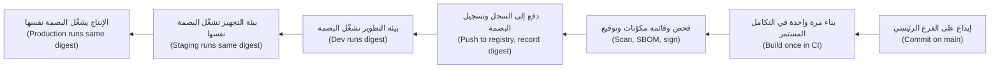

**الملصقات لإمكانية التتبّع (Labels for traceability).** اختم ملصقات OCI القياسية `org.opencontainers.image.revision` (الإيداع) و `org.opencontainers.image.source` (المستودع) في كل صورة، حتى يستطيع أي شخص أن يجيب عن سؤال "من أين جاءت هذه؟ ⁦⁩"

#### 🔴 نظرة الخبير (Expert view)

**قابلية إعادة الإنتاج ليست هي التثبيت (Reproducible is not the same as pinned).** يزيل التثبيت (pinning) أكبر مصادر الانحراف (drift)، لكن الطوابع الزمنية (timestamps) وترتيب الملفات (file ordering) قد يظلان يغيّران بصمة إعادة البناء. تهدف معظم الفرق إلى أن تكون الصورة "قابلة لإعادة البناء وقابلة للتتبّع"، وتضيف **المصدرية (provenance)**: سجلًّا موقّعًا (signed record) يُنتجه نظام البناء (build system)، يبيّن أي مصدر (source) وأي باني وأي مُدخلات (inputs) أنشأت البصمة. ومع **قائمة مكوّنات البرمجيات (SBOM, software bill of materials)** و**توقيع (signature)** للصورة يُتحقَّق منه وقت النشر (deploy time)، تكتمل قصة سلسلة التوريد (supply-chain story) التي يدرّسها بتعمّق [*أمن الذكاء الاصطناعي وأمن التطبيقات (Secure AI & Application Security)*، الدرس 6.2 — سلسلة توريد البرمجيات: الاعتماديات وقوائم المكوّنات و SLSA والتوقيع](../secai/index.ar.html#/6.2)؛ ويوصلها الدرس 4.3 بخط تسليم نجم (Najm's pipeline).

**الفحص وحلقة الترقيع (Scanning and the patch loop).** تسرد الماسحات (scanners) مثل Trivy و Grype الثغرات المعروفة (known vulnerabilities) في حزم الصورة. تُنشر ثغرات جديدة يوميًا ضد صور لم تتغيّر (unchanged images)، لذا افحص في خط التسليم (واحجب (block) عند ظهور نتائج حرجة جديدة لها إصلاح)، وأعد فحص الصور العاملة وفق جدول، وأعد البناء بإيقاع منتظم حتى حين لا تتغيّر الشيفرة.

**البناء متعدد المعماريات (Multi-architecture builds).** قد تختلف الحواسيب المحمولة (laptops) عن عقد السحابة (cloud nodes) (Arm أو x86). يبني الأمر `docker buildx build --platform linux/amd64,linux/arm64 --push` كلتيهما ويدفع فهرسًا؛ اختبر على المعمارية التي تشغّل عليها.

**عمليات السجل (Registry operations).** عامل السجل بوصفه بنية تحتية إنتاجية (production infrastructure): **ثبات الوسوم (tag immutability)** في مستودعات الإصدارات (release repositories)؛ و**ذاكرات السحب المؤقتة أو المرايا (pull-through caches or mirrors)** للصور العامة (public images)، حتى لا تستطيع حدود المعدّل (rate limits) في سجل عام أو انقطاعه (outage) إيقاف عمليات النشر لديك (يحدّ Docker Hub من عمليات السحب المجهولة (anonymous) وعمليات الفئة المجانية (free-tier pulls)؛ تحقّق من حدوده الحالية)؛ ووضعه في المنطقة (region) نفسها التي فيها العنقود؛ و**قواعد الاحتفاظ (retention rules)** التي لا تحذف أبدًا أي شيء منشور حاليًا (currently deployed).

**الحاوية ليست آلة افتراضية (The container is not a VM).** شغّل عملية رئيسية واحدة لكل حاوية، واكتب السجلات (log) إلى المخرج القياسي (standard output)، واحفظ الحالة (state) خارجها، وتوقّع أن تُقتل وتُستبدل في أي وقت. يفترض Kubernetes أفكار تطبيق العوامل الاثني عشر (Twelve-Factor App) هذه.

### 🧰 الأدوات
| الأداة أو الممارسة أو الخدمة (Tool, practice or service) | ما هي وماذا تفعل | متى تلجأ إليها |
|---|---|---|
| **Docker** (مع BuildKit) | يبني صور OCI ويشغّلها ويدفعها؛ ويضيف BuildKit تركيبات الذاكرة المؤقتة والأسرار والمراحل المتوازية (parallel stages) | التطوير المحلي (local development) وبناء الصور في التكامل المستمر |
| **Multi-stage build** — البناء متعدد المراحل | عدة مراحل `FROM` في ملف Dockerfile واحد؛ لا تُشحن إلا المرحلة النهائية | كل صورة مُترجَمة (compiled) أو كثيفة الاعتماديات (dependency-heavy) |
| **.dockerignore** | يستبعد الملفات من سياق البناء | كل مستودع فيه Dockerfile، منذ اليوم الأول |
| **Image digest** — بصمة الصورة | تجزئة محتوى (content hash) تسمّي بايتات الصورة بالضبط | كل بيان نشر (deployment manifest) وكل سجلّ ترقية (promotion record) |
| **Container registry** — سجل الحاويات | يخزّن الصور ويقدّمها، مع التحكم في الوصول (access control) وثبات الوسوم | الاحتفاظ بصور الإصدارات (release images) قريبًا من العنقود |
| **Trivy** | ماسح مفتوح المصدر (open-source scanner) للثغرات والإعدادات الخاطئة (misconfigurations) في الصور والملفات | في التكامل المستمر مع كل بناء، ووفق جدول على الصور العاملة |
| **hadolint** | مدقّق (linter) يفحص ملفات Dockerfile مقابل الممارسات الجيدة (good practice) | قبل الإيداع (pre-commit) وفي طلبات السحب (pull requests) |

### 🏛️ عمليًا في بنك نجم
يطلب سالم من يوسف أن يحوّل إصلاحاته إلى **معيار نجم لصور الحاويات، الإصدار 1 (Najm Container Image Standard v1)**، الذي يجب على كل فريق استيفاؤه قبل أن يُسمح لصورة بالعمل في عنقود مشترك (shared cluster). وملف Dockerfile المحصّن (hardened Dockerfile) أعلاه هو مثاله المرجعي (reference example) للغة Python.

| # | القاعدة (Rule) | يتحقّق منها (Checked by) | السبب |
|---|---|---|---|
| 1 | صورة أساس من القائمة المعتمدة (approved list)، مثبّتة بالبصمة (pinned by digest) | سياسة خط التسليم (pipeline policy) | نقطة بداية معروفة ومرقّعة؛ لا تغييرات مفاجئة |
| 2 | بناء متعدد المراحل؛ لا مترجمات ولا أدوات بناء في المرحلة النهائية؛ الصدفة ومدير الحزم فقط عبر صورة أساس نحيفة معتمدة | hadolint مع المراجعة (review) | سطح هجوم أصغر وسحب أسرع |
| 3 | تعمل بمستخدم رقمي بلا صلاحيات جذر (UID 10000 أو أعلى) | فحص خط التسليم لإعدادات الصورة (image config)؛ قبول العنقود (cluster admission) في الدرس 2.3 | يحدّ من الضرر إذا اختُرق التطبيق |
| 4 | لا أسرار في أي طبقة؛ ملف `.dockerignore` موجود؛ أسرار البناء (build secrets) عبر تركيبات الأسرار (secret mounts) | فحص الأسرار (secret scanning) في الصورة والمستودع | الطبقات دائمة وتُنسخ إلى كل مكان |
| 5 | صيغة التنفيذ لـ `CMD`/`ENTRYPOINT`؛ التطبيق يعالج `SIGTERM` | المراجعة؛ اختبار الإيقاف (shutdown test) في التكامل المستمر | إيقاف نظيف (clean shutdown) أثناء النشر (deploys) والتوسّع (scaling) |
| 6 | عملية رئيسية واحدة؛ السجلات إلى stdout/stderr؛ لا حالة داخل الحاوية | المراجعة | قد يقتلها العنقود ويستبدلها في أي وقت |
| 7 | ملصقات OCI (OCI labels) للمصدر والمراجعة (revision) | خط التسليم | تتبّع أي صورة عاملة إلى إيداعها |
| 8 | تُبنى مرة واحدة على الفرع الرئيسي؛ وتُدفع إلى مستودع الإصدارات (release repository) بوسوم ثابتة (immutable tags)؛ وتُنشر بالبصمة | فحوص خط التسليم و GitOps | كل بيئة تشغّل البايتات نفسها |
| 9 | مفحوصة (scanned): لا ثغرة حرجة جديدة لها إصلاح متاح؛ قائمة المكوّنات (SBOM) والتوقيع مرفقان | بوابة خط التسليم (pipeline gate) | أدلة سلسلة التوريد (supply-chain evidence) لفريق نورة |
| 10 | يُعاد بناؤها شهريًا على الأقل، أو ضمن المهلة التي يحددها فريق الأمن حين يكون لصورة الأساس إصلاح حرج (critical fix) | خط تسليم مُجدوَل (scheduled pipeline) | الشيفرة غير المتغيّرة تشيخ هي الأخرى |

**الاستثناءات (Exceptions)** تُرفع إلى سالم مع سبب (reason) وتاريخ انتهاء (expiry date). صارت صورة واجهة الهاتف الآن 160 MB بدلًا من 1.3 GB (وهذا رقم نجم لهذه الخدمة وحدها؛ أرقامك ستختلف)، وتسجّل بيئتا التجهيز والإنتاج البصمة نفسها (same digest).

### 🛠️ التمارين (Exercises)
اعمل محليًا (work locally) باستخدام Docker أو أداة متوافقة (compatible tool). لا تدفع (push) إلا إلى سجل تملكه، مثل حساب شخصي مجاني.

- 🟢 خذ أي تطبيق ويب صغير لديك (أو برنامج "hello world" بلغتك)، واكتب ملف Dockerfile ساذجًا (naive) يحوي `FROM <lang>:latest` و `COPY . .`، وابنِه، ثم أعد كتابته بصورة أساس نحيفة مثبّتة، وملف `.dockerignore`، ونسخ ملفات الاعتماديات (dependency files) قبل المصدر، ومستخدم `USER` بلا صلاحيات جذر (non-root)، وصيغة تنفيذ لـ `CMD`. قارن الأحجام (sizes) باستخدام `docker images` والطبقات باستخدام `docker history`. *يكتمل عندما (Done when):* يكون لديك الملفان، وفرق الحجم (size difference)، ودليل على أن تغيير سطر واحد من المصدر لا يعيد بناء سوى الطبقات الأخيرة (last layers).
- 🟡 حوّل صورتك إلى بناء متعدد المراحل وافحص النسختين بـ Trivy. ابنِ النسخة الساذجة (naive version) مع سرّ مزيّف (fake secret) في `.env`، ثم اعثر عليه بتصدير الصورة (`docker save`) والبحث في طبقاتها. *يكتمل عندما:* تستطيع إظهار السرّ في الصورة الساذجة، وغيابه عن الصورة المحصّنة (hardened one)، وعدد الثغرات (vulnerability counts) في كلتيهما.
- 🔴 ابنِ صورتك لـ `linux/amd64` و `linux/arm64` باستخدام `docker buildx`، وادفعها إلى سجلّك مع ملصقات مراجعة OCI، واكتب ملاحظة نشر (deploy note) من سطرين لا تشير إليها إلا بالبصمة. ثم ادفع بناءً مختلفًا (different build) إلى الوسم نفسه. *يكتمل عندما:* يُظهر `docker buildx imagetools inspect` المعماريتين (both architectures)، وتظل البصمة تسحب الصورة الأصلية (original image) بعد أن تحرّك الوسم (tag moved).

### ⚠️ أخطاء وفخاخ (Mistakes and traps)
- **استخدام `latest` أو غيره من الوسوم المتحرّكة (moving tags) في الإنتاج.** قد تعطي عمليتا سحب (two pulls) للاسم نفسه شيفرة مختلفة. انشر بالبصمة، واستخدم وسومًا ثابتة في مستودع الإصدارات.
- **الأسرار في الطبقات (Secrets in layers).** إن `COPY . .` مع ملف `.env`، أو `ENV DB_PASSWORD=…`، يسرّب بيانات اعتماد إلى كل نسخة من الصورة. استخدم `.dockerignore`، وتركيبات أسرار البناء، وأسرار وقت التشغيل (runtime secrets) (الدرس 2.3).
- **إعادة البناء لكل بيئة (Rebuilding per environment).** "بناء الإنتاج (production build)" أثر برمجي مختلف (different artefact). رقِّ البصمة.
- **التشغيل بصلاحيات الجذر "لأنها داخل حاوية" (Running as root "because it's in a container").** الحاويات تتشارك نواة المضيف (host kernel). اضبط مستخدم `USER` رقميًا بلا صلاحيات جذر.
- **الفحص مرة واحدة (Scanning once).** تظهر ثغرات جديدة (new vulnerabilities) في صور لم تتغيّر. أعد فحص الصور العاملة وأعد البناء وفق جدول.

### 🧾 الخلاصة (Recap)
- الحاوية عملية Linux معزولة ومقيّدة الموارد؛ والصورة نقطة بدايتها الطبقية المتوافقة مع معيار OCI.
- رتّب خطوات Dockerfile من المستقر إلى المتقلّب كي تعمل الذاكرة المؤقتة (cache)؛ واترك أدوات البناء خلفك عبر البناء متعدد المراحل.
- صور الإنتاج صغيرة ومثبّتة (pinned) وبلا صلاحيات جذر وخالية من الأسرار (secret-free)، ولها ملصقات (labels) تتبّعها إلى إيداع.
- الوسوم (tags) مؤشّرات يمكن أن تتحرّك؛ والبصمات (digests) تجزئات محتوى (content hashes) لا تتحرّك. ابنِ مرة واحدة وانشر البصمة في كل مكان.
- الفحص (scanning)، وقوائم المكوّنات (SBOMs)، والتوقيع (signing)، وإعادة البناء المُجدوَلة (scheduled rebuilds) تُبقي الصور جديرة بالثقة بعد شحنها.

### ✍️ اختبر نفسك (Check yourself)

**1. يحذف يوسف `.env` باستخدام `RUN rm .env` مباشرة بعد `COPY . .`. لماذا يظل السرّ (secret) مكشوفًا؟**

- A. يُتجاهَل الأمر `rm` بصمت (silently ignored) داخل بناء Docker (Docker build)
- B. ما زالت طبقة `COPY` تحوي الملف؛ وطبقة `rm` اللاحقة تخفيه فقط
- C. تستعيد ذاكرة البناء المؤقتة (build cache) الملفات المحذوفة (deleted files) من البناء السابق (previous build) مع كل إعادة بناء
- D. الملفات في مجلد العمل (working directory) مرئية دائمًا لأي شخص يشغّل `docker ps`

<details><summary>الإجابة</summary>

**B.** الحذف لا يفعل سوى حجب الملف في العرض النهائي (final view)؛ وأي شخص يملك الصورة يستطيع استخراج الطبقة الأسبق. أما A و C فخاطئتان، و D تخلط بين الحاويات العاملة (running containers) ومحتويات الصورة (image contents). أبقِ الملف خارجًا باستخدام `.dockerignore`. (🟡 التعمق أكثر (Going deeper).)

</details>

**2. يقول طارق إن بيئة التجهيز (staging) تشغّل بناءً قديمًا (old build) مع أن خط التسليم (pipeline) دفع `mobile-api:staging` قبل ساعة. وهناك خطّا تسليم يدفعان كلاهما إلى ذلك الوسم (tag). ما الإصلاح الأمتن (most robust fix)؟**

- A. اطلب من الفريقين تنسيق عمليات الدفع في قناة دردشة مشتركة
- B. اضبط العنقود (cluster) ليسحب الوسم `staging` أكثر، مع كل بدء تشغيل لحجيرة (pod start)
- C. أعد تسمية الوسم إلى `staging-v2` حتى ينفصل عن القديم
- D. انشر البصمة (digest) التي سجّلها خط التسليم؛ واجعل وسوم الإصدارات ثابتة

<details><summary>الإجابة</summary>

**D.** البصمة (digest) تسمّي بايتات بعينها (exact bytes) ولا يمكن تحريكها. أما A فتعتمد على البشر، و B ما زالت تتسابق (still races)، و C لا تفعل سوى إنشاء وسم آخر قابل للتغيير (mutable tag). (🟢 الأساسيات.)

</details>

**3. كل إيداع (commit) في واجهة الهاتف (Mobile API) يعيد بناء كل الاعتماديات (dependencies)، مستغرقًا تسع دقائق. وملف Dockerfile ينسخ شجرة المصدر كاملة (whole source tree) ثم يشغّل `pip install`. أي تغيير يساعد أكثر؟**

- A. انسخ `requirements.txt` وثبّته قبل نسخ المصدر (source)
- B. انتقل إلى صورة الأساس `latest` كي تكون طبقة الأساس (base layer) مخزّنة مؤقتًا دائمًا
- C. امنح آلة البناء (build machine) مزيدًا من أنوية المعالج (CPU cores) وقرصًا أسرع
- D. اجمع كل خطوات البناء في سطر `RUN` واحد طويل لتقليل الطبقات (cut layers)

<details><summary>الإجابة</summary>

**A.** تنكسر الذاكرة المؤقتة (cache breaks) من أول خطوة متغيّرة فصاعدًا، لذا تأتي ملفات الاعتماديات المستقرة أولًا. أما B فتجعل البناء غير متوقَّع (unpredictable)، و C تعالج العَرَض (treats the symptom)، و D تُبطل التخزين المؤقت (defeats caching). (🟢 الأساسيات.)

</details>

**4. لماذا يستخدم ملف Dockerfile المحصّن صيغة التنفيذ (exec-form) `CMD ["python", "-m", "src.main"]` بدلًا من `CMD python -m src.main`؟**

- A. صيغة التنفيذ تتخطّى طبقة الصدفة (shell layer)، مما يجعل الصورة النهائية أصغر بشكل ملحوظ
- B. صيغة الصدفة (shell form) غير مسموح بها في المرحلة النهائية (final stage) من البناء متعدد المراحل (multi-stage build)
- C. يصبح التطبيق العملية رقم 1 (process 1) ويتلقّى `SIGTERM` مباشرة، فيستطيع التوقّف بنظافة (stop cleanly)
- D. صيغة التنفيذ تجعل العملية تعمل تلقائيًا بالمستخدم غير الجذري (non-root user)

<details><summary>الإجابة</summary>

**C.** في صيغة الصدفة (shell form) تكون الصدفة هي العملية رقم 1 وقد لا تمرّر إشارة الإيقاف (stop signal)، فيُقتل التطبيق بعد انقضاء مهلة السماح (grace period). أما A و B و D فخاطئة: الحجم (size)، ودعم المراحل المتعددة (multi-stage support)، والمستخدم (user) لا علاقة لها بصيغة `CMD`. (🟡 التعمق أكثر (Going deeper).)

</details>

**5. تسأل منى (Mona) من قسم المالية (Finance) لماذا يعيد فريق المنصة (platform team) بناء الصور شهريًا حتى حين لا تتغيّر شيفرة التطبيق (application code). ما أفضل إجابة؟**

- A. كل إعادة بناء (rebuild) تضغط الطبقات أكثر، فتصغر الصور بمرور الوقت
- B. تُكتشف ثغرات جديدة (new vulnerabilities) في صور الأساس غير المتغيّرة؛ وإعادة البناء تلتقط الرقع (patches)
- C. تحذف سجلات الحاويات (container registries) افتراضيًا أي صورة يزيد عمرها على شهر
- D. يرفض Kubernetes تشغيل الصور (start images) التي يزيد عمرها على شهر

<details><summary>الإجابة</summary>

**B.** الصور غير المتغيّرة تشيخ مع نشر ثغرات جديدة ضد محتوياتها. أما A فليست صحيحة عمومًا، و C و D تصفان قواعد لا وجود لها افتراضيًا (فالاحتفاظ (retention) أمر تضبطه أنت). (🔴 نظرة الخبير (Expert view).)

</details>

### 📚 المراجع (References)
- مواصفات مبادرة الحاويات المفتوحة — https://opencontainers.org/
- توثيق Docker: مرجع Dockerfile (Dockerfile reference) — https://docs.docker.com/reference/dockerfile/
- توثيق Docker: البناء متعدد المراحل — https://docs.docker.com/build/building/multi-stage/
- توثيق Docker: ذاكرة البناء المؤقتة — https://docs.docker.com/build/cache/
- توثيق Docker: أسرار البناء — https://docs.docker.com/build/building/secrets/
- توثيق Kubernetes: الصور — https://kubernetes.io/docs/concepts/containers/images/
- تطبيق العوامل الاثني عشر — https://12factor.net/
- هيئة الأوراق المالية الأمريكية (US SEC)، أمر Knight Capital Americas LLC (2013) — https://www.sec.gov/litigation/admin/2013/34-70694.pdf
- توثيق Trivy (Trivy documentation) — https://trivy.dev/

<a id="l2-2"></a>

## 2.2 — أساسيات Kubernetes (Kubernetes fundamentals): الحجيرات وعمليات النشر والخدمات وطريقة تفكير العنقود

*المستوى: 🟡 متوسط* · *المتطلبات: 1.1، 1.2، 2.1* · *المرحلة (Phase): Deploy, Operate*

### ⚡ الدرس في دقيقة (In 60 seconds)
- **Kubernetes** نظام يشغّل الحاويات عبر مجموعة من الآلات (**العنقود (cluster)**) ويُبقيها عاملة. تخبره بما تريد؛ فيعمل باستمرار ليجعل الواقع مطابقًا له.
- الفكرة الجوهرية هي **الحالة المرغوبة والمواءمة (desired state and reconciliation)**: تعلن الكائنات (declare objects) بلغة YAML، ويخزّنها خادم واجهة البرمجة (API server)، و**المتحكّمات (controllers)** تدور في حلقة لا تنتهي (loop forever) تقارن "المُعلَن" بـ "الفعلي (actual)" وتصلح الفرق.
- الكائنات اليومية (everyday objects): **الحجيرة (Pod)** (حاوية أو أكثر تُجدوَل معًا)، و**عملية النشر (Deployment)** (تُبقي N من الحجيرات المتطابقة عاملة وتطرح الإصدارات الجديدة)، و**الخدمة (Service)** (اسم وعنوان ثابتان أمام حجيرات متغيّرة)، و**مساحة الأسماء (Namespace)** (مجلد للكائنات والوصول (access) والحصص).
- **الملصقات والمحدِّدات (Labels and selectors)** هي الغراء الرابط: تجد عملية النشر حجيراتها، وتجد الخدمة وجهة إرسال حركة المرور (traffic)، بمطابقة الملصقات وحدها.
- إشارة القرار: لا تصلح الأشياء يدويًا داخل العنقود أبدًا. غيّر الحالة المُعلنة (declared state) (ملف YAML في Git) ودع المتحكّمات تتقارب (converge).
- أكبر فخ: معاملة الحجيرات معاملة الخوادم. الحجيرات قابلة للاستغناء (disposable)؛ وأي شيء تغيّره داخل إحداها، أو أي حجيرة تنشئها يدويًا، يزول في المرة التالية التي تُستبدل فيها (replaced).

### 🧭 لماذا يهم
في مركز البيانات، كانت واجهة برمجة تطبيق نجم للهاتف تعمل على أربع آلات افتراضية (virtual machines) تُرعى يدويًا (hand-tended). وحين تتعطّل إحداها ليلًا، كان يُستدعى مشغّل فيعيد تشغيلها؛ وكان التعافي (recovery) يستغرق ما يستغرقه شخص كي يستيقظ.

في أسبوعه الثاني، ينشر يوسف الواجهة على عنقود Kubernetes المُدار الجديد. يحذف حجيرة تسيء التصرّف، وبعد ثوانٍ تظهر حجيرة جديدة باسم مختلف. يصلح إعدادًا (setting) باستخدام `kubectl edit`؛ وفي صباح اليوم التالي تكون أداة GitOps (الدرس 3.2) قد أعادت القيمة القديمة (old value). وتعطّلت عقدة (node) في المنطقة B ليلًا دون أن تستدعي أحدًا: فقد أُعيد إنشاء حجيراتها في مكان آخر قبل أن يلاحظ أحد.

يقول له سالم: "الثلاثة كلها الميزة نفسها (same feature). العنقود مجموعة من حلقات التحكم التي تظل تدفع الواقع نحو ما كتبناه. اعمل مع الحلقات وستتولّى نوباتك الليلية (night shifts). واعمل ضدها وستُبطل عملك (undo you)."

### 📐 كيف يعمل

#### 🟢 الأساسيات

**أجزاء العنقود (The cluster's parts).** للعنقود **مستوى تحكم (control plane)** (الدماغ) و**عقد عاملة (worker nodes)** (الآلات التي تشغّل حاوياتك). وفي الخدمات المُدارة (managed services)، يشغّل المزوّد (provider) مستوى التحكم ولا ترى أنت غالبًا إلا العقد (nodes).

| المكوّن (Component) | أين (Where) | ماذا يفعل |
|---|---|---|
| **kube-apiserver** | مستوى التحكم | الباب الأمامي (front door): كل شيء يخاطب العنقود عبر واجهة برمجته (API) |
| **etcd** | مستوى التحكم | مخزن مفتاح-قيمة (key-value store) يحفظ كل الكائنات المُعلنة (declared objects) وحالتها (status) |
| **Scheduler** — المُجدوِل | مستوى التحكم | يختار عقدة لكل حجيرة جديدة، بناءً على طلبات مواردها (resource requests) وقواعدها (rules) |
| **Controller manager** — مدير المتحكّمات | مستوى التحكم | يشغّل حلقات التحكم المدمجة |
| **kubelet** | كل عقدة (Every node) | وكيل (agent) يشغّل الحجيرات المُسندة إلى عقدته ويفحص صحتها (health-checks) |
| **Container runtime** — بيئة تشغيل الحاويات | كل عقدة | تشغّل الحاويات (containerd أو CRI-O) |
| **kube-proxy** (أو إضافة CNI تحلّ محلّه) | كل عقدة | يبرمج شبكة العقدة (node's networking) كي تصل عناوين الخدمات (Service addresses) إلى الحجيرات الصحيحة |

**الحالة المرغوبة والمواءمة (Desired state and reconciliation).** أنت لا تقول لـ Kubernetes "شغّل ثلاث حاويات". بل تقدّم كائنًا (object) يقول "يجب أن تكون هناك ثلاث". فيلاحظ متحكّم (controller) الفجوة (gap) بين ثلاث مطلوبة وصفر عاملة، ويتصرّف. وإذا تعطّلت عقدة (node dies) وأخذت معها حجيرة، تعود الفجوة للظهور ويتصرّف المتحكّم مجددًا. تُسمّى تلك الحلقة **المواءمة (reconciliation)**، وهي تفسّر مفاجآت يوسف الثلاث كلها.

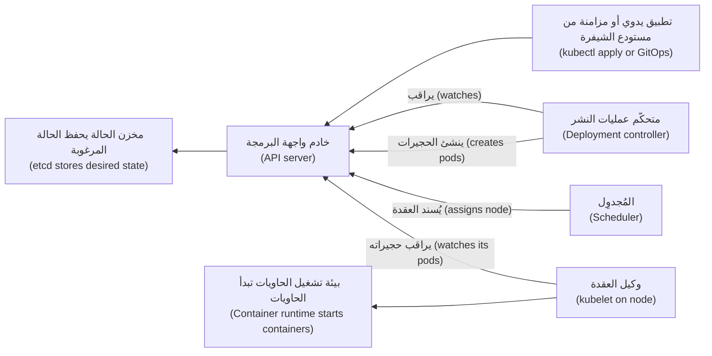

المتحكّمات والمُجدوِل (scheduler) وعناصر kubelet، كلٌّ منها يراقب خادم واجهة البرمجة ويكتب النتائج إليه؛ ولا يتخاطب بعضها مع بعض مباشرة أبدًا.

**الحجيرات (Pods).** **الحجيرة (Pod)** أصغر شيء يشغّله Kubernetes: حاوية أو أكثر تتشارك عنوان شبكة (network address) واحدًا، وتكون دائمًا على العقدة نفسها (same node). والحجيرات **عابرة (ephemeral)**: فالبدائل (replacements) تحصل على أسماء وعناوين IP جديدة، ولا تنشئ أبدًا حجيرة مباشرة لحِمل عمل حقيقي (real workload).

**عمليات النشر ومجموعات النسخ (Deployments and ReplicaSets).** تعلن **عملية النشر (Deployment)** "شغّل N نسخة من قالب الحجيرة هذا (pod template)". وهي تدير **مجموعة نسخ (ReplicaSet)** تتولّى العدّ (counting)؛ وحين تغيّر القالب (template) (مثل بصمة صورة جديدة)، تنشئ عملية النشر مجموعة نسخ جديدة وتنقل الحجيرات من القديمة إلى الجديدة تدريجيًا (gradually). ذلك هو **التحديث المتدحرج (rolling update)**.

**الخدمات (Services).** لأن عناوين الحجيرات (pod addresses) تتغيّر باستمرار، تحتاج البرمجيات الأخرى إلى عنوان ثابت (stable address). تمنح **الخدمة (Service)** مجموعة من الحجيرات عنوان IP افتراضيًا ثابتًا واسم DNS (DNS name)، مثل `mobile-api.mobile.svc.cluster.local`، وتوزّع الاتصالات (spreads connections) على أي حجيرات تطابق محدِّدها (selector) حاليًا وتكون جاهزة (ready).

| نوع الخدمة (Service type) | يمكن الوصول إليها من (Reachable from) | الاستخدام المعتاد (Typical use) |
|---|---|---|
| `ClusterIP` (الافتراضي) | داخل العنقود فقط | حركة المرور من خدمة إلى خدمة (service-to-service traffic) |
| `NodePort` | منفذ (port) على كل عقدة | نادرًا ما يُستخدم مباشرة؛ لبنة بناء (building block) للأنواع الأخرى |
| `LoadBalancer` | من الخارج، عبر موازن أحمال سحابي ينشئه المزوّد | كشف خدمة عند الطبقة 4 (layer 4) (TCP) |

ولتوجيه HTTP (HTTP routing) حسب اسم المضيف والمسار (الطبقة 7 (layer 7))، استخدم **Ingress** أو **Gateway API** الأحدث، الذي بلغ الإتاحة العامة (general availability) (v1.0) في أكتوبر 2023. وكلاهما يحتاج إلى متحكّم مثبّت في العنقود ليؤدي العمل الفعلي.

**الملصقات والمحدِّدات (Labels and selectors).** **الملصق (label)** وسم مفتاح-قيمة (key-value tag) على كائن، مثل `app.kubernetes.io/name: mobile-api`. و**المحدِّد (selector)** استعلام (query) على الملصقات. تجد عمليات النشر حجيراتها بالمحدِّد؛ وتجد الخدمات نقاط نهايتها (endpoints) بالمحدِّد. وإذا لم تتطابق الملصقات، فلا شيء يتّصل ولا تظهر رسالة خطأ، بل لا حركة مرور فحسب.

**مساحات الأسماء (Namespaces).** **مساحة الأسماء (Namespace)** تجمع الكائنات. يمنح بنك نجم كل فريق أو نظام مساحته الخاصة (`mobile`، `payments`، `assist`، ولا `default` أبدًا) مع قواعد الوصول (access rules) والحصص (quotas) وسياسات الشبكة (network policies) الخاصة بها. ومساحة الأسماء وحدها ليست حدًّا أمنيًا قويًا.

#### 🟡 التعمق أكثر

**عملية نشر وخدمة صحيحتان في حدّهما الأدنى (A minimal, correct Deployment and Service).**

```yaml
apiVersion: apps/v1
kind: Deployment
metadata:
  name: mobile-api
  namespace: mobile
  labels:
    app.kubernetes.io/name: mobile-api
spec:
  replicas: 3
  revisionHistoryLimit: 5
  selector:
    matchLabels:
      app.kubernetes.io/name: mobile-api
  strategy:
    type: RollingUpdate
    rollingUpdate:
      maxSurge: 1          # at most one extra pod during a rollout
      maxUnavailable: 0    # never drop below 3 ready pods
  template:
    metadata:
      labels:
        app.kubernetes.io/name: mobile-api
    spec:
      containers:
        - name: api
          image: registry.example.com/najm/mobile-api@sha256:<digest-from-pipeline>
          ports:
            - name: http
              containerPort: 8080
```

```yaml
apiVersion: v1
kind: Service
metadata:
  name: mobile-api
  namespace: mobile
spec:
  type: ClusterIP
  selector:
    app.kubernetes.io/name: mobile-api
  ports:
    - name: http
      port: 80
      targetPort: http
```

يظهر الملصق نفسه (same label) ثلاث مرات: محدِّد عملية النشر (Deployment selector)، وقالب الحجيرة، ومحدِّد الخدمة (Service selector). ويضيف الدرس 2.3 المجسّات (probes) والموارد (resources) وإعدادات الأمان (security settings) التي يحتاجها الإنتاج.

**تصريحي لا أمري (Declarative, not imperative).** يغيّر `kubectl run` و `kubectl edit` العنقود الحيّ (live cluster) مباشرة؛ أما `kubectl apply -f` فيقدّم ملفات تصف الحالة المرغوبة (desired state). ومع GitOps، يكون Git مصدر الحقيقة الوحيد وتُعكس التعديلات اليدوية، مما يزيل مشكلة "أحدهم غيّر شيئًا في الثالثة فجرًا ⁦(someone changed something at 3 a.m.)⁩".

**كيف يمضي التحديث المتدحرج (How a rolling update proceeds).** مع الإعدادات أعلاه، يبدأ Kubernetes حجيرة جديدة واحدة (`maxSurge: 1`)، وينتظر حتى تصبح **جاهزة (ready)**، ويزيل حجيرة قديمة واحدة، ويكرّر. وإذا لم تصبح الحجيرات الجديدة جاهزة أبدًا، يتعثّر الطرح (rollout stalls) بدلًا من إسقاط الخدمة؛ وبعد `progressDeadlineSeconds` (600 ثانية افتراضيًا) تُبلغ عملية النشر أنها فشلت في التقدّم. وكلتا القيمتين (both values) افتراضيتهما 25% حين لا تضبطهما.

```shell
kubectl -n mobile rollout status deployment/mobile-api   # watch progress
kubectl -n mobile rollout history deployment/mobile-api  # list revisions
kubectl -n mobile rollout undo deployment/mobile-api     # emergency rollback
```

في منصة GitOps، يُعدّ `rollout undo` حركة كسر الزجاج (break-glass move): اعكس التغيير في Git أيضًا، وإلا أعاد المُوائِم (reconciler) طرحه إلى الأمام. ويغطّي الدرس 4.2 استراتيجيات الكناري (canary) والأزرق والأخضر (blue-green) المبنية فوق هذا.

**قراءة حالة الحجيرة (Reading a pod's status).** معظم التشخيص في الأسبوع الأول (first-week debugging) هو قراءة هذه الحالات:

| ما تراه | ما يعنيه عادةً | أين تنظر (Look at) |
|---|---|---|
| `Pending` | لا يجد المُجدوِل عقدة: لا يكفي المعالج أو الذاكرة، أو قواعد لا تستوفيها أي عقدة | `kubectl describe pod` ← الأحداث (Events) |
| `ImagePullBackOff` / `ErrImagePull` | اسم صورة أو بصمة خاطئة، أو صلاحية سجل مفقودة، أو سجل يتعذّر الوصول إليه (registry unreachable) | الأحداث؛ صلاحية العقدة للسحب |
| `CrashLoopBackOff` | الحاوية تبدأ وتخرج مرارًا وتكرارًا؛ و Kubernetes ينتظر مدة أطول بين عمليات إعادة التشغيل (restarts) | `kubectl logs <pod> --previous` |
| `OOMKilled` (في الحالة الأخيرة) | استخدمت الحاوية ذاكرة أكثر من حدّها (memory limit) | حد الذاكرة والاستخدام الحقيقي (real usage) (الدرس 2.3) |
| `Running` لكن `0/1` جاهزة | العملية تعمل لكنها تفشل في فحص الجاهزية (readiness check)، فلا تتلقّى أي حركة مرور | مجسّ الجاهزية (readiness probe) وسجلات التطبيق (app logs) |

فرز من خمسة أوامر (five-command triage) يغطّي معظم الحالات:

```shell
kubectl -n mobile get pods -o wide             # states, restarts, nodes
kubectl -n mobile describe pod <pod>           # events at the bottom
kubectl -n mobile logs <pod> --previous        # logs of the crashed container
kubectl -n mobile get endpointslices -l kubernetes.io/service-name=mobile-api
kubectl -n mobile get events --sort-by=.lastTimestamp
```

يجيب الأمر الرابع عن سؤال "هل لخدمتي أي حجيرات خلفها؟ ⁦⁩" والقائمة الفارغة تعني عدم تطابق في الملصقات (label mismatch) أو عدم وجود حجيرات جاهزة.

**أنواع أحمال العمل الأخرى (Other workload types).** إلى جانب عمليات النشر للخدمات عديمة الحالة (stateless services): **StatefulSet** (أسماء وتخزين ثابتان لكل حجيرة)، و**DaemonSet** (حجيرة واحدة لكل عقدة، للوكلاء)، و**Job**/**CronJob** (تعمل حتى الاكتمال). ويُبقي بنك نجم قواعد البيانات (databases) على الخدمة المُدارة لدى المزوّد بدلًا من StatefulSets.

#### 🔴 نظرة الخبير

**التوزيع عبر نطاقات الأعطال (Spread across failure domains).** لا تنفع ثلاث نسخ (three replicas) إذا وضعها المُجدوِل كلها على عقدة واحدة، أو في منطقة توافر (availability zone) واحدة تتعطّل بعد ذلك. تُخبر **قيود توزيع الطوبولوجيا (Topology spread constraints)** المُجدوِل بأن يوازن الحجيرات (balance pods):

```yaml
      topologySpreadConstraints:
        - maxSkew: 1
          topologyKey: topology.kubernetes.io/zone
          whenUnsatisfiable: DoNotSchedule
          labelSelector:
            matchLabels:
              app.kubernetes.io/name: mobile-api
```

يوضع هذا في `spec` قالب الحجيرة، مقترنًا بمجمّعات عقد (node pools) في عدة مناطق (zones) (الدرس 6.1). وتمنع **ميزانية تعطيل الحجيرات (PodDisruptionBudget)** (الدرس 2.3) أعمال الصيانة (maintenance) من إزالة عدد كبير من الحجيرات دفعة واحدة.

**كل شيء كائن في واجهة البرمجة (Everything is an API object).** يمكنك إضافة أنواع كائنات خاصة بك (**الموارد المخصّصة (custom resources)**) ومتحكّمات خاصة بك (**المشغّلات (operators)**)؛ وهكذا يعمل Argo CD و cert-manager. وكل إضافة (add-on) من هذا النوع اعتمادية (dependency) يجب على فريق المنصة ترقيتها ومراقبتها.

**الترقيات عمل دائم (Upgrades are a standing job).** يشحن مشروع Kubernetes نحو ثلاثة إصدارات فرعية (minor releases) سنويًا، ويدعم كلًّا منها قرابة أربعة عشر شهرًا؛ وينشر المزوّدون المُدارون (managed providers) نوافذهم الخاصة (own windows) (تحقّق من مزوّدك). اقرأ ملاحظات الإهمال (deprecation notes) واختبر الترقيات في البيئات غير الإنتاجية (non-production) أولًا؛ فواجهات البرمجة المُزالة (removed APIs) هي السبب المعتاد للأعطال (breakage).

**كم من Kubernetes ينبغي أن تشغّل؟ ⁦(How much Kubernetes should you run?)⁩** يستحق Kubernetes تعقيده حين تتشارك خدمات وفرق وبيئات كثيرة منصة واحدة. أما لخدمة صغيرة واحدة، فقد تكون خدمة الحاويات عديمة الخوادم أو المنصة كخدمة (PaaS) القرار الأفضل. اختار بنك نجم Kubernetes المُدار (managed Kubernetes) لأنه يشغّل عشرات الخدمات ويريد طريقة واحدة لنشرها. وصورة OCI نفسها تعمل على كل هذه، فيبقى الخيار قابلًا للعكس (reversible).

| المفهوم (Concept) | AWS | Microsoft Azure | Google Cloud |
|---|---|---|---|
| Kubernetes المُدار | Amazon EKS | Azure Kubernetes Service (AKS) | Google Kubernetes Engine (GKE) |
| الحاويات عديمة الخوادم (Serverless containers) | Amazon ECS على AWS Fargate | Azure Container Apps | Cloud Run |

### 🧰 الأدوات
| الأداة أو الممارسة أو الخدمة | ما هي وماذا تفعل | متى تلجأ إليها |
|---|---|---|
| **kubectl** | عميل سطر الأوامر (command-line client) لواجهة برمجة Kubernetes | تطبيق البيانات (applying manifests)، وفحص الحالة (inspecting state)، والتشخيص (debugging) |
| **kind** (Kubernetes داخل Docker) | يشغّل عنقودًا كاملًا على هيئة حاويات على حاسوبك المحمول (laptop) | التعلّم، والاختبار المحلي (local testing)، واختبارات البيانات في التكامل المستمر |
| **k3d** | يشغّل توزيعة k3s الخفيفة (lightweight k3s distribution) داخل Docker | عنقود محلي سريع ذو بصمة موارد صغيرة (small footprint) |
| **Deployment** — عملية النشر | تُبقي N من الحجيرات المتطابقة عاملة وتطرح التغييرات | كل خدمة عديمة الحالة (stateless service) |
| **Service** — الخدمة | عنوان IP افتراضي ثابت واسم DNS أمام الحجيرات المطابقة | أي حجيرة تتلقّى حركة مرور (receives traffic) |
| **Gateway API** | واجهة برمجة Kubernetes الموجّهة بالأدوار (role-oriented API) لتوجيه HTTP و TCP إلى داخل العنقود | تصاميم الدخول الجديدة؛ استبدال إعدادات Ingress الأقدم |
| **Topology spread constraints** — قيود توزيع الطوبولوجيا | قواعد للمُجدوِل (scheduler rules) توازن الحجيرات عبر المناطق أو العقد | كل حِمل عمل إنتاجي له أكثر من نسخة واحدة (more than one replica) |

### 🏛️ عمليًا في بنك نجم
يكتب يوسف **خط الأساس لبيانات أحمال العمل في نجم (Najm workload manifest baseline)**: الحدّ الأدنى الذي يجب أن تحويه كل عملية نشر قبل دمجها في مستودع GitOps (GitOps repository)، إضافة إلى بطاقة فرز (triage card) لجدول المناوبة (on-call rota).

**الجزء A: مطلوب في كل عملية نشر (Part A: required on every Deployment)**

| الحقل (Field) | قاعدة نجم (Najm rule) | السبب |
|---|---|---|
| `metadata.namespace` | مساحة أسماء الفريق (team's namespace)؛ ولا `default` أبدًا | الوصول والحصص وتوزيع التكلفة (cost allocation) حسب الفريق |
| الملصقات | `app.kubernetes.io/name`، `app.kubernetes.io/part-of`، `najm.example/team`، `najm.example/cost-centre` | المحدِّدات (selectors) ولوحات المتابعة (dashboards) وتقارير التكلفة (cost reports) (الدرس 6.2) |
| `spec.replicas` | 3 أو أكثر في الإنتاج (أو حدّ أدنى للمُوسِّع التلقائي (autoscaler minimum) قدره 3) | النجاة من تعطّل عقدة أو منطقة |
| `image` | مسار السجل (registry path) مع البصمة من خط التسليم | البايتات التي اختُبرت بالضبط (الدرس 2.1) |
| `strategy.rollingUpdate` | `maxUnavailable: 0`، `maxSurge: 1` (أو 25%) | لا فقدان للسعة أثناء النشر |
| `topologySpreadConstraints` | عبر `topology.kubernetes.io/zone` | النجاة من تعطّل منطقة |
| المجسّات والموارد وسياق الأمان | كما في قائمة تحقق الدرس 2.3 (lesson 2.3 checklist) | ليست جاهزة للإنتاج من دونها |
| مسار التغيير (Change path) | طلب سحب في Git فقط؛ لا `kubectl edit` في الإنتاج | مصدر حقيقة واحد (one source of truth)؛ سجل تدقيق كامل |

**الجزء B: بطاقة فرز المناوبة ("الحجيرة لا تعمل") (Part B: on-call triage card ("the pod will not work"))**

| الخطوة (Step) | الأمر | إن رأيت… | فعندئذ (Then) |
|---|---|---|---|
| 1 | `kubectl get pods -o wide` | `Pending` | افحص الأحداث بحثًا عن "Insufficient cpu/memory"؛ وافحص سعة مجمّع العقد |
| 2 | `kubectl describe pod` | `ImagePullBackOff` | تحقّق من أن البصمة موجودة؛ وافحص صلاحية العقدة على السجل |
| 3 | `kubectl logs --previous` | `CrashLoopBackOff` | اقرأ الخطأ الأخير (last error)؛ وتحقّق من أن الإعدادات والأسرار رُكّبت |
| 4 | `kubectl get endpointslices` | لا نقاط نهاية | قارن محدِّد الخدمة بملصقات الحجيرات (pod labels)؛ وافحص الجاهزية (readiness) |
| 5 | `kubectl rollout history` | بدأت المشكلة مع طرح | اعكس الإيداع في Git؛ ولا تستخدم `rollout undo` لكسر الزجاج (break-glass) إلا بموافقة مها |

### 🛠️ التمارين
استخدم عنقودًا محليًا (local cluster): ثبّت kind أو k3d، وأنشئ عنقودًا باستخدام `kind create cluster` أو `k3d cluster create`.

- 🟢 انشر عملية النشر والخدمة من هذا الدرس (واستخدم أي صورة ويب عامة صغيرة تثق بها، مثبّتة بالبصمة، بدلًا من واجهة الهاتف). احذف حجيرة واحدة وراقب باستخدام `kubectl get pods -w` ظهور بديل (replacement). *يكتمل عندما:* تستطيع أن تشرح، في جملتين، أي متحكّم أعاد إنشاء الحجيرة ولماذا تغيّر اسمها.
- 🟡 اكسر الخدمة عمدًا بتغيير ملصق قالب الحجيرة دون تحديث محدِّد الخدمة. استخدم بطاقة الفرز لتجد العطل من الأعراض وحدها. ثم انشر بصمة صورة (image digest) غير موجودة وشخّص النتيجة. *يكتمل عندما:* يكون لديك مُخرَج الأمر الدقيق الذي أشار إلى كل سبب، ويكون كلاهما قد أُصلح عبر ملفات YAML لديك، لا عبر `kubectl edit`.
- 🔴 أنشئ عنقود kind بثلاث عقد عاملة، وضع عليها ملصقات المناطق `a` و `b` و `c` باستخدام `topology.kubernetes.io/zone`، وانشر ست نسخ (six replicas) مع قيد توزيع الطوبولوجيا. أفرغ عقدة واحدة باستخدام `kubectl drain` وراقب ما يحدث. *يكتمل عندما:* تستطيع أن تُظهر توزّع الحجيرات بواقع اثنتين لكل منطقة قبل الإفراغ، وتشرح أين ذهبت بعده، وتشرح لماذا ترك `DoNotSchedule` بعض الحجيرات في حالة `Pending` إن حدث ذلك.

### ⚠️ أخطاء وفخاخ
- **تعديل العنقود الحيّ (Editing the live cluster).** يُحدث `kubectl edit` في الإنتاج انحرافًا تعكسه المزامنة التالية (next sync)، أو ما هو أسوأ، انحرافًا لا يعلم به أحد. غيّر Git؛ ودع المُوائِم يطبّقه.
- **إنشاء حجيرات مجرّدة (Creating bare pods).** الحجيرة التي لا يملكها متحكّم لا يُعاد إنشاؤها حين تتعطّل عقدتها. استخدم عملية نشر.
- **عدم تطابق الملصقات (Label mismatches).** الخدمة التي لا يطابق محدِّدها شيئًا لا تُنتج خطأً، بل غياب حركة المرور فقط. استخدم اصطلاح ملصقات واحدًا وافحص نقاط النهاية.
- **كل النسخ في مكان واحد (All replicas in one place).** ثلاث حجيرات على عقدة واحدة تعطي وهم التكرار. أضف قيود توزيع الطوبولوجيا ومجمّعات عقد متعددة المناطق.
- **نسيان أن التراجع يكون في Git أيضًا (Forgetting the rollback is in Git too).** إن `rollout undo` الذي لا ينعكس في Git يُعيد GitOps طرحه إلى الأمام.

### 🧾 الخلاصة
- يشغّل Kubernetes الحاويات عبر عنقود ويُبقيها عاملة من خلال حلقات تحكم تواءم الحالة الفعلية (actual state) مع الحالة المُعلنة.
- مستوى التحكم يقرّر؛ وعناصر kubelet وبيئات تشغيل الحاويات (container runtimes) على العقد تنفّذ.
- الحجيرات قابلة للاستغناء؛ وعمليات النشر تُبقي N منها عاملة وتطرح الإصدارات الجديدة؛ والخدمات تمنحها عنوانًا ثابتًا؛ والملصقات والمحدِّدات تربط ذلك كله.
- غيّر الحالة المُعلنة في Git، ولا تغيّر الكائنات الحيّة (live objects) أبدًا؛ واقرأ حالات الحجيرات (pod states) والأحداث للتشخيص.
- وزّع النسخ عبر المناطق، وخطّط لترقيات منتظمة (regular upgrades)، ولا تعتمد Kubernetes إلا حيث يغطّي تعقيده كلفته.

### ✍️ اختبر نفسك

**1. يحذف يوسف حجيرة (pod) سيئة التصرّف من واجهة الهاتف (Mobile API)، فتظهر حجيرة جديدة خلال ثوانٍ باسم مختلف. ما الذي تسبّب في ذلك؟**

- A. أعاد kubelet على العقدة (node) تشغيل الحجيرة نفسها بعد حذفها
- B. أعادت الخدمة (Service) إنشاء الحجيرة كي تحتفظ بنقطة نهاية (endpoint) واحدة على الأقل
- C. رأى متحكّم مجموعة النسخ (ReplicaSet) عددًا أقل من الحجيرات المطلوبة فأنشأ بديلًا
- D. استعاد etcd كائن الحجيرة المحذوف من أحدث نسخة احتياطية

<details><summary>الإجابة</summary>

**C.** المواءمة (reconciliation): يقارن المتحكّم النسخ المرغوبة (desired replicas) بالفعلية (actual) ويسدّ الفجوة. A خاطئة لأن kubelet يعيد تشغيل الحاويات داخل حجيرة قائمة (existing pod)، فتحتفظ باسمها؛ أما الحجيرة المحذوفة فقد زالت. و B خاطئة لأن الخدمات توجّه حركة المرور (route traffic) ولا تنشئ حجيرات أبدًا. و D تسيء فهم دور etcd بوصفه مخزنًا للحالة. (🟢 الأساسيات.)

</details>

**2. ينشر فريق جديد خدمة. حجيراتها في حالة `Running` وجاهزة (ready)، لكن كل طلب إلى الخدمة (Service) تنتهي مهلته (times out)، وليس للخدمة نقاط نهاية (endpoints). ما السبب الأرجح؟**

- A. محدِّد الخدمة (Service selector) لا يطابق ملصقات الحجيرات (labels)
- B. بصمة الصورة (image digest) في قالب الحجيرة (pod template) خاطئة أو مفقودة
- C. الحجيرات تتجاوز حدّ ذاكرتها (memory limit) باستمرار بعد كل إعادة تشغيل
- D. لم يجد المُجدوِل (scheduler) عقدة فيها متّسع للطلبات

<details><summary>الإجابة</summary>

**A.** الحجيرات الجاهزة بلا نقاط نهاية تشير إلى عدم تطابق في الملصقات (label mismatch). أما B فكانت ستُظهر `ImagePullBackOff`، و C كانت ستُظهر عمليات إعادة تشغيل `OOMKilled`، و D كانت ستترك الحجيرات في حالة `Pending`، لا عاملة. (🟡 التعمق أكثر (Going deeper).)

</details>

**3. أثناء إطلاق (release)، لا تصبح حجيرات واجهة الهاتف الجديدة جاهزة أبدًا. تستخدم عملية النشر `maxUnavailable: 0` و `maxSurge: 1`. ماذا يحدث للعملاء؟**

- A. تُحذف كل الحجيرات القديمة (old pods) دفعة واحدة، وتتوقّف الواجهة حتى يتصرّف أحدهم
- B. يكتشف Kubernetes الفشل ويتراجع تلقائيًا إلى الإصدار السابق
- C. تُقسَّم حركة المرور بالتساوي، فيصل نحو نصف الطلبات إلى الحجيرات المعطوبة (broken pods)
- D. يتعثّر الطرح (rollout stalls)، وتواصل الحجيرات القديمة الخدمة، ويُبلَّغ عنه بأنه لا يتقدّم

<details><summary>الإجابة</summary>

**D.** لا تُزال أي حجيرة قديمة حتى تصبح حجيرة جديدة جاهزة، والحجيرات غير الجاهزة (unready pods) لا تتلقّى حركة مرور من الخدمة. و B هي المُشتِّت المُغري (tempting distractor): فعملية النشر العادية (plain Deployment) لا تتراجع من تلقاء نفسها؛ بل يجب أن تفعل ذلك أنت، أو أداة مثل متحكّم التسليم التدريجي (progressive-delivery controller). (🟡 التعمق أكثر (Going deeper).)

</details>

**4. تلاحظ مها أن نسخ خدمة المدفوعات (Payments replicas) الثلاث كلها على عقد في منطقة التوافر (availability zone) نفسها. أي تغيير يعالج هذا بأكثر الطرق مباشرة؟**

- A. زِد النسخ (replicas) من 3 إلى 6 كي يقلّ أثر تعطّل منطقة واحدة
- B. أضف قيد توزيع طوبولوجيا حسب المنطقة، مع مجمّعات عقد (node pools) في عدة مناطق
- C. انقل المدفوعات إلى مساحة أسماء مخصّصة لها (dedicated namespace) بحصة منفصلة (separate quota)
- D. غيّر نوع خدمة المدفوعات إلى `LoadBalancer` عبر المناطق (across zones)

<details><summary>الإجابة</summary>

**B.** قيود التوزيع (spread constraints) تخبر المُجدوِل بأن يوازن عبر المناطق، وهذا لا ينجح إلا إذا وُجدت عقد في عدة مناطق. أما A فقد تضع الست كلها في منطقة واحدة؛ و C و D لا تؤثّران في التوزيع (placement). (🔴 نظرة الخبير (Expert view).)

</details>

**5. يصلح يوسف إعدادًا إنتاجيًا (production setting) باستخدام `kubectl edit`. وفي صباح اليوم التالي تعود القيمة القديمة. لماذا، وماذا ينبغي أن يفعل؟**

- A. أعاد GitOps ما يعلنه Git؛ وينبغي أن يغيّره عبر طلب سحب (pull request)
- B. يعكس Kubernetes كل تغيير يدوي (manual change) بعد 24 ساعة؛ وينبغي أن يعيد تطبيقه يوميًا
- C. خزّن kubelet الإعداد القديم مؤقتًا طوال الليل؛ وينبغي أن يُفرغ العقدة ويعيد تشغيلها
- D. فقد etcd التغيير أثناء الضغط (compaction)؛ وينبغي أن يطلب من المزوّد استعادة etcd

<details><summary>الإجابة</summary>

**A.** مع GitOps، يكون Git مصدر الحقيقة (source of truth)، والتعديلات اليدوية (manual edits) انحراف (drift) يُصحَّح. أما B و C و D فتصف سلوكيات لا وجود لها. (🟡 التعمق أكثر (Going deeper).)

</details>

### 📚 المراجع
- توثيق Kubernetes: مكوّنات العنقود (cluster components) — https://kubernetes.io/docs/concepts/overview/components/
- توثيق Kubernetes: المتحكّمات — https://kubernetes.io/docs/concepts/architecture/controller/
- توثيق Kubernetes: عمليات النشر — https://kubernetes.io/docs/concepts/workloads/controllers/deployment/
- توثيق Kubernetes: الخدمات — https://kubernetes.io/docs/concepts/services-networking/service/
- توثيق Kubernetes: قيود توزيع طوبولوجيا الحجيرات — https://kubernetes.io/docs/concepts/scheduling-eviction/topology-spread-constraints/
- توثيق Kubernetes: الملصقات الموصى بها (recommended labels) — https://kubernetes.io/docs/concepts/overview/working-with-objects/common-labels/
- دورة إصدارات Kubernetes وتفاوت الإصدارات — https://kubernetes.io/releases/
- Gateway API — https://gateway-api.sigs.k8s.io/
- kind — https://kind.sigs.k8s.io/
- توثيق Amazon EKS — https://docs.aws.amazon.com/eks/
- توثيق Azure Kubernetes Service — https://learn.microsoft.com/azure/aks/
- توثيق Google Kubernetes Engine — https://cloud.google.com/kubernetes-engine/docs

<a id="l2-3"></a>

## 2.3 — Kubernetes عمليًا: الإعدادات والأسرار ومجسّات الصحة والتوسّع التلقائي و Helm

*المستوى: 🟡 متوسط* · *المتطلبات: 2.1، 2.2* · *المرحلة (Phase): Deploy, Operate*

### ⚡ الدرس في دقيقة (In 60 seconds)
- البيان الذي "يعمل" ليس جاهزًا للإنتاج (production-ready). يضيف الإنتاج **الإعدادات الخارجية (external configuration)**، و**الأسرار الآمنة (safe secrets)**، و**مجسّات الصحة (health probes)**، و**الطلبات والحدود (requests and limits)**، و**التوسّع التلقائي (autoscaling)**، و**الإيقاف الرشيق (graceful shutdown)**، و**سياق الأمان (security context)**.
- تحمل **خرائط الإعدادات (ConfigMaps)** الإعدادات العادية (ordinary settings)؛ وتحمل **الأسرار (Secrets)** الحسّاسة منها. وسرّ Kubernetes (Kubernetes Secret) افتراضيًا **مُرمَّز بـ base64 فقط، وليس مشفّرًا (base64-encoded, not encrypted)**: فعّل التشفير أثناء التخزين (encryption at rest)، وقيّد من يستطيع قراءته، وفضّل المزامنة من مدير أسرار خارجي (external secrets manager).
- **الجاهزية (Readiness)** تقرّر ما إذا كانت الحجيرة تتلقّى حركة مرور (gets traffic)؛ و**الحيوية (liveness)** تقرّر ما إذا كانت تُعاد تشغيلها (gets restarted)؛ و**البدء (startup)** يحمي التطبيقات بطيئة الإقلاع (slow starters). ويجب أن تفحص الحيوية العملية نفسها فقط، ولا تفحص أبدًا قاعدة بيانات أو خدمة أخرى.
- **الطلبات (Requests)** تحجز السعة (reserve capacity) وتقود الجدولة (scheduling) والتوسّع التلقائي؛ و**الحدود (limits)** تسقّف الاستخدام (cap usage) (المعالج فوق الحد يُخنَق (throttled)، والذاكرة فوق الحد تُقتل).
- إشارة القرار: قبل الإطلاق الفعلي (go-live)، مُرَّ على قائمة تحقق الجاهزية للإنتاج (production-readiness checklist)؛ فأي سطر فارغ انقطاع معروف ينتظر أن يقع.
- أكبر فخ: مجسّ حيوية (liveness probe) يعتمد على شيء خارج الحجيرة، فيحوّل تعثّرًا قصيرًا في قاعدة البيانات إلى عاصفة إعادة تشغيل على مستوى العنقود.

### 🧭 لماذا يهم
في صباح يوم ثلاثاء، تنتقل قاعدة بيانات PostgreSQL المُدارة التي تقف خلف **خدمة المدفوعات (Payments service)** إلى نسختها الاحتياطية، في تعثّر (blip) يدوم نحو ثلاثين ثانية. كان ينبغي أن تُرجع المدفوعات أخطاءً (errors) لفترة وجيزة ثم تتعافى (recovered). لكنها بدلًا من ذلك توقّفت إحدى عشرة دقيقة.

تكشف مراجعة ما بعد الحادثة (postmortem) التي أجرتها مها (الدرس 5.3) مع يوسف السلسلة. كان مجسّ الحيوية يستدعي `/health`، الذي يستعلم قاعدة البيانات، فأعاد kubelet أثناء الانتقال (failover) تشغيل كل الحجيرات دفعة واحدة. احتاجت الحجيرات المُعاد تشغيلها أربعين ثانية لتسخن (warm up)، ولم تكن لها مهلة إقلاع (startup allowance)، ففشلت في فحص الحيوية مجددًا وأُعيد تشغيلها مجددًا. وفي الأثناء، رأى المُوسِّع التلقائي (autoscaler) قفزة المعالج (CPU spike) فأضاف حجيرات، كلٌّ منها يفتح اتصالات أكثر (more connections) بقاعدة بيانات عادت للتوّ، حتى بلغت حدّ اتصالاتها (connection limit). وكل إعداد شارك في ذلك كان المقصود منه أن يجعل الخدمة *أكثر* موثوقية (more reliable).

وفي الأسبوع نفسه، يجد فريق نورة بيان سرّ (Secret manifest) في Git فيه السطر `password: cGFzc3dvcmQ=`. ظنّ المطوّر أنه مشفّر (encrypted). وهو يُفكّ (decodes) إلى "password" بأمر واحد.

### 📐 كيف يعمل

#### 🟢 الأساسيات

**الإعدادات خارج الصورة (Configuration outside the image).** البصمة نفسها تعمل في كل مكان (الدرس 2.1)، لذا تُقدَّم الإعدادات الخاصة بكل بيئة (per-environment settings) وقت التشغيل. تحمل **خريطة الإعدادات (ConfigMap)** إعدادات غير حسّاسة (non-sensitive settings) أو ملفات إعداد (config files)، تُستهلك بوصفها متغيّرات بيئة (environment variables) أو ملفات مُركَّبة (mounted files).

```yaml
apiVersion: v1
kind: ConfigMap
metadata:
  name: mobile-api-config
  namespace: mobile
data:
  LOG_LEVEL: "info"
  PAYMENTS_URL: "http://payments.payments.svc.cluster.local"
```

تُقرأ متغيّرات البيئة عند بدء الحاوية فقط، لذا لا تصل خريطة الإعدادات المُعدَّلة إلى الحجيرات العاملة حتى يُعاد تشغيلها؛ أما الملفات المُركَّبة فتتحدّث بعد تأخير، لكنها لا تفيد إلا إذا أعاد التطبيق قراءتها (rereads them). والإصلاح المعتاد (usual fix) هو طرح عملية النشر من جديد كلما تغيّرت إعداداتها (يستطيع Helm أتمتة ذلك، كما سيأتي أدناه).

**الأسرار: ما هي وما ليست (Secrets: what they are and are not).** **السرّ (Secret)** يشبه خريطة الإعدادات لكنه لكلمات المرور (passwords) والرموز (tokens) والمفاتيح (keys)، مع تحكّم وصول منفصل، غير أن قيمه **مُرمَّزة بـ base64 (base64-encoded)** فقط، وهو ترميز قابل للعكس (reversible encoding)، وليس تشفيرًا:

```shell
echo 'cGFzc3dvcmQ=' | base64 --decode     # prints: password
```

لذا فالسرّ آمن بقدر ثلاثة أمور يجب أن تضبطها فحسب:
1. **التشفير أثناء التخزين (Encryption at rest)** لمخزن بيانات العنقود. تختلف الخدمات المُدارة؛ ويقدّم كثير منها التشفير المغلّف (envelope encryption) بمفتاح KMS السحابي الخاص بك. تحقّق مما تفعله خدمتك افتراضيًا.
2. **التحكم في الوصول (Access control, RBAC).** أي شخص يستطيع تنفيذ `get` أو `list` على الأسرار في مساحة أسماء، أو إنشاء حجيرات هناك تُركّبها (mount them)، يستطيع قراءتها. أبقِ تلك القائمة قصيرة.
3. **لا تضعها أبدًا في Git على هيئة بيانات أسرار صريحة (Never in Git as plain Secret manifests).** احفظ القيمة في مدير أسرار (secrets manager) وزامِنها إلى الداخل باستخدام **External Secrets Operator** أو **Secrets Store CSI Driver**؛ أما الأسرار التي يجب أن تعيش في Git فتُشفَّر أولًا (encrypted first).

تتيح **هوية حِمل العمل (Workload identity)** (الدرس 1.3) لأداة المزامنة (sync tool) أن تصادق (authenticate) دون مفتاح مخزّن (stored key). والمزيد في [*أمن الذكاء الاصطناعي وأمن التطبيقات*، الدرس 5.2 — إدارة الأسرار: المفاتيح والرموز وأين تتسرّب](../secai/index.ar.html#/5.2).

**مجسّات الصحة (Health probes).** يستطيع kubelet فحص كل حاوية بثلاث طرق:

| المجسّ (Probe) | السؤال الذي يجيب عنه (Question it answers) | ما يحدث عند الفشل |
|---|---|---|
| **الجاهزية (Readiness)** | "هل تستطيع هذه الحجيرة خدمة حركة المرور الآن؟ ⁦⁩" | تُزال الحجيرة من نقاط نهاية الخدمة (Service endpoints)؛ ولا يُعاد تشغيلها |
| **الحيوية (Liveness)** | "هل هذه العملية عالقة بما يتجاوز الإصلاح؟ ⁦⁩" | يُعاد تشغيل الحاوية |
| **البدء (Startup)** | "هل انتهى التطبيق من الإقلاع؟ ⁦⁩" | يُرجأ فحصا الحيوية والجاهزية (held off) حتى ينجح؛ وإن لم ينجح أبدًا، يُعاد تشغيل الحاوية |

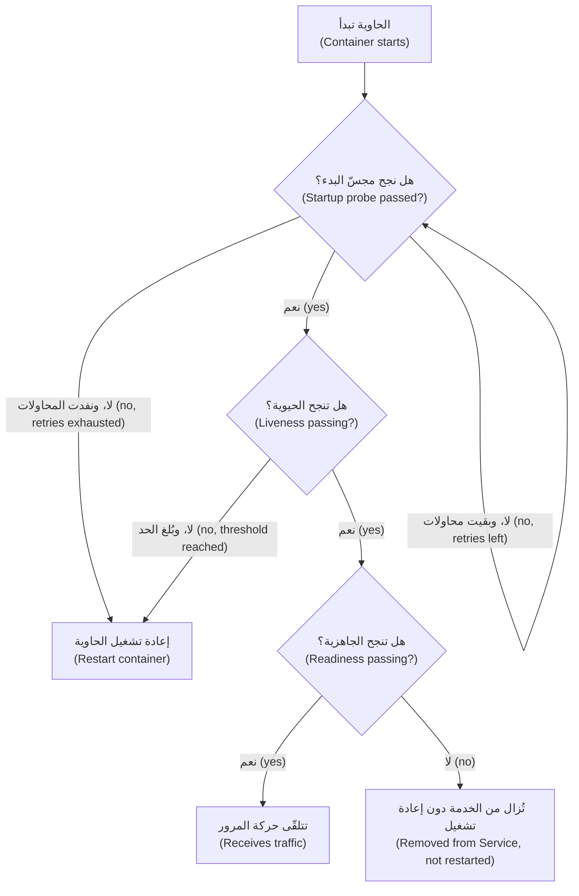

القاعدة التي كانت ستنقذ المدفوعات (Payments): **الحيوية تفحص العملية نفسها فقط (liveness checks only the process itself)** (هل تستجيب، أم أنها في حالة جمود (deadlocked)؟). فإعادة تشغيل التطبيق لا تُصلح قاعدة بيانات. أما **الجاهزية (Readiness)** فقد تراعي الاعتماديات الصلبة (hard dependencies)، لكن إن أصبحت كل حجيرة غير جاهزة دفعة واحدة، يتلقّى المستدعون (callers) أخطاء اتصال (connection errors) بدلًا من استجابة واضحة (clear response). وكثيرًا ما يكون الأفضل أن تبقى جاهزًا وتُرجع خطأً سريعًا وواضحًا (مع قاطع دائرة) ما دامت الاعتمادية متوقّفة.

**الطلبات والحدود (Requests and limits).** ينبغي لكل حاوية أن تعلن:
- **الطلبات (Requests)**: المعالج والذاكرة المحجوزان لها. لا يضع المُجدوِل الحجيرات إلا حيث تتّسع الطلبات، ويقيس المُوسِّع التلقائي الاستخدام (utilisation) نسبةً مئوية من الطلب.
- **الحدود (Limits)**: السقف. فوق حدّ المعالج (CPU limit) **تُخنَق (throttled)** الحاوية (أي تُبطَّأ)؛ وفوق حدّ الذاكرة **تُقتل (killed)** (`OOMKilled`) ويُعاد تشغيلها.

يُقاس المعالج بالأنوية أو أجزاء الألف من النواة (`250m` ربع نواة)؛ والذاكرة بالبايتات (bytes) (`512Mi`).

#### 🟡 التعمق أكثر

**مواصفة الحجيرة الإنتاجية (The production pod spec).** إليك حاوية واجهة الهاتف من الدرس 2.2 مع إضافة الأساسيات (essentials):

```yaml
    spec:
      terminationGracePeriodSeconds: 30
      securityContext:
        runAsNonRoot: true
        seccompProfile:
          type: RuntimeDefault
      containers:
        - name: api
          image: registry.example.com/najm/mobile-api@sha256:<digest-from-pipeline>
          ports:
            - name: http
              containerPort: 8080
          envFrom:
            - configMapRef:
                name: mobile-api-config
          env:
            - name: DB_PASSWORD
              valueFrom:
                secretKeyRef:
                  name: mobile-api-db     # synced from the secrets manager
                  key: password
          resources:
            requests:
              cpu: 250m
              memory: 384Mi
            limits:
              memory: 384Mi                 # memory limit equal to request
          startupProbe:
            httpGet: { path: /healthz/live, port: http }
            periodSeconds: 5
            failureThreshold: 24            # up to 2 minutes to start
          livenessProbe:
            httpGet: { path: /healthz/live, port: http }   # process only
            periodSeconds: 10
            failureThreshold: 3
          readinessProbe:
            httpGet: { path: /healthz/ready, port: http }
            periodSeconds: 5
            failureThreshold: 2
          securityContext:
            allowPrivilegeEscalation: false
            readOnlyRootFilesystem: true
            capabilities:
              drop: ["ALL"]
```

خيارات تستحق الشرح:
- **حدّ الذاكرة يساوي الطلب (Memory limit equals request).** لا يمكن خنق الذاكرة، بل قتلها فقط، لذا فإن الإفراط في التزام الذاكرة (overcommitting) يسبّب عمليات قتل مفاجئة (surprise kills) حين ينشغل الجيران (neighbours).
- **لا حدّ للمعالج هنا (No CPU limit here).** خيار مختلَف عليه (debated choice): قد تخنق حدود المعالج (CPU limits) خدمة حسّاسة لزمن الاستجابة (latency-sensitive service) حتى حين تكون العقدة خاملة (idle). تضبط فرق كثيرة طلبات المعالج (CPU requests) في كل مكان، والحدود فقط حيث تلزم العدالة الصارمة (hard fairness)؛ قِس الخنق (measure throttling) (الدرس 5.1) وقرّر لكل خدمة على حدة (per service).
- **سياق الأمان (Security context).** بلا صلاحيات جذر، وبلا تصعيد صلاحيات، وبلا قدرات Linux، ونظام ملفات جذري للقراءة فقط (ركّب `emptyDir` حيث يجب أن يكتب التطبيق)، وملف seccomp الافتراضي. وكلها عدا نظام الملفات المخصّص للقراءة فقط يتطلّبها معيار أمان الحجيرات **المقيَّد (restricted)** الذي يفرضه بنك نجم على كل مساحة أسماء (per namespace) بالملصق `pod-security.kubernetes.io/enforce: restricted`. والمزيد في [*أمن الذكاء الاصطناعي وأمن التطبيقات*، الدرس 7.2 — الحاويات و Kubernetes والبنية التحتية بوصفها شيفرة](../secai/index.ar.html#/7.2).

**جودة الخدمة (Quality of service).** تحدّد الطلبات والحدود أيضًا أولوية إخلاء (eviction priority) كل حجيرة تحت ضغط الذاكرة (memory pressure): **BestEffort** (لم يُضبط شيء؛ تُخلى أولًا)، و**Burstable**، و**Guaranteed** (الطلبات تساوي الحدود للمعالج والذاكرة في كل حاوية؛ تُخلى أخيرًا). ومواصفة واجهة الهاتف أعلاه بلا حدّ للمعالج، لذا فهي Burstable؛ أما المدفوعات فتضبط أيضًا حدود المعالج مساوية للطلبات وتعمل بفئة Guaranteed.

**الإيقاف الرشيق (Graceful shutdown).** تُوقَف الحجيرات مع كل نشر، وكل تقليص (scale-down)، وكل ترقية عقدة (node upgrade). عند الحذف، يبدأ Kubernetes إزالة الحجيرة من نقاط نهاية الخدمة، ويشغّل في الوقت نفسه أي خطّاف `preStop` (hook) ثم يرسل `SIGTERM`. تستغرق إزالة نقطة النهاية (endpoint removal) لحظة كي تنتشر (propagate)، لذا فالحجيرة التي تخرج فورًا (exits instantly) تُسقط الطلبات التي ما زالت تصل. والإصلاح: عند `SIGTERM`، توقّف عن قبول عمل جديد، وأنهِ الطلبات الجارية، واخرج ضمن `terminationGracePeriodSeconds` (30 ثانية افتراضيًا)، وبعدها يأتي `SIGKILL`. وتتيح وقفة `preStop` قصيرة (short pause) اكتمال إزالة نقطة النهاية أولًا؛ وتقدّم إصدارات Kubernetes الأحدث إجراء نوم مدمجًا لهذا الغرض (تحقّق من إصدارك). وبالنسبة إلى المدفوعات، يعني ذلك أيضًا عدم الإقرار أبدًا بتحويل لم يُثبَّت (committed).

**التوسّع التلقائي باستخدام Horizontal Pod Autoscaler (Autoscaling with the Horizontal Pod Autoscaler).** يضبط **المُوسِّع الأفقي التلقائي للحجيرات (HorizontalPodAutoscaler, HPA)** عدد النسخ (replicas) ليُبقي مقياسًا (metric) قريبًا من هدف (target). وهو يحتاج إلى metrics-server (أو خط مقاييس آخر) وإلى طلبات المعالج:

```yaml
apiVersion: autoscaling/v2
kind: HorizontalPodAutoscaler
metadata:
  name: mobile-api
  namespace: mobile
spec:
  scaleTargetRef:
    apiVersion: apps/v1
    kind: Deployment
    name: mobile-api
  minReplicas: 3
  maxReplicas: 20
  metrics:
    - type: Resource
      resource:
        name: cpu
        target:
          type: Utilization
          averageUtilization: 70
```

صيغته الجوهرية (core formula) هي `desiredReplicas = ceil(currentReplicas × currentValue / targetValue)`. ست حجيرات عند 105% من طلب المعالج (CPU request)، مقابل هدف 70%، تعطي `ceil(6 × 105 / 70) = 9`. وافتراضيًا لا يقلّص (scales down) إلا بعد نافذة استقرار (stabilisation window) مدتها خمس دقائق، لتجنّب التذبذب (flapping). ومع HPA، أزِل `replicas` من عملية النشر في Git، وإلا ستتصارع كل مزامنة (each sync) مع المُوسِّع التلقائي.

تحذيران (two cautions). أولًا، **توسّع بناءً على عنق الزجاجة الحقيقي (scale on the real bottleneck).** إذا كانت اتصالات قاعدة البيانات (database connections) هي الحد، فإن مزيدًا من الحجيرات يجعل الأمر أسوأ: سقّف `maxReplicas` بحيث يبقى حاصل ضرب الحجيرات في حجم المجمّع تحت حدّ قاعدة البيانات، أو توسّع بناءً على معدّل الطلبات (request rate) أو طول الطابور (queue length) (يدعم KEDA مصادر كثيرة من هذا النوع). ثانيًا، الحجيرات الجديدة تحتاج إلى متّسع؛ فـ **Cluster Autoscaler** أو Karpenter يضيف عقدًا (adds nodes) حين تكون الحجيرات في حالة `Pending` (الدرس 6.1).

**ميزانيات تعطيل الحجيرات (PodDisruptionBudgets).** تحدّ **ميزانية تعطيل الحجيرات (PodDisruptionBudget, PDB)** من عدد الحجيرات التي يجوز لعمليات التعطيل الطوعية (voluntary disruptions)، مثل إفراغ العقد (node drains)، أن تُسقطها دفعة واحدة:

```yaml
apiVersion: policy/v1
kind: PodDisruptionBudget
metadata:
  name: mobile-api
  namespace: mobile
spec:
  minAvailable: 2
  selector:
    matchLabels:
      app.kubernetes.io/name: mobile-api
```

وهي لا تغطّي أعطال العقد المفاجئة (node crashes)، والميزانية التي تسمح بصفر عمليات تعطيل (zero disruptions) تحجب ترقيات العقد.

#### 🔴 نظرة الخبير

**التحزيم باستخدام Helm (Packaging with Helm).** صارت الخدمة الواحدة تحتاج الآن إلى Deployment و Service و ConfigMap و HPA و PDB وغيرها، يختلف كلٌّ منها قليلًا بحسب البيئة (per environment). يحزّمها **Helm** في **مخطط (chart)**: قوالب (templates) مع قيم افتراضية في `values.yaml`، تعلوها ملفات قيم خاصة بكل بيئة. ظلّ Helm 3 المعيار لسنوات، وصدر Helm 4 في أواخر 2025؛ تحقّق من الإصدار الرئيسي (major version) الذي تتوقّعه أدواتك.

```shell
helm lint ./charts/mobile-api
helm template mobile-api ./charts/mobile-api -f values-prod.yaml > rendered.yaml   # inspect before applying
helm upgrade --install mobile-api ./charts/mobile-api -n mobile -f values-prod.yaml --wait
helm rollback mobile-api 3 -n mobile
```

ثمة نمط معروف (well-known pattern) يعيد طرح الحجيرات (rolls pods) حين تتغيّر خريطة إعداداتها، عبر تجزئة (hash) في تعليق توضيحي للحجيرة (pod annotation):

```yaml
  template:
    metadata:
      annotations:
        checksum/config: {{ include (print $.Template.BasePath "/configmap.yaml") . | sha256sum }}
```

في بنك نجم، لا يشغّل التكامل المستمر أبدًا `helm upgrade` على الإنتاج: بل يُصيِّر (renders) Argo CD المخطط من مستودع GitOps ويطبّقه (الدرس 3.2)، فتكون التغييرات قابلة للمراجعة (reviewable) ويُصحَّح الانحراف. أما **Kustomize**، المدمج في `kubectl` (`kubectl apply -k`)، فبديل بلا قوالب (template-free alternative) يقوم على الطبقات المتراكبة (overlays).

**مخطط المسار الذهبي (The golden-path chart).** تحوّل فرق المنصات (platform teams) هذا الدرس إلى مخطط مشترك (shared chart)، فيكتب فريق المنتج (product team) عشرين سطرًا من القيم (values) ويحصل افتراضيًا على المجسّات، وسياق الأمان، والتوزيع (spread)، و PDB، والملصقات بشكل صحيح. أبقِ قيمه قليلة وذات رأي واضح، وإلا صار واجهة برمجة Kubernetes ثانية.

**الحواجز الوقائية تتفوّق على المراجعات (Guardrails beat reviews).** تستطيع سياسات القبول (admission policies) رفض عملية نشر بلا طلبات، أو بوسم `latest`، أو بمستخدم جذر (root user) قبل أن تصل إلى العنقود (الدرس 3.3).

**اضبط بناءً على الأدلة (Tune from evidence).** حدّد الطلبات الأولية (initial requests) من اختبارات الحِمل (load tests)، ثم عدّلها بناءً على الاستخدام الحقيقي: فالاستخدام الأدنى بكثير من الطلب يهدر المال (wastes money) (الدرس 6.2)؛ والخنق المتكرّر (often throttled) أو الاقتراب من حدّ الذاكرة خطر على زمن الاستجابة أو خطر نفاد الذاكرة. ويستطيع Vertical Pod Autoscaler أن يوصي بالقيم (recommend values)، لكن لا تدعه يتصرّف تلقائيًا على المقياس نفسه الذي يتوسّع بناءً عليه HPA.

### 🧰 الأدوات
| الأداة أو الممارسة أو الخدمة | ما هي وماذا تفعل | متى تلجأ إليها |
|---|---|---|
| **Helm** | مدير حزم لـ Kubernetes: مخططات بقوالب (templated charts) مع قيم لكل بيئة (per-environment values) | تحزيم خدماتك؛ تثبيت برمجيات الأطراف الثالثة (third-party software) |
| **Kustomize** | طبقات متراكبة بلا قوالب (template-free overlays) فوق YAML عادي، مدمجة في kubectl | الفروق الصغيرة بين البيئات في بياناتك الخاصة |
| **Horizontal Pod Autoscaler** — المُوسِّع الأفقي التلقائي للحجيرات | يضبط أعداد النسخ (replica counts) ليُبقي مقياسًا قريبًا من هدف | الخدمات عديمة الحالة ذات الحِمل المتغيّر |
| **KEDA** | توسّع تلقائي مدفوع بالأحداث (event-driven autoscaling) بناءً على طول الطابور ومعدّل الطلبات ومقاييس خارجية أخرى | حين لا يكون المعالج هو عنق الزجاجة الحقيقي (real bottleneck)؛ توسيع العمّال (scaling workers) |
| **External Secrets Operator** | يزامن الأسرار من مدير أسرار سحابي (cloud secrets manager) أو Vault إلى أسرار Kubernetes (Kubernetes Secrets) | كل عنقود إنتاجي (production cluster) يحتاج إلى أسرار |
| **PodDisruptionBudget** — ميزانية تعطيل الحجيرات | تحدّ من عمليات التعطيل الطوعية لحِمل عمل (workload) | كل حِمل عمل إنتاجي له أكثر من نسخة واحدة |
| **Pod Security Standards** — معايير أمان الحجيرات | ملفات تعريف مدمجة (built-in profiles): متميّز (privileged)، وأساسي (baseline)، ومقيَّد، تُفرض لكل مساحة أسماء | وضع حدّ أدنى افتراضي للأمان لكل أحمال العمل |

### 🏛️ عمليًا في بنك نجم
بعد مراجعة ما بعد الحادثة، تنشر مها وسالم **قائمة تحقق نجم للجاهزية الإنتاجية لأحمال عمل Kubernetes (Najm production-readiness checklist for Kubernetes workloads)**. لا تُرقّى أي خدمة إلى الإنتاج حتى يُجاب عن كل سطر؛ ومخطط المسار الذهبي (golden-path chart) يملأ معظمها افتراضيًا.

| المجال (Area) | المتطلّب (Requirement) | المدفوعات قبل (Payments before) | المدفوعات بعد (Payments after) |
|---|---|---|---|
| الصورة | بصمة من خط التسليم؛ تستوفي معيار صور الحاويات (الدرس 2.1) | نعم (Yes) | نعم |
| الإعدادات | كل فروق البيئات (environment differences) في خرائط الإعدادات أو ملفات القيم (values files)؛ والحجيرات تُعاد طرحًا عند تغيّر الإعدادات | جزئيًا (Partly) | نعم، بتعليق المجموع الاختباري (checksum annotation) |
| الأسرار | تُزامَن عبر External Secrets Operator؛ لا شيء منها في Git؛ تشفير أثناء التخزين؛ صلاحية القراءة مقيّدة | بيان سرّ في Git | أُصلح؛ وبُدِّلت بيانات الاعتماد (credential rotated) |
| الحيوية | تفحص العملية فقط؛ بلا استدعاءات للاعتماديات | كانت تستدعي قاعدة البيانات | `/healthz/live`، العملية فقط (process only) |
| الجاهزية | تعكس القدرة على الخدمة؛ والسلوك حين تتوقّف اعتمادية موثَّق (documented) | مطابقة للحيوية | `/healthz/ready`، مع قاطع دائرة (circuit breaker) |
| البدء | مجسّ البدء (startup probe) يغطّي أسوأ زمن إقلاع مع هامش (margin) | لا شيء (None) | 24 × 5 s |
| الموارد | طلبات المعالج والذاكرة مضبوطة؛ حدّ الذاكرة يساوي الطلب؛ لوحات متابعة للخنق والذاكرة موجودة | بلا طلبات | مضبوطة من اختبار الحِمل |
| التوسّع التلقائي | HPA بحدّ أدنى ≥ 3؛ و `maxReplicas` × حجم مجمّع الاتصالات أقل من حدّ اتصالات قاعدة البيانات | قائم على المعالج، بحد أقصى 40 (CPU-based, max 40) | حد أقصى 12، توسّع بناءً على معدّل الطلبات |
| التعطيل (Disruption) | ميزانية التعطيل (PDB) تسمح بتعطيل واحد على الأقل؛ توزيع عبر ثلاث مناطق (three zones) | لا شيء | `maxUnavailable: 1` |
| الإيقاف (Shutdown) | يعالج `SIGTERM`؛ يُفرغ العمل الجاري ضمن مهلة السماح (grace period)؛ وقفة `preStop` قصيرة | كانت تخرج فورًا (exited instantly) | تُفرغ؛ مهلة سماح 45 s للتحويلات الطويلة (long transfers) |
| الأمان (Security) | مساحة الأسماء تفرض معيار أمان الحجيرات المقيَّد (restricted Pod Security Standard) | أساسي | مقيَّد |
| الملكية (Ownership) | الفريق (team)، وجدول المناوبة، ودليل التشغيل (runbook)، وهدف مستوى الخدمة (SLO) مربوطة (الدرس 5.2) | الفريق فقط (Team only) | مكتملة (Complete) |

يملك فريق نورة سطري الأسرار والأمان؛ وتتولّى منى مراجعة سطر الموارد فصليًا (quarterly) مقابل الاستخدام الحقيقي.

### 🛠️ التمارين
استخدم عنقود kind أو k3d محليًا. وللتوسّع التلقائي، ثبّت metrics-server (يحتاج على kind إلى الخيار الموثّق (documented flag) الخاص بشهادات kubelet المحلية).

- 🟢 أضف خريطة إعدادات وسرًّا إلى عملية النشر من الدرس 2.2. فُكّ ترميز السرّ من `kubectl get secret -o yaml`، ثم غيّر خريطة الإعدادات ولاحظ أن متغيّرات البيئة في الحجيرات العاملة لا تتغيّر حتى إعادة التشغيل. *يكتمل عندما:* تستطيع إظهار السرّ المفكوك وتسمية الضوابط الثلاثة (three controls) التي تحميه فعلًا.
- 🟡 اكتب تطبيق HTTP صغيرًا فيه نقطتا النهاية `/healthz/live` و `/healthz/ready` ومفتاح (switch) يجعل "الجاهزية" تفشل. انشره بالمجسّات الثلاثة، واقلب المفتاح، وأظهر الحجيرة وهي تغادر نقاط النهاية دون إعادة تشغيل. ثم وجّه الحيوية إلى اعتمادية، وأوقف الاعتمادية، وسجّل عاصفة إعادة التشغيل (restart storm). *يكتمل عندما:* يكون لديك مُخرَجات `kubectl get pods` ونقاط النهاية للحالتين، وفقرة تشرح الفرق.
- 🔴 حزّم تطبيقك على هيئة مخطط Helm (Helm chart) بقيم لـ `dev` و `prod`، وتعليق مجموع اختباري، و HPA، و PDB، وسياق أمان مقيَّد، وضع ملصقًا على مساحة الأسماء لفرض معيار أمان الحجيرات المقيَّد. ولّد حِملًا (generate load) وراقب HPA وهو يتوسّع ثم يتقلّص. *يكتمل عندما:* يُصيِّر `helm template` المخطط بلا أخطاء (renders cleanly) للبيئتين، وتُظهر أحداث HPA توسّعًا (scale-up) ثم تقلّصًا لاحقًا، وتُرفض حجيرة اختبار تعمل بصلاحيات الجذر من قِبل مساحة الأسماء.

### ⚠️ أخطاء وفخاخ
- **مجسّات حيوية تستدعي الاعتماديات (Liveness probes that call dependencies).** تعثّر في قاعدة البيانات (database blip) يعيد تشغيل كل حجيرة دفعة واحدة. الحيوية تفحص العملية فقط؛ وعالج فشل الاعتماديات (dependency failure) في الجاهزية أو داخل التطبيق.
- **لا مجسّ بدء للتطبيقات بطيئة الإقلاع (No startup probe for slow starters).** تقتل الحيوية التطبيق قبل أن ينتهي من الإقلاع، إلى ما لا نهاية (forever). أضف مجسّ بدء بحجم أسوأ زمن إقلاع (worst-case start).
- **معاملة base64 على أنه تشفير (Treating base64 as encryption).** كل من يملك ملف YAML يملك السرّ. استخدم مدير أسرار، والتشفير أثناء التخزين، والتحكم المحكم في الوصول (tight RBAC)؛ ولا تودِع أبدًا بيانات أسرار صريحة.
- **غياب الطلبات، أو طلبات خاطئة كليًا (No requests, or wildly wrong ones).** يرصّ المُجدوِل الحجيرات دون بصيرة (packs blindly) ولا يستطيع HPA حساب الاستخدام (compute utilisation)؛ والطلبات المضخّمة (oversized requests) تهدر المال. اضبطها بناءً على القياس.
- **التوسّع التلقائي على الشيء الخطأ (Autoscaling the wrong thing).** توسّع بناءً على القيد الحقيقي (real constraint) وسقّف النسخ (cap replicas) مقابل حدود الأنظمة اللاحقة (downstream limits).
- **الخروج فورًا عند `SIGTERM` (Exiting instantly).** تُسقَط الطلبات الجارية مع كل نشر. أفرِغ ضمن مهلة السماح، مع وقفة `preStop` قصيرة.

### 🧾 الخلاصة
- أبقِ الإعدادات خارج الصورة في خرائط الإعدادات أو ملفات القيم، وأعد طرح الحجيرات (roll pods) حين تتغيّر.
- أسرار Kubernetes مُرمَّزة بـ base64 وليست مشفّرة؛ أضف التشفير أثناء التخزين، والتحكم في الوصول (RBAC)، ومدير أسرار خارجيًا مع هوية حِمل العمل.
- الجاهزية تتحكّم في حركة المرور، والحيوية تتحكّم في إعادة التشغيل، والبدء يحمي الإقلاع البطيء؛ والحيوية لا تعتمد أبدًا على أنظمة أخرى.
- الطلبات تقود الجدولة والتوسّع التلقائي؛ والحدود تسقّف الاستخدام؛ والإيقاف الرشيق وميزانيات التعطيل (PDBs) تجعل عمليات النشر والترقيات غير مرئية للمستخدمين.
- حزّم باستخدام Helm أو Kustomize، وصيِّر (render) عبر GitOps، وحوّل قائمة تحقق الجاهزية للإنتاج إلى إعدادات افتراضية (defaults) وسياسات قبول.

### ✍️ اختبر نفسك

**1. أثناء انتقال قاعدة البيانات إلى النسخة الاحتياطية (database failover) لمدة 30 ثانية، يُعاد تشغيل كل حجيرة من حجيرات المدفوعات مرارًا. أي تصميم للمجسّات (probe design) تسبّب في ذلك؟**

- A. مجسّ جاهزية (readiness probe) يفحص فقط أن العملية تستجيب
- B. مجسّ بدء (startup probe) بعتبة فشل طويلة للإقلاع البطيء
- C. ميزانية تعطيل حجيرات (PodDisruptionBudget) بقيمة `minAvailable: 2` على المدفوعات
- D. مجسّ حيوية (liveness probe) يستعلم قاعدة البيانات

<details><summary>الإجابة</summary>

**D.** فشل الحيوية يعيد تشغيل الحاويات، لذا فإن ربطها باعتمادية يعيد تشغيل كل حجيرة كلما تعثّرت تلك الاعتمادية. أما A و B فهما التصميمان السليمان (healthy designs)، و C تحدّ من عمليات التعطيل الطوعية (voluntary disruptions)، لا من إعادة التشغيل. (🟢 الأساسيات.)

</details>

**2. يقول مطوّر إن كلمة مرور قاعدة البيانات في بيان السرّ (Secret manifest) الخاص به آمنة للإيداع (safe to commit) لأن "Kubernetes يشفّر الأسرار (Kubernetes encrypts Secrets)". ما الرد الصحيح؟**

- A. هو محق؛ فخادم واجهة البرمجة (API server) يشفّر قيم الأسرار قبل أن تصل إلى Git
- B. ترميز base64 ليس تشفيرًا؛ استخدم مدير أسرار (secrets manager) وزامِن القيمة إلى الداخل
- C. ينبغي أن يحفظها في خريطة إعدادات (ConfigMap) بدلًا من ذلك، فقواعد الوصول فيها أشد
- D. ينبغي أن يرمّز القيمة بـ base64 مرتين (base64-encode the value twice) كي لا يسهل فكّها (decoded easily)

<details><summary>الإجابة</summary>

**B.** يستطيع أي شخص عكس base64؛ وفعّل أيضًا التشفير أثناء التخزين (encryption at rest) وقيّد صلاحية القراءة. أما A فهي سوء الفهم نفسه، و C أسوأ لأن خرائط الإعدادات مخصّصة للبيانات غير الحسّاسة (non-sensitive data)، و D ما زالت مجرد ترميز. (🟢 الأساسيات.)

</details>

**3. يستهدف HPA الخاص بواجهة الهاتف استخدامًا للمعالج (CPU utilisation) بنسبة 70%. ست حجيرات تبلغ في المتوسط 105% من طلب المعالج (CPU request). كم نسخة سيطلب HPA تقريبًا؟**

- A. 6
- B. 7
- C. 9
- D. 20

<details><summary>الإجابة</summary>

**C.** `ceil(6 × 105 / 70) = ceil(9) = 9`. أما B فتقلّل التقدير (underestimates)، و D لن تُبلغ إلا إذا وصل حِمل أعلى بكثير إلى `maxReplicas`. (🟡 التعمق أكثر (Going deeper).)

</details>

**4. مع كل عملية نشر، تُرجع واجهة الهاتف دفعة صغيرة من أخطاء الاتصال (connection errors)، مع أن إعدادات التحديث المتدحرج (rolling-update settings) لا تقلّل السعة أبدًا. ما الإصلاح الأرجح؟**

- A. عند `SIGTERM`، أنهِ الطلبات الجارية (in-flight requests)، بعد وقفة `preStop` قصيرة
- B. أزِل مجسّ الجاهزية (readiness probe) كي تتلقّى الحجيرات الجديدة حركة المرور أسرع
- C. ارفع حدّ الذاكرة (memory limit) كي لا تُقتل الحجيرات القديمة (old pods) أثناء الطرح (rollout)
- D. زِد `revisionHistoryLimit` كي يحتفظ الطرح (rollout) بمزيد من الحجيرات القديمة (old pods)

<details><summary>الإجابة</summary>

**A.** ما زالت الحجيرات القديمة تتلقّى طلبات لفترة وجيزة أثناء مغادرتها نقاط النهاية؛ والإفراغ الرشيق (graceful drain) يصلح ذلك. أما B فترسل حركة المرور إلى حجيرات غير جاهزة (unready pods)، و C تعالج عطلًا مختلفًا (different failure)، و D لا تفعل سوى الاحتفاظ بمزيد من مجموعات النسخ القديمة (old ReplicaSets). (🟡 التعمق أكثر (Going deeper).)

</details>

**5. حجم مجمّع الاتصالات (connection-pool size) في المدفوعات 20 لكل حجيرة، وقاعدة البيانات تقبل 300 اتصال على الأكثر، بعضها محجوز للإدارة (reserved for administration). تحت الحِمل، يظل HPA يضيف حجيرات وترفض قاعدة البيانات الاتصالات. ما الذي ينبغي أن تغيّره مها أولًا؟**

- A. أزِل HPA وشغّل 40 نسخة ثابتة (fixed replicas) كي تكون السعة متاحة دائمًا
- B. ارفع حدود المعالج (CPU limits) للحجيرات كي تعالج كل حجيرة طلبات أكثر
- C. سقّف `maxReplicas` بحيث يبقى حاصل ضرب النسخ في حجم المجمّع (pool size) تحت الحد
- D. اجعل مجسّ الحيوية (liveness probe) يفحص قاعدة البيانات كي تُعاد تشغيل الحجيرات المعطوبة

<details><summary>الإجابة</summary>

**C.** يجب أن يحترم التوسّع التلقائي حدود الأنظمة اللاحقة (downstream limits)؛ ثم توسّع بناءً على مقياس يعكس عنق الزجاجة الحقيقي (real bottleneck). أما A فتجعل الحِمل الزائد دائمًا (overload permanent)، و B لا تغيّر عدد الاتصالات (connection count)، و D تضيف عاصفة إعادة تشغيل (restart storm). (🟡 التعمق أكثر (Going deeper).)

</details>

### 📚 المراجع
- توثيق Kubernetes: خرائط الإعدادات — https://kubernetes.io/docs/concepts/configuration/configmap/
- توثيق Kubernetes: الأسرار، والممارسات الجيدة للأسرار — https://kubernetes.io/docs/concepts/configuration/secret/
- توثيق Kubernetes: تشفير البيانات السرّية أثناء التخزين — https://kubernetes.io/docs/tasks/administer-cluster/encrypt-data/
- توثيق Kubernetes: مجسّات الحيوية والجاهزية والبدء — https://kubernetes.io/docs/tasks/configure-pod-container/configure-liveness-readiness-startup-probes/
- توثيق Kubernetes: إدارة الموارد للحجيرات والحاويات — https://kubernetes.io/docs/concepts/configuration/manage-resources-containers/
- توثيق Kubernetes: التوسّع الأفقي التلقائي للحجيرات — https://kubernetes.io/docs/tasks/run-application/horizontal-pod-autoscale/
- توثيق Kubernetes: دورة حياة الحجيرة وإنهاؤها — https://kubernetes.io/docs/concepts/workloads/pods/pod-lifecycle/
- توثيق Kubernetes: معايير أمان الحجيرات (Pod Security Standards) — https://kubernetes.io/docs/concepts/security/pod-security-standards/
- توثيق Helm (Helm documentation) — https://helm.sh/docs/
- External Secrets Operator — https://external-secrets.io/
- KEDA — https://keda.sh/

---

<a id="m3"></a>

# الوحدة 3 — البنية التحتية بوصفها شيفرة (Infrastructure as code)

*الحساب السحابي (cloud account) الذي يغيّره الناس بالنقر نظامٌ لا يستطيع أحد أن يصفه وصفًا كاملًا أو يراجعه أو يعيد بناءه. وهذه الوحدة تحوّل البنية التحتية (infrastructure) لبنك نجم (Najm Bank) إلى شيفرة (code): ملفات في Git تقول ما الذي ينبغي أن يوجد، وأداة تستنتج كيف تصل إليه، ومراجعة (review) قبل أن يتغيّر أي شيء. تبدأ الوحدة بـ Terraform وOpenTofu، وهما أوسع الأدوات من هذا النوع استخدامًا: كيف تعمل الحالة (state) والخطط (plans) والوحدات البرمجية (modules)، ولماذا يكون ملف الحالة (state file) أكثر ملف حساسيةً يملكه فريق المنصة (platform team). ثم تنتقل من بيئة واحدة (one environment) إلى بيئات كثيرة (many)، مستخدمةً GitOps لترقية (promote) التغيير نفسه من بيئة التطوير (dev) إلى بيئة ما قبل الإنتاج (staging) إلى الإنتاج (production) عبر طلب سحب (pull request)، بينما يسحب Argo CD أو Flux النتيجة إلى العناقيد (clusters). وتنتهي بالضوابط (controls) التي تُبقي كل ذلك آمنًا على نطاق واسع: السياسة بوصفها شيفرة (policy as code) التي تفحص كل تغيير آليًا، واكتشاف الانحراف (drift detection) الذي يلاحظ متى لم يعد الواقع مطابقًا للشيفرة، والحواجز الواقية (guardrails) التي تجعل المسار الآمن (safe path) هو المسار السهل. ستتابع يوسف بينما تكاد إعادة تسمية (rename) من كلمة واحدة في طلب سحب أن تستبدل قاعدة بيانات إنتاجية (production database)، وسالم وهو يصمّم مسار الترقية (promotion path) لـ واجهة برمجة تطبيق نجم للهاتف (Najm Mobile API)، ومها وهي تكتشف لماذا كفّت بيئة ما قبل الإنتاج والإنتاج عن التصرّف بالطريقة نفسها.*

> **المراحل (Phases):** Code, Release, Deploy, Operate — وصف البنية التحتية (describing infrastructure) في ملفات قابلة للمراجعة (reviewable files)، وترقية التغييرات عبر البيئات بطلبات السحب، وإبقاء ما يعمل متّسقًا مع ما اعتُمد.

<a id="l3-1"></a>

## 3.1 — البنية التحتية بوصفها شيفرة باستخدام Terraform/OpenTofu: الحالة والوحدات والخطط

*المستوى: 🟡 متوسط* · *المتطلبات: 1.2، 1.3* · *المرحلة (Phase): Code, Deploy*

### ⚡ الدرس في دقيقة (In 60 seconds)
- تعني **البنية التحتية بوصفها شيفرة (infrastructure as code, IaC)** وصفَ الخوادم (servers) والشبكات (networks) وقواعد البيانات (databases) والصلاحيات (permissions) في ملفات نصية (text files) تطبّقها أداةٌ نيابةً عنك. تُراجَع الملفات (reviewed)، وتُدار إصداراتها (versioned)، ويمكن تكرارها (repeatable)؛ وتصبح وحدة التحكم (console) للقراءة فقط (read-only) في العمل اليومي (day-to-day work).
- إن **Terraform** وفرعه مفتوح المصدر (open-source fork) **OpenTofu** أداتان *تصريحيتان (declarative)*: تكتب الحالة النهائية (end state) التي تريدها، فتستنتج الأداة أيّ استدعاءات إنشاء وتحديث وحذف عليها أن تنفّذ.
- تتذكّر الأداة ما تديره في **ملف الحالة (state file)**. احفظ الحالة عن بُعد (remote)، ومقفلة (locked)، ومشفّرة (encrypted)، ومضبوطة الوصول بإحكام (tightly access-controlled)، لأنها قد تحتوي على أسرار (secrets)، وفقدانها يعني أن تفقد تتبّع ما تملكه.
- **اقرأ الخطة دائمًا (Always read the plan).** عبارتا "must be replaced" أو "destroy" بجوار قاعدة بيانات (database) هما أهم سطرين ستراهما طوال الأسبوع.
- غلّف الأنماط المتكررة (repeated patterns) في **وحدات برمجية (modules)** ذات واجهات صغيرة مُتحقَّق منها؛ وثبّت إصدارات (pin versions) الوحدات والمزوّدات.
- الفخ الأكبر (Biggest trap): تنفيذ `apply` من حاسوب محمول (laptop) ببيانات اعتماد واسعة (broad credentials). عمليات التطبيق في الإنتاج (production applies) تجري في خط تسليم (pipeline)، انطلاقًا من خطة محفوظة سبقت مراجعتها.

### 🧭 لماذا يهم
تبدو أول تذكرة (ticket) يتسلّمها يوسف صغيرة: إعادة تسمية قاعدة بيانات المدفوعات (Payments database) من `payments-db` إلى `najm-payments-prod` لتوافق معيار التسمية (naming standard). يعدّل سطرًا واحدًا ويطلب موافقة سريعة (quick approval). تفتح مها الخطة (plan) التي أرفقها خط التسليم بطلب السحب:

```text
  # module.payments_db.aws_db_instance.this must be replaced
-/+ resource "aws_db_instance" "this" {
      ~ identifier = "payments-db" -> "najm-payments-prod" # forces replacement
      ...
Plan: 1 to add, 0 to change, 1 to destroy.
```

مع إصدار مزوّد AWS الذي يثبّته الفريق، لا يمكن تغيير المعرّف (identifier) في مكانه (إصدارات المزوّد الأحدث تستطيع إعادة تسميته في مكانه؛ والخطة وحدها تخبرك بأيّهما لديك)، لذا كانت الأداة ستحذف قاعدة بيانات المدفوعات الإنتاجية وتنشئ قاعدة فارغة (empty one). كانت الشيفرة صحيحة (valid)، وقالت الخطة بالضبط ما سيحدث؛ والسؤال الوحيد كان هل سيقرؤها أحد. تمنع مها الدمج. وفي عصر ذلك اليوم يضيف سالم قاعدتين: كل قاعدة بيانات إنتاجية تحمل `prevent_destroy`، ولا يُدمج أي طلب سحب للإنتاج حتى يؤكد مراجعٌ (reviewer) سطرَ ملخّص الخطة.

أما لماذا تحتاج عمليات النشر (deploys) إلى بوابات (gates) أصلًا فيتناوله [*تصميم الأنظمة لمبرمجي الحدس (System Design for Vibe Coders)*، الدرس 4.4 — التراجع وبيئة ما قبل الإنتاج وبوابات الإطلاق (Rollback, staging, and release gates)](../vibe/index.ar.html#l4-4)؛ وهنا تتعلّم كيف تُبنى البنية التحتية التي تحتها وكيف تُغيَّر.

### 📐 كيف يعمل
#### 🟢 الأساسيات
**لماذا الشيفرة بدل النقرات (Why code instead of clicks).** قاعدة البيانات التي تُنشأ في وحدة تحكم ويب (web console) لا تترك سجلًا قابلًا للمراجعة (reviewable record). لا يستطيع أحد مراجعة التغيير مسبقًا (beforehand)، ولا تكراره بدقة في بيئة أخرى (another environment)، ولا إعادة بنائه بعد كارثة (disaster). والبنية التحتية بوصفها شيفرة (IaC) تعالج الثلاثة كلها: لكل تغيير في Git مؤلِّف (author) ومراجِع وتاريخ (history)؛ والملفات نفسها تبني بيئة التطوير وبيئة ما قبل الإنتاج والإنتاج؛ وبعد عطل إقليمي (regional failure) يكون وصف كل ما تحتاجه موجودًا في مستودع (repository).

**التصريحي مقابل الأمري (Declarative versus imperative).** السكربت *الأمري (imperative)* يسرد خطوات ("أنشئ شبكة، ثم قاعدة بيانات")؛ شغّله مرتين وقد تحصل على قاعدتي بيانات. أما الأداة *التصريحية* فتقارن وصف الحالة النهائية بما هو موجود؛ شغّلها مرتين فلا يفعل التشغيل الثاني شيئًا. هذه الخاصية هي **عدم التأثر بالتكرار (idempotence)**، وهي ما يجعل إعادة تشغيل البنية التحتية بوصفها شيفرة آمنة.

**Terraform وOpenTofu.** تستخدم أداة **Terraform**، من إنتاج HashiCorp، لغة تهيئة (configuration language) تُسمّى **HCL**. وفي أغسطس 2023 نقلت HashiCorp أداة Terraform من رخصة مفتوحة المصدر (open-source licence) إلى رخصة المصدر التجاري. فاشتقّ المجتمع (community) آخر إصدار مفتوح المصدر باسم **OpenTofu**، وهو مشروع تابع لـ Linux Foundation (قُبل في بيئة الاحتضان CNCF sandbox عام 2025). وتبقى الأداتان متقاربتين: لغة HCL نفسها، والمزوّدات (providers) نفسها، ومعظم الأوامر (commands) نفسها (`terraform` مقابل `tofu`)، وإن كانت بعض الميزات (features) تختلف الآن، فراجع التوثيق (docs) الخاص بأداتك وإصدارها. ينطبق هذا الدرس على كلتيهما؛ وتستخدم التمارين (exercises) OpenTofu لأنه مفتوح المصدر.

اللبنات الأساسية:

| المفهوم (Concept) | ما هو | مثال (Example) |
|---|---|---|
| **المزوّد (Provider)** | إضافة (plugin) تتخاطب مع واجهة برمجة تطبيقات (API) واحدة: سحابة (cloud)، أو Kubernetes، أو Docker، أو GitHub | `hashicorp/aws`، `hashicorp/azurerm`، `hashicorp/google`، `kreuzwerker/docker` |
| **المورد (Resource)** | شيء واحد تنشئه الأداة وتديره | شبكة (network)، قاعدة بيانات، حاوية تخزين (bucket)، حاوية (container) |
| **مصدر البيانات (Data source)** | شيء يُقرأ ولكن لا يُدار | معرّف شبكة فريق آخر |
| **المتغيّر (Variable)** | مُدخل (input) إلى التهيئة (configuration) | `environment = "prod"` |
| **المُخرج (Output)** | قيمة تكشفها التهيئة | اسم مضيف الاتصال (connection hostname) لقاعدة البيانات |
| **الوحدة البرمجية (Module)** | مجلد قابل لإعادة الاستخدام (reusable folder) من الموارد له مُدخلات ومُخرجات | `modules/postgres` |
| **الحالة (State)** | سجلّ الأداة لأيّ الكائنات الحقيقية (real objects) تديرها | `terraform.tfstate` |

تهيئة مصغّرة (minimal configuration) يمكنك تشغيلها محليًا (locally) باستخدام مزوّد Docker (Docker provider)، دون حاجة إلى حساب سحابي:

```hcl
terraform {
  required_providers {
    docker = {
      source  = "kreuzwerker/docker"
      version = "~> 3.0" # allow any 3.x release, never a surprise 4.0
    }
  }
}

provider "docker" {}

resource "docker_image" "web" {
  name         = "nginx:1.27-alpine"
  keep_locally = true
}

resource "docker_container" "web" {
  name  = "najm-hello"
  image = docker_image.web.image_id
  ports {
    internal = 80
    external = 8080
  }
}
```

**سير العمل (The workflow).** أربعة أوامر تحمل كل شيء تقريبًا:

```shell
tofu init                 # download providers and modules, connect to the state backend
tofu plan -out=tfplan     # compare code, state and reality; save the proposed changes
tofu show tfplan          # read the plan (a human does this)
tofu apply tfplan         # apply exactly the saved plan, nothing else
```

يكتب `init` أيضًا **ملف قفل الاعتماديات (dependency lock file)**، وهو `.terraform.lock.hcl`، بإصدارات المزوّدات الدقيقة ومجاميعها الاختبارية (checksums). أودِعه في المستودع (Commit it).

**قراءة الخطة (Reading a plan).** يبدأ سطر كل مورد برمز (symbol): `+` إنشاء (create)، و`-` حذف (destroy)، و`~` تحديث في المكان، و`-/+` حذف ثم إنشاء بديل. اقرأ سطر الملخّص (summary line) أولًا ("Plan: 2 to add, 1 to change, 0 to destroy.")، ثم كل `-` و`-/+`. والتغييرات التي لا يمكن إجراؤها في المكان تُعلَّم بـ `# forces replacement`.

#### 🟡 التعمق أكثر (Going deeper)
**الحالة: ذاكرة الأداة (State: the tool's memory).** يربط ملف **الحالة (state)** الشيفرة بالواقع: فهو يقابل `module.payments_db.aws_db_instance.this` بمعرّف قاعدة بيانات حقيقي ويخزّن آخر سماتها المعروفة. ومن دونه لا تستطيع الأداة التمييز بين "قاعدة بياناتي، وتحتاج إلى تغيير" و"قاعدة بيانات شخص آخر".

ثلاث حقائق تحدّد كيف تتعامل معه:
- **قد يحتوي على أسرار بنص صريح (secrets in plain text).** إذا كانت لمورد سمة كلمة مرور (password attribute)، فإن قيمتها تنتهي في الحالة، حتى لو كان المتغيّر مُعلَّمًا بـ `sensitive` (فهذه العلامة تخفيها فقط من مُخرجات الشاشة). عامِل ملف الحالة كما تعامل مخزن بيانات الاعتماد (credential store). وقد أضاف OpenTofu تشفيرًا اختياريًا للحالة من جهة العميل؛ وأيًّا كانت الأداة التي تستخدمها، شفّر أيضًا وسيط التخزين (storage) الذي توجد فيه. والأفضل من ذلك أن تتجنّب تمرير الأسرار عبر البنية التحتية بوصفها شيفرة أصلًا: دع قاعدة البيانات تولّد كلمة مرور المسؤول (admin password) داخل مدير أسرار (secrets manager) ([*أمن الذكاء الاصطناعي والتطبيقات (Secure AI & Application Security)*، الدرس 5.2 — إدارة الأسرار: المفاتيح والرموز وأين تتسرّب](../secai/index.ar.html#/5.2)).
- **قد يُفسده شخصان يطبّقان في الوقت نفسه (Two people applying at once can corrupt it).** يمنع **القفل (lock)** تشغيلًا ثانيًا ما دام تشغيلٌ آخر قيد التنفيذ.
- **الملف المحلي على حاسوب محمول نقطة إخفاق وحيدة (single point of failure).** إن فقدته نسيت الأداة كل ما تديره.

لذلك تعيش حالة الإنتاج (production state) في **واجهة تخزين خلفية بعيدة (remote backend)** مزوّدة بالقفل (locking) والتشفير (encryption) وإدارة الإصدارات (versioning) ووصول ضيّق (narrow access):

```hcl
terraform {
  backend "s3" {
    bucket       = "najm-tfstate-prod"           # versioning and encryption enabled on the bucket
    key          = "mobile-api/database.tfstate" # one state per component
    region       = "<your-region>"
    encrypt      = true
    use_lockfile = true # S3-native locking in recent versions; older setups use a DynamoDB table
  }
}
```

تستخدم Azure الواجهة الخلفية `azurerm`، وتستخدم Google Cloud الواجهة الخلفية `gcs`؛ وتخزّن الخدمات المستضافة (hosted services) مثل HCP Terraform الحالةَ نيابةً عنك. راجع توثيق أداتك (tool's documentation) لمعرفة الخيارات الحالية (current options).

**الوحدات البرمجية: منتج فريق المنصة (Modules: the platform team's product).** **الوحدة البرمجية (module)** مجلد من الموارد تكون المتغيّرات (variables) مُدخلاته والمُخرجات (outputs) نتائجه. لا يريد بنك نجم أربعين إعدادًا مختلفًا قليلًا لـ PostgreSQL؛ بل يريد إعدادًا واحدًا يكون افتراضيًا مدعومًا بنسخ احتياطية (backed up)، ومشفّرًا، وخاصًا (private)، ومراقَبًا (monitored)، تستهلكه الفرق (teams) كما تستهلك مكتبة (library):

```hcl
module "orders_db" {
  source = "git::https://git.najm.example/platform/tf-modules.git//postgres?ref=v1.4.0" # pinned tag

  name           = "orders"
  environment    = "prod"
  size           = "medium"
  data_class     = "confidential"
  backup_days    = 35
  owner          = "team-orders"
}
```

الوحدات البرمجية الجيدة (Good modules) لها واجهة صغيرة (small interface)، وقيم افتراضية ذات رأي واضح (opinionated defaults)، وكتل `validation` على المتغيّرات تُفشل مبكرًا (fail early) برسالة واضحة (clear message) (مثلًا، يجب أن تكون `environment` إما `dev` أو `staging` أو `prod`). والوحدة البرمجية التي تكشف كل وسيطات المزوّد ليست سوى المزوّد نفسه مع خطوات إضافية.

**حماية ما يجب ألّا يموت (Protecting what must not die).** في الموارد ذات الحالة (stateful resources)، اطلب من الأداة أن ترفض الحذف (refuse destruction):

```hcl
resource "aws_db_instance" "this" {
  # ...
  deletion_protection = true # the cloud API refuses deletes too
  lifecycle {
    prevent_destroy = true   # the IaC tool refuses any plan that would destroy this
  }
}
```

يوقف `prevent_destroy` الخطة السيئة (bad plan)؛ أما حماية الحذف (deletion protection) لدى المزوّد فتوقف أيضًا من يعمل في وحدة التحكم أو في أداة أخرى (another tool).

**من يشغّل `apply` (Who runs apply).** في بنك نجم لا أحد يطبّق على الإنتاج (applies production) من حاسوب محمول. ينشر خط التسليم الخطة على كل طلب سحب؛ وبعد الموافقة (approval) والدمج (merge) يطبّق *تلك الخطة المحفوظة* بدور قصير العمر (short-lived role) يُحصل عليه عبر اتحاد الهوية OIDC (OIDC federation)، لا بمفاتيح مخزّنة (stored keys) (1.3). أما `apply` جديد بعد ساعة فسيحسب خطة جديدة (new plan) لم يراجعها أحد.

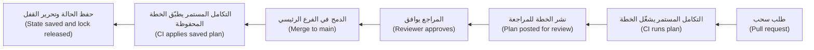

#### 🔴 نظرة الخبير (Expert view)
**نطاق الضرر وحدود الحالة (Blast radius and state boundaries).** حالة واحدة عملاقة للبنك كله تجعل كل خطة بطيئة، وكل تطبيق (apply) يُقفل الباب على الجميع، وكل خطأ قادرًا على المساس بكل شيء. قسّم الحالة حسب المكوّن والمالك: أسس الشبكة (network foundations)، وعنقود Kubernetes (Kubernetes cluster)، ومخازن بيانات كل تطبيق، وDNS. ومرّر القيم بين الحالات (between states) عبر مُخرجات تقرؤها مصادر البيانات (data sources)، أو عبر مخزن معاملات (parameter store).

**إعادة الهيكلة دون حذف (Refactoring without destroying).** نقل مورد إلى وحدة برمجية يغيّر عنوانه (address)، وعادةً سترى الأداة "حُذف العنوان القديم، وأُنشئ العنوان الجديد". أما كتلة `moved` فتخبرها بأن الكائن (object) صار له ببساطة اسم جديد:

```hcl
moved {
  from = aws_db_instance.payments
  to   = module.payments_db.aws_db_instance.this
}
```

وبالمثل، تُدخل كتل `import` الموارد الموجودة المبنية يدويًا تحت الإدارة (under management)، وتوقف كتل `removed` إدارة مورد ما دون حذفه. وتُراجَع هذه في الخطة مثل كل شيء آخر، بخلاف أمرَي سطر الأوامر (command-line) `state mv` و`state rm` اللذين يغيّران الحالة دون أي مراجعة. تحقّق من أن إصدارك يدعم كل كتلة.

**انضباط الإصدارات (Versioning discipline).** ثبّت إصدار الأداة (`required_version` وفي التكامل المستمر (CI))، والمزوّدات (القيود (constraints) مع ملف القفل)، والوحدات البرمجية (وسم (tag)، لا فرعًا متحرّكًا (moving branch) أبدًا). رقِّ (Upgrade) واحدًا في كل مرة، في بيئة التطوير أولًا: فترقية مزوّد (provider upgrade) تغيّر قيمة افتراضية (default) قد تُنتج خطة مليئة بتحديثات لم يطلبها أحد.

**البدائل (Alternatives).** تستخدم **Pulumi** لغات عامة الأغراض (general-purpose languages) مثل TypeScript أو Python أو Go، مع نموذج الحالة والخطة (state-and-plan model) نفسه. أما **AWS CloudFormation** و**Azure Bicep** فأصيلتان في سحابتيهما (وقد تغيّر العرض الأصيل (native offering) لدى Google Cloud مع الوقت؛ راجع توثيقه)؛ وكثيرًا ما تدعمان الخدمات الجديدة أولًا. يغطي Terraform وOpenTofu مزوّدات كثيرة (many providers) بسير عمل واحد (one workflow)، وهذا يناسب بنكًا يشغّل Kubernetes وDNS وشبكة توصيل محتوى (CDN) وGitHub وسحابة معًا. والمفاهيم (concepts) هنا تنتقل إليها جميعًا.

**وكلاء البرمجة بالذكاء الاصطناعي والبنية التحتية بوصفها شيفرة (AI coding agents and IaC).** يكتب الوكلاء (Agents) شيفرة HCL بسرعة، وقد "يصلحون" خطأً بتوسيع مجموعة أمان أو بإضافة صلاحية شاملة (wildcard permission). الخطة والماسحات (scanners) والسياسات (policies) (3.3) هي التي تقرّر، لا ثقة الوكيل (agent's confidence). ويغطي [*أمن الذكاء الاصطناعي والتطبيقات*، الدرس 7.2 — الحاويات وKubernetes والبنية التحتية بوصفها شيفرة](../secai/index.ar.html#/7.2) الفحوص الأمنية (security checks) بتعمّق.

### 🧰 الأدوات
| الأداة أو الممارسة أو الخدمة (Tool, practice or service) | ما هي وماذا تفعل | متى تلجأ إليها |
|---|---|---|
| **OpenTofu** (Linux Foundation) | أداة بنية تحتية بوصفها شيفرة تصريحية مفتوحة المصدر مشتقّة من Terraform؛ HCL والمزوّدات والحالة والخطط | الخيار الافتراضي (default choice) لأعمال IaC الجديدة مفتوحة المصدر ولتمارين هذه الدورة |
| **Terraform** (HashiCorp) | الأداة الأصلية (original) للبنية التحتية بوصفها شيفرة القائمة على HCL، تخضع لرخصة BSL منذ أغسطس 2023، ولها خدمة مستضافة (hosted service) هي HCP Terraform | حيث تكون مؤسستك قد اعتمدتها معيارًا أو تستخدم ميزاتها المستضافة (hosted features) |
| **Remote state with locking** — الحالة البعيدة مع القفل | تخزين حالة مشترك ومشفّر ومُدار الإصدارات يمنع عمليات التطبيق المتزامنة (concurrent applies) | أي تهيئة يلمسها أكثر من شخص واحد أو خط تسليم واحد |
| **IaC module** — وحدة البنية التحتية البرمجية | مجلد قابل لإعادة الاستخدام من الموارد بواجهة صغيرة مُتحقَّق منها وقيم افتراضية آمنة (safe defaults) | أي نمط يُبنى أكثر من مرتين: قواعد البيانات، وحاويات التخزين (buckets)، والعناقيد، والشبكات |
| **Pulumi** | البنية التحتية بوصفها شيفرة بلغات عامة الأغراض مع نموذج الخطة والحالة (plan-and-state model) نفسه | الفرق التي تفضّل لغات حقيقية (real languages) للبنية التحتية |

### 🏛️ عمليًا في بنك نجم
يطلب سالم من يوسف أن يكتب الواجهة (interface) لأول وحدة برمجية من نوع المسار الذهبي (golden-path module) في المنصة، كي تستطيع فرق التطبيقات (app teams) طلب قاعدة بيانات بملء ستة أسطر. هذا هو **معيار نجم للوحدات البرمجية للبنية التحتية (Najm IaC module standard): `postgres` v1**.

**الجزء أ: الواجهة (Part A: interface)**

| المُدخل | النوع والقيم المسموحة | القيمة الافتراضية | لماذا هو مُدخل |
|---|---|---|---|
| `name` | سلسلة نصية (string)، أحرف صغيرة وشَرطات، من 3 إلى 30 حرفًا | لا يوجد (مطلوب) | يبني المعرّف `najm-<name>-<environment>` |
| `environment` | `dev` أو `staging` أو `prod` | لا يوجد (مطلوب) | يحدّد حدود الحجم (size limits) والنسخ الاحتياطية (backups) والحماية (protection) |
| `size` | `small` أو `medium` أو `large` | `small` | يقابل فئة مثيل (instance class) لكل سحابة؛ لا تختار الفرق أنواع المثيلات الخام أبدًا |
| `data_class` | `internal` أو `confidential` أو `restricted` | `confidential` | التصنيف المقيَّد (Restricted) يفرض مفاتيح يديرها العميل (customer-managed keys) وتسجيلًا إضافيًا (extra logging) |
| `backup_days` | رقم (number)، من 7 إلى 35 | 7 في بيئة التطوير، و35 في الإنتاج (prod) | هدف التعافي (recovery target)؛ محدود بالحد الأقصى لدى المزوّد (provider's maximum) |
| `owner` | المعرّف المختصر للفريق (team slug) | لا يوجد (مطلوب) | يصبح الوسم `owner` للتنبيهات (alerts) وتقارير التكلفة (cost reports) (6.2) |

| المُخرج | الاستخدام (Use) |
|---|---|
| `endpoint` | اسم مضيف خاص (private hostname) لتهيئة التطبيق (application's configuration) |
| `secret_ref` | اسم مدخل مدير الأسرار (secrets-manager entry) الذي يحفظ بيانات الاعتماد المولّدة (generated credentials)؛ وليس كلمة المرور نفسها أبدًا |
| `dashboard_url` | رابط إلى لوحة المتابعة القياسية (standard dashboard) لقاعدة البيانات |

**الجزء ب: ما تثبّته الوحدة البرمجية ولا يمكن تهيئته (Part B: fixed by the module, not configurable)**
- شبكات خاصة فقط؛ لا نقطة نهاية عامة (public endpoint) أبدًا.
- التشفير أثناء التخزين (encryption at rest) وTLS أثناء النقل مُفعَّلان.
- حماية الحذف و`prevent_destroy` في `staging` و`prod`.
- بيانات اعتماد المسؤول (Admin credentials) تولّدها السحابة وتُخزَّن في مدير الأسرار؛ ولا يمرّ أيٌّ منها عبر المتغيّرات.
- الوسوم القياسية (Standard tags): `owner`، و`environment`، و`data-class`، و`cost-centre`، و`managed-by = opentofu`.

**الجزء ج: قواعد الحالة والتطبيق (Part C: state and apply rules)**
- حالة واحدة لكل مكوّن (`<team>/<service>/<component>.tfstate`)، وحاوية تخزين خلفية (backend bucket) واحدة لكل بيئة (per environment)؛ إدارة الإصدارات والتشفير مُفعَّلان؛ والوصول (access) مقصور على دور خط التسليم (pipeline role) ومهندسَين اثنين مسمَّيين لكسر الزجاج.
- عمليات التطبيق في الإنتاج تجري فقط من خط التسليم، ومن خطة محفوظة (saved plan)، بموافقة فريق المنصة والفريق المالك (owning team).
- أي `destroy` أو `must be replaced` على مورد ذي حالة (stateful resource) يحتاج إلى موافقة مها أو سالم.

### 🛠️ التمارين
تعمل الثلاثة كلها على جهازك باستخدام Docker وOpenTofu. وإن اخترت بدلًا من ذلك الفئة المجانية (free tier) لدى سحابة ما، فاضبط تنبيه ميزانية (budget alert) قبل إنشاء أي شيء.

- 🟢 استخدم تهيئة Docker (Docker configuration) من 🟢 الأساسيات. شغّل `init` و`plan -out=tfplan` و`apply tfplan`، وتحقّق من الصفحة على المنفذ (port) 8080، ثم غيّر المنفذ الخارجي (external port) واقرأ الخطة الجديدة. وأخيرًا شغّل `plan` مرة أخرى دون تغيير أي شيء. *يكتمل عندما (Done when):* تستطيع الإشارة إلى السطر الذي يقول هل ستُحدَّث الحاوية في مكانها أم ستُستبدل (replaced)، وتُبلغ الخطة الأخيرة بعدم وجود تغييرات.
- 🟡 حوّل التهيئة إلى وحدة برمجية `modules/web` بمُدخلات مُتحقَّق منها (validated inputs) هي `name` و`port` و`image_tag`، واستدعِها مرتين لتشغيل حاويتين (two containers). استخدم كتلة `moved` للحاوية الأصلية (original container). *يكتمل عندما:* يفشل منفذ غير صالح (invalid port) عند `plan` برسالة الخطأ التي كتبتها، وتُظهر خطة إعادة الهيكلة (refactor plan) نقلًا (move) دون أي حذف (zero destroys).
- 🔴 شغّل مخزن كائنات متوافقًا مع S3 (S3-compatible object store) محليًا في Docker (MinIO أو بديلًا عنه؛ تحقّق من رخصته الحالية (current licence) وصوره)، واستخدمه واجهة تخزين خلفية بعيدة مقفلة. ابدأ عمليتي تطبيق (two applies) في الوقت نفسه من طرفيتين (two terminals). ثم أضف `prevent_destroy` إلى إحدى الحاويتين وغيّر اسمها، وهو ما يفرض الاستبدال (forces replacement). *يكتمل عندما:* يُرفض التطبيق الثاني بسبب القفل، وتُرفض خطة الاستبدال المفروض (forced-replacement plan) بخطأ `prevent_destroy`، ولا يوجد ملف حالة في مجلد العمل (working directory).

### ⚠️ أخطاء وفخاخ (Mistakes and traps)
- **تصفّح الخطة على عجل (Skimming the plan).** اقرأ سطر الملخّص وكل `-` و`-/+` قبل الموافقة. اجعل خط التسليم ينشر الخطة داخل طلب السحب كي لا يستطيع المراجعون (reviewers) تجاوزها.
- **الحالة في Git أو على حاسوب محمول (State in Git or on a laptop).** قد تحمل الحالة أسرارًا، وهي الخريطة الوحيدة لما تملكه. استخدم واجهة تخزين خلفية (backend) بعيدة ومقفلة ومشفّرة ومُدارة الإصدارات بوصول ضيّق.
- **تشغيل `apply` جديد بدل الخطة التي رُوجعت (Running a fresh apply instead of the reviewed plan).** ربما تغيّر الواقع (reality) في الأثناء. طبّق ملف الخطة المحفوظ، أو أعد التخطيط وأعد المراجعة.
- **وحدات برمجية ومزوّدات غير مثبّتة الإصدار (Unpinned modules and providers).** إنها تغيّر بنيتك التحتية دون تغيير في الشيفرة (code change). ثبّت الإصدارات وأودِع ملف القفل (lock file).
- **جراحة الحالة في الثانية فجرًا ⁦(State surgery at 2 a.m.)⁩.** أمر `state rm` غير المراجَع (unreviewed) يُفقدك تتبّع موارد حقيقية (real resources). استخدم كتل `moved` و`import` و`removed` في طلب سحب.

### 🧾 الخلاصة (Recap)
- تحوّل البنية التحتية بوصفها شيفرة البنية التحتية إلى شيفرة مُراجَعة ومُدارة الإصدارات وقابلة للتكرار؛ والأدوات التصريحية (declarative tools) مثل Terraform وOpenTofu تحسب التغييرات نيابةً عنك.
- تربط الحالة الشيفرة بالموارد الحقيقية. احفظها بعيدة ومقفلة ومشفّرة ومضبوطة الوصول، وقسّمها حسب المكوّن للحدّ من نطاق الضرر (blast radius).
- الخطة هي شبكة الأمان (safety net): احفظها، وراجعها في طلب السحب، وطبّق تلك الخطة بعينها من خط تسليم ببيانات اعتماد قصيرة العمر (short-lived credentials).
- الوحدات البرمجية هي منتج فريق المنصة: واجهات صغيرة مُتحقَّق منها، وقيم افتراضية آمنة، وإصدارات مثبّتة (pinned versions).
- احمِ الموارد ذات الحالة بـ `prevent_destroy` وبحماية الحذف لدى المزوّد، وأعد الهيكلة (refactor) بكتل `moved` و`import` و`removed`.

### ✍️ اختبر نفسك (Check yourself)

**1. يعيد يوسف تسمية معرّف (identifier) قاعدة بيانات المدفوعات الإنتاجية (production payments database) في شيفرة Terraform. تُظهر الخطة (plan) `-/+` و`# forces replacement` لقاعدة البيانات. ماذا سيحدث إذا طُبّقت هذه الخطة؟**

- A. تُعاد تسمية قاعدة البيانات في مكانها دون أي توقف
- B. تُحذف قاعدة البيانات وتُستبدل بقاعدة جديدة فارغة
- C. لا شيء، لأن Terraform لا يحذف قواعد البيانات أبدًا
- D. يُحدَّث ملف الحالة (state file) فقط، وتبقى قاعدة البيانات الحقيقية (real database) دون مساس

<details><summary>الإجابة</summary>

**B.** تعني `-/+` الحذف ثم إنشاء بديل، ويقول التعليق (comment) أيّ سمة (attribute) تفرض ذلك. الخيار A هو ما افترضه يوسف؛ والخيار C خاطئ ما لم تُضبط `prevent_destroy` أو حماية الحذف (deletion protection). (🟢 الأساسيات، و🧭 لماذا يهم.)

</details>

**2. لماذا يجب تخزين ملف الحالة (state file) لـ Terraform أو OpenTofu في واجهة تخزين خلفية (backend) مقفلة ومشفّرة ومضبوطة الوصول (locked, encrypted, access-controlled) بدل إيداعه في Git؟**

- A. لا يستطيع Git تخزين ملفات أكبر من ميغابايت واحد، وملفات الحالة (state files) كثيرًا ما تتجاوز ذلك
- B. لا تُحتاج ملفات الحالة (state files) إلا أثناء التطبيق الأول (first apply)
- C. ترفض المزوّدات (providers) العمل إذا كانت الحالة في مستودع (repository)
- D. قد تحمل الحالة أسرارًا بنص صريح (plain-text secrets)، وقد تُفسدها عمليات الكتابة المتزامنة غير المقفلة

<details><summary>الإجابة</summary>

**D.** تنتهي السمات الحساسة (sensitive attributes) في الحالة (state) بصرف النظر عن العلامة `sensitive`، والقفل (locking) يمنع تشغيلين من الكتابة في آن واحد. الخيار B خاطئ: فالحالة مطلوبة في كل تشغيل (every run). (🟡 التعمق أكثر (Going deeper).)

</details>

**3. يشغّل خط تسليم (pipeline) الأمر `plan` عند فتح طلب سحب (pull request). يُوافَق على طلب السحب ويُدمج بعد ثلاث ساعات، ثم يشغّل خط التسليم `apply` جديدًا (fresh) دون خطة محفوظة (saved plan). ما الخطر؟**

- A. إنه يعيد التخطيط (re-plans) مقابل الشيفرة والواقع الحاليين، لذا قد يطبّق تغييرات لم تُراجَع
- B. لا يوجد خطر، لأن `apply` يكرّر دائمًا أحدث خطة شغّلها خط التسليم (pipeline)
- C. سيفشل التطبيق، لأن كل خطة تنتهي صلاحيتها بعد ساعة من تشغيل `plan`
- D. سيُحذف ملف الحالة (state file) بالكامل من الواجهة الخلفية البعيدة (remote backend)

<details><summary>الإجابة</summary>

**A.** التطبيق الجديد (fresh apply) يحسب خطة جديدة. وحفظ الخطة باستخدام `-out` ثم تطبيق ذلك الملف يعني أن التغييرات المُراجَعة هي التغييرات المطبَّقة. الخيار B هو سوء الفهم الشائع (common misunderstanding). (🟡 التعمق أكثر (Going deeper).)

</details>

**4. يريد سالم أن تنشئ فرق التطبيقات (app teams) قواعد بيانات PostgreSQL تكون دائمًا خاصة ومشفّرة ومدعومة بنسخ احتياطية (private, encrypted and backed up). أيّ تصميم يحقّق ذلك على أفضل وجه؟**

- A. صفحة ويكي (wiki page) تسرد الإعدادات الموصى بها (recommended settings)، مرتبطة من دليل الإعداد (onboarding guide) لكل فريق
- B. وحدة برمجية (module) تكشف كل وسيطات المزوّد متغيّراتٍ كي تحظى الفرق بمرونة كاملة (full flexibility)
- C. وحدة برمجية بواجهة صغيرة مُتحقَّق منها وإعدادات الأمان مثبّتة داخلها
- D. منح كل فريق صلاحية المسؤول (administrator access) على وحدة التحكم السحابية (cloud console)

<details><summary>الإجابة</summary>

**C.** تثبيت القيم الافتراضية الآمنة (safe defaults) داخل الوحدة البرمجية يجعل التهيئة الصحيحة (right configuration) هي الوحيدة المتاحة. الخيار B يعيد إنتاج عدم الاتساق (inconsistency) الذي ينبغي للوحدة أن تزيله؛ والخيار A يعتمد على أن يقرأه الجميع ويتّبعوه. (🟡 التعمق أكثر (Going deeper)، و🏛️ عمليًا.)

</details>

**5. ينقل فريق المنصة (platform team) مورد قاعدة بيانات موجودًا (existing database resource) إلى وحدة برمجية جديدة (new module). تُظهر الخطة حذف العنوان القديم (old address) وإنشاء عنوان جديد. ما الإصلاح الأكثر أمانًا (safest fix)؟**

- A. طبّقها في ساعة هادئة (quiet hour) واستعد من النسخة الاحتياطية بعد ذلك
- B. أضف كتلة `moved` من العنوان القديم (old address) إلى العنوان الجديد (new address)
- C. احذف ملف الحالة (state file) وشغّل `import` من سطر الأوامر (command line) لكل مورد
- D. انسخ شيفرة الوحدة البرمجية (module code) عائدًا إلى التهيئة الجذرية (root configuration) بصورة دائمة

<details><summary>الإجابة</summary>

**B.** تسجّل كتلة `moved` إعادة التسمية تصريحيًا وتُراجَع في الخطة. الخيار A يسبّب انقطاعًا (outage) وفقدانًا للبيانات (data loss)؛ والخيار C جراحة حالة (state surgery) خطرة غير مُراجَعة. (🔴 نظرة الخبير (Expert view).)

</details>

### 📚 المراجع (References)
- توثيق OpenTofu (OpenTofu documentation) — https://opentofu.org/docs/
- توثيق Terraform (Terraform documentation) — https://developer.hashicorp.com/terraform/docs
- لغة Terraform: الحالة — https://developer.hashicorp.com/terraform/language/state
- لغة Terraform: الوحدات البرمجية — https://developer.hashicorp.com/terraform/language/modules
- HashiCorp، الأسئلة الشائعة حول الترخيص (licensing FAQ) (رخصة المصدر التجاري) — https://www.hashicorp.com/
- Linux Foundation، مشروع OpenTofu (OpenTofu project) — https://opentofu.org/
- توثيق Pulumi (Pulumi documentation) — https://www.pulumi.com/docs/

<a id="l3-2"></a>

## 3.2 — البيئات وGitOps: ترقية التغييرات من بيئة التطوير إلى الإنتاج

*المستوى: 🟡 متوسط* · *المتطلبات: 2.2، 2.3، 3.1* · *المرحلة (Phase): Release, Deploy*

### ⚡ الدرس في دقيقة (In 60 seconds)
- **البيئة (environment)** (التطوير، وما قبل الإنتاج، والإنتاج) نسخة كاملة من النظام لغرض محدّد. ينبغي ألّا تختلف البيئات إلا في التهيئة والحجم، ولا تختلف أبدًا في الشيفرة أو البنية.
- **ابنِ مرة واحدة، ورقِّ الأثر البرمجي نفسه (Build once, promote the same artefact).** بصمة الصورة (image digest) نفسها التي اختُبرت في بيئة ما قبل الإنتاج هي التي تصل إلى الإنتاج؛ ولا يُعاد بناء شيء على طول الطريق.
- تعني **GitOps** أن الحالة المرغوبة (desired state) لكل بيئة تعيش في Git، وأن وكيلًا (agent) داخل المنصة يسحبها ويجعل الواقع مطابقًا لها باستمرار. مبادئه الأربعة (four principles): تصريحي، ومُدار الإصدارات وغير قابل للتغيير (versioned and immutable)، ويُسحب آليًا (pulled automatically)، ويُوفَّق باستمرار (continuously reconciled).
- **الترقية (promotion)** طلب سحب يغيّر قيمة واحدة (عادةً بصمة صورة) في مجلد البيئة التالية. راجِع، وادمج، ويتولّى **Argo CD** أو **Flux** الباقي؛ أما **التراجع (rollback)** فهو `git revert`.
- إشارة القرار (Decision cue): إن لم تستطع الإجابة عن سؤال "ما الذي يعمل في الإنتاج بالضبط، ومن وافق عليه؟" من Git وحده، فأنت لا تمارس GitOps بعد.
- الفخ الأكبر: فروع طويلة العمر لكل بيئة، وتعديلات يدوية (hand edits) بـ `kubectl` تكتب فوقها المزامنة التالية (next sync) بصمت، أو لا يلاحظها أحد أبدًا.

### 🧭 لماذا يهم
في 1 أغسطس 2012 نشرت Knight Capital، وهي شركة أمريكية كبيرة لصناعة السوق (market-making firm)، شيفرة تداول جديدة على خوادمها. ووفقًا لأمر هيئة الأوراق المالية والبورصات الأمريكية في القضية، نسخ فنّيٌّ (technician) الشيفرة الجديدة إلى سبعة من الخوادم الثمانية ولم ينسخها إلى الثامن، ولم يلاحظ أحد. وأعاد الإصدار الجديد (new release) استخدام علامة (flag) شغّلت على الخادم الثامن شيفرةً قديمة متروكة منذ زمن طويل. فأرسل ذلك الخادم ملايين الأوامر غير المقصودة (unintended orders) خلال نحو 45 دقيقة، وخسرت الشركة قرابة 460 مليون دولار، وفقًا للهيئة (SEC). كان النشر يدويًا (manual deployment)، ولم يكن هناك فحص آلي (automated check) يتحقّق من أن كل خادم يشغّل الإصدار نفسه (same version)، ولم يراجع شخص ثانٍ (second person) النتيجة.

لدى بنك نجم نسخة أصغر من المشكلة نفسها. تحقّق مها في سبب استمرار خلل مهلة (timeout bug) أُصلح في بيئة ما قبل الإنتاج في الظهور في الإنتاج. فالإنتاج يشغّل صورة (image) من الالتزام (commit) نفسه لكنها أُعيد بناؤها بعد يومين بصورة أساس (base image) أحدث، كما أن أحدهم رفع حجم مجمّع الاتصالات (connection-pool size) باستخدام `kubectl edit` أثناء حادثة (incident) الشهر الماضي. ولا شيء في Git يسجّل أيًّا من الاختلافين، فلم تعد بيئة ما قبل الإنتاج تتنبّأ بسلوك الإنتاج.

يمنح هذا الدرس الفريق قاعدة واحدة (one rule) وآلية واحدة (one mechanism). القاعدة: الأثر البرمجي (artefact) نفسه ينتقل عبر كل بيئة، ولا تختلف إلا التهيئة. والآلية: GitOps، حيث يكون Git السجلّ الوحيد (single record) لما ينبغي أن يعمل وأين، ويجعل متحكّمٌ (controller) ذلك واقعًا ويُبلغ عن أي اختلاف (difference).

### 📐 كيف يعمل
#### 🟢 الأساسيات
**لماذا البيئات (Why environments).** تحتاج إلى مكان تجرّب فيه التغييرات ليس هو الإنتاج. يستخدم بنك نجم ثلاث بيئات:

| البيئة | الغرض (Purpose) | البيانات (Data) | من ينشر |
|---|---|---|---|
| **dev** — التطوير | دمج التغييرات وتجربتها بسرعة | بيانات اختبار اصطناعية | آليًا عند كل دمج |
| **staging** — ما قبل الإنتاج | بروفة نهائية (Final rehearsal) بتهيئة وحجم شبيهين بالإنتاج | بيانات مُقنَّعة أو اصطناعية، ولا بيانات عملاء حقيقية (real customer data) أبدًا دون موافقة | طلب سحب للترقية (Promotion pull request)، بموافقة الفريق (team approval) |
| **prod** — الإنتاج | العملاء (Customers) | بيانات حقيقية (Real data) | طلب سحب للترقية، بموافقة الفريق والمنصة |

**تكافؤ البيئات (Environment parity).** يسمّي منهج التطبيق ذي العوامل الاثني عشر (Twelve-Factor App) ذلك "تكافؤ التطوير والإنتاج (dev/prod parity)": أبقِ البيئات متشابهة قدر الإمكان. ولا يُسمح بالاختلافات إلا حيث تكون مقصودة ومكتوبة: أعداد النسخ المتماثلة (replica counts)، وأحجام المثيلات (instance sizes)، وأسماء النطاقات (domain names)، وبيانات الاعتماد (credentials)، وإعدادات أعلام الميزات (feature-flag settings). أما اختلاف الشيفرة، أو الصور (images)، أو إصدارات Kubernetes، أو تخطيطات الشبكة (network layouts)، فيجعل نتائج بيئة ما قبل الإنتاج (staging results) بلا معنى.

**ابنِ مرة واحدة، ورقِّ الأثر البرمجي (Build once, promote the artefact).** يبني التكامل المستمر صورة الحاوية (container image) مرة واحدة، من التزام واحد، ويدفعها (pushes) إلى السجل (registry). وتُعرَّف الصورة ببصمتها (**digest**)، وهي تجزئة SHA-256 (SHA-256 hash) لمحتواها مثل `sha256:4f1c…`، لا بوسم مثل `v2.3` أو `latest`، لأن الوسم يمكن نقله إلى صورة مختلفة أما البصمة فلا (2.1). ثم تشغّل كل بيئة تلك البصمة. أما إعادة البناء للإنتاج، كما في حالة مها، فتُنتج أثرًا برمجيًا مختلفًا (different artefact) لم يختبره أحد.

**ما هو GitOps (What GitOps is).** يحدّد مشروع OpenGitOps، التابع لـ CNCF، أربعة مبادئ:
- **تصريحي (Declarative)**: تُوصَف الحالة المرغوبة للنظام، ولا تُكتب في سكربت.
- **مُدار الإصدارات وغير قابل للتغيير (Versioned and immutable)**: يُخزَّن ذلك الوصف بطريقة تحفظ التاريخ الكامل (full history) ولا يمكن تغييرها بصمت، وهذا يعني عمليًا Git.
- **يُسحب آليًا (Pulled automatically)**: تجلب وكلاء برمجية (software agents) الحالة المرغوبة من المصدر (source)؛ ولا يدفع أحد التغييرات إلى العنقود (cluster) يدويًا.
- **يُوفَّق باستمرار (Continuously reconciled)**: تواصل الوكلاء مقارنة الحالة الفعلية (actual state) بالحالة المرغوبة وتعمل على سدّ أي فجوة.

أشهر متحكّمَي GitOps (GitOps controllers) لـ Kubernetes هما **Argo CD** و**Flux**، وكلاهما مشروع متخرّج (graduated) في CNCF. يعمل كلٌّ منهما داخل العنقود، ويراقب مستودع Git (Git repository)، ويطبّق ما يجده.

**الدفع مقابل السحب (Push versus pull).** في خط تسليم *الدفع (push)* التقليدي، يحمل التكامل المستمر بيانات اعتماد العنقود (cluster credentials) ويشغّل `kubectl apply` أو `helm upgrade` في النهاية. أما في GitOps القائم على *السحب (pull)*، فلا يلمس التكامل المستمر العنقود أبدًا: إنه يحدّث Git فقط. والمتحكّم داخل العنقود هو الذي يسحب. وهذا يعني بيانات اعتماد قوية (powerful credentials) أقل خارج العنقود، ومسار تدقيق كاملًا في Git، وتصحيحًا آليًا (automatic correction) حين يغيّر أحدهم العنقود يدويًا.

```mermaid
flowchart RL
    A["التزام في مستودع التطبيق<br/>(Commit to app repo)"] --> B["التكامل المستمر يبني الصورة ويختبرها<br/>(CI builds and tests image)"]
    B --> C["السجل يخزّن الصورة ببصمتها<br/>(Registry stores image by digest)"]
    C --> D["طلب سحب يرفع البصمة في مجلد التطوير<br/>(PR bumps digest in dev folder)"]
    D --> E["أرغو سي دي يزامن بيئة التطوير<br/>(Argo CD syncs dev)"]
    E --> F["طلب سحب يرقّي البصمة إلى ما قبل الإنتاج<br/>(PR promotes digest to staging)"]
    F --> G["أرغو سي دي يزامن بيئة ما قبل الإنتاج<br/>(Argo CD syncs staging)"]
    G --> H["طلب سحب معتمد يرقّي إلى الإنتاج<br/>(Approved PR promotes to prod)"]
    H --> I["أرغو سي دي يزامن بيئة الإنتاج<br/>(Argo CD syncs prod)"]
```

#### 🟡 التعمق أكثر
**مستودعان (Two repositories).** يفصل بنك نجم شيفرة مصدر التطبيق عن تهيئة البيئات (environment configuration):
- يحفظ **مستودع التطبيق (app repo)** شيفرة واجهة الهاتف (Mobile API) وملف Dockerfile والاختبارات (tests)؛ ويبني التكامل المستمر الصور منه؛
- ويحفظ **مستودع GitOps (GitOps repo)** ما يعمل وأين: بيانات Kubernetes الوصفية (Kubernetes manifests) أو قيم Helm (Helm values) لكل بيئة.

وعندئذ لا تُطلق تغييرات التهيئة (configuration changes) أي عمليات بناء (builds)، ويمكن أن تختلف صلاحيات الوصول، ويكون تاريخ GitOps (GitOps history) سجلًا نظيفًا لعمليات النشر.

**مجلدات لا فروع لكل بيئة (Folders, not branches, per environment).** يحتفظ تصميم مبكر شائع بفرع `dev` وفرع `staging` وفرع `prod` ويدمج بينها. ويوصي كثير من الممارسين (practitioners) بعدم ذلك: فعمليات الدمج (merges) تحمل معها تغييرات لا علاقة لها، والفروع تتباعد (drift apart)، والاختلافات بين البيئات تختبئ في تاريخ Git (Git history) بدل أن تكون ظاهرة في الملفات. يستخدم بنك نجم فرعًا واحدًا `main` ومجلدًا واحدًا لكل بيئة (one folder per environment)، مبنيًّا بأداة **Kustomize**، وهي أداة مدمجة في `kubectl` تضع رقعًا صغيرة (small patches) طبقاتٍ فوق قاعدة مشتركة (shared base):

```text
gitops/
  apps/mobile-api/
    base/                 # Deployment, Service, probes: shared by all environments
      deployment.yaml
      service.yaml
      kustomization.yaml
    overlays/
      dev/kustomization.yaml
      staging/kustomization.yaml
      prod/kustomization.yaml
      prod/replicas.yaml
```

ولا تذكر طبقة الإنتاج (production overlay) إلا ما يختلف:

```yaml
apiVersion: kustomize.config.k8s.io/v1beta1
kind: Kustomization
resources:
  - ../../base
images:
  - name: registry.najm.example/mobile-api
    digest: sha256:4f1c0e…   # the promoted artefact; set by the promotion PR
patches:
  - path: replicas.yaml       # 6 replicas in prod, 2 in staging
```

وإن كانت خدماتك تستخدم Helm بدلًا من ذلك (2.3)، فالنمط نفسه (same pattern) يبقى قائمًا: مخطّط (chart) واحد، وملف قيم (values file) واحد لكل بيئة، وبصمة الصورة في ملف القيم.

**الترقية طلب سحب (Promotion is a pull request).** ترقية واجهة الهاتف من بيئة ما قبل الإنتاج إلى الإنتاج تعني نسخ بصمة واحدة (one digest) من `overlays/staging` إلى `overlays/prod`. ويفتح سكربت صغير أو روبوت طلب السحب ذلك آليًا بعد اجتياز فحوص بيئة ما قبل الإنتاج (staging checks). يُظهر طلب السحب بالضبط ما يتغيّر، وتفرض قواعد CODEOWNERS (CODEOWNERS rules) الموافقين المناسبين (right approvers)، ويكون الدمج (merging) هو قرار الإطلاق (release decision). ويمكن لأدوات مثل Argo CD Image Updater وأتمتة الصور في Flux أن تكتب رفع البصمة في بيئة التطوير (dev bump) نيابةً عنك؛ أما ترقيات الإنتاج (production promotions) فأبقِها طلبات سحب صريحة مُراجَعة.

**إخبار Argo CD بما يراقبه (Telling Argo CD what to watch).** يشير كائن `Application` في Argo CD إلى مجلد (folder) وعنقود:

```yaml
apiVersion: argoproj.io/v1alpha1
kind: Application
metadata:
  name: mobile-api-prod
  namespace: argocd
spec:
  project: retail
  source:
    repoURL: https://git.najm.example/platform/gitops.git
    targetRevision: main
    path: apps/mobile-api/overlays/prod
  destination:
    server: https://kubernetes.default.svc
    namespace: mobile-api
  syncPolicy:
    automated:
      prune: true     # delete objects removed from Git
      selfHeal: true  # undo manual changes made in the cluster
```

يزيل `prune` الكائنات (objects) التي حُذفت من Git؛ ويعيد `selfHeal` التعديلات اليدوية إلى ما كانت عليه. ومع تفعيل الاثنين، كان `kubectl edit` الذي وجدته مها سيُلغى خلال دقائق، وسيظهر في الأثناء بحالة "OutOfSync". ويعبّر Flux عن الفكرة نفسها بكائنَي `GitRepository` و`Kustomization`.

**التراجع (Rollback).** لأن كل عملية نشر (deployment) التزامٌ، فإن التراجع (rolling back) هو `git revert` لطلب سحب الترقية: تعود البصمة القديمة (old digest)، ويُزامِن المتحكّم (controller syncs)، ويسجّل التاريخ من تراجع ولماذا. التراجع عن *الشيفرة* سهل؛ أما التراجع عن *مخطّط قاعدة البيانات (database schema)* فليس كذلك، ولذا تتبع تغييرات المخطّط (schema changes) نمط التوسيع ثم التقليص (expand-and-contract pattern) الذي يُغطّى مع استراتيجيات الإطلاق (release strategies) (4.2).

**الأسرار في GitOps (Secrets in GitOps).** يجب ألّا يحتوي مستودع GitOps على أسرار صريحة (plain secrets)، وكائنات Secrets في Kubernetes مُرمَّزة بـ base64 فقط (only base64-encoded)، وليست مشفّرة (2.3). الأنماط الشائعة (Common patterns): **External Secrets Operator**، الذي يزامن القيم من مدير أسرار سحابي (cloud secrets manager) إلى العنقود، مع وجود مرجع (reference) فقط في Git؛ و**Sealed Secrets** أو **SOPS**، اللذان يخزّنان قيمًا مشفّرة (encrypted values) في Git لا يستطيع فكّ تشفيرها إلا العنقود. يستخدم بنك نجم مراجع إلى مدير الأسرار الخاص به؛ انظر [*أمن الذكاء الاصطناعي والتطبيقات*، الدرس 5.2 — إدارة الأسرار: المفاتيح والرموز وأين تتسرّب](../secai/index.ar.html#/5.2).

#### 🔴 نظرة الخبير
**بيئات للبنية التحتية أيضًا (Environments for infrastructure, too).** تتولّى متحكّمات GitOps ما يعمل *داخل (inside)* Kubernetes. أما العناقيد وقواعد البيانات والشبكات التي تحتها فتُدار بـ OpenTofu (3.1)، وتنطبق القواعد نفسها: مجلد واحد لكل بيئة يستدعي إصدارات الوحدات البرمجية نفسها، فيكون الفرق بين بيئة ما قبل الإنتاج والإنتاج قائمةً قصيرة مقروءة من المُدخلات. تتيح **مساحات العمل (workspaces)** في Terraform لتهيئة واحدة (one configuration) أن تحتفظ بعدة حالات (several states)، لكنها تخفي البيئة التي أنت فيها خلف إعداد في سطر الأوامر (command-line setting) وتجعل التطبيق على البيئة الخاطئة سهلًا؛ أما المجلدات والواجهات الخلفية (backends) وبيانات الاعتماد المنفصلة لكل بيئة فأوضح. وتستخدم بعض الفرق أغلفة (wrappers) مثل Terragrunt، أو متحكّمات تشغّل البنية التحتية بوصفها شيفرة عبر GitOps (متحكّم Tofu المجتمعي لـ Flux، وCrossplane)؛ قيّمها بعناية مقابل خط التسليم الأبسط (simpler pipeline) في 3.1.

**حسابات منفصلة، لا مجرد فضاءات أسماء (Separate accounts, not just namespaces).** ضع الإنتاج في حسابه السحابي الخاص (AWS)، أو اشتراكه (subscription) (Azure)، أو مشروعه (project) (Google Cloud)، بحدود هوية خاصة به. خط تسليم بيئة التطوير (dev pipeline) الذي لا تستطيع بيانات اعتماده حتى رؤية الإنتاج لا يمكنه أن يكسره.

**الترتيب والاعتماديات (Ordering and dependencies).** نادرًا ما تقتصر الترقيات الحقيقية (real promotions) على خدمة واحدة. تتيح موجات المزامنة (sync waves) في Argo CD و`dependsOn` في Flux ترتيب الموارد (order resources)، مثل تغيير تهيئة (configuration change) قبل كائن Deployment الذي يحتاجه. ويولّد **ApplicationSet** في Argo CD كائن `Application` واحدًا لكل بيئة أو عنقود من قالب (template)، وهذا يُبقي خمسين عنقودًا متّسقة (consistent). أبقِ التغييرات العابرة للخدمات (cross-service changes) متوافقة مع الإصدارات السابقة (backward compatible) كي يمكن ترقية كل خدمة وحدها؛ فالترقيات المترابطة (coupled promotions) علامة على عيب في التصميم (design smell).

**البيانات الوصفية المُصيَّرة (Rendered manifests).** حين يُصيِّر Helm أو Kustomize النتيجة على نحو مختلف عمّا توقّعت، لا يُظهر الفرق (diff) في طلب السحب إلا تغيير المُدخل (input change). وتُصيِّر بعض الفرق ملف YAML النهائي (final YAML) في التكامل المستمر وتودِعه (أو تنشر الفرق المُصيَّر (rendered diff) في طلب السحب) كي يرى المراجعون بالضبط ما سيتلقّاه العنقود. يكلّف ذلك بعض الضجيج في المستودع (repository noise) ويشتري الوضوح (clarity).

**التنظيم (Regulation).** بالنسبة إلى بنك، يكون تاريخ GitOps دليلًا (evidence): من وافق على أيّ تغيير في الإنتاج، ومتى، وما الذي نُشر بالضبط. ويتوقّع قانون المرونة التشغيلية الرقمية الأوروبي (EU DORA)، الذي يسري على الكيانات المالية (financial entities) في الاتحاد الأوروبي منذ يناير 2025، إدارةً موثّقة لتغييرات تقنية المعلومات والاتصالات؛ كما تضع الجهات التنظيمية في دول الخليج (GCC regulators) مثل مصرف قطر المركزي (Qatar Central Bank) توقّعات بشأن ضبط التغيير (change control) واستخدام السحابة (cloud use). راجع النصوص الحالية (current texts) مع فريق الامتثال (compliance team) بدل الاعتماد على الملخّصات (summaries).

### 🧰 الأدوات
| الأداة أو الممارسة أو الخدمة | ما هي وماذا تفعل | متى تلجأ إليها |
|---|---|---|
| **Argo CD** (متخرّج في CNCF) | متحكّم GitOps (GitOps controller) لـ Kubernetes بواجهة ويب (web UI)، وحالة مزامنة (sync status)، وعرض للفروق (diff view)، وموجات مزامنة، وApplicationSets | الفرق التي تريد حالة مزامنة مرئية وواجهة مستخدم (UI)؛ وعناقيد كثيرة من قوالب |
| **Flux** (متخرّج في CNCF) | مجموعة أدوات من متحكّمات GitOps لـ Kubernetes (مصادر Git (Git sources)، وKustomize، وHelm، وأتمتة الصور) | الفرق التي تفضّل نهجًا قابلًا للتركيب (composable approach) يقوده سطر الأوامر والموارد المخصّصة |
| **Kustomize** | يضع رقعًا خاصة بكل بيئة (environment-specific patches) طبقاتٍ فوق بيانات Kubernetes الوصفية المشتركة؛ مدمج في `kubectl` | مجلد واحد لكل بيئة باختلافات قليلة مقروءة |
| **Helm** | يحزم بيانات Kubernetes الوصفية في مخطّطات (charts) مع ملفات قيم (values files) | الخدمات المحزومة أصلًا في مخطّطات؛ ملف قيم واحد لكل بيئة |
| **Promotion pull request** — طلب سحب الترقية | تغيير مُراجَع (reviewed change) ينسخ بصمة صورة من مجلد بيئة إلى التالية | كل خطوة نحو الإنتاج؛ قرار الإطلاق |
| **External Secrets Operator** | يزامن الأسرار (syncs secrets) من مدير أسرار سحابي إلى Kubernetes، ولا يُبقي في Git إلا المراجع | أي إعداد GitOps (GitOps setup) يحتاج إلى أسرار |

### 🏛️ عمليًا في بنك نجم
يكتب سالم **سياسة نجم للبيئات والترقية، الإصدار 1 (Najm Environment and Promotion Policy v1)**، بدءًا بـ واجهة برمجة تطبيق نجم للهاتف.

**الجزء أ: البيئات (Part A: environments)**

| | التطوير | ما قبل الإنتاج | الإنتاج |
|---|---|---|---|
| الحدّ السحابي (Cloud boundary) | حساب مشترك لغير الإنتاج | حساب خاص (Own account) | حساب خاص بهوية منفصلة |
| العنقود | عنقود تطوير مشترك | عنقود ما قبل الإنتاج (Staging cluster)، بإصدار Kubernetes الفرعي نفسه للإنتاج | عنقود الإنتاج (Prod cluster)، متعدّد المناطق (multi-zone) |
| البيانات | اصطناعية (Synthetic) | اصطناعية أو مُقنَّعة (Synthetic or masked) | حقيقية (Real) |
| الاختلافات المسموحة عن الإنتاج | النسخ المتماثلة (Replicas)، والأحجام (sizes)، والنطاق (domain)، وبيانات الاعتماد، والأعلام (flags) | النسخ المتماثلة، والنطاق، وبيانات الاعتماد | — |
| مزامنة Argo CD | آلية، مع الحذف والإصلاح الذاتي (Automated, prune and self-heal) | آلية، مع الحذف والإصلاح الذاتي | آلية، مع الحذف والإصلاح الذاتي؛ والتغييرات فقط عبر طلب سحب معتمد (approved PR) |
| من يستطيع الدمج | أي عضو في الفريق | قائد الفريق (Team lead) | قائد الفريق ومهندس المنصة؛ وتحتاج المدفوعات (Payments) أيضًا إلى مها |

**الجزء ب: قواعد الترقية (Part B: promotion rules)**
1. يبني التكامل المستمر صورة واحدة لكل التزام، ويوقّعها (signs it) (4.3)، ويسجّل بصمتها (digest). ولا تعيد أي بيئة البناء.
2. الدمج في `main` بمستودع التطبيق يفتح طلب سحب آليًا من روبوت يضبط البصمة في `overlays/dev`؛ ويُدمج آليًا إذا اجتازت الفحوص (checks pass).
3. الترقية إلى بيئة ما قبل الإنتاج والإنتاج تنسخ البصمة *نفسها (same)*، عبر طلب سحب، بعد اجتياز فحوص البيئة السابقة (اختبارات الدخان (smoke tests)، واستهلاك هدف مستوى الخدمة (SLO burn) ضمن الحدود لمدة 30 دقيقة).
4. تجري ترقيات الإنتاج في نافذة الإطلاق المتّفق عليها؛ وخارجها يستطيع قائد الحادثة (incident commander) الموافقة على ترقية طارئة (emergency promotion)، تُسجَّل في طلب السحب.
5. التراجع هو إلغاء (revert) طلب سحب الترقية. ولا أحد يشغّل `kubectl edit` أو `kubectl apply` أو `helm upgrade` على بيئة ما قبل الإنتاج أو الإنتاج.
6. كسر الزجاج (Break-glass): أثناء حادثة من الدرجة الأولى (Sev-1)، يجوز لمهندس مسمّى (named engineer) أن يغيّر الإنتاج يدويًا بموافقة قائد الحادثة؛ ويُكتب التغيير عائدًا إلى Git خلال يوم عمل واحد، وإلا ألغته المزامنة التالية.

**الجزء ج: فحص التكافؤ الأسبوعي (Part C: the weekly parity check).** يشغّل جدول المناوبة (on-call rota) الخاص بمها سكربتًا قصيرًا كل يوم اثنين يقارن (diffs) بين `overlays/staging` و`overlays/prod` ويسرد أي اختلاف غير موجود في جدول الاختلافات المسموحة (allowed table) أعلاه. وتتحوّل الاختلافات غير المفسَّرة (Unexplained differences) إلى تذاكر (tickets).

### 🛠️ التمارين
شغّل هذه التمارين على عنقود محلي (local cluster) (kind أو k3d) مع مستودع Git تملكه، مثل مستودع GitHub مجاني.

- 🟢 أنشئ `base/` و`overlays/dev` و`overlays/prod` لكائن Deployment ويب صغير، بحيث يستخدم الإنتاج ثلاث نسخ متماثلة (three replicas) والتطوير نسخة واحدة. صيِّر الاثنين (Render both) باستخدام `kubectl kustomize`. *يكتمل عندما:* تكون الاختلافات الوحيدة بين المُخرجَين المُصيَّرين هي التي قصدتها، وتستطيع سردها.
- 🟡 ثبّت Argo CD على عنقود kind، وأنشئ كائنَي `Application` (فضاءا أسماء (namespaces) للتطوير والإنتاج) يشيران إلى طبقاتك (overlays)، مع مزامنة آلية (automated sync) وحذف (prune) وإصلاح ذاتي (self-heal). غيّر بصمة صورة في بيئة التطوير عبر طلب سحب، ثم رقِّها إلى الإنتاج بطلب سحب ثانٍ. وأخيرًا شغّل `kubectl scale` يدويًا على كائن Deployment في الإنتاج. *يكتمل عندما:* تكون الترقيتان (both promotions) ظاهرتين بوصفهما التزامات (commits)، ويُلغى التحجيم اليدوي (manual scale) آليًا، وتستطيع إظهار حالة "OutOfSync" التي رأيتها قبل أن يُصلَح.
- 🔴 أضف سير عمل للتكامل المستمر (CI workflow) (لا بأس بـ GitHub Actions) إلى مستودع تطبيق يبني صورة، ويدفعها إلى سجل تتحكّم فيه، ويفتح طلب سحب في مستودع GitOps يضبط البصمة الجديدة (new digest) في `overlays/dev`. ثم تراجَع عن ترقية سيئة (bad promotion) باستخدام `git revert`. *يكتمل عندما:* يؤدي التزام شيفرة (code commit) إلى نشر في بيئة التطوير (dev deployment) دون أن يلمس أي إنسان العنقود، ويُشار إلى الصورة ببصمتها لا بوسمها، ويكون التراجع التزام إلغاء واحدًا.

### ⚠️ أخطاء وفخاخ
- **إعادة البناء لكل بيئة (Rebuilding per environment).** الصورة المُعاد بناؤها (rebuilt image) أثر برمجي مختلف غير مُختبَر. ابنِ مرة واحدة، وأشِر بالبصمة، ورقِّ البصمة.
- **فرع لكل بيئة (A branch per environment).** الفروع تتباعد (Branches drift) وتخفي الاختلافات في التاريخ. استخدم فرعًا واحدًا مع مجلد لكل بيئة.
- **التعديلات اليدوية في العنقود (Hand edits in the cluster).** أمر `kubectl edit` أثناء حادثة يُحدث انحرافًا (drift) لا يتذكّره أحد. فعّل الإصلاح الذاتي واكتب تغييرات كسر الزجاج (break-glass changes) عائدًا إلى Git.
- **أسرار صريحة في مستودع GitOps (Plain secrets in the GitOps repo).** ترميز Base64 ليس تشفيرًا. خزّن مراجع (External Secrets) أو قيمًا مشفّرة.
- **بيئة ما قبل إنتاج "شبه" إنتاجية (Staging that is "almost" production).** اختلاف إصدارات Kubernetes أو تخطيطات الشبكة أو الصور يجعل اختبارات بيئة ما قبل الإنتاج مضلِّلة (misleading). احتفظ بقائمة مكتوبة بالاختلافات المسموحة وافحصها.
- **تكامل مستمر ببيانات اعتماد مسؤول العنقود (CI with cluster-admin credentials).** في GitOps القائم على السحب (pull-based GitOps)، يكتب التكامل المستمر إلى Git فقط؛ والمتحكّم داخل العنقود هو الذي ينشر.

### 🧾 الخلاصة
- لا تختلف البيئات (Environments) إلا في تهيئة مقصودة موثّقة؛ أما الشيفرة والصورة فهما نفسهما.
- ابنِ مرة واحدة ورقِّ بصمة الصورة نفسها من التطوير إلى ما قبل الإنتاج إلى الإنتاج.
- GitOps: حالة مرغوبة مُصرَّح بها ومُدارة الإصدارات في Git، تُسحب آليًا ويوفّقها باستمرار متحكّمٌ مثل Argo CD أو Flux.
- الترقية والتراجع طلبات سحب وعمليات إلغاء، فيكون Git هو سجلّ ما يعمل وأين ومن وافق عليه.
- أبقِ الأسرار خارج Git، والإنتاج في حسابه الخاص، والتعديلات اليدوية نادرة ومعتمدة ومكتوبة عائدًا.

### ✍️ اختبر نفسك

**1. تكتشف مها أن الإنتاج (production) يشغّل صورة (image) مبنية من الالتزام (commit) نفسه الذي بُنيت منه صورة بيئة ما قبل الإنتاج (staging)، لكنها أُعيد بناؤها بعد يومين. لماذا تُعدّ هذه مشكلة؟**

- A. ليست مشكلة، لأن الالتزام نفسه (same commit) يُنتج دائمًا صورة مطابقة (identical image)
- B. يجب ألّا يُعاد بناء صور الإنتاج إلا في نافذة الإطلاق المعتمدة في عطلة نهاية الأسبوع
- C. قد تسحب إعادة البناء (rebuild) صور أساس أو اعتماديات مختلفة: أثر برمجي غير مُختبَر (untested artefact)
- D. لا يمكن تخزين الصور المُعاد بناؤها (Rebuilt images) في السجل (registry) نفسه الذي فيه البناء الأصلي

<details><summary>الإجابة</summary>

**C.** المصدر نفسه (same source) قد يُنتج صورًا مختلفة مع مرور الوقت. ابنِ مرة واحدة ورقِّ البصمة نفسها (same digest). الخيار A هو الافتراض المغري (tempting assumption) الذي يصحّحه الدرس. (🟢 الأساسيات، و🧭 لماذا يهم.)

</details>

**2. أيٌّ مما يلي أحد مبادئ OpenGitOps الأربعة (four OpenGitOps principles)؟**

- A. تسحب الوكلاء (agents) الحالة المرغوبة (desired state) آليًا وتوفّقها باستمرار
- B. يجب أن تحمل خطوط التكامل المستمر (CI pipelines) بيانات اعتماد مسؤول العنقود (cluster-admin credentials)
- C. يجب أن يكون لكل بيئة فرع Git خاص طويل العمر، يُدمج بالترتيب
- D. يجب أن يوافق مجلس استشاري للتغيير أولًا على كل نشر في الإنتاج (production deployment)

<details><summary>الإجابة</summary>

**A.** المبادئ هي: تصريحي (declarative)، ومُدار الإصدارات وغير قابل للتغيير (versioned and immutable)، ويُسحب آليًا (pulled automatically)، ويُوفَّق باستمرار (continuously reconciled). الخيار B نقيض GitOps القائم على السحب (pull-based GitOps)؛ والخيار C نمط يوصي كثيرون بعدم اتّباعه؛ والخيار D خيار تنظيمي (organisational choice)، لا مبدأ من مبادئ GitOps. (🟢 الأساسيات.)

</details>

**3. أثناء حادثة (incident)، يرفع مهندس عدد النسخ المتماثلة في الإنتاج (production replica count) باستخدام `kubectl scale`. لدى Argo CD مزامنة آلية (automated sync) مع `selfHeal: true`. ماذا يحدث بعد ذلك، وماذا ينبغي للفريق أن يفعل؟**

- A. يسجّل Argo CD القيمة الجديدة (new value) في Git آليًا (automatically)، فلا حاجة إلى أي شيء آخر
- B. يحذف Argo CD كائن Deployment بالكامل
- C. يبقى التغيير إلى الأبد (stays forever) لأن Argo CD لا يراقب إلا Git
- D. يعيده Argo CD ليطابق Git؛ والتغيير المطلوب (needed change) يمرّ عبر طلب سحب (pull request)

<details><summary>الإجابة</summary>

**D.** الإصلاح الذاتي (Self-heal) يجعل العنقود (cluster) مطابقًا لـ Git، فتُلغى التغييرات اليدوية (manual changes). والإصلاح هو تغيير الحالة المرغوبة (desired state) في Git. الخيار A خاطئ: المتحكّمات (controllers) لا تكتب عائدةً إلى Git. (🟡 التعمق أكثر (Going deeper).)

</details>

**4. تسبّب ترقية واجهة برمجة تطبيق نجم للهاتف (Najm Mobile API) إلى الإنتاج أخطاءً. ما طريقة GitOps للتراجع (GitOps way to roll back)؟**

- A. شغّل `helm rollback` مباشرة على عنقود الإنتاج (production cluster)، ثم أخبر الفريق في المحادثة (chat)
- B. ألغِ طلب سحب الترقية كي تعود البصمة السابقة وتُزامَن
- C. أعد بناء الإصدار السابق من المصدر وادفعه مجددًا تحت الوسم نفسه (same tag)
- D. احذف فضاء الأسماء (namespace) وأعد نشر الإصدار القديم من حاسوب محمول (laptop)

<details><summary>الإجابة</summary>

**B.** الإلغاء (revert) يستعيد الحالة المرغوبة السابقة ويسجّل من تراجع ولماذا. الخيار A ينجح لفترة وجيزة لكن المتحكّم (controller) سيزامن Git مجددًا والتغيير غير مسجّل (unrecorded)؛ والخيار C يعيد بناء أثر برمجي غير مُختبَر (untested artefact). (🟡 التعمق أكثر (Going deeper).)

</details>

**5. يقترح يوسف تهيئة Terraform واحدة (one Terraform configuration) بمساحات عمل (workspaces) تُسمّى dev وstaging وprod، تُختار من سطر الأوامر (command line). ما مصدر القلق الرئيسي (main concern)؟**

- A. لا تدعم أيّ واجهة تخزين خلفية بعيدة (remote backend) مساحات العمل، لذا يجب أن تبقى الحالة محلية (local)
- B. تُجبر مساحات العمل كل البيئات على مشاركة ملف حالة واحد، فيُقفلها كل تطبيق (apply) جميعًا
- C. البيئة المستهدفة (target environment) مخفية في إعداد سطر أوامر، ما يسهّل التطبيق الخاطئ (wrong applies)
- D. لا تعمل مساحات العمل إلا مع مزوّدات Kubernetes (Kubernetes providers)، لا مع قواعد البيانات أو الشبكات السحابية

<details><summary>الإجابة</summary>

**C.** تحتفظ مساحات العمل (Workspaces) بحالات منفصلة (separate states) لكنها تجعل البيئة المستهدفة ضمنية (implicit). أما المجلدات لكل بيئة بواجهتها الخلفية (backend) وبيانات اعتمادها (credentials) الخاصة فتجعل الهدف مرئيًا (visible) وتحدّ مما يمكن أن يطاله الخطأ. الخيار B خاطئ: لكل مساحة عمل حالتها الخاصة (own state). (🔴 نظرة الخبير (Expert view).)

</details>

### 📚 المراجع
- مبادئ OpenGitOps (OpenGitOps principles) — https://opengitops.dev/
- توثيق Argo CD (Argo CD documentation) — https://argo-cd.readthedocs.io/
- توثيق Flux (Flux documentation) — https://fluxcd.io/flux/
- توثيق Kustomize (Kustomize documentation) (Kubernetes) — https://kubernetes.io/docs/tasks/manage-kubernetes-objects/kustomization/
- التطبيق ذو العوامل الاثني عشر، العامل العاشر: تكافؤ التطوير والإنتاج (X. Dev/prod parity) — https://12factor.net/dev-prod-parity
- هيئة الأوراق المالية والبورصات الأمريكية (US SEC)، الأمر في قضية Knight Capital Americas LLC (2013) — https://www.sec.gov/
- External Secrets Operator — https://external-secrets.io/
- مشاريع CNCF (CNCF projects) — https://www.cncf.io/projects/

<a id="l3-3"></a>

## 3.3 — السياسة بوصفها شيفرة والانحراف والحواجز الواقية

*المستوى: 🟡 متوسط* · *المتطلبات: 3.1، 3.2* · *المرحلة (Phase): Test, Operate*

### ⚡ الدرس في دقيقة (In 60 seconds)
- تكتب **السياسة بوصفها شيفرة (policy as code)** قواعد مثل "لا قاعدة بيانات مفتوحة على الإنترنت" أو "لكل مورد وسم مالك" في صورة شيفرة تفحصها أداة آليًا، عند كل تغيير، وبالطريقة نفسها في كل مرة.
- افحص على طبقات: في **طلب السحب (pull request)** (ماسحات البنية التحتية بوصفها شيفرة)، وفي **وقت التخطيط (plan time)** (سياسات على الخطة)، وعند **القبول (admission)** في Kubernetes، وعلى مستوى **المؤسسة (organisation)** في السحابة، و**أثناء التشغيل (at runtime)** (رصد الانحراف والتهيئة).
- **الانحراف (Drift)** هو أي اختلاف بين الشيفرة وما يعمل فعلًا. اكتشفه وفق جدول زمني، ثم إما أن تعيد الواقع إلى الشيفرة أو تحدّث الشيفرة لتطابقه، ولا تتركه أبدًا دون تفسير (unexplained).
- فضّل **الحواجز الواقية (guardrails)** التي لا تمنع إلا ما هو خطر حقًّا (truly dangerous) وتشرح كيف تصلحه، على البوابات التي تمنع كل شيء وتعلّم الناس الالتفاف عليها (bypass them).
- اطرح السياسات الجديدة (new policies) في وضع التحذير (warn mode)، وقِس، ثم افرضها (enforce). ولكل استثناء (exception) مالك (owner) وسبب (reason) وتاريخ انتهاء (expiry date).
- الفخ الأكبر: سياسة لا يستطيع أحد اختبارها أو فهمها أو الحصول على استثناء منها. فينتهي بها الأمر إلى التعطيل (disabled).

### 🧭 لماذا يهم
في 28 فبراير 2017 تعطّلت خدمة Amazon S3 في منطقة شرق الولايات المتحدة (فرجينيا الشمالية) (US East (Northern Virginia) region) لعدة ساعات. ويشرح الملخّص العلني (public summary) من AWS أن مهندسًا، باتّباعه دليل تشغيل معتمدًا (established playbook)، شغّل أمرًا يُقصد به إزالة عدد صغير من الخوادم من نظام فرعي للفوترة (billing subsystem)، وأُدخل أحد المُدخلات خطأً (entered incorrectly). فأُزيلت مجموعة أكبر بكثير من الخوادم، بينها خوادم تدعم أنظمة فرعية حرجة أخرى (other critical S3 subsystems) في S3، احتاجت بعدها إلى إعادة تشغيل كاملة (full restart). وفشلت معها خدمات كثيرة تعتمد على S3. ولم تكن استجابة AWS أن تطلب من المهندسين الكتابة بعناية أكبر. بل غيّروا الأداة لتزيل السعة (capacity) ببطء أكبر وترفض إنزال أي نظام فرعي إلى ما دون الحد الأدنى من السعة المطلوبة.

سيخطئ الناس والوكلاء؛ وينبغي للنظام أن يجعل الأخطاء الخطرة (dangerous ones) مستحيلة أو صاخبة. لقد اكتُشفت إعادة تسمية يوسف لقاعدة البيانات في الدرس 3.1 لأن مها قرأت الخطة؛ ويسأل سالم عمّا يحدث في اليوم الذي يكون فيه المراجع متعبًا. وقد وجد فريق نورة للتو قاعدة بيانات اختبار (test database) تسمح قاعدة الشبكة (network rule) فيها بحركة المرور من أي مكان، أُنشئت قبل أشهر في وحدة التحكم، ولم تكن في الشيفرة قط. ولم يلاحظ شيءٌ ذلك، لأن لا شيء كان يقارن الواقع بالشيفرة.

### 📐 كيف يعمل
#### 🟢 الأساسيات
**من قوائم التحقق إلى الشيفرة (From checklists to code).** المعيار المكتوب في ملف PDF ("يجب ألّا تكون قواعد البيانات قابلة للوصول العام (publicly reachable)") يعتمد على تذكّر الناس له. أما **السياسة بوصفها شيفرة (policy as code)** فتحوّل القاعدة إلى برنامج يأخذ تغييرًا مقترحًا (proposed change) ويُعيد "سماح (allow)" أو "رفض، لأن… ⁦(deny, because…)⁩"، عند كل تغيير، في ثوانٍ، وبالطريقة نفسها للجميع. والقاعدة نفسها تُراجَع وتُدار إصداراتها مثل أي شيفرة أخرى.

**أين تعمل السياسات (Where policies run).** لا يرى فحص واحد (single check) كل شيء، ولذلك يفحص بنك نجم عند عدة نقاط:

| الطبقة (Layer) | ما تراه | أدوات على سبيل المثال (Example tools) | قاعدة على سبيل المثال (Example rule) |
|---|---|---|---|
| **طلب السحب (Pull request)** | ملفات البنية التحتية بوصفها شيفرة والبيانات الوصفية | Checkov، Trivy، KICS | لا حاوية تخزين (storage bucket) ذات وصول عام (public access) |
| **وقت التخطيط (Plan time)** | الخطة المحسوبة (computed plan): ما الذي سيتغيّر فعلًا | Conftest مع OPA، وميزات السياسات في HCP Terraform | لا خطة تحذف قاعدة بيانات إنتاجية؛ ولا منفذ قاعدة بيانات (database port) مفتوح على 0.0.0.0/0 |
| **القبول في Kubernetes (Kubernetes admission)** | كل كائن يُرسَل إلى خادم واجهة برمجة التطبيقات (API server) في العنقود | Kyverno، OPA Gatekeeper، ValidatingAdmissionPolicy | الصور من سجل البنك (bank's registry) فقط، مثبّتة بالبصمة (pinned by digest) |
| **المؤسسة السحابية (Cloud organisation)** | كل استدعاء لواجهة برمجة التطبيقات (API call) في حساب ما، أيًّا كانت الأداة التي أجرته | سياسات التحكم بالخدمات في AWS، وAzure Policy، وسياسة المؤسسة في Google Cloud | لا موارد خارج المناطق المعتمدة (approved regions) |
| **وقت التشغيل (Runtime)** | ما هو موجود فعلًا الآن | اكتشاف الانحراف المجدوَل، وحالة مزامنة Argo CD، وخدمات رصد التهيئة السحابية | التنبيه (Alert) عندما يختلف الواقع عن الشيفرة |

كلما جرى الفحص أبكر، كان الإصلاح أرخص. وكلما جرى متأخرًا، التقط أكثر، بما في ذلك التغييرات التي لم تمرّ قط عبر خط التسليم.

```mermaid
flowchart RL
    A["تغيير في طلب سحب<br/>(Change in a PR)"] --> B["فحص البنية التحتية بوصفها شيفرة<br/>(IaC scan)"]
    B --> C["سياسة وقت التخطيط<br/>(Plan-time policy)"]
    C --> D["التطبيق أو المزامنة<br/>(Apply or sync)"]
    D --> E["سياسات القبول والمؤسسة<br/>(Admission and org policies)"]
    E --> F["الموارد العاملة<br/>(Running resources)"]
    F --> G["فحص الانحراف المجدول<br/>(Scheduled drift check)"]
    G -->|"وُجد اختلاف (difference found)"| H["الإرجاع أو تحديث الشيفرة<br/>(Revert or update code)"]
```

**ما هو الانحراف (What drift is).** **الانحراف (Drift)** هو أي اختلاف بين الحالة المُصرَّح بها في الشيفرة والحالة الحقيقية (real state). وهو ينشأ من تغييرات وحدة التحكم (console changes) ("ClickOps")، والتعديلات اليدوية أثناء الحوادث، والأدوات الأخرى التي تلمس الموارد نفسها، والموارد التي تُنشأ خارج البنية التحتية بوصفها شيفرة كليًا. وهو خطر لأن إعادة البناء من الشيفرة لم تعد تمنحك النظام نفسه، ولأن التطبيق التالي (next apply) قد يلغي بصمت إصلاحًا مقصودًا (deliberate fix)، ولأن الإعداد المنحرف (drifted setting) قد يكون الثغرة التي يستغلّها مهاجم (attacker).

**الحواجز الواقية مقابل البوابات (Guardrails versus gates).** **البوابة (gate)** توقف كل شيء حتى يوافق أحدهم. أما **الحاجز الواقي (guardrail)** فيدع الناس يتحرّكون بسرعة ولا يوقف إلا الحالات الخطرة (dangerous cases)، مع رسالة تقول كيف تصلحها. وتفضّل هندسة المنصات (platform engineering) الحواجز الواقية: فالمسار الآمن (الوحدة البرمجية `postgres` من 3.1، وطلب سحب الترقية من 3.2) ينبغي أن يكون أيضًا المسار الأسهل (easiest path)، والسياسات تلتقط ما يسقط عنه.

#### 🟡 التعمق أكثر
**سياسة وقت التخطيط باستخدام OPA وConftest (Plan-time policy with OPA and Conftest).** **Open Policy Agent (OPA)** محرّك سياسات عام الأغراض، وهو مشروع متخرّج في CNCF، بلغة سياسات (policy language) تُسمّى **Rego**. ويشغّل **Conftest** سياسات Rego على ملفات منظّمة (structured files) مثل JSON أو YAML. ويستطيع Terraform وOpenTofu تصدير خطة محفوظة بصيغة JSON، فتستطيع كتابة قواعد حول ما سيتغيّر، لا حول ما تقوله الملفات فحسب:

```shell
tofu plan -out=tfplan
tofu show -json tfplan > tfplan.json
conftest test tfplan.json --policy policy/
```

قاعدة تمنع فتح PostgreSQL على الإنترنت كله (مثال من AWS؛ والفكرة نفسها تنطبق على مجموعات أمان الشبكة في Azure أو قواعد جدار الحماية في Google Cloud):

```rego
package main

import rego.v1

deny contains msg if {
  some rc in input.resource_changes
  rc.type == "aws_security_group_rule"
  rc.change.after.type == "ingress"
  "0.0.0.0/0" in rc.change.after.cidr_blocks
  rc.change.after.from_port <= 5432
  rc.change.after.to_port >= 5432
  msg := sprintf("%s opens PostgreSQL to the internet; use the private endpoint from the postgres module", [rc.address])
}

deny contains msg if {
  some rc in input.resource_changes
  "delete" in rc.change.actions
  rc.type in {"aws_db_instance", "aws_rds_cluster"}
  msg := sprintf("%s would be deleted; deleting a database needs a platform-lead approved exception", [rc.address])
}
```

كل رسالة تقول ما الخطأ *وكذلك* ما العمل. تغيّرت صياغة Rego (Rego syntax) بين إصدارات OPA؛ و`import rego.v1` يجعل هذا صالحًا على إصدارات 0.x بدءًا من 0.59 وعلى OPA 1.x. وقد تستخدم شيفرة AWS الأحدث `aws_vpc_security_group_ingress_rule`، الذي يحتاج إلى قاعدة خاصة به.

**السياسات شيفرة، فاختبرها (Policies are code, so test them).** لدى OPA مشغّل اختبارات مدمج (`opa test`)، ويستطيع Conftest أيضًا تشغيل حالات اختبار (test cases). احتفظ لكل قاعدة بمثال واحد على الأقل يجب أن يُرفض ومثال يجب أن يُسمح به. فالسياسة غير المختبرة ستمنع يومًا ما كل عمليات النشر (every deployment)، أو لن تمنع أيًّا منها.

**سياسات القبول في Kubernetes (Admission policies in Kubernetes).** حتى مع خطوط تسليم مثالية (perfect pipelines)، يظل بوسع أحدهم تشغيل `kubectl apply`. يفحص **متحكّم القبول (admission controller)** كل كائن يتلقّاه خادم واجهة برمجة التطبيقات ويستطيع رفضه. يكتب **Kyverno** السياسات بلغة YAML الخاصة بـ Kubernetes (Kubernetes YAML)؛ ويستخدم **OPA Gatekeeper** لغة Rego؛ ويوفّر Kubernetes نفسه الآن **ValidatingAdmissionPolicy**، باستخدام لغة التعبيرات CEL، التي أصبحت متاحة للعموم (generally available) في Kubernetes 1.30. قاعدة Kyverno تشترط تثبيت الصور بالبصمة (images pinned by digest):

```yaml
apiVersion: kyverno.io/v1
kind: ClusterPolicy
metadata:
  name: require-image-digest
spec:
  validationFailureAction: Audit   # start in Audit, move to Enforce after review
  rules:
    - name: images-pinned-by-digest
      match:
        any:
          - resources:
              kinds: ["Pod"]
      validate:
        message: "Pin images by digest (image@sha256:...), as the promotion pipeline does."
        pattern:
          spec:
            containers:
              - image: "*@sha256:*"
```

تتّجه إصدارات Kyverno الحديثة إلى نقل إجراء الإخفاق (failure action) إلى كل قاعدة على حدة؛ تحقّق من أسماء الحقول (field names) في إصدارك.

**اكتشاف الانحراف (Detecting drift).** في البنية التحتية بوصفها شيفرة، أبسط كاشف (simplest detector) هو خطة مجدوَلة (scheduled plan) ينبغي ألّا تُظهر شيئًا:

```shell
tofu plan -detailed-exitcode -input=false
# exit code 0: no changes, code and reality match
# exit code 2: changes pending: drift, or merged code that was never applied
# exit code 1: error
```

يشغّل بنك نجم هذا كل ليلة (nightly) لكل حالة (every state) ببيانات اعتماد للقراءة فقط (read-only credentials) ويفتح تذكرة عند رمز الخروج (exit code) 2. ويُظهر `plan -refresh-only` ما تغيّر في الواقع فقط، وهذا يساعدك على فهم الانحراف (understand drift) قبل التصرّف. وفي Kubernetes، يُبلغ Argo CD وFlux عن الانحراف بحالة "OutOfSync"، ويستطيع الإصلاح الذاتي إلغاءه. كما تلتقط خدمات رصد التهيئة السحابية (مثل AWS Config، وامتثال Azure Policy، وGoogle Cloud Security Command Center) الموارد التي لم تعرف عنها البنية التحتية بوصفها شيفرة قط.

**الاستجابة للانحراف (Responding to drift).** كل بند انحراف (drift item) يحصل على إحدى إجابتين:
- **الإرجاع (Revert)**: كانت الشيفرة محقّة؛ طبّقها مجددًا واكتشف من غيّر الواقع ولماذا.
- **التبنّي (Adopt)**: كان التغيير محقًّا (غالبًا إصلاح حادثة)؛ حدّث الشيفرة عبر طلب سحب كي تتطابق الشيفرة والواقع، ثم أغلق التذكرة.

لا تترك الانحراف أبدًا بوصفه "معروفًا (known)". وإن كانت سمة (attribute) ما تتغيّر خارج البنية التحتية بوصفها شيفرة على نحو مشروع (legitimately)، مثل عدد النسخ المتماثلة (replica count) الذي يديره موسِّع تلقائي (autoscaler)، فصرّح بذلك صراحةً باستخدام `lifecycle { ignore_changes = [...] }` لتلك السمة وحدها، مع تعليق (comment) يشرح السبب.

#### 🔴 نظرة الخبير
**طرح سياسة دون تمرّد (Rolling out a policy without a revolt).** ابدأ في وضع التحذير أو التدقيق، وقِس ما سيفشل، وأصلحه أو استثنِه، وأعلن تاريخًا، ثم افرض. انشر كل سياسة بمعرّف (ID)، وسبب، ومثال ممتثل (compliant example)، ومالك. وتتبّع عدد مرات انطلاق كل سياسة، وعدد مرات انطلاقها خطأً: فالإيجابيات الكاذبة (false positives) تعلّم الناس تجاهل كل سياسة.

**الاستثناءات جزء من التصميم (Exceptions are part of the design).** تحتاج الأنظمة الحقيقية إلى استثناءات (exceptions): جهاز مورّد (vendor appliance) يجب أن يستخدم منفذًا بعينه، أو عملية ترحيل (migration) تحذف قاعدة بيانات على نحو مشروع. اجعل مسار الاستثناء (exception path) صريحًا: ملف استثناءات (exception file) في مستودع السياسات (policy repo)، يوافق عليه مالك السياسة (policy owner)، مع سبب وتاريخ انتهاء، وتقرؤه السياسة. والاستثناءات المنتهية (Expired exceptions) تُفشل البناء (fail the build). وهذا أفضل من الفحوص المعطّلة (disabled checks) أو صلاحية المسؤول (admin access).

**الحواجز الواقية على مستوى المؤسسة (Organisation-level guardrails).** تنطبق سياسات التحكم بالخدمات في AWS، وAzure Policy على مستوى مجموعة الإدارة (management-group level)، وسياسات المؤسسة في Google Cloud على كل حساب أو مشروع تحتها، أيًّا كان من يُجري الاستدعاء. استخدمها لقائمة قصيرة من الأمور غير القابلة للتفاوض (non-negotiables) (المناطق المعتمدة لإقامة البيانات، وتسجيل التدقيق مُفعَّل دائمًا، ولا تخزين عام افتراضيًا)؛ فهي صعبة التصحيح وتؤثّر في الجميع.

**كسر الزجاج على الوجه الصحيح (Break-glass, done properly).** سيأتي يوم يتعطّل فيه خط التسليم ويتعيّن على أحدهم تغيير الإنتاج يدويًا. خطّط لذلك: أدوار كسر زجاج مسمّاة، وبيانات اعتماد مخزّنة على حدة، واستخدام يستدعي (pages) قائد هندسة موثوقية المواقع (SRE lead) والأمن (security)، وتذكرة إلزامية (mandatory ticket)، واكتشاف انحراف يُعلِّم التغيير حتى يصبح في الشيفرة. خطّط لمسار الطوارئ (emergency path) قبل الطوارئ.

**السياسة والتنظيم (Policy and regulation).** تترك السياسة بوصفها شيفرة أدلّة يقدّرها المدقّقون (auditors): القاعدة، وتاريخها، وكل تقييم (evaluation) واستثناء. وهذا يدعم توقّعات إدارة التغيير (change-management expectations) مثل توقّعات قانون EU DORA ومتطلبات الجهات التنظيمية الخليجية للسحابة؛ راجع النصوص الحالية مع فريق الامتثال (compliance). أما أيّ أخطاء التهيئة (misconfigurations) أهم فيتناوله [*أمن الذكاء الاصطناعي والتطبيقات*، الدرس 7.1 — أمن السحابة: المسؤولية المشتركة وإدارة الهوية والوصول وأخطاء التهيئة](../secai/index.ar.html#/7.1) و[*أمن الذكاء الاصطناعي والتطبيقات*، الدرس 7.2 — الحاويات وKubernetes والبنية التحتية بوصفها شيفرة](../secai/index.ar.html#/7.2).

### 🧰 الأدوات
| الأداة أو الممارسة أو الخدمة | ما هي وماذا تفعل | متى تلجأ إليها |
|---|---|---|
| **Open Policy Agent** (OPA، متخرّج في CNCF) | محرّك سياسات عام الأغراض بلغة Rego؛ يستطيع تقييم أي مُدخل JSON | سياسات البنية التحتية بوصفها شيفرة في وقت التخطيط، وتفويض واجهات برمجة التطبيقات (API authorisation)، ولغة سياسات واحدة عبر أنظمة كثيرة |
| **Conftest** | يشغّل سياسات Rego على ملفات التهيئة (configuration files) وملف JSON للخطة (plan JSON) في التكامل المستمر | فحص خطط OpenTofu أو Terraform وبيانات Kubernetes الوصفية في خط تسليم |
| **Kyverno** (CNCF) | محرّك قبول وسياسات أصيل في Kubernetes؛ تُكتب السياسات بلغة YAML | فرض قواعد العنقود (cluster rules) مثل السجل وتثبيت البصمة (digest pinning) وحدود الموارد (resource limits) |
| **ValidatingAdmissionPolicy** | فحوص قبول مدمجة مكتوبة بلغة CEL، دون حاجة إلى متحكّم إضافي (extra controller) | قواعد تحقّق بسيطة حين لا تريد مكوّنات إضافية (extra components) |
| **IaC scanner** — ماسح البنية التحتية بوصفها شيفرة | فحوص ثابتة (static checks) على ملفات البنية التحتية بوصفها شيفرة والبيانات الوصفية (manifests) بحثًا عن أخطاء تهيئة معروفة (known misconfigurations) | كل طلب سحب يلمس البنية التحتية |
| **Scheduled drift detection** — اكتشاف الانحراف المجدوَل | تشغيل ليلي لـ `plan -detailed-exitcode` لكل حالة (per state)، إضافةً إلى حالة مزامنة GitOps | كل بيئة مُدارة (managed environment)؛ تذاكر لأي اختلاف غير مفسَّر (unexplained difference) |
| **Organisation guardrails** — الحواجز الواقية للمؤسسة | قواعد تُفرض على كل استدعاء لواجهة برمجة التطبيقات (every API call) داخل تسلسل هرمي للحسابات (account hierarchy) | قائمة قصيرة من القواعد غير القابلة للتفاوض (non-negotiable rules) مثل المناطق المعتمدة وتسجيل التدقيق (audit logging) |

### 🏛️ عمليًا في بنك نجم
ينشر سالم ونورة **دليل نجم للحواجز الواقية للمنصة، الإصدار 1 (Najm Platform Guardrail Catalogue v1)**. لكل حاجز واقٍ معرّف، ومكان تشغيله (where it runs)، ووضعه (mode)، ومسار الاستثناء (exception route) الخاص به.

**الجزء أ: الحواجز الواقية (Part A: guardrails)**

| المعرّف | القاعدة (Rule) | أين تعمل | الوضع | مسار الاستثناء |
|---|---|---|---|---|
| G-01 | الموارد في المناطق المعتمدة فقط | سياسة المؤسسة (Organisation policy) | فرض | حمد (كبير مسؤولي أمن المعلومات (CISO)) والامتثال، كتابيًا (written) |
| G-02 | لا منفذ قاعدة بيانات مفتوح على 0.0.0.0/0 | Conftest في وقت التخطيط (Plan-time Conftest)؛ فحص البنية التحتية بوصفها شيفرة (IaC scan) | فرض | لا يوجد (None) |
| G-03 | لا حذف أو استبدال لمورد ذي حالة في الإنتاج دون موافقة | Conftest في وقت التخطيط | فرض | سالم أو مها، لكل تغيير (per change)، وينتهي بعد تطبيق واحد |
| G-04 | الوسوم المطلوبة (Required tags): `owner`، `environment`، `data-class`، `cost-centre` | Conftest في وقت التخطيط | تحذير حتى نهاية الربع، ثم فرض | فريق المنصة، 30 يومًا |
| G-05 | الصور من سجل البنك (bank registry)، مثبّتة بالبصمة | قبول Kyverno (Kyverno admission) | فرض في الإنتاج، وتدقيق في التطوير | فريق المنصة، 14 يومًا |
| G-06 | طلبات المعالج والذاكرة مضبوطة على كل حاوية | قبول Kyverno | فرض | لا يوجد |
| G-07 | لا يمكن تعطيل تسجيل التدقيق | سياسة المؤسسة | فرض | لا يوجد |
| G-08 | لا انحراف غير مفسَّر | خطة ليلية لكل حالة؛ حالة مزامنة Argo CD | تذكرة خلال يوم عمل واحد | الحلّ بالإرجاع أو التبنّي |

**الجزء ب: دليل تشغيل الانحراف (Part B: the drift runbook)**
1. تجد المهمة الليلية (nightly job) رمز الخروج 2 وتفتح تذكرة مرفقًا بها مُخرج الخطة (plan output).
2. يفحص الفريق المالك سجلّ التدقيق السحابي لمعرفة من غيّر ماذا، ومتى.
3. قرِّر: **الإرجاع (revert)** (طبّق الشيفرة) أو **التبنّي (adopt)** (طلب سحب لتغيير الشيفرة). وسجّل القرار في التذكرة.
4. إن أُجري التغيير خارج كسر الزجاج (outside break-glass)، فأضف ملاحظة قصيرة إلى مراجعة المنصة الأسبوعية؛ فالانحراف المتكرّر على المورد نفسه يعني أن حاجزًا واقيًا أو وحدة برمجية مفقودة.

**الجزء ج: قواعد مستودع السياسات (Part C: policy repository rules).** لكل سياسة اختبارات لحالة مسموحة (allowed) واحدة على الأقل وحالة مرفوضة (denied) واحدة؛ وتمرّ التغييرات على السياسات عبر طلبات سحب (pull requests) يراجعها فريق المنصة، ويراجعها فريق نورة أيضًا في القواعد الأمنية (security rules)؛ وتعيش الاستثناءات في `exceptions.yaml` مع المالك والسبب وتاريخ الانتهاء (expiry)، والمدخلات المنتهية (expired entries) تُفشل البناء.

### 🛠️ التمارين
شغّل هذه التمارين محليًا باستخدام OpenTofu وConftest وعنقود kind أو k3d.

- 🟢 باستخدام تهيئة مزوّد Docker (Docker-provider configuration) من الدرس 3.1، شغّل `plan -detailed-exitcode` ولاحظ رمز الخروج. ثم أوقف الحاوية أو أعد تسميتها يدويًا باستخدام واجهة سطر أوامر Docker (Docker CLI) وشغّله مجددًا. *يكتمل عندما:* ترى رمز الخروج 0 قبل ذلك و2 بعده، وتستطيع أن تشرح من مُخرج الخطة ما الذي تقترح الأداة إعادته.
- 🟡 اكتب سياسة Conftest (Conftest policy) على ملف JSON للخطة تمنع أي `docker_container` يكشف منفذًا خارجيًا أقل من 1024، وأخرى تمنع أي وسم صورة (image tag) `latest`. واكتب اختبارات للاثنتين. *يكتمل عندما:* يفشل `conftest test` على خطة تخالف كل قاعدة برسالة تقول كيف تصلحها، وينجح على خطة ممتثلة (compliant plan)، وتنجح اختبارات سياستك (policy tests).
- 🔴 ثبّت Kyverno على عنقود محلي وطبّق سياسة تشترط تثبيت الصور بالبصمة، أولًا في وضع التدقيق (Audit)، ثم في وضع الفرض. انشر حجيرة (pod) بالوسم وأخرى بالبصمة في كل وضع، واقرأ تقارير السياسة (policy reports). ثم أضف استثناءً لفضاء أسماء (namespace) واحد مع ملاحظة انتهاء (expiry note) في مستودعك. *يكتمل عندما:* يُبلَّغ عن الحجيرة الموسومة (tagged pod) في وضع التدقيق، وتُرفض في وضع الفرض برسالتك، وتعمل الحجيرة المثبّتة بالبصمة (digest-pinned pod)، ويكون استثناؤك محصورًا في فضاء أسماء واحد وموثّقًا (documented).

### ⚠️ أخطاء وفخاخ
- **فحص واحد عند نقطة واحدة (One check, at one point).** فحص طلب السحب (pull-request scan) يفوته تغييرات وحدة التحكم؛ وسياسة المؤسسة يفوتها Kubernetes. اجعل الفحوص طبقات.
- **الفرض من اليوم الأول (Enforcing on day one).** السياسة الجديدة التي تكسر كل خط تسليم تُعطَّل. دقّق أولًا (Audit first)، وأصلح أو استثنِ، ثم افرض في تاريخ معلَن (announced date).
- **رسائل لا تقول إلا "مرفوض" (Messages that only say "denied").** يحتاج الناس إلى معرفة كيف يصلحون الأمر. كل رسالة سياسة (policy message) تسمّي المشكلة والبديل الممتثل (compliant alternative).
- **استثناءات بلا تاريخ انتهاء (Exceptions with no expiry).** تصبح ثغرات دائمة (permanent holes). امنح كلًّا منها مالكًا وسببًا وتاريخ نهاية (end date) يفرضه البناء (build).
- **تجاهل الانحراف أو "إصلاحه" بتطبيق أعمى (Ignoring drift or "fixing" it with a blind apply).** قد يلغي التطبيق إصلاحًا مقصودًا لحادثة. تحقّق أولًا، ثم أرجِع أو تبنَّ (revert or adopt)، وسجّل أيّهما.
- **سياسات غير مختبرة (Untested policies).** خطأ مطبعي (typo) قد يسمح بكل شيء أو يمنع كل شيء. احتفظ بحالات اختبار مسموحة ومرفوضة لكل قاعدة.

### 🧾 الخلاصة
- تحوّل السياسة بوصفها شيفرة المعايير المكتوبة (written standards) إلى فحوص آلية ومُدارة الإصدارات وقابلة للاختبار عند كل تغيير.
- اجعل الفحوص طبقات: طلب السحب، ووقت التخطيط، والقبول في Kubernetes، والمؤسسة السحابية، ووقت التشغيل.
- الانحراف هو أي فجوة بين الشيفرة والواقع؛ اكتشفه وفق جدول زمني وعالج كل بند بالإرجاع أو التبنّي.
- الحواجز الواقية لا تمنع إلا الخطر الحقيقي (real danger)، وتشرح الإصلاح، وتُطرح في وضع التدقيق أولًا، ولها مسار استثناء صريح ينتهي.
- خطّط لوصول كسر الزجاج (break-glass access) قبل أن تحتاج إليه، ودع اكتشاف الانحراف يعيد تغييرات الطوارئ (emergency changes) إلى الشيفرة.

### ✍️ اختبر نفسك

**1. كانت استجابة AWS لانقطاع S3 في فبراير 2017 (February 2017 S3 outage)، الذي سبّبه أمر كُتب خطأً (mistyped command)، في الأساس:**

- A. اشتراط أن يفحص مهندس ثانٍ (second engineer) كل أمر ويؤكّده قبل تشغيله
- B. التوقّف عن استخدام أدلّة التشغيل المكتوبة (written playbooks) وترك المهندسين يقرّرون الخطوات أثناء العمليات (during operations)
- C. نقل S3 نهائيًا إلى منطقة أخرى (another region) فيها خدمات معتمدة أقل
- D. تغيير الأداة لتزيل السعة (capacity) ببطء، ولا تنزل أبدًا دون الحد الأدنى لنظام فرعي

<details><summary>الإجابة</summary>

**D.** الدرس هو بناء الحواجز الواقية داخل الأدوات، كي لا يتحوّل الخطأ إلى كارثة (disaster). الخيار A يعتمد على أن يكون الناس مثاليين، وهي المشكلة التي تحلّها الحواجز الواقية. (🧭 لماذا يهم.)

</details>

**2. يجد فريق نورة قاعدة بيانات اختبار (test database) تسمح قاعدة الشبكة (network rule) فيها بحركة المرور من أي مكان. أُنشئت في وحدة التحكم (console) ولم تظهر في أي طلب سحب (pull request). أيّ طبقة فحص (layer of checking) كان يمكن أن تلتقطها؟**

- A. ماسح بنية تحتية بوصفها شيفرة (IaC scanner) يعمل آليًا على كل طلب سحب للبنية التحتية في التكامل المستمر (CI)
- B. سياسات المؤسسة (Organisation policies) ورصد التهيئة في وقت التشغيل، اللذان يريان كل تغيير
- C. سياسة قبول Kyverno في عنقود Kubernetes الإنتاجي
- D. مراجعة شيفرة دقيقة لمستودع التطبيق (application repository)

<details><summary>الإجابة</summary>

**B.** التغييرات التي تُجرى خارج خط التسليم لا تراها إلا الضوابط (controls) المفروضة على واجهة برمجة التطبيقات السحابية نفسها أو على الموارد العاملة (running resources). الخياران A وD لا يريان إلا الشيفرة؛ والخيار C لا يرى إلا كائنات Kubernetes (Kubernetes objects). (🟢 الأساسيات.)

</details>

**3. تشغّل مهمة الانحراف الليلية (nightly drift job) الأمر `tofu plan -detailed-exitcode` لحالة قاعدة بيانات المدفوعات (Payments database state) وتحصل على رمز الخروج (exit code) 2. ماذا يعني هذا، وما أول ما ينبغي للفريق فعله؟**

- A. انحراف (Drift) أو شيفرة مدموجة غير مُطبَّقة؛ تحقّق، ثم أرجِع أو تبنَّ (revert or adopt)
- B. فشلت الخطة بخطأ (error)، فأعد تشغيلها مع تفعيل تسجيل أكثر تفصيلًا
- C. كل شيء متطابق (everything matches)، فلا حاجة إلى أي إجراء حتى تشغيل الغد (tomorrow's run)
- D. شغّل `apply` فورًا (immediately) لتكتب فوق (overwrite) كل ما تغيّر في الواقع منذ التشغيل الأخير (last run)

<details><summary>الإجابة</summary>

**A.** رمز الخروج 2 يعني أن هناك تغييرات معلّقة. والخيار D قد يلغي إصلاحًا مقصودًا لحادثة؛ تحقّق أولًا، ثم أرجِع أو تبنَّ. الخيار B هو رمز الخروج 1، والخيار C هو رمز الخروج 0. (🟡 التعمق أكثر (Going deeper).)

</details>

**4. يريد سالم اشتراط تثبيت الصور بالبصمة (images pinned by digest) في كل عنقود (cluster). كثير من أعباء العمل القائمة (existing workloads) تستخدم الوسوم (tags). ما أفضل طريقة للطرح (best rollout)؟**

- A. الفرض فورًا (Enforce immediately) في كل عنقود كي تتعلّم كل الفرق القاعدة بسرعة
- B. إعلان القاعدة بالبريد الإلكتروني لكل الفرق وعدم فرضها
- C. التدقيق أولًا (Audit first)، وإصلاح أعباء العمل القائمة أو استثناؤها، وإعلان تاريخ، ثم الفرض
- D. تعطيل التحكم بالقبول (admission control) والاعتماد على مراجعة شيفرة دقيقة بدلًا منه

<details><summary>الإجابة</summary>

**C.** التدقيق أولًا (Audit first) يتيح لك إيجاد المخالفات القائمة (existing violations) وإصلاحها دون كسر عمليات النشر (deployments). الخيار A يكسر خطوط تسليم كثيرة ويستدعي الالتفاف (invites bypassing)؛ والخيار B لا أثر له. (🔴 نظرة الخبير (Expert view).)

</details>

**5. يحتاج جهاز مورّد (vendor appliance) في بنك نجم (Najm Bank) على نحو مشروع إلى قاعدة يرفضها دليل الحواجز الواقية (guardrail catalogue) عادةً. ما الطريقة الصحيحة للسماح بها؟**

- A. تعطيل السياسة للجميع حتى ينتهي مشروع المورّد (vendor project) العام المقبل أو بعده
- B. منح فريق المورّد صلاحية المسؤول (administrator access) كي يتجاوزوا خط التسليم (pipeline)
- C. إجراء التغيير يدويًا في وحدة التحكم (console) وتجاهل تنبيهات الانحراف (drift alerts) التي يسبّبها
- D. إضافة استثناء محصور (scoped exception) بمالك وسبب وتاريخ انتهاء، يفرضه البناء (build)

<details><summary>الإجابة</summary>

**D.** الاستثناءات الصريحة المحصورة المنتهية تُبقي الحاجز الواقي (guardrail) قائمًا للجميع غيرهم وتحفظ دليلًا على القرار. أما الخيارات A وB وC فكلها تزيل الحماية على نطاق أوسع بكثير مما يلزم ولا تترك سجلًا نظيفًا (clean record). (🔴 نظرة الخبير (Expert view)، و🏛️ عمليًا.)

</details>

### 📚 المراجع
- توثيق Open Policy Agent — https://www.openpolicyagent.org/docs/
- Conftest — https://www.conftest.dev/
- توثيق Kyverno (Kyverno documentation) — https://kyverno.io/docs/
- Kubernetes، سياسة القبول التحقّقية — https://kubernetes.io/docs/reference/access-authn-authz/validating-admission-policy/
- OpenTofu، أمر plan (plan command) — https://opentofu.org/docs/cli/commands/plan/
- Terraform، اكتشاف الانحراف ووضع التحديث فقط — https://developer.hashicorp.com/terraform/docs
- AWS، ملخّص تعطّل خدمة Amazon S3 في منطقة فرجينيا الشمالية (summary of the Amazon S3 service disruption in the Northern Virginia (US-EAST-1) region) — https://aws.amazon.com/message/41926/
- AWS Organizations، سياسات التحكم بالخدمات — https://docs.aws.amazon.com/organizations/
- توثيق Azure Policy — https://learn.microsoft.com/azure/governance/policy/
- Google Cloud، خدمة سياسات المؤسسة — https://cloud.google.com/resource-manager/docs

---

<a id="m4"></a>

# الوحدة 4 — التكامل والتسليم المستمران (CI/CD) والإطلاقات الآمنة (safe releases)

*منحت الوحدتان 2 و3 فريقَ هندسة المنصات في بنك نجم (Najm Bank) الحاويات (containers) والعناقيد (clusters) والبنية التحتية الموصوفة بوصفها شيفرة. والآن يحتاج الفريق إلى طريقة آمنة وقابلة للتكرار لنقل التغيير (change) من إيداع المطوّر (developer's commit) إلى هاتف العميل (customer's phone)، مرات كثيرة في الأسبوع. وهذا هو عمل التكامل والتسليم المستمرين. تبدأ هذه الوحدة بالتكامل المستمر (continuous integration): خطوط تسليم (pipelines) تبني أثرًا برمجيًا واحدًا (one artefact)، وتختبره على طبقات، وتجيب عن سؤال ⁦⁩ أي "هل هذا التغيير آمن للدمج؟" في دقائق. ثم تتناول استراتيجيات الإطلاق (release strategies): النشر المتدرّج (rolling) والأزرق والأخضر (blue-green) والكناري (canary)، وأعلام الميزات (feature flags) التي تفصل نشر الشيفرة (deploying code) عن إطلاق الميزة، والتراجع (rollback) الذي يجب أن تتمرّن عليه قبل أن تحتاج إليه. وتنتهي بمعاملة خط التسليم (pipeline) على حقيقته: نظام ذو صلاحيات مميّزة (privileged system) قادر على تغيير بيئة الإنتاج (production)، فلا مفاتيح طويلة العمر، وآثار برمجية موقّعة (signed artefacts)، وعمليات نشر بأقل الصلاحيات (least-privilege deploys). ستتابع يوسف وهو يحوّل خط تسليم مدته 48 دقيقة إلى خط مدته 9 دقائق، ومها وهي تمنح خدمة المدفوعات (Payments service) أول إطلاق كناري مؤتمت (automated canary) لها، ونورة وسالم والفريق يزيلون آخر مفتاح سحابي (cloud key) من إعدادات التكامل المستمر (CI settings).*

> **المراحل (Phases):** Build, Test, Release, Deploy — تحويل كل إيداع (commit) إلى أثر برمجي واحد موثوق، ثم وضعه أمام العملاء شيئًا فشيئًا، مع طريق للعودة.

<a id="l4-1"></a>

## 4.1 — التكامل المستمر: خطوط التسليم والاختبارات والآثار البرمجية والتغذية الراجعة السريعة

*المستوى: 🟡 متوسط* · *المتطلبات: 2.1، 3.2* · *المرحلة (Phase): Build, Test*

### ⚡ الدرس في دقيقة (In 60 seconds)
- **التكامل المستمر (continuous integration, CI)** يعني أن يدمج الجميع تغييرات صغيرة (small changes) في الفرع الرئيسي (main branch) كثيرًا، مرة يوميًا على الأقل، وأن يُبنى كل تغيير ويُختبر آليًا (built and tested automatically) قبل دمجه وبعده.
- مهمة خط التسليم أن يجيب عن سؤال واحد بسرعة وأمانة: ⁦⁩ أي "هل هذا التغيير آمن للدمج؟". والإجابة البطيئة (slow answer)، أو الإجابة التي لا يثق بها الناس، تجعل التكامل المستمر (CI) بلا جدوى.
- **ابنِ مرة واحدة، ورقِّ الأثر البرمجي نفسه (Build once, promote the same artefact).** ابنِ صورة الحاوية (container image) مرة واحدة، وعرّفها ببصمتها، وانشر تلك الصورة نفسها تمامًا إلى بيئات التطوير (dev) والتجهيز (staging) والإنتاج. لا تُعِد البناء لكل بيئة أبدًا.
- اختبر على طبقات وفق **هرم الاختبارات (test pyramid)**: كثير من اختبارات الوحدة السريعة، وعدد أقل من اختبارات التكامل (integration tests)، وحفنة من الاختبارات الشاملة من الطرف إلى الطرف (end-to-end tests).
- إشارة القرار (Decision cue): أبقِ فحص الدمج (merge check) تحت عشر دقائق تقريبًا. وعندما يطول، استخدم التخزين المؤقت (cache) والتوازي (parallelise) وانقل الحزم البطيئة (slow suites) إلى ما بعد الدمج (after the merge) قبل أن تضيف عتادًا (hardware) أكثر.
- الفخ الأكبر (Biggest trap): الاختبارات المتقلّبة (flaky tests). فالاختبار الذي يفشل عشوائيًا يعلّم الفريق أن يضغط "أعد التشغيل (re-run)" وأن يتجاهل عمليات البناء الحمراء (red builds).

### 🧭 لماذا يهم
ينضم يوسف إلى فريق المنصة (platform team) في بنك نجم وسط شكوى. فخط تسليم واجهة برمجة تطبيق نجم للهاتف (Najm Mobile API) يستغرق 48 دقيقة. ولأن الانتظار مؤلم، يجمع المطوّرون عمل أسبوع كامل في طلب سحب (pull request) واحد كبير. فتستغرق المراجعات (reviews) أيامًا، وتتعارض عمليات الدمج (merges conflict)، وعندما يتعطّل شيء لا يستطيع أحد أن يحدّد أيّ الإيداعات الأربعين (40 commits) سبّبه. وتفشل ثلاثة اختبارات شاملة في نحو تشغيل واحد من كل خمسة دون سبب واضح، فصارت عادة الفريق ⁦⁩ أي "أعد التشغيل حتى يخضرّ".

ثم وقعت حادثة (incident). تغيير اجتاز بيئة التجهيز يوم الخميس. ويوم الجمعة **أعادت** مهمة الإنتاج (production job) **بناء** الصورة من الإيداع نفسه. وكان وسم الصورة الأساسية `latest` قد تحرّك خلال الليل، وتغيّرت مكتبة نظام (system library)، ففشلت واجهة البرمجة (API) في الإقلاع في الإنتاج. لقد اختبرت بيئة التجهيز صورةً لم تصل إلى الإنتاج قط. ونجح التراجع، لكن مراجعة ما بعد الحادثة (post-incident review) (5.3) سجّلت حقيقة قاسية: ⁦⁩ أي "ما اختبرناه ليس ما شحنّاه".

يكلّف سالم يوسف بالمهمة: "اجعل خط التسليم شيئًا يثق به الناس. سريعًا بما يكفي كي لا يجمع أحد عمله في دفعات (batches work)، وأمينًا بما يكفي كي يعني البناء الأحمر (red build) شيئًا، وأن يكون الأثر البرمجي الذي نختبره هو الأثر البرمجي الذي نشحنه". وهذا هو موضوع هذا الدرس.

### 📐 كيف يعمل

#### 🟢 الأساسيات

**ثلاثة مصطلحات يُخلط بينها (Three terms that get mixed up).**

| المصطلح (Term) | المعنى (Meaning) | السؤال الذي يجيب عنه |
|---|---|---|
| **التكامل المستمر (Continuous integration)** | تغييرات صغيرة تُدمج في الفرع الرئيسي (main) كثيرًا؛ ويُبنى كلٌّ منها ويُختبر آليًا | ⁦⁩ هل هذا التغيير آمن للدمج؟ |
| **التسليم المستمر (Continuous delivery)** | كل تغيير يجتاز خط التسليم *يمكن* أن يذهب إلى الإنتاج بضغطة زر | ⁦⁩ هل يمكننا إطلاق هذا الآن؟ |
| **النشر المستمر (Continuous deployment)** | كل تغيير يجتاز يذهب إلى الإنتاج آليًا (automatically)، دون أي خطوة بشرية | (لا أحد يسأل؛ يُشحن فحسب) |

تمارس معظم البنوك، ومنها نجم، التسليم المستمر: فخط التسليم يجعل كل تغيير قابلًا للإطلاق (releasable)، وقرار إطلاق (release decision) (مؤتمت أحيانًا، وبشري أحيانًا) يضعه قيد التشغيل. وتأتي هذه الأفكار من كتاب جيز هامبل وديفيد فارلي *Continuous Delivery* (2010)، وقد ربط كتاب *Accelerate* (فورسغرين وهامبل وكيم، Forsgren, Humble and Kim، 2018) هذه الممارسات بأداء التسليم (delivery performance).

**التطوير القائم على الجذع (Trunk-based development).** يعمل المطوّرون على فروع قصيرة العمر (short-lived branches)، يوم أو يومان على الأكثر، ويدمجون في فرع مشترك واحد، هو `main` عادةً، كثيرًا. أما فروع الميزات طويلة العمر فتؤدي إلى عمليات دمج مؤلمة (painful merges) ومفاجآت متأخرة (late surprises). ويُخفى العمل غير المكتمل (unfinished work) خلف **علم ميزة (feature flag)** (الدرس 4.2) بدلًا من إبقائه على فرع لأسابيع.

**ما خط التسليم؟ (What a pipeline is).** **خط التسليم (pipeline)** تسلسل مؤتمت (automated sequence) من **المراحل (stages)**، كلٌّ منها مكوّن من **مهام (jobs)** تعمل على أجهزة تُسمّى **المشغّلات (runners)** (أو الوكلاء، agents). ويُطلَق بحدث: فتح طلب سحب، أو دفع إيداع (commit pushed) إلى `main`، أو إنشاء وسم (tag created)، أو جدول زمني (schedule). ويعيش تعريف خط التسليم (pipeline definition) في المستودع (repository) بوصفه شيفرة، فيُراجَع ويُدار إصداره مثل كل شيء آخر. المراحل النموذجية (Typical stages):

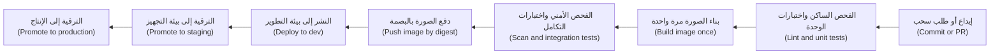

كل ما يقع يسار مرحلة "الدفع (Push)" يعمل على كل طلب سحب (every pull request) ويجب أن يكون سريعًا. أما عمليات الترقية (promotions) على اليمين فتنقل الصورة *نفسها* عبر البيئات (environments)، كما وُصف في الدرس 3.2.

**الآثار البرمجية (Artefacts).** **الأثر البرمجي (artefact)** هو مُخرَج عملية البناء الذي تحتفظ به وتنشره: وهو هنا صورة حاوية OCI (الدرس 2.1)؛ وفي مواضع أخرى ملف JAR (JAR file)، أو حزمة Python wheel (Python wheel)، أو حزمة موقع ساكن. قاعدتان (Two rules):
1. **ابنِ مرة واحدة (Build once).** ابنِ الأثر البرمجي في مهمة واحدة (one job)، وخزّنه في سجل (registry)، واجعل كل مرحلة لاحقة تسحبه (pull it). لا تشغّل `docker build` مرة أخرى للتجهيز أو الإنتاج أبدًا.
2. **عرّفه تعريفًا ثابتًا (Identify it immutably).** الوسم (tag) مثل `v1.4.2` أو `latest` يمكن نقله إلى صورة مختلفة. أما **البصمة (digest)** (`sha256:...`، وهي تجزئة (hash) لمحتوى الصورة) فلا يمكن. وسِم الصور بمعرّف الإيداع (commit SHA) من أجل البشر، لكن انشر بالبصمة (deploy by digest).

الإعدادات التي تختلف بين البيئات (مضيف قاعدة البيانات (database host)، والقيم الافتراضية لأعلام الميزات، وأعداد النسخ المتماثلة) تُحقن وقت النشر عبر متغيرات البيئة (environment variables) أو ConfigMaps أو طبقة GitOps الفوقية (GitOps overlay) (الدرسان 2.3 و3.2)، ولا تُخبز في الصورة أبدًا. وهذا هو العامل الثالث (factor III) من منهجية التطبيق ذي العوامل الاثني عشر (Twelve-Factor App): خزّن الإعدادات في البيئة. ويروي [*تصميم الأنظمة لمبرمجي الحدس (System Design for Vibe Coders)*، الدرس 4.5 — تحقّق من الأثر البرمجي لا من المصدر](../vibe/index.ar.html#l4-5) هذه القصة للبنّائين الأفراد (solo builders).

**خط تسليم مصغّر في GitHub Actions (A minimal pipeline in GitHub Actions).** نستخدم GitHub Actions هنا لأنه واسع الانتشار (widely used) ومجاني للمستودعات العامة؛ وتشترك GitLab CI/CD وJenkins وAzure Pipelines في المفاهيم نفسها.

```yaml
# .github/workflows/ci.yml
name: ci
on:
  pull_request:
  push:
    branches: [main]

permissions:
  contents: read            # least privilege by default (lesson 4.3)

concurrency:
  group: ci-${{ github.ref }}
  cancel-in-progress: ${{ github.event_name == 'pull_request' }}  # cancel outdated PR runs, never main builds

jobs:
  test:
    runs-on: ubuntu-latest
    timeout-minutes: 15
    steps:
      - uses: actions/checkout@v4   # pin to a full commit SHA in real use (lesson 4.3)
      - run: make lint
      - run: make test-unit

  build:
    needs: test
    runs-on: ubuntu-latest
    timeout-minutes: 20
    steps:
      - uses: actions/checkout@v4
      - uses: docker/setup-buildx-action@v3
      - uses: docker/build-push-action@v6
        with:
          context: .
          push: false
          tags: mobile-api:${{ github.sha }}
          cache-from: type=gha
          cache-to: type=gha,mode=max
```

لاحظ الإعدادات الافتراضية (defaults): صلاحيات للقراءة فقط (read-only permissions)، ومهلات زمنية للمهام (job timeouts)، وإلغاء تشغيلات طلبات السحب القديمة (ولا تُلغى تشغيلات `main` أبدًا: فكل إيداع مدموج (merged commit) يجب أن يُنتج أثره البرمجي).

**هرم الاختبارات (The test pyramid).** ليست كل الاختبارات متساوية في الكلفة. ينصّ الهرم، الذي روّج له مايك كون (Mike Cohn)، على أن يكون لديك كثير من الاختبارات الرخيصة (cheap tests) في القاعدة وقليل من الاختبارات المكلفة (expensive ones) في القمة.

| الطبقة (Layer) | ما الذي تفحصه | السرعة (Speed) | العدد | أين تعمل (Where it runs) |
|---|---|---|---|---|
| **الفحوص الساكنة (Static checks)** | التنسيق (formatting)، والفحص الساكن (lint)، وفحوص الأنواع (type checks)، والتحقق من البنية التحتية بوصفها شيفرة (IaC validation) | ثوانٍ (Seconds) | كل ملف (Every file) | كل طلب سحب (Every PR) |
| **اختبارات الوحدة (Unit tests)** | دالة أو صنف واحد، دون شبكة أو قاعدة بيانات | أجزاء من الثانية لكلٍّ منها (Milliseconds each) | الآلاف (Thousands) | كل طلب سحب |
| **اختبارات التكامل (Integration tests)** | الخدمة مع اعتماديات حقيقية (real dependencies): حاوية PostgreSQL (PostgreSQL container)، وشبكة دفع مزيّفة | ثوانٍ لكلٍّ منها (Seconds each) | المئات (Hundreds) | كل طلب سحب، بالتوازي |
| **اختبارات العقود (Contract tests)** | أن واجهة البرمجة ما زالت تطابق ما يتوقعه عملاؤها | ثوانٍ | واحد لكل مستهلك | كل طلب سحب |
| **الاختبارات الشاملة (End-to-end tests)** | رحلة مستخدم كاملة عبر الخدمات المنشورة (deployed services) | دقائق لكلٍّ منها (Minutes each) | حفنة | بعد النشر إلى التطوير أو التجهيز |

والهرم المقلوب (inverted pyramid)، بمئات من اختبارات المتصفّح البطيئة الهشّة وقليل من اختبارات الوحدة، سبب شائع لخط تسليم مدته 48 دقيقة (48-minute pipeline).

#### 🟡 التعمق أكثر (Going deeper)

**تسريع خط التسليم (Making the pipeline fast).** يقيس يوسف قبل أن يغيّر أي شيء. فتتوزّع الدقائق الـ48 على تنزيل الاعتماديات (dependency downloads) (7)، وبناء الصورة دون تخزين مؤقت (11)، واختبارات الوحدة المشغّلة تسلسليًا (9)، واختبارات التكامل (8)، والاختبارات الشاملة على كل طلب سحب (13). والإصلاحات، مرتبة حسب قيمتها:

- **خزّن الاعتماديات مؤقتًا (Cache dependencies).** استعِد ذاكرة التخزين المؤقت لمدير الحزم بمفتاح مبني على تجزئة ملف القفل؛ ولدى معظم أنظمة التكامل المستمر إجراء تخزين مؤقت مدمج.
- **رتّب ملف Dockerfile للاستفادة من التخزين المؤقت للطبقات (Order the Dockerfile for layer caching)** (الدرس 2.1): انسخ بيان الاعتماديات (dependency manifest) وثبّت الاعتماديات *قبل* نسخ الشيفرة المصدرية (source code)، كي لا يُبطل تغيير الشيفرة طبقة الاعتماديات. واستخدم ذاكرة تخزين مؤقت بعيدة للبناء (`cache-from`/`cache-to`) كي تتمكن المشغّلات المؤقتة (ephemeral runners) من إعادة استخدام الطبقات (reuse layers).
- **وازِ (Parallelise).** قسّم الاختبارات إلى أجزاء (shards) عبر عدة مهام (several jobs)، أو استخدم مصفوفة (matrix) (مثلًا عدة إصدارات من Python أو Node) فقط حيث تضيف تغطية حقيقية (real coverage).
- **شغّل ما تغيّر فقط (Run only what changed).** في المستودع الأحادي (monorepo)، تتخطى مرشّحات المسارات (path filters) (`on.pull_request.paths`) خطوط التسليم للخدمات التي لم تُمسّ (untouched services). وكن حذرًا: فتغيير مكتبة مشتركة يجب أن يظل يُطلق خطوط التسليم للخدمات المعتمدة عليها.
- **انقل الحزم البطيئة إلى ما بعد الدمج (Move slow suites after the merge).** تعمل الاختبارات الشاملة على بيئة التطوير (dev environment) بعد الدمج ووفق جدول زمني؛ فهي تحجب *الترقية (promotion)* لا *الدمج (merging)*.

النتيجة: الفحص الساكن واختبارات الوحدة في 3 دقائق، والبناء واختبارات التكامل في 6، أي فحص دمج مدته 9 دقائق، مع اختبارات شاملة تحرس الترقية إلى التجهيز.

**الاختبارات المتقلّبة (Flaky tests).** **الاختبار المتقلّب (flaky test)** ينجح ويفشل على الشيفرة نفسها (same code). ومن أسبابه افتراضات التوقيت (timing assumptions) (`sleep(2)` والأمل)، وبيانات الاختبار المشتركة، والاعتماد على ترتيب الاختبارات، واستدعاءات الشبكة الحقيقية والساعات (clocks). السياسة في نجم:
1. الاختبار الذي يفشل ثم ينجح عند إعادة المحاولة، على الإيداع نفسه (same commit)، يُعلَّم آليًا بأنه مشتبه في تقلّبه (suspected flaky).
2. يُوضع الاختبار المتقلّب **في الحجر (quarantined)**: يُنقل إلى مهمة غير حاجبة (non-blocking job)، مع تذكرة (ticket) ومالك (owner)، ويُصلَح أو يُحذف خلال مدة متفق عليها.
3. لا يُسمح بـ"إعادة المحاولة حتى يخضرّ (retry until green)" الآلية على خط التسليم كله (whole pipeline). فهي تخفي أخطاء متقطعة حقيقية، ومنها حالات التسابق (race conditions) التي ستحدث في الإنتاج أيضًا.

**طوابير الدمج (Merge queues).** حين يدمج كثيرون في `main`، قد ينجح طلبا سحب (two pull requests) كلٌّ على حدة ثم يتعطلان معًا (break together). أما **طابور الدمج (merge queue)** (طابور الدمج في GitHub، وقطارات الدمج في GitLab وميزات مشابهة) فيختبر كل طلب سحب فوق طلبات السحب التي تسبقه قبل الدمج، فيبقى `main` أخضر (stays green).

**توسيم الأثر البرمجي (Labelling the artefact).** سجّل مصدر الصورة، كي يستطيع أي شخص تتبّع حجيرة عاملة (running pod) رجوعًا إلى إيداع. وتعليقات صور OCI مثل `org.opencontainers.image.revision` (معرّف الإيداع، commit SHA) و`org.opencontainers.image.source` (عنوان المستودع، repository URL) مفاتيح قياسية (standard keys). ويحوّل الدرس 4.3 هذا إلى **مصدرية (provenance)** موقّعة.

**ما يفحصه خط التسليم إلى جانب الاختبارات (What the pipeline checks besides tests).** خط التكامل المستمر (CI pipeline) هو أيضًا موطن الفحوص المؤتمتة الرخيصة: فحص الأسرار (secret scanning)، وفحص ثغرات الاعتماديات، والتحليل الأمني الساكن، والفحص الساكن لملفات Dockerfile والبنية التحتية بوصفها شيفرة، وفحوص السياسات (policy checks) من الدرس 3.3. لا تحجب إلا على النتائج الجديدة عالية الثقة، وإلا تعلّم المطوّرون تجاهل البوابة. ويشرح [*أمن الذكاء الاصطناعي وأمن التطبيقات (Secure AI & Application Security)*، الدرس 6.1 — دورة حياة تطوير آمنة](../secai/index.ar.html#/6.1) كيفية ضبط هذه الماسحات.

#### 🔴 نظرة الخبير (Expert view)

**قِس النتيجة لا خط التسليم (Measure the outcome, not the pipeline).** يتتبّع برنامج أبحاث DORA (DORA research programme) أربعة مقاييس تسليم رئيسية: **تكرار النشر (deployment frequency)**، و**المهلة الزمنية للتغييرات (lead time for changes)** (من الإيداع إلى الإنتاج)، و**معدل فشل التغييرات (change failure rate)**، و**زمن استعادة الخدمة (time to restore service)**. وقد أضافت DORA منذ ذلك الحين مقياسًا للموثوقية (reliability measure) وحسّنت بعض الأسماء (على سبيل المثال، تتحدث التقارير الحديثة عن زمن التعافي من النشر الفاشل)؛ راجع dora.dev للاطلاع على التعريفات الحالية. يحسّن خط التسليم السريع المهلة الزمنية (lead time)؛ وتخفّض الاختبارات الجديرة بالثقة (trustworthy tests) معدل فشل التغييرات. راقب الاثنين معًا: فالتسريع بحذف الاختبارات لا يفعل سوى نقل الكلفة إلى الحوادث.

**خط التسليم منتَج (The pipeline is a product).** في نجم، لا يكتب كل فريق منتج (product team) خط تسليمه الخاص. بل ينشر فريق المنصة **مسارًا ذهبيًا (golden path)**: سير عمل قابلًا لإعادة الاستخدام (reusable workflow) (في GitHub Actions، سير عمل يُستدعى بـ `uses: najm-bank/platform-workflows/.github/workflows/service-ci.yml@<version>`) يتولى البناء والفحص والاختبار والتوقيع والدفع بالطريقة المعتمدة (approved way). وتمرّر الفرق بضعة مدخلات. وحين يحسّن فريق المنصة التخزين المؤقت (caching) أو يضيف ماسحًا (scanner)، تحصل عليه كل خدمة. أدِر إصداره (version it)، واحتفظ بسجل للتغييرات (changelog)، وقِس معدل التبنّي (adoption) وأزمنة البناء (build times).

**عمليات البناء القابلة لإعادة الإنتاج والمحكمة (Reproducible and hermetic builds).** يستخدم البناء **المحكم (hermetic)** مدخلات مُعلنة ومثبّتة فقط: صورة أساسية بالبصمة، واعتماديات عبر ملف قفل مع تجزئات، وسلسلة أدوات مثبّتة (pinned toolchain)، ودون وصول غير مُعلن إلى الشبكة. أما عمليات البناء **القابلة لإعادة الإنتاج (reproducible)** بالكامل بتًا ببت (bit-for-bit) فصعبة لصور الحاويات (الطوابع الزمنية (timestamps)، وترتيب الملفات)، لكن المدخلات المحكمة وحدها تزيل حادثة الجمعة (Friday incident): فلا يستطيع وسم `latest` متحرك أن يتسلّل.

**زمن التغذية الراجعة ميزانية تصميم (Feedback time is a design budget).** انشر هدفًا (هدف نجم أدناه). وأي فحص جديد قد يكسره يجب أن يحلّ محل شيء آخر (replace something)، أو يعمل بالتوازي، أو يعمل بعد الدمج.

### 🧰 الأدوات
| الأداة أو الممارسة أو الخدمة (Tool, practice or service) | ما هي وماذا تفعل | متى تلجأ إليها |
|---|---|---|
| **GitHub Actions** | تكامل وتسليم مستمران مدمجان في GitHub؛ وسير العمل (workflows) مكتوبة بصيغة YAML في المستودع، وتعمل على مشغّلات مستضافة أو مستضافة ذاتيًا | حين تكون الشيفرة على GitHub أصلًا؛ وللتمرّن المجاني على المستودعات العامة (public repositories) |
| **GitLab CI/CD** | تكامل وتسليم مستمران مدمجان في GitLab؛ وخطوط التسليم معرّفة في `.gitlab-ci.yml` | حين تكون الشيفرة على GitLab، بما في ذلك التثبيتات المُدارة ذاتيًا (self-managed installations) |
| **Jenkins** | خادم أتمتة مفتوح المصدر عريق بمنظومة إضافات كبيرة | البيئات القائمة (existing estates)؛ وحين يجب تشغيل كل شيء داخل المقر (on-premises) |
| **Trunk-based development** — التطوير القائم على الجذع | فروع قصيرة العمر تُدمج في فرع رئيسي واحد مرة يوميًا على الأقل | دائمًا، بوصفه نموذج التفريع الافتراضي للتكامل المستمر |
| **Build once, promote** — ابنِ مرة واحدة ورقِّ | بناء واحد يُنتج أثرًا برمجيًا واحدًا ثابتًا (one immutable artefact) ينتقل عبر كل بيئة | كل خدمة؛ فهو يزيل مشكلة ⁦⁩ أي "ما اختُبر ليس ما شُحن" |
| **Test pyramid** — هرم الاختبارات | كثير من اختبارات الوحدة، وأقل من اختبارات التكامل، وقليل من الاختبارات الشاملة | تصميم حزمة اختبارات أو تشخيص خط تسليم بطيء |
| **Merge queue** — طابور الدمج | يختبر كل طلب سحب (PR) مقابل طلبات السحب التي تسبقه قبل الدمج | المستودعات المزدحمة (busy repositories) حيث يظل `main` يتعطل بعد عمليات دمج "خضراء" ("green" merges) |
| **Golden path** — المسار الذهبي | خط تسليم قابل لإعادة الاستخدام (reusable pipeline) يصونه فريق المنصة (platform-maintained)، تتبنّاه الفرق بدلًا من كتابة خطوطها الخاصة | أكثر من حفنة من الخدمات بعمليات بناء متشابهة (similar builds) |

### 🏛️ عمليًا في بنك نجم
ينشر يوسف وسالم **معيار التكامل المستمر للمسار الذهبي في نجم، الإصدار 1 (Najm Golden-Path CI Standard v1)**، مُنفَّذًا بوصفه سير عمل قابلًا لإعادة الاستخدام. وكل خدمة جديدة تبدأ به.

**الجزء أ: المراحل والبوابات وميزانيات الزمن (Part A: stages, gates and time budgets)**

| المرحلة (Stage) | تعمل على (Runs on) | تحجب (Blocks) | ميزانية الزمن (Time budget) (p95) |
|---|---|---|---|
| الفحص الساكن والتنسيق وفحص الأنواع والتحقق من البنية التحتية بوصفها شيفرة | كل طلب سحب | الدمج (Merge) | دقيقتان (2 min) |
| اختبارات الوحدة (مقسّمة إلى أجزاء، sharded) | كل طلب سحب | الدمج | 4 دقائق (4 min) |
| فحص الأسرار وSCA وSAST | كل طلب سحب | الدمج | 3 دقائق، بالتوازي (3 min, in parallel) |
| بناء الصورة مرة واحدة، مع ذاكرة تخزين مؤقت بعيدة | كل طلب سحب | الدمج | 4 دقائق (4 min) |
| اختبارات التكامل والعقود (PostgreSQL في حاوية) | كل طلب سحب | الدمج | 5 دقائق، بالتوازي (5 min, in parallel) |
| دفع الصورة بالبصمة، وتسجيل معرّف الإيداع والمصدر | الدمج في `main` | — | دقيقتان (2 min) |
| النشر إلى بيئة التطوير وتشغيل اختبارات الدخان الشاملة | الدمج في `main` | الترقية إلى التجهيز | 10 دقائق (10 min) |
| الحزمة الشاملة الكاملة | كل بضع ساعات وقبل الإنتاج | الترقية إلى الإنتاج | 30 دقيقة (30 min) |

الهدف العام لفحص الدمج: أن تنتهي 95% من فحوص طلبات السحب (PR checks) خلال 10 دقائق.

**الجزء ب: القواعد (Part B: rules)**
1. تُبنى الصور مرة واحدة لكل إيداع وتُنشر بالبصمة. وخط التسليم الذي يشغّل `docker build` في مهمة نشر (deploy job) يرسب في مراجعة المنصة (platform review).
2. تُثبَّت الصور الأساسية (base images) وسلاسل الأدوات (toolchains) بالبصمة أو بالإصدار الدقيق (exact version)؛ ويقترح روبوت (bot) التحديثات بوصفها طلبات سحب عادية.
3. لكل مهمة مهلة زمنية (timeout). ويكون الافتراضي لسير العمل صلاحيات القراءة فقط.
4. توضع الاختبارات المتقلّبة في الحجر خلال يوم عمل واحد، مع مالك وتذكرة. ولا إعادة محاولة آلية لخط التسليم كله.
5. تعرض لوحة كل خدمة (service's dashboard) المهلة الزمنية، وتكرار النشر، ومعدل فشل التغييرات، ومدة فحص طلب السحب (PR-check duration).

**الجزء ج: واجهة سير العمل القابل لإعادة الاستخدام (Part C: the reusable workflow's interface)**

```yaml
# In the service repository
jobs:
  ci:
    uses: najm-bank/platform-workflows/.github/workflows/service-ci.yml@v3   # pin by SHA in real use
    with:
      service-name: mobile-api
      dockerfile: ./Dockerfile
      integration-services: postgres
      test-shards: 4
```

### 🛠️ التمارين (Exercises)
استخدم حسابك الخاص على GitHub ومستودعًا عامًا للتمرين؛ ولا تستخدم مستودع جهة عملك (employer's repository) دون إذن أبدًا.

- 🟢 خذ تطبيقًا صغيرًا لك (بأي لغة) وأضف إليه سير عمل للتكامل المستمر (CI workflow) يشغّل الفحص الساكن واختبارات الوحدة على كل طلب سحب، مع صلاحيات القراءة فقط، ومهلة زمنية للمهمة (job timeout)، وإلغاء التشغيلات القديمة. افتح طلب سحب فيه اختبار فاشل عمدًا. *يكتمل عندما (Done when):* يُظهر طلب السحب فحصًا أحمر (red check) يسمّي الاختبار الفاشل، ويحوّله إصلاح الاختبار إلى الأخضر.
- 🟡 أضف إلى خط التسليم بناءً للحاوية (container build) مع التخزين المؤقت للطبقات (layer caching). أعد ترتيب ملف Dockerfile بحيث تُثبَّت الاعتماديات قبل نسخ الشيفرة المصدرية. سجّل زمن البناء قبل التغيير وبعده لتعديل شيفرة من سطر واحد. *يكتمل عندما:* يكون لديك التوقيتان، ويعيد بناءٌ ثانٍ بعد تغيير في المصدر فقط (source-only change) استخدام طبقة الاعتماديات (يُظهر السجل خطوات مخزّنة مؤقتًا، cached steps).
- 🔴 نفّذ مبدأ "ابنِ مرة واحدة، ورقِّ": عند الدمج في `main`، ادفع الصورة إلى سجل، وأخرِج بصمتها، واجعل مهمة ثانية تنشر تلك البصمة إلى عنقود kind محلي (local kind cluster) أو تحدّث بيانًا (manifest) في مجلد GitOps (GitOps folder). أضف اختبارًا يفشل إذا احتوت أي مهمة نشر على أمر `docker build`. *يكتمل عندما:* تطابق البصمة العاملة في عنقودك (`kubectl get pod -o jsonpath='{.items[*].status.containerStatuses[*].imageID}'`) البصمة التي طبعتها مهمة البناء (build job).

### ⚠️ أخطاء وفخاخ (Mistakes and traps)
- **إعادة البناء لكل بيئة (Rebuilding per environment).** تختبر بيئة التجهيز صورة ويشغّل الإنتاج صورة أخرى. ابنِ مرة واحدة، وانشر بالبصمة، واحقن الإعدادات وقت النشر.
- **⁦("Re-run until green")⁩ أي "أعد التشغيل حتى يخضرّ".** فهي تخفي الاختبارات المتقلّبة وحالات التسابق الحقيقية. ضع الاختبارات المتقلّبة في الحجر (quarantine) مع مالك وموعد نهائي؛ ولا تُعِد محاولة خطوط التسليم كاملة آليًا أبدًا.
- **الهرم المقلوب (An inverted pyramid).** مئات الاختبارات الشاملة على كل طلب سحب تجعل التكامل المستمر بطيئًا وهشًا. ادفع الفحوص إلى أسفل الهرم؛ وشغّل الحزم الشاملة بعد الدمج.
- **فروع الميزات طويلة العمر (Long-lived feature branches).** تحوّل التكامل (integration) إلى أزمة أسبوعية (weekly crisis). ادمج تغييرات صغيرة يوميًا، وأخفِ العمل غير المكتمل خلف الأعلام (behind flags).
- **المدخلات غير المثبّتة (Unpinned inputs).** إن `FROM node:latest` أو الأدوات غير المثبّتة (unpinned tools) تجعل البناء الأخضر بالأمس بلا معنى اليوم. ثبّت بالبصمة أو بالإصدار الدقيق وحدّث عن قصد (update deliberately).

### 🧾 الخلاصة (Recap)
- يجيب التكامل المستمر عن سؤال ⁦⁩ أي "هل هذا التغيير آمن للدمج؟"؛ ويُبقي التسليم المستمر كل تغيير ناجح قابلًا للإطلاق؛ ويطلقه النشر المستمر آليًا.
- يجعل التطوير القائم على الجذع وعمليات الدمج الصغيرة المتكررة التكامل أمرًا روتينيًا (routine) لا محفوفًا بالمخاطر (risky).
- ابنِ أثرًا برمجيًا واحدًا ثابتًا، وعرّفه بالبصمة، ورقِّ الأثر نفسه عبر كل بيئة.
- شكّل الاختبارات هرمًا، وأبقِ فحص الدمج سريعًا بالتخزين المؤقت والتوازي (parallelism) ونقل الحزم البطيئة إلى ما بعد الدمج.
- عامِل الاختبارات المتقلّبة بوصفها عيوبًا (defects)، وخط التسليم بوصفه منتجًا (product)، ومقاييس DORA (DORA measures) بوصفها بطاقة الأداء (scorecard).

### ✍️ اختبر نفسك (Check yourself)

**1. اجتازت بيئة التجهيز (staging) الاختبار يوم الخميس، لكن نشر الإنتاج (production deploy) فشل يوم الجمعة لأن الصورة تصرّفت بشكل مختلف. كانت مهمة الإنتاج (production job) قد أعادت بناء الصورة من الإيداع نفسه (same commit). ما التغيير الذي يمنع هذه الفئة من الإخفاقات (class of failure)؟**

- A. تشغيل اختبارات التجهيز (staging tests) مرة أخرى داخل مهمة الإنتاج
- B. البناء مرة واحدة ونشر الصورة نفسها بالبصمة في كل مكان
- C. استخدام الوسم `latest` في كل مكان كي تتطابق كل البيئات
- D. إضافة خطوة موافقة يدوية قبل كل نشر إلى الإنتاج

<details><summary>الإجابة</summary>

**B.** البناء مرة واحدة والنشر بالبصمة يضمنان أن يشغّل الإنتاج بالضبط ما اختُبر. أما C فتزيد الأمر سوءًا، لأن `latest` يتحرك؛ وD تضيف إنسانًا لكنها لا تضمن الأثر البرمجي نفسه (same artefact)..

</details>

**2. يستغرق فحص طلب السحب (PR check) لواجهة برمجة تطبيق نجم للهاتف (Najm Mobile API) 48 دقيقة، منها 13 دقيقة للاختبارات الشاملة (end-to-end tests). ما أفضل خطوة أولى (best first move)؟**

- A. حذف الاختبارات الشاملة، لأن اختبارات الوحدة (unit tests) تغطي المنطق
- B. شراء مشغّلات أكبر (larger runners) وإبقاء كل شيء على حاله
- C. تشغيل الاختبارات الشاملة بعد الدمج (after the merge)، بحيث تحرس الترقية (gating promotion) بدلًا من الدمج
- D. مطالبة المطوّرين بفتح طلبات سحب أقل عددًا وأكبر حجمًا

<details><summary>الإجابة</summary>

**C.** ما زالت الاختبارات تحمي الإنتاج، لكنها لم تعد تبطئ كل دمج. أما A فتفقد الحماية (loses protection)؛ وB مكلفة وتُبقي البنية دون تغيير؛ وD تشجّع التجميع في دفعات (batching) الذي سبّب المشكلة. (🟡 التعمق أكثر، Going deeper).

</details>

**3. أيّ العبارات التالية تصف التسليم المستمر (continuous delivery) على أفضل وجه؟**

- A. كل تغيير ناجح قابل للإطلاق (releasable)؛ وقرار إطلاق (release decision) يضعه قيد التشغيل
- B. كل تغيير يذهب إلى الإنتاج آليًا دون أي خطوة بشرية
- C. يدمج المطوّرون فروعهم في الفرع الرئيسي (main) مرة واحدة أسبوعيًا على الأقل
- D. يبني خط التسليم كل التغييرات ويختبرها مرة كل ليلة

<details><summary>الإجابة</summary>

**A.** أما B فهي النشر المستمر (continuous deployment). وC تصف تكاملًا غير متكرر (infrequent integration)، وD بناء ليلي (nightly build) وليست تكاملًا مستمرًا..

</details>

**4. اختبار في خدمة المدفوعات (Payments service) يفشل في نحو تشغيل واحد من كل عشرة (one run in ten) وينجح عند إعادة تشغيله على الإيداع نفسه. ماذا تتطلب سياسة نجم (Najm's policy)؟**

- A. تفعيل إعادة المحاولة الآلية (automatic retries) على خط التسليم كله كي لا تُحجب عمليات الدمج
- B. حذف الاختبار فورًا والاعتماد على بقية الحزمة (remaining suite)
- C. إبقاؤه حاجبًا (blocking)، وإعادة تشغيل خط التسليم كلما فشل
- D. وضعه في الحجر (quarantine) في مهمة غير حاجبة (non-blocking job)، مع مالك وموعد نهائي

<details><summary>الإجابة</summary>

**D.** يُبقي الحجر (quarantine) إشارة الدمج (merge signal) جديرة بالثقة بينما يبحث أحدهم عن السبب، الذي قد يكون حالة تسابق حقيقية. أما A فتخفي المشكلات؛ وB قد تحذف تغطية مفيدة (useful coverage) دون فهمها؛ وC تعلّم الناس تجاهل عمليات البناء الحمراء (red builds). (🟡 التعمق أكثر، Going deeper).

</details>

**5. يريد سالم أن يعرف هل تحسينات التكامل المستمر (CI improvements) تجعل التسليم أفضل إجمالًا (better overall)، لا أسرع فحسب. أيّ زوج من المقاييس (pair of measures) ينبغي أن يراقبه معًا؟**

- A. عدد خطوط التسليم وعدد المشغّلات
- B. أسطر الشيفرة (lines of code) وعدد الاختبارات (test count)
- C. المهلة الزمنية للتغييرات (lead time for changes) ومعدل فشل التغييرات (change failure rate)
- D. معدل إصابة ذاكرة البناء المؤقتة وحجم الصورة (image size)

<details><summary>الإجابة</summary>

**C.** تُظهر المهلة الزمنية (lead time) السرعة، ويُظهر معدل فشل التغييرات (change failure rate) هل السرعة آمنة؛ ومراقبة أحدهما وحده قد تضلّل. أما الخيارات الأخرى فأدوات تشخيص مفيدة (useful diagnostics)، لا نتائج. (🔴 نظرة الخبير، Expert view).

</details>

### 📚 المراجع (References)
- أبحاث DORA ومقاييسها — https://dora.dev/
- توثيق GitHub Actions (GitHub Actions documentation) — https://docs.github.com/en/actions
- GitHub، إدارة طابور الدمج — https://docs.github.com/en/repositories/configuring-branches-and-merges-in-your-repository/configuring-pull-request-merges/managing-a-merge-queue
- توثيق GitLab CI/CD — https://docs.gitlab.com/ee/ci/
- توثيق Jenkins (Jenkins documentation) — https://www.jenkins.io/doc/
- Docker، ذاكرة البناء المؤقتة (build cache) — https://docs.docker.com/build/cache/
- مواصفة صور OCI، التعليقات التوضيحية — https://github.com/opencontainers/image-spec/blob/main/annotations.md
- التطبيق ذو العوامل الاثني عشر — https://12factor.net/
- التطوير القائم على الجذع — https://trunkbaseddevelopment.com/
- [*اختبار البرمجيات من الصفر إلى الاحتراف في عصر الذكاء الاصطناعي*، الدرس 5.2 — الاختبار في CI/CD وفي بيئة الإنتاج](../testing/index.ar.html#/5.2) — منظور الاختبار (testing) لهذا الموضوع
- [*بناء تطبيقات الذكاء الاصطناعي والوكلاء من الصفر إلى الاحتراف*، الدرس 12.2 — المختبر: كل وكيل تحت تقييم من 50 حالة وفحص تكامل مستمر (Lab: every agent under a 50-case eval and a CI check)](../aiapps/index.ar.html#/12.2) — منظور البناء والتسليم (build and ship) لهذا الموضوع

<a id="l4-2"></a>

## 4.2 — استراتيجيات الإطلاق: المتدرّج والأزرق والأخضر والكناري وأعلام الميزات والتراجع

*المستوى: 🟡 متوسط* · *المتطلبات: 2.2، 2.3، 4.1* · *المرحلة (Phase): Release, Deploy*

### ⚡ الدرس في دقيقة (In 60 seconds)
- **النشر (Deploying)** يضع الشيفرة الجديدة على الخوادم (servers)؛ و**الإطلاق (releasing)** يتيح للمستخدمين الوصول إليها. والفصل بين الاثنين، بأعلام الميزات والتحويل التدريجي لحركة المرور، هو جوهر التسليم الآمن.
- الاستراتيجيات الرئيسية هي **إعادة الإنشاء (recreate)**، و**المتدرّج (rolling)**، و**الأزرق والأخضر (blue-green)**، و**الكناري (canary)**، و**الظل (shadow)**؛ وكلٌّ منها يوازن بين الكلفة والسرعة ونطاق الضرر (blast radius) بطريقة مختلفة.
- اختر حسب نطاق الضرر وحسب سرعة اكتشافك للمشكلة. فالخدمات عالية المخاطر (high-risk services) مثل المدفوعات (Payments) تحصل على إطلاق كناري مع تحليل آلي (automatic analysis)؛ أما الأدوات الداخلية (internal tools) فيمكن نشرها نشرًا متدرّجًا.
- كل إطلاق يحتاج إلى تراجع مُتمرَّن عليه (rehearsed rollback)، ويجب أن تعمل قاعدة البيانات مع الإصدار القديم والجديد في الوقت نفسه.
- الفخ الأكبر: شحن تغيير إلى الجميع دفعة واحدة لأنه ⁦⁩ أي "مجرد إعدادات". فالإعدادات والمحتوى شيفرة؛ فأطلقهما على مراحل أيضًا.

### 🧭 لماذا يهم
في 19 يوليو 2024، دفعت CrowdStrike تحديثًا لإعدادات المحتوى لمستشعرها Falcon (Falcon sensor) إلى أجهزة Windows. وتسبّب عيب في ذلك التحديث في انهيار الأجهزة المتأثرة، وقدّرت Microsoft أن نحو 8.5 مليون جهاز Windows قد تأثر، فتوقفت رحلات جوية وتعطلت مستشفيات وبنوك. وقالت مراجعة CrowdStrike نفسها إن هذا النوع من المحتوى لم يكن يُطرح على مراحل. ومن بين التزاماتها بعد ذلك نشرٌ مرحلي (staged deployment) لهذا النوع من المحتوى، مع مجموعات كناري أولًا وتحكّم العملاء في التوقيت. فالتغيير الذي يصل إلى الجميع دفعة واحدة يمكن أن يفشل لدى الجميع دفعة واحدة.

وفي نجم، لدى مها مثال أقرب. ففي الربع الماضي، غيّر إصدار جديد من **خدمة المدفوعات (Payments service)** طريقة قراءته لحقل العملة (currency field). وانتشر النشر (deployment rolled) عبر كل الحجيرات في أربع دقائق. فارتفعت معدلات الخطأ (error rates) في نحو 3% من التحويلات (transfers) (تلك التي بعملة واحدة) وبقيت تحت عتبة التنبيه القديمة مدة 40 دقيقة. وبحلول ذلك الوقت كانت كل حجيرة تشغّل الشيفرة الجديدة، واستغرق التراجع غير المُتمرَّن عليه (unpractised rollback) 15 دقيقة أخرى.

هدف مها (Maha's goal): أن يصل إطلاق المدفوعات التالي إلى 5% من حركة المرور (traffic) أولًا، وأن يُحكم عليه بالأرقام، وأن يتراجع من تلقاء نفسه إذا ساءت.

### 📐 كيف يعمل

#### 🟢 الأساسيات

**النشر ليس إطلاقًا (Deploy is not release).** **تحويل حركة المرور (Traffic shifting)** (المتدرّج والأزرق والأخضر والكناري) يتحكم في أيّ *إصدار (version)* يتلقى الطلبات (requests)؛ و**أعلام الميزات (feature flags)** تتحكم في أيّ *سلوك (behaviour)* يراه المستخدمون داخل إصدار واحد.

وبالاثنين معًا، يمكنك النشر يوم الثلاثاء، وتفعيل الميزة للموظفين (staff) يوم الأربعاء ولـ5% من العملاء يوم الخميس، وإيقافها في ثوانٍ.

**الاستراتيجيات (The strategies).**

| الاستراتيجية (Strategy) | كيف تعمل | التراجع | الكلفة الإضافية (Extra cost) | مناسبة لـ (Good for) |
|---|---|---|---|---|
| **إعادة الإنشاء (Recreate)** | أوقف كل النسخ القديمة (old instances)، ثم شغّل الجديدة | إعادة نشر الإصدار القديم | لا شيء، لكنها تسبّب توقفًا عن الخدمة (causes downtime) | المهام الدفعية (batch jobs)؛ وبيئات التطوير (dev environments)؛ والإصدارات التي لا يمكن تشغيلها جنبًا إلى جنب (side by side) |
| **التحديث المتدرّج (Rolling update)** | استبدل النسخ بضعًا بعد بضع؛ وتنضم الجديدة حين تصبح جاهزة | تراجع بالطريقة نفسها، بضعًا بعد بضع | قدر قليل من السعة الاحتياطية (spare capacity) | معظم الخدمات عديمة الحالة (stateless services)؛ والافتراضي في Kubernetes |
| **الأزرق والأخضر (Blue-green)** | شغّل الإصدار الجديد (الأخضر، green) بجانب القديم (الأزرق، blue) بالحجم الكامل؛ وحوّل كل حركة المرور دفعة واحدة | أعِد حركة المرور إلى الأزرق، في ثوانٍ | ضعف السعة (double capacity) أثناء الإطلاق | انتقال سريع ونظيف؛ وتحقق سهل قبل التحويل |
| **الكناري (Canary)** | أرسل حصة صغيرة من حركة المرور الحقيقية إلى الإصدار الجديد، وقارن مقاييسه، ثم زِدها خطوة بخطوة (step by step) | أرسل كل حركة المرور عائدةً إلى الإصدار المستقر (stable version) | بضع نسخ إضافية مع المقاييس | الخدمات عالية المخاطر؛ وقواعد المستخدمين الكبيرة |
| **الظل (Shadow)** (النسخ المرآوي، mirroring) | انسخ الطلبات الحية (live requests) إلى الإصدار الجديد وتجاهل استجاباته | لا شيء للتراجع عنه؛ فالمستخدمون لم يروه قط | سعة إضافية (extra capacity)؛ والحذر من الآثار الجانبية | اختبار أداء إعادة كتابة (rewrite) أو صحتها على حركة مرور حقيقية (real traffic) |

يجب ألا تُطلق حركة مرور الظل (shadow traffic) أي آثار جانبية حقيقية أبدًا، مثل تحويل منسوخ مرآويًا (mirrored transfer) ينقل المال مرتين. استخدمها على مسارات القراءة (read paths) أو مع آثار جانبية مستبدلة بأخرى وهمية.

**التحديثات المتدرّجة في Kubernetes (Rolling updates in Kubernetes).** يستبدل كائن Deployment (الدرس 2.2) الحجيرات (pods) وفق إعدادين، ولا يرسل حركة المرور إلى حجيرة جديدة إلا بعد أن يجتاز **مسبار الجاهزية (readiness probe)** الخاص بها (الدرس 2.3):

```yaml
apiVersion: apps/v1
kind: Deployment
metadata:
  name: mobile-api
spec:
  replicas: 10
  selector:
    matchLabels: { app: mobile-api }
  strategy:
    type: RollingUpdate
    rollingUpdate:
      maxSurge: 2          # up to 2 extra pods during the rollout
      maxUnavailable: 0    # never drop below 10 ready pods
  minReadySeconds: 20      # a new pod must stay ready 20s before it counts
  progressDeadlineSeconds: 600
  template:
    metadata:
      labels: { app: mobile-api }
    spec:
      containers:
        - name: api
          image: registry.najm.internal/mobile-api@sha256:<digest>
          readinessProbe:
            httpGet: { path: /ready, port: 8080 }
            periodSeconds: 5
```

يوقف التحديث المتدرّج الحجيرات التي *لا تصبح جاهزة أبدًا*، لا الحجيرات التي تبدأ بشكل سليم ثم تُعيد إجابات خاطئة، كما فعلت خدمة المدفوعات. وذلك يحتاج إلى كناري ومقاييس.

**التراجع، بطريقتين (Rollback, two ways).** في إعداد قائم على الدفع (push-based setup)، يعيد الأمر `kubectl rollout undo deployment/mobile-api` إلى مجموعة النسخ المتماثلة السابقة (previous ReplicaSet). أما في إعداد GitOps (GitOps setup) (الدرس 3.2)، فمستودع Git هو الحقيقة: ومع تفعيل المزامنة الآلية (automated sync) والإصلاح الذاتي (self-heal)، سرعان ما يعكس المتحكم (controller) أي تراجع يدوي عبر `kubectl` (manual rollback). فالتراجع هنا هو `git revert` للإيداع الذي غيّر بصمة الصورة (image digest)، ثم يطبّقه المتحكم. قرّر أي النموذجين تستخدم، واكتب دليل التشغيل (runbook) بما يطابقه.

**التراجع أم المضي قدمًا؟ ⁦(Roll back or roll forward?)⁩** **التراجع (Rolling back)** يعيدك إلى آخر إصدار معروف بأنه سليم. و**المضي قدمًا (Rolling forward)** يشحن إصلاحًا جديدًا (new fix). اجعل التراجع خيارك الافتراضي حين يتضرر العملاء: فهو أسرع ومُختبر سلفًا (already tested). ولا تمضِ قدمًا إلا حين يكون التراجع مستحيلًا أو حين يكون الإصلاح تافهًا ومفهومًا جيدًا.

#### 🟡 التعمق أكثر

**التحليل الآلي للكناري (Automated canary analysis).** لا يكون الكناري جيدًا إلا بقدر جودة المقارنة التي تقف خلفه. وأدوات مثل **Argo Rollouts** و**Flagger** توسّع Kubernetes باستراتيجيات الكناري والأزرق والأخضر، وتحوّل حركة المرور عبر شبكة خدمات (service mesh) أو تنفيذ لواجهة Gateway API أو متحكم دخول (ingress controller)، وتستعلم عن المقاييس (query metrics) لتقرّر هل تستمر. وهذا مخطط تقريبي (sketch) لتصميم مها باستخدام Argo Rollouts:

```yaml
apiVersion: argoproj.io/v1alpha1
kind: Rollout
metadata:
  name: payments
spec:
  replicas: 12
  strategy:
    canary:
      canaryMetadata:
        labels: { track: canary }   # lets the query below select canary pods
      stableMetadata:
        labels: { track: stable }
      steps:
        - setWeight: 5
        - pause: { duration: 10m }
        - analysis:
            templates:
              - templateName: payments-success-rate
        - setWeight: 25
        - pause: { duration: 10m }
        - analysis:
            templates:
              - templateName: payments-success-rate
        - setWeight: 50
        - pause: { duration: 10m }
  # selector and pod template as in a Deployment
---
apiVersion: argoproj.io/v1alpha1
kind: AnalysisTemplate
metadata:
  name: payments-success-rate
spec:
  metrics:
    - name: success-rate
      interval: 1m
      count: 5
      failureLimit: 1
      successCondition: result[0] >= 0.995
      provider:
        prometheus:
          address: http://prometheus.monitoring:9090
          query: |
            sum(rate(http_requests_total{app="payments",track="canary",code!~"5.."}[5m]))
            /
            sum(rate(http_requests_total{app="payments",track="canary"}[5m]))
```

إذا أخطأ معدل نجاح الكناري العتبة (threshold) أكثر من مرة، يُجهَض الطرح وتعود حركة المرور إلى الإصدار المستقر (stable)، دون إيقاظ أحد ليقرّر. ومن دون موجّه لحركة المرور (traffic router)، تُقرَّب الأوزان (weights) بعدد الحجيرات (pod count) (فـ5% من 12 نسخة متماثلة تساوي حجيرة واحدة، أي نحو 8%)؛ أما إضافة شبكة الخدمات أو Gateway API فتعطي تقسيمات دقيقة (exact splits). وأسماء الحقول (field names) تتغير بين الإصدارات؛ فراجع التوثيق الخاص بإصدارك.

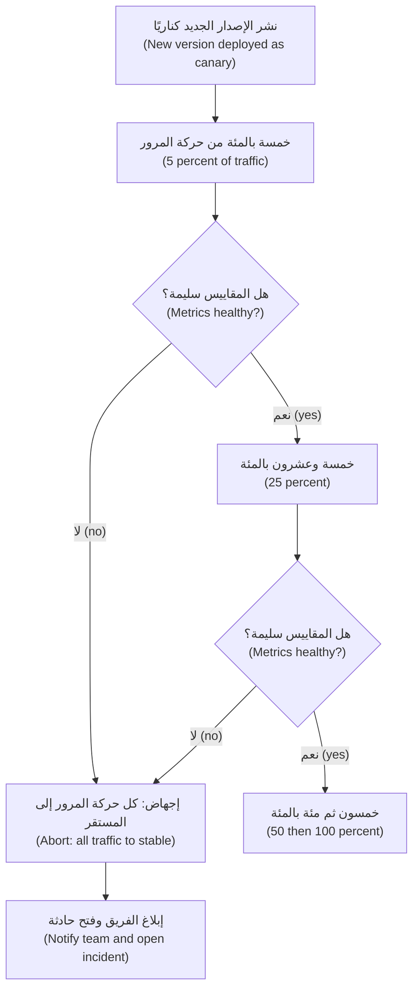

**اختيار ما يقيسه الكناري (Choosing what the canary measures).** استخدم الإشارات نفسها التي تستخدمها أهداف مستوى الخدمة (SLOs) لديك (الدرس 5.2): معدل الخطأ (error rate)، وزمن الاستجابة عند مئين مرتفع مثل p99، وإشارة أعمال (business signal) حيثما أمكن (للمدفوعات: نسبة التحويلات التي تبلغ حالة "مُسوّاة"). قارن الكناري بالمستقر *في الوقت نفسه*، لا بالأسبوع الماضي. واجعل الكناري كبيرًا بما يكفي (large enough): فعند 1% من خدمة هادئة (quiet service)، قد تحوي عشر دقائق طلبات أقل من أن يُحكم بها.

**أعلام الميزات (Feature flags).** **علم الميزة (feature flag)** (مفتاح تبديل الميزة، feature toggle) مفتاح وقت التشغيل (runtime switch) يغيّر السلوك دون نشر (without a deploy). ويسمّي تصنيف بيت هودجسون الواسع الاستشهاد أربعة أنواع:

| النوع (Kind) | الغرض (Purpose) | العمر (Lifetime) | مثال من نجم (Najm example) |
|---|---|---|---|
| **علم الإطلاق (Release flag)** | إخفاء الميزات غير المكتملة أو الجديدة حتى تجهز (until ready) | من أيام إلى أسابيع، ثم يُحذف (then delete) | شاشة تجميد البطاقة الجديدة |
| **علم العمليات / مفتاح الإيقاف (Ops flag / kill switch)** | إيقاف مسار مكلف أو خطِر تحت الحمل (under load) أو أثناء حادثة (during an incident) | طويل العمر، وموثّق (long-lived, documented) | تعطيل رفع المستندات (document upload) في نجم أسيست (Najm Assist) إذا كانت بوابة النماذج (model gateway) تعاني |
| **علم التجربة (Experiment flag)** | اختبار A/B (A/B test) لنسختين (two variants) | طول مدة التجربة | مساران للتسجيل |
| **علم الصلاحية (Permission flag)** | تفعيل ميزات لمستخدمين أو مستأجرين معيّنين | طويل العمر (long-lived) | ميزات تجريبية (beta features) للموظفين فقط |

يعرّف **OpenFeature**، وهو مشروع ضمن CNCF (CNCF project)، واجهة برمجة محايدة تجاه الموردين (vendor-neutral API) لتقييم الأعلام (evaluating flags)، كي لا تعتمد شيفرة التطبيق على مورد أعلام واحد. و*إدارة* الأعلام (flag *management*) (من يستطيع تغيير أيّ علم، وبأي موافقة (approval) وسجل تدقيق) لا تقل أهمية عن تقييمها (flag evaluation)، خصوصًا في بنك. ويقارن [*لبنات بناء البرمجيات كخدمة (SaaS Building Blocks)*، الدرس 6.3 — أعلام الميزات والتجارب](../saas/index.ar.html#/6.3) خدمات الأعلام (flag services) بتعمّق.

**الأعلام شيفرة قصيرة العمر (Flags are code with a short life).** في عام 2012 نشرت شركة التداول الأمريكية نايت كابيتال (Knight Capital) شيفرة جديدة على ثمانية خوادم، لكن وفقًا لأمر هيئة الأوراق المالية والبورصات الأمريكية (SEC's order)، لم يتلقَّها أحد الخوادم. وأعاد الإطلاق استخدام علم قديم، فأيقظ على ذلك الخادم منطقًا متقاعدًا منذ زمن طويل (long-retired logic) أرسل ملايين الأوامر في نحو 45 دقيقة. ويصف الأمر خسائر تزيد على 460 مليون دولار أمريكي. درسان (Two lessons): لا تُعِد استخدام اسم علم لمعنى جديد أبدًا، وتحقّق من أن كل نسخة (every instance) تشغّل الإصدار الذي تظن أنها تشغّله.

**قواعد البيانات: التوسيع والتقليص (Databases: expand and contract).** أثناء أي إطلاق متدرّج أو كناري أو أزرق وأخضر، يعمل الإصداران القديم والجديد *في الوقت نفسه* على قاعدة البيانات نفسها. فيجب أن يعمل أي تغيير في المخطط (schema change) مع كليهما. ونمط **التوسيع والتقليص (expand and contract)** (ويُسمّى أيضًا التغيير المتوازي، parallel change) يفعل ذلك على خطوات:
1. **التوسيع (Expand):** أضف العمود أو الجدول الجديد؛ فتتجاهله الشيفرة القديمة.
2. **الترحيل (Migrate):** انشر شيفرة تكتب في القديم والجديد معًا، واملأ الصفوف الموجودة بأثر رجعي، ثم حوّل القراءات إلى العمود الجديد.
3. **التقليص (Contract):** حين لا يعود أي إصدار عامل يقرأ العمود القديم، احذفه في إطلاق لاحق.

لا تُعِد تسمية عمود أو تحذفه أبدًا في الإطلاق نفسه الذي توقفت فيه الشيفرة عن استخدامه. فهذه القاعدة الواحدة تجعل التراجع ممكنًا.

#### 🔴 نظرة الخبير

**الحلقات والمناطق (Rings and regions).** تُطلق المنصات الكبيرة على **حلقات (rings)** مع فترة مراقبة (soak time) بينها؛ وتصف التزامات CrowdStrike الفكرة نفسها. وحلقات نجم: الموظفون، ثم 5% من حركة مرور قطر، ثم قطر كلها، ثم الإمارات، ثم الاتحاد الأوروبي. وكل حلقة تحدّ من نطاق ضرر الخطأ التالي.

**التراجع الآلي عند استنزاف هدف مستوى الخدمة (Automatic rollback on SLO burn).** يلتقط التحليل أثناء الطرح الإخفاقات الواضحة (obvious failures). أما الدقيقة منها (subtle ones)، مثل خطأ العملة في المدفوعات عند 3% من حركة المرور، فتحتاج إلى مراقبة أطول (longer watch). فبعد اكتمال الإطلاق، قارن **معدل استنزاف ميزانية الأخطاء (error budget burn rate)** (الدرس 5.2) خلال الساعة أو الساعتين التاليتين بمعدل الإصدار السابق. والاستنزاف المستمر الذي يفوق المعتاد بكثير ينبغي أن يُطلق تراجعًا آليًا (automatic rollback)، أو على الأقل نداءً (page) يسمّي الإطلاق.

**الدفعات الصغيرة تتفوق على التجميد (Small batches beat freezes).** تتفاعل منظمات كثيرة مع الإطلاقات السيئة بمجالس التغيير (change boards) وفترات تجميد طويلة (long freezes)؛ وقد وجدت أبحاث DORA أن الموافقة الخارجية الثقيلة تميل إلى إبطاء التسليم دون تحسين الاستقرار. وتحتفظ نجم بتجميد قصير (short freeze) حول فترات الذروة (peak periods) مثل يوم صرف الرواتب (salary day) والعيد (Eid)، لكن دفاعها الرئيسي هو الإطلاقات الصغيرة المتكررة المؤتمتة القابلة للمراقبة مع مراجعة الأقران (peer review). وما زالت الجهات التنظيمية (regulators) تتوقع أدلة على ضبط التغيير (change-control evidence)؛ فقانون DORA الأوروبي (EU DORA)، على سبيل المثال، يشترط إدارة تغييرات تقنية المعلومات والاتصالات ضمن إطار مخاطر تقنية المعلومات والاتصالات. وخط التسليم الذي يسجّل من وافق على ماذا، وأيّ كناري جرى، وماذا قاس، هو ذلك الدليل. ويغطي [*أمن الذكاء الاصطناعي وأمن التطبيقات*، الدرس 11.2 — التنظيم الذي يمسّ الأمن (Regulation that touches security)](../secai/index.ar.html#/11.2) قواعد القطاع المالي (financial-sector rules).

### 🧰 الأدوات
| الأداة أو الممارسة أو الخدمة | ما هي وماذا تفعل | متى تلجأ إليها |
|---|---|---|
| **Rolling update** — التحديث المتدرّج | استراتيجية Deployment في Kubernetes تستبدل الحجيرات تدريجيًا، مشروطة بالجاهزية | الافتراضي للخدمات عديمة الحالة |
| **Blue-green deployment** — النشر الأزرق والأخضر | بيئتان كاملتان؛ تتحوّل حركة المرور دفعة واحدة، وتعود بالسرعة نفسها | الانتقالات السريعة النظيفة؛ وحين تستطيع تحمّل ضعف السعة لفترة وجيزة |
| **Canary release** — الإطلاق الكناري | حصة صغيرة من حركة المرور إلى الإصدار الجديد، يُحكم عليها بالمقاييس قبل الزيادة | الخدمات عالية المخاطر مثل المدفوعات؛ وأي شيء له مستخدمون كثيرون |
| **Argo Rollouts** (CNCF، جزء من مشروع Argo) | متحكم Kubernetes (Kubernetes controller) يضيف الكناري والأزرق والأخضر مع التحليل الآلي (automated analysis) | التسليم التدريجي (progressive delivery) مع Argo CD |
| **Flagger** (جزء من مشروع Flux) | مشغّل Kubernetes (Kubernetes operator) يؤتمت الكناري واختبارات A/B والأزرق والأخضر مع فحوص المقاييس (metric checks) | التسليم التدريجي مع Flux أو شبكة خدمات |
| **OpenFeature** (CNCF) | واجهة برمجة ومجموعات تطوير برمجيات محايدة تجاه الموردين لتقييم أعلام الميزات | استخدام الأعلام دون ربط الشيفرة بمورد واحد |
| **Feature flag** — علم الميزة | مفتاح وقت التشغيل يغيّر السلوك دون نشر | فصل النشر عن الإطلاق؛ ومفاتيح الإيقاف (kill switches) |
| **Expand and contract** — التوسيع والتقليص | تغييرات المخطط وواجهات البرمجة على خطوات متوافقة مع الإصدارات السابقة (backward-compatible steps) | أي تغيير في قاعدة بيانات أو واجهة برمجة يستخدمها أكثر من إصدار واحد |

### 🏛️ عمليًا في بنك نجم
ينشر سالم ومها **معيار الإطلاق في نجم، الإصدار 1 (Najm Release Standard v1)**: استراتيجية لكل فئة خدمات وقائمة فحص للإطلاق (release checklist).

**الجزء أ: الاستراتيجية حسب الفئة (Part A: strategy by tier)**

| الفئة (Tier) | الخدمات (Services) | الاستراتيجية | التحليل الآلي | هدف التراجع (Rollback target) |
|---|---|---|---|---|
| 1 | خدمة المدفوعات، وتسجيل الدخول (login) | كناري 5% ← 25% ← 50% ← 100%، عشر دقائق لكل خطوة (10 minutes per step)؛ وحلقات حسب الدولة | معدل النجاح (success rate) ≥ 99.5%، وزمن الاستجابة p99 (p99 latency) ضمن 20% من المستقر، ونسبة التحويلات المُسوّاة (settled-transfer ratio) | أقل من 5 دقائق، آلي (automatic) |
| 2 | واجهة برمجة تطبيق نجم للهاتف، وبوابة نجم أسيست | كناري 10% ← 50% ← 100% | معدل الخطأ وزمن الاستجابة p99 | أقل من 10 دقائق، آلي |
| 3 | الأدوات الداخلية، والمهام الدفعية | تحديث متدرّج مع بوابات الجاهزية | سلامة الطرح فقط | أقل من 30 دقيقة، يدوي (manual) |

العتبات (thresholds) هي خيارات نجم الخاصة، تُحدَّد انطلاقًا من هدف مستوى الخدمة (SLO) لكل خدمة (الدرس 5.2)، وتُراجَع بعد كل حادثة.

**الجزء ب: قائمة فحص الإطلاق (الفئة 1) (Part B: release checklist (tier 1))**

| الفحص (Check) | الدليل (Evidence) |
|---|---|
| الصورة هي البصمة التي بناها التكامل المستمر واختبرها (الدرس 4.1) وهي موقّعة (signed) (الدرس 4.3) | رابط تشغيل خط التسليم؛ والتحقق من التوقيع عند القبول |
| تغييرات المخطط (schema changes) في هذا الإطلاق توسيع فقط (expand-only) | ملف الترحيل (migration file) مُراجَع؛ ولا يوجد `DROP` أو `RENAME` |
| السلوك الجديد خلف علم إطلاق، معطّل افتراضيًا (default off) | اسم العلم، والمالك، وتاريخ الإزالة (removal date) |
| لا يُعاد استخدام أي اسم علم | فحص سجل الأعلام |
| قالب تحليل الكناري يطابق هدف مستوى الخدمة الحالي للخدمة | إصدار القالب (template version) |
| التمرّن على التراجع في بيئة التجهيز هذا الربع | التاريخ والنتيجة |
| ليس ضمن نافذة تجميد (freeze window)؛ والمناوبة (on-call) على علم | تقويم الإطلاقات (release calendar)؛ ورسالة في قناة الإطلاقات |

**الجزء ج: دليل تشغيل التراجع (GitOps) (Part C: rollback runbook (GitOps))**
1. إذا أُجهض التحليل، فتأكد من أن حركة المرور 100% على الإصدار المستقر. وإن لم تكن، فأجهض الطرح يدويًا.
2. نفّذ `git revert` للإيداع في مستودع GitOps (GitOps repo) الذي غيّر بصمة الصورة؛ فيطبّقه Argo CD.
3. إذا كان علمٌ متورطًا، فأوقفه أولًا؛ فذلك أسرع من أي تراجع.
4. انشر الإصدار والوقت والعَرَض والإجراء في قناة الحادثة (incident channel)؛ وافتح مراجعة ما بعد الحادثة (postmortem) إذا تأثر العملاء (الدرس 5.3).

### 🛠️ التمارين
نفّذ هذه التمارين على عنقود kind أو k3d محلي (local kind or k3d cluster).

- 🟢 انشر تطبيق ويب صغيرًا بوصفه Deployment بأربع نسخ متماثلة (4 replicas)، ومسبار جاهزية، و`maxSurge: 1`، و`maxUnavailable: 0`، وانتظار `preStop` قصير كي تُصرَّف نقاط النهاية (endpoints drain) قبل توقف الحجيرات. حدّث الصورة وراقب `kubectl rollout status`. ثم تراجع باستخدام `kubectl rollout undo`. *يكتمل عندما:* تُظهر حلقةٌ من طلبات `curl` على الخدمة (Service) أثناء التحديث والتراجع كليهما عدم وجود أي طلب فاشل.
- 🟡 انشر إصدارًا لا يجتاز مسبار جاهزيته أبدًا. لاحظ ما يفعله التحديث المتدرّج وما يبلّغ عنه `progressDeadlineSeconds`. ثم انشر إصدارًا يبدأ بشكل سليم لكنه يُعيد HTTP 500 على نقطة نهاية واحدة (one endpoint). *يكتمل عندما:* تستطيع أن تشرح في ثلاث جمل لماذا أُوقف الإصدار السيئ الأول ولم يُوقف الثاني، وما الذي كان سيوقف الثاني.
- 🔴 ثبّت Argo Rollouts وPrometheus في عنقودك. حوّل Deployment إلى Rollout مع كناري (10% ← 50% ← 100%) وقالب AnalysisTemplate على معدل النجاح. أطلق إصدارًا يُعيد أخطاء على 20% من الطلبات. *يكتمل عندما:* يُجهض الطرح من تلقاء نفسه، وتعود حركة المرور إلى المستقر، وتستطيع عرض تشغيل التحليل الفاشل.

### ⚠️ أخطاء وفخاخ
- **معاملة الإعدادات والمحتوى على أنها ⁦("not a release")⁩ أي "ليست إطلاقًا" (Treating configuration and content as "not a release").** فدفعة إعدادات أو محتوى سيئة قد تكسر كل شيء دفعة واحدة. أطلقها على مراحل عبر الحلقات نفسها (same rings).
- **كناري دون تحليل حقيقي (Canary without real analysis).** إنسان يلقي نظرة على لوحة (dashboard) لدقيقتين ليس تحليلًا. عرّف المقاييس والعتبات والمدة في الشيفرة.
- **كسر قاعدة البيانات في الإطلاق نفسه (Breaking the database in the same release).** حذف عمود أو إعادة تسميته مع تغيير الشيفرة يجعل التراجع مستحيلًا. وسّع، ثم رحّل، ثم قلّص في إطلاق لاحق.
- **أعلام لا تُحذف أبدًا (Never-deleted flags).** تتراكم الأعلام القديمة في تركيبات غير مُختبرة (untested combinations)، والأسماء المعاد استخدامها قد توقظ شيفرة ميتة، كما حدث في نايت كابيتال. امنح كل علم إطلاق مالكًا وتاريخ إزالة.
- **تراجع غير مُتمرَّن عليه (An unrehearsed rollback).** التراجع أثناء حادثة هو أسوأ وقت لاكتشاف أنه لا يعمل. تمرّن عليه في بيئة التجهيز كل ربع سنة.

### 🧾 الخلاصة
- افصل النشر عن الإطلاق: تحويل حركة المرور يختار الإصدار؛ وأعلام الميزات تختار السلوك.
- توقف التحديثات المتدرّجة (rolling updates) الحجيرات التي لا تصبح جاهزة أبدًا؛ ويوقف الكناري مع التحليل الآلي الإصدارات التي تعمل لكنها تتصرف بشكل سيئ (behave badly).
- اختر الاستراتيجية حسب فئة المخاطر (risk tier): الكناري للمدفوعات وتسجيل الدخول، والمتدرّج للأدوات الداخلية.
- يعمل الإصداران القديم والجديد معًا، لذا تتغير قواعد البيانات وواجهات البرمجة بالتوسيع والتقليص.
- يجب أن يكون التراجع سريعًا ومُتمرَّنًا عليه ومنفّذًا بطريقة GitOps.

### ✍️ اختبر نفسك

**1. إصدار جديد من المدفوعات يبدأ بشكل طبيعي ويجتاز مسبار جاهزيته (readiness probe)، لكنه يُفشل التحويلات بعملة واحدة، أي نحو 3% من حركة المرور. أيّ استراتيجية كانت على الأرجح ستحدّ من الأثر (limited the impact)؟**

- A. تحديث متدرّج (rolling update) بقيمة `maxSurge` أكبر
- B. نشر بإعادة الإنشاء (recreate deployment)، كي لا تختلط الإصدارات أبدًا
- C. كناري يُحكم عليه آليًا بمعدل النجاح
- D. قيمة `progressDeadlineSeconds` أطول على Deployment

<details><summary>الإجابة</summary>

**C.** الحجيرات سليمة بمعيار المسبار، فلا يلتقط العطل إلا مقارنة مقاييس على حركة مرور حقيقية، والكناري يحدّ ممّن يتعرّضون له. أما A وB وD فلا تستجيب إلا للحجيرات التي تفشل في الإقلاع أو في أن تصبح جاهزة. (🟡 التعمق أكثر، Going deeper).

</details>

**2. يريد يوسف إعادة تسمية عمود (rename a column) في قاعدة بيانات المدفوعات في الإطلاق نفسه الذي يحدّث الشيفرة لتستخدم الاسم الجديد. بماذا ينبغي أن تنصح مها؟**

- A. لا بأس، ما دام الأزرق والأخضر (blue-green) يحوّل كل حركة المرور دفعة واحدة
- B. أضف العمود الجديد واملأه بأثر رجعي؛ واحذف القديم لاحقًا
- C. نفّذ ذلك ليلًا، خلال نافذة حركة مرور منخفضة (low-traffic window)
- D. اختبره أولًا بحركة مرور الظل (shadow traffic)، ثم أطلقه كالمعتاد

<details><summary>الإجابة</summary>

**B.** يُبقي التوسيع والتقليص (expand and contract) الإصدارين القديم والجديد يعملان معًا، فيبقى التراجع ممكنًا. أما الأزرق والأخضر فما زال يشغّل الإصدارين على قاعدة بيانات واحدة، والتراجع سيصطدم بالعمود المعاد تسميته (renamed column). (🟡 التعمق أكثر، Going deeper).

</details>

**3. تنشر نجم باستخدام Argo CD، مع تفعيل المزامنة الآلية (automated sync) والإصلاح الذاتي (self-heal). أثناء حادثة، يشغّل مهندس `kubectl rollout undo`، وبعد عشر دقائق يعود الإصدار السيئ. لماذا؟**

- A. أعاد Argo CD مزامنة العنقود مع الإصدار المُعلن في Git
- B. إن `kubectl rollout undo` مؤقت وتنتهي صلاحيته بعد مدة محددة
- C. فشل مسبار الجاهزية للإصدار القديم، فمضى Kubernetes قدمًا (rolled forward)
- D. أعاد Horizontal Pod Autoscaler إنشاء الحجيرات من قالبه الخاص

<details><summary>الإجابة</summary>

**A.** في GitOps، يكون Git مصدر الحقيقة (source of truth)، فتراجع باستخدام `git revert` لتغيير البصمة (digest change). أما الخيارات الأخرى فلا تعيد إصدارًا قديمًا من الصورة..

</details>

**4. أيّ استخدام لحركة مرور الظل (shadow traffic) (المنسوخة مرآويًا، mirrored) آمن لخدمة المدفوعات؟**

- A. نسخ طلبات التحويل مرآويًا إلى الإصدار الجديد مع تفعيل التسوية الحقيقية
- B. نسخ كل الطلبات مرآويًا وإعادة أيّ استجابة تصل أولًا
- C. استخدام حركة مرور الظل بدلًا من أي اختبارات مؤتمتة (automated tests)
- D. نسخ طلبات القراءة فقط (read-only requests) مرآويًا، أو الطلبات ذات الآثار الجانبية المستبدلة بأخرى وهمية

<details><summary>الإجابة</summary>

**D.** تُتجاهل استجابات الظل، لذا يجب ألا يُحدث الإصدار الجديد آثارًا حقيقية (real effects). أما A فستنقل المال مرتين؛ وB ليست ظلًا؛ وC تسيء استخدامه (misuses it)..

</details>

**5. بعد حادثة CrowdStrike في يوليو 2024، بأيّ ممارسة إطلاق (release practice) التزم المورد (vendor) لهذا النوع من تحديثات المحتوى (content update)؟**

- A. إيقاف تحديثات المحتوى وشحن إطلاقات المستشعر الكاملة فقط
- B. نشر مرحلي (staged deployment) عبر مجموعات كناري (canary groups)، مع تحكّم العملاء في التوقيت
- C. إطلاق تحديثات المحتوى مرة واحدة فقط كل ربع سنة، بعد تجميد (freeze)
- D. مطالبة كل عميل بتثبيت كل تحديث يدويًا

<details><summary>الإجابة</summary>

**B.** تحدّ عمليات الطرح المرحلية (staged rollouts) من نطاق ضرر (blast radius) التحديث السيئ، وهي الفكرة نفسها التي تقوم عليها الحلقات (rings) والكناري. أما الخيارات الأخرى فليست ما وُصف، وستترك العملاء دون تحديثات الحماية (protection updates)..

</details>

### 📚 المراجع
- Kubernetes، كائنات Deployment والتحديثات المتدرّجة — https://kubernetes.io/docs/concepts/workloads/controllers/deployment/
- توثيق Argo Rollouts — https://argo-rollouts.readthedocs.io/
- توثيق Flagger (Flagger documentation) — https://docs.flagger.app/
- OpenFeature — https://openfeature.dev/
- موقع مارتن فاولر، مفاتيح تبديل الميزات (بيت هودجسون، Pete Hodgson) — https://martinfowler.com/articles/feature-toggles.html
- CrowdStrike، معلومات حادثة Channel File 291 وتحليل السبب الجذري — https://www.crowdstrike.com/
- هيئة الأوراق المالية والبورصات الأمريكية (US SEC)، الإجراء الإداري ضد Knight Capital Americas LLC (administrative proceeding) (2013) — https://www.sec.gov/
- كتاب Google SRE، فصل هندسة الإطلاق — https://sre.google/sre-book/release-engineering/
- أبحاث DORA (DORA research) — https://dora.dev/

<a id="l4-3"></a>

## 4.3 — تأمين خط التسليم (securing the pipeline): الأسرار والآثار البرمجية الموقّعة وعمليات النشر بأقل الصلاحيات

*المستوى: 🟡 متوسط* · *المتطلبات: 1.3، 3.2، 4.1* · *المرحلة (Phase): Build, Deploy*

### ⚡ الدرس في دقيقة (In 60 seconds)
- يستطيع خط التكامل والتسليم المستمرين (CI/CD pipeline) تغيير الإنتاج، لذا فهو من أكثر الأنظمة التي تشغّلها امتيازًا. والمهاجمون (attackers) يعرفون ذلك؛ فاحمِه كما تحمي الإنتاج.
- **لا مفاتيح سحابية طويلة العمر في التكامل المستمر (No long-lived cloud keys in CI).** استخدم **اتحاد هوية أعباء العمل عبر OIDC (OIDC workload identity federation)**: تحصل كل مهمة (job) على رمز قصير العمر (short-lived token)، ولا تثق به السحابة (cloud) إلا لمستودع أو فرع أو بيئة محددة.
- **أقل الصلاحيات في كل مكان (Least privilege everywhere):** صلاحيات رمز افتراضية للقراءة فقط، وإجراءات الأطراف الثالثة (third-party actions) مثبّتة على معرّف إيداع كامل (full commit SHA)، وهوية منفصلة لكل مهمة، وعمليات نشر إلى الإنتاج تحرسها بيئة محمية (protected environment).
- **وقّع ما تبنيه وتحقّق قبل أن تشغّل (Sign what you build and verify before you run):** وقّع الصور بالبصمة، وأرفق المصدرية وقائمة مكوّنات البرمجيات (SBOM)، ودع العنقود (cluster) لا يقبل إلا الصور الموقّعة من سير عمل الإطلاق (release workflow) الخاص بك.
- فضّل **عمليات النشر القائمة على السحب (pull-based deploys)**: فلا يحمل التكامل المستمر أبدًا بيانات اعتماد العنقود (cluster credentials)؛ بل يسحب متحكمٌ داخل العنقود التغييرات المعتمدة (approved changes).
- الفخ الأكبر: معاملة خط التسليم على أنه ⁦("just tooling")⁩ أي "مجرد أدوات"، لا يملكه أحد ولا يدقّقه أحد.

### 🧭 لماذا يهم
حادثتان علنيتان تُظهران السبب. ففي أبريل 2021، كشفت Codecov أن مهاجمًا عدّل سكربت Bash Uploader الخاص بها، الذي كان كثير من العملاء يشغّلونه داخل خطوط التكامل المستمر (CI pipelines) لديهم. وأرسل السكربت المعدّل متغيرات البيئة لتلك المهام، التي كثيرًا ما تضمنت بيانات اعتماد (credentials) ورموزًا (tokens)، إلى خادم يتحكم فيه المهاجم. وفي مارس 2025، اختُرق إجراء GitHub (GitHub Action) الشائع `tj-actions/changed-files` (CVE-2025-30066): إذ وُجّهت أوسام إصداراته (version tags) إلى إيداع خبيث (malicious commit) طبع أسرار التكامل المستمر (CI secrets) في سجلات البناء (build logs)، حيث يستطيع أي شخص قراءتها في المستودعات العامة. فالفرق التي أشارت إلى الإجراء بوسم شغّلت الشيفرة الخبيثة دون تغيير سطر واحد؛ أما الفرق التي ثبّتته على معرّف إيداع كامل فلم تفعل.

وفي نجم، يُعدّ يوسف خط تسليم لخدمة داخلية جديدة. والنشر يحتاج إلى وصول سحابي (cloud access)، فينشئ مفتاح وصول سحابي لمستخدم بصلاحيات المسؤول (administrator rights)، ويخزّنه سرًّا في المستودع (repository secret)، ويضيف إجراءً من طرف ثالث (third-party action) وجده على الإنترنت ⁦⁩ أي "يجعل النشر أسهل". فيعمل من المحاولة الأولى. وتلاحظه نورة في المراجعة: مفتاح واحد، لا تنتهي صلاحيته أبدًا (never expiring)، يمنح تحكمًا كاملًا بالحساب السحابي، ومتاح لكل سير عمل في المستودع، وقطعة من شيفرة مجهولة (unknown code) تستطيع قراءته.

يحوّل سالم المراجعة إلى مشروع: "بحلول نهاية الربع، لا يوجد أي مفتاح سحابي طويل العمر في أي خط تسليم في نجم، ويرفض العنقود (cluster refuses) أي صورة لم يوقّعها سير عمل الإطلاق لدينا".

### 📐 كيف يعمل

#### 🟢 الأساسيات

**نمذجة التهديدات لخط التسليم (Threat-model the pipeline).** فكّر فيما يستطيع المهاجم فعله في كل خطوة من الإيداع إلى الإنتاج:

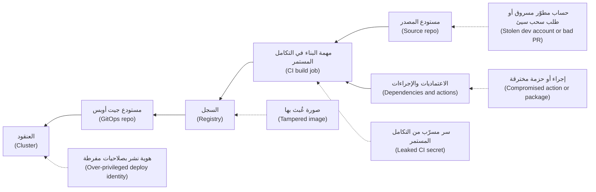

لكل سهم ضابط (control): حماية الفروع والمراجعة على المصدر؛ واعتماديات وإجراءات مثبّتة ومفحوصة؛ وبيانات اعتماد قصيرة العمر (short-lived credentials) للبناء؛ وتواقيع على الصورة؛ ومسار نشر ضيق إلى العنقود. ويصف إطار SLSA هذه التهديدات بالتفصيل. ويغطي [*أمن الذكاء الاصطناعي وأمن التطبيقات*، الدرس 6.2 — سلسلة توريد البرمجيات](../secai/index.ar.html#/6.2) الاعتماديات وقوائم مكوّنات البرمجيات (SBOMs) وSLSA من الجانب الأمني؛ ويبقى هذا الدرس على كيفية بناء فريق المنصة لخط التسليم وتشغيله.

**الأسرار: كلما قلّت كان أفضل (Secrets: the fewer, the better).** أفضل سر هو السر غير الموجود. وترتيب الأفضلية:
1. **الهوية الاتحادية (Federated identity) (بلا سر، no secret).** تثبت مهمة التكامل المستمر هويتها برمز OIDC قصير العمر تُصدره منصة التكامل المستمر (CI platform)؛ وتستبدله السحابة ببيانات اعتماد مؤقتة (temporary credentials) (الدرس 1.3).
2. **أسرار قصيرة العمر من مدير أسرار (short-lived secrets from a secrets manager)**، تُجلب وقت التشغيل بهوية اتحادية.
3. **أسرار مخزّنة في التكامل المستمر (Stored CI secrets)**، فقط حيث لا يصلح شيء آخر، مقصورة على بيئة واحدة، ومُدوَّرة وفق جدول، ولا تُطبع أبدًا (never printed).

**الاتحاد عبر OIDC من GitHub Actions (OIDC federation from GitHub Actions).** يطلب سير العمل رمز هوية (ID token)، ولا يثق دور السحابة (cloud role) إلا بالرموز التي تطابق مطالباتها (claims) الشروط. وهذه مهمة إطلاق (release job) تدفع الصورة:

```yaml
permissions:
  contents: read             # workflow default: read-only

jobs:
  push-image:
    runs-on: ubuntu-latest
    environment: production   # protected: required reviewers, main branch only
    permissions:
      contents: read
      id-token: write         # only this job may request an OIDC token
    steps:
      - uses: aws-actions/configure-aws-credentials@v4   # pin by SHA in real use
        with:
          role-to-assume: arn:aws:iam::111122223333:role/mobile-api-ci-push
          aws-region: me-central-1
```

وهذا شرط الثقة (trust condition) على جانب السحابة (يظهر هنا AWS IAM؛ وصيغة الموضوع (subject format) هي صيغة GitHub):

```json
"Condition": {
  "StringEquals": {
    "token.actions.githubusercontent.com:aud": "sts.amazonaws.com",
    "token.actions.githubusercontent.com:sub": "repo:najm-bank/mobile-api:environment:production"
  }
}
```

المهمة في مستودع آخر، أو المهمة التي لا تعمل في بيئة `production`، تحصل على رمز بموضوع مختلف (different subject)، فلا تستطيع تولّي الدور. ولأن الموضوع يسمّي البيئة لا الفرع، فاقصر تلك البيئة على `main` في إعدادات فروع النشر (deployment-branch settings) الخاصة بها. وتدعم السحب الكبرى الثلاث الفكرة نفسها:

| السحابة | الميزة (Feature) | جانب التكامل المستمر (CI side) |
|---|---|---|
| AWS | مزوّد هوية OIDC في IAM ودور بسياسة ثقة | `aws-actions/configure-aws-credentials` |
| Microsoft Azure | اتحاد هوية أعباء العمل (workload identity federation): بيانات اعتماد اتحادية (federated credential) على تسجيل تطبيق (app registration) أو هوية مُدارة (managed identity) في Entra ID | `azure/login` |
| Google Cloud | اتحاد هوية أعباء العمل مع مجمّع هويات أعباء العمل ومزوّد (provider) | `google-github-actions/auth` |

**رمز التكامل المستمر الخاص (The CI's own token).** يمنح GitHub كل سير عمل رمزًا `GITHUB_TOKEN`. اضبط `permissions: contents: read` في أعلى كل سير عمل، وامنح المزيد لكل مهمة على حدة فقط عند الحاجة (`packages: write` للدفع إلى سجل GitHub، و`id-token: write` لـOIDC). ويمكن لإعداد على مستوى المنظمة (organisation-level setting) أن يجعل القراءة فقط هي الافتراضي.

**إجراءات الأطراف الثالثة وإضافاتها تعمل بأسرارك (Third-party actions and plugins run with your secrets).** الوسم مثل `@v4` يمكن أن ينقله من يتحكم في مستودع الإجراء؛ أما معرّف الإيداع الكامل فلا.

```yaml
# Risky: the tag can be repointed to different code
- uses: some-org/deploy-helper@v2

# Hardened: an immutable commit, with the tag as a comment for humans
- uses: some-org/deploy-helper@<full-40-character-commit-sha>   # v2.3.1
```

استخدم روبوت اعتماديات (dependency bot) ليقترح تحديثات المعرّفات بوصفها طلبات سحب مُراجَعة، واحتفظ بقائمة سماح (allow-list) للإجراءات المعتمدة على مستوى المنظمة. وينطبق الأمر نفسه على إضافات Jenkins (Jenkins plugins)، وتضمينات GitLab CI، وصور الحاويات الأساسية.

**الشيفرة غير الموثوقة في طلبات السحب (Untrusted code in pull requests).** يحوي طلب السحب القادم من نسخة مشتقة (fork) شيفرة لم تراجعها. فلا تشغّلها أبدًا والأسرار متاحة. وعلى GitHub، يعمل المُطلِق `pull_request_target` في سياق المستودع الأساسي، مع وصول إلى أسراره؛ وسحب شيفرة طلب السحب وتشغيلها في ذلك السياق طريقة معروفة لتسريب الأسرار. استخدم المُطلِق العادي `pull_request` للشيفرة غير الموثوقة (untrusted code).

#### 🟡 التعمق أكثر

**توقيع الآثار البرمجية والتحقق منها (Signing and verifying artefacts).** يثبت التوقيع (signature) *مَن* أنتج الأثر البرمجي وأنه لم يتغير منذ ذلك الحين. و**Sigstore** مشروع مفتوح المصدر (open-source project) (تحت مظلة OpenSSF) تقوم أداته **cosign** بتوقيع صور الحاويات (container images). وفي التوقيع **بلا مفاتيح (keyless)**، تُربط هوية OIDC لمهمة التكامل المستمر بشهادة قصيرة العمر (short-lived certificate)، ويُسجَّل التوقيع في سجل شفافية عام (Rekor)، فلا يوجد مفتاح توقيع طويل العمر يمكن سرقته أو تدويره.

```bash
# In the release workflow, after pushing; the identity comes from the job's OIDC token
cosign sign --yes registry.najm.internal/mobile-api@sha256:<digest>

# Before deploy, or at admission: accept only Najm's release workflow on main
cosign verify \
  --certificate-identity "https://github.com/najm-bank/mobile-api/.github/workflows/release.yml@refs/heads/main" \
  --certificate-oidc-issuer "https://token.actions.githubusercontent.com" \
  registry.najm.internal/mobile-api@sha256:<digest>
```

وقّع **البصمة (digest)**، لا الوسم أبدًا. فالتوقيع على وسم لا يعني شيئًا بمجرد أن يتحرك الوسم.

**المصدرية وقوائم مكوّنات البرمجيات (Provenance and SBOMs).** **المصدرية (Provenance)** بيان موقّع (signed statement) بكيفية بناء الأثر البرمجي: أيّ إيداع مصدري (source commit)، وأيّ سير عمل، وأيّ بانٍ (builder)، وأيّ مدخلات (inputs). ويعرّف **SLSA** مستويات بناء (build levels) (في SLSA v1.0، من Build L1 إلى L3) حسب مدى جدارة تلك المصدرية بالثقة؛ ففي المستوى L3 يعمل البناء على منصة مُحصّنة (hardened platform) لا تستطيع خطوات البناء نفسها العبث بها. و**قائمة مكوّنات البرمجيات (SBOM)** (software bill of materials) تسرد المكوّنات داخل الصورة، فتستطيع الإجابة عن سؤال ⁦⁩ أي "هل نحن متأثرون؟" حين تظهر الثغرة الحرجة التالية. ويستطيع إجراء البناء والدفع من Docker إرفاق المصدرية وقائمة المكوّنات بوصفهما شهادات (attestations)، ويقدّم GitHub شهادات الآثار البرمجية (artifact attestations)؛ وفي وقت كتابة هذا الدرس (2026)، راجع توثيق كل أداة للاطلاع على الخيارات الدقيقة.

**تحقّق عند الباب: ضبط القبول (Verify at the door: admission control).** يضيع التوقيع سدى إن لم يتحقق منه شيء. و**متحكم القبول (admission controller)** في Kubernetes يفحص كل حجيرة جديدة قبل إنشائها. ومحرّكات السياسات (policy engines) مثل **Kyverno** أو **policy-controller** من Sigstore تستطيع رفض أي صورة غير موقّعة من الهوية المتوقعة (expected identity)، أو تفتقر إلى المصدرية. واجمع ذلك مع حواجز السياسات بوصفها شيفرة (policy-as-code guardrails) من الدرس 3.3: الصور بالبصمة فقط، ومن السجل الداخلي (internal registry) فقط. وابدأ الطرح بوضع التدقيق (audit mode) أولًا، ثم الإنفاذ (enforce)، بدءًا بنطاق أسماء واحد (one namespace).

**عمليات النشر بأقل الصلاحيات: الدفع مقابل السحب (Least-privilege deploys: push versus pull).**

| النموذج (Model) | كيف يعمل | أين تعيش بيانات اعتماد الإنتاج | المخاطرة (Risk) |
|---|---|---|---|
| **الدفع (Push)** | تشغّل مهمة التكامل المستمر `kubectl apply` أو `helm upgrade` على العنقود | في التكامل المستمر، لكل خط تسليم ينشر | خط التسليم المخترق (compromised pipeline) يستطيع تغيير العنقود مباشرة |
| **السحب (Pull) (GitOps)** | يدفع التكامل المستمر صورة موقّعة ويفتح تغييرًا في مستودع GitOps؛ ويطبّقه متحكم داخل العنقود | داخل العنقود فقط | لا وصول للتكامل المستمر إلى العنقود؛ وتمر التغييرات عبر مراجعة Git (Git review) |

تستخدم نجم السحب. فهوية التكامل المستمر (CI identity) تستطيع دفع الصور إلى مستودع سجل واحد وفتح طلبات سحب إلى مستودع GitOps. ولا تستطيع لمس العنقود أو موارد سحابية أخرى. وصلاحيات Argo CD الخاصة مقصورة حسب المشروع على نطاقات الأسماء (namespaces) التي يملكها كل فريق.

**قسّم الهويات حسب المهمة (Split identities by job).** هوية تكامل مستمر واحدة قوية لكل شيء نقطة فشل واحدة (single point of failure). امنح أدوارًا منفصلة لمهام منفصلة: مهمة بناء تستطيع قراءة الاعتماديات والدفع إلى مسار سجل التجهيز؛ ومهمة إطلاق، على `main` فقط وفي البيئة المحمية فقط، تستطيع الترقية والتوقيع؛ ومهمة **تخطيط (plan)** للبنية التحتية بوصول للقراءة فقط (read-only access)؛ ومهمة **تطبيق (apply)** لا تعمل إلا بعد الموافقة (after approval) (الدرس 3.1).

#### 🔴 نظرة الخبير

**المشغّلات بنية تحتية إنتاجية (Runners are production infrastructure).** المشغّلات المستضافة (hosted runners) جديدة لكل مهمة. أما **المشغّلات المستضافة ذاتيًا (self-hosted runners)**، التي تحتاجها نجم للوصول إلى الشبكات الخاصة (private networks)، فليست كذلك، ما لم تجعلها كذلك. فالمشغّل الدائم (persistent runner) قد يحتفظ بملفات أو بيانات اعتماد أو برمجيات خبيثة (malware) من مهمة إلى التالية. استخدم **المشغّلات المؤقتة (ephemeral runners)** (مهمة واحدة، ثم تُدمَّر)، مثل حجيرات المشغّلات ذات التوسّع التلقائي على Kubernetes؛ ولا تربط المشغّلات المستضافة ذاتيًا بالمستودعات العامة أبدًا؛ وقيّد حركة الخروج الشبكية (network egress) لديها؛ وافصل مجموعات المشغّلات (runner groups) للإنتاج عن غير الإنتاج.

**الفصل بين المهام دون إبطاء (Separation of duties without slowing down).** يجب على البنوك أن تُثبت أن شخصًا واحدًا لا يستطيع وحده أن يكتب تغييرًا ويشحنه. وعمليًا: فروع محمية (protected branches) تشترط مراجعًا واحدًا على الأقل ليس هو المؤلف؛ وملفات **CODEOWNERS** بحيث تحتاج تغييرات تعريفات خطوط التسليم (pipeline definitions) والبنية التحتية بوصفها شيفرة (IaC) ومستودع GitOps إلى موافقة فريق المنصة أو الأمن؛ وبيئات محمية (protected environments) تحتاج فيها الترقية إلى الإنتاج إلى مراجع؛ وإيداعات موقّعة (signed commits) حيث تبرّر المخاطرة الاحتكاك (friction). وعندها يصبح خط التسليم دليل ضبط التغيير الذي تطلبه الجهات التنظيمية، بدلًا من تذكرة منفصلة (separate ticket).

**كسر الزجاج والتدقيق (Break-glass and audit).** أحيانًا يجب على البشر التصرف مباشرة على الإنتاج. فخطّط لذلك: دور **كسر الزجاج (break-glass)** يتطلب عاملًا ثانيًا قويًا، ويرسل تنبيهًا إلى مركز العمليات الأمنية (SOC) (فريق جاسم، Jassim's team)، وتنتهي صلاحيته خلال ساعات، ويُراجَع بعد ذلك. وأرسل سجلات تدقيق التكامل المستمر وسجلات تدقيق السحابة وحالات الرفض من متحكم القبول (admission-controller denials) إلى منصة المراقبة الأمنية، ونبّه على الأحداث غير المعتادة (unusual events) مثل مشغّل مستضاف ذاتيًا جديد، أو تغيير في حماية الفروع (branch protection)، أو نشر إلى الإنتاج خارج خط التسليم.

**الأسرار تتسرّب مع ذلك؛ فخطّط للتدوير (Secrets still leak; plan for rotation).** حتى مع الاتحاد (federation)، تبقى بعض الأسرار: كلمات مرور قواعد البيانات (database passwords)، ومفاتيح واجهات برمجة الأطراف الثالثة لمزوّدي النماذج (model providers) في نجم أسيست. خزّنها في مدير أسرار (secrets manager) واحقنها وقت التشغيل (الدرس 2.3)، مع فحص الأسرار عند كل دفع ودليل تشغيل للتدوير (rotation runbook) مُختبر مسبقًا. ويتعمّق [*أمن الذكاء الاصطناعي وأمن التطبيقات*، الدرس 5.2 — إدارة الأسرار (Secrets management)](../secai/index.ar.html#/5.2) أكثر، ويغطي [*أمن الذكاء الاصطناعي وأمن التطبيقات*، الدرس 7.2 — الحاويات وKubernetes والبنية التحتية بوصفها شيفرة](../secai/index.ar.html#/7.2) تحصين العناقيد (cluster hardening).

### 🧰 الأدوات
| الأداة أو الممارسة أو الخدمة | ما هي وماذا تفعل | متى تلجأ إليها |
|---|---|---|
| **OIDC workload identity federation** — اتحاد هوية أعباء العمل عبر OIDC | تستبدل مهام التكامل المستمر رمز هوية قصير العمر ببيانات اعتماد سحابية مؤقتة؛ دون مفاتيح مخزّنة | كل خط تسليم يلمس حسابًا سحابيًا (cloud account) |
| **Protected environments** — البيئات المحمية | أهداف نشر (deployment targets) بمراجعين إلزاميين (required reviewers) وقيود على الفروع (branch restrictions) وأسرار خاصة بها | حراسة الترقية إلى الإنتاج |
| **SHA pinning** — التثبيت بمعرّف الإيداع | الإشارة إلى إجراءات الأطراف الثالثة وإضافاتها وصورها بإيداع أو بصمة ثابتة | كل اعتمادية خارجية (external dependency) لخط التسليم |
| **cosign** (Sigstore) | يوقّع صور الحاويات ويتحقق منها، بما في ذلك التوقيع بلا مفاتيح عبر OIDC | توقيع صور الإطلاق (release images)؛ والتحقق قبل النشر |
| **SLSA** (OpenSSF) | إطار لتهديدات سلسلة التوريد (supply-chain threats) ومستويات البناء الخاصة بالمصدرية | وضع أهداف لسلامة البناء (build integrity) |
| **SBOM** — قائمة مكوّنات البرمجيات | قائمة بالمكوّنات داخل الأثر البرمجي، بصيغة SPDX أو CycloneDX | الإجابة عن سؤال ⁦⁩ أي "هل نحن متأثرون؟" للثغرات الجديدة (new vulnerabilities) |
| **Kyverno** | محرّك سياسات Kubernetes، بما في ذلك التحقق من توقيع الصور عند القبول | قبول الصور الموقّعة المعتمدة فقط |
| **Ephemeral runners** — المشغّلات المؤقتة | مشغّلات تكامل مستمر تُنشأ لمهمة واحدة ثم تُدمَّر | أي مشغّل مستضاف ذاتيًا، خصوصًا مع وصول شبكي إلى الإنتاج |

### 🏛️ عمليًا في بنك نجم
ينشر سالم ونورة **خط الأساس لأمن خطوط التسليم في نجم، الإصدار 1 (Najm Pipeline Security Baseline v1)**. ويُقيَّم كل مستودع مقابله على لوحة؛ ويجب أن تستوفيه خدمات الفئة 1 (tier-1 services) كاملًا بحلول نهاية الربع.

| # | الضابط | كيف يُنفَّذ | الدليل |
|---|---|---|---|
| P1 | لا مفاتيح سحابية طويلة العمر في التكامل المستمر | الوصول السحابي فقط عبر أدوار OIDC (OIDC roles) مقصورة على المستودع والبيئة؛ وفحص مجدول (scheduled scan) لأسماء أسرار التكامل المستمر وأعمار المفاتيح السحابية | صفر مفاتيح وصول نشطة لمستخدمي التكامل المستمر |
| P2 | رمز افتراضي للقراءة فقط | إعداد على مستوى المنظمة (organisation setting)؛ وتعلن سير العمل الصلاحيات لكل مهمة (per-job permissions) | فحص سياسات (policy check) على كل ملف سير عمل |
| P3 | إجراءات الأطراف الثالثة مثبّتة على معرّف كامل (full SHA) من قائمة سماح | قائمة سماح على مستوى المنظمة؛ وفاحص ساكن (linter) لملفات سير العمل؛ وتحديثات بالروبوت (bot updates) | تقرير الفاحص الساكن (linter report) |
| P4 | لا أسرار لطلبات السحب غير الموثوقة | حظر `pull_request_target` إلا في القوالب المُراجَعة (reviewed templates) | تقرير الفاحص الساكن |
| P5 | صور موقّعة بالبصمة مع المصدرية وقائمة المكوّنات | سير عمل الإطلاق للمسار الذهبي (الدرس 4.1) | التوقيع والشهادات في السجل |
| P6 | لا يقبل العنقود إلا الصور الموقّعة من `release.yml` على `main` | سياسة Kyverno (Kyverno policy)، مُنفَّذة في نطاقات أسماء الإنتاج (production namespaces) | سجل رفض القبول |
| P7 | عمليات نشر قائمة على السحب | لا يملك التكامل المستمر بيانات اعتماد العنقود؛ ويطبّق Argo CD من مستودع GitOps | مراجعة ارتباطات أدوار العنقود |
| P8 | الفصل بين المهام (Separation of duties) | حماية الفروع، وCODEOWNERS على سير العمل والبنية التحتية بوصفها شيفرة ومستودع GitOps؛ وبيئة إنتاج محمية | تصدير الإعدادات (settings export)، شهريًا |
| P9 | مشغّلات مؤقتة ومعزولة | مشغّلات مستضافة ذاتيًا بوصفها حجيرات لمهمة واحدة (one-job pods)؛ ومجموعات منفصلة للإنتاج | جرد المشغّلات (runner inventory) |
| P10 | وصول كسر الزجاج (Break-glass access) | دور محدود زمنيًا (time-limited role)، ومصادقة متعددة العوامل (MFA)، وتنبيه لمركز العمليات الأمنية (SOC alert)، ومراجعة بعد الاستخدام (post-use review) | سجل الوصول وسجل المراجعة |

الإصلاح لخط تسليم يوسف: يُحذف مفتاح المسؤول (admin key)؛ ويتولى سير العمل دورًا لا يستطيع إلا الدفع إلى `registry.najm.internal/internal-tool/*`؛ ويُزال إجراء النشر من الطرف الثالث، لأن إيداعًا في مستودع GitOps يحلّ محله.

### 🛠️ التمارين
استخدم حسابك الخاص على GitHub، وإن استخدمت سحابة، فحسابًا من الفئة المجانية (free-tier account) بعد ضبط تنبيه ميزانية (budget alert) أولًا.

- 🟢 دقّق سير العمل في أحد مستودعاتك: أضف `permissions: contents: read` في الأعلى، وامنح صلاحيات إضافية لكل مهمة فقط حيث تلزم، وثبّت كل إجراء من طرف ثالث على معرّف إيداع كامل مع الإصدار بوصفه تعليقًا. *يكتمل عندما:* يشير كل سطر `uses:` إلى معرّف من 40 حرفًا (40-character SHA) ويعلن كل سير عمل صلاحياته.
- 🟡 ابنِ صورة في GitHub Actions، وادفعها إلى GitHub Container Registry، ووقّعها بتوقيع cosign بلا مفاتيح (تحتاج المهمة إلى `id-token: write`). ثم تحقّق منها محليًا باستخدام `cosign verify`، مستخدمًا هوية سير العمل والمُصدِر الدقيقين. *يكتمل عندما:* ينجح التحقق بالهوية الصحيحة، ويفشل حين تغيّر الهوية إلى فرع مختلف (different branch).
- 🔴 في عنقود kind محلي، ثبّت Kyverno واكتب سياسة لا تقبل الصور من سجلك إلا إذا كانت موقّعة بهوية سير عملك (workflow identity). ابدأ بوضع التدقيق، ثم الإنفاذ. جرّب تشغيل صورة غير موقّعة وأخرى موقّعة. أو بديلًا عن ذلك، اضبط اتحاد OIDC (OIDC federation) من GitHub Actions إلى حساب سحابي من الفئة المجانية مع شرط ثقة على مستودعك وبيئتك. *يكتمل عندما:* تُرفض الصورة غير الموقّعة برسالة سياسة واضحة وتعمل الموقّعة؛ أو، في خيار السحابة، تحصل مهمة في البيئة المسمّاة على بيانات اعتماد وتُرفض مهمة على فرع آخر.

### ⚠️ أخطاء وفخاخ
- **مفاتيح مسؤول طويلة العمر في أسرار التكامل المستمر (Long-lived admin keys in CI secrets).** تسريب واحد يمنح تحكمًا سحابيًا كاملًا. استخدم اتحاد OIDC بأدوار ضيقة النطاق لكل مهمة.
- **الثقة بالأوسام (Trusting tags).** الأوسام على الإجراءات والإضافات والصور يمكن أن تتحرك. ثبّت بمعرّف الإيداع أو البصمة وحدّث عبر طلبات سحب مُراجَعة من الروبوت.
- **التوقيع دون تحقق (Signing without verifying).** التواقيع التي لا يفحصها أحد زينة (decoration). أنفِذ التحقق عند القبول، بدءًا بوضع التدقيق.
- **تشغيل شيفرة النسخ المشتقة مع الأسرار (Running fork code with secrets).** إن `pull_request_target` مع سحب شيفرة طلب السحب يكشف الأسرار. أبقِ الشيفرة غير الموثوقة بعيدة عن السياقات ذات الامتيازات (privileged contexts).
- **المشغّلات المستضافة ذاتيًا الدائمة (Persistent self-hosted runners).** قد تترك المهام وراءها بيانات اعتماد أو برمجيات خبيثة للمهمة التالية. اجعل المشغّلات مؤقتة (ephemeral) واعزل الإنتاج (segregate production).
- **تكامل مستمر بصلاحيات مسؤول العنقود (CI with cluster-admin).** خط التسليم القائم على الدفع (push-based pipeline) الذي يحمل بيانات اعتماد العنقود طريق مباشر إلى الإنتاج. فضّل GitOps القائم على السحب (pull-based GitOps).

### 🧾 الخلاصة
- خط التسليم نظام إنتاج ذو امتيازات؛ فاعمل على نمذجة التهديدات (threat-model) لكل خطوة من الإيداع إلى العنقود.
- استبدل المفاتيح السحابية المخزّنة باتحاد OIDC مقصور على المستودع والبيئة؛ واجعل كل الرموز للقراءة فقط افتراضيًا.
- ثبّت إجراءات الأطراف الثالثة والصور تثبيتًا ثابتًا (immutably)؛ ولا تكشف الأسرار أبدًا لطلبات السحب غير الموثوقة.
- وقّع الصور بالبصمة، وأرفق المصدرية وقائمة مكوّنات البرمجيات، ولا تقبل إلا الصور المُتحقَّق منها (verified images).
- انشر بالسحب عبر GitOps، وقسّم الهويات حسب المهمة، واستخدم المشغّلات المؤقتة، واحتفظ بوصول كسر زجاج مُدقَّق.

### ✍️ اختبر نفسك

**1. يخزّن سير عمل يوسف مفتاح مسؤول سحابي لا تنتهي صلاحيته أبدًا (never-expiring cloud admin key) بوصفه سرًّا في المستودع (repository secret). ما الذي ينبغي أن يحلّ محله؟**

- A. مفتاح المسؤول نفسه، مع تدويره آليًا (rotated automatically) كل 90 يومًا
- B. مفتاح لمستخدم أقل امتيازًا، مخزّن في مستودع مختلف
- C. المفتاح مرمَّزًا بـbase64 (base64-encoded) في ملف سير العمل، كي لا يكون نصًّا صريحًا (plain text)
- D. اتحاد OIDC (OIDC federation)، مع دور لا يثق إلا بهذا المستودع وهذه البيئة

<details><summary>الإجابة</summary>

**D.** يزيل الاتحاد (federation) السر طويل العمر كليًا ويربط الوصول بمستودع وبيئة محددين. أما A وB فما زالتا تتركان مفتاحًا قابلًا للسرقة (stealable key)؛ وC ليست تشفيرًا (encryption) على الإطلاق..

</details>

**2. في مارس 2025، شغّلت الفرق التي أشارت إلى `tj-actions/changed-files` بوسم إصدار (version tag) شيفرة خبيثة. أيّ ممارسة حمت الفرق التي لم تتأثر؟**

- A. تثبيت الإجراء على معرّف إيداع كامل
- B. استخدام أحدث وسم إصدار للإجراء دائمًا
- C. تشغيل سير العمل على مشغّل مستضاف ذاتيًا (self-hosted runner)
- D. ضبط مهلة زمنية قصيرة (short timeout) لكل مهمة

<details><summary>الإجابة</summary>

**A.** نقل المهاجم الأوسام؛ أما معرّف الإيداع المثبّت فلا يمكن نقله. وB تتبع الوسم المنقول؛ وC وD لا تغيّران الشيفرة التي تعمل..

</details>

**3. توقّع نجم كل صورة، لكنها تجد صورة غير موقّعة (unsigned image) تعمل في الإنتاج. ما الذي ينقص؟**

- A. شهادات توقيع أطول عمرًا، كي تبقى التواقيع صالحة
- B. فحوص القبول (admission checks) مقابل هوية سير عمل الإطلاق
- C. التوقيع بالوسم بدلًا من البصمة، كي تشمل التحديثات
- D. قائمة مكوّنات برمجيات (SBOM) أكثر تفصيلًا مرفقة بكل صورة

<details><summary>الإجابة</summary>

**B.** لا يحميك التوقيع إلا إذا كان هناك شيء، مثل سياسة Kyverno (Kyverno policy)، يرفض الصور غير الموقّعة أو الموقّعة خطأً (wrongly signed). أما C فستُضعف التوقيع، لأن الأوسام يمكن أن تتحرك؛ وA وD لا توقفان صورة غير موقّعة. (🟡 التعمق أكثر، Going deeper).

</details>

**4. لماذا تفضّل نجم عمليات نشر GitOps القائمة على السحب (pull-based GitOps deploys) على مهام التكامل المستمر التي تشغّل `kubectl apply`؟**

- A. عمليات النشر القائمة على السحب تصل إلى الإنتاج دائمًا أسرع من مهام التكامل المستمر
- B. لا يستطيع `kubectl apply` تحديث Deployment موجود
- C. لا يحمل التكامل المستمر بيانات اعتماد العنقود (cluster credentials)؛ ولا يصل إليه إلا تغييرات Git المُراجَعة
- D. يتيح GitOps للفرق تخطي مراجعة الشيفرة على تغييرات النشر

<details><summary>الإجابة</summary>

**C.** لا يستطيع خط التسليم المخترق (compromised pipeline) تغيير العنقود مباشرة، وتصبح مراجعة Git سجل التغيير (change record). أما D فعكس الحقيقة؛ وA وB خاطئتان. (🟡 التعمق أكثر، Going deeper).

</details>

**5. تحتاج نجم إلى مشغّلات مستضافة ذاتيًا (self-hosted runners) تستطيع الوصول إلى الشبكات الخاصة. أيّ إعداد هو الأكثر أمانًا (safest)؟**

- A. مشغّلات مؤقتة لمهمة واحدة، معزولة حسب البيئة، وبعيدة عن المستودعات العامة
- B. مشغّل واحد طويل العمر تتشاركه كل المستودعات، من أجل السرعة
- C. مشغّلات مستضافة ذاتيًا مربوطة بمستودعات عامة كي يتمكن المجتمع (community) من الاختبار
- D. مشغّل دائم (persistent runner) ببيانات اعتماد مسؤول العنقود (cluster-admin credentials) مخزّنة مؤقتًا على القرص

<details><summary>الإجابة</summary>

**A.** تمنع المشغّلات المؤقتة المعزولة أي مهمة من ترك بيانات اعتماد أو برمجيات خبيثة للمهمة التالية. أما B وC وD فكلٌّ منها يمنح المهاجم موطئ قدم دائمًا (lasting foothold). (🔴 نظرة الخبير، Expert view).

</details>

### 📚 المراجع
- GitHub، التحصين الأمني باستخدام OpenID Connect — https://docs.github.com/en/actions/security-for-github-actions/security-hardening-your-deployments/about-security-hardening-with-openid-connect
- GitHub، التحصين الأمني لـGitHub Actions — https://docs.github.com/en/actions/security-for-github-actions/security-guides/security-hardening-for-github-actions
- GitHub، إدارة بيئات النشر — https://docs.github.com/en/actions/managing-workflow-runs-and-deployments/managing-deployments/managing-environments-for-deployment
- AWS IAM، مزوّدو هوية OIDC — https://docs.aws.amazon.com/IAM/latest/UserGuide/id_roles_providers_create_oidc.html
- Microsoft Entra، اتحاد هوية أعباء العمل — https://learn.microsoft.com/en-us/entra/workload-id/workload-identity-federation
- Google Cloud، اتحاد هوية أعباء العمل — https://cloud.google.com/iam/docs/workload-identity-federation
- توثيق Sigstore (Sigstore documentation) (cosign، Rekor) — https://docs.sigstore.dev/
- مواصفة SLSA (SLSA specification) — https://slsa.dev/
- Kyverno، التحقق من الصور (verify images) — https://kyverno.io/docs/
- توثيق Argo CD (Argo CD documentation) — https://argo-cd.readthedocs.io/
- NVD، الثغرة CVE-2025-30066 (tj-actions/changed-files) — https://nvd.nist.gov/vuln/detail/CVE-2025-30066
- Codecov، تحديث أمني لـBash Uploader (أبريل 2021) — https://about.codecov.io/security-update/

---

<a id="m5"></a>

# الوحدة 5 — قابلية المراقبة والموثوقية (Observability and reliability)

*إطلاق خدمةٍ هو بداية حياتها لا نهايتها. وبعد ذلك يحسم سؤالان ما إذا كان العملاء سيثقون بها: هل تستطيع أن ترى ما تفعله، وهل تعرف مقدار الموثوقية التي تحتاجها؟ تجيب هذه الوحدة عن السؤالين كليهما. فهي تبدأ بالقياس عن بُعد (telemetry): السجلات (logs) والمقاييس (metrics) والتتبّعات (traces) التي تُصدرها الخدمة، وOpenTelemetry، المعيار المفتوح الذي يتيح لك جمعها مرةً واحدة وإرسالها إلى أي مكان. ثم تحوّل هذا القياس عن بُعد إلى قرارات موثوقية (reliability decisions) بأهداف مستوى الخدمة، وميزانيات الأخطاء (error budgets)، وتنبيهاتٍ لا تنطلق إلا حين يتألم المستخدمون، وجدول مناوبة (on-call rota) يستطيع الناس التعايش معه. وتنتهي بالحوادث (incidents): كيف تديرها بهدوء، وكيف تكتب مراجعة ما بعد الحادثة الخالية من اللوم (blameless postmortem) التي تجعل الحادثة التالية أقل احتمالًا. ستتابع فريق هندسة المنصات وهندسة موثوقية المواقع (Platform Engineering & SRE team) في بنك نجم (Najm Bank) بينما يطارد يوسف شكوى تحويلٍ بطيء (slow-transfer complaint) عبر ثلاثة أنظمة دون شيءٍ سوى ملفات سجلاتٍ متناثرة، وتستبدل مها 140 تنبيهًا مزعجًا (140 noisy alerts) بأربعةٍ مهمة، ويدير الفريق حادثة مدفوعات (payments incident) سببها تغيير إعدادات من سطرٍ واحد، ثم يتعلّم منها.*

> **المراحل (Phases):** Operate, Monitor — رؤية ما يفعله الإنتاج حقًّا، وتقرير مقدار الموثوقية المطلوبة منه، والاستجابة جيدًا حين لا يكون كذلك.

<a id="l5-1"></a>

## 5.1 — القياس عن بُعد: السجلات والمقاييس والتتبّعات وOpenTelemetry

*المستوى: 🟡 متوسط* · *المتطلبات: 2.2، 4.1* · *المرحلة (Phase): Monitor*

### ⚡ الدرس في دقيقة (In 60 seconds)
- **القياس عن بُعد (Telemetry)** هو البيانات التي يُصدرها نظامٌ عاملٌ عن نفسه. والإشارات الرئيسية الثلاث هي **السجلات (logs)**، أي الأحداث مع التفاصيل، و**المقاييس (metrics)**، أي أرقامٌ عبر الزمن رخيصة الحفظ والتنبيه عليها، و**التتبّعات (traces)**، أي مسار طلبٍ واحد عبر الخدمات. أمّا **الملفات التعريفية للأداء (Profiles)**، أي أين يذهب المعالج والذاكرة داخل الشيفرة، فهي إشارةٌ رابعة ما زالت تنضج.
- **قابلية المراقبة (Observability)** هي القدرة على الإجابة عن أسئلةٍ جديدة حول الإنتاج من ذلك القياس عن بُعد، دون إطلاق شيفرةٍ جديدة لمعرفة الجواب.
- **OpenTelemetry** (OTel) هو المعيار المفتوح المحايد تجاه المورّدين لإنتاج القياس عن بُعد ونقله. جهّز القياس مرةً واحدة (Instrument once) باستخدام OTel، ثم أرسل البيانات إلى أي واجهة خلفية تختارها: Prometheus أو Grafana أو خدمة المراقبة لدى مزوّد سحابي أو أداةٍ تجارية.
- القاعدة الأهم: كل إشارة تحمل **السياق (context)** نفسه، أي الخدمة والبيئة والإصدار ومعرّف التتبّع، حتى تستطيع الانتقال من تنبيهٍ إلى تتبّعٍ إلى سطر السجل.
- مؤشر القرار (Decision cue): المقاييس تخبرك *بأنّ* شيئًا ما خاطئ، والتتبّعات تخبرك *أين* (*where*)، والسجلات تخبرك *لماذا*.
- أكبر فخ (Biggest trap): الوسوم عالية التعدّدية (high-cardinality labels)، مثل معرّف العميل ورقم الحساب، على المقاييس. فهي تضاعف السلاسل الزمنية حتى يصبح نظام المراقبة بطيئًا أو مكلفًا أو ينهار.

### 🧭 لماذا يهم
في عصر يوم خميس، يحيل مركز الاتصال (contact centre) شكوى إلى هندسة المنصات (Platform Engineering): التحويلات في تطبيق نجم للهاتف (Najm Mobile app) «تدور طويلًا» قبل أن تنجح. يفتح يوسف لوحة المتابعة (dashboard): المعالج (CPU) سليم، ومتوسط زمن الاستجابة لواجهة برمجة تطبيق نجم للهاتف (Najm Mobile API) هو 180 مللي ثانية. ثم يقضي ساعتين في قراءة ملفات السجلات (log files) من حجيرات الواجهة (API pods) وخدمة المدفوعات (Payments service) ومحوّل الأنظمة المصرفية الأساسية (core banking adapter) في مركز البيانات (data centre). كلٌّ منها يسجّل بصيغةٍ مختلفة، دون معرّف طلبٍ مشترك، فلا يستطيع أن يعرف أيّ سطرٍ بطيء ينتمي إلى أيّ تحويل.

يجلس سالم معه. يقول: «المتوسط يُخفي الذيل ⁦⁩ إذا استغرق تحويلٌ واحد من كل مئة ثماني ثوانٍ، فسيبدو المتوسط سليمًا مع ذلك. ولا تستطيع تتبّع طلبٍ واحد عبر ثلاثة أنظمة لأن لا شيء يربطها معًا». والحل هو تجهيز المسار بالقياس بحيث يحمل كل طلبٍ معرّف تتبّع (trace ID) من الواجهة، مرورًا بالمدفوعات (through Payments)، عبر الرابط الهجين إلى الأنظمة المصرفية الأساسية (core banking)، وتسجيل زمن الاستجابة (latency) بوصفه توزيعًا لا متوسطًا.

بعد يومين من تجهيز الفريق للمسار بالقياس، يُظهر تتبّعٌ الجوابَ في صورةٍ واحدة: 7.4 ثانية من تحويلٍ بطيء تُقضى في انتظار اتصالٍ بقاعدة البيانات داخل المدفوعات، والأنظمة المصرفية الأساسية سريعة. ولولا القياس عن بُعد (Without telemetry)، لألقى الفريق اللوم على مركز البيانات. ولا يمكنك أن تضع هدف موثوقية أو تنبّه عليه أو تدير حادثةً ببياناتٍ لا تملكها.

### 📐 كيف يعمل
#### 🟢 الأساسيات
**المراقبة مقابل قابلية المراقبة (Monitoring vs observability).** **المراقبة (Monitoring)** تترقّب الأعطال التي توقّعتها: «نبّه إذا تجاوز معدل الأخطاء 1%» ("alert if the error rate goes above 1%"). أمّا **قابلية المراقبة (Observability)** فتتيح لك التحقيق في أعطالٍ لم تتوقّعها: «لماذا يرى مستخدمو Android على أحدث إصدارٍ من التطبيق وحدهم تحويلاتٍ بطيئة منذ 14:05؟» ⁦("why are only Android users on the newest app version seeing slow transfers since 14:05?")⁩ تحتاج إلى الاثنين.

**الإشارات الثلاث (The three signals).**

| الإشارة (Signal) | ما هي | نقطة القوة (Strength) | نقطة الضعف (Weakness) | مثال من نجم (Najm example) |
|---|---|---|---|---|
| **السجلات (Logs)** | سجلاتٌ مختومة بالوقت لأحداثٍ منفصلة، ويُفضَّل أن تكون مُهيكلة (ideally structured)، أي أزواج مفتاح وقيمة بصيغة JSON | تفاصيل غنية (Rich detail)؛ «لماذا» | مكلفة عند الحجم الكبير؛ يصعب تجميعها | `transfer rejected: insufficient funds` |
| **المقاييس (Metrics)** | قياساتٌ رقمية مجمّعة عبر الزمن: العدّادات (counters) والمقاييس اللحظية (gauges) والمدرّجات التكرارية (histograms) | رخيصة (Cheap)؛ سريعة الاستعلام؛ أساس التنبيهات ولوحات المتابعة | لا تفاصيل لكل طلب | الطلبات في الثانية (Requests per second)، ومعدل الأخطاء (error rate)، وتوزيع زمن الاستجابة (latency distribution) |
| **التتبّعات (Traces)** | رحلة طلبٍ واحد، مكوّنة من **امتدادات (spans)**، أي عملياتٍ مؤقّتة (timed operations)، يربطها معرّف تتبّعٍ مشترك | تُظهر أين يذهب الوقت عبر الخدمات | تُؤخذ منها عيّنات عادةً (Usually sampled)؛ تحتاج إلى تجهيزٍ بالقياس في كل قفزة | الواجهة ← المدفوعات ← محوّل الأنظمة المصرفية الأساسية، مع التوقيتات |

**السجلات المُهيكلة (Structured logs).** ينبغي أن يكون سطر السجل (log line) سجلًّا تقرؤه الآلة (machine-readable record)، لا جملةً. قارن:

```text
# Risky: free text, no context, personal data
2026-03-12 14:05:11 Transfer failed for Ahmed Al-Kuwari acct 1234567890 after timeout
```

```json
{"ts":"2026-03-12T14:05:11.482Z","level":"error","service.name":"payments",
 "deployment.environment":"prod","service.version":"2.14.0",
 "event":"transfer.failed","reason":"db_pool_timeout","duration_ms":8012,
 "trace_id":"4bf92f3577b34da6a3ce929d0e0e4736","span_id":"00f067aa0ba902b7"}
```

يمكن عدّ النسخة المحصّنة، وهي تحمل معرّف التتبّع ولا تحتوي على اسمٍ أو رقم حساب. أمّا ما يجب ألّا يدخل السجلات أبدًا فيُغطّى في [*أمن الذكاء الاصطناعي وأمن التطبيقات (Secure AI & Application Security)*، الدرس 5.3 — حماية البيانات الشخصية: تقليل البيانات والتسجيل وهندسة الخصوصية](../secai/index.ar.html#/5.3).

**أنواع المقاييس (Metric types).** **العدّاد (counter)** لا يزداد إلا صعودًا، مثل إجمالي الطلبات وإجمالي الأخطاء؛ وتنظر إلى معدل تغيّره. و**المقياس اللحظي (gauge)** يصعد وينزل، مثل عمق الطابور والذاكرة المستخدمة والاتصالات المفتوحة. و**المدرّج التكراري (histogram)** يعدّ المشاهدات في دلاء، أي كم طلبًا استغرق أقل من 100 مللي ثانية، وأقل من 250 مللي ثانية، وأقل من ثانية، وهكذا (how many requests took under 100 ms, under 250 ms, under 1 s and so on)، ما يتيح لك حساب المئينات لاحقًا.

**المئينات لا المتوسطات (Percentiles, not averages).** زمن الاستجابة عند **المئين 99 (p99)** هو القيمة التي يكون 99% من الطلبات أسرع منها (the value that 99% of requests are faster than). فإذا كان الوسيط (median) 150 مللي ثانية والمئين 99 (p99) ست ثوانٍ، فإن طلبًا واحدًا من كل مئة بطيءٌ إلى حدٍّ مؤلم (painfully slow). المتوسطات تُخفي بالضبط المستخدمين الذين يشتكون، لذا سجّل زمن الاستجابة بوصفه مدرّجاتٍ تكرارية وراقب p50 وp95 وp99.

**ماذا تقيس أولًا (What to measure first).** ثلاث قوائم تحقّق معروفة:
- **الإشارات الذهبية الأربع (The four golden signals)**، من كتاب Google *هندسة موثوقية المواقع (Site Reliability Engineering)*: زمن الاستجابة وحجم الحركة (traffic) والأخطاء (errors) والتشبّع (saturation)، أي مدى «امتلاء» الخدمة.
- **RED** للخدمات المدفوعة بالطلبات (request-driven services): **R**ate، أي المعدل أو الطلبات في الثانية، و**E**rrors، أي الأخطاء أو الطلبات الفاشلة في الثانية، و**D**uration، أي المدة أو توزيع زمن الاستجابة. استخدمها لواجهة برمجة تطبيق نجم للهاتف وللمدفوعات (Payments).
- **USE** للموارد: **U**tilisation، أي الاستخدام، و**S**aturation، أي التشبّع، و**E**rrors، أي الأخطاء، لكل معالج أو قرص أو رابط شبكي أو مجمّع اتصالات. استخدمها للعُقد (nodes) وقواعد البيانات (databases) والرابط الهجين إلى مركز البيانات.

#### 🟡 التعمق أكثر (Going deeper)
**OpenTelemetry في فقرةٍ واحدة (OpenTelemetry in one paragraph).** OpenTelemetry مشروعٌ تابع لـ CNCF، تكوّن عام 2019 بدمج مشروعين سابقين، هما OpenTracing وOpenCensus. وهو يوفّر: **واجهة برمجة وحزم تطوير (API and SDKs)** للغاتٍ كثيرة، لإنشاء الامتدادات والمقاييس والسجلات في شيفرتك؛ و**التجهيز التلقائي بالقياس دون شيفرة (automatic (zero-code) instrumentation)** للأطر والمكتبات الشائعة، بحيث تُصدر خوادم HTTP وعملاء HTTP ومشغّلات قواعد البيانات امتداداتٍ دون تغيير الشيفرة؛ و**OTLP**، أي بروتوكول OpenTelemetry (OpenTelemetry Protocol) لإرسال القياس عن بُعد؛ و**الاصطلاحات الدلالية (semantic conventions)**، أي أسماء سماتٍ معيارية مثل `service.name` و`http.request.method` و`http.route` و`http.response.status_code`؛ و**المجمِّع (Collector)**، وهو عمليةٌ منفصلة تستقبل القياس عن بُعد وتعالجه وتصدّره. وفي وقت كتابة هذا الدرس، أي عام 2026 (At the time of writing (2026))، فإن مواصفات التتبّعات والمقاييس مستقرة، ودعم السجلات (log support) مستقر في حزم تطوير بعض اللغات وما زال ينضج في غيرها، والملفات التعريفية للأداء ما زالت قيد التطوير. راجع صفحة الحالة (status page) للغتك قبل الاعتماد على إشارةٍ ما.

**كيف يعبر التتبّع الخدمات (How a trace crosses services).** حين تستدعي واجهة برمجة تطبيق نجم للهاتف خدمةَ المدفوعات عبر HTTP، تضيف حزمة تطوير OTel (OTel SDK) ترويسة `traceparent` بصيغة سياق التتبّع من W3C (W3C Trace Context format): الإصدار، ومعرّف التتبّع المكوّن من 32 محرفًا ست عشريًّا (the 32-hex-character trace ID)، ومعرّف الامتداد المستدعي المكوّن من 16 محرفًا ست عشريًّا (the 16-hex-character ID of the calling span)، والأعلام (flags)، بما فيها ما إذا كان التتبّع مأخوذًا ضمن العيّنة.

```text
traceparent: 00-4bf92f3577b34da6a3ce929d0e0e4736-00f067aa0ba902b7-01
```

تقرأ المدفوعات الترويسة وتنشئ امتداداتها بوصفها أبناءً لذلك الامتداد. والقفزة التي تُسقط الترويسة، مثل وكيلٍ قديم أو محوّل الأنظمة المصرفية الأساسية، تكسر التتبّع إلى قطع، ولهذا جهّزت نجم المحوّل بالقياس أولًا.

**إضافة سياق الأعمال إلى امتداد (Adding business context to a span).** يمنحك التجهيز التلقائي بالقياس (Automatic instrumentation) امتدادات HTTP وقواعد البيانات؛ فأضف امتداداتٍ يدوية (manual spans) حيث يعيش منطق الأعمال:

```python
from opentelemetry import trace

tracer = trace.get_tracer("najm.payments")

def reserve_funds(transfer):
    with tracer.start_as_current_span("reserve_funds") as span:
        span.set_attribute("payment.rail", transfer.rail)        # e.g. "domestic"
        span.set_attribute("payment.amount_band", transfer.band)  # "small", not the amount
        return ledger.reserve(transfer)
```

اجعل السمات منخفضة المخاطر: شريحةً لا المبلغ؛ ومسار دفعٍ لا رقم الحساب.

**خط معالجة المجمِّع (The Collector pipeline).** ترسل التطبيقات OTLP إلى مجمِّعٍ قريب، وغالبًا ما يكون DaemonSet، أي واحدًا لكل عقدة Kubernetes، إضافةً إلى مجمِّعٍ مركزي بدور «البوابة». ويقوم المجمِّع بالتجميع على دفعات والإثراء والتصفية والتوجيه:

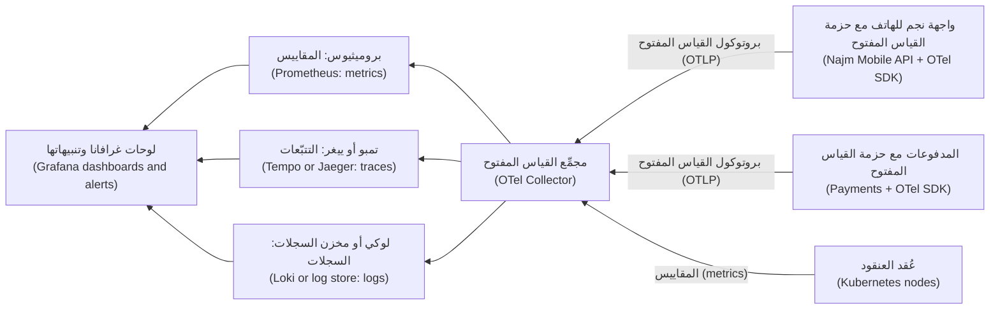

إعدادٌ أدنى للمجمِّع لمختبرٍ محلي:

```yaml
receivers:
  otlp:
    protocols:
      grpc:
        endpoint: 0.0.0.0:4317
      http:
        endpoint: 0.0.0.0:4318
processors:
  memory_limiter:          # protect the Collector itself; put it first
    check_interval: 1s
    limit_percentage: 80
    spike_limit_percentage: 20
  attributes/scrub:        # defence in depth: drop fields that must never leave the app
    actions:
      - key: enduser.id
        action: delete
  batch: {}
exporters:
  otlp/tempo:
    endpoint: tempo:4317
    tls:
      insecure: true       # local lab only; use TLS in any shared environment
  prometheus:
    endpoint: 0.0.0.0:8889 # Prometheus scrapes the Collector here
  debug: {}                # prints logs to the Collector's output in the lab
service:
  pipelines:
    traces:  {receivers: [otlp], processors: [memory_limiter, attributes/scrub, batch], exporters: [otlp/tempo]}
    metrics: {receivers: [otlp], processors: [memory_limiter, batch], exporters: [prometheus]}
    logs:    {receivers: [otlp], processors: [memory_limiter, attributes/scrub, batch], exporters: [debug]}
```

ولأن التطبيقات لا تتحدث إلا OTLP مع المجمِّع، تستطيع نجم تغيير الواجهات الخلفية بتغيير المجمِّع، لا كل خدمة.

**Prometheus ولغة PromQL (Prometheus and PromQL).** يستخدم **Prometheus**، وهو مشروعٌ متخرّج في CNCF، **نموذج السحب (pull model)**: فهو **يكشط (scrapes)** نقطة نهاية HTTP (HTTP endpoint) هي `/metrics` لدى كل هدف على فتراتٍ منتظمة ويخزّن النتائج بوصفها سلاسل زمنية (time series)، تُعرَّف كلٌّ منها باسم مقياس (metric name) و**وسوم (labels)**، أي أزواج مفتاح وقيمة (key-value pairs). وتستعلم عنه بلغة **PromQL**. وتبدو مقاييس RED (RED metrics) لواجهة برمجة تطبيق نجم للهاتف هكذا:

```promql
# Rate: requests per second over the last 5 minutes
sum(rate(http_requests_total{job="najm-mobile-api"}[5m]))

# Errors: share of requests that returned 5xx
sum(rate(http_requests_total{job="najm-mobile-api", code=~"5.."}[5m]))
  /
sum(rate(http_requests_total{job="najm-mobile-api"}[5m]))

# Duration: p99 latency from a histogram
histogram_quantile(
  0.99,
  sum by (le) (rate(http_request_duration_seconds_bucket{job="najm-mobile-api"}[5m])))
```

تختلف أسماء المقاييس باختلاف مكتبة التجهيز بالقياس (instrumentation library)؛ فمقياس خادم HTTP في OTel، مثلًا، يصبح `http_server_request_duration_seconds` بعد تصديره إلى Prometheus. تحقّق مما تُصدره خدماتك فعلًا قبل أن تنسخ استعلامًا. ثم يحوّل **Grafana** هذه الاستعلامات إلى لوحات متابعة وتنبيهات (dashboards and alerts).

**المكافئات السحابية (Cloud equivalents).** لدى كل مزوّدٍ رئيسي (major provider) منظومة مراقبة مُدارة: Amazon CloudWatch وAWS X-Ray، وAzure Monitor مع Application Insights، وGoogle Cloud Observability. ويتغيّر دعمها لبيانات OTLP وPrometheus وميزاتها وتسعيرها؛ فراجع التوثيق الحالي.

#### 🔴 نظرة الخبير (Expert view)
**التعدّدية هي محرّك التكلفة (Cardinality is the cost driver).** كل تركيبةٍ فريدة من قيم الوسوم هي سلسلة زمنية منفصلة. فالمقياس `http_requests_total` مع الوسوم `route` (40 قيمة) و`code` (10) و`pod` (30) يصل إلى 12,000 سلسلة (up to 12,000 series)، وهذا لا بأس به. أضِف `customer_id` (مليونا قيمة) وتكون قد أنشأت مليارات السلاسل المحتملة. القواعد التي تتبعها نجم: الوسوم على المقاييس تأتي من مجموعاتٍ صغيرة محدودة، مثل قالب المسار وفئة الحالة والمنطقة والإصدار؛ والمعرّفات (identifiers) مكانها الامتدادات والسجلات، لا المقاييس أبدًا.

**أخذ عيّنات من التتبّعات (Sampling traces).** تتبّع كل طلب مكلفٌ على نطاقٍ واسع. **أخذ العيّنات من الرأس (Head sampling)** يقرّر عند بداية الطلب، كأن يحتفظ بـ 10% عشوائيًّا (keep 10% at random)، وهو رخيص لكنه قد يتخلّص من التتبّع البطيء الوحيد الذي تحتاجه. أمّا **أخذ العيّنات من الذيل (Tail sampling)**، الذي يجري في مجمِّعٍ بعد اكتمال التتبّع، فيحتفظ بالتتبّعات حسب النتيجة: كل الأخطاء، وكل الطلبات الأبطأ من ثانيتين (all requests slower than 2 s)، إضافةً إلى حصةٍ عشوائية صغيرة من الباقي. تحتفظ نجم بـ 100% من تتبّعات الأخطاء والتتبّعات البطيئة للمدفوعات، وبعيّنةٍ صغيرة من السليمة. ويتطلّب أخذ العيّنات من الذيل أن تصل كل امتدادات التتبّع إلى نسخة المجمِّع نفسها، وهذا يحدّد طريقة نشرك للبوابة.

**الشواهد والربط (Exemplars and correlation).** **الشاهد (exemplar)** هو معرّف تتبّعٍ مُلحَق بدلوٍ في مدرّجٍ تكراري. انقر النقطة في دلوٍ بطيء على لوحة زمن استجابة في Grafana لتفتح تتبّعًا بطيئًا حقيقيًّا، ثم اتبع معرّف تتبّعه إلى السجلات: دقيقتان بدل ساعتين من البحث بـ grep.

**للقياس عن بُعد ميزانية (Telemetry has a budget).** تسجيل التصحيح في الإنتاج، والوسوم غير المحدودة (unbounded labels)، والتتبّع بنسبة 100% (100% tracing)، كلها قد تجعل قابلية المراقبة بندًا كبيرًا في فاتورة السحابة. اضبط مدة الاحتفاظ لكل إشارة، واتبع في السجلات قواعد البنك للسجلات الرسمية والخصوصية. أمّا سجلات التدقيق والأمن فهي تيّارٌ منفصل له متطلبات احتفاظ وسلامة خاصة به؛ انظر [*أمن الذكاء الاصطناعي وأمن التطبيقات*، الدرس 10.1 — التسجيل والمراقبة وهندسة الكشف (Logging, monitoring and detection engineering)](../secai/index.ar.html#/10.1).

**جهّز المنصة بالقياس، لا كل فريقٍ على حدة (Instrument the platform, not each team).** ضع القياس عن بُعد على المسار الذهبي: يأتي قالب الخدمة (service template) مزوّدًا بحزمة تطوير OTel، والتجهيز التلقائي بالقياس، ومسجّلٍ (logger) يضيف `trace_id`، ولوحة RED افتراضية، فتكون كل خدمةٍ جديدة قابلةً للمراقبة من يومها الأول.

ولرؤية غير المهندس لسبب تضليل لوحات المتابعة، انظر [*تصميم الأنظمة لمبرمجي الحدس (System Design for Vibe Coders)*، الدرس 7.1 — لوحة المتابعة التي تكذب والمقياس الذي لا يكذب](../vibe/index.ar.html#l7-1)؛ ولقابلية المراقبة بوصفها مكوّنًا في البرمجيات كخدمة، انظر [*لبنات بناء البرمجيات كخدمة (SaaS Building Blocks)*، الدرس 7.2 — قابلية المراقبة: السجلات والأخطاء والمقاييس والتتبّعات](../saas/index.ar.html#/7.2).

### 🧰 الأدوات
| الأداة أو الممارسة أو الخدمة (Tool, practice or service) | ما هي وماذا تفعل | متى تلجأ إليها |
|---|---|---|
| **OpenTelemetry** (CNCF) | واجهات برمجة وحزم تطوير محايدة تجاه المورّدين، وتجهيزٌ تلقائي بالقياس، واصطلاحات دلالية، وبروتوكول OTLP (OTLP protocol) للتتبّعات والمقاييس والسجلات | كل خدمةٍ جديدة؛ الطريقة الافتراضية للتجهيز بالقياس في نجم |
| **OpenTelemetry Collector** | عمليةٌ تستقبل القياس عن بُعد وتعالجه، أي تجمّعه على دفعات وتنظّفه وتأخذ منه عيّنات، وتصدّره إلى واجهةٍ خلفية أو أكثر | بين التطبيقات والواجهات الخلفية، كي لا تتحدث الخدمات مع مورّدٍ مباشرةً أبدًا |
| **Prometheus** | قاعدة بيانات سلاسل زمنية قائمة على السحب مع لغة الاستعلام PromQL وقواعد التنبيه (alert rules) | مقاييس أحمال عمل Kubernetes ولوحات RED/USE (RED/USE dashboards) |
| **Grafana** | لوحات متابعة وتنبيه فوق مصادر بياناتٍ كثيرة، منها Prometheus وLoki وTempo | مكانٌ واحد لرؤية المقاييس والسجلات والتتبّعات جنبًا إلى جنب |
| **Jaeger** أو **Grafana Tempo** | تخزين التتبّعات والبحث فيها | متابعة طلبٍ واحد عبر الخدمات؛ العثور على القفزة البطيئة |
| **RED and USE methods** | قوائم تحقّق (Checklists): المعدل والأخطاء والمدة للخدمات؛ والاستخدام والتشبّع والأخطاء للموارد | تقرير ما يوضع على أول لوحة متابعة لخدمةٍ ما |

### 🏛️ عمليًا في بنك نجم
**الأثر البرمجي (Artefact): معيار القياس عن بُعد في نجم، الإصدار الأول (the Najm telemetry standard (v1))، وهو جزءٌ من قالب المسار الذهبي (part of the golden-path template).**

| المجال (Area) | المعيار (Standard) |
|---|---|
| سمات المورد (Resource attributes) | كل إشارةٍ تحمل `service.name` و`service.version` و`deployment.environment` و`cloud.region` و`k8s.namespace.name` |
| السجلات | JSON إلى المخرج القياسي؛ الحقول (fields) `ts` و`level` و`service.name` و`event` و`trace_id` و`span_id`؛ لا أسماء ولا أرقام حسابات ولا أرقام بطاقات ولا رموز مميزة ولا مدخلات نصية حرّة من العملاء |
| المقاييس | RED لكل نقطة نهاية HTTP وgRPC، بوصفها مدرّجاتٍ تكرارية، مع زمن الاستجابة بالثواني؛ وUSE لمجمّعات الاتصالات والطوابير والرابط الهجين؛ والوسوم من مجموعاتٍ محدودة فقط |
| التتبّعات | تجهيز OTel التلقائي بالقياس إضافةً إلى امتداداتٍ يدوية لخطوات الأعمال (`reserve_funds`، `post_to_core`)؛ وتمرير ترويسة `traceparent` بصيغة W3C عبر كل قفزة، بما فيها محوّل الأنظمة المصرفية الأساسية |
| أخذ العيّنات (Sampling) | أخذ العيّنات من الذيل عند مجمِّع البوابة (gateway Collector): الاحتفاظ بكل تتبّعات الأخطاء والتتبّعات الأبطأ من ثانيتين (traces slower than 2 s)؛ وأخذ عيّنات من التتبّعات السليمة بمعدلٍ منخفض يُحدَّد لكل خدمة |
| النقل (Transport) | ترسل التطبيقات OTLP إلى مجمِّع العقدة فقط؛ ولا يتحدث مع الواجهات الخلفية إلا مجمِّع البوابة |
| لوحات المتابعة (Dashboards) | تحصل كل خدمةٍ على لوحة RED مولَّدة فيها p50/p95/p99، ونسبة الأخطاء (error ratio)، ورابطٌ إلى دليل التشغيل الخاص بها |
| الاحتفاظ (Retention) | يُحدَّد لكل إشارة ويُتّفق عليه مع الأمن والامتثال؛ وسجلات التدقيق (audit logs) تيّارٌ منفصل يملكه مركز العمليات الأمنية |
| المراجعة (Review) | لا تنتقل خدمةٌ إلى الإنتاج حتى تجتاز فحص «الدقائق الخمس الأولى»: مهندسٌ لم يرها قط يستطيع أن يجد معدل أخطائها وp99 الخاص بها وتتبّعًا فاشلًا واحدًا في أقل من خمس دقائق |

### 🛠️ التمارين (Exercises)
تعمل التمارين الثلاثة كلها محليًّا (run locally) باستخدام Docker أو عنقود kind/k3d (a kind/k3d cluster). لا توجّهها إلى أنظمة جهة عملٍ دون إذن (without permission).

- 🟢 شغّل تطبيق ويب صغيرًا خاصًّا بك، أو تطبيقًا تجريبيًّا من OpenTelemetry، مع Prometheus وGrafana في Docker Compose. ابنِ لوحة RED: الطلبات في الثانية، ونسبة أخطاء 5xx (5xx ratio)، وزمن الاستجابة p50/p95/p99 من مدرّجٍ تكراري. *يكتمل عندما (Done when):* تستطيع جعل التطبيق بطيئًا، بإضافة توقّفٍ مؤقت إلى مسارٍ واحد، وتشاهد p99 يرتفع بينما لا يكاد المتوسط يتحرك، وتستطيع شرح الفرق في جملتين.
- 🟡 أضِف التجهيز التلقائي بالقياس من OpenTelemetry إلى خدمتين صغيرتين تستدعي فيهما الخدمة A الخدمة B عبر HTTP. أرسل التتبّعات عبر مجمِّع OTel (OTel Collector) إلى Jaeger أو Tempo، واكتب سجلات JSON مُهيكلة (structured JSON logs) تتضمّن `trace_id`. *يكتمل عندما:* تستطيع فتح تتبّعٍ واحد يُظهر امتداداتٍ من الخدمتين كلتيهما، وإيجاد أسطر سجل ذلك التتبّع بالبحث عن معرّف تتبّعه.
- 🔴 وسّع مختبر 🟡 بأخذ العيّنات من الذيل في المجمِّع: احتفظ بكل تتبّع خطأ وكل تتبّعٍ أبطأ من ثانية واحدة، إضافةً إلى عيّنةٍ بنسبة 5% من الباقي (a 5% sample of the rest). أضِف مدرّجًا تكراريًّا لزمن الاستجابة مُفعَّلًا فيه الشواهد ولوحةً في Grafana. ثم أضِف وسمًا عشوائيًّا لمعرّف المستخدم إلى مقياسٍ واحد وقِس كيف يزداد عدد السلاسل. *يكتمل عندما:* يفتح النقر على شاهدٍ بطيء تتبّعًا بطيئًا حقيقيًّا، ويثبت أن سياسة أخذ العيّنات لديك تحتفظ بخطأٍ مفتعَل، وتكون قد كتبت ملاحظةً من فقرةٍ واحدة عن التعدّدية التي قستها وكيف أزلتها.

### ⚠️ أخطاء وفخاخ (Mistakes and traps)
- **التنبيه على المتوسطات والإبلاغ عنها (Alerting on and reporting averages).** المتوسطات تُخفي الذيل البطيء الذي يشعر به العملاء. سجّل المدرّجات التكرارية (Record histograms)؛ وانظر إلى p95 وp99.
- **الوسوم غير المحدودة على المقاييس (Unbounded labels on metrics).** معرّفات العملاء أو معرّفات الطلبات أو عناوين URL الكاملة بوصفها وسومًا قد تضاعف السلاسل حتى يفشل نظام المراقبة. استخدم قوالب المسارات والوسوم المحدودة؛ وضع المعرّفات على الامتدادات والسجلات.
- **تسجيل البيانات الشخصية والأسرار «لأغراض التصحيح» (Logging personal data and secrets "for debugging").** السجلات تُنسخ وتُحفظ ويقرؤها كثيرون. سجّل الأحداث والأسباب لا الأشخاص؛ ونظّف البيانات عند المجمِّع بوصفه خط دفاعٍ ثانيًا.
- **سياق تتبّعٍ مكسور (Broken trace context).** قفزةٌ واحدة تُسقط `traceparent`، مثل محوّلٍ قديم أو طابور رسائل أو وكيلٍ، تقسم كل تتبّع. اختبر التمرير من طرفٍ إلى طرف، بما في ذلك المسارات غير المتزامنة.

### 🧾 الخلاصة (Recap)
- السجلات تعطي التفاصيل، والمقاييس تعطي مجاميع رخيصة وتنبيهات، والتتبّعات تُظهر أين يذهب الوقت عبر الخدمات؛ والملفات التعريفية للأداء إشارةٌ رابعة ناشئة.
- السياق المشترك (Shared context)، أي الخدمة والإصدار والبيئة ومعرّف التتبّع، هو ما يتيح لك التنقل بين الإشارات.
- استخدم RED للخدمات وUSE للموارد والإشارات الذهبية الأربع للتحقق المتقاطع؛ وقِس زمن الاستجابة بوصفه مدرّجاتٍ تكرارية ومئينات.
- يوحّد OpenTelemetry التجهيز بالقياس والنقل؛ ويفصل المجمِّع الخدمات عن الواجهات الخلفية، وهو المكان الذي تجمّع فيه على دفعات وتنظّف وتأخذ العيّنات.
- التعدّدية والاحتفاظ وأخذ العيّنات تحدّد تكلفة قابلية المراقبة؛ صمّمها ولا تكتشفها في الفاتورة.

### ✍️ اختبر نفسك (Check yourself)

**1. تُظهر لوحة متابعة واجهة برمجة تطبيق نجم للهاتف (Najm Mobile API dashboard) متوسط زمن استجابة (average latency) قدره 180 مللي ثانية، لكن العملاء يشتكون من أن بعض التحويلات تستغرق ثوانيَ كثيرة (some transfers take many seconds). إلامَ ينبغي أن ينظر يوسف أولًا؟**

- A. استخدام المعالج (CPU utilisation) في حجيرات الواجهة (API pods)
- B. زمن الاستجابة عند p95 وp99 من مدرّجٍ تكراري لمدة الطلبات (request-duration histogram)
- C. العدد الإجمالي لأسطر السجل في الدقيقة
- D. متوسط زمن الاستجابة عبر نافذةٍ أطول، مثل 24 ساعة

<details><summary>الإجابة</summary>

**B.** المئينات من مدرّجٍ تكراري تكشف الذيل البطيء الذي يخفيه المتوسط. والمتوسط الأطول (D) يخفيه أكثر؛ وقد يكون المعالج (CPU) طبيعيًّا بينما تنتظر الطلبات مجمّع اتصالات. (🟢 الأساسيات.)

</details>

**2. يريد مطوّرٌ إضافة الوسم `customer_id` إلى المقياس `http_requests_total` كي يرى فريق الدعم (support) معدل طلبات كل عميل (each customer's request rate). ما الردّ الأفضل؟**

- A. اقبله، لأن الوسوم رخيصة والمزيد منها يفيد دائمًا
- B. اقبله في الإنتاج فقط، حيث يحتاجه الدعم فعلًا
- C. اقبله بعد تجزئة معرّف العميل، كي لا تُخزَّن بياناتٌ شخصية
- D. ارفضه: القيم غير المحدودة تضاعف السلاسل؛ استخدم الامتدادات أو السجلات بدلًا منه

<details><summary>الإجابة</summary>

**D.** كل قيمة وسمٍ فريدة تنشئ سلسلةً جديدة؛ وملايين العملاء تجعل نظام المقاييس بطيئًا ومكلفًا (slow and costly). والتجزئة (Hashing) (C) تُبقي التعدّدية نفسها تمامًا. المعرّفات مكانها الامتدادات والسجلات، ضمن قواعد الخصوصية. (🔴 نظرة الخبير (Expert view).)

</details>

**3. تتوقف التتبّعات القادمة من واجهة برمجة تطبيق نجم للهاتف (Najm Mobile API) عند محوّل الأنظمة المصرفية الأساسية (core banking adapter)، ويبدأ تتبّعٌ جديد على الجانب الآخر (a new trace starts on the other side). ما السبب الأرجح؟**

- A. المحوّل لا يمرّر ترويسة `traceparent` بصيغة W3C
- B. يكشط Prometheus المحوّل ببطءٍ شديد
- C. السجلات ليست بصيغة JSON
- D. أخذ العيّنات من الرأس (Head sampling) مضبوطٌ على 100%

<details><summary>الإجابة</summary>

**A.** يبقى التتبّع موصولًا فقط إذا مرّرت كل قفزةٍ سياق التتبّع. أمّا فترة الكشط (Scrape interval) (B) وصيغة السجل (log format) (C) فلا تؤثران في ربط التتبّعات (trace linking)؛ وأخذ عيّنات من كل شيء (sampling everything) (D) لن يقسم التتبّعات. (🟡 التعمق أكثر (Going deeper).)

</details>

**4. لماذا توجّه نجم كل القياس عن بُعد للتطبيقات (all application telemetry) عبر مجمِّعات OpenTelemetry (OpenTelemetry Collectors) بدل أن ترسل كل خدمةٍ البيانات مباشرةً إلى واجهتها الخلفية (straight to its back end)؟**

- A. لأن Prometheus لا يملك أي طريقة لكشط المقاييس من التطبيقات مباشرةً
- B. لأن بيانات OTLP لا يستقبلها إلا مجمِّع، ولا تستقبلها واجهةٌ خلفية أبدًا
- C. لأنه يمركز التجميع على دفعات والتنظيف وأخذ العيّنات، ويفصل الخدمات عن الواجهات الخلفية
- D. لأن المجمِّع هو المخزن طويل الأمد الذي تستعلم منه لوحات المتابعة عن التاريخ

<details><summary>الإجابة</summary>

**C.** يفصل المجمِّع الخدمات عن الواجهات الخلفية ويمركز المعالجة (centralises processing). يستطيع Prometheus كشط التطبيقات مباشرةً، ويمكن أن تذهب OTLP مباشرةً إلى واجهةٍ خلفية تقبلها (B)، والمجمِّع خط معالجة لا مخزن (D). (🟡 التعمق أكثر (Going deeper).)

</details>

**5. تريد نجم إبقاء تكاليف التتبّع منخفضة (keep tracing costs down) دون خسارة التتبّعات التي يحتاجها المهندسون أثناء الحوادث (during incidents). أيّ نهجٍ هو الأنسب؟**

- A. أخذ العيّنات من الرأس بنسبة 1% (Head sampling at 1%) لكل خدمة، يُقرَّر عند بدء كل طلب
- B. أخذ العيّنات من الذيل (Tail sampling): الاحتفاظ بكل تتبّعات الأخطاء والتتبّعات البطيئة، إضافةً إلى قليلٍ من السليمة
- C. إيقاف التتبّع كليًّا والاعتماد على السجلات المُهيكلة مع معرّفات التتبّع
- D. الاحتفاظ بكل تتبّع، لكن حذفها كلها تلقائيًّا بعد ساعة واحدة

<details><summary>الإجابة</summary>

**B.** أخذ العيّنات من الذيل يقرّر بعد معرفة النتيجة، فتُحفظ الأخطاء النادرة والطلبات البطيئة. أمّا أخذ العيّنات العشوائي من الرأس فسيتخلّص منها عادةً؛ وC وD يُضيّعان الدليل الذي تحتاجه. (🔴 نظرة الخبير (Expert view).)

</details>

### 📚 المراجع (References)
- توثيق OpenTelemetry (OpenTelemetry documentation) — https://opentelemetry.io/docs/
- مجمِّع OpenTelemetry (OpenTelemetry Collector) — https://opentelemetry.io/docs/collector/
- الاصطلاحات الدلالية في OpenTelemetry — https://opentelemetry.io/docs/specs/semconv/
- سياق التتبّع من W3C (W3C Trace Context) — https://www.w3.org/TR/trace-context/
- توثيق Prometheus (Prometheus documentation) — https://prometheus.io/docs/introduction/overview/
- Prometheus، تسمية المقاييس والوسوم — https://prometheus.io/docs/practices/naming/
- توثيق Grafana (Grafana documentation) — https://grafana.com/docs/
- توثيق Jaeger (Jaeger documentation) — https://www.jaegertracing.io/docs/
- Google، *هندسة موثوقية المواقع*، «مراقبة الأنظمة الموزّعة» — https://sre.google/sre-book/monitoring-distributed-systems/
- مشاريع CNCF (CNCF projects) — https://www.cncf.io/projects/

<a id="l5-2"></a>

## 5.2 — أهداف مستوى الخدمة وميزانيات الأخطاء والتنبيه ومناوبةٌ يستطيع الناس تحمّلها

*المستوى: 🟡 متوسط* · *المتطلبات: 5.1* · *المرحلة (Phase): Operate, Monitor*

### ⚡ الدرس في دقيقة (In 60 seconds)
- **مؤشر مستوى الخدمة (service level indicator, SLI)** يقيس ما يختبره المستخدمون، مثل «نسبة طلبات التحويل التي تنجح في أقل من ثانيتين» ("the share of transfer requests that succeed in under 2 seconds"). و**هدف مستوى الخدمة (service level objective, SLO)** هو الهدف المحدّد له عبر نافذةٍ زمنية، مثل 99.9% عبر 30 يومًا. أمّا **اتفاقية مستوى الخدمة (service level agreement, SLA)** فهي عقدٌ له عواقب، وينبغي أن تكون أكثر تساهلًا من هدف مستوى الخدمة.
- **ميزانية الأخطاء (error budget)** هي ما يسمح هدف مستوى الخدمة بفشله: 100% ناقص الهدف (100% minus the target). وهي تحوّل سؤال «ما مقدار الموثوقية؟» ⁦⁩ إلى قرارٍ رقمي مشترك بين المنتج والعمليات: أنفِق الميزانية على التغيير، أو أبطئ حين تنفد.
- لا تستدعِ إنسانًا إلا من أجل **أعراضٍ يشعر بها المستخدمون (symptoms users feel)** وتحتاج إلى تصرّفٍ الآن. نبّه على سرعة احتراق ميزانية الأخطاء، لا على وصول المعالج إلى 80% (not on CPU at 80%).
- **التنبيهات متعددة النوافذ ومتعددة معدلات الاحتراق (Multi-window, multi-burn-rate alerts)**، المأخوذة من *كتاب عمل هندسة موثوقية المواقع*، تلتقط الانقطاعات السريعة بسرعة والتسرّبات البطيئة بموثوقية، مع قليلٍ من الإنذارات الكاذبة.
- لا تكون المناوبة (On-call) مستدامة (sustainable) إلا إذا كانت الاستدعاءات نادرة، وقابلةً للتصرّف (actionable)، ومرتبطةً بدليل تشغيل، وتتبعها إصلاحاتٌ تزيل السبب.
- أكبر فخ: استهداف 100% (aiming for 100%). فهو مستحيل (impossible)، ويعطّل كل تغيير، وهواتف المستخدمين وشبكاتهم نفسها أقل موثوقيةً من ذلك على أي حال.

### 🧭 لماذا يهم
ترث مها جدول المناوبة لواجهة برمجة تطبيق نجم للهاتف وخدمة المدفوعات. وفي أسبوعها الأول تعدّ 140 قاعدة تنبيه (140 alert rules). وفي ليلةٍ واحدة يُستدعى يوسف إحدى عشرة مرة بسبب ارتفاع استخدام المعالج (high CPU) وإعادة تشغيل الحجيرات (pod restarts) وتحذيرات الأقراص (disk warnings). لم يحتج أيٌّ منها إلى تصرّف. وفي الساعة 04:10 تبدأ مشكلةٌ حقيقية: تفشل حصةٌ من التحويلات لأن شهادةً على محوّل الأنظمة المصرفية الأساسية انتهت صلاحيتها (has expired). فيقرّ يوسف، وهو نصف نائم (half-asleep)، بذلك التنبيه مع غيره، ويلاحظ العملاء المشكلة قبل أن يلاحظها الفريق.

هذا هو **إرهاق التنبيهات (alert fatigue)**: حين يكون معظم الاستدعاءات ضجيجًا، يتعلّم الناس تجاهل الاستدعاءات (ignore pages)، ثم يفوّتون الحقيقي منها. ويبدأ حلّ مها بسؤالٍ مختلف: «ماذا يحتاج العميل من خدمة المدفوعات، وما مقدار الفشل الذي يحتمله قبل أن يصبح ذلك مهمًّا؟» ⁦⁩ تصبح الإجابات أهدافًا لمستوى الخدمة. ولا تأتي الاستدعاءات إلا من احتراق أهداف مستوى الخدمة. وكل ما عدا ذلك يصبح تذكرة عمل، أو بندًا في لوحة متابعة، أو يُحذف.

وتحسم أهداف مستوى الخدمة أيضًا جدالًا قديمًا: فرق طارق تريد السرعة (want speed)، وفريق مها يريد الاستقرار (wants stability). ومع ميزانية الأخطاء يتفق الطرفان مسبقًا: ما دامت الميزانية باقية، أطلِق؛ وحين تُستنفد، يأتي عمل الموثوقية أولًا. والجهات التنظيمية (Regulators) تهتم أيضًا: فقانون المرونة التشغيلية الرقمية في الاتحاد الأوروبي، المطبّق على الكيانات المالية منذ يناير 2025 (applicable to financial entities from January 2025)، والجهات التنظيمية الخليجية (GCC regulators) تتوقع من البنوك أن تفهم مرونة خدماتها المهمة وتختبرها؛ وهدف مستوى الخدمة المقيس جزءٌ من هذا الدليل.

### 📐 كيف يعمل
#### 🟢 الأساسيات
**من المستخدمين إلى الأرقام (From users to numbers).** ابدأ برحلة مستخدم، لا بمكوّن: «يرسل العميل تحويلًا ويرى النتيجة». ثم اختر مؤشرات مستوى الخدمة (choose SLIs) التي تصف تجربةً جيدة لها:

| نوع المؤشر (SLI type) | التعريف (Definition) | مثال من المدفوعات (Payments example) |
|---|---|---|
| **التوافر (Availability)** | الطلبات الجيدة ÷ الطلبات الصالحة | طلبات التحويل التي تعيد نتيجةً ليست 5xx (return a non-5xx result) ÷ كل طلبات التحويل، باستثناء أخطاء العميل مثل المدخلات غير الصالحة |
| **زمن الاستجابة (Latency)** | الطلبات الأسرع من عتبةٍ معيّنة ÷ الطلبات الصالحة | طلبات التحويل المكتملة في أقل من ثانيتين (completed in under 2 s) ÷ كل طلبات التحويل |
| **الصحة (Correctness)** | النتائج الصحيحة ÷ النتائج | التحويلات المرحَّلة مرةً واحدة بالضبط والمطابَقة مع الأنظمة المصرفية الأساسية ÷ كل التحويلات |

عبّر عن مؤشرات مستوى الخدمة بوصفها أحداثًا جيدة ÷ أحداثًا صالحة: فهي سهلة الحساب من العدّادات وقابلة للمقارنة بين الخدمات.

**هدف مستوى الخدمة واتفاقية مستوى الخدمة والنافذة (SLO, SLA and the window).** يضيف هدف مستوى الخدمة هدفًا ونافذةً: «99.9% من طلبات التحويل تنجح، مقيسةً عبر 30 يومًا متحركة» ⁦("99.9% of transfer requests succeed, measured over a rolling 30 days.")⁩. و**النافذة المتحركة (rolling window)** تنظر دائمًا إلى آخر 30 يومًا (always looks at the last 30 days)، فيبقى اليوم السيئ ظاهرًا مدة شهر. أمّا **اتفاقية مستوى الخدمة (SLA)** فهي وعدٌ خارجي بعقوبات، يُحدَّد أدنى من هدف مستوى الخدمة الداخلي.

**حساب ميزانية الأخطاء (Error budget arithmetic).** الميزانية هي 100% ناقص هدف مستوى الخدمة (100% minus the SLO).

| هدف مستوى الخدمة (SLO) | ميزانية الأخطاء | الوقت «السيئ» المسموح إذا تعطّلت الخدمة كليًّا، لكل 30 يومًا (Allowed "bad" time if fully down, per 30 days) | الطلبات السيئة المسموحة لكل 10 ملايين (Bad requests allowed per 10 million) |
|---|---|---|---|
| 99% | 1% | 7.2 ساعة (hours) | 100,000 |
| 99.5% | 0.5% | 3.6 ساعة | 50,000 |
| 99.9% | 0.1% | 43.2 دقيقة (minutes) | 10,000 |
| 99.99% | 0.01% | نحو 4.3 دقيقة (about 4.3 minutes) | 1,000 |

كل «تسعة» إضافية تقلّص الميزانية عشر مرات، وتكلّف عادةً أكثر بكثير في التكرار الاحتياطي (redundancy) وسرعة الإطلاق (release speed) وجهد المناوبة (on-call effort). اختر الهدف بناءً على حاجات المستخدمين لا الطموح. تحصل المدفوعات على توافرٍ بنسبة 99.9% (99.9% availability) وعلى 99% من التحويلات في أقل من ثانيتين (99% of transfers under 2 s)؛ وتحصل بوابة المطوّرين الداخلية على 99%.

**نبّه على الأعراض لا الأسباب (Alert on symptoms, not causes).** **العَرَض (symptom)** شيءٌ يشعر به المستخدمون: أخطاء أو بطء أو نتائج خاطئة. و**السبب (cause)** شيءٌ قد يؤدي إليه: ارتفاع استخدام المعالج، أو إعادة تشغيل حجيرة، أو طابور ممتلئ. الأسباب مفيدة في لوحات المتابعة وتذاكر العمل. أمّا الاستدعاء فيكون على الأعراض، لأن كثيرًا من الأسباب لا يؤذي المستخدمين أبدًا، ولأن بعض الأعطال التي تواجه المستخدمين (user-facing failures) لها أسبابٌ لم تتوقعها.

**ثلاثة أنواع من الاستجابة (Three kinds of response).**
- **الاستدعاء (Page)**: يجب أن يتصرّف إنسانٌ الآن، في أي ساعة. للأعراض التي تهدّد هدف مستوى الخدمة فقط.
- **تذكرة العمل (Ticket)**: يجب أن يتصرّف أحدٌ خلال أيام العمل. احتراقٌ بطيء للميزانية، أو شهادةٌ تنتهي صلاحيتها بعد 14 يومًا (a certificate expiring in 14 days)، أو قرصٌ يمتلئ على مدى أسابيع.
- **السجل أو لوحة المتابعة فقط (Log or dashboard only)**: معلوماتٌ للتحقيقات. دون إشعار.

#### 🟡 التعمق أكثر
**معدل الاحتراق (Burn rate).** **معدل الاحتراق (burn rate)** هو سرعة استهلاكك لميزانية الأخطاء، منسوبةً إلى المعدل الذي يستهلكها كلها بالضبط خلال نافذة هدف مستوى الخدمة. معدل احتراقٍ قدره 1 يعني أنك ستنهي الأيام الثلاثين دون أي ميزانية متبقية. ومعدل احتراقٍ قدره 14.4 يعني أن ميزانية الثلاثين يومًا كلها ستذهب في نحو يومين. ولهدف مستوى خدمة قدره 99.9%، تكون الميزانية 0.1%، فتكون نسبة أخطاء قدرها 1.44% معدل احتراقٍ قدره 14.4.

**لماذا تفشل تنبيهات العتبة البسيطة (Why simple threshold alerts fail).** «استدعِ إذا تجاوزت نسبة الأخطاء 0.1% لمدة 5 دقائق» ("Page if the error ratio is above 0.1% for 5 minutes") ينطلق على ومضاتٍ قصيرة بالكاد تمسّ الميزانية. و«استدعِ إذا تجاوزت النسبة على مدى 30 يومًا 0.1%» ("Page if the 30-day ratio is above 0.1%") ينطلق متأخرًا بأيام. ويعالج *كتاب عمل هندسة موثوقية المواقع*، في فصل «التنبيه على أهداف مستوى الخدمة»، هذه الخيارات ويوصي بتنبيهات **متعددة النوافذ ومتعددة معدلات الاحتراق (multi-window, multi-burn-rate)**. فالنافذة الطويلة تُظهر أن الاحتراق كبير؛ والنافذة القصيرة تؤكد أنه ما زال يحدث، فيتوقف التنبيه أيضًا بعد التعافي بوقتٍ قصير.

| الخطورة (Severity) | معدل الاحتراق | النافذة الطويلة (Long window) | النافذة القصيرة (Short window) | الميزانية المستهلكة إذا استمر طوال النافذة الطويلة |
|---|---|---|---|---|
| استدعاء | 14.4 | ساعة واحدة (1 hour) | 5 دقائق (5 minutes) | 2% |
| استدعاء | 6 | 6 ساعات (6 hours) | 30 دقيقة (30 minutes) | 5% |
| تذكرة عمل | 1 | 3 أيام (3 days) | 6 ساعات (6 hours) | 10% |

هذه هي القيم الابتدائية المقترحة في كتاب العمل لنافذة 30 يومًا (for a 30-day window). اضبطها ببياناتك الخاصة.

**التنبيه بوصفه شيفرة (The alert as code).** أولًا، تحسب قواعد التسجيل (recording rules) نسبة الأخطاء عبر عدة نوافذ، وتولّدها نجم من ملف هدف مستوى الخدمة:

```yaml
groups:
  - name: payments-slo-recordings
    rules:
      - record: slo:payments_errors:ratio_rate5m
        expr: |
          sum(rate(http_requests_total{job="payments", route="/transfers", code=~"5.."}[5m]))
          /
          sum(rate(http_requests_total{job="payments", route="/transfers"}[5m]))
      - record: slo:payments_errors:ratio_rate1h
        expr: |
          sum(rate(http_requests_total{job="payments", route="/transfers", code=~"5.."}[1h]))
          /
          sum(rate(http_requests_total{job="payments", route="/transfers"}[1h]))
      # ... the same for 30m, 6h and 3d
```

ثم لا تستدعي قاعدة التنبيه إلا حين تحترق النافذتان الطويلة والقصيرة كلتاهما بسرعة:

```yaml
  - name: payments-slo-alerts
    rules:
      - alert: PaymentsErrorBudgetFastBurn
        expr: |
          (slo:payments_errors:ratio_rate1h > 14.4 * 0.001
            and slo:payments_errors:ratio_rate5m > 14.4 * 0.001)
          or
          (slo:payments_errors:ratio_rate6h > 6 * 0.001
            and slo:payments_errors:ratio_rate30m > 6 * 0.001)
        labels:
          severity: page
          service: payments
        annotations:
          summary: "Payments is burning its 30-day error budget fast"
          runbook_url: "https://runbooks.najm.example/payments/error-budget-burn"
          dashboard: "https://grafana.najm.example/d/payments-slo"
```

قارن بالقاعدة التي كانت لدى يوسف من قبل:

```yaml
# Risky: a cause, not a symptom; pages at 3 a.m.; no runbook
- alert: HighCPU
  expr: avg(rate(container_cpu_usage_seconds_total{namespace="payments"}[5m])) > 0.8
  labels:
    severity: page
```

تولّد أدواتٌ مفتوحة المصدر (Open-source tools) مثل **Sloth** و**Pyrra** قواعد التسجيل والتنبيه هذه من تعريفٍ قصير لهدف مستوى الخدمة، ويعرّف مشروع **OpenSLO** صيغة ملفٍ لأهداف مستوى الخدمة محايدةً تجاه المورّدين.

**التوجيه والتجميع والإسكات (Routing, grouping and silences).** يقيّم Prometheus القواعد (evaluates rules)؛ ويقرّر **Alertmanager** (أو تنبيهات Grafana) من يُبلَّغ. فهو **يجمّع (groups)** التنبيهات المترابطة في إشعارٍ واحد، و**يكبت (inhibits)** التنبيهات الأدنى حين ينطلق تنبيهٌ أعلى، فلا تستدعِ بشأن 30 خطأ حجيرة حين يكون العنقود كله معطّلًا (do not page about 30 pod errors when the whole cluster is down)، و**يوجّه (routes)** حسب الوسوم، فيذهب `service: payments` إلى جدول مناوبة المدفوعات، ويدعم **الإسكات (silences)** أثناء الصيانة المخطط لها.

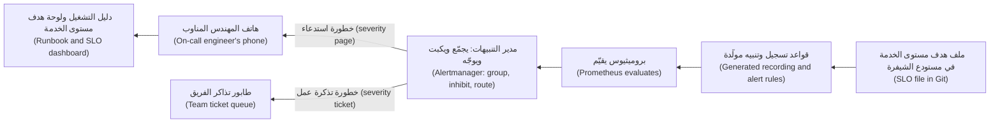

**سياسة ميزانية الأخطاء (The error budget policy).** هدف مستوى الخدمة الذي لا عواقب له ليس سوى رسمٍ بياني. سياسة نجم، التي اتفق عليها سالم ومها وطارق:
- الميزانية سليمة (Budget healthy): تُطلق الفرق بوتيرتها المعتادة.
- الميزانية المتبقية أقل من 25% (Budget below 25% remaining): تحتاج الإطلاقات إلى تلك الخدمة مراجعةً من هندسة موثوقية المواقع؛ وتتضمّن دورة العمل القصيرة التالية بند الموثوقية الأعلى أولوية.
- الميزانية مستنفدة (Budget exhausted): لا يُطلق إلى تلك الخدمة إلا الإصلاحات وعمل الموثوقية حتى تتعافى النافذة المتحركة، ما لم يوقّع رئيس المنصة ومالك المنتج استثناءً.
- الحادثة المفردة التي تستهلك أكثر من 20% من الميزانية تحصل على مراجعة ما بعد الحادثة (الدرس 5.3).

ويمكن لإشارة الاحتراق نفسها أن تقود الأتمتة (drive automation): فإطلاقٌ كناري يستطيع التراجع من تلقاء نفسه حين تتدهور مؤشرات مستوى الخدمة الخاصة به (الدرس 4.2).

#### 🔴 نظرة الخبير
**المناوبة المستدامة (Sustainable on-call).** يتعامل كتاب Google *هندسة موثوقية المواقع* مع عبء المناوبة (on-call load) بوصفه شيئًا يُقاس ويُسقَّف، ومع **العمل الروتيني الشاق (toil)**، أي العمل اليدوي المتكرر القابل للأتمتة الذي يكبر مع الخدمة ولا قيمة دائمة له، بوصفه شيئًا يُقلَّص عمدًا. الممارسات التي تتبنّاها نجم:
- **حجم جدول المناوبة والتسليم (Rota size and hand-offs).** عددٌ كافٍ من الأشخاص بحيث لا يكون كل مهندس مناوبًا إلا نحو أسبوع واحد من عدة أسابيع على الأكثر، مع تسليمٍ مكتوب عند كل تغيير مناوبة. وجداول «تتبّع الشمس» (Follow-the-sun rotas)، حيث يمتد الفريق عبر مناطق زمنية، تزيل معظم الاستدعاءات الليلية.
- **كل استدعاء قابل للتصرّف وله دليل تشغيل (Every page is actionable and has a runbook).** إذا لم يكن المستجيب قادرًا على فعل أي شيء، فلا ينبغي أن يكون استدعاءً. و**دليل التشغيل (runbook)** يقول ما يعنيه التنبيه، وكيف تتأكد من الأثر على المستخدمين، والإجراءات الأولى الآمنة، أي التراجع أو التحويل إلى البديل أو التوسّع الأفقي، وإلى من تصعّد.
- **قِس جدول المناوبة (Measure the rota).** الاستدعاءات لكل مناوبة، والاستدعاءات خارج ساعات العمل، والوقت حتى الإقرار، وحصة الاستدعاءات التي احتاجت إلى تصرّف. والتنبيهات التي انطلقت دون حاجةٍ إلى تصرّف تُضبط أو تُحذف خلال الأسبوع.
- **سدِّد العبء (Pay back the load).** يحصل المهندسون على وقت تعافٍ محمي بعد ليلةٍ ثقيلة؛ والاستدعاءات المتكررة (recurring pages) تصبح بنودًا مملوكة في قائمة الأعمال.
- **المهندسون الجدد يرافقون أولًا (New engineers shadow first).** يرافق يوسف مها لدورتي مناوبة قبل أن يحمل جهاز الاستدعاء وحده.

**اختيار مؤشرات مستوى الخدمة حيث تقيسها (Choosing SLIs where you measure them).** مقاييس جانب الخادم (Server-side metrics) تفوّت الأعطال التي تحدث قبل أن يصل الطلب إليك، مثل DNS وشبكة توصيل المحتوى وجدار حماية تطبيقات الويب وموازن الأحمال. تقيس نجم مؤشر توافر المدفوعات عند موازن الأحمال وتضيف **مسابير اصطناعية (synthetic probes)**: تحويلاتٌ مكتوبة نصيًّا بين حسابات اختبار كل دقيقة من خارج السحابة، وهي تلتقط أيضًا الأعطال عند الحافة. 

**التبعيات وأهداف مستوى الخدمة المركّبة (Dependencies and composite SLOs).** إذا كانت المدفوعات تعتمد تسلسليًّا على ثلاث خدمات تحقق كلٌّ منها 99.9%، فقد يكون توافرها هي أدنى من أيٍّ منها. تحقّق مما يجب أن تحققه كل تبعية، وصمّم للفشل حيث لا تتّسق الأرقام: المهلات الزمنية (timeouts)، وإعادة المحاولة مع التراجع التدريجي، ومفاتيح عدم التكرار (idempotency keys) كي لا تكرّر إعادة المحاولة تحويلًا أبدًا، والتدهور اللطيف (graceful degradation)، أي إظهار «التحويل قيد المعالجة» بدل الفشل.

**أهداف مستوى الخدمة للعمل غير المتزامن وعمل الذكاء الاصطناعي (SLOs for asynchronous and AI work).** للطابور، قِس «الرسائل المعالَجة خلال N دقيقة». ولنجم أسيست (Najm Assist)، قِس الوقت حتى أول رمز (time to first token) إلى جانب الوقت الكلي (total time)؛ وتشغيل وكلاء الذكاء الاصطناعي مغطّى في [*تشغيل وكلاء الذكاء الاصطناعي في الإنتاج (Running AI Agents in Production)*، المستوى 3 — مهندس الإنتاج (Production Engineer)](../agentic/learning-path.ar.html#level-3-production-engineer).

ولمدخلٍ ألطف إلى منظومات المراقبة ونظافة التنبيهات، انظر [*تصميم الأنظمة لمبرمجي الحدس*، الدرس 7.6 — منظومة المراقبة لديك: Sentry وفحوص التوافر والمقاييس والتنبيهات](../vibe/index.ar.html#l7-6).

### 🧰 الأدوات
| الأداة أو الممارسة أو الخدمة | ما هي وماذا تفعل | متى تلجأ إليها |
|---|---|---|
| **Service level objective (SLO)** — هدف مستوى الخدمة | هدفٌ لمؤشرٍ متمحور حول المستخدم عبر نافذةٍ زمنية، مكتوبٌ ومتّفقٌ عليه | كل خدمة إنتاج لها مستخدمون، بدءًا بأهم الرحلات |
| **Error budget** — ميزانية الأخطاء | مقدار الفشل الذي يسمح به هدف مستوى الخدمة، إضافةً إلى سياسةٍ لما يحدث مع إنفاقه | الموازنة بين سرعة الإطلاق والموثوقية بالأرقام لا بالآراء |
| **Multi-window, multi-burn-rate alerting** (SRE Workbook) — التنبيه متعدد النوافذ ومعدلات الاحتراق | يستدعي حين يكون احتراق الميزانية كبيرًا عبر نافذةٍ طويلة وما زال يحدث في نافذةٍ قصيرة | استبدال الاستدعاءات القائمة على العتبات والأسباب |
| **Alertmanager** (Prometheus) | يجمّع التنبيهات ويكبتها ويوجّهها ويُسكتها | إرسال التنبيه الصحيح إلى جدول المناوبة الصحيح، مرةً واحدة |
| **Sloth** / **Pyrra** | مولّداتٌ مفتوحة المصدر (Open-source generators) لقواعد تسجيل أهداف مستوى الخدمة وتنبيهها في Prometheus من مواصفةٍ قصيرة | إبقاء أهداف مستوى الخدمة بوصفها شيفرة بدل PromQL المكتوبة يدويًّا (hand-written PromQL) |
| **Runbook** — دليل التشغيل | دليلٌ قصير مرتبط: ما يعنيه التنبيه، وكيف تتحقق من الأثر، والإجراءات الأولى الآمنة، والتصعيد | يُرفق بكل تنبيه استدعاء |

### 🏛️ عمليًا في بنك نجم
**الأثر البرمجي (Artefact): وثيقة هدف مستوى الخدمة لخدمة المدفوعات، الإصدار الأول (the Payments service SLO document (v1))، المخزّنة في Git بجوار الخدمة (stored in Git next to the service).**

| الحقل (Field) | القيمة (Value) |
|---|---|
| الخدمة والمالك | خدمة المدفوعات · فرقة المدفوعات (Payments squad)، ضمن نطاق طارق (Tariq's area) · شريكة هندسة موثوقية المواقع (SRE partner): مها |
| رحلة المستخدم (User journey) | عميل أفراد يقدّم تحويلًا في نجم للهاتف (Najm Mobile) ويتلقى نتيجةً نهائية |
| المؤشر 1: التوافر (SLI 1: availability) | طلبات التحويل عند موازن الأحمال التي لا تعيد 5xx ولا تنتهي مهلتها (not returning 5xx or timing out) ÷ طلبات التحويل الصالحة، باستثناء أخطاء التحقق 4xx (excluding 4xx validation errors) |
| الهدف 1 (SLO 1) | 99.9% عبر 30 يومًا متحركة (over a rolling 30 days) |
| المؤشر 2: زمن الاستجابة (SLI 2: latency) | طلبات التحويل المكتملة في أقل من ثانيتين (completed in under 2 s) ÷ طلبات التحويل الصالحة |
| الهدف 2 (SLO 2) | 99% عبر 30 يومًا متحركة (over a rolling 30 days) |
| المؤشر 3: الصحة (SLI 3: correctness) | التحويلات المرحَّلة مرةً واحدة بالضبط، كما تُظهر المطابقة اليومية مع الأنظمة المصرفية الأساسية ÷ كل التحويلات؛ وأي عدم تطابق يفتح حادثة |
| مصادر البيانات (Data sources) | مقاييس موازن الأحمال؛ المدرّجات التكرارية من OTel (OTel histograms)؛ مسبار تحويلٍ اصطناعي كل دقيقة من خارج السحابة؛ مهمة المطابقة (reconciliation job) |
| التنبيهات (Alerts) | استدعاء: معدل احتراق قدره 14.4 (ساعة و5 دقائق) أو 6 (6 ساعات و30 دقيقة). تذكرة عمل: معدل احتراق قدره 1 (3 أيام و6 ساعات). عدم تطابق المطابقة (Reconciliation mismatch): استدعاء |
| سياسة ميزانية الأخطاء | كما في 🟡 التعمق أكثر؛ والاستثناءات يوقّعها سالم ومالك المنتج |
| التبعيات (Dependencies) | PostgreSQL المُدارة (Managed PostgreSQL)، ومحوّل الأنظمة المصرفية الأساسية، والرابط الهجين (hybrid link)؛ ولكلٍّ منها هدف مستوى خدمة خاص به، يُراجَع مقابل هذا الهدف |
| ما لا يشمله | اتفاقية مستوى الخدمة بصيغة العملاء وعتبات الإبلاغ التنظيمي؛ تملكها إدارة المخاطر والامتثال |
| المراجعة | شهريًّا مع طارق ومها: الميزانية المتبقية (budget left)، والحوادث، وجودة التنبيهات (alert quality)، أي الاستدعاءات في الأسبوع وحصة القابلة للتصرّف منها |

### 🛠️ التمارين
- 🟢 لخدمةٍ واحدة تعرفها، سواء مشروعك الخاص أو موقع ويب عام تستخدمه، اكتب ثلاثة مؤشرات لمستوى الخدمة بوصفها نسب أحداثٍ جيدة ÷ أحداثٍ صالحة، واختر هدف مستوى خدمة لكلٍّ منها، واحسب ميزانية الأخطاء بالدقائق وبالطلبات لنافذة 30 يومًا. *يكتمل عندما:* يحدّد كل مؤشر بالضبط أيّ الأحداث تُعدّ جيدة وسيئة ومستثناة، وتستطيع تبرير كل هدف في جملةٍ واحدة عن المستخدمين.
- 🟡 في مختبر Prometheus المحلي لديك من الدرس 5.1 (your local Prometheus lab from lesson 5.1)، اكتب قواعد تسجيل وتنبيهًا متعدد النوافذ ومتعدد معدلات الاحتراق لهدف توافرٍ قدره 99.9% (a 99.9% availability SLO)، موجَّهًا عبر Alertmanager. احقن أخطاءً مرتين: دفقةً مدتها دقيقة واحدة بنسبة أخطاء 10% (a one-minute burst at a 10% error ratio)، ثم نسبة أخطاء ثابتة قدرها 10% (a steady 10% error ratio). *يكتمل عندما:* لا تُطلق الدفقة استدعاءً، وتُطلق الأخطاء الثابتة استدعاءً خلال نحو عشر دقائق، فاستنتج السبب من نافذة الساعة الواحدة (work out why from the 1-hour window)، ويتوقف التنبيه بعد إزالتك للأخطاء.
- 🔴 خذ أي مجموعة تنبيهات تستطيع الوصول إليها قانونيًّا، كمشروعك الخاص، أو القواعد المنشورة لمشروعٍ مفتوح المصدر، أو عيّنة من درسٍ تعليمي في المراقبة، ودقّقها (audit it): صنّف كل تنبيه بوصفه استدعاءً أو تذكرة عمل أو حذفًا، وأعد كتابة الاستدعاءات القائمة على الأسباب (cause-based pages) بوصفها تنبيهات احتراقٍ لهدف مستوى الخدمة، واكتب دليل تشغيلٍ واحدًا (one runbook)، وصُغ مسودة سياسة ميزانية أخطاء. *يكتمل عندما:* يكون لديك جدول قبل وبعد فيه سببٌ لكل تغيير، وسياسة من صفحةٍ واحدة يستطيع مالك منتجٍ أن يوقّعها.

### ⚠️ أخطاء وفخاخ
- **أهداف 100% أو «أكبر عدد ممكن من التسعات» (Targets of 100% or "as many nines as possible").** إنها تعطّل كل تغيير وتكلّف أكثر بكثير مما يلاحظه المستخدمون. اختر أدنى هدفٍ يرضى عنه المستخدمون.
- **مؤشرات مستوى الخدمة التي تقيس الخادم لا المستخدم (SLIs that measure the server, not the user).** المعالج وسلامة الحجيرات ليست تجارب. قِس نجاح الرحلات الحقيقية وزمن استجابتها، بأقرب ما تستطيع إلى المستخدم.
- **الاستدعاء على الأسباب (Paging on causes).** المعالج والذاكرة وإعادة التشغيل وتحذيرات الأقراص توقظ الناس بلا طائل. ضعها في لوحات المتابعة أو تذاكر العمل؛ واستدعِ على احتراق الميزانية.
- **أهداف مستوى الخدمة بلا سياسة (SLOs without a policy).** إذا لم يكن نفاد الميزانية يغيّر شيئًا، فلن يثق أحدٌ بهدف مستوى الخدمة ولن يستخدمه. اتفقوا على السياسة قبل أول شهرٍ سيئ.
- **تنبيهاتٌ بلا أدلة تشغيل، وجدول مناوبة مُهمَل (Alerts without runbooks, and an ignored rota).** الاستدعاء الذي لا خطوة تالية له يهدر الدقائق الأولى من الحادثة. اربط دليل تشغيل بكل استدعاء؛ وأصلح التنبيه الأكثر ضجيجًا أسبوعيًّا.

### 🧾 الخلاصة
- تقيس مؤشرات مستوى الخدمة (SLIs) تجربة المستخدم بوصفها أحداثًا جيدة ÷ صالحة؛ وتضع أهداف مستوى الخدمة (SLOs) هدفًا عبر نافذة؛ واتفاقيات مستوى الخدمة (SLAs) وعودٌ خارجية أكثر تساهلًا.
- ميزانية الأخطاء، أي 100% ناقص هدف مستوى الخدمة (100% minus the SLO)، أداةٌ مشتركة لتقرير متى تُطلق ومتى تُصلح.
- لا تستدعِ إلا على الأعراض التي تواجه المستخدمين وتحتاج إلى تصرّفٍ الآن؛ واستخدم تذاكر العمل ولوحات المتابعة لكل ما عدا ذلك.
- التنبيهات متعددة النوافذ ومتعددة معدلات الاحتراق تكشف الاحتراق السريع والبطيء للميزانية وتتجاهل الومضات (ignoring blips).
- يجمّع Alertmanager ويكبت ويوجّه؛ ولكل استدعاءٍ دليل تشغيل ومالك.
- المناوبة المستدامة تُقاس وتُهندَس: استدعاءاتٌ قليلة قابلة للتصرّف، وتعافٍ محمي (protected recovery)، وإصلاحٌ أسبوعي للتنبيه الأكثر ضجيجًا.

### ✍️ اختبر نفسك

**1. لخدمة المدفوعات (Payments service) هدف توافرٍ (availability SLO) قدره 99.9% عبر 30 يومًا. ما مقدار التعطّل الكلي (total downtime) الذي يسمح به ذلك تقريبًا، إذا فشل كل طلبٍ أثناء التعطّل (if every request fails while it is down)؟**

- A. نحو 4 دقائق (About 4 minutes)
- B. نحو 7 ساعات (About 7 hours)
- C. نحو 43 دقيقة (About 43 minutes)
- D. نحو يومٍ واحد (About 1 day)

<details><summary>الإجابة</summary>

**C.** 0.1% من 30 يومًا (43,200 دقيقة) تساوي 43.2 دقيقة. ونحو 4 دقائق هي ميزانية 99.99%؛ ونحو 7 ساعات هي ميزانية 99% (B). (🟢 الأساسيات.)

</details>

**2. تجد مها أن جدول المناوبة يُستدعى عدة مرات في الليلة (paged several times a night) بسبب «المعالج فوق 80%» ("CPU above 80%") على حجيرات المدفوعات (payment pods)، ولا يحتاج الأمر إلى أي تصرّف أبدًا. ماذا ينبغي أن تفعل؟**

- A. أنزِل المعالج إلى لوحة متابعة أو تذكرة عمل؛ ولا تستدعِ إلا على احتراق هدف مستوى خدمة المدفوعات
- B. ارفع العتبة إلى 90% (Raise the threshold to 90%) وأبقِه استدعاءً، لتقليل العدد
- C. أضِف مهندسًا ثانيًا إلى جدول المناوبة كي يُتقاسم العبء الليلي
- D. اكتم قناة الاستدعاء ليلًا وراجع التنبيهات كل صباح

<details><summary>الإجابة</summary>

**A.** المعالج سببٌ لا عَرَض؛ والاستدعاء عليه يولّد إرهاق التنبيهات. ورفع العتبة (B) يُبقي استدعاءً قائمًا على سبب؛ وزيادة الأشخاص (more people) (C) توزّع الضجيج؛ والكتم (muting) (D) يُخفي الاستدعاءات الحقيقية أيضًا. (🟢 الأساسيات.)

</details>

**3. لهدف مستوى خدمة قدره 99.9%، نسبة الأخطاء (error ratio) خلال الساعة الأخيرة 1.5% وخلال الدقائق الخمس الأخيرة 1.6%. ماذا يعني ذلك وفق قاعدة التنبيه في هذا الدرس (under the alert rule in this lesson)؟**

- A. لا شيء بعد، لأن نسبة الأخطاء على مدى 30 يومًا (the 30-day error ratio) لم تتجاوز 0.1%
- B. تذكرة عمل، لأن معدل الاحتراق أعلى من 1 بقليل فقط ويمكنه الانتظار (only slightly above 1 and can wait)
- C. لا شيء، لأن النافذة القصيرة أعلى من النافذة الطويلة
- D. استدعاء، لأن النافذتين كلتيهما تتجاوزان 14.4 × 0.1% = 1.44%

<details><summary>الإجابة</summary>

**D.** النافذتان كلتاهما تتجاوزان عتبة 14.4× (the 14.4× threshold)، فالميزانية تحترق بسرعة وما زالت تحترق: وهذا شرط استدعاء الاحتراق السريع. وانتظار نسبة الثلاثين يومًا سيستدعي متأخرًا جدًّا؛ ومعدل احتراقٍ فوق 14 ليس «أعلى من 1 بقليل» ("slightly above 1") (B). (🟡 التعمق أكثر (Going deeper).)

</details>

**4. استهلكت فرقة طارق ميزانية أخطاء المدفوعات كلها (the whole Payments error budget) في منتصف النافذة (halfway through the window)، وتريد إطلاق ميزةٍ جديدة غدًا (release a new feature tomorrow). ماذا يحدث وفق سياسة نجم (Under Najm's policy)؟**

- A. يُطلقون كالمعتاد، لأن الميزانية تُعاد ضبطها في أول الشهر القادم
- B. لا يُطلق إلا الإصلاحات وعمل الموثوقية، ما لم يُوقَّع استثناء
- C. يُخفَّض هدف مستوى الخدمة لهذا الشهر كي تُطلق الميزة
- D. يتولى فريق مها كل إطلاقات المدفوعات بشكلٍ دائم بدلًا من الفرقة

<details><summary>الإجابة</summary>

**B.** سياسة ميزانية الأخطاء، المتفق عليها مسبقًا (agreed in advance)، تحسم هذا دون نزاع؛ ويستطيع سالم ومالك المنتج توقيع استثناء. النافذة المتحركة لا تُعاد ضبطها في تاريخٍ معيّن؛ وخفض هدف مستوى الخدمة لتناسب إطلاقًا ما (C) يُبطل غرضه. (🟡 التعمق أكثر (Going deeper).)

</details>

**5. يُقاس مؤشر توافر المدفوعات (The Payments availability SLI) من مقاييس جانب الخادم فقط (server-side metrics only). وأثناء خطأٍ في إعداد شبكة توصيل المحتوى (a CDN misconfiguration)، لا يستطيع كثير من العملاء الوصول إلى الواجهة، ومع ذلك تبقى لوحة هدف مستوى الخدمة خضراء (the SLO dashboard stays green). أيّ تغييرٍ يعالج هذه النقطة العمياء على أفضل وجه (best fixes this blind spot)؟**

- A. خفض هدف مستوى الخدمة كي تبقى مشكلات الحافة القصيرة ضمن الميزانية
- B. إضافة مزيدٍ من تنبيهات المعالج والذاكرة على حجيرات الواجهة خلف شبكة توصيل المحتوى
- C. إضافة مسابير تحويلٍ اصطناعية من خارج السحابة ومؤشراتٍ على مستوى الحافة (edge-level SLIs)
- D. زيادة فترة الكشط في Prometheus كي تظهر فجواتٌ أقل

<details><summary>الإجابة</summary>

**C.** الطلبات التي لا تصل إلى الخادم أبدًا لا تظهر في مقاييس الخادم؛ أمّا المسابير الخارجية والقياس عند الحافة فتراها. والخيارات الأخرى لا ترصد الأعطال التي تقع قبل الخادم. (🔴 نظرة الخبير (Expert view).)

</details>

### 📚 المراجع
- Google، *هندسة موثوقية المواقع*، «أهداف مستوى الخدمة» — https://sre.google/sre-book/service-level-objectives/
- Google، *هندسة موثوقية المواقع*، «القضاء على العمل الروتيني الشاق» ("Eliminating Toil") — https://sre.google/sre-book/eliminating-toil/
- Google، *هندسة موثوقية المواقع*، «أن تكون مناوبًا» ("Being On-Call") — https://sre.google/sre-book/being-on-call/
- Google، *كتاب عمل هندسة موثوقية المواقع*، «التنبيه على أهداف مستوى الخدمة» — https://sre.google/workbook/alerting-on-slos/
- Google، *كتاب عمل هندسة موثوقية المواقع*، «تطبيق أهداف مستوى الخدمة» ("Implementing SLOs") — https://sre.google/workbook/implementing-slos/
- Prometheus، قواعد التنبيه (alerting rules) — https://prometheus.io/docs/prometheus/latest/configuration/alerting_rules/
- Prometheus، Alertmanager — https://prometheus.io/docs/alerting/latest/alertmanager/
- مواصفة OpenSLO (OpenSLO specification) — https://github.com/OpenSLO/OpenSLO
- اللائحة (EU) 2022/2554 (DORA) (Regulation 2022/2554) — https://eur-lex.europa.eu/eli/reg/2022/2554/oj
- [*بناء تطبيقات الذكاء الاصطناعي والوكلاء من الصفر إلى الاحتراف*، الدرس 15.1 — تشغيل وكيل في الإنتاج: قابلية المراقبة والحوادث وأدلة التشغيل](../aiapps/index.ar.html#/15.1) — منظور البناء والتسليم (build and ship) لهذا الموضوع

<a id="l5-3"></a>

## 5.3 — الحوادث ومراجعات ما بعد الحادثة الخالية من اللوم (Incidents and blameless postmortems)

*المستوى: 🟡 متوسط* · *المتطلبات: 5.1، 5.2* · *المرحلة (Phase): Operate*

### ⚡ الدرس في دقيقة (In 60 seconds)
- **الحادثة (incident)** حدثٌ غير مخطط له يؤذي المستخدمين أو الأعمال، أو يهدّد بإيذائهم، ويحتاج إلى استجابةٍ منسّقة. إعلان الحادثة مبكرًا رخيص؛ وإعلانها متأخرًا مكلف.
- أدِر الحوادث بـ **أدوارٍ (roles)** واضحة: **قائد الحادثة (incident commander)** الذي ينسّق ويقرّر، و**قائد العمليات (operations lead)** الذي يغيّر الأنظمة (changes systems)، و**قائد الاتصالات (communications lead)** الذي يُبقي الناس على اطلاع، و**المدوّن (scribe)** الذي يسجّل الخط الزمني.
- **خفّف الضرر أولًا، وحقّق لاحقًا (Mitigate first, investigate later).** تراجَع (Roll back)، أو حوّل إلى البديل (fail over)، أو أطفئ علَم ميزة، أو تخلّص من جزءٍ من الحمل (shed load) لإيقاف الضرر؛ واعثر على السبب الجذري (root cause) بعد أن يصبح العملاء في أمان.
- **مراجعة ما بعد الحادثة الخالية من اللوم (blameless postmortem)** تسأل كيف سمح النظام لتصرّف شخصٍ معقول بأن يسبّب ضررًا، لا من يُلام. اللوم يُخفي المعلومات؛ والتعلّم يحتاج إليها.
- لا تكتمل مراجعة ما بعد الحادثة إلا حين يكون لـ **بنود العمل (action items)** فيها مالكون وتواريخ استحقاق، وتُتابَع حتى إنجازها.
- أكبر فخ: «الخطأ البشري» ("human error") بوصفه السبب الجذري. إنه المكان الذي ينبغي أن يبدأ منه التحقيق، لا حيث ينتهي.

### 🧭 لماذا يهم
في الساعة 10:52 من صباح يوم عمل، يستدعي تنبيه الاحتراق السريع من الدرس 5.2 يوسفَ: ميزانية أخطاء المدفوعات تحترق بعشرات أضعاف المعدل المستدام. طلبات التحويل تنتهي مهلتها. يبدأ يوسف التصحيح وحده. وبعد عشر دقائق، تكون فرقة طارق تصحّح أيضًا في محادثةٍ مختلفة، ومركز الاتصال يسأل عمّا يقوله للعملاء، ولا أحد يعرف من المسؤول. ومهندسان على وشك إعادة تشغيل قاعدة البيانات في الوقت نفسه.

تنضم مها، فتعلن حادثةً من مستوى SEV2 (declares a SEV2 incident)، وتتولى دور قائدة الحادثة، وتعطي كل شخصٍ مهمة. وبعد ثلاث عشرة دقيقة، يتراجع الفريق (rolls back) عن تغيير إعداداتٍ (configuration change) نُشر الساعة 10:40، فتتوقف الأخطاء. ويتبيّن أن السبب سطرٌ واحد (one line): تغييرٌ مقصود للتطوير فقط، أُجري في ملف قيم Helm مشترك بين كل البيئات، خفّض مجمّع اتصالات قاعدة بيانات المدفوعات من 50 إلى 5، ثم رُقّي إلى الإنتاج مع دفعةٍ من التغييرات غير المترابطة. لم يتكرر أي تحويل، لأن كل إعادة محاولة حملت مفتاح عدم تكرار. ورأى نحو 3,100 عميل تحويلاتٍ فاشلة أو بطيئة مدة 37 دقيقة.

كان يوسف قد وافق على طلب السحب الذي حمل التغيير، ويتوقع أن يُلام. لكن مراجعة ما بعد الحادثة تسأل بدلًا من ذلك: لماذا أمكن لقيمة تطويرٍ أن تصل إلى الإنتاج، ولماذا لم يُظهر خط التسليم فروقات الإعدادات الفعلية، ولماذا استغرق التنبيه اثنتي عشرة دقيقة ليجمع الأشخاص المناسبين. وبنود العمل تُصلح هذه الأمور.

### 📐 كيف يعمل
#### 🟢 الأساسيات
**متى تُعلن الحادثة (When to declare).** أعلن حادثةً حين يصحّ أيٌّ مما يلي: المستخدمون متأثرون الآن؛ أو تنبيه احتراقٍ سريع لهدف مستوى الخدمة ينطلق؛ أو تحتاج إلى أكثر من فريقٍ واحد لإصلاحها؛ أو لست متأكدًا مما إذا كانت خطيرة. الإنذار الكاذب يكلّف دقائق؛ والإعلان المتأخر يكلّف ساعات. اجعل الإعلان سهلًا: أمرٌ واحد في المحادثة أو زرٌّ واحد يفتح قناة حادثة ويستدعي جدول مناوبة قادة الحوادث.

**مستويات الخطورة (Severity levels).** تحدّد الخطورة عدد الأشخاص المشاركين، وعدد مرات التواصل، ومن يجب إبلاغه. مقياس نجم (Najm's scale):

| الخطورة | المعنى (Meaning) | أمثلة (Examples) | الاستجابة (Response) |
|---|---|---|---|
| **SEV1** | خدمةٌ حرجة معطّلة أو بياناتٌ معرّضة للخطر لعددٍ كبير من العملاء | المدفوعات غير متاحة (Payments unavailable)؛ اشتباهٌ في تلف بيانات أو اختراق | قائد حادثة من جدول المناوبة الأقدم، وإبلاغ الإدارة التنفيذية ومسؤول التواصل مع الجهة التنظيمية، وتحديثات كل 30 دقيقة (updates every 30 minutes) |
| **SEV2** | تدهورٌ كبير لحصةٍ معتبرة من العملاء | تحويلاتٌ تفشل لحصةٍ من المستخدمين؛ واجهة برمجة تطبيق نجم للهاتف بطيئة جدًّا | قائد حادثة من جدول مناوبة هندسة موثوقية المواقع، وإبلاغ مالك المنتج، وتحديثات كل 30–60 دقيقة |
| **SEV3** | أثرٌ محدود أو يوجد حلٌّ بديل | ميزةٌ واحدة غير حرجة معطّلة؛ البوابة الداخلية معطّلة | يتولاها الفريق المالك؛ ومراجعة ما بعد الحادثة اختيارية (postmortem optional) |
| **SEV4** | لا أثر حاليًّا على المستخدمين، لكن ثمة خطر | فشلت نسخةٌ متماثلة؛ شهادةٌ تنتهي صلاحيتها بعد 3 أيام (a certificate expires in 3 days) | تذكرة عمل؛ تُعالج في ساعات العمل |

عند الشك، اختر الخطورة الأعلى؛ إذ تستطيع خفضها لاحقًا.

**الأدوار (The roles).** النموذج مقتبس من أنظمة قيادة الحوادث في خدمات الطوارئ:
- **قائد الحادثة (Incident commander, IC).** يملك الحادثة. يحافظ على الصورة الكبيرة، ويوزّع العمل (assigns work)، ويقرّر (decides)، مثل: هل نتراجع الآن؟ هل نصعّد؟ ⁦⁩، ويعلن النهاية. قائد الحادثة **لا** يصحّح الأخطاء؛ ففي اللحظة التي يفعل فيها ذلك، لا يبقى أحدٌ ينسّق.
- **قائد العمليات (Operations lead).** يقود العمل العملي على الأنظمة، مع خبراء الموضوع (subject-matter experts). ولا يُجري تغييراتٍ على الإنتاج إلا الأشخاص الذين يسمّيهم قائد العمليات.
- **قائد الاتصالات (Communications lead).** يكتب التحديثات الداخلية وفق جدولٍ ثابت، ويعمل مع مركز الاتصال والفرق التي تتعامل مع العملاء (customer-facing teams) على ما يُقال للعملاء.
- **المدوّن (Scribe).** يسجّل خطًّا زمنيًّا مختومًا بالوقت: ما شوهد وما تقرّر وما تغيّر. وفي الحادثة الصغيرة قد يتولى قائد الحادثة ذلك بمساعدة أدوات المحادثة.

**دورة الحياة (The lifecycle).**

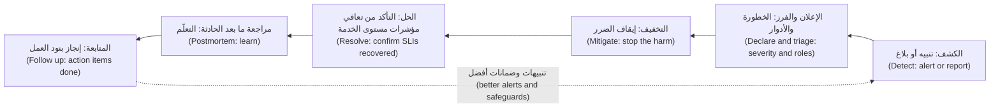

**خفّف الضرر أولًا (Mitigate first).** الإجراء الآمن الأسرع الذي يوقف الضرر عن المستخدمين يأتي قبل الفهم. التخفيفات المعتادة (Typical mitigations)، بترتيب الأفضلية تقريبًا: **التراجع (roll back)** عن أحدث تغيير، فعمليات النشر وتغييرات الإعدادات تسبّب حصةً كبيرة من الحوادث، ولذلك فإن «ما الذي تغيّر؟» ⁦⁩ هو السؤال الأول؛ و**إطفاء علَم الميزة (turn off a feature flag)**؛ و**التحويل إلى البديل (fail over)** إلى منطقةٍ سليمة أو نسخةٍ متماثلة سليمة؛ و**التوسّع الأفقي (scale out)** أو **التخلّص من جزءٍ من الحمل (shed load)**، أي رفض الحركة منخفضة الأولوية لحماية المدفوعات. احفظ الأدلة قبل أن تُتلفها: التقط السجلات أو تفريغ الذاكرة أو الإعدادات السيئة قبل إعادة تشغيل الأشياء، إذا كان ذلك يستغرق ثوانيَ لا دقائق.

#### 🟡 التعمق أكثر
**التحديث الجيد (A good update)** له شكلٌ ثابت سهل المسح بالعين:

```text
[SEV2 · Payments · Update 3 · 11:30]
Impact: ~8% of transfer requests failing or slow since 10:41. No duplicate transfers.
Current status: Mitigated. Config rolled back at 11:17; error ratio back to normal since 11:18.
Next steps: Monitoring for 30 min before resolving. Investigating why the change reached prod.
Next update: 12:00 or sooner if anything changes.
IC: Maha · Ops: Tariq · Comms: Salem · Scribe: Yousef
```

قل ما تعرفه، وما لا تعرفه، ومتى ستتحدث في المرة القادمة. ولا تخمّن سببًا أبدًا في رسالةٍ موجّهة إلى العملاء.

**عادات التنسيق (Coordination habits).** قناة حادثة واحدة، ومكالمة جسر واحدة، وقائد حادثة واحد. أعلِن التغييرات قبل إجرائها: «طارق: أتراجع الآن عن payments-config إلى المراجعة 41» ⁦("Tariq: rolling back payments-config to revision 41 now")⁩. وسلِّم دور قائد الحادثة صراحةً عند تغيّر المناوبات أو حين تتجاوز الحادثة طاقة شخصٍ واحد: «مها تسلّم قيادة الحادثة إلى سالم الساعة 13:00؛ سالم، أكّد» ⁦("Maha handing IC to Salem at 13:00; Salem, confirm.")⁩ 

**حين تكون الحادثة حادثةً أمنية أيضًا (When an incident is also a security incident).** إذا ظهرت أي علامة على وجود مهاجم، مثل وصولٍ غير متوقع (unexpected access) أو بياناتٍ تغادر (data leaving) أو أثرٍ برمجي عُبث به، فأشرِك مركز العمليات الأمنية لدى جاسم (Jassim's SOC) فورًا. فالحوادث الأمنية تغيّر القواعد: احفظ الأدلة (preserve evidence)، ولا تنبّه المهاجم، واتبع خطة الاستجابة للحوادث الأمنية، بواجباتها القانونية والتنظيمية. وتُدرَّس هذه العملية في [*أمن الذكاء الاصطناعي وأمن التطبيقات*، الدرس 10.2 — الاستجابة للحوادث: الاستعداد والكشف والاحتواء والتعافي والتعلّم](../secai/index.ar.html#/10.2).

**الإبلاغ التنظيمي (Regulatory reporting).** على الكيانات المالية واجبات إبلاغٍ عن الحوادث. فبموجب قانون DORA في الاتحاد الأوروبي، يجب على الشركات تصنيف الحوادث المتعلقة بتقنية المعلومات والاتصالات والإبلاغ عن الكبرى منها إلى السلطة المختصة ضمن مهلٍ محددة؛ كما تضع الجهات التنظيمية الخليجية، ومنها مصرف قطر المركزي، توقعاتٍ للإبلاغ عن الحوادث وإخفاقات الإسناد الخارجي. وتملك إدارة المخاطر والامتثال (Risk and Compliance) المعايير والمهل؛ أمّا واجب الهندسة (engineering's duty) فهو تزويدها بحقائق دقيقة بسرعة، أي وقت البدء والخدمات والعملاء والمعاملات المتأثرة وأثر البيانات، وهذا سببٌ إضافي للاحتفاظ بخطٍّ زمني من الدقيقة الأولى.

**مراجعة ما بعد الحادثة الخالية من اللوم (The blameless postmortem).** **مراجعة ما بعد الحادثة (postmortem)**، وتُسمّى أيضًا المراجعة اللاحقة للحادثة (post-incident review)، تحليلٌ مكتوب للحادثة: ما الذي حدث، وأثره، ولماذا حدث، وكيف سارت الاستجابة، وما الذي سيتغيّر. و**الخالية من اللوم (Blameless)** تعني أنها تفترض أن الجميع تصرّفوا بشكلٍ معقول بالنظر إلى ما كانوا يعرفونه حينها، وتبحث عن الظروف التي جعلت التصرّف الضار سهلًا والتصرّف الآمن صعبًا. والغاية عملية: إذا خاف الناس من اللوم، أخفوا التفاصيل (hide details)، ودون التفاصيل لا تستطيع إصلاح النظام.

الخلوّ من اللوم لا يعني أن لا أحد مساءل. فالفرق مساءلة عن إنجاز بنود العمل؛ والقادة مساءلون عن جعل قول الحقيقة آمنًا.

**من «الخطأ البشري» إلى العوامل المساهمة (From "human error" to contributing factors).** «وافق يوسف على تغييرٍ سيئ» صحيحٌ وعديم الفائدة. اطرح أسئلةً أفضل:
- كيف كان الأمر منطقيًّا في حينه؟ ⁦⁩ (أظهرت الفروقات سطرًا واحدًا في ملفٍ اسمه `values-shared.yaml`، وبدا غير ضار (looked harmless).)
- ما الذي جعل الخطأ سهلًا؟ ⁦⁩ (قيمٌ مشتركة لكل البيئات؛ ولا فروقات مُصيَّرة لإعدادات الإنتاج في خط التسليم.)
- ما الذي جعل الكشف بطيئًا؟ ⁦⁩ (استدعى التنبيه شخصًا واحدًا ولم يجمع شيءٌ الفريق المناسب.)
- ما الذي حدّ من الضرر؟ ⁦⁩ (مفاتيح عدم التكرار، ومسار تراجعٍ سريع.)

للأعطال المعقدة عادةً عدة **عوامل مساهمة (contributing factors)** بدل سببٍ جذري واحد. اذكرها كلها؛ وأصلح الأكثر تأثيرًا منها.

#### 🔴 نظرة الخبير
**مثالٌ علني: انقطاع Amazon S3 في فبراير 2017 (A public example: the Amazon S3 outage of February 2017).** نشرت AWS ملخصًا لتعطّلٍ أصاب S3 في منطقتها us-east-1 (its us-east-1 region). فقد شغّل مهندسٌ مخوَّل، متّبعًا دليل إجراءاتٍ معتمدًا، أمرًا مقصودًا لإزالة عددٍ صغير من الخوادم من نظامٍ فرعي في S3 (remove a small number of servers from an S3 subsystem)؛ فأُدخل أحد المدخلات بشكلٍ خاطئ وأُزيلت مجموعةٌ أكبر بكثير. وركّزت استجابة AWS على الأداة لا على الشخص: فقد غيّرت الأداة لتزيل السعة ببطءٍ أكبر وترفض النزول تحت حدٍّ أدنى آمن. وأشار الملخص أيضًا إلى أن لوحة الحالة الخاصة بـ AWS كانت تعتمد على S3، فلم تستطع إظهار الانقطاع في البداية. والدروس لنجم: ابنِ حواجز حماية في الأدوات الخطرة، وتأكد من أن أدوات الحوادث لديك لا تعتمد على الشيء الذي يفشل.

**مثالٌ ثانٍ: GitLab، يناير 2017 (A second example: GitLab, January 2017).** أثناء جهدٍ في وقتٍ متأخر من الليل لإصلاح تكرار قاعدة البيانات، حذف مهندسٌ بياناتٍ على قاعدة البيانات الرئيسية بدل النسخة المتماثلة. ثم وجدت مراجعة ما بعد الحادثة العلنية لدى GitLab أن عددًا من آليات النسخ الاحتياطي والتكرار لديها لم تكن تعمل كما هو متوقع، وفُقدت بيانات إنتاج لنحو ست ساعات. والدروس: النسخة الاحتياطية التي لم تستعِدها أملٌ لا نسخة احتياطية، والدرس 6.1 يغطي اختبار الاستعادة (recovery testing)، والأشخاص المتعبون الذين يؤدون عملًا يدويًّا خطرًا ليلًا يحتاجون إلى أدواتٍ تجعل التصرّف الآمن سهلًا.

**بنود عملٍ تغيّر الأشياء (Action items that change things).** البنود الضعيفة (Weak items)، مثل «كن أكثر حذرًا» و«أضِف مزيدًا من المراقبة»، لا تصمد حتى دورة العمل القصيرة التالية. أمّا البنود القوية (Strong items) فهي محددة، ومملوكة، ومؤرّخة، وتغيّر النظام:

| ضعيف (Weak) | قوي (Strong) |
|---|---|
| كن أكثر حذرًا مع تغييرات الإعدادات | قسّم `values-shared.yaml` إلى ملفاتٍ لكل بيئة (per-environment files)؛ ويفشل التكامل المستمر (CI fails) إذا تغيّرت قيمةٌ إنتاجية دون مراجعةٍ موسومة للإنتاج (المالك (owner): يوسف، الاستحقاق (due): أسبوعان) |
| حسّن المراقبة (Improve monitoring) | أضِف لوحة USE وتنبيهًا بمستوى تذكرة عمل لتشبّع مجمّع اتصالات قاعدة بيانات المدفوعات فوق 80% (Payments DB pool saturation above 80%) (المالك: مها، الاستحقاق: أسبوع واحد) |
| تواصل بسرعة أكبر (Communicate faster) | استدعاءات الاحتراق السريع للمدفوعات تستدعي أيضًا جدول مناوبة قادة الحوادث وتُنشئ قناة الحادثة تلقائيًّا (المالك: فريق المنصة لدى سالم (Salem's platform team)، الاستحقاق: 3 أسابيع) |

أعطِ الأولوية للبنود التي **تمنع (prevent)** التكرار، ثم التي **تكشف (detect)** بسرعة أكبر، ثم التي **تستجيب (respond)** بسرعة أكبر. تابعها في قائمة الأعمال العادية وراجعها أسبوعيًّا.

**قياس الاستجابة للحوادث (Measuring incident response).** تتابع الفرق أزمنةً مثل **الوقت حتى الكشف (time to detect)**، و**الوقت حتى الإقرار (time to acknowledge)**، و**الوقت حتى الاستعادة (time to restore)**. ويستخدم بحث DORA (DORA's research) الوقت حتى استعادة الخدمة (time to restore service)، الذي نُقّح في تقارير لاحقة، بوصفه مقياس تسليمٍ رئيسيًّا. تعامل مع هذه الأرقام بحذر: فالحوادث قليلة ومختلفة جدًّا، لذا تضلّل المتوسطات على مدى ربع سنة. انظر إلى الاتجاهات (trends) والتوزيع والقصة وراء أطولها.

**تدرّب قبل أن يكون الأمر حقيقيًّا (Practise before it is real).** **أيام التمرين (Game days)** تمارين مخطط لها (planned exercises) يستجيب فيها الفريق لحادثةٍ محاكاة في بيئة اختبار: تحويل قاعدة بيانات إلى البديل، أو فقدان منطقة، أو شهادة منتهية الصلاحية. وهي تختبر أدلة التشغيل والأدوار والأدوات، وتدرّب الأشخاص الجدد مثل يوسف بأمان. وهندسة الفوضى (Chaos engineering) توسّع ذلك (الدرس 6.1). وتُجري نجم يومًا واحدًا كل ربع سنة، بعضها بالاشتراك مع مركز العمليات الأمنية لدى جاسم.

### 🧰 الأدوات
| الأداة أو الممارسة أو الخدمة | ما هي وماذا تفعل | متى تلجأ إليها |
|---|---|---|
| **Incident commander** — قائد الحادثة | الشخص الوحيد الذي ينسّق الاستجابة، ويوزّع الأدوار (assigns roles)، ويتخذ القرارات (makes decisions)؛ ولا يصحّح الأخطاء | كل حادثةٍ مُعلنة، منذ الدقائق الأولى |
| **Severity levels** — مستويات الخطورة | مقياسٌ مشترك يحدّد من يشارك، وعدد مرات التواصل، ومن يجب إبلاغه | إعلان الحوادث وتصعيدها باتساق |
| **Blameless postmortem** (Google SRE) — مراجعة ما بعد الحادثة الخالية من اللوم | مراجعةٌ مكتوبة تبحث عن العوامل المساهمة في النظام، لا عن أشخاصٍ يُلامون | بعد كل حادثة SEV1 وSEV2 (After every SEV1 and SEV2)، وأي حادثة استهلكت حصةً كبيرة من ميزانية الأخطاء |
| **Status page** — صفحة الحالة | صفحةٌ عامة أو داخلية تُظهر حالة الخدمة الحالية وتحديثات الحوادث، مستضافةٌ بشكلٍ مستقل عن الخدمات التي تبلّغ عنها | الحوادث التي تمسّ العملاء (Customer-facing incidents)؛ إبقاء مركز الاتصال على اطلاع |
| **Game day** — يوم التمرين | حادثةٌ محاكاة مخطط لها في بيئةٍ آمنة لاختبار أدلة التشغيل والأدوار والأدوات | كل ربع سنة (Quarterly)، وقبل أن تبدأ خدمةٌ جديدة أو جدول مناوبة جديد العمل |

### 🏛️ عمليًا في بنك نجم
**الأثر البرمجي (Artefact): مراجعة ما بعد الحادثة لحادثة مجمّع اتصالات المدفوعات (the postmortem for the Payments connection-pool incident)، مختصرةً (abridged)، باستخدام قالب نجم (using Najm's template).**

| القسم (Section) | المحتوى (Content) |
|---|---|
| العنوان والحالة | PM-2026-014 · تحويلات المدفوعات تفشل بعد تغيير إعدادات · SEV2 · نهائية (Final) |
| الملخص (Summary) | خفّض تغييرٌ في قيم Helm المشتركة مجمّع اتصالات قاعدة بيانات المدفوعات من 50 إلى 5 في الإنتاج. فاصطفّت التحويلات بانتظار الاتصالات وانتهت مهلتها (timed out). وأعاد التراجع عن الإعدادات الخدمة (restored service). |
| الأثر (Impact) | 10:41–11:18 (37 دقيقة). نحو 8% من طلبات التحويل فشلت أو استغرقت أكثر من ثانيتين (failed or took over 2 s)؛ ونحو 3,100 عميل متأثر. لا تحويلات مكرّرة أو مفقودة، وقد تحقّقت المطابقة من ذلك. واستُهلك نحو 5–10% من ميزانية أخطاء التوافر للمدفوعات على مدى 30 يومًا (of the 30-day Payments availability error budget)، تبعًا لحجم الحركة في تلك الساعة وعدد الطلبات التي فشلت بدل أن تكون بطيئة. |
| الكشف (Detection) | استدعاء احتراقٍ سريع لهدف مستوى الخدمة الساعة 10:52 (بعد 11 دقيقة من البدء (11 minutes after onset)). وبدأت بلاغات مركز الاتصال الساعة 10:49. |
| الخط الزمني (مقتطف) (Timeline) | 10:40 ترقية الإعدادات (config promoted) · 10:41 بدء الأخطاء (errors begin) · 10:52 استدعاء يوسف · 11:04 إعلان SEV2، ومها قائدة الحادثة (SEV2 declared, Maha IC) · 11:12 سؤال «ما الذي تغيّر؟» يشير إلى الإعدادات · 11:17 التراجع (rollback) · 11:18 عودة الأخطاء إلى طبيعتها (errors normal) · 11:48 الحل (resolved) |
| العوامل المساهمة | ملف قيم واحد مشترك بين كل البيئات؛ أظهر خط التسليم فروقات المصدر لا فروقات الإنتاج المُصيَّرة؛ لا تنبيه على تشبّع المجمّع؛ لم يصل الاستدعاء إلى جدول مناوبة قادة الحوادث؛ خلطت الترقية الجماعية تغييراتٍ غير مترابطة |
| ما سار جيدًا | منعت مفاتيح عدم التكرار التحويلات المكرّرة؛ واستغرق التراجع أمرًا واحدًا؛ وأبقت تحديثات قائد الاتصالات مركزَ الاتصال متّسقًا |
| أين حالفنا الحظ | وقعت الحادثة في ساعات العمل ومها متصلة |
| بنود العمل | ملفات قيمٍ لكل بيئة وفحصٌ للفروقات المُصيَّرة في التكامل المستمر (يوسف، أسبوعان، منع) · تنبيه تشبّع المجمّع بوصفه تذكرة عمل (مها، أسبوع واحد، كشف) · استدعاءات الاحتراق السريع تستدعي أيضًا جدول مناوبة قادة الحوادث (فريق المنصة، 3 أسابيع، استجابة) · ترقية مجموعة تغييراتٍ واحدة في كل مرة إلى المدفوعات (طارق، أسبوعان، منع) |
| المراجعة | عُرضت في مراجعة العمليات الأسبوعية؛ وتُتابع بنود العمل حتى الإغلاق؛ وشوركت الحقائق مع إدارة المخاطر والامتثال لسجل الحوادث |

### 🛠️ التمارين
- 🟢 اقرأ ملخص AWS عن انقطاع S3 في فبراير 2017 (the AWS S3 February 2017 summary) أو مراجعة ما بعد الحادثة لدى GitLab في يناير 2017 (GitLab's January 2017 postmortem). اكتب ملخصًا من نصف صفحة بقالب نجم: الأثر والخط الزمني والعوامل المساهمة وثلاثة بنود عمل. *يكتمل عندما:* لا يكون أيٌّ من عواملك المساهمة «خطأً بشريًّا»، ويغيّر كل بند عمل نظامًا أو أداة.
- 🟡 أدِر تمرينًا مكتبيًّا مدته 45 دقيقة مع صديقين أو ثلاثة أو زملاء دراسة. استخدم سيناريو مثل «زمن استجابة واجهة برمجة تطبيق نجم للهاتف يتضاعف ثلاث مرات بعد نشر». وزّع أدوار قائد الحادثة والعمليات والاتصالات والمدوّن؛ ويكشف «مدير اللعبة» ("game master") حقائق جديدة كل بضع دقائق. *يكتمل عندما:* يكون لديك خطٌّ زمني مختوم بالوقت، وثلاثة تحديثات حالة بالصيغة أعلاه، وقائمة بما أبطأكم.
- 🔴 في مختبر kind أو k3d المحلي لديك (your local kind or k3d lab) مع منظومة قابلية المراقبة من الدرسين 5.1 و5.2 (the observability stack from lessons 5.1 and 5.2)، أدِر يوم تمرين: انشر تغييرًا يسبّب احتراقًا سريعًا لهدف مستوى الخدمة، مثل مجمّع اتصالاتٍ صغيرٍ جدًّا أو تأخيرٍ محقون، واستجب بالأدوار، وخفّف الضرر بالتراجع، واكتب مراجعة ما بعد الحادثة كاملةً خاليةً من اللوم. *يكتمل عندما:* يكون التنبيه قد استدعى كما صُمّم، والتراجع مسجّلًا في الخط الزمني، ولمراجعة ما بعد الحادثة ثلاثة بنود عمل على الأقل مملوكة ومؤرّخة موزّعة بين المنع والكشف والاستجابة.

### ⚠️ أخطاء وفخاخ
- **التصحيح قبل الإعلان (Debugging before declaring).** عشرة أشخاص يحقّقون في خمس محادثات ليست استجابة. أعلِن مبكرًا (Declare early)، وسمِّ قائد حادثة، ثم حقّق (then investigate).
- **قائد الحادثة الذي يصحّح الأخطاء (The IC who debugs).** حين يضيع المنسّق في الطرفية، لا يبقى أحدٌ يراقب الصورة الكبيرة. يفوّض قائد الحادثة العمل العملي.
- **البحث عن السبب الجذري بينما ما زال العملاء يواجهون الفشل (Looking for the root cause while customers are still failing).** تراجَع، أو حوّل إلى البديل، أو أطفئ العلَم أولًا؛ وحقّق بعد ذلك (investigate after).
- **«الخطأ البشري» بوصفه الخلاصة ("Human error" as the conclusion).** إنه يوقف التعلّم (stops learning) ويعلّم الناس إخفاء الأخطاء. اسأل عمّا جعل الخطأ سهلًا والكشف بطيئًا.
- **بنود عملٍ لا تُغلق أبدًا (Action items that never close).** مراجعة ما بعد الحادثة التي فيها «كن أكثر حذرًا» أو بنودٌ غير متابَعة (untracked items) لا تغيّر شيئًا. اجعل البنود محددة ومملوكة ومؤرّخة ومُراجَعة.

### 🧾 الخلاصة
- أعلِن الحوادث مبكرًا، وحدّد خطورةً، وعيّن قائد حادثة وقائد عمليات وقائد اتصالات ومدوّنًا.
- أوقف الضرر أولًا: تراجَع، أو اقلب العلَم، أو حوّل إلى البديل، أو تخلّص من جزءٍ من الحمل؛ واحفظ الأدلة حيث يكون ذلك رخيصًا.
- تواصل وفق جدولٍ ثابت بالأثر والحالة والخطوات التالية وموعد التحديث القادم؛ ووجّه الحوادث الأمنية إلى مركز العمليات الأمنية.
- مراجعات ما بعد الحادثة الخالية من اللوم (Blameless postmortems) تبحث عن العوامل المساهمة في النظام لأن اللوم يُخفي الحقائق التي تحتاجها.
- بنود العمل القوية محددة ومملوكة ومؤرّخة ومتابَعة؛ امنع، ثم اكشف، ثم استجب بسرعة أكبر.
- تدرّب بأيام التمرين والتمارين المكتبية حتى لا تكون الحادثة الحقيقية الأولى هي البروفة الأولى.

### ✍️ اختبر نفسك

**1. بعد خمس عشرة دقيقة من انقطاع واجهة برمجة تطبيق نجم للهاتف (a Najm Mobile API outage)، يصحّح ثلاثة مهندسين في محادثاتٍ منفصلة (separate chats)، ولا يعرف مركز الاتصال ماذا يقول للعملاء. ما الذي ينبغي أن يحدث أولًا؟**

- A. يتولى المهندس الأقدم كل التصحيح بنفسه
- B. يوقف الجميع التغييرات حتى يُفهم السبب الجذري تمامًا
- C. يتفق الفريق على الأدوار لاحقًا، في مراجعة ما بعد الحادثة، حين تهدأ الأمور
- D. أعلِن حادثةً، وسمِّ قائد حادثة، ووزّع الأدوار

<details><summary>الإجابة</summary>

**D.** الأدوار ونقطة تنسيقٍ واحدة تحوّل الجهد المتوازي إلى استجابة. أمّا مهندسٌ أقدم يصحّح فلا يترك أحدًا ينسّق؛ وانتظار السبب الجذري (B) يؤخّر التخفيف (delays mitigation). (🟢 الأساسيات.)

</details>

**2. بدأت أخطاء المدفوعات بعد دقيقتين من ترقية تغيير إعدادات (a configuration change was promoted). والسبب لم يتأكد بعد (not yet confirmed). ما الخطوة التالية الأفضل؟**

- A. واصل التحقيق حتى يثبت السبب الجذري بدقة
- B. تراجَع عن تغيير الإعدادات لإيقاف الضرر، ثم حقّق
- C. أعِد تشغيل قاعدة البيانات لمسح أي حالةٍ سيئة
- D. انشر رسالةً للعملاء تقول إن قاعدة البيانات فشلت

<details><summary>الإجابة</summary>

**B.** التغييرات الحديثة هي السبب الأرجح والتراجع سريعٌ وآمن؛ خفّف الضرر أولًا (mitigate first). إعادة تشغيل قاعدة البيانات (C) تخاطر بمزيدٍ من الضرر وتُتلف الأدلة؛ وتخمين سببٍ علنًا (D) خطأٌ في التواصل. (🟢 الأساسيات.)

</details>

**3. تذكر مسودة مراجعة ما بعد الحادثة (A draft postmortem) أن السبب الجذري هو «وافق يوسف على طلب سحبٍ بقيمةٍ خاطئة» ("Yousef approved a pull request with a wrong value"). ماذا ينبغي أن تطلب مها بدلًا من ذلك؟**

- A. العوامل المساهمة (Contributing factors)، مثل كيف وصلت قيمة تطوير إلى الإنتاج دون أن يلاحظها أحد
- B. إنذارًا كتابيًّا ليوسف، يُسجَّل في ملف أدائه
- C. إزالة يوسف من قائمة الموافقين (approvers list) على مستودعات المدفوعات (Payments repositories)
- D. إغلاق مراجعة ما بعد الحادثة مبكرًا، لأن السبب واضحٌ أصلًا

<details><summary>الإجابة</summary>

**A.** التحليل الخالي من اللوم (Blameless analysis) يسأل عمّا جعل الخطأ سهلًا والكشف بطيئًا، ما يُنتج إصلاحاتٍ تمنع التكرار. أمّا العقاب (Punishment) (B، C) فيعلّم الناس إخفاء المعلومات (hide information) ويُبقي الفخ في مكانه. (🟡 التعمق أكثر (Going deeper).)

</details>

**4. أيّ بند عملٍ في مراجعة ما بعد الحادثة هو الأقوى (strongest)؟**

- A. ينبغي أن يحرص الجميع أكثر عند تعديل الإعدادات مستقبلًا
- B. تحسين مراقبة خدمة المدفوعات عبر كل البيئات
- C. ملفات قيمٍ لكل بيئة إضافةً إلى فحصٍ في التكامل المستمر؛ المالك يوسف، والاستحقاق خلال أسبوعين
- D. مناقشة ممارسات الإعدادات مع كل المهندسين في الاجتماع العام القادم

<details><summary>الإجابة</summary>

**C.** إنه محدد ومملوك ومؤرّخ ويغيّر النظام بحيث لا يتكرر الخطأ بالطريقة نفسها. أمّا A وB وD فغامضة وغير متابَعة. (🔴 نظرة الخبير (Expert view).)

</details>

**5. أثناء تعطّل S3 في فبراير 2017 (the February 2017 S3 disruption)، لم تستطع لوحة الحالة الخاصة بـ AWS (AWS's own status dashboard) إظهار المشكلة في البداية. ما الدرس الذي تأخذه نجم من ذلك؟**

- A. صفحات الحالة غير مفيدة أثناء الحوادث ويمكن الاستغناء عنها
- B. شغّل كل خدمة في منطقةٍ سحابية واحدة لإبقاء الأمور بسيطة
- C. لا تدع أي مهندسٍ يشغّل أوامر على أنظمة الإنتاج أبدًا
- D. استضِف أدوات الحوادث بشكلٍ مستقل عن الأنظمة التي تبلّغ عنها

<details><summary>الإجابة</summary>

**D.** كانت اللوحة تعتمد على S3، ففشلت معه؛ ويجب أن تصمد أدوات الحوادث (incident tooling)، مثل صفحة الحالة والاستدعاء، أمام العطل الذي تبلّغ عنه. أمّا حظر كل أوامر الإنتاج (C) فغير عملي (unworkable)؛ وكان إصلاح AWS حواجز حماية في الأداة. (🔴 نظرة الخبير (Expert view).)

</details>

### 📚 المراجع
- Google، *هندسة موثوقية المواقع*، «إدارة الحوادث» ("Managing Incidents") — https://sre.google/sre-book/managing-incidents/
- Google، *هندسة موثوقية المواقع*، «ثقافة مراجعة ما بعد الحادثة: التعلّم من الفشل» — https://sre.google/sre-book/postmortem-culture/
- Google، *كتاب عمل هندسة موثوقية المواقع*، «الاستجابة للحوادث» ("Incident Response") — https://sre.google/workbook/incident-response/
- Google، *كتاب عمل هندسة موثوقية المواقع*، «ثقافة مراجعة ما بعد الحادثة» ("Postmortem Culture") — https://sre.google/workbook/postmortem-culture/
- AWS، ملخص تعطّل خدمة Amazon S3 في منطقة شمال فرجينيا (US-EAST-1) (Summary of the Amazon S3 Service Disruption in the Northern Virginia (US-EAST-1) Region) — https://aws.amazon.com/message/41926/
- GitLab، مراجعة ما بعد الحادثة لانقطاع قاعدة البيانات في 31 يناير (Postmortem of database outage of January 31) — https://about.gitlab.com/blog/
- أبحاث DORA (DORA research) — https://dora.dev/
- اللائحة 2022/2554 (Regulation 2022/2554) — https://eur-lex.europa.eu/eli/reg/2022/2554/oj

---

<a id="m6"></a>

# الوحدة 6 — التوسّع والتكلفة والبنية التحتية للذكاء الاصطناعي (Scale, cost and AI infrastructure)

*إيصال خدمةٍ إلى الإنتاج هو نصف المهمة. أمّا النصف الآخر فهو إبقاؤها عاملةً حين تتضاعف حركة المرور ثلاث مرات، وحين تتعطّل منطقة توافر أو تُحذف قاعدة بيانات خطأً، مع إبقاء الفاتورة تحت السيطرة أثناء ذلك، وتشغيل أحدث أعباء العمل وأكثرها شراهةً على الإطلاق: النماذج اللغوية الكبيرة (large language models) على وحدات معالجة الرسوميات (GPUs). تغطي هذه الوحدة القرارات الثلاثة التي تميّز مهندس المنصات (platform engineer) عن شخصٍ لا يستطيع سوى النشر. أولًا، التوسّع والمرونة: التوسّع التلقائي (autoscaling) على مستوى الحجيرة والعقدة، والتوزّع عبر مناطق التوافر، ونُسخٌ احتياطية استعدتها فعلًا، وأهداف التعافي من الكوارث، أي RTO وRPO، التي وقّع عليها قطاع الأعمال. ثانيًا، FinOps: رؤية أين يذهب المال، وإعطاء كل تكلفةٍ مالكًا، وخفض الهدر دون خفض الموثوقية. ثالثًا، البنية التحتية للذكاء الاصطناعي (AI infrastructure): وحدات معالجة الرسوميات، وتقديم النماذج (model serving)، وبوابات النماذج اللغوية (LLM gateways)، والتكلفة لكل رمز. ستتابع فريق هندسة المنصات وهندسة موثوقية المواقع (Platform Engineering & SRE team) في بنك نجم (Najm Bank) بينما تدير مها أول اختبارٍ كامل للتعافي من الكوارث لخدمة المدفوعات (Payments service)، وتسأل منى من الإدارة المالية لماذا نمت فاتورة السحابة (cloud bill) أسرع من قاعدة العملاء (customer base)، ويتعيّن على سالم أن يقرّر كيف ينبغي لنجم أسيست (Najm Assist) أن يقدّم نماذجه دون أن يحرق ميزانية وحدات معالجة الرسوميات (GPU budget) في شهرٍ واحد.*

> **المراحل (Phases):** Operate, Monitor — إبقاء الإنتاج عاملًا، وميسور التكلفة (affordable)، وجاهزًا لأعباء عمل الذكاء الاصطناعي بعد أن يصبح حيًّا، وإثبات ذلك بالاختبارات والأرقام لا بالأمل.

<a id="l6-1"></a>

## 6.1 — التوسّع والمرونة: التوسّع التلقائي وتعدّد المناطق والنسخ الاحتياطية والتعافي من الكوارث

*المستوى: 🔴 متقدم* · *المتطلبات: 2.3، 3.2، 5.2* · *المرحلة (Phase): Operate*

### ⚡ الدرس في دقيقة (In 60 seconds)
- **التوسّع (Scaling)** يتعامل مع حملٍ أكبر؛ و**المرونة (resilience)** تصمد أمام الأعطال (survives failure)، عبر التكرار الاحتياطي (redundancy) والنسخ الاحتياطية (backups) وخطط التعافي (recovery plans).
- توسّع تلقائيًّا على طبقات: **المُوسِّع التلقائي الأفقي للحجيرات (Horizontal Pod Autoscaler)** يضيف حجيرات (adds pods)، و**المُوسِّع التلقائي للعقد (node autoscaler)** يضيف آلاتٍ لتلك الحجيرات، و**قاعدة البيانات (database)** لا تتوسّع تلقائيًّا في العادة أصلًا، لذا تكون غالبًا هي الحدّ الحقيقي.
- وزّع كل خدمةٍ إنتاجية على **منطقتين أو ثلاث من مناطق التوافر (two or three availability zones)** على الأقل، وافرض ذلك بقيود توزيع الطوبولوجيا (topology spread constraints) وميزانيات تعطيل الحجيرات (PodDisruptionBudgets).
- أهداف التعافي (Recovery targets) قراراتٌ تجارية (business decisions): **RTO** و**RPO**. دوّنها لكل خدمة، ثم اختر أرخص تصميمٍ يحقّقها.
- مؤشر القرار (Decision cue): النسخة الاحتياطية التي لم تستعدها أملٌ لا نسخة احتياطية. جدوِل اختبارات الاستعادة وقِس زمنها مقابل RTO.
- أكبر فخ (Biggest trap): معاملة تعدّد المناطق (multi-zone) على أنه تعافٍ من الكوارث (disaster recovery). مناطق التوافر تصمد أمام تعطّل مركز بيانات، لا أمام نشرٍ سيئ أو جدولٍ محذوف أو برمجية فدية (ransomware)، لأن أضرارها تتكرّر في كل مكان خلال ثوانٍ.

### 🧭 لماذا يهم
في 31 يناير 2017، نفّذ مهندسٌ في GitLab كان يصلح مشكلة تكرار أمرَ حذف على ما ظنّ أنها قاعدة البيانات الثانوية. لكنها كانت الأساسية. وتصف مراجعة ما بعد الحادثة العلنية (public postmortem) لدى GitLab كيف أن أيًّا من أساليب النسخ الاحتياطي والتكرار التي اعتمد عليها الفريق لم يعمل كما هو متوقّع؛ فتعافوا من نسخةٍ في بيئة التجهيز عمرها نحو ست ساعات، وفقدوا قرابة ست ساعات من بيانات الإنتاج (production data). لم يكن أحدٌ قد استعاد نسخةً احتياطية من البداية إلى النهاية، لذا لم يكن أحدٌ يعلم أن النسخ الاحتياطية معطّلة.

انتقلت خدمة المدفوعات للتوّ إلى السحابة (cloud)، ويسأل حمد (CISO) ووظيفة المخاطر سالمًا: «لو تعطّلت المنطقة الأساسية عصر اليوم، أو حذف أحدهم قاعدة بيانات المدفوعات (payments database)، فكم سيمضي من الوقت قبل أن يتمكّن العملاء من إرسال الأموال مجددًا، وكم تحويلًا سنفقد ⁦⁩». ويتوقّع قانون المرونة التشغيلية الرقمية في الاتحاد الأوروبي، المطبَّق على الكيانات المالية (financial entities) منذ 17 يناير 2025، أن يُظهر كيانُ البنك في الاتحاد الأوروبي ترتيباتٍ مختبَرة للنسخ الاحتياطي والاستعادة والاستمرارية، كما تضع الجهات التنظيمية الخليجية (GCC regulators) مثل مصرف قطر المركزي (Qatar Central Bank) توقّعاتها الخاصة للاستمرارية والإسناد الخارجي. و«نحن نستخدم تعدّد مناطق التوافر» ليست إجابة. يبني هذا الدرس إجابةً حقيقية: أهدافًا (targets)، وتصميمًا (design)، والاختبار الذي يثبتها.

### 📐 كيف يعمل

#### 🟢 الأساسيات

**التوسّع: الرأسي والأفقي (Scaling: vertical and horizontal).** *التوسّع الرأسي (Vertical scaling)* يمنح الخادم مزيدًا من المعالج أو الذاكرة. وهو بسيط لكن له سقف ويعني عادةً إعادة تشغيل. أمّا *التوسّع الأفقي (Horizontal scaling)* فيضيف نسخًا أكثر من الخدمة خلف موازن أحمال. وسقفه أعلى بكثير، لكنه لا يعمل إلا إذا كانت الخدمة **عديمة الحالة (stateless)**: لا بيانات جلسات ولا ملفات مرفوعة (uploads) ولا ذاكرات تخزين مؤقت (caches) محفوظة على القرص المحلي أو في الذاكرة تحتاجها نسخةٌ أخرى. فالحالة (State) تذهب إلى قاعدة بيانات أو خدمة تخزين مؤقت أو تخزين الكائنات (object storage). ولرؤية غير المبرمج، انظر [*تصميم الأنظمة لمبرمجي الحدس (System Design for Vibe Coders)*، الدرس 10.1 — الخدمات عديمة الحالة وموازنة الأحمال (Stateless services and load balancing)](../vibe/index.ar.html#l10-1).

**يحدث التوسّع التلقائي في Kubernetes على طبقات (Autoscaling in Kubernetes happens in layers).**

| الطبقة (Layer) | ما الذي يتوسّع | ما الذي يطلقه (Triggered by) | انتبه إلى (Watch out for) |
|---|---|---|---|
| **المُوسِّع التلقائي الأفقي للحجيرات (Horizontal Pod Autoscaler, HPA)** | عدد نسخ الحجيرات المتماثلة | استخدام المعالج أو الذاكرة مقابل الطلبات، أو مقاييس مخصّصة (custom metrics) | يحتاج إلى طلبات موارد معقولة (2.3)؛ يستجيب خلال عشرات الثواني، لا فورًا |
| **المُوسِّع التلقائي للعقد (Node autoscaler)** | عدد العقد العاملة | حجيراتٌ عالقة في `Pending` لأن أي عقدةٍ لا تتّسع لها | قد تستغرق العقدة الجديدة دقائق؛ احتفظ ببعض الهامش |
| **المُوسِّع التلقائي الرأسي للحجيرات (Vertical Pod Autoscaler, VPA)** | طلبات المعالج والذاكرة لكل حجيرة | الاستخدام المرصود عبر الزمن | لا تدع HPA وVPA يعملان على مقياس المعالج أو الذاكرة نفسه |
| **التوسّع المدفوع بالأحداث (Event-driven scaling)** (KEDA) | النسخ المتماثلة، نزولًا حتى الصفر | طول الطابور (Queue length)، وتأخّر التدفّق (stream lag)، والجداول الزمنية (schedules) | التوسّع إلى الصفر (Scale-to-zero) يعني بدءًا باردًا |

مُوسِّعٌ تلقائي أفقي أساسي لواجهة برمجة تطبيق نجم للهاتف (Najm Mobile API):

```yaml
apiVersion: autoscaling/v2
kind: HorizontalPodAutoscaler
metadata:
  name: mobile-api
  namespace: mobile
spec:
  scaleTargetRef:
    apiVersion: apps/v1
    kind: Deployment
    name: mobile-api
  minReplicas: 6          # two per zone, never fewer
  maxReplicas: 30         # a ceiling the database can survive
  metrics:
    - type: Resource
      resource:
        name: cpu
        target:
          type: Utilization
          averageUtilization: 65   # percent of the CPU *request*
  behavior:
    scaleDown:
      stabilizationWindowSeconds: 300   # the default, made explicit: no flapping
```

رقمان هنا يعتمدان على الحكم التقديري لا على القيم الافتراضية. فالقيمة `minReplicas: 6` تُبقي حجيرتين في كل منطقة توافر حتى في الليل. والقيمة `maxReplicas: 30` تحمي قاعدة البيانات: كل حجيرةٍ تفتح اتصالات، والمُوسِّع التلقائي غير المحدود قد يحوّل ذروة حركة مرور إلى انقطاعٍ في قاعدة البيانات.

**مناطق التوافر (Availability zones).** *منطقة التوافر* هي مركز بياناتٍ واحد أو أكثر داخل منطقة، لها كهرباء وتبريد وشبكات منفصلة (1.2). شغّل الإنتاج في منطقتين على الأقل، ويُفضَّل ثلاث (ideally three)، خلف موازن أحمال إقليمي. وتقدّم قواعد البيانات المُدارة (Managed databases) خيار *تعدّد مناطق التوافر (multi-AZ)*: نسخةً احتياطية جاهزة في منطقةٍ أخرى تتولّى العمل تلقائيًّا.

**أهداف التعافي (Recovery targets).**
- **RTO (هدف زمن التعافي، recovery time objective):** أطول مدةٍ يُسمح فيها بأن تكون الخدمة غير متاحة بعد كارثة قبل أن يصبح الضرر غير مقبول.
- **RPO (هدف نقطة التعافي، recovery point objective):** أقصى قدرٍ من البيانات، مقيسًا بالزمن، يُسمح لك بفقدانه. فـRPO مقداره 5 دقائق يعني أنه بعد التعافي (after recovery) قد تفتقد ما يصل إلى آخر 5 دقائق من عمليات الكتابة (the last 5 minutes of writes).

يحدّدها مالك العمل مع فريق المخاطر، لأن الأهداف الأشدّ تكلّف أكثر؛ ويسعّر فريق المنصة كل خيار ويثبت النتيجة.

**النسخ الاحتياطية (Backups).** من خطوط الأساس المفيدة **قاعدة 3-2-1 (3-2-1 rule)**: ثلاث نسخ (three copies)، على نوعين من التخزين، إحداها خارج الموقع (one off-site). وأضِف قاعدتين: نسخةٌ واحدة على الأقل **غير قابلة للتغيير (immutable)** (مقفلة ضد التغيير أو الحذف حتى تنتهي مدة الاحتفاظ، locked against change or deletion until retention ends، مثلًا بقفل الكائنات)، كي لا يستطيع نصٌّ برمجي سيئ أو مهاجمٌ يملك صلاحيات المدير محوها، و**كل نسخةٍ احتياطية تُختبر استعادتها (every backup is restore-tested)** وفق جدول. انظر أيضًا [*تصميم الأنظمة لمبرمجي الحدس*، الدرس 2.3 — النسخ الاحتياطية: ماذا، لا هل فقط (Backups: what, not just whether)](../vibe/index.ar.html#l2-3).

#### 🟡 التعمق أكثر (Going deeper)

**جعل Kubernetes يتوزّع عبر مناطق التوافر (Making Kubernetes spread across zones).** تشغيل العقد في ثلاث مناطق لا يضمن أن تستقر حجيراتك في ثلاث مناطق؛ فقد يكدّسها المُجدوِل في منطقةٍ واحدة. اطلب التوزيع صراحةً، واحمِ النسخ المتماثلة أثناء الصيانة:

```yaml
# In the Deployment's pod template
topologySpreadConstraints:
  - maxSkew: 1
    topologyKey: topology.kubernetes.io/zone
    whenUnsatisfiable: DoNotSchedule
    labelSelector:
      matchLabels: { app: mobile-api }
---
apiVersion: policy/v1
kind: PodDisruptionBudget
metadata:
  name: mobile-api
  namespace: mobile
spec:
  minAvailable: 4         # node drains may never take us below 4 pods
  selector:
    matchLabels: { app: mobile-api }
```

**ميزانية تعطيل الحجيرات (PodDisruptionBudget, PDB)** تحدّ من التعطيلات *الطوعية (voluntary)* مثل ترقيات العقد وتفريغها. لكنها لا تمنع تعطّل منطقة توافر، ولهذا تحتاج أيضًا إلى سعةٍ احتياطية (spare capacity): إذا كنت تحتاج إلى 4 حجيرات لخدمة حمل الذروة، فشغّل 6 على الأقل عبر ثلاث مناطق، بحيث يبقى 4 حتى عند فقدان منطقةٍ واحدة (losing one zone still leaves 4).

**التوسّع ينقل عنق الزجاجة (Scaling moves the bottleneck).** حين تتوسّع واجهة الهاتف (Mobile API) من 6 إلى 30 حجيرة، تنفد اتصالات قاعدة البيانات (database connections) أولًا في العادة، ثم معالج قاعدة البيانات (database CPU)، ثم يبدأ الرابط مع الأنظمة المصرفية الأساسية بتجاوز المهلة (timing out). خطّط لذلك (Plan for it) بمجمِّع اتصالات مثل PgBouncer، وبمهلٍ زمنية وقواطع دوائر على الاستدعاءات إلى النظام الأساسي، وبالتخلّص من الحمل (load shedding) (استجابة 503 سريعة مع `Retry-After` للطلبات منخفضة الأولوية، for low-priority requests). واختبر الحمل (Load-test) لتجد أول عنق زجاجة قبل أن يجده العملاء.

**استراتيجيات التعافي من الكوارث (Disaster recovery strategies).** السلّم الشائع، المسمّى في الورقة البيضاء للتعافي من الكوارث لدى AWS والمستخدم لدى مختلف المزوّدين، يوازن بين التكلفة والسرعة:

| الاستراتيجية (Strategy) | ما الذي يعمل في منطقة التعافي | RTO / RPO النموذجيان | التكلفة النسبية (Relative cost) |
|---|---|---|---|
| **النسخ الاحتياطي والاستعادة (Backup and restore)** | لا شيء (Nothing)؛ تُنسخ النسخ الاحتياطية إلى هناك | ساعات / ساعات (Hours / hours) | الأدنى (Lowest) |
| **الشعلة التجريبية (Pilot light)** | البيانات مكرّرة (Data replicated)؛ البنية التحتية الأساسية معرَّفة لكن مقلَّصة إلى الصفر أو الحدّ الأدنى | من عشرات الدقائق إلى ساعات / دقائق | منخفضة (Low) |
| **الاستعداد الدافئ (Warm standby)** | نسخةٌ عاملة أصغر من المنظومة كلها | دقائق / من ثوانٍ إلى دقائق | متوسطة (Medium) |
| **تعدّد المواقع نشط-نشط (Multi-site active-active)** | سعةٌ كاملة تخدم حركة المرور في المنطقتين كلتيهما | قرابة الصفر / قرابة الصفر، إذا سمح تصميم البيانات بذلك | الأعلى، والأصعب بناءً |

أرقام RTO وRPO هذه تقريبية (rough)؛ فلا يُعتدّ إلا بنتيجتك المقيسة. والبنية التحتية بوصفها شيفرة (infrastructure as code) (الوحدة 3، Module 3) تجعل الشعلة التجريبية والاستعداد الدافئ في المتناول: فمنطقة التعافي لا تبعد سوى `tofu apply` ومزامنة GitOps، لا نسخةً مبنية يدويًّا تنحرف.

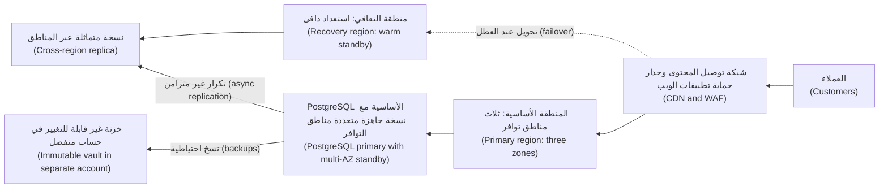

**لماذا يصعب النشط-النشط (Why active-active is hard).** بالنسبة إلى الخدمات عديمة الحالة (stateless services)، الأمر في معظمه توجيه (mostly routing). أمّا البيانات، فمنطقتان تقبلان الكتابة على الرصيد نفسه قد تتعارضان، والتكرار المتزامن عبر المناطق يضيف زمن الذهاب والإياب بين المناطق إلى كل عملية كتابة. والنمط الشائع هو تشغيل الحافة عديمة الحالة بنمط نشط-نشط ونظام السجل بنمط نشط-خامل. وفي خدمة المدفوعات، تحمل كل عملية دفع **مفتاح عدم التكرار (idempotency key)**، بحيث يجد الطلبُ المعادُ بعد التحويل عند العطل السجلَّ الموجود بدلًا من إنشاء تحويلٍ ثانٍ.

**التكرار غير المتزامن يحدّد RPO لديك (Asynchronous replication sets your RPO).** النسخة المتماثلة عبر المناطق تتأخّر عادةً عن الأساسية بثوانٍ أو أكثر، وذلك التأخّر *هو* RPO لديك في كارثةٍ إقليمية. راقبه (Monitor it) (5.1) ونبّه حين يتجاوز RPO.

#### 🔴 نظرة الخبير (Expert view)

**افصل أنماط العطل (Separate the failure modes).** الكوارث المختلفة تحتاج إلى دفاعاتٍ مختلفة:

| العطل (Failure) | هل يساعد تعدّد مناطق التوافر؟ ⁦(Multi-AZ helps?)⁩ | هل تساعد النسخة المتماثلة عبر المناطق؟ ⁦⁩ | هل تساعد النسخة الاحتياطية لنقطة زمنية؟ ⁦⁩ |
|---|---|---|---|
| منطقة توافر واحدة تفقد الكهرباء | نعم (Yes) | نعم | ببطء (Slowly) |
| المنطقة كلها متدهورة | لا | نعم | نعم، ببطء (Yes, slowly) |
| ترحيلٌ سيئ يُفسد البيانات | لا، فالفساد يتكرّر | لا، فالفساد يتكرّر | نعم: استعِد إلى ما قبله مباشرةً |
| برمجية فدية أو مديرٌ مارق يحذف البيانات | لا | لا | فقط إذا كانت النسخة الاحتياطية غير قابلة للتغيير وفي حسابٍ منفصل |

الصفّان الأخيران هما سبب أن التكرار ليس نسخًا احتياطيًّا. و**الاستعادة إلى نقطة زمنية (Point-in-time recovery, PITR)**، التي تقدّمها خدمات PostgreSQL المُدارة بالاحتفاظ بنسخٍ احتياطية أساسية (base backups) إضافةً إلى سجل الكتابة المسبقة (write-ahead log)، تتيح لك الاستعادة إلى ثانيةٍ تختارها قبل التغيير السيئ. اعرف نافذة الاحتفاظ لديك وكم تستغرق فعلًا استعادةُ بياناتٍ بحجم بياناتك.

**الثبات الساكن ومسار التعافي (Static stability and the recovery path).** النظام *الثابت سكونيًّا (statically stable)* يواصل العمل دون حاجةٍ إلى التغيير أثناء العطل، مثلًا لأن السعة مُجهَّزة مسبقًا في كل منطقة توافر بدلًا من إطلاقها في منتصف الانقطاع (launched mid-outage). وتحقّق أيضًا من أن مسار التعافي لا يعتمد على ما تعطّل. ففي انقطاع Facebook في أكتوبر 2021، فصل تغييرٌ في الشبكة الأساسية مراكز البيانات، وسحبت خوادم DNS مسارات BGP الخاصة بها؛ وتشير تدوينة Facebook الهندسية إلى أن الأدوات الداخلية اللازمة للإصلاح تأثّرت هي أيضًا. اسأل (Ask): إذا زالت منطقتنا الأساسية، فهل تبقى أدلة التشغيل (runbooks)، ومستودع GitOps، ومشغّلات CI، والأسرار، وحسابات كسر الزجاج (break-glass accounts) في المتناول (still reachable)؟

**هندسة الفوضى وأيام اللعب (Chaos engineering and game days).** تُجري هندسة الفوضى (Chaos engineering) تجارب مضبوطة (controlled experiments) تحقن الأعطال (inject failure) للتحقّق من أن النظام يتصرّف كما هو متوقّع. ابدأ صغيرًا (Start small) وفي غير الإنتاج؛ وصُغ فرضية؛ وقيّد نطاق الأثر؛ واحتفظ بمفتاح إيقاف. و**يوم اللعب (game day)** تمرينٌ مُجدوَل لسيناريو كامل، مثل التحويل الإقليمي عند العطل، مع فريق المناوبة، ومها قائدةً للحادثة (incident commander)، ومراقبين يقيسون زمن كل خطوة. ويتوقّع قانون DORA الأوروبي اختبار المرونة؛ وأيام اللعب تُنتج الأدلة.

### 🧰 الأدوات
| الأداة أو الممارسة أو الخدمة (Tool, practice or service) | ما هي وماذا تفعل | متى تلجأ إليها |
|---|---|---|
| **Horizontal Pod Autoscaler** (Kubernetes) — المُوسِّع التلقائي الأفقي للحجيرات | يغيّر عدد النسخ المتماثلة لعبء عمل بناءً على المعالج أو الذاكرة أو مقاييس مخصّصة | الخدمات عديمة الحالة ذات الحمل المتغيّر، مع حدٍّ أدنى وأقصى مختارين |
| **Cluster Autoscaler** / **Karpenter** | يضيفان العقد ويزيلانها حين يتعذّر جدولة الحجيرات أو تكون العقد خاملة | أي عنقودٍ يتغيّر حمله؛ اقرنهما بـHPA |
| **KEDA** (CNCF) | توسّعٌ تلقائي مدفوع بالأحداث (Event-driven autoscaling) من الطوابير والتدفّقات والجداول الزمنية، بما في ذلك إلى الصفر | العمّال الذين يفرّغون الطوابير؛ المهام الدُّفعية (batch jobs)؛ التوسّع إلى الصفر للخدمات الخاملة |
| **PodDisruptionBudget** — ميزانية تعطيل الحجيرات | تحدّد سقفًا لعدد النسخ المتماثلة التي يجوز للتعطيلات الطوعية إزالتها دفعةً واحدة | كل نشرٍ إنتاجي فيه أكثر من نسخةٍ متماثلة واحدة (more than one replica) |
| **Point-in-time recovery** — الاستعادة إلى نقطة زمنية | استعادة قاعدة بيانات إلى لحظةٍ مختارة باستخدام النسخ الاحتياطية الأساسية والسجلات | التعافي من الترحيلات السيئة والحذف العرَضي |
| **Immutable backup vault** — خزنة نسخ احتياطية غير قابلة للتغيير | نسخٌ احتياطية مقفلة ضد التغيير أو الحذف حتى تنتهي مدة الاحتفاظ، في حسابٍ منفصل | الدفاع ضد برمجيات الفدية وبيانات اعتماد المدير المخترقة |
| **Game day** — يوم اللعب | تمرينٌ مُتدرَّب عليه ومُوقَّت لسيناريو عطل مع فريق المناوبة الحقيقي | إثبات RTO وRPO قبل أن يطلب ذلك مدقّقٌ أو كارثة |

### 🏛️ عمليًا في بنك نجم
يُعدّ فريق مها **خطة اختبار للتعافي من الكوارث (DR test plan)** لخدمة المدفوعات. وتعيش في مستودع المنصة بجوار دليل التشغيل الذي تختبره.

| الحقل (Field) | خدمة المدفوعات |
|---|---|
| المالك وصاحب القرار | مالك الخدمة (Service owner): قائد هندسة المدفوعات. من يعلن الكارثة (Declares disaster): قائد الحادثة مع سالم |
| الأهداف المتّفق عليها (Agreed targets) | RTO وRPO كما وقّع عليهما مالك العمل وفريق المخاطر |
| التصميم | ثلاث مناطق توافر في المنطقة الأساسية؛ PostgreSQL مُدارة متعدّدة مناطق التوافر؛ نسخة متماثلة غير متزامنة عبر المناطق؛ منظومة استعداد دافئ في منطقة التعافي من وحدات OpenTofu ومستودع GitOps نفسيهما |
| النسخ الاحتياطية | لقطاتٌ يومية (Daily snapshots) إضافةً إلى PITR؛ نسخٌ في حساب نسخ احتياطي ومنطقة منفصلين مع قفل الخزنة؛ الاحتفاظ وفق سياسة السجلات |
| السيناريوهات المختبَرة هذا الربع | 1. تفريغ منطقة توافر في الإنتاج خلال حركة مرور منخفضة. 2. استعادة PITR لقاعدة بيانات المدفوعات إلى نسخةٍ مؤقتة. 3. تحويلٌ إقليمي كامل عند العطل في بيئة التجهيز |
| الخطوات والتوقيتات | الكشف (Detect)، والإعلان (declare)، وترقية النسخة المتماثلة (promote replica)، وتحويل حركة المرور (switch traffic)، وتوسيع الاستعداد (scale standby)، واختبار الدخان (smoke-test)، وإعادة الفتح (reopen)؛ مع قياس زمن كل خطوة |
| معايير النجاح (Success criteria) | RTO وRPO المقيسان ضمن الأهداف؛ صفر تحويلاتٍ مؤكَّدة مكرّرة أو مفقودة |
| الأدلة (Evidence) | الخط الزمني (Timeline)، ولوحات المتابعة (dashboards)، وتقرير المطابقة (reconciliation report)؛ تُحفظ في سجل اختبار المرونة |
| المتابعات (Follow-ups) | كل ثغرةٍ تصبح تذكرة لها مالكٌ وتاريخ؛ والاختبار التالي يعيد فحصها |

وجد التشغيل الأول ثلاث ثغرات (three gaps) لم تكتشفها أي مراجعة تصميم: تنبيه تأخّر النسخة المتماثلة كان يذهب إلى لوحة متابعة لا يراقبها أحد، وسجل DNS للمدفوعات كانت له مدة صلاحية (TTL) أطول بكثير مما يسمح به RTO، ودور كسر الزجاج لحساب التعافي كان يحتاج إلى جهاز مصادقة متعدّدة العوامل جديد.

### 🛠️ التمارين (Exercises)
- 🟢 **شاهد مُوسِّعًا تلقائيًّا وهو يعمل (Watch an autoscaler work).** على عنقودٍ محلي من kind أو k3d (a local kind or k3d cluster) مع خادم المقاييس، انشر حاوية ويب صغيرة لها طلبات معالج (CPU requests) ومُوسِّعًا تلقائيًّا أفقيًّا (HPA) (الحدّ الأدنى 2، min 2؛ الحدّ الأقصى 8، max 8؛ الهدف 50% من المعالج، target 50% CPU). وولّد حملًا من حجيرةٍ أخرى وراقب `kubectl get hpa -w`. *يكتمل عندما (Done when):* تكون لديك لقطة شاشة أو سجل يُظهر النسخ المتماثلة ترتفع تحت الحمل وتنخفض بعد نافذة الاستقرار، وجملةٌ واحدة تشرح لماذا كان التقليص أبطأ من التوسيع.
- 🟡 **توزّع عبر مناطق التوافر واصمد أمام التفريغ (Spread across zones and survive a drain).** أنشئ عنقود kind فيه أربع عقد عاملة ووسِمها (label them) بقيم `topology.kubernetes.io/zone` هي `a` و`b` و`c`. انشر ست نسخ متماثلة (six replicas) مع قيد توزيع الطوبولوجيا وميزانية تعطيل (PDB) قيمتها `minAvailable: 4`. فرّغ كل عقدةٍ في منطقة توافر واحدة باستخدام `kubectl drain`. وتوقّع أن تبقى الحجيرات المُخلاة في حالة `Pending`: فالمنطقة المفرَّغة ما زالت تُحتسب في قيد التوزيع. *يكتمل عندما:* تكون الحجيرات قد توزّعت حجيرتين في كل منطقة، واحترم التفريغ ميزانية التعطيل، وظلّت الخدمة تجيب طوال الوقت، وتستطيع تفسير الحجيرات العالقة في `Pending`.
- 🔴 **اكتب اختبار استعادة ونفّذه (Write and run a restore test).** شغّل PostgreSQL في Docker مع أرشفة سجل الكتابة المسبقة (WAL archiving) أو نسخٍ احتياطية منتظمة باستخدام `pg_dump`. أدخِل صفوفًا مختومة بالوقت، ثم احذف جدولًا «عن طريق الخطأ»، ثم استعِد إلى حاويةٍ ثانية. اكتب خطة اختبار تعافٍ من الكوارث من صفحةٍ واحدة بالصيغة أعلاه، مع RTO وRPO تختارهما. *يكتمل عندما:* تكون قد قست زمن الاستعادة الفعلي وفقدان البيانات، وقارنتهما بأهدافك، وأدرجت تغييرين على الأقل من شأنهما سدّ أي ثغرة.

### ⚠️ أخطاء وفخاخ (Mistakes and traps)
- **تسمية التكرار نسخًا احتياطيًّا (Calling replication a backup).** النسخ المتماثلة تنسخ عمليات الحذف والفساد فورًا. احتفظ أيضًا بنسخٍ احتياطية لنقطة زمنية وغير قابلة للتغيير في حسابٍ منفصل.
- **عدم الاستعادة أبدًا (Never restoring).** النسخ الاحتياطية غير المختبَرة (Untested backups) تخذلك حين تحتاج إليها، كما تعلّمت GitLab. جدوِل اختبارات الاستعادة وقِس زمنها (time them).
- **التوسّع التلقائي غير المحدود (Unbounded autoscaling).** مُوسِّعٌ تلقائي أفقي بقيمة `maxReplicas` ضخمة قد يستنفد اتصالات قاعدة البيانات أو حصّةً لدى خدمةٍ تابعة. اضبط السقف بحسب ما تحتمله التبعيات.
- **مسار تعافٍ يعتمد على المنطقة المتعطّلة (A recovery path that depends on the failed region).** أبقِ أدلة التشغيل، والبنية التحتية بوصفها شيفرة (IaC)، وCI، والأسرار (secrets)، ووصول كسر الزجاج (break-glass access) في المتناول من خارجها.
- **أهدافٌ لم يوقّع عليها أحد (Targets nobody signed).** RTO اختاره فريق المنصة وحده سيُطعن فيه بعد الحادثة. احصل على توقيع مالك العمل وفريق المخاطر عليها.

### 🧾 الخلاصة (Recap)
- التوسّع يضيف سعة؛ والمرونة تصمد أمام الأعطال. وسّع الحجيرات والعقد تلقائيًّا على طبقات، مع حدودٍ دنيا وسقوفٍ مختارة عن قصد.
- شغّل الإنتاج عبر منطقتين أو ثلاث من مناطق التوافر، مفروضًا بقيود التوزيع (spread constraints) وميزانيات التعطيل (PDBs) والسعة الاحتياطية.
- RTO وRPO قراران تجاريان؛ واستراتيجية التعافي من الكوارث هي أرخص تصميمٍ يحقّقهما.
- مناطق التوافر والنسخ المتماثلة لا تحمي من التغييرات السيئة أو الحذف؛ بل تحمي منها النسخ الاحتياطية لنقطة زمنية وغير القابلة للتغيير وفي حسابٍ منفصل.
- لا يُعتدّ إلا بالتعافي المختبَر: تمارين الاستعادة (restore drills)، وأيام اللعب (game days)، والتحويلات عند العطل المُوقَّتة (timed failovers) تُنتج الأدلة التي تحتاجها الجهات التنظيمية والتنفيذيون.

### ✍️ اختبر نفسك (Check yourself)

**1. تعمل واجهة برمجة تطبيق نجم للهاتف (Najm Mobile API) بست حجيرات عبر ثلاث مناطق توافر، وتحتاج إلى 4 للتعامل مع حمل الذروة (to handle peak load). أيّ تغييرٍ يضمن على أفضل وجه أن فقدان منطقة واحدة لا يُثقل الخدمة (does not overload the service)؟**

- A. رفع قيمة `maxReplicas` في المُوسِّع التلقائي الأفقي (HPA) إلى 100 كي تحلّ حجيراتٌ جديدة محلّ المفقودة
- B. الإبقاء على 6 حجيرات مع قيد توزيعٍ على مناطق التوافر، حجيرتين في كل منطقة
- C. إضافة ميزانية تعطيل حجيرات (PodDisruptionBudget) بقيمة `minAvailable: 6` على النشر (Deployment)
- D. نقل كل الحجيرات إلى أكبر منطقة توافر لتقليل حركة المرور بين المناطق (cross-zone traffic)

<details><summary>الإجابة</summary>

**B.** حجيرتان في كل منطقة تعني أن تعطّل منطقة لا يزيل إلا اثنتين، فتبقى الأربع المطلوبة. ولا يساعد A إلا بعد وصول حجيرات وعقد جديدة؛ وC يغطي التعطيلات الطوعية (voluntary disruptions) لا تعطّل المناطق، وسيمنع التفريغ؛ وD يُنشئ نقطة عطلٍ وحيدة. (🟡 التعمق أكثر (Going deeper).)

</details>

**2. يُجري مطوّرٌ ترحيلًا (a migration) يُفسد جدول `transfers` بصمت (silently corrupts). قاعدة البيانات متعدّدة مناطق التوافر (multi-AZ) ولها نسخة متماثلة عبر المناطق (a cross-region replica). ما الذي يستعيد البيانات (recovers the data)؟**

- A. التحويل عند العطل إلى النسخة الجاهزة متعددة مناطق التوافر في منطقةٍ أخرى
- B. ترقية النسخة المتماثلة عبر المناطق في منطقة التعافي
- C. إعادة تشغيل قاعدة البيانات
- D. استعادةٌ إلى نقطة زمنية إلى ما قبل الترحيل مباشرةً

<details><summary>الإجابة</summary>

**D.** يصل الفساد (Corruption) إلى النسخة الجاهزة والنسخة المتماثلة خلال ثوانٍ، لذا يعطيك A وB البيانات السيئة نفسها. ولا يعود إلى ما قبل التغيير إلا نسخةٌ احتياطية لنقطة زمنية. (🔴 نظرة الخبير (Expert view)، جدول أنماط العطل.)

</details>

**3. من الذي ينبغي أن يحدّد RPO لخدمة المدفوعات (Payments service)؟**

- A. مالك العمل مع فريق المخاطر، بعد أن يحسب فريق المنصة تكلفة الخيارات
- B. فريق المنصة وحده، لأنه يبني البنية التحتية ويشغّلها
- C. مزوّد السحابة، عبر اتفاقية مستوى الخدمة (SLA) في شروط خدمته
- D. لا أحد (Nobody)، لأن RPO يساوي صفرًا دائمًا لنظام مدفوعات

<details><summary>الإجابة</summary>

**A.** يعبّر RPO عن مقدار الخسارة الذي يقبله قطاع الأعمال، والأهداف الأشدّ تكلّف أكثر. وB يُنشئ أهدافًا لن يدافع عنها أحد لاحقًا؛ واتفاقية مستوى الخدمة لدى المزوّد (C) تغطي خدمته لا تعافيك؛ وD أمنيةٌ لا تصميم. (🟢 الأساسيات.)

</details>

**4. يُظهر اختبار التعافي من الكوارث الذي أجرته مها (Maha's DR test) أن النسخة المتماثلة عبر المناطق تتأخّر عادةً بضع ثوانٍ (usually lags by a few seconds)، لكنها بلغت مرةً 40 دقيقة أثناء مهمةٍ دُفعية (during a batch job). وRPO المتّفق عليه (The agreed RPO) هو 5 دقائق. ما القراءة الصحيحة (the right reading)؟**

- A. RPO متحقّق، لأن التأخّر المعتاد ثوانٍ قليلة فقط
- B. RPO لا ينطبق إلا على تعطّل مناطق التوافر (zone failures)، لا على الأعطال الإقليمية (regional ones)
- C. كان RPO الحقيقي حينها 40 دقيقة (The real RPO then was 40 minutes)؛ نبّه على التأخّر وأصلح السبب
- D. انتقل الآن إلى التكرار المتزامن عبر المناطق، دون قياس زمن الاستجابة

<details><summary>الإجابة</summary>

**C.** مع التكرار غير المتزامن (asynchronous replication)، التأخّر لحظة الكارثة هو البيانات التي تفقدها. وA يتجاهل أسوأ الحالات؛ وB خاطئ؛ وD يضيف زمن الذهاب والإياب بين المناطق إلى كل عملية كتابة ويحتاج إلى تحليلٍ أولًا. (🟡 التعمق أكثر (Going deeper).)

</details>

**5. أيّ عبارةٍ عن هندسة الفوضى (chaos engineering) هي الأدق؟**

- A. تعني كسر الإنتاج عشوائيًّا، بأكبر قدرٍ ممكن من التكرار
- B. اختبارٌ مضبوط لفرضيةٍ مُعلَنة، مع مفتاح إيقاف
- C. حين تُجرى بانتظام، تحلّ محلّ استعادة النسخ الاحتياطية واختبارات التعافي من الكوارث
- D. لا تفيد إلا الشركات التي تشغّل آلاف الخدمات

<details><summary>الإجابة</summary>

**B.** تختبر هندسة الفوضى تنبؤًا مُعلَنًا تحت السيطرة. وA تهوّر (recklessness)؛ وC خاطئ، لأنها تكمّل تمارين الاستعادة؛ وحتى تفريغٌ صغير لمنطقة توافر يعلّم الكثير، لذا D خاطئ. (🔴 نظرة الخبير (Expert view).)

</details>

### 📚 المراجع (References)
- Kubernetes: التوسّع التلقائي الأفقي للحجيرات — https://kubernetes.io/docs/tasks/run-application/horizontal-pod-autoscale/
- Kubernetes: قيود توزيع طوبولوجيا الحجيرات — https://kubernetes.io/docs/concepts/scheduling-eviction/topology-spread-constraints/
- Kubernetes: تحديد ميزانية تعطيل — https://kubernetes.io/docs/tasks/run-application/configure-pdb/
- توثيق KEDA (KEDA documentation) — https://keda.sh/docs/
- توثيق Karpenter (Karpenter documentation) — https://karpenter.sh/docs/
- الورقة البيضاء من AWS: التعافي من الكوارث لأعباء العمل على AWS — https://docs.aws.amazon.com/whitepapers/latest/disaster-recovery-workloads-on-aws/disaster-recovery-workloads-on-aws.html
- إطار Azure المُحكَم البنيان، الموثوقية — https://learn.microsoft.com/azure/well-architected/
- إطار بنية Google Cloud — https://cloud.google.com/architecture/framework
- GitLab: مراجعة ما بعد حادثة انقطاع قاعدة البيانات في 31 يناير (Postmortem of database outage of January 31) (2017) — https://about.gitlab.com/blog/
- كتب Google في هندسة موثوقية المواقع — https://sre.google/books/
- اللائحة (EU) 2022/2554 بشأن المرونة التشغيلية الرقمية (Regulation 2022/2554 on digital operational resilience, DORA) — https://eur-lex.europa.eu/eli/reg/2022/2554/oj
- تعمّق أكثر في ضوابط أمن السحابة: [*أمن الذكاء الاصطناعي وأمن التطبيقات (Secure AI & Application Security)*، الدرس 7.1 — أمن السحابة: المسؤولية المشتركة وإدارة الهوية والوصول وسوء الإعداد](../secai/index.ar.html#/7.1)

<a id="l6-2"></a>

## 6.2 — FinOps: فهم تكلفة السحابة وتوزيعها وخفضها

*المستوى: 🔴 متقدم* · *المتطلبات: 1.2، 3.1، 6.1* · *المرحلة (Phase): Operate, Monitor*

### ⚡ الدرس في دقيقة (In 60 seconds)
- **FinOps** هي ممارسة جعل الهندسة والمالية وقطاع الأعمال يتقاسمون المسؤولية عن الإنفاق السحابي، بحيث تصبح التكلفة إشارةً هندسية مثل زمن الاستجابة، لا مفاجأةً في نهاية الشهر.
- يعمل إطار مؤسسة FinOps في حلقةٍ من ثلاث مراحل: **الإعلام (Inform)**، و**التحسين (Optimise)**، و**التشغيل (Operate)**.
- لا يمكنك خفض ما لا تستطيع نسبته. ابدأ بـ**الوسم والتوزيع (tagging and allocation)**: لكل موردٍ مالكٌ وخدمةٌ وبيئة.
- اخفض الاستخدام قبل شراء الخصومات: احذف الموارد الخاملة، وعدّل الأحجام لتناسب الحاجة (rightsize)، ووسّع تلقائيًّا (autoscale)، وجدوِل البيئات غير الإنتاجية (schedule non-production)، ثم التزم بـ**السعة المحجوزة أو خطط التوفير (reserved capacity or savings plans)** للقاعدة الثابتة، واستخدم سعة **السوق الفورية (spot)** فقط للعمل الذي يحتمل المقاطعة.
- مؤشر القرار: احكم على التكلفة لكل وحدةٍ من القيمة التجارية، لا على إجمالي الفاتورة وحده.
- أكبر فخ: خفض التكاليف الذي يزيل المرونة بهدوء، مثل التخلّي عن منطقة التوافر الثانية أو عن نسخ النسخ الاحتياطية التي بُنيت في 6.1 لتوفير المال.

### 🧭 لماذا يهم
بعد ستة أشهر من انتقال الخدمات الأولى إلى السحابة، تُحضر منى، محلّلة FinOps في الإدارة المالية، رسمًا بيانيًّا إلى سالم. لقد نمت فاتورة السحابة الشهرية لنجم أسرع بكثير من عدد عملاء الهاتف النشطين. وأسئلتها منصفة: «على ماذا ندفع؟ من يملكه؟ هل هذا النمو نموٌّ جيد؟» ⁦⁩ لا يستطيع سالم الإجابة من وحدة التحكم. فحصّةٌ كبيرة من الإنفاق غير موسومة. وهناك بندٌ اسمه «نقل البيانات» ("data transfer") لم يضع له أحدٌ ميزانية. وثلاث عقد بوحدات معالجة رسوميات أُنشئت لتجربةٍ في نجم أسيست تعمل كل ساعةٍ من كل يوم منذ هاكاثون. وعناقيد التطوير تعمل بكامل حجمها طوال عطلة نهاية الأسبوع.

لا تستطيع الإدارة المالية إصلاح هذا وحدها. ففي السحابة، كل مهندسٍ يدمج تغييرًا في OpenTofu أو يرفع سقف مُوسِّعٍ تلقائي أفقي يتّخذ قرار إنفاق، وغالبًا دون أن يرى السعر. لقد انتهى نموذج مركز البيانات القديم، حيث كانت المشتريات (procurement) توافق على العتاد قبل أشهر. وFinOps تعيد إشارة التكلفة إلى حيث تُتّخذ القرارات: في طلب الدمج، ولوحة المتابعة، وقائمة المهام المتراكمة لدى الفريق نفسه. يمنحك هذا الدرس لغة منى (Mona's language)، وآليات التوزيع، وترتيبًا لخفض التكلفة دون الإضرار بالموثوقية. ولمعالجةٍ أخفّ موجّهة إلى الفرق الصغيرة، انظر [*تصميم الأنظمة لمبرمجي الحدس*، الدرس 11.4 — هندسة التكلفة (Cost engineering)](../vibe/index.ar.html#l11-4).

### 📐 كيف يعمل

#### 🟢 الأساسيات

**إطار مؤسسة FinOps (The FinOps Foundation framework).** تنشر مؤسسة FinOps، وهي جزءٌ من مؤسسة Linux، إطار FinOps. وفي وقت كتابة هذا النص (2026)، يصف الإطار مبادئ (principles)، وشخصيات (personas)، وقدرات (capabilities)، ودورةً من ثلاث مراحل. ومن المبادئ أن الفرق بحاجةٍ إلى التعاون، وأن القيمة التجارية تقود القرارات التقنية، وأن الجميع يتحمّل ملكية استخدامه للسحابة، وأن بيانات التكلفة ينبغي أن تكون متاحةً وفي وقتها، وأن FinOps يُمكّنها فريقٌ مركزي، وأن على الفرق الاستفادة من نموذج التكلفة المتغيّرة في السحابة. تحقّق من موقع finops.org للصياغة الحالية.

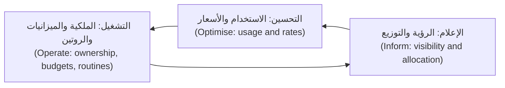

**كيف يعمل تسعير السحابة، من حيث المفاهيم (How cloud pricing works, in concepts).** لا تذكر سعرًا من الذاكرة أبدًا؛ فالأسعار تختلف بحسب المنطقة وتتغيّر. أمّا الشكل فثابت:
- **الحوسبة (Compute)** تُحتسب بالزمن وبالحجم. والمثيل الكبير الخامل يكلّف ما يكلّفه المثيل المشغول.
- **التخزين (Storage)** يُحتسب بالكمية المخزّنة شهريًّا، مع فئات: التخزين الكثير الوصول يكلّف أكثر لكل غيغابايت من فئات الأرشفة (archive tiers)، التي تفرض رسومًا أعلى على القراءة منها.
- **الطلبات والعمليات (Requests and operations)**: كثيرٌ من الخدمات المُدارة (managed services) تفرض رسومًا لكل استدعاء واجهة برمجة، أو لكل مليون طلب، أو لكل قراءة وكتابة.
- **نقل البيانات إلى الخارج (Data transfer (egress))**: نقل البيانات *إلى خارج* المزوّد نحو الإنترنت يكلّف مالًا في العادة، وكذلك حركة المرور بين المناطق، ولدى بعض المزوّدين، بين مناطق التوافر (between zones). وكثيرًا ما تفرض بوابات NAT المُدارة رسومًا لكل غيغابايت تتمّ معالجته. تحقّق من صفحات التسعير الحالية لدى مزوّدك، لأن الخروج كثيرًا ما يفاجئ الفرق.
- **علاوات الخدمات المُدارة (Managed service premiums)**: قاعدة البيانات المُدارة تكلّف أكثر من الآلة الافتراضية التي تحتها، وتشتري لك التحديثات الأمنية والنسخ الاحتياطية والتحويل عند العطل. وهذه عادةً مقايضةٌ جيدة؛ فقط اعرف أنك تجريها.

**التوزيع: الوسوم والتسميات (Allocation: tags and labels).** يتيح لك كل مزوّد إرفاق بياناتٍ وصفية على شكل مفتاح وقيمة (key-value metadata) بالموارد: *الوسوم (tags)* في AWS وAzure، و*التسميات (labels)* في Google Cloud. وتحدّد سياسة توزيع التكلفة مجموعةً صغيرة إلزامية:

| المفتاح (Key) | قيمة مثال (Example value) | لماذا |
|---|---|---|
| `owner` | `team-payments` | شخصٌ تسأله، وشخصٌ يرى الفاتورة |
| `service` | `payments-api` | التكلفة لكل خدمة ولكل وحدة |
| `environment` | `prod`، `staging`، `dev` | هدر البيئات غير الإنتاجية (Non-production waste) هو عادةً الهدف الأول |
| `cost-centre` | رمز مالي (finance code) | الاسترداد المالي أو العرض المالي لقطاع الأعمال |
| `data-classification` | `confidential` | مشترك مع الأمن؛ ليس مفتاح تكلفة لكنه يُفرض بالطريقة نفسها |

يجب عادةً تفعيل الوسوم لتقارير الفوترة، وهي في الغالب لا تسري إلا من لحظة ضبطها، لذا ابدأ مبكرًا (start early). افرضها في البنية التحتية بوصفها شيفرة (3.1) وبالسياسة بوصفها شيفرة (policy as code) (3.3): الخطة التي تُنشئ موردًا غير موسوم تفشل في الفحص.

**العرض المالي والاسترداد المالي (Showback and chargeback).** *العرض المالي (Showback)* يُري كل فريقٍ ما أنفقه؛ أمّا *الاسترداد المالي (chargeback)* فينقل التكلفة فعلًا إلى ميزانية الفريق. ابدأ بالعرض المالي: فالهدف الأول هو الوعي (awareness)، لا المحاسبة.

#### 🟡 التعمق أكثر

**التكاليف المشتركة وKubernetes (Shared costs and Kubernetes).** تعمل الوسوم جيدًا لقاعدة بياناتٍ يملكها فريقٌ واحد. لكنها تفشل في عنقود Kubernetes مشترك تعمل فيه عشرون خدمة على العقد نفسها. وزّع العناقيد المشتركة بحسب ما *يحجزه* كل عبء عمل أو ما *يستخدمه*، أيّهما أعلى (whichever is higher)، لكل نطاق أسماء (per namespace). وأدواتٌ مثل **OpenCost** تقرأ بيانات موارد العنقود وأسعار المزوّد لتُنتج التكلفة لكل نطاق أسماء وتسمية وعبء عمل. قرّر علنًا كيف يُقسَم ما يتبقّى: السعة الخاملة (idle capacity)، ومستوى التحكم، ومنظومة قابلية المراقبة، والشبكات المشتركة (shared networking). والقاعدة الشائعة هي توزيعها بالتناسب مع التكلفة المباشرة لكل فريق، وإظهار السعة الخاملة بندًا مستقلًّا كي يملك فريق المنصة كفاءة التعبئة.

الطلبات مهمة هنا. فالفريق الذي يطلب 4 معالجات لكل حجيرة (requests 4 CPUs per pod) ويستخدم 0.3 يدفع، في توزيعٍ عادل، ثمن 4. وهذا هو الحافز الصحيح: فالطلب المُفرط (over-requesting) يحجب تلك السعة عن الجميع.

**مواصفة FOCUS (The FOCUS specification).** لتصدير الفوترة لدى كل مزوّد أعمدته وأسماؤه الخاصة. و**المواصفة المفتوحة لتكلفة FinOps واستخدامها (FinOps Open Cost and Usage Specification, FOCUS)**، من مؤسسة FinOps، تعرّف صيغةً مشتركة لبيانات الفوترة، ويقدّم المزوّدون الكبار تصديراتٍ بصيغة FOCUS (FOCUS-formatted exports) في وقت كتابة هذا النص (2026؛ تحقّق من الإصدار الذي يدعمه كلٌّ منهم، check which version each supports). وإذا شغّلت نجم أعباء عملٍ في أكثر من سحابة، فإن FOCUS يجعل مجموعة بيانات تكلفة واحدة ممكنة.

**حسّن الاستخدام أولًا، ثم الأسعار (Optimise usage first, then rates).** تحسين الاستخدام (Usage optimisation) يعني أن تدفع مقابل أقل؛ وتحسين الأسعار (rate optimisation) يعني أن تدفع أقل مقابل الشيء نفسه. ابدأ بالاستخدام، لأن الالتزام بخصمٍ على سعةٍ كان ينبغي أن تحذفها يثبّت الهدر.

| الترتيب (Order) | الرافعة (Lever) | الإجراء النموذجي (Typical action) | الخطر الذي يجب مراقبته |
|---|---|---|---|
| 1 | **إزالة الخامل (Remove idle)** | احذف الأقراص غير المرتبطة (unattached volumes)، واللقطات القديمة خارج مدة الاحتفاظ، وموازنات الأحمال الخاملة، وعقد وحدات معالجة الرسوميات المنسية | تأكّد من المالك؛ واحتفظ بما تتطلبه سياسة الاحتفاظ |
| 2 | **الجدولة (Schedule)** | قلّص عناقيد التطوير والاختبار ليلًا وفي عطلات نهاية الأسبوع | الفرق في مناطق زمنية أخرى؛ المهام الدُّفعية |
| 3 | **تعديل الحجم (Rightsize)** | خفّض أحجام المثيلات وطلبات الحجيرات لتطابق الاستخدام المرصود (observed use) | اترك هامشًا (Leave headroom)؛ راقب زمن استجابة الذيل والذاكرة |
| 4 | **التوسّع التلقائي (Autoscale)** | مُوسِّع تلقائي أفقي وتوسّع تلقائي للعقد (node autoscaling) كي تتبع السعة الطلب (6.1) | حدودٌ دنيا للمرونة؛ سرعة التوسيع (scale-up speed) |
| 5 | **دورة حياة التخزين (Storage lifecycle)** | انقل السجلات والكائنات القديمة إلى فئاتٍ أرخص (cheaper tiers)؛ وأنهِ صلاحيتها وفق السياسة | تكلفة الاسترجاع وتأخيره من فئات الأرشفة |
| 6 | **البنية (Architecture)** | قلّل حركة المرور بين مناطق التوافر والخروج، وخزّن مؤقتًا في شبكة توصيل المحتوى، واستخدم نقاط النهاية الخاصة | لا يكون ذلك أبدًا على حساب تكرار مناطق التوافر |
| 7 | **الالتزامات (Commitments)** | المثيلات المحجوزة (Reserved instances)، وخطط التوفير (savings plans)، وخصومات الاستخدام الملتزم به للقاعدة الثابتة | الإفراط في الالتزام (Over-commitment) إذا انخفض الاستخدام |
| 8 | **سعة السوق الفورية (Spot capacity)** | مثيلاتٌ قابلة للمقاطعة (Interruptible instances) للمهام الدُّفعية (batch)، ومشغّلات CI (CI runners)، والذروات عديمة الحالة (stateless burst) | المقاطعات بإشعارٍ قصير |

**الالتزامات والسوق الفورية، بوصفها مفاهيم (Commitments and spot, as concepts).** يقدّم المزوّدون الثلاثة جميعًا خصوماتٍ مقابل الالتزام بمستوى استخدام لسنةٍ أو ثلاث سنوات: المثيلات المحجوزة وخطط التوفير في AWS، والحجوزات وخطة توفير الحوسبة في Azure، وخصومات الاستخدام الملتزم به في Google Cloud. التزم بالحدّ الأدنى الذي أنت واثقٌ من استخدامه، لا بالذروة. وسعة **السوق الفورية (Spot)** هي سعةٌ فائضة تُباع بخصم يستطيع المزوّد استعادتها بإشعارٍ قصير؛ تحقّق من مدة الإشعار الحالية لدى كل مزوّد. استخدمها للعمل الذي يحتمل المقاطعة: مشغّلات CI، والمهام الدُّفعية، والنسخ المتماثلة عديمة الحالة فوق الحدّ الأدنى. ولا تضع عليها أبدًا النسخة الوحيدة من قاعدة بيانات المدفوعات.

#### 🔴 نظرة الخبير

**اقتصاديات الوحدة (Unit economics).** ارتفاع إجمالي الفاتورة ليس خبرًا سيئًا إذا كان قطاع الأعمال ينمو أسرع. والرقم المهم هو **تكلفة الوحدة (unit cost)**: التكلفة مقسومةً على محرّكٍ تجاري.

```text
Cost per 1,000 Mobile API requests = (allocated Mobile API cost for the month)
                                     / (requests served in the month / 1,000)
Cost per successful payment        = (allocated Payments service cost)
                                     / (payments completed)
Cost per Najm Assist conversation  = (gateway + model API + GPU cost)
                                     / (conversations)
```

تتضمّن التكلفة الموزَّعة حصّة الخدمة من التكاليف المشتركة. ارسم تكلفة الوحدة شهريًّا. فإذا ارتفعت بينما ترتفع حركة المرور، فلديك عدم كفاءة في التوسّع؛ وإذا ارتفعت بينما حركة المرور ثابتة، فابحث عن هدرٍ أو تغيّرٍ في التسعير. كما تجعل تكاليف الوحدة المقايضات الهندسية ملموسة: فتغيير تخزينٍ مؤقت يخفض التكلفة لكل ألف طلب بمقدار الخُمس يسهل شرحه لمنى وللقيادة. وتستخدم فرق المنتج الفكرة نفسها عند التسعير؛ انظر [*إدارة منتجات الذكاء الاصطناعي (AI Product Management)*، الدرس 8.2 — اقتصاديات الوحدة: تكلفة الخدمة ونماذج التسعير والهوامش](../aipm/index.ar.html#/8.2).

**التكلفة في طلب الدمج (Cost in the pull request).** أرخص لحظةٍ لتجنّب الهدر هي قبل أن يُنشأ. وأدواتٌ مثل **Infracost** تقدّر التغيّر الشهري في التكلفة لخطة OpenTofu أو Terraform وتنشره تعليقًا على طلب الدمج. اجمعها مع سياسة: التغييرات التي تتجاوز عتبةً تحتاج إلى مراجعٍ ثانٍ من الفريق المالك، لا إلى طابور موافقات مالية. يحتفظ المهندسون بسرعتهم؛ وتصبح القرارات الكبيرة مرئية.

**الميزانيات وكشف الشذوذ (Budgets and anomaly detection).** يحصل كل حسابٍ أو اشتراك على ميزانيةٍ مع تنبيهاتٍ إلى مالكه، وتنبّه ميزات كشف شذوذ التكلفة لدى المزوّدين على الارتفاعات المفاجئة (sudden spikes). عامِل شذوذ التكلفة كتنبيهٍ تشغيلي: وجّهه إلى الفريق المالك، مع دليل تشغيل. ولو كان ذلك قائمًا لاكتُشفت عقد وحدات معالجة الرسوميات المنسية من الهاكاثون خلال أيام، لا أشهر.

**لا تقايض على المرونة (Do not trade away resilience).** أخطر تخفيضات التكلفة تبدو معقولة في جدول بيانات: منطقة توافر واحدة بدلًا من ثلاث، ونسخةٌ جاهزة أصغر، ومدة احتفاظ أقصر بالنسخ الاحتياطية، ولا نسخ عبر المناطق. وكلٌّ من هذه يغيّر RTO وRPO المتّفق عليهما في 6.1. والقاعدة في نجم: أي تغييرٍ في التكلفة يمسّ التكرار الاحتياطي أو النسخ الاحتياطية أو التعافي يجب أن يوافق عليه مالك الخدمة وهندسة موثوقية المواقع، وأن تُحدَّث خطة اختبار التعافي من الكوارث. فالتكلفة والموثوقية قرارٌ واحد لا قراران.

### 🧰 الأدوات
| الأداة أو الممارسة أو الخدمة | ما هي وماذا تفعل | متى تلجأ إليها |
|---|---|---|
| **FinOps Framework** (FinOps Foundation) — إطار FinOps | المبادئ، والشخصيات، والقدرات، ودورة الإعلام والتحسين والتشغيل | إنشاء ممارسةٍ للتكلفة والاتفاق على الأدوار مع المالية |
| **Cost allocation tags** — وسوم توزيع التكلفة | بياناتٌ وصفية إلزامية (Mandatory metadata) تستطيع الفوترة التجميع بحسبها | اليوم الأول لأي حساب سحابي؛ تُفرض بالسياسة بوصفها شيفرة |
| **FOCUS** | صيغةٌ مشتركة محايدة تجاه المزوّدين لبيانات الفوترة | دمج بيانات التكلفة من أكثر من سحابة أو أداة |
| **OpenCost** | توزيع تكلفة مفتوح المصدر لـKubernetes بحسب نطاق الأسماء والتسمية وعبء العمل | العرض المالي للعناقيد المشتركة |
| **Infracost** | يقدّر تغيّر التكلفة لخطة بنية تحتية بوصفها شيفرة ويعلّق على طلب الدمج | اكتشاف التغييرات المكلفة قبل دمجها |
| **Provider cost tools** — أدوات التكلفة لدى المزوّدين | تحليل الفوترة الأصلي، والميزانيات (budgets)، وتنبيهات الشذوذ (anomaly alerts) | الرؤية اليومية (Daily visibility)؛ ميزانيات لكل حسابٍ ومالك |
| **Commitment discounts** — خصومات الالتزام | أسعارٌ أقل مقابل استخدامٍ ملتزم به لسنةٍ أو ثلاث سنوات | بعد تحسين الاستخدام، للخط الأساسي الثابت |
| **Spot capacity** — سعة السوق الفورية | سعةٌ فائضة مخفَّضة يمكن استعادتها بإشعارٍ قصير | مشغّلات CI، والمهام الدُّفعية، والذروات عديمة الحالة فوق الحدّ الأدنى |

### 🏛️ عمليًا في بنك نجم
تتّفق منى وسالم على **تقرير شهري لتكلفة السحابة (monthly cloud cost report)**، يُولَّد من تصدير FOCUS وOpenCost، ويُراجَع في اجتماعٍ مدته 30 دقيقة مع كل قائد فريق.

| القسم (Section) | المحتوى للشهر |
|---|---|
| العنوان الرئيسي (Headline) | إجمالي الإنفاق مقابل الميزانية ومقابل الشهر الماضي؛ حصّة الإنفاق الموزَّعة على مالك |
| تكاليف الوحدة (Unit costs) | التكلفة لكل 1,000 طلب لواجهة الهاتف (Cost per 1,000 Mobile API requests)؛ التكلفة لكل عملية دفع ناجحة؛ التكلفة لكل محادثة في نجم أسيست؛ الاتجاه على مدى ستة أشهر |
| بحسب الفريق والخدمة | جدول العرض المالي (Showback table): التكلفة المباشرة (direct cost)، وحصّة التكاليف المشتركة، والتغيّر (change)، وتفسير المالك في سطرٍ واحد |
| الهدر المكتشَف (Waste found) | الموارد الخاملة (Idle resources)، وأعباء العمل المُفرطة الحجم (oversized workloads)، والإنفاق غير الموسوم (untagged spend)، مع المالكين وتواريخ الاستحقاق |
| الالتزامات | تغطية خطط التوفير أو الحجوزات واستخدامها؛ التجديدات القادمة |
| حالات الشذوذ (Anomalies) | الارتفاعات المكتشَفة (Spikes detected)، والسبب (cause)، والإصلاح (fix) |
| فحص المرونة (Resilience check) | أي تخفيضٍ مقترح يمسّ مناطق التوافر أو النسخ الاحتياطية أو التعافي من الكوارث، مع حالة موافقة هندسة موثوقية المواقع |
| القرارات (Decisions) | ما الذي نغيّره الشهر المقبل، ومن يملكه |

إجراءات التقرير الأول: فُرضت سياسة الوسوم في خط تسليم OpenTofu، وحُذفت عقد وحدات معالجة الرسوميات الثلاث من الهاكاثون بعد التأكد مع فريق نجم أسيست، وقُلّصت عناقيد التطوير خارج ساعات العمل، وتُتبّع بند «نقل البيانات» الكبير إلى حجيرات واجهة الهاتف التي تستدعي تخزين الكائنات عبر بوابة NAT بدلًا من نقطة نهاية خاصة. واقترح يوسف أيضًا تقليص قاعدة بيانات المدفوعات إلى منطقة توافر واحدة «لتوفير الكثير»؛ فأشارت مها إلى خطة اختبار التعافي من الكوارث من 6.1 (the DR test plan from 6.1)، وأُسقطت الفكرة.

### 🛠️ التمارين
- 🟢 **صمّم سياسة وسوم (Design a tagging policy).** اكتب سياسة وسوم لشركةٍ خيالية لديها ثلاثة فرق وثلاث بيئات: المفاتيح الإلزامية، والقيم المسموح بها (allowed values)، ومن يملك الفرض، وماذا يحدث للموارد غير الموسومة. أضِف قاعدة سياسة بوصفها شيفرة تفشل حين يغيب `owner` أو `environment`. *يكتمل عندما:* تفشل القاعدة على خطةٍ فيها موردٌ غير موسوم وتنجح حين تُضاف الوسوم.
- 🟡 **وزّع عنقودًا مشتركًا (Allocate a shared cluster).** ثبّت OpenCost وPrometheus الذي يحتاجه على عنقود kind محلي وانشر أعباء عمل في ثلاثة نطاقات أسماء (three namespaces) بطلباتٍ مختلفة عمدًا. قارن الطلبات بالاستخدام الفعلي لكل نطاق أسماء. *يكتمل عندما:* يكون لديك جدول للتكلفة بحسب نطاق الأسماء، وحدّدت عبء العمل الأكثر إفراطًا في الطلب، واقترحت طلباتٍ جديدة مع تبريرٍ قصير للهامش الذي أبقيته.
- 🔴 **ابنِ نموذجًا لتكلفة الوحدة (Build a unit-cost model).** باستخدام حسابٍ في الفئة المجانية مع ضبط تنبيه ميزانية أولًا، أو جدول بيانات بأرقام عيّنة مختلقة لكنها موسومة بوضوح، ابنِ نموذجًا شهريًّا لواجهة برمجة صغيرة: الحوسبة الموزَّعة (allocated compute)، وقاعدة البيانات، والتخزين، والنقل (transfer)، والطلبات المخدومة (requests served). احسب التكلفة لكل 1,000 طلب (cost per 1,000 requests) لثلاثة سيناريوهات: الحالي (current)، وبعد تعديل الحجم (rightsized)، وبعد تعديل الحجم مع التزامٍ على الخط الأساسي. *يكتمل عندما:* يُظهر النموذج تكلفة الوحدة لكل سيناريو، ويذكر كل افتراض، ويحدّد التغيير الذي ستجريه أولًا ولماذا.

### ⚠️ أخطاء وفخاخ
- **شراء الالتزامات قبل التنظيف (Buying commitments before cleaning up).** الخصومات على الهدر تثبّت الهدر لسنوات. أزِل الخامل وجدوِل وعدّل الحجم أولًا.
- **الوسم لاحقًا (Tagging later).** التاريخ غير الموسوم (Untagged history) لا يمكن توزيعه جيدًا. افرض الوسوم في البنية التحتية بوصفها شيفرة منذ المورد الأول.
- **FinOps للمالية فقط (Finance-only FinOps).** جدول بيانات شهري من المالية لا يغيّر شيئًا إذا لم يره المهندسون أبدًا. ضع التكلفة في طلبات الدمج ولوحات المتابعة ومراجعات الفرق.
- **تجاهل نقل البيانات (Ignoring data transfer).** الخروج، وحركة المرور بين مناطق التوافر (cross-zone traffic)، ومعالجة NAT (NAT processing) قد تصبح بندًا كبيرًا. تحقّق من صفحات التسعير وصمّم مسارات حركة المرور واضعًا إياها في الحسبان.
- **خفض المرونة لتوفير المال (Cutting resilience to save money).** منطقة توافر واحدة (One zone)، ونسخٌ جاهزة أصغر (smaller standbys)، ومدة احتفاظ أقصر (shorter retention) تغيّر RTO وRPO لديك. وجّه هذه التغييرات عبر مالك الخدمة وهندسة موثوقية المواقع.
- **الحكم على الإجمالي لا على الوحدة (Judging the total, not the unit).** قد تكون الفاتورة المتنامية صحية. تتبّع التكلفة لكل وحدةٍ تجارية لتميّز النمو من الهدر.

### 🧾 الخلاصة
- تجعل FinOps الهندسة والمالية وقطاع الأعمال يملكون تكلفة السحابة معًا، عبر دورة الإعلام والتحسين والتشغيل.
- التوزيع أولًا: وسومٌ إلزامية تُفرض في البنية التحتية بوصفها شيفرة، وتوزيعٌ قائم على الطلبات للعناقيد المشتركة في Kubernetes، والعرض المالي قبل الاسترداد المالي.
- حسّن الاستخدام (Optimise usage) قبل الأسعار (before rates) (الالتزامات، commitments؛ السوق الفورية، spot).
- تكلفة الوحدة، مثل التكلفة لكل عملية دفع أو لكل ألف طلب، هي المقياس الذي يربط الإنفاق بالقيمة.
- التكلفة والمرونة قرارٌ واحد: لا يجوز لأي خفضٍ في التكلفة أن يُضعف بصمت (silently weaken) RTO وRPO المتّفق عليهما مع قطاع الأعمال.

### ✍️ اختبر نفسك

**1. تجد منى أن حصّةً كبيرة من الإنفاق السحابي لنجم (Najm's cloud spend) لا يمكن نسبتها إلى أي فريق (cannot be attributed to any team). ماذا ينبغي أن يفعل سالم أولًا؟**

- A. شراء خطة توفيرٍ لثلاث سنوات لخفض الإجمالي بسرعة
- B. أن يطلب من المالية تقسيم التكلفة غير المنسوبة بالتساوي على كل الفرق
- C. فرض الوسوم إلزاميًّا (Mandate tags)، وتطبيقها في خط تسليم OpenTofu، وملاحقة المالكين (chase owners)
- D. نقل كل أعباء العمل إلى مثيلات السوق الفورية (spot instances) قبل توزيع أي شيء

<details><summary>الإجابة</summary>

**C.** لا يمكنك التحسين أو محاسبة أحد دون توزيع، والفرض في البنية التحتية بوصفها شيفرة يمنع تكرار المشكلة. وA يلتزم بالمال قبل أن تعرف ما هو الهدر؛ وB يخفي المشكلة؛ وD يعرّض الموثوقية للخطر (risks reliability) ولا يفسّر الإنفاق. (🟢 الأساسيات.)

</details>

**2. يطلب فريقٌ 4 معالجات لكل حجيرة (requests 4 CPUs per pod) لكنه يستخدم نحو 0.3 في المتوسط. في عنقودٍ مشترك (In a shared cluster)، كيف ينبغي توزيع تكلفته، ولماذا؟**

- A. بحسب الأعلى بين الطلبات والاستخدام: يدفع ثمن الأربعة المحجوزة (the 4 reserved)
- B. بحسب الاستخدام الفعلي فقط، لأن بقية الطلب ظلّت غير مستخدمة
- C. لا تُوزَّع إطلاقًا، لأن العناقيد المشتركة لا يمكن تقسيمها بين الفرق
- D. بالتساوي بين كل الفرق التي تشغّل أعباء عمل على العنقود

<details><summary>الإجابة</summary>

**A.** الطلبات تحجز سعةً لا يستطيع أحدٌ آخر الجدولة عليها، لذا فإن احتساب ثمنها يعطي الحافز الصحيح. وB يكافئ الإفراط في الطلب (rewards over-requesting)؛ وC خاطئ، لأن أدواتٍ مثل OpenCost توزّع بحسب نطاق الأسماء؛ وD يُزيل المساءلة (removes accountability). (🟡 التعمق أكثر (Going deeper).)

</details>

**3. أيّ ترتيبٍ لخطوات التحسين (order of optimisation steps) هو الأكثر منطقية؟**

- A. شراء الالتزامات أولًا، ثم تعديل الحجم، ثم حذف الموارد الخاملة
- B. نقل كل شيء إلى مثيلات السوق الفورية أولًا، ثم إضافة الالتزامات بعد ذلك
- C. تعديل الحجم فقط (Rightsize only)، لأن الالتزامات لا تستحق أبدًا التقيّد بها
- D. إزالة الخامل (Remove idle)، والجدولة (schedule)، وتعديل الحجم (rightsize)، ثم الالتزام للقاعدة الثابتة

<details><summary>الإجابة</summary>

**D.** تحسين الاستخدام أولًا يعني أن الالتزام لا يغطي إلا السعة التي ستستخدمها فعلًا. وA يثبّت الهدر؛ وB يعرّض أعباء العمل التي لا تحتمل المقاطعة للخطر؛ وC يترك وفوراتٍ حقيقية على خطٍّ أساسي ثابت دون استغلال. (🟡 التعمق أكثر (Going deeper).)

</details>

**4. يقترح يوسف تشغيل قاعدة بيانات المدفوعات في منطقة توافر واحدة (in a single zone) لخفض تكلفتها. ما أفضل ردّ؟**

- A. الموافقة عليه، لأن خفض التكلفة هو الأولوية هذا الربع
- B. معاملته على أنه تغييرٌ في المرونة يقرّره مالك الخدمة وهندسة موثوقية المواقع
- C. الموافقة عليه بهدوء وإبقاء فريق المخاطر خارج القرار
- D. الموافقة عليه ما دام Infracost يُظهر توفيرًا شهريًّا واضحًا

<details><summary>الإجابة</summary>

**B.** إزالة تكرار مناطق التوافر تغيّر RTO وRPO اللذين وقّع عليهما قطاع الأعمال، لذا يقرّر مالك الخدمة وهندسة موثوقية المواقع، وعلى الأرجح سيرفضان. وA وD لا ينظران إلا إلى المال؛ وC يقوّض الحوكمة (undermines governance). (🔴 نظرة الخبير (Expert view).)

</details>

**5. ارتفع إجمالي فاتورة السحابة لنجم (Najm's total cloud bill) هذا الربع بينما نما العملاء أسرع. وانخفضت التكلفة لكل عملية دفع ناجحة (Cost per successful payment). كيف ينبغي لمنى أن تقرأ هذا؟**

- A. على أنه مشكلة، لأن إجمالي الفاتورة ارتفع هذا الربع
- B. على أنه دليلٌ على أنه لا حاجة إلى أي عمل تحسين في أي مكان
- C. على أنه نموٌّ صحي، مع الاستمرار في فحص قائمة الهدر
- D. على أنه خطأ فوترة محتمل يُرفع إلى المزوّد

<details><summary>الإجابة</summary>

**C.** انخفاض تكلفة الوحدة مع ارتفاع الحجم يعني أن الخدمة تتوسّع بكفاءة (scales efficiently). وA يحكم بالإجمالي وحده؛ وB يبالغ (overreaches)، لأن خدماتٍ أخرى وموارد خاملة قد تظل تهدر المال؛ وD لا أساس له (has no basis). (🔴 نظرة الخبير (Expert view).)

</details>

### 📚 المراجع
- مؤسسة FinOps: إطار FinOps — https://www.finops.org/framework/
- المواصفة المفتوحة لتكلفة FinOps واستخدامها — https://focus.finops.org/
- توثيق OpenCost (OpenCost documentation) — https://www.opencost.io/docs/
- توثيق Infracost (Infracost documentation) — https://www.infracost.io/docs/
- الإدارة المالية السحابية في AWS وتوثيق إدارة التكلفة — https://docs.aws.amazon.com/cost-management/
- توثيق Microsoft Cost Management — https://learn.microsoft.com/azure/cost-management-billing/
- توثيق Google Cloud Billing — https://cloud.google.com/billing/docs
- Kubernetes: إدارة الموارد للحجيرات والحاويات — https://kubernetes.io/docs/concepts/configuration/manage-resources-containers/
- رؤيةٌ أخفّ للفرق الصغيرة: [*تصميم الأنظمة لمبرمجي الحدس*، الدرس 11.4 — هندسة التكلفة](../vibe/index.ar.html#l11-4)

<a id="l6-3"></a>

## 6.3 — تشغيل أعباء عمل الذكاء الاصطناعي: وحدات معالجة الرسوميات وتقديم النماذج وبوابات النماذج اللغوية وتكلفتها

*المستوى: 🔴 متقدم* · *المتطلبات: 2.3، 5.1، 6.2* · *المرحلة (Phase): Deploy, Operate*

### ⚡ الدرس في دقيقة (In 60 seconds)
- تحتاج أعباء عمل الذكاء الاصطناعي (AI workloads) إلى **وحدات معالجة رسوميات (GPUs)** نادرة ومكلفة (scarce, expensive)، وتحمّل ملفات نماذج كبيرة قبل التقديم، وتتوسّع تكلفتها مع **الرموز (tokens)**، لا مع الطلبات.
- استدعِ **واجهة برمجة نماذج مُدارة (managed model API)** أو **استضِف ذاتيًّا (self-host)** نموذجًا مفتوح الأوزان بمحرّك تقديم مثل **vLLM**. ومعظم المؤسسات، ومنها نجم، تستخدم الاثنين (use both).
- ضع **بوابة نماذج لغوية (LLM gateway)** أمام كل نموذج: مكانٌ واحد (one place) للمصادقة (authentication)، والتوجيه (routing)، وحدود المعدّل والميزانيات، والبدائل الاحتياطية (fallbacks)، والتخزين المؤقت (caching)، والتسجيل (logging)، وتتبّع التكلفة لكل فريق.
- قِس ما يشعر به المستخدمون: **الوقت حتى أول رمز (time to first token)**، والوقت لكل رمز مُخرَج، والرموز في الثانية (tokens per second)، ومعدل الأخطاء (error rate)، إضافةً إلى استخدام وحدة معالجة الرسوميات وذاكرتها.
- مؤشر القرار: استضِف ذاتيًّا حين يكون الحجم ثابتًا أو تتطلّب ذلك إقامة البيانات والتحكم، وفقط إذا استطعت إبقاء وحدات معالجة الرسوميات مشغولة. فوحدات معالجة الرسوميات الخاملة (Idle GPUs) هي أغلى خطأ في هذه الوحدة.
- أكبر فخ: كل فريقٍ يستدعي واجهات برمجة النماذج مباشرةً بمفتاحه الخاص، فلا أحد يعرف التكلفة ولا تدفّقات البيانات ولا الخطة حين يتعطّل مزوّد.

### 🧭 لماذا يهم
بدأ نجم أسيست تجربةً أولية استدعت فيها ثلاثة فرق واجهة برمجة نماذج مستضافة مباشرةً، كلٌّ بمفتاحه الخاص. ثم، في شهرٍ واحد، تعرّض مزوّدٌ لانقطاعٍ جزئي فتعطّل المساعد معه، لأنه لم يكن هناك بديلٌ احتياطي؛ وأظهر تقرير التكلفة الذي أعدّته منى في 6.2 (Mona's cost report from 6.2) إنفاقًا على النماذج يرتفع أسبوعيًّا دون طريقةٍ لمعرفة أي فريقٍ يقف وراءه؛ وسألت نورة أيّ بيانات العملاء ذهبت إلى أيّ مزوّد وأين سُجّلت. ولم يستطع أحدٌ الإجابة إجابةً كاملة (completely).

في الأثناء، أراد فريق علم البيانات أن يستضيف ذاتيًّا نموذجًا صغيرًا مفتوح الأوزان لمهمة تصنيف يجب أن تبقى بياناتها في المنطقة التي اختارتها نجم. فشغّله يوسف في حاوية على عقدة بوحدة معالجة رسوميات بالإعدادات الافتراضية، وأفاد بأنه «بطيء، ووحدة معالجة الرسوميات عند 15%» ("slow and the GPU sits at 15%"). ويجب على سالم الآن أن يقرّر ما الذي يمرّ عبر واجهات البرمجة المُدارة (managed APIs)، وما الذي يُستضاف ذاتيًّا (self-hosted)، وكيف يُتحكَّم في الاثنين، وكم تكلّف كل محادثة. ولتشغيل الوكلاء المبنيّين على هذه النماذج، انظر [*تشغيل وكلاء الذكاء الاصطناعي في الإنتاج (Running AI Agents in Production)*، المستوى 3 — مهندس الإنتاج (Production Engineer)](../agentic/learning-path.ar.html#level-3-production-engineer).

### 📐 كيف يعمل

#### 🟢 الأساسيات

**لماذا وحدات معالجة الرسوميات (Why GPUs).** تشغيل نموذج (*الاستدلال، inference*) هو في معظمه عمليات ضرب مصفوفات كبيرة على *أوزانه (weights)*، أي مليارات الأرقام التي تعلّمها في التدريب، وهي عملياتٌ تنفّذها وحدات معالجة الرسوميات بالتوازي أسرع بكثير من المعالجات المركزية. والحدّ المعتاد هو **ذاكرة وحدة معالجة الرسوميات (GPU memory)**: يجب أن تتّسع للأوزان، إضافةً إلى ذاكرة عمل لكل محادثة تُخدم.

قاعدةٌ تقريبية للأوزان: الذاكرة ≈ عدد المعاملات × البايتات لكل معامل. فالنموذج ذو 8 مليارات معامل (A model with 8 billion parameters) المخزّن بدقة 16 بت (stored in 16-bit precision) (2 بايت لكلٍّ منها) يحتاج إلى نحو 16 GB للأوزان وحدها؛ وبدقة 8 بت (in 8-bit)، نحو 8 GB؛ وبدقة 4 بت (in 4-bit)، نحو 4 GB. أضِف مساحةً لـ**ذاكرة KV المؤقتة (KV cache)** (أدناه) ولمحرّك التقديم. وهذا الحساب السريع يخبرك ما إذا كان نموذجٌ يتّسع في وحدة معالجة رسوميات معيّنة.

**واجهة برمجة مُدارة أم استضافة ذاتية؟ ⁦(Managed API or self-hosted?)⁩**

| السؤال (Question) | واجهة برمجة نماذج مُدارة | نموذج مفتوح الأوزان مستضاف ذاتيًّا |
|---|---|---|
| من يشغّل وحدات معالجة الرسوميات | المزوّد | أنت |
| كيف تدفع | لكل رمز مُدخَل ومُخرَج | مقابل وقت وحدة معالجة الرسوميات، مشغولةً أو خاملة |
| اختيار النموذج (Model choice) | نماذج المزوّد، وغالبًا الأكثر قدرة | النماذج مفتوحة الأوزان المرخّص لك باستخدامها |
| مسار البيانات (Data path) | تذهب البيانات إلى المزوّد وفق شروطه وخيارات مناطقه | تبقى البيانات في بيئتك |
| الجهد (Effort) | منخفض: مفتاح واجهة برمجة وعميل | مرتفع (High): المشغّلات (drivers)، ومحرّك التقديم (serving engine)، والتوسّع، والترقيات (upgrades) |
| الأفضل لـ (Best for) | الحجم المتغيّر أو المنخفض؛ القدرات الرائدة (frontier capability)؛ البدء السريع (fast start) | الحجم المرتفع الثابت؛ احتياجات الإقامة أو التحكم؛ النماذج الصغيرة المتخصّصة |

لا أحد منهما خالٍ من المخاطر. فواجهات البرمجة المُدارة تثير أسئلةً عن الأطراف الثالثة ونقل البيانات. أمّا الاستضافة الذاتية (Self-hosting) فتجلب تكلفة وحدات معالجة الرسوميات (GPU cost)، وندرتها (scarcity)، وخدمةً حرجة أخرى يجب تشغيلها.

**الرموز هي وحدة التكلفة (Tokens are the unit of cost).** تقرأ النماذج وتكتب *رموزًا*، أي أجزاءً من الكلمات، وتفرض واجهات البرمجة المُدارة رسومًا لكل رمز، عادةً بأسعارٍ مختلفة للإدخال والإخراج. لذا تعتمد التكلفة على طول الموجّه (prompt length) وطول الإجابة (answer length): فالميزة التي تحشو عشرين مستندًا في كل موجّه تكلّف أكثر بكثير من ميزةٍ تسترجع ثلاثة. تحقّق من صفحات التسعير الحالية؛ ولا تُدرج الأسعار في الشيفرة بشكلٍ ثابت أبدًا.

**بوابة نماذج لغوية (An LLM gateway).** البوابة خدمةٌ بين تطبيقاتك وكل نموذج، مُدارًا كان أو مستضافًا ذاتيًّا. تستدعي التطبيقات نقطة نهاية داخلية واحدة؛ وتتولّى البوابة الباقي.

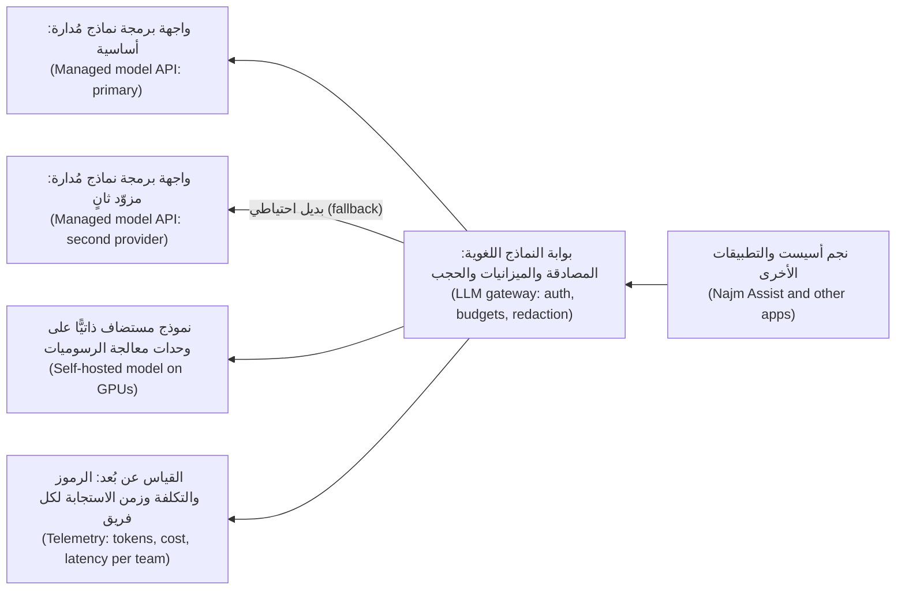

#### 🟡 التعمق أكثر

**ما الذي ينبغي أن تفعله البوابة (What a gateway should do).**

| الوظيفة (Function) | لماذا تهم |
|---|---|
| **المصادقة (Authentication)** | تستخدم التطبيقات هوية عبء العمل (workload identity) (1.3)؛ ومفاتيح المزوّدين لا تعيش إلا في البوابة |
| **التوجيه (Routing)** | أرسل كل حالة استخدام إلى النموذج المعتمَد؛ ووجّه بحسب تصنيف البيانات |
| **حدود المعدّل والميزانيات (Rate limits and budgets)** | لكل فريقٍ ولكل ميزة، بالرموز والمال، كي لا تستطيع حلقةٌ خارجة عن السيطرة إنفاق ميزانية الشهر |
| **البدائل الاحتياطية وإعادة المحاولة (Fallbacks and retries)** | أعِد المحاولة مع تراجعٍ تدريجي (Retry with backoff)، ثم انتقل إلى نموذجٍ بديل معتمَد سبق اختبار جودته |
| **التخزين المؤقت (Caching)** | التخزين المؤقت للتطابق التام (Exact-match caching) يوفّر التكلفة؛ أمّا التخزين المؤقت الدلالي (semantic caching) فيجب ألّا يعطي أبدًا عميلًا إجابةَ عميلٍ آخر |
| **الحجب والسياسة (Redaction and policy)** | أخفِ البيانات الشخصية التي لا تحتاجها حالة الاستخدام؛ وافرض فحوص الإدخال والإخراج المتّفق عليها مع الأمن |
| **القياس عن بُعد (Telemetry)** | الرموز الداخلة والخارجة، والتكلفة (cost)، وزمن الاستجابة (latency)، والنموذج (model)، والفريق (team)، والميزة (feature) في كل استدعاء، تُصدَّر باستخدام OpenTelemetry (5.1) |

توجد بواباتٌ مفتوحة المصدر (Open-source gateways)، وبوابات لدى المزوّدين وأخرى تجارية؛ وتشغّل نجم بوابةً على منصتها كي تعيش قواعد التوجيه في مستودع GitOps. والبوابة بنيةٌ تحتية حرجة (critical infrastructure): شغّلها على مناطق توافر متعدّدة مع هدف مستوى خدمة، كما في 6.1. أمّا الضوابط الأمنية لمدخلات النماذج ومخرجاتها فتتعمّق فيها [*أمن الذكاء الاصطناعي وأمن التطبيقات*، الدرس 9.1 — الحواجز الوقائية ومعالجة المخرجات: لا تثق أبدًا بمخرجات النموذج](../secai/index.ar.html#/9.1).

**وحدات معالجة الرسوميات في Kubernetes (GPUs in Kubernetes).** تحتاج العقد المزوّدة بوحدات معالجة رسوميات إلى مشغّل المورّد و*إضافة جهاز (device plugin)*، تعلن عن وحدات معالجة الرسوميات لـKubernetes بوصفها موردًا (لدى NVIDIA، `nvidia.com/gpu`). وتطلب الحجيرات وحداتٍ كاملة في حدودها. أبقِ عقد وحدات معالجة الرسوميات في مجمّع عقد منفصل مع **وصمة (taint)**، كي لا يستقر هناك إلا أعباء العمل التي تتحمّلها (وتحتاج إلى وحدة معالجة رسوميات):

```yaml
apiVersion: apps/v1
kind: Deployment
metadata:
  name: assist-classifier
  namespace: assist
spec:
  replicas: 2
  selector:
    matchLabels: { app: assist-classifier }
  template:
    metadata:
      labels: { app: assist-classifier }
    spec:
      nodeSelector:
        pool: gpu
      tolerations:
        - key: "gpu"
          operator: "Exists"
          effect: "NoSchedule"
      containers:
        - name: server
          image: registry.najm.example/assist/vllm-server@sha256:<digest>   # pinned by digest
          args: ["--model", "/models/classifier", "--max-model-len", "8192"]
          resources:
            limits:
              nvidia.com/gpu: 1
          readinessProbe:            # model loading takes time; do not send traffic early
            httpGet: { path: /health, port: 8000 }
            periodSeconds: 10
          securityContext:
            runAsNonRoot: true
            allowPrivilegeEscalation: false
```

يمكن لأعباء العمل الصغيرة (Small workloads) أن تتشارك وحدة معالجة رسوميات بالتقسيم الزمني (time-slicing)، أو، على بعض وحدات NVIDIA لمراكز البيانات، بتقنية وحدة معالجة الرسوميات متعدّدة المثيلات، التي تقسم الوحدة إلى شرائح معزولة (isolated slices). وتقدّم واجهة برمجة التخصيص الديناميكي للموارد في Kubernetes طلبات أجهزة أكثر مرونة؛ تحقّق من حالتها في إصدارك.

**محرّكات التقديم (Serving engines).** تشغيل نموذج بنصٍّ برمجي بسيط يخدم طلبًا واحدًا في كل مرة ويترك وحدة معالجة الرسوميات خاملةً في معظم الوقت (mostly idle)، وهو ما رآه يوسف. ومحرّكات التقديم تعالج ذلك:
- **vLLM** محرّكٌ مفتوح المصدر معروف بـ*الانتباه المُقسَّم إلى صفحات (PagedAttention)*، الذي يدير ذاكرة KV المؤقتة في صفحات، و*التجميع المستمر (continuous batching)*، الذي يضيف الطلبات الجديدة إلى الدفعة الجارية كلما انتهت أخرى. ويكشف واجهة برمجة HTTP متوافقة مع OpenAI.
- **NVIDIA Triton Inference Server** يقدّم نماذج من أطر عمل متعدّدة مع التجميع الديناميكي (dynamic batching)؛ تحقّق من التسمية الحالية لدى NVIDIA له.
- **KServe** طبقة تقديم نماذج أصلية في Kubernetes تدير عمليات نشر النماذج (model deployments) والتوسّع التلقائي والإطلاقات التدريجية (rollouts)، ويمكنها تشغيل محرّكاتٍ مثل vLLM تحتها (underneath).

**المفاهيم وراء السرعة (The concepts behind the speed).**
- **التجميع (Batching):** خدمة محادثاتٍ كثيرة في آنٍ واحد ترفع الإنتاجية كثيرًا، على حساب بعض زمن الاستجابة لكل طلب؛ والتجميع المستمر يُبقي الانتظار قصيرًا.
- **ذاكرة KV المؤقتة (KV cache):** أثناء التوليد، يحتفظ النموذج بنتائج وسيطة (intermediate results) لكل رمزٍ سابق كي لا يعيد حسابها. وتكبر الذاكرة المؤقتة مع طول السياق ومع عدد المحادثات المتزامنة، وكثيرًا ما تكون هي ما يحدّ من عدد المستخدمين الذين تستطيع وحدة معالجة رسوميات واحدة خدمتهم. وفي vLLM، يحدّد `--max-model-len` سقف السياق لكل طلب، ويحدّد `--gpu-memory-utilization` سقف حصّة المحرّك من ذاكرة وحدة معالجة الرسوميات.
- **التكميم (Quantisation):** تخزين الأوزان بـ8 أو 4 بت بدلًا من 16 (storing weights in 8 or 4 bits instead of 16) يقلّل الذاكرة (cuts memory) ويرفع السرعة غالبًا، مع بعض فقدان الجودة الذي يجب أن تقيسه على مجموعة التقييم الخاصة بك.

#### 🔴 نظرة الخبير

**المقاييس المهمة (Metrics that matter).** مقاييس RED الكلاسيكية (5.1) لا تكفي. تتبّع، لكل نموذجٍ ومسار:

| المقياس (Metric) | ما الذي يخبرك به |
|---|---|
| **الوقت حتى أول رمز (Time to first token, TTFT)** | كم ينتظر المستخدم قبل أن يبدأ النص؛ ويهيمن عليه الانتظار في الطابور ومعالجة الموجّه |
| **الوقت لكل رمز مُخرَج (Time per output token)** (زمن الاستجابة بين الرموز، inter-token latency) | مدى سلاسة تدفّق النص |
| **الرموز في الثانية (Tokens per second)** لكل وحدة معالجة رسوميات (per GPU) | الإنتاجية (Throughput)؛ رقم كفاءة التكلفة |
| **عمق الطابور والطلبات الجارية (Queue depth and running requests)** | التشبّع (Saturation)؛ أفضل إشارة توسّع تلقائي للنماذج المستضافة ذاتيًّا |
| **استخدام ذاكرة KV المؤقتة (KV-cache usage)** | مدى قربك من رفض الطلبات أو استباقها |
| **استخدام وحدة معالجة الرسوميات وذاكرتها (GPU utilisation and memory)** | ما إذا كنت تدفع مقابل عتادٍ خامل |
| **الرموز والتكلفة لكل فريقٍ وميزة (Tokens and cost per team and feature)** | من البوابة؛ يغذّي تقرير FinOps في 6.2 (feeds the FinOps report in 6.2) |

لدى OpenTelemetry اصطلاحاتٌ دلالية لاستدعاءات الذكاء الاصطناعي التوليدي؛ وكانت لا تزال تتطوّر (still evolving) في وقت كتابة هذا النص، لذا ثبّت الإصدار الذي تستخدمه.

وقد يكون هدف مستوى الخدمة لنجم أسيست: 99% من المحادثات تحصل على أول رمز خلال عددٍ مستهدف من الثواني، مقيسًا عند البوابة على مدى 28 يومًا، مع تحديد الهدف من القياس، لا من معيار أداء لدى المورّد.

**توسيع النماذج المستضافة ذاتيًّا (Scaling self-hosted models).** المعالج إشارةٌ خاطئة؛ وسّع بحسب عمق الطابور أو الطلبات الجارية. والبدء البارد بطيء: قد تحتاج نسخةٌ متماثلة جديدة إلى عقدة وحدة معالجة رسوميات جديدة، وإلى الصورة، وإلى ملف نموذج من غيغابايتات كثيرة. احتفظ بحدٍّ أدنى دافئ من النسخ المتماثلة في ساعات العمل، واسحب الصور مسبقًا (pre-pull images)، وأبقِ ملفات النماذج على تخزينٍ سريع قريب، وتحكّم في حركة المرور بفحوص الجاهزية. ولا توسّع إلى الصفر إلا حيث تكون الاستجابة الأولى الطويلة مقبولة.

**نقطة التعادل للاستضافة الذاتية (The self-hosting break-even).** قارن، للجودة نفسها على مجموعة التقييم الخاصة بك:

```text
Managed cost per month  = Σ (input tokens × input rate + output tokens × output rate)
Self-hosted per month   = GPU node hours × node rate (busy or idle)
                        + engineering and on-call time
                        + storage, network, observability
Self-hosted cost per 1M tokens = self-hosted per month / (tokens served / 1,000,000)
```

تنخفض تكلفة الاستضافة الذاتية لكل رمز كلما ارتفع الاستخدام؛ وعند الاستخدام المنخفض تكون عادةً أسوأ من واجهة البرمجة المُدارة. أعِد الحساب حين تتغيّر الأسعار. وقد يصعب الحصول على سعة وحدات معالجة الرسوميات عند الطلب، لذا احجز سعةً لنموذجٍ مستضاف ذاتيًّا حرج أو احتفظ ببديلٍ احتياطي مُدار.

**سلامة الإطلاق للنماذج (Release safety for models).** تغيير إصدار النموذج، أو التكميم، أو موجّه النظام (system prompt) يغيّر الإجابات، لذا فهو إطلاق. أطلقه بنمط الكناري عند البوابة (4.2): أرسل حصّةً صغيرة من حركة المرور، وقارن نتائج التقييم (evaluation results)، والملاحظات (feedback)، وزمن الاستجابة، والتكلفة، ثم رقِّ أو تراجع. ثبّت إصدارات النماذج حيث يسمح المزوّدون؛ فالاسم المستعار الذي ينتقل بصمت إلى نموذجٍ أحدث هو نشرٌ لم تتمّ مراجعته.

### 🧰 الأدوات
| الأداة أو الممارسة أو الخدمة | ما هي وماذا تفعل | متى تلجأ إليها |
|---|---|---|
| **LLM gateway** — بوابة النماذج اللغوية | نقطة دخولٍ واحدة مضبوطة إلى كل النماذج: المصادقة (auth)، والتوجيه، والميزانيات، والبدائل الاحتياطية، والتخزين المؤقت، والقياس عن بُعد | قبل أن يبدأ الفريق الثاني باستدعاء النماذج؛ ودائمًا في بنك |
| **vLLM** | محرّك تقديم نماذج لغوية مفتوح المصدر مع PagedAttention، والتجميع المستمر، وواجهة برمجة متوافقة مع OpenAI | الاستضافة الذاتية للنماذج اللغوية مفتوحة الأوزان بكفاءة |
| **NVIDIA Triton Inference Server** | خادم استدلال متعدّد أطر العمل مع التجميع الديناميكي | تقديم أنواعٍ كثيرة من النماذج، بما فيها نماذج غير لغوية (non-LLM models)، على وحدات NVIDIA |
| **KServe** | طبقة تقديم نماذج أصلية في Kubernetes مع التوسّع التلقائي والإطلاقات التدريجية | توحيد عمليات نشر النماذج على المنصة |
| **NVIDIA device plugin** and **DCGM exporter** — إضافة جهاز NVIDIA ومُصدِّر DCGM | كشف وحدات معالجة الرسوميات لـKubernetes بوصفها موردًا؛ وتصدير مقاييس وحدات معالجة الرسوميات إلى Prometheus | أي عنقودٍ فيه عقد بوحدات NVIDIA |
| **KEDA** | توسّعٌ تلقائي مدفوع بالأحداث من الطوابير والتدفّقات والمقاييس | توسيع خوادم النماذج بحسب عمق الطابور بدلًا من المعالج |
| **OpenTelemetry** GenAI conventions — اصطلاحات الذكاء الاصطناعي التوليدي | سماتٌ قياسية لاستدعاءات النماذج وأعداد الرموز وزمن الاستجابة | بيانات تكلفة وزمن استجابة متّسقة عبر النماذج والفرق |

### 🏛️ عمليًا في بنك نجم
يكتب فريق سالم **قرار التقديم وسياسة البوابة لنجم أسيست (Najm Assist serving decision and gateway policy)**، ويراجعه مع نورة ومها ومنى، ويُخزَّن في مستودع GitOps بجوار إعدادات البوابة.

| القسم | القرار (Decision) |
|---|---|
| حالات الاستخدام والمسارات | المحادثة مع العملاء (Customer chat): واجهة برمجة مُدارة في منطقة معتمَدة، مع نموذجٍ معتمَد ثانٍ بديلًا احتياطيًّا. التصنيف السرّي (Confidential classification): نموذج مستضاف ذاتيًّا في المنطقة الأساسية لنجم فقط. التلخيص الداخلي (Internal summarisation): فئة مُدارة أرخص |
| قواعد البيانات (Data rules) | التصنيف يحدّد المسار؛ والبيانات الشخصية غير اللازمة تُخفى عند البوابة؛ ومدة الاحتفاظ بالسجلات متّفق عليها مع الأمن والخصوصية |
| الوصول (Access) | هوية عبء العمل إلى البوابة؛ ومفاتيح المزوّدين في مدير أسرارها فقط، مع تدويرها (rotated)؛ والاستدعاءات المباشرة للمزوّدين محظورة بسياسة الخروج |
| الميزانيات | ميزانية رموزٍ ومال لكل فريقٍ وميزة، مع مالك؛ تنبيهٌ عند حصّةٍ محدّدة، وإيقافٌ صارم للميزات غير الحرجة |
| الموثوقية (Reliability) | بوابة على مناطق توافر متعدّدة (Gateway multi-zone) مع هدف مستوى خدمة للتوافر والوقت حتى أول رمز؛ واختبار البديل الاحتياطي شهريًّا؛ ونموذج مستضاف ذاتيًّا بحدٍّ أدنى دافئ من النسخ المتماثلة خلال ساعات العمل |
| السعة (Capacity) | مجمّع عقد وحدات معالجة الرسوميات موصوم ويتوسّع تلقائيًّا بحسب عمق الطابور؛ ومراجعة استخدام وحدات معالجة الرسوميات والرموز في الثانية أسبوعيًّا (reviewed weekly)؛ وإعادة حساب نقطة التعادل كل ربع بالأسعار الحالية |
| ضبط التغيير (Change control) | تغييرات النموذج أو التكميم أو الموجّه تمرّ عبر التقييم (evaluation) وإطلاق كناري عند البوابة؛ وإصدارات النماذج مثبّتة |
| التقارير (Reporting) | التكلفة لكل محادثة ولكل فريق في تقرير منى الشهري من 6.2 (Mona's monthly report from 6.2) |

يعمل مصنّف يوسف (Yousef's classifier) الآن على vLLM مع التجميع المستمر ونموذجٍ مكمَّم بـ8 بت (an 8-bit quantised model) اجتاز مجموعة التقييم، واستوعب مسار البديل الاحتياطي انقطاع المزوّد التالي مع ارتفاعٍ قصير في زمن الاستجابة.

### 🛠️ التمارين
- 🟢 **حدّد حجم نموذج (Size a model).** اختر ثلاثة نماذج مفتوحة الأوزان بأحجامٍ مختلفة. احسب ذاكرة الأوزان (weight memory) بدقة 16 و8 و4 بت (at 16-, 8- and 4-bit)، وقرّر أيّها يتّسع في حجم ذاكرة وحدة معالجة رسوميات تسمّيه، تاركًا الربع لذاكرة KV المؤقتة والمحرّك. *يكتمل عندما:* يكون لديك جدولٌ بتسعة تقديرات للذاكرة مع إظهار الحساب، وقرار ملاءمة من سطرٍ واحد لكل نموذج.
- 🟡 **شغّل بوابةً محليًّا (Run a gateway locally).** شغّل نموذجًا مفتوحًا صغيرًا محليًّا خلف واجهة برمجة متوافقة مع OpenAI، وضع أمامه بوابة نماذج لغوية مفتوحة المصدر في Docker مع مسارين (two routes)، وحدّ معدّلٍ لكل مفتاح، وبديلٍ احتياطي إلى نموذجٍ محلي ثانٍ. *يكتمل عندما:* تستطيع إظهار طلبٍ خدمه المسار الأساسي، وطلبٍ رفضه حدّ المعدّل، وطلبٍ ينتقل إلى البديل حين توقف النموذج الأساسي، مع سجلات البوابة أو مقاييسها التي تُظهر الرموز لكل طلب.
- 🔴 **اكتب نقطة تعادل وقرار تقديم (Write a break-even and serving decision).** لمساعدٍ خيالي يتعامل مع عددٍ محدّد من المحادثات يوميًّا بمتوسطات محدّدة لرموز الإدخال والإخراج، استخدم الأسعار العامة الحالية من واجهة برمجة مُدارة واحدة ونوع مثيل وحدة معالجة رسوميات واحد لحساب التكلفة الشهرية بالطريقتين عند استخدام وحدة معالجة الرسوميات بنسبة 20% و50% و80% (at 20%, 50% and 80% GPU utilisation). أضِف وقت الهندسة افتراضًا مُعلَنًا. *يكتمل عندما:* يكون لديك قرارٌ من صفحةٍ واحدة بصيغة جدول نجم، مع نسبة الاستخدام التي تتعادل عندها الاستضافة الذاتية والأسباب غير المتعلقة بالتكلفة التي قد تغيّر اختيارك.

### ⚠️ أخطاء وفخاخ
- **استدعاءاتٌ مباشرة بمفاتيح متناثرة (Direct calls with scattered keys).** أن يحمل كل فريقٍ مفتاح مزوّدٍ خاصًّا به يعني لا رؤية للتكلفة، ولا بديل احتياطي، وتدفّقات بيانات مجهولة. وجّه كل شيء عبر بوابةٍ واحدة واحظر الخروج المباشر.
- **وحدات معالجة الرسوميات الخاملة (Idle GPUs).** عقدة وحدة معالجة رسوميات تشغّل نموذجًا لا يستدعيه أحد تكلّف ما تكلّفه عقدةٌ مشغولة. وسّع بحسب عمق الطابور، وجدوِل البيئات غير الإنتاجية، وراجع الاستخدام أسبوعيًّا.
- **التقديم دون محرّك تقديم (Serving without a serving engine).** النص البرمجي البسيط يعالج طلبًا واحدًا في كل مرة. استخدم محرّكًا بتجميعٍ مستمر وقِس الرموز في الثانية.
- **التكميم أو تبديل النماذج دون تقييم (Quantising or switching models without evaluation).** الأصغر والأرخص قد يكون أسوأ. شغّل مجموعة التقييم وإطلاق كناري قبل الترقية (before promoting).
- **التخزين المؤقت الدلالي غير الآمن (Unsafe semantic caching).** إعادة استخدام إجاباتٍ لموجّهاتٍ «مشابهة» ("similar" prompts) قد تُسرّب بيانات عميلٍ إلى آخر. لا تخزّن مؤقتًا إلا الإجابات غير الشخصية (non-personal answers)، أو اجعل نطاق الذاكرة المؤقتة لكل مستخدم.

### 🧾 الخلاصة
- أعباء عمل الذكاء الاصطناعي مقيّدة بذاكرة وحدة معالجة الرسوميات ومسعّرة بالرموز؛ حدّد أحجام النماذج بحسابٍ بسيط وتتبّع التكلفة لكل محادثة.
- تمنح بوابة النماذج اللغوية مكانًا واحدًا للمصادقة، والتوجيه بحسب فئة البيانات، والميزانيات، والبدائل الاحتياطية، والتخزين المؤقت، والحجب (redaction)، والقياس عن بُعد؛ شغّلها بوصفها بنيةً تحتية حرجة.
- قدّم النماذج المستضافة ذاتيًّا بمحرّكٍ مثل vLLM أو Triton أو KServe، باستخدام التجميع، وحدود ذاكرة KV المؤقتة (KV-cache limits)، والتكميم المُقيَّم (evaluated quantisation)، ووسّع بحسب عمق الطابور.
- عامِل كل تغييرٍ في النموذج أو الموجّه أو التكميم بوصفه إطلاقًا: قيّم (evaluate)، وأطلق بنمط الكناري (canary)، وثبّت الإصدارات (pin versions)، وتراجع عند الحاجة.

### ✍️ اختبر نفسك

**1. يشغّل يوسف نموذجًا مستضافًا ذاتيًّا بنصٍّ برمجي بسيط بلغة Python (a simple Python script) على عقدة وحدة معالجة رسوميات. زمن الاستجابة مرتفع (Latency is high) واستخدام وحدة معالجة الرسوميات نحو 15%. ما الإصلاح الأرجح (the most likely fix)؟**

- A. نقل النص البرمجي نفسه إلى وحدة معالجة رسوميات أكبر بذاكرةٍ أكثر
- B. إضافة مُوسِّع تلقائي أفقي (HPA) يوسّع الحجيرات بحسب استخدامها للمعالج
- C. الانتقال فورًا إلى واجهة برمجة مُدارة والتخلّي عن وحدة معالجة الرسوميات
- D. تقديمه بمحرّكٍ للتجميع المستمر مثل vLLM

<details><summary>الإجابة</summary>

**D.** النص البرمجي الذي يعالج طلبًا واحدًا في كل مرة يترك وحدة معالجة الرسوميات خاملة؛ والتجميع (batching) يخدم طلباتٍ كثيرة معًا. وA يشتري مزيدًا من العتاد الخامل؛ وB يوسّع بحسب الإشارة الخاطئة؛ وC لا يفسّر الهدر. (🟡 التعمق أكثر (Going deeper).)

</details>

**2. ما مقدار ذاكرة وحدة معالجة الرسوميات (GPU memory) التي تحتاجها تقريبًا أوزان نموذجٍ ذي 8 مليارات معامل (an 8-billion-parameter model) بدقة 4 بت (at 4-bit precision)؟**

- A. نحو 32 GB، لأن كل معامل يحتاج إلى أربعة بايتات (four bytes)
- B. نحو 4 GB، إضافةً إلى مساحةٍ لذاكرة KV المؤقتة
- C. نحو 8 GB، دون حاجةٍ إلى مساحةٍ إضافية للتقديم
- D. لا يمكن تقديرها دون سؤال المورّد

<details><summary>الإجابة</summary>

**B.** 8 مليارات معامل × نصف بايت ≈ 4 GB، والتقديم يحتاج أيضًا إلى ذاكرةٍ لذاكرة KV المؤقتة وللمحرّك. وA هو الحجم بدقة 32 بت (the 32-bit size)؛ وC هو الحجم بدقة 8 بت ويتجاهل ذاكرة KV المؤقتة؛ وD خاطئ لأن الحساب بسيط. (🟢 الأساسيات.)

</details>

**3. يتعرّض مزوّد نماذج لانقطاعٍ جزئي (a partial outage) فيتعطّل نجم أسيست كليًّا. أيّ تغييرٍ يمنع هذا مباشرةً في المرة القادمة؟**

- A. أن تطلب من المزوّد اتفاقية مستوى خدمة أقوى في العقد التالي
- B. إضافة نسخٍ متماثلة أكثر من واجهة المحادثة الأمامية في كل منطقة توافر
- C. مسار في البوابة مع إعادة المحاولة (retries) ونموذج بديل احتياطي مُختبَر
- D. تخزين كل إجابة مؤقتًا إلى الأبد كي يُستدعى المزوّد نادرًا

<details><summary>الإجابة</summary>

**C.** البديل الاحتياطي في البوابة يُبقي الميزة عاملةً حين يتعطّل مزوّدٌ واحد. وA لا يغيّر شيئًا أثناء الانقطاع؛ وB يوسّع الطبقة الخاطئة؛ وD يقدّم إجاباتٍ قديمة ويخاطر بالتسرّب (risks leakage). (🟡 التعمق أكثر (Going deeper).)

</details>

**4. متى تكون الاستضافة الذاتية لنموذجٍ مفتوح الأوزان (self-hosting an open-weight model) منطقيةً أكثر في العادة؟**

- A. حين يُبقي الحجم الثابت وحدات معالجة الرسوميات مشغولة، أو تتطلّب الإقامة ذلك
- B. دائمًا، لأن ساعات وحدات معالجة الرسوميات أرخص من الدفع مقابل الرموز
- C. لأداةٍ داخلية منخفضة الحركة لا تُستخدم إلا بضع مرات يوميًّا
- D. فقط حين لا تقدّم أي واجهة برمجة مُدارة نموذجًا بجودةٍ مماثلة

<details><summary>الإجابة</summary>

**A.** تؤتي الاستضافة الذاتية ثمارها مع الاستخدام المرتفع (high utilisation) أو المتطلبات غير المتعلقة بالتكلفة (non-cost requirements). وB يتجاهل تكلفة الخمول ووقت الهندسة؛ وC يترك وحدات معالجة الرسوميات خاملة؛ وD يتجاهل الإقامة والتحكم والاستخدام. (🔴 نظرة الخبير (Expert view).)

</details>

**5. أيّ مقياس هو أفضل إشارة توسّع تلقائي (the best autoscaling signal) لخادم نماذج لغوية مستضاف ذاتيًّا (a self-hosted LLM server)؟**

- A. استخدام المعالج في العقد بمتوسطه عبر مجمّع وحدات معالجة الرسوميات
- B. عدد الحجيرات التي تقدّم النموذج حاليًّا
- C. استخدام القرص على العقد التي تحمل ملفات النماذج
- D. عمق الطابور أو الطلبات الجارية عند المحرّك

<details><summary>الإجابة</summary>

**D.** يُظهر عمق الطابور (Queue depth) الطلب المنتظر لوحدة معالجة الرسوميات. وA لا يقول الكثير عن حمل وحدة معالجة الرسوميات؛ وB هو الشيء الذي يُوسَّع، لا إشارة؛ وC لا علاقة له بحمل الطلبات. (🔴 نظرة الخبير (Expert view).)

</details>

### 📚 المراجع
- Kubernetes: جدولة وحدات معالجة الرسوميات (Schedule GPUs) — https://kubernetes.io/docs/tasks/manage-gpus/scheduling-gpus/
- Kubernetes: الوصمات والتحمّلات — https://kubernetes.io/docs/concepts/scheduling-eviction/taint-and-toleration/
- توثيق vLLM (vLLM documentation) — https://docs.vllm.ai/
- توثيق NVIDIA Triton Inference Server — https://docs.nvidia.com/deeplearning/triton-inference-server/
- توثيق KServe (KServe documentation) — https://kserve.github.io/website/
- إضافة جهاز NVIDIA لـKubernetes — https://github.com/NVIDIA/k8s-device-plugin
- توثيق KEDA — https://keda.sh/docs/
- الاصطلاحات الدلالية في OpenTelemetry للذكاء الاصطناعي التوليدي — https://opentelemetry.io/docs/specs/semconv/gen-ai/
- مؤسسة FinOps — https://www.finops.org/
- أمن تطبيقات النماذج اللغوية الكبيرة: [*أمن الذكاء الاصطناعي وأمن التطبيقات*، الدرس 8.1 — سطح الهجوم في الذكاء الاصطناعي: قائمة OWASP لأعلى 10 مخاطر لتطبيقات النماذج اللغوية الكبيرة وMITRE ATLAS (The AI attack surface: OWASP Top 10 for LLM Applications and MITRE ATLAS)](../secai/index.ar.html#/8.1)
- تشغيل الوكلاء في الإنتاج: [*تشغيل وكلاء الذكاء الاصطناعي في الإنتاج*، المستوى 3 — مهندس الإنتاج](../agentic/learning-path.ar.html#level-3-production-engineer)
- [*بناء تطبيقات الذكاء الاصطناعي والوكلاء من الصفر إلى الاحتراف*، الدرس 14.2 — هندسة التكلفة وزمن الاستجابة والموثوقية](../aiapps/index.ar.html#/14.2) — منظور البناء والتسليم (build and ship) لهذا الموضوع

---

<a id="m7"></a>

# الوحدة 7 — الاحتراف: المشروع الختامي والامتحان التدريبي (Hero: capstone and practice exam)

*لقد تعلّمت السحابة وDevOps طبقةً بعد طبقة: سطر الأوامر والشبكة، والهوية (identity)، والحاويات (containers)، وKubernetes، والبنية التحتية بوصفها شيفرة (infrastructure as code)، وخطوط التسليم (pipelines)، والإطلاقات (releases)، والقياس عن بُعد (telemetry)، وأهداف مستوى الخدمة (SLOs)، والحوادث (incidents)، والتوسّع (scaling)، والتكلفة (cost)، وأعباء عمل الذكاء الاصطناعي (AI workloads). وهذه الوحدة تعيد جمع الطبقات معًا. ففي المشروع الختامي (capstone) تأخذ خدمةً جديدة كليًّا في بنك نجم، هي ضوابط البطاقات (Card Controls)، من مستودعٍ فارغ إلى الإنتاج (production) مع هدف مستوى خدمة موقَّع، معيدًا استخدام أثرٍ برمجي (artefact) من كل وحدةٍ سابقة، وتربطها جميعًا في ملف جاهزية للإنتاج واحد يستطيع سالم ومها ونورة اعتماده (approve). ثم ننتقل إليك أنت: الأدوار (roles) التي يتكوّن منها عمل السحابة والمنصات وDevOps وهندسة موثوقية المواقع، وكيف تختار الشهادات (certifications) من مزوّدي السحابة (cloud providers) ومؤسسة Linux وغيرها دون أن تتحكّم بك، وما الذي تختبره المقابلات فعلًا، وكيف تبني ملف أعمال (portfolio) يُثبت أنك تستطيع تشغيل البرمجيات (run software)، لا مجرد كتابتها. وتُختتم الوحدة بامتحانٍ تدريبي (practice exam) من 60 سؤالًا يغطي المراحل الثماني جميعها.*

> **المراحل (Phases):** من Plan إلى Monitor — حلقة التسليم كاملةً، من طرفها إلى طرفها (end to end)، على خدمةٍ واحدة ثم في امتحانٍ واحد.

<a id="l7-1"></a>

## 7.1 — المشروع الختامي: خذ خدمةً جديدة في نجم من مستودعٍ فارغ إلى الإنتاج مع هدف مستوى خدمة

*المستوى: 🔴 متقدم* · *المتطلبات: الوحدات 0–6 (Modules 0–6)* · *المرحلة (Phase): Deploy, Operate*

### ⚡ الدرس في دقيقة (In 60 seconds)
- يأخذ المشروع الختامي خدمة **ضوابط البطاقات (Card Controls)**، وهي خدمةٌ جديدة في نجم لتجميد البطاقات (freezing cards) وتعيين الحدود (setting limits)، من مستودعٍ فارغ إلى الإنتاج عبر المراحل الثماني جميعها.
- المُخرَج هو **ملف الجاهزية للإنتاج (production readiness file)**: أدلةٌ مترابطة (linked evidence) على أن الخدمة يمكن بناؤها وإطلاقها ومراقبتها واستعادتها وتحمّل تكلفتها، مع مالكٍ لكل جزء.
- العمود الفقري هو **أثرٌ برمجي واحد وبيئاتٌ متعددة (one artefact, many environments)**: ابنِ صورة الحاوية (container image) مرةً واحدة، ووقّعها (sign it)، ورقِّ البصمة نفسها من التطوير (dev) إلى التجهيز (staging) إلى الإنتاج عبر Git.
- هدف مستوى الخدمة يأتي أولًا لا أخيرًا. فهو يحدّد التنبيهات، وبوابات الإطلاق، وعدد النسخ المتماثلة، وأهداف النسخ الاحتياطي، وجدول المناوبة.
- مؤشر القرار (Decision cue): قبل كل بوابة، اسأل «لو فشلت هذه الخطوة بصمت في الثانية فجرًا ⁦(if this step failed silently at 2 a.m.)⁩، فكيف سنعرف، وكيف سنتراجع عنها؟».
- أكبر فخ (Biggest trap): قائمة تحقق للجاهزية تُعلَّم من الذاكرة. كل بندٍ يحتاج إلى دليل، والتراجع والاستعادة ومفاتيح الإيقاف الطارئ تحتاج إلى تمرينٍ موقوت.

### 🧭 لماذا يهم
يأتي طارق بطلبٍ إلى فريق المنصات. يريد فريق البطاقات **خدمة ضوابط البطاقات (Card Controls service)**: يجمّد العملاء البطاقة، ويحظرون الاستخدام عبر الإنترنت أو خارج البلاد، ويعيّنون حدًّا يوميًّا من تطبيق نجم للهاتف (Najm Mobile app). ويتحقّق معالج البطاقات من هذه الضوابط أثناء التفويض (during authorisation)، لذا فإن الإجابة الخاطئة إمّا تمنع عميلًا عند نقطة الدفع وإمّا تمرّر بطاقةً مسروقة. ويريدها قطاع الأعمال حيّةً خلال ربع سنة واحد.

يُسند سالم المهمة إلى يوسف، مع مها شريكةً في هندسة موثوقية المواقع (SRE partner). كانت خطة يوسف الأولى: نسخ مستودعٍ قديم، ودفع صورةٍ موسومة بـ`latest`، وتطبيق ملفات البيان يدويًّا، و«إضافة المراقبة بعد الإطلاق». فيطرح سالم ثلاثة أسئلة: «ما هدف مستوى الخدمة؟ كيف تتراجع في أقل من خمس دقائق؟ ماذا يحدث إن تعطّلت منطقة توافر قاعدة البيانات خلال ذروة يوم صرف الرواتب؟». ولم تكن لدى يوسف إجاباتٌ بعد.

والتاريخ العام (Public history) يبيّن لماذا تهمّ هذه الأسئلة. ففي أغسطس 2012 نشرت شركة Knight Capital شيفرةً جديدة على خوادمها، لكن خادمًا واحدًا احتفظ بشيفرةٍ قديمة خلف علَمٍ أُعيد استخدامه؛ وبحسب الأمر اللاحق الصادر عن هيئة الأوراق المالية الأمريكية، خسرت الشركة مئات الملايين من الدولارات في أقل من ساعة. وفي يناير 2017 فقدت GitLab ساعاتٍ من بيانات الإنتاج بعد حذف مجلد قاعدة بيانات أثناء حادثة (during an incident)، وتبيّن أن عدة طرق للنسخ الاحتياطي لا تعمل. وكانت كلٌّ منهما خطوةً مفقودة وغير مختبرة على الطريق إلى الإنتاج. وهذا الدرس يبني الطريق كله مرةً واحدة، وبالشكل الصحيح (once, properly).

### 📐 كيف يعمل

#### 🟢 الأساسيات

**الخدمة في فقرةٍ واحدة (The service, in one paragraph).** ضوابط البطاقات واجهةُ برمجة HTTP صغيرة لها قاعدة بيانات PostgreSQL مُدارة خاصة بها. تستدعيها واجهة برمجة تطبيق نجم للهاتف (Najm Mobile API) لتغيير الضوابط؛ ويستدعيها تكامل معالج البطاقات لقراءتها أثناء التفويض. وتعمل على عنقود Kubernetes المُدار الخاص بالبنك عبر منطقتي توافر. ولا تخزّن إلا مرجعًا داخليًّا للبطاقة، ولا تخزّن أبدًا أرقام البطاقات، وهو ما تؤكّده نورة في مراجعة التصميم (design review).

**ملف الجاهزية للإنتاج (The production readiness file).** **مراجعة الجاهزية للإنتاج (production readiness review, PRR)** فحصٌ منظَّم قبل الإطلاق للتأكد من أن الخدمة يمكن تشغيلها بأمان؛ وتصف كتب SRE من Google هذه الممارسة. ومراجعة نجم (Najm's PRR) مجلدٌ من الآثار البرمجية المترابطة تحت صفحة ملخّص واحدة (انظر 🏛️ أدناه)، ولها ثلاث قواعد (three rules):
1. **لكل ادّعاءٍ دليل (Every claim has evidence)** يستطيع المراجع فتحه، لا «نعم، تم (yes, done)».
2. **كل تغييرٍ خطِر يمكن التراجع عنه (Every risky change can be undone)** بطريقةٍ موثّقة وموقوتة.
3. **كل تنبيهٍ يرتبط بهدف مستوى خدمة أو بدليل تشغيل (Every alert maps to an SLO or a runbook).** والتنبيه الذي لا يقابله إجراء ضجيج.

**المراحل الثماني (The eight phases).** تعيد كل مرحلةٍ استخدام أثرٍ برمجي من وحدةٍ سابقة؛ وصفحة الملخّص في 🏛️ أدناه تربط كلًّا منها بدليله ودرسه. وكل الأرقام في هذا الدرس توضيحية.

**ابدأ بهدف مستوى الخدمة (Start with the SLO).** تتفق مها ومالك منتج البطاقات على رحلات المستخدم المهمة، ويكتبان **مؤشرات مستوى الخدمة (SLIs)** و**أهداف مستوى الخدمة (SLOs)**:

| الرحلة (Journey) | مؤشر مستوى الخدمة (SLI) | هدف مستوى الخدمة (SLO) (نافذة 28 يومًا، 28-day window) |
|---|---|---|
| قراءة الضوابط أثناء التفويض | نسبة طلبات القراءة التي يُجاب عنها بنجاح خلال 100 ms عند موازن الأحمال (answered successfully within 100 ms at the load balancer) | 99.95% |
| العميل يغيّر ضابطًا | نسبة طلبات الكتابة التي تنجح خلال 500 ms (Share of write requests that succeed within 500 ms) | 99.9% |
| الحداثة (Freshness) | نسبة تغييرات الضوابط التي تظهر للقراءات خلال ثانيتين (Share of control changes visible to reads within 2 seconds) | 99.9% |

هدف القراءة أشدّ (tighter) لأن فشل القراءة قد يمنع عملية شراء حقيقية. ومع 99.95% على مدى 28 يومًا، تكون **ميزانية الأخطاء (error budget)** هي 0.05% من طلبات القراءة. وهي تحدّد سياسة الإطلاق: ما دامت الميزانية متبقية، يُطلق الفريق؛ وبمجرد استنفادها، لا يُطلق إلا إصلاحات الموثوقية.

**الطريق (The path).** كل صندوقٍ بوابةٌ تترك دليلًا:

```mermaid
flowchart RL
    R["مستودع فارغ من القالب<br/>(Empty repo from template)"] --> CI["التكامل المستمر: اختبار وفحص وبناء مرة واحدة<br/>(CI: test, scan, build once)"]
    CI --> IMG["صورة موقّعة بالبصمة<br/>(Signed image by digest)"]
    IMG --> DEV["النشر من المستودع: بيئة التطوير<br/>(GitOps: dev)"]
    DEV --> STG["النشر من المستودع: بيئة التجهيز واختبار الحمل<br/>(GitOps: staging and load test)"]
    STG --> PRR["مراجعة الجاهزية<br/>(Readiness review)"]
    PRR --> CAN["إطلاق كناري في الإنتاج<br/>(Canary in production)"]
    CAN -->|"هدف مستوى الخدمة سليم (SLO healthy)"| FULL["الطرح الكامل<br/>(Full rollout)"]
    CAN -->|"معدل الاستهلاك مرتفع (burn rate high)"| RB["تراجع تلقائي<br/>(Automatic rollback)"]
```

#### 🟡 التعمق أكثر (Going deeper)

**الشيفرة: ابدأ من المسار الذهبي (Code: start from the golden path).** لا ينسخ يوسف مستودعًا قديمًا. بل يُنشئ الخدمة من قالب المنصة، الذي يحتوي مسبقًا على ملف Dockerfile، وسير عمل للتكامل المستمر (CI workflow)، ومخطط Helm (Helm chart)، وإعداد OpenTelemetry (OpenTelemetry setup)، وملف `CODEOWNERS`، ومدخلٍ في فهرس البوابة. وتأتي الإعدادات (Configuration) من متغيرات البيئة (environment variables)، ولا تُدمَج أبدًا في الصورة، فتعمل صورةٌ واحدة في كل مكان. وتعرض الخدمة المسار `/healthz/live` والمسار `/healthz/ready`، وهما يصبحان مِجسّي الحيوية والجاهزية من الدرس 2.3.

**البناء: مرةً واحدة، بالبصمة، وموقَّعًا (Build: once, by digest, signed).** يبني التكامل المستمر (CI) الصورة مرةً واحدة لكل إيداع، ويدفعها (pushes it)، ويسجّل بصمتها، ثم يولّد قائمة مكونات البرمجيات (SBOM) ويوقّع تلك البصمة باستخدام cosign. وتشير البيئات اللاحقة (Later environments) إلى البصمة نفسها ولا تعيد البناء أبدًا (never rebuild). ويصل التكامل المستمر إلى السحابة عبر **اتحاد هوية أعباء العمل (workload identity federation)** (OIDC)، فلا يوجد مفتاحٌ طويل العمر في المستودع (1.3، 4.3):

```yaml
# .github/workflows/ci.yml (excerpt)
permissions:
  contents: read
  id-token: write        # lets the job request a short-lived OIDC token
jobs:
  build:
    runs-on: ubuntu-latest
    steps:
      - uses: actions/checkout@v4      # pin actions to a full commit SHA in real use
      - run: make test                  # unit and contract tests
      - run: make image                 # multi-stage, non-root build
      - run: make push sbom sign        # push, then SBOM and cosign signature on the digest
      - run: make bump-dev              # opens a PR to the GitOps repo with the new digest
```

**النشر: البنية التحتية والتطبيق، كلاهما من Git (Deploy: infrastructure and app, both from Git).** قاعدة البيانات والنسخ الاحتياطية (backups) ودور السحابة (cloud role) وقواعد الشبكة (network rules) هي استدعاءٌ واحد لوحدة OpenTofu، يُراجَع بأمر `tofu plan` على طلب الدمج (3.1). وفحوص السياسات (Policy checks) (3.3) ترفض قاعدة بيانات بلا تشفير أثناء التخزين أو حماية من الحذف (deletion protection) أو مدة احتفاظ بالنسخ الاحتياطية (backup retention). أمّا جانب Kubernetes فيقيم في مستودع GitOps، بمجلدٍ لكل بيئة (one folder per environment)، ويُوفّقه Argo CD:

```yaml
apiVersion: argoproj.io/v1alpha1
kind: Application
metadata:
  name: card-controls-prod
  namespace: argocd
spec:
  project: cards
  source:
    repoURL: https://git.example.com/najm/gitops.git
    targetRevision: main
    path: apps/card-controls/overlays/prod
  destination:
    server: https://kubernetes.default.svc
    namespace: card-controls
  syncPolicy:
    automated:
      prune: true
      selfHeal: true     # reverts manual edits in the cluster back to Git
```

الترقية إلى الإنتاج طلبُ دمج يغيّر سطرًا واحدًا، هو بصمة الصورة في طبقة `prod`، ويعتمده فريق البطاقات وفريق المنصة. والتراجع (Rollback) هو التراجع عن ذلك الإيداع.

**الإطلاق: كناري مع حارس (Release: canary with a guard).** يرسل الطرح حصةً صغيرة من حركة المرور إلى النسخة الجديدة، ويقارن أخطاءها وزمن استجابتها بالنسخة المستقرة، ويتوسّع خطوةً بخطوة (4.2). وتُؤتمِت أداةُ تحكّم مثل Argo Rollouts أو Flagger عملية التحليل؛ فإن تجاوز الكناري عتباتٍ مبنية على هدف مستوى الخدمة، يُلغي الطرح وتعود حركة المرور إلى النسخة المستقرة. والسلوك الجديد (New behaviour)، مثل «حظر الاستخدام خارج البلاد»، يقع خلف علَم ميزة لكي يمكن إيقافه دون نشر. وتحديث المحتوى لـCrowdStrike Falcon في يوليو 2024 (The CrowdStrike Falcon content update of July 2024)، الذي أسقط أجهزة Windows حول العالم، يبيّن ما يحدث حين يصل تغييرٌ إلى الجميع دفعةً واحدة.

**المراقبة: تنبيهاتٌ من الميزانية (Monitor: alerts from the budget).** تُصدر الخدمة تتبّعات OpenTelemetry (OpenTelemetry traces) ومقاييس RED (RED metrics). وتكتب مها **تنبيهات متعددة النوافذ ومتعددة معدلات الاستهلاك (multi-window, multi-burn-rate alerts)** من كتاب SRE التطبيقي: استدعِ المناوب (page) حين تُستهلك الميزانية بسرعة على نافذةٍ طويلة وأخرى قصيرة معًا؛ وافتح تذكرة حين تُستهلك ببطء (burns slowly). وهذا تنبيه الاستهلاك السريع (fast-burn page) لهدف القراءة:

```yaml
# Prometheus alert rule (excerpt): 14.4x burn over 1h, confirmed over 5m.
# Recording rules (not shown) compute the read error ratio over each window.
- alert: CardControlsReadFastBurn
  expr: |
    card_controls:read_error_ratio:rate1h > (14.4 * 0.0005)
    and
    card_controls:read_error_ratio:rate5m > (14.4 * 0.0005)
  labels:
    severity: page
  annotations:
    runbook: https://runbooks.example.com/card-controls/read-errors
```

المعامل 14.4 (The factor 14.4) يعني أن الميزانية ستنفد في نحو يومين بهذا المعدل؛ والنافذة القصيرة توقف الاستدعاء بمجرد انتهاء الاستهلاك. وكل استدعاءٍ يرتبط بدليل تشغيل.

**التشغيل: أثبت التعافي (Operate: prove recovery).** بالاتفاق مع قطاع الأعمال، تحدّد مها **RPO** بخمس دقائق و**RTO** بثلاثين دقيقة لتعطّل منطقة توافر. وتعمل قاعدة البيانات مع نسخةٍ احتياطية جاهزة في منطقة توافرٍ ثانية ومع الاستعادة إلى نقطةٍ زمنية (point-in-time recovery). ثم يستعيدون في بيئة التجهيز نسخة الليلة الماضية الاحتياطية إلى مثيلٍ جديد، ويعيدون التشغيل حتى وقتٍ مختار ويقيسون الزمن (time it). والنسخة الاحتياطية التي لم تُستعَد قط أملٌ لا ضابط.

#### 🔴 نظرة الخبير (Expert view)

**قرارات المعمارية، مكتوبةً (The architecture decisions, written down).** يطلب سالم **سجلات قرارات المعمارية (architecture decision records, ADRs)**: صفحةٌ واحدة لكل قرار تتضمن السياق والخيارات والاختيار والعواقب. وهذه ثلاثةٌ من سجلات ضوابط البطاقات:

| القرار (Decision) | الاختيار (Choice) | السبب | أعِد النظر حين (Revisit when) |
|---|---|---|---|
| مسار القراءة أثناء التفويض | التقديم من الخدمة مع ذاكرة تخزين مؤقت قصيرة في الذاكرة، لا عنقود تخزين مؤقت منفصل | أجزاءٌ متحركة أقل؛ وهدف الحداثة يسمح بثانيتين (the freshness SLO allows 2 seconds) | يصبح هدف زمن استجابة القراءة معرّضًا للخطر تحت الذروة |
| تعدّد مناطق التوافر أم تعدّد المناطق | تعدّد مناطق التوافر في منطقةٍ واحدة الآن | يحقّق RTO لتعطّل منطقة التوافر؛ وتعدّد المناطق يضاعف التكلفة والتعقيد | يشترط المنظِّم أو قطاع الأعمال RTO على مستوى المنطقة |
| نمط الفشل إن تعطّلت الخدمة | يطبّق معالج البطاقات سلوكًا افتراضيًّا موثّقًا متفقًا عليه مع فريقي البطاقات والمخاطر | «السماح للجميع» أو «الرفض للجميع» الأعمى قرارٌ تجاري لا تقني | بعد كل حادثة تمسّ هذا المسار |

الصف الثالث هو ما تتخطاه معظم الفرق: فما يفعله المستدعي حين تفشل تبعيةٌ ما قرارُ تصميم يجب أن يوقّع عليه المنتج والمخاطر والأمن.

**السعة والتكلفة قبل الإطلاق (Capacity and cost before launch).** يُجري يوسف اختبار حمل (load-tests) على بيئة التجهيز بضعف ذروة يوم الرواتب المتوقعة، ويضبط طلبات المعالج والذاكرة من الاستخدام المقيس، ويمنح المُوسِّع التلقائي الأفقي للحجيرات حدًّا أدنى من أربع نسخ متماثلة موزّعة على منطقتي توافر بقيد توزيع الطوبولوجيا، بحيث يُبقي فقدانُ منطقة توافر نسختين، وهو ما يكفي للذروة المقيسة. وتطلب منى **تكلفة الوحدة (unit cost)** (التكلفة الشهرية من الموارد الموسومة مقسومةً على الطلبات الشهرية، monthly cost from tagged resources divided by monthly requests، 6.2)، معروضةً بجوار هدف مستوى الخدمة، كي يكون التغيير «الأرخص» الذي يستهلك الميزانية، أو «الأكثر أمانًا» الذي يضاعف التكلفة ثلاث مرات، مرئيًّا للطرفين.

**التنظيم دون تخمين (Regulation without guesswork).** أدلة التشغيل وسجلات الحوادث (incident records) واختبارات التعافي (recovery tests) تغذّي أيضًا أدلة المرونة التشغيلية: لائحة DORA الأوروبية (EU DORA) (المطبَّقة منذ يناير 2025، applied from January 2025) للكيان الأوروبي، وتوقعات الجهات التنظيمية في قطر والإمارات بشأن السحابة والإسناد الخارجي. لا تخمّن أرقام البنود؛ اسأل فريق المخاطر والامتثال عمّا يحتاجون إليه ([*أمن الذكاء الاصطناعي وأمن التطبيقات (Secure AI & Application Security)*، الدرس 11.2 — التنظيمات التي تمسّ الأمن (Regulation that touches security)](../secai/index.ar.html#/11.2)).

**يوم المحاكاة (The game day).** قبل الإطلاق، تُدير مها **يوم محاكاة (game day)** مدته ساعتان، تحقن فيه أعطالًا في بيئة التجهيز للتدرّب على الاستجابة:
1. انشر كناري يُرجع أخطاءً في 5% من القراءات (Deploy a canary that returns errors on 5% of reads). *المتوقّع (Expected):* يُلغي التحليل الطرح تلقائيًّا.
2. اعزل عقد منطقة توافر واحدة واحذف حجيراتها. *المتوقّع:* يصمد هدف القراءة؛ وتبدأ حجيراتٌ بديلة في منطقة التوافر الأخرى.
3. نفّذ تجاوز فشل قاعدة البيانات. *المتوقّع:* تتوقف الكتابات لفترةٍ وجيزة، ثم تُستأنف ضمن الزمن المتفق عليه.
4. ألغِ بيانات اعتماد قاعدة البيانات الخاصة بالخدمة. *المتوقّع:* يفشل فحص الجاهزية (readiness fails)، ويُطلَق الاستدعاء ويرتبط بدليل التشغيل الصحيح.

وجد يوم المحاكاة الأول ثغرتين: دليل تشغيل بيانات الاعتماد كان يشير إلى سرٍّ أُعيدت تسميته، وتجاوز الفشل (failover) استغرق وقتًا أطول مما افترضه RTO لأن مجمّع الاتصالات لم يُعِد الاتصال. وتحوّلت كلتاهما إلى إصلاحات وفحوص انحدار.

### 🧰 الأدوات
| الأداة أو الممارسة أو الخدمة (Tool, practice or service) | ما هي وماذا تفعل | متى تلجأ إليها |
|---|---|---|
| **Production readiness review** — مراجعة الجاهزية للإنتاج | فحصٌ منظَّم قائم على الأدلة للتأكد من أن الخدمة يمكن تشغيلها بأمان قبل الإطلاق | كل خدمةٍ جديدة أو تغييرٍ كبير في المعمارية |
| **Architecture decision record** — سجل قرار المعمارية | سجلٌّ من صفحةٍ واحدة لقرارٍ وخياراته وعواقبه | أي اختيارٍ سيسأل عنه أحدٌ لاحقًا «لماذا؟» ⁦⁩ |
| **Argo CD** | أداة تحكّم GitOps (GitOps controller) تُبقي العناقيد متزامنةً مع مستودع Git | ترقية الأثر البرمجي نفسه عبر البيئات بطلب دمج |
| **Canary release** — الإطلاق الكناري | إرسال حصةٍ صغيرة من حركة المرور إلى نسخةٍ جديدة والتوسيع فقط إن كانت سليمة | كل طرحٍ في الإنتاج لخدمةٍ يواجهها المستخدم |
| **Error budget** — ميزانية الأخطاء | نسبة الإخفاقات التي يسمح بها هدف مستوى الخدمة على مدى نافذته | ضبط سياسة الإطلاق وعتبات التنبيه |
| **Burn-rate alert** — تنبيه معدل الاستهلاك | تنبيهٌ على سرعة استهلاك ميزانية الأخطاء، على نافذةٍ طويلة وأخرى قصيرة | استدعاء المناوب على خطر هدف مستوى الخدمة بدلًا من مقاييس الموارد الخام |
| **Game day** — يوم المحاكاة | تمرينٌ مخطَّط يحقن الأعطال لاختبار الأنظمة وأدلة التشغيل والأشخاص | قبل الإطلاق، ثم بانتظام وبعد كل تغييرٍ كبير |

### 🏛️ عمليًا في بنك نجم
**ملف الجاهزية للإنتاج لخدمة ضوابط البطاقات: صفحة الملخّص (Card Controls production readiness file: summary page)** (الإصدار 1.0، v1.0؛ المالك (owner) يوسف؛ المراجعون (reviewers): مها لهندسة موثوقية المواقع، ونورة للأمن، ومنى للتكلفة؛ اعتمده (approved by) سالم).

| المرحلة | الدليل (الدرس) (Evidence) | القرار المسجَّل (Decision recorded) | تُجتاز البوابة حين |
|---|---|---|---|
| Plan | موجز الخدمة (Service brief)، ووثيقة هدف مستوى الخدمة (SLO document)، وأربعة سجلات قرارات معمارية (four ADRs) (5.2) | هدف القراءة 99.95% (Read SLO 99.95%)، وهدف الكتابة 99.9% (write SLO 99.9%)؛ تعدّد مناطق التوافر (multi-zone) | يوقّع مالك المنتج ومها على هدف مستوى الخدمة |
| Code | مستودع من القالب؛ ومدخل في الفهرس (catalogue entry)؛ والمالكون (owners) (0.1) | الإعدادات من البيئة فقط | فحوص القالب خضراء |
| Build | بصمة الصورة (Image digest)، وقائمة مكونات البرمجيات، والتوقيع (signature) (2.1، 4.3) | تشغيل بغير صلاحيات الجذر (Non-root)، وصورة أساس مثبّتة | يُتحقَّق من التوقيع عند القبول |
| Test | تشغيل التكامل المستمر (CI run)، واختبارات العقود مع واجهة الهاتف، وفحوص السياسات (3.3، 4.1) | لا وصول مباشر إلى قاعدة البيانات من الخدمات الأخرى | كل البوابات خضراء على الفرع الرئيسي |
| Release | إعدادات تحليل الكناري؛ وقائمة الأعلام (flag list) (4.2) | الإلغاء عند تجاوز أخطاء القراءة معدّل الميزانية | اختُبر الإلغاء في بيئة التجهيز |
| Deploy | خطة OpenTofu (OpenTofu plan)، وتطبيق Argo CD، وترقية بموافقتين (two-approval promotion) (3.1، 3.2) | التراجع هو التراجع عن إيداعٍ واحد | قِيس زمن التراجع فكان أقل من خمس دقائق |
| Operate | أدلة التشغيل (Runbooks)، وجدول المناوبة (rota)، وتقرير تمرين الاستعادة (5.3، 6.1) | RPO خمس دقائق وRTO ثلاثون دقيقة لفقدان منطقة توافر (RPO 5 min, RTO 30 min for zone loss) | حقّق تمرين الاستعادة الهدفين كليهما |
| Monitor | لوحة هدف مستوى الخدمة (SLO dashboard)، وتنبيهات معدل الاستهلاك (burn-rate alerts)، والتكلفة لكل طلب (cost per request) (5.1، 5.2، 6.2) | الاستدعاء فقط عند استهلاك هدف مستوى الخدمة | أُطلق كل تنبيه مرةً في اختبار |

### 🛠️ التمارين (Exercises)
- 🟢 اكتب وثيقة هدف مستوى الخدمة لخدمةٍ صغيرة خاصة بك: مؤشرا مستوى خدمة (two SLIs)، وهدفٌ لكلٍّ منهما على مدى 28 يومًا (an SLO for each over 28 days)، وميزانية الأخطاء بعدد الطلبات عند مستوى حركة مرور مفترض، وسياسة الإطلاق حين تنفد. *يكتمل عندما (Done when):* يستطيع زميلٌ أن يقول ما الذي سيستدعي أحدًا وما الذي سيجمّد الإطلاقات، دون أن يسألك.
- 🟡 على حاسوبك المحمول، خذ تلك الخدمة من مستودعٍ فارغ إلى عنقود kind أو k3d محلي (a local kind or k3d cluster): ملف Dockerfile متعدد المراحل وبغير صلاحيات الجذر، وسير عمل GitHub Actions يبني مرةً واحدة ويسجّل البصمة، وArgo CD يزامن من مجلد Git تملكه. *يكتمل عندما:* يؤدي تغيير البصمة في Git إلى تقدّم العنقود، ويؤدي التراجع عن الإيداع إلى إرجاعه، وتكون قد قست زمن الحالتين (timed both).
- 🔴 أضِف Prometheus وGrafana إلى عنقودك المحلي، وعرّف هدف مستوى خدمة واحدًا مع تنبيهات استهلاك سريع وبطيء، ثم أدِر يوم محاكاة مدته ساعة بثلاثة أعطال محقونة. استخدم فقط الأجهزة والحسابات التي تملكها؛ وعلى حساب الفئة المجانية، اضبط تنبيه ميزانية أولًا. *يكتمل عندما:* يُكتشف كل عطلٍ بتنبيه أو بالكناري، ويكون لكلٍّ منها خطوةٌ في دليل التشغيل نجحت، ويسرد تقريرك ثغرتين على الأقل أصلحتهما.

### ⚠️ أخطاء وفخاخ (Mistakes and traps)
- **هدف مستوى الخدمة بعد الإطلاق (SLO after launch).** من دونه لا يستطيع أحدٌ أن يقول أيّ التنبيهات مهمة أو متى يتوقف الإطلاق. اتفق عليه في مرحلة Plan مع مالك المنتج.
- **إعادة البناء لكل بيئة (Rebuilding per environment).** إعادة البناء في التجهيز أو الإنتاج تُنتج أثرًا برمجيًّا مختلفًا عن الذي اختبرته. ابنِ مرةً واحدة ورقِّ البصمة.
- **التعديلات اليدوية في العنقود (Hand edits in the cluster).** تنحرف عن Git وتختفي عند المزامنة التالية. غيّر Git؛ ودع أداة التحكّم توفّق الحالة.
- **نسخ احتياطية وتراجعات غير مختبرة (Untested backups and rollbacks).** تُظهر مراجعة ما بعد الحادثة لـGitLab عام 2017 (GitLab's 2017 postmortem) نسخًا احتياطية غير مختبرة تفشل معًا. تمرّن على الاستعادة والتراجع، وقِس زمنهما (time them).
- **تنبيهات على الأسباب لا على الأعراض (Alerts on causes, not symptoms).** استدعاء المناوب عند بلوغ المعالج 80% (Paging on CPU at 80%) يوقظ الناس لأمورٍ لا يشعر بها العملاء أبدًا. استدعِ على استهلاك هدف مستوى الخدمة.
- **ترك نمط الفشل دون قرار (Leaving the failure mode undecided).** قرِّر ووقّع مسبقًا ما يفعله المستدعون حين تتعطّل الخدمة.

### 🧾 الخلاصة (Recap)
- هدف مستوى الخدمة، المتفق عليه أولًا (agreed first)، يقود التنبيهات وسياسة الإطلاق والسعة وأهداف التعافي.
- صورةٌ واحدة موقّعة، يُشار إليها بالبصمة، تنتقل عبر البيئات بطلب دمج؛ والتراجع هو التراجع عن إيداع.
- تحليل الكناري (Canary analysis) وأعلام الميزات (feature flags) وتنبيهات معدل الاستهلاك تحوّل ميزانية الأخطاء إلى حواجز حماية تلقائية (automatic guardrails).
- التعافي وأنماط الفشل والتكلفة تُصمَّم ويُتمرَّن عليها قبل الإطلاق.

### ✍️ اختبر نفسك (Check yourself)

**1. خط التسليم في بيئة التجهيز لدى يوسف (Yousef's staging pipeline) يعيد بناء صورة الحاوية من إيداع Git نفسه (rebuilds the container image from the same Git commit) قبل النشر إلى الإنتاج «للاحتياط (to be safe)». ما المشكلة؟**

- A. إعادة البناء أبطأ، وهذا يضرّ بزمن التسليم (lead time) لكنه غير ضارٍّ فيما عدا ذلك
- B. لم يعد الإنتاج يشغّل الأثر البرمجي المختبَر؛ رقِّ البصمة نفسها
- C. إعادة البناء مطلوبة للإنتاج لأن صور التجهيز غير موقّعة
- D. لا مشكلة ما دام البناءان يستخدمان إيداع Git نفسه

<details><summary>الإجابة</summary>

**B.** قد تلتقط إعادة البناء طبقات أساس أو تبعياتٍ مختلفة، فيشغّل الإنتاج شيئًا لم يختبره أحد. والخيار D مغرٍ، لكن الإيداع نفسه لا يضمن الأثر البرمجي نفسه. (🟡 التعمق أكثر (Going deeper).)

</details>

**2. هدف القراءة لخدمة ضوابط البطاقات (The Card Controls read SLO) هو 99.95% على مدى 28 يومًا. ما الذي تخبر به ميزانية الأخطاء (the error budget) الفريق؟**

- A. كم مهندسًا يجب أن يكون في المناوبة خلال كل أسبوع من النافذة
- B. أقصى زمن استجابة مسموح به لأي طلب قراءة منفرد
- C. كم يُسمح أن تكلّف الخدمة كل شهر
- D. كم قراءةً يمكن أن تفشل قبل أن يتقدّم عمل الموثوقية على الإطلاقات

<details><summary>الإجابة</summary>

**D.** ميزانية الأخطاء هي نسبة 0.05% من الطلبات التي يسمح هدف مستوى الخدمة بفشلها؛ وما دامت متبقية يُطلق الفريق؛ وحين تُستنفد يأتي عمل الموثوقية أولًا. ولا تقول شيئًا مباشرًا عن التوظيف أو التكلفة أو زمن استجابة طلبٍ منفرد. (🟢 الأساسيات.)

</details>

**3. خلال يوم المحاكاة (During the game day)، يُرجع الكناري أخطاءً في 5% من القراءات (the canary returns errors on 5% of reads). ماذا يجب أن يحدث إن كان الإطلاق مُعدًّا كما يصفه هذا الدرس (set up as this lesson describes)؟**

- A. يُلغي التحليل الطرح وتعود حركة المرور إلى النسخة المستقرة
- B. تُستدعى مها وتعدّل كائن Deployment في العنقود يدويًّا للتراجع
- C. يستمر الطرح، لأن 95% من القراءات ما زالت تنجح وهذا قريبٌ من الهدف
- D. يعيد يوسف بناء الصورة بإصلاح ويدفعها مباشرةً إلى الإنتاج

<details><summary>الإجابة</summary>

**A.** التحليل المرتبط بهدف مستوى الخدمة يُلغي تلقائيًّا (aborts automatically). أمّا التعديلات اليدوية في العنقود (B) فتنحرف عن Git؛ والاستمرار (continuing) (C) سيستهلك الميزانية أسرع بكثير مما هو مسموح؛ والدفع المباشر (pushing directly) (D) يتخطى كل بوابة. (🟡 التعمق أكثر (Going deeper).)

</details>

**4. أيّ بندٍ ينتمي إلى سجل قرار معمارية (an architecture decision record) بدلًا من أن يكون في دليل تشغيل فقط (rather than only in a runbook)؟**

- A. الأمر الدقيق لإعادة تشغيل حجيرة عالقة في حلقة انهيار
- B. جدول المناوبة وجهات التصعيد لأسبوع الإطلاق
- C. ما يفعله المعالج حين تتعطّل ضوابط البطاقات، ومن وافق على ذلك
- D. رابط لوحة Grafana التي تعرض هدف القراءة

<details><summary>الإجابة</summary>

**C.** نمط الفشل قرارٌ تجاري وقرار مخاطر له خيارات وعواقب، وهذا ما يسجّله سجل قرار المعمارية. أمّا البقية فتفاصيل تشغيلية (operational details) لأدلة التشغيل وصفحات جداول المناوبة. (🔴 نظرة الخبير (Expert view).)

</details>

**5. يسأل سالم كيف يعرف الفريق أن RTO البالغ 30 دقيقة لفقدان منطقة توافر (the 30-minute RTO for zone loss) واقعي (realistic). ما أفضل دليل (the best evidence)؟**

- A. توثيق المزوّد يقول إن تجاوز فشل قاعدة البيانات عبر مناطق التوافر تلقائي
- B. تقرير تمرين مؤرَّخ يتضمن الأزمنة المقيسة لتجاوز الفشل والاستعادة
- C. النسخ الاحتياطية الآلية لقاعدة البيانات مفعّلة في وحدة OpenTofu الخاصة بالخدمة
- D. نجح فحص السياسة الذي يشترط مدة احتفاظ بالنسخ الاحتياطية على طلب الدمج

<details><summary>الإجابة</summary>

**B.** وحده التمرين الموقوت يُظهر أن التعافي يعمل ضمن الهدف؛ فقد وجد يوم المحاكاة مشكلةً في مجمّع الاتصالات لم تكن أي إعداداتٍ لتكشفها. أمّا A وC وD فتُظهر إعدادات لا نتائج. (🟡 التعمق أكثر (Going deeper)، 🔴 نظرة الخبير (Expert view).)

</details>

### 📚 المراجع (References)
- Google، كتاب *هندسة موثوقية المواقع (Site Reliability Engineering)* (2016) و*كتاب هندسة موثوقية المواقع التطبيقي* (2018)، بما في ذلك أهداف مستوى الخدمة والتنبيه على أهداف مستوى الخدمة ومراجعات الإطلاق (launch reviews) — https://sre.google/books/
- منهجية التطبيق ذي العوامل الاثني عشر — https://12factor.net
- مبادئ OpenGitOps (OpenGitOps principles) — https://opengitops.dev
- توثيق Argo CD (Argo CD documentation) — https://argo-cd.readthedocs.io
- توثيق Argo Rollouts — https://argoproj.github.io/rollouts/
- توثيق OpenTofu (OpenTofu documentation) — https://opentofu.org/docs/
- توثيق OpenTelemetry (OpenTelemetry documentation) — https://opentelemetry.io/docs/
- قواعد التنبيه في Prometheus — https://prometheus.io/docs/prometheus/latest/configuration/alerting_rules/
- توثيق GitHub، التحصين الأمني باستخدام OpenID Connect — https://docs.github.com/en/actions/security-for-github-actions/security-hardening-your-deployments/about-security-hardening-with-openid-connect
- GitLab، مراجعة ما بعد الحادثة لانقطاع قاعدة البيانات في 31 يناير 2017 (postmortem of the database outage of January 31, 2017) — https://about.gitlab.com/blog/
- هيئة الأوراق المالية الأمريكية (US SEC)، الأمر في قضية Knight Capital Americas LLC (2013) — https://www.sec.gov
- اللائحة (EU) 2022/2554 بشأن المرونة التشغيلية الرقمية للقطاع المالي (Regulation 2022/2554 on digital operational resilience for the financial sector) (DORA) — https://eur-lex.europa.eu/eli/reg/2022/2554/oj

<a id="l7-2"></a>

## 7.2 — المسار المهني في السحابة: الأدوار والشهادات والمقابلات وملف الأعمال

*المستوى: 🔴 متقدم* · *المتطلبات: 7.1* · *المرحلة (Phase): Plan*

### ⚡ الدرس في دقيقة (In 60 seconds)
- «السحابة (Cloud)» عدة وظائف (several jobs): السحابة، وDevOps، والمنصات (platform)، وموثوقية المواقع، وأمن السحابة (cloud security)، وFinOps، والبنية التحتية للذكاء الاصطناعي (AI infrastructure). تتشارك الأساسيات لكنها تملك أشياء مختلفة. اختر دورًا مستهدفًا أولًا.
- الشهادات إشارةٌ لا برهان. ومصادرها الرئيسية هي مزوّدو السحابة الثلاثة، و**مؤسسة Linux وCNCF (Linux Foundation and CNCF)** لـKubernetes، و**HashiCorp** لـTerraform، و**مؤسسة FinOps (FinOps Foundation)**. الأسماء والرموز والمحتوى تتغيّر، لذا راجع الصفحة الحالية للجهة المُصدِرة.
- **ملف أعمالٍ من الأدلة (A portfolio of evidence)** يتفوّق على قائمة الشارات: خدمةٌ أوصلتها إلى «الإنتاج» على حاسوبك المحمول أو الفئة المجانية، مع هدف مستوى خدمة وخط تسليم ودليل تشغيل ومراجعة ما بعد حادثة لشيءٍ كسرته عمدًا.
- تختبر المقابلات منهجية استكشاف الأعطال (troubleshooting method) أكثر من الاستذكار: حجيرةٌ معطوبة، وتصميمٌ يجب جعله قابلًا للنشر، وحادثةٌ عليك قيادتها.
- مؤشر القرار: اختر الشهادة بحسب الدور المستهدف والطلب المحلي، واقرنها بأثرٍ برمجي بنيته أثناء الدراسة.
- أكبر فخ: ترك حساب الفئة المجانية دون تنبيه ميزانية، أو وضع معمارية صاحب العمل أو مفاتيحه أو حوادثه في مستودعٍ عام.

### 🧭 لماذا يهم
بعد ستة أشهر من التحاقه، يسأل يوسف سالمًا: «هل أنال شهادة Kubernetes أم شهادة مهندس معمارية سحابية؟ وهل هندسة المنصات (platform engineering) مسارٌ مهني حقيقي، أم مجرد DevOps بعد إعادة تسميتها؟». لديه خدمةٌ واحدة في الإنتاج ولا خطة.

ولدى سالم المشكلة المقابلة. فهو يوظّف مهندسَي منصات ومهندس موثوقية مواقع واحدًا (one SRE) للانتقال من مركز البيانات. كثيرٌ من السير الذاتية (Many CVs) تسرد عدة شهادات سحابية؛ والأقل منها يُظهر شيئًا يستطيع قراءته أو تشغيله. مرشّحةٌ واحدة (One candidate) بشهادةٍ واحدة من المستوى المشارك أرفقت رابط مستودع: واجهة برمجة صغيرة منشورة إلى عنقود kind محلي عبر GitHub Actions وArgo CD، وهدف مستوى خدمة مع تنبيهات معدل الاستهلاك، ومراجعة ما بعد حادثة من صفحتين لعطلٍ تسبّبت فيه عمدًا في يوم محاكاة. يدعوها سالم أولًا.

ومع ذلك ما زالت الشهادات مهمة. فإعلانات الوظائف (Job adverts) في بنوك الخليج والجهات الحكومية وشركات الاستشارات كثيرًا ما تسرد شهادات سحابية بأسمائها على أنها مطلوبة أو مفضّلة، وهي تساعدك على اجتياز الفرز الأول. أمّا المقابلة، ثم جهاز الاستدعاء، فيختبران ما إذا كنت تستطيع أداء العمل. وللبحث الأوسع عن وظيفة، انظر [*من التخرّج إلى التوظيف*، الدرس 2.4 — مهندس السحابة والمنصات وDevOps والأمن](../career/index.ar.html#/2.4).

### 📐 كيف يعمل

#### 🟢 الأساسيات

**خريطة الأدوار (The role map).** تختلف المسمّيات من مؤسسة لأخرى، فاقرأ الوصف الوظيفي لا المسمّى. وفي وقت كتابة هذا الدرس (2026)، تبدو الأدوار الأقرب إلى هذه الدورة هكذا:

| الدور (Role) | ما يملكه يومًا بيوم | وحدات الدورة التي يُركَّز عليها |
|---|---|---|
| مهندس السحابة (Cloud engineer) | الحسابات السحابية والشبكات والهوية والخدمات المُدارة؛ ومناطق الهبوط والترحيلات | 1، 3، 6 |
| مهندس DevOps (DevOps engineer) | خطوط التكامل والتسليم المستمرين (CI/CD pipelines)، وأدوات البناء (build tooling)، وأتمتة الإطلاق (release automation)، ودعم المطوّرين (developer support) | 2، 3، 4 |
| مهندس المنصات (Platform engineer) | منصة المطوّرين الداخلية: المسارات الذهبية (golden paths)، وKubernetes، وGitOps، والخدمة الذاتية (self-service) | 2، 3، 4، 7.1 |
| مهندس موثوقية المواقع (Site reliability engineer) | أهداف مستوى الخدمة، والتنبيه (alerting)، والمناوبة (on-call)، والحوادث، والسعة (capacity)، وإزالة العمل الرتيب بالشيفرة | 5، 6، 7.1 |
| مهندس أمن السحابة | إدارة الهوية والوصول (IAM)، والسياسات بوصفها شيفرة (policy as code)، وضوابط أعباء العمل والشبكة، وسلسلة التوريد (supply chain) | 1.3، 3.3، 4.3، إضافةً إلى دورة الأمن |
| ممارس FinOps (FinOps practitioner) | رؤية التكلفة (Cost visibility)، وتوزيعها (allocation)، وتحسينها (optimisation)، واقتصاديات الوحدة مع الإدارة المالية | 6.2 |
| مهندس البنية التحتية للذكاء الاصطناعي أو MLOps | وحدات معالجة الرسوميات (GPUs)، وتقديم النماذج (model serving)، وبوابات النماذج اللغوية (LLM gateways)، وموثوقيتها وتكلفتها | 6.3، 5، 6.1 |

«هندسة المنصات» ليست مجرد DevOps بعد إعادة تسميتها. فـDevOps ثقافةٌ ومجموعة ممارسات يتشاركها كل من يبني البرمجيات ويشغّلها؛ أمّا هندسة المنصات فهي فريقٌ يبني منتجًا داخليًّا، هو المنصة، لكي تتبع الفرق الأخرى تلك الممارسات دون إعادة اختراعها. وهندسة موثوقية المواقع (SRE) تشغّل الإنتاج (runs production) مع معاملة الموثوقية بوصفها هندسة، بميزانياتٍ صريحة. في الشركة الناشئة يؤدي شخصٌ واحد الأدوار الثلاثة؛ وفي نجم هي فرقٌ منفصلة (separate teams).

**من أين يأتي الناس (Where people come from).** ينتقل المطوّرون (Developers) إلى عمل المنصات وموثوقية المواقع، ومديرو الأنظمة والشبكات إلى هندسة السحابة (cloud engineering)، ومهندسو البيانات (data engineers) إلى MLOps. وعادةً ما يدخل الخرّيجون بوصفهم مهندسين مبتدئين في السحابة أو DevOps أو المنصات. والخبرة السابقة ميزة: فالمطوّر السابق يعرف لماذا يُتجاوَز خط التسليم البطيء.

**الشهادات باختصار (Certifications, in brief).** هذه الدورة غير منتسبة إلى أي جهة مُصدِرة ولا تُعدّك لامتحانٍ بعينه. والجدول توجيهٌ عام (general orientation). فأسماء الامتحانات ورموزها ومستوياتها وأسعارها وصيغها وقواعد تجديدها تتغيّر، والمزوّدون يُوقفون امتحاناتٍ ويستبدلونها، لذا راجع الصفحة الحالية لكل جهة مُصدِرة قبل أن تخطّط.

| الجهة المُصدِرة (Issuer) | أنواع الاعتماد (أمثلة في وقت الكتابة، examples at the time of writing، 2026) | الملاءمة النموذجية (Typical fit) |
|---|---|---|
| **AWS** | المستوى التأسيسي (Foundational) (Cloud Practitioner)، والمستوى المشارك (associate)، والمستويان الاحترافي والتخصصي | الأدوار في المؤسسات العاملة على AWS |
| **Microsoft** | الأساسيات (Fundamentals) (Azure Fundamentals)، والمستوى المشارك القائم على الدور (role-based associate) (مثلًا Azure Administrator)، ومستوى الخبير (expert levels) | المؤسسات العاملة على Azure؛ شائعة في الشركات الكبرى والجهات الحكومية |
| **Google Cloud** | المستوى التأسيسي، والمشارك، والاحترافي (professional) | المؤسسات العاملة على Google Cloud؛ والفرق كثيفة البيانات (data-heavy teams) |
| **Linux Foundation and CNCF** | شهادات Kubernetes (Kubernetes certifications): KCNA (مشارك، قائم على المعرفة، associate, knowledge-based)، وCKAD (مطوّر تطبيقات، application developer)، وCKA (مدير، administrator)، وCKS (الأمن، security)؛ والعملية منها قائمة على الأداء | أدوار المنصات وموثوقية المواقع على أي سحابة |
| **HashiCorp** | Terraform Associate | الأدوار كثيفة البنية التحتية بوصفها شيفرة (IaC-heavy roles)؛ والمفاهيم تنتقل إلى OpenTofu |
| **FinOps Foundation** | FinOps Certified Practitioner ومستويات أعلى | أدوار FinOps (FinOps roles)؛ والمهندسون الذين يعملون عن قرب مع الإدارة المالية |

نمطان يساعدان. **شهادات المزوّدين (Provider certificates)** تُثبت أنك تعرف خدمات سحابةٍ واحدة؛ فاختر السحابة التي يشغّلها أصحاب العمل المستهدفون. و**الشهادات المحايدة تجاه المورّدين (Vendor-neutral certificates)**، مثل شهادات Kubernetes، تنتقل عبر السحابات، وصيغتها **القائمة على الأداء (performance-based)** أقرب إلى العمل الحقيقي. وكثيرٌ من الاعتمادات تنتهي صلاحيتها بعد بضع سنوات ويجب تجديدها؛ فخصّص وقتًا لذلك.

#### 🟡 التعمق أكثر

**اختيار الشهادة عن قصد (Choosing a certification deliberately).** امنح كل اعتمادٍ مرشّح درجةً من 1 إلى 3 على خمسة أسئلة (five questions):
1. **ملاءمة الدور (Role fit).** هل يطابق الدور الذي تريده خلال سنتين إلى ثلاث؟
2. **طلب السوق (Market demand).** هل يذكره أصحاب العمل في سوقك؟ اقرأ عشرة إعلانات وظائف حالية واحسب.
3. **عملي أم قائم على المعرفة (Practical or knowledge-based)؟** الامتحانات العملية (Practical exams) تُظهر أنك تستطيع أداء المهمة؛ وامتحانات المعرفة (knowledge exams) تُظهر الاتساع (breadth).
4. **التكلفة الكاملة (Full cost).** التدريب والامتحان وإعادة المحاولات والتجديد ووقتك.
5. **الرعاية (Sponsorship).** كثيرٌ من أصحاب العمل (Many employers)، ومنهم نجم، يموّلون الشهادات المرتبطة بخطة تطوير.

وبالنسبة إلى يوسف، وهو مهندس منصات في بنكٍ يشغّل Kubernetes على سحابةٍ واحدة، تشير الدرجات إلى اعتماد عملي لمدير Kubernetes الآن، ثم اعتماد المستوى المشارك (associate-level credential) من مزوّد السحابة الذي يعتمده البنك بعد ذلك. أمّا اعتماد مهندس المعمارية الاحترافي فيناسب لاحقًا، حين يصمّم عبر فرقٍ كثيرة.

**ادرس بالبناء (Study by building).** اختم كل أسبوع دراسة بشيءٍ يعمل. فامتحان السحابة التأسيسي يقترن بإعداد حساب الفئة المجانية إعدادًا صحيحًا؛ وامتحان Kubernetes يقترن بكسر عنقود kind الخاص بك وإصلاحه؛ وامتحان Terraform يقترن بوحدة OpenTofu ذات حالة بعيدة (remote state) وخطة في التكامل المستمر. استخدم حساباتك وأجهزتك فقط.

**ملف الأعمال (The portfolio).** ملف أعمال السحابة مجموعةٌ صغيرة من الآثار البرمجية يستطيع الآخرون قراءتها وتشغيلها، يُظهر كلٌّ منها حسن التقدير إلى جانب المهارة. وهذه بنودٌ جيدة (Good items)، كلها قانونية وكلها على موارد تملكها:
- **خدمة مشروع ختامي (A capstone service)**، مثل 7.1 على نطاقٍ صغير: ملف Dockerfile متعدد المراحل (multi-stage Dockerfile)، وتكامل مستمر يبني مرةً واحدة، وGitOps إلى kind أو k3d، وهدف مستوى خدمة مع تنبيهات معدل الاستهلاك، وملف README يعمل خلال عشر دقائق.
- **وحدة بنية تحتية بوصفها شيفرة (An IaC module)** بواجهةٍ واضحة، وأمثلة واختبارات وفحص سياسات.
- **تقرير يوم محاكاة ومراجعة ما بعد الحادثة (A game-day report and postmortem)**: ما كسرته عمدًا، وما اكتشفه، وما غيّرته. بلا لوم (Blameless)، مع جدولٍ زمني.
- **مذكرة تكلفة (A cost note)**: تقديرٌ من حاسبة الأسعار لدى المزوّد، مع ذكر الافتراضات وتأريخها.
- **مساهمات مفتوحة المصدر (Open-source contributions)**: إصلاحٌ لمخطط Helm أو تحسينٌ للتوثيق في مشروعٍ من CNCF.
- **الكتابة (Writing)**: مقالٌ يشرح قرارًا واحدًا جيدًا، مثل «لماذا يُلغي الكناري لديّ الطرح بناءً على معدل الاستهلاك لا على المعالج».

وكل دراسة حالة تتبع شكلًا واحدًا (one shape): السياق، والقرار، والدليل، والمفاضلة، والدرس. فعبارة «اخترت تعدّد مناطق التوافر على تعدّد المناطق لأن RTO سمح بذلك وتعدّد المناطق ضاعف الأجزاء المتحركة (I chose multi-zone over multi-region because the RTO allowed it and multi-region doubled the moving parts)» تُظهر أكثر من «نشرتُ إلى Kubernetes (I deployed to Kubernetes)».

**ما لا يدخل ملف الأعمال أبدًا (What never goes in a portfolio).** مخططات صاحب عملك، وأسماء مضيفيه (hostnames)، ومعرّفات حساباته (account IDs)، وحوادثه، وسجلاته (logs)، أو بيانات عملائه (customer data)، أو أي شيء في تاريخه سرّ. افحص المستودعات العامة بحثًا عن الأسرار أولًا؛ فحذف ملف لا يزيله من تاريخ Git، والمفتاح المسرَّب يجب إلغاؤه. ولعرض عملٍ من وظيفتك، أعِد بناء النمط في مختبرك الخاص واستأذن صاحب العمل قبل ذكر اسمه.

**حلقة المقابلات (The interview loop).** تمزج حلقات مقابلات السحابة والمنصات عادةً:
- **الأساسيات (Fundamentals)**: عمليات Linux وصلاحياته، و«ماذا يحدث حين تفتح رابطًا»، وأدوار IAM مقابل المستخدمين.
- **استكشاف الأعطال (Troubleshooting)**: نظامٌ معطوب، مثل حجيرة في حالة `CrashLoopBackOff` أو خدمة تُرجع أخطاء 502 (a service returning 502s). ويراقب المحاورون منهجيتك أكثر من إجابتك.
- **العمل التطبيقي (Hands-on)**: اكتب ملف Dockerfile، أو أصلح خط تسليم، أو اقرأ خطة Terraform، أو اكتب استعلام PromQL.
- **تصميم الأنظمة (System design)**: صمّم خدمةً بحيث تكون قابلة للنشر والمراقبة والاستعادة. انظر [*من التخرّج إلى التوظيف*، الدرس 5.3 — مقابلات تصميم الأنظمة والبيانات وتعلّم الآلة للمبتدئين](../career/index.ar.html#/5.3).
- **سيناريو حادثة (Incident scenario)** («هذا التنبيه يُطلَق في الثانية فجرًا ⁦("this alert fires at 2 a.m.")⁩») وأسئلة **سلوكية (behavioural)**، يُجاب عنها بطريقة **STAR**.

سؤالٌ نموذجي في استكشاف الأعطال، وكيف تبدو الإجابة القوية:

```text
Q: After a deploy, the new pods show CrashLoopBackOff. What do you do?

Strong answer, out loud, in order:
1. Limit the damage: is the rollout paused or old pods still serving? If users
   are affected, roll back first (revert the GitOps commit), then investigate.
2. kubectl describe pod <name>    -> events: image pull? OOMKilled? probe failures?
3. kubectl logs <name> --previous -> the crashed container's last output
4. Compare with the last good release: config, secrets, image digest, limits.
5. Fix forward or keep the rollback; add a test or check so it cannot recur.
```

الترتيب مهم: استعِد الخدمة (restore service)، ثم شخّص (then diagnose)، ثم امنع التكرار (then prevent). وهي السلسلة نفسها في 7.1 و5.3.

#### 🔴 نظرة الخبير

**كيف تنمو الوظيفة (How the job grows).**

| المستوى | النطاق (Scope) | الدليل الذي يُظهره |
|---|---|---|
| مهندس مبتدئ (Junior engineer) | ينجز مهامّ محدّدة جيدًا؛ وينضم إلى المناوبة مع زميلٍ مرافق | خطوط تسليم ووحدات وأدلة تشغيل تعمل؛ وتقارير مكتوبة بوضوح (clear write-ups) |
| مهندس (Engineer) | يملك مكوّنًا؛ ويناوب باستقلالية (on-call independently) | خدمةٌ أُوصلت إلى الإنتاج، مثل 7.1 |
| مهندس أول (Senior engineer) | يملك مجالًا مثل قابلية المراقبة أو GitOps؛ ويضع أنماطًا قابلة لإعادة الاستخدام | مسارٌ ذهبي تستخدمه فرقٌ كثيرة؛ وحوادث قِيدت جيدًا |
| مهندس رئيسي أو أول رئيسي | يشكّل المعمارية والمعايير عبر فرقٍ كثيرة | قرارات منصة اعتُمدت على مستوى البنك؛ وأشخاصٌ نمَوا على يديه (people grown) |
| رئيس المنصات أو موثوقية المواقع | الاستراتيجية والميزانية والتوظيف ونتائج الموثوقية والتكلفة | تسليمٌ أسرع وأكثر أمانًا بشكلٍ قابل للقياس بتكلفةٍ معروفة |

في كل خطوة ينتقل العمل من أداء المهامّ إلى جعل النتائج الجيدة هي الافتراض لدى فرقٍ كثيرة. وعمل المنصات وظيفة منتج: ففريق سالم يقيس التبنّي ورضا المطوّرين، لا وقت التشغيل فقط.

**على شكل حرف T، لا على شكل أداة (T-shaped, not tool-shaped).** الأدوات تتغيّر (Tools change)؛ أمّا Linux والشبكات وأنماط الفشل وحسن التقدير التشغيلي فتتغيّر ببطء (change slowly). ومن يفهم لماذا يوجد مِجسّ الجاهزية يستطيع تعلّم أي منسِّق. تعمّق في مجالٍ واحد (Kubernetes، أو قابلية المراقبة (observability)، أو البنية التحتية بوصفها شيفرة (IaC)، أو FinOps) على أساسٍ عريض. والبنية التحتية للذكاء الاصطناعي كذلك: وحدات معالجة الرسوميات وبوابات النماذج اللغوية جديدة، لكن السعة وزمن الاستجابة والتكلفة والفشل أسئلةٌ قديمة (old questions). ويتعمّق [*تشغيل وكلاء الذكاء الاصطناعي في الإنتاج (Running AI Agents in Production)* — المستوى 3، مهندس الإنتاج (Level 3, Production Engineer)](../agentic/learning-path.ar.html#level-3-production-engineer) أكثر في تشغيل الوكلاء (operating agents)، ويغطي [*أمن الذكاء الاصطناعي وأمن التطبيقات*، الدرس 12.2 — المسار المهني في الأمن: الأدوار والشهادات وملف الأعمال](../secai/index.ar.html#/12.2) مسار أمن السحابة.

**مواكبة الجديد دون ضجيج (Staying current without the noise).**
- *أسبوعيًّا (Weekly):* تصفّح ملاحظات الإصدار (release notes) لدى مزوّدك ولدى Kubernetes بحثًا عن حالات الإيقاف التدريجي (deprecations) التي تؤثّر فيك.
- *شهريًّا (Monthly):* اقرأ مصدرًا أوليًّا واحدًا، مثل مراجعة ما بعد حادثة عامة، وجرّب شيئًا واحدًا في مختبرك.
- *سنويًّا (Yearly):* أعِد النظر في دورك المستهدف ودرجات الشهادات وملف أعمالك.

تنشر DORA أبحاثًا عن أداء تسليم البرمجيات؛ فاقرأ التقرير الحالي بدلًا من تكرار الأرقام القديمة.

**التوظيف من الجهة الأخرى (Hiring from the other side).** لا يفرز سالم على أساس الشهادات وحدها، إذ سيُقصي ذلك مهندسين أقوياء علّموا أنفسهم بأنفسهم. فكل مرشّح يحصل على المهمة العملية نفسها، ويضع أعضاء اللجنة درجاتهم مستقلّين قبل النقاش. ويبحث أيضًا عمّا لا تُظهره أي شهادة: هل يقول المرشّح «لا أعرف، وهكذا سأكتشف ذلك ("I don't know, here is how I would find out")» بدلًا من التخمين؟

**الاستدامة (Sustainability).** أدوار موثوقية المواقع والمنصات تتضمن المناوبة. والفرق الجيدة (Good teams) تضع حدًّا أقصى للاستدعاءات في كل نوبة، وتدفع مقابل المناوبة أو تعوّض عنها، وتُجري مراجعات ما بعد الحوادث بلا لوم، وتحمي الوقت المخصّص لتقليل العمل الرتيب (5.2). اسأل عن هذه الأمور في المقابلات؛ فالإجابات تخبرك كيف يعمل الفريق حقًّا.

### 🧰 الأدوات
| الأداة أو الممارسة أو الخدمة | ما هي وماذا تفعل | متى تلجأ إليها |
|---|---|---|
| **Role map** — خريطة الأدوار | جدولٌ بأدوار السحابة، وما يملكه كلٌّ منها والمهارات التي يحتاجها | اختيار دورٍ مستهدف؛ وقراءة إعلانات الوظائف |
| **Certification decision matrix** — مصفوفة قرار الشهادات | تمنح الاعتمادات درجاتٍ على ملاءمة الدور والطلب والطابع العملي والتكلفة والرعاية | قبل الالتزام بالوقت والمال لشهادة |
| **Performance-based exam** — الامتحان القائم على الأداء | امتحانٌ تحلّ فيه مهامّ في بيئةٍ حيّة | حين تريد اعتمادًا هو الأقرب إلى العمل الحقيقي، مثل إدارة Kubernetes (Kubernetes administration) |
| **kind** | يشغّل عنقود Kubernetes محليًّا في حاويات Docker | بناء عنقود ملف الأعمال وكسره دون تكلفة سحابية |
| **Budget alert** — تنبيه الميزانية | تنبيه فوترة سحابية عند عتبةٍ تحدّدها | قبل إنشاء أي شيء في حساب الفئة المجانية أو الحساب الشخصي |
| **Portfolio case study** — دراسة حالة لملف الأعمال | صفحةٌ أو صفحتان (One or two pages): السياق، والقرار، والدليل، والمفاضلة، والدرس | طلبات التوظيف، وملفات الترقية، والظهور الداخلي |
| **STAR** | الموقف، والمهمة، والإجراء، والنتيجة (Situation, task, action, result): بنيةٌ للإجابات السلوكية | أسئلة المقابلات السلوكية |

### 🏛️ عمليًا في بنك نجم
**بطاقة تقييم مقابلة مهندس المنصات (platform engineer interview scorecard)** لدى سالم، المستخدمة مع كل مرشّح:

| المعيار (Criterion) | كيف يبدو الأداء «القوي» | يُقيَّم عبر (Assessed by) |
|---|---|---|
| الأساسيات (Foundations) | يشرح DNS وTLS وموازنة الأحمال (load balancing) وIAM ببساطة وبشكلٍ صحيح | المقابلة التقنية (Technical interview) |
| استكشاف الأعطال | يستعيد الخدمة أولًا، ثم يشخّص بمنهجيةٍ واضحة؛ ويقول ما الذي سيفحصه تاليًا | تمرين عنقود معطوب مدته 30 دقيقة (30-minute broken-cluster exercise) |
| التسليم (Delivery) | يبني مرةً واحدة (Builds once)، ويرقّي بالبصمة، ويشرح التراجع (explains rollback)؛ ويقرأ خطة Terraform أو OpenTofu | مهمة عملية (Hands-on task) |
| الموثوقية (Reliability) | يكتب مؤشر مستوى خدمة وهدفًا له لخدمةٍ ما ويشرح أيّ تنبيهٍ يستدعي المناوب | نقاش تصميم (Design discussion) |
| التصميم (Design) | يجعل الخدمة قابلة للنشر والمراقبة والاستعادة؛ ويسمّي المفاضلات وأنماط الفشل | تمرين تصميم مدته 45 دقيقة (45-minute design exercise) |
| دليل العمل | بنود ملف الأعمال مشروحةٌ بعمق، ضمن حدود السرية (within confidentiality) | نقاش ملف الأعمال (Portfolio discussion) |
| التعاون والتعلّم | لغةٌ بلا لوم (Blameless language)؛ ويغيّر رأيه عند ظهور دليلٍ جديد | الأسئلة السلوكية (Behavioural questions) (STAR) |

### 🛠️ التمارين
- 🟢 اختر دورًا مستهدفًا من خريطة الأدوار واجمع خمسة إعلانات وظائف حالية له في سوقك. *يكتمل عندما:* يكون لديك جدولٌ بالمهارات والأدوات والشهادات التي تطلبها، وكل شهادةٍ متحقَّقٌ منها مقابل الصفحة الرسمية الحالية للجهة المُصدِرة، وفقرةٌ تسمّي دورك المستهدف وأكبر ثلاث ثغرات لديك.
- 🟡 حوّل تمرينك في 7.1 إلى مستودع ملف أعمال عام: ملف README يعمل خلال عشر دقائق، ومخطط معمارية (architecture diagram)، ووثيقة هدف مستوى الخدمة، ومراجعة ما بعد حادثة ليوم محاكاة، ومذكرة تكلفة مؤرّخة بافتراضات مذكورة. افحصه بحثًا عن الأسرار قبل النشر. *يكتمل عندما:* يستنسخه زميل، ويشغّله محليًّا من ملف README وحده، ويستطيع ذكر قرار التصميم الرئيسي لديك بعد عشر دقائق من القراءة.
- 🔴 أدِر حلقة مقابلات تجريبية مع زميل: تمرين عنقود معطوب على عنقود kind الخاص بك، وتصميمٌ مدته 45 دقيقة لـ«خدمة إشعارات يجب ألا ترسل نسخًا مكرّرة»، وسؤالان سلوكيان. تبادلا الأدوار (Swap roles) وقيّما ببطاقة التقييم أعلاه. *يكتمل عندما:* يكون كلا المقيّمَين قد قيّما مستقلّين قبل المقارنة، وسمّيت أضعف معيارٍ لديك، ولديك خطةٌ مؤرّخة لتحسينه.

### ⚠️ أخطاء وفخاخ
- **جمع الشارات بدلًا من الأدلة (Collecting badges instead of evidence).** اقرن كل شهادة بشيءٍ بنيته وكسرته وأصلحته.
- **لا تنبيه ميزانية على حساب التدريب (No budget alert on a practice account).** مثيل GPU منسيّ أو موازن أحمال (load balancer) قد يُفوتَر لأسابيع. اضبط تنبيه ميزانية أولًا وأزِل الموارد بعد كل جلسة.
- **التسريب في ملف الأعمال (Leaking in the portfolio).** مخططات صاحب العمل أو معرّفات الحسابات أو السجلات أو المفاتيح في مستودعٍ عام قد تكلّفك أكثر بكثير من فجوةٍ في سيرتك الذاتية. أعِد بناء الأنماط في مختبرك الخاص.
- **الثقة بمعلومات المنتديات عن الامتحانات (Trusting forum facts about exams).** رموز الامتحانات ومحتواها وقواعد تجديدها تتغيّر، والامتحانات تُوقف. اقرأ الصفحات الحالية للجهة المُصدِرة.
- **التخمين في المقابلات (Guessing in interviews).** الإجابات الخاطئة الواثقة خلال سؤال حادثة أسوأ من «سأفحص X تاليًا ("I would check X next")». أظهِر منهجيتك.

### 🧾 الخلاصة
- عمل السحابة عائلةٌ من الأدوار: السحابة، وDevOps، والمنصات، وموثوقية المواقع، وأمن السحابة، وFinOps، والبنية التحتية للذكاء الاصطناعي. اختر هدفًا قبل اختيار الدورات أو الشهادات.
- اعتمادات المزوّدين وKubernetes وTerraform وFinOps لها تركيزاتٌ مختلفة (different focuses)؛ تحقّق من التفاصيل الحالية من المصدر واختر بمصفوفة قرار.
- ملف الأعمال الذي يمكنك تشغيله، مع هدف مستوى خدمة وخط تسليم ودليل تشغيل ومراجعة ما بعد حادثة، يُظهر حسن تقديرٍ لا تُظهره الشهادات.
- تختبر المقابلات الأساسيات، ومنهجية استكشاف الأعطال، والمهارة العملية (hands-on skill)، والتصميم لقابلية التشغيل، والحوادث، والسلوك (behaviour)؛ وسلسلة «استعِد، شخّص، امنع» تجيب عن معظمها (answers most).
- انمُ على شكل حرف T (Grow T-shaped): عميقًا في مجالٍ واحد على أساسٍ عريض، مع عادةٍ ثابتة في التعلّم والكتابة.

### ✍️ اختبر نفسك

**1. يعمل يوسف في فريق المنصات في نجم (Najm's platform team)، الذي يشغّل Kubernetes على سحابةٍ واحدة (on one cloud). أيّ خطة شهادات تناسب دوره أكثر في العام المقبل (best fits his role for the next year)؟**

- A. شهادة مهندس معمارية من المستوى الاحترافي على سحابةٍ لا يستخدمها البنك
- B. أكبر عددٍ ممكن من الشهادات التأسيسية، عبر السحابات الكبرى الثلاث
- C. اعتماد عملي لمدير Kubernetes، ثم اعتماد المستوى المشارك من سحابة البنك
- D. لا شهادات إطلاقًا، لأن ملف الأعمال من الآثار البرمجية وحده ما يهم أصحاب العمل

<details><summary>الإجابة</summary>

**C.** يحصل على درجاتٍ عالية في ملاءمة الدور والطلب والطابع العملي؛ واقتران كلٍّ منهما بأثرٍ برمجي يضيف دليلًا (adds evidence). أمّا B فاتساعٌ بلا عمق؛ وA لا يناسب الدور ولا صاحب العمل؛ وD يتجاهل أن الإعلانات كثيرًا ما تذكر الشهادات. (🟡 التعمق أكثر (Going deeper).)

</details>

**2. في مقابلة استكشاف أعطال (In a troubleshooting interview)، الحجيرات الجديدة في حالة CrashLoopBackOff بعد نشر (after a deploy) والعملاء يرون أخطاء (customers are seeing errors). ما الذي يجب أن تفعله الإجابة القوية أولًا (What should a strong answer do first)؟**

- A. استعادة الخدمة بالتراجع عن إيداع GitOps، ثم التشخيص (then diagnose)
- B. قراءة الشيفرة المصدرية للتطبيق سطرًا سطرًا للعثور على الخلل
- C. زيادة حدّ الذاكرة على كائن Deployment وإعادة النشر فورًا
- D. حذف مساحة الأسماء وإعادة إنشاء كل ما فيها من الصفر

<details><summary>الإجابة</summary>

**A.** استعِد، شخّص، امنع. أمّا C فيخمّن سببًا قبل النظر في الأحداث، وB بطيء بينما المستخدمون متأثرون، وD يُتلف الأدلة (destroys evidence) وقد يسبّب انقطاعًا أكبر. (🟡 التعمق أكثر (Going deeper).)

</details>

**3. ما الذي يميّز هندسة المنصات عن DevOps على أفضل وجه (best distinguishes platform engineering from DevOps)، كما يصفهما هذا الدرس؟**

- A. هندسة المنصات تحلّ محلّ DevOps (replaces DevOps) وتجعل ممارساتها وثقافتها متقادمة (obsolete)
- B. DevOps تتعلّق فقط بأدوات التكامل والتسليم المستمرين، بينما هندسة المنصات تتعلّق فقط بتشغيل Kubernetes
- C. هما الوظيفة نفسها، أُعيدت تسميتها لتبدو جديدة في إعلانات الوظائف
- D. DevOps ثقافة؛ وفرق المنصات تبني منتجًا داخليًّا يجعلها سهلة

<details><summary>الإجابة</summary>

**D.** المنصة منتجٌ داخلي يجعل الممارسة الجيدة هي المسار السهل. أمّا C فهو التصوّر الخاطئ الشائع الذي يعالجه الدرس؛ وA وB يُسيئان وصف كليهما (misdescribe both). (🟢 الأساسيات.)

</details>

**4. تريد مرشّحةٌ أن تعرض مراجعة ما بعد حادثة ليوم محاكاة (the game-day postmortem) كتبتها لدى صاحب عملها الحالي في ملف أعمالها العام (her public portfolio). ماذا عليها أن تفعل؟**

- A. تنشرها كما كُتبت، لأن الحادثة حُلّت والدروس مفيدة
- B. تعيد بناءها في مختبرها الخاص وتستأذن قبل ذكر اسم صاحب عملها
- C. تنشرها بعد حذف اسم البنك مع إبقاء المخططات والسجلات كما هي
- D. تحتفظ بها في مستودعٍ خاص وترسل الرابط إلى كل مسؤول توظيف (every recruiter)

<details><summary>الإجابة</summary>

**B.** معمارية صاحب العمل وسجلاته وحوادثه تبقى سرية (stay confidential) ما لم يوافق صاحب العمل. أمّا C فما زال يسرّب تفاصيل داخلية؛ وD يشاركها على أي حال. وإعادة البناء في المختبر تحتفظ بالتعلّم دون المخاطرة. (🟡 التعمق أكثر (Going deeper).)

</details>

**5. قبل التدرّب لشهادة سحابية (practising for a cloud certification) على حساب شخصي في الفئة المجانية (a personal free-tier account)، ما الذي يجب على المتعلّم فعله أولًا؟**

- A. إنشاء مفتاح وصول طويل العمر للراحة عند كتابة النصوص البرمجية من الحاسوب المحمول
- B. استخدام المستخدم الجذر للحساب في كل شيء لتجنّب أخطاء الصلاحيات (permission errors)
- C. ضبط تنبيه ميزانية وتفعيل المصادقة متعددة العوامل للمستخدم المدير
- D. لا شيء، لأن حسابات الفئة المجانية لا يمكن أن تولّد رسومًا من أي نوع

<details><summary>الإجابة</summary>

**C.** للفئات المجانية حدود، والموارد خارجها يمكن أن تُفوتَر حتى تُحذف. تنبيه الميزانية والمصادقة متعددة العوامل يأتيان أولًا، وتُزال الموارد بعد كل جلسة. أمّا A وB فيُنشئان مخاطر أمنية؛ وD خاطئ. (🟡 التعمق أكثر (Going deeper)، ⚠️ أخطاء وفخاخ (Mistakes and traps).)

</details>

### 📚 المراجع
- شهادات AWS (AWS Certification) — https://aws.amazon.com/certification/
- Microsoft Learn، الاعتمادات والشهادات — https://learn.microsoft.com/credentials/
- شهادات Google Cloud — https://cloud.google.com/learn/certification
- التدريب والشهادات من مؤسسة Linux — https://training.linuxfoundation.org
- نظرة عامة على شهادات CNCF — https://www.cncf.io/training/certification/
- شهادات HashiCorp (HashiCorp certifications) — https://developer.hashicorp.com/certifications
- مؤسسة FinOps، التدريب والشهادات — https://www.finops.org
- Google، كتاب *هندسة موثوقية المواقع* (2016) و*كتاب هندسة موثوقية المواقع التطبيقي* (2018) — https://sre.google/books/
- برنامج أبحاث DORA — https://dora.dev
- kind (Kubernetes in Docker) — https://kind.sigs.k8s.io
- توثيق Kubernetes: تصحيح أخطاء الحجيرات — https://kubernetes.io/docs/tasks/debug/

<a id="l7-3"></a>

## 7.3 — الامتحان التدريبي: 60 سؤالًا قائمًا على السيناريوهات (Practice exam: 60 scenario questions)

*المستوى: 🔴 متقدم* · *المتطلبات: 7.1، 7.2* · *المرحلة (Phase): Plan*

> **قيد المراجعة (under revision)، نوفمبر 2026.** في كثير من أسئلة هذا الامتحان التدريبي يمكن تمييز الخيار الصحيح من طوله أو صياغته، لذا فالدرجة العالية هنا لا تدل على الجاهزية (readiness) لأي امتحان حقيقي. استخدمه للتدرّب على التفكير (reasoning): أجب عن كل سؤال بكلماتك قبل أن تقرأ الخيارات، ثم قارن.

### ⚡ الدرس في دقيقة (In 60 seconds)
- هذا امتحان تدريبي من 60 سؤالًا يغطي كل درس من 0.1 إلى 7.2 والمراحل الثماني جميعها لحلقة التسليم. معظم الأسئلة سيناريوهات (scenarios) تدور في بنك نجم (Najm Bank). والأسئلة مختلطة (mixed)، كما في امتحان حقيقي، بدلًا من تجميعها حسب الوحدة.
- أدِّه في جلسة واحدة مدتها نحو 90 دقيقة، دون كتاب (closed book)، ودون مختبر ولا بحث. اكتب كل إجابة وضع عليها علامة «متأكد (sure)» أو «تخمين (guess)» قبل أن تفتح أي إجابة.
- تنتهي كل إجابة بالمرحلة والدرس الواجب مراجعته، مثل *(Deploy · 4.2)*. إجاباتك الخاطئة هي خطة دراستك.
- قراءة مقترحة لنتيجتك (Suggested reading of your score) (وهي دليل المقرر نفسه، لا معيار شهادة): 48 إجابة صحيحة أو أكثر تعني أعِد قراءة الدروس التي تقف خلف أخطائك القليلة؛ ومن 36 إلى 47 تعني راجع الدروس التي أخطأت فيها؛ وأقل من 36 تعني أعِد العمل على الوحدات مع أداء التمارين.
- إشارة القرار: لكل خطأ، اكتب لماذا أغراك الخيار الخاطئ. ذلك السبب هو العادة التي ينبغي إصلاحها.
- أكبر فخ: التحقق من كل إجابة أولًا بأول، أو إعادة الامتحان في اليوم التالي. فكلاهما يقيس الذاكرة لا الحكم.

### 🧭 لماذا يهم
قبل أن يحمل يوسف جهاز الاستدعاء وحده، يطلب منه سالم أن يؤدي هذا الامتحان. يقول سالم: «إن جدول المناوبة لدينا والمقابلات ومراجعات الجاهزية (readiness reviews) لا تطلب منك تعريف الحجيرة. بل تعطيك عَرَضًا في الثانية فجرًا، أو خطة تريد تدمير قاعدة بيانات، أو فاتورة نمت أسرع من العملاء، وتسألك ماذا تفعل بعد ذلك». يحقق يوسف نتيجة جيدة في Kubernetes وسيئة في التكلفة والحوادث، وهذا يطابق أشهره الستة الأولى: فقد نشر كثيرًا، لكنه لم يقرأ قط تقرير تكلفة ولم يُدِر حادثة.

وهذا هو الغرض من امتحان السيناريوهات (scenario exam). يعطيك كل سؤال نوع الموقف الذي درّبك عليه المقرر، ويقدّم معظمها إجابة تبدو معقولة لكنها خاطئة، لأن أخطاء الإنتاج (production mistakes) تبدو معقولة أيضًا. والنتيجة أقل أهمية من نمط الأخطاء، وكل خطأ يشير إلى الدرس الذي يصلحه.

### 📐 كيف يعمل

#### 🟢 الأساسيات
**هيّئ الظروف (Set the conditions).** اختر 90 دقيقة هادئة (a quiet 90 minutes). جهّز ورقة أو ملفًا نصيًا فيه الأرقام من 1 إلى 60. لا تفتح المقرر ولا طرفية ولا محرك بحث. وإن لم تعرف إجابة، فاختر الخيار الذي ستعمل به في العمل وضع عليه علامة «تخمين».

**جولة واحدة، ثم ثانية (One pass, then a second).** أجب عن كل سؤال بالترتيب دون أن تفتح أي إجابة. ثم عُد إلى الأسئلة التي علّمتها وقرّر من جديد. لا تغيّر إجابة إلا إذا استطعت أن تسمّي الحقيقة أو المبدأ الذي غيّر رأيك.

**علّم الإجابة ودرجة ثقتك (Mark the answer and your confidence).** بجانب كل رقم، اكتب الحرف و«متأكد» أو «تخمين». التخمين الصحيح فجوة لم تكتشفها بعد؛ أما «المتأكد» الخاطئ فهو أثمن نتيجة في الامتحان، لأنه قناعة ستعمل بها في الإنتاج.

**ثم صحّح، دفعة واحدة (Then check, all at once).** افتح الإجابات، وقيّم نفسك (score yourself)، وانسخ المرحلة والدرس من كل سؤال أخطأت فيه أو خمّنته.

#### 🟡 التعمق أكثر
**راجع حسب النمط لا حسب السؤال (Review by pattern, not by question).** ضع أخطاءك في جدول حسب المرحلة وحسب الدرس. ثلاثة أخطاء في درس واحد تعني درسًا ينبغي إعادة قراءته. والأخطاء الموزعة على مرحلة واحدة تعني عادة ينبغي بناؤها، مثل قراءة كل خطة (Deploy) أو الاستدعاء على الأعراض فقط (Monitor).

| المرحلة | الأسئلة في هذا الامتحان |
|---|---|
| Plan | 1، 8، 10، 14، 16، 17، 24، 31، 33، 39، 40، 41، 52 |
| Code | 4، 27، 57 |
| Build | 3، 21، 50 |
| Test | 5، 20، 28 |
| Release | 9، 12، 13، 46، 55 |
| Deploy | 18، 19، 26، 32، 35، 36، 44، 48، 49، 58، 60 |
| Operate | 2، 7، 11، 22، 23، 25، 30، 34، 38، 42، 43، 45، 47، 53، 54، 59 |
| Monitor | 6، 15، 29، 37، 51، 56 |

**سمِّ نوع الخطأ (Name the kind of error).** لكل خطأ، اختر سببًا واحدًا (one cause):
- **لم أكن أعرف (Did not know)**: كانت الحقيقة أو الفكرة غائبة. أعِد قراءة قسم الدرس الذي تشير إليه الإجابة.
- **أسأت القراءة (Misread)**: كنت تعرفها لكنك فوّتّ كلمة مثل «أولًا (first)» أو «الأفضل (best)» أو «الأرجح (most likely)». تمهّل عند نص السؤال.
- **أُغريت (Tempted)**: اخترت خيارًا يبدو مسؤولًا (sounds responsible) لكنه يفشل في السيناريو، مثل «أضف موافقة يدوية» أو «أعِد تشغيله (restart it)». هذه هي الأخطاء الأهم في العمل.

**أغلق الحلقة بيديك (Close the loop with your hands).** لأضعف درسين لديك، أعِد أداء تمرين 🟢 أو 🟡 من الدرس في مختبرك. قراءة الشرح تصلح الإجابة؛ وأداء التمرين يصلح الحكم.

#### 🔴 نظرة الخبير
**أعِد الامتحان لاحقًا لا قريبًا (Retake later, not sooner).** انتظر أسبوعين على الأقل، ثم أدِّ الامتحان مرة أخرى دون تحضير (cold). وإن ظللت تخطئ في سؤال، فإن الشرح لم يرسخ؛ فعُد إلى الدرس وتمرينه.

**اشرح، لا تتعرّف (Explain, don't recognise).** لكل سؤال، قل بصوت عالٍ (say aloud) لماذا الإجابة الصحيحة صحيحة ولماذا كل مُشتِّت (each distractor) خاطئ. إن استطعت فعل ذلك للخيارات الأربعة جميعها، فستستطيع التعامل مع الفكرة نفسها في مقابلة أو حادثة، حيث لا أحد يقدّم لك خيارات.

**اكتب أسئلتك بنفسك (Write your own questions).** أقوى اختبار للفهم هو كتابة سؤال سيناريو منصف بإجابة واحدة يمكن الدفاع عنها (one defensible answer) وثلاث إجابات مغرية وخاطئة. اكتب سؤالًا لكل درس من أضعف وحدة لديك وتبادلها مع زميل.

**اعرف ما ليس عليه هذا الامتحان (Know what this exam is not).** فهو غير تابع لأي شهادة ولا يحاكي تنسيق امتحان أي مزوّد أو محتواه (الدرس 7.2). استخدمه لتجد فجواتك؛ واستخدم الأدلة الرسمية للجهة المانحة للاستعداد لشهادة بعينها.

### 🧰 الأدوات
| الأداة أو الممارسة أو الخدمة | ما هي وماذا تفعل | متى تلجأ إليها |
|---|---|---|
| **Confidence marking** — تعليم الثقة | كتابة «متأكد» أو «تخمين» بجانب كل إجابة قبل التصحيح (before checking) | كل امتحان تدريبي؛ فهو يكشف التخمينات المحظوظة واليقين الزائف |
| **Miss log** — سجل الأخطاء | جدول بكل إجابة خاطئة أو مخمَّنة مع مرحلتها ودرسها ونوع الخطأ | مباشرة بعد التقييم؛ فيصبح خطة دراستك |
| **Spaced retake** — الإعادة المتباعدة | أداء الامتحان نفسه مرة أخرى بعد فاصل أسبوعين أو أكثر | للتحقق من أن المراجعة أصلحت الفجوة، لا الإجابة فحسب |

### 🏛️ عمليًا في بنك نجم
يستخدم سالم الامتحان مدخلًا واحدًا (one input) إلى **الجاهزية للمناوبة (on-call readiness)**، إلى جانب مرافقة مناوبة مها ويوم تمرين واحد. تُناقَش النتيجة ولا تُحفظ في الأدراج. وهذا **سجل الأخطاء (miss log)** الخاص بيوسف كما ملأه:

| السؤال (Question) | المرحلة · الدرس (Phase · lesson) | إجابتي (درجة الثقة) (My answer) | نوع الخطأ (Type of error) | الإجراء والتاريخ (Action and date) |
|---|---|---|---|---|
| 15 | Monitor · 6.2 | A (متأكد) | أُغريت: أزلت بوابة NAT دون التفكير في التعرّض (exposure) | أعِد قراءة 6.2 🟡؛ تتبّع مسار حركة مرور واحدًا في تقرير تكلفة المختبر |
| 22 | Operate · 5.3 | A (تخمين) | لم أكن أعرف قاعدة قائد الحادثة | أعِد قراءة 5.3 🟢؛ أدِّ دور المدوِّن في تمرين المحاكاة المكتبية القادم |
| 35 | Deploy · 3.2 | C (متأكد) | أُغريت: أطفأت الإصلاح الذاتي | أعِد قراءة سياسة الترقية؛ اكتب تغييرًا يدويًا واحدًا عائدًا إلى Git في المختبر |

**قاعدة الجاهزية (Readiness rule):** لا يُترك أي درس فيه خطآن أو أكثر دون إجراء مراجعة مؤرَّخ، ويعيد يوسف الامتحان قبل أول مناوبة منفردة له.

### 🛠️ التمارين
- 🟢 أدِّ الامتحان في جلسة واحدة وفق الظروف المذكورة أعلاه، مع تعليم كل إجابة بـ«متأكد» أو «تخمين». *يكتمل عندما:* تكون لديك نتيجة من 60 (a score out of 60) وقائمة بكل سؤال أخطأت فيه أو خمّنته مع مرحلته ودرسه.
- 🟡 ابنِ سجل أخطائك مع نوع كل خطأ، وأعِد قراءة أقسام الدروس لكل خطأ، وأعِد أداء تمرين واحد من كلٍّ من أضعف درسين لديك في مختبرك. *يكتمل عندما:* يكون لكل خطأ سبب من سطر واحد وإجراء، ولديك مخرجات التمرينين المُعادين.
- 🔴 اكتب خمسة أسئلة سيناريو جديدة بتنسيق هذا الامتحان لأضعف مرحلة لديك، لكلٍّ منها إجابة واحدة يمكن الدفاع عنها، وثلاثة مُشتِّتات مغرية، وشرح ينتهي بمرحلته ودرسه. تبادلها مع زميل، ثم أعِد هذا الامتحان بعد أسبوعين على الأقل. *يكتمل عندما:* يكون زميلك قد أجاب عن أسئلتك ونقدها، ولا تتضمن إعادتك أي سؤال أخطأت فيه في المرتين.

### ⚠️ أخطاء وفخاخ
- **التحقق من الإجابات أولًا بأول (Checking answers as you go).** تتعلم إجابة سؤال واحد وتفقد مقياس البقية. أجب عن الأسئلة الستين كلها، ثم صحّح.
- **الاكتفاء بعدّ النتيجة (Counting only the score).** النتيجة الجيدة مع تخمينات كثيرة تخفي فجوات (hides gaps). راجع التخمينات كأنها أخطاء.
- **إعادة القراءة بدل الممارسة (Rereading instead of practising).** الشرح يخبرك بالإجابة؛ أما تمرين المختبر فيبني الحكم. أعِد أداء التمارين لأضعف دروسك.
- **الإعادة مبكرًا جدًا (Retaking too soon).** في اليوم التالي تتذكر الحروف لا الأفكار. انتظر أسبوعين على الأقل.
- **معاملة هذا الامتحان كمحاكاة لامتحان شهادة (Treating this as a certification mock).** لامتحانات المزوّدين وKubernetes نطاقها وتنسيقها الخاص. استخدم أدلتها الرسمية لذلك (الدرس 7.2).

### ✍️ الامتحان التدريبي

**1. كل ليلة يعيد مهندس في فريق مها تشغيل مهمة مطابقة عالقة (a stuck reconciliation job) يدويًا (by hand). يستغرق ذلك عشر دقائق، ويزداد العمل كلما انتقلت خدمات أكثر إلى السحابة (as more services move to the cloud). كيف تصنّف ممارسة هندسة موثوقية المواقع (SRE practice) هذا العمل، وما الذي يترتب على ذلك؟**

- A. عمل تشغيلي عادي للمناوبة، لذا ينبغي ببساطة إضافته إلى دليل جدول المناوبة
- B. عمل شاق متكرر (Toil): عمل يدوي ينمو مع الحجم، يُحدّ ثم يُزال بالأتمتة
- C. خطر أمني يجب أن يُرفع إلى فريق نورة (Noura's team) قبل فعل أي شيء آخر في الأمر
- D. عمل منتج (Product work)، لذا ينبغي لفريق التطبيق إضافته إلى خارطة طريق الميزات (feature roadmap) للعام القادم

<details><summary>الإجابة</summary>

**B.** العمل الشاق المتكرر (Toil) عمل يدوي متكرر ينمو مع الخدمة ولا يترك شيئًا ذا قيمة دائمة. تضع SRE له حدًّا (caps it) (يقترح كتاب SRE من Google إبقاء العمل التشغيلي (operational work) عند نحو نصف وقت مهندس SRE) وتزيله بالأتمتة. يُغري A لأن العمل تشغيلي، لكن كتابته في دليل تجعله دائمًا بدل إزالته. *(Plan · 0.1)*

</details>

**2. أثناء انقطاع (During an outage)، يعيد `dig` العنوان الصحيح لـ `api.najm.example`، لكن `nc -vz api.najm.example 443` يتعلّق (hangs) مدة طويلة ثم تنتهي مهلته (times out). أي قفزة فشلت (Which hop failed)، وأين ينبغي أن يبحث يوسف؟**

- A. TLS: ربما انتهت صلاحية الشهادة على المستمع ويلزم تجديدها الآن
- B. DNS: مدة بقاء السجل طويلة جدًا، فلا يزال العملاء يحتفظون بإجابة قديمة مخزّنة مؤقتًا
- C. التطبيق: خطأ 5xx في الحجيرات يغلق كل اتصال فورًا
- D. مسار الشبكة: جدار حماية أو مجموعة أمان تُسقط الحزم بصمت

<details><summary>الإجابة</summary>

**D.** الاتصال الذي يتعلّق ثم تنتهي مهلته يعني عادةً أن شيئًا يُسقط الحزم بصمت، وهو عادةً قاعدة جدار حماية أو مجموعة أمان؛ أما «رُفض الاتصال (connection refused)» فيعني أن لا شيء يستمع (nothing is listening). يأتي TLS وHTTP (C) بعد TCP، لذا لا يمكن اختبارهما بعد، وقد أعاد DNS (B) العنوان الصحيح بالفعل. *(Operate · 1.1)*

</details>

**3. يجب أن يُنزّل بناء (build) واجهة برمجة تطبيق نجم للهاتف (Najm Mobile API) حزمًا من فهرس حزم خاص (a private package index) يحتاج إلى بيانات اعتماد (a credential). ما الطريقة الآمنة لإعطاء البناء بيانات الاعتماد هذه؟**

- A. ركّبها سرًّا للبناء لخطوة `RUN` التي تحتاجها، فلا تحويها أي طبقة
- B. عيّنها بـ `ENV` في ملف Dockerfile كي يقرأها `pip` أثناء البناء
- C. انسخ ملف `pip.conf` إلى الداخل، ونفّذ التثبيت، ثم احذف الملف في الخطوة التالية
- D. ادمجها في الصورة الأساسية المعتمدة كي يعيد كل فريق استخدامها بسهولة

<details><summary>الإجابة</summary>

**A.** تركيب السر متاح لخطوة واحدة ولا يُكتب أبدًا في طبقة. يُخزَّن `ENV` (B) في إعدادات الصورة؛ وحذف ملف منسوخ في خطوة لاحقة (C) يخفيه فقط، لأن الطبقة السابقة لا تزال تحويه؛ وينشر D بيانات الاعتماد إلى كل صورة مبنية على تلك القاعدة. *(Build · 2.1)*

</details>

**4. لم يغيّر أحد شيفرة الشبكات (networking code) في نجم، ومع ذلك تقترح خطة هذا الأسبوع (this week's plan) تحديثات لأربعين موردًا (forty resources). تسمح الإعدادات بأي إصدار مزوّد (any provider version) `>= 5.0`، وملف قفل الاعتماديات (the dependency lock file) غير مُودَع (not committed). ما السبب الأرجح (the most likely cause)، وما الإصلاح؟**

- A. غيّر أحدهم كل مورد في وحدة التحكم ليلًا؛ تراجع عنها كلها دفعة واحدة بتطبيق جديد
- B. ملف الحالة تالف؛ احذفه واستورد كل مورد من جديد من سطر الأوامر
- C. جلب الأمر init مزوّدًا أحدث بقيم افتراضية متغيّرة؛ ثبّت الإصدار وأودِع ملف القفل
- D. الخطط ليست حتمية، لذا أعِد تشغيل الخطة حتى لا تُظهر أي تغييرات قبل التطبيق

<details><summary>الإجابة</summary>

**C.** دون قيد إصدار وملف قفل مُودَع، قد يلتقط `init` مزوّدًا أحدث تُنتج قيمه الافتراضية المتغيّرة خطةً مليئة بتحديثات لم يطلبها أحد. ثبّت المزوّدين (Pin providers)، وأودِع `.terraform.lock.hcl` وحدّث عن قصد (upgrade deliberately)، في بيئة التطوير أولًا. يُغري A، لكن الانحراف (drift) على أربعين موردًا دفعة واحدة غير مرجّح، وقد يلغي التطبيق الأعمى إصلاحات متعمَّدة؛ أما B فجراحة حالة خطرة. *(Code · 3.1)*

</details>

**5. في مستودع نشط (a busy repository) لدى نجم، يجتاز طلبا سحب (two pull requests) كل الفحوصات كلٌّ على حدة (each pass all checks on their own) ويُدمجان خلال دقائق من بعضهما. ثم يتحوّل `main` إلى الأحمر (turns red). ما الذي يمنع ذلك؟**

- A. أن يُطلب من المطوّرين إعلان كل دمج في محادثة الفريق وانتظار بعضهم بعضًا
- B. إعادة تشغيل خط التسليم على `main` حتى ينجح، ثم الانتقال إلى التغيير التالي
- C. طابور دمج يختبر كل طلب سحب فوق الطلبات التي تسبقه قبل الدمج
- D. فروع ميزات أطول عمرًا، كي يصل عدد أقل من عمليات الدمج إلى `main` كل يوم

<details><summary>الإجابة</summary>

**C.** يختبر طابور الدمج (أو قطار الدمج) كل طلب سحب مع الطلبات التي سبقته في الطابور، فيبقى `main` أخضر. يعتمد A على الناس؛ وB هو «أعِد التشغيل حتى يخضرّ»، الذي يخفي الإخفاقات الحقيقية؛ ويعيد D التكامل المؤلم المتأخر الذي وُجد التكامل المستمر (CI) لإزالته. *(Test · 4.1)*

</details>

**6. يجب أن يبني يوسف أول لوحة متابعة (a first dashboard) لمجمّع اتصالات قاعدة بيانات المدفوعات (the Payments database connection pool) وللرابط الهجين (the hybrid link) إلى مركز البيانات. أي قائمة تحقق (checklist) تناسب هذه الموارد أكثر؟**

- A. USE: الاستخدام والتشبّع والأخطاء لموارد مثل المجمّعات والروابط
- B. RED: معدل الطلبات والأخطاء والمدة لكل نقطة نهاية (endpoint) في كل خدمة
- C. DORA: تكرار النشر، ومهلة التسليم، ومعدل فشل التغييرات، والوقت اللازم للاستعادة
- D. متوسط زمن الاستجابة لواجهة Mobile API، لأنها تقع أمامهما كليهما

<details><summary>الإجابة</summary>

**A.** USE هي قائمة التحقق للموارد مثل مجمّعات الاتصالات والطوابير والأقراص وروابط الشبكة. تناسب RED (B) الخدمات المدفوعة بالطلبات (request-driven services) مثل الواجهة نفسها؛ وتقيس DORA (C) التسليم لا الموارد؛ ويخفي المتوسط (D) الذيل البطيء ولا يقول شيئًا عن التشبّع (saturation). *(Monitor · 5.1)*

</details>

**7. تعتمد خطة التحويل الإقليمي عند العطل (regional failover plan) التي وضعتها مها للمدفوعات (Payments) على أدلة تشغيل (runbooks) في ويكي، ومشغّلات CI (CI runners)، ومخزن الأسرار (the secrets store)، وكلها تعمل في المنطقة الأساسية (the primary region) فقط. ما نقطة الضعف؟**

- A. لا شيء، لأن منطقة احتياطية دافئة تحمل بالفعل نسخة أصغر من مكدّس التطبيق
- B. ينبغي أن تستخدم الخطة النسخ الاحتياطي والاستعادة بدلًا من ذلك، لأنها أرخص استراتيجية متاحة
- C. ينبغي حفظ أدلة التشغيل على الورق بدلًا من ذلك، لأن الويكي لا يُعتمد عليه أبدًا (never reliable) أثناء الحوادث (during incidents)
- D. مسار التعافي يعتمد على المنطقة نفسها التي فشلت تمامًا، فلا يمكن تشغيله في اللحظة التي تلزم فيها

<details><summary>الإجابة</summary>

**D.** إن ذهبت المنطقة الأساسية، ذهبت معها أدلة التشغيل والمشغّلات والأسرار اللازمة للتحويل عند العطل. وقد أظهر انقطاع Facebook في أكتوبر 2021 النمط نفسه: فالأدوات اللازمة للإصلاح تأثرت هي أيضًا. يُغري A، لكن منطقة احتياطية لا تستطيع الوصول إليها أو تشغيلها لا تفيد؛ ويغيّر B أهداف التعافي لا نقطة الضعف. *(Operate · 6.1)*

</details>

**8. خلال مراجعة الجاهزية (readiness review) لضوابط البطاقات (Card Controls)، تجد مها تنبيه استدعاء (a paging alert) اسمه `CardControlsPodRestarted` دون دليل تشغيل (no runbook) ودون ربط بهدف مستوى خدمة (no link to an SLO). وفق قواعد مراجعة الجاهزية، ما الذي ينبغي أن يحدث؟**

- A. أبقِه استدعاءً، لأن أي إعادة تشغيل لحجيرة في خدمة جديدة تستحق نظرة بشرية ليلًا
- B. اجعله تذكرة أو عنصرًا في لوحة متابعة، أو احذفه، لأنه لا يرتبط بأي هدف SLO أو دليل تشغيل (runbook)
- C. أضف مهندسًا ثانيًا إلى جدول المناوبة كي تُوزَّع الاستدعاءات الإضافية بإنصاف
- D. أبقِه استدعاءً، لكن ارفع عتبته كي لا ينطلق إلا بعد ثلاث إعادات تشغيل في الساعة

<details><summary>الإجابة</summary>

**B.** في مراجعة الجاهزية للإنتاج، يرتبط كل تنبيه بهدف مستوى خدمة (SLO) أو دليل تشغيل (runbook)؛ والتنبيه الذي لا إجراء له ضجيج (noise). لا تستدعي ضوابط البطاقات (Card Controls) إلا عند استهلاك SLO (SLO burn). يُبقي A وD استدعاءً قائمًا على السبب يوقظ الناس لأشياء قد لا يشعر بها العملاء أبدًا؛ ويوزّع C الضجيج بدل إزالته. *(Plan · 7.1)*

</details>

**9. يريد فريق الحافة (The edge team) دفع مجموعة قواعد WAF جديدة (a new WAF rule set) إلى كل مناطق نجم دفعة واحدة (at once)، بحجة أنها «إعدادات، لا نشر (it's configuration, not a deploy)». ماذا تقول رؤية المسار إلى الإنتاج (the path-to-production view)؟**

- A. هم محقّون: يمكن لتغييرات الإعدادات (configuration changes) تخطّي خط التسليم لأنها لا تحوي شيفرة تطبيق
- B. ادفعها ليلًا، حين تكون الحركة منخفضة، كي يلاحظ عدد أقل من العملاء أي مشكلة
- C. اطلب من فريق الأمن الموافقة عليها بالبريد الإلكتروني، فهي تحلّ محلّ بيئة التجهيز (replaces staging) لتغييرات القواعد
- D. عاملها كأي تغيير إنتاجي: مُراجَع، مُرقَّم الإصدار، مُرحَّل، وسهل العكس

<details><summary>الإجابة</summary>

**D.** تصل تغييرات الإعدادات والبنية التحتية والمحتوى إلى الإنتاج أيضًا؛ فتحديث محتوى CrowdStrike في يوليو 2024 وأمر الصيانة لدى Facebook في 2021 لم يكونا عمليات نشر تطبيقات (application deploys). كل تغيير إنتاجي يمرّ بالمسار نفسه المُراجَع والمُرحَّل والقابل للعكس. أما B فلا يزال يرسله إلى كل مكان دفعة واحدة، فقط في ساعة أهدأ. *(Release · 0.2)*

</details>

**10. يخطّط يوسف لسحابة VPC الجديدة على أنها `10.0.0.0/16`. يقول فريق الشبكات إن مركز البيانات يستخدم `10.0.0.0/16` بالفعل، وإن نجم سيربط الاثنين برابط خاص (a private link). ما المشكلة؟**

- A. يرفض مزوّدو السحابة (Cloud providers) إنشاء VPC في النطاق `10.0.0.0/8`، فلا يمكن تطبيق الخطة
- B. النطاقات المتداخلة تكسر التوجيه، لأن الموجّهات لا تعرف أي جانب يملك العنوان
- C. النطاق `/16` يحوي عناوين أقل من اللازم لعنقود Kubernetes مُدار عبر ثلاث مناطق توافر
- D. لا مشكلة، لأن الرابط الخاص يترجم كل عنوان تلقائيًا

<details><summary>الإجابة</summary>

**B.** حين توجد العناوين نفسها على الجانبين، لا تستطيع الموجّهات (routers) معرفة إلى أين ترسل الحركة، فينكسر التوجيه الهجين. اتفق على نطاقات العناوين (address ranges) مع فريق الشبكات قبل البناء. النطاق `10.0.0.0/8` نطاق خاص عادي، و`/16` يحوي 65,536 عنوانًا (C). *(Plan · 1.2)*

</details>

**11. بعد إطلاق (After a release)، تبقى حجيرتان جديدتان لواجهة Mobile API في حالة `Pending`. يُظهر `kubectl describe pod` الحدث "0/6 nodes are available: Insufficient cpu". ما الذي يجري؟**

- A. ملخّص الصورة غير موجود في السجل (registry)، فلا يستطيع kubelet سحبها
- B. تبدأ الحاوية ثم تنهار، وKubernetes يتراجع (backing off) بين إعادات التشغيل
- C. لا يستطيع المُجدوِل وضعهما: لا عقدة فيها ما يكفي من المعالج غير المحجوز (unrequested CPU) للطلبات
- D. مسبار الجاهزية يفشل، فأزالت الخدمة (Service) الحجيرات من نقاط نهايتها

<details><summary>الإجابة</summary>

**C.** تعني `Pending` أن المُجدوِل لا يستطيع وضع الحجيرة؛ وهنا لا توجد عقدة فيها متّسع لطلب المعالج (CPU request) الخاص بها. افحص سعة مجمّع العقد والموسّع التلقائي للعقد، وما إذا كانت الطلبات معقولة. كان A سيُظهر `ImagePullBackOff`، وB `CrashLoopBackOff`، ولا ينطبق D إلا على الحجيرات التي تعمل بالفعل (already running). *(Operate · 2.2)*

</details>

**12. يبدو تغيير من سطر واحد في ملف قيم Helm مشترك (a shared Helm values file) غير ضارّ في طلب السحب (pull request) لكنه يغيّر سلوك الإنتاج (production behaviour). ما الذي يساعد المراجعين على رؤية ما سيتلقاه العنقود فعلًا (what the cluster will actually receive)؟**

- A. صيِّر ملفات التعريف في CI وانشر الفرق المُصيَّر في طلب السحب نفسه
- B. اشترط ثلاثة موافقين بدل واحد على كل طلب سحب في مستودع GitOps
- C. دع Argo CD يطبّق التغيير على الإنتاج أولًا، ثم راجع عرض الفرق بعد ذلك
- D. انقل ملف القيم إلى مستودع التطبيق، بجانب الشيفرة المصدرية للخدمة

<details><summary>الإجابة</summary>

**A.** حين يُصيِّر Helm أو Kustomize بشكل مختلف عن المتوقع، يُظهر فرق المصدر تغيير المُدخل فقط؛ أما التصيير في CI فيُظهر الأثر. وقد بدأت حادثة مجمّع الاتصالات للمدفوعات في 5.3 بهذه الطريقة تمامًا. يضيف B مراجعين لا يزالون يرون الفرق المضلّل نفسه؛ ويراجع C بعد وقوع الضرر. *(Release · 3.2)*

</details>

**13. يتلقى تصدير كشوف الحساب الداخلي (internal statements export) في نجم بضعة طلبات في الدقيقة (a few requests per minute). يرسل إليه إطلاق كناري (A canary) 1% من الحركة لعشر دقائق، فلا يرى أي أخطاء (zero errors) ويُرقّي (promotes). ما الخطأ في هذا التحليل؟**

- A. وصل إلى الكناري عدد قليل جدًا من الطلبات في عشر دقائق، فلا يعني انعدام الأخطاء (zero errors) شيئًا يُعتد به
- B. يجب أن يقارن الكناري مقاييسه بأرقام الأسبوع الماضي، لا بالإصدار المستقر
- C. لا تعمل إطلاقات الكناري إلا مع شبكة خدمات، فلم يكن تقسيم الحركة حقيقيًا أصلًا
- D. لا شيء؛ انعدام الأخطاء في عشر دقائق يثبت أن الإصدار الجديد آمن للترقية

<details><summary>الإجابة</summary>

**A.** عند 1% من خدمة هادئة، قد لا تحوي عشر دقائق أي طلبات تقريبًا، فـ«انعدام الأخطاء (zero errors)» لا يثبت شيئًا. استخدم حصة أكبر، أو خطوة أطول، أو، لأداة داخلية منخفضة المخاطر، تحديثًا متدرّجًا. أما B فمعكوس (backwards): قارن الكناري والمستقر في الوقت نفسه؛ وC خاطئ، إذ يمكن تقريب الأوزان بعدد الحجيرات. *(Release · 4.2)*

</details>

**14. تريد المبيعات (Sales) أن تَعِد عملاء الشركات (corporate clients) بتوافر تعاقدي (a contractual availability) قدره 99.95% للمدفوعات (Payments)، التي يبلغ هدف مستوى خدمتها الداخلي (internal SLO) 99.9%. بماذا ينبغي أن تنصح مها؟**

- A. الموافقة، لأن العقد سيدفع الفريق إلى موثوقية لم يكن ليبلغها بغير ذلك
- B. الموافقة، ورفع SLO الداخلي إلى 99.95% يوم توقيع العقد
- C. اجعل اتفاقية مستوى الخدمة (SLA) أكثر تساهلًا من SLO البالغ 99.9%، لا أشد أبدًا، لترك هامش قبل الإخلال
- D. ارفض أي SLA، لأن البنوك لا يُسمح لها بتقديم وعود بالتوافر (availability promises)

<details><summary>الإجابة</summary>

**C.** اتفاقية مستوى الخدمة وعد خارجي له عواقب، لذا تقع دون SLO الداخلي، تاركةً هامشًا للتصرف قبل الإخلال بالعقد. يَعِد A بأكثر مما صُمّمت الخدمة لتقديمه؛ ويغيّر B هدف SLO لسبب تجاري لا لحاجة المستخدم، فيخفض ميزانية الأخطاء (error budget) إلى النصف (من 0.1% إلى 0.05%) ولا يزال لا يترك هامشًا تحت العقد. *(Plan · 5.2)*

</details>

**15. يُظهر تقرير منى بندًا كبيرًا ومتناميًا باسم «نقل البيانات (data transfer)». يتتبّعه يوسف إلى حجيرات Mobile API في شبكات فرعية خاصة (private subnets) تقرأ من تخزين الكائنات (object storage) عبر بوابة NAT (a NAT gateway). ما أفضل إصلاح؟**

- A. انقل الحجيرات إلى شبكات فرعية عامة (public subnets) كي تصل إلى تخزين الكائنات دون بوابة NAT
- B. صِل إلى تخزين الكائنات عبر نقطة نهاية خاصة، فتتجاوز الحركة بوابة NAT
- C. اشترِ التزامًا لثلاث سنوات أولًا، كي يُخصم بند النقل فورًا
- D. أزل منطقة التوافر الثانية، كي تعبر الحركة حدود مناطق أقل

<details><summary>الإجابة</summary>

**B.** كثيرًا ما تُحتسب رسوم بوابات NAT المُدارة لكل غيغابايت معالَج؛ وتُبقي نقطة النهاية الخاصة الحركة بعيدًا عن NAT وداخل شبكة المزوّد (تحقّق من الأسعار الحالية لمزوّدك). يعرّض A الحجيرات للإنترنت؛ ويشتري C خصمًا قبل إزالة الهدر؛ ويتخلى D عن المرونة التي وقّع عليها قطاع الأعمال. *(Monitor · 6.2)*

</details>

**16. أثناء تجهيز مستودع ملف أعماله العام (his public portfolio repository)، يلاحظ يوسف أن إيداعًا قديمًا (an old commit) يحوي مفتاح وصول سحابي (a cloud access key) لحساب مختبره الشخصي. فيحذف الملف في إيداع جديد. هل هذا كافٍ؟**

- A. نعم، لأن الملف لم يعد يظهر في أي مكان على الفرع الرئيسي للمستودع
- B. نعم، ما دام المستودع يبقى خاصًا (stays private) حتى طلب التوظيف التالي
- C. لا؛ ينبغي أيضًا إعادة تسمية الملف كي لا تتعرّف عليه ماسحات الأسرار (secret scanners)
- D. لا؛ لا يزال سجل Git (Git history) يحويه، فألغِ المفتاح وافحص المستودع قبل النشر (scan first)

<details><summary>الإجابة</summary>

**D.** حذف ملف لا يزيله من سجل Git (Git history)، وأي شخص يستنسخ المستودع يستطيع استعادته. يجب إلغاء المفتاح المسرَّب؛ ثم افحص المستودع قبل أن يصبح عامًا. أما A فهو سوء الفهم الشائع؛ ويخفي C المشكلة عن الأدوات المصمّمة لاكتشافها. *(Plan · 7.2)*

</details>

**17. في أسبوعه الأول، يطلب خرّيج جديد (a new graduate) في فريق سالم صلاحية مسؤول الإنتاج (production administrator access) «ليتعلّم أسرع (to learn faster)». ماذا تعطيه قائمة تحقق الانضمام (onboarding checklist) في نجم بدلًا من ذلك؟**

- A. صلاحية مسؤول الإنتاج لمدة شهر، يراجعها سالم في نهايته
- B. أدوارًا مسمّاة في بيئة التجهيز فقط، ولا وصول إلى الإنتاج، وأسبوعًا من مرافقة المناوبة (shadowing on-call)
- C. صلاحية قراءة بيانات اعتماد حساب كسر الزجاج، ليرى كيف تعمل
- D. لا وصول إلى السحابة إطلاقًا حتى يجتاز امتحان شهادة مزوّد سحابي

<details><summary>الإجابة</summary>

**B.** تمنح قائمة التحقق أدوارًا مسمّاة لبيئة التجهيز فقط، ولا وصول إلى الإنتاج في الشهر الأول، وأسبوعًا من مرافقة جدول مناوبة مها دون جهاز استدعاء. يعطي A صلاحيات مسؤول دائمة، وهي ما لا يحصل عليه أحد؛ ويكشف C أكثر بيانات الاعتماد حساسية؛ ويعيق D التعلّم العملي الذي يعتمد عليه المقرر. *(Plan · 0.3)*

</details>

**18. يتيح خلل في Mobile API لمهاجم أن يجعل الخادم يجلب أي عنوان URL يختاره (fetch any URL they choose). تقلق نورة بشأن بيانات الاعتماد السحابية المتاحة على العقدة (the cloud credentials available on the node). أي الضوابط تقلّل هذا الخطر؟**

- A. اشترط نقطة نهاية البيانات الوصفية المحصّنة، وأبقِ الأدوار ضيقة، وامنع وصول الحجيرات إليها
- B. دوّر مفتاح وصول العقدة كل 90 يومًا واحفظه في Kubernetes Secret
- C. انقل الواجهة إلى شبكة فرعية عامة كي لا يعود الوصول إلى نقطة نهاية البيانات الوصفية ممكنًا
- D. فعّل المصادقة متعددة العوامل (MFA) لكل مهندس، لأن المهاجمين يحتاجون إلى MFA للوصول إلى نقطة نهاية البيانات الوصفية

<details><summary>الإجابة</summary>

**A.** هذا تزوير الطلبات من جهة الخادم (server-side request forgery, SSRF): يستخدم المهاجم الخادم للوصول إلى نقطة نهاية البيانات الوصفية التي توزّع بيانات اعتماد أعباء العمل (workload credentials). اشترط نقطة النهاية المحصّنة حيث تتوفر (IMDSv2 على AWS)، وأبقِ كل دور ضيقًا، وامنع وصول الحجيرات إلى نقطة نهاية العقدة حيث تملك الحجيرات هوياتها الخاصة. يُبقي B مفتاحًا طويل العمر؛ ويعرّض C الواجهة للإنترنت ويترك نقطة نهاية البيانات الوصفية قابلة للوصول من الجهاز؛ ويخلط D بين تسجيل دخول البشر (human sign-in) وبيانات اعتماد أعباء العمل. *(Deploy · 1.3)*

</details>

**19. يغيّر يوسف `LOG_LEVEL` في ConfigMap الخاص بـMobile API عبر GitOps. بعد ساعة، لا تزال الحجيرات العاملة تسجّل بالمستوى القديم (log at the old level). ما الإصلاح المعياري (the standard fix)؟**

- A. احذف ConfigMap وأعِد إنشاءه كي يدفع Kubernetes القيم الجديدة إلى الحاويات العاملة (running containers)
- B. انقل الإعداد إلى Secret، الذي يُعاد تحميله في الحاويات العاملة تلقائيًا (reloads automatically)
- C. انتظر أكثر، لأن متغيرات البيئة (environment variables) تُحدَّث من ConfigMap كل بضع ساعات
- D. دوّر الحجيرات مع كل تغيير في الإعدادات، مثلًا بتعليق توضيحي لمجموع اختباري لـConfigMap

<details><summary>الإجابة</summary>

**D.** لا تُقرأ متغيرات البيئة (Environment variables) إلا عند بدء الحاوية، لذا تحتاج القيم المتغيّرة إلى طرح؛ ووضع مجموع اختباري لـConfigMap في تعليق توضيحي للحجيرة يجعل كل تغيير في الإعدادات يدوّر الحجيرات. يصف A وC سلوكًا غير موجود؛ ويسيء B استخدام الأسرار (misuses Secrets)، التي لها سلوك وقت البدء نفسه لمتغيرات البيئة. *(Deploy · 2.3)*

</details>

**20. يعدّل مهندس منصات (A platform engineer) سياسة Conftest (a Conftest policy) لإصلاح خطأ مطبعي (a typo). في الصباح التالي، يفشل كل خط تسليم للبنية التحتية (every infrastructure pipeline) في البنك على خطط ممتثلة (compliant plans). أي ممارسة كانت ستكتشف هذا قبل الدمج (before the merge)؟**

- A. طرح كل تغيير في السياسات مباشرةً في وضع الإنفاذ (enforce mode) كي تظهر الأخطاء بسرعة
- B. السماح لكل فريق بتعطيل السياسات محليًا كلما حجبت أحد خطوط تسليمه
- C. اختبارات في CI بمثال مسموح به وآخر مرفوض لكل قاعدة في السياسة المعتمدة
- D. مراجعة كل السياسات مرة في السنة، ضمن التدقيق السنوي للبنك

<details><summary>الإجابة</summary>

**C.** السياسات شيفرة؛ ومع مثال واحد على الأقل يجب أن ينجح وآخر يجب أن يفشل لكل قاعدة (اختبارات `opa test` أو Conftest في CI)، يفشل التعديل المعطوب في اختباراته الخاصة قبل أن يستطيع حجب أي أحد. ينشر A خطأً غير مختبَر إلى كل خطوط التسليم دفعة واحدة؛ ويطفئ B الحواجز الواقية (guardrails) فريقًا تلو الآخر؛ ويكتشف D المشكلة متأخرًا بأشهر. *(Test · 3.3)*

</details>

**21. يفتح مساهم (A contributor) طلب سحب من نسخة متفرّعة (from a fork). يسحب سير عمل (A workflow) يُطلَق بـ `pull_request_target` شيفرة طلب السحب ويشغّل اختباراتها. لماذا تحجب نورة هذا؟**

- A. لا يستطيع `pull_request_target` سحب الشيفرة من النسخ المتفرّعة، فلا تعمل الاختبارات فعليًا أبدًا
- B. تعمل الاختبارات على مشغّلات تستضيفها GitHub (GitHub-hosted runners)، مشتركة مع عملاء آخرين وبطيئة
- C. تعمل شيفرة النسخة المتفرّعة غير المُراجَعة في سياق المستودع الأساسي، مع أسراره
- D. يجب دائمًا دمج طلبات السحب من النسخ المتفرّعة أولًا واختبارها على `main` بعد ذلك

<details><summary>الإجابة</summary>

**C.** يعمل `pull_request_target` في سياق المستودع الأساسي، مع وصول إلى أسراره؛ وتشغيل شيفرة النسخة المتفرّعة هناك طريقة معروفة لتسريبها. استخدم المُطلِق العادي `pull_request` للشيفرة غير الموثوقة (untrusted code). A خاطئ؛ وB يتعلق بالسرعة لا بالخطر الأمني؛ ويدمج D شيفرة غير مختبَرة وغير مُراجَعة. *(Build · 4.3)*

</details>

**22. بعد أربعين دقيقة من حادثة SEV2 (a SEV2)، فتح قائد الحادثة (the incident commander) طرفية ويقرأ سجلات المدفوعات (Payments logs)، ولم يصدر أي تحديث (no update has gone out) منذ إعلان الحادثة. ما الذي ينبغي أن يحدث؟**

- A. لا شيء؛ ينبغي للقائد الخبير أن يصحّح الأخطاء (debug)، لأنه أعرف الناس بالنظام
- B. يتوقف كل العمل حتى ينتهي القائد من قراءة السجلات ويقرّر
- C. يكتب مركز الاتصال تحديثاته الخاصة للعملاء حتى تهدأ الأمور
- D. يسلّم قائد الحادثة التصحيح إلى قائد العمليات ويعود إلى التنسيق بين الفرق (coordinating)

<details><summary>الإجابة</summary>

**D.** قائد الحادثة ينسّق ويوزّع العمل ويقرّر؛ وفي اللحظة التي يبدأ فيها التصحيح بنفسه، لا يراقب أحد الصورة الكبيرة ولا يُبقي التحديثات في موعدها. قائد العمليات يملك العمل العملي (hands-on work). أما A فهو الخطأ المغري الذي يحذّر منه الدرس؛ ويوقف B الاستجابة على شخص واحد؛ ويخاطر C بإخبار العملاء بتخمينات. *(Operate · 5.3)*

</details>

**23. لخفض الإنفاق على النماذج (To cut model spend)، يقترح فريق التخزين المؤقت الدلالي (semantic caching) في بوابة النماذج اللغوية (LLM gateway) لمحادثة العملاء (customer chat) في نجم أسيست (Najm Assist)، بإعادة استخدام إجابات المطالبات المتشابهة (answers to similar prompts) عبر كل المستخدمين. ما الخطر الرئيسي؟**

- A. قد يتلقى عميل إجابة مخزّنة مؤقتًا مبنية من بيانات عميل آخر دون علم أحد
- B. يرفع التخزين المؤقت الدلالي دائمًا تكلفة الرموز (token cost)، لأن كل مطالبة تُعالَج مرتين
- C. لا يمكن أن تقع ذاكرات التخزين المؤقت في بوابة، بل داخل منصة مزوّد النموذج فقط
- D. الإجابات المخزّنة مؤقتًا أبطأ من الاستدعاءات الجديدة، فيسوء الوقت حتى أول رمز (time to first token)

<details><summary>الإجابة</summary>

**A.** إعادة استخدام إجابات المطالبات «المتشابهة (similar)» عبر المستخدمين قد تسرّب تفاصيل عميل إلى آخر. خزّن مؤقتًا الإجابات غير الشخصية فقط، أو اجعل ذاكرات التخزين المؤقت لكل مستخدم على حدة. B وC وD خاطئة: التخزين المؤقت في البوابة طريقة معيارية لتوفير التكلفة والوقت. *(Operate · 6.3)*

</details>

**24. يطلب مدير من سالم أن يضبط كل خدمة في نجم، بما فيها أداة التقارير الداخلية (the internal reporting tool)، على SLO بنسبة 99.99% «كي نبدو جادّين (so we look serious)». ما أفضل رد؟**

- A. الموافقة، لأن الأهداف الأعلى تجعل الخدمات دائمًا أكثر موثوقية دون تكلفة إضافية
- B. اضبط كل SLO وفق ما يحتاجه مستخدموه: مرتفعًا للمدفوعات، وأدنى للأدوات الداخلية
- C. استخدم 100% لكل شيء بدلًا من ذلك، لأن أي هدف أدنى اعتراف بالفشل أمام الجهات التنظيمية
- D. تخطَّ أهداف SLO للأدوات الداخلية كليًا، لأن أحدًا داخل البنك لا يقيسها

<details><summary>الإجابة</summary>

**B.** الموثوقية قرار منتج: كل تسعة إضافية تكلّف أكثر في التكرار الاحتياطي وسرعة الإطلاق وجهد المناوبة، ولا يستطيع المستخدمون تمييز الفرق فيما يتجاوز حاجتهم. يتجاهل A تلك التكلفة؛ وC مستحيل ويحجب كل تغيير؛ ويزيل D الإشارة التي تخبر فريق المنصة متى تحتاج الأداة الداخلية إلى عمل. *(Plan · 0.1)*

</details>

**25. يشغّل يوسف `openssl s_client -connect api.najm.example:443` دون `-servername` فيرى شهادة لاسم مضيف مختلف (a different host name). لا يبلغ العملاء عن أي أخطاء TLS (no TLS errors). ما التفسير الأرجح؟**

- A. انتهت صلاحية الشهادة على موازن الأحمال ويجب تجديدها فورًا دون أي تأخير
- B. يوجّه DNS `api.najm.example` إلى موازن الأحمال الخطأ لدى بعض المحلِّلات
- C. تقدّم حجيرات الخلفية شهاداتها الموقّعة ذاتيًا (self-signed certificates) للعملاء
- D. دون SNI، يعيد موازن الأحمال شهادته الافتراضية لاسم آخر

<details><summary>الإجابة</summary>

**D.** كثيرًا ما يخدم موازن أحمال واحد أسماء كثيرة (many names)؛ ويسمّي العميل المضيف الذي يريده بإشارة اسم الخادم، ودونها قد يقدّم الخادم شهادة افتراضية. أعِد التشغيل بـ `-servername api.najm.example`. كانت A وB وC ستظهر أخطاءً لدى العملاء، الذين ترسل برامجهم العميلة SNI فعلًا. *(Operate · 1.1)*

</details>

**26. ذات صباح، لا يستطيع العنقود بدء حجيرات جديدة، لأن سحب الصور الأساسية العامة (pulls of public base images) من Docker Hub يخضع لتحديد المعدل (being rate-limited). ما الذي يمنع هذا من حجب عمليات النشر مستقبلًا؟**

- A. اضبط كل Deployment على `imagePullPolicy: Always` كي يُعاد محاولة السحب أكثر
- B. استخدم الوسم `latest` للصور العامة، كي يكون لدى العنقود نسخة مخزّنة مؤقتًا دائمًا
- C. قدّم الصور الأساسية العامة من ذاكرة سحب وسيطة أو مرآة في سجل نجم الخاص
- D. اطلب من كل فريق بناء الصور على حواسيبه المحمولة ونسخها مباشرة إلى العقد

<details><summary>الإجابة</summary>

**C.** عامِل السجل (registry) بوصفه بنية تحتية إنتاجية (production infrastructure): فذاكرة السحب الوسيطة أو المرآة تعني أن حدود سجل عام أو انقطاعه لا يمكن أن توقف عمليات نشرك. يُكثر A عمليات السحب لا يقلّلها؛ ويضيف B وسمًا متحركًا ولا يصلح شيئًا؛ ويتجاوز D خط التسليم والسجل كليًا. *(Deploy · 2.1)*

</details>

**27. يعلّم زميل متغيّر كلمة مرور قاعدة البيانات (the database password variable) بـ `sensitive = true` ويقول إن ملف الحالة (the state file) صار الآن آمنًا للمشاركة مع مجموعة الهندسة كلها. ما الخطأ؟**

- A. لا شيء؛ العَلَم `sensitive` يشفّر القيمة داخل ملف الحالة بمفتاح المزوّد
- B. قد تبقى القيمة في الحالة نصًا صريحًا؛ العَلَم يخفي المخرجات فقط
- C. يتجاهل OpenTofu العَلَم، ولا يدعم القيم الحساسة إلا في خدمات الحالة
- D. لا يمكن للمتغيرات الحساسة أن تحمل كلمات مرور، بل رموزًا وشهادات فقط

<details><summary>الإجابة</summary>

**B.** لا يفعل `sensitive` سوى إخفاء القيمة من مخرجات الشاشة (screen output)؛ أما سمات الموارد (resource attributes) فتنتهي في الحالة. أبقِ الحالة مخزّنة عن بُعد ومشفّرة ومضبوطة بإحكام، والأفضل أن تدع قاعدة البيانات تولّد كلمة مرورها في مدير أسرار كي لا تمرّ أبدًا عبر البنية التحتية بوصفها شيفرة (IaC). أما A فهو سوء الفهم الذي لدى الزميل. *(Code · 3.1)*

</details>

**28. في المستودع الأحادي (monorepo) لنجم، يضيف يوسف مرشّحات مسارات (path filters) كي لا يعمل خط تسليم كل خدمة إلا حين يتغيّر مجلدها الخاص. ما الذي يجب أن يتأكد منه؟**

- A. أن تغييرًا في المكتبة المشتركة لا يزال يُطلق كل خدمة تعتمد عليها
- B. أن تستثني المرشّحات مجلد المكتبة المشتركة (shared library)، لأن لا فريق خدمة واحدًا يملكها
- C. أن كل طلب سحب لا يزال يشغّل مجموعة الاختبارات الشاملة كاملة، كي لا يفوت شيء
- D. أن كل خدمة تحتفظ بنسختها الخاصة من الشيفرة المشتركة، كي تبقى المرشّحات بسيطة

<details><summary>الإجابة</summary>

**A.** تشغيل ما تغيّر فقط يسرّع CI، لكن تغييرًا في مكتبة مشتركة قد يكسر كل خدمة تعتمد عليها، لذا يجب أن تظل خطوط تسليمها تعمل. B هو بالضبط الفجوة التي تتيح لتغيير مشترك أن يكسر التابعين دون أن يُرى؛ ويعيد C أبطأ مجموعة اختبارات إلى كل طلب سحب، بينما ينقل الدرس الاختبارات الشاملة (end-to-end tests) إلى ما بعد الدمج؛ وينشئ D نسخًا تتباعد. *(Test · 4.1)*

</details>

**29. تُظهر لوحة زمن الاستجابة (A latency panel) في Grafana للمدفوعات ارتفاعًا مفاجئًا (a spike) في أبطأ دلو في المدرّج التكراري (the slowest histogram bucket). تريد مها فتح طلب بطيء حقيقي (one real slow request) من هناك بنقرة واحدة. ما الذي يجعل هذا ممكنًا؟**

- A. النماذج الشاهدة (Exemplars)، التي ترفق معرّفات التتبّع من طلبات حقيقية بدلاء المدرّج التكراري
- B. فاصل جمع أطول، كي يحتفظ Prometheus بعينات خام أكثر لكل سلسلة (per series)
- C. وسم `customer_id` على مدرّج زمن الاستجابة، كي تكون لكل عميل سلسلة
- D. تحويل اللوحة من p99 إلى المتوسط، الذي يسهل ربطه بالسجلات

<details><summary>الإجابة</summary>

**A.** يرفق النموذج الشاهد معرّف تتبّع بدلو في المدرّج التكراري، فتستطيع القفز من الدلو البطيء إلى تتبّع حقيقي ثم، عبر معرّف التتبّع، إلى سجلاته. ينشئ C عددية غير محدودة (unbounded cardinality)؛ وB معكوس، إذ يحتفظ الفاصل الأطول بعينات أقل (fewer samples)؛ ويخفي D الذيل البطيء. *(Monitor · 5.1)*

</details>

**30. يسأل حمد ما الذي سيحمي بيانات المدفوعات (Payments data) إن حصل مهاجم على صلاحيات مسؤول السحابة (cloud administrator rights) في حساب الإنتاج (the production account) وحذف كل شيء هناك. أي تصميم يجيبه؟**

- A. نسخة احتياطية جاهزة متعددة مناطق التوافر، لأنها في منطقة غير منطقة قاعدة البيانات الأساسية
- B. نسخ احتياطية غير قابلة للتعديل (Immutable backups) في حساب منفصل، بعيدًا عن متناول مسؤولي الإنتاج
- C. نسخة قراءة متماثلة عبر المناطق تنسخ كل كتابة خلال ثوانٍ
- D. لقطات يومية (Daily snapshots) مخزّنة في الحساب نفسه، مع فترة احتفاظ أطول

<details><summary>الإجابة</summary>

**B.** وحدها النسخ الاحتياطية التي لا يمكن تغييرها أو حذفها قبل انتهاء فترة الاحتفاظ، والمحفوظة خارج الحساب المخترَق، تنجو من مهاجم أو مسؤول متمرّد. ينسخ A وC عمليات الحذف خلال ثوانٍ، فالتكرار ليس نسخًا احتياطيًا؛ ويقع D في متناول المهاجم. *(Operate · 6.1)*

</details>

**31. لضوابط البطاقات (Card Controls)، تضبط مها هدف SLO للقراءة (the read SLO) عند 99.95% وهدف SLO للكتابة (the write SLO) عند 99.9%. لماذا يكون هدف القراءة هو الأشد؟**

- A. القراءات أرخص في التقديم، لذا لا يكلّف الهدف الأعلى البنك شيئًا إضافيًا
- B. يعيد تطبيق الهاتف محاولة الكتابات تلقائيًا (retried automatically)، فلا تُرى إخفاقاتها أبدًا
- C. قد توقف قراءة فاشلة أثناء تفويض البطاقة عملية شراء العميل عند الصندوق
- D. تشترط الجهات التنظيمية (Regulators) أن تحمل مسارات القراءة تسعة واحدة أكثر بالضبط من مسارات الكتابة

<details><summary>الإجابة</summary>

**C.** يقرأ معالج البطاقات الضوابط أثناء التفويض (during authorisation)، لذا قد توقف قراءة فاشلة عميلًا عند الصندوق؛ أما الكتابة الفاشلة فتعني أن العميل يعيد محاولة إعداد في التطبيق. تتبع أهداف SLO ما يحتاجه المستخدمون من كل رحلة. A خاطئ، لأن كل تسعة إضافية تكلّف أكثر؛ ويخترع D قاعدة. *(Plan · 7.1)*

</details>

**32. في خريطة المسار إلى الإنتاج (path-to-production map) التي وضعها يوسف لخدمة جديدة مرحلة «النشر إلى بيئة التجهيز (Deploy to staging)» يكون الالتقاط الآلي فيها (whose automated catch) هو «يفحص طارق الحجيرات بعد كل نشر (Tariq checks the pods after each deploy)». ماذا تقول قاعدة نجم؟**

- A. هذا مقبول، لأن مشكلات بيئة التجهيز (staging problems) لا تصل أبدًا إلى العملاء مباشرة في الإنتاج
- B. أزل المرحلة، لأن الفحص اليدوي يعني أنها لا تضيف قيمة إلى المسار
- C. اطلب من طارق كتابة ما يفحصه، وأبقِ الخطوة اليدوية بشكل دائم
- D. اجعلها عنصرًا في قائمة الأعمال المؤجلة، له مالك وتاريخ، لأتمتة فحص طارق

<details><summary>الإجابة</summary>

**D.** أي مرحلة يكون التقاطها «شخص يفحص» تصبح عنصرًا في قائمة الأعمال المؤجلة له مالك وتاريخ؛ وإن كانت الإجابة عن «ما الذي يلتقطها آليًا؟» هي شخص يتذكّر، فتلك هي مهمة الأتمتة التالية. يوثّق C الخطوة اليدوية لكنه يُبقي نقطة الضعف؛ ويتخلّص B من حماية المرحلة. *(Deploy · 0.2)*

</details>

**33. يحتاج تطبيق تقارير قديم (A legacy reporting app) في نجم، ينتقل إلى أجهزة افتراضية سحابية (cloud VMs)، إلى مجلد واحد تركّبه عدة أجهزة وتكتب فيه في الوقت نفسه (at the same time). أي نوع تخزين يناسب؟**

- A. التخزين الكتلي (Block storage)، مع قرص افتراضي واحد مُلحَق بكل الأجهزة الافتراضية في الوقت نفسه
- B. تخزين الكائنات (Object storage)، مركّبًا على كل جهاز افتراضي كأنه قرص محلي عادي
- C. تخزين الملفات (File storage): نظام ملفات NFS أو SMB مشترك تركّبه أجهزة افتراضية كثيرة معًا
- D. جدول في قاعدة بيانات PostgreSQL المُدارة (managed database)، يخزّن كل ملف صفًّا واحدًا

<details><summary>الإجابة</summary>

**C.** تخزين الملفات (File storage) نظام ملفات NFS أو SMB مشترك تركّبه أجهزة كثيرة، وهذا بالضبط ما تتطلبه التطبيقات القديمة التي تحتاج إلى مجلد مشترك. التخزين الكتلي (Block storage) قرص يُلحَق عادة بجهاز واحد في كل مرة؛ ويُوصَل إلى تخزين الكائنات (object storage) (B) بالمفتاح عبر HTTP، ولا يُعدَّل في مكانه؛ ويضخّم D قاعدة البيانات. *(Plan · 1.2)*

</details>

**34. لتصحيح سريع (To debug quickly)، بدأ مهندس حجيرة لـMobile API بـ `kubectl run` بدل استخدام Deployment. ليلًا، فشلت عقدتها (its node failed). في الصباح اختفت الحجيرة ولم يحلّ محلها شيء (nothing replaced it). لماذا؟**

- A. لم يكن هناك متحكّم مثل ReplicaSet يملك الحجيرة، فلم يُعِد إنشاءها شيء
- B. حذفت الخدمة الحجيرة لأنها لم تكن لها نقاط نهاية مطابقة (matching endpoints) ليلًا
- C. كان ينبغي أن يعيد kubelet على عقدة سليمة تشغيلها، فالعنقود معطوب تمامًا وفي حالة سيئة
- D. تنتهي صلاحية الحجيرات المُنشأة بـ `kubectl run` تلقائيًا (expire automatically) بعد اثنتي عشرة ساعة

<details><summary>الإجابة</summary>

**A.** الحجيرة المجرّدة لا متحكّم يراقبها، لذا حين تموت عقدتها لا يلاحظ أحد الفجوة. كان ReplicaSet الخاص بـDeployment سيُنشئ بديلًا على عقدة أخرى. الخدمات (Services) لا تُنشئ الحجيرات ولا تحذفها أبدًا (B)؛ وkubelet لا يعيد تشغيل الحاويات إلا على عقدته الخاصة (C). *(Operate · 2.2)*

</details>

**35. أثناء حادثة SEV1 (a SEV1)، وبموافقة قائد الحادثة (the incident commander's approval)، يرفع مهندس حجم مجمّع اتصالات المدفوعات (the Payments connection-pool size) يدويًا في الإنتاج. وفق سياسة الترقية (promotion policy) في نجم، ما الذي يجب أن يحدث بعد ذلك؟**

- A. لا شيء أكثر؛ موافقة قائد الحادثة تجعل التغيير اليدوي دائمًا
- B. اكتبه عائدًا إلى Git خلال يوم عمل واحد وإلا فإن المزامنة التالية ستعيده بصمت
- C. أطفئ الإصلاح الذاتي (self-heal) في تطبيق Argo CD للإنتاج حتى الإطلاق التالي
- D. سجّله في مراجعة ما بعد الحادثة فقط، لأن Git للتغييرات المخطّطة لا للحوادث

<details><summary>الإجابة</summary>

**B.** تغييرات كسر الزجاج (Break-glass changes) مسموحة، لكن يجب كتابتها عائدةً إلى Git خلال يوم عمل واحد، وإلا أعادها المتحكّم ولن يعرف أحد لماذا تغيّرت القيمة. يُغري C أثناء الحادثة، لكنه يطفئ تصحيح الانحراف (drift correction) لكل شيء آخر. *(Deploy · 3.2)*

</details>

**36. شغّل إطلاق للمدفوعات (A Payments release) ترحيل بيانات (a data migration) لا يمكن التراجع عنه، وفي الشيفرة الجديدة الآن خلل طفيف (a minor bug) في تقرير واحد. متى يكون المضي قدمًا بإصلاح (rolling forward) هو القرار الصحيح بدل التراجع (rolling back)؟**

- A. دائمًا؛ المضي قدمًا أسرع من التراجع لأنه يتخطى خط التسليم
- B. أبدًا؛ التراجع ممكن دائمًا ما دامت الصورة القديمة لا تزال في السجل
- C. فقط خلال نافذة التجميد، حين يحجب تقويم التغييرات كل تراجع
- D. حين يكون التراجع مستحيلًا، كما هنا، أو يكون الإصلاح صغيرًا ومفهومًا جيدًا

<details><summary>الإجابة</summary>

**D.** اجعل التراجع (rolling back) خيارك الافتراضي حين يتضرر العملاء، لأنه أسرع ومختبَر بالفعل (already tested)؛ وامضِ قدمًا (roll forward) حين يكون التراجع مستحيلًا، كما بعد تغيير بيانات لا رجعة فيه، أو حين يكون الإصلاح تافهًا (trivial). يُغري B، لكن الصورة القديمة لا فائدة منها إن لم تعد البيانات تطابق ما تتوقعه؛ ويتخطى A الفحوصات التي تحمي المستخدمين. *(Deploy · 4.2)*

</details>

**37. يفشل مجمّع عقد (A node pool)، فيتلقى هاتف المناوبة (the on-call phone) ثلاثين تنبيهًا منفصلًا، واحدًا لكل حجيرة متأثرة، إلى جانب تنبيه تعطّل العنقود (the cluster-down alert). أي ميزات Alertmanager تعالج هذا؟**

- A. الإسكات (Silences)، مضبوطًا بشكل دائم لكل تنبيه على مستوى الحجيرة (pod-level alert) في العنقود
- B. الكبح (Inhibition) أثناء انطلاق تنبيه تعطّل العنقود، إضافة إلى تجميع التنبيهات المترابطة
- C. عتبة أعلى على كل تنبيه، كي لا ينطلق منها إلا واحد
- D. توجيه كل تنبيه حجيرة إلى فريق الأمن بدل جدول المناوبة

<details><summary>الإجابة</summary>

**B.** يكبح الكبح (Inhibition) التنبيهات ذات المستوى الأدنى أثناء انطلاق تنبيه أعلى، ويجمّع التجميع (grouping) التنبيهات المترابطة في إشعار واحد (one notification). أما الإسكات الدائم (Permanent silences) فسيخفي مشكلات حقيقية لاحقًا؛ ويُضعف C كل تنبيه؛ ويرسل D الضجيج إلى الفريق الخطأ. *(Monitor · 5.2)*

</details>

**38. تسأل منى أين يمكن لسعة spot القابلة للمقاطعة (spot (interruptible) capacity) أن توفّر المال بأمان في نجم. أي عبء عمل (workload) هو الأنسب؟**

- A. النسخة الأساسية الوحيدة من قاعدة بيانات المدفوعات التي تخدم حركة حيّة (live traffic)
- B. الحد الأدنى الدافئ من نسخ نجم أسيست المستضافة ذاتيًا العاملة في ساعات العمل
- C. بوابة النماذج اللغوية المشتركة، التي تعتمد عليها حركة النماذج لكل فريق
- D. مشغّلات CI والمهام الدُّفعية (batch jobs) التي يمكنها إعادة المحاولة إن استُعيدت عقدة

<details><summary>الإجابة</summary>

**D.** يمكن استعادة سعة spot (Spot capacity) بإشعار قصير، لذا تناسب العمل الذي يتحمّل المقاطعة: مشغّلات CI، والمهام الدُّفعية، والنسخ عديمة الحالة فوق الحد الأدنى. أما A وB وC فهي الحدود الدنيا والمسارات الحرجة التي يجب ألا تختفي دون إنذار. *(Operate · 6.2)*

</details>

**39. تخبر خرّيجة (A graduate) سالمًا أنها تستمتع بتعريف أهداف SLO (defining SLOs)، وكتابة التنبيهات، وقيادة الحوادث، وإزالة العمل المتكرر بالأتمتة (automating away repetitive work). أي دور في خريطة أدوار المقرر (the course's role map) يناسبها أكثر؟**

- A. مهندسة موثوقية المواقع (Site reliability engineer)، تملك أهداف SLO والحوادث وإزالة العمل الشاق (toil)
- B. ممارسة FinOps (FinOps practitioner)، تعمل مع الإدارة المالية على التكلفة واقتصاديات الوحدة (unit economics)
- C. مهندسة سحابة (Cloud engineer)، تملك مناطق الهبوط والحسابات وعمليات الترحيل
- D. مهندسة DevOps (DevOps engineer)، تملك أدوات البناء وأتمتة الإطلاق

<details><summary>الإجابة</summary>

**A.** تملك SRE أهداف SLO والتنبيه والمناوبة والحوادث والسعة وإزالة العمل الشاق المتكرر بالشيفرة. تتشارك الأدوار الأخرى الأسس (share foundations) لكنها تملك أشياء مختلفة: التكلفة (B)، والحسابات والشبكات (C)، وخطوط التسليم وأدوات الإطلاق (D). المسمّيات الوظيفية تختلف (Titles vary)، لذا اقرأ الوصف الوظيفي لا المسمّى. *(Plan · 7.2)*

</details>

**40. يفشل أمر تثبيت للمختبر (A lab install command) منسوخ من تدوينة عمرها ثلاث سنوات على حاسوب يوسف المحمول. بماذا يوصي المقرر؟**

- A. واصل تجربة إصدارات أقدم من الأداة حتى يُثبَّت أحدها بذلك الأمر
- B. اطلب من زميل ملفاته التنفيذية وانسخها عبر وحدة USB
- C. ثبّت من التوثيق الرسمي الحالي للأداة، لا من التدوينات القديمة
- D. تخطَّ تلك الأداة وتابع التمارين التي لا تحتاجها

<details><summary>الإجابة</summary>

**C.** الأدوات تتغيّر (Tools change)، لذا ثبّت من الموقع الرسمي واتبع التوثيق الحالي بدل التدوينات القديمة. يتركك A على إصدار قديم؛ وينسخ B ملفات تنفيذية مجهولة المصدر؛ ويتخطى D الممارسة العملية التي يعتمد عليها المقرر. *(Plan · 0.3)*

</details>

**41. ينتقل يوسف من فريق المنصة (the platform team) إلى فريق المدفوعات (the payments squad). بعد ثلاثة أشهر لا يزال قادرًا على تغيير أسس الشبكة المشتركة (the shared network foundations). أي ممارسة فشلت؟**

- A. المصادقة متعددة العوامل (MFA)، لأن عاملًا ثانيًا كان سيمنعه من استخدام الدور القديم
- B. وصول كسر الزجاج (Break-glass access)، الذي كان ينبغي استخدامه لتغييرات الشبكة (network changes) بدلًا من ذلك
- C. التشفير أثناء التخزين (Encryption at rest)، لأن إعدادات الشبكة لا ينبغي أن تكون قابلة للقراءة
- D. المنضمّ والمنتقل والمغادر (Joiner-mover-leaver): ينبغي إزالة الوصول القديم يوم انتقاله

<details><summary>الإجابة</summary>

**D.** الصلاحيات تتراكم (Permissions accumulate)، لذا حين ينتقل شخص بين الفرق يُزال الوصول القديم في اليوم نفسه، وتلتقط مراجعات الوصول الدورية ما يفلت. يخلط A بين المصادقة والتفويض؛ وكسر الزجاج (B) للطوارئ لا للعمل اليومي؛ وC لا علاقة له بمن يستطيع تغيير الأشياء. *(Plan · 1.3)*

</details>

**42. يرتفع زمن الاستجابة p99 (p99 latency) لواجهة Mobile API أثناء الدفقات (during bursts) مع أن عقدها خاملة في معظمها. تُظهر المقاييس أن الحاويات تُخنق بشدة (being throttled heavily) مقابل حد المعالج (CPU limit) الخاص بها. ما الإصلاح المعقول الذي ينبغي تقييمه؟**

- A. اخفض حد الذاكرة كي تُقتل الحاوية ويُعاد تشغيلها أسرع (restarted sooner)
- B. احذف مسبار الجاهزية، لأن المسابير تستهلك معالجًا تحتاجه الطلبات
- C. ارفع حد المعالج أو أزله مع إبقاء طلبات المعالج مضبوطة، ثم قِس
- D. اضبط حد المعالج أدنى بكثير من الطلب كي توزَّع الحجيرات بشكل أكثر توازنًا

<details><summary>الإجابة</summary>

**C.** فوق حد المعالج تُخنق الحاوية حتى حين يكون لدى العقدة معالج فائض (spare CPU)، وهذا يضر الخدمات الحساسة لزمن الاستجابة (latency-sensitive services). تضبط فرق كثيرة طلبات المعالج في كل مكان والحدود فقط حيث يلزم إنصاف صارم (hard fairness)؛ قِس وقرّر لكل خدمة. يسبّب A عمليات قتل بسبب نفاد الذاكرة (OOM kills)؛ ويرسل B الحركة إلى حجيرات غير جاهزة (unready pods)؛ وD ليس إعدادًا صالحًا، لأن الحد لا يمكن أن يكون أدنى من الطلب. *(Operate · 2.3)*

</details>

**43. يشترط الامتثال (Compliance) ألا تُخزَّن بيانات العملاء الخاصة بكيان نجم في قطر (Najm's Qatar entity) أبدًا خارج المناطق المعتمدة (approved regions)، أيًّا كانت الأداة أو الشخص الذي يُنشئ المورد. أين ينبغي إنفاذ هذه القاعدة أولًا؟**

- A. حاجز واقٍ على مستوى المؤسسة للمناطق المعتمدة، لكل حساب
- B. سياسة قبول Kyverno في كل عنقود Kubernetes للإنتاج
- C. فقرة في دليل الانضمام يجب أن يوقّعها كل مهندس
- D. قاعدة Conftest تُطبَّق على خطط OpenTofu في خط تسليم البنية التحتية فقط

<details><summary>الإجابة</summary>

**A.** تنطبق سياسات المؤسسة (Organisation policies) على كل استدعاء API (every API call) في الحسابات التي تحتها، بما في ذلك النقرات في وحدة التحكم (console clicks). D فحص مبكر مفيد لكنه يفوّت التغييرات التي تتم خارج خط التسليم؛ ولا يرى B إلا كائنات Kubernetes (Kubernetes objects)؛ ويعتمد C على الذاكرة. *(Operate · 3.3)*

</details>

**44. يثق دور النشر للإنتاج (The production deploy role) بالرموز (tokens) التي يكون موضوعها (whose subject) هو `repo:najm-bank/mobile-api:environment:production`. ما الذي يجب ضبطه أيضًا كي لا يستطيع فرع ميزة (a feature branch) استخدام ذلك الدور؟**

- A. لا شيء، لأن الموضوع يسمّي الفرع `main` ضمنيًا (implicitly)
- B. قيّد البيئة `production` كي لا يستطيع النشر إليها إلا `main`
- C. أضف مفتاح وصول طويل العمر بوصفه بيانات اعتماد احتياطية في أسرار المستودع (repository secrets)
- D. وسّع صلاحيات الدور كي يحصل فرع الميزة على نطاقه الخاص

<details><summary>الإجابة</summary>

**B.** يسمّي الموضوع البيئة لا الفرع، لذا يجب أن تسمح البيئة نفسها بـ`main` فقط (مع مراجعين مطلوبين). أما A فهو الافتراض المغري؛ ويعيد C المفتاح المخزَّن الذي يزيله الاتحاد (federation)؛ ويوسّع D ما يمكن أن يفعله أي تسريب. *(Deploy · 4.3)*

</details>

**45. أثناء التخفيف من بطء في المدفوعات (mitigating a Payments slowdown)، يرى الفريق عنوان IP مجهولًا (an unknown IP address) ينزّل كميات كبيرة من البيانات من حاوية تخزين (a storage bucket). ما الذي يتغيّر في الاستجابة (the response)؟**

- A. استدعِ مركز العمليات الأمنية (SOC) التابع لجاسم، واحفظ الأدلة (preserve evidence) وتجنّب تنبيه المهاجم بأي إجراء ظاهر
- B. احذف الحاوية فورًا كي لا يستطيع المهاجم تنزيل مزيد من البيانات
- C. انشر عنوان IP الخاص بالمهاجم في التحديث التالي لصفحة حالة العملاء
- D. واصل التعامل معها كحادثة موثوقية عادية واذكرها في مراجعة ما بعد الحادثة

<details><summary>الإجابة</summary>

**A.** أي علامة على وجود مهاجم تجعلها حادثة أمنية: أشرك مركز العمليات الأمنية (SOC) فورًا، واحفظ الأدلة، وتجنّب تنبيه المهاجم، واتبع خطة الاستجابة الأمنية بواجباتها القانونية والتنظيمية. يدمّر B الأدلة وقد يضر العمل؛ وينبّه C المهاجم؛ ويؤخّر D الأشخاص الذين ينبغي أن يقودوا. *(Operate · 5.3)*

</details>

**46. يستدعي نجم أسيست (Najm Assist) نموذج مزوّد عبر اسم مستعار (an alias) ينقله المزوّد بصمت إلى إصدار نموذج أحدث (a newer model version). لماذا يعدّ سالم هذا مشكلة؟**

- A. النماذج الأحدث تكلّف دائمًا أكثر لكل رمز (per token) من الإصدارات التي تحلّ محلها
- B. إنه إطلاق غير مُراجَع؛ ثبّت إصدارات النماذج وأطلق التغيير بأسلوب الكناري
- C. لا تستطيع البوابة (gateway) التوجيه إلى الأسماء المستعارة (aliases)، لذا يفشل الآن كل طلب يصل إليها
- D. تتجاوز الأسماء المستعارة الميزانيات لكل فريق (per-team budgets)، فيتوقف تتبّع التكلفة (cost tracking)

<details><summary>الإجابة</summary>

**B.** تغيير النموذج يغيّر الإجابات، فهو إطلاق: ثبّت إصدارات النماذج حيث يسمح المزوّد، وأطلق أي تغيير بأسلوب الكناري في البوابة مقابل مجموعة التقييم (evaluation set) وزمن الاستجابة والتكلفة. A وC وD ليست صحيحة عمومًا؛ فالخطر الحقيقي هو تغيّر السلوك دون مراجعة. *(Release · 6.3)*

</details>

**47. يجد يوسف المفتاح الخاص لـTLS (the TLS private key) الخاص بـMobile API على جهاز افتراضي بصلاحيات `-rw-r--r--` (644). ماذا ينبغي أن تكون، ولماذا؟**

- A. 777، كي تستطيع الخدمة قراءته دائمًا، أيًّا كان المستخدم الذي تعمل به (whichever user)
- B. 644 لا بأس بها، لأن الجذر (root) وحده يستطيع تسجيل الدخول إلى الجهاز الافتراضي على أي حال
- C. 755، كي تستطيع الخدمة أيضًا تنفيذ الملف عند الحاجة
- D. 600: وصول للمالك فقط (owner-only access)، لأن 644 تتيح لكل مستخدم محلي قراءته

<details><summary>الإجابة</summary>

**D.** ينبغي ألا يكون المفتاح الخاص قابلًا للقراءة إلا لمالكه، أي المستخدم المخصّص للخدمة. تجعله 644 قابلًا للقراءة للجميع (world-readable)، و777 تجعله أيضًا قابلًا للكتابة من أي أحد؛ والمفتاح لا يُنفَّذ أبدًا (C). يفترض B أن لا أحد غيره يستطيع تشغيل شيفرة على الجهاز، وهذا ما يمكن لخلل تطبيقي واحد أن يدحضه. *(Operate · 1.1)*

</details>

**48. يحدّث طلب سحب للترقية (A promotion pull request) ملخّص صورة Mobile API (the Mobile API digest) في طبقة الإنتاج (the prod overlay). تُظهر الحجيرات الجديدة `ImagePullBackOff`. أي سببين ينبغي أن يفحصهما يوسف أولًا؟**

- A. مسبار حيوية فاشل، أو حاوية تتجاوز حد ذاكرتها
- B. عدم تطابق محدِّد الخدمة، أو غياب قاعدة توزيع الطوبولوجيا
- C. ملخّص صورة خاطئ أو مفقود، أو غياب صلاحية السحب من السجل
- D. موسّع HPA عند حده الأقصى، أو ميزانية تعطيل حجيرات (PodDisruptionBudget) تحجب الطرح

<details><summary>الإجابة</summary>

**C.** تعني `ImagePullBackOff` أن الصورة لا يمكن سحبها: ملخّص خاطئ أو مفقود، أو غياب صلاحية السجل للعقدة أو الحجيرة، أو سجل لا يمكن الوصول إليه. يسبّب A إعادات تشغيل و`OOMKilled`؛ ويؤثر B في الحركة والتوزيع لا في السحب؛ ويؤثر D في التوسّع والتفريغ. *(Deploy · 2.2)*

</details>

**49. أُنشئت حاوية تخزين (A storage bucket) يدويًا في وحدة التحكم العام الماضي. يريد سالم أن يديرها OpenTofu دون إعادة إنشائها (without recreating it). ما الطريقة المُراجَعة (the reviewed way) لفعل ذلك؟**

- A. احذف الحاوية ودع OpenTofu يُنشئ واحدة جديدة بالاسم نفسه
- B. شغّل `state rm`، ثم عدّل ملف الحالة يدويًا لإضافة معرّف الحاوية
- C. كتلة `import` للحاوية، تُراجَع في الخطة كسائر التغييرات
- D. اتركها غير مُدارة، لأن الحاويات المبنية يدويًا لا يمكن أبدًا إخضاعها للبنية التحتية بوصفها شيفرة (IaC)

<details><summary>الإجابة</summary>

**C.** تُخضع كتلة `import` موردًا موجودًا للإدارة وتظهر في الخطة كأي تغيير آخر، فتُراجَع. يُضيّع A البيانات؛ وB جراحة حالة غير مُراجَعة؛ وD خاطئ ويترك الحاوية خارج كشف الانحراف والسياسات. *(Deploy · 3.1)*

</details>

**50. يلغي سير عمل CI (CI workflow) لدى نجم التشغيلات القديمة (outdated runs) لطلبات السحب لكنه لا يلغيها أبدًا لعمليات الدفع (pushes) إلى `main`. لماذا الفرق؟**

- A. التشغيلات على `main` مجانية على المشغّلات المستضافة (hosted runners)، فلن يوفّر إلغاؤها شيئًا
- B. لا تسمح GitHub Actions بإلغاء تشغيل سير عمل أطلقه دفع
- C. إلغاء تشغيلات `main` سيجعل خط التسليم أبطأ لطلبات السحب إجمالًا (overall)
- D. يجب أن يبني كل إيداع على `main` أثره البرمجي الخاص ويسجّله لأجل الترقيات (promotions)

<details><summary>الإجابة</summary>

**D.** تشغيل طلب السحب القديم عمل مُهدَر (wasted work)، لكن كل إيداع على `main` يجب أن يبني أثره البرمجي (artefact) الخاص ويسجّله، كي يكون للترقيات والتراجعات اللاحقة شيء تشير إليه. ليست A وB وC هي السبب، وB خاطئ. *(Build · 4.1)*

</details>

**51. يضيف مطوّر سطر السجل (the log line) `Transfer failed for Ahmed Al-Kuwari acct 1234567890 after timeout`. ماذا ينبغي أن يطلب المراجع (the reviewer)؟**

- A. أبقِه، لكن اخفضه إلى مستوى `debug` كي لا يظهر إلا في بيئة التطوير
- B. حقولًا منظّمة للحدث والسبب ومعرّف التتبّع (Structured fields)؛ بلا اسم ولا رقم حساب
- C. أبقِ النص، لكن شفّر ملف السجل كاملًا على القرص في نهاية كل يوم
- D. أزل السطر، لأن التحويلات الفاشلة (failed transfers) ينبغي ألا تُسجَّل في أي مكان أبدًا

<details><summary>الإجابة</summary>

**B.** يمكن عدّ سطر السجل المنظّم وربطه عبر معرّف التتبّع، والسجلات تدوّن الأحداث والأسباب لا الأشخاص: لا أسماء ولا أرقام حسابات ولا رموز. لا يزال A يشحن البيانات كلما فُعّل مستوى debug؛ ويتركها C مقروءة لكل من يقرأ السجلات؛ ويتخلّص D من حدث مهم. *(Monitor · 5.1)*

</details>

**52. لخدمة داخلية، يوقّع قطاع الأعمال على RTO قدره ساعة تقريبًا وRPO قدره بضع دقائق، ويريد أدنى تكلفة تحققهما (the lowest cost that meets them). أي استراتيجية للتعافي من الكوارث (DR strategy) تناسب أكثر؟**

- A. الشعلة التجريبية (Pilot light): بيانات تُنسخ باستمرار، وحد أدنى من البنية التحتية جاهز
- B. نشط-نشط متعدد المواقع (Multi-site active-active)، بسعة كاملة تخدم في المنطقتين
- C. النسخ الاحتياطي والاستعادة فقط، مع نسخ ليلية تُرسل إلى منطقة التعافي
- D. لا تعافي من الكوارث على الإطلاق، لأن تعدّد مناطق التوافر (multi-AZ) يحمي بالفعل من فقدان منطقة

<details><summary>الإجابة</summary>

**A.** تنسخ الشعلة التجريبية (Pilot light) البيانات باستمرار (RPO بالدقائق) وتُبقي البقية معرّفة في البنية التحتية بوصفها شيفرة لكن بحدها الأدنى، فيمكن توسيعها خلال عشرات الدقائق إلى ساعات. تعني النسخ الاحتياطية الليلية (Nightly backups) (C) ساعات من البيانات المفقودة؛ ويحقق النشط-نشط (active-active) (B) الأهداف بأعلى تكلفة؛ ولا تنجو مناطق التوافر من عطل إقليمي (D). هذه الأرقام تقريبية (rough)؛ ولا يثبت أرقامك إلا اختبار مؤقَّت. *(Plan · 6.1)*

</details>

**53. تتعلّق ترقية عقدة (A node upgrade) في عنقود المنصة لأن عمليات التفريغ (drains) لا تنتهي أبدًا. يجد يوسف ميزانية تعطيل حجيرات (PodDisruptionBudget) على خدمة بنسختين متماثلتين (a two-replica service) مع `minAvailable: 2`. ما الذي يجري؟**

- A. تحمي PDB الحجيرات من عطل منطقة توافر، وهذا بالضبط غرضها
- B. لا تسمح PDB بأي تعطيلات طوعية، فينتظر كل تفريغ عقدة إلى الأبد
- C. نفدت سعة الموسّع التلقائي للعقد ولا يستطيع إضافة عقد بديلة للتفريغ
- D. مسابير الحيوية للحجيرات تفشل، فيرفض kubelet إخلاءها (evict them)

<details><summary>الإجابة</summary>

**B.** مع نسختين متماثلتين و`minAvailable: 2`، لا يمكن أبدًا إخلاء أي حجيرة طوعًا (evicted voluntarily)، فيُحجب كل تفريغ. اسمح بتعطيل واحد على الأقل، مثلًا `maxUnavailable: 1`. A خاطئ: تغطي PDB التعطيلات الطوعية (voluntary disruptions) مثل التفريغ، لا أعطال المناطق أو العقد. *(Operate · 2.3)*

</details>

**54. كل ليلة، تعلّم مهمة الانحراف (the drift job) السعة المرغوبة (the desired capacity) لمجموعة توسّع تلقائي لأجهزة افتراضية (a VM autoscaling group)، لأن الموسّع التلقائي يغيّرها خلال النهار. كيف ينبغي للفريق التعامل مع هذا؟**

- A. `ignore_changes` على تلك السمة وحدها، مع تعليق يشرح السبب
- B. طبّق الشيفرة كل ليلة كي تعود المجموعة إلى القيمة المكتوبة في Git
- C. أطفئ مهمة الانحراف لملف الحالة كله، لأنها لا تنتج إلا ضجيجًا
- D. عطّل الموسّع التلقائي كي لا تختلف السعة أبدًا عن الشيفرة

<details><summary>الإجابة</summary>

**A.** حين تتغيّر سمة بشكل مشروع خارج البنية التحتية بوصفها شيفرة، صرّح بذلك صراحةً بـ `lifecycle { ignore_changes = [...] }` لتلك السمة وحدها، مع تعليق يشرح السبب. يحارب B الموسّع التلقائي كل ليلة؛ ويخفي C الانحراف الحقيقي (real drift) في كل شيء آخر؛ ويتخلّص D من المرونة (elasticity). *(Operate · 3.3)*

</details>

**55. أثناء بطء في بوابة النماذج (a model-gateway slowdown)، تجرّ ميزة رفع المستندات (document-upload feature) في نجم أسيست المساعدَ كله إلى الأسفل. أي نوع من أعلام الميزات (feature flag) يتيح للفريق إطفاء ذلك المسار وحده؟**

- A. علم إطلاق، يُحذف بعد بضعة أسابيع من إطلاق الميزة
- B. علم تجربة، يقسم المستخدمين إلى متغيّرين لاختبار A/B
- C. علم تشغيلي، أو مفتاح إيقاف (kill switch)، يطفئ مسارًا خطرًا أثناء الحوادث
- D. علم صلاحيات، يقصر الميزات التجريبية (beta features) على الموظفين ومستأجرين مختارين (selected tenants)

<details><summary>الإجابة</summary>

**C.** الأعلام التشغيلية (Ops flags) مفاتيح طويلة العمر وموثّقة تطفئ مسارًا مكلفًا أو خطرًا تحت الحمل أو أثناء حادثة، وتبديل العلم أسرع من أي تراجع. أعلام الإطلاق (Release flags) قصيرة العمر؛ وتخدم أعلام التجربة (B) والصلاحيات (D) أغراضًا أخرى. *(Release · 4.2)*

</details>

**56. يكتشف فحص (A check) أن شهادة محوّل الأنظمة المصرفية الأساسية (the core banking adapter's certificate) تنتهي صلاحيتها بعد 14 يومًا. كيف ينبغي أن يُبلَّغ الناس بذلك؟**

- A. استدعِ مهندس المناوبة فورًا، في أي ساعة، حتى تُجدَّد (until renewed)
- B. لا ترسل شيئًا؛ التجديد مؤتمت، لذا تنبيهات انتهاء الصلاحية مجرد ضجيج
- C. اعرضها على لوحة متابعة فقط، دون إشعار أحد
- D. افتح تذكرة للفريق المالك كي يجدّدها خلال أيام العمل

<details><summary>الإجابة</summary>

**D.** ما يحتاج إلى إجراء خلال أيام العمل، لا الآن، هو تذكرة. يوقظ A الناس لمشكلة أُنذر بها قبل أسبوعين؛ ويتجاهل B حقيقة أن الأتمتة تفشل بصمت؛ ويتركها C حتى تصبح استدعاء الساعة 04:10 (the 04:10 page) من الدرس 5.2. *(Monitor · 5.2)*

</details>

**57. يريد سالم أن يرى المهندسون تكلفة تغيير في البنية التحتية (the cost of an infrastructure change) قبل دمجه، دون إنشاء طابور موافقات مالية (a finance approval queue). ما الأنسب؟**

- A. جدول بيانات شهري من الإدارة المالية يُظهر إنفاق كل فريق بعد وقوعه
- B. قاعدة تشترط أن يحصل كل طلب سحب للبنية التحتية على موافقة من منى
- C. مراجعة ربع سنوية لفاتورة السحابة بحضور كل قادة الفرق ومدير تقنية المعلومات
- D. تقدير تكلفة للخطة على طلب السحب، مع عتبة لمراجعة ثانية

<details><summary>الإجابة</summary>

**D.** تقدّر أدوات مثل Infracost التغيّر الشهري في تكلفة الخطة وتعلّق على طلب السحب؛ وتحتاج التغييرات التي تتجاوز عتبة إلى مراجع ثانٍ من الفريق المالك. B هو الطابور المالي الذي يريد سالم تجنّبه؛ ويصل A وC بعد إنفاق المال. *(Code · 6.2)*

</details>

**58. يستخدم خط تسليم البنية التحتية (infrastructure pipeline) في نجم دورًا سحابيًا قويًا واحدًا (one powerful cloud role) لكلٍّ من `tofu plan` على كل طلب سحب و`tofu apply` بعد الدمج. بماذا يوصي خط الأساس لخطوط التسليم (the pipeline baseline)؟**

- A. أبقِ دورًا واحدًا، لكن دوّر بيانات اعتماده كل أسبوع للحد من التعرّض
- B. أدوار منفصلة (Separate roles): للقراءة فقط للخطة، وللكتابة للتطبيق بعد الموافقة فقط
- C. امنح مهمة الخطة صلاحية كتابة أيضًا، كي تستطيع الخطط تحديث كل مورد
- D. شغّل المهمتين من حاسوب مهندس المحمول، حيث الدور محمي أفضل (better protected)

<details><summary>الإجابة</summary>

**B.** افصل الهويات حسب المهمة: مهمة خطة لا تفعل سوى القراءة، ومهمة تطبيق لا تعمل إلا بعد الموافقة، من بيئة محمية، مع OIDC. الدور القوي الواحد نقطة فشل وحيدة، متاحة لكل طلب سحب. يُبقي A الدور ذا الصلاحيات المفرطة؛ ويسلّم C صلاحية الكتابة لكل طلب سحب، مع أن الخطة لا تحتاج إلا إلى القراءة؛ ويزيل D ضوابط خط التسليم. *(Deploy · 4.3)*

</details>

**59. أخطاء المدفوعات (Payments errors) في ازدياد، لكن الأثر غير واضح (the impact is unclear): ربما بضعة عملاء، وربما كثيرون. مهندس المناوبة غير متأكد هل يصنّفها SEV2 أم SEV3. ماذا تقول إرشادات نجم (Najm's guidance)؟**

- A. اختر الخطورة الأعلى الآن؛ يمكن خفضها لاحقًا (downgraded later) إن كانت أصغر
- B. اختر الخطورة الأدنى، لتجنّب إثارة قلق المسؤولين التنفيذيين (alarming executives) دون دليل
- C. انتظر حتى يُقاس الأثر بالكامل قبل تحديد أي خطورة
- D. تخطَّ مستويات الخطورة (severity levels) للمدفوعات، لأن كل حادثة مدفوعات هي SEV1

<details><summary>الإجابة</summary>

**A.** عند الشك، اختر الخطورة الأعلى؛ يمكنك خفضها لاحقًا. الإنذار الكاذب يكلّف دقائق، بينما الإعلان المتأخر يكلّف ساعات. يؤخّر B وC الاستجابة التي قد تحتاجها الحادثة؛ ويزيل D المقياس الذي يحدد من يُشرَك. *(Operate · 5.3)*

</details>

**60. يتعامل نجم أسيست (Najm Assist) مع محادثة العملاء العامة (general customer chat) ومع مهمة تصنيف (a classification task) على بيانات سرية (confidential data) يجب أن تبقى في المنطقة التي اختارها نجم. كيف ينبغي للبوابة أن تتعامل مع الاثنتين؟**

- A. أرسل الاثنتين إلى واجهة API المُدارة ذات الجودة الأفضل، ولا تحجب شيئًا (mask nothing)
- B. دع كل فريق تطبيق يختار نموذجه الخاص ويستدعيه بمفتاحه الخاص
- C. وجّه حسب فئة البيانات: البيانات السرية إلى النموذج المستضاف ذاتيًا داخل المنطقة
- D. أرسل الاثنتين إلى النموذج المستضاف ذاتيًا، وأطفئ واجهة API المُدارة كليًا

<details><summary>الإجابة</summary>

**C.** توجّه البوابة كل حالة استخدام حسب تصنيف البيانات (data classification): العمل السري إلى النموذج المستضاف ذاتيًا في منطقة نجم، ومحادثة العملاء إلى واجهة API مُدارة معتمدة مع بديل احتياطي. يتجاهل A متطلبات بقاء البيانات في المنطقة (residency)؛ ويعيد B المفاتيح المبعثرة وتدفقات البيانات المجهولة؛ ويتخلّى D عن قدرات تحتاجها حالة استخدام المحادثة. *(Deploy · 6.3)*

</details>

### 🧾 الخلاصة
- أدِّ الامتحان مرة واحدة، في جلسة واحدة، دون كتاب، مع تعليم كل إجابة بـ«متأكد» أو «تخمين» قبل التحقق من أي منها.
- كل إجابة تسمّي مرحلة ودرسًا؛ وأخطاؤك، مجمّعة حسب المرحلة والدرس، هي خطة دراستك.
- صنّف كل خطأ بـ«لم أكن أعرف» أو «أسأت القراءة» أو «أُغريت»، واعمل بأقصى جهد على الأخطاء المغرية.
- أصلح الفجوات بتمارين الدرس في مختبرك، لا بإعادة قراءة الشرح فقط.
- أعِد الامتحان بعد أسبوعين على الأقل؛ والسؤال الذي تخطئ فيه مرتين يعيدك إلى درسه.

### 📚 المراجع
- Google، *Site Reliability Engineering* (2016) و*The Site Reliability Workbook* (2018) — كتابا هندسة موثوقية المواقع — https://sre.google/books/
- برنامج أبحاث DORA (DORA research programme) — https://dora.dev/
- توثيق Kubernetes (Kubernetes documentation) — https://kubernetes.io/docs/
- توثيق Docker (Docker documentation) — https://docs.docker.com/
- توثيق OpenTofu — https://opentofu.org/docs/
- توثيق Argo CD — https://argo-cd.readthedocs.io/
- توثيق GitHub Actions (GitHub Actions documentation) — https://docs.github.com/actions
- توثيق OpenTelemetry — https://opentelemetry.io/docs/
- توثيق Prometheus (Prometheus documentation) — https://prometheus.io/docs/introduction/overview/
- مؤسسة FinOps، إطار عمل FinOps — https://www.finops.org/framework/
- مشاريع CNCF (CNCF projects) — https://www.cncf.io/projects/
- اللائحة (الاتحاد الأوروبي) 2022/2554 (قانون المرونة التشغيلية الرقمية) (Regulation 2022/2554) — https://eur-lex.europa.eu/eli/reg/2022/2554/oj

---

<a id="appendix-the-repo-catalog"></a>

# الملحق — دليل الأدوات (Toolkit)

# دليل الأدوات (Toolkit)

كل أداة وممارسة وخدمة تدرّسها دورة **السحابة وDevOps من الصفر إلى الاحتراف**، وعددها 132، مجمّعة حسب الدرس الذي يدرّسها،
مع ما تفعله ومتى تلجأ إليها.

## الوحدة 0 — التوجيه (Orientation)

### 0.1 — ما هي السحابة وDevOps وهندسة المنصات وهندسة موثوقية المواقع (SRE)

| الأداة أو الممارسة أو الخدمة | ما هي وماذا تفعل | متى تلجأ إليها |
|---|---|---|
| **DORA metrics** — مقاييس DORA | أربعة مقاييس لأداء التسليم (delivery performance): تكرار النشر، ومهلة التغييرات، ومعدل فشل التغييرات، وزمن استعادة الخدمة | تحديد خط أساس (baseline) قبل أي تغيير، والإبلاغ عن التقدم (reporting progress) بالنتائج (outcomes) لا بالأدوات (tools) |
| **Service level objective** — هدف مستوى الخدمة | هدف لقياس يواجه المستخدم (user-facing measurement) عبر نافذة زمنية (time window) | تحديد مدى الموثوقية التي يجب أن تتمتع بها الخدمة، ومتى تُبطئ الإطلاقات |
| **Error budget** — ميزانية الأخطاء | مقدار عدم الموثوقية (unreliability) الذي يسمح به هدف مستوى الخدمة | حسم سؤال "نشحن أم نثبّت الاستقرار؟ ⁦⁩" برقم متفق عليه مسبقًا (agreed in advance) |
| **Internal developer platform** — منصة المطوّرين الداخلية | أدوات خدمة ذاتية وقوالب وطرق ممهّدة تستخدمها فرق التطبيقات لبناء الخدمات وتشغيلها | حين تكرر فرق كثيرة عمل البنية التحتية نفسه، أو يؤديه كل منها بطريقة مختلفة |
| **Backstage** — مفتوح المصدر (open source)، من CNCF | بوابة مطوّرين: فهرس البرمجيات (software catalogue) والقوالب والتوثيق (documentation) في مكان واحد | منح فرق التطبيقات بابًا أماميًا واحدًا إلى المنصة |
| **Twelve-Factor App** — تطبيق العوامل الاثني عشر | منهجية قصيرة لبناء خدمات تعمل جيدًا على المنصات السحابية | مراجعة ما إذا كانت الخدمة جاهزة للحوسبة في حاويات والتوسّع (scaled) |
| **Well-Architected frameworks** — أطر البنية الجيدة | إرشادات الممارسات الجيدة المنظّمة لدى كل مزوّد، مرتّبة في ركائز (pillars) | مراجعة تصميم (design) مقابل قائمة تحقق (checklist) قبل تشغيله فعليًا (goes live) |

### 0.2 — المسار إلى الإنتاج: من الإيداع إلى العميل (customer)، وكل ما قد ينكسر في الطريق

| الأداة أو الممارسة أو الخدمة | ما هي وماذا تفعل | متى تلجأ إليها |
|---|---|---|
| **GitHub Actions** — خدمة CI/CD من GitHub | خدمة تكامل وتسليم مستمرين (CI/CD) مدمجة في GitHub تشغّل سير عمل (workflows) عند أحداث مثل الدفع (push) أو طلب السحب | أتمتة البناء والاختبار والتحزيم للشيفرة المستضافة على GitHub؛ وGitLab CI وJenkins بديلان شائعان (common alternatives) |
| **Build once, promote** — ابنِ مرة واحدة ورقِّ | ممارسة بناء أثر برمجي واحد غير قابل للتغيير (one immutable artefact) ونقل هذا الأثر نفسه عبر كل بيئة (every environment) | دائمًا؛ فإعادة البناء لكل بيئة (rebuilding per environment) تشحن شيفرة غير مُختبرة (untested code) |
| **Container registry** — سجل الحاويات | مخزن لصور الحاويات (container images)، لكل منها وسم وبصمة محتوى (content digest) | الاحتفاظ بالأثر البرمجي الواحد (single artefact) الذي تنشره كل بيئة |
| **Feature flag** — علم الميزة | مفتاح وقت التشغيل (runtime switch) يشغّل ميزة أو يطفئها دون عملية نشر | فصل النشر عن الإطلاق؛ و"إطفاء" فوري (instant "off") لميزة سيئة |
| **Canary release** — الإطلاق الكناري | إرسال حصة صغيرة من الحركة إلى إصدار جديد ومقارنته بالقديم | أي تغيير قد تكسره الحركة الحقيقية (real traffic)؛ ويُغطّى بالكامل في 4.2 |
| **Rollback** — التراجع | إعادة الإنتاج إلى آخر إصدار معروف بأنه سليم، عادةً بإعادة نشر الأثر البرمجي السابق | الاستجابة الأولى لإطلاق سيئ: استعِد الخدمة (restore service)، ثم حقّق (investigate) |

### 0.3 — تعرّف على فريق المنصة في بنك نجم، وكيف تستخدم هذه الدورة

| الأداة أو الممارسة أو الخدمة | ما هي وماذا تفعل | متى تلجأ إليها |
|---|---|---|
| **Docker** — منصة الحاويات | تبني الحاويات وتشغّلها على جهازك | من الوحدة 2 فصاعدًا، وفي تمرين الدرس 0.2 |
| **kind** — Kubernetes داخل Docker (Kubernetes in Docker) | تشغّل عنقود Kubernetes داخل حاويات Docker؛ وk3d وminikube بديلان (alternatives) | أي تمرين على Kubernetes، دون الدفع مقابل عنقود سحابي (cloud cluster) |
| **OpenTofu** — من Linux Foundation | أداة مفتوحة المصدر للبنية التحتية بوصفها شيفرة، متفرعة (forked) من Terraform؛ وTerraform من HashiCorp تُستخدم بالطريقة نفسها | الوحدة 3 والمشروع الختامي |
| **GitHub Actions** — سير عمل CI/CD | سير عمل للتكامل والتسليم المستمرين (CI/CD workflows) يعمل عند الدفع (pushes) وطلبات السحب | خطوط تسليم مختبرك (lab pipelines) من الدرس 0.2 إلى المشروع الختامي |
| **Budget alert** — تنبيه الميزانية | إعداد لدى المزوّد (provider setting) يُخطرك حين يتجاوز الإنفاق مبلغًا تختاره | قبل إنشاء أي شيء في أي حساب سحابي |
| **Lab journal** — دفتر المختبر | مستودع (repository) تحتفظ فيه بالأوامر والمخرجات (outputs) والأخطاء (mistakes) والآثار من كل درس | كل درس؛ ويصبح ملف أعمالك |

## الوحدة 1 — الأسس (Foundations)

### 1.1 — لينكس وسطر الأوامر وأساسيات الشبكات: العمليات والملفات والمنافذ وDNS وHTTP وTLS

| الأداة أو الممارسة أو الخدمة | ما هي وماذا تفعل | متى تلجأ إليها |
|---|---|---|
| **curl** | عميل HTTP لسطر الأوامر؛ يعرض الخيار `-v` نظام DNS والاتصال وTLS وHTTP في تشغيل واحد | أول اختبار لأي بلاغ «إنه متوقف»؛ فحوص السلامة (health checks)؛ النصوص البرمجية (scripts) |
| **dig** | يستعلم DNS ويعرض السجلات (records) وقيم TTL وأي خادم أجاب | فحص سجل بعد تغيير؛ تشخيص فشل التحليل |
| **openssl s_client** | يفتح اتصال TLS ويعرض سلسلة الشهادات المقدَّمة | فحص أسماء الشهادات (certificate names) وجهات إصدارها (issuers) وتواريخ انتهائها (expiry dates) |
| **ss** | يسرد المقابس (lists sockets): المنافذ المُنصِتة والعمليات التي تملكها | حالة «رُفض الاتصال» (Connection refused)؛ فحص العنوان الذي ترتبط به الخدمة (bound to) |
| **ACME** (RFC 8555) | بروتوكول للإصدار والتجديد التلقائيين للشهادات | كل شهادة عامة؛ لا تجدّد يدويًا أبدًا |
| **Synthetic check** | الفحص الاصطناعي: طلب مُجدوَل إلى خدمتك من خارج شبكتك | اكتشاف أعطال DNS وTLS والحافة (edge failures) التي تفوّتها لوحات المعلومات الداخلية (internal dashboards) |

### 1.2 — أساسيات السحابة (Cloud fundamentals): المناطق ومناطق التوافر والحوسبة والتخزين والخدمات المُدارة والمسؤولية المشتركة

| الأداة أو الممارسة أو الخدمة | ما هي وماذا تفعل | متى تلجأ إليها |
|---|---|---|
| **Availability zone** | منطقة التوافر: موقع مركز بيانات معزول داخل منطقة | توزيع كل طبقة إنتاج على منطقتين على الأقل |
| **Managed database** | قاعدة البيانات المُدارة: محرك قاعدة بيانات يشغّله المزوّد، مع النسخ الاحتياطي والترقيع ونسخة احتياطية اختيارية عبر مناطق التوافر | الخيار الافتراضي لقواعد بيانات التطبيقات |
| **Object storage** | تخزين الكائنات: حاويات تخزين (buckets) لملفات يُشار إليها بمفتاح عبر HTTP، مخزّنة بتكرار (stored redundantly) | المستندات، والنسخ الاحتياطية، والسجلات، والأصول الثابتة (static assets)، وبحيرات البيانات |
| **VPC** | السحابة الافتراضية الخاصة: شبكة خاصة بشبكات فرعية ومسارات (routes) وقواعد جدار حماية، وتُسمى VNet على Azure | كل نشر سحابي؛ خطّط لنطاقات العناوين أولًا |
| **NAT gateway** | بوابة ترجمة عناوين الشبكة: وصول صادر فقط إلى الإنترنت للشبكات الفرعية الخاصة (private subnets) | أحمال العمل الخاصة (private workloads) التي يجب أن تتصل بالخارج (call out) دون أن يُتصل بها من الخارج أبدًا |
| **Shared responsibility model** | نموذج المسؤولية المشتركة: تقسيم واجبات الأمن بين المزوّد والعميل حسب نموذج الخدمة | كل مراجعة معمارية وكل تقييم إسناد |
| **Well-Architected Framework** | إطار المعمارية الجيدة: أسئلة مراجعة منظّمة للموثوقية والأمن والتكلفة والعمليات | مراجعة تصميم إنتاج جديد |
| **Budget alert** | تنبيه الميزانية: إشعار حين يتجاوز الإنفاق حدًّا معيّنًا | قبل إنشاء أي مورد في أي حساب |

### 1.3 — الهوية والوصول في السحابة: المستخدمون والأدوار والسياسات وهوية أحمال العمل

| الأداة أو الممارسة أو الخدمة | ما هي وماذا تفعل | متى تلجأ إليها |
|---|---|---|
| **Least privilege** | أقل الصلاحيات: امنح فقط الإجراءات والموارد المطلوبة، على أضيق نطاق، لأقصر مدة | كل منح (every grant)، وكل مراجعة (every review) |
| **Single sign-on with MFA** | تسجيل الدخول الموحّد مع المصادقة متعددة العوامل: يسجّل الأشخاص الدخول عبر مزوّد الهوية في الشركة، بعامل ثانٍ | كل وصول بشري إلى لوحات التحكم وأدوات سطر الأوامر |
| **Workload identity** | هوية أحمال العمل: تُصدر المنصة بيانات اعتماد قصيرة العمر لجهاز افتراضي أو حجيرة أو دالة تلقائيًا (automatically) | أي برمجيات تستدعي واجهات برمجة التطبيقات السحابية (cloud APIs) |
| **OIDC federation for CI** | اتحاد الهوية عبر OIDC للتكامل المستمر: تستبدل مهام التكامل المستمر رمز مهمة موقَّعًا ببيانات اعتماد سحابية قصيرة العمر | كل خط تسليم ينشر إلى السحابة؛ ويحلّ محل المفاتيح المخزّنة |
| **Audit logs** | سجلات التدقيق: سجل لكل استدعاء لواجهة برمجة التطبيقات (every API call): من، وماذا، ومتى، ومن أين | التحقيقات (investigations)، ومراجعات الوصول (access reviews)، والأدلة التنظيمية (regulatory evidence) |
| **Access analyser** | محلّل الوصول: يجد الصلاحيات غير المستخدمة والموارد المشتركة خارج المؤسسة | مراجعات الوصول الفصلية؛ وقبل منح المزيد |
| **Break-glass account** | حساب كسر الزجاج: وصول طارئ (emergency access) حين يفشل تسجيل الدخول المعتاد، محروس بإحكام (tightly guarded) وينبّه عند الاستخدام | الجاهزية للحوادث (incident readiness)؛ ويُختبر وفق جدول |

## الوحدة 2 — الحاويات (Containers) و Kubernetes

### 2.1 — الحاويات على الوجه الصحيح (Containers done right): الصور والطبقات وملفات Dockerfile والسجلات (registries)

| الأداة أو الممارسة أو الخدمة | ما هي وماذا تفعل | متى تلجأ إليها |
|---|---|---|
| **Docker** (مع BuildKit) | يبني صور OCI ويشغّلها ويدفعها؛ ويضيف BuildKit تركيبات الذاكرة المؤقتة والأسرار والمراحل المتوازية (parallel stages) | التطوير المحلي (local development) وبناء الصور في التكامل المستمر |
| **Multi-stage build** — البناء متعدد المراحل | عدة مراحل `FROM` في ملف Dockerfile واحد؛ لا تُشحن إلا المرحلة النهائية | كل صورة مُترجَمة (compiled) أو كثيفة الاعتماديات (dependency-heavy) |
| **.dockerignore** | يستبعد الملفات من سياق البناء | كل مستودع فيه Dockerfile، منذ اليوم الأول |
| **Image digest** — بصمة الصورة | تجزئة محتوى (content hash) تسمّي بايتات الصورة بالضبط | كل بيان نشر (deployment manifest) وكل سجلّ ترقية (promotion record) |
| **Container registry** — سجل الحاويات | يخزّن الصور ويقدّمها، مع التحكم في الوصول (access control) وثبات الوسوم | الاحتفاظ بصور الإصدارات (release images) قريبًا من العنقود |
| **Trivy** | ماسح مفتوح المصدر (open-source scanner) للثغرات والإعدادات الخاطئة (misconfigurations) في الصور والملفات | في التكامل المستمر مع كل بناء، ووفق جدول على الصور العاملة |
| **hadolint** | مدقّق (linter) يفحص ملفات Dockerfile مقابل الممارسات الجيدة (good practice) | قبل الإيداع (pre-commit) وفي طلبات السحب (pull requests) |

### 2.2 — أساسيات Kubernetes (Kubernetes fundamentals): الحجيرات وعمليات النشر والخدمات وطريقة تفكير العنقود

| الأداة أو الممارسة أو الخدمة | ما هي وماذا تفعل | متى تلجأ إليها |
|---|---|---|
| **kubectl** | عميل سطر الأوامر (command-line client) لواجهة برمجة Kubernetes | تطبيق البيانات (applying manifests)، وفحص الحالة (inspecting state)، والتشخيص (debugging) |
| **kind** (Kubernetes داخل Docker) | يشغّل عنقودًا كاملًا على هيئة حاويات على حاسوبك المحمول (laptop) | التعلّم، والاختبار المحلي (local testing)، واختبارات البيانات في التكامل المستمر |
| **k3d** | يشغّل توزيعة k3s الخفيفة (lightweight k3s distribution) داخل Docker | عنقود محلي سريع ذو بصمة موارد صغيرة (small footprint) |
| **Deployment** — عملية النشر | تُبقي N من الحجيرات المتطابقة عاملة وتطرح التغييرات | كل خدمة عديمة الحالة (stateless service) |
| **Service** — الخدمة | عنوان IP افتراضي ثابت واسم DNS أمام الحجيرات المطابقة | أي حجيرة تتلقّى حركة مرور (receives traffic) |
| **Gateway API** | واجهة برمجة Kubernetes الموجّهة بالأدوار (role-oriented API) لتوجيه HTTP و TCP إلى داخل العنقود | تصاميم الدخول الجديدة؛ استبدال إعدادات Ingress الأقدم |
| **Topology spread constraints** — قيود توزيع الطوبولوجيا | قواعد للمُجدوِل (scheduler rules) توازن الحجيرات عبر المناطق أو العقد | كل حِمل عمل إنتاجي له أكثر من نسخة واحدة (more than one replica) |

### 2.3 — Kubernetes عمليًا: الإعدادات والأسرار ومجسّات الصحة والتوسّع التلقائي و Helm

| الأداة أو الممارسة أو الخدمة | ما هي وماذا تفعل | متى تلجأ إليها |
|---|---|---|
| **Helm** | مدير حزم لـ Kubernetes: مخططات بقوالب (templated charts) مع قيم لكل بيئة (per-environment values) | تحزيم خدماتك؛ تثبيت برمجيات الأطراف الثالثة (third-party software) |
| **Kustomize** | طبقات متراكبة بلا قوالب (template-free overlays) فوق YAML عادي، مدمجة في kubectl | الفروق الصغيرة بين البيئات في بياناتك الخاصة |
| **Horizontal Pod Autoscaler** — المُوسِّع الأفقي التلقائي للحجيرات | يضبط أعداد النسخ (replica counts) ليُبقي مقياسًا قريبًا من هدف | الخدمات عديمة الحالة ذات الحِمل المتغيّر |
| **KEDA** | توسّع تلقائي مدفوع بالأحداث (event-driven autoscaling) بناءً على طول الطابور ومعدّل الطلبات ومقاييس خارجية أخرى | حين لا يكون المعالج هو عنق الزجاجة الحقيقي (real bottleneck)؛ توسيع العمّال (scaling workers) |
| **External Secrets Operator** | يزامن الأسرار من مدير أسرار سحابي (cloud secrets manager) أو Vault إلى أسرار Kubernetes (Kubernetes Secrets) | كل عنقود إنتاجي (production cluster) يحتاج إلى أسرار |
| **PodDisruptionBudget** — ميزانية تعطيل الحجيرات | تحدّ من عمليات التعطيل الطوعية لحِمل عمل (workload) | كل حِمل عمل إنتاجي له أكثر من نسخة واحدة |
| **Pod Security Standards** — معايير أمان الحجيرات | ملفات تعريف مدمجة (built-in profiles): متميّز (privileged)، وأساسي (baseline)، ومقيَّد، تُفرض لكل مساحة أسماء | وضع حدّ أدنى افتراضي للأمان لكل أحمال العمل |

## الوحدة 3 — البنية التحتية بوصفها شيفرة (Infrastructure as code)

### 3.1 — البنية التحتية بوصفها شيفرة باستخدام Terraform/OpenTofu: الحالة والوحدات والخطط

| الأداة أو الممارسة أو الخدمة | ما هي وماذا تفعل | متى تلجأ إليها |
|---|---|---|
| **OpenTofu** (Linux Foundation) | أداة بنية تحتية بوصفها شيفرة تصريحية مفتوحة المصدر مشتقّة من Terraform؛ HCL والمزوّدات والحالة والخطط | الخيار الافتراضي (default choice) لأعمال IaC الجديدة مفتوحة المصدر ولتمارين هذه الدورة |
| **Terraform** (HashiCorp) | الأداة الأصلية (original) للبنية التحتية بوصفها شيفرة القائمة على HCL، تخضع لرخصة BSL منذ أغسطس 2023، ولها خدمة مستضافة (hosted service) هي HCP Terraform | حيث تكون مؤسستك قد اعتمدتها معيارًا أو تستخدم ميزاتها المستضافة (hosted features) |
| **Remote state with locking** — الحالة البعيدة مع القفل | تخزين حالة مشترك ومشفّر ومُدار الإصدارات يمنع عمليات التطبيق المتزامنة (concurrent applies) | أي تهيئة يلمسها أكثر من شخص واحد أو خط تسليم واحد |
| **IaC module** — وحدة البنية التحتية البرمجية | مجلد قابل لإعادة الاستخدام من الموارد بواجهة صغيرة مُتحقَّق منها وقيم افتراضية آمنة (safe defaults) | أي نمط يُبنى أكثر من مرتين: قواعد البيانات، وحاويات التخزين (buckets)، والعناقيد، والشبكات |
| **Pulumi** | البنية التحتية بوصفها شيفرة بلغات عامة الأغراض مع نموذج الخطة والحالة (plan-and-state model) نفسه | الفرق التي تفضّل لغات حقيقية (real languages) للبنية التحتية |

### 3.2 — البيئات وGitOps: ترقية التغييرات من بيئة التطوير إلى الإنتاج

| الأداة أو الممارسة أو الخدمة | ما هي وماذا تفعل | متى تلجأ إليها |
|---|---|---|
| **Argo CD** (متخرّج في CNCF) | متحكّم GitOps (GitOps controller) لـ Kubernetes بواجهة ويب (web UI)، وحالة مزامنة (sync status)، وعرض للفروق (diff view)، وموجات مزامنة، وApplicationSets | الفرق التي تريد حالة مزامنة مرئية وواجهة مستخدم (UI)؛ وعناقيد كثيرة من قوالب |
| **Flux** (متخرّج في CNCF) | مجموعة أدوات من متحكّمات GitOps لـ Kubernetes (مصادر Git (Git sources)، وKustomize، وHelm، وأتمتة الصور) | الفرق التي تفضّل نهجًا قابلًا للتركيب (composable approach) يقوده سطر الأوامر والموارد المخصّصة |
| **Kustomize** | يضع رقعًا خاصة بكل بيئة (environment-specific patches) طبقاتٍ فوق بيانات Kubernetes الوصفية المشتركة؛ مدمج في `kubectl` | مجلد واحد لكل بيئة باختلافات قليلة مقروءة |
| **Helm** | يحزم بيانات Kubernetes الوصفية في مخطّطات (charts) مع ملفات قيم (values files) | الخدمات المحزومة أصلًا في مخطّطات؛ ملف قيم واحد لكل بيئة |
| **Promotion pull request** — طلب سحب الترقية | تغيير مُراجَع (reviewed change) ينسخ بصمة صورة من مجلد بيئة إلى التالية | كل خطوة نحو الإنتاج؛ قرار الإطلاق |
| **External Secrets Operator** | يزامن الأسرار (syncs secrets) من مدير أسرار سحابي إلى Kubernetes، ولا يُبقي في Git إلا المراجع | أي إعداد GitOps (GitOps setup) يحتاج إلى أسرار |

### 3.3 — السياسة بوصفها شيفرة والانحراف والحواجز الواقية

| الأداة أو الممارسة أو الخدمة | ما هي وماذا تفعل | متى تلجأ إليها |
|---|---|---|
| **Open Policy Agent** (OPA، متخرّج في CNCF) | محرّك سياسات عام الأغراض بلغة Rego؛ يستطيع تقييم أي مُدخل JSON | سياسات البنية التحتية بوصفها شيفرة في وقت التخطيط، وتفويض واجهات برمجة التطبيقات (API authorisation)، ولغة سياسات واحدة عبر أنظمة كثيرة |
| **Conftest** | يشغّل سياسات Rego على ملفات التهيئة (configuration files) وملف JSON للخطة (plan JSON) في التكامل المستمر | فحص خطط OpenTofu أو Terraform وبيانات Kubernetes الوصفية في خط تسليم |
| **Kyverno** (CNCF) | محرّك قبول وسياسات أصيل في Kubernetes؛ تُكتب السياسات بلغة YAML | فرض قواعد العنقود (cluster rules) مثل السجل وتثبيت البصمة (digest pinning) وحدود الموارد (resource limits) |
| **ValidatingAdmissionPolicy** | فحوص قبول مدمجة مكتوبة بلغة CEL، دون حاجة إلى متحكّم إضافي (extra controller) | قواعد تحقّق بسيطة حين لا تريد مكوّنات إضافية (extra components) |
| **IaC scanner** — ماسح البنية التحتية بوصفها شيفرة | فحوص ثابتة (static checks) على ملفات البنية التحتية بوصفها شيفرة والبيانات الوصفية (manifests) بحثًا عن أخطاء تهيئة معروفة (known misconfigurations) | كل طلب سحب يلمس البنية التحتية |
| **Scheduled drift detection** — اكتشاف الانحراف المجدوَل | تشغيل ليلي لـ `plan -detailed-exitcode` لكل حالة (per state)، إضافةً إلى حالة مزامنة GitOps | كل بيئة مُدارة (managed environment)؛ تذاكر لأي اختلاف غير مفسَّر (unexplained difference) |
| **Organisation guardrails** — الحواجز الواقية للمؤسسة | قواعد تُفرض على كل استدعاء لواجهة برمجة التطبيقات (every API call) داخل تسلسل هرمي للحسابات (account hierarchy) | قائمة قصيرة من القواعد غير القابلة للتفاوض (non-negotiable rules) مثل المناطق المعتمدة وتسجيل التدقيق (audit logging) |

## الوحدة 4 — التكامل والتسليم المستمران (CI/CD) والإطلاقات الآمنة (safe releases)

### 4.1 — التكامل المستمر: خطوط التسليم والاختبارات والآثار البرمجية والتغذية الراجعة السريعة

| الأداة أو الممارسة أو الخدمة | ما هي وماذا تفعل | متى تلجأ إليها |
|---|---|---|
| **GitHub Actions** | تكامل وتسليم مستمران مدمجان في GitHub؛ وسير العمل (workflows) مكتوبة بصيغة YAML في المستودع، وتعمل على مشغّلات مستضافة أو مستضافة ذاتيًا | حين تكون الشيفرة على GitHub أصلًا؛ وللتمرّن المجاني على المستودعات العامة (public repositories) |
| **GitLab CI/CD** | تكامل وتسليم مستمران مدمجان في GitLab؛ وخطوط التسليم معرّفة في `.gitlab-ci.yml` | حين تكون الشيفرة على GitLab، بما في ذلك التثبيتات المُدارة ذاتيًا (self-managed installations) |
| **Jenkins** | خادم أتمتة مفتوح المصدر عريق بمنظومة إضافات كبيرة | البيئات القائمة (existing estates)؛ وحين يجب تشغيل كل شيء داخل المقر (on-premises) |
| **Trunk-based development** — التطوير القائم على الجذع | فروع قصيرة العمر تُدمج في فرع رئيسي واحد مرة يوميًا على الأقل | دائمًا، بوصفه نموذج التفريع الافتراضي للتكامل المستمر |
| **Build once, promote** — ابنِ مرة واحدة ورقِّ | بناء واحد يُنتج أثرًا برمجيًا واحدًا ثابتًا (one immutable artefact) ينتقل عبر كل بيئة | كل خدمة؛ فهو يزيل مشكلة ⁦⁩ أي "ما اختُبر ليس ما شُحن" |
| **Test pyramid** — هرم الاختبارات | كثير من اختبارات الوحدة، وأقل من اختبارات التكامل، وقليل من الاختبارات الشاملة | تصميم حزمة اختبارات أو تشخيص خط تسليم بطيء |
| **Merge queue** — طابور الدمج | يختبر كل طلب سحب (PR) مقابل طلبات السحب التي تسبقه قبل الدمج | المستودعات المزدحمة (busy repositories) حيث يظل `main` يتعطل بعد عمليات دمج "خضراء" ("green" merges) |
| **Golden path** — المسار الذهبي | خط تسليم قابل لإعادة الاستخدام (reusable pipeline) يصونه فريق المنصة (platform-maintained)، تتبنّاه الفرق بدلًا من كتابة خطوطها الخاصة | أكثر من حفنة من الخدمات بعمليات بناء متشابهة (similar builds) |

### 4.2 — استراتيجيات الإطلاق: المتدرّج والأزرق والأخضر والكناري وأعلام الميزات والتراجع

| الأداة أو الممارسة أو الخدمة | ما هي وماذا تفعل | متى تلجأ إليها |
|---|---|---|
| **Rolling update** — التحديث المتدرّج | استراتيجية Deployment في Kubernetes تستبدل الحجيرات تدريجيًا، مشروطة بالجاهزية | الافتراضي للخدمات عديمة الحالة |
| **Blue-green deployment** — النشر الأزرق والأخضر | بيئتان كاملتان؛ تتحوّل حركة المرور دفعة واحدة، وتعود بالسرعة نفسها | الانتقالات السريعة النظيفة؛ وحين تستطيع تحمّل ضعف السعة لفترة وجيزة |
| **Canary release** — الإطلاق الكناري | حصة صغيرة من حركة المرور إلى الإصدار الجديد، يُحكم عليها بالمقاييس قبل الزيادة | الخدمات عالية المخاطر مثل المدفوعات؛ وأي شيء له مستخدمون كثيرون |
| **Argo Rollouts** (CNCF، جزء من مشروع Argo) | متحكم Kubernetes (Kubernetes controller) يضيف الكناري والأزرق والأخضر مع التحليل الآلي (automated analysis) | التسليم التدريجي (progressive delivery) مع Argo CD |
| **Flagger** (جزء من مشروع Flux) | مشغّل Kubernetes (Kubernetes operator) يؤتمت الكناري واختبارات A/B والأزرق والأخضر مع فحوص المقاييس (metric checks) | التسليم التدريجي مع Flux أو شبكة خدمات |
| **OpenFeature** (CNCF) | واجهة برمجة ومجموعات تطوير برمجيات محايدة تجاه الموردين لتقييم أعلام الميزات | استخدام الأعلام دون ربط الشيفرة بمورد واحد |
| **Feature flag** — علم الميزة | مفتاح وقت التشغيل يغيّر السلوك دون نشر | فصل النشر عن الإطلاق؛ ومفاتيح الإيقاف (kill switches) |
| **Expand and contract** — التوسيع والتقليص | تغييرات المخطط وواجهات البرمجة على خطوات متوافقة مع الإصدارات السابقة (backward-compatible steps) | أي تغيير في قاعدة بيانات أو واجهة برمجة يستخدمها أكثر من إصدار واحد |

### 4.3 — تأمين خط التسليم (securing the pipeline): الأسرار والآثار البرمجية الموقّعة وعمليات النشر بأقل الصلاحيات

| الأداة أو الممارسة أو الخدمة | ما هي وماذا تفعل | متى تلجأ إليها |
|---|---|---|
| **OIDC workload identity federation** — اتحاد هوية أعباء العمل عبر OIDC | تستبدل مهام التكامل المستمر رمز هوية قصير العمر ببيانات اعتماد سحابية مؤقتة؛ دون مفاتيح مخزّنة | كل خط تسليم يلمس حسابًا سحابيًا (cloud account) |
| **Protected environments** — البيئات المحمية | أهداف نشر (deployment targets) بمراجعين إلزاميين (required reviewers) وقيود على الفروع (branch restrictions) وأسرار خاصة بها | حراسة الترقية إلى الإنتاج |
| **SHA pinning** — التثبيت بمعرّف الإيداع | الإشارة إلى إجراءات الأطراف الثالثة وإضافاتها وصورها بإيداع أو بصمة ثابتة | كل اعتمادية خارجية (external dependency) لخط التسليم |
| **cosign** (Sigstore) | يوقّع صور الحاويات ويتحقق منها، بما في ذلك التوقيع بلا مفاتيح عبر OIDC | توقيع صور الإطلاق (release images)؛ والتحقق قبل النشر |
| **SLSA** (OpenSSF) | إطار لتهديدات سلسلة التوريد (supply-chain threats) ومستويات البناء الخاصة بالمصدرية | وضع أهداف لسلامة البناء (build integrity) |
| **SBOM** — قائمة مكوّنات البرمجيات | قائمة بالمكوّنات داخل الأثر البرمجي، بصيغة SPDX أو CycloneDX | الإجابة عن سؤال ⁦⁩ أي "هل نحن متأثرون؟" للثغرات الجديدة (new vulnerabilities) |
| **Kyverno** | محرّك سياسات Kubernetes، بما في ذلك التحقق من توقيع الصور عند القبول | قبول الصور الموقّعة المعتمدة فقط |
| **Ephemeral runners** — المشغّلات المؤقتة | مشغّلات تكامل مستمر تُنشأ لمهمة واحدة ثم تُدمَّر | أي مشغّل مستضاف ذاتيًا، خصوصًا مع وصول شبكي إلى الإنتاج |

## الوحدة 5 — قابلية المراقبة والموثوقية (Observability and reliability)

### 5.1 — القياس عن بُعد: السجلات والمقاييس والتتبّعات وOpenTelemetry

| الأداة أو الممارسة أو الخدمة | ما هي وماذا تفعل | متى تلجأ إليها |
|---|---|---|
| **OpenTelemetry** (CNCF) | واجهات برمجة وحزم تطوير محايدة تجاه المورّدين، وتجهيزٌ تلقائي بالقياس، واصطلاحات دلالية، وبروتوكول OTLP (OTLP protocol) للتتبّعات والمقاييس والسجلات | كل خدمةٍ جديدة؛ الطريقة الافتراضية للتجهيز بالقياس في نجم |
| **OpenTelemetry Collector** | عمليةٌ تستقبل القياس عن بُعد وتعالجه، أي تجمّعه على دفعات وتنظّفه وتأخذ منه عيّنات، وتصدّره إلى واجهةٍ خلفية أو أكثر | بين التطبيقات والواجهات الخلفية، كي لا تتحدث الخدمات مع مورّدٍ مباشرةً أبدًا |
| **Prometheus** | قاعدة بيانات سلاسل زمنية قائمة على السحب مع لغة الاستعلام PromQL وقواعد التنبيه (alert rules) | مقاييس أحمال عمل Kubernetes ولوحات RED/USE (RED/USE dashboards) |
| **Grafana** | لوحات متابعة وتنبيه فوق مصادر بياناتٍ كثيرة، منها Prometheus وLoki وTempo | مكانٌ واحد لرؤية المقاييس والسجلات والتتبّعات جنبًا إلى جنب |
| **Jaeger** أو **Grafana Tempo** | تخزين التتبّعات والبحث فيها | متابعة طلبٍ واحد عبر الخدمات؛ العثور على القفزة البطيئة |
| **RED and USE methods** | قوائم تحقّق (Checklists): المعدل والأخطاء والمدة للخدمات؛ والاستخدام والتشبّع والأخطاء للموارد | تقرير ما يوضع على أول لوحة متابعة لخدمةٍ ما |

### 5.2 — أهداف مستوى الخدمة وميزانيات الأخطاء والتنبيه ومناوبةٌ يستطيع الناس تحمّلها

| الأداة أو الممارسة أو الخدمة | ما هي وماذا تفعل | متى تلجأ إليها |
|---|---|---|
| **Service level objective (SLO)** — هدف مستوى الخدمة | هدفٌ لمؤشرٍ متمحور حول المستخدم عبر نافذةٍ زمنية، مكتوبٌ ومتّفقٌ عليه | كل خدمة إنتاج لها مستخدمون، بدءًا بأهم الرحلات |
| **Error budget** — ميزانية الأخطاء | مقدار الفشل الذي يسمح به هدف مستوى الخدمة، إضافةً إلى سياسةٍ لما يحدث مع إنفاقه | الموازنة بين سرعة الإطلاق والموثوقية بالأرقام لا بالآراء |
| **Multi-window, multi-burn-rate alerting** (SRE Workbook) — التنبيه متعدد النوافذ ومعدلات الاحتراق | يستدعي حين يكون احتراق الميزانية كبيرًا عبر نافذةٍ طويلة وما زال يحدث في نافذةٍ قصيرة | استبدال الاستدعاءات القائمة على العتبات والأسباب |
| **Alertmanager** (Prometheus) | يجمّع التنبيهات ويكبتها ويوجّهها ويُسكتها | إرسال التنبيه الصحيح إلى جدول المناوبة الصحيح، مرةً واحدة |
| **Sloth** / **Pyrra** | مولّداتٌ مفتوحة المصدر (Open-source generators) لقواعد تسجيل أهداف مستوى الخدمة وتنبيهها في Prometheus من مواصفةٍ قصيرة | إبقاء أهداف مستوى الخدمة بوصفها شيفرة بدل PromQL المكتوبة يدويًّا (hand-written PromQL) |
| **Runbook** — دليل التشغيل | دليلٌ قصير مرتبط: ما يعنيه التنبيه، وكيف تتحقق من الأثر، والإجراءات الأولى الآمنة، والتصعيد | يُرفق بكل تنبيه استدعاء |

### 5.3 — الحوادث ومراجعات ما بعد الحادثة الخالية من اللوم (Incidents and blameless postmortems)

| الأداة أو الممارسة أو الخدمة | ما هي وماذا تفعل | متى تلجأ إليها |
|---|---|---|
| **Incident commander** — قائد الحادثة | الشخص الوحيد الذي ينسّق الاستجابة، ويوزّع الأدوار (assigns roles)، ويتخذ القرارات (makes decisions)؛ ولا يصحّح الأخطاء | كل حادثةٍ مُعلنة، منذ الدقائق الأولى |
| **Severity levels** — مستويات الخطورة | مقياسٌ مشترك يحدّد من يشارك، وعدد مرات التواصل، ومن يجب إبلاغه | إعلان الحوادث وتصعيدها باتساق |
| **Blameless postmortem** (Google SRE) — مراجعة ما بعد الحادثة الخالية من اللوم | مراجعةٌ مكتوبة تبحث عن العوامل المساهمة في النظام، لا عن أشخاصٍ يُلامون | بعد كل حادثة SEV1 وSEV2 (After every SEV1 and SEV2)، وأي حادثة استهلكت حصةً كبيرة من ميزانية الأخطاء |
| **Status page** — صفحة الحالة | صفحةٌ عامة أو داخلية تُظهر حالة الخدمة الحالية وتحديثات الحوادث، مستضافةٌ بشكلٍ مستقل عن الخدمات التي تبلّغ عنها | الحوادث التي تمسّ العملاء (Customer-facing incidents)؛ إبقاء مركز الاتصال على اطلاع |
| **Game day** — يوم التمرين | حادثةٌ محاكاة مخطط لها في بيئةٍ آمنة لاختبار أدلة التشغيل والأدوار والأدوات | كل ربع سنة (Quarterly)، وقبل أن تبدأ خدمةٌ جديدة أو جدول مناوبة جديد العمل |

## الوحدة 6 — التوسّع والتكلفة والبنية التحتية للذكاء الاصطناعي (Scale, cost and AI infrastructure)

### 6.1 — التوسّع والمرونة: التوسّع التلقائي وتعدّد المناطق والنسخ الاحتياطية والتعافي من الكوارث

| الأداة أو الممارسة أو الخدمة | ما هي وماذا تفعل | متى تلجأ إليها |
|---|---|---|
| **Horizontal Pod Autoscaler** (Kubernetes) — المُوسِّع التلقائي الأفقي للحجيرات | يغيّر عدد النسخ المتماثلة لعبء عمل بناءً على المعالج أو الذاكرة أو مقاييس مخصّصة | الخدمات عديمة الحالة ذات الحمل المتغيّر، مع حدٍّ أدنى وأقصى مختارين |
| **Cluster Autoscaler** / **Karpenter** | يضيفان العقد ويزيلانها حين يتعذّر جدولة الحجيرات أو تكون العقد خاملة | أي عنقودٍ يتغيّر حمله؛ اقرنهما بـHPA |
| **KEDA** (CNCF) | توسّعٌ تلقائي مدفوع بالأحداث (Event-driven autoscaling) من الطوابير والتدفّقات والجداول الزمنية، بما في ذلك إلى الصفر | العمّال الذين يفرّغون الطوابير؛ المهام الدُّفعية (batch jobs)؛ التوسّع إلى الصفر للخدمات الخاملة |
| **PodDisruptionBudget** — ميزانية تعطيل الحجيرات | تحدّد سقفًا لعدد النسخ المتماثلة التي يجوز للتعطيلات الطوعية إزالتها دفعةً واحدة | كل نشرٍ إنتاجي فيه أكثر من نسخةٍ متماثلة واحدة (more than one replica) |
| **Point-in-time recovery** — الاستعادة إلى نقطة زمنية | استعادة قاعدة بيانات إلى لحظةٍ مختارة باستخدام النسخ الاحتياطية الأساسية والسجلات | التعافي من الترحيلات السيئة والحذف العرَضي |
| **Immutable backup vault** — خزنة نسخ احتياطية غير قابلة للتغيير | نسخٌ احتياطية مقفلة ضد التغيير أو الحذف حتى تنتهي مدة الاحتفاظ، في حسابٍ منفصل | الدفاع ضد برمجيات الفدية وبيانات اعتماد المدير المخترقة |
| **Game day** — يوم اللعب | تمرينٌ مُتدرَّب عليه ومُوقَّت لسيناريو عطل مع فريق المناوبة الحقيقي | إثبات RTO وRPO قبل أن يطلب ذلك مدقّقٌ أو كارثة |

### 6.2 — FinOps: فهم تكلفة السحابة وتوزيعها وخفضها

| الأداة أو الممارسة أو الخدمة | ما هي وماذا تفعل | متى تلجأ إليها |
|---|---|---|
| **FinOps Framework** (FinOps Foundation) — إطار FinOps | المبادئ، والشخصيات، والقدرات، ودورة الإعلام والتحسين والتشغيل | إنشاء ممارسةٍ للتكلفة والاتفاق على الأدوار مع المالية |
| **Cost allocation tags** — وسوم توزيع التكلفة | بياناتٌ وصفية إلزامية (Mandatory metadata) تستطيع الفوترة التجميع بحسبها | اليوم الأول لأي حساب سحابي؛ تُفرض بالسياسة بوصفها شيفرة |
| **FOCUS** | صيغةٌ مشتركة محايدة تجاه المزوّدين لبيانات الفوترة | دمج بيانات التكلفة من أكثر من سحابة أو أداة |
| **OpenCost** | توزيع تكلفة مفتوح المصدر لـKubernetes بحسب نطاق الأسماء والتسمية وعبء العمل | العرض المالي للعناقيد المشتركة |
| **Infracost** | يقدّر تغيّر التكلفة لخطة بنية تحتية بوصفها شيفرة ويعلّق على طلب الدمج | اكتشاف التغييرات المكلفة قبل دمجها |
| **Provider cost tools** — أدوات التكلفة لدى المزوّدين | تحليل الفوترة الأصلي، والميزانيات (budgets)، وتنبيهات الشذوذ (anomaly alerts) | الرؤية اليومية (Daily visibility)؛ ميزانيات لكل حسابٍ ومالك |
| **Commitment discounts** — خصومات الالتزام | أسعارٌ أقل مقابل استخدامٍ ملتزم به لسنةٍ أو ثلاث سنوات | بعد تحسين الاستخدام، للخط الأساسي الثابت |
| **Spot capacity** — سعة السوق الفورية | سعةٌ فائضة مخفَّضة يمكن استعادتها بإشعارٍ قصير | مشغّلات CI، والمهام الدُّفعية، والذروات عديمة الحالة فوق الحدّ الأدنى |

### 6.3 — تشغيل أعباء عمل الذكاء الاصطناعي: وحدات معالجة الرسوميات وتقديم النماذج وبوابات النماذج اللغوية وتكلفتها

| الأداة أو الممارسة أو الخدمة | ما هي وماذا تفعل | متى تلجأ إليها |
|---|---|---|
| **LLM gateway** — بوابة النماذج اللغوية | نقطة دخولٍ واحدة مضبوطة إلى كل النماذج: المصادقة (auth)، والتوجيه، والميزانيات، والبدائل الاحتياطية، والتخزين المؤقت، والقياس عن بُعد | قبل أن يبدأ الفريق الثاني باستدعاء النماذج؛ ودائمًا في بنك |
| **vLLM** | محرّك تقديم نماذج لغوية مفتوح المصدر مع PagedAttention، والتجميع المستمر، وواجهة برمجة متوافقة مع OpenAI | الاستضافة الذاتية للنماذج اللغوية مفتوحة الأوزان بكفاءة |
| **NVIDIA Triton Inference Server** | خادم استدلال متعدّد أطر العمل مع التجميع الديناميكي | تقديم أنواعٍ كثيرة من النماذج، بما فيها نماذج غير لغوية (non-LLM models)، على وحدات NVIDIA |
| **KServe** | طبقة تقديم نماذج أصلية في Kubernetes مع التوسّع التلقائي والإطلاقات التدريجية | توحيد عمليات نشر النماذج على المنصة |
| **NVIDIA device plugin** and **DCGM exporter** — إضافة جهاز NVIDIA ومُصدِّر DCGM | كشف وحدات معالجة الرسوميات لـKubernetes بوصفها موردًا؛ وتصدير مقاييس وحدات معالجة الرسوميات إلى Prometheus | أي عنقودٍ فيه عقد بوحدات NVIDIA |
| **KEDA** | توسّعٌ تلقائي مدفوع بالأحداث من الطوابير والتدفّقات والمقاييس | توسيع خوادم النماذج بحسب عمق الطابور بدلًا من المعالج |
| **OpenTelemetry** GenAI conventions — اصطلاحات الذكاء الاصطناعي التوليدي | سماتٌ قياسية لاستدعاءات النماذج وأعداد الرموز وزمن الاستجابة | بيانات تكلفة وزمن استجابة متّسقة عبر النماذج والفرق |

## الوحدة 7 — الاحتراف: المشروع الختامي والامتحان التدريبي (Hero: capstone and practice exam)

### 7.1 — المشروع الختامي: خذ خدمةً جديدة في نجم من مستودعٍ فارغ إلى الإنتاج مع هدف مستوى خدمة

| الأداة أو الممارسة أو الخدمة | ما هي وماذا تفعل | متى تلجأ إليها |
|---|---|---|
| **Production readiness review** — مراجعة الجاهزية للإنتاج | فحصٌ منظَّم قائم على الأدلة للتأكد من أن الخدمة يمكن تشغيلها بأمان قبل الإطلاق | كل خدمةٍ جديدة أو تغييرٍ كبير في المعمارية |
| **Architecture decision record** — سجل قرار المعمارية | سجلٌّ من صفحةٍ واحدة لقرارٍ وخياراته وعواقبه | أي اختيارٍ سيسأل عنه أحدٌ لاحقًا «لماذا؟» ⁦⁩ |
| **Argo CD** | أداة تحكّم GitOps (GitOps controller) تُبقي العناقيد متزامنةً مع مستودع Git | ترقية الأثر البرمجي نفسه عبر البيئات بطلب دمج |
| **Canary release** — الإطلاق الكناري | إرسال حصةٍ صغيرة من حركة المرور إلى نسخةٍ جديدة والتوسيع فقط إن كانت سليمة | كل طرحٍ في الإنتاج لخدمةٍ يواجهها المستخدم |
| **Error budget** — ميزانية الأخطاء | نسبة الإخفاقات التي يسمح بها هدف مستوى الخدمة على مدى نافذته | ضبط سياسة الإطلاق وعتبات التنبيه |
| **Burn-rate alert** — تنبيه معدل الاستهلاك | تنبيهٌ على سرعة استهلاك ميزانية الأخطاء، على نافذةٍ طويلة وأخرى قصيرة | استدعاء المناوب على خطر هدف مستوى الخدمة بدلًا من مقاييس الموارد الخام |
| **Game day** — يوم المحاكاة | تمرينٌ مخطَّط يحقن الأعطال لاختبار الأنظمة وأدلة التشغيل والأشخاص | قبل الإطلاق، ثم بانتظام وبعد كل تغييرٍ كبير |

### 7.2 — المسار المهني في السحابة: الأدوار والشهادات والمقابلات وملف الأعمال

| الأداة أو الممارسة أو الخدمة | ما هي وماذا تفعل | متى تلجأ إليها |
|---|---|---|
| **Role map** — خريطة الأدوار | جدولٌ بأدوار السحابة، وما يملكه كلٌّ منها والمهارات التي يحتاجها | اختيار دورٍ مستهدف؛ وقراءة إعلانات الوظائف |
| **Certification decision matrix** — مصفوفة قرار الشهادات | تمنح الاعتمادات درجاتٍ على ملاءمة الدور والطلب والطابع العملي والتكلفة والرعاية | قبل الالتزام بالوقت والمال لشهادة |
| **Performance-based exam** — الامتحان القائم على الأداء | امتحانٌ تحلّ فيه مهامّ في بيئةٍ حيّة | حين تريد اعتمادًا هو الأقرب إلى العمل الحقيقي، مثل إدارة Kubernetes (Kubernetes administration) |
| **kind** | يشغّل عنقود Kubernetes محليًّا في حاويات Docker | بناء عنقود ملف الأعمال وكسره دون تكلفة سحابية |
| **Budget alert** — تنبيه الميزانية | تنبيه فوترة سحابية عند عتبةٍ تحدّدها | قبل إنشاء أي شيء في حساب الفئة المجانية أو الحساب الشخصي |
| **Portfolio case study** — دراسة حالة لملف الأعمال | صفحةٌ أو صفحتان (One or two pages): السياق، والقرار، والدليل، والمفاضلة، والدرس | طلبات التوظيف، وملفات الترقية، والظهور الداخلي |
| **STAR** | الموقف، والمهمة، والإجراء، والنتيجة (Situation, task, action, result): بنيةٌ للإجابات السلوكية | أسئلة المقابلات السلوكية |

### 7.3 — الامتحان التدريبي: 60 سؤالًا قائمًا على السيناريوهات (Practice exam: 60 scenario questions)

| الأداة أو الممارسة أو الخدمة | ما هي وماذا تفعل | متى تلجأ إليها |
|---|---|---|
| **Confidence marking** — تعليم الثقة | كتابة «متأكد» أو «تخمين» بجانب كل إجابة قبل التصحيح (before checking) | كل امتحان تدريبي؛ فهو يكشف التخمينات المحظوظة واليقين الزائف |
| **Miss log** — سجل الأخطاء | جدول بكل إجابة خاطئة أو مخمَّنة مع مرحلتها ودرسها ونوع الخطأ | مباشرة بعد التقييم؛ فيصبح خطة دراستك |
| **Spaced retake** — الإعادة المتباعدة | أداء الامتحان نفسه مرة أخرى بعد فاصل أسبوعين أو أكثر | للتحقق من أن المراجعة أصلحت الفجوة، لا الإجابة فحسب |

## فهرس أبجدي

- **.dockerignore** — 2.1
- **Access analyser** — 1.3
- **ACME** — 1.1
- **Alertmanager** — 5.2
- **Architecture decision record** — 7.1
- **Argo CD** — 3.2, 7.1
- **Argo Rollouts** — 4.2
- **Audit logs** — 1.3
- **Availability zone** — 1.2
- **Backstage** — 0.1
- **Blameless postmortem** — 5.3
- **Blue-green deployment** — 4.2
- **Break-glass account** — 1.3
- **Budget alert** — 0.3, 1.2, 7.2
- **Build once, promote** — 0.2, 4.1
- **Burn-rate alert** — 7.1
- **Canary release** — 0.2, 4.2, 7.1
- **Certification decision matrix** — 7.2
- **Cluster Autoscaler** — 6.1
- **Commitment discounts** — 6.2
- **Confidence marking** — 7.3
- **Conftest** — 3.3
- **Container registry** — 0.2, 2.1
- **cosign** — 4.3
- **Cost allocation tags** — 6.2
- **curl** — 1.1
- **Deployment** — 2.2
- **dig** — 1.1
- **Docker** — 0.3, 2.1
- **DORA metrics** — 0.1
- **Ephemeral runners** — 4.3
- **Error budget** — 0.1, 5.2, 7.1
- **Expand and contract** — 4.2
- **External Secrets Operator** — 2.3, 3.2
- **Feature flag** — 0.2, 4.2
- **FinOps Framework** — 6.2
- **Flagger** — 4.2
- **Flux** — 3.2
- **FOCUS** — 6.2
- **Game day** — 5.3, 6.1, 7.1
- **Gateway API** — 2.2
- **GitHub Actions** — 0.2, 0.3, 4.1
- **GitLab CI/CD** — 4.1
- **Golden path** — 4.1
- **Grafana** — 5.1
- **hadolint** — 2.1
- **Helm** — 2.3, 3.2
- **Horizontal Pod Autoscaler** — 2.3, 6.1
- **IaC module** — 3.1
- **IaC scanner** — 3.3
- **Image digest** — 2.1
- **Immutable backup vault** — 6.1
- **Incident commander** — 5.3
- **Infracost** — 6.2
- **Internal developer platform** — 0.1
- **Jaeger** — 5.1
- **Jenkins** — 4.1
- **k3d** — 2.2
- **KEDA** — 2.3, 6.1, 6.3
- **kind** — 0.3, 2.2, 7.2
- **KServe** — 6.3
- **kubectl** — 2.2
- **Kustomize** — 2.3, 3.2
- **Kyverno** — 3.3, 4.3
- **Lab journal** — 0.3
- **Least privilege** — 1.3
- **LLM gateway** — 6.3
- **Managed database** — 1.2
- **Merge queue** — 4.1
- **Miss log** — 7.3
- **Multi-stage build** — 2.1
- **Multi-window, multi-burn-rate alerting** — 5.2
- **NAT gateway** — 1.2
- **NVIDIA device plugin** — 6.3
- **NVIDIA Triton Inference Server** — 6.3
- **Object storage** — 1.2
- **OIDC federation for CI** — 1.3
- **OIDC workload identity federation** — 4.3
- **Open Policy Agent** — 3.3
- **OpenCost** — 6.2
- **OpenFeature** — 4.2
- **openssl s_client** — 1.1
- **OpenTelemetry** — 5.1, 6.3
- **OpenTelemetry Collector** — 5.1
- **OpenTofu** — 0.3, 3.1
- **Organisation guardrails** — 3.3
- **Performance-based exam** — 7.2
- **Pod Security Standards** — 2.3
- **PodDisruptionBudget** — 2.3, 6.1
- **Point-in-time recovery** — 6.1
- **Portfolio case study** — 7.2
- **Production readiness review** — 7.1
- **Prometheus** — 5.1
- **Promotion pull request** — 3.2
- **Protected environments** — 4.3
- **Provider cost tools** — 6.2
- **Pulumi** — 3.1
- **RED and USE methods** — 5.1
- **Remote state with locking** — 3.1
- **Role map** — 7.2
- **Rollback** — 0.2
- **Rolling update** — 4.2
- **Runbook** — 5.2
- **SBOM** — 4.3
- **Scheduled drift detection** — 3.3
- **Service** — 2.2
- **Service level objective** — 0.1
- **Service level objective (SLO)** — 5.2
- **Severity levels** — 5.3
- **SHA pinning** — 4.3
- **Shared responsibility model** — 1.2
- **Single sign-on with MFA** — 1.3
- **Sloth** — 5.2
- **SLSA** — 4.3
- **Spaced retake** — 7.3
- **Spot capacity** — 6.2
- **ss** — 1.1
- **STAR** — 7.2
- **Status page** — 5.3
- **Synthetic check** — 1.1
- **Terraform** — 3.1
- **Test pyramid** — 4.1
- **Topology spread constraints** — 2.2
- **Trivy** — 2.1
- **Trunk-based development** — 4.1
- **Twelve-Factor App** — 0.1
- **ValidatingAdmissionPolicy** — 3.3
- **vLLM** — 6.3
- **VPC** — 1.2
- **Well-Architected Framework** — 1.2
- **Well-Architected frameworks** — 0.1
- **Workload identity** — 1.3

</div>
