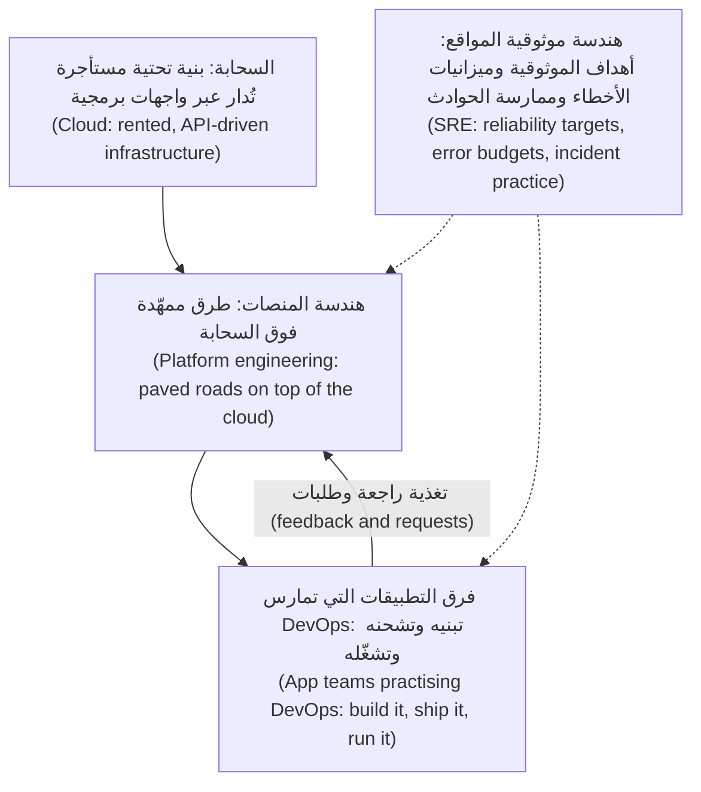
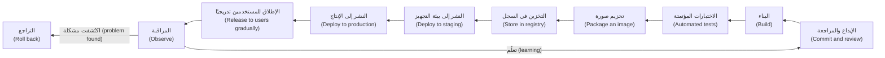

# الوحدة 0 — التوجيه

*قبل أن تلمس حاوية (container) أو عنقودًا (cluster)، تحتاج إلى خريطة. تمنحك هذه الوحدة ثلاثة أشياء. أولها المفردات: ما المعنى الفعلي لكل من "السحابة" و"DevOps" و"هندسة المنصات (platform engineering)" و"هندسة موثوقية المواقع (site reliability engineering)"، وكيف تتداخل، وما الذي يتحمّل كل منها مسؤوليته. وثانيها المسار الذي يقطعه كل تغيير من إيداع المطوّر إلى هاتف العميل، والمواضع على امتداد هذا المسار التي تنكسر فيها الأمور. فبعض هذه الأعطال كلّف شركات حقيقية مئات الملايين، أو أخرج جزءًا كبيرًا من الإنترنت عن الخدمة لساعات. وثالثها الأشخاص الذين ستعمل معهم طوال الدورة: فريق هندسة المنصات وهندسة موثوقية المواقع في بنك نجم (Najm Bank)، الذين ينقلون واجهة برمجة تطبيق نجم للهاتف (Najm Mobile API) وخدمة المدفوعات (payments service) من مركز بيانات إلى سحابة مُدارة، ويبنون منصة ستستخدمها فرق التطبيقات في البنك كل يوم. ستُنهي الوحدة ومعك مختبر محلي يعمل وخطة واضحة لطريقة الدراسة.*

> **المراحل:** Plan، Release، Deploy — خريطة حلقة التسليم الكاملة، والمفردات اللازمة للحديث عنها.

---

# 0.1 — ما هي السحابة وDevOps وهندسة المنصات وهندسة موثوقية المواقع (SRE)
*المستوى: 🟢 مبتدئ* · *المتطلبات: لا يوجد* · *المرحلة: Plan*

## ⚡ الدرس في دقيقة
- **السحابة** طريقة للحصول على الحوسبة: تستأجر الخوادم والتخزين والشبكات والخدمات المُدارة (managed services) عند الطلب، عبر واجهة برمجة تطبيقات (API)، وتدفع مقابل ما تستخدمه. إنها ليست "حاسوب شخص آخر" بقدر ما هي *أتمتة* شخص آخر.
- **DevOps** طريقة عمل: الأشخاص الذين يبنون البرمجيات يشاركون أيضًا في شحنها وتشغيلها، مدعومين بالأتمتة والتغذية الراجعة السريعة. إنها ثقافة ومجموعة ممارسات، وليست مسمّى وظيفيًا ولا أداة.
- **هندسة المنصات** تبني *منتجًا داخليًا*، هو منصة المطوّرين الداخلية (internal developer platform)، كي تتمكن فرق التطبيقات من الشحن بأمان دون أن تصبح خبيرة في كل ما يقع تحتها.
- **هندسة موثوقية المواقع (site reliability engineering, SRE)** تتعامل مع الموثوقية بوصفها مسألة هندسية بالأرقام: أهداف مستوى الخدمة، وميزانيات الأخطاء (error budgets)، وحدّ أقصى للعمل اليدوي المتكرر.
- إشارة القرار: عندما يقول أحدهم "نحتاج إلى DevOps"، اسأله أي مشكلة يقصد: إطلاقات بطيئة، أم إطلاقات غير آمنة، أم خدمات غير موثوقة، أم فرق تغرق في البنية التحتية. فكلٌّ منها يشير إلى علاج مختلف.
- الفخ الأكبر: إعادة تسمية فريق العمليات القديم إلى "DevOps"، وشراء أداة، وتوقّع أن يتغير أي شيء.

## 🧭 لماذا يهم
ينضم يوسف إلى فريق هندسة المنصات وهندسة موثوقية المواقع في بنك نجم مباشرةً بعد شهادته في هندسة الحاسوب. وفي أسبوعه الأول يسمع أربع كلمات تُستخدم كأنها تعني الشيء نفسه. تقول شريحة مدير تقنية المعلومات إن البنك "يتجه إلى السحابة". ويطلب فريق تطبيقات "مهندس DevOps" لإصلاح خط التسليم (pipeline) لديه. ويتحدث سالم، رئيس هندسة المنصات، عن "المنصة" كأنها منتج له عملاء. وترفض مها، قائدة هندسة موثوقية المواقع، الموافقة على إطلاق لأن "الخدمة ليس لها هدف مستوى خدمة".

يوم الخميس يُطلب من يوسف أن يمنح فريق واجهة برمجة تطبيق نجم للهاتف "صلاحية DevOps" على حساب السحابة الجديد، فيمنح كل مطوّر صلاحيات مدير كاملة. لا ينكسر شيء، لكن نورة، رئيسة أمن التطبيقات والذكاء الاصطناعي، تكتشف ذلك في مراجعة الصلاحيات التالية.

كان السبب الجذري (root cause) هو المفردات. فـ DevOps تعني المسؤولية المشتركة، لا صلاحيات المستخدم الخارق المشتركة، وفريق المنصة (platform team) يمنح فرق التطبيقات *طريقًا ممهّدًا آمنًا*، لا مفاتيح كل شيء. يمنحك هذا الدرس الكلمات.

## 📐 كيف يعمل

### 🟢 الأساسيات

**الحوسبة السحابية.** التعريف الأكثر استشهادًا يأتي من المعهد الوطني الأمريكي للمعايير والتقنية، في الوثيقة NIST SP 800-145 (2011). وهو يسرد خمس خصائص أساسية:

| الخاصية | بكلمات بسيطة | لماذا تغيّر طريقة عملك |
|---|---|---|
| الخدمة الذاتية عند الطلب (On-demand self-service) | تُنشئ خادمًا أو قاعدة بيانات بنفسك، في دقائق، دون تذكرة إلى إنسان | تصبح البنية التحتية شيئًا يمكن للشيفرة إنشاؤه (الوحدة 3) |
| الوصول الواسع عبر الشبكة | يُوصَل إلى كل شيء عبر الشبكة من خلال واجهات قياسية | لكل خدمة واجهة برمجة تطبيقات، لذا يمكن أتمتة كل شيء |
| تجميع الموارد (Resource pooling) | يتشارك المزوّد مجمّعات كبيرة من العتاد بين عملاء كثيرين | لا تختار الجهاز المادي؛ بل تختار منطقة ومنطقة توافر (1.2) |
| المرونة السريعة (Rapid elasticity) | يمكن للسعة أن تكبر وتصغر بسرعة، وأحيانًا تلقائيًا | يمكنك التوسّع مع الطلب بدل الشراء لتغطية الذروة (6.1) |
| الخدمة المقيسة (Measured service) | يُقاس الاستخدام ويُفوتر | تصبح التكلفة خاصية هندسية يمكنك رؤيتها وتغييرها (6.2) |

ويصف NIST أيضًا ثلاثة **نماذج خدمة**. في **IaaS** (البنية التحتية بوصفها خدمة) تستأجر أجهزة افتراضية (virtual machines) وأقراصًا وشبكات وتدير نظام التشغيل بنفسك. وفي **PaaS** (المنصة بوصفها خدمة) تسلّم شيفرتك أو حاويتك فيشغّلها المزوّد. وفي **SaaS** (البرمجيات بوصفها خدمة) تستخدم ببساطة تطبيقًا جاهزًا، مثل البريد الإلكتروني. ومنذ ذلك الحين أصبح نموذج **الحوسبة بلا خوادم (serverless)** شائعًا: تقدّم دوالًا أو حاويات (containers)، ويشغّلها المزوّد فقط عند وصول الطلبات، وتدفع مقابل الاستخدام. ويسرد NIST كذلك نماذج النشر: السحابة **العامة**، والسحابة **الخاصة** (الأتمتة نفسها داخل مركز بياناتك)، وسحابة **المجتمع** (تتشاركها مجموعة من المؤسسات)، والسحابة **الهجينة** (مزيج، مثل أعباء عمل نجم السحابية المتصلة بنظامها المصرفي الأساسي المحلي).

**DevOps.** نشأت الكلمة من مؤتمرات "DevOpsDays" التي بدأت عام 2009. لكن الفكرة التي تسمّيها أقدم من ذلك: الجدار بين "المطوّرين الذين يغيّرون الأشياء" و"أفراد العمليات الذين يحافظون على استقرار الأشياء" يسبب إطلاقات بطيئة ومؤلمة، لأن كل طرف يُقاس على الهدف المعاكس. يزيل DevOps هذا الجدار. فالفرق تملك خدمتها من الشيفرة إلى الإنتاج. وتؤتمت البناء والاختبار والنشر، وتقيس مدى جودة تسليم النظام بأكمله.

يأتي الدليل الأكثر استشهادًا على ما ينجح من برنامج أبحاث **DORA**، الملخَّص في كتاب *Accelerate* لنيكول فورسغرين وجيز هَمبل وجين كيم (2018). ولا تزال مقاييسه الأربعة الرئيسة نقطة الانطلاق القياسية:

| المقياس (Metric) | ما الذي يقيسه | النوع |
|---|---|---|
| تكرار النشر | كم مرة تشحن إلى الإنتاج | السرعة |
| مهلة التغييرات (Lead time for changes) | الوقت من الإيداع (commit) إلى تشغيل ذلك الإيداع في الإنتاج | السرعة |
| معدل فشل التغييرات (Change failure rate) | نسبة عمليات النشر (deployments) التي تسبب عطلًا يحتاج إلى إصلاح أو تراجع (rollback) | الاستقرار |
| زمن استعادة الخدمة (Time to restore service) | المدة اللازمة للتعافي عندما يتعطل الإنتاج | الاستقرار |

أنفع ما توصّل إليه البحث أن السرعة والاستقرار *ليسا* مقايضة. فالفرق الأفضل أداءً أسرع وأكثر استقرارًا في آنٍ واحد، لأن التغييرات الصغيرة المتكررة المؤتمتة أسهل في الاختبار، وأسهل في الفهم، وأسهل في التراجع عنها. وقد أضافت تقارير DORA اللاحقة مقياسًا للموثوقية وحسّنت بعض الأسماء والتعريفات؛ راجع dora.dev لمعرفة المجموعة الحالية وقت قراءتك هذا.

**هندسة موثوقية المواقع.** بدأت SRE في Google ووُصفت علنًا في كتاب *Site Reliability Engineering* (2016) وكتاب *The Site Reliability Workbook* (2018). أفكارها المحورية:
- **مؤشر مستوى الخدمة (service level indicator, SLI)** قياسٌ لما يختبره المستخدمون، مثل "نسبة طلبات واجهة برمجة التطبيقات التي تنجح في أقل من 300 ملّي ثانية".
- **هدف مستوى الخدمة (service level objective, SLO)** هو الهدف لذلك المؤشر عبر نافذة زمنية، مثل "99.9% على مدى 28 يومًا".
- **ميزانية الأخطاء (error budget)** هي ما يتبقى: 100% ناقص هدف مستوى الخدمة (SLO). إن كنت ضمن الميزانية، فاشحن. وإن استنفدتها، فأبطئ وأصلح الموثوقية. وهذا يحوّل الجدل بين "اشحن أسرع" و"كن حذرًا" إلى رقم متفق عليه مسبقًا (5.2).
- **العمل الرتيب (toil)** هو العمل اليدوي المتكرر الذي يكبر مع حجم الخدمة ولا يضيف قيمة دائمة، مثل إعادة تشغيل مهمة عالقة يدويًا كل ليلة. ويصف كتاب SRE من Google إبقاء العمل التشغيلي عند نصف وقت مهندس SRE تقريبًا على الأكثر، كي يذهب الباقي إلى التخلص منه هندسيًا.
- **مراجعات ما بعد الحادثة الخالية من اللوم (blameless postmortems)** تبحث عمّا في النظام سمح بوقوع الخطأ، لا عمّن يجب معاقبته (5.3).

**هندسة المنصات.** تبدو عبارة "أنت تبنيه، وأنت تشغّله" جيدة، لكن مطالبة كل فريق تطبيقات بإتقان Kubernetes والشبكات والهوية وخطوط التسليم (pipelines) وقابلية المراقبة (observability) والتكلفة عبءٌ معرفي مفرط. وهندسة المنصات هي الجواب عن ذلك. فيبني فريق المنصة **منصة المطوّرين الداخلية (internal developer platform, IDP)**: مجموعة من أدوات الخدمة الذاتية والقوالب والطرق الممهّدة (وتُسمّى غالبًا **المسارات الذهبية (golden paths)**) التي تجعل الطريق الآمن هو الطريق السهل. ويسمّي كتاب *Team Topologies* لماثيو سكلتون ومانويل باييس (2019) هذا "فريق منصة" يخدم فرق المنتجات "المحاذية للتدفق". وقد نشرت مؤسسة CNCF ورقة بيضاء تصف ما توفّره المنصات؛ راجع cncf.io للاطلاع على النسخة الحالية.

### 🟡 التعمق أكثر

**كيف تتكامل الأفكار الأربع.** إنها ليست متنافسة؛ بل تقع في طبقات مختلفة.



توفّر السحابة القدرة الخام. ويحوّلها فريق المنصة إلى عدد صغير من الخيارات الآمنة المدعومة. وتستخدم فرق التطبيقات هذه الخيارات لتسلّم كثيرًا وتملك خدماتها. أما ممارسات SRE فتمتد عبر الاثنين: فهي تقرر مدى الموثوقية التي تحتاجها كل خدمة، وتُلزم الجميع بها.

**من يفعل ماذا.** تختلف المسمّيات بين الشركات، لذا تعلّم *المسؤوليات*، لا التسميات (labels):

| الدور | السؤال الرئيس الذي يجيب عنه | العمل المعتاد |
|---|---|---|
| مهندس السحابة (Cloud engineer) | "كيف نستخدم خدمات المزوّد جيدًا وبأمان؟" | الحسابات، والشبكات، والهوية، والخدمات المُدارة، ومناطق الهبوط (landing zones) |
| مهندس DevOps (DevOps engineer) | "كيف تنتقل الشيفرة من الإيداع إلى الإنتاج بسرعة وأمان؟" | خطوط التسليم، وأدوات البناء، وأتمتة الإطلاق، والبيئات. وغالبًا مزيج من الصفوف الثلاثة الأخرى |
| مهندس المنصات (Platform engineer) | "ما الذي ينبغي أن يحصل عليه كل فريق مجانًا كي لا يعيد بناءه؟" | القوالب، ومنصة Kubernetes، وGitOps، وبوابة المطوّرين، والخدمة الذاتية |
| مهندس موثوقية المواقع (Site reliability engineer) | "هل الخدمة موثوقة بما يكفي، وكيف نعرف ذلك؟" | أهداف مستوى الخدمة (SLOs)، والتنبيه، والمناوبة (on-call)، والحوادث، والسعة، وإزالة العمل الرتيب |

في الشركة الصغيرة يؤدي شخص واحد الأدوار الأربعة. وفي بنك نجم هم أشخاص منفصلون يجلسون في فريق واحد.

**لماذا يكون "فريق DevOps" غالبًا نمطًا مضادًا.** إذا أنشأت شركة "فريق DevOps" يتلقى التذاكر من المطوّرين وينشر نيابةً عنهم، فقد أعادت بناء الجدار باسم جديد. والاختبار بسيط: هل يستطيع فريق التطبيقات شحن تغيير إلى الإنتاج، بأمان، دون تقديم تذكرة وانتظار شخص؟ إن لم يكن كذلك، فلديك تسليم يدوي بين فريقين، لا DevOps. ومهمة فريق المنصة هي إزالة هذا التسليم، لا أن يصبح هو التسليم.

**تطبيق العوامل الاثني عشر (The Twelve-Factor App).** منهجية قصيرة نشرها مهندسون في Heroku تصف خدمات تعمل جيدًا على المنصات السحابية: الإعدادات في البيئة لا في الشيفرة؛ والعمليات عديمة الحالة؛ وبدء التشغيل السريع والإيقاف الرشيق؛ والبناء والإطلاق والتشغيل بوصفها مراحل منفصلة. ستلتقي هذه الأفكار مجددًا في الوحدتين 2 و4.

### 🔴 نظرة الخبير

**قِس النتائج لا التبنّي.** عبارة "نقلنا 80 خدمة إلى Kubernetes" نشاطٌ. أما "انخفضت مهلة التغييرات (lead time) من ثلاثة أسابيع إلى يوم واحد، ولم يرتفع معدل فشل التغييرات" فهي نتيجة. يرفع سالم إلى مدير تقنية المعلومات (CIO) مقاييس DORA ومدى تحقيق أهداف مستوى الخدمة، لا أعداد الأدوات. والمنصة التي لا يستخدمها أحد طوعًا قد فشلت: تعامل معها بوصفها منتجًا له مستخدمون وخارطة طريق ومقاييس تبنٍّ.

**الموثوقية قرار منتج.** نسبة 100% هي الهدف الخطأ لكل شيء تقريبًا. فكل "تسعة" إضافية تكلّف أكثر، ولا يستطيع المستخدمون التمييز بين 99.99% و99.999% حين تتعطل شبكة هاتفهم المحمول نفسها أكثر من ذلك. فهدف مستوى الخدمة الصحيح يأتي مما يحتاجه المستخدمون: مرتفع لخدمة المدفوعات، وأدنى بكثير لأداة تقارير داخلية.

**التنظيم يشكّل المنصة.** بالنسبة إلى بنك، ليست السحابة مجرد خيار هندسي. فالجهات التنظيمية المالية في دول الخليج، ومنها مصرف قطر المركزي (Qatar Central Bank)، تنشر توقعاتها بشأن الإسناد الخارجي السحابي وإقامة البيانات (data residency) والمرونة. وفي الاتحاد الأوروبي (EU)، يضع قانون المرونة التشغيلية الرقمية (DORA، اللائحة 2022/2554، المطبَّقة اعتبارًا من يناير 2025) قواعد بشأن مخاطر تقنية المعلومات والاتصالات، والإبلاغ عن الحوادث، واختبار المرونة، ومخاطر الأطراف الثالثة (ومنها السحابة) للكيانات المالية. لاحظ تشابه الاسمين: *DORA* اللائحة الأوروبية و*DORA* برنامج أبحاث DevOps لا علاقة بينهما. تبقى هذه الدورة في الجانب الهندسي؛ أما القواعد فراجع [*أمن الذكاء الاصطناعي والتطبيقات*، الدرس 11.2 — التنظيم الذي يمسّ الأمن](../secai/index.ar.html#/11.2).

## 🧰 الأدوات
| الأداة أو الممارسة أو الخدمة | ما هي وماذا تفعل | متى تلجأ إليها |
|---|---|---|
| **DORA metrics** — مقاييس DORA | أربعة مقاييس لأداء التسليم: تكرار النشر، ومهلة التغييرات، ومعدل فشل التغييرات، وزمن استعادة الخدمة | تحديد خط أساس قبل أي تغيير، والإبلاغ عن التقدم بالنتائج لا بالأدوات |
| **Service level objective** — هدف مستوى الخدمة | هدف لقياس يواجه المستخدم عبر نافذة زمنية | تحديد مدى الموثوقية التي يجب أن تتمتع بها الخدمة، ومتى تُبطئ الإطلاقات |
| **Error budget** — ميزانية الأخطاء | مقدار عدم الموثوقية الذي يسمح به هدف مستوى الخدمة | حسم سؤال "نشحن أم نثبّت الاستقرار؟" برقم متفق عليه مسبقًا |
| **Internal developer platform** — منصة المطوّرين الداخلية | أدوات خدمة ذاتية وقوالب وطرق ممهّدة تستخدمها فرق التطبيقات لبناء الخدمات وتشغيلها | حين تكرر فرق كثيرة عمل البنية التحتية نفسه، أو يؤديه كل منها بطريقة مختلفة |
| **Backstage** — مفتوح المصدر، من CNCF | بوابة مطوّرين: فهرس البرمجيات والقوالب والتوثيق في مكان واحد | منح فرق التطبيقات بابًا أماميًا واحدًا إلى المنصة |
| **Twelve-Factor App** — تطبيق العوامل الاثني عشر | منهجية قصيرة لبناء خدمات تعمل جيدًا على المنصات السحابية | مراجعة ما إذا كانت الخدمة جاهزة للحوسبة في حاويات والتوسّع |
| **Well-Architected frameworks** — أطر البنية الجيدة | إرشادات الممارسات الجيدة المنظّمة لدى كل مزوّد، مرتّبة في ركائز | مراجعة تصميم مقابل قائمة تحقق قبل تشغيله فعليًا |

## 🏛️ عمليًا في بنك نجم
بعد حادثة "صلاحية DevOps"، يطلب سالم من يوسف صياغة **خريطة المسؤوليات** للفريق: صفحة واحدة تبيّن من يملك ماذا مع انتقال الخدمات إلى السحابة. وتُنشر على بوابة المطوّرين الداخلية.

**هندسة المنصات وهندسة موثوقية المواقع في نجم — خريطة المسؤوليات الإصدار 1 (v1)**

| المجال | يملكه فريق المنصة | تملكه فرق التطبيقات | تملكه هندسة موثوقية المواقع (مها) | الأمن (نورة) |
|---|---|---|---|---|
| حسابات السحابة والشبكات والهوية | منطقة الهبوط (landing zone)، وتخطيط الشبكة، والأدوار لكل فريق | طلب الأدوار التي تحتاجها خدمتها | — | تعتمد تصميم الأدوار، وتجري مراجعات الصلاحيات |
| عناقيد Kubernetes | دورة حياة العنقود، والترقيات، والإضافات المشتركة | مساحات أسمائها (namespaces)، وملفات التعريف (manifests)، وطلبات الموارد | مراجعات السعة | خط الأساس لسياسات العنقود |
| خطوط التسليم والمسارات الذهبية | القوالب، والمشغّلات المشتركة، وبنية مستودع GitOps | خط تسليم خدمتها، واختباراتها، وخيارات الإطلاق | بوابات الإطلاق المرتبطة بميزانيات الأخطاء | ضوابط سلسلة التوريد |
| قابلية المراقبة | منظومة القياس عن بُعد، وقوالب لوحات المتابعة | تجهيز شيفرتها بأدوات القياس، ولوحات متابعة الخدمة | تعريفات أهداف مستوى الخدمة مع فرق التطبيقات، ومعايير التنبيه | متطلبات التسجيل الأمني |
| المناوبة والحوادث | جدول مناوبة المنصة | جدول مناوبة الخدمة | عملية الحوادث، ومراجعات ما بعد الحادثة | تصعيد الحوادث الأمنية (جاسم) |
| التكلفة | لوحات متابعة التكلفة وقواعد الوسم | إنفاق خدمتها وتكلفة الوحدة | — | — |

**القواعد المصاحبة لها:**
- لا يحصل أحد على صلاحيات مدير دائمة في الإنتاج (production). فالصلاحيات المرفوعة محدودة زمنيًا، ومعتمدة، ومسجّلة (1.3).
- "صلاحية DevOps" ليست نوع طلب. فالطلبات تسمّي الإجراء والمورد: "النشر إلى مساحة الأسماء (namespace) `mobile-api` في بيئة التجهيز (staging)".
- يقيس فريق المنصة نجاحه بمقاييس DORA لفرق التطبيقات وبتبنّي المسارات الذهبية، ويرفعها إلى سالم شهريًا.
- تتلقى منى من الإدارة المالية لوحة متابعة التكلفة شهريًا، ولها جهة اتصال مسمّاة في كل فريق تطبيقات.

## 🛠️ التمارين
- 🟢 اكتب تعريفًا من فقرة واحدة، بكلماتك الخاصة، للسحابة وDevOps وهندسة المنصات وهندسة موثوقية المواقع، ثم جملة واحدة عن علاقة كل منها بالبقية. ضمّنه خصائص السحابة الخمس لدى NIST ومقاييس DORA الأربعة. *يكتمل عندما:* يستطيع صديق لا يعمل في التقنية قراءته وأن يشرح لك بدوره الفرق بين DevOps وSRE.
- 🟡 ابحث عن خمسة إعلانات وظائف حقيقية لأدوار السحابة أو DevOps أو المنصات أو SRE في منطقتك، وطابق مسؤوليات كل منها مع جدول "من يفعل ماذا". *يكتمل عندما:* يُظهر جدولٌ أيّ الأدوار الأربعة يطلبه كل إعلان فعلًا، مع جملة واحدة عمّا فاجأك.
- 🔴 خذ مشروعًا تملكه وله سجل git (مشروعًا شخصيًا أو مستودعًا عامًا مفتوح المصدر). قدّر مقاييس DORA الخاصة به للأشهر الثلاثة الأخيرة: تكرار النشر أو الإطلاق من الوسوم (tags) أو الإصدارات، ومهلة التغييرات من تاريخ الإيداع إلى تاريخ الإطلاق، ومعدل فشل التغييرات من عمليات الإرجاع أو إصدارات الإصلاح العاجل، وزمن الاستعادة (time to restore) من الفجوة بين إطلاق سيئ والإصلاح أو الإرجاع الذي تلاه (استخدم الطوابع الزمنية للمشكلات إن توفرت لديك). *يكتمل عندما:* تكون لديك الأرقام الأربعة، والأوامر أو الاستعلامات التي استخدمتها للحصول عليها، وملاحظة عن الرقم الذي كان أصعب في القياس بأمانة ولماذا.

## ⚠️ أخطاء وفخاخ
- **إعادة تسمية العمليات إلى "DevOps".** طابور التذاكر باسم جديد يظل تسليمًا يدويًا بين فريقين. قِس ما إذا كانت الفرق تستطيع الشحن دون انتظار شخص.
- **التعامل مع DevOps بوصفه شراء أداة.** لا توجد أداة تصلح نموذج ملكية معطوبًا. ابدأ بمن يملك ماذا، ثم أتمت.
- **بناء منصة لم يطلبها أحد.** تحدّث إلى فرق التطبيقات أولًا. المنصة منتج؛ وإذا تجنّبتها الفرق فقد فشلت.
- **مساواة "صلاحية DevOps" بصلاحيات المدير.** المسؤولية المشتركة لا تعني مستخدمًا خارقًا مشتركًا. امنح صلاحيات محددة ومحدودة زمنيًا.

## 🧾 الخلاصة
- السحابة بنية تحتية عند الطلب، تُدار عبر واجهات برمجة التطبيقات، ومقيسة؛ وخصائصها الخمس لدى NIST تفسّر لماذا تصبح الأتمتة والتكلفة شأنين هندسيين.
- DevOps هو الملكية المشتركة مضافًا إليها الأتمتة، ويُقاس بمقاييس DORA الأربعة؛ والسرعة والاستقرار يتحسّنان معًا.
- تجعل SRE الموثوقية رقمًا: مؤشرات مستوى الخدمة (SLIs) وأهداف مستوى الخدمة وميزانيات الأخطاء، إضافة إلى سقف للعمل الرتيب ومراجعات ما بعد الحادثة الخالية من اللوم.
- تبني هندسة المنصات منتجًا داخليًا، هو الطريق الممهّد، كي تتحرك فرق التطبيقات بسرعة دون إتقان كل طبقة.
- تعلّم المسؤوليات لا المسمّيات. فالسؤال دائمًا: "من يملك هذا، وهل يستطيع التصرف دون انتظار؟"

## ✍️ اختبر نفسك

**1. يطلب فريق تطبيقات في بنك نجم من يوسف "صلاحية DevOps" كي ينشر تغييراته بنفسه. ما أفضل استجابة؟**

- A. منح كل مطوّر في الفريق صلاحيات مدير على حساب السحابة، لأن DevOps يعني المسؤولية المشتركة، ولأن ذلك أسرع من انتظار فريق آخر
- B. سؤالهم عن الإجراءات التي يحتاجونها وعلى أي موارد، ومنح دور محدد مثل النشر إلى مساحة أسمائهم الخاصة في بيئة التجهيز
- C. الرفض، لأن فريق المنصة وحده يحق له النشر
- D. إنشاء طابور تذاكر كي ينشر فريق المنصة نيابةً عنهم

<details><summary>الإجابة</summary>

**B.** يعني DevOps أن الفرق تستطيع الشحن دون تسليم يدوي بين فريقين، ولكن بصلاحيات محددة وفق مبدأ أقل الصلاحيات. أما A فيخلط بين الملكية المشتركة وصلاحيات المستخدم الخارق المشتركة. وC وD يعيدان بناء الجدار بين البناء والتشغيل. (🟡 التعمق أكثر؛ 🏛️ عمليًا.)

</details>

**2. أيٌّ مما يلي ليس (NOT) أحد مقاييس DORA الأربعة الرئيسة؟**

- A. تكرار النشر إلى الإنتاج
- B. مهلة التغييرات من الإيداع إلى الإنتاج
- C. معدل فشل التغييرات بعد النشر
- D. عدد الخوادم المُدارة لكل مهندس

<details><summary>الإجابة</summary>

**D.** المقاييس الأربعة الرئيسة هي تكرار النشر، ومهلة التغييرات (lead time for changes)، ومعدل فشل التغييرات (change failure rate)، وزمن استعادة الخدمة (time to restore service). أما عدد الخوادم لكل مهندس فيقيس النشاط، لا نتائج التسليم. (🟢 الأساسيات.)

</details>

**3. لخدمة المدفوعات هدف مستوى خدمة قدره 99.95% من التحويلات الناجحة على مدى 28 يومًا. وفي منتصف النافذة، استهلكت الحوادث كامل ميزانية الأخطاء تقريبًا. بماذا توحي ممارسة SRE؟**

- A. إبطاء إطلاقات الميزات الخطرة وتوجيه الجهد إلى الموثوقية حتى تتعافى الميزانية
- B. رفع هدف مستوى الخدمة إلى 99.99% كي يأخذ الفريق الموثوقية بجدية أكبر
- C. المضيّ كما هو مخطط والنظر مجددًا عند إعادة ضبط نافذة الـ 28 يومًا
- D. خفض هدف مستوى الخدمة بهدوء كي تبدو الميزانية المتبقية سليمة مجددًا، ويُغلق النقاش دون مراجعة أحد

<details><summary>الإجابة</summary>

**A.** ميزانية الأخطاء (error budget) هي الإشارة المتفق عليها لسؤال "نشحن أم نثبّت الاستقرار". وحين تُستنفد، يأخذ عمل الموثوقية الأولوية. أما B فيزيد المشكلة سوءًا؛ وD يُبطل الغاية من الاتفاق على الهدف مسبقًا. (🟢 الأساسيات.)

</details>

**4. أنشأت شركة "فريق DevOps" يتلقى التذاكر من المطوّرين ويشغّل عمليات النشر الخاصة بهم يدويًا. ما المشكلة الرئيسة؟**

- A. الفريق أصغر من أن يتعامل مع حجم التذاكر الذي سيتلقاه
- B. يجب إعادة تسمية الفريق إلى "SRE" كي يتضح غرضه للجميع
- C. لقد أعاد بناء التسليم اليدوي بين البناء والتشغيل الذي يزيله DevOps
- D. في البنك، يجب أن تتم عمليات النشر يدويًا كي يتحقق شخص من كل واحدة منها

<details><summary>الإجابة</summary>

**C.** اختبار DevOps هو ما إذا كان الفريق يستطيع الشحن بأمان دون انتظار شخص آخر. وطابور التذاكر تسليم يدوي، أيًّا كان اسمه. أما A فيعالج العَرَض؛ وB يغيّر التسمية فقط؛ وD خاطئ، لأن الأتمتة تجعل عمليات النشر أكثر أمانًا وأكثر قابلية للتدقيق. (🟡 التعمق أكثر.)

</details>

**5. يريد سالم أن يُثبت لمدير تقنية المعلومات أن منصة المطوّرين الداخلية الجديدة تعمل. أي دليل هو الأقوى؟**

- A. قائمة بكل أداة تتضمنها المنصة الآن، مع حالة الترخيص والدعم لكل منها
- B. مهلة التغييرات ومعدل الفشل لفرق التطبيقات قبل تبنّي المسارات الذهبية وبعده، والتبنّي الطوعي
- C. عدد عناقيد Kubernetes ومساحات الأسماء التي تعمل الآن، مقارنة بالربع الماضي، وعدد الفرق التي طلبت الوصول إليها
- D. نمو فريق المنصة وعدد التذاكر التي أغلقها هذا الربع

<details><summary>الإجابة</summary>

**B.** المنصة منتج؛ وهي تنجح حين يحقق مستخدموها نتائج أفضل ويختارون استخدامها. أما A وC وD فتقيس المدخلات والنشاط. (🔴 نظرة الخبير.)

</details>

## 📚 المراجع
- NIST SP 800-145، تعريف NIST للحوسبة السحابية — https://csrc.nist.gov/pubs/sp/800/145/final
- برنامج أبحاث DORA — https://dora.dev/
- Google، كتابا Site Reliability Engineering وThe Site Reliability Workbook (متاحان مجانًا على الإنترنت) — https://sre.google/books/
- CNCF، الورقة البيضاء عن المنصات — https://www.cncf.io/
- توثيق Backstage — https://backstage.io/docs/
- تطبيق العوامل الاثني عشر — https://12factor.net/
- إطار AWS للبنية الجيدة — https://aws.amazon.com/architecture/well-architected/
- إطار Microsoft Azure للبنية الجيدة — https://learn.microsoft.com/azure/well-architected/
- إطار Google Cloud للبنية الجيدة (المعروف سابقًا بإطار Google Cloud المعماري) — https://cloud.google.com/architecture/framework
- اللائحة 2022/2554 (قانون المرونة التشغيلية الرقمية) — https://eur-lex.europa.eu/eli/reg/2022/2554/oj

---

# 0.2 — المسار إلى الإنتاج: من الإيداع إلى العميل، وكل ما قد ينكسر في الطريق
*المستوى: 🟢 مبتدئ* · *المتطلبات: 0.1* · *المرحلة: Release, Deploy*

## ⚡ الدرس في دقيقة
- كل تغيير يقطع **المسار إلى الإنتاج** نفسه: الإيداع، والبناء، والاختبار، والتحزيم، والتخزين، والنشر، والإطلاق للمستخدمين، والمراقبة. وكل خطوة إما تلتقط المشكلات وإما تسمح بمرورها.
- القاعدة الأهم: **ابنِ مرة واحدة، ورقِّ الأثر البرمجي نفسه**. فالشيء الذي اختبرته يجب أن يكون، بايتًا ببايت، هو الشيء الذي تشغّله في الإنتاج.
- **النشر** (وضع الشيفرة الجديدة على الخوادم) و**الإطلاق** (السماح للمستخدمين بالوصول إليها) خطوتان مختلفتان. والفصل بينهما أساس الطرح الآمن.
- إشارة القرار: قبل شحن أي شيء، اسأل: "إن كان هذا خاطئًا، فكم مستخدمًا سيراه، وبأي سرعة سنعرف، وبأي سرعة نستطيع التراجع؟"
- الفخ الأكبر: خطوات تُنفَّذ يدويًا، وبطريقة مختلفة في كل مرة. فمعظم الانقطاعات الشهيرة تعود إلى خطوة يدوية، أو فحص مُتخطّى، أو تغيير وصل إلى الجميع دفعة واحدة.

## 🧭 لماذا يهم
في 1 أغسطس 2012، نشرت شركة Knight Capital، وهي شركة تداول أمريكية كبيرة، شيفرة تداول جديدة على خوادمها. ووفقًا لأمر هيئة الأوراق المالية والبورصات الأمريكية الصادر عام 2013، نُسخت الشيفرة الجديدة يدويًا إلى الخوادم، وفات أحدُ الخوادم الثمانية. وكان ذلك الخادم لا يزال يحمل شيفرة قديمة غير مستخدمة. فأعاد علمٌ أعادت الشيفرة الجديدة استخدامه تشغيلَ الشيفرة القديمة. وفي نحو 45 دقيقة أرسلت الشركة ملايين الأوامر غير المقصودة وخسرت أكثر من 460 مليون دولار أمريكي. لم يكن هناك نشر مؤتمت، ولا فحص يتأكد من أن جميع الخوادم تشغّل الإصدار نفسه، ولا طريقة سريعة للإيقاف.

وبعد اثني عشر عامًا، في 19 يوليو 2024، دفعت CrowdStrike تحديث محتوى معيبًا لمستشعرها الأمني Falcon. فأسقط أجهزة Windows التي تلقّته؛ وقدّرت Microsoft لاحقًا أن نحو 8.5 مليون جهاز تأثّر بذلك. وتوقفت شركات طيران ومستشفيات وبنوك. والتزمت مراجعة CrowdStrike الخاصة بطرح مرحلي لمثل هذه التحديثات، كي يصل التغيير السيئ إلى مجموعة صغيرة أولًا.

يستخدم سالم الحالتين في يوم يوسف الأول. "كانت كلتاهما إخفاقًا في *المسار إلى الإنتاج*: خطوة يدوية سارت على نحو خاطئ، وتغيير أُرسل إلى الجميع دفعة واحدة." يرسم هذا الدرس خريطة ذلك المسار؛ وكل وحدة لاحقة تقرّب العدسة على جزء منه.

## 📐 كيف يعمل

### 🟢 الأساسيات

**المراحل.** أيًّا كانت الأدوات، يمرّ التغيير على واجهة برمجة تطبيق نجم للهاتف بهذه الخطوات:



| المرحلة | ما الذي يحدث | ما الذي ينبغي أن تلتقطه | أين تغطيها هذه الدورة |
|---|---|---|---|
| الإيداع والمراجعة | يدفع مطوّر تغييرًا؛ ويراجعه زميل في طلب سحب (pull request) | الأخطاء المنطقية، والتغييرات الخطرة، والاختبارات المفقودة | 4.1 |
| البناء | تُصرَّف الشيفرة وتُجلب الاعتماديات | الشيفرة التي لا تُصرَّف؛ والاعتماديات المعطوبة | 4.1 |
| الاختبارات المؤتمتة | تعمل اختبارات الوحدة والتكامل وغيرها | التراجعات الوظيفية، والعقود المكسورة | 4.1 |
| التحزيم | تُحزَّم الخدمة في صورة حاوية (container image) | الصور التي لا تبدأ؛ والصور المتضخمة أو غير الآمنة | 2.1 |
| التخزين | تُدفع الصورة إلى سجل (registry) بمعرّف فريد | العبث، والارتباك بشأن "أي إصدار هذا؟" | 2.1، 4.3 |
| النشر | تُطرح الصورة في بيئة بواسطة الأتمتة | أخطاء الإعدادات، وفشل بدء التشغيل، وفحوص الصحة السيئة | 2.2، 3.2 |
| الإطلاق | يُمنح المستخدمون الإصدار الجديد تدريجيًا | المشكلات التي لا تُظهرها إلا الحركة الحقيقية | 4.2 |
| المراقبة | يُظهر القياس عن بُعد (telemetry) ما إذا كان المستخدمون يُخدَمون جيدًا | الأخطاء، والبطء، واستهلاك هدف مستوى الخدمة | 5.1، 5.2 |

**خط التسليم** هو الأتمتة التي تشغّل هذه الخطوات. و**التكامل المستمر (continuous integration, CI)** يعني أن الجميع يدمجون تغييرات صغيرة في الفرع الرئيس كثيرًا، وأن كل دمج يُبنى ويُختبر تلقائيًا. و**التسليم المستمر (continuous delivery, CD)** يعني أن كل تغيير يجتاز الفحوص جاهز للنشر بضغطة زر. أما **النشر المستمر (continuous deployment)** فيخطو خطوة أبعد: كل تغيير ناجح يُنشر تلقائيًا.

**ابنِ مرة واحدة، ورقِّ الأثر البرمجي نفسه.** **الأثر البرمجي (artefact)** هو مخرَج البناء، وهو عندنا عادةً صورة حاوية. ابنِه مرة واحدة، وامنحه هوية فريدة (تجزئة الإيداع في وسمه (tag)، وبصمة محتواه)، وانقل الصورة *نفسها* من بيئة التجهيز إلى الإنتاج. فإن أعدت البناء للإنتاج، فأنت تشحن شيئًا لم تختبره قط: فقد تكون إحدى الاعتماديات قد تغيّرت، وقد يختلف أحد خيارات البناء.

خط تسليم بسيط في GitHub Actions يختبر الشيفرة ويبني صورة واحدة موسومة بإيداعها:

```yaml
# .github/workflows/ci.yml — a starting point, hardened in Module 4
name: ci
on:
  pull_request:
  push:
    branches: [main]
permissions:
  contents: read          # least privilege: this job only reads the code
jobs:
  test-and-build:
    runs-on: ubuntu-latest
    steps:
      - uses: actions/checkout@v4   # in production pipelines, pin to a full commit SHA (4.3)
      - name: Run tests
        run: make test          # replace with your project's test command
      - name: Build one image, named after the commit
        run: docker build -t najm-mobile-api:${{ github.sha }} .
```

**البيئات.** تمرّ التغييرات عبر سلسلة من **البيئات**: نسخ منفصلة من النظام. ومن المجموعات الشائعة: التطوير، والتجهيز (أقرب ما يمكن إلى الإنتاج)، والإنتاج. وينبغي ألا تختلف البيئات إلا في الإعدادات (عناوين قواعد البيانات، والأحجام، وأعلام الميزات)، ولا تختلف أبدًا في الشيفرة. ويُبيّن الدرس 3.2 كيف تُرقّى التغييرات بينها باستخدام GitOps.

**النشر ليس إطلاقًا.** أن *تنشر* يعني أن تضع الإصدار الجديد على الخوادم. وأن *تطلق* يعني أن تسمح للمستخدمين بالوصول إليه. يمكنك نشر شيفرة فيها ميزة جديدة مُطفأة بواسطة **علم ميزة (feature flag)**، ثم تشغيلها لـ 1% من المستخدمين. ويمكنك نشر إصدار جديد بجانب القديم وإرسال 5% من الحركة إليه، وهذا هو **الكناري (canary)**. والفصل بين الخطوتين يعني أن التغيير السيئ يصل إلى قلة من المستخدمين، لا إليهم جميعًا. وهذا بالضبط درس تحديث CrowdStrike.

### 🟡 التعمق أكثر

**ما الذي ينكسر، مرحلة بمرحلة.** كل انقطاع علني يعلّمنا شيئًا عن مرحلة واحدة. وإليك حالات موثّقة جيدًا، مع الضابط الذي كان سيحدّ من كل منها:

| الحالة | ما الذي حدث (التقارير العلنية) | المرحلة التي فشلت | الضابط |
|---|---|---|---|
| Knight Capital، 2012 | فات النشرُ اليدوي خادمًا من ثمانية؛ فأُعيد تفعيل الشيفرة القديمة | النشر | عمليات نشر مؤتمتة ومتطابقة؛ وفحوص الإصدار على كل خادم؛ ومفتاح إيقاف طارئ (kill switch) |
| AWS S3، us-east-1، فبراير 2017 | أثناء تصحيح الأخطاء، كُتب أمرٌ مُعدّ لإزالة عدد صغير من الخوادم بشكل خاطئ فأزال عددًا أكبر بكثير | التشغيل | أدوات تحدّ من مقدار ما يستطيع أمر واحد إزالته، ومن سرعة ذلك |
| GitLab.com، يناير 2017 | حذف مهندس دليل قاعدة بيانات إنتاجية عن طريق الخطأ؛ وتبيّن أن عدة طرق نسخ احتياطي لا تعمل؛ وفُقدت ساعات من البيانات | التشغيل والتعافي (Operate, Recover) | استعادات مُختبرة، لا مجرد نسخ احتياطية؛ وفصل واضح لطرفيات الإنتاج |
| Facebook، أكتوبر 2021 | فصل أمرُ صيانة الشبكة الأساسية؛ ثم سحبت خوادم DNS مساراتها؛ وتوقفت الخدمات والأدوات الداخلية لساعات | النشر والتشغيل (Deploy, Operate) | أدوات تدقيق تمنع التغييرات الخطرة؛ ووصول خارج النطاق للتعافي |
| CrowdStrike، يوليو 2024 | ذهب تحديث محتوى معيب إلى جميع مستشعرات Windows دفعة واحدة فأسقطها | الإطلاق | طرح مرحلي إلى مجموعة صغيرة أولًا؛ وإيقاف تلقائي عند الأخطاء |

يبرز نمطان. معظمها كان أفعالًا بشرية عادية لم يحمِ المسارُ منها، لا أخطاء برمجية غريبة. وجاء الضرر من *نطاق الأثر (blast radius)* (عدد المستخدمين الذين يمكن أن يصلهم تغيير واحد) ومن *زمن الاكتشاف والتراجع*. والهندسة الجيدة تقلّص كليهما.

**الأسئلة الثلاثة لكل مرحلة.** لكل مرحلة في مسارك، اسأل:
1. **ما الذي قد يسوء هنا؟** اختبار فاشل، أو اعتمادية مصابة بثغرة، أو قيمة إعدادات خاطئة، أو خادم لم يصله التحديث قط.
2. **ما الذي يلتقطه تلقائيًا؟** اختبار، أو فحص، أو فحص صحة، أو مقياس كناري، أو تنبيه.
3. **كيف نتراجع عنه، وكم يستغرق ذلك؟** إرجاع الإيداع، أو إعادة نشر الصورة السابقة، أو إطفاء علم الميزة، أو الاستعادة من النسخة الاحتياطية.

إن كان جواب السؤال 2 هو "شخصٌ يتذكر أن ينظر"، فتلك هي مهمة الأتمتة التالية لديك.

**التراجع خير من تصحيح الأخطاء في الإنتاج.** حين يسوء إطلاق، استعِد الخدمة أولًا. ومع صورة غير قابلة للتغيير، يعني التراجع إعادة نشر الصورة السابقة، وهو أمر يستغرق دقائق. ابحث عن السبب الجذري بعد ذلك، والمستخدمون في أمان. ولهذا فإن مقياس DORA هو "زمن *استعادة* الخدمة"، لا "زمن الإصلاح".

**ليس كل تغيير شيفرة.** فالإعدادات، والبنية التحتية، وتغييرات المخطط، وتبديل الأعلام، وتحديثات محتوى أدوات الأمن تصل إلى الإنتاج أيضًا، وعددٌ من الانقطاعات أعلاه لم يكن نشرًا لتطبيقات أصلًا. تعامل مع *كل* تغيير في الإنتاج بالطريقة نفسها: مُراجَعًا، ومُصدَّرًا بإصدار، ومؤتمتًا، ومرحليًا، وقابلًا للتراجع.

### 🔴 نظرة الخبير

**مهلة التغييرات خريطةٌ لانتظارك.** حين قاس نجم مهلة التغييرات لواجهة الهاتف في مركز البيانات، كان معظمها انتظارًا: لمجلس اعتماد التغييرات، أو لنافذة إطلاق، أو لشخص يشغّل نصًا برمجيًا. فالمهلة الأقصر تأتي دائمًا تقريبًا من إزالة الطوابير والتسليمات اليدوية، لا من حواسيب أسرع. ارسم خريطة المواضع التي *ينتظر* فيها التغيير، لا فقط المواضع التي *يعمل* فيها.

**الدفعات الصغيرة إجراء أمان.** يصعب تشخيص إطلاق فاشل يحوي 200 تغيير؛ أما إطلاق فاشل يحوي تغييرًا واحدًا فيشير مباشرة إلى سببه. وتبدو عمليات النشر الصغيرة المتكررة خطرة، لكن أبحاث DORA وجدت أن الفرق التي تنشر أكثر تفشل أيضًا أقل وتتعافى أسرع.

**ضبط التغيير في بنك خاضع للتنظيم.** استخدمت البنوك تقليديًا مجالس استشارية للتغيير تعتمد كل إطلاق يدويًا. لكن خط تسليم مبنيًّا جيدًا يستطيع أن يقدّم دليلًا *أفضل* من اجتماع: طلب سحب مُراجَع، ونتائج الاختبارات، وأثرًا برمجيًا موقّعًا، وسجل نشر مؤتمتًا لكل تغيير. فالمدققون يحتاجون إلى أن تكون التغييرات مضبوطة ومُختبرة وقابلة للتتبّع (traceable). واستراتيجية سالم هي أن يجعل خط التسليم ينتج ذلك الدليل، كي تتدفق التغييرات منخفضة المخاطر دون مجلس، بينما تظل التغييرات عالية المخاطر تحظى بمراجعة بشرية.

**الأمن يسير في المسار نفسه.** كل مرحلة هي أيضًا موضع يستطيع فيه مهاجم إدخال شيء ما: اعتمادية خبيثة وقت البناء، أو صورة مُبدَّلة في السجل، أو بيانات اعتماد مسروقة في خط التسليم. يؤمّن الدرس 4.3 خط التسليم؛ وللصورة الكاملة لسلسلة التوريد، راجع [*أمن الذكاء الاصطناعي والتطبيقات*، الدرس 6.2 — سلسلة توريد البرمجيات: الاعتماديات وقوائم مكونات البرمجيات وSLSA والتوقيع](../secai/index.ar.html#/6.2). وللرحلة نفسها مرويّةً لمن يبنون باستخدام وكلاء الذكاء الاصطناعي ولا يكتبون الشيفرة يدويًا، راجع [*تصميم الأنظمة لمبرمجي الفايب*، الدرس 4.1 — الشحن منظومة](../vibe/index.ar.html#l4-1).

## 🧰 الأدوات
| الأداة أو الممارسة أو الخدمة | ما هي وماذا تفعل | متى تلجأ إليها |
|---|---|---|
| **GitHub Actions** — خدمة CI/CD من GitHub | خدمة تكامل وتسليم مستمرين (CI/CD) مدمجة في GitHub تشغّل سير عمل عند أحداث مثل الدفع أو طلب السحب | أتمتة البناء والاختبار والتحزيم للشيفرة المستضافة على GitHub؛ وGitLab CI وJenkins بديلان شائعان |
| **Build once, promote** — ابنِ مرة واحدة ورقِّ | ممارسة بناء أثر برمجي واحد غير قابل للتغيير ونقل هذا الأثر نفسه عبر كل بيئة | دائمًا؛ فإعادة البناء لكل بيئة تشحن شيفرة غير مُختبرة |
| **Container registry** — سجل الحاويات | مخزن لصور الحاويات (container images)، لكل منها وسم وبصمة محتوى | الاحتفاظ بالأثر البرمجي الواحد الذي تنشره كل بيئة |
| **Feature flag** — علم الميزة | مفتاح وقت التشغيل يشغّل ميزة أو يطفئها دون عملية نشر | فصل النشر عن الإطلاق؛ و"إطفاء" فوري لميزة سيئة |
| **Canary release** — الإطلاق الكناري | إرسال حصة صغيرة من الحركة إلى إصدار جديد ومقارنته بالقديم | أي تغيير قد تكسره الحركة الحقيقية؛ ويُغطّى بالكامل في 4.2 |
| **Rollback** — التراجع | إعادة الإنتاج إلى آخر إصدار معروف بأنه سليم، عادةً بإعادة نشر الأثر البرمجي السابق | الاستجابة الأولى لإطلاق سيئ: استعِد الخدمة، ثم حقّق |

## 🏛️ عمليًا في بنك نجم
يطلب سالم من يوسف إعداد **خريطة المسار إلى الإنتاج** لواجهة برمجة تطبيق نجم للهاتف، كما تعمل اليوم في مركز البيانات وكما ينبغي أن تعمل بعد الانتقال إلى السحابة. وتصبح هذه الخريطة قائمة الأعمال المتراكمة لعملية الترحيل بأكملها.

**واجهة برمجة تطبيق نجم للهاتف — خريطة المسار إلى الإنتاج (الحالة المستهدفة، الإصدار 1)**

| المرحلة | ما الذي قد يسوء | الالتقاط المؤتمت | التراجع | المالك |
|---|---|---|---|---|
| الإيداع والمراجعة | تغيير غير مُراجَع أو خطر | حماية الفرع: موافقة واحدة، واثنتان للشيفرة المتعلقة بالمدفوعات | إرجاع الإيداع | فريق التطبيقات |
| البناء والاختبار | تراجع وظيفي، أو اعتمادية معطوبة | اختبارات الوحدة والتكامل؛ وفحص الاعتماديات | حجب طلب السحب | فريق التطبيقات |
| التحزيم | الصورة تختلف عمّا اختُبر؛ أو تعمل بصلاحيات الجذر | صورة واحدة لكل إيداع، موسومة بتجزئة الإيداع؛ وفحص عدم التشغيل بصلاحيات الجذر | التخلص من الصورة؛ والإصلاح وإعادة البناء عبر خط التسليم كاملًا | المسار الذهبي للمنصة |
| التخزين | صورة خاطئة أو عُبث بها | يحتفظ السجل بالبصمات؛ والصورة موقّعة (4.3) | النشر ببصمة آخر صورة سليمة | المنصة |
| النشر إلى التجهيز | خطأ في الإعدادات؛ أو فشل الصورة في البدء | مسابير الصحة (health probes)؛ واختبارات الدخان | تراجع تلقائي عن الطرح | GitOps لدى المنصة |
| النشر إلى الإنتاج | مثل التجهيز، لكن على نطاق واسع | بصمة الصورة نفسها كما في التجهيز؛ وتحديث متدرّج (rolling update) مع فحوص الصحة | إعادة نشر البصمة السابقة (الهدف: أقل من 10 دقائق) | فريق التطبيقات مع المنصة |
| الإطلاق | خلل لا تُظهره إلا الحركة الحقيقية | كناري بنسبة 5%، يُقارن على معدل الأخطاء وزمن الاستجابة (latency) | إعادة توجيه الحركة إلى الإصدار السابق؛ وإطفاء العلم | فريق التطبيقات |
| المراقبة | المستخدمون يتضررون دون أن يلاحظ أحد | تنبيهات معدل استهلاك هدف مستوى الخدمة (5.2) | عملية الحوادث (5.3) | هندسة موثوقية المواقع، مها |

**مقاييس DORA الأساسية** (يملأ الفريق الأرقام الحقيقية للربع الماضي؛ وتُحدَّد الأهداف مع مها):

| المقياس | اليوم | الهدف بعد الترحيل |
|---|---|---|
| تكرار النشر | ___ | ___ |
| مهلة التغييرات | ___ | ___ |
| معدل فشل التغييرات | ___ | ___ |
| زمن استعادة الخدمة | ___ | ___ |

**قاعدة أُضيفت إلى معيار الفريق:** أي مرحلة يقول عمود "الالتقاط المؤتمت" فيها "شخص يتحقق" هي بند في قائمة الأعمال المتراكمة له مالك وتاريخ.

## 🛠️ التمارين
- 🟢 اختر موقعًا إلكترونيًا تستخدمه. شغّل `dig +short example.com` و`curl -sI https://example.com` (مع النطاق الحقيقي) ودوّن عناوين IP، وحالة HTTP، والترويسات مثل `cache-control`. ثم اكتب المراحل الخمس التي سيمرّ بها تغيير قبل أن يظهر على ذلك الموقع. *يكتمل عندما:* يكون المخرَج محفوظًا، وتسمّي كل مرحلة من مراحلك الخمس شيئًا واحدًا قد يسوء.
- 🟡 ارسم خريطة المسار إلى الإنتاج لمشروع خاص بك (أو لمشروع صغير مفتوح المصدر تعرفه)، مستخدمًا الأعمدة نفسها في خريطة نجم. *يكتمل عندما:* يكون لكل مرحلة "التقاط مؤتمت" و"تراجع"، وتكون قد علّمت بلون مختلف كل موضع يكون فيه الجواب حاليًا "شخص يتذكر".
- 🔴 في مستودع عام على حسابك الخاص في GitHub، أنشئ خدمة ويب صغيرة جدًا فيها اختبار واحد وملف Dockerfile، وأضف سير عمل التكامل المستمر من هذا الدرس. ادفع تغييرًا يكسر الاختبار وتأكد من أن خط التسليم يفشل. ثم أصلحه، ودع خط التسليم يبني الصورة، وابنِ الإيداع نفسه وشغّله محليًا باستخدام `docker run`. *يكتمل عندما:* تستطيع أن تُظهر تشغيلًا فاشلًا، وتشغيلًا ناجحًا، ووسم الصورة (image tag) مطابقًا لتجزئة الإيداع الذي نجح.

## ⚠️ أخطاء وفخاخ
- **إعادة البناء لكل بيئة.** ينتهي بك الأمر إلى شحن شيفرة لم تختبرها قط. ابنِ مرة واحدة ورقِّ الصورة نفسها، المعرَّفة ببصمتها.
- **خطوات الإنتاج اليدوية.** كل أمر يُشغَّل يدويًا فرصةٌ لتكرار الخادم المنسيّ لدى Knight Capital. أتمته، أو على الأقل اكتبه نصًا برمجيًا وراجع النص.
- **الإطلاق للجميع دفعة واحدة.** عندها يصل التغيير السيئ إلى كل مستخدم قبل أن يلاحظ أحد. افصل النشر عن الإطلاق واطرح تدريجيًا.
- **اعتبار تغييرات الإعدادات والبنية التحتية "ليست نشرًا".** عدة انقطاعات شهيرة نتجت عن هذه بالضبط. مرّر كل تغيير في الإنتاج عبر المسار نفسه.
- **نسخ احتياطية لم يستعِدها أحد.** أظهرت حادثة GitLab عام 2017 نسخًا احتياطية لم تكن تعمل بصمت. لا تُحتسب النسخة الاحتياطية إلا بعد اختبار الاستعادة (6.1).

## 🧾 الخلاصة
- يقطع كل تغيير مراحل الإيداع، والبناء، والاختبار، والتحزيم، والتخزين، والنشر، والإطلاق، والمراقبة؛ ويجب على كل مرحلة أن تلتقط شيئًا وأن تكون قابلة للتراجع.
- ابنِ مرة واحدة ورقِّ الأثر البرمجي نفسه غير القابل للتغيير؛ ولا تُعِد البناء للإنتاج أبدًا.
- النشر والإطلاق مختلفان؛ والفصل بينهما باستخدام الكناري (canaries) وأعلام الميزات (feature flags) يقلّص نطاق الأثر.
- معظم الانقطاعات الشهيرة كانت إخفاقات في المسار: خطوة يدوية، أو فحص مفقود، أو تغيير أُرسل إلى الجميع دفعة واحدة.
- استعِد أولًا وحقّق لاحقًا؛ والتغييرات الصغيرة المتكررة أكثر أمانًا من الكبيرة النادرة.

## ✍️ اختبر نفسك

**1. يقترح يوسف بناء صورة واجهة برمجة تطبيق نجم للهاتف مجددًا للإنتاج، "كي تلتقط أحدث التصحيحات الأمنية"، بعد اختبار بناء مختلف في بيئة التجهيز. ما المشكلة؟**

- A. تستغرق عمليات البناء للإنتاج وقتًا أطول بسبب فحوص إضافية، فيفوت الفريق نافذة الإطلاق المحددة
- B. يرفض السجل صورة ثانية مبنية من الإيداع نفسه
- C. سيشغّل الإنتاج صورة لم تُختبر قط؛ وينبغي أن تمرّ التصحيحات عبر خط التسليم كاملًا
- D. لا مشكلة، ما دامت الصورتان مبنيتين من تجزئة الإيداع نفسها

<details><summary>الإجابة</summary>

**C.** قد تجلب إعادة البناء إصدارات اعتماديات مختلفة أو تستخدم إعدادات مختلفة، فيختلف الأثر البرمجي المُختبر عن الأثر البرمجي المشحون. وD هو المُشتِّت المغري: فالإيداع نفسه لا يضمن الصورة نفسها. وينبغي أن تتدفق التصحيحات عبر خط التسليم بأكمله. (🟢 الأساسيات.)

</details>

**2. ما الفرق بين النشر والإطلاق؟**

- A. النشر يضع الإصدار الجديد على الخوادم؛ والإطلاق يسمح للمستخدمين بالوصول إليه
- B. هما اسمان للخطوة نفسها، تستخدمهما أدوات مختلفة، ولا فرق بينهما في أي مؤسسة أو أي أداة
- C. الإطلاق هو اجتماع الموافقة الذي يجب أن يُعقد قبل النشر
- D. النشر يخص شيفرة التطبيق؛ والإطلاق يخص البنية التحتية التي تعمل عليها

<details><summary>الإجابة</summary>

**A.** يمكن أن يكون الإطلاق تدريجيًا (كناري) أو يُبدَّل بعلم ميزة (feature flag). والفصل بين الاثنين يتيح لك النشر بأمان، ثم تعريض التغيير لحصة صغيرة من المستخدمين أولًا. (🟢 الأساسيات.)

</details>

**3. وفقًا لأمر هيئة الأوراق المالية والبورصات الأمريكية، أي إخفاق كان في صميم خسائر Knight Capital عام 2012؟**

- A. انقطاع طويل لدى مزوّد الاستضافة ترك الأوامر عالقة في طابور ولم تعد الشركة إلى العمل حتى الصباح
- B. قاعدة بيانات إنتاجية حُذفت عن طريق الخطأ، مع نسخ احتياطية لم تكن تعمل
- C. تحديث معيب لمستشعر أمني أُرسل إلى جميع أجهزتها دفعة واحدة
- D. نشر يدوي فات خادمًا واحدًا، حيث أيقظ علمٌ أُعيد استخدامه الشيفرة القديمة

<details><summary>الإجابة</summary>

**D.** نُسخت الشيفرة الجديدة يدويًا وفات خادم من ثمانية. أما B فيصف GitLab عام 2017، وC يصف CrowdStrike عام 2024. (🧭 لماذا يهم؛ 🟡 التعمق أكثر.)

</details>

**4. يرفع إصدار جديد من واجهة برمجة تطبيق نجم للهاتف معدلَ الأخطاء بحدة بعد عشر دقائق من الطرح (rollout). يريد طارق أن يجد الخلل قبل فعل أي شيء. بماذا ينبغي أن تنصح مها؟**

- A. إبقاء الإطلاق قيد التشغيل كي يتمكن الفريق من إعادة إنتاج الخلل بالحركة الحقيقية
- B. التراجع إلى الصورة السابقة لاستعادة الخدمة، ثم إيجاد السبب الجذري
- C. كتابة إصلاح سريع ونشره مباشرة إلى الإنتاج، مع تخطّي الاختبارات
- D. إعادة تشغيل جميع الخوادم في العنقود ومراقبة ما إذا كانت الأخطاء ستختفي

<details><summary>الإجابة</summary>

**B.** الهدف الأول هو استعادة الخدمة؛ ومع الصور غير القابلة للتغيير، تستغرق إعادة نشر الإصدار السابق دقائق. أما A فيُبقي المستخدمين على إطلاق معطوب؛ وC يتخطى الفحوص ذاتها التي تحمي المستخدمين؛ وD يخفي العَرَض دون إزالة الإصدار السيئ. (🟡 التعمق أكثر.)

</details>

**5. يقيس نجم مهلة تغييرات قدرها ثلاثة أسابيع لواجهة الهاتف. ويستغرق البناء والاختبار نحو 40 دقيقة. ما الطريقة الأرجح لتقليص مهلة التغييرات؟**

- A. شراء خوادم بناء أسرع كي يتقلص تشغيل البناء والاختبار الذي يستغرق 40 دقيقة
- B. حذف أبطأ الاختبارات كي تصل التغييرات إلى بيئة التجهيز أسرع
- C. إزالة الطوابير التي تنتظر فيها التغييرات، مع الإبقاء على دليل الضبط
- D. النشر بتكرار أقل، في دفعات أكبر، لتقليل عدد الموافقات

<details><summary>الإجابة</summary>

**C.** حين يستغرق العمل دقائق بينما تبلغ مهلة التغييرات أسابيع، يكون الوقت مُنفَقًا في الانتظار. والموافقات اليدوية ونوافذ الإطلاق طوابير نموذجية. أما A فيسرّع خطوة ليست هي عنق الزجاجة؛ وB يُضعف الأمان مقابل مكسب ضئيل؛ وD يزيد المخاطر. (🔴 نظرة الخبير.)

</details>

## 📚 المراجع
- هيئة الأوراق المالية والبورصات الأمريكية (US SEC)، In the Matter of Knight Capital Americas LLC (2013) — https://www.sec.gov/litigation/admin/2013/34-70694.pdf
- AWS، ملخص انقطاع خدمة Amazon S3 في منطقة فرجينيا الشمالية (Summary of the Amazon S3 Service Disruption in the Northern Virginia (US-EAST-1) Region) — https://aws.amazon.com/message/41926/
- GitLab، مراجعة ما بعد حادثة انقطاع قاعدة البيانات في 31 يناير — https://about.gitlab.com/blog/
- Meta Engineering، مزيد من التفاصيل عن انقطاع 4 أكتوبر — https://engineering.fb.com/
- CrowdStrike، مركز المعالجة والإرشاد بشأن تحديث محتوى Falcon — https://www.crowdstrike.com/
- برنامج أبحاث DORA — https://dora.dev/
- توثيق GitHub Actions — https://docs.github.com/actions
- تطبيق العوامل الاثني عشر — https://12factor.net/

---

# 0.3 — تعرّف على فريق المنصة في بنك نجم، وكيف تستخدم هذه الدورة
*المستوى: 🟢 مبتدئ* · *المتطلبات: 0.1، 0.2* · *المرحلة: Plan*

## ⚡ الدرس في دقيقة
- **بنك نجم** بنك خليجي متوسط الحجم خيالي يعمل في قطر والإمارات والاتحاد الأوروبي. ستتابع فريق **هندسة المنصات وهندسة موثوقية المواقع** فيه عبر ترحيل سحابي بملامح واقعية.
- يشغّل الفريق خمسة أنظمة ستلقاها في كل وحدة: **واجهة برمجة تطبيق نجم للهاتف**، و**خدمة المدفوعات**، و**نجم أسيست (Najm Assist)** (مساعد قائم على نموذج لغوي كبير)، و**منصة المطوّرين الداخلية**، ونظام **الخدمات المصرفية الأساسية في مركز البيانات** الذي يبقى محليًا (on-premises).
- لكل درس الأجزاء العشرة نفسها، ويتدرج من 🟢 الأساسيات إلى 🔴 نظرة الخبير، وينتج **أثرًا** قابلًا لإعادة الاستخدام.
- تتدرّب على **مختبر محلي**: Docker، وعنقود Kubernetes محلي (kind أو k3d أو minikube)، وOpenTofu أو Terraform، وGit، وGitHub Actions. لا شيء في هذه الدورة يتطلب الدفع لمزوّد سحابي.
- إشارة القرار: إن استخدمت فئة مجانية سحابية، **فاضبط تنبيه ميزانية (budget alert) قبل أن تُنشئ أي شيء**.
- الفخ الأكبر: القراءة دون تطبيق. فمهارات العمليات تعيش في يديك، لا في ملاحظاتك.

## 🧭 لماذا يهم
وظّف سالم خرّيجَين كل عام خلال السنوات الثلاث الماضية. والذين تعثّروا لم يكونوا أضعف المبرمجين. بل كانوا الذين قرأوا كل وثيقة ولم يكسروا شيئًا عن قصد. لم يروا قط حجيرة (pod) تدخل في حلقة انهيار متكرر (crash-loop)، ولا خطة Terraform تريد تدمير قاعدة بيانات، ولا تنبيهًا انطلق في الثالثة فجرًا بلا سبب. أما الذين ازدهروا فكان لديهم مختبر في المنزل ارتكبوا فيه تلك الأخطاء بتكلفة زهيدة.

هكذا تعمل هذه الدورة. ستلقى الأشخاص والأنظمة والمشكلات أنفسها في كل درس. وستنتج آثارًا (artefacts) يحتفظ بها فريق منصة حقيقي. وستشغّل كل تمرين على جهازك الخاص أو على فئة مجانية (free tier)، كي تقع الأخطاء المكلفة في مختبرك لا في الإنتاج. يعرّفك هذا الدرس بالفريق والأنظمة، ويشرح كيف بُنيت الدورة، ويُشغّل مختبرك.

## 📐 كيف يعمل

### 🟢 الأساسيات

**بنك نجم، ولماذا بنك.** بنك نجم خيالي. وهو البنك نفسه المستخدم في الدورات الأخرى لهذه المكتبة، لذا تروي دورات الأمن والحوكمة والمنتج كلها أجزاءً من قصة واحدة. والبنك حالة تعليمية جيدة لأن المخاطر واضحة. فالعملاء يتوقعون أن يعمل التطبيق في كل الأوقات؛ والتحويل يجب ألا يضيع أبدًا ولا يُرسل مرتين؛ والجهات التنظيمية تتوقع دليلًا على أن الأنظمة مضبوطة وقابلة للاستعادة. فإن استطعت تشغيل الأنظمة جيدًا لبنك، فإنك تستطيع تشغيلها جيدًا في أي مكان تقريبًا.

**الوضع.** يشغّل نجم معظم أنظمته في مركز بياناته الخاص. وهو ينقل الخدمات التي تواجه العملاء إلى سحابة عامة مُدارة، بينما يبقى نظام الخدمات المصرفية الأساسية محليًا ومتصلًا عبر روابط خاصة: أي إعداد **هجين**. وفي الوقت نفسه، يبني فريق سالم **منصة المطوّرين الداخلية** كي تتمكن فرق التطبيقات في البنك من الشحن دون أن يصبح كل منها خبيرًا في البنية التحتية.

**الأنظمة.**

| النظام | ما هو | لماذا يهم في هذه الدورة |
|---|---|---|
| **واجهة برمجة تطبيق نجم للهاتف** | واجهة برمجة التطبيقات العامة خلف تطبيق الخدمات المصرفية للأفراد. حاويات على خدمة Kubernetes مُدارة، وقاعدة بيانات PostgreSQL مُدارة، وتخزين كائنات (object storage)، وشبكة توصيل محتوى (CDN) وجدار حماية لتطبيقات الويب (web application firewall, WAF) على الحافة | المثال الرئيس للحاويات، وKubernetes، والإطلاقات، وقابلية المراقبة |
| **خدمة المدفوعات** | تنقل أموال العملاء. يجب ألا تُضيّع تحويلًا ولا تكرّره؛ ولها أهداف صارمة لوقت التشغيل والتعافي | المثال لأهداف مستوى الخدمة، والإطلاقات الآمنة، والنسخ الاحتياطي، والتعافي من الكوارث (disaster recovery) |
| **نجم أسيست** | مساعد البنك القائم على نموذج لغوي كبير. تُوجّه **بوابة النماذج اللغوية (LLM gateway)** الطلبات إلى واجهات نماذج مستضافة وإلى نموذج صغير مستضاف ذاتيًا على وحدات معالجة الرسوميات (GPUs) | المثال لأعباء عمل الذكاء الاصطناعي، وسعة وحدات معالجة الرسوميات، وتكلفة الرموز |
| **منصة المطوّرين الداخلية** | قوالب المسار الذهبي، وخطوط التسليم CI/CD (CI/CD pipelines)، ومستودع GitOps، ومنظومة قابلية المراقبة، ولوحات متابعة التكلفة | ما يبنيه فريق المنصة ويشغّله بوصفه منتجًا |
| **الخدمات المصرفية الأساسية (محليًا) (Core banking)** | نظام السجلات القديم الذي يبقى في مركز البيانات | المثال للشبكات الهجينة والاعتماديات التي لا تستطيع تغييرها |

**الأشخاص.**

| الشخص | الدور | ما الذي يهمه |
|---|---|---|
| **سالم (Salem)** | رئيس هندسة المنصات؛ مرشدك | النتائج لا الأدوات؛ ومنصة تريد فرق التطبيقات استخدامها فعلًا |
| **يوسف (Yousef)** | مهندس منصات حديث التخرج؛ زميلك | التعلّم بسرعة. يرتكب الأخطاء التي ينبغي أن تتجنبها |
| **مها (Maha)** | قائدة هندسة موثوقية المواقع | أهداف مستوى الخدمة، ومناوبة يستطيع الناس الاستمرار فيها، والحوادث ومراجعات ما بعد الحادثة (postmortems) |
| **طارق (Tariq)** | القائد الهندسي لفرق التطبيقات | شحن الميزات بسرعة دون الاستيقاظ ليلًا |
| **نورة (Noura)** | رئيسة أمن التطبيقات والذكاء الاصطناعي | أقل الصلاحيات (least privilege)، وسلسلة التوريد (supply chain)، وإعدادات السحابة |
| **جاسم (Jassim)** | قائد مركز العمليات الأمنية والاستجابة للحوادث | اكتشاف الحوادث الأمنية والاستجابة لها |
| **حمد (Hamad)** | الرئيس التنفيذي لأمن المعلومات (CISO) | المخاطر على البنك، والجهات التنظيمية، والأدلة |
| **منى (Mona)** | محللة FinOps في الإدارة المالية | كم تكلّف السحابة، ومن ينفق، وهل يستحق الأمر ذلك |

قد تعرف بالفعل طارق ونورة وجاسم وحمد من دورة *أمن الذكاء الاصطناعي والتطبيقات*. وهنا ترى الأحداث نفسها من جانب المنصة.

**كيف بُني كل درس.** لكل درس الأجزاء العشرة نفسها، بالترتيب نفسه: ⚡ الدرس في دقيقة، و🧭 لماذا يهم، و📐 كيف يعمل، و🧰 الأدوات، و🏛️ عمليًا في بنك نجم، و🛠️ التمارين، و⚠️ أخطاء وفخاخ، و🧾 الخلاصة، و✍️ اختبر نفسك، و📚 المراجع. ويتسلّق قسم "كيف يعمل" سُلّمًا: 🟢 *الأساسيات* (ما يحتاجه الجميع)، و🟡 *التعمق أكثر* (ما يحتاجه الممارس)، و🔴 *نظرة الخبير* (ما يزنه المهندس الأول). ويحمل كل درس **وسم مرحلة** من حلقة التسليم التي قُدّمت في الدرس 0.2: Plan أو Code أو Build أو Test أو Release أو Deploy أو Operate أو Monitor.

### 🟡 التعمق أكثر

**المسار عبر الدورة.**

| المرحلة | الوحدات | ما الذي ستستطيع فعله |
|---|---|---|
| 🟢 الأسس | 0 التوجيه، 1 الأسس | شرح المسار إلى الإنتاج؛ والعمل في Linux والشبكات؛ والتفكير المنهجي في الخدمات السحابية والهوية |
| 🟡 الممارس | 2 الحاويات وKubernetes، 3 البنية التحتية بوصفها شيفرة (Infrastructure as code)، 4 التكامل والتسليم المستمران والإطلاقات الآمنة، 5 قابلية المراقبة والموثوقية | وضع الخدمات في حاويات (containerise) وتشغيلها على Kubernetes، وإدارة البنية التحتية بوصفها شيفرة وGitOps، وبناء خطوط التسليم والإطلاقات الآمنة، وضبط أهداف مستوى الخدمة والتنبيهات وممارسة الحوادث |
| 🔴 البطل | 6 التوسّع والتكلفة والبنية التحتية للذكاء الاصطناعي، 7 المشروع الختامي والامتحان التدريبي | توسيع الأنظمة واستعادتها، وضبط التكلفة، وتشغيل أعباء عمل الذكاء الاصطناعي، ونقل خدمة من مستودع فارغ إلى الإنتاج، وخوض امتحان تدريبي من 60 سؤالًا |

**ثلاث طرق للدراسة.**
- **من البداية إلى النهاية.** الأفضل إن كنت جديدًا. فكل وحدة تبني على التي قبلها؛ والمتطلبات المسبقة للدروس مدرجة تحت كل عنوان.
- **حسب الدور.** تستهدف هندسة موثوقية المواقع؟ أعطِ الأولوية للوحدات 1 و2 و5 والدرس 6.1. هندسة المنصات؟ الوحدات 2 و3 و4، ثم المشروع الختامي. هندسة السحابة؟ الوحدة 1، والوحدة 3، والدرسان 6.1 و6.2. واقرأ مع ذلك الوحدة 0 وقسم ⚡ في كل درس.
- **حسب المشكلة.** تواجه مشكلة حقيقية في العمل، مثل التنبيهات المزعجة أو فاتورة سحابية مفاجئة؟ انتقل إلى الدرس، واقرأ أثر قسم 🏛️، ثم عُد لسدّ الثغرات.

**مختبرك.** تحتاج إلى حاسوب يستطيع تشغيل Docker (ذاكرة 8 GB حدٌّ أدنى مريح لعنقود Kubernetes محلي صغير؛ راجع متطلبات كل أداة الخاصة) وإلى هذه الأدوات المجانية:

| الأداة | فيمَ تستخدمها | أول استخدام في |
|---|---|---|
| Git وحساب GitHub | التحكم في الإصدارات، وطلبات السحب (pull requests)، وGitHub Actions | 0.2 |
| Docker | بناء الحاويات وتشغيلها | 2.1 |
| kind أو k3d أو minikube | عنقود Kubernetes على جهازك الخاص | 2.2 |
| kubectl وHelm | التخاطب مع Kubernetes؛ وتثبيت التطبيقات المحزّمة | 2.2، 2.3 |
| OpenTofu أو Terraform | البنية التحتية بوصفها شيفرة | 3.1 |
| Prometheus وGrafana وOpenTelemetry | القياس عن بُعد ولوحات المتابعة، مثبّتة في عنقودك المحلي | 5.1 |
| Argo CD | عمليات نشر GitOps في عنقودك المحلي | 3.2 |

ثبّت كلًّا منها من موقعه الرسمي؛ فخطوات التثبيت تتغير، لذا اتبع التوثيق الحالي بدل نسخ الأوامر من تدوينة قديمة. وحين تُثبَّت، تحقق منها:

```bash
# Check your lab tools. Each should print a version, not an error.
git --version
docker version
kind version          # or: k3d version / minikube version
kubectl version --client
helm version
tofu version          # or: terraform version
```

ثم أنشئ أول عنقود محلي لك وألقِ نظرة عليه:

```bash
# Create a local Kubernetes cluster called najm-lab, look at it, then delete it
kind create cluster --name najm-lab
kubectl get nodes
kubectl get pods --all-namespaces
kind delete cluster --name najm-lab
```

إذا أظهر `kubectl get nodes` عقدة واحدة بالحالة `Ready`، فمختبرك يعمل.

**حسابات السحابة، بأمان.** معظم التمارين لا تلمس سحابة حقيقية أبدًا. وقليل من التمارين الاختيارية يستخدم الفئة المجانية لدى أحد المزوّدين. قبل أن تُنشئ أي مورد في أي حساب سحابي:
1. استخدم حسابًا يخصّك أنت. ولا تتدرّب أبدًا على حساب صاحب العمل دون إذن كتابي.
2. فعّل المصادقة متعددة العوامل للمستخدم الرئيس للحساب (الجذر)، وأدِّ عملك اليومي بوصفك مستخدمًا منفصلًا أقل صلاحيات (1.3).
3. أنشئ **تنبيه ميزانية** عند مبلغ صغير كي تتلقى بريدًا إلكترونيًا قبل أن يتضخم الإنفاق. فللفئات المجانية (free tiers) حدود تختلف باختلاف المزوّد وتتغير مع الوقت؛ اقرأ صفحة الفئة المجانية الحالية لدى المزوّد بدل الاعتماد على هذه الدورة.
4. احذف ما تُنشئه عند انتهاء التمرين.

### 🔴 نظرة الخبير

**الآثار هي ملف أعمالك.** قسم 🏛️ في كل درس وثيقة حقيقية: خريطة مسؤوليات، أو ملف Dockerfile مُقوّى، أو واجهة وحدة بنية تحتية بوصفها شيفرة، أو قائمة تحقق للإطلاق، أو هدف مستوى خدمة، أو دليل تشغيل للحوادث، أو مراجعة ما بعد الحادثة (postmortem)، أو تقرير تكلفة. وإن أعدت بناء كل منها لمشروع مختبرك الخاص واحتفظت بها في مستودع عام، فستُنهي الدورة ومعك ملف أعمال يُظهر كيف تفكر، لا فقط أي الأدوات سمعت بها. يحوّله الدرس 7.2 إلى طلبات توظيف؛ أما البحث عن العمل نفسه فراجع [*من التخرج إلى التوظيف*، الدرس 2.4 — مهندس السحابة والمنصات وDevOps والأمن](../career/index.ar.html#/2.4) (تلك الدورة قيد الكتابة الآن).

**استخدم الدورات المرافقة.** تبقى هذه الدورة في قرار العمليات. وحيث تتعمق دورة أخرى في المكتبة أكثر، يشير إليها الدرس في سطر واحد:
- أمن السحابة والحاويات وخطوط التسليم: [*أمن الذكاء الاصطناعي والتطبيقات*، الدرس 7.1 — أمن السحابة: المسؤولية المشتركة وإدارة الهوية والوصول والإعدادات الخاطئة](../secai/index.ar.html#/7.1).
- النشر والبيئات من جانب باني البرمجيات بوصفها خدمة: [*لبنات بناء SaaS*، الدرس 7.4 — النشر والبيئات وSaaS القابلة للاستضافة الذاتية](../saas/index.ar.html#/7.4).
- كيف تنتقل البرمجيات، مشروحًا لمن يبنون باستخدام وكلاء الذكاء الاصطناعي: [*تصميم الأنظمة لمبرمجي الفايب*، الدرس F.3 — الإصدارات والمستودعات وعمليات النشر](../vibe/index.ar.html#lF-3).
- تشغيل وكلاء الذكاء الاصطناعي في الإنتاج: [*تشغيل وكلاء الذكاء الاصطناعي في الإنتاج*، المستوى 3 — مهندس الإنتاج (Level 3 — Production Engineer)](../agentic/learning-path.ar.html#level-3-production-engineer).

**كن صادقًا بشأن ما يتغير.** الخدمات السحابية، وإصدارات الأدوات، والأسعار، وحدود الفئات المجانية تتغير باستمرار. لا تذكر هذه الدورة الإصدارات إلا حيث تكون متأكدة، وتقول "وقت كتابة هذه السطور (2026)" حيث تتحرك الأمور، ولا تقتبس أبدًا سعرًا أو حصة (quota). وحين تعمل، افعل الشيء نفسه. فعادة المهندس الأول هي مراجعة التوثيق الحالي للمزوّد قبل الاعتماد على رقم.

## 🧰 الأدوات
| الأداة أو الممارسة أو الخدمة | ما هي وماذا تفعل | متى تلجأ إليها |
|---|---|---|
| **Docker** — منصة الحاويات | تبني الحاويات وتشغّلها على جهازك | من الوحدة 2 فصاعدًا، وفي تمرين الدرس 0.2 |
| **kind** — Kubernetes داخل Docker | تشغّل عنقود Kubernetes داخل حاويات Docker؛ وk3d وminikube بديلان | أي تمرين على Kubernetes، دون الدفع مقابل عنقود سحابي |
| **OpenTofu** — من Linux Foundation | أداة مفتوحة المصدر للبنية التحتية بوصفها شيفرة، متفرعة من Terraform؛ وTerraform من HashiCorp تُستخدم بالطريقة نفسها | الوحدة 3 والمشروع الختامي |
| **GitHub Actions** — سير عمل CI/CD | سير عمل للتكامل والتسليم المستمرين (CI/CD workflows) يعمل عند الدفع وطلبات السحب | خطوط تسليم مختبرك من الدرس 0.2 إلى المشروع الختامي |
| **Budget alert** — تنبيه الميزانية | إعداد لدى المزوّد يُخطرك حين يتجاوز الإنفاق مبلغًا تختاره | قبل إنشاء أي شيء في أي حساب سحابي |
| **Lab journal** — دفتر المختبر | مستودع (repository) تحتفظ فيه بالأوامر والمخرجات والأخطاء والآثار من كل درس | كل درس؛ ويصبح ملف أعمالك |

## 🏛️ عمليًا في بنك نجم
يُكمل كل منضمّ جديد إلى فريق سالم **قائمة التحقق للتهيئة** في أول أسبوعين. وهذه نسخة يوسف كما ملأها:

**هندسة المنصات وهندسة موثوقية المواقع في نجم — قائمة التحقق لتهيئة المنضمّ الجديد**

| البند | يكتمل عندما | المالك |
|---|---|---|
| قراءة خريطة المسؤوليات (الدرس 0.1) | تستطيع أن تقول من يملك العناقيد (clusters) وخطوط التسليم وأهداف مستوى الخدمة والتكلفة | المنضمّ الجديد |
| قراءة خريطة المسار إلى الإنتاج لواجهة الهاتف (الدرس 0.2) | تستطيع تسمية طريقة التراجع لكل مرحلة | المنضمّ الجديد |
| جاهزية المختبر | تطبع جميع أدوات المختبر إصداراتها؛ ويبلغ عنقود kind محلي الحالة `Ready` | المنضمّ الجديد |
| طلب الصلاحيات | أدوار مسمّاة لبيئة التجهيز فقط؛ ولا صلاحية على الإنتاج في الشهر الأول | المنضمّ الجديد، باعتماد سالم |
| المناوبة الظلّية | أسبوع واحد في مرافقة جدول مناوبة مها، دون جهاز استدعاء خاص بك | مها |
| التغيير الأول | طلب سحب صغير واحد إلى قوالب المسار الذهبي، يُدمج عبر خط التسليم المعتاد | المنضمّ الجديد، بمراجعة مهندس منصات |
| التعرّف على الجيران | 30 دقيقة مع كل من طارق (فرق التطبيقات) ونورة (الأمن) ومنى (FinOps) | المنضمّ الجديد |
| بطاقات الخدمات | بطاقة من صفحة واحدة لكل نظام من الأنظمة الخمسة: الغرض، والمالك، والاعتماديات، وهدف مستوى الخدمة (أو "لم يُحدَّد بعد") | المنضمّ الجديد |

**قالب بطاقة الخدمة** (الذي كتبه يوسف لخدمة المدفوعات):

| الحقل | القيمة |
|---|---|
| الخدمة | خدمة المدفوعات |
| الفريق المالك | فرقة المدفوعات (Payments squad) (ضمن نطاق طارق)؛ مع دعم المنصة من فريق سالم |
| الغرض | تقبل تحويلات العملاء وتتحقق منها وتنفّذها |
| تعتمد على | الخدمات المصرفية الأساسية (محليًا، عبر رابط خاص)، وقاعدة بيانات PostgreSQL مُدارة، وطابور رسائل |
| تستخدمها | واجهة برمجة تطبيق نجم للهاتف |
| يجب ألا | تُضيّع تحويلًا ولا تنفّذه مرتين |
| هدف مستوى الخدمة | مسودة مع مها (الوحدة 5) |
| أهداف التعافي | RTO وRPO قيد الاتفاق (6.1) |
| دليل التشغيل (Runbook) | رابط (سيُكتب لاحقًا) |

## 🛠️ التمارين
- 🟢 ثبّت أدوات المختبر وشغّل فحص الإصدارات من هذا الدرس. *يكتمل عندما:* يطبع كل أمر إصدارًا، وتكون قد حفظت المخرَج في ملف اسمه `lab-check.txt` في مستودع Git جديد سيكون دفتر مختبرك.
- 🟡 أنشئ عنقود kind محليًا، وشغّل `kubectl get nodes` و`kubectl get pods --all-namespaces`، ودوّن الغرض من كل حجيرة نظام تراها (ابحث عنها في توثيق Kubernetes). ثم احذف العنقود. *يكتمل عندما:* يحوي دفتر مختبرك المخرجات وشرحًا من سطر واحد لكل حجيرة نظام، ولا يُظهر `kind get clusters` شيئًا متبقيًا قيد التشغيل. وإن فتحت أيضًا حساب فئة مجانية سحابية، فإن شرط *الاكتمال* يشمل تنبيه ميزانية اختبرته بقراءة إعداداته مجددًا.
- 🔴 اكتب بطاقة خدمة، مستخدمًا قالب نجم، لخدمة حقيقية تستخدمها أو تصونها (مشروعًا شخصيًا، أو نظامًا جامعيًا تعرفه جيدًا، أو نشرًا تجريبيًا لمشروع مفتوح المصدر). ثم اكتب خطة دراسة شخصية: أي مسار عبر الدورة (من البداية إلى النهاية، أو حسب الدور، أو حسب المشكلة)، وأي الدروس وبأي ترتيب، وكم ساعة في الأسبوع. *يكتمل عندما:* لا تحوي بطاقة الخدمة حقولًا فارغة (استخدم "غير معروف" بأمانة حيث يلزم)، وتسرد الخطة كل درس ستؤديه مع أسبوع مستهدف.

## ⚠️ أخطاء وفخاخ
- **القراءة دون تطبيق.** لا يمكنك أن تتعلم تصحيح حجيرة في حلقة انهيار متكرر من فقرة. أدِّ كل تمرين، واكسر الأشياء عن قصد.
- **التدرّب على حساب صاحب العمل.** هذا محفوف بالمخاطر وقد يخالف السياسة. استخدم مختبرك المحلي الخاص أو حساب الفئة المجانية الخاص بك.
- **غياب تنبيه الميزانية.** قد يظل مورد منسيّ يعمل لأسابيع. اضبط التنبيه أولًا، واحذف ما تُنشئه.
- **نسخ أوامر التثبيت من تدوينات قديمة.** الأدوات تتغير. ثبّت من التوثيق الرسمي.
- **تخطّي الوحدتين 0 و1 لأن "أعرف Linux".** تفترض الوحدات اللاحقة المفردات والعادات من هنا. تصفّحهما على الأقل، وأدِّ تمارين 🔴.
- **عدم الاحتفاظ بملاحظات.** بعد ستة أشهر لن تتذكر كيف أصلحت المشكلة. احتفظ بدفتر مختبر في Git.

## 🧾 الخلاصة
- بنك نجم خيالي؛ وفريق هندسة المنصات وهندسة موثوقية المواقع فيه، وأنظمته الخمسة، وشخصياته تمتد عبر كل درس.
- لكل درس عشرة أجزاء، ويتدرج من 🟢 إلى 🔴، ويحمل وسم مرحلة، وينتج أثرًا قابلًا لإعادة الاستخدام.
- مختبرك محلي ومجاني: Git، وDocker، وkind أو ما يشبهه، وkubectl، وHelm، وOpenTofu أو Terraform، وGitHub Actions.
- لا تستخدم إلا حساباتك الخاصة، واضبط تنبيه ميزانية قبل إنشاء أي شيء، واحذف ما تُنشئه.
- احتفظ بدفتر مختبر؛ فآثارك تصبح ملف أعمالك.

## ✍️ اختبر نفسك

**1. أي أنظمة نجم هو المثال الرئيس في الدورة لوحدات معالجة الرسوميات وبوابات النماذج اللغوية (LLM gateways) وتكلفة الرموز؟**

- A. خدمة المدفوعات
- B. الخدمات المصرفية الأساسية
- C. منصة المطوّرين الداخلية
- D. نجم أسيست

<details><summary>الإجابة</summary>

**D.** يوجّه نجم أسيست (Najm Assist) الطلبات عبر بوابة النماذج اللغوية (LLM gateway) إلى نماذج مستضافة وإلى نموذج صغير مستضاف ذاتيًا على وحدات معالجة الرسوميات (GPUs). أما خدمة المدفوعات (payments service) فهي المثال الرئيس لأهداف مستوى الخدمة (SLOs) والتعافي. (🟢 الأساسيات.)

</details>

**2. تريد أن تتدرّب على تمرين اختياري على الفئة المجانية لدى مزوّد سحابي. ماذا ينبغي أن تفعل قبل إنشاء أي مورد؟**

- A. قراءة التمرين مرتين وتدوين كل مورد سيُنشئه
- B. استخدام حسابك الخاص، وتفعيل المصادقة متعددة العوامل، وضبط تنبيه ميزانية
- C. استخدام حساب صاحب العمل التجريبي، لأنه ليس إنتاجًا ولن يلاحظ أحد ما يُنشأ عليه من موارد
- D. لا شيء؛ فحسابات الفئة المجانية لا يمكن تحميلها أي رسوم مقابل ما تُنشئه

<details><summary>الإجابة</summary>

**B.** للفئات المجانية (free tiers) حدود، وقد يكلّف مورد منسيّ مالًا. وC هو المُشتِّت المغري: فحساب صاحب العمل يحتاج إلى إذن كتابي، أيًّا كان اسمه. أما A فمعقول لكنه لا يضع سقفًا للإنفاق؛ وD خاطئ. (🟡 التعمق أكثر.)

</details>

**3. يُظهر فحص مختبر يوسف أن `kind create cluster` نجح، وأن `kubectl get nodes` يسرد عقدة واحدة بالحالة `Ready`. ماذا يخبره ذلك؟**

- A. مختبره المحلي يعمل ويستطيع البدء بتمارين Kubernetes
- B. لديه الآن عنقود جاهز لاستضافة أعباء عمل إنتاجية حقيقية بعد أن تأكد من أن العقدة جاهزة
- C. أنشأ عنقودًا مُدارًا في حسابه السحابي
- D. Docker غير مثبّت، لذا استخدم kind بيئة تشغيل مدمجة

<details><summary>الإجابة</summary>

**A.** يشغّل kind عنقود Kubernetes داخل Docker على جهازه الخاص، وهذا بالضبط ما يحتاجه المختبر. وهو ليس جاهزًا للإنتاج وليس في السحابة؛ ويحتاج kind إلى بيئة تشغيل حاويات (container runtime) مثل Docker كي يعمل أصلًا. (🟡 التعمق أكثر.)

</details>

**4. قارئ يستهدف دورًا في هندسة موثوقية المواقع ولديه وقت محدود. أي مسار عبر الدورة يقترحه هذا الدرس؟**

- A. الانتقال مباشرة إلى الوحدة 7 والامتحان التدريبي، ثم سدّ الثغرات من هناك
- B. قراءة قسم ⚡ فقط في كل درس وتخطّي التمارين
- C. الوحدة 0، ثم الوحدات 1 و2 و5 والدرس 6.1، إضافة إلى كل قسم ⚡
- D. تخطّي الوحدتين 0 و1 والبدء بالحاويات في الوحدة 2

<details><summary>الإجابة</summary>

**C.** يركّز المسار حسب الدور لهندسة موثوقية المواقع (SRE) على الأسس، وKubernetes، وقابلية المراقبة (observability)، والمرونة، مع الاستمرار في قراءة الوحدة 0 وكل قسم ⚡. أما D فيتخطى المفردات التي تعتمد عليها الوحدات اللاحقة. (🟡 التعمق أكثر.)

</details>

**5. يكتب يوسف بطاقة خدمة لخدمة المدفوعات لكن لا يوجد بعد هدف مستوى خدمة متفق عليه. ماذا ينبغي أن يضع في ذلك الحقل؟**

- A. 100%، لأن المدفوعات يجب أن تعمل دائمًا لكل عميل
- B. ترك الحقل فارغًا حتى يتوفر لمها وقت للاتفاق على رقم
- C. نسخ هدف مستوى الخدمة لواجهة الهاتف، لأن المدفوعات تُستدعى عبرها
- D. "مسودة مع مها"، مع تعليمه بأنه لم يُحدَّد بعد

<details><summary>الإجابة</summary>

**D.** عبارة "لم يُحدَّد بعد" الصادقة مع مالك تجعل الثغرة مرئية وقابلة للإصلاح. أما A فليس هدفًا قابلًا للاستخدام (راجع الدرس 0.1)؛ وB يخفي الثغرة؛ وC ينسخ هدفًا وُضع لخدمة مختلفة ذات احتياجات مختلفة. (🏛️ عمليًا.)

</details>

## 📚 المراجع
- توثيق Docker — https://docs.docker.com/
- توثيق kind — https://kind.sigs.k8s.io/
- توثيق Kubernetes — https://kubernetes.io/docs/
- توثيق Helm — https://helm.sh/docs/
- توثيق OpenTofu — https://opentofu.org/docs/
- توثيق Terraform — https://developer.hashicorp.com/terraform/docs
- توثيق GitHub Actions — https://docs.github.com/actions
- AWS Budgets — https://docs.aws.amazon.com/cost-management/latest/userguide/budgets-managing-costs.html
- ميزانيات Microsoft Cost Management — https://learn.microsoft.com/azure/cost-management-billing/costs/tutorial-acm-create-budgets
- ميزانيات الفوترة في Google Cloud — https://cloud.google.com/billing/docs/how-to/budgets
