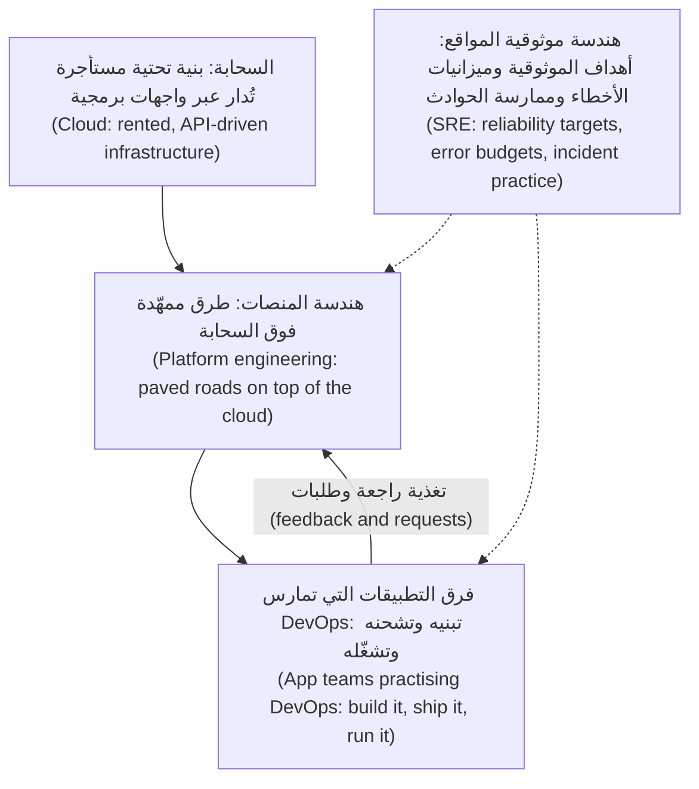
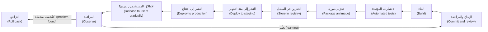

# الوحدة 0 — التوجيه (Orientation)

*قبل أن تلمس حاوية (container) أو عنقودًا (cluster)، تحتاج إلى خريطة (map). تمنحك هذه الوحدة ثلاثة أشياء. أولها المفردات (vocabulary): ما المعنى الفعلي لكل من "السحابة (cloud)" و"DevOps" و"هندسة المنصات (platform engineering)" و"هندسة موثوقية المواقع (site reliability engineering)"، وكيف تتداخل، وما الذي يتحمّل كل منها مسؤوليته (responsible for). وثانيها المسار (path) الذي يقطعه كل تغيير من إيداع المطوّر (developer's commit) إلى هاتف العميل (customer's phone)، والمواضع على امتداد هذا المسار التي تنكسر فيها الأمور (things break). فبعض هذه الأعطال كلّف شركات حقيقية مئات الملايين، أو أخرج جزءًا كبيرًا من الإنترنت عن الخدمة (offline) لساعات. وثالثها الأشخاص الذين ستعمل معهم طوال الدورة: فريق هندسة المنصات وهندسة موثوقية المواقع (Platform Engineering & SRE team) في بنك نجم (Najm Bank)، الذين ينقلون واجهة برمجة تطبيق نجم للهاتف (Najm Mobile API) وخدمة المدفوعات (payments service) من مركز بيانات (data centre) إلى سحابة مُدارة (managed cloud)، ويبنون منصة (platform) ستستخدمها فرق التطبيقات (app teams) في البنك كل يوم. ستُنهي الوحدة ومعك مختبر محلي يعمل وخطة واضحة لطريقة الدراسة.*

> **المراحل (Phases):** Plan، Release، Deploy — خريطة حلقة التسليم الكاملة، والمفردات اللازمة للحديث عنها.

---

# 0.1 — ما هي السحابة وDevOps وهندسة المنصات وهندسة موثوقية المواقع (SRE)
*المستوى (Level): 🟢 مبتدئ (Beginner)* · *المتطلبات (Prerequisites): لا يوجد (none)* · *المرحلة (Phase): Plan*

## ⚡ الدرس في دقيقة (In 60 seconds)
- **السحابة (cloud)** طريقة للحصول على الحوسبة (computing): تستأجر الخوادم (servers) والتخزين (storage) والشبكات (networks) والخدمات المُدارة (managed services) عند الطلب، عبر واجهة برمجة تطبيقات (API)، وتدفع مقابل ما تستخدمه. إنها ليست "حاسوب شخص آخر" بقدر ما هي *أتمتة (automation)* شخص آخر.
- **DevOps** طريقة عمل: الأشخاص الذين يبنون البرمجيات (build software) يشاركون أيضًا في شحنها (shipping) وتشغيلها (running)، مدعومين بالأتمتة والتغذية الراجعة السريعة (fast feedback). إنها ثقافة (culture) ومجموعة ممارسات، وليست مسمّى وظيفيًا (job title) ولا أداة (tool).
- **هندسة المنصات (platform engineering)** تبني *منتجًا داخليًا (internal product)*، هو منصة المطوّرين الداخلية (internal developer platform)، كي تتمكن فرق التطبيقات من الشحن بأمان (ship safely) دون أن تصبح خبيرة في كل ما يقع تحتها (everything underneath).
- **هندسة موثوقية المواقع (site reliability engineering, SRE)** تتعامل مع الموثوقية (reliability) بوصفها مسألة هندسية بالأرقام: أهداف مستوى الخدمة (service level objectives)، وميزانيات الأخطاء (error budgets)، وحدّ أقصى للعمل اليدوي المتكرر.
- إشارة القرار (Decision cue): عندما يقول أحدهم "نحتاج إلى DevOps"، اسأله أي مشكلة يقصد: إطلاقات بطيئة (slow releases)، أم إطلاقات غير آمنة (unsafe releases)، أم خدمات غير موثوقة (unreliable services)، أم فرق تغرق في البنية التحتية. فكلٌّ منها يشير إلى علاج مختلف (different fix).
- الفخ الأكبر (Biggest trap): إعادة تسمية فريق العمليات القديم إلى "DevOps"، وشراء أداة، وتوقّع أن يتغير أي شيء.

## 🧭 لماذا يهم
ينضم يوسف إلى فريق هندسة المنصات وهندسة موثوقية المواقع في بنك نجم مباشرةً بعد شهادته في هندسة الحاسوب (computer-engineering degree). وفي أسبوعه الأول يسمع أربع كلمات تُستخدم كأنها تعني الشيء نفسه. تقول شريحة مدير تقنية المعلومات (CIO's slide) إن البنك "يتجه إلى السحابة (going cloud)". ويطلب فريق تطبيقات (app team) "مهندس DevOps" لإصلاح خط التسليم (pipeline) لديه. ويتحدث سالم، رئيس هندسة المنصات (Head of Platform Engineering)، عن "المنصة" كأنها منتج (product) له عملاء (customers). وترفض مها، قائدة هندسة موثوقية المواقع (SRE lead)، الموافقة على إطلاق (launch) لأن "الخدمة ليس لها هدف مستوى خدمة".

يوم الخميس يُطلب من يوسف أن يمنح فريق واجهة برمجة تطبيق نجم للهاتف "صلاحية DevOps (DevOps access)" على حساب السحابة الجديد، فيمنح كل مطوّر صلاحيات مدير كاملة. لا ينكسر شيء، لكن نورة، رئيسة أمن التطبيقات والذكاء الاصطناعي (Head of Application & AI Security)، تكتشف ذلك في مراجعة الصلاحيات التالية.

كان السبب الجذري (root cause) هو المفردات. فـ DevOps تعني المسؤولية المشتركة (shared responsibility)، لا صلاحيات المستخدم الخارق المشتركة، وفريق المنصة (platform team) يمنح فرق التطبيقات *طريقًا ممهّدًا آمنًا*، لا مفاتيح كل شيء. يمنحك هذا الدرس الكلمات.

## 📐 كيف يعمل

### 🟢 الأساسيات

**الحوسبة السحابية (Cloud computing).** التعريف الأكثر استشهادًا يأتي من المعهد الوطني الأمريكي للمعايير والتقنية، في الوثيقة NIST SP 800-145 (2011). وهو يسرد خمس خصائص أساسية:

| الخاصية (Characteristic) | بكلمات بسيطة | لماذا تغيّر طريقة عملك |
|---|---|---|
| الخدمة الذاتية عند الطلب (On-demand self-service) | تُنشئ خادمًا (server) أو قاعدة بيانات (database) بنفسك، في دقائق، دون تذكرة (ticket) إلى إنسان | تصبح البنية التحتية (infrastructure) شيئًا يمكن للشيفرة (code) إنشاؤه (الوحدة 3) |
| الوصول الواسع عبر الشبكة | يُوصَل إلى كل شيء عبر الشبكة (network) من خلال واجهات قياسية (standard interfaces) | لكل خدمة واجهة برمجة تطبيقات، لذا يمكن أتمتة (automated) كل شيء |
| تجميع الموارد (Resource pooling) | يتشارك المزوّد (provider) مجمّعات كبيرة من العتاد بين عملاء كثيرين | لا تختار الجهاز المادي (physical machine)؛ بل تختار منطقة (region) ومنطقة توافر (zone) (1.2) |
| المرونة السريعة (Rapid elasticity) | يمكن للسعة (capacity) أن تكبر وتصغر بسرعة، وأحيانًا تلقائيًا (automatically) | يمكنك التوسّع مع الطلب بدل الشراء لتغطية الذروة (6.1) |
| الخدمة المقيسة (Measured service) | يُقاس الاستخدام ويُفوتر (billed) | تصبح التكلفة (cost) خاصية هندسية (engineering property) يمكنك رؤيتها وتغييرها (6.2) |

ويصف NIST أيضًا ثلاثة **نماذج خدمة (service models)**. في **IaaS** (البنية التحتية بوصفها خدمة) تستأجر أجهزة افتراضية (virtual machines) وأقراصًا (disks) وشبكات وتدير نظام التشغيل (operating system) بنفسك. وفي **PaaS** (المنصة بوصفها خدمة) تسلّم شيفرتك أو حاويتك فيشغّلها المزوّد. وفي **SaaS** (البرمجيات بوصفها خدمة) تستخدم ببساطة تطبيقًا جاهزًا (finished application)، مثل البريد الإلكتروني (email). ومنذ ذلك الحين أصبح نموذج **الحوسبة بلا خوادم (serverless)** شائعًا: تقدّم دوالًا (functions) أو حاويات (containers)، ويشغّلها المزوّد فقط عند وصول الطلبات، وتدفع مقابل الاستخدام. ويسرد NIST كذلك نماذج النشر (deployment models): السحابة **العامة (public)**، والسحابة **الخاصة (private)** (الأتمتة نفسها داخل مركز بياناتك)، وسحابة **المجتمع (community)** (تتشاركها مجموعة من المؤسسات)، والسحابة **الهجينة (hybrid)** (مزيج، مثل أعباء عمل نجم السحابية المتصلة بنظامها المصرفي الأساسي المحلي).

**DevOps.** نشأت الكلمة من مؤتمرات "DevOpsDays" التي بدأت عام 2009. لكن الفكرة التي تسمّيها أقدم من ذلك: الجدار (wall) بين "المطوّرين الذين يغيّرون الأشياء" و"أفراد العمليات الذين يحافظون على استقرار الأشياء" يسبب إطلاقات بطيئة ومؤلمة، لأن كل طرف يُقاس على الهدف المعاكس (opposite goal). يزيل DevOps هذا الجدار. فالفرق تملك خدمتها من الشيفرة إلى الإنتاج. وتؤتمت البناء والاختبار والنشر، وتقيس مدى جودة تسليم النظام بأكمله.

يأتي الدليل الأكثر استشهادًا على ما ينجح من برنامج أبحاث **DORA**، الملخَّص في كتاب *Accelerate* لنيكول فورسغرين (Nicole Forsgren) وجيز هَمبل (Jez Humble) وجين كيم (Gene Kim) (2018). ولا تزال مقاييسه الأربعة الرئيسة نقطة الانطلاق القياسية:

| المقياس (Metric) | ما الذي يقيسه | النوع (Kind) |
|---|---|---|
| تكرار النشر (Deployment frequency) | كم مرة تشحن إلى الإنتاج | السرعة (Speed) |
| مهلة التغييرات (Lead time for changes) | الوقت من الإيداع (commit) إلى تشغيل ذلك الإيداع في الإنتاج (running in production) | السرعة |
| معدل فشل التغييرات (Change failure rate) | نسبة عمليات النشر (deployments) التي تسبب عطلًا (failure) يحتاج إلى إصلاح (fix) أو تراجع (rollback) | الاستقرار (Stability) |
| زمن استعادة الخدمة (Time to restore service) | المدة اللازمة للتعافي (recover) عندما يتعطل الإنتاج (production fails) | الاستقرار |

أنفع ما توصّل إليه البحث أن السرعة والاستقرار *ليسا* مقايضة (trade-off). فالفرق الأفضل أداءً (best-performing teams) أسرع وأكثر استقرارًا في آنٍ واحد، لأن التغييرات الصغيرة المتكررة المؤتمتة أسهل في الاختبار، وأسهل في الفهم، وأسهل في التراجع عنها. وقد أضافت تقارير DORA اللاحقة مقياسًا للموثوقية (reliability measure) وحسّنت بعض الأسماء والتعريفات؛ راجع dora.dev لمعرفة المجموعة الحالية (current set) وقت قراءتك هذا.

**هندسة موثوقية المواقع (Site reliability engineering).** بدأت SRE في Google ووُصفت علنًا في كتاب *Site Reliability Engineering* (2016) وكتاب *The Site Reliability Workbook* (2018). أفكارها المحورية (central ideas):
- **مؤشر مستوى الخدمة (service level indicator, SLI)** قياسٌ لما يختبره المستخدمون، مثل "نسبة طلبات واجهة برمجة التطبيقات (API requests) التي تنجح في أقل من 300 ملّي ثانية (milliseconds)".
- **هدف مستوى الخدمة (service level objective, SLO)** هو الهدف (target) لذلك المؤشر عبر نافذة زمنية (window)، مثل "99.9% على مدى 28 يومًا".
- **ميزانية الأخطاء (error budget)** هي ما يتبقى: 100% ناقص هدف مستوى الخدمة (SLO). إن كنت ضمن الميزانية، فاشحن (ship). وإن استنفدتها (spent it)، فأبطئ (slow down) وأصلح الموثوقية (fix reliability). وهذا يحوّل الجدل بين "اشحن أسرع (ship faster)" و"كن حذرًا" إلى رقم متفق عليه مسبقًا (5.2).
- **العمل الرتيب (toil)** هو العمل اليدوي المتكرر الذي يكبر مع حجم الخدمة ولا يضيف قيمة دائمة، مثل إعادة تشغيل مهمة عالقة (stuck job) يدويًا كل ليلة. ويصف كتاب SRE من Google إبقاء العمل التشغيلي (operational work) عند نصف وقت مهندس SRE تقريبًا على الأكثر، كي يذهب الباقي إلى التخلص منه هندسيًا.
- **مراجعات ما بعد الحادثة الخالية من اللوم (blameless postmortems)** تبحث عمّا في النظام سمح بوقوع الخطأ، لا عمّن يجب معاقبته (5.3).

**هندسة المنصات (Platform engineering).** تبدو عبارة "أنت تبنيه، وأنت تشغّله" جيدة، لكن مطالبة كل فريق تطبيقات بإتقان Kubernetes والشبكات (networking) والهوية (identity) وخطوط التسليم (pipelines) وقابلية المراقبة (observability) والتكلفة عبءٌ معرفي (cognitive load) مفرط. وهندسة المنصات هي الجواب عن ذلك. فيبني فريق المنصة **منصة المطوّرين الداخلية (internal developer platform, IDP)**: مجموعة من أدوات الخدمة الذاتية (self-service tools) والقوالب (templates) والطرق الممهّدة (paved roads) (وتُسمّى غالبًا **المسارات الذهبية (golden paths)**) التي تجعل الطريق الآمن هو الطريق السهل. ويسمّي كتاب *Team Topologies* لماثيو سكلتون (Matthew Skelton) ومانويل باييس (Manuel Pais) (2019) هذا "فريق منصة" يخدم فرق المنتجات "المحاذية للتدفق (stream-aligned)". وقد نشرت مؤسسة CNCF ورقة بيضاء (white paper) تصف ما توفّره المنصات؛ راجع cncf.io للاطلاع على النسخة الحالية (current version).

### 🟡 التعمق أكثر (Going deeper)

**كيف تتكامل الأفكار الأربع (How the four ideas fit together).** إنها ليست متنافسة؛ بل تقع في طبقات مختلفة (different layers).



توفّر السحابة القدرة الخام (raw capability). ويحوّلها فريق المنصة إلى عدد صغير من الخيارات الآمنة المدعومة. وتستخدم فرق التطبيقات هذه الخيارات لتسلّم كثيرًا (deliver often) وتملك خدماتها. أما ممارسات SRE فتمتد عبر الاثنين: فهي تقرر مدى الموثوقية التي تحتاجها كل خدمة، وتُلزم الجميع بها.

**من يفعل ماذا (Who does what).** تختلف المسمّيات (titles) بين الشركات، لذا تعلّم *المسؤوليات (responsibilities)*، لا التسميات (labels):

| الدور (Role) | السؤال الرئيس الذي يجيب عنه | العمل المعتاد (Typical work) |
|---|---|---|
| مهندس السحابة (Cloud engineer) | "كيف نستخدم خدمات المزوّد جيدًا وبأمان؟ ⁦⁩" | الحسابات (accounts)، والشبكات، والهوية، والخدمات المُدارة، ومناطق الهبوط (landing zones) |
| مهندس DevOps (DevOps engineer) | "كيف تنتقل الشيفرة من الإيداع إلى الإنتاج بسرعة وأمان؟ ⁦⁩" | خطوط التسليم، وأدوات البناء (build tooling)، وأتمتة الإطلاق (release automation)، والبيئات (environments). وغالبًا مزيج من الصفوف الثلاثة الأخرى |
| مهندس المنصات (Platform engineer) | "ما الذي ينبغي أن يحصل عليه كل فريق مجانًا كي لا يعيد بناءه؟ ⁦⁩" | القوالب، ومنصة Kubernetes، وGitOps، وبوابة المطوّرين (developer portal)، والخدمة الذاتية (self-service) |
| مهندس موثوقية المواقع (Site reliability engineer) | "هل الخدمة موثوقة بما يكفي، وكيف نعرف ذلك؟ ⁦⁩" | أهداف مستوى الخدمة (SLOs)، والتنبيه (alerting)، والمناوبة (on-call)، والحوادث (incidents)، والسعة، وإزالة العمل الرتيب (removing toil) |

في الشركة الصغيرة (small company) يؤدي شخص واحد الأدوار الأربعة. وفي بنك نجم هم أشخاص منفصلون يجلسون في فريق واحد (one team).

**لماذا يكون "فريق DevOps" غالبًا نمطًا مضادًا (Why "DevOps team" is often an anti-pattern).** إذا أنشأت شركة "فريق DevOps (DevOps team)" يتلقى التذاكر (tickets) من المطوّرين وينشر (deploys) نيابةً عنهم، فقد أعادت بناء الجدار باسم جديد. والاختبار بسيط: هل يستطيع فريق التطبيقات شحن تغيير إلى الإنتاج، بأمان، دون تقديم تذكرة وانتظار شخص؟ إن لم يكن كذلك، فلديك تسليم يدوي بين فريقين (handoff)، لا DevOps. ومهمة فريق المنصة هي إزالة هذا التسليم، لا أن يصبح هو التسليم.

**تطبيق العوامل الاثني عشر (The Twelve-Factor App).** منهجية قصيرة (short methodology) نشرها مهندسون في Heroku تصف خدمات تعمل جيدًا على المنصات السحابية (cloud platforms): الإعدادات في البيئة لا في الشيفرة؛ والعمليات عديمة الحالة (stateless processes)؛ وبدء التشغيل السريع والإيقاف الرشيق؛ والبناء والإطلاق والتشغيل بوصفها مراحل منفصلة. ستلتقي هذه الأفكار مجددًا في الوحدتين 2 و4.

### 🔴 نظرة الخبير (Expert view)

**قِس النتائج لا التبنّي (Measure outcomes, not adoption).** عبارة "نقلنا 80 خدمة إلى Kubernetes" نشاطٌ (activity). أما "انخفضت مهلة التغييرات (lead time) من ثلاثة أسابيع إلى يوم واحد، ولم يرتفع معدل فشل التغييرات" فهي نتيجة (outcome). يرفع سالم إلى مدير تقنية المعلومات (CIO) مقاييس DORA (DORA metrics) ومدى تحقيق أهداف مستوى الخدمة (SLO attainment)، لا أعداد الأدوات (tool counts). والمنصة التي لا يستخدمها أحد طوعًا (voluntarily) قد فشلت: تعامل معها بوصفها منتجًا له مستخدمون (users) وخارطة طريق (roadmap) ومقاييس تبنٍّ (adoption metrics).

**الموثوقية قرار منتج (Reliability is a product decision).** نسبة 100% هي الهدف الخطأ (wrong target) لكل شيء تقريبًا. فكل "تسعة (nine)" إضافية تكلّف أكثر، ولا يستطيع المستخدمون التمييز بين 99.99% و99.999% حين تتعطل شبكة هاتفهم المحمول (mobile network) نفسها أكثر من ذلك. فهدف مستوى الخدمة الصحيح يأتي مما يحتاجه المستخدمون: مرتفع لخدمة المدفوعات، وأدنى بكثير لأداة تقارير داخلية.

**التنظيم يشكّل المنصة (Regulation shapes the platform).** بالنسبة إلى بنك، ليست السحابة مجرد خيار هندسي (engineering choice). فالجهات التنظيمية المالية في دول الخليج، ومنها مصرف قطر المركزي (Qatar Central Bank)، تنشر توقعاتها بشأن الإسناد الخارجي السحابي (cloud outsourcing) وإقامة البيانات (data residency) والمرونة (resilience). وفي الاتحاد الأوروبي (EU)، يضع قانون المرونة التشغيلية الرقمية (Digital Operational Resilience Act) (DORA، اللائحة 2022/2554، المطبَّقة اعتبارًا من يناير 2025) قواعد بشأن مخاطر تقنية المعلومات والاتصالات (ICT risk)، والإبلاغ عن الحوادث (incident reporting)، واختبار المرونة (resilience testing)، ومخاطر الأطراف الثالثة (third-party risk) (ومنها السحابة) للكيانات المالية (financial entities). لاحظ تشابه الاسمين (name clash): *DORA* اللائحة الأوروبية و*DORA* برنامج أبحاث DevOps لا علاقة بينهما (unrelated). تبقى هذه الدورة في الجانب الهندسي (engineering)؛ أما القواعد فراجع [*أمن الذكاء الاصطناعي والتطبيقات (Secure AI & Application Security)*، الدرس 11.2 — التنظيم الذي يمسّ الأمن (Regulation that touches security)](../secai/index.ar.html#/11.2).

## 🧰 الأدوات
| الأداة أو الممارسة أو الخدمة (Tool, practice or service) | ما هي وماذا تفعل | متى تلجأ إليها |
|---|---|---|
| **DORA metrics** — مقاييس DORA | أربعة مقاييس لأداء التسليم (delivery performance): تكرار النشر، ومهلة التغييرات، ومعدل فشل التغييرات، وزمن استعادة الخدمة | تحديد خط أساس (baseline) قبل أي تغيير، والإبلاغ عن التقدم (reporting progress) بالنتائج (outcomes) لا بالأدوات (tools) |
| **Service level objective** — هدف مستوى الخدمة | هدف لقياس يواجه المستخدم (user-facing measurement) عبر نافذة زمنية (time window) | تحديد مدى الموثوقية التي يجب أن تتمتع بها الخدمة، ومتى تُبطئ الإطلاقات |
| **Error budget** — ميزانية الأخطاء | مقدار عدم الموثوقية (unreliability) الذي يسمح به هدف مستوى الخدمة | حسم سؤال "نشحن أم نثبّت الاستقرار؟ ⁦⁩" برقم متفق عليه مسبقًا (agreed in advance) |
| **Internal developer platform** — منصة المطوّرين الداخلية | أدوات خدمة ذاتية وقوالب وطرق ممهّدة تستخدمها فرق التطبيقات لبناء الخدمات وتشغيلها | حين تكرر فرق كثيرة عمل البنية التحتية نفسه، أو يؤديه كل منها بطريقة مختلفة |
| **Backstage** — مفتوح المصدر (open source)، من CNCF | بوابة مطوّرين: فهرس البرمجيات (software catalogue) والقوالب والتوثيق (documentation) في مكان واحد | منح فرق التطبيقات بابًا أماميًا واحدًا إلى المنصة |
| **Twelve-Factor App** — تطبيق العوامل الاثني عشر | منهجية قصيرة لبناء خدمات تعمل جيدًا على المنصات السحابية | مراجعة ما إذا كانت الخدمة جاهزة للحوسبة في حاويات والتوسّع (scaled) |
| **Well-Architected frameworks** — أطر البنية الجيدة | إرشادات الممارسات الجيدة المنظّمة لدى كل مزوّد، مرتّبة في ركائز (pillars) | مراجعة تصميم (design) مقابل قائمة تحقق (checklist) قبل تشغيله فعليًا (goes live) |

## 🏛️ عمليًا في بنك نجم
بعد حادثة "صلاحية DevOps"، يطلب سالم من يوسف صياغة **خريطة المسؤوليات (responsibility map)** للفريق: صفحة واحدة تبيّن من يملك ماذا مع انتقال الخدمات إلى السحابة. وتُنشر على بوابة المطوّرين الداخلية.

**هندسة المنصات وهندسة موثوقية المواقع في نجم (Najm Platform Engineering & SRE) — خريطة المسؤوليات (responsibility map) الإصدار 1 (v1)**

| المجال (Area) | يملكه فريق المنصة | تملكه فرق التطبيقات | تملكه هندسة موثوقية المواقع (مها) | الأمن (Security) (نورة) |
|---|---|---|---|---|
| حسابات السحابة والشبكات والهوية | منطقة الهبوط (landing zone)، وتخطيط الشبكة (network layout)، والأدوار (roles) لكل فريق | طلب الأدوار التي تحتاجها خدمتها | — | تعتمد تصميم الأدوار، وتجري مراجعات الصلاحيات (access reviews) |
| عناقيد Kubernetes (Kubernetes clusters) | دورة حياة العنقود (cluster lifecycle)، والترقيات (upgrades)، والإضافات المشتركة (shared add-ons) | مساحات أسمائها (namespaces)، وملفات التعريف (manifests)، وطلبات الموارد (resource requests) | مراجعات السعة (capacity reviews) | خط الأساس لسياسات العنقود |
| خطوط التسليم والمسارات الذهبية | القوالب، والمشغّلات المشتركة (shared runners)، وبنية مستودع GitOps | خط تسليم خدمتها، واختباراتها (tests)، وخيارات الإطلاق (release choices) | بوابات الإطلاق المرتبطة بميزانيات الأخطاء | ضوابط سلسلة التوريد (supply-chain controls) |
| قابلية المراقبة | منظومة القياس عن بُعد (telemetry stack)، وقوالب لوحات المتابعة (dashboards templates) | تجهيز شيفرتها بأدوات القياس، ولوحات متابعة الخدمة (service dashboards) | تعريفات أهداف مستوى الخدمة (SLO definitions) مع فرق التطبيقات، ومعايير التنبيه (alert standards) | متطلبات التسجيل الأمني |
| المناوبة والحوادث | جدول مناوبة المنصة | جدول مناوبة الخدمة | عملية الحوادث (incident process)، ومراجعات ما بعد الحادثة (postmortem reviews) | تصعيد الحوادث الأمنية (جاسم) |
| التكلفة | لوحات متابعة التكلفة (cost dashboards) وقواعد الوسم (tagging rules) | إنفاق خدمتها وتكلفة الوحدة (unit cost) | — | — |

**القواعد المصاحبة لها (Rules that come with it):**
- لا يحصل أحد على صلاحيات مدير دائمة في الإنتاج (production). فالصلاحيات المرفوعة (elevated access) محدودة زمنيًا (time-limited)، ومعتمدة (approved)، ومسجّلة (logged) (1.3).
- "صلاحية DevOps" ليست نوع طلب (request type). فالطلبات تسمّي الإجراء والمورد: "النشر (deploy) إلى مساحة الأسماء (namespace) `mobile-api` في بيئة التجهيز (staging)".
- يقيس فريق المنصة نجاحه بمقاييس DORA لفرق التطبيقات وبتبنّي المسارات الذهبية، ويرفعها إلى سالم شهريًا (monthly).
- تتلقى منى من الإدارة المالية (Finance) لوحة متابعة التكلفة (cost dashboard) شهريًا، ولها جهة اتصال مسمّاة (named contact) في كل فريق تطبيقات.

## 🛠️ التمارين (Exercises)
- 🟢 اكتب تعريفًا من فقرة واحدة (one-paragraph definition)، بكلماتك الخاصة، للسحابة وDevOps وهندسة المنصات وهندسة موثوقية المواقع، ثم جملة واحدة عن علاقة كل منها بالبقية. ضمّنه خصائص السحابة الخمس لدى NIST ومقاييس DORA الأربعة. *يكتمل عندما (Done when):* يستطيع صديق لا يعمل في التقنية قراءته وأن يشرح لك بدوره الفرق بين DevOps وSRE.
- 🟡 ابحث عن خمسة إعلانات وظائف حقيقية لأدوار السحابة أو DevOps أو المنصات أو SRE في منطقتك، وطابق مسؤوليات كل منها مع جدول "من يفعل ماذا". *يكتمل عندما:* يُظهر جدولٌ أيّ الأدوار الأربعة يطلبه كل إعلان فعلًا، مع جملة واحدة عمّا فاجأك.
- 🔴 خذ مشروعًا تملكه وله سجل git (git history) (مشروعًا شخصيًا أو مستودعًا عامًا مفتوح المصدر). قدّر مقاييس DORA الخاصة به للأشهر الثلاثة الأخيرة: تكرار النشر أو الإطلاق من الوسوم (tags) أو الإصدارات (releases)، ومهلة التغييرات من تاريخ الإيداع (commit date) إلى تاريخ الإطلاق (release date)، ومعدل فشل التغييرات من عمليات الإرجاع (reverts) أو إصدارات الإصلاح العاجل (hotfix releases)، وزمن الاستعادة (time to restore) من الفجوة بين إطلاق سيئ (bad release) والإصلاح أو الإرجاع الذي تلاه (استخدم الطوابع الزمنية للمشكلات (issue timestamps) إن توفرت لديك). *يكتمل عندما:* تكون لديك الأرقام الأربعة، والأوامر (commands) أو الاستعلامات (queries) التي استخدمتها للحصول عليها، وملاحظة عن الرقم الذي كان أصعب في القياس بأمانة ولماذا.

## ⚠️ أخطاء وفخاخ (Mistakes and traps)
- **إعادة تسمية العمليات إلى "DevOps" (Renaming ops to "DevOps").** طابور التذاكر (ticket queue) باسم جديد يظل تسليمًا يدويًا بين فريقين. قِس ما إذا كانت الفرق تستطيع الشحن دون انتظار شخص.
- **التعامل مع DevOps بوصفه شراء أداة (Treating DevOps as a tool purchase).** لا توجد أداة تصلح نموذج ملكية معطوبًا. ابدأ بمن يملك ماذا، ثم أتمت (automate).
- **بناء منصة لم يطلبها أحد (Building a platform nobody asked for).** تحدّث إلى فرق التطبيقات أولًا. المنصة منتج؛ وإذا تجنّبتها الفرق فقد فشلت.
- **مساواة "صلاحية DevOps" بصلاحيات المدير (Equating "DevOps access" with administrator rights).** المسؤولية المشتركة لا تعني مستخدمًا خارقًا مشتركًا (shared superuser). امنح صلاحيات محددة ومحدودة زمنيًا.

## 🧾 الخلاصة (Recap)
- السحابة بنية تحتية عند الطلب (on-demand)، تُدار عبر واجهات برمجة التطبيقات (API-driven)، ومقيسة (metered)؛ وخصائصها الخمس لدى NIST تفسّر لماذا تصبح الأتمتة والتكلفة شأنين هندسيين (engineering concerns).
- DevOps هو الملكية المشتركة (shared ownership) مضافًا إليها الأتمتة، ويُقاس بمقاييس DORA الأربعة؛ والسرعة والاستقرار يتحسّنان معًا.
- تجعل SRE الموثوقية رقمًا: مؤشرات مستوى الخدمة (SLIs) وأهداف مستوى الخدمة وميزانيات الأخطاء، إضافة إلى سقف للعمل الرتيب ومراجعات ما بعد الحادثة الخالية من اللوم.
- تبني هندسة المنصات منتجًا داخليًا، هو الطريق الممهّد (paved road)، كي تتحرك فرق التطبيقات بسرعة دون إتقان كل طبقة.
- تعلّم المسؤوليات لا المسمّيات. فالسؤال دائمًا: "من يملك هذا، وهل يستطيع التصرف دون انتظار؟ ⁦⁩"

## ✍️ اختبر نفسك (Check yourself)

**1. يطلب فريق تطبيقات (app team) في بنك نجم من يوسف "صلاحية DevOps (DevOps access)" كي ينشر تغييراته بنفسه (deploy their own changes). ما أفضل استجابة (best response)؟**

- A. منح كل مطوّر في الفريق صلاحيات مدير (administrator rights) على حساب السحابة (cloud account)، لأن DevOps يعني المسؤولية المشتركة (shared responsibility)
- B. سؤالهم عن الإجراءات (actions) التي يحتاجونها وعلى أي موارد، ومنح دور محدد (specific role) مثل النشر إلى مساحة أسمائهم الخاصة في بيئة التجهيز (staging)
- C. الرفض، لأن فريق المنصة (platform team) وحده يحق له النشر (deploy)
- D. إنشاء طابور تذاكر (ticket queue) كي ينشر فريق المنصة (platform team) نيابةً عنهم

<details><summary>الإجابة</summary>

**B.** يعني DevOps أن الفرق تستطيع الشحن (ship) دون تسليم يدوي بين فريقين (handoff)، ولكن بصلاحيات محددة وفق مبدأ أقل الصلاحيات (least-privilege permissions). أما A فيخلط بين الملكية المشتركة (shared ownership) وصلاحيات المستخدم الخارق المشتركة. وC وD يعيدان بناء الجدار بين البناء والتشغيل. (🟡 التعمق أكثر (Going deeper)؛ 🏛️ عمليًا.)

</details>

**2. أيٌّ مما يلي ليس (NOT) أحد مقاييس DORA الأربعة الرئيسة (four key metrics)؟**

- A. تكرار النشر (Deployment frequency) إلى الإنتاج
- B. مهلة التغييرات (Lead time for changes) من الإيداع إلى الإنتاج
- C. معدل فشل التغييرات (Change failure rate) بعد النشر
- D. عدد الخوادم المُدارة لكل مهندس

<details><summary>الإجابة</summary>

**D.** المقاييس الأربعة الرئيسة (four keys) هي تكرار النشر (deployment frequency)، ومهلة التغييرات (lead time for changes)، ومعدل فشل التغييرات (change failure rate)، وزمن استعادة الخدمة (time to restore service). أما عدد الخوادم لكل مهندس فيقيس النشاط (activity)، لا نتائج التسليم (delivery outcomes). (🟢 الأساسيات.)

</details>

**3. لخدمة المدفوعات (payments service) هدف مستوى خدمة (SLO) قدره 99.95% من التحويلات الناجحة (successful transfers) على مدى 28 يومًا. وفي منتصف النافذة (halfway through the window)، استهلكت الحوادث (incidents) كامل ميزانية الأخطاء (error budget) تقريبًا. بماذا توحي ممارسة SRE (SRE practice)؟**

- A. إبطاء إطلاقات الميزات الخطرة وتوجيه الجهد إلى الموثوقية (reliability) حتى تتعافى الميزانية
- B. رفع هدف مستوى الخدمة (SLO) إلى 99.99% كي يأخذ الفريق الموثوقية بجدية أكبر
- C. المضيّ كما هو مخطط والنظر مجددًا عند إعادة ضبط نافذة الـ 28 يومًا (window resets)
- D. خفض هدف مستوى الخدمة (SLO) بهدوء كي تبدو الميزانية المتبقية (remaining budget) سليمة مجددًا

<details><summary>الإجابة</summary>

**A.** ميزانية الأخطاء (error budget) هي الإشارة المتفق عليها (agreed signal) لسؤال "نشحن أم نثبّت الاستقرار". وحين تُستنفد، يأخذ عمل الموثوقية (reliability work) الأولوية. أما B فيزيد المشكلة سوءًا؛ وD يُبطل الغاية من الاتفاق على الهدف مسبقًا. (🟢 الأساسيات.)

</details>

**4. أنشأت شركة "فريق DevOps (DevOps team)" يتلقى التذاكر (tickets) من المطوّرين ويشغّل عمليات النشر (deployments) الخاصة بهم يدويًا (by hand). ما المشكلة الرئيسة (main problem)؟**

- A. الفريق أصغر من أن يتعامل مع حجم التذاكر الذي سيتلقاه
- B. يجب إعادة تسمية الفريق إلى "SRE" كي يتضح غرضه للجميع
- C. لقد أعاد بناء التسليم اليدوي (handoff) بين البناء والتشغيل الذي يزيله DevOps
- D. في البنك، يجب أن تتم عمليات النشر (deployments) يدويًا كي يتحقق شخص من كل واحدة منها

<details><summary>الإجابة</summary>

**C.** اختبار DevOps هو ما إذا كان الفريق يستطيع الشحن بأمان (ship safely) دون انتظار شخص آخر. وطابور التذاكر (ticket queue) تسليم يدوي (handoff)، أيًّا كان اسمه. أما A فيعالج العَرَض (treats the symptom)؛ وB يغيّر التسمية فقط؛ وD خاطئ، لأن الأتمتة (automation) تجعل عمليات النشر أكثر أمانًا (safer) وأكثر قابلية للتدقيق (more auditable). (🟡 التعمق أكثر (Going deeper).)

</details>

**5. يريد سالم أن يُثبت لمدير تقنية المعلومات (CIO) أن منصة المطوّرين الداخلية (internal developer platform) الجديدة تعمل. أي دليل هو الأقوى (strongest evidence)؟**

- A. قائمة بكل أداة (tool) تتضمنها المنصة الآن، مع حالة الترخيص والدعم لكل منها
- B. مهلة التغييرات (lead time) ومعدل الفشل (failure rate) لفرق التطبيقات قبل تبنّي المسارات الذهبية وبعده، والتبنّي الطوعي
- C. عدد عناقيد Kubernetes (Kubernetes clusters) ومساحات الأسماء (namespaces) التي تعمل الآن، مقارنة بالربع الماضي (last quarter)
- D. نمو فريق المنصة (platform team) وعدد التذاكر (tickets) التي أغلقها هذا الربع

<details><summary>الإجابة</summary>

**B.** المنصة منتج؛ وهي تنجح حين يحقق مستخدموها نتائج أفضل (better outcomes) ويختارون استخدامها. أما A وC وD فتقيس المدخلات والنشاط. (🔴 نظرة الخبير (Expert view).)

</details>

## 📚 المراجع (References)
- NIST SP 800-145، تعريف NIST للحوسبة السحابية — https://csrc.nist.gov/pubs/sp/800/145/final
- برنامج أبحاث DORA (DORA research programme) — https://dora.dev/
- Google، كتابا Site Reliability Engineering وThe Site Reliability Workbook (متاحان مجانًا على الإنترنت) — https://sre.google/books/
- CNCF، الورقة البيضاء عن المنصات — https://www.cncf.io/
- توثيق Backstage (Backstage documentation) — https://backstage.io/docs/
- تطبيق العوامل الاثني عشر — https://12factor.net/
- إطار AWS للبنية الجيدة — https://aws.amazon.com/architecture/well-architected/
- إطار Microsoft Azure للبنية الجيدة — https://learn.microsoft.com/azure/well-architected/
- إطار Google Cloud للبنية الجيدة (المعروف سابقًا بإطار Google Cloud المعماري) — https://cloud.google.com/architecture/framework
- اللائحة 2022/2554 (قانون المرونة التشغيلية الرقمية) — https://eur-lex.europa.eu/eli/reg/2022/2554/oj

---

# 0.2 — المسار إلى الإنتاج: من الإيداع إلى العميل (customer)، وكل ما قد ينكسر في الطريق
*المستوى: 🟢 مبتدئ* · *المتطلبات: 0.1* · *المرحلة: Release, Deploy*

## ⚡ الدرس في دقيقة (In 60 seconds)
- كل تغيير يقطع **المسار إلى الإنتاج (path to production)** نفسه: الإيداع، والبناء (build)، والاختبار (test)، والتحزيم (package)، والتخزين (store)، والنشر، والإطلاق للمستخدمين، والمراقبة (observe). وكل خطوة إما تلتقط المشكلات (catches problems) وإما تسمح بمرورها.
- القاعدة الأهم: **ابنِ مرة واحدة، ورقِّ الأثر البرمجي نفسه (build once, promote the same artefact)**. فالشيء الذي اختبرته يجب أن يكون، بايتًا ببايت (byte-for-byte)، هو الشيء الذي تشغّله في الإنتاج.
- **النشر (deploying)** (وضع الشيفرة الجديدة على الخوادم) و**الإطلاق (releasing)** (السماح للمستخدمين بالوصول إليها) خطوتان مختلفتان. والفصل بينهما أساس الطرح الآمن (safe rollout).
- إشارة القرار: قبل شحن أي شيء (shipping anything)، اسأل: "إن كان هذا خاطئًا، فكم مستخدمًا سيراه، وبأي سرعة سنعرف، وبأي سرعة نستطيع التراجع؟ ⁦⁩"
- الفخ الأكبر: خطوات تُنفَّذ يدويًا، وبطريقة مختلفة في كل مرة. فمعظم الانقطاعات الشهيرة (famous outages) تعود إلى خطوة يدوية (manual step)، أو فحص مُتخطّى (skipped check)، أو تغيير وصل إلى الجميع دفعة واحدة.

## 🧭 لماذا يهم
في 1 أغسطس 2012، نشرت شركة Knight Capital، وهي شركة تداول أمريكية كبيرة، شيفرة تداول جديدة على خوادمها. ووفقًا لأمر هيئة الأوراق المالية والبورصات الأمريكية الصادر عام 2013، نُسخت الشيفرة الجديدة يدويًا إلى الخوادم، وفات أحدُ الخوادم الثمانية. وكان ذلك الخادم لا يزال يحمل شيفرة قديمة غير مستخدمة. فأعاد علمٌ (flag) أعادت الشيفرة الجديدة استخدامه تشغيلَ الشيفرة القديمة. وفي نحو 45 دقيقة أرسلت الشركة ملايين الأوامر غير المقصودة (unintended orders) وخسرت أكثر من 460 مليون دولار أمريكي. لم يكن هناك نشر مؤتمت (automated deployment)، ولا فحص يتأكد من أن جميع الخوادم تشغّل الإصدار نفسه (same version)، ولا طريقة سريعة للإيقاف.

وبعد اثني عشر عامًا، في 19 يوليو 2024، دفعت CrowdStrike تحديث محتوى معيبًا لمستشعرها الأمني Falcon. فأسقط أجهزة Windows التي تلقّته؛ وقدّرت Microsoft لاحقًا أن نحو 8.5 مليون جهاز تأثّر بذلك. وتوقفت شركات طيران ومستشفيات وبنوك. والتزمت مراجعة CrowdStrike الخاصة بطرح مرحلي (staged rollouts) لمثل هذه التحديثات، كي يصل التغيير السيئ (bad change) إلى مجموعة صغيرة أولًا.

يستخدم سالم الحالتين في يوم يوسف الأول. "كانت كلتاهما إخفاقًا في *المسار إلى الإنتاج (path-to-production failures)*: خطوة يدوية سارت على نحو خاطئ، وتغيير أُرسل إلى الجميع دفعة واحدة." يرسم هذا الدرس خريطة ذلك المسار؛ وكل وحدة لاحقة تقرّب العدسة (zooms in) على جزء منه.

## 📐 كيف يعمل

### 🟢 الأساسيات

**المراحل (The stages).** أيًّا كانت الأدوات، يمرّ التغيير على واجهة برمجة تطبيق نجم للهاتف بهذه الخطوات:



| المرحلة (Stage) | ما الذي يحدث | ما الذي ينبغي أن تلتقطه | أين تغطيها هذه الدورة |
|---|---|---|---|
| الإيداع والمراجعة | يدفع مطوّر (developer pushes) تغييرًا؛ ويراجعه زميل في طلب سحب (pull request) | الأخطاء المنطقية (logic errors)، والتغييرات الخطرة (risky changes)، والاختبارات المفقودة (missing tests) | 4.1 |
| البناء | تُصرَّف الشيفرة وتُجلب الاعتماديات | الشيفرة التي لا تُصرَّف؛ والاعتماديات المعطوبة (broken dependencies) | 4.1 |
| الاختبارات المؤتمتة (Automated tests) | تعمل اختبارات الوحدة (unit) والتكامل (integration) وغيرها | التراجعات الوظيفية (regressions)، والعقود المكسورة (broken contracts) | 4.1 |
| التحزيم | تُحزَّم الخدمة في صورة حاوية (container image) | الصور التي لا تبدأ؛ والصور المتضخمة أو غير الآمنة | 2.1 |
| التخزين | تُدفع الصورة إلى سجل (registry) بمعرّف فريد (unique identifier) | العبث (tampering)، والارتباك بشأن "أي إصدار هذا؟ ⁦⁩" | 2.1، 4.3 |
| النشر | تُطرح الصورة (rolled out) في بيئة (environment) بواسطة الأتمتة | أخطاء الإعدادات (configuration errors)، وفشل بدء التشغيل (failed startup)، وفحوص الصحة السيئة | 2.2، 3.2 |
| الإطلاق (Release) | يُمنح المستخدمون الإصدار الجديد تدريجيًا (gradually) | المشكلات التي لا تُظهرها إلا الحركة الحقيقية | 4.2 |
| المراقبة | يُظهر القياس عن بُعد (telemetry) ما إذا كان المستخدمون يُخدَمون جيدًا (well served) | الأخطاء (errors)، والبطء (slowness)، واستهلاك هدف مستوى الخدمة (SLO burn) | 5.1، 5.2 |

**خط التسليم (pipeline)** هو الأتمتة التي تشغّل هذه الخطوات. و**التكامل المستمر (continuous integration, CI)** يعني أن الجميع يدمجون تغييرات صغيرة في الفرع الرئيس (main branch) كثيرًا، وأن كل دمج (merge) يُبنى ويُختبر تلقائيًا (built and tested automatically). و**التسليم المستمر (continuous delivery, CD)** يعني أن كل تغيير يجتاز الفحوص جاهز للنشر بضغطة زر. أما **النشر المستمر (continuous deployment)** فيخطو خطوة أبعد: كل تغيير ناجح يُنشر تلقائيًا (deployed automatically).

**ابنِ مرة واحدة، ورقِّ الأثر البرمجي نفسه (Build once, promote the same artefact).** **الأثر البرمجي (artefact)** هو مخرَج البناء، وهو عندنا عادةً صورة حاوية. ابنِه مرة واحدة، وامنحه هوية فريدة (unique identity) (تجزئة الإيداع (commit hash) في وسمه (tag)، وبصمة محتواه)، وانقل الصورة *نفسها* من بيئة التجهيز إلى الإنتاج. فإن أعدت البناء للإنتاج، فأنت تشحن شيئًا لم تختبره قط (never tested): فقد تكون إحدى الاعتماديات (dependency) قد تغيّرت، وقد يختلف أحد خيارات البناء (build flag).

خط تسليم بسيط في GitHub Actions يختبر الشيفرة ويبني صورة واحدة موسومة بإيداعها:

```yaml
# .github/workflows/ci.yml — a starting point, hardened in Module 4
name: ci
on:
  pull_request:
  push:
    branches: [main]
permissions:
  contents: read          # least privilege: this job only reads the code
jobs:
  test-and-build:
    runs-on: ubuntu-latest
    steps:
      - uses: actions/checkout@v4   # in production pipelines, pin to a full commit SHA (4.3)
      - name: Run tests
        run: make test          # replace with your project's test command
      - name: Build one image, named after the commit
        run: docker build -t najm-mobile-api:${{ github.sha }} .
```

**البيئات (Environments).** تمرّ التغييرات عبر سلسلة من **البيئات (environments)**: نسخ منفصلة من النظام. ومن المجموعات الشائعة: التطوير (development)، والتجهيز (أقرب ما يمكن إلى الإنتاج)، والإنتاج. وينبغي ألا تختلف البيئات إلا في الإعدادات (configuration) (عناوين قواعد البيانات (database addresses)، والأحجام (sizes)، وأعلام الميزات)، ولا تختلف أبدًا في الشيفرة. ويُبيّن الدرس 3.2 كيف تُرقّى التغييرات بينها (promote changes) باستخدام GitOps.

**النشر ليس إطلاقًا (Deploy is not release).** أن *تنشر* يعني أن تضع الإصدار الجديد على الخوادم. وأن *تطلق* يعني أن تسمح للمستخدمين بالوصول إليه. يمكنك نشر شيفرة فيها ميزة جديدة مُطفأة بواسطة **علم ميزة (feature flag)**، ثم تشغيلها لـ 1% من المستخدمين. ويمكنك نشر إصدار جديد بجانب القديم وإرسال 5% من الحركة (traffic) إليه، وهذا هو **الكناري (canary)**. والفصل بين الخطوتين يعني أن التغيير السيئ يصل إلى قلة من المستخدمين، لا إليهم جميعًا. وهذا بالضبط درس تحديث CrowdStrike (CrowdStrike update).

### 🟡 التعمق أكثر

**ما الذي ينكسر، مرحلة بمرحلة (What breaks, stage by stage).** كل انقطاع علني (public outage) يعلّمنا شيئًا عن مرحلة واحدة. وإليك حالات موثّقة جيدًا (well-documented cases)، مع الضابط (control) الذي كان سيحدّ من كل منها:

| الحالة (Case) | ما الذي حدث (التقارير العلنية) | المرحلة التي فشلت | الضابط |
|---|---|---|---|
| Knight Capital، 2012 | فات النشرُ اليدوي (manual deploy) خادمًا من ثمانية؛ فأُعيد تفعيل الشيفرة القديمة | النشر | عمليات نشر مؤتمتة ومتطابقة؛ وفحوص الإصدار على كل خادم؛ ومفتاح إيقاف طارئ (kill switch) |
| AWS S3، us-east-1، فبراير 2017 | أثناء تصحيح الأخطاء (debugging)، كُتب أمرٌ مُعدّ لإزالة عدد صغير من الخوادم بشكل خاطئ (mistyped) فأزال عددًا أكبر بكثير | التشغيل (Operate) | أدوات تحدّ من مقدار ما يستطيع أمر واحد إزالته، ومن سرعة ذلك |
| GitLab.com، يناير 2017 | حذف مهندس دليل قاعدة بيانات إنتاجية عن طريق الخطأ؛ وتبيّن أن عدة طرق نسخ احتياطي (backup methods) لا تعمل؛ وفُقدت ساعات من البيانات | التشغيل والتعافي (Operate, Recover) | استعادات مُختبرة (tested restores)، لا مجرد نسخ احتياطية؛ وفصل واضح لطرفيات الإنتاج (production terminals) |
| Facebook، أكتوبر 2021 | فصل أمرُ صيانة (maintenance command) الشبكة الأساسية (backbone)؛ ثم سحبت خوادم DNS مساراتها؛ وتوقفت الخدمات والأدوات الداخلية لساعات | النشر والتشغيل (Deploy, Operate) | أدوات تدقيق (audit tools) تمنع التغييرات الخطرة (dangerous changes)؛ ووصول خارج النطاق (out-of-band access) للتعافي |
| CrowdStrike، يوليو 2024 | ذهب تحديث محتوى معيب إلى جميع مستشعرات Windows (Windows sensors) دفعة واحدة فأسقطها | الإطلاق | طرح مرحلي إلى مجموعة صغيرة أولًا؛ وإيقاف تلقائي عند الأخطاء |

يبرز نمطان (two patterns). معظمها كان أفعالًا بشرية عادية لم يحمِ المسارُ منها، لا أخطاء برمجية غريبة (exotic bugs). وجاء الضرر من *نطاق الأثر (blast radius)* (عدد المستخدمين الذين يمكن أن يصلهم تغيير واحد) ومن *زمن الاكتشاف والتراجع*. والهندسة الجيدة (good engineering) تقلّص كليهما.

**الأسئلة الثلاثة لكل مرحلة (The three questions per stage).** لكل مرحلة في مسارك، اسأل:
1. **ما الذي قد يسوء هنا؟ ⁦(What can go wrong here?)⁩** اختبار فاشل (failed test)، أو اعتمادية مصابة بثغرة (vulnerable dependency)، أو قيمة إعدادات خاطئة، أو خادم لم يصله التحديث قط.
2. **ما الذي يلتقطه تلقائيًا؟ ⁦(What catches it, automatically?)⁩** اختبار، أو فحص (scan)، أو فحص صحة (health check)، أو مقياس كناري (canary metric)، أو تنبيه (alert).
3. **كيف نتراجع عنه، وكم يستغرق ذلك؟ ⁦(How do we undo it, and how long does that take?)⁩** إرجاع الإيداع، أو إعادة نشر الصورة السابقة، أو إطفاء علم الميزة، أو الاستعادة من النسخة الاحتياطية.

إن كان جواب السؤال 2 هو "شخصٌ يتذكر أن ينظر"، فتلك هي مهمة الأتمتة التالية لديك.

**التراجع خير من تصحيح الأخطاء في الإنتاج (Rollback beats debugging in production).** حين يسوء إطلاق، استعِد الخدمة أولًا. ومع صورة غير قابلة للتغيير (immutable image)، يعني التراجع (rolling back) إعادة نشر الصورة السابقة، وهو أمر يستغرق دقائق. ابحث عن السبب الجذري بعد ذلك، والمستخدمون في أمان. ولهذا فإن مقياس DORA هو "زمن *استعادة* الخدمة"، لا "زمن الإصلاح".

**ليس كل تغيير شيفرة (Not every change is code).** فالإعدادات، والبنية التحتية، وتغييرات المخطط (schema changes)، وتبديل الأعلام (flag flips)، وتحديثات محتوى أدوات الأمن تصل إلى الإنتاج أيضًا، وعددٌ من الانقطاعات أعلاه لم يكن نشرًا لتطبيقات (application deploys) أصلًا. تعامل مع *كل* تغيير في الإنتاج بالطريقة نفسها: مُراجَعًا (reviewed)، ومُصدَّرًا بإصدار (versioned)، ومؤتمتًا، ومرحليًا (staged)، وقابلًا للتراجع (reversible).

### 🔴 نظرة الخبير

**مهلة التغييرات خريطةٌ لانتظارك (Lead time is a map of your waiting).** حين قاس نجم مهلة التغييرات لواجهة الهاتف (Mobile API) في مركز البيانات، كان معظمها انتظارًا (waiting): لمجلس اعتماد التغييرات (change-approval board)، أو لنافذة إطلاق (release window)، أو لشخص يشغّل نصًا برمجيًا. فالمهلة الأقصر تأتي دائمًا تقريبًا من إزالة الطوابير والتسليمات اليدوية، لا من حواسيب أسرع (faster computers). ارسم خريطة المواضع التي *ينتظر (waits)* فيها التغيير، لا فقط المواضع التي *يعمل (works)* فيها.

**الدفعات الصغيرة إجراء أمان (Small batches are a safety measure).** يصعب تشخيص إطلاق فاشل (failed release) يحوي 200 تغيير؛ أما إطلاق فاشل يحوي تغييرًا واحدًا فيشير مباشرة إلى سببه. وتبدو عمليات النشر الصغيرة المتكررة خطرة، لكن أبحاث DORA (DORA research) وجدت أن الفرق التي تنشر أكثر تفشل أيضًا أقل (fail less) وتتعافى أسرع (recover faster).

**ضبط التغيير في بنك خاضع للتنظيم (Change control in a regulated bank).** استخدمت البنوك تقليديًا مجالس استشارية للتغيير (change-advisory boards) تعتمد كل إطلاق يدويًا. لكن خط تسليم مبنيًّا جيدًا (well-built pipeline) يستطيع أن يقدّم دليلًا *أفضل (better evidence)* من اجتماع: طلب سحب مُراجَع، ونتائج الاختبارات (test results)، وأثرًا برمجيًا موقّعًا (signed artefact)، وسجل نشر مؤتمتًا لكل تغيير. فالمدققون (auditors) يحتاجون إلى أن تكون التغييرات مضبوطة (controlled) ومُختبرة (tested) وقابلة للتتبّع (traceable). واستراتيجية سالم هي أن يجعل خط التسليم ينتج ذلك الدليل، كي تتدفق التغييرات منخفضة المخاطر (low-risk changes) دون مجلس، بينما تظل التغييرات عالية المخاطر (high-risk ones) تحظى بمراجعة بشرية (human review).

**الأمن يسير في المسار نفسه (Security travels the same path).** كل مرحلة هي أيضًا موضع يستطيع فيه مهاجم (attacker) إدخال شيء ما: اعتمادية خبيثة (malicious dependency) وقت البناء، أو صورة مُبدَّلة (swapped image) في السجل، أو بيانات اعتماد مسروقة (stolen credentials) في خط التسليم. يؤمّن الدرس 4.3 خط التسليم؛ وللصورة الكاملة لسلسلة التوريد (supply-chain)، راجع [*أمن الذكاء الاصطناعي والتطبيقات*، الدرس 6.2 — سلسلة توريد البرمجيات: الاعتماديات وقوائم مكونات البرمجيات وSLSA والتوقيع](../secai/index.ar.html#/6.2). وللرحلة نفسها مرويّةً لمن يبنون باستخدام وكلاء الذكاء الاصطناعي (AI agents) ولا يكتبون الشيفرة يدويًا، راجع [*تصميم الأنظمة لمبرمجي الفايب (System Design for Vibe Coders)*، الدرس 4.1 — الشحن منظومة (Shipping is a system)](../vibe/index.ar.html#l4-1).

## 🧰 الأدوات
| الأداة أو الممارسة أو الخدمة | ما هي وماذا تفعل | متى تلجأ إليها |
|---|---|---|
| **GitHub Actions** — خدمة CI/CD من GitHub | خدمة تكامل وتسليم مستمرين (CI/CD) مدمجة في GitHub تشغّل سير عمل (workflows) عند أحداث مثل الدفع (push) أو طلب السحب | أتمتة البناء والاختبار والتحزيم للشيفرة المستضافة على GitHub؛ وGitLab CI وJenkins بديلان شائعان (common alternatives) |
| **Build once, promote** — ابنِ مرة واحدة ورقِّ | ممارسة بناء أثر برمجي واحد غير قابل للتغيير (one immutable artefact) ونقل هذا الأثر نفسه عبر كل بيئة (every environment) | دائمًا؛ فإعادة البناء لكل بيئة (rebuilding per environment) تشحن شيفرة غير مُختبرة (untested code) |
| **Container registry** — سجل الحاويات | مخزن لصور الحاويات (container images)، لكل منها وسم وبصمة محتوى (content digest) | الاحتفاظ بالأثر البرمجي الواحد (single artefact) الذي تنشره كل بيئة |
| **Feature flag** — علم الميزة | مفتاح وقت التشغيل (runtime switch) يشغّل ميزة أو يطفئها دون عملية نشر | فصل النشر عن الإطلاق؛ و"إطفاء" فوري (instant "off") لميزة سيئة |
| **Canary release** — الإطلاق الكناري | إرسال حصة صغيرة من الحركة إلى إصدار جديد ومقارنته بالقديم | أي تغيير قد تكسره الحركة الحقيقية (real traffic)؛ ويُغطّى بالكامل في 4.2 |
| **Rollback** — التراجع | إعادة الإنتاج إلى آخر إصدار معروف بأنه سليم، عادةً بإعادة نشر الأثر البرمجي السابق | الاستجابة الأولى لإطلاق سيئ: استعِد الخدمة (restore service)، ثم حقّق (investigate) |

## 🏛️ عمليًا في بنك نجم
يطلب سالم من يوسف إعداد **خريطة المسار إلى الإنتاج (path-to-production map)** لواجهة برمجة تطبيق نجم للهاتف، كما تعمل اليوم في مركز البيانات وكما ينبغي أن تعمل بعد الانتقال إلى السحابة (cloud move). وتصبح هذه الخريطة قائمة الأعمال المتراكمة (backlog) لعملية الترحيل (migration) بأكملها.

**واجهة برمجة تطبيق نجم للهاتف (Najm Mobile API) — خريطة المسار إلى الإنتاج (path-to-production map) (الحالة المستهدفة (target state)، الإصدار 1 (v1))**

| المرحلة | ما الذي قد يسوء | الالتقاط المؤتمت (Automated catch) | التراجع (Undo) | المالك (Owner) |
|---|---|---|---|---|
| الإيداع والمراجعة | تغيير غير مُراجَع أو خطر | حماية الفرع (branch protection): موافقة واحدة، واثنتان للشيفرة المتعلقة بالمدفوعات (payment-related code) | إرجاع الإيداع | فريق التطبيقات |
| البناء والاختبار | تراجع وظيفي (regression)، أو اعتمادية معطوبة (broken dependency) | اختبارات الوحدة والتكامل (unit and integration tests)؛ وفحص الاعتماديات (dependency scan) | حجب طلب السحب | فريق التطبيقات |
| التحزيم | الصورة تختلف عمّا اختُبر؛ أو تعمل بصلاحيات الجذر (runs as root) | صورة واحدة لكل إيداع، موسومة بتجزئة الإيداع؛ وفحص عدم التشغيل بصلاحيات الجذر (non-root check) | التخلص من الصورة؛ والإصلاح وإعادة البناء عبر خط التسليم كاملًا (full pipeline) | المسار الذهبي للمنصة |
| التخزين | صورة خاطئة أو عُبث بها | يحتفظ السجل بالبصمات؛ والصورة موقّعة (image signed) (4.3) | النشر ببصمة آخر صورة سليمة | المنصة |
| النشر إلى التجهيز | خطأ في الإعدادات (configuration error)؛ أو فشل الصورة في البدء | مسابير الصحة (health probes)؛ واختبارات الدخان (smoke tests) | تراجع تلقائي عن الطرح | GitOps لدى المنصة (Platform GitOps) |
| النشر إلى الإنتاج | مثل التجهيز، لكن على نطاق واسع | بصمة الصورة نفسها كما في التجهيز؛ وتحديث متدرّج (rolling update) مع فحوص الصحة | إعادة نشر البصمة السابقة (الهدف: أقل من 10 دقائق) | فريق التطبيقات مع المنصة |
| الإطلاق | خلل لا تُظهره إلا الحركة الحقيقية | كناري بنسبة 5%، يُقارن على معدل الأخطاء (error rate) وزمن الاستجابة (latency) | إعادة توجيه الحركة إلى الإصدار السابق؛ وإطفاء العلم (flag off) | فريق التطبيقات |
| المراقبة | المستخدمون يتضررون دون أن يلاحظ أحد | تنبيهات معدل استهلاك هدف مستوى الخدمة (5.2) | عملية الحوادث (5.3) | هندسة موثوقية المواقع، مها |

**مقاييس DORA الأساسية (Baseline DORA metrics)** (يملأ الفريق الأرقام الحقيقية للربع الماضي؛ وتُحدَّد الأهداف (targets) مع مها):

| المقياس | اليوم (Today) | الهدف بعد الترحيل |
|---|---|---|
| تكرار النشر | ___ | ___ |
| مهلة التغييرات | ___ | ___ |
| معدل فشل التغييرات | ___ | ___ |
| زمن استعادة الخدمة | ___ | ___ |

**قاعدة أُضيفت إلى معيار الفريق (Rule added to the team standard):** أي مرحلة يقول عمود "الالتقاط المؤتمت" فيها "شخص يتحقق" هي بند في قائمة الأعمال المتراكمة (backlog item) له مالك وتاريخ (date).

## 🛠️ التمارين
- 🟢 اختر موقعًا إلكترونيًا تستخدمه. شغّل `dig +short example.com` و`curl -sI https://example.com` (مع النطاق الحقيقي) ودوّن عناوين IP (IP addresses)، وحالة HTTP (HTTP status)، والترويسات (headers) مثل `cache-control`. ثم اكتب المراحل الخمس التي سيمرّ بها تغيير قبل أن يظهر على ذلك الموقع. *يكتمل عندما:* يكون المخرَج (output) محفوظًا، وتسمّي كل مرحلة من مراحلك الخمس شيئًا واحدًا قد يسوء.
- 🟡 ارسم خريطة المسار إلى الإنتاج لمشروع خاص بك (أو لمشروع صغير مفتوح المصدر (open-source project) تعرفه)، مستخدمًا الأعمدة نفسها في خريطة نجم. *يكتمل عندما:* يكون لكل مرحلة "التقاط مؤتمت" و"تراجع"، وتكون قد علّمت بلون مختلف كل موضع يكون فيه الجواب حاليًا "شخص يتذكر".
- 🔴 في مستودع عام (public repository) على حسابك الخاص في GitHub، أنشئ خدمة ويب صغيرة جدًا فيها اختبار واحد (one test) وملف Dockerfile، وأضف سير عمل التكامل المستمر (CI workflow) من هذا الدرس. ادفع تغييرًا يكسر الاختبار وتأكد من أن خط التسليم يفشل (pipeline fails). ثم أصلحه، ودع خط التسليم يبني الصورة، وابنِ الإيداع نفسه (same commit) وشغّله محليًا باستخدام `docker run`. *يكتمل عندما:* تستطيع أن تُظهر تشغيلًا فاشلًا (failed run)، وتشغيلًا ناجحًا (passing run)، ووسم الصورة (image tag) مطابقًا لتجزئة الإيداع الذي نجح.

## ⚠️ أخطاء وفخاخ
- **إعادة البناء لكل بيئة (Rebuilding for each environment).** ينتهي بك الأمر إلى شحن شيفرة لم تختبرها قط. ابنِ مرة واحدة ورقِّ الصورة نفسها، المعرَّفة ببصمتها.
- **خطوات الإنتاج اليدوية (Manual production steps).** كل أمر يُشغَّل يدويًا (hand-run command) فرصةٌ لتكرار الخادم المنسيّ لدى Knight Capital. أتمته (automate it)، أو على الأقل اكتبه نصًا برمجيًا (script it) وراجع النص.
- **الإطلاق للجميع دفعة واحدة (Releasing to everyone at once).** عندها يصل التغيير السيئ إلى كل مستخدم قبل أن يلاحظ أحد. افصل النشر عن الإطلاق واطرح تدريجيًا (roll out gradually).
- **اعتبار تغييرات الإعدادات والبنية التحتية "ليست نشرًا" (Treating config and infrastructure changes as "not a deploy").** عدة انقطاعات شهيرة نتجت عن هذه بالضبط. مرّر كل تغيير في الإنتاج عبر المسار نفسه (same path).
- **نسخ احتياطية لم يستعِدها أحد (Backups nobody has restored).** أظهرت حادثة GitLab عام 2017 نسخًا احتياطية لم تكن تعمل بصمت. لا تُحتسب النسخة الاحتياطية (backup) إلا بعد اختبار الاستعادة (6.1).

## 🧾 الخلاصة
- يقطع كل تغيير مراحل الإيداع، والبناء، والاختبار، والتحزيم، والتخزين، والنشر، والإطلاق، والمراقبة؛ ويجب على كل مرحلة أن تلتقط شيئًا (catch something) وأن تكون قابلة للتراجع (undoable).
- ابنِ مرة واحدة ورقِّ الأثر البرمجي نفسه غير القابل للتغيير؛ ولا تُعِد البناء للإنتاج أبدًا.
- النشر والإطلاق مختلفان؛ والفصل بينهما باستخدام الكناري (canaries) وأعلام الميزات (feature flags) يقلّص نطاق الأثر.
- معظم الانقطاعات الشهيرة كانت إخفاقات في المسار (path failures): خطوة يدوية، أو فحص مفقود (missing check)، أو تغيير أُرسل إلى الجميع دفعة واحدة.
- استعِد أولًا وحقّق لاحقًا؛ والتغييرات الصغيرة المتكررة أكثر أمانًا من الكبيرة النادرة.

## ✍️ اختبر نفسك

**1. يقترح يوسف بناء صورة واجهة برمجة تطبيق نجم للهاتف (Najm Mobile API image) مجددًا للإنتاج (production)، "كي تلتقط أحدث التصحيحات الأمنية (latest security patches)"، بعد اختبار بناء مختلف في بيئة التجهيز (staging). ما المشكلة؟**

- A. تستغرق عمليات البناء للإنتاج (production builds) وقتًا أطول، فتفوت نافذة الإطلاق (release window)
- B. يرفض السجل (registry) صورة ثانية مبنية من الإيداع نفسه (same commit)
- C. سيشغّل الإنتاج صورة لم تُختبر قط؛ وينبغي أن تمرّ التصحيحات (patches) عبر خط التسليم كاملًا
- D. لا مشكلة، ما دامت الصورتان مبنيتين من تجزئة الإيداع نفسها

<details><summary>الإجابة</summary>

**C.** قد تجلب إعادة البناء (rebuild) إصدارات اعتماديات مختلفة أو تستخدم إعدادات مختلفة (different settings)، فيختلف الأثر البرمجي المُختبر (tested artefact) عن الأثر البرمجي المشحون (shipped artefact). وD هو المُشتِّت المغري (tempting distractor): فالإيداع نفسه لا يضمن الصورة نفسها (same image). وينبغي أن تتدفق التصحيحات عبر خط التسليم بأكمله (whole pipeline). (🟢 الأساسيات.)

</details>

**2. ما الفرق بين النشر (deploying) والإطلاق (releasing)؟**

- A. النشر يضع الإصدار الجديد على الخوادم؛ والإطلاق يسمح للمستخدمين بالوصول إليه
- B. هما اسمان للخطوة نفسها (same step)، تستخدمهما أدوات مختلفة
- C. الإطلاق هو اجتماع الموافقة (approval meeting) الذي يجب أن يُعقد قبل النشر
- D. النشر يخص شيفرة التطبيق (application code)؛ والإطلاق يخص البنية التحتية التي تعمل عليها (infrastructure)

<details><summary>الإجابة</summary>

**A.** يمكن أن يكون الإطلاق (releasing) تدريجيًا (gradual) (كناري) أو يُبدَّل بعلم ميزة (feature flag). والفصل بين الاثنين يتيح لك النشر بأمان (deploy safely)، ثم تعريض التغيير لحصة صغيرة من المستخدمين أولًا. (🟢 الأساسيات.)

</details>

**3. وفقًا لأمر هيئة الأوراق المالية والبورصات الأمريكية (SEC's order)، أي إخفاق كان في صميم خسائر Knight Capital عام 2012؟**

- A. انقطاع لدى مزوّد الاستضافة (hosting provider) ترك الأوامر عالقة في طابور
- B. قاعدة بيانات إنتاجية (production database) حُذفت عن طريق الخطأ، مع نسخ احتياطية (backups) لم تكن تعمل
- C. تحديث معيب لمستشعر أمني أُرسل إلى جميع أجهزتها دفعة واحدة
- D. نشر يدوي (manual deployment) فات خادمًا واحدًا، حيث أيقظ علمٌ أُعيد استخدامه الشيفرة القديمة

<details><summary>الإجابة</summary>

**D.** نُسخت الشيفرة الجديدة يدويًا وفات خادم من ثمانية. أما B فيصف GitLab عام 2017، وC يصف CrowdStrike عام 2024. (🧭 لماذا يهم؛ 🟡 التعمق أكثر (Going deeper).)

</details>

**4. يرفع إصدار جديد من واجهة برمجة تطبيق نجم للهاتف (Najm Mobile API) معدلَ الأخطاء (error rate) بحدة بعد عشر دقائق من الطرح (rollout). يريد طارق أن يجد الخلل (find the bug) قبل فعل أي شيء. بماذا ينبغي أن تنصح مها؟**

- A. إبقاء الإطلاق قيد التشغيل كي يتمكن الفريق من إعادة إنتاج الخلل بالحركة الحقيقية (real traffic)
- B. التراجع إلى الصورة السابقة (roll back) لاستعادة الخدمة، ثم إيجاد السبب الجذري (root cause)
- C. كتابة إصلاح سريع (quick fix) ونشره مباشرة إلى الإنتاج، مع تخطّي الاختبارات
- D. إعادة تشغيل جميع الخوادم في العنقود (cluster) ومراقبة ما إذا كانت الأخطاء ستختفي

<details><summary>الإجابة</summary>

**B.** الهدف الأول هو استعادة الخدمة (restore service)؛ ومع الصور غير القابلة للتغيير (immutable images)، تستغرق إعادة نشر الإصدار السابق دقائق. أما A فيُبقي المستخدمين على إطلاق معطوب (broken release)؛ وC يتخطى الفحوص ذاتها التي تحمي المستخدمين؛ وD يخفي العَرَض دون إزالة الإصدار السيئ (bad version). (🟡 التعمق أكثر (Going deeper).)

</details>

**5. يقيس نجم مهلة تغييرات (lead time) قدرها ثلاثة أسابيع لواجهة الهاتف (Mobile API). ويستغرق البناء والاختبار (building and testing) نحو 40 دقيقة. ما الطريقة الأرجح لتقليص مهلة التغييرات؟**

- A. شراء خوادم بناء أسرع كي يتقلص تشغيل البناء والاختبار الذي يستغرق 40 دقيقة
- B. حذف أبطأ الاختبارات (slowest tests) كي تصل التغييرات إلى بيئة التجهيز (staging) أسرع
- C. إزالة الطوابير التي تنتظر فيها التغييرات، مع الإبقاء على دليل الضبط
- D. النشر بتكرار أقل، في دفعات أكبر (bigger batches)، لتقليل عدد الموافقات (approvals)

<details><summary>الإجابة</summary>

**C.** حين يستغرق العمل دقائق بينما تبلغ مهلة التغييرات أسابيع، يكون الوقت مُنفَقًا في الانتظار (spent waiting). والموافقات اليدوية (manual approvals) ونوافذ الإطلاق (release windows) طوابير نموذجية (typical queues). أما A فيسرّع خطوة ليست هي عنق الزجاجة؛ وB يُضعف الأمان (weakens safety) مقابل مكسب ضئيل؛ وD يزيد المخاطر (increases risk). (🔴 نظرة الخبير (Expert view).)

</details>

## 📚 المراجع
- هيئة الأوراق المالية والبورصات الأمريكية (US SEC)، In the Matter of Knight Capital Americas LLC (2013) — https://www.sec.gov/litigation/admin/2013/34-70694.pdf
- AWS، ملخص انقطاع خدمة Amazon S3 في منطقة فرجينيا الشمالية (Summary of the Amazon S3 Service Disruption in the Northern Virginia (US-EAST-1) Region) — https://aws.amazon.com/message/41926/
- GitLab، مراجعة ما بعد حادثة انقطاع قاعدة البيانات في 31 يناير (Postmortem of database outage of January 31) — https://about.gitlab.com/blog/
- Meta Engineering، مزيد من التفاصيل عن انقطاع 4 أكتوبر (More details about the October 4 outage) — https://engineering.fb.com/
- CrowdStrike، مركز المعالجة والإرشاد بشأن تحديث محتوى Falcon — https://www.crowdstrike.com/
- برنامج أبحاث DORA — https://dora.dev/
- توثيق GitHub Actions (GitHub Actions documentation) — https://docs.github.com/actions
- تطبيق العوامل الاثني عشر — https://12factor.net/

---

# 0.3 — تعرّف على فريق المنصة في بنك نجم، وكيف تستخدم هذه الدورة
*المستوى: 🟢 مبتدئ* · *المتطلبات: 0.1، 0.2* · *المرحلة: Plan*

## ⚡ الدرس في دقيقة (In 60 seconds)
- **بنك نجم (Najm Bank)** بنك خليجي متوسط الحجم خيالي (fictional mid-sized Gulf bank) يعمل في قطر والإمارات والاتحاد الأوروبي. ستتابع فريق **هندسة المنصات وهندسة موثوقية المواقع (Platform Engineering & SRE)** فيه عبر ترحيل سحابي بملامح واقعية.
- يشغّل الفريق خمسة أنظمة (five systems) ستلقاها في كل وحدة: **واجهة برمجة تطبيق نجم للهاتف (Najm Mobile API)**، و**خدمة المدفوعات (payments service)**، و**نجم أسيست (Najm Assist)** (مساعد قائم على نموذج لغوي كبير)، و**منصة المطوّرين الداخلية (internal developer platform)**، ونظام **الخدمات المصرفية الأساسية في مركز البيانات (data-centre core banking)** الذي يبقى محليًا (on-premises).
- لكل درس الأجزاء العشرة نفسها (same ten parts)، ويتدرج من 🟢 الأساسيات (essentials) إلى 🔴 نظرة الخبير، وينتج **أثرًا (artefact)** قابلًا لإعادة الاستخدام (reusable).
- تتدرّب على **مختبر محلي (local lab)**: Docker، وعنقود Kubernetes محلي (kind أو k3d أو minikube)، وOpenTofu أو Terraform، وGit، وGitHub Actions. لا شيء في هذه الدورة يتطلب الدفع لمزوّد سحابي.
- إشارة القرار: إن استخدمت فئة مجانية سحابية، **فاضبط تنبيه ميزانية (budget alert) قبل أن تُنشئ أي شيء**.
- الفخ الأكبر: القراءة دون تطبيق. فمهارات العمليات (operations skills) تعيش في يديك، لا في ملاحظاتك.

## 🧭 لماذا يهم
وظّف سالم خرّيجَين (two graduates) كل عام خلال السنوات الثلاث الماضية. والذين تعثّروا لم يكونوا أضعف المبرمجين (weakest programmers). بل كانوا الذين قرأوا كل وثيقة ولم يكسروا شيئًا عن قصد. لم يروا قط حجيرة (pod) تدخل في حلقة انهيار متكرر (crash-loop)، ولا خطة Terraform (Terraform plan) تريد تدمير قاعدة بيانات، ولا تنبيهًا انطلق في الثالثة فجرًا بلا سبب. أما الذين ازدهروا فكان لديهم مختبر في المنزل ارتكبوا فيه تلك الأخطاء بتكلفة زهيدة (cheaply).

هكذا تعمل هذه الدورة. ستلقى الأشخاص والأنظمة والمشكلات أنفسها في كل درس. وستنتج آثارًا (artefacts) يحتفظ بها فريق منصة حقيقي. وستشغّل كل تمرين على جهازك الخاص أو على فئة مجانية (free tier)، كي تقع الأخطاء المكلفة (expensive mistakes) في مختبرك لا في الإنتاج. يعرّفك هذا الدرس بالفريق والأنظمة، ويشرح كيف بُنيت الدورة، ويُشغّل مختبرك.

## 📐 كيف يعمل

### 🟢 الأساسيات

**بنك نجم، ولماذا بنك (Najm Bank, and why a bank).** بنك نجم خيالي (fictional). وهو البنك نفسه المستخدم في الدورات الأخرى لهذه المكتبة، لذا تروي دورات الأمن والحوكمة والمنتج كلها أجزاءً من قصة واحدة. والبنك حالة تعليمية جيدة لأن المخاطر واضحة. فالعملاء يتوقعون أن يعمل التطبيق في كل الأوقات؛ والتحويل (transfer) يجب ألا يضيع أبدًا ولا يُرسل مرتين؛ والجهات التنظيمية (regulators) تتوقع دليلًا على أن الأنظمة مضبوطة وقابلة للاستعادة. فإن استطعت تشغيل الأنظمة جيدًا لبنك، فإنك تستطيع تشغيلها جيدًا في أي مكان تقريبًا.

**الوضع (The situation).** يشغّل نجم معظم أنظمته في مركز بياناته الخاص. وهو ينقل الخدمات التي تواجه العملاء (customer-facing services) إلى سحابة عامة مُدارة، بينما يبقى نظام الخدمات المصرفية الأساسية (core banking system) محليًا ومتصلًا عبر روابط خاصة (private links): أي إعداد **هجين (hybrid)**. وفي الوقت نفسه، يبني فريق سالم **منصة المطوّرين الداخلية (internal developer platform)** كي تتمكن فرق التطبيقات في البنك من الشحن دون أن يصبح كل منها خبيرًا في البنية التحتية (infrastructure experts).

**الأنظمة (The systems).**

| النظام (System) | ما هو | لماذا يهم في هذه الدورة |
|---|---|---|
| **واجهة برمجة تطبيق نجم للهاتف (Najm Mobile API)** | واجهة برمجة التطبيقات العامة (public API) خلف تطبيق الخدمات المصرفية للأفراد. حاويات على خدمة Kubernetes مُدارة (managed Kubernetes service)، وقاعدة بيانات PostgreSQL مُدارة، وتخزين كائنات (object storage)، وشبكة توصيل محتوى (CDN) وجدار حماية لتطبيقات الويب (web application firewall, WAF) على الحافة | المثال الرئيس للحاويات، وKubernetes، والإطلاقات، وقابلية المراقبة |
| **خدمة المدفوعات (Payments service)** | تنقل أموال العملاء. يجب ألا تُضيّع تحويلًا ولا تكرّره؛ ولها أهداف صارمة لوقت التشغيل والتعافي | المثال لأهداف مستوى الخدمة، والإطلاقات الآمنة (safe releases)، والنسخ الاحتياطي (backups)، والتعافي من الكوارث (disaster recovery) |
| **نجم أسيست (Najm Assist)** | مساعد البنك القائم على نموذج لغوي كبير (LLM assistant). تُوجّه **بوابة النماذج اللغوية (LLM gateway)** الطلبات إلى واجهات نماذج مستضافة وإلى نموذج صغير مستضاف ذاتيًا على وحدات معالجة الرسوميات (GPUs) | المثال لأعباء عمل الذكاء الاصطناعي (AI workloads)، وسعة وحدات معالجة الرسوميات (GPU capacity)، وتكلفة الرموز (token cost) |
| **منصة المطوّرين الداخلية (Internal developer platform)** | قوالب المسار الذهبي (golden-path templates)، وخطوط التسليم CI/CD (CI/CD pipelines)، ومستودع GitOps (GitOps repository)، ومنظومة قابلية المراقبة (observability stack)، ولوحات متابعة التكلفة | ما يبنيه فريق المنصة ويشغّله بوصفه منتجًا |
| **الخدمات المصرفية الأساسية (محليًا) (Core banking (on-premises))** | نظام السجلات القديم الذي يبقى في مركز البيانات | المثال للشبكات الهجينة (hybrid networking) والاعتماديات التي لا تستطيع تغييرها |

**الأشخاص (The people).**

| الشخص (Person) | الدور | ما الذي يهمه |
|---|---|---|
| **سالم (Salem)** | رئيس هندسة المنصات؛ مرشدك | النتائج لا الأدوات؛ ومنصة تريد فرق التطبيقات استخدامها فعلًا |
| **يوسف (Yousef)** | مهندس منصات حديث التخرج؛ زميلك | التعلّم بسرعة (learning fast). يرتكب الأخطاء التي ينبغي أن تتجنبها |
| **مها (Maha)** | قائدة هندسة موثوقية المواقع | أهداف مستوى الخدمة، ومناوبة يستطيع الناس الاستمرار فيها، والحوادث ومراجعات ما بعد الحادثة (postmortems) |
| **طارق (Tariq)** | القائد الهندسي لفرق التطبيقات | شحن الميزات بسرعة دون الاستيقاظ ليلًا |
| **نورة (Noura)** | رئيسة أمن التطبيقات والذكاء الاصطناعي | أقل الصلاحيات (least privilege)، وسلسلة التوريد (supply chain)، وإعدادات السحابة (cloud configuration) |
| **جاسم (Jassim)** | قائد مركز العمليات الأمنية والاستجابة للحوادث | اكتشاف الحوادث الأمنية والاستجابة لها |
| **حمد (Hamad)** | الرئيس التنفيذي لأمن المعلومات (CISO) | المخاطر على البنك، والجهات التنظيمية، والأدلة (evidence) |
| **منى (Mona)** | محللة FinOps في الإدارة المالية | كم تكلّف السحابة، ومن ينفق، وهل يستحق الأمر ذلك (worth it) |

قد تعرف بالفعل طارق ونورة وجاسم وحمد من دورة *أمن الذكاء الاصطناعي والتطبيقات*. وهنا ترى الأحداث نفسها من جانب المنصة (platform side).

**كيف بُني كل درس (How every lesson is built).** لكل درس الأجزاء العشرة نفسها، بالترتيب نفسه: ⚡ الدرس في دقيقة (In 60 seconds)، و🧭 لماذا يهم، و📐 كيف يعمل، و🧰 الأدوات، و🏛️ عمليًا في بنك نجم، و🛠️ التمارين، و⚠️ أخطاء وفخاخ، و🧾 الخلاصة، و✍️ اختبر نفسك، و📚 المراجع. ويتسلّق قسم "كيف يعمل" سُلّمًا: 🟢 *الأساسيات* (ما يحتاجه الجميع)، و🟡 *التعمق أكثر* (ما يحتاجه الممارس)، و🔴 *نظرة الخبير* (ما يزنه المهندس الأول). ويحمل كل درس **وسم مرحلة (phase tag)** من حلقة التسليم (delivery loop) التي قُدّمت في الدرس 0.2: Plan أو Code أو Build أو Test أو Release أو Deploy أو Operate أو Monitor.

### 🟡 التعمق أكثر

**المسار عبر الدورة (The route through the course).**

| المرحلة | الوحدات (Modules) | ما الذي ستستطيع فعله |
|---|---|---|
| 🟢 الأسس (Foundations) | 0 التوجيه، 1 الأسس | شرح المسار إلى الإنتاج؛ والعمل في Linux والشبكات؛ والتفكير المنهجي في الخدمات السحابية (cloud services) والهوية |
| 🟡 الممارس (Practitioner) | 2 الحاويات وKubernetes (Containers and Kubernetes)، 3 البنية التحتية بوصفها شيفرة (Infrastructure as code)، 4 التكامل والتسليم المستمران والإطلاقات الآمنة، 5 قابلية المراقبة والموثوقية (Observability and reliability) | وضع الخدمات في حاويات (containerise) وتشغيلها على Kubernetes، وإدارة البنية التحتية بوصفها شيفرة وGitOps، وبناء خطوط التسليم والإطلاقات الآمنة، وضبط أهداف مستوى الخدمة والتنبيهات (alerts) وممارسة الحوادث (incident practice) |
| 🔴 البطل (Hero) | 6 التوسّع والتكلفة والبنية التحتية للذكاء الاصطناعي (Scale, cost and AI infrastructure)، 7 المشروع الختامي والامتحان التدريبي (Capstone and practice exam) | توسيع الأنظمة واستعادتها، وضبط التكلفة (control cost)، وتشغيل أعباء عمل الذكاء الاصطناعي، ونقل خدمة من مستودع فارغ إلى الإنتاج، وخوض امتحان تدريبي (practice exam) من 60 سؤالًا |

**ثلاث طرق للدراسة (Three ways to study).**
- **من البداية إلى النهاية (Straight through).** الأفضل إن كنت جديدًا. فكل وحدة تبني على التي قبلها؛ والمتطلبات المسبقة للدروس (lesson prerequisites) مدرجة تحت كل عنوان.
- **حسب الدور (By role).** تستهدف هندسة موثوقية المواقع؟ أعطِ الأولوية للوحدات 1 و2 و5 والدرس 6.1. هندسة المنصات؟ الوحدات 2 و3 و4، ثم المشروع الختامي (capstone). هندسة السحابة (cloud engineering)؟ الوحدة 1، والوحدة 3، والدرسان 6.1 و6.2. واقرأ مع ذلك الوحدة 0 وقسم ⚡ في كل درس.
- **حسب المشكلة (By problem).** تواجه مشكلة حقيقية في العمل، مثل التنبيهات المزعجة (noisy alerts) أو فاتورة سحابية مفاجئة؟ انتقل إلى الدرس، واقرأ أثر قسم 🏛️ (🏛️ artefact)، ثم عُد لسدّ الثغرات (fill gaps).

**مختبرك (Your lab).** تحتاج إلى حاسوب يستطيع تشغيل Docker (ذاكرة 8 GB حدٌّ أدنى مريح (comfortable minimum) لعنقود Kubernetes محلي صغير؛ راجع متطلبات كل أداة الخاصة) وإلى هذه الأدوات المجانية (free tools):

| الأداة | فيمَ تستخدمها | أول استخدام في |
|---|---|---|
| Git وحساب GitHub | التحكم في الإصدارات (version control)، وطلبات السحب (pull requests)، وGitHub Actions | 0.2 |
| Docker | بناء الحاويات وتشغيلها | 2.1 |
| kind أو k3d أو minikube | عنقود Kubernetes (Kubernetes cluster) على جهازك الخاص | 2.2 |
| kubectl وHelm | التخاطب مع Kubernetes؛ وتثبيت التطبيقات المحزّمة | 2.2، 2.3 |
| OpenTofu أو Terraform | البنية التحتية بوصفها شيفرة | 3.1 |
| Prometheus وGrafana وOpenTelemetry | القياس عن بُعد ولوحات المتابعة (dashboards)، مثبّتة في عنقودك المحلي (local cluster) | 5.1 |
| Argo CD | عمليات نشر GitOps (GitOps deployments) في عنقودك المحلي | 3.2 |

ثبّت كلًّا منها من موقعه الرسمي (official site)؛ فخطوات التثبيت (installation steps) تتغير، لذا اتبع التوثيق الحالي (current docs) بدل نسخ الأوامر من تدوينة قديمة. وحين تُثبَّت، تحقق منها:

```bash
# Check your lab tools. Each should print a version, not an error.
git --version
docker version
kind version          # or: k3d version / minikube version
kubectl version --client
helm version
tofu version          # or: terraform version
```

ثم أنشئ أول عنقود محلي لك وألقِ نظرة عليه:

```bash
# Create a local Kubernetes cluster called najm-lab, look at it, then delete it
kind create cluster --name najm-lab
kubectl get nodes
kubectl get pods --all-namespaces
kind delete cluster --name najm-lab
```

إذا أظهر `kubectl get nodes` عقدة واحدة (one node) بالحالة `Ready`، فمختبرك يعمل.

**حسابات السحابة، بأمان (Cloud accounts, safely).** معظم التمارين لا تلمس سحابة حقيقية (real cloud) أبدًا. وقليل من التمارين الاختيارية (optional ones) يستخدم الفئة المجانية لدى أحد المزوّدين. قبل أن تُنشئ أي مورد (resource) في أي حساب سحابي (cloud account):
1. استخدم حسابًا يخصّك أنت. ولا تتدرّب أبدًا على حساب صاحب العمل (employer's account) دون إذن كتابي (written permission).
2. فعّل المصادقة متعددة العوامل (multi-factor authentication) للمستخدم الرئيس للحساب (الجذر) (main (root) user)، وأدِّ عملك اليومي بوصفك مستخدمًا منفصلًا أقل صلاحيات (1.3).
3. أنشئ **تنبيه ميزانية (budget alert)** عند مبلغ صغير كي تتلقى بريدًا إلكترونيًا قبل أن يتضخم الإنفاق (spending grows). فللفئات المجانية (free tiers) حدود (limits) تختلف باختلاف المزوّد وتتغير مع الوقت؛ اقرأ صفحة الفئة المجانية الحالية لدى المزوّد بدل الاعتماد على هذه الدورة.
4. احذف ما تُنشئه عند انتهاء التمرين.

### 🔴 نظرة الخبير

**الآثار هي ملف أعمالك (Artefacts are your portfolio).** قسم 🏛️ في كل درس وثيقة حقيقية (real document): خريطة مسؤوليات، أو ملف Dockerfile مُقوّى (hardened Dockerfile)، أو واجهة وحدة بنية تحتية بوصفها شيفرة، أو قائمة تحقق للإطلاق (release checklist)، أو هدف مستوى خدمة، أو دليل تشغيل للحوادث (incident runbook)، أو مراجعة ما بعد الحادثة (postmortem)، أو تقرير تكلفة (cost report). وإن أعدت بناء كل منها لمشروع مختبرك الخاص واحتفظت بها في مستودع عام، فستُنهي الدورة ومعك ملف أعمال (portfolio) يُظهر كيف تفكر، لا فقط أي الأدوات سمعت بها. يحوّله الدرس 7.2 إلى طلبات توظيف (job applications)؛ أما البحث عن العمل نفسه (job search) فراجع [*من التخرج إلى التوظيف*، الدرس 2.4 — مهندس السحابة والمنصات وDevOps والأمن](../career/index.ar.html#/2.4) (تلك الدورة قيد الكتابة الآن).

**استخدم الدورات المرافقة (Use the companion courses).** تبقى هذه الدورة في قرار العمليات (operations decision). وحيث تتعمق دورة أخرى في المكتبة (library) أكثر، يشير إليها الدرس في سطر واحد:
- أمن السحابة والحاويات وخطوط التسليم: [*أمن الذكاء الاصطناعي والتطبيقات*، الدرس 7.1 — أمن السحابة: المسؤولية المشتركة وإدارة الهوية والوصول والإعدادات الخاطئة](../secai/index.ar.html#/7.1).
- النشر والبيئات من جانب باني البرمجيات بوصفها خدمة: [*لبنات بناء SaaS (SaaS Building Blocks)*، الدرس 7.4 — النشر والبيئات وSaaS القابلة للاستضافة الذاتية](../saas/index.ar.html#/7.4).
- كيف تنتقل البرمجيات، مشروحًا لمن يبنون باستخدام وكلاء الذكاء الاصطناعي: [*تصميم الأنظمة لمبرمجي الفايب*، الدرس F.3 — الإصدارات والمستودعات وعمليات النشر (Versions, repos, and deploys)](../vibe/index.ar.html#lF-3).
- تشغيل وكلاء الذكاء الاصطناعي في الإنتاج: [*تشغيل وكلاء الذكاء الاصطناعي في الإنتاج (Running AI Agents in Production)*، المستوى 3 — مهندس الإنتاج (Level 3 — Production Engineer)](../agentic/learning-path.ar.html#level-3-production-engineer).

**كن صادقًا بشأن ما يتغير (Be honest about what changes).** الخدمات السحابية، وإصدارات الأدوات (tool versions)، والأسعار (prices)، وحدود الفئات المجانية (free-tier limits) تتغير باستمرار. لا تذكر هذه الدورة الإصدارات إلا حيث تكون متأكدة، وتقول "وقت كتابة هذه السطور (2026) (at the time of writing (2026))" حيث تتحرك الأمور، ولا تقتبس أبدًا سعرًا (price) أو حصة (quota). وحين تعمل، افعل الشيء نفسه. فعادة المهندس الأول هي مراجعة التوثيق الحالي للمزوّد قبل الاعتماد على رقم.

## 🧰 الأدوات
| الأداة أو الممارسة أو الخدمة | ما هي وماذا تفعل | متى تلجأ إليها |
|---|---|---|
| **Docker** — منصة الحاويات | تبني الحاويات وتشغّلها على جهازك | من الوحدة 2 فصاعدًا، وفي تمرين الدرس 0.2 |
| **kind** — Kubernetes داخل Docker (Kubernetes in Docker) | تشغّل عنقود Kubernetes داخل حاويات Docker؛ وk3d وminikube بديلان (alternatives) | أي تمرين على Kubernetes، دون الدفع مقابل عنقود سحابي (cloud cluster) |
| **OpenTofu** — من Linux Foundation | أداة مفتوحة المصدر للبنية التحتية بوصفها شيفرة، متفرعة (forked) من Terraform؛ وTerraform من HashiCorp تُستخدم بالطريقة نفسها | الوحدة 3 والمشروع الختامي |
| **GitHub Actions** — سير عمل CI/CD | سير عمل للتكامل والتسليم المستمرين (CI/CD workflows) يعمل عند الدفع (pushes) وطلبات السحب | خطوط تسليم مختبرك (lab pipelines) من الدرس 0.2 إلى المشروع الختامي |
| **Budget alert** — تنبيه الميزانية | إعداد لدى المزوّد (provider setting) يُخطرك حين يتجاوز الإنفاق مبلغًا تختاره | قبل إنشاء أي شيء في أي حساب سحابي |
| **Lab journal** — دفتر المختبر | مستودع (repository) تحتفظ فيه بالأوامر والمخرجات (outputs) والأخطاء (mistakes) والآثار من كل درس | كل درس؛ ويصبح ملف أعمالك |

## 🏛️ عمليًا في بنك نجم
يُكمل كل منضمّ جديد (new joiner) إلى فريق سالم **قائمة التحقق للتهيئة (onboarding checklist)** في أول أسبوعين. وهذه نسخة يوسف كما ملأها:

**هندسة المنصات وهندسة موثوقية المواقع في نجم (Najm Platform Engineering & SRE) — قائمة التحقق لتهيئة المنضمّ الجديد (new joiner onboarding checklist)**

| البند (Item) | يكتمل عندما | المالك |
|---|---|---|
| قراءة خريطة المسؤوليات (الدرس 0.1) | تستطيع أن تقول من يملك العناقيد (clusters) وخطوط التسليم وأهداف مستوى الخدمة والتكلفة | المنضمّ الجديد |
| قراءة خريطة المسار إلى الإنتاج لواجهة الهاتف (الدرس 0.2) | تستطيع تسمية طريقة التراجع لكل مرحلة | المنضمّ الجديد |
| جاهزية المختبر (Lab ready) | تطبع جميع أدوات المختبر إصداراتها (print versions)؛ ويبلغ عنقود kind محلي (local kind cluster) الحالة `Ready` | المنضمّ الجديد |
| طلب الصلاحيات (Access requested) | أدوار مسمّاة (named roles) لبيئة التجهيز فقط؛ ولا صلاحية على الإنتاج في الشهر الأول | المنضمّ الجديد، باعتماد سالم |
| المناوبة الظلّية (Shadow on-call) | أسبوع واحد في مرافقة جدول مناوبة مها، دون جهاز استدعاء خاص بك | مها |
| التغيير الأول (First change) | طلب سحب صغير واحد إلى قوالب المسار الذهبي، يُدمج عبر خط التسليم المعتاد (normal pipeline) | المنضمّ الجديد، بمراجعة مهندس منصات |
| التعرّف على الجيران | 30 دقيقة مع كل من طارق (فرق التطبيقات) ونورة (الأمن) ومنى (FinOps) | المنضمّ الجديد |
| بطاقات الخدمات (Service cards) | بطاقة من صفحة واحدة (one-page card) لكل نظام من الأنظمة الخمسة: الغرض (purpose)، والمالك، والاعتماديات (dependencies)، وهدف مستوى الخدمة (أو "لم يُحدَّد بعد") | المنضمّ الجديد |

**قالب بطاقة الخدمة (Service card template)** (الذي كتبه يوسف لخدمة المدفوعات):

| الحقل (Field) | القيمة (Value) |
|---|---|
| الخدمة (Service) | خدمة المدفوعات |
| الفريق المالك (Owning team) | فرقة المدفوعات (Payments squad) (ضمن نطاق طارق)؛ مع دعم المنصة (platform support) من فريق سالم |
| الغرض | تقبل تحويلات العملاء (customer transfers) وتتحقق منها وتنفّذها |
| تعتمد على (Depends on) | الخدمات المصرفية الأساسية (core banking) (محليًا، عبر رابط خاص)، وقاعدة بيانات PostgreSQL مُدارة (managed database)، وطابور رسائل (message queue) |
| تستخدمها (Used by) | واجهة برمجة تطبيق نجم للهاتف |
| يجب ألا | تُضيّع تحويلًا ولا تنفّذه مرتين |
| هدف مستوى الخدمة | مسودة مع مها (الوحدة 5) |
| أهداف التعافي (Recovery targets) | RTO وRPO قيد الاتفاق (6.1) |
| دليل التشغيل (Runbook) | رابط (Link) (سيُكتب لاحقًا) |

## 🛠️ التمارين
- 🟢 ثبّت أدوات المختبر (lab tools) وشغّل فحص الإصدارات (version check) من هذا الدرس. *يكتمل عندما:* يطبع كل أمر إصدارًا، وتكون قد حفظت المخرَج في ملف اسمه `lab-check.txt` في مستودع Git جديد سيكون دفتر مختبرك (lab journal).
- 🟡 أنشئ عنقود kind محليًا، وشغّل `kubectl get nodes` و`kubectl get pods --all-namespaces`، ودوّن الغرض من كل حجيرة نظام (system pod) تراها (ابحث عنها في توثيق Kubernetes). ثم احذف العنقود. *يكتمل عندما:* يحوي دفتر مختبرك المخرجات وشرحًا من سطر واحد لكل حجيرة نظام، ولا يُظهر `kind get clusters` شيئًا متبقيًا قيد التشغيل. وإن فتحت أيضًا حساب فئة مجانية سحابية، فإن شرط *الاكتمال* يشمل تنبيه ميزانية اختبرته بقراءة إعداداته مجددًا.
- 🔴 اكتب بطاقة خدمة (service card)، مستخدمًا قالب نجم، لخدمة حقيقية تستخدمها أو تصونها (مشروعًا شخصيًا، أو نظامًا جامعيًا تعرفه جيدًا، أو نشرًا تجريبيًا (demo deployment) لمشروع مفتوح المصدر). ثم اكتب خطة دراسة شخصية: أي مسار عبر الدورة (من البداية إلى النهاية، أو حسب الدور، أو حسب المشكلة)، وأي الدروس وبأي ترتيب، وكم ساعة في الأسبوع. *يكتمل عندما:* لا تحوي بطاقة الخدمة حقولًا فارغة (استخدم "غير معروف (unknown)" بأمانة حيث يلزم)، وتسرد الخطة كل درس ستؤديه مع أسبوع مستهدف (target week).

## ⚠️ أخطاء وفخاخ
- **القراءة دون تطبيق (Reading without doing).** لا يمكنك أن تتعلم تصحيح حجيرة في حلقة انهيار متكرر (crash-looping pod) من فقرة. أدِّ كل تمرين، واكسر الأشياء عن قصد.
- **التدرّب على حساب صاحب العمل (Practising on an employer's account).** هذا محفوف بالمخاطر وقد يخالف السياسة (breach policy). استخدم مختبرك المحلي الخاص أو حساب الفئة المجانية الخاص بك.
- **غياب تنبيه الميزانية (No budget alert).** قد يظل مورد منسيّ (forgotten resource) يعمل لأسابيع. اضبط التنبيه أولًا، واحذف ما تُنشئه.
- **نسخ أوامر التثبيت من تدوينات قديمة (Copying install commands from old posts).** الأدوات تتغير. ثبّت من التوثيق الرسمي (official documentation).
- **تخطّي الوحدتين 0 و1 لأن "أعرف Linux" (Skipping Module 0 and 1 because "I know Linux").** تفترض الوحدات اللاحقة المفردات والعادات من هنا. تصفّحهما على الأقل (skim them)، وأدِّ تمارين 🔴.
- **عدم الاحتفاظ بملاحظات (Keeping no notes).** بعد ستة أشهر لن تتذكر كيف أصلحت المشكلة. احتفظ بدفتر مختبر في Git.

## 🧾 الخلاصة
- بنك نجم خيالي؛ وفريق هندسة المنصات وهندسة موثوقية المواقع فيه، وأنظمته الخمسة، وشخصياته (cast) تمتد عبر كل درس.
- لكل درس عشرة أجزاء (ten parts)، ويتدرج من 🟢 إلى 🔴، ويحمل وسم مرحلة، وينتج أثرًا قابلًا لإعادة الاستخدام (reusable artefact).
- مختبرك محلي ومجاني: Git، وDocker، وkind أو ما يشبهه، وkubectl، وHelm، وOpenTofu أو Terraform، وGitHub Actions.
- لا تستخدم إلا حساباتك الخاصة، واضبط تنبيه ميزانية قبل إنشاء أي شيء، واحذف ما تُنشئه.
- احتفظ بدفتر مختبر؛ فآثارك تصبح ملف أعمالك.

## ✍️ اختبر نفسك

**1. أي أنظمة نجم هو المثال الرئيس في الدورة لوحدات معالجة الرسوميات (GPUs) وبوابات النماذج اللغوية (LLM gateways) وتكلفة الرموز (token cost)؟**

- A. خدمة المدفوعات (payments service)
- B. الخدمات المصرفية الأساسية (core banking)
- C. منصة المطوّرين الداخلية (internal developer platform)
- D. نجم أسيست (Najm Assist)

<details><summary>الإجابة</summary>

**D.** يوجّه نجم أسيست (Najm Assist) الطلبات عبر بوابة النماذج اللغوية (LLM gateway) إلى نماذج مستضافة (hosted models) وإلى نموذج صغير مستضاف ذاتيًا على وحدات معالجة الرسوميات (GPUs). أما خدمة المدفوعات (payments service) فهي المثال الرئيس لأهداف مستوى الخدمة (SLOs) والتعافي (recovery). (🟢 الأساسيات.)

</details>

**2. تريد أن تتدرّب على تمرين اختياري (optional exercise) على الفئة المجانية (free tier) لدى مزوّد سحابي (cloud provider). ماذا ينبغي أن تفعل قبل إنشاء أي مورد (resource)؟**

- A. قراءة التمرين مرتين وتدوين كل مورد (resource) سيُنشئه
- B. استخدام حسابك الخاص (own account)، وتفعيل المصادقة متعددة العوامل (MFA)، وضبط تنبيه ميزانية
- C. استخدام حساب صاحب العمل التجريبي، لأنه ليس إنتاجًا
- D. لا شيء؛ فحسابات الفئة المجانية (free-tier accounts) لا يمكن تحميلها أي رسوم مقابل ما تُنشئه

<details><summary>الإجابة</summary>

**B.** للفئات المجانية (free tiers) حدود (limits)، وقد يكلّف مورد منسيّ (forgotten resource) مالًا. وC هو المُشتِّت المغري (tempting distractor): فحساب صاحب العمل يحتاج إلى إذن كتابي (written permission)، أيًّا كان اسمه. أما A فمعقول لكنه لا يضع سقفًا للإنفاق؛ وD خاطئ. (🟡 التعمق أكثر (Going deeper).)

</details>

**3. يُظهر فحص مختبر يوسف (lab check) أن `kind create cluster` نجح، وأن `kubectl get nodes` يسرد عقدة واحدة (one node) بالحالة `Ready`. ماذا يخبره ذلك؟**

- A. مختبره المحلي يعمل ويستطيع البدء بتمارين Kubernetes
- B. لديه الآن عنقود (cluster) جاهز لاستضافة أعباء عمل إنتاجية (production workloads)
- C. أنشأ عنقودًا مُدارًا (managed cluster) في حسابه السحابي (cloud account)
- D. Docker غير مثبّت، لذا استخدم kind بيئة تشغيل مدمجة (built-in runtime)

<details><summary>الإجابة</summary>

**A.** يشغّل kind عنقود Kubernetes (Kubernetes cluster) داخل Docker على جهازه الخاص، وهذا بالضبط ما يحتاجه المختبر. وهو ليس جاهزًا للإنتاج (B) وليس في السحابة (C)؛ ويحتاج kind إلى بيئة تشغيل حاويات (container runtime) مثل Docker كي يعمل أصلًا (D). (🟡 التعمق أكثر (Going deeper).)

</details>

**4. قارئ يستهدف دورًا في هندسة موثوقية المواقع (site reliability engineering role) ولديه وقت محدود. أي مسار عبر الدورة (route through the course) يقترحه هذا الدرس؟**

- A. الانتقال مباشرة إلى الوحدة 7 والامتحان التدريبي (practice exam)، ثم سدّ الثغرات من هناك
- B. قراءة قسم ⚡ فقط في كل درس وتخطّي التمارين
- C. الوحدة 0، ثم الوحدات 1 و2 و5 والدرس 6.1، إضافة إلى كل قسم ⚡
- D. تخطّي الوحدتين 0 و1 والبدء بالحاويات (containers) في الوحدة 2

<details><summary>الإجابة</summary>

**C.** يركّز المسار حسب الدور (by-role route) لهندسة موثوقية المواقع (SRE) على الأسس (foundations)، وKubernetes، وقابلية المراقبة (observability)، والمرونة (resilience)، مع الاستمرار في قراءة الوحدة 0 وكل قسم ⚡. أما D فيتخطى المفردات (vocabulary) التي تعتمد عليها الوحدات اللاحقة. (🟡 التعمق أكثر (Going deeper).)

</details>

**5. يكتب يوسف بطاقة خدمة (service card) لخدمة المدفوعات (payments service) لكن لا يوجد بعد هدف مستوى خدمة متفق عليه (agreed SLO). ماذا ينبغي أن يضع في ذلك الحقل؟**

- A. 100%، لأن المدفوعات يجب أن تعمل دائمًا لكل عميل
- B. ترك الحقل فارغًا (blank) حتى يتوفر لمها وقت للاتفاق على رقم
- C. نسخ هدف مستوى الخدمة لواجهة الهاتف، لأن المدفوعات تُستدعى عبرها
- D. "مسودة مع مها"، مع تعليمه بأنه لم يُحدَّد بعد

<details><summary>الإجابة</summary>

**D.** عبارة "لم يُحدَّد بعد" الصادقة مع مالك (owner) تجعل الثغرة مرئية وقابلة للإصلاح. أما A فليس هدفًا قابلًا للاستخدام (راجع الدرس 0.1)؛ وB يخفي الثغرة؛ وC ينسخ هدفًا وُضع لخدمة مختلفة ذات احتياجات مختلفة (different needs). (🏛️ عمليًا.)

</details>

## 📚 المراجع
- توثيق Docker (Docker documentation) — https://docs.docker.com/
- توثيق kind (kind documentation) — https://kind.sigs.k8s.io/
- توثيق Kubernetes (Kubernetes documentation) — https://kubernetes.io/docs/
- توثيق Helm (Helm documentation) — https://helm.sh/docs/
- توثيق OpenTofu (OpenTofu documentation) — https://opentofu.org/docs/
- توثيق Terraform (Terraform documentation) — https://developer.hashicorp.com/terraform/docs
- توثيق GitHub Actions — https://docs.github.com/actions
- AWS Budgets — https://docs.aws.amazon.com/cost-management/latest/userguide/budgets-managing-costs.html
- ميزانيات Microsoft Cost Management — https://learn.microsoft.com/azure/cost-management-billing/costs/tutorial-acm-create-budgets
- ميزانيات الفوترة في Google Cloud — https://cloud.google.com/billing/docs/how-to/budgets
