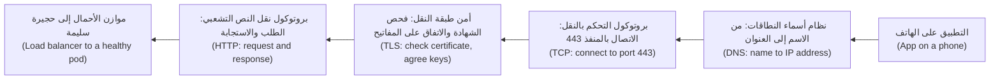
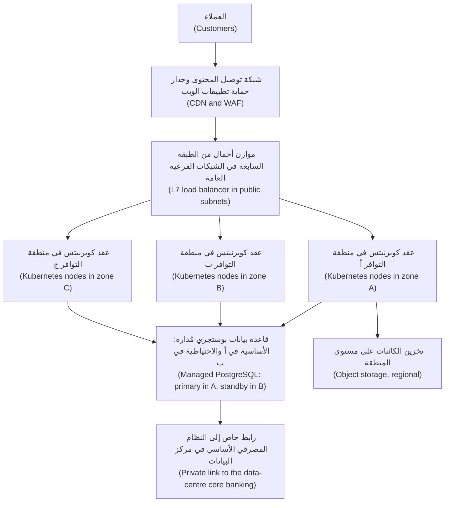
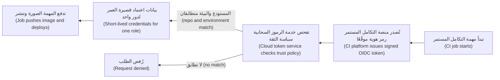

# الوحدة 1 — الأسس

*كل خدمة سحابية ومنصة حاويات وخط تسليم (pipeline) ستقابلها في هذه الدورة تقوم على ثلاث أفكار أقدم: جهاز لينكس يشغّل عمليات، وشبكة تنقل الحزم بين الأسماء والمنافذ، وقرار بشأن من يُسمح له بفعل ماذا. عندما يتعطّل شيء في بيئة الإنتاج (production)، يكون السبب عادةً في إحدى هذه الطبقات الثلاث، مهما بدت الحزمة التقنية فوقها حديثة. تمنحك هذه الوحدة المعرفة العملية التي يعتمد عليها مهندسو المنصات (platform engineers) كل يوم. تبدأ بسطر الأوامر وبالمسار الشبكي الذي يسلكه الطلب، من DNS إلى TLS إلى HTTP، وكيف تعرف أي قفزة فشلت. ثم تشرح ما يبيعه مزوّد السحابة فعلًا: المناطق والمناطق الفرعية، والحوسبة، والتخزين، والخدمات المُدارة (managed services)، ونموذج المسؤولية المشتركة (shared responsibility model) الذي يحدد أي الأعطال تقع على عاتقك. وتنتهي بالهوية والوصول، أي مستوى التحكم في السحابة، حيث يمكن لسياسة واحدة مفرطة الاتساع أو مفتاح واحد مُسرَّب أن يهدم كل ما عداه. تتابع يوسف، الخريج الجديد في فريق هندسة المنصات وهندسة موثوقية المواقع في بنك نجم (Najm Bank)، وهو يلاحق بلاغًا بأن «التطبيق متوقف» يتبيّن أنه شهادة منتهية الصلاحية، ويساعد سالم على تحديد مكان واجهة برمجة تطبيق نجم للهاتف (Najm Mobile API) في السحابة، ويتعلّم لماذا يجب التخلّص من مفتاح النشر الذي لصقه في خط تسليم.*

> **المراحل:** Plan, Deploy, Operate — الجهاز والشبكة والسحابة والهويات التي يُبنى عليها كل ما يأتي لاحقًا في الدورة.

---

# 1.1 — لينكس وسطر الأوامر وأساسيات الشبكات: العمليات والملفات والمنافذ وDNS وHTTP وTLS
*المستوى: 🟢 مبتدئ* · *المتطلبات: 0.1، 0.2* · *المرحلة: Operate, Monitor*

**بعد هذا الدرس تستطيع** تصنيف كل سطر من مخرجات `curl -v` إلى DNS أو TCP أو TLS أو HTTP، وكتابة سكربت يفحص هذه السلسلة ويتوقف عند أول حلقة تفشل. *مدة الدراسة: نحو 115 دقيقة (تقدير).*

## ⚡ الدرس في دقيقة
- تعمل الغالبية العظمى من الخوادم والحاويات (containers) والدوال السحابية على **لينكس (Linux)** في الأساس. تحتاج إلى مجموعة صغيرة من مهارات سطر الأوامر: العمليات، والسجلات، والملفات والصلاحيات، والمنافذ المُنصِتة.
- يعبر الطلب المتّجه إلى `api.najm.example` سلسلة ثابتة من القفزات: يحوّل **نظام أسماء النطاقات (DNS)** الاسم إلى عنوان، ويفتح **بروتوكول التحكم بالنقل (TCP)** اتصالًا بمنفذ، ويُثبت **أمن طبقة النقل (TLS)** هوية الخادم ويشفّر حركة البيانات، ويحمل **بروتوكول نقل النص التشعبي (HTTP)** الطلب والاستجابة.
- القاعدة الأهم: حين يُقال «إنه متوقف»، **امشِ على السلسلة بالترتيب** واختبر كل قفزة بأداتها الخاصة (`dig`، ثم `nc` أو `curl`، ثم `openssl`، ثم `curl -v`) بدلًا من التخمين.
- إشارة القرار: تخبرك **فئة حالة HTTP** أين تبحث. الرمز 4xx يعني أن الطلب رُفض؛ والرمز 5xx يعني أن خادمًا فشل؛ والرمز 502 أو 504 الصادر عن موازن الأحمال (load balancer) يعني أن المشكلة *خلفه*.
- أكبر فخ: إعادة تشغيل الأشياء قبل أن تعرف أي قفزة فشلت. إعادة التشغيل تُتلف الأدلة ولا يمكنها إصلاح DNS أو جدار حماية (firewall) أو شهادة.

## 🧭 لماذا يهم
في ثاني يوم اثنين يقضيه يوسف في العمل، يُبلغ مركز الاتصال أن تطبيق نجم للأفراد «لا يفتح». كل الحجيرات (pods) تعمل، وسجلات التطبيق لا تُظهر أي أخطاء. يعيد يوسف تشغيل النشر على أي حال؛ فلا يتغير شيء. تكتب مها، قائدة فريق هندسة موثوقية المواقع، أمرًا واحدًا: `curl -v https://api.najm.example/health`. يتوقف عند مصافحة TLS برسالة `certificate has expired`. كانت شهادة الحافة تُجدَّد يدويًا مرة في السنة، وكان الشخص الذي يتولى ذلك قد انتقل إلى فريق آخر. كان التطبيق سليمًا طوال الوقت؛ كل ما في الأمر أن العملاء لم يستطيعوا الوصول إليه.

كانت إعادة تشغيل الحجيرات تخمينًا. أما `curl -v` الذي نفّذته مها فقد اختبر قفزة محددة واحدة. هذه هي العادة التي يبنيها هذا الدرس: اعرف القفزات التي يعبرها الطلب، واعرف الأداة التي تختبر كلًّا منها، وامشِ عليها بالترتيب.

تُظهر حالات الانقطاع العامة الكبرى البنية نفسها. في 4 أكتوبر 2021، تعذّر الوصول إلى Facebook وInstagram وWhatsApp لنحو ست ساعات. وفقًا لمنشورات Meta الهندسية العامة، فإن أمرًا صدر أثناء صيانة الشبكة الأساسية فصل مراكز بياناتها، ثم سحبت خوادم DNS لديها مساراتها من الإنترنت. توقفت أسماء Facebook عن التحليل، وكانت الأدوات الداخلية التي يحتاجها المهندسون تعتمد على الشبكة نفسها. كانت الخوادم سليمة؛ لكن المسار إليها اختفى.

## 📐 كيف يعمل

### 🟢 الأساسيات

**سطر الأوامر.** سطر الأوامر (عادةً `bash` أو `zsh`) واجهة نصية لنظام التشغيل. ستستخدمه على الخوادم، وداخل الحاويات، وفي مهام التكامل المستمر، وعلى حاسوبك المحمول.

**العمليات.** **العملية** برنامج قيد التشغيل. لكل عملية **مُعرِّف عملية (process ID, PID)**، ومالك هو مستخدم، وعملية أم. على خادم لينكس حديث، تكون العملية الأولى (PID 1) عادةً **systemd**، الذي يشغّل الخدمات ويشرف عليها. أما داخل الحاوية، فالعملية PID 1 هي تطبيقك نفسه، وهذا مهم للنقطة التالية.

تتخاطب مع العمليات عبر **الإشارات**. أهم إشارتين:
- **SIGTERM** (الإشارة 15) تطلب من العملية أن تتوقف. الخدمة المكتوبة جيدًا تُنهي طلباتها الجارية، وتغلق اتصالات قاعدة البيانات، ثم تخرج.
- **SIGKILL** (الإشارة 9) تُنهي العملية فورًا. لا يُنظَّف شيء؛ وتضيع الطلبات الجارية.

يرسل Kubernetes الإشارة SIGTERM عندما يوقف حجيرة، وينتظر مهلة سماح (grace period) مدتها 30 ثانية افتراضيًا، ثم يرسل SIGKILL؛ لذلك فإن الخدمة التي تتجاهل SIGTERM تُسقط طلبات مع كل عملية نشر (الدرس 2.3).

**الملفات والصلاحيات.** لكل ملف مالك ومجموعة وثلاث مجموعات صلاحيات هي المالك والمجموعة والآخرون، ولكلٍّ منها القراءة (`r`) والكتابة (`w`) والتنفيذ (`x`). يعرضها الأمر `ls -l`:

```text
-rw-r----- 1 najm-api najm-api 1204 Oct  2 08:01 /etc/najm-api/config.yaml
```

يستطيع المالك القراءة والكتابة، وتستطيع المجموعة القراءة، والآخرون لا شيء: أي `640` بالصيغة الرقمية. ينبغي أن يكون المفتاح الخاص بصلاحيات `600` (للمالك فقط)؛ والصلاحية `644` المقروءة للجميع خاطئة لأي شيء سرّي.

**الأوامر اليومية.** تعلّم هذه أولًا:

```bash
ps aux | grep najm-api          # running processes, and their users
systemctl status najm-api       # is the service up, and since when
journalctl -u najm-api --since "10 min ago"   # recent logs
ss -tlnp                        # listening TCP ports and their processes
df -h ; free -h                 # disk and memory: full disks break many services
kill -TERM <pid>                # ask a process to stop cleanly
```

**العناوين والمنافذ.** لكل جهاز على الشبكة **عنوان IP**: يبدو عنوان IPv4 هكذا `10.20.1.15`، وعنوان IPv6 هكذا `2001:db8::15`. **المنفذ** رقم من 0 إلى 65535 يحدد خدمة واحدة على ذلك الجهاز: 443 لبروتوكول HTTPS، و22 لـ SSH، و5432 لـ PostgreSQL. العنوان مع المنفذ يحددان خدمة واحدة على جهاز واحد.

يجب أن **ترتبط** الخدمة بعنوان كي تستقبل حركة البيانات. العنوان `127.0.0.1` (عنوان الاسترجاع) يعني «لا يتصل إلا البرامج على هذا الجهاز نفسه»؛ والعنوان `0.0.0.0` يعني «كل واجهات الشبكة». داخل الحاوية، يشير `127.0.0.1` إلى الحاوية نفسها، فالخدمة المرتبطة به لا يمكن الوصول إليها من الخارج: وهو خلل كلاسيكي من نوع «يعمل محليًا، لا يعمل في الحاوية».

**بروتوكولا TCP وUDP.** يوفر **TCP** اتصالًا موثوقًا ومرتّبًا يُفتح بمصافحة قبل أن تتدفق البيانات؛ وتستخدمه HTTP/1.1 وHTTP/2 وقواعد البيانات وSSH. أما **UDP** فيرسل حزمًا بلا اتصال ولا ضمان؛ وتستخدمه معظم استعلامات DNS، وكذلك QUIC، وهو بروتوكول النقل الذي يقوم عليه HTTP/3.

**مسار طلب واحد.** عندما يستدعي تطبيق نجم العنوان `https://api.najm.example/v1/accounts`، يحدث ما يلي:



**نظام أسماء النطاقات.** يحوّل **نظام أسماء النطاقات** الأسماء إلى عناوين. أنواع السجلات التي ستستخدمها أكثر من غيرها:

| السجل | يربط | مثال استخدام |
|---|---|---|
| **A** | اسم إلى عنوان IPv4 | `api.najm.example` إلى عنوان IPv4 لموازن الأحمال |
| **AAAA** | اسم إلى عنوان IPv6 | الأمر نفسه، لعملاء IPv6 (IPv6 clients) |
| **CNAME** | اسم إلى اسم آخر | `api.najm.example` إلى الاسم الذي يمنحك إياه موازن أحمال سحابي أو شبكة توصيل محتوى (CDN) |
| **TXT** | اسم إلى نص حر | إثبات ملكية النطاق لهيئة شهادات أو لمزوّد بريد إلكتروني |

لكل سجل **مدة بقاء**: أي عدد الثواني التي يجوز فيها للمحلِّلات تخزين الإجابة مؤقتًا. مع TTL قيمته 3600، قد يستغرق التغيير ساعة كي يصل إلى الجميع. قبل ترحيل مخطط له، اخفض قيمة TTL قبل الموعد بمدة TTL قديمة واحدة على الأقل؛ ثم ارفعها مجددًا بعد ذلك.

**فئات حالة HTTP.** يخبرك الرقم الأول من رمز الحالة على من يقع اللوم:

| الفئة | المعنى | أمثلة نموذجية |
|---|---|---|
| 2xx | نجاح | 200 OK، 201 Created |
| 3xx | اذهب إلى مكان آخر | 301 أو 308 إعادة توجيه دائمة |
| 4xx | رُفض طلب العميل | 401 غير مُصادَق، 403 غير مسموح، 404 غير موجود، 429 طلبات كثيرة جدًا |
| 5xx | فشل جانب الخادم | 500 خطأ في التطبيق، 502 بوابة سيئة، 503 غير متاح، 504 انتهاء مهلة البوابة |

الرمز **502** أو **504** الذي يعيده موازن أحمال أو وكيل (proxy) يعني عادةً أن *الشيء الذي خلفه* فشل أو لم يُجب في الوقت المحدد. انظر إلى الخلفية، لا إلى موازن الأحمال.

**أمن طبقة النقل.** يشفّر **أمن طبقة النقل (Transport Layer Security)** حركة البيانات ويُثبت هوية الخادم. يقدّم الخادم **شهادة**: وهي بيان موقَّع يقول «هذا المفتاح العام يخص `api.najm.example`، وهو صالح من هذا التاريخ إلى ذاك»، تُصدره **هيئة شهادات (certificate authority, CA)** يثق بها العميل مسبقًا، غالبًا عبر شهادة وسيطة أو أكثر تشكّل **السلسلة**. إذا فشل الاسم أو التواريخ أو السلسلة في فحوص العميل، يتوقف الاتصال قبل إرسال أي HTTP، ولهذا لم يرَ يوسف شيئًا في سجلات التطبيق. الإصدار TLS 1.3 (RFC 8446) هو الحالي؛ وما زال TLS 1.2 شائعًا. أما التفاصيل التشفيرية فمكانها [*أمن الذكاء الاصطناعي والتطبيقات*، الدرس 5.1 — التشفير للبنّائين: TLS والتجزئة والتشفير والمفاتيح](../secai/index.ar.html#/5.1)؛ أما هنا فيعنينا تشغيله.

### 🟡 التعمق أكثر

**المشي على السلسلة.** حين يقول أحدهم «إنه متوقف»، اختبر كل قفزة بالترتيب وتوقّف عند أول قفزة تفشل:

```bash
# 1. DNS: does the name resolve, and to what?
dig +short api.najm.example A
dig api.najm.example            # full answer, including the TTL

# 2. TCP: can we open a connection to the port?
nc -vz api.najm.example 443

# 3. TLS: what certificate is presented, for which name, valid until when?
openssl s_client -connect api.najm.example:443 -servername api.najm.example </dev/null 2>/dev/null \
  | openssl x509 -noout -subject -issuer -dates

# 4. HTTP: what does the server answer?
curl -sv https://api.najm.example/health -o /dev/null
```

غالبًا ما يغطي `curl -v` وحده الخطوات الأربع كلها؛ تعلّم قراءة مخرجاته سطرًا سطرًا.

**قراءة النتيجة.**

| العَرَض | القفزة التي فشلت | الأسباب المعتادة |
|---|---|---|
| `NXDOMAIN` أو لا إجابة من `dig` | DNS | سجل مفقود أو محذوف، منطقة خاطئة، انتهاء تسجيل النطاق |
| `Connection refused` | TCP | لا شيء يُنصت على ذلك المنفذ، أو خدمة مرتبطة بـ `127.0.0.1` |
| يتعلّق الاتصال ثم تنتهي مهلته | الشبكة | جدار حماية أو مجموعة أمان تُسقط الحزم، مسار خاطئ، شبكة فرعية خاطئة |
| `certificate has expired` أو عدم تطابق الاسم | TLS | فشل التجديد، شهادة خاطئة على المُنصِت، غياب SNI |
| 502 أو 504 من موازن الأحمال | خلف موازن الأحمال | لا خلفيات سليمة، انتهاء مهلة الخلفية، فشل فحص السلامة |
| 401 أو 403 | التطبيق أو البوابة | رمز منتهي الصلاحية، صلاحية مفقودة، قاعدة جدار حماية تطبيقات الويب |

*الرفض* يعني أن جهازًا أجاب ولا شيء يُنصت؛ أي أن المسار يعمل. أما *انتهاء المهلة* فيعني عادةً أن شيئًا ما أسقط الحزم بصمت، وهو في الغالب قاعدة جدار حماية.

**إشارة اسم الخادم (SNI).** كثيرًا ما يخدم موازن أحمال واحد أسماء كثيرة على عنوان واحد؛ فيسمّي العميل المضيف الذي يريده في مصافحة TLS عبر **إشارة اسم الخادم** كي تُختار الشهادة الصحيحة. ومن هنا الخيار `-servername` أعلاه: من دونه قد ترى شهادة افتراضية فتستنتج استنتاجًا خاطئًا.

**موازنات الأحمال من الطبقة 4 والطبقة 7 (Layer 4 and layer 7 load balancers).** يمرّر موازن الأحمال من **الطبقة 4 (layer 4, L4)** اتصالات TCP أو UDP دون قراءة HTTP بداخلها: سريع ومستقل عن البروتوكول. أما موازن الأحمال من **الطبقة 7 (layer 7, L7)** فيفهم HTTP: فهو يُنهي TLS، ويوجّه حسب المضيف أو المسار (`/v1/payments` إلى خدمة، و`/v1/cards` إلى أخرى)، ويعيد صفحات أخطاء خاصة به. تقع واجهة برمجة تطبيق نجم للهاتف خلف موازن أحمال L7، لذا فإن 502 هناك يعني أن الخلفية أساءت التصرف.

**الخدمات مع systemd.** على الجهاز الافتراضي (VM)، يحدد **ملف الوحدة** في systemd كيف تعمل الخدمة: الأمر، والمستخدم الذي تعمل باسمه — وليس الجذر أبدًا إلا عند الضرورة — وهل يُعاد تشغيلها عند الفشل (`Restart=on-failure`). في الحاويات، تحلّ بيئة التشغيل وKubernetes محل systemd، لكن الأفكار تنتقل كما هي: عملية خاضعة للإشراف، وسياسة إعادة تشغيل، ومستخدم غير جذري.

**العناوين الخاصة.** يحجز RFC 1918 ثلاثة نطاقات IPv4 للشبكات الخاصة: `10.0.0.0/8` و`172.16.0.0/12` و`192.168.0.0/16`. اللاحقة `/16` هي ترميز **CIDR**: أول 16 بتًا تسمّي الشبكة، فيضم `10.20.0.0/16` عدد 65,536 عنوانًا، ويضم `10.20.1.0/24` عدد 256 عنوانًا. يستخدم الدرس 1.2 هذه النطاقات لتخطيط الشبكات السحابية.

### 🔴 نظرة الخبير

**أتمِت الشهادات، ثم أطلق التنبيهات على أي حال.** التجديد السنوي اليدوي انقطاعٌ موقوتٌ ينتظر موعده. استخدم **ACME** (RFC 8555)، وهو البروتوكول الذي يقوم عليه Let's Encrypt، أو مدير الشهادات لدى مزوّدك، وفي Kubernetes متحكّمًا (controller) مثل cert-manager. وقد اتفق منتدى CA/Browser Forum على تقصير الحد الأقصى لعمر الشهادات العامة على مراحل خلال السنوات المقبلة، مما يجعل التجديد اليدوي غير عملي. ومع ذلك أطلق تنبيهًا قبل انتهاء الصلاحية بـ 14 يومًا مثلًا: فالأتمتة تفشل بصمت عندما يتغير DNS أو الصلاحيات.

**نظام DNS تبعيةٌ لكل شيء.** قد تعتمد أدوات المراقبة وأدوات النشر ومحادثة الحوادث لديك على نظام DNS والشبكة نفسيهما اللذين تحاول إصلاحهما، كما أظهر انقطاع Facebook عام 2021. احتفظ بقائمة «خارج النطاق» لكيفية الوصول إلى لوحات التحكم وأدلة التشغيل (runbooks) وبعضكم بعضًا إذا توقفت أسماؤكم عن التحليل.

**افحص من الخارج.** تُظهر لوحات المعلومات داخل العنقود (cluster) حجيرات سليمة، لا ما إذا كان العملاء قادرين على الوصول إليها. أما **الفحص الاصطناعي** — وهو طلب مُجدوَل من خارج شبكتك، ويُفضَّل من عدة أماكن — فيختبر السلسلة كاملة من جهة العميل، وكان سيكتشف شهادة نجم المنتهية قبل أن يكتشفها مركز الاتصال. يبني الدرس 5.2 هذا الفحص.

**اختبر من حيث يوجد العميل.** قد يختلف المحلِّل أو الوكيل أو مسار الشبكة الافتراضية الخاصة على حاسوبك عن تلك التي لدى العميل.

## 🧰 الأدوات
| الأداة أو الممارسة أو الخدمة | ما هي وماذا تفعل | متى تلجأ إليها |
|---|---|---|
| **curl** | عميل HTTP لسطر الأوامر؛ يعرض الخيار `-v` نظام DNS والاتصال وTLS وHTTP في تشغيل واحد | أول اختبار لأي بلاغ «إنه متوقف»؛ فحوص السلامة؛ النصوص البرمجية |
| **dig** | يستعلم DNS ويعرض السجلات وقيم TTL وأي خادم أجاب | فحص سجل بعد تغيير؛ تشخيص فشل التحليل |
| **openssl s_client** | يفتح اتصال TLS ويعرض سلسلة الشهادات المقدَّمة | فحص أسماء الشهادات وجهات إصدارها وتواريخ انتهائها |
| **ss** | يسرد المقابس: المنافذ المُنصِتة والعمليات التي تملكها | حالة «رُفض الاتصال»؛ فحص العنوان الذي ترتبط به الخدمة |
| **ACME** | بروتوكول للإصدار والتجديد التلقائيين للشهادات | كل شهادة عامة؛ لا تجدّد يدويًا أبدًا |
| **Synthetic check** | الفحص الاصطناعي: طلب مُجدوَل إلى خدمتك من خارج شبكتك | اكتشاف أعطال DNS وTLS والحافة التي تفوّتها لوحات المعلومات الداخلية |

## 🏛️ عمليًا في بنك نجم
بعد حادثة الشهادة، تطلب مها من يوسف كتابة **دليل تشغيل الاستجابة الأولى** للفريق لحالة «تعذّر الوصول إلى واجهة برمجة تطبيق نجم للهاتف». يوضع الدليل بجوار التنبيه، فيتبع المناوب الخطوات نفسها.

**دليل التشغيل RB-001: تعذّر الوصول إلى واجهة برمجة تطبيق نجم للهاتف — امشِ على السلسلة**

| الخطوة | الأمر — من خارج الشبكة أولًا، ثم من حجيرة | النتيجة السليمة | إن فشلت، افحص |
|---|---|---|---|
| 1. نظام أسماء النطاقات | `dig +short api.najm.example` | اسم شبكة توصيل المحتوى أو موازن الأحمال | سجل تغييرات DNS؛ تسجيل النطاق |
| 2. بروتوكول التحكم بالنقل | `nc -vz api.najm.example 443` | `succeeded` | حالة الحافة أو جدار حماية تطبيقات الويب؛ تغييرات جدار الحماية |
| 3. أمن طبقة النقل | `openssl s_client ... \| openssl x509 -noout -dates -subject` | الاسم الصحيح؛ انتهاء الصلاحية بعد أكثر من 14 يومًا | مدير الشهادات؛ سجلات تجديد ACME |
| 4. بروتوكول نقل النص التشعبي | `curl -sv https://api.najm.example/health` | `200` | 502 أو 504: جاهزية الخلفية؛ 403: قواعد جدار حماية تطبيقات الويب؛ 5xx: سجلات التطبيق |
| 5. الخلفية | `kubectl get pods -n mobile-api`، ثم السجلات | كلها جاهزة | عمليات النشر الأخيرة: تراجَع أولًا، وحقّق ثانيًا |

**قواعد مرفقة بدليل التشغيل:**
- انشر أول قفزة فاشلة ومخرجاتها الدقيقة في قناة الحادثة قبل تغيير أي شيء؛ ولا تُعِد تشغيل أحمال العمل حتى تشير الخطوة 4 إلى الخلفية.
- متابعات هذه الحادثة: تجديد ACME لكل شهادة، وتنبيه قبل انتهاء الصلاحية بـ 14 يومًا، وفحص اصطناعي خارجي على `/health` كل دقيقة من موقعين.

## 🛠️ التمارين
تُنفَّذ جميع التمارين على جهازك الخاص باستخدام Docker وطرفية.

- 🟢 نفّذ `curl -v https://example.com` وصنّف كل سطر من المخرجات على أنه DNS أو TCP أو TLS أو HTTP. ثم استخدم `dig` و`openssl s_client` لتدوين قيمة TTL للسجل وجهة إصدار الشهادة وتاريخ انتهائها. *يكتمل عندما:* تستطيع أن تشير إلى موضع نجاح كل قفزة وأن تقول متى تنتهي صلاحية الشهادة.
- 🟡 اكتب خادم HTTP صغيرًا يُنصت على `127.0.0.1:8080`، وشغّله بالأمر `docker run -p 8080:8080`، وحاول الوصول إليه من جهازك المضيف. شخّص المشكلة بالأمر `ss -tlnp` داخل الحاوية، وأصلح عنوان الربط، وتحقّق. ثم اجعله يسجّل «shutting down» عند استقبال SIGTERM وتحقّق من أن `docker stop` يُظهر الرسالة. *يكتمل عندما:* يُصلَح السلوكان كلاهما وتستطيع شرح كل فشل في جملتين.
- 🔴 اكتب `walk-the-chain.sh <hostname>`: ينفّذ الاختبارات الأربعة بالترتيب، ويطبع PASS أو FAIL لكل قفزة مع التفصيل الأساسي — العنوان، وانتهاء صلاحية الشهادة، وحالة HTTP — ويخرج برمز غير صفري عند أول فشل. اختبره على موقع يعمل، واسم غير موجود، ومنفذ محلي مغلق، وشهادة منتهية الصلاحية — يستضيف badssl.com مواقع اختبار معطوبة عمدًا. *يكتمل عندما:* يتوقف كل فشل عند القفزة الصحيحة برسالة واضحة.

## ⚠️ أخطاء وفخاخ
- **إعادة التشغيل قبل التشخيص.** امشِ على السلسلة أولًا؛ ولا تُعِد التشغيل إلا حين تشير الأدلة إلى العملية.
- **الربط بالمضيف المحلي داخل الحاوية.** يتعذّر الوصول إلى الخدمة من الخارج. اربطها بـ `0.0.0.0` ودع سياسة الشبكة (network policy) تقرر من يحق له الاتصال.
- **تجديد الشهادات يدويًا.** ينسى أحدهم فيُظلم الموقع. أتمِت باستخدام ACME وأطلق تنبيهًا قبل انتهاء الصلاحية.
- **تجاهل SIGTERM.** كل عملية نشر تُسقط طلبات. توقّف عن قبول عمل جديد، وأنهِ الطلبات الحالية، ثم اخرج.
- **تشغيل الخدمات بصلاحيات الجذر.** يتحوّل خلل واحد إلى سيطرة كاملة على الجهاز. شغّلها باسم مستخدم مخصّص لا يملك إلا الملفات التي يحتاجها.

## 🧾 الخلاصة
- لينكس وسطر الأوامر هما أرضية كل منصة: العمليات، والإشارات، والصلاحيات، والخدمات، والسجلات.
- يعبر الطلب DNS ثم TCP ثم TLS ثم HTTP بالترتيب؛ ولكل قفزة اختبارها الخاص.
- «الرفض» يعني أن لا شيء يُنصت؛ وانتهاء المهلة يعني عادةً أن شيئًا يُسقط الحزم.
- تشير فئات حالة HTTP إلى الجانب المذنب؛ والرمز 502 أو 504 عند موازن الأحمال يشير إلى ما خلفه.
- أتمِت الشهادات، وأطلق التنبيه قبل انتهاء الصلاحية، وافحص من الخارج.

## ✍️ اختبر نفسك

**1. يُبلغ العملاء أن تطبيق نجم لا يفتح. جميع الحجيرات تعمل وسجلات التطبيق لا تُظهر أخطاء. ماذا ينبغي أن يفعل يوسف أولًا؟**

- A. يعيد تشغيل النشر لمسح أي حالة سيئة في الذاكرة
- B. ينفّذ `curl -v` على نقطة فحص السلامة من الخارج ويجد القفزة الفاشلة
- C. يوسّع النشر كي تتقاسم نسخ متماثلة أكثر الحمل
- D. يتراجع عن آخر عملية نشر إلى آخر إصدار معروف السلامة قبل أن يعرف ما الذي تعطّل فعلًا

<details><summary>الإجابة</summary>

**B.** الحجيرات السليمة مع سجلات فارغة توحي بأن الطلبات لا تصل إلى التطبيق أصلًا، فاختبر السلسلة من جهة العميل. أما A وC وD فتغيّر الأشياء دون دليل. (🟡 التعمق أكثر).

</details>

**2. تعمل خدمة جيدًا على حاسوب مطوّر. داخل حاوية، يفشل `curl` من الجهاز المضيف فورًا — رفض أو إعادة تعيين — ويُظهر `ss -tlnp` داخل الحاوية أنها تُنصت على `127.0.0.1:8080`. ما الخطأ؟**

- A. جدار حماية داخل صورة الحاوية يحجب حركة البيانات الواردة على المنفذ 8080 لأن الصورة بُنيت بقواعد حظر صارمة
- B. شهادة TLS المقدَّمة لا تطابق اسم المضيف المطلوب
- C. لا يستطيع DNS الداخلي في Docker تحليل اسم الحاوية
- D. تُنصت الخدمة على عنوان الاسترجاع، فلا يمكن الوصول إليها إلا من داخل الحاوية

<details><summary>الإجابة</summary>

**D.** العنوان `127.0.0.1` داخل الحاوية هو الحاوية نفسها. اربط الخدمة بـ `0.0.0.0`. جدار الحماية يسبب عادةً انتهاء مهلة، لا فشلًا فوريًا، والطلب لا يصل إلى TLS ولا يحتاج إلى DNS..

</details>

**3. سينقل الفريق `api.najm.example` إلى موازن أحمال جديد يوم الثلاثاء المقبل. قيمة TTL للسجل 86,400 ثانية (يوم واحد). ماذا ينبغي أن يفعلوا؟**

- A. خفض TTL إلى دقائق قبل يوم أو أكثر، ثم التبديل، ثم رفعها مجددًا
- B. تغيير السجل يوم الثلاثاء؛ فقيمة TTL لا تؤثر إلا في العملاء الذين لم يسألوا من قبل
- C. حذف السجل القديم أولًا، وانتظار مسح ذاكرات التخزين المؤقت، ثم إنشاء السجل الجديد
- D. رفع TTL مسبقًا كي تبقى الإجابة الجديدة مخزّنة مؤقتًا مدة أطول بعد وصولها

<details><summary>الإجابة</summary>

**A.** تحتفظ ذاكرات التخزين المؤقت (caches) بالإجابة القديمة مدة تصل إلى TTL، لذا فإن خفضها مسبقًا يجعل التبديل ينتشر سريعًا. يتجاهل B التخزين المؤقت؛ ويسبب C فشل التحليل؛ ويزيد D الأمر سوءًا..

</details>

**4. يعيد موازن الأحمال L7 الواقع أمام واجهة برمجة تطبيق نجم للهاتف الرمز 504 Gateway Timeout. من أين ينبغي أن يبدأ التحقيق؟**

- A. سجلات DNS للواجهة كما يراها العميل من شبكته وأي تغييرات حديثة عليها
- B. شهادة TLS على موازن الأحمال وتاريخ انتهائها
- C. الخلفيات خلف موازن الأحمال: سلامتها وجاهزيتها وأزمنة استجابتها
- D. شبكة الهاتف المحمول لدى العميل أثناء تنقّله

<details><summary>الإجابة</summary>

**C.** كي يعيد موازن الأحمال 504 أصلًا، لا بد أن DNS وTLS وشبكة العميل قد عملت؛ فالخلفية لم تُجب في الوقت المحدد..

</details>

**5. يوقف Kubernetes حجيرة أثناء عملية نشر. ماذا يحدث، وماذا يجب أن يفعل التطبيق؟**

- A. يرسل SIGKILL فورًا، فلا يحظى التطبيق بفرصة للتنظيف
- B. يرسل SIGTERM، ثم SIGKILL بعد مهلة سماح؛ وعلى التطبيق تصريف العمل الجاري ثم الخروج
- C. يرسل SIGHUP، وعلى التطبيق إعادة تحميل إعداداته ومواصلة الخدمة
- D. يحذف صورة الحاوية، فيجب على التطبيق أولًا حفظ حالته على القرص المحلي قبل أن تُحذف الصورة من العقدة نهائيًا

<details><summary>الإجابة</summary>

**B.** الإشارة SIGTERM هي الطلب المهذّب؛ وتليها SIGKILL بعد مهلة السماح (30 ثانية افتراضيًا). تجاهل SIGTERM يُسقط طلبات مع كل عملية نشر..

</details>

## 📚 المراجع
- RFC 8446، بروتوكول أمن طبقة النقل الإصدار 1.3 — https://www.rfc-editor.org/rfc/rfc8446
- RFC 9110، دلالات HTTP — https://www.rfc-editor.org/rfc/rfc9110
- RFC 1035، أسماء النطاقات: التنفيذ والمواصفات — https://www.rfc-editor.org/rfc/rfc1035
- RFC 1918، تخصيص العناوين للإنترنتات الخاصة — https://www.rfc-editor.org/rfc/rfc1918
- RFC 8555، بيئة الإدارة الآلية للشهادات — https://www.rfc-editor.org/rfc/rfc8555
- صفحات دليل لينكس — https://man7.org/linux/man-pages/
- توثيق systemd — https://systemd.io/
- Kubernetes، دورة حياة الحجيرة وإنهاؤها — https://kubernetes.io/docs/concepts/workloads/pods/pod-lifecycle/
- Meta Engineering، «مزيد من التفاصيل حول انقطاع 4 أكتوبر» — https://engineering.fb.com/2021/10/05/networking-traffic/outage-details/
- للتوسّع: [*تصميم الأنظمة لمبرمجي الحدس*، الدرس F.1 — ماذا يحدث عندما تفتح موقعًا إلكترونيًا](../vibe/index.ar.html#lF-1) و[*تصميم الأنظمة لمبرمجي الحدس*، الدرس 11.1 — النطاقات وDNS وTLS](../vibe/index.ar.html#l11-1)

---

# 1.2 — أساسيات السحابة: المناطق ومناطق التوافر والحوسبة والتخزين والخدمات المُدارة والمسؤولية المشتركة
*المستوى: 🟢 مبتدئ* · *المتطلبات: 1.1* · *المرحلة: Plan, Deploy*

**بعد هذا الدرس تستطيع** رسم شبكة VPC على منطقتي توافر بنطاقات الشبكات الفرعية وبوابة NAT وموازن أحمال وقواعد جدار ناري على مستوى المنفذ، وكتابة مذكرة تموضع تبيّن من يرقّع ماذا وما الذي يحدث عند تعطّل منطقة. *مدة الدراسة: نحو 115 دقيقة (تقدير).*

## ⚡ الدرس في دقيقة
- يؤجّرك مزوّد السحابة قدرة حوسبة عند الطلب، عبر واجهة برمجة تطبيقات، بفوترة حسب الاستخدام. تبيع **AWS** و**Microsoft Azure** و**Google Cloud** لبنات بناء متشابهة بأسماء مختلفة.
- التخطيط المادي هو أول قرار تصميمي: **المنطقة** مساحة جغرافية؛ و**منطقة التوافر (availability zone)** مركز بيانات منفصل أو أكثر داخلها. وزّع بيئة الإنتاج على **منطقتَي توافر على الأقل**؛ ولا تفكّر في منطقة ثانية إلا لسبب واضح يتعلق بالتعافي أو بمكان إقامة البيانات.
- اختر **الخدمة الأكثر إدارةً** التي تلبّي احتياجاتك: فأنت تدفع لتسليم الترقيع والنسخ الاحتياطي وتجاوز الفشل (failover) لغيرك.
- يأتي التخزين في ثلاثة أشكال: **الكائنات** — ملفات بمفتاح عبر HTTP، و**الكتل** — قرص لجهاز واحد، و**الملفات** — مجلد شبكي مشترك. اختر حسب نمط الوصول، لا حسب العادة.
- يقول **نموذج المسؤولية المشتركة** إن المزوّد يؤمّن السحابة وأنت تؤمّن ما تضعه فيها. الإعدادات والهوية والبيانات مسؤوليتك دائمًا.
- أكبر فخ: اعتبار «إنه في السحابة» مرادفًا لـ«إنه مرن». النشر في منطقة توافر واحدة بلا نسخ احتياطية مُختبَرة يفشل تمامًا كما كان يفشل الخادم الواحد.

## 🧭 لماذا يهم
قرّر بنك نجم نقل واجهة برمجة تطبيق نجم للهاتف خارج مركز بياناته. يطلب سالم من يوسف صياغة مذكرة التموضع: أي منطقة، وكم منطقة توافر، وأي خدمات، وما الذي يبقى نجم مالكًا له بعد أن يشغّل المزوّد العتاد. تسرد المسودة الأولى ليوسف «عنقود Kubernetes وجهاز افتراضي لـ PostgreSQL» في منطقة توافر واحدة، لأن هذه هي الطريقة التي كان يعمل بها في المقر (on-premises). يعيدها سالم مع ثلاثة أسئلة: «ماذا يحدث عندما تمر منطقة التوافر تلك بيوم سيئ؟ من يرقّع قاعدة البيانات تلك؟ وأي من الجهات التنظيمية للبنك تحتاج إلى معرفة مكان بيانات العملاء؟»

في 28 فبراير 2017، تعطّلت خدمة Amazon S3 في منطقة US-EAST-1 (شمال فرجينيا) لعدة ساعات. وفقًا للملخّص العام من AWS، أُدخل أمر يُقصد به إزالة عدد صغير من الخوادم بمُدخل خاطئ، فأزال مجموعة أكبر بكثير، منها خوادم كانت تعتمد عليها أنظمة S3 الفرعية الأساسية. وتعطّلت معها خدمات كثيرة كانت تحفظ بياناتها في تلك المنطقة الوحيدة. لم يكن الدرس «تجنّب السحابة»، بل كان: اعرف أي منطقة وأي خدمات تعتمد عليها، واعرف ما الذي يفشل معًا، وصمّم لذلك عن قصد.

## 📐 كيف يعمل

### 🟢 الأساسيات

**ما معنى «السحابة».** يسرد تعريف NIST (SP 800-145، 2011): الخدمة الذاتية عند الطلب (on-demand self-service)، والوصول الواسع عبر الشبكة، وتجميع الموارد (resource pooling)، والمرونة السريعة (rapid elasticity)، والخدمة المُقاسة (measured service). عمليًا: تطلب من واجهة برمجة تطبيقات (API) خادمًا أو قاعدة بيانات أو حاوية تخزين (bucket)، فيوجد خلال دقائق، وتدفع حتى تحذفه. ولأن كل شيء استدعاء لواجهة برمجة تطبيقات، يديره الدرس 3.1 بوصفه شيفرة.

**نماذج الخدمة.** تختلف النماذج في مقدار الحزمة التقنية الذي تشغّله أنت:

| النموذج | ما تحصل عليه | ما تظل تديره | مثال من نجم |
|---|---|---|---|
| **IaaS** | أجهزة افتراضية (virtual machines)، وأقراص، وشبكات | نظام التشغيل، والترقيع، وبيئة التشغيل (runtime)، والتطبيق، والبيانات | جهاز افتراضي لمهمة دفعية قديمة |
| **PaaS** | بيئة تشغيل أو خدمة مُدارة: قاعدة بيانات، ومستوى تحكم Kubernetes، ومنصة تطبيقات | الإعدادات، والتطبيق، والبيانات، والوصول | PostgreSQL مُدار لواجهة برمجة تطبيق نجم للهاتف |
| **Serverless** (الحوسبة بلا خوادم) | شيفرة أو حاويات تعمل لكل طلب أو حدث؛ لا خوادم ظاهرة؛ فوترة حسب الاستخدام | الشيفرة، والإعدادات، والصلاحيات، والبيانات | دالة تغيّر حجم صور الشيكات المرفوعة |
| **SaaS** | تطبيق جاهز | المستخدمون، والإعدادات، والبيانات | أدوات البريد الإلكتروني والتذاكر في البنك |

**المناطق ومناطق التوافر.** **المنطقة** مساحة جغرافية منفصلة تضم مراكز بيانات المزوّد. **منطقة التوافر (availability zone, AZ)** — وتسميها Google ببساطة «zones» — مركز بيانات واحد أو أكثر داخل المنطقة، له طاقته وتبريده وشبكته المستقلة، ومتصل بمناطق التوافر الأخرى بروابط خاصة سريعة. صُمّمت مناطق التوافر بحيث تفشل إحداها دون الأخرى. لا توفّر كل منطقة عدة مناطق توافر، ولا تتوفر كل خدمة في كل منطقة؛ راجع قائمة المناطق الحالية لكل مزوّد.

يتوقف اختيار المنطقة على **زمن الاستجابة (latency)** للمستخدمين، و**مكان إقامة البيانات (data residency)** — أي حيث تشترط الجهات التنظيمية أو العقود بقاء البيانات — و**توفر الخدمات**، و**التكلفة** التي تختلف من منطقة إلى أخرى. يشغّل المزوّدون الثلاثة الكبار مناطق في الخليج وقت كتابة هذا النص (2026)؛ تحقّق من الخدمات التي يوفّرها كلٌّ منهم.

**الحوسبة.** ثلاثة أشكال رئيسية:
- **الأجهزة الافتراضية** (AWS EC2، Azure Virtual Machines): تختار حجمًا — المعالج والذاكرة — وصورة وشبكة؛ وتدير نظام التشغيل.
- **Kubernetes المُدار**: يشغّل المزوّد مستوى التحكم في Kubernetes؛ وتشغّل أنت الحاويات على العُقد العاملة (worker nodes)، التي قد تكون هي نفسها مُدارة. تغطي الوحدة 2 هذا الموضوع.
- **الدوال والحاويات بلا خوادم**: تسلّم الشيفرة أو حاوية؛ وتتولى المنصة توسيعها، بما في ذلك التقليص إلى الصفر.

**التخزين.** اختر حسب طريقة الوصول إلى البيانات:

| النوع | ما هو | مناسب لـ | غير مناسب لـ |
|---|---|---|---|
| **تخزين الكائنات (Object storage)** (S3، Azure Blob Storage) | ملفات («كائنات») في حاوية تخزين، يُشار إليها بمفتاح عبر واجهة HTTP | المستندات، وكشوف الحساب، والنسخ الاحتياطية، والسجلات، وبحيرات البيانات | قواعد البيانات؛ الملفات المعدَّلة في مكانها |
| **تخزين الكتل (Block storage)** | قرص افتراضي مُلحق بجهاز افتراضي، عادةً في منطقة توافر واحدة | قواعد البيانات التي تشغّلها بنفسك؛ أقراص الإقلاع | المشاركة بين الأجهزة |
| **تخزين الملفات** | نظام ملفات شبكي مشترك — NFS أو SMB — تركّبه أجهزة كثيرة | التطبيقات القديمة التي تحتاج مجلدًا مشتركًا | قواعد البيانات عالية الأداء |

تخزين الكائنات هو الخيار الافتراضي لأي شيء هو ملف: يتوسّع دون تخطيط للسعة ويخزّن البيانات بتكرار. تحقّق دائمًا من إعدادات الوصول بدلًا من افتراض أنه خاص.

**قواعد البيانات المُدارة.** تشغّل لك خدمة قاعدة البيانات المُدارة — مثل Amazon RDS وAzure Database for PostgreSQL وGoogle Cloud SQL وغيرها — محرك قاعدة البيانات: فهي تثبّت الرقع، وتأخذ نسخًا احتياطية آلية، ويمكنها الإبقاء على **نسخة متماثلة احتياطية** في منطقة توافر أخرى تتولى المهمة تلقائيًا إذا فشلت النسخة الأساسية. يظل عليك اختيار الحجم، والإعدادات، ومدة الاحتفاظ بالنسخ الاحتياطية، ومن يمكنه الاتصال.

**المسؤولية المشتركة.** المزوّد مسؤول عن أمن السحابة *ذاتها*: المباني، والعتاد، وطبقة المحاكاة الافتراضية، وبرمجيات الخدمات المُدارة. وأنت مسؤول عن الأمن *داخل* السحابة: ما تُعدّه، ومن تمنحه الوصول، وبياناتك. ويتحرك الخط الفاصل مع نموذج الخدمة:

| الطبقة (Layer) | جهاز افتراضي IaaS | قاعدة بيانات أو Kubernetes مُدار | بلا خوادم (Serverless) | SaaS |
|---|---|---|---|---|
| البيانات وتصنيفها والوصول إليها | أنت | أنت | أنت | أنت |
| الهويات والصلاحيات | أنت | أنت | أنت | أنت |
| شيفرة التطبيق | أنت | أنت | أنت | المزوّد |
| إعدادات الشبكة — من يمكنه الوصول إليها | أنت | أنت | أنت في الغالب | المزوّد |
| نظام التشغيل والترقيع | أنت | المزوّد لمستوى التحكم؛ ومشتركة للعقد العاملة | المزوّد | المزوّد |
| العتاد ومراكز البيانات | المزوّد | المزوّد | المزوّد | المزوّد |

انظر إلى الصفّين العلويين: البيانات والهوية تبقيان لديك أيًّا كان ما تشتريه. كثير من اختراقات السحابة واسعة الانتشار جاءت من إعدادات في جانب العميل، مثل حاوية تخزين جُعلت عامة أو مفتاح تسرّب، لا من عتاد المزوّد. التفاصيل الأمنية في [*أمن الذكاء الاصطناعي والتطبيقات*، الدرس 7.1 — أمن السحابة: المسؤولية المشتركة وIAM وسوء الإعداد](../secai/index.ar.html#/7.1).

### 🟡 التعمق أكثر

**الشبكات السحابية.** يتيح لك كل مزوّد إنشاء شبكة خاصة: **سحابة افتراضية خاصة** على AWS وGoogle Cloud، و**شبكة افتراضية (virtual network, VNet)** على Azure. وتنشئ بداخلها **شبكات فرعية**، وهي نطاقات من العناوين الخاصة مثل `10.20.1.0/24`:
- **الشبكة الفرعية العامة (public subnet)** لها مسار إلى الإنترنت؛ ويمكن أن تحمل الموارد فيها عناوين عامة. لا تضع فيها إلا ما يجب أن يواجه الإنترنت، وهو عادةً موازنات الأحمال (load balancers).
- **الشبكة الفرعية الخاصة (private subnet)** ليس لها مسار وارد من الإنترنت. تعيش هنا خوادم التطبيقات وعقد Kubernetes وقواعد البيانات.
- **بوابة ترجمة عناوين الشبكة (NAT gateway)** تتيح للموارد في الشبكات الفرعية الخاصة إجراء اتصالات *صادرة* — لتنزيل التحديثات أو استدعاء واجهة برمجة تطبيقات خارجية — دون أن يمكن الوصول إليها من الخارج.
- **مجموعات الأمان** في AWS، و**مجموعات أمان الشبكة** في Azure، و**قواعد جدار الحماية** في Google Cloud تقرر أي حركة بيانات يمكنها الوصول إلى أي مورد، حسب العنوان والمنفذ.

في AWS وAzure تنتمي السحابة الافتراضية الخاصة (VPC) أو الشبكة الافتراضية (VNet) إلى منطقة واحدة، بينما السحابة الافتراضية الخاصة في Google Cloud عالمية، بشبكات فرعية إقليمية.

**تموضع أول.** هذا هو الشكل الذي يريده سالم لواجهة برمجة تطبيق نجم للهاتف:



كل طبقة تمتد عبر مناطق التوافر، والحافة وحدها تواجه الإنترنت، وقاعدة البيانات تتجاوز الفشل تلقائيًا.

**الاتصال الهجين.** يبقى النظام المصرفي الأساسي (core banking) لدى نجم في المقر، لذا يجب أن تصل السحابة إلى مركز البيانات بشكل خاص: إما عبر **شبكة افتراضية خاصة من موقع إلى موقع** فوق الإنترنت — سريعة الإعداد ومشفّرة ومحدودة بالإنترنت — أو عبر **اتصال خاص مخصّص**، وهو أبطأ في الترتيب لكنه أكثر قابلية للتنبؤ. كثيرًا ما تستخدم البنوك رابطًا مخصّصًا مع شبكة افتراضية خاصة احتياطية. خطّط لنطاقات العناوين مبكرًا: إذا تداخل النطاق `10.20.0.0/16` للسحابة الافتراضية الخاصة مع شبكة في مركز البيانات، يتعطّل التوجيه.

**المقابلات بين المزوّدين.** المفاهيم تنتقل؛ أما الأسماء فلا:

| المفهوم | AWS | Microsoft Azure | Google Cloud |
|---|---|---|---|
| الجهاز الافتراضي (Virtual machine) | EC2 | Virtual Machines | Compute Engine |
| Kubernetes المُدار | EKS | AKS | GKE |
| تخزين الكائنات | S3 | Blob Storage | Cloud Storage |
| الشبكة الخاصة | VPC | Virtual Network | VPC |
| PostgreSQL المُدار | RDS / Aurora | Azure Database for PostgreSQL | Cloud SQL / AlloyDB |
| الهوية والوصول | IAM | Microsoft Entra ID وAzure RBAC | Cloud IAM |
| الرابط الخاص إلى المقر | Direct Connect | ExpressRoute | Cloud Interconnect |

**المُدار مقابل التشغيل الذاتي.** القاعدة الافتراضية لدى نجم هي «استخدم الخدمة المُدارة ما لم يوجد سبب مكتوب لعدم ذلك». تشغيل PostgreSQL ذاتيًا على أجهزة افتراضية يعني أن فريقك يملك الترقيع، والتكرار، وتجاوز الفشل، والنسخ الاحتياطي، واختبارات الاستعادة. أما الخدمة المُدارة فتتولى معظم ذلك، مقابل ثمن ومع تحكم أقل — فليست كل إضافة أو إعداد متاحًا. الأسباب الوجيهة للتشغيل الذاتي: ميزة مفقودة، أو قابلية النقل، أو احتياجات أداء محددة؛ اكتب السبب.

### 🔴 نظرة الخبير

**صمّم وفق نطاقات الفشل.** **نطاق الفشل** هو مجموعة الأشياء التي تفشل معًا: خادم، أو منطقة توافر، أو منطقة، أو مزوّد، أو حساب. يغطي النشر متعدد مناطق التوافر (multi-zone) الأعطال المادية الشائعة بتكلفة زهيدة، وهو الخيار الافتراضي للإنتاج. أما النشر متعدد المناطق (multi-region) فيضيف تعقيدًا أكبر بكثير: بيانات تُكرَّر عبر المسافة، وتجاوز فشل يُقرَّر ويُتمرَّن عليه. اختره حين يتطلبه هدف تعافٍ أو جهة تنظيمية، لا بوصفه ردّ فعل تلقائيًا؛ ويحوّل الدرس 6.1 ذلك إلى أهداف RTO وRPO. ولا يحمي أي تصميم لمناطق التوافر من نشر سيئ، أو دفع إعدادات سيئ، أو شهادة منتهية الصلاحية: فمعظم الانقطاعات تغييرات، لا أعطال عتاد.

**التنظيم يشكّل المعمارية.** تضع الجهات التنظيمية المالية في دول مجلس التعاون الخليجي، مثل مصرف قطر المركزي (Qatar Central Bank)، توقعات بشأن الإسناد السحابي وبشأن الأماكن التي يجوز فيها تخزين بيانات العملاء ومعالجتها؛ اقرأ القواعد الحالية مع فريق الامتثال. وفي الاتحاد الأوروبي، يُلزم قانون المرونة التشغيلية الرقمية، أي اللائحة (EU) 2022/2554 السارية اعتبارًا من يناير 2025، الكيانات المالية بإدارة مخاطر تقنية المعلومات والاتصالات، والإبلاغ عن الحوادث الكبرى، واختبار المرونة، وإدارة مزوّدي تقنية المعلومات والاتصالات من الأطراف الثالثة، بما في ذلك السحابة، مع خطط خروج. لذلك يجب أن تذكر ملاحظاتك المعمارية كيف ستغادر مزوّدًا.

**مراجعات المعمارية الجيدة.** تنشر كلٌّ من AWS وAzure وGoogle Cloud إطار عمل Well-Architected Framework، الذي ينظّم المراجعات حول الموثوقية والأمن والتكلفة والعمليات والأداء. استخدم أحدها قائمةَ تحقق لأي خدمة إنتاج جديدة.

**التكلفة مُدخل تصميمي.** الخدمات المُدارة، وحركة البيانات بين مناطق التوافر، والبيانات الخارجة من السحابة (**egress**، خروج البيانات) كلها تكلّف مالًا، وتختلف الأسعار حسب المنطقة وعبر الزمن. استخدم حاسبة المزوّد وصفحات الأسعار الحالية، لا الذاكرة أبدًا، واضبط تنبيه ميزانية أولًا (الدرس 6.2).

## 🧰 الأدوات
| الأداة أو الممارسة أو الخدمة | ما هي وماذا تفعل | متى تلجأ إليها |
|---|---|---|
| **Availability zone** | منطقة التوافر: موقع مركز بيانات معزول داخل منطقة | توزيع كل طبقة إنتاج على منطقتين على الأقل |
| **Managed database** | قاعدة البيانات المُدارة: محرك قاعدة بيانات يشغّله المزوّد، مع النسخ الاحتياطي والترقيع ونسخة احتياطية اختيارية عبر مناطق التوافر | الخيار الافتراضي لقواعد بيانات التطبيقات |
| **Object storage** | تخزين الكائنات: حاويات تخزين (buckets) لملفات يُشار إليها بمفتاح عبر HTTP، مخزّنة بتكرار | المستندات، والنسخ الاحتياطية، والسجلات، والأصول الثابتة، وبحيرات البيانات |
| **VPC** | السحابة الافتراضية الخاصة: شبكة خاصة بشبكات فرعية ومسارات وقواعد جدار حماية، وتُسمى VNet على Azure | كل نشر سحابي؛ خطّط لنطاقات العناوين أولًا |
| **NAT gateway** | بوابة ترجمة عناوين الشبكة: وصول صادر فقط إلى الإنترنت للشبكات الفرعية الخاصة (private subnets) | أحمال العمل الخاصة التي يجب أن تتصل بالخارج دون أن يُتصل بها من الخارج أبدًا |
| **Shared responsibility model** | نموذج المسؤولية المشتركة: تقسيم واجبات الأمن بين المزوّد والعميل حسب نموذج الخدمة | كل مراجعة معمارية وكل تقييم إسناد |
| **Well-Architected Framework** | إطار المعمارية الجيدة: أسئلة مراجعة منظّمة للموثوقية والأمن والتكلفة والعمليات | مراجعة تصميم إنتاج جديد |
| **Budget alert** | تنبيه الميزانية: إشعار حين يتجاوز الإنفاق حدًّا معيّنًا | قبل إنشاء أي مورد في أي حساب |

## 🏛️ عمليًا في بنك نجم
تصبح المسودة الثانية ليوسف، بعد مراجعة سالم، قالبَ الفريق لكل عملية ترحيل.

**مذكرة التموضع PN-01: واجهة برمجة تطبيق نجم للهاتف**

| القسم | القرار | السبب |
|---|---|---|
| المنطقة | منطقة خليجية واحدة لدى المزوّد المختار، توفّر ثلاث مناطق توافر على الأقل وجميع الخدمات المطلوبة | زمن الاستجابة للعملاء؛ مكان إقامة البيانات مؤكَّد مع إدارة الامتثال |
| مناطق التوافر | ثلاث مناطق توافر لعقد Kubernetes؛ والنسخة الأساسية والاحتياطية لقاعدة البيانات في منطقتين مختلفتين | الصمود أمام فشل منطقة توافر واحدة دون تدخل يدوي |
| الحوسبة | Kubernetes المُدار؛ والعقد العاملة في شبكات فرعية خاصة | الحاويات معيار قائم أصلًا؛ والمزوّد يشغّل مستوى التحكم |
| قاعدة البيانات | PostgreSQL مُدار مع نسخة احتياطية عبر مناطق التوافر، ونسخ احتياطي آلي، وتشفير البيانات المخزّنة (encryption at rest) | يزيل عبء الترقيع وتجاوز الفشل؛ وتُختبر استعادة النسخ الاحتياطية فصليًا |
| الملفات | تخزين الكائنات لكشوف الحساب والملفات المرفوعة؛ خاص؛ مع تفعيل الإصدارات | يتوسّع دون تخطيط للسعة؛ والإصدارات تحمي من الكتابة فوق الملفات |
| الحافة | شبكة توصيل المحتوى وجدار حماية تطبيقات الويب، ثم موازن أحمال L7 في شبكات فرعية عامة (public subnets) | الحافة وحدها تواجه الإنترنت |
| الهجين | رابط خاص مخصّص إلى مركز البيانات، مع شبكة افتراضية خاصة احتياطية؛ وخطة عناوين متفق عليها مع فريق الشبكات | يبقى النظام المصرفي الأساسي في المقر |
| المنطقة الثانية | ليس الآن؛ تُنسخ النسخ الاحتياطية إلى منطقة ثانية؛ ويُعاد النظر مع أهداف التعافي من الكوارث في الدرس 6.1 | التعقيد غير مبرَّر بعد |
| الخروج | الحاويات وPostgreSQL والبنية التحتية بوصفها شيفرة (IaC) تُبقي الترحيل ممكنًا؛ وتُراجَع خطة الخروج سنويًا | توقعات مخاطر الأطراف الثالثة في DORA الأوروبي |

**المسؤولية المشتركة لهذه الخدمة**

| ما يملكه نجم | ما يملكه المزوّد |
|---|---|
| تصنيف البيانات، وسياسة المفاتيح، ومدة الاحتفاظ بالنسخ الاحتياطية، واختبارات الاستعادة | الأمن المادي، والعتاد، والمشرف الافتراضي (hypervisor) |
| أدوار IAM والوصول (الدرس 1.3)؛ وقواعد الشبكة وجدار حماية تطبيقات الويب والتعرّض | مستوى تحكم Kubernetes، وترقيع محرك قاعدة البيانات وتجاوز فشله |
| صور العقد العاملة — ما لم تكن مُدارة بالكامل — والشيفرة، والصور (images)، والإعدادات | متانة تخزين الكائنات؛ والبنية التحتية للمناطق ومناطق التوافر |

## 🛠️ التمارين
إن استخدمت حسابًا سحابيًا، فاستخدم حسابك الخاص من الفئة المجانية و**اضبط تنبيه ميزانية قبل إنشاء أي شيء**. احذف كل شيء عند الانتهاء.

- 🟢 من قائمة المناطق الحالية لكل مزوّد رئيسي، دوّن المناطق الخليجية، وعدد مناطق التوافر في كلٍّ منها، وما إذا كان Kubernetes المُدار وPostgreSQL المُدار متوفرَين هناك. *يكتمل عندما:* يكون لديك جدول صغير مع تاريخ تحقّقك.
- 🟡 ارسم سحابة افتراضية خاصة لتطبيق من طبقتين: نطاق العناوين، وشبكات فرعية عامة وخاصة في منطقتَي توافر، وبوابة NAT، وموازن أحمال، وقواعد جدار حماية بين الطبقات — المصدر والمنفذ. تجنّب `10.0.0.0/16`، الذي يستخدمه مركز بيانات افتراضي أصلًا. *يكتمل عندما:* يحمل كل سهم منفذًا ولكل شبكة فرعية نطاق ومنطقة توافر.
- 🔴 اكتب مذكرة تموضع بتنسيق PN-01 لخدمة من اختيارك — مثل بوابة نزاعات البطاقات الخيالية لدى نجم — مع جدول المسؤولية المشتركة، وسبب كل اختيار بين المُدار والتشغيل الذاتي، وما الذي سيستدعي منطقة ثانية. *يكتمل عندما:* يستطيع زميل أن يجيب عن «ماذا يحدث عندما تفشل منطقة توافر واحدة؟» و«من يرقّع قاعدة البيانات؟» من مذكرتك وحدها.

## ⚠️ أخطاء وفخاخ
- **نقل تخطيط مركز البيانات كما هو.** جهاز افتراضي واحد لكل دور في منطقة توافر واحدة يجلب هشاشة مركز البيانات. وزّع عبر مناطق التوافر؛ واستخدم الخدمات المُدارة.
- **«المزوّد يتولى الأمن».** جزءه فقط. الهوية والإعدادات والتعرّض الشبكي والبيانات مسؤوليتك في كل نموذج خدمة.
- **تداخل نطاقات العناوين.** اختر نطاقات العناوين السحابية مع فريق الشبكات قبل البناء، وإلا فسيفشل التوجيه الهجين لاحقًا.
- **التعدد الإقليمي بردّ فعل تلقائي.** ابدأ بتعدد مناطق التوافر؛ وأضف منطقة حين تتطلب ذلك أهداف التعافي أو التنظيم.

## 🧾 الخلاصة
- السحابة حوسبة عند الطلب عبر واجهة برمجة تطبيقات؛ ويبيع المزوّدون الثلاثة الكبار لبنات متشابهة بأسماء مختلفة.
- المناطق جغرافية؛ ومناطق التوافر مواقع معزولة داخل المنطقة. وتمتد بيئة الإنتاج على منطقتَي توافر على الأقل.
- فضّل الخدمات المُدارة؛ واختر تخزين الكائنات أو الكتل أو الملفات حسب نمط الوصول.
- شبكات فرعية خاصة لأحمال العمل، وشبكات فرعية عامة للحافة فقط، وNAT للحركة الصادرة، وخطة عناوين متفق عليها مبكرًا.
- في ظل المسؤولية المشتركة، البيانات والهوية والإعدادات مسؤوليتك دائمًا.

## ✍️ اختبر نفسك

**1. تضع المسودة الأولى ليوسف جميع عقد Kubernetes وقاعدة البيانات في منطقة توافر واحدة. ما الخطر الرئيسي؟**

- A. يفرض المزوّد رسومًا إضافية على إبقاء كل مورد في منطقة توافر واحدة حتى لو لم يكن ذلك ضروريًا
- B. سيرى العملاء البعيدون عن المنطقة زمن استجابة أعلى في كل طلب
- C. فشل منطقة توافر واحدة يُسقط الخدمة كلها، دون شيء يُتجاوَز إليه الفشل
- D. يرفض Kubernetes المُدار إنشاء عنقود تتشارك عقده منطقة توافر واحدة

<details><summary>الإجابة</summary>

**C.** وُجدت مناطق التوافر كي تفشل إحداها دون الأخرى؛ واستخدام منطقة واحدة يهدر ذلك. زمن الاستجابة يعتمد على المنطقة، لا على عدد مناطق التوافر؛ وD خاطئ..

</details>

**2. يحتاج نجم إلى تخزين كشوف حساب شهرية بصيغة PDF لملايين العملاء، تُكتب مرة واحدة وتُنزَّل أحيانًا. أي تخزين هو الأنسب؟**

- A. تخزين الكائنات، خاص، مع تفعيل الإصدارات
- B. وحدات تخزين كتل مُلحقة بجهاز افتراضي واحد كبير
- C. نظام ملفات شبكي مشترك تركّبه كل حجيرة
- D. صفوف ثنائية في قاعدة بيانات التطبيق PostgreSQL

<details><summary>الإجابة</summary>

**A.** الملفات التي تُكتب مرة وتُجلب عبر HTTP هي بالضبط ما وُجد تخزين الكائنات من أجله. تخزين الكتل يربطها بجهاز واحد؛ والمشاركة الملفية تضيف تكلفة؛ والملفات في قاعدة البيانات تُضخّمها..

</details>

**3. في ظل نموذج المسؤولية المشتركة، أيٌّ مما يلي يبقى نجم مسؤولًا عنه حتى عند استخدام خدمة PostgreSQL مُدارة؟**

- A. ترقيع محرك قاعدة البيانات عند صدور إصلاحات أمنية
- B. استبدال الأقراص المعطوبة في مركز بيانات المزوّد
- C. تشغيل المشرف الافتراضي الذي تحتها وتحديثه بأمان على خوادم المزوّد
- D. تحديد من وأي شبكات يمكنها الاتصال بقاعدة البيانات

<details><summary>الإجابة</summary>

**D.** الوصول والإعدادات تبقى لدى العميل في كل نموذج. A من مهام المزوّد في الخدمة المُدارة؛ وB وC من مهامه دائمًا..

</details>

**4. يجب أن تستدعي حجيرات التطبيق في الشبكات الفرعية الخاصة واجهة برمجة تطبيقات خارجية لتقييم الاحتيال، لكن يجب ألا تقبل أبدًا اتصالات من الإنترنت. ما الذي يحقق لها ذلك؟**

- A. نقل الحجيرات إلى شبكة فرعية عامة
- B. بوابة NAT للحركة الصادرة
- C. شبكة توصيل محتوى أمام الحجيرات
- D. منح كل حجيرة عنوان IP عامًا

<details><summary>الإجابة</summary>

**B.** تتيح NAT الاتصالات الصادرة دون جعل الحجيرات قابلة للوصول. أما A وD فتكشفانها؛ وشبكة توصيل المحتوى تتعامل مع الحركة الواردة، لا مع الاستدعاءات الصادرة. (🟡 التعمق أكثر).

</details>

**5. يطلب مدير منتج تشغيل واجهة برمجة تطبيق نجم للهاتف في منطقتين «من باب الاحتياط». ما أفضل ردّ أولي؟**

- A. الموافقة؛ فمنطقتان أكثر أمانًا من واحدة دائمًا، أيًّا كانت التكلفة
- B. الرفض؛ فالبنك لا يحتاج أبدًا إلى أكثر من منطقة واحدة إذا استخدم ثلاث مناطق توافر
- C. السؤال عن الفشل وهدف التعافي الذي يجب تلبيته، ثم التصميم وفقه
- D. اقتراح الانتقال إلى مزوّد تكون منطقته الواحدة أكثر موثوقية

<details><summary>الإجابة</summary>

**C.** يضيف التعدد الإقليمي (multi-region) تعقيدًا وتكلفة كبيرين، فيجب أن يلبّي حاجة معلنة للتعافي أو حاجة تنظيمية؛ وحتى ذلك الحين، يكون الخيار الافتراضي تعدد مناطق التوافر مع نسخ احتياطية عبر المناطق. A ردّ فعل تلقائي؛ وB يتجاهل المتطلبات الحقيقية؛ وD لا يجيب عن السؤال. (🔴 نظرة الخبير).

</details>

## 📚 المراجع
- NIST SP 800-145، تعريف NIST للحوسبة السحابية — https://csrc.nist.gov/pubs/sp/800/145/final
- AWS، نموذج المسؤولية المشتركة — https://aws.amazon.com/compliance/shared-responsibility-model/
- Microsoft، المسؤولية المشتركة في السحابة — https://learn.microsoft.com/azure/security/fundamentals/shared-responsibility
- توثيق Google Cloud — https://cloud.google.com/docs
- توثيق AWS — https://docs.aws.amazon.com/
- توثيق Microsoft Azure — https://learn.microsoft.com/azure/
- AWS، ملخّص تعطّل خدمة Amazon S3 في منطقة شمال فرجينيا (Summary of the Amazon S3 Service Disruption in the Northern Virginia (US-EAST-1) Region) — https://aws.amazon.com/message/41926/
- AWS Well-Architected — https://aws.amazon.com/architecture/well-architected/
- اللائحة 2022/2554، قانون المرونة التشغيلية الرقمية (Regulation 2022/2554, Digital Operational Resilience Act) — https://eur-lex.europa.eu/eli/reg/2022/2554/oj
- للتوسّع: [*لبنات بناء البرمجيات بوصفها خدمة*، الدرس 2.2 — رفع الملفات وتخزين الكائنات](../saas/index.ar.html#/2.2) و[*تصميم الأنظمة لمبرمجي الحدس*، الدرس 10.1 — الخدمات عديمة الحالة وموازنة الأحمال](../vibe/index.ar.html#l10-1)

---

# 1.3 — الهوية والوصول في السحابة: المستخدمون والأدوار والسياسات وهوية أحمال العمل
*المستوى: 🟢 مبتدئ* · *المتطلبات: 1.2* · *المرحلة: Plan, Deploy*

**بعد هذا الدرس تستطيع** إعادة كتابة سياسة شاملة الصلاحيات لتصبح منحًا بأقل الصلاحيات مقصورًا على بادئة واحدة في حاوية تخزين واحدة، وإعداد OIDC في GitHub Actions بحيث يحصل الفرع المسموح على بيانات اعتماد قصيرة العمر ويُرفض أي فرع آخر. *مدة الدراسة: نحو 115 دقيقة (تقدير).*

## ⚡ الدرس في دقيقة
- في السحابة، كل إجراء استدعاءٌ لواجهة برمجة تطبيقات، وكل استدعاء يُفحص مقابل **إدارة الهوية والوصول (identity and access management, IAM)**: *من* يستدعي، و*ماذا* يريد أن يفعل، على *أي* **مورد**، وتحت أي **شروط**.
- ينبغي أن يسجّل الأشخاص الدخول عبر مزوّد الهوية في الشركة باستخدام **تسجيل الدخول الموحّد والمصادقة متعددة العوامل**، وأن يحصلوا على الوصول عبر **الأدوار**، لا عبر مفاتيح شخصية طويلة العمر أبدًا.
- ينبغي أن تحصل البرمجيات على **هوية أحمال العمل (workload identity)**: تمنح المنصة الجهاز الافتراضي أو الحجيرة (pod) أو مهمة التكامل المستمر بيانات اعتماد قصيرة العمر (short-lived credentials) تلقائيًا. وينبغي أن يستخدم خط التسليم **اتحاد الهوية عبر OIDC (OIDC federation)**، لا مفتاح وصول مخزّنًا.
- القاعدة الأهم: **أقل الصلاحيات (least privilege)**. امنح أصغر مجموعة من الإجراءات، على أضيق الموارد، لأقصر مدة، وابدأ من لا شيء.
- إشارة القرار: قبل أن تنشئ أي بيانات اعتماد، اسأل «هل تستطيع المنصة إصدار هذه الهوية بدلًا من ذلك؟».
- أكبر فخ: مفتاح طويل العمر بصلاحيات واسعة، يُنسخ إلى مستودع أو سرّ في خط تسليم أو حاسوب محمول. يعمل إلى الأبد، لكل من يعثر عليه.

## 🧭 لماذا يهم
يحتاج يوسف إلى أن يدفع خط التكامل المستمر لواجهة برمجة تطبيق نجم للهاتف الصور ويحدّث العنقود. أسرع طريق وجده: إنشاء مستخدم سحابي باسم `ci-deployer`، وإرفاق سياسة المسؤول المدمجة لدى المزوّد «فقط ليعمل الأمر»، وتوليد مفتاح وصول ولصقه في إعدادات أسرار خط التسليم. نجح من المحاولة الأولى. وبعد أسبوعين، يُجري فريق نورة فحص الأسرار الدوري فيجد المفتاح نفسه في سجل تصحيح طبعته إحدى خطوات خط التسليم وأرفقه أحدهم بقضية عامة. المفتاح لا تنتهي صلاحيته أبدًا، ويستطيع فعل أي شيء في حساب الإنتاج، وإلى أن تُفحص سجلات التدقيق، لا أحد يعرف من غيره قد استخدمه.

يرشد سالم يوسف خلال عملية التنظيف: إبطال المفتاح، ومراجعة مسار التدقيق لكل استدعاء أُجري به، وإعادة بناء خط التسليم دون أي مفتاح مخزّن إطلاقًا. يقول سالم: «في السحابة، الهوية هي محيطك الأمني. جدار الحماية لا يفيد حين يحمل المهاجم مفتاحًا صالحًا لواجهة برمجة التطبيقات.» يبني هذا الدرس هويات ضيّقة وقصيرة العمر تُصدرها المنصة، بحيث يكون التسرّب مستحيلًا أو غير ضار.

## 📐 كيف يعمل

### 🟢 الأساسيات

**المصادقة والتفويض.** **المصادقة** تُثبت من أنت: كلمة مرور مع مصادقة متعددة العوامل، أو شهادة، أو رمز موقَّع. أما **التفويض** فيقرر ما يحق لك فعله بعد أن تُعرف. يتولى IAM السحابي الأمرين لكل استدعاء لواجهة برمجة التطبيقات: فلوحة التحكم وسطر الأوامر وTerraform وتطبيقك كلها تستدعي واجهات برمجة التطبيقات نفسها.

**الجهات الفاعلة.** الجهة الفاعلة هي أي شيء يستطيع إجراء استدعاء:
- **المستخدمون البشريون**، ويُفضَّل أن يكونوا متّحدين من مزوّد الهوية في الشركة — مثل Microsoft Entra ID أو Okta أو Google Workspace — عبر تسجيل الدخول الموحّد.
- **المجموعات**، وهي تجمّعات من المستخدمين، كي تمنح الوصول مرة واحدة إلى «payments-engineers» بدلًا من 20 فردًا.
- **هويات أحمال العمل (Workload identities)**، للبرمجيات: **أدوار IAM** في AWS، و**الهويات المُدارة (managed identities)** وكيانات الخدمة في Azure، و**حسابات الخدمة (service accounts)** في Google Cloud.

**الأدوار والسياسات.** تُكتب الصلاحيات في **سياسات**. تسرد السياسة الإجراءات — مثل «قراءة الكائنات» — والموارد التي تنطبق عليها — مثل «هذه الحاوية» — والأثر، أي السماح أو الرفض، وأحيانًا مع شروط مثل «من هذه الشبكة فقط» أو «فقط إذا استُخدمت المصادقة متعددة العوامل». ترفق السياسات بالهويات، أو تربط الهويات بأدوار على مورد. وتختلف الأسماء من مزوّد إلى آخر:

| المفهوم | AWS | Microsoft Azure | Google Cloud |
|---|---|---|---|
| هوية الأشخاص | مستخدمو IAM Identity Center ومجموعاته، متّحدة | مستخدمو Microsoft Entra ID ومجموعاته | حسابات Google أو هويات متّحدة، ومجموعات |
| هوية البرمجيات | دور IAM | هوية مُدارة، كيان خدمة | حساب خدمة (Service account) |
| كيف يُمنح الوصول | سياسات مُرفقة بالهويات أو الموارد | تعيين دور: جهة فاعلة + دور + نطاق | ربط سياسة سماح: جهة فاعلة + دور على مورد |
| الافتراضي | الرفض ما لم يُسمح؛ والرفض الصريح يغلب دائمًا | لا وصول دون تعيين | لا وصول دون ربط |

النموذج واحد في كل مكان: **لا شيء مسموح حتى يسمح به شيء**.

**أقل الصلاحيات عمليًا.** قارن بين سياستين لخدمة كشوف الحساب في نجم، التي لا تحتاج إلا إلى قراءة ملفات كشوف الحساب من حاوية تخزين واحدة:

سياسة خطرة: أي إجراء على أي مورد، في الحساب كله.

```json
{
  "Version": "2012-10-17",
  "Statement": [{ "Effect": "Allow", "Action": "*", "Resource": "*" }]
}
```

سياسة مُحصَّنة (Hardened): قراءة الكائنات من بادئة واحدة في حاوية تخزين واحدة، ولا شيء غير ذلك.

```json
{
  "Version": "2012-10-17",
  "Statement": [{
    "Effect": "Allow",
    "Action": "s3:GetObject",
    "Resource": "arn:aws:s3:::najm-statements-prod/statements/*"
  }]
}
```

الفكرة نفسها لدى المزوّدَين الآخرَين:

```bash
# Azure: give a managed identity read access to blobs in one storage account only
az role assignment create \
  --assignee <managed-identity-principal-id> \
  --role "Storage Blob Data Reader" \
  --scope /subscriptions/<sub-id>/resourceGroups/rg-statements/providers/Microsoft.Storage/storageAccounts/najmstatementsprod

# Google Cloud: let one service account read objects in one bucket only
gcloud storage buckets add-iam-policy-binding gs://najm-statements-prod \
  --member="serviceAccount:statements@<project-id>.iam.gserviceaccount.com" \
  --role="roles/storage.objectViewer"
```

كل منحٍ يسمّي هوية واحدة، ودورًا ضيّقًا واحدًا، وموردًا واحدًا.

**الأشخاص: تسجيل الدخول الموحّد والمصادقة متعددة العوامل والأدوار.** لا يحصل المهندسون على كلمات مرور سحابية منفصلة ولا على مفاتيح شخصية. يسجّلون الدخول عبر مزوّد الهوية في الشركة مع المصادقة متعددة العوامل ويتقمّصون دورًا للمهمة: القراءة فقط افتراضيًا، وصلاحيات النشر في البيئات غير الإنتاجية، والكتابة في الإنتاج فقط عبر خط التسليم أو عبر رفع صلاحيات معتمَد ومسجَّل ومحدود المدة. وعندما يغادر شخص ما، يُزيل تعطيل حساب واحد وصوله السحابي في كل مكان.

**البرمجيات: لا مفاتيح مخزّنة.** يمكن لحمل عمل يعمل على السحابة الحصول على بيانات الاعتماد من المنصة نفسها:
- يحصل الجهاز الافتراضي على **دور مثيل** في AWS، أو **هوية مُدارة (managed identity)** في Azure، أو **حساب خدمة مُرفق** في Google Cloud. وتجلب مجموعة أدوات تطوير البرمجيات (SDK) في التطبيق بيانات اعتماد قصيرة العمر من نقطة بيانات وصفية محلية وتجدّدها تلقائيًا.
- تحصل حجيرة Kubernetes على هويتها الخاصة، المربوطة من **حساب الخدمة** الخاص بها في Kubernetes إلى هوية سحابية — التفاصيل أدناه.
- تستخدم مهمة التكامل المستمر خارج السحابة **اتحاد الهوية عبر OIDC** لاستبدال رمز موقَّع ببيانات اعتماد سحابية قصيرة العمر.

في كل الحالات لا يوجد سرّ يُنسخ أو يُدوَّر أو يتسرّب. وتلتقط مجموعات أدوات التطوير السحابية بيانات الاعتماد هذه افتراضيًا، فلا تتغير شيفرة التطبيق.

### 🟡 التعمق أكثر

**كيف يعمل اتحاد الهوية عبر OIDC في التكامل المستمر.** OpenID Connect (OIDC) طبقة هوية فوق OAuth 2.0. يمكن لمنصة تكامل مستمر مثل GitHub Actions أن تُصدر لكل مهمة **رمز هوية** موقَّعًا يصف المهمة: أي مستودع، وأي فرع أو بيئة، وأي سير عمل. ويُهيَّأ مزوّد السحابة للثقة بتلك الجهة المُصدِرة ولاستبدال الرموز المطابقة ببيانات اعتماد قصيرة العمر لدور واحد محدد.



في AWS، تحدد **سياسة الثقة** الخاصة بالدور أي الرموز يجوز لها تقمّصه. لاحظ الشرط: لا تتأهل إلا بيئة `production` في مستودع واحد.

```json
{
  "Version": "2012-10-17",
  "Statement": [{
    "Effect": "Allow",
    "Principal": { "Federated": "arn:aws:iam::111122223333:oidc-provider/token.actions.githubusercontent.com" },
    "Action": "sts:AssumeRoleWithWebIdentity",
    "Condition": {
      "StringEquals": {
        "token.actions.githubusercontent.com:aud": "sts.amazonaws.com",
        "token.actions.githubusercontent.com:sub": "repo:najm-bank/mobile-api:environment:production"
      }
    }
  }]
}
```

يطلب سير العمل رمزًا ويتقمّص الدور؛ ولا يُخزَّن أي سرّ في أي مكان:

```yaml
permissions:
  id-token: write      # allow this job to request an OIDC token
  contents: read
jobs:
  deploy:
    runs-on: ubuntu-latest
    environment: production
    steps:
      # Check the action's current major version; pin to a full commit SHA in production (lesson 4.3)
      - uses: aws-actions/configure-aws-credentials@v4
        with:
          role-to-assume: arn:aws:iam::111122223333:role/najm-mobile-api-deploy
          aws-region: <region>
```

يدعم Azure — عبر اتحاد هوية أحمال العمل (workload identity federation) على تسجيل تطبيق أو هوية مُدارة يعيّنها المستخدم — وGoogle Cloud — عبر Workload Identity Federation — النمطَ نفسه. والخطأ الأكثر شيوعًا شرط ثقة فضفاض جدًا، مثل أي مستودع في المؤسسة أو أي فرع: عندها تستطيع شيفرة غير مُراجَعة النشر إلى الإنتاج.

**هوية أحمال العمل في Kubernetes.** ينبغي ألا تتشارك الحجيرات هوية العقدة، وإلا حصلت كل حجيرة على العقدة على كل صلاحية تحتاجها أي حجيرة. تربط كل خدمة Kubernetes مُدارة حساب خدمة Kubernetes بهوية سحابية: في Amazon EKS عبر IAM Roles for Service Accounts (IRSA) أو EKS Pod Identity؛ وفي AKS عبر Microsoft Entra Workload ID؛ وفي GKE عبر Workload Identity Federation for GKE. مع IRSA مثلًا، يكون الربط تعليقًا توضيحيًا:

```yaml
apiVersion: v1
kind: ServiceAccount
metadata:
  name: statements-reader
  namespace: mobile-api
  annotations:
    eks.amazonaws.com/role-arn: arn:aws:iam::111122223333:role/najm-statements-reader
```

الحجيرة التي تعمل بـ `serviceAccountName: statements-reader` تحصل على بيانات اعتماد لذلك الدور فقط. أما الحجيرات الأخرى في العنقود فلا.

**كيف تتجمّع السياسات.** في AWS، يُرفض الطلب افتراضيًا؛ ولا يُسمح به إلا إذا سمحت به سياسة ما ولم ترفضه أي سياسة رفضًا صريحًا. ويمكن للحواجز الحامية على مستوى المؤسسة — **سياسات التحكم بالخدمات** في AWS Organizations — و**حدود الصلاحيات** أن تضع سقفًا لما يمكن لأي هوية في الحساب فعله، حتى لو منحتها سياسةٌ أكثر. أما Azure RBAC فتراكمي عبر تعيينات الأدوار على نطاقات مجموعة الإدارة والاشتراك ومجموعة الموارد والمورد، مع التوريث نزولًا. وتُورَّث سياسات السماح في Google Cloud نزولًا عبر تسلسل المؤسسة والمجلد والمشروع والمورد، كما يوفّر Google Cloud سياسات رفض. والقاعدة للثلاثة جميعًا: **امنح على أضيق نطاق يفي بالغرض**؛ فالمنح العالي في التسلسل الهرمي يتدفق إلى كل ما تحته.

**مسارات التدقيق.** يسجّل كل مزوّد استدعاءات واجهة برمجة التطبيقات: AWS CloudTrail، وAzure Activity Log، وGoogle Cloud Audit Logs. وهي تجيب عن سؤال «من فعل ماذا، ومتى، ومن أين». تأكد من أنها مفعّلة لكل الحسابات، ومُرسَلة إلى مكان مركزي لا يستطيع الأشخاص الخاضعون للتدقيق تغييره، ومحفوظة طوال المدة التي تتطلبها السياسة. بهذه الطريقة تمكّن فريق نورة من إعادة بناء ما فعله مفتاح يوسف المسرَّب.

### 🔴 نظرة الخبير

**بنية الحسابات والمشاريع قرار وصول.** افصل الإنتاج عن البيئات غير الإنتاجية عند أقوى حد يوفّره المزوّد: حسابات AWS، أو اشتراكات Azure، أو مشاريع Google Cloud. عندها لا يستطيع خطأ في التطوير أن يمس بيانات الإنتاج، ويمكن أن تكون حواجز الإنتاج الحامية أكثر صرامة.

**اعثر على الوصول غير المستخدم وأزله.** الصلاحيات تتراكم. تُظهر أدوات مثل AWS IAM Access Analyzer ومراجعات الوصول في Microsoft Entra ومُوصي IAM في Google Cloud الصلاحيات غير المستخدمة والموارد المشتركة خارجيًا. راجع الوصول بانتظام، وعندما ينتقل شخص بين الفرق — «المنضم والمنتقل والمغادر» — أزل وصوله القديم في اليوم نفسه.

**احمِ نقطة البيانات الوصفية.** تأتي بيانات اعتماد أحمال العمل (workload credentials) من نقطة بيانات وصفية يمكن الوصول إليها من داخل الجهاز. وخلل في التطبيق يسمح لمهاجم بجعل الخادم يجلب عنوانًا اعتباطيًا — أي تزوير الطلبات من جانب الخادم (server-side request forgery, SSRF) — قد يكشف بيانات الاعتماد تلك. اشترط النسخة المُحصَّنة من نقطة النهاية حيثما توفرت — IMDSv2 في AWS، التي تتطلب رمز جلسة — وأبقِ أدوار أحمال العمل ضيّقة، واحجب وصول الحجيرات إلى نقطة البيانات الوصفية للعقدة حيث تملك الحجيرات هوياتها الخاصة. انظر [*أمن الذكاء الاصطناعي والتطبيقات*، الدرس 2.3 — فخاخ جانب الخادم: SSRF ورفع الملفات واجتياز المسارات وإلغاء التسلسل](../secai/index.ar.html#/2.3).

**وصول كسر الزجاج (Break-glass access).** إذا تعطّل مزوّد الهوية أثناء حادثة، فما زال المهندسون يحتاجون إلى طريقة للدخول: بضعة حسابات طوارئ بمصادقة متعددة العوامل قوية، وبيانات اعتماد محروسة، وكل استخدام لها ينبّه فريق الأمن ويُراجَع. اختبرها كما تختبر النسخة الاحتياطية.

**أين تبقى الأسرار.** بعض الأشياء ما زالت تحتاج إلى أسرار: مفتاح واجهة برمجة تطبيقات لطرف ثالث، أو كلمة مرور قاعدة بيانات لنظام لا يدعم تسجيل الدخول القائم على الهوية. احفظها في مدير أسرار، واجلبها وقت التشغيل باستخدام هوية أحمال العمل، ودوّرها، ولا تطبعها في السجلات أبدًا. المعالجة الكاملة في [*أمن الذكاء الاصطناعي والتطبيقات*، الدرس 5.2 — إدارة الأسرار (Secrets management): المفاتيح والرموز وأين تتسرّب](../secai/index.ar.html#/5.2)؛ ويطبّقها الدرس 4.3 من هذه الدورة على خطوط التسليم (pipelines).

## 🧰 الأدوات
| الأداة أو الممارسة أو الخدمة | ما هي وماذا تفعل | متى تلجأ إليها |
|---|---|---|
| **Least privilege** | أقل الصلاحيات: امنح فقط الإجراءات والموارد المطلوبة، على أضيق نطاق، لأقصر مدة | كل منح، وكل مراجعة |
| **Single sign-on with MFA** | تسجيل الدخول الموحّد مع المصادقة متعددة العوامل: يسجّل الأشخاص الدخول عبر مزوّد الهوية في الشركة، بعامل ثانٍ | كل وصول بشري إلى لوحات التحكم وأدوات سطر الأوامر |
| **Workload identity** | هوية أحمال العمل: تُصدر المنصة بيانات اعتماد قصيرة العمر لجهاز افتراضي أو حجيرة أو دالة تلقائيًا | أي برمجيات تستدعي واجهات برمجة التطبيقات السحابية |
| **OIDC federation for CI** | اتحاد الهوية عبر OIDC للتكامل المستمر: تستبدل مهام التكامل المستمر رمز مهمة موقَّعًا ببيانات اعتماد سحابية قصيرة العمر | كل خط تسليم ينشر إلى السحابة؛ ويحلّ محل المفاتيح المخزّنة |
| **Audit logs** | سجلات التدقيق: سجل لكل استدعاء لواجهة برمجة التطبيقات: من، وماذا، ومتى، ومن أين | التحقيقات، ومراجعات الوصول، والأدلة التنظيمية |
| **Access analyser** | محلّل الوصول: يجد الصلاحيات غير المستخدمة والموارد المشتركة خارج المؤسسة | مراجعات الوصول الفصلية؛ وقبل منح المزيد |
| **Break-glass account** | حساب كسر الزجاج: وصول طارئ حين يفشل تسجيل الدخول المعتاد، محروس بإحكام وينبّه عند الاستخدام | الجاهزية للحوادث؛ ويُختبر وفق جدول |

## 🏛️ عمليًا في بنك نجم
بعد المفتاح المسرَّب، يتفق سالم ونورة على **معيار الوصول السحابي في نجم، الإصدار 1 (Najm Cloud Access Standard v1)**. ويكتب يوسف نموذج الوصول لواجهة برمجة تطبيق نجم للهاتف بوصفه أول مثال تطبيقي عليه.

**الجزء A: القواعد**
1. لا مفاتيح وصول سحابية طويلة العمر للأشخاص أو لخطوط التسليم. تحتاج الاستثناءات إلى موافقة نورة الكتابية وتاريخ انتهاء.
2. يسجّل الأشخاص الدخول عبر مزوّد الهوية في نجم مع المصادقة متعددة العوامل ويتقمّصون أدوار المهام؛ ووصول الكتابة في الإنتاج للأشخاص محدود المدة ومعتمَد ومسجَّل.
3. لكل حمل عمل هويته الخاصة؛ ولا مشاركة بين الخدمات؛ ولا أدوار على مستوى العقدة لحجيرات التطبيقات.
4. يعيش الإنتاج والبيئات غير الإنتاجية في حسابات أو اشتراكات أو مشاريع منفصلة.
5. سجلات التدقيق مفعّلة في كل مكان، ومُرسَلة إلى مخزن مركزي لا يستطيع فريق المنصة تعديله، ومحفوظة وفق سياسة البنك.
6. يُراجَع الوصول فصليًا؛ وتُزال الصلاحيات غير المستخدمة الأقدم من 90 يومًا.

**الجزء B: نموذج الوصول لواجهة برمجة تطبيق نجم للهاتف**

| الهوية | النوع | ما يمكنها فعله | أين | كيف تحصل على بيانات الاعتماد |
|---|---|---|---|---|
| `mobile-api-ci-build` | دور تكامل مستمر | دفع الصور إلى مستودع السجل لهذه الخدمة | السجل المشترك | عبر OIDC، فقط من الفرع المحمي `main` في `mobile-api` |
| `mobile-api-deploy-prod` | دور تكامل مستمر | تحديث موارد هذه الخدمة في عنقود الإنتاج | الإنتاج | عبر OIDC، فقط من بيئة `production` في `mobile-api`، التي تتطلب موافقة |
| `statements-reader` | حمل عمل (Workload) | قراءة الكائنات تحت `statements/` في حاوية تخزين كشوف الحساب الإنتاجية | الإنتاج | حساب خدمة Kubernetes مربوط بدور سحابي |
| `mobile-api-db-app` | حمل عمل | الاتصال بقاعدة بيانات التطبيق بوصفه مستخدم التطبيق | الإنتاج | هوية أحمال العمل لجلب رمز قصير العمر أو سرّ مُدوَّر |
| `platform-engineer` | أشخاص | القراءة فقط في الإنتاج؛ وصلاحيات كاملة في التطوير | الكل | تسجيل الدخول الموحّد والمصادقة متعددة العوامل |
| `platform-oncall-elevated` | أشخاص | تغييرات في الإنتاج لمدة أربع ساعات | الإنتاج | تسجيل الدخول الموحّد والمصادقة متعددة العوامل، بموافقة قائد المناوبة، ومسجَّل |
| `breakglass-01`، `breakglass-02` | طوارئ | مسؤول | الكل | مصادقة متعددة العوامل بالعتاد، وبيانات اعتماد يحتفظ بها مكتب كبير مسؤولي أمن المعلومات، وكل استخدام ينبّه مركز العمليات الأمنية لدى جاسم |

## 🛠️ التمارين
استخدم حسابك الخاص من الفئة المجانية مع **ضبط تنبيه الميزانية أولًا**، أو توثيق المزوّدين ومحاكيات السياسات. لا تتدرّب أبدًا على حساب جهة عملك دون إذن.

- 🟢 خذ السياسة الخطرة `"Action": "*"` أعلاه واكتب نسخة أقل الصلاحيات لخدمة يجب أن تقرأ وتكتب الكائنات تحت بادئة واحدة في حاوية تخزين واحدة ولا شيء غير ذلك. ثم اكتب المقابل في Azure أو Google Cloud بوصفه تعيين دور أو ربطًا. *يكتمل عندما:* يسمّي كل منح هوية واحدة، وإجراءات محددة أو دورًا مدمجًا ضيّقًا، ونطاق مورد واحدًا.
- 🟡 في مستودع GitHub شخصي، ابنِ سير عمل يستخدم OIDC للحصول على بيانات اعتماد قصيرة العمر من حسابك السحابي المجاني وينفّذ أمرًا واحدًا للقراءة فقط — مثل سرد حاوية تخزين واحدة. قيّد شرط الثقة بفرع أو بيئة واحدة. ثم ادفع فرعًا غير مسموح به وتأكد من رفضه. *يكتمل عندما:* لا يُخزَّن أي سرّ في إعدادات المستودع، وتنجح المهمة المسموح بها، ويفشل الفرع الآخر عند خطوة بيانات الاعتماد.
- 🔴 اكتب نموذج الوصول لخدمة خيالية في نجم من اختيارك بتنسيق الجزء B، يغطي البناء والنشر ووقت التشغيل والوصول البشري، إضافة إلى كسر الزجاج (break-glass). لكل صف، اذكر ما يستطيع المهاجم فعله لو تسرّبت بيانات اعتماد تلك الهوية. *يكتمل عندما:* لا يقول أي صف «كل شيء»، ويكون نطاق الضرر (blast radius) لكل صف خدمة واحدة وبيئة واحدة.

## ⚠️ أخطاء وفخاخ
- **صلاحيات المسؤول «فقط ليعمل الأمر».** تبقى دائمًا. ابدأ من لا شيء وأضف الصلاحيات التي تُظهر رسائل الخطأ والسجلات أنك تحتاجها.
- **المفاتيح طويلة العمر في خطوط التسليم.** تتسرّب عبر السجلات والتفريعات والحواسيب المحمولة، ولا تنتهي صلاحيتها أبدًا. استخدم اتحاد الهوية عبر OIDC.
- **شروط الثقة الفضفاضة.** الثقة بكل مستودع أو فرع تتيح لأي طلب سحب النشر إلى الإنتاج. طابِق المستودع والبيئة بالضبط.
- **حجيرات تستخدم هوية العقدة.** تحصل كل حجيرة على كل صلاحية. امنح كل حمل عمل هويته الخاصة.
- **المنح في أعلى التسلسل الهرمي.** الدور على مستوى المؤسسة أو الاشتراك يتدفق إلى كل ما تحته. امنح على أضيق نطاق.
- **سجلات تدقيق معطّلة، أو قابلة للتعديل من الخاضعين للتدقيق.** لا يمكنك التحقيق فيما لم تسجّله. اجعلها مركزية واحمِها.

## 🧾 الخلاصة
- يفحص IAM كل استدعاء لواجهة برمجة التطبيقات: الجهة الفاعلة والإجراء والمورد والشروط؛ وكل شيء مرفوض حتى يُسمح به.
- يستخدم الأشخاص تسجيل الدخول الموحّد والمصادقة متعددة العوامل وأدوار المهام؛ وتستخدم البرمجيات هوية أحمال العمل؛ وتستخدم خطوط التسليم اتحاد الهوية عبر OIDC.
- أقل الصلاحيات تعني إجراءات ضيّقة، وموارد ضيّقة، ونطاقًا ضيّقًا، وأعمارًا قصيرة.
- افصل الإنتاج بالحساب أو الاشتراك أو المشروع، واحفظ سجلات التدقيق حيث لا يستطيع أحد تعديلها.
- راجع الوصول غير المستخدم وأزله، واحمِ نقاط البيانات الوصفية، واحتفظ بحسابات كسر زجاج مُختبَرة.

## ✍️ اختبر نفسك

**1. يستخدم خط التسليم لدى يوسف مفتاح وصول مخزّنًا بصلاحيات المسؤول. ما الذي ينبغي أن يحلّ محله؟**

- A. مفتاح المسؤول نفسه، يُدوَّر كل 90 يومًا بواسطة مهمة مُجدوَلة
- B. مفتاح وصول شخصي من حساب سالم، لأن المصادقة متعددة العوامل مفعّلة فيه
- C. مفتاح بصلاحيات أقل، محفوظ في سرّ مشفّر في خط التسليم
- D. اتحاد الهوية عبر OIDC الذي يُصدر بيانات اعتماد قصيرة العمر لدور نشر ضيّق

<details><summary>الإجابة</summary>

**D.** يُزيل اتحاد الهوية (federation) السرّ المخزّن كليًا ويحدّ مما تستطيع المهمة فعله. أما A وC فتُبقيان سرًّا طويل العمر قابلًا للتسرّب؛ وB يربط خط التسليم بشخص ويظل يخزّن مفتاحًا. (🟡 التعمق أكثر).

</details>

**2. شرط الثقة عبر OIDC لأحد الأدوار يسمح لأي مستودع في مؤسسة `najm-bank` بتقمّص دور النشر في الإنتاج. ما الخطر؟**

- A. لا خطر، لأن كل مستودع في المؤسسة يخص البنك
- B. يستطيع سير العمل في أي مستودع، حتى على فرع غير مُراجَع، الحصول على بيانات اعتماد النشر
- C. ستنتهي صلاحية الرموز الصادرة قبل أن تكتمل عمليات النشر الطويلة
- D. تتباطأ عمليات النشر في الإنتاج لأن كل مستودع يصطف في طابور للحصول على الدور

<details><summary>الإجابة</summary>

**B.** سياسة الثقة هي البوابة؛ والشرط الفضفاض يُمرّر أي مهمة مطابقة. طابِق المستودع بالضبط والبيئة المحمية. (🟡 التعمق أكثر).

</details>

**3. تحتاج عدة حجيرات على عقدة Kubernetes واحدة إلى صلاحيات سحابية مختلفة. ما التصميم الصحيح؟**

- A. منح العقدة دورًا واحدًا يحمل كل صلاحية تحتاجها أي من حجيراتها
- B. تخزين مفتاح وصول مختلف في متغيرات البيئة لكل حجيرة
- C. ربط حساب الخدمة لكل حجيرة بهوية سحابية ضيّقة خاصة بها
- D. تشغيل كل حجيرة على جهاز افتراضي مخصّص لها بدور مثيل خاص

<details><summary>الإجابة</summary>

**C.** تمنح هوية أحمال العمل (workload identity) كل حجيرة صلاحياتها فقط، دون مفاتيح مخزّنة. A تمنح كل حجيرة كل صلاحية؛ وB تعيد الأسرار طويلة العمر؛ وD مكلف وغير ضروري. (🟡 التعمق أكثر).

</details>

**4. مُنح مهندس دورًا قويًا في قمة تسلسل مجموعات الإدارة في Azure كي يُصلح حساب تخزين واحدًا. لماذا يُعد هذا مشكلة؟**

- A. تُورَّث المنح نزولًا إلى كل اشتراك ومورد تحتها
- B. يتجاهل Azure تعيينات الأدوار المُجراة على مستوى مجموعة الإدارة
- C. لا يمكن إزالة تعيينات الأدوار على ذلك النطاق بعد إنشائها
- D. لا يهم الأمر إلا إذا لم تكن المصادقة متعددة العوامل مفعّلة في حساب المهندس

<details><summary>الإجابة</summary>

**A.** النطاق جزء من أقل الصلاحيات؛ امنح على حساب التخزين أو مجموعة موارده. B وC خاطئتان؛ وD يخلط المصادقة بالتفويض. (🟡 التعمق أكثر).

</details>

**5. أثناء حادثة كبرى، يكون مزوّد الهوية في نجم غير متاح ولا يستطيع المهندسون تسجيل الدخول إلى لوحة التحكم السحابية. ما الذي ينبغي أن يكون قائمًا مسبقًا؟**

- A. كلمة مرور مسؤول مشتركة، مدوّنة في ويكي الفريق للطوارئ
- B. مفاتيح وصول مسؤول طويلة العمر مخزّنة على حاسوب كل مهندس
- C. إجراء موثّق لتعطيل المصادقة متعددة العوامل للجميع أثناء الحوادث
- D. بضعة حسابات كسر زجاج مُختبَرة بمصادقة متعددة العوامل وتنبيهات عند كل استخدام

<details><summary>الإجابة</summary>

**D.** وصول كسر الزجاج (break-glass access) مخطَّط ومحمي ومراقَب ومُختبَر. أما A وB وC فتخلق نقاط ضعف دائمة من أجل حدث نادر. (🔴 نظرة الخبير).

</details>

## 📚 المراجع
- دليل مستخدم إدارة الهوية والوصول في AWS — https://docs.aws.amazon.com/IAM/latest/UserGuide/
- نظرة عامة على التحكم بالوصول القائم على الأدوار في Azure — https://learn.microsoft.com/azure/role-based-access-control/overview
- نظرة عامة على IAM في Google Cloud — https://cloud.google.com/iam/docs/overview
- توثيق GitHub Actions، التحصين الأمني باستخدام OpenID Connect — https://docs.github.com/en/actions
- Kubernetes، حسابات الخدمة — https://kubernetes.io/docs/concepts/security/service-accounts/
- مواصفات OpenID Connect — https://openid.net/developers/specs/
- للتوسّع: [*أمن الذكاء الاصطناعي والتطبيقات*، الدرس 7.1 — أمن السحابة: المسؤولية المشتركة وIAM وسوء الإعداد](../secai/index.ar.html#/7.1)، و[*أمن الذكاء الاصطناعي والتطبيقات*، الدرس 3.2 — OAuth 2.0 وOpenID Connect ومزالق الرموز (OAuth 2.0, OpenID Connect and token pitfalls)](../secai/index.ar.html#/3.2)، و[*لبنات بناء البرمجيات بوصفها خدمة*، الدرس 1.4 — هوية المؤسسات: SSO وSAML وOIDC وSCIM](../saas/index.ar.html#/1.4)
