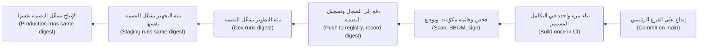
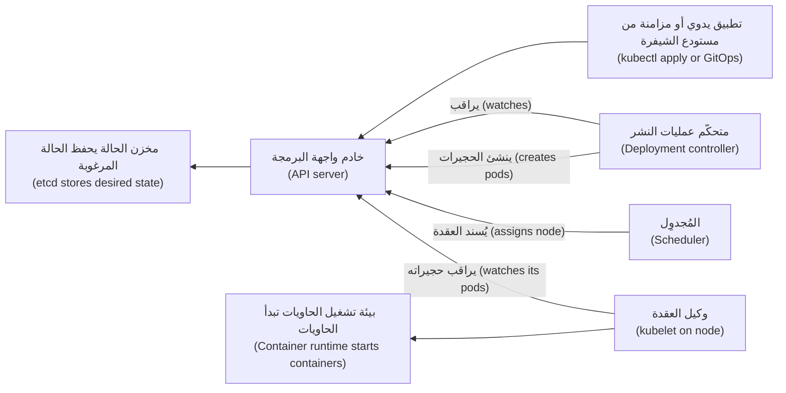
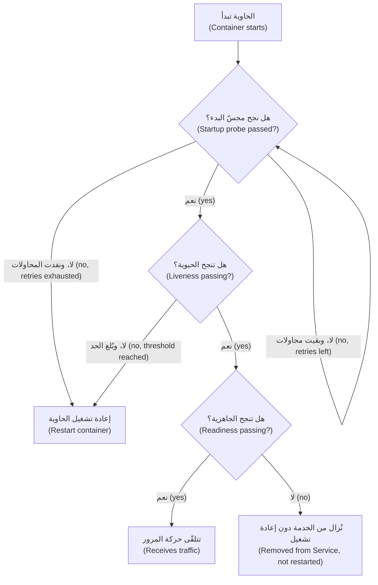

# الوحدة 2 — الحاويات (Containers) و Kubernetes

*كل خدمة تقريبًا ينقلها بنك نجم (Najm Bank) خارج مركز بياناته تغادره على هيئة حاوية (container) وتستقر على Kubernetes. تعلّمك هذه الوحدة كليهما بما يكفي لتشغيلهما في بيئة الإنتاج (production). تبدأ بصورة الحاوية (container image): ما الصورة (image) حقًّا، وكيف تعمل الطبقات (layers) والتخزين المؤقت (caching)، وكيف تكتب ملف Dockerfile صغيرًا وسريع البناء وآمنًا افتراضيًا، ولماذا تكون بصمة السجل، لا الوسم (tag)، هي الشيء الذي تنشره. ثم تفتح باب Kubernetes: الكائنات التي ستستخدمها يوميًا (الحجيرات (pods)، وعمليات النشر (deployments)، والخدمات، ومساحات الأسماء)، وحلقات التحكم (control loops) التي تُبقي الواقع مطابقًا لما أعلنته، وكيف تشخّص حجيرة لا تقلع. وتنتهي بما يفصل العرض التجريبي عن حِمل العمل الإنتاجي: الإعدادات والأسرار (secrets)، ومجسّات الصحة (health probes)، وطلبات الموارد وحدودها، والتوسّع التلقائي (autoscaling)، والإيقاف الرشيق (graceful shutdown)، والتحزيم باستخدام Helm. ستتابع يوسف (Yousef) وأول ملف Dockerfile يكتبه لـ واجهة برمجة تطبيق نجم للهاتف (Najm Mobile API) يشحن الشيفرة الخاطئة إلى بيئة التجهيز (staging)، وهو يتعلّم لماذا يظل العنقود (cluster) "يتراجع عن" إصلاحاته، وبينما تشرح له مها (Maha) انقطاعًا في خدمة المدفوعات سببه فحص صحة واحد سيئ الاختيار.*

> **المراحل:** Build, Deploy, Operate — تحزيم البرمجيات في صور (images) يمكنك الوثوق بها، وتشغيلها على عنقود يعالج نفسه، وضبط إعداداتها بحيث يساعد هذا التعافي ولا يضرّ.

---

# 2.1 — الحاويات على الوجه الصحيح: الصور والطبقات وملفات Dockerfile والسجلات (registries)
*المستوى: 🟡 متوسط* · *المتطلبات: 1.1، 1.2* · *المرحلة: Build, Deploy*

**بعد هذا الدرس تستطيع** إعادة كتابة ملف Dockerfile ساذج ليصبح بناءً مثبّت الإصدارات متعدد المراحل يعمل بغير الجذر، وإظهار سرّ مسرّب في طبقات الصورة الساذجة، والنشر بالبصمة بحيث لا يغيّر نقل الوسم شيئًا. *مدة الدراسة: نحو 115 دقيقة (تقدير).*

## ⚡ الدرس في دقيقة
- **الحاوية** عملية عادية في Linux تعزلها النواة (kernel)، فلها رؤيتها الخاصة للملفات والعمليات والشبكة، وتقيّد استخدامها للمعالج والذاكرة. أما **صورة الحاوية** فهي الحزمة المخصّصة للقراءة فقط من الملفات والإعدادات التي تبدأ منها العملية.
- الصورة كومة من **الطبقات**، كل منها ناتج خطوة بناء واحدة. رتّب ملف Dockerfile بحيث تأتي الأشياء نادرة التغيّر أولًا؛ عندئذ تعيد ذاكرة البناء المؤقتة (build cache) استخدامها، فيستغرق البناء ثوانيَ لا دقائق.
- صور الإنتاج **صغيرة، ولا تعمل بصلاحيات الجذر، وخالية من الأسرار**: استخدم **البناء متعدد المراحل (multi-stage build)** لتترك المترجمات وأدوات البناء خلفك، واضبط `USER`، ولا تنسخ بيانات الاعتماد (credentials) إلى أي طبقة أبدًا.
- **الوسوم تتحرّك؛ أما البصمات فلا.** يمكن الكتابة فوق `mobile-api:1.4.2`؛ أما `mobile-api@sha256:…` فيعني دائمًا البايتات نفسها. ابنِ مرة واحدة، ثم رقِّ تلك البصمة (digest) بعينها وانشرها.
- إشارة القرار: إن لم تستطع أن تقول أي إيداع (commit) وأي صورة أساس (base image) أنتجا الصورة العاملة في الإنتاج، فعملية البناء لديك لم تكتمل.
- أكبر فخ: `FROM something:latest`، مع التشغيل بصلاحيات الجذر، ونسخ المستودع (repository) كله (بما فيه `.env`) إلى الداخل.

## 🧭 لماذا يهم
أولى مهام يوسف في فريق المنصة (platform team) هي تحويل **واجهة برمجة تطبيق نجم للهاتف** إلى حاوية (containerise)، وهي خدمة Python التي تقف خلف تطبيق التجزئة. بحلول الخميس صارت تعمل. حجم الصورة 1.3 GB، وتُبنى في تسع دقائق مع كل إيداع، وتبدأ من `python:latest`. يرصد الماسح مئات الثغرات، معظمها في مترجمات لا تستخدمها الواجهة أبدًا. ثم يبلّغ طارق (Tariq) أن بيئة التجهيز "عادت إليها علّة تسجيل الدخول القديمة": فقد دفع خطّا تسليم بناءين مختلفين إلى الوسم نفسه، `mobile-api:staging`، بفارق دقائق، فسحب العنقود أيهما رآه أخيرًا. وأخيرًا تجد نورة (Noura) كلمة مرور قاعدة بيانات اختبار داخل طبقة من طبقات الصورة (image layer): فقد نسخ `COPY . .` ملف `.env` محليًا، وحذفُه في خطوة لاحقة لم يُزِله من الطبقة الأسبق.

يُريه سالم (Salem) حالة علنية للسبب الجذري نفسه على نطاق أكبر. في أغسطس 2012 نشرت شركة Knight Capital شيفرة تداول جديدة يدويًا؛ ووفقًا لأمر هيئة الأوراق المالية الأمريكية، لم يتلقّها خادم واحد من ثمانية خوادم، فأيقظ علَمٌ مُعاد استخدامه منطقًا قديمًا هناك، وخسرت الشركة أكثر من 460 مليون دولار في نحو 45 دقيقة. يقول سالم: "لا نملك ترف التساؤل عن الشيفرة التي تعمل. الصورة هي وسيلتنا للكفّ عن التساؤل. لكن بشرط أن نبنيها مرة واحدة، ونسمّيها ببصمتها، وننشر تلك بالضبط."

يحوّل هذا الدرس صورة يوسف التي أعدّها يوم الخميس إلى الصورة القياسية للبنك.

## 📐 كيف يعمل

### 🟢 الأساسيات

**ما الحاوية حقًّا.** على Linux، الحاوية عملية عادية طُبّقت عليها ميزتان من ميزات النواة. تمنحها **مساحات الأسماء (Namespaces)** رؤيتها الخاصة للنظام: قائمة عملياتها الخاصة (فهي ترى نفسها العملية رقم 1 (process 1))، وواجهات الشبكة الخاصة بها، واسم المضيف الخاص بها، وشجرة ملفاتها الخاصة. وتحدّ **مجموعات التحكم** من مقدار ما يمكنها استخدامه من المعالج (CPU) والذاكرة. وخلافًا لـ **الآلة الافتراضية (virtual machine, VM)**، لا توجد داخلها نواة ضيف: فالحاويات تقلع بسرعة إقلاع العملية، وكلها تتشارك نواة المضيف، مما يجعل الحاوية أيضًا حدًّا أمنيًا أضعف من الآلة الافتراضية (الدرس 2.3 يغطّي التحصين).

**ما الصورة.** الصورة هي نظام الملفات الابتدائي مع البيانات الوصفية (metadata). وتوحّدها **مبادرة الحاويات المفتوحة (Open Container Initiative, OCI)** في ثلاث مواصفات، بحيث تعمل الصورة المبنية بـ Docker على containerd أو CRI-O أو Podman أو أي عنقود Kubernetes.

تتكوّن الصورة:
- **الطبقات**: أرشيفات مضغوطة لتغييرات نظام الملفات، واحدة لكل خطوة بناء تغيّر الملفات. تُكدَّس لتكوّن شجرة الملفات النهائية.
- **إعداد**: الأمر، والمستخدم، ومجلد العمل، والمنافذ المكشوفة، والبيئة.
- **بيان (manifest)**: قائمة تشير إلى الإعداد والطبقات عبر **بصمتها**، أي تجزئة SHA-256 لمحتواها (SHA-256 hash of their content).
- وللصور متعددة المعماريات (multi-architecture images)، **فهرس** يشير إلى بيان واحد لكل معمارية معالج (مثل `amd64` و `arm64`).

ولأن كل شيء يُعنوَن بالتجزئة، تتغيّر بصمة الصورة نفسها إذا تغيّر بايت واحد في أي مكان. وهذا ما يجعل البصمات جديرة بالثقة.

**ملف Dockerfile.** ملف Dockerfile هو الوصفة. تُنفَّذ كل تعليمة بالترتيب:

```dockerfile
# Risky: Yousef's first version
FROM python:latest
COPY . /app
WORKDIR /app
RUN pip install -r requirements.txt
CMD python main.py
```

خمس مشكلات في خمسة أسطر. الوسم `latest` يتغيّر من تحتك. و `COPY . /app` يرسل كل شيء، بما فيه `.git` و `.env`. ونسخ الشيفرة *قبل* تثبيت الاعتماديات يجعل `pip install` يُعاد تشغيله مع كل تغيير في الشيفرة. وصورة `python` الكاملة تحمل مترجمات لا تستخدمها الواجهة أبدًا. والعملية تعمل بصلاحيات الجذر.

**الطبقات وذاكرة البناء المؤقتة.** يخزّن الباني كل خطوة مؤقتًا (caches). فإذا لم تتغيّر مُدخلات الخطوة (التعليمة نفسها، ومحتوى الملفات في حالة `COPY`) وكانت كل خطوة قبلها مخزّنة مؤقتًا، أُعيد استخدام الطبقة المخزّنة. وبمجرد أن تُخطئ خطوة واحدة الذاكرة المؤقتة، يُعاد بناء كل خطوة بعدها. لذا ضع الأشياء المستقرة أولًا والمتقلّبة أخيرًا:

```dockerfile
COPY requirements.txt .          # changes rarely
RUN pip install -r requirements.txt
COPY src/ ./src/                 # changes on every commit
```

الآن لا يعيد تغيير الشيفرة بناء سوى الطبقة الأخيرة.

**السجلات.** **السجل (registry)** يخزّن الصور ويقدّمها (مثل Docker Hub، أو GitHub Container Registry، أو السجل الخاص بكل سحابة). يدفع التكامل المستمر (CI)، ويسحب العنقود.

| الحاجة | AWS | Microsoft Azure | Google Cloud |
|---|---|---|---|
| سجل صور خاص | Amazon ECR | Azure Container Registry | Artifact Registry |
| السحب دون كلمات مرور مخزّنة | دور IAM على العقدة أو الحجيرة | الهوية المُدارة (Managed identity) | حساب الخدمة / هوية حِمل العمل |

**الوسوم والبصمات (Tags and digests).** **الوسم** (`1.4.2`، `staging`، `latest`) مؤشّر سهل على البشر يستطيع أي شخص يملك صلاحية الدفع تحريكه إلى صورة أخرى. أما **البصمة** (`sha256:…`) فهي تجزئة البيان ولا يمكن أن تشير إلى أي شيء آخر أبدًا. انشر بالبصمة، أو بوسم ثابت غير قابل للتغيير (immutable tag) يرفض سجلّك الكتابة فوقه.

```shell
# Same name, pinned to exact bytes
docker pull registry.example.com/najm/mobile-api@sha256:<64-hex-digest>
```

### 🟡 التعمق أكثر

**البناء متعدد المراحل (Multi-stage builds).** يستخدم **البناء متعدد المراحل** عدة أسطر `FROM` في ملف Dockerfile واحد. تحوي المراحل المبكرة المترجمات وأدوات البناء؛ أما المرحلة النهائية فلا تنسخ إلا النتيجة. إليك النسخة المحصّنة من ملف يوسف:

```dockerfile
# syntax=docker/dockerfile:1
# Hardened: two stages, pinned base, non-root, no secrets
ARG PY_BASE=python:3.12-slim@sha256:<pinned-digest>

FROM ${PY_BASE} AS build
WORKDIR /app
RUN python -m venv /opt/venv
ENV PATH="/opt/venv/bin:$PATH"
COPY requirements.txt .
RUN --mount=type=cache,target=/root/.cache/pip \
    pip install --require-hashes -r requirements.txt
COPY src/ ./src/

FROM ${PY_BASE} AS runtime
RUN useradd --uid 10001 --no-create-home --shell /usr/sbin/nologin app
WORKDIR /app
COPY --from=build /opt/venv /opt/venv
COPY --from=build /app/src ./src
ENV PATH="/opt/venv/bin:$PATH" PYTHONUNBUFFERED=1
USER 10001
EXPOSE 8080
CMD ["python", "-m", "src.main"]
```

ما الذي يكسبه كل اختيار:
- **صورة أساس مثبّتة بالبصمة.** لا تتغيّر صورة الأساس إلا حين يرفع أحدهم إصدارها، ويُفضَّل عبر طلب سحب آلي مُختبَر (من Renovate أو Dependabot).
- **`--require-hashes`.** أي حزمة مُتلاعَب بها أو مُستبدَلة تُفشل البناء.
- **تركيب الذاكرة المؤقتة.** يعيد BuildKit (باني Docker الحديث) استخدام ذاكرة التنزيل المؤقتة لـ pip دون وضعها في طبقة (layer).
- **مستخدم `USER` رقمي بلا صلاحيات جذر.** يستطيع Kubernetes التحقق من `runAsNonRoot` مقابل مستخدم رقمي؛ أما الاسم فلا يستطيع التحقق منه.
- **صيغة التنفيذ (Exec-form) لـ `CMD`** (مصفوفة JSON). يصبح البرنامج العملية رقم 1 ويتلقّى إشارة الإيقاف مباشرة. أما في صيغة الصدفة (shell form) فالصدفة هي العملية رقم 1 وقد لا تمرّر `SIGTERM`، فيُقتل التطبيق قسرًا بدلًا من أن يتوقّف بنظافة. وإن لزم الأمر، أضف عملية تهيئة صغيرة مثل `tini`.

**ملف `.dockerignore`** يُبقي الملفات خارج **سياق البناء (build context)**، أي المجلد المُرسَل إلى الباني:

```text
.git
.env
*.pem
tests/
node_modules/
__pycache__/
```

وإن احتاج البناء فعلًا إلى بيانات اعتماد (credential) (لفهرس حزم خاص مثلًا)، فمرّرها بوصفها **سرّ بناء**، يُركَّب لخطوة واحدة ولا يُكتب في أي طبقة أبدًا:

```dockerfile
RUN --mount=type=secret,id=pip_conf,target=/etc/pip.conf \
    pip install --require-hashes -r requirements.txt
```

**اختيار صورة الأساس.** صور الأساس الأصغر تعني حزمًا أقل، وثغرات أقل تحتاج إلى فرز، وسحبًا أسرع.

| نوع صورة الأساس | مثال | المفاضلة |
|---|---|---|
| توزيعة كاملة | `python:3.12` | سهلة التشخيص؛ كبيرة؛ حزم كثيرة غير مستخدمة |
| توزيعة نحيفة | `python:3.12-slim` | خيار افتراضي جيد؛ ما زالت فيها صدفة ومدير حزم |
| مبنية على Alpine | `python:3.12-alpine` | صغيرة جدًا؛ تستخدم musl بدلًا من glibc، لذا تفتقر بعض حزم Python إلى عجلات مبنية مسبقًا ويجب ترجمتها |
| بلا توزيعة / دنيا (Distroless / minimal) | صور Google عديمة التوزيعة، وصور دنيا على طراز Chainguard | بلا صدفة ولا مدير حزم؛ أصغر سطح هجوم؛ أصعب في التشخيص التفاعلي |
| `scratch` | صورة فارغة | للملفات التنفيذية الساكنة فقط (غالبًا Go أو Rust) |

اعتمد صورة أساس أو اثنتين لكل لغة، ورقّعها مركزيًا، وأعد البناء حين تتغيّر.

**ابنِ مرة واحدة ورقِّ البصمة.** يبني خط التسليم (pipeline) الصورة مرة واحدة فقط على الفرع الرئيسي، ويدفعها، ويسجّل البصمة، ثم تشغّل كل بيئة تلك البصمة. الترقية تغيّر الإعدادات، لا الصورة أبدًا. وإعادة بناء "الإيداع نفسه" للإنتاج هي الطريقة التي تتباعد بها بيئتا التجهيز والإنتاج بصمت. يؤتمت الدرس 3.2 هذه الترقية عبر GitOps، ويبني الدرس 4.1 خط التسليم. ونظرة غير المبرمجين إلى الفكرة نفسها موجودة في [*تصميم الأنظمة لمبرمجي الحدس*، الدرس 4.5 — تحقّق من الأثر البرمجي لا من المصدر](../vibe/index.ar.html#l4-5).



**الملصقات لإمكانية التتبّع.** اختم ملصقات OCI القياسية `org.opencontainers.image.revision` (الإيداع) و `org.opencontainers.image.source` (المستودع) في كل صورة، حتى يستطيع أي شخص أن يجيب عن سؤال "من أين جاءت هذه؟"

### 🔴 نظرة الخبير

**قابلية إعادة الإنتاج ليست هي التثبيت.** يزيل التثبيت أكبر مصادر الانحراف (drift)، لكن الطوابع الزمنية وترتيب الملفات قد يظلان يغيّران بصمة إعادة البناء. تهدف معظم الفرق إلى أن تكون الصورة "قابلة لإعادة البناء وقابلة للتتبّع"، وتضيف **المصدرية (provenance)**: سجلًّا موقّعًا يُنتجه نظام البناء، يبيّن أي مصدر وأي باني وأي مُدخلات أنشأت البصمة. ومع **قائمة مكوّنات البرمجيات** و**توقيع (signature)** للصورة يُتحقَّق منه وقت النشر، تكتمل قصة سلسلة التوريد التي يدرّسها بتعمّق [*أمن الذكاء الاصطناعي وأمن التطبيقات*، الدرس 6.2 — سلسلة توريد البرمجيات: الاعتماديات وقوائم المكوّنات و SLSA والتوقيع](../secai/index.ar.html#/6.2)؛ ويوصلها الدرس 4.3 بخط تسليم نجم.

**الفحص وحلقة الترقيع.** تسرد الماسحات مثل Trivy و Grype الثغرات المعروفة في حزم الصورة. تُنشر ثغرات جديدة يوميًا ضد صور لم تتغيّر، لذا افحص في خط التسليم (واحجب عند ظهور نتائج حرجة جديدة لها إصلاح)، وأعد فحص الصور العاملة وفق جدول، وأعد البناء بإيقاع منتظم حتى حين لا تتغيّر الشيفرة.

**البناء متعدد المعماريات.** قد تختلف الحواسيب المحمولة عن عقد السحابة (Arm أو x86). يبني الأمر `docker buildx build --platform linux/amd64,linux/arm64 --push` كلتيهما ويدفع فهرسًا؛ اختبر على المعمارية التي تشغّل عليها.

**عمليات السجل.** عامل السجل بوصفه بنية تحتية إنتاجية: **ثبات الوسوم** في مستودعات الإصدارات؛ و**ذاكرات السحب المؤقتة أو المرايا** للصور العامة، حتى لا تستطيع حدود المعدّل في سجل عام أو انقطاعه إيقاف عمليات النشر لديك (يحدّ Docker Hub من عمليات السحب المجهولة وعمليات الفئة المجانية؛ تحقّق من حدوده الحالية)؛ ووضعه في المنطقة نفسها التي فيها العنقود؛ و**قواعد الاحتفاظ** التي لا تحذف أبدًا أي شيء منشور حاليًا.

**الحاوية ليست آلة افتراضية.** شغّل عملية رئيسية واحدة لكل حاوية، واكتب السجلات إلى المخرج القياسي، واحفظ الحالة (state) خارجها، وتوقّع أن تُقتل وتُستبدل في أي وقت. يفترض Kubernetes أفكار تطبيق العوامل الاثني عشر (Twelve-Factor App) هذه.

## 🧰 الأدوات
| الأداة أو الممارسة أو الخدمة | ما هي وماذا تفعل | متى تلجأ إليها |
|---|---|---|
| **Docker** (مع BuildKit) | يبني صور OCI ويشغّلها ويدفعها؛ ويضيف BuildKit تركيبات الذاكرة المؤقتة والأسرار والمراحل المتوازية | التطوير المحلي وبناء الصور في التكامل المستمر |
| **Multi-stage build** — البناء متعدد المراحل | عدة مراحل `FROM` في ملف Dockerfile واحد؛ لا تُشحن إلا المرحلة النهائية | كل صورة مُترجَمة أو كثيفة الاعتماديات |
| **.dockerignore** | يستبعد الملفات من سياق البناء | كل مستودع فيه Dockerfile، منذ اليوم الأول |
| **Image digest** — بصمة الصورة | تجزئة محتوى تسمّي بايتات الصورة بالضبط | كل بيان نشر وكل سجلّ ترقية |
| **Container registry** — سجل الحاويات | يخزّن الصور ويقدّمها، مع التحكم في الوصول وثبات الوسوم | الاحتفاظ بصور الإصدارات قريبًا من العنقود |
| **Trivy** | ماسح مفتوح المصدر للثغرات والإعدادات الخاطئة في الصور والملفات | في التكامل المستمر مع كل بناء، ووفق جدول على الصور العاملة |
| **hadolint** | مدقّق (linter) يفحص ملفات Dockerfile مقابل الممارسات الجيدة | قبل الإيداع وفي طلبات السحب (pull requests) |

## 🏛️ عمليًا في بنك نجم
يطلب سالم من يوسف أن يحوّل إصلاحاته إلى **معيار نجم لصور الحاويات، الإصدار 1 (Najm Container Image Standard v1)**، الذي يجب على كل فريق استيفاؤه قبل أن يُسمح لصورة بالعمل في عنقود مشترك. وملف Dockerfile المحصّن أعلاه هو مثاله المرجعي للغة Python.

| # | القاعدة | يتحقّق منها | السبب |
|---|---|---|---|
| 1 | صورة أساس من القائمة المعتمدة، مثبّتة بالبصمة | سياسة خط التسليم | نقطة بداية معروفة ومرقّعة؛ لا تغييرات مفاجئة |
| 2 | بناء متعدد المراحل؛ لا مترجمات ولا أدوات بناء في المرحلة النهائية؛ الصدفة ومدير الحزم فقط عبر صورة أساس نحيفة معتمدة | hadolint مع المراجعة | سطح هجوم أصغر وسحب أسرع |
| 3 | تعمل بمستخدم رقمي بلا صلاحيات جذر (UID 10000 أو أعلى) | فحص خط التسليم لإعدادات الصورة؛ قبول العنقود في الدرس 2.3 | يحدّ من الضرر إذا اختُرق التطبيق |
| 4 | لا أسرار في أي طبقة؛ ملف `.dockerignore` موجود؛ أسرار البناء عبر تركيبات الأسرار | فحص الأسرار (secret scanning) في الصورة والمستودع | الطبقات دائمة وتُنسخ إلى كل مكان |
| 5 | صيغة التنفيذ لـ `CMD`/`ENTRYPOINT`؛ التطبيق يعالج `SIGTERM` | المراجعة؛ اختبار الإيقاف في التكامل المستمر | إيقاف نظيف أثناء النشر والتوسّع |
| 6 | عملية رئيسية واحدة؛ السجلات إلى stdout/stderr؛ لا حالة داخل الحاوية | المراجعة | قد يقتلها العنقود ويستبدلها في أي وقت |
| 7 | ملصقات OCI للمصدر والمراجعة | خط التسليم | تتبّع أي صورة عاملة إلى إيداعها |
| 8 | تُبنى مرة واحدة على الفرع الرئيسي؛ وتُدفع إلى مستودع الإصدارات بوسوم ثابتة (immutable tags)؛ وتُنشر بالبصمة | فحوص خط التسليم و GitOps | كل بيئة تشغّل البايتات نفسها |
| 9 | مفحوصة: لا ثغرة حرجة جديدة لها إصلاح متاح؛ قائمة المكوّنات (SBOM) والتوقيع مرفقان | بوابة خط التسليم | أدلة سلسلة التوريد لفريق نورة |
| 10 | يُعاد بناؤها شهريًا على الأقل، أو ضمن المهلة التي يحددها فريق الأمن حين يكون لصورة الأساس إصلاح حرج | خط تسليم مُجدوَل | الشيفرة غير المتغيّرة تشيخ هي الأخرى |

**الاستثناءات** تُرفع إلى سالم مع سبب وتاريخ انتهاء. صارت صورة واجهة الهاتف الآن 160 MB بدلًا من 1.3 GB (وهذا رقم نجم لهذه الخدمة وحدها؛ أرقامك ستختلف)، وتسجّل بيئتا التجهيز والإنتاج البصمة نفسها.

## 🛠️ التمارين
اعمل محليًا باستخدام Docker أو أداة متوافقة. لا تدفع إلا إلى سجل تملكه، مثل حساب شخصي مجاني.

- 🟢 خذ أي تطبيق ويب صغير لديك (أو برنامج "hello world" بلغتك)، واكتب ملف Dockerfile ساذجًا يحوي `FROM <lang>:latest` و `COPY . .`، وابنِه، ثم أعد كتابته بصورة أساس نحيفة مثبّتة، وملف `.dockerignore`، ونسخ ملفات الاعتماديات قبل المصدر، ومستخدم `USER` بلا صلاحيات جذر، وصيغة تنفيذ لـ `CMD`. قارن الأحجام باستخدام `docker images` والطبقات باستخدام `docker history`. *يكتمل عندما:* يكون لديك الملفان، وفرق الحجم، ودليل على أن تغيير سطر واحد من المصدر لا يعيد بناء سوى الطبقات الأخيرة.
- 🟡 حوّل صورتك إلى بناء متعدد المراحل وافحص النسختين بـ Trivy. ابنِ النسخة الساذجة مع سرّ مزيّف في `.env`، ثم اعثر عليه بتصدير الصورة (`docker save`) والبحث في طبقاتها. *يكتمل عندما:* تستطيع إظهار السرّ في الصورة الساذجة، وغيابه عن الصورة المحصّنة، وعدد الثغرات في كلتيهما.
- 🔴 ابنِ صورتك لـ `linux/amd64` و `linux/arm64` باستخدام `docker buildx`، وادفعها إلى سجلّك مع ملصقات مراجعة OCI، واكتب ملاحظة نشر من سطرين لا تشير إليها إلا بالبصمة. ثم ادفع بناءً مختلفًا إلى الوسم نفسه. *يكتمل عندما:* يُظهر `docker buildx imagetools inspect` المعماريتين، وتظل البصمة تسحب الصورة الأصلية بعد أن تحرّك الوسم.

## ⚠️ أخطاء وفخاخ
- **استخدام `latest` أو غيره من الوسوم المتحرّكة في الإنتاج.** قد تعطي عمليتا سحب للاسم نفسه شيفرة مختلفة. انشر بالبصمة، واستخدم وسومًا ثابتة في مستودع الإصدارات.
- **الأسرار في الطبقات.** إن `COPY . .` مع ملف `.env`، أو `ENV DB_PASSWORD=…`، يسرّب بيانات اعتماد إلى كل نسخة من الصورة. استخدم `.dockerignore`، وتركيبات أسرار البناء، وأسرار وقت التشغيل (الدرس 2.3).
- **إعادة البناء لكل بيئة.** "بناء الإنتاج" أثر برمجي مختلف. رقِّ البصمة.
- **التشغيل بصلاحيات الجذر "لأنها داخل حاوية".** الحاويات تتشارك نواة المضيف. اضبط مستخدم `USER` رقميًا بلا صلاحيات جذر.
- **الفحص مرة واحدة.** تظهر ثغرات جديدة في صور لم تتغيّر. أعد فحص الصور العاملة وأعد البناء وفق جدول.

## 🧾 الخلاصة
- الحاوية عملية Linux معزولة ومقيّدة الموارد؛ والصورة نقطة بدايتها الطبقية المتوافقة مع معيار OCI.
- رتّب خطوات Dockerfile من المستقر إلى المتقلّب كي تعمل الذاكرة المؤقتة (cache)؛ واترك أدوات البناء خلفك عبر البناء متعدد المراحل.
- صور الإنتاج صغيرة ومثبّتة وبلا صلاحيات جذر وخالية من الأسرار، ولها ملصقات (labels) تتبّعها إلى إيداع.
- الوسوم (tags) مؤشّرات يمكن أن تتحرّك؛ والبصمات (digests) تجزئات محتوى لا تتحرّك. ابنِ مرة واحدة وانشر البصمة في كل مكان.
- الفحص، وقوائم المكوّنات (SBOMs)، والتوقيع (signing)، وإعادة البناء المُجدوَلة تُبقي الصور جديرة بالثقة بعد شحنها.

## ✍️ اختبر نفسك

**1. يحذف يوسف `.env` باستخدام `RUN rm .env` مباشرة بعد `COPY . .`. لماذا يظل السرّ (secret) مكشوفًا؟**

- A. يُتجاهَل الأمر `rm` بصمت داخل بناء Docker
- B. ما زالت طبقة `COPY` تحوي الملف؛ وطبقة `rm` اللاحقة تخفيه فقط
- C. تستعيد ذاكرة البناء المؤقتة الملفات المحذوفة من البناء السابق مع كل إعادة بناء
- D. الملفات في مجلد العمل مرئية دائمًا لأي شخص يشغّل `docker ps`

<details><summary>الإجابة</summary>

**B.** الحذف لا يفعل سوى حجب الملف في العرض النهائي؛ وأي شخص يملك الصورة يستطيع استخراج الطبقة الأسبق. أما A و C فخاطئتان، و D تخلط بين الحاويات العاملة ومحتويات الصورة. أبقِ الملف خارجًا باستخدام `.dockerignore`. (🟡 التعمق أكثر.)

</details>

**2. يقول طارق إن بيئة التجهيز تشغّل بناءً قديمًا مع أن خط التسليم دفع `mobile-api:staging` قبل ساعة. وهناك خطّا تسليم يدفعان كلاهما إلى ذلك الوسم. ما الإصلاح الأمتن؟**

- A. اطلب من الفريقين تنسيق عمليات الدفع في قناة دردشة مشتركة
- B. اضبط العنقود ليسحب الوسم `staging` أكثر، مع كل بدء تشغيل لحجيرة
- C. أعد تسمية الوسم إلى `staging-v2` حتى ينفصل عن القديم
- D. انشر البصمة التي سجّلها خط التسليم؛ واجعل وسوم الإصدارات ثابتة

<details><summary>الإجابة</summary>

**D.** البصمة (digest) تسمّي بايتات بعينها ولا يمكن تحريكها. أما A فتعتمد على البشر، و B ما زالت تتسابق، و C لا تفعل سوى إنشاء وسم آخر قابل للتغيير. (🟢 الأساسيات.)

</details>

**3. كل إيداع في واجهة الهاتف يعيد بناء كل الاعتماديات، مستغرقًا تسع دقائق. وملف Dockerfile ينسخ شجرة المصدر كاملة ثم يشغّل `pip install`. أي تغيير يساعد أكثر؟**

- A. انسخ `requirements.txt` وثبّته قبل نسخ المصدر
- B. انتقل إلى صورة الأساس `latest` كي تكون طبقة الأساس مخزّنة مؤقتًا دائمًا
- C. امنح آلة البناء مزيدًا من أنوية المعالج وقرصًا أسرع
- D. اجمع كل خطوات البناء في سطر `RUN` واحد طويل لتقليل الطبقات

<details><summary>الإجابة</summary>

**A.** تنكسر الذاكرة المؤقتة من أول خطوة متغيّرة فصاعدًا، لذا تأتي ملفات الاعتماديات المستقرة أولًا. أما B فتجعل البناء غير متوقَّع، و C تعالج العَرَض، و D تُبطل التخزين المؤقت. (🟢 الأساسيات.)

</details>

**4. لماذا يستخدم ملف Dockerfile المحصّن صيغة التنفيذ `CMD ["python", "-m", "src.main"]` بدلًا من `CMD python -m src.main`؟**

- A. صيغة التنفيذ تتخطّى طبقة الصدفة، مما يجعل الصورة النهائية أصغر بشكل ملحوظ
- B. صيغة الصدفة غير مسموح بها في المرحلة النهائية من البناء متعدد المراحل
- C. يصبح التطبيق العملية رقم 1 ويتلقّى `SIGTERM` مباشرة، فيستطيع التوقّف بنظافة
- D. صيغة التنفيذ تجعل العملية تعمل تلقائيًا بالمستخدم غير الجذري

<details><summary>الإجابة</summary>

**C.** في صيغة الصدفة (shell form) تكون الصدفة هي العملية رقم 1 وقد لا تمرّر إشارة الإيقاف، فيُقتل التطبيق بعد انقضاء مهلة السماح (grace period). أما A و B و D فخاطئة: الحجم، ودعم المراحل المتعددة، والمستخدم لا علاقة لها بصيغة `CMD`. (🟡 التعمق أكثر.)

</details>

**5. تسأل منى (Mona) من قسم المالية لماذا يعيد فريق المنصة بناء الصور شهريًا حتى حين لا تتغيّر شيفرة التطبيق. ما أفضل إجابة؟**

- A. كل إعادة بناء تضغط الطبقات أكثر، فتصغر الصور بمرور الوقت
- B. تُكتشف ثغرات جديدة في صور الأساس غير المتغيّرة؛ وإعادة البناء تلتقط الرقع
- C. تحذف سجلات الحاويات افتراضيًا أي صورة يزيد عمرها على شهر
- D. يرفض Kubernetes تشغيل الصور التي يزيد عمرها على شهر

<details><summary>الإجابة</summary>

**B.** الصور غير المتغيّرة تشيخ مع نشر ثغرات جديدة ضد محتوياتها. أما A فليست صحيحة عمومًا، و C و D تصفان قواعد لا وجود لها افتراضيًا (فالاحتفاظ أمر تضبطه أنت). (🔴 نظرة الخبير.)

</details>

## 📚 المراجع
- مواصفات مبادرة الحاويات المفتوحة — https://opencontainers.org/
- توثيق Docker: مرجع Dockerfile — https://docs.docker.com/reference/dockerfile/
- توثيق Docker: البناء متعدد المراحل — https://docs.docker.com/build/building/multi-stage/
- توثيق Docker: ذاكرة البناء المؤقتة — https://docs.docker.com/build/cache/
- توثيق Docker: أسرار البناء — https://docs.docker.com/build/building/secrets/
- توثيق Kubernetes: الصور — https://kubernetes.io/docs/concepts/containers/images/
- تطبيق العوامل الاثني عشر — https://12factor.net/
- هيئة الأوراق المالية الأمريكية (US SEC)، أمر Knight Capital Americas LLC (2013) — https://www.sec.gov/litigation/admin/2013/34-70694.pdf
- توثيق Trivy — https://trivy.dev/

---

# 2.2 — أساسيات Kubernetes: الحجيرات وعمليات النشر والخدمات وطريقة تفكير العنقود
*المستوى: 🟡 متوسط* · *المتطلبات: 1.1، 1.2، 2.1* · *المرحلة: Deploy, Operate*

**بعد هذا الدرس تستطيع** نشر Deployment وService على عنقود محلي، وتشخيص عدم تطابق المحدِّد وبصمة صورة غير موجودة من مخرجات `kubectl` وحدها، وإصلاح الاثنين في ملفات YAML. *مدة الدراسة: نحو 115 دقيقة (تقدير).*

## ⚡ الدرس في دقيقة
- **Kubernetes** نظام يشغّل الحاويات عبر مجموعة من الآلات (**العنقود**) ويُبقيها عاملة. تخبره بما تريد؛ فيعمل باستمرار ليجعل الواقع مطابقًا له.
- الفكرة الجوهرية هي **الحالة المرغوبة والمواءمة (desired state and reconciliation)**: تعلن الكائنات بلغة YAML، ويخزّنها خادم واجهة البرمجة (API server)، و**المتحكّمات (controllers)** تدور في حلقة لا تنتهي تقارن "المُعلَن" بـ "الفعلي" وتصلح الفرق.
- الكائنات اليومية: **الحجيرة (Pod)** (حاوية أو أكثر تُجدوَل معًا)، و**عملية النشر (Deployment)** (تُبقي N من الحجيرات المتطابقة عاملة وتطرح الإصدارات الجديدة)، و**الخدمة** (اسم وعنوان ثابتان أمام حجيرات متغيّرة)، و**مساحة الأسماء (Namespace)** (مجلد للكائنات والوصول والحصص).
- **الملصقات والمحدِّدات (Labels and selectors)** هي الغراء الرابط: تجد عملية النشر حجيراتها، وتجد الخدمة وجهة إرسال حركة المرور، بمطابقة الملصقات وحدها.
- إشارة القرار: لا تصلح الأشياء يدويًا داخل العنقود أبدًا. غيّر الحالة المُعلنة (ملف YAML في Git) ودع المتحكّمات تتقارب.
- أكبر فخ: معاملة الحجيرات معاملة الخوادم. الحجيرات قابلة للاستغناء؛ وأي شيء تغيّره داخل إحداها، أو أي حجيرة تنشئها يدويًا، يزول في المرة التالية التي تُستبدل فيها.

## 🧭 لماذا يهم
في مركز البيانات، كانت واجهة برمجة تطبيق نجم للهاتف تعمل على أربع آلات افتراضية (virtual machines) تُرعى يدويًا. وحين تتعطّل إحداها ليلًا، كان يُستدعى مشغّل فيعيد تشغيلها؛ وكان التعافي يستغرق ما يستغرقه شخص كي يستيقظ.

في أسبوعه الثاني، ينشر يوسف الواجهة على عنقود Kubernetes المُدار الجديد. يحذف حجيرة تسيء التصرّف، وبعد ثوانٍ تظهر حجيرة جديدة باسم مختلف. يصلح إعدادًا باستخدام `kubectl edit`؛ وفي صباح اليوم التالي تكون أداة GitOps (الدرس 3.2) قد أعادت القيمة القديمة. وتعطّلت عقدة (node) في المنطقة B ليلًا دون أن تستدعي أحدًا: فقد أُعيد إنشاء حجيراتها في مكان آخر قبل أن يلاحظ أحد.

يقول له سالم: "الثلاثة كلها الميزة نفسها. العنقود مجموعة من حلقات التحكم التي تظل تدفع الواقع نحو ما كتبناه. اعمل مع الحلقات وستتولّى نوباتك الليلية. واعمل ضدها وستُبطل عملك."

## 📐 كيف يعمل

### 🟢 الأساسيات

**أجزاء العنقود.** للعنقود **مستوى تحكم (control plane)** (الدماغ) و**عقد عاملة (worker nodes)** (الآلات التي تشغّل حاوياتك). وفي الخدمات المُدارة (managed services)، يشغّل المزوّد مستوى التحكم ولا ترى أنت غالبًا إلا العقد (nodes).

| المكوّن | أين | ماذا يفعل |
|---|---|---|
| **kube-apiserver** | مستوى التحكم | الباب الأمامي: كل شيء يخاطب العنقود عبر واجهة برمجته (API) |
| **etcd** | مستوى التحكم | مخزن مفتاح-قيمة يحفظ كل الكائنات المُعلنة وحالتها |
| **Scheduler** — المُجدوِل | مستوى التحكم | يختار عقدة لكل حجيرة جديدة، بناءً على طلبات مواردها وقواعدها |
| **Controller manager** — مدير المتحكّمات | مستوى التحكم | يشغّل حلقات التحكم المدمجة |
| **kubelet** | كل عقدة | وكيل يشغّل الحجيرات المُسندة إلى عقدته ويفحص صحتها |
| **Container runtime** — بيئة تشغيل الحاويات | كل عقدة | تشغّل الحاويات (containerd أو CRI-O) |
| **kube-proxy** (أو إضافة CNI تحلّ محلّه) | كل عقدة | يبرمج شبكة العقدة كي تصل عناوين الخدمات إلى الحجيرات الصحيحة |

**الحالة المرغوبة والمواءمة.** أنت لا تقول لـ Kubernetes "شغّل ثلاث حاويات". بل تقدّم كائنًا يقول "يجب أن تكون هناك ثلاث". فيلاحظ متحكّم (controller) الفجوة بين ثلاث مطلوبة وصفر عاملة، ويتصرّف. وإذا تعطّلت عقدة وأخذت معها حجيرة، تعود الفجوة للظهور ويتصرّف المتحكّم مجددًا. تُسمّى تلك الحلقة **المواءمة (reconciliation)**، وهي تفسّر مفاجآت يوسف الثلاث كلها.



المتحكّمات والمُجدوِل وعناصر kubelet، كلٌّ منها يراقب خادم واجهة البرمجة ويكتب النتائج إليه؛ ولا يتخاطب بعضها مع بعض مباشرة أبدًا.

**الحجيرات.** **الحجيرة** أصغر شيء يشغّله Kubernetes: حاوية أو أكثر تتشارك عنوان شبكة واحدًا، وتكون دائمًا على العقدة نفسها. والحجيرات **عابرة (ephemeral)**: فالبدائل تحصل على أسماء وعناوين IP جديدة، ولا تنشئ أبدًا حجيرة مباشرة لحِمل عمل حقيقي.

**عمليات النشر ومجموعات النسخ (Deployments and ReplicaSets).** تعلن **عملية النشر** "شغّل N نسخة من قالب الحجيرة هذا". وهي تدير **مجموعة نسخ (ReplicaSet)** تتولّى العدّ؛ وحين تغيّر القالب (مثل بصمة صورة جديدة)، تنشئ عملية النشر مجموعة نسخ جديدة وتنقل الحجيرات من القديمة إلى الجديدة تدريجيًا. ذلك هو **التحديث المتدحرج (rolling update)**.

**الخدمات.** لأن عناوين الحجيرات تتغيّر باستمرار، تحتاج البرمجيات الأخرى إلى عنوان ثابت. تمنح **الخدمة** مجموعة من الحجيرات عنوان IP افتراضيًا ثابتًا واسم DNS، مثل `mobile-api.mobile.svc.cluster.local`، وتوزّع الاتصالات على أي حجيرات تطابق محدِّدها (selector) حاليًا وتكون جاهزة.

| نوع الخدمة | يمكن الوصول إليها من | الاستخدام المعتاد |
|---|---|---|
| `ClusterIP` (الافتراضي) | داخل العنقود فقط | حركة المرور من خدمة إلى خدمة |
| `NodePort` | منفذ على كل عقدة | نادرًا ما يُستخدم مباشرة؛ لبنة بناء للأنواع الأخرى |
| `LoadBalancer` | من الخارج، عبر موازن أحمال سحابي ينشئه المزوّد | كشف خدمة عند الطبقة 4 (layer 4) (TCP) |

ولتوجيه HTTP حسب اسم المضيف والمسار (الطبقة 7 (layer 7))، استخدم **Ingress** أو **Gateway API** الأحدث، الذي بلغ الإتاحة العامة (v1.0) في أكتوبر 2023. وكلاهما يحتاج إلى متحكّم مثبّت في العنقود ليؤدي العمل الفعلي.

**الملصقات والمحدِّدات.** **الملصق (label)** وسم مفتاح-قيمة على كائن، مثل `app.kubernetes.io/name: mobile-api`. و**المحدِّد** استعلام على الملصقات. تجد عمليات النشر حجيراتها بالمحدِّد؛ وتجد الخدمات نقاط نهايتها بالمحدِّد. وإذا لم تتطابق الملصقات، فلا شيء يتّصل ولا تظهر رسالة خطأ، بل لا حركة مرور فحسب.

**مساحات الأسماء.** **مساحة الأسماء** تجمع الكائنات. يمنح بنك نجم كل فريق أو نظام مساحته الخاصة (`mobile`، `payments`، `assist`، ولا `default` أبدًا) مع قواعد الوصول والحصص (quotas) وسياسات الشبكة (network policies) الخاصة بها. ومساحة الأسماء وحدها ليست حدًّا أمنيًا قويًا.

### 🟡 التعمق أكثر

**عملية نشر وخدمة صحيحتان في حدّهما الأدنى.**

```yaml
apiVersion: apps/v1
kind: Deployment
metadata:
  name: mobile-api
  namespace: mobile
  labels:
    app.kubernetes.io/name: mobile-api
spec:
  replicas: 3
  revisionHistoryLimit: 5
  selector:
    matchLabels:
      app.kubernetes.io/name: mobile-api
  strategy:
    type: RollingUpdate
    rollingUpdate:
      maxSurge: 1          # at most one extra pod during a rollout
      maxUnavailable: 0    # never drop below 3 ready pods
  template:
    metadata:
      labels:
        app.kubernetes.io/name: mobile-api
    spec:
      containers:
        - name: api
          image: registry.example.com/najm/mobile-api@sha256:<digest-from-pipeline>
          ports:
            - name: http
              containerPort: 8080
```

```yaml
apiVersion: v1
kind: Service
metadata:
  name: mobile-api
  namespace: mobile
spec:
  type: ClusterIP
  selector:
    app.kubernetes.io/name: mobile-api
  ports:
    - name: http
      port: 80
      targetPort: http
```

يظهر الملصق نفسه ثلاث مرات: محدِّد عملية النشر، وقالب الحجيرة، ومحدِّد الخدمة. ويضيف الدرس 2.3 المجسّات (probes) والموارد وإعدادات الأمان التي يحتاجها الإنتاج.

**تصريحي لا أمري.** يغيّر `kubectl run` و `kubectl edit` العنقود الحيّ مباشرة؛ أما `kubectl apply -f` فيقدّم ملفات تصف الحالة المرغوبة (desired state). ومع GitOps، يكون Git مصدر الحقيقة الوحيد وتُعكس التعديلات اليدوية، مما يزيل مشكلة "أحدهم غيّر شيئًا في الثالثة فجرًا".

**كيف يمضي التحديث المتدحرج.** مع الإعدادات أعلاه، يبدأ Kubernetes حجيرة جديدة واحدة (`maxSurge: 1`)، وينتظر حتى تصبح **جاهزة**، ويزيل حجيرة قديمة واحدة، ويكرّر. وإذا لم تصبح الحجيرات الجديدة جاهزة أبدًا، يتعثّر الطرح بدلًا من إسقاط الخدمة؛ وبعد `progressDeadlineSeconds` (600 ثانية افتراضيًا) تُبلغ عملية النشر أنها فشلت في التقدّم. وكلتا القيمتين افتراضيتهما 25% حين لا تضبطهما.

```shell
kubectl -n mobile rollout status deployment/mobile-api   # watch progress
kubectl -n mobile rollout history deployment/mobile-api  # list revisions
kubectl -n mobile rollout undo deployment/mobile-api     # emergency rollback
```

في منصة GitOps، يُعدّ `rollout undo` حركة كسر الزجاج: اعكس التغيير في Git أيضًا، وإلا أعاد المُوائِم (reconciler) طرحه إلى الأمام. ويغطّي الدرس 4.2 استراتيجيات الكناري (canary) والأزرق والأخضر (blue-green) المبنية فوق هذا.

**قراءة حالة الحجيرة.** معظم التشخيص في الأسبوع الأول هو قراءة هذه الحالات:

| ما تراه | ما يعنيه عادةً | أين تنظر |
|---|---|---|
| `Pending` | لا يجد المُجدوِل عقدة: لا يكفي المعالج أو الذاكرة، أو قواعد لا تستوفيها أي عقدة | `kubectl describe pod` ← الأحداث |
| `ImagePullBackOff` / `ErrImagePull` | اسم صورة أو بصمة خاطئة، أو صلاحية سجل مفقودة، أو سجل يتعذّر الوصول إليه | الأحداث؛ صلاحية العقدة للسحب |
| `CrashLoopBackOff` | الحاوية تبدأ وتخرج مرارًا وتكرارًا؛ و Kubernetes ينتظر مدة أطول بين عمليات إعادة التشغيل | `kubectl logs <pod> --previous` |
| `OOMKilled` (في الحالة الأخيرة) | استخدمت الحاوية ذاكرة أكثر من حدّها | حد الذاكرة والاستخدام الحقيقي (الدرس 2.3) |
| `Running` لكن `0/1` جاهزة | العملية تعمل لكنها تفشل في فحص الجاهزية، فلا تتلقّى أي حركة مرور | مجسّ الجاهزية (readiness probe) وسجلات التطبيق |

فرز من خمسة أوامر يغطّي معظم الحالات:

```shell
kubectl -n mobile get pods -o wide             # states, restarts, nodes
kubectl -n mobile describe pod <pod>           # events at the bottom
kubectl -n mobile logs <pod> --previous        # logs of the crashed container
kubectl -n mobile get endpointslices -l kubernetes.io/service-name=mobile-api
kubectl -n mobile get events --sort-by=.lastTimestamp
```

يجيب الأمر الرابع عن سؤال "هل لخدمتي أي حجيرات خلفها؟" والقائمة الفارغة تعني عدم تطابق في الملصقات أو عدم وجود حجيرات جاهزة.

**أنواع أحمال العمل الأخرى.** إلى جانب عمليات النشر للخدمات عديمة الحالة: **StatefulSet** (أسماء وتخزين ثابتان لكل حجيرة)، و**DaemonSet** (حجيرة واحدة لكل عقدة، للوكلاء)، و**Job**/**CronJob** (تعمل حتى الاكتمال). ويُبقي بنك نجم قواعد البيانات على الخدمة المُدارة لدى المزوّد بدلًا من StatefulSets.

### 🔴 نظرة الخبير

**التوزيع عبر نطاقات الأعطال.** لا تنفع ثلاث نسخ إذا وضعها المُجدوِل كلها على عقدة واحدة، أو في منطقة توافر (availability zone) واحدة تتعطّل بعد ذلك. تُخبر **قيود توزيع الطوبولوجيا** المُجدوِل بأن يوازن الحجيرات:

```yaml
      topologySpreadConstraints:
        - maxSkew: 1
          topologyKey: topology.kubernetes.io/zone
          whenUnsatisfiable: DoNotSchedule
          labelSelector:
            matchLabels:
              app.kubernetes.io/name: mobile-api
```

يوضع هذا في `spec` قالب الحجيرة، مقترنًا بمجمّعات عقد (node pools) في عدة مناطق (الدرس 6.1). وتمنع **ميزانية تعطيل الحجيرات (PodDisruptionBudget)** (الدرس 2.3) أعمال الصيانة من إزالة عدد كبير من الحجيرات دفعة واحدة.

**كل شيء كائن في واجهة البرمجة.** يمكنك إضافة أنواع كائنات خاصة بك (**الموارد المخصّصة**) ومتحكّمات خاصة بك (**المشغّلات**)؛ وهكذا يعمل Argo CD و cert-manager. وكل إضافة من هذا النوع اعتمادية يجب على فريق المنصة ترقيتها ومراقبتها.

**الترقيات عمل دائم.** يشحن مشروع Kubernetes نحو ثلاثة إصدارات فرعية سنويًا، ويدعم كلًّا منها قرابة أربعة عشر شهرًا؛ وينشر المزوّدون المُدارون نوافذهم الخاصة (تحقّق من مزوّدك). اقرأ ملاحظات الإهمال واختبر الترقيات في البيئات غير الإنتاجية أولًا؛ فواجهات البرمجة المُزالة هي السبب المعتاد للأعطال.

**كم من Kubernetes ينبغي أن تشغّل؟** يستحق Kubernetes تعقيده حين تتشارك خدمات وفرق وبيئات كثيرة منصة واحدة. أما لخدمة صغيرة واحدة، فقد تكون خدمة الحاويات عديمة الخوادم أو المنصة كخدمة (PaaS) القرار الأفضل. اختار بنك نجم Kubernetes المُدار لأنه يشغّل عشرات الخدمات ويريد طريقة واحدة لنشرها. وصورة OCI نفسها تعمل على كل هذه، فيبقى الخيار قابلًا للعكس.

| المفهوم | AWS | Microsoft Azure | Google Cloud |
|---|---|---|---|
| Kubernetes المُدار | Amazon EKS | Azure Kubernetes Service (AKS) | Google Kubernetes Engine (GKE) |
| الحاويات عديمة الخوادم | Amazon ECS على AWS Fargate | Azure Container Apps | Cloud Run |

## 🧰 الأدوات
| الأداة أو الممارسة أو الخدمة | ما هي وماذا تفعل | متى تلجأ إليها |
|---|---|---|
| **kubectl** | عميل سطر الأوامر لواجهة برمجة Kubernetes | تطبيق البيانات، وفحص الحالة، والتشخيص |
| **kind** (Kubernetes داخل Docker) | يشغّل عنقودًا كاملًا على هيئة حاويات على حاسوبك المحمول | التعلّم، والاختبار المحلي، واختبارات البيانات في التكامل المستمر |
| **k3d** | يشغّل توزيعة k3s الخفيفة داخل Docker | عنقود محلي سريع ذو بصمة موارد صغيرة |
| **Deployment** — عملية النشر | تُبقي N من الحجيرات المتطابقة عاملة وتطرح التغييرات | كل خدمة عديمة الحالة |
| **Service** — الخدمة | عنوان IP افتراضي ثابت واسم DNS أمام الحجيرات المطابقة | أي حجيرة تتلقّى حركة مرور |
| **Gateway API** | واجهة برمجة Kubernetes الموجّهة بالأدوار لتوجيه HTTP و TCP إلى داخل العنقود | تصاميم الدخول الجديدة؛ استبدال إعدادات Ingress الأقدم |
| **Topology spread constraints** — قيود توزيع الطوبولوجيا | قواعد للمُجدوِل توازن الحجيرات عبر المناطق أو العقد | كل حِمل عمل إنتاجي له أكثر من نسخة واحدة |

## 🏛️ عمليًا في بنك نجم
يكتب يوسف **خط الأساس لبيانات أحمال العمل في نجم**: الحدّ الأدنى الذي يجب أن تحويه كل عملية نشر قبل دمجها في مستودع GitOps، إضافة إلى بطاقة فرز لجدول المناوبة.

**الجزء A: مطلوب في كل عملية نشر**

| الحقل | قاعدة نجم | السبب |
|---|---|---|
| `metadata.namespace` | مساحة أسماء الفريق؛ ولا `default` أبدًا | الوصول والحصص وتوزيع التكلفة حسب الفريق |
| الملصقات | `app.kubernetes.io/name`، `app.kubernetes.io/part-of`، `najm.example/team`، `najm.example/cost-centre` | المحدِّدات (selectors) ولوحات المتابعة وتقارير التكلفة (الدرس 6.2) |
| `spec.replicas` | 3 أو أكثر في الإنتاج (أو حدّ أدنى للمُوسِّع التلقائي قدره 3) | النجاة من تعطّل عقدة أو منطقة |
| `image` | مسار السجل مع البصمة من خط التسليم | البايتات التي اختُبرت بالضبط (الدرس 2.1) |
| `strategy.rollingUpdate` | `maxUnavailable: 0`، `maxSurge: 1` (أو 25%) | لا فقدان للسعة أثناء النشر |
| `topologySpreadConstraints` | عبر `topology.kubernetes.io/zone` | النجاة من تعطّل منطقة |
| المجسّات والموارد وسياق الأمان | كما في قائمة تحقق الدرس 2.3 | ليست جاهزة للإنتاج من دونها |
| مسار التغيير | طلب سحب في Git فقط؛ لا `kubectl edit` في الإنتاج | مصدر حقيقة واحد؛ سجل تدقيق كامل |

**الجزء B: بطاقة فرز المناوبة ("الحجيرة لا تعمل")**

| الخطوة | الأمر | إن رأيت… | فعندئذ |
|---|---|---|---|
| 1 | `kubectl get pods -o wide` | `Pending` | افحص الأحداث بحثًا عن "Insufficient cpu/memory"؛ وافحص سعة مجمّع العقد |
| 2 | `kubectl describe pod` | `ImagePullBackOff` | تحقّق من أن البصمة موجودة؛ وافحص صلاحية العقدة على السجل |
| 3 | `kubectl logs --previous` | `CrashLoopBackOff` | اقرأ الخطأ الأخير؛ وتحقّق من أن الإعدادات والأسرار رُكّبت |
| 4 | `kubectl get endpointslices` | لا نقاط نهاية | قارن محدِّد الخدمة بملصقات الحجيرات؛ وافحص الجاهزية (readiness) |
| 5 | `kubectl rollout history` | بدأت المشكلة مع طرح | اعكس الإيداع في Git؛ ولا تستخدم `rollout undo` لكسر الزجاج (break-glass) إلا بموافقة مها |

## 🛠️ التمارين
استخدم عنقودًا محليًا: ثبّت kind أو k3d، وأنشئ عنقودًا باستخدام `kind create cluster` أو `k3d cluster create`.

- 🟢 انشر عملية النشر والخدمة من هذا الدرس (واستخدم أي صورة ويب عامة صغيرة تثق بها، مثبّتة بالبصمة، بدلًا من واجهة الهاتف). احذف حجيرة واحدة وراقب باستخدام `kubectl get pods -w` ظهور بديل. *يكتمل عندما:* تستطيع أن تشرح، في جملتين، أي متحكّم أعاد إنشاء الحجيرة ولماذا تغيّر اسمها.
- 🟡 اكسر الخدمة عمدًا بتغيير ملصق قالب الحجيرة دون تحديث محدِّد الخدمة. استخدم بطاقة الفرز لتجد العطل من الأعراض وحدها. ثم انشر بصمة صورة (image digest) غير موجودة وشخّص النتيجة. *يكتمل عندما:* يكون لديك مُخرَج الأمر الدقيق الذي أشار إلى كل سبب، ويكون كلاهما قد أُصلح عبر ملفات YAML لديك، لا عبر `kubectl edit`.
- 🔴 أنشئ عنقود kind بثلاث عقد عاملة، وضع عليها ملصقات المناطق `a` و `b` و `c` باستخدام `topology.kubernetes.io/zone`، وانشر ست نسخ مع قيد توزيع الطوبولوجيا. أفرغ عقدة واحدة باستخدام `kubectl drain` وراقب ما يحدث. *يكتمل عندما:* تستطيع أن تُظهر توزّع الحجيرات بواقع اثنتين لكل منطقة قبل الإفراغ، وتشرح أين ذهبت بعده، وتشرح لماذا ترك `DoNotSchedule` بعض الحجيرات في حالة `Pending` إن حدث ذلك.

## ⚠️ أخطاء وفخاخ
- **تعديل العنقود الحيّ.** يُحدث `kubectl edit` في الإنتاج انحرافًا تعكسه المزامنة التالية، أو ما هو أسوأ، انحرافًا لا يعلم به أحد. غيّر Git؛ ودع المُوائِم يطبّقه.
- **إنشاء حجيرات مجرّدة.** الحجيرة التي لا يملكها متحكّم لا يُعاد إنشاؤها حين تتعطّل عقدتها. استخدم عملية نشر.
- **عدم تطابق الملصقات.** الخدمة التي لا يطابق محدِّدها شيئًا لا تُنتج خطأً، بل غياب حركة المرور فقط. استخدم اصطلاح ملصقات واحدًا وافحص نقاط النهاية.
- **كل النسخ في مكان واحد.** ثلاث حجيرات على عقدة واحدة تعطي وهم التكرار. أضف قيود توزيع الطوبولوجيا ومجمّعات عقد متعددة المناطق.
- **نسيان أن التراجع يكون في Git أيضًا.** إن `rollout undo` الذي لا ينعكس في Git يُعيد GitOps طرحه إلى الأمام.

## 🧾 الخلاصة
- يشغّل Kubernetes الحاويات عبر عنقود ويُبقيها عاملة من خلال حلقات تحكم تواءم الحالة الفعلية مع الحالة المُعلنة.
- مستوى التحكم يقرّر؛ وعناصر kubelet وبيئات تشغيل الحاويات (container runtimes) على العقد تنفّذ.
- الحجيرات قابلة للاستغناء؛ وعمليات النشر تُبقي N منها عاملة وتطرح الإصدارات الجديدة؛ والخدمات تمنحها عنوانًا ثابتًا؛ والملصقات والمحدِّدات تربط ذلك كله.
- غيّر الحالة المُعلنة في Git، ولا تغيّر الكائنات الحيّة أبدًا؛ واقرأ حالات الحجيرات والأحداث للتشخيص.
- وزّع النسخ عبر المناطق، وخطّط لترقيات منتظمة، ولا تعتمد Kubernetes إلا حيث يغطّي تعقيده كلفته.

## ✍️ اختبر نفسك

**1. يحذف يوسف حجيرة سيئة التصرّف من واجهة الهاتف، فتظهر حجيرة جديدة خلال ثوانٍ باسم مختلف. ما الذي تسبّب في ذلك؟**

- A. أعاد kubelet على العقدة تشغيل الحجيرة نفسها بعد حذفها
- B. أعادت الخدمة إنشاء الحجيرة كي تحتفظ بنقطة نهاية واحدة على الأقل
- C. رأى متحكّم مجموعة النسخ عددًا أقل من الحجيرات المطلوبة فأنشأ بديلًا
- D. استعاد etcd كائن الحجيرة المحذوف من أحدث نسخة احتياطية

<details><summary>الإجابة</summary>

**C.** المواءمة (reconciliation): يقارن المتحكّم النسخ المرغوبة بالفعلية ويسدّ الفجوة. A خاطئة لأن kubelet يعيد تشغيل الحاويات داخل حجيرة قائمة، فتحتفظ باسمها؛ أما الحجيرة المحذوفة فقد زالت. و B خاطئة لأن الخدمات توجّه حركة المرور ولا تنشئ حجيرات أبدًا. و D تسيء فهم دور etcd بوصفه مخزنًا للحالة. (🟢 الأساسيات.)

</details>

**2. ينشر فريق جديد خدمة. حجيراتها في حالة `Running` وجاهزة، لكن كل طلب إلى الخدمة تنتهي مهلته، وليس للخدمة نقاط نهاية. ما السبب الأرجح؟**

- A. محدِّد الخدمة لا يطابق ملصقات الحجيرات
- B. بصمة الصورة في قالب الحجيرة خاطئة أو مفقودة
- C. الحجيرات تتجاوز حدّ ذاكرتها باستمرار بعد كل إعادة تشغيل
- D. لم يجد المُجدوِل عقدة فيها متّسع للطلبات

<details><summary>الإجابة</summary>

**A.** الحجيرات الجاهزة بلا نقاط نهاية تشير إلى عدم تطابق في الملصقات. أما B فكانت ستُظهر `ImagePullBackOff`، و C كانت ستُظهر عمليات إعادة تشغيل `OOMKilled`، و D كانت ستترك الحجيرات في حالة `Pending`، لا عاملة. (🟡 التعمق أكثر.)

</details>

**3. أثناء إطلاق، لا تصبح حجيرات واجهة الهاتف الجديدة جاهزة أبدًا. تستخدم عملية النشر `maxUnavailable: 0` و `maxSurge: 1`. ماذا يحدث للعملاء؟**

- A. تُحذف كل الحجيرات القديمة دفعة واحدة، وتتوقّف الواجهة حتى يتصرّف أحدهم
- B. يكتشف Kubernetes الفشل ويتراجع تلقائيًا إلى الإصدار السابق
- C. تُقسَّم حركة المرور بالتساوي، فيصل نحو نصف الطلبات إلى الحجيرات المعطوبة
- D. يتعثّر الطرح، وتواصل الحجيرات القديمة الخدمة، ويُبلَّغ عنه بأنه لا يتقدّم

<details><summary>الإجابة</summary>

**D.** لا تُزال أي حجيرة قديمة حتى تصبح حجيرة جديدة جاهزة، والحجيرات غير الجاهزة لا تتلقّى حركة مرور من الخدمة. و B هي المُشتِّت المُغري: فعملية النشر العادية لا تتراجع من تلقاء نفسها؛ بل يجب أن تفعل ذلك أنت، أو أداة مثل متحكّم التسليم التدريجي. (🟡 التعمق أكثر.)

</details>

**4. تلاحظ مها أن نسخ خدمة المدفوعات الثلاث كلها على عقد في منطقة التوافر نفسها. أي تغيير يعالج هذا بأكثر الطرق مباشرة؟**

- A. زِد النسخ من 3 إلى 6 كي يقلّ أثر تعطّل منطقة واحدة
- B. أضف قيد توزيع طوبولوجيا حسب المنطقة، مع مجمّعات عقد في عدة مناطق
- C. انقل المدفوعات إلى مساحة أسماء مخصّصة لها بحصة منفصلة
- D. غيّر نوع خدمة المدفوعات إلى `LoadBalancer` عبر المناطق

<details><summary>الإجابة</summary>

**B.** قيود التوزيع (spread constraints) تخبر المُجدوِل بأن يوازن عبر المناطق، وهذا لا ينجح إلا إذا وُجدت عقد في عدة مناطق. أما A فقد تضع الست كلها في منطقة واحدة؛ و C و D لا تؤثّران في التوزيع. (🔴 نظرة الخبير.)

</details>

**5. يصلح يوسف إعدادًا إنتاجيًا باستخدام `kubectl edit`. وفي صباح اليوم التالي تعود القيمة القديمة. لماذا، وماذا ينبغي أن يفعل؟**

- A. أعاد GitOps ما يعلنه Git؛ وينبغي أن يغيّره عبر طلب سحب
- B. يعكس Kubernetes كل تغيير يدوي بعد 24 ساعة؛ وينبغي أن يعيد تطبيقه يوميًا
- C. خزّن kubelet الإعداد القديم مؤقتًا طوال الليل؛ وينبغي أن يُفرغ العقدة ويعيد تشغيلها
- D. فقد etcd التغيير أثناء الضغط؛ وينبغي أن يطلب من المزوّد استعادة etcd

<details><summary>الإجابة</summary>

**A.** مع GitOps، يكون Git مصدر الحقيقة (source of truth)، والتعديلات اليدوية انحراف (drift) يُصحَّح. أما B و C و D فتصف سلوكيات لا وجود لها. (🟡 التعمق أكثر.)

</details>

## 📚 المراجع
- توثيق Kubernetes: مكوّنات العنقود — https://kubernetes.io/docs/concepts/overview/components/
- توثيق Kubernetes: المتحكّمات — https://kubernetes.io/docs/concepts/architecture/controller/
- توثيق Kubernetes: عمليات النشر — https://kubernetes.io/docs/concepts/workloads/controllers/deployment/
- توثيق Kubernetes: الخدمات — https://kubernetes.io/docs/concepts/services-networking/service/
- توثيق Kubernetes: قيود توزيع طوبولوجيا الحجيرات — https://kubernetes.io/docs/concepts/scheduling-eviction/topology-spread-constraints/
- توثيق Kubernetes: الملصقات الموصى بها — https://kubernetes.io/docs/concepts/overview/working-with-objects/common-labels/
- دورة إصدارات Kubernetes وتفاوت الإصدارات — https://kubernetes.io/releases/
- Gateway API — https://gateway-api.sigs.k8s.io/
- kind — https://kind.sigs.k8s.io/
- توثيق Amazon EKS — https://docs.aws.amazon.com/eks/
- توثيق Azure Kubernetes Service — https://learn.microsoft.com/azure/aks/
- توثيق Google Kubernetes Engine — https://cloud.google.com/kubernetes-engine/docs

---

# 2.3 — Kubernetes عمليًا: الإعدادات والأسرار ومجسّات الصحة والتوسّع التلقائي و Helm
*المستوى: 🟡 متوسط* · *المتطلبات: 2.1، 2.2* · *المرحلة: Deploy, Operate*

**بعد هذا الدرس تستطيع** إضافة ConfigMap وSecret ومجسّي حيوية وجاهزية منفصلين إلى Deployment، وإظهار حجيرة غير جاهزة تخرج من نقاط النهاية دون إعادة تشغيل، وتحزيم التطبيق في مخطط Helm مع HPA وPDB. *مدة الدراسة: نحو 115 دقيقة (تقدير).*

## ⚡ الدرس في دقيقة
- البيان الذي "يعمل" ليس جاهزًا للإنتاج. يضيف الإنتاج **الإعدادات الخارجية**، و**الأسرار الآمنة**، و**مجسّات الصحة**، و**الطلبات والحدود (requests and limits)**، و**التوسّع التلقائي**، و**الإيقاف الرشيق**، و**سياق الأمان**.
- تحمل **خرائط الإعدادات (ConfigMaps)** الإعدادات العادية؛ وتحمل **الأسرار** الحسّاسة منها. وسرّ Kubernetes افتراضيًا **مُرمَّز بـ base64 فقط، وليس مشفّرًا**: فعّل التشفير أثناء التخزين (encryption at rest)، وقيّد من يستطيع قراءته، وفضّل المزامنة من مدير أسرار خارجي.
- **الجاهزية** تقرّر ما إذا كانت الحجيرة تتلقّى حركة مرور؛ و**الحيوية (liveness)** تقرّر ما إذا كانت تُعاد تشغيلها؛ و**البدء** يحمي التطبيقات بطيئة الإقلاع. ويجب أن تفحص الحيوية العملية نفسها فقط، ولا تفحص أبدًا قاعدة بيانات أو خدمة أخرى.
- **الطلبات** تحجز السعة وتقود الجدولة والتوسّع التلقائي؛ و**الحدود** تسقّف الاستخدام (المعالج فوق الحد يُخنَق، والذاكرة فوق الحد تُقتل).
- إشارة القرار: قبل الإطلاق الفعلي، مُرَّ على قائمة تحقق الجاهزية للإنتاج؛ فأي سطر فارغ انقطاع معروف ينتظر أن يقع.
- أكبر فخ: مجسّ حيوية (liveness probe) يعتمد على شيء خارج الحجيرة، فيحوّل تعثّرًا قصيرًا في قاعدة البيانات إلى عاصفة إعادة تشغيل على مستوى العنقود.

## 🧭 لماذا يهم
في صباح يوم ثلاثاء، تنتقل قاعدة بيانات PostgreSQL المُدارة التي تقف خلف **خدمة المدفوعات (Payments service)** إلى نسختها الاحتياطية، في تعثّر يدوم نحو ثلاثين ثانية. كان ينبغي أن تُرجع المدفوعات أخطاءً لفترة وجيزة ثم تتعافى. لكنها بدلًا من ذلك توقّفت إحدى عشرة دقيقة.

تكشف مراجعة ما بعد الحادثة (postmortem) التي أجرتها مها (الدرس 5.3) مع يوسف السلسلة. كان مجسّ الحيوية يستدعي `/health`، الذي يستعلم قاعدة البيانات، فأعاد kubelet أثناء الانتقال (failover) تشغيل كل الحجيرات دفعة واحدة. احتاجت الحجيرات المُعاد تشغيلها أربعين ثانية لتسخن، ولم تكن لها مهلة إقلاع، ففشلت في فحص الحيوية مجددًا وأُعيد تشغيلها مجددًا. وفي الأثناء، رأى المُوسِّع التلقائي (autoscaler) قفزة المعالج فأضاف حجيرات، كلٌّ منها يفتح اتصالات أكثر بقاعدة بيانات عادت للتوّ، حتى بلغت حدّ اتصالاتها. وكل إعداد شارك في ذلك كان المقصود منه أن يجعل الخدمة *أكثر* موثوقية.

وفي الأسبوع نفسه، يجد فريق نورة بيان سرّ في Git فيه السطر `password: cGFzc3dvcmQ=`. ظنّ المطوّر أنه مشفّر. وهو يُفكّ إلى "password" بأمر واحد.

## 📐 كيف يعمل

### 🟢 الأساسيات

**الإعدادات خارج الصورة.** البصمة نفسها تعمل في كل مكان (الدرس 2.1)، لذا تُقدَّم الإعدادات الخاصة بكل بيئة وقت التشغيل. تحمل **خريطة الإعدادات (ConfigMap)** إعدادات غير حسّاسة أو ملفات إعداد، تُستهلك بوصفها متغيّرات بيئة (environment variables) أو ملفات مُركَّبة.

```yaml
apiVersion: v1
kind: ConfigMap
metadata:
  name: mobile-api-config
  namespace: mobile
data:
  LOG_LEVEL: "info"
  PAYMENTS_URL: "http://payments.payments.svc.cluster.local"
```

تُقرأ متغيّرات البيئة عند بدء الحاوية فقط، لذا لا تصل خريطة الإعدادات المُعدَّلة إلى الحجيرات العاملة حتى يُعاد تشغيلها؛ أما الملفات المُركَّبة فتتحدّث بعد تأخير، لكنها لا تفيد إلا إذا أعاد التطبيق قراءتها. والإصلاح المعتاد هو طرح عملية النشر من جديد كلما تغيّرت إعداداتها (يستطيع Helm أتمتة ذلك، كما سيأتي أدناه).

**الأسرار: ما هي وما ليست.** **السرّ** يشبه خريطة الإعدادات لكنه لكلمات المرور والرموز (tokens) والمفاتيح، مع تحكّم وصول منفصل، غير أن قيمه **مُرمَّزة بـ base64** فقط، وهو ترميز قابل للعكس، وليس تشفيرًا:

```shell
echo 'cGFzc3dvcmQ=' | base64 --decode     # prints: password
```

لذا فالسرّ آمن بقدر ثلاثة أمور يجب أن تضبطها فحسب:
1. **التشفير أثناء التخزين** لمخزن بيانات العنقود. تختلف الخدمات المُدارة؛ ويقدّم كثير منها التشفير المغلّف (envelope encryption) بمفتاح KMS السحابي الخاص بك. تحقّق مما تفعله خدمتك افتراضيًا.
2. **التحكم في الوصول (Access control, RBAC).** أي شخص يستطيع تنفيذ `get` أو `list` على الأسرار في مساحة أسماء، أو إنشاء حجيرات هناك تُركّبها، يستطيع قراءتها. أبقِ تلك القائمة قصيرة.
3. **لا تضعها أبدًا في Git على هيئة بيانات أسرار صريحة.** احفظ القيمة في مدير أسرار (secrets manager) وزامِنها إلى الداخل باستخدام **External Secrets Operator** أو **Secrets Store CSI Driver**؛ أما الأسرار التي يجب أن تعيش في Git فتُشفَّر أولًا.

تتيح **هوية حِمل العمل (Workload identity)** (الدرس 1.3) لأداة المزامنة أن تصادق دون مفتاح مخزّن. والمزيد في [*أمن الذكاء الاصطناعي وأمن التطبيقات*، الدرس 5.2 — إدارة الأسرار: المفاتيح والرموز وأين تتسرّب](../secai/index.ar.html#/5.2).

**مجسّات الصحة.** يستطيع kubelet فحص كل حاوية بثلاث طرق:

| المجسّ (Probe) | السؤال الذي يجيب عنه | ما يحدث عند الفشل |
|---|---|---|
| **الجاهزية** | "هل تستطيع هذه الحجيرة خدمة حركة المرور الآن؟" | تُزال الحجيرة من نقاط نهاية الخدمة؛ ولا يُعاد تشغيلها |
| **الحيوية** | "هل هذه العملية عالقة بما يتجاوز الإصلاح؟" | يُعاد تشغيل الحاوية |
| **البدء** | "هل انتهى التطبيق من الإقلاع؟" | يُرجأ فحصا الحيوية والجاهزية حتى ينجح؛ وإن لم ينجح أبدًا، يُعاد تشغيل الحاوية |



القاعدة التي كانت ستنقذ المدفوعات: **الحيوية تفحص العملية نفسها فقط** (هل تستجيب، أم أنها في حالة جمود؟). فإعادة تشغيل التطبيق لا تُصلح قاعدة بيانات. أما **الجاهزية** فقد تراعي الاعتماديات الصلبة، لكن إن أصبحت كل حجيرة غير جاهزة دفعة واحدة، يتلقّى المستدعون أخطاء اتصال بدلًا من استجابة واضحة. وكثيرًا ما يكون الأفضل أن تبقى جاهزًا وتُرجع خطأً سريعًا وواضحًا (مع قاطع دائرة) ما دامت الاعتمادية متوقّفة.

**الطلبات والحدود.** ينبغي لكل حاوية أن تعلن:
- **الطلبات**: المعالج والذاكرة المحجوزان لها. لا يضع المُجدوِل الحجيرات إلا حيث تتّسع الطلبات، ويقيس المُوسِّع التلقائي الاستخدام نسبةً مئوية من الطلب.
- **الحدود**: السقف. فوق حدّ المعالج **تُخنَق** الحاوية (أي تُبطَّأ)؛ وفوق حدّ الذاكرة **تُقتل** (`OOMKilled`) ويُعاد تشغيلها.

يُقاس المعالج بالأنوية أو أجزاء الألف من النواة (`250m` ربع نواة)؛ والذاكرة بالبايتات (`512Mi`).

### 🟡 التعمق أكثر

**مواصفة الحجيرة الإنتاجية.** إليك حاوية واجهة الهاتف من الدرس 2.2 مع إضافة الأساسيات:

```yaml
    spec:
      terminationGracePeriodSeconds: 30
      securityContext:
        runAsNonRoot: true
        seccompProfile:
          type: RuntimeDefault
      containers:
        - name: api
          image: registry.example.com/najm/mobile-api@sha256:<digest-from-pipeline>
          ports:
            - name: http
              containerPort: 8080
          envFrom:
            - configMapRef:
                name: mobile-api-config
          env:
            - name: DB_PASSWORD
              valueFrom:
                secretKeyRef:
                  name: mobile-api-db     # synced from the secrets manager
                  key: password
          resources:
            requests:
              cpu: 250m
              memory: 384Mi
            limits:
              memory: 384Mi                 # memory limit equal to request
          startupProbe:
            httpGet: { path: /healthz/live, port: http }
            periodSeconds: 5
            failureThreshold: 24            # up to 2 minutes to start
          livenessProbe:
            httpGet: { path: /healthz/live, port: http }   # process only
            periodSeconds: 10
            failureThreshold: 3
          readinessProbe:
            httpGet: { path: /healthz/ready, port: http }
            periodSeconds: 5
            failureThreshold: 2
          securityContext:
            allowPrivilegeEscalation: false
            readOnlyRootFilesystem: true
            capabilities:
              drop: ["ALL"]
```

خيارات تستحق الشرح:
- **حدّ الذاكرة يساوي الطلب.** لا يمكن خنق الذاكرة، بل قتلها فقط، لذا فإن الإفراط في التزام الذاكرة يسبّب عمليات قتل مفاجئة حين ينشغل الجيران.
- **لا حدّ للمعالج هنا.** خيار مختلَف عليه: قد تخنق حدود المعالج خدمة حسّاسة لزمن الاستجابة حتى حين تكون العقدة خاملة. تضبط فرق كثيرة طلبات المعالج في كل مكان، والحدود فقط حيث تلزم العدالة الصارمة؛ قِس الخنق (الدرس 5.1) وقرّر لكل خدمة على حدة.
- **سياق الأمان.** بلا صلاحيات جذر، وبلا تصعيد صلاحيات، وبلا قدرات Linux، ونظام ملفات جذري للقراءة فقط (ركّب `emptyDir` حيث يجب أن يكتب التطبيق)، وملف seccomp الافتراضي. وكلها عدا نظام الملفات المخصّص للقراءة فقط يتطلّبها معيار أمان الحجيرات **المقيَّد** الذي يفرضه بنك نجم على كل مساحة أسماء بالملصق `pod-security.kubernetes.io/enforce: restricted`. والمزيد في [*أمن الذكاء الاصطناعي وأمن التطبيقات*، الدرس 7.2 — الحاويات و Kubernetes والبنية التحتية بوصفها شيفرة](../secai/index.ar.html#/7.2).

**جودة الخدمة.** تحدّد الطلبات والحدود أيضًا أولوية إخلاء كل حجيرة تحت ضغط الذاكرة: **BestEffort** (لم يُضبط شيء؛ تُخلى أولًا)، و**Burstable**، و**Guaranteed** (الطلبات تساوي الحدود للمعالج والذاكرة في كل حاوية؛ تُخلى أخيرًا). ومواصفة واجهة الهاتف أعلاه بلا حدّ للمعالج، لذا فهي Burstable؛ أما المدفوعات فتضبط أيضًا حدود المعالج مساوية للطلبات وتعمل بفئة Guaranteed.

**الإيقاف الرشيق.** تُوقَف الحجيرات مع كل نشر، وكل تقليص، وكل ترقية عقدة. عند الحذف، يبدأ Kubernetes إزالة الحجيرة من نقاط نهاية الخدمة، ويشغّل في الوقت نفسه أي خطّاف `preStop` ثم يرسل `SIGTERM`. تستغرق إزالة نقطة النهاية لحظة كي تنتشر، لذا فالحجيرة التي تخرج فورًا تُسقط الطلبات التي ما زالت تصل. والإصلاح: عند `SIGTERM`، توقّف عن قبول عمل جديد، وأنهِ الطلبات الجارية، واخرج ضمن `terminationGracePeriodSeconds` (30 ثانية افتراضيًا)، وبعدها يأتي `SIGKILL`. وتتيح وقفة `preStop` قصيرة اكتمال إزالة نقطة النهاية أولًا؛ وتقدّم إصدارات Kubernetes الأحدث إجراء نوم مدمجًا لهذا الغرض (تحقّق من إصدارك). وبالنسبة إلى المدفوعات، يعني ذلك أيضًا عدم الإقرار أبدًا بتحويل لم يُثبَّت.

**التوسّع التلقائي باستخدام Horizontal Pod Autoscaler.** يضبط **المُوسِّع الأفقي التلقائي للحجيرات (HorizontalPodAutoscaler, HPA)** عدد النسخ (replicas) ليُبقي مقياسًا (metric) قريبًا من هدف. وهو يحتاج إلى metrics-server (أو خط مقاييس آخر) وإلى طلبات المعالج:

```yaml
apiVersion: autoscaling/v2
kind: HorizontalPodAutoscaler
metadata:
  name: mobile-api
  namespace: mobile
spec:
  scaleTargetRef:
    apiVersion: apps/v1
    kind: Deployment
    name: mobile-api
  minReplicas: 3
  maxReplicas: 20
  metrics:
    - type: Resource
      resource:
        name: cpu
        target:
          type: Utilization
          averageUtilization: 70
```

صيغته الجوهرية هي `desiredReplicas = ceil(currentReplicas × currentValue / targetValue)`. ست حجيرات عند 105% من طلب المعالج، مقابل هدف 70%، تعطي `ceil(6 × 105 / 70) = 9`. وافتراضيًا لا يقلّص إلا بعد نافذة استقرار مدتها خمس دقائق، لتجنّب التذبذب (flapping). ومع HPA، أزِل `replicas` من عملية النشر في Git، وإلا ستتصارع كل مزامنة مع المُوسِّع التلقائي.

تحذيران. أولًا، **توسّع بناءً على عنق الزجاجة الحقيقي.** إذا كانت اتصالات قاعدة البيانات هي الحد، فإن مزيدًا من الحجيرات يجعل الأمر أسوأ: سقّف `maxReplicas` بحيث يبقى حاصل ضرب الحجيرات في حجم المجمّع تحت حدّ قاعدة البيانات، أو توسّع بناءً على معدّل الطلبات أو طول الطابور (يدعم KEDA مصادر كثيرة من هذا النوع). ثانيًا، الحجيرات الجديدة تحتاج إلى متّسع؛ فـ **Cluster Autoscaler** أو Karpenter يضيف عقدًا حين تكون الحجيرات في حالة `Pending` (الدرس 6.1).

**ميزانيات تعطيل الحجيرات (PodDisruptionBudgets).** تحدّ **ميزانية تعطيل الحجيرات (PodDisruptionBudget, PDB)** من عدد الحجيرات التي يجوز لعمليات التعطيل الطوعية، مثل إفراغ العقد، أن تُسقطها دفعة واحدة:

```yaml
apiVersion: policy/v1
kind: PodDisruptionBudget
metadata:
  name: mobile-api
  namespace: mobile
spec:
  minAvailable: 2
  selector:
    matchLabels:
      app.kubernetes.io/name: mobile-api
```

وهي لا تغطّي أعطال العقد المفاجئة، والميزانية التي تسمح بصفر عمليات تعطيل تحجب ترقيات العقد.

### 🔴 نظرة الخبير

**التحزيم باستخدام Helm.** صارت الخدمة الواحدة تحتاج الآن إلى Deployment و Service و ConfigMap و HPA و PDB وغيرها، يختلف كلٌّ منها قليلًا بحسب البيئة. يحزّمها **Helm** في **مخطط**: قوالب مع قيم افتراضية في `values.yaml`، تعلوها ملفات قيم خاصة بكل بيئة. ظلّ Helm 3 المعيار لسنوات، وصدر Helm 4 في أواخر 2025؛ تحقّق من الإصدار الرئيسي الذي تتوقّعه أدواتك.

```shell
helm lint ./charts/mobile-api
helm template mobile-api ./charts/mobile-api -f values-prod.yaml > rendered.yaml   # inspect before applying
helm upgrade --install mobile-api ./charts/mobile-api -n mobile -f values-prod.yaml --wait
helm rollback mobile-api 3 -n mobile
```

ثمة نمط معروف يعيد طرح الحجيرات حين تتغيّر خريطة إعداداتها، عبر تجزئة في تعليق توضيحي للحجيرة:

```yaml
  template:
    metadata:
      annotations:
        checksum/config: {{ include (print $.Template.BasePath "/configmap.yaml") . | sha256sum }}
```

في بنك نجم، لا يشغّل التكامل المستمر أبدًا `helm upgrade` على الإنتاج: بل يُصيِّر Argo CD المخطط من مستودع GitOps ويطبّقه (الدرس 3.2)، فتكون التغييرات قابلة للمراجعة ويُصحَّح الانحراف. أما **Kustomize**، المدمج في `kubectl` (`kubectl apply -k`)، فبديل بلا قوالب يقوم على الطبقات المتراكبة.

**مخطط المسار الذهبي.** تحوّل فرق المنصات (platform teams) هذا الدرس إلى مخطط مشترك، فيكتب فريق المنتج عشرين سطرًا من القيم ويحصل افتراضيًا على المجسّات، وسياق الأمان، والتوزيع، و PDB، والملصقات بشكل صحيح. أبقِ قيمه قليلة وذات رأي واضح، وإلا صار واجهة برمجة Kubernetes ثانية.

**الحواجز الوقائية تتفوّق على المراجعات.** تستطيع سياسات القبول رفض عملية نشر بلا طلبات، أو بوسم `latest`، أو بمستخدم جذر قبل أن تصل إلى العنقود (الدرس 3.3).

**اضبط بناءً على الأدلة.** حدّد الطلبات الأولية من اختبارات الحِمل، ثم عدّلها بناءً على الاستخدام الحقيقي: فالاستخدام الأدنى بكثير من الطلب يهدر المال (الدرس 6.2)؛ والخنق المتكرّر أو الاقتراب من حدّ الذاكرة خطر على زمن الاستجابة أو خطر نفاد الذاكرة. ويستطيع Vertical Pod Autoscaler أن يوصي بالقيم، لكن لا تدعه يتصرّف تلقائيًا على المقياس نفسه الذي يتوسّع بناءً عليه HPA.

## 🧰 الأدوات
| الأداة أو الممارسة أو الخدمة | ما هي وماذا تفعل | متى تلجأ إليها |
|---|---|---|
| **Helm** | مدير حزم لـ Kubernetes: مخططات بقوالب مع قيم لكل بيئة | تحزيم خدماتك؛ تثبيت برمجيات الأطراف الثالثة |
| **Kustomize** | طبقات متراكبة بلا قوالب فوق YAML عادي، مدمجة في kubectl | الفروق الصغيرة بين البيئات في بياناتك الخاصة |
| **Horizontal Pod Autoscaler** — المُوسِّع الأفقي التلقائي للحجيرات | يضبط أعداد النسخ ليُبقي مقياسًا قريبًا من هدف | الخدمات عديمة الحالة ذات الحِمل المتغيّر |
| **KEDA** | توسّع تلقائي مدفوع بالأحداث بناءً على طول الطابور ومعدّل الطلبات ومقاييس خارجية أخرى | حين لا يكون المعالج هو عنق الزجاجة الحقيقي؛ توسيع العمّال |
| **External Secrets Operator** | يزامن الأسرار من مدير أسرار سحابي أو Vault إلى أسرار Kubernetes | كل عنقود إنتاجي يحتاج إلى أسرار |
| **PodDisruptionBudget** — ميزانية تعطيل الحجيرات | تحدّ من عمليات التعطيل الطوعية لحِمل عمل (workload) | كل حِمل عمل إنتاجي له أكثر من نسخة واحدة |
| **Pod Security Standards** — معايير أمان الحجيرات | ملفات تعريف مدمجة: متميّز، وأساسي، ومقيَّد، تُفرض لكل مساحة أسماء | وضع حدّ أدنى افتراضي للأمان لكل أحمال العمل |

## 🏛️ عمليًا في بنك نجم
بعد مراجعة ما بعد الحادثة، تنشر مها وسالم **قائمة تحقق نجم للجاهزية الإنتاجية لأحمال عمل Kubernetes**. لا تُرقّى أي خدمة إلى الإنتاج حتى يُجاب عن كل سطر؛ ومخطط المسار الذهبي يملأ معظمها افتراضيًا.

| المجال | المتطلّب | المدفوعات قبل | المدفوعات بعد |
|---|---|---|---|
| الصورة | بصمة من خط التسليم؛ تستوفي معيار صور الحاويات (الدرس 2.1) | نعم | نعم |
| الإعدادات | كل فروق البيئات في خرائط الإعدادات أو ملفات القيم؛ والحجيرات تُعاد طرحًا عند تغيّر الإعدادات | جزئيًا | نعم، بتعليق المجموع الاختباري |
| الأسرار | تُزامَن عبر External Secrets Operator؛ لا شيء منها في Git؛ تشفير أثناء التخزين؛ صلاحية القراءة مقيّدة | بيان سرّ في Git | أُصلح؛ وبُدِّلت بيانات الاعتماد |
| الحيوية | تفحص العملية فقط؛ بلا استدعاءات للاعتماديات | كانت تستدعي قاعدة البيانات | `/healthz/live`، العملية فقط |
| الجاهزية | تعكس القدرة على الخدمة؛ والسلوك حين تتوقّف اعتمادية موثَّق | مطابقة للحيوية | `/healthz/ready`، مع قاطع دائرة |
| البدء | مجسّ البدء (startup probe) يغطّي أسوأ زمن إقلاع مع هامش | لا شيء | 24 × 5 s |
| الموارد | طلبات المعالج والذاكرة مضبوطة؛ حدّ الذاكرة يساوي الطلب؛ لوحات متابعة للخنق والذاكرة موجودة | بلا طلبات | مضبوطة من اختبار الحِمل |
| التوسّع التلقائي | HPA بحدّ أدنى ≥ 3؛ و `maxReplicas` × حجم مجمّع الاتصالات أقل من حدّ اتصالات قاعدة البيانات | قائم على المعالج، بحد أقصى 40 | حد أقصى 12، توسّع بناءً على معدّل الطلبات |
| التعطيل | ميزانية التعطيل (PDB) تسمح بتعطيل واحد على الأقل؛ توزيع عبر ثلاث مناطق | لا شيء | `maxUnavailable: 1` |
| الإيقاف | يعالج `SIGTERM`؛ يُفرغ العمل الجاري ضمن مهلة السماح (grace period)؛ وقفة `preStop` قصيرة | كانت تخرج فورًا | تُفرغ؛ مهلة سماح 45 s للتحويلات الطويلة |
| الأمان | مساحة الأسماء تفرض معيار أمان الحجيرات المقيَّد | أساسي | مقيَّد |
| الملكية | الفريق، وجدول المناوبة، ودليل التشغيل (runbook)، وهدف مستوى الخدمة (SLO) مربوطة (الدرس 5.2) | الفريق فقط | مكتملة |

يملك فريق نورة سطري الأسرار والأمان؛ وتتولّى منى مراجعة سطر الموارد فصليًا مقابل الاستخدام الحقيقي.

## 🛠️ التمارين
استخدم عنقود kind أو k3d محليًا. وللتوسّع التلقائي، ثبّت metrics-server (يحتاج على kind إلى الخيار الموثّق الخاص بشهادات kubelet المحلية).

- 🟢 أضف خريطة إعدادات وسرًّا إلى عملية النشر من الدرس 2.2. فُكّ ترميز السرّ من `kubectl get secret -o yaml`، ثم غيّر خريطة الإعدادات ولاحظ أن متغيّرات البيئة في الحجيرات العاملة لا تتغيّر حتى إعادة التشغيل. *يكتمل عندما:* تستطيع إظهار السرّ المفكوك وتسمية الضوابط الثلاثة التي تحميه فعلًا.
- 🟡 اكتب تطبيق HTTP صغيرًا فيه نقطتا النهاية `/healthz/live` و `/healthz/ready` ومفتاح يجعل "الجاهزية" تفشل. انشره بالمجسّات الثلاثة، واقلب المفتاح، وأظهر الحجيرة وهي تغادر نقاط النهاية دون إعادة تشغيل. ثم وجّه الحيوية إلى اعتمادية، وأوقف الاعتمادية، وسجّل عاصفة إعادة التشغيل. *يكتمل عندما:* يكون لديك مُخرَجات `kubectl get pods` ونقاط النهاية للحالتين، وفقرة تشرح الفرق.
- 🔴 حزّم تطبيقك على هيئة مخطط Helm (Helm chart) بقيم لـ `dev` و `prod`، وتعليق مجموع اختباري، و HPA، و PDB، وسياق أمان مقيَّد، وضع ملصقًا على مساحة الأسماء لفرض معيار أمان الحجيرات المقيَّد. ولّد حِملًا وراقب HPA وهو يتوسّع ثم يتقلّص. *يكتمل عندما:* يُصيِّر `helm template` المخطط بلا أخطاء للبيئتين، وتُظهر أحداث HPA توسّعًا ثم تقلّصًا لاحقًا، وتُرفض حجيرة اختبار تعمل بصلاحيات الجذر من قِبل مساحة الأسماء.

## ⚠️ أخطاء وفخاخ
- **مجسّات حيوية تستدعي الاعتماديات.** تعثّر في قاعدة البيانات يعيد تشغيل كل حجيرة دفعة واحدة. الحيوية تفحص العملية فقط؛ وعالج فشل الاعتماديات في الجاهزية أو داخل التطبيق.
- **لا مجسّ بدء للتطبيقات بطيئة الإقلاع.** تقتل الحيوية التطبيق قبل أن ينتهي من الإقلاع، إلى ما لا نهاية. أضف مجسّ بدء بحجم أسوأ زمن إقلاع.
- **معاملة base64 على أنه تشفير.** كل من يملك ملف YAML يملك السرّ. استخدم مدير أسرار، والتشفير أثناء التخزين، والتحكم المحكم في الوصول؛ ولا تودِع أبدًا بيانات أسرار صريحة.
- **غياب الطلبات، أو طلبات خاطئة كليًا.** يرصّ المُجدوِل الحجيرات دون بصيرة ولا يستطيع HPA حساب الاستخدام؛ والطلبات المضخّمة تهدر المال. اضبطها بناءً على القياس.
- **التوسّع التلقائي على الشيء الخطأ.** توسّع بناءً على القيد الحقيقي وسقّف النسخ مقابل حدود الأنظمة اللاحقة.
- **الخروج فورًا عند `SIGTERM`.** تُسقَط الطلبات الجارية مع كل نشر. أفرِغ ضمن مهلة السماح، مع وقفة `preStop` قصيرة.

## 🧾 الخلاصة
- أبقِ الإعدادات خارج الصورة في خرائط الإعدادات أو ملفات القيم، وأعد طرح الحجيرات حين تتغيّر.
- أسرار Kubernetes مُرمَّزة بـ base64 وليست مشفّرة؛ أضف التشفير أثناء التخزين، والتحكم في الوصول (RBAC)، ومدير أسرار خارجيًا مع هوية حِمل العمل.
- الجاهزية تتحكّم في حركة المرور، والحيوية تتحكّم في إعادة التشغيل، والبدء يحمي الإقلاع البطيء؛ والحيوية لا تعتمد أبدًا على أنظمة أخرى.
- الطلبات تقود الجدولة والتوسّع التلقائي؛ والحدود تسقّف الاستخدام؛ والإيقاف الرشيق وميزانيات التعطيل (PDBs) تجعل عمليات النشر والترقيات غير مرئية للمستخدمين.
- حزّم باستخدام Helm أو Kustomize، وصيِّر عبر GitOps، وحوّل قائمة تحقق الجاهزية للإنتاج إلى إعدادات افتراضية وسياسات قبول.

## ✍️ اختبر نفسك

**1. أثناء انتقال قاعدة البيانات إلى النسخة الاحتياطية لمدة 30 ثانية، يُعاد تشغيل كل حجيرة من حجيرات المدفوعات مرارًا. أي تصميم للمجسّات تسبّب في ذلك؟**

- A. مجسّ جاهزية يفحص فقط أن العملية تستجيب
- B. مجسّ بدء بعتبة فشل طويلة للإقلاع البطيء
- C. ميزانية تعطيل حجيرات بقيمة `minAvailable: 2` على المدفوعات
- D. مجسّ حيوية يستعلم قاعدة البيانات

<details><summary>الإجابة</summary>

**D.** فشل الحيوية يعيد تشغيل الحاويات، لذا فإن ربطها باعتمادية يعيد تشغيل كل حجيرة كلما تعثّرت تلك الاعتمادية. أما A و B فهما التصميمان السليمان، و C تحدّ من عمليات التعطيل الطوعية، لا من إعادة التشغيل. (🟢 الأساسيات.)

</details>

**2. يقول مطوّر إن كلمة مرور قاعدة البيانات في بيان السرّ الخاص به آمنة للإيداع لأن "Kubernetes يشفّر الأسرار". ما الرد الصحيح؟**

- A. هو محق؛ فخادم واجهة البرمجة يشفّر قيم الأسرار قبل أن تصل إلى Git
- B. ترميز base64 ليس تشفيرًا؛ استخدم مدير أسرار وزامِن القيمة إلى الداخل
- C. ينبغي أن يحفظها في خريطة إعدادات بدلًا من ذلك، فقواعد الوصول فيها أشد
- D. ينبغي أن يرمّز القيمة بـ base64 مرتين كي لا يسهل فكّها

<details><summary>الإجابة</summary>

**B.** يستطيع أي شخص عكس base64؛ وفعّل أيضًا التشفير أثناء التخزين (encryption at rest) وقيّد صلاحية القراءة. أما A فهي سوء الفهم نفسه، و C أسوأ لأن خرائط الإعدادات مخصّصة للبيانات غير الحسّاسة، و D ما زالت مجرد ترميز. (🟢 الأساسيات.)

</details>

**3. يستهدف HPA الخاص بواجهة الهاتف استخدامًا للمعالج بنسبة 70%. ست حجيرات تبلغ في المتوسط 105% من طلب المعالج. كم نسخة سيطلب HPA تقريبًا؟**

- A. 6
- B. 7
- C. 9
- D. 20

<details><summary>الإجابة</summary>

**C.** `ceil(6 × 105 / 70) = ceil(9) = 9`. أما B فتقلّل التقدير، و D لن تُبلغ إلا إذا وصل حِمل أعلى بكثير إلى `maxReplicas`. (🟡 التعمق أكثر.)

</details>

**4. مع كل عملية نشر، تُرجع واجهة الهاتف دفعة صغيرة من أخطاء الاتصال، مع أن إعدادات التحديث المتدحرج لا تقلّل السعة أبدًا. ما الإصلاح الأرجح؟**

- A. عند `SIGTERM`، أنهِ الطلبات الجارية، بعد وقفة `preStop` قصيرة
- B. أزِل مجسّ الجاهزية كي تتلقّى الحجيرات الجديدة حركة المرور أسرع
- C. ارفع حدّ الذاكرة كي لا تُقتل الحجيرات القديمة أثناء الطرح
- D. زِد `revisionHistoryLimit` كي يحتفظ الطرح بمزيد من الحجيرات القديمة

<details><summary>الإجابة</summary>

**A.** ما زالت الحجيرات القديمة تتلقّى طلبات لفترة وجيزة أثناء مغادرتها نقاط النهاية؛ والإفراغ الرشيق يصلح ذلك. أما B فترسل حركة المرور إلى حجيرات غير جاهزة، و C تعالج عطلًا مختلفًا، و D لا تفعل سوى الاحتفاظ بمزيد من مجموعات النسخ القديمة. (🟡 التعمق أكثر.)

</details>

**5. حجم مجمّع الاتصالات في المدفوعات 20 لكل حجيرة، وقاعدة البيانات تقبل 300 اتصال على الأكثر، بعضها محجوز للإدارة. تحت الحِمل، يظل HPA يضيف حجيرات وترفض قاعدة البيانات الاتصالات. ما الذي ينبغي أن تغيّره مها أولًا؟**

- A. أزِل HPA وشغّل 40 نسخة ثابتة كي تكون السعة متاحة دائمًا
- B. ارفع حدود المعالج للحجيرات كي تعالج كل حجيرة طلبات أكثر
- C. سقّف `maxReplicas` بحيث يبقى حاصل ضرب النسخ في حجم المجمّع تحت الحد
- D. اجعل مجسّ الحيوية يفحص قاعدة البيانات كي تُعاد تشغيل الحجيرات المعطوبة

<details><summary>الإجابة</summary>

**C.** يجب أن يحترم التوسّع التلقائي حدود الأنظمة اللاحقة؛ ثم توسّع بناءً على مقياس يعكس عنق الزجاجة الحقيقي. أما A فتجعل الحِمل الزائد دائمًا، و B لا تغيّر عدد الاتصالات، و D تضيف عاصفة إعادة تشغيل. (🟡 التعمق أكثر.)

</details>

## 📚 المراجع
- توثيق Kubernetes: خرائط الإعدادات — https://kubernetes.io/docs/concepts/configuration/configmap/
- توثيق Kubernetes: الأسرار، والممارسات الجيدة للأسرار — https://kubernetes.io/docs/concepts/configuration/secret/
- توثيق Kubernetes: تشفير البيانات السرّية أثناء التخزين — https://kubernetes.io/docs/tasks/administer-cluster/encrypt-data/
- توثيق Kubernetes: مجسّات الحيوية والجاهزية والبدء — https://kubernetes.io/docs/tasks/configure-pod-container/configure-liveness-readiness-startup-probes/
- توثيق Kubernetes: إدارة الموارد للحجيرات والحاويات — https://kubernetes.io/docs/concepts/configuration/manage-resources-containers/
- توثيق Kubernetes: التوسّع الأفقي التلقائي للحجيرات — https://kubernetes.io/docs/tasks/run-application/horizontal-pod-autoscale/
- توثيق Kubernetes: دورة حياة الحجيرة وإنهاؤها — https://kubernetes.io/docs/concepts/workloads/pods/pod-lifecycle/
- توثيق Kubernetes: معايير أمان الحجيرات (Pod Security Standards) — https://kubernetes.io/docs/concepts/security/pod-security-standards/
- توثيق Helm — https://helm.sh/docs/
- External Secrets Operator — https://external-secrets.io/
- KEDA — https://keda.sh/
