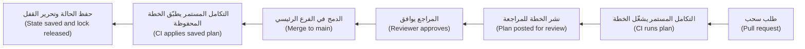

```mermaid
flowchart RL
    A["التزام في مستودع التطبيق<br/>(Commit to app repo)"] --> B["التكامل المستمر يبني الصورة ويختبرها<br/>(CI builds and tests image)"]
    B --> C["السجل يخزّن الصورة ببصمتها<br/>(Registry stores image by digest)"]
    C --> D["طلب سحب يرفع البصمة في مجلد التطوير<br/>(PR bumps digest in dev folder)"]
    D --> E["أرغو سي دي يزامن بيئة التطوير<br/>(Argo CD syncs dev)"]
    E --> F["طلب سحب يرقّي البصمة إلى ما قبل الإنتاج<br/>(PR promotes digest to staging)"]
    F --> G["أرغو سي دي يزامن بيئة ما قبل الإنتاج<br/>(Argo CD syncs staging)"]
    G --> H["طلب سحب معتمد يرقّي إلى الإنتاج<br/>(Approved PR promotes to prod)"]
    H --> I["أرغو سي دي يزامن بيئة الإنتاج<br/>(Argo CD syncs prod)"]
```

# الوحدة 3 — البنية التحتية بوصفها شيفرة (Infrastructure as code)

*الحساب السحابي الذي يغيّره الناس بالنقر نظامٌ لا يستطيع أحد أن يصفه وصفًا كاملًا أو يراجعه أو يعيد بناءه. وهذه الوحدة تحوّل البنية التحتية لبنك نجم (Najm Bank) إلى شيفرة: ملفات في Git تقول ما الذي ينبغي أن يوجد، وأداة تستنتج كيف تصل إليه، ومراجعة قبل أن يتغيّر أي شيء. تبدأ الوحدة بـ Terraform وOpenTofu، وهما أوسع الأدوات من هذا النوع استخدامًا: كيف تعمل الحالة (state) والخطط والوحدات البرمجية، ولماذا يكون ملف الحالة (state file) أكثر ملف حساسيةً يملكه فريق المنصة (platform team). ثم تنتقل من بيئة واحدة إلى بيئات كثيرة، مستخدمةً GitOps لترقية التغيير نفسه من بيئة التطوير إلى بيئة ما قبل الإنتاج (staging) إلى الإنتاج (production) عبر طلب سحب (pull request)، بينما يسحب Argo CD أو Flux النتيجة إلى العناقيد (clusters). وتنتهي بالضوابط التي تُبقي كل ذلك آمنًا على نطاق واسع: السياسة بوصفها شيفرة (policy as code) التي تفحص كل تغيير آليًا، واكتشاف الانحراف الذي يلاحظ متى لم يعد الواقع مطابقًا للشيفرة، والحواجز الواقية التي تجعل المسار الآمن هو المسار السهل. ستتابع يوسف بينما تكاد إعادة تسمية من كلمة واحدة في طلب سحب أن تستبدل قاعدة بيانات إنتاجية، وسالم وهو يصمّم مسار الترقية لـ واجهة برمجة تطبيق نجم للهاتف (Najm Mobile API)، ومها وهي تكتشف لماذا كفّت بيئة ما قبل الإنتاج والإنتاج عن التصرّف بالطريقة نفسها.*

> **المراحل:** Code, Release, Deploy, Operate — وصف البنية التحتية في ملفات قابلة للمراجعة، وترقية التغييرات عبر البيئات بطلبات السحب، وإبقاء ما يعمل متّسقًا مع ما اعتُمد.

---

# 3.1 — البنية التحتية بوصفها شيفرة باستخدام Terraform/OpenTofu: الحالة والوحدات والخطط
*المستوى: 🟡 متوسط* · *المتطلبات: 1.2، 1.3* · *المرحلة: Code, Deploy*

## ⚡ الدرس في دقيقة
- تعني **البنية التحتية بوصفها شيفرة (infrastructure as code, IaC)** وصفَ الخوادم والشبكات وقواعد البيانات والصلاحيات في ملفات نصية تطبّقها أداةٌ نيابةً عنك. تُراجَع الملفات، وتُدار إصداراتها، ويمكن تكرارها؛ وتصبح وحدة التحكم للقراءة فقط في العمل اليومي.
- إن **Terraform** وفرعه مفتوح المصدر **OpenTofu** أداتان *تصريحيتان (declarative)*: تكتب الحالة النهائية التي تريدها، فتستنتج الأداة أيّ استدعاءات إنشاء وتحديث وحذف عليها أن تنفّذ.
- تتذكّر الأداة ما تديره في **ملف الحالة**. احفظ الحالة عن بُعد، ومقفلة، ومشفّرة، ومضبوطة الوصول بإحكام، لأنها قد تحتوي على أسرار (secrets)، وفقدانها يعني أن تفقد تتبّع ما تملكه.
- **اقرأ الخطة دائمًا.** عبارتا "must be replaced" أو "destroy" بجوار قاعدة بيانات هما أهم سطرين ستراهما طوال الأسبوع.
- غلّف الأنماط المتكررة في **وحدات برمجية** ذات واجهات صغيرة مُتحقَّق منها؛ وثبّت إصدارات الوحدات والمزوّدات.
- الفخ الأكبر: تنفيذ `apply` من حاسوب محمول ببيانات اعتماد واسعة. عمليات التطبيق في الإنتاج تجري في خط تسليم (pipeline)، انطلاقًا من خطة محفوظة سبقت مراجعتها.

## 🧭 لماذا يهم
تبدو أول تذكرة يتسلّمها يوسف صغيرة: إعادة تسمية قاعدة بيانات المدفوعات من `payments-db` إلى `najm-payments-prod` لتوافق معيار التسمية. يعدّل سطرًا واحدًا ويطلب موافقة سريعة. تفتح مها الخطة التي أرفقها خط التسليم بطلب السحب:

```text
  # module.payments_db.aws_db_instance.this must be replaced
-/+ resource "aws_db_instance" "this" {
      ~ identifier = "payments-db" -> "najm-payments-prod" # forces replacement
      ...
Plan: 1 to add, 0 to change, 1 to destroy.
```

مع إصدار مزوّد AWS الذي يثبّته الفريق، لا يمكن تغيير المعرّف في مكانه (إصدارات المزوّد الأحدث تستطيع إعادة تسميته في مكانه؛ والخطة وحدها تخبرك بأيّهما لديك)، لذا كانت الأداة ستحذف قاعدة بيانات المدفوعات الإنتاجية وتنشئ قاعدة فارغة. كانت الشيفرة صحيحة، وقالت الخطة بالضبط ما سيحدث؛ والسؤال الوحيد كان هل سيقرؤها أحد. تمنع مها الدمج. وفي عصر ذلك اليوم يضيف سالم قاعدتين: كل قاعدة بيانات إنتاجية تحمل `prevent_destroy`، ولا يُدمج أي طلب سحب للإنتاج حتى يؤكد مراجعٌ سطرَ ملخّص الخطة.

أما لماذا تحتاج عمليات النشر إلى بوابات أصلًا فيتناوله [*تصميم الأنظمة لمبرمجي الحدس*، الدرس 4.4 — التراجع وبيئة ما قبل الإنتاج وبوابات الإطلاق](../vibe/index.ar.html#l4-4)؛ وهنا تتعلّم كيف تُبنى البنية التحتية التي تحتها وكيف تُغيَّر.

## 📐 كيف يعمل
### 🟢 الأساسيات
**لماذا الشيفرة بدل النقرات.** قاعدة البيانات التي تُنشأ في وحدة تحكم ويب لا تترك سجلًا قابلًا للمراجعة. لا يستطيع أحد مراجعة التغيير مسبقًا، ولا تكراره بدقة في بيئة أخرى، ولا إعادة بنائه بعد كارثة. والبنية التحتية بوصفها شيفرة (IaC) تعالج الثلاثة كلها: لكل تغيير في Git مؤلِّف ومراجِع وتاريخ؛ والملفات نفسها تبني بيئة التطوير وبيئة ما قبل الإنتاج والإنتاج؛ وبعد عطل إقليمي يكون وصف كل ما تحتاجه موجودًا في مستودع (repository).

**التصريحي مقابل الأمري.** السكربت *الأمري (imperative)* يسرد خطوات ("أنشئ شبكة، ثم قاعدة بيانات")؛ شغّله مرتين وقد تحصل على قاعدتي بيانات. أما الأداة *التصريحية* فتقارن وصف الحالة النهائية بما هو موجود؛ شغّلها مرتين فلا يفعل التشغيل الثاني شيئًا. هذه الخاصية هي **عدم التأثر بالتكرار (idempotence)**، وهي ما يجعل إعادة تشغيل البنية التحتية بوصفها شيفرة آمنة.

**Terraform وOpenTofu.** تستخدم أداة **Terraform**، من إنتاج HashiCorp، لغة تهيئة تُسمّى **HCL**. وفي أغسطس 2023 نقلت HashiCorp أداة Terraform من رخصة مفتوحة المصدر إلى رخصة المصدر التجاري. فاشتقّ المجتمع آخر إصدار مفتوح المصدر باسم **OpenTofu**، وهو مشروع تابع لـ Linux Foundation (قُبل في بيئة الاحتضان CNCF sandbox عام 2025). وتبقى الأداتان متقاربتين: لغة HCL نفسها، والمزوّدات نفسها، ومعظم الأوامر نفسها (`terraform` مقابل `tofu`)، وإن كانت بعض الميزات تختلف الآن، فراجع التوثيق الخاص بأداتك وإصدارها. ينطبق هذا الدرس على كلتيهما؛ وتستخدم التمارين OpenTofu لأنه مفتوح المصدر.

اللبنات الأساسية:

| المفهوم | ما هو | مثال |
|---|---|---|
| **المزوّد** | إضافة تتخاطب مع واجهة برمجة تطبيقات (API) واحدة: سحابة، أو Kubernetes، أو Docker، أو GitHub | `hashicorp/aws`، `hashicorp/azurerm`، `hashicorp/google`، `kreuzwerker/docker` |
| **المورد** | شيء واحد تنشئه الأداة وتديره | شبكة، قاعدة بيانات، حاوية تخزين (bucket)، حاوية (container) |
| **مصدر البيانات** | شيء يُقرأ ولكن لا يُدار | معرّف شبكة فريق آخر |
| **المتغيّر** | مُدخل إلى التهيئة | `environment = "prod"` |
| **المُخرج** | قيمة تكشفها التهيئة | اسم مضيف الاتصال لقاعدة البيانات |
| **الوحدة البرمجية** | مجلد قابل لإعادة الاستخدام من الموارد له مُدخلات ومُخرجات | `modules/postgres` |
| **الحالة** | سجلّ الأداة لأيّ الكائنات الحقيقية تديرها | `terraform.tfstate` |

تهيئة مصغّرة يمكنك تشغيلها محليًا باستخدام مزوّد Docker، دون حاجة إلى حساب سحابي:

```hcl
terraform {
  required_providers {
    docker = {
      source  = "kreuzwerker/docker"
      version = "~> 3.0" # allow any 3.x release, never a surprise 4.0
    }
  }
}

provider "docker" {}

resource "docker_image" "web" {
  name         = "nginx:1.27-alpine"
  keep_locally = true
}

resource "docker_container" "web" {
  name  = "najm-hello"
  image = docker_image.web.image_id
  ports {
    internal = 80
    external = 8080
  }
}
```

**سير العمل.** أربعة أوامر تحمل كل شيء تقريبًا:

```shell
tofu init                 # download providers and modules, connect to the state backend
tofu plan -out=tfplan     # compare code, state and reality; save the proposed changes
tofu show tfplan          # read the plan (a human does this)
tofu apply tfplan         # apply exactly the saved plan, nothing else
```

يكتب `init` أيضًا **ملف قفل الاعتماديات (dependency lock file)**، وهو `.terraform.lock.hcl`، بإصدارات المزوّدات الدقيقة ومجاميعها الاختبارية. أودِعه في المستودع.

**قراءة الخطة.** يبدأ سطر كل مورد برمز: `+` إنشاء، و`-` حذف، و`~` تحديث في المكان، و`-/+` حذف ثم إنشاء بديل. اقرأ سطر الملخّص أولًا، ثم كل `-` و`-/+`. والتغييرات التي لا يمكن إجراؤها في المكان تُعلَّم بـ `# forces replacement`.

### 🟡 التعمق أكثر
**الحالة: ذاكرة الأداة.** يربط ملف **الحالة** الشيفرة بالواقع: فهو يقابل `module.payments_db.aws_db_instance.this` بمعرّف قاعدة بيانات حقيقي ويخزّن آخر سماتها المعروفة. ومن دونه لا تستطيع الأداة التمييز بين "قاعدة بياناتي، وتحتاج إلى تغيير" و"قاعدة بيانات شخص آخر".

ثلاث حقائق تحدّد كيف تتعامل معه:
- **قد يحتوي على أسرار بنص صريح.** إذا كانت لمورد سمة كلمة مرور، فإن قيمتها تنتهي في الحالة، حتى لو كان المتغيّر مُعلَّمًا بـ `sensitive` (فهذه العلامة تخفيها فقط من مُخرجات الشاشة). عامِل ملف الحالة كما تعامل مخزن بيانات الاعتماد. وقد أضاف OpenTofu تشفيرًا اختياريًا للحالة من جهة العميل؛ وأيًّا كانت الأداة التي تستخدمها، شفّر أيضًا وسيط التخزين الذي توجد فيه. والأفضل من ذلك أن تتجنّب تمرير الأسرار عبر البنية التحتية بوصفها شيفرة أصلًا: دع قاعدة البيانات تولّد كلمة مرور المسؤول داخل مدير أسرار (secrets manager) ([*أمن الذكاء الاصطناعي والتطبيقات*، الدرس 5.2 — إدارة الأسرار: المفاتيح والرموز وأين تتسرّب](../secai/index.ar.html#/5.2)).
- **قد يُفسده شخصان يطبّقان في الوقت نفسه.** يمنع **القفل** تشغيلًا ثانيًا ما دام تشغيلٌ آخر قيد التنفيذ.
- **الملف المحلي على حاسوب محمول نقطة إخفاق وحيدة (single point of failure).** إن فقدته نسيت الأداة كل ما تديره.

لذلك تعيش حالة الإنتاج في **واجهة تخزين خلفية بعيدة (remote backend)** مزوّدة بالقفل والتشفير (encryption) وإدارة الإصدارات (versioning) ووصول ضيّق:

```hcl
terraform {
  backend "s3" {
    bucket       = "najm-tfstate-prod"           # versioning and encryption enabled on the bucket
    key          = "mobile-api/database.tfstate" # one state per component
    region       = "<your-region>"
    encrypt      = true
    use_lockfile = true # S3-native locking in recent versions; older setups use a DynamoDB table
  }
}
```

تستخدم Azure الواجهة الخلفية `azurerm`، وتستخدم Google Cloud الواجهة الخلفية `gcs`؛ وتخزّن الخدمات المستضافة مثل HCP Terraform الحالةَ نيابةً عنك. راجع توثيق أداتك لمعرفة الخيارات الحالية.

**الوحدات البرمجية: منتج فريق المنصة.** **الوحدة البرمجية** مجلد من الموارد تكون المتغيّرات مُدخلاته والمُخرجات نتائجه. لا يريد بنك نجم أربعين إعدادًا مختلفًا قليلًا لـ PostgreSQL؛ بل يريد إعدادًا واحدًا يكون افتراضيًا مدعومًا بنسخ احتياطية، ومشفّرًا، وخاصًا، ومراقَبًا، تستهلكه الفرق كما تستهلك مكتبة:

```hcl
module "orders_db" {
  source = "git::https://git.najm.example/platform/tf-modules.git//postgres?ref=v1.4.0" # pinned tag

  name           = "orders"
  environment    = "prod"
  size           = "medium"
  data_class     = "confidential"
  backup_days    = 35
  owner          = "team-orders"
}
```

الوحدات البرمجية الجيدة لها واجهة صغيرة، وقيم افتراضية ذات رأي واضح، وكتل `validation` على المتغيّرات تُفشل مبكرًا برسالة واضحة (مثلًا، يجب أن تكون `environment` إما `dev` أو `staging` أو `prod`). والوحدة البرمجية التي تكشف كل وسيطات المزوّد ليست سوى المزوّد نفسه مع خطوات إضافية.

**حماية ما يجب ألّا يموت.** في الموارد ذات الحالة، اطلب من الأداة أن ترفض الحذف:

```hcl
resource "aws_db_instance" "this" {
  # ...
  deletion_protection = true # the cloud API refuses deletes too
  lifecycle {
    prevent_destroy = true   # the IaC tool refuses any plan that would destroy this
  }
}
```

يوقف `prevent_destroy` الخطة السيئة؛ أما حماية الحذف (deletion protection) لدى المزوّد فتوقف أيضًا من يعمل في وحدة التحكم أو في أداة أخرى.

**من يشغّل `apply`.** في بنك نجم لا أحد يطبّق على الإنتاج من حاسوب محمول. ينشر خط التسليم الخطة على كل طلب سحب؛ وبعد الموافقة والدمج يطبّق *تلك الخطة المحفوظة* بدور قصير العمر يُحصل عليه عبر اتحاد الهوية OIDC (OIDC federation)، لا بمفاتيح مخزّنة (1.3). أما `apply` جديد بعد ساعة فسيحسب خطة جديدة لم يراجعها أحد.



### 🔴 نظرة الخبير
**نطاق الضرر وحدود الحالة.** حالة واحدة عملاقة للبنك كله تجعل كل خطة بطيئة، وكل تطبيق يُقفل الباب على الجميع، وكل خطأ قادرًا على المساس بكل شيء. قسّم الحالة حسب المكوّن والمالك: أسس الشبكة، وعنقود Kubernetes، ومخازن بيانات كل تطبيق، وDNS. ومرّر القيم بين الحالات عبر مُخرجات تقرؤها مصادر البيانات، أو عبر مخزن معاملات.

**إعادة الهيكلة دون حذف.** نقل مورد إلى وحدة برمجية يغيّر عنوانه، وعادةً سترى الأداة "حُذف العنوان القديم، وأُنشئ العنوان الجديد". أما كتلة `moved` فتخبرها بأن الكائن صار له ببساطة اسم جديد:

```hcl
moved {
  from = aws_db_instance.payments
  to   = module.payments_db.aws_db_instance.this
}
```

وبالمثل، تُدخل كتل `import` الموارد الموجودة المبنية يدويًا تحت الإدارة، وتوقف كتل `removed` إدارة مورد ما دون حذفه. وتُراجَع هذه في الخطة مثل كل شيء آخر، بخلاف أمرَي سطر الأوامر `state mv` و`state rm` اللذين يغيّران الحالة دون أي مراجعة. تحقّق من أن إصدارك يدعم كل كتلة.

**انضباط الإصدارات.** ثبّت إصدار الأداة (`required_version` وفي التكامل المستمر (CI))، والمزوّدات (القيود مع ملف القفل)، والوحدات البرمجية (وسم (tag)، لا فرعًا متحرّكًا أبدًا). رقِّ واحدًا في كل مرة، في بيئة التطوير أولًا: فترقية مزوّد تغيّر قيمة افتراضية قد تُنتج خطة مليئة بتحديثات لم يطلبها أحد.

**البدائل.** تستخدم **Pulumi** لغات عامة الأغراض مثل TypeScript أو Python أو Go، مع نموذج الحالة والخطة نفسه. أما **AWS CloudFormation** و**Azure Bicep** فأصيلتان في سحابتيهما (وقد تغيّر العرض الأصيل لدى Google Cloud مع الوقت؛ راجع توثيقه)؛ وكثيرًا ما تدعمان الخدمات الجديدة أولًا. يغطي Terraform وOpenTofu مزوّدات كثيرة بسير عمل واحد، وهذا يناسب بنكًا يشغّل Kubernetes وDNS وشبكة توصيل محتوى (CDN) وGitHub وسحابة معًا. والمفاهيم هنا تنتقل إليها جميعًا.

**وكلاء البرمجة بالذكاء الاصطناعي والبنية التحتية بوصفها شيفرة.** يكتب الوكلاء شيفرة HCL بسرعة، وقد "يصلحون" خطأً بتوسيع مجموعة أمان أو بإضافة صلاحية شاملة. الخطة والماسحات والسياسات (3.3) هي التي تقرّر، لا ثقة الوكيل. ويغطي [*أمن الذكاء الاصطناعي والتطبيقات*، الدرس 7.2 — الحاويات وKubernetes والبنية التحتية بوصفها شيفرة](../secai/index.ar.html#/7.2) الفحوص الأمنية بتعمّق.

## 🧰 الأدوات
| الأداة أو الممارسة أو الخدمة | ما هي وماذا تفعل | متى تلجأ إليها |
|---|---|---|
| **OpenTofu** | أداة بنية تحتية بوصفها شيفرة تصريحية مفتوحة المصدر مشتقّة من Terraform؛ HCL والمزوّدات والحالة والخطط | الخيار الافتراضي لأعمال IaC الجديدة مفتوحة المصدر ولتمارين هذه الدورة |
| **Terraform** | الأداة الأصلية للبنية التحتية بوصفها شيفرة القائمة على HCL، تخضع لرخصة BSL منذ أغسطس 2023، ولها خدمة مستضافة هي HCP Terraform | حيث تكون مؤسستك قد اعتمدتها معيارًا أو تستخدم ميزاتها المستضافة |
| **Remote state with locking** — الحالة البعيدة مع القفل | تخزين حالة مشترك ومشفّر ومُدار الإصدارات يمنع عمليات التطبيق المتزامنة | أي تهيئة يلمسها أكثر من شخص واحد أو خط تسليم واحد |
| **IaC module** — وحدة البنية التحتية البرمجية | مجلد قابل لإعادة الاستخدام من الموارد بواجهة صغيرة مُتحقَّق منها وقيم افتراضية آمنة | أي نمط يُبنى أكثر من مرتين: قواعد البيانات، وحاويات التخزين (buckets)، والعناقيد، والشبكات |
| **Pulumi** | البنية التحتية بوصفها شيفرة بلغات عامة الأغراض مع نموذج الخطة والحالة نفسه | الفرق التي تفضّل لغات حقيقية للبنية التحتية |

## 🏛️ عمليًا في بنك نجم
يطلب سالم من يوسف أن يكتب الواجهة لأول وحدة برمجية من نوع المسار الذهبي في المنصة، كي تستطيع فرق التطبيقات طلب قاعدة بيانات بملء ستة أسطر. هذا هو **معيار نجم للوحدات البرمجية للبنية التحتية: `postgres` v1**.

**الجزء أ: الواجهة**

| المُدخل | النوع والقيم المسموحة | القيمة الافتراضية | لماذا هو مُدخل |
|---|---|---|---|
| `name` | سلسلة نصية، أحرف صغيرة وشَرطات، من 3 إلى 30 حرفًا | لا يوجد (مطلوب) | يبني المعرّف `najm-<name>-<environment>` |
| `environment` | `dev` أو `staging` أو `prod` | لا يوجد (مطلوب) | يحدّد حدود الحجم والنسخ الاحتياطية والحماية |
| `size` | `small` أو `medium` أو `large` | `small` | يقابل فئة مثيل لكل سحابة؛ لا تختار الفرق أنواع المثيلات الخام أبدًا |
| `data_class` | `internal` أو `confidential` أو `restricted` | `confidential` | التصنيف المقيَّد يفرض مفاتيح يديرها العميل وتسجيلًا إضافيًا |
| `backup_days` | رقم، من 7 إلى 35 | 7 في بيئة التطوير، و35 في الإنتاج | هدف التعافي؛ محدود بالحد الأقصى لدى المزوّد |
| `owner` | المعرّف المختصر للفريق | لا يوجد (مطلوب) | يصبح الوسم `owner` للتنبيهات وتقارير التكلفة (6.2) |

| المُخرج | الاستخدام |
|---|---|
| `endpoint` | اسم مضيف خاص لتهيئة التطبيق |
| `secret_ref` | اسم مدخل مدير الأسرار الذي يحفظ بيانات الاعتماد المولّدة؛ وليس كلمة المرور نفسها أبدًا |
| `dashboard_url` | رابط إلى لوحة المتابعة القياسية لقاعدة البيانات |

**الجزء ب: ما تثبّته الوحدة البرمجية ولا يمكن تهيئته**
- شبكات خاصة فقط؛ لا نقطة نهاية عامة أبدًا.
- التشفير أثناء التخزين (encryption at rest) وTLS أثناء النقل مُفعَّلان.
- حماية الحذف و`prevent_destroy` في `staging` و`prod`.
- بيانات اعتماد المسؤول تولّدها السحابة وتُخزَّن في مدير الأسرار؛ ولا يمرّ أيٌّ منها عبر المتغيّرات.
- الوسوم القياسية: `owner`، و`environment`، و`data-class`، و`cost-centre`، و`managed-by = opentofu`.

**الجزء ج: قواعد الحالة والتطبيق**
- حالة واحدة لكل مكوّن (`<team>/<service>/<component>.tfstate`)، وحاوية تخزين خلفية واحدة لكل بيئة؛ إدارة الإصدارات والتشفير مُفعَّلان؛ والوصول مقصور على دور خط التسليم ومهندسَين اثنين مسمَّيين لكسر الزجاج.
- عمليات التطبيق في الإنتاج تجري فقط من خط التسليم، ومن خطة محفوظة (saved plan)، بموافقة فريق المنصة والفريق المالك.
- أي `destroy` أو `must be replaced` على مورد ذي حالة يحتاج إلى موافقة مها أو سالم.

## 🛠️ التمارين
تعمل الثلاثة كلها على جهازك باستخدام Docker وOpenTofu. وإن اخترت بدلًا من ذلك الفئة المجانية (free tier) لدى سحابة ما، فاضبط تنبيه ميزانية (budget alert) قبل إنشاء أي شيء.

- 🟢 استخدم تهيئة Docker من 🟢 الأساسيات. شغّل `init` و`plan -out=tfplan` و`apply tfplan`، وتحقّق من الصفحة على المنفذ 8080، ثم غيّر المنفذ الخارجي واقرأ الخطة الجديدة. وأخيرًا شغّل `plan` مرة أخرى دون تغيير أي شيء. *يكتمل عندما:* تستطيع الإشارة إلى السطر الذي يقول هل ستُحدَّث الحاوية في مكانها أم ستُستبدل، وتُبلغ الخطة الأخيرة بعدم وجود تغييرات.
- 🟡 حوّل التهيئة إلى وحدة برمجية `modules/web` بمُدخلات مُتحقَّق منها هي `name` و`port` و`image_tag`، واستدعِها مرتين لتشغيل حاويتين. استخدم كتلة `moved` للحاوية الأصلية. *يكتمل عندما:* يفشل منفذ غير صالح عند `plan` برسالة الخطأ التي كتبتها، وتُظهر خطة إعادة الهيكلة نقلًا دون أي حذف.
- 🔴 شغّل مخزن كائنات متوافقًا مع S3 محليًا في Docker (MinIO أو بديلًا عنه؛ تحقّق من رخصته الحالية وصوره)، واستخدمه واجهة تخزين خلفية بعيدة مقفلة. ابدأ عمليتي تطبيق في الوقت نفسه من طرفيتين. ثم أضف `prevent_destroy` إلى إحدى الحاويتين وغيّر اسمها، وهو ما يفرض الاستبدال. *يكتمل عندما:* يُرفض التطبيق الثاني بسبب القفل، وتُرفض خطة الاستبدال المفروض بخطأ `prevent_destroy`، ولا يوجد ملف حالة في مجلد العمل.

## ⚠️ أخطاء وفخاخ
- **تصفّح الخطة على عجل.** اقرأ سطر الملخّص وكل `-` و`-/+` قبل الموافقة. اجعل خط التسليم ينشر الخطة داخل طلب السحب كي لا يستطيع المراجعون تجاوزها.
- **الحالة في Git أو على حاسوب محمول.** قد تحمل الحالة أسرارًا، وهي الخريطة الوحيدة لما تملكه. استخدم واجهة تخزين خلفية بعيدة ومقفلة ومشفّرة ومُدارة الإصدارات بوصول ضيّق.
- **تشغيل `apply` جديد بدل الخطة التي رُوجعت.** ربما تغيّر الواقع في الأثناء. طبّق ملف الخطة المحفوظ، أو أعد التخطيط وأعد المراجعة.
- **وحدات برمجية ومزوّدات غير مثبّتة الإصدار.** إنها تغيّر بنيتك التحتية دون تغيير في الشيفرة. ثبّت الإصدارات وأودِع ملف القفل (lock file).
- **جراحة الحالة في الثانية فجرًا.** أمر `state rm` غير المراجَع يُفقدك تتبّع موارد حقيقية. استخدم كتل `moved` و`import` و`removed` في طلب سحب.

## 🧾 الخلاصة
- تحوّل البنية التحتية بوصفها شيفرة البنية التحتية إلى شيفرة مُراجَعة ومُدارة الإصدارات وقابلة للتكرار؛ والأدوات التصريحية مثل Terraform وOpenTofu تحسب التغييرات نيابةً عنك.
- تربط الحالة الشيفرة بالموارد الحقيقية. احفظها بعيدة ومقفلة ومشفّرة ومضبوطة الوصول، وقسّمها حسب المكوّن للحدّ من نطاق الضرر (blast radius).
- الخطة هي شبكة الأمان: احفظها، وراجعها في طلب السحب، وطبّق تلك الخطة بعينها من خط تسليم ببيانات اعتماد قصيرة العمر (short-lived credentials).
- الوحدات البرمجية هي منتج فريق المنصة: واجهات صغيرة مُتحقَّق منها، وقيم افتراضية آمنة، وإصدارات مثبّتة.
- احمِ الموارد ذات الحالة بـ `prevent_destroy` وبحماية الحذف لدى المزوّد، وأعد الهيكلة بكتل `moved` و`import` و`removed`.

## ✍️ اختبر نفسك

**1. يعيد يوسف تسمية معرّف قاعدة بيانات المدفوعات الإنتاجية في شيفرة Terraform. تُظهر الخطة `-/+` و`# forces replacement` لقاعدة البيانات. ماذا سيحدث إذا طُبّقت هذه الخطة؟**

- A. تُعاد تسمية قاعدة البيانات في مكانها دون أي توقف
- B. تُحذف قاعدة البيانات وتُستبدل بقاعدة جديدة فارغة
- C. لا شيء، لأن Terraform لا يحذف قواعد البيانات أبدًا
- D. يُحدَّث ملف الحالة فقط، وتبقى قاعدة البيانات الحقيقية دون مساس

<details><summary>الإجابة</summary>

**B.** تعني `-/+` الحذف ثم إنشاء بديل، ويقول التعليق أيّ سمة تفرض ذلك. الخيار A هو ما افترضه يوسف؛ والخيار C خاطئ ما لم تُضبط `prevent_destroy` أو حماية الحذف (deletion protection). (🟢 الأساسيات، و🧭 لماذا يهم.)

</details>

**2. لماذا يجب تخزين ملف الحالة لـ Terraform أو OpenTofu في واجهة تخزين خلفية مقفلة ومشفّرة ومضبوطة الوصول بدل إيداعه في Git؟**

- A. لا يستطيع Git تخزين ملفات أكبر من ميغابايت واحد، وملفات الحالة كثيرًا ما تتجاوز ذلك
- B. لا تُحتاج ملفات الحالة إلا أثناء التطبيق الأول
- C. ترفض المزوّدات العمل إذا كانت الحالة في مستودع
- D. قد تحمل الحالة أسرارًا بنص صريح، وقد تُفسدها عمليات الكتابة المتزامنة غير المقفلة

<details><summary>الإجابة</summary>

**D.** تنتهي السمات الحساسة في الحالة (state) بصرف النظر عن العلامة `sensitive`، والقفل يمنع تشغيلين من الكتابة في آن واحد. الخيار B خاطئ: فالحالة مطلوبة في كل تشغيل. (🟡 التعمق أكثر.)

</details>

**3. يشغّل خط تسليم الأمر `plan` عند فتح طلب سحب. يُوافَق على طلب السحب ويُدمج بعد ثلاث ساعات، ثم يشغّل خط التسليم `apply` جديدًا دون خطة محفوظة. ما الخطر؟**

- A. إنه يعيد التخطيط مقابل الشيفرة والواقع الحاليين، لذا قد يطبّق تغييرات لم تُراجَع
- B. لا يوجد خطر، لأن `apply` يكرّر دائمًا أحدث خطة شغّلها خط التسليم
- C. سيفشل التطبيق، لأن كل خطة تنتهي صلاحيتها بعد ساعة من تشغيل `plan`
- D. سيُحذف ملف الحالة بالكامل من الواجهة الخلفية البعيدة

<details><summary>الإجابة</summary>

**A.** التطبيق الجديد يحسب خطة جديدة. وحفظ الخطة باستخدام `-out` ثم تطبيق ذلك الملف يعني أن التغييرات المُراجَعة هي التغييرات المطبَّقة. الخيار B هو سوء الفهم الشائع. (🟡 التعمق أكثر.)

</details>

**4. يريد سالم أن تنشئ فرق التطبيقات قواعد بيانات PostgreSQL تكون دائمًا خاصة ومشفّرة ومدعومة بنسخ احتياطية. أيّ تصميم يحقّق ذلك على أفضل وجه؟**

- A. صفحة ويكي تسرد الإعدادات الموصى بها، مرتبطة من دليل الإعداد لكل فريق
- B. وحدة برمجية تكشف كل وسيطات المزوّد متغيّراتٍ كي تحظى الفرق بمرونة كاملة
- C. وحدة برمجية بواجهة صغيرة مُتحقَّق منها وإعدادات الأمان مثبّتة داخلها
- D. منح كل فريق صلاحية المسؤول على وحدة التحكم السحابية

<details><summary>الإجابة</summary>

**C.** تثبيت القيم الافتراضية الآمنة داخل الوحدة البرمجية يجعل التهيئة الصحيحة هي الوحيدة المتاحة. الخيار B يعيد إنتاج عدم الاتساق الذي ينبغي للوحدة أن تزيله؛ والخيار A يعتمد على أن يقرأه الجميع ويتّبعوه. (🟡 التعمق أكثر، و🏛️ عمليًا.)

</details>

**5. ينقل فريق المنصة مورد قاعدة بيانات موجودًا إلى وحدة برمجية جديدة. تُظهر الخطة حذف العنوان القديم وإنشاء عنوان جديد. ما الإصلاح الأكثر أمانًا؟**

- A. طبّقها في ساعة هادئة واستعد من النسخة الاحتياطية بعد ذلك
- B. أضف كتلة `moved` من العنوان القديم إلى العنوان الجديد
- C. احذف ملف الحالة وشغّل `import` من سطر الأوامر لكل مورد
- D. انسخ شيفرة الوحدة البرمجية عائدًا إلى التهيئة الجذرية بصورة دائمة

<details><summary>الإجابة</summary>

**B.** تسجّل كتلة `moved` إعادة التسمية تصريحيًا وتُراجَع في الخطة. الخيار A يسبّب انقطاعًا وفقدانًا للبيانات؛ والخيار C جراحة حالة (state surgery) خطرة غير مُراجَعة. (🔴 نظرة الخبير.)

</details>

## 📚 المراجع
- توثيق OpenTofu — https://opentofu.org/docs/
- توثيق Terraform — https://developer.hashicorp.com/terraform/docs
- لغة Terraform: الحالة — https://developer.hashicorp.com/terraform/language/state
- لغة Terraform: الوحدات البرمجية — https://developer.hashicorp.com/terraform/language/modules
- HashiCorp، الأسئلة الشائعة حول الترخيص (رخصة المصدر التجاري) — https://www.hashicorp.com/
- Linux Foundation، مشروع OpenTofu — https://opentofu.org/
- توثيق Pulumi — https://www.pulumi.com/docs/

---

# 3.2 — البيئات وGitOps: ترقية التغييرات من بيئة التطوير إلى الإنتاج
*المستوى: 🟡 متوسط* · *المتطلبات: 2.2، 2.3، 3.1* · *المرحلة: Release, Deploy*

## ⚡ الدرس في دقيقة
- **البيئة** (التطوير، وما قبل الإنتاج، والإنتاج) نسخة كاملة من النظام لغرض محدّد. ينبغي ألّا تختلف البيئات إلا في التهيئة والحجم، ولا تختلف أبدًا في الشيفرة أو البنية.
- **ابنِ مرة واحدة، ورقِّ الأثر البرمجي نفسه.** بصمة الصورة (image digest) نفسها التي اختُبرت في بيئة ما قبل الإنتاج هي التي تصل إلى الإنتاج؛ ولا يُعاد بناء شيء على طول الطريق.
- تعني **GitOps** أن الحالة المرغوبة (desired state) لكل بيئة تعيش في Git، وأن وكيلًا داخل المنصة يسحبها ويجعل الواقع مطابقًا لها باستمرار. مبادئه الأربعة: تصريحي، ومُدار الإصدارات وغير قابل للتغيير، ويُسحب آليًا، ويُوفَّق باستمرار.
- **الترقية** طلب سحب يغيّر قيمة واحدة (عادةً بصمة صورة) في مجلد البيئة التالية. راجِع، وادمج، ويتولّى **Argo CD** أو **Flux** الباقي؛ أما **التراجع (rollback)** فهو `git revert`.
- إشارة القرار: إن لم تستطع الإجابة عن سؤال "ما الذي يعمل في الإنتاج بالضبط، ومن وافق عليه؟" من Git وحده، فأنت لا تمارس GitOps بعد.
- الفخ الأكبر: فروع طويلة العمر لكل بيئة، وتعديلات يدوية بـ `kubectl` تكتب فوقها المزامنة التالية بصمت، أو لا يلاحظها أحد أبدًا.

## 🧭 لماذا يهم
في 1 أغسطس 2012 نشرت Knight Capital، وهي شركة أمريكية كبيرة لصناعة السوق، شيفرة تداول جديدة على خوادمها. ووفقًا لأمر هيئة الأوراق المالية والبورصات الأمريكية في القضية، نسخ فنّيٌّ الشيفرة الجديدة إلى سبعة من الخوادم الثمانية ولم ينسخها إلى الثامن، ولم يلاحظ أحد. وأعاد الإصدار الجديد استخدام علامة شغّلت على الخادم الثامن شيفرةً قديمة متروكة منذ زمن طويل. فأرسل ذلك الخادم ملايين الأوامر غير المقصودة خلال نحو 45 دقيقة، وخسرت الشركة قرابة 460 مليون دولار، وفقًا للهيئة (SEC). كان النشر يدويًا، ولم يكن هناك فحص آلي يتحقّق من أن كل خادم يشغّل الإصدار نفسه، ولم يراجع شخص ثانٍ النتيجة.

لدى بنك نجم نسخة أصغر من المشكلة نفسها. تحقّق مها في سبب استمرار خلل مهلة أُصلح في بيئة ما قبل الإنتاج في الظهور في الإنتاج. فالإنتاج يشغّل صورة (image) من الالتزام (commit) نفسه لكنها أُعيد بناؤها بعد يومين بصورة أساس (base image) أحدث، كما أن أحدهم رفع حجم مجمّع الاتصالات باستخدام `kubectl edit` أثناء حادثة الشهر الماضي. ولا شيء في Git يسجّل أيًّا من الاختلافين، فلم تعد بيئة ما قبل الإنتاج تتنبّأ بسلوك الإنتاج.

يمنح هذا الدرس الفريق قاعدة واحدة وآلية واحدة. القاعدة: الأثر البرمجي (artefact) نفسه ينتقل عبر كل بيئة، ولا تختلف إلا التهيئة. والآلية: GitOps، حيث يكون Git السجلّ الوحيد لما ينبغي أن يعمل وأين، ويجعل متحكّمٌ (controller) ذلك واقعًا ويُبلغ عن أي اختلاف.

## 📐 كيف يعمل
### 🟢 الأساسيات
**لماذا البيئات.** تحتاج إلى مكان تجرّب فيه التغييرات ليس هو الإنتاج. يستخدم بنك نجم ثلاث بيئات:

| البيئة | الغرض | البيانات | من ينشر |
|---|---|---|---|
| **dev** — التطوير | دمج التغييرات وتجربتها بسرعة | بيانات اختبار اصطناعية | آليًا عند كل دمج |
| **staging** — ما قبل الإنتاج | بروفة نهائية بتهيئة وحجم شبيهين بالإنتاج | بيانات مُقنَّعة أو اصطناعية، ولا بيانات عملاء حقيقية أبدًا دون موافقة | طلب سحب للترقية، بموافقة الفريق |
| **prod** — الإنتاج | العملاء | بيانات حقيقية | طلب سحب للترقية، بموافقة الفريق والمنصة |

**تكافؤ البيئات.** يسمّي منهج التطبيق ذي العوامل الاثني عشر (Twelve-Factor App) ذلك "تكافؤ التطوير والإنتاج (dev/prod parity)": أبقِ البيئات متشابهة قدر الإمكان. ولا يُسمح بالاختلافات إلا حيث تكون مقصودة ومكتوبة: أعداد النسخ المتماثلة، وأحجام المثيلات، وأسماء النطاقات، وبيانات الاعتماد (credentials)، وإعدادات أعلام الميزات. أما اختلاف الشيفرة، أو الصور (images)، أو إصدارات Kubernetes، أو تخطيطات الشبكة، فيجعل نتائج بيئة ما قبل الإنتاج بلا معنى.

**ابنِ مرة واحدة، ورقِّ الأثر البرمجي.** يبني التكامل المستمر صورة الحاوية (container image) مرة واحدة، من التزام واحد، ويدفعها إلى السجل (registry). وتُعرَّف الصورة ببصمتها، وهي تجزئة SHA-256 (SHA-256 hash) لمحتواها مثل `sha256:4f1c…`، لا بوسم مثل `v2.3` أو `latest`، لأن الوسم يمكن نقله إلى صورة مختلفة أما البصمة فلا (2.1). ثم تشغّل كل بيئة تلك البصمة. أما إعادة البناء للإنتاج، كما في حالة مها، فتُنتج أثرًا برمجيًا مختلفًا لم يختبره أحد.

**ما هو GitOps.** يحدّد مشروع OpenGitOps، التابع لـ CNCF، أربعة مبادئ:
- **تصريحي**: تُوصَف الحالة المرغوبة للنظام، ولا تُكتب في سكربت.
- **مُدار الإصدارات وغير قابل للتغيير**: يُخزَّن ذلك الوصف بطريقة تحفظ التاريخ الكامل ولا يمكن تغييرها بصمت، وهذا يعني عمليًا Git.
- **يُسحب آليًا**: تجلب وكلاء برمجية الحالة المرغوبة من المصدر؛ ولا يدفع أحد التغييرات إلى العنقود (cluster) يدويًا.
- **يُوفَّق باستمرار**: تواصل الوكلاء مقارنة الحالة الفعلية بالحالة المرغوبة وتعمل على سدّ أي فجوة.

أشهر متحكّمَي GitOps لـ Kubernetes هما **Argo CD** و**Flux**، وكلاهما مشروع متخرّج في CNCF. يعمل كلٌّ منهما داخل العنقود، ويراقب مستودع Git، ويطبّق ما يجده.

**الدفع مقابل السحب.** في خط تسليم *الدفع* التقليدي، يحمل التكامل المستمر بيانات اعتماد العنقود ويشغّل `kubectl apply` أو `helm upgrade` في النهاية. أما في GitOps القائم على *السحب*، فلا يلمس التكامل المستمر العنقود أبدًا: إنه يحدّث Git فقط. والمتحكّم داخل العنقود هو الذي يسحب. وهذا يعني بيانات اعتماد قوية أقل خارج العنقود، ومسار تدقيق كاملًا في Git، وتصحيحًا آليًا حين يغيّر أحدهم العنقود يدويًا.



### 🟡 التعمق أكثر
**مستودعان.** يفصل بنك نجم شيفرة مصدر التطبيق عن تهيئة البيئات:
- يحفظ **مستودع التطبيق** شيفرة واجهة الهاتف وملف Dockerfile والاختبارات؛ ويبني التكامل المستمر الصور منه؛
- ويحفظ **مستودع GitOps** ما يعمل وأين: بيانات Kubernetes الوصفية أو قيم Helm لكل بيئة.

وعندئذ لا تُطلق تغييرات التهيئة أي عمليات بناء، ويمكن أن تختلف صلاحيات الوصول، ويكون تاريخ GitOps سجلًا نظيفًا لعمليات النشر.

**مجلدات لا فروع لكل بيئة.** يحتفظ تصميم مبكر شائع بفرع `dev` وفرع `staging` وفرع `prod` ويدمج بينها. ويوصي كثير من الممارسين بعدم ذلك: فعمليات الدمج تحمل معها تغييرات لا علاقة لها، والفروع تتباعد، والاختلافات بين البيئات تختبئ في تاريخ Git (Git history) بدل أن تكون ظاهرة في الملفات. يستخدم بنك نجم فرعًا واحدًا `main` ومجلدًا واحدًا لكل بيئة، مبنيًّا بأداة **Kustomize**، وهي أداة مدمجة في `kubectl` تضع رقعًا صغيرة طبقاتٍ فوق قاعدة مشتركة:

```text
gitops/
  apps/mobile-api/
    base/                 # Deployment, Service, probes: shared by all environments
      deployment.yaml
      service.yaml
      kustomization.yaml
    overlays/
      dev/kustomization.yaml
      staging/kustomization.yaml
      prod/kustomization.yaml
      prod/replicas.yaml
```

ولا تذكر طبقة الإنتاج إلا ما يختلف:

```yaml
apiVersion: kustomize.config.k8s.io/v1beta1
kind: Kustomization
resources:
  - ../../base
images:
  - name: registry.najm.example/mobile-api
    digest: sha256:4f1c0e…   # the promoted artefact; set by the promotion PR
patches:
  - path: replicas.yaml       # 6 replicas in prod, 2 in staging
```

وإن كانت خدماتك تستخدم Helm بدلًا من ذلك (2.3)، فالنمط نفسه يبقى قائمًا: مخطّط واحد، وملف قيم واحد لكل بيئة، وبصمة الصورة في ملف القيم.

**الترقية طلب سحب.** ترقية واجهة الهاتف من بيئة ما قبل الإنتاج إلى الإنتاج تعني نسخ بصمة واحدة من `overlays/staging` إلى `overlays/prod`. ويفتح سكربت صغير أو روبوت طلب السحب ذلك آليًا بعد اجتياز فحوص بيئة ما قبل الإنتاج. يُظهر طلب السحب بالضبط ما يتغيّر، وتفرض قواعد CODEOWNERS الموافقين المناسبين، ويكون الدمج هو قرار الإطلاق. ويمكن لأدوات مثل Argo CD Image Updater وأتمتة الصور في Flux أن تكتب رفع البصمة في بيئة التطوير نيابةً عنك؛ أما ترقيات الإنتاج فأبقِها طلبات سحب صريحة مُراجَعة.

**إخبار Argo CD بما يراقبه.** يشير كائن `Application` في Argo CD إلى مجلد وعنقود:

```yaml
apiVersion: argoproj.io/v1alpha1
kind: Application
metadata:
  name: mobile-api-prod
  namespace: argocd
spec:
  project: retail
  source:
    repoURL: https://git.najm.example/platform/gitops.git
    targetRevision: main
    path: apps/mobile-api/overlays/prod
  destination:
    server: https://kubernetes.default.svc
    namespace: mobile-api
  syncPolicy:
    automated:
      prune: true     # delete objects removed from Git
      selfHeal: true  # undo manual changes made in the cluster
```

يزيل `prune` الكائنات التي حُذفت من Git؛ ويعيد `selfHeal` التعديلات اليدوية إلى ما كانت عليه. ومع تفعيل الاثنين، كان `kubectl edit` الذي وجدته مها سيُلغى خلال دقائق، وسيظهر في الأثناء بحالة "OutOfSync". ويعبّر Flux عن الفكرة نفسها بكائنَي `GitRepository` و`Kustomization`.

**التراجع.** لأن كل عملية نشر (deployment) التزامٌ، فإن التراجع هو `git revert` لطلب سحب الترقية: تعود البصمة القديمة، ويُزامِن المتحكّم، ويسجّل التاريخ من تراجع ولماذا. التراجع عن *الشيفرة* سهل؛ أما التراجع عن *مخطّط قاعدة البيانات* فليس كذلك، ولذا تتبع تغييرات المخطّط نمط التوسيع ثم التقليص الذي يُغطّى مع استراتيجيات الإطلاق (4.2).

**الأسرار في GitOps.** يجب ألّا يحتوي مستودع GitOps على أسرار صريحة، وكائنات Secrets في Kubernetes مُرمَّزة بـ base64 فقط، وليست مشفّرة (2.3). الأنماط الشائعة: **External Secrets Operator**، الذي يزامن القيم من مدير أسرار سحابي إلى العنقود، مع وجود مرجع فقط في Git؛ و**Sealed Secrets** أو **SOPS**، اللذان يخزّنان قيمًا مشفّرة في Git لا يستطيع فكّ تشفيرها إلا العنقود. يستخدم بنك نجم مراجع إلى مدير الأسرار الخاص به؛ انظر [*أمن الذكاء الاصطناعي والتطبيقات*، الدرس 5.2 — إدارة الأسرار: المفاتيح والرموز وأين تتسرّب](../secai/index.ar.html#/5.2).

### 🔴 نظرة الخبير
**بيئات للبنية التحتية أيضًا.** تتولّى متحكّمات GitOps ما يعمل *داخل* Kubernetes. أما العناقيد وقواعد البيانات والشبكات التي تحتها فتُدار بـ OpenTofu (3.1)، وتنطبق القواعد نفسها: مجلد واحد لكل بيئة يستدعي إصدارات الوحدات البرمجية نفسها، فيكون الفرق بين بيئة ما قبل الإنتاج والإنتاج قائمةً قصيرة مقروءة من المُدخلات. تتيح **مساحات العمل (workspaces)** في Terraform لتهيئة واحدة أن تحتفظ بعدة حالات، لكنها تخفي البيئة التي أنت فيها خلف إعداد في سطر الأوامر وتجعل التطبيق على البيئة الخاطئة سهلًا؛ أما المجلدات والواجهات الخلفية وبيانات الاعتماد المنفصلة لكل بيئة فأوضح. وتستخدم بعض الفرق أغلفة مثل Terragrunt، أو متحكّمات تشغّل البنية التحتية بوصفها شيفرة عبر GitOps (متحكّم Tofu المجتمعي لـ Flux، وCrossplane)؛ قيّمها بعناية مقابل خط التسليم الأبسط في 3.1.

**حسابات منفصلة، لا مجرد فضاءات أسماء.** ضع الإنتاج في حسابه السحابي الخاص (AWS)، أو اشتراكه (Azure)، أو مشروعه، بحدود هوية خاصة به. خط تسليم بيئة التطوير الذي لا تستطيع بيانات اعتماده حتى رؤية الإنتاج لا يمكنه أن يكسره.

**الترتيب والاعتماديات.** نادرًا ما تقتصر الترقيات الحقيقية على خدمة واحدة. تتيح موجات المزامنة في Argo CD و`dependsOn` في Flux ترتيب الموارد، مثل تغيير تهيئة قبل كائن Deployment الذي يحتاجه. ويولّد **ApplicationSet** في Argo CD كائن `Application` واحدًا لكل بيئة أو عنقود من قالب، وهذا يُبقي خمسين عنقودًا متّسقة. أبقِ التغييرات العابرة للخدمات متوافقة مع الإصدارات السابقة كي يمكن ترقية كل خدمة وحدها؛ فالترقيات المترابطة علامة على عيب في التصميم.

**البيانات الوصفية المُصيَّرة.** حين يُصيِّر Helm أو Kustomize النتيجة على نحو مختلف عمّا توقّعت، لا يُظهر الفرق في طلب السحب إلا تغيير المُدخل. وتُصيِّر بعض الفرق ملف YAML النهائي في التكامل المستمر وتودِعه (أو تنشر الفرق المُصيَّر في طلب السحب) كي يرى المراجعون بالضبط ما سيتلقّاه العنقود. يكلّف ذلك بعض الضجيج في المستودع ويشتري الوضوح.

**التنظيم.** بالنسبة إلى بنك، يكون تاريخ GitOps دليلًا: من وافق على أيّ تغيير في الإنتاج، ومتى، وما الذي نُشر بالضبط. ويتوقّع قانون المرونة التشغيلية الرقمية الأوروبي (EU DORA)، الذي يسري على الكيانات المالية في الاتحاد الأوروبي منذ يناير 2025، إدارةً موثّقة لتغييرات تقنية المعلومات والاتصالات؛ كما تضع الجهات التنظيمية في دول الخليج مثل مصرف قطر المركزي (Qatar Central Bank) توقّعات بشأن ضبط التغيير واستخدام السحابة. راجع النصوص الحالية مع فريق الامتثال بدل الاعتماد على الملخّصات.

## 🧰 الأدوات
| الأداة أو الممارسة أو الخدمة | ما هي وماذا تفعل | متى تلجأ إليها |
|---|---|---|
| **Argo CD** (متخرّج في CNCF) | متحكّم GitOps لـ Kubernetes بواجهة ويب، وحالة مزامنة، وعرض للفروق، وموجات مزامنة، وApplicationSets | الفرق التي تريد حالة مزامنة مرئية وواجهة مستخدم (UI)؛ وعناقيد كثيرة من قوالب |
| **Flux** | مجموعة أدوات من متحكّمات GitOps لـ Kubernetes (مصادر Git، وKustomize، وHelm، وأتمتة الصور) | الفرق التي تفضّل نهجًا قابلًا للتركيب يقوده سطر الأوامر والموارد المخصّصة |
| **Kustomize** | يضع رقعًا خاصة بكل بيئة طبقاتٍ فوق بيانات Kubernetes الوصفية المشتركة؛ مدمج في `kubectl` | مجلد واحد لكل بيئة باختلافات قليلة مقروءة |
| **Helm** | يحزم بيانات Kubernetes الوصفية في مخطّطات مع ملفات قيم | الخدمات المحزومة أصلًا في مخطّطات؛ ملف قيم واحد لكل بيئة |
| **Promotion pull request** — طلب سحب الترقية | تغيير مُراجَع ينسخ بصمة صورة من مجلد بيئة إلى التالية | كل خطوة نحو الإنتاج؛ قرار الإطلاق |
| **External Secrets Operator** | يزامن الأسرار من مدير أسرار سحابي إلى Kubernetes، ولا يُبقي في Git إلا المراجع | أي إعداد GitOps يحتاج إلى أسرار |

## 🏛️ عمليًا في بنك نجم
يكتب سالم **سياسة نجم للبيئات والترقية، الإصدار 1 (Najm Environment and Promotion Policy v1)**، بدءًا بـ واجهة برمجة تطبيق نجم للهاتف.

**الجزء أ: البيئات**

| | التطوير | ما قبل الإنتاج | الإنتاج |
|---|---|---|---|
| الحدّ السحابي | حساب مشترك لغير الإنتاج | حساب خاص | حساب خاص بهوية منفصلة |
| العنقود | عنقود تطوير مشترك | عنقود ما قبل الإنتاج، بإصدار Kubernetes الفرعي نفسه للإنتاج | عنقود الإنتاج، متعدّد المناطق (multi-zone) |
| البيانات | اصطناعية | اصطناعية أو مُقنَّعة | حقيقية |
| الاختلافات المسموحة عن الإنتاج | النسخ المتماثلة (Replicas)، والأحجام، والنطاق، وبيانات الاعتماد، والأعلام | النسخ المتماثلة، والنطاق، وبيانات الاعتماد | — |
| مزامنة Argo CD | آلية، مع الحذف والإصلاح الذاتي | آلية، مع الحذف والإصلاح الذاتي | آلية، مع الحذف والإصلاح الذاتي؛ والتغييرات فقط عبر طلب سحب معتمد |
| من يستطيع الدمج | أي عضو في الفريق | قائد الفريق | قائد الفريق ومهندس المنصة؛ وتحتاج المدفوعات أيضًا إلى مها |

**الجزء ب: قواعد الترقية**
1. يبني التكامل المستمر صورة واحدة لكل التزام، ويوقّعها (4.3)، ويسجّل بصمتها (digest). ولا تعيد أي بيئة البناء.
2. الدمج في `main` بمستودع التطبيق يفتح طلب سحب آليًا من روبوت يضبط البصمة في `overlays/dev`؛ ويُدمج آليًا إذا اجتازت الفحوص.
3. الترقية إلى بيئة ما قبل الإنتاج والإنتاج تنسخ البصمة *نفسها*، عبر طلب سحب، بعد اجتياز فحوص البيئة السابقة (اختبارات الدخان، واستهلاك هدف مستوى الخدمة ضمن الحدود لمدة 30 دقيقة).
4. تجري ترقيات الإنتاج في نافذة الإطلاق المتّفق عليها؛ وخارجها يستطيع قائد الحادثة (incident commander) الموافقة على ترقية طارئة، تُسجَّل في طلب السحب.
5. التراجع هو إلغاء طلب سحب الترقية. ولا أحد يشغّل `kubectl edit` أو `kubectl apply` أو `helm upgrade` على بيئة ما قبل الإنتاج أو الإنتاج.
6. كسر الزجاج (Break-glass): أثناء حادثة من الدرجة الأولى، يجوز لمهندس مسمّى أن يغيّر الإنتاج يدويًا بموافقة قائد الحادثة؛ ويُكتب التغيير عائدًا إلى Git خلال يوم عمل واحد، وإلا ألغته المزامنة التالية.

**الجزء ج: فحص التكافؤ الأسبوعي.** يشغّل جدول المناوبة الخاص بمها سكربتًا قصيرًا كل يوم اثنين يقارن بين `overlays/staging` و`overlays/prod` ويسرد أي اختلاف غير موجود في جدول الاختلافات المسموحة أعلاه. وتتحوّل الاختلافات غير المفسَّرة إلى تذاكر.

## 🛠️ التمارين
شغّل هذه التمارين على عنقود محلي (kind أو k3d) مع مستودع Git تملكه، مثل مستودع GitHub مجاني.

- 🟢 أنشئ `base/` و`overlays/dev` و`overlays/prod` لكائن Deployment ويب صغير، بحيث يستخدم الإنتاج ثلاث نسخ متماثلة والتطوير نسخة واحدة. صيِّر الاثنين باستخدام `kubectl kustomize`. *يكتمل عندما:* تكون الاختلافات الوحيدة بين المُخرجَين المُصيَّرين هي التي قصدتها، وتستطيع سردها.
- 🟡 ثبّت Argo CD على عنقود kind، وأنشئ كائنَي `Application` (فضاءا أسماء (namespaces) للتطوير والإنتاج) يشيران إلى طبقاتك، مع مزامنة آلية وحذف وإصلاح ذاتي. غيّر بصمة صورة في بيئة التطوير عبر طلب سحب، ثم رقِّها إلى الإنتاج بطلب سحب ثانٍ. وأخيرًا شغّل `kubectl scale` يدويًا على كائن Deployment في الإنتاج. *يكتمل عندما:* تكون الترقيتان ظاهرتين بوصفهما التزامات (commits)، ويُلغى التحجيم اليدوي آليًا، وتستطيع إظهار حالة "OutOfSync" التي رأيتها قبل أن يُصلَح.
- 🔴 أضف سير عمل للتكامل المستمر (لا بأس بـ GitHub Actions) إلى مستودع تطبيق يبني صورة، ويدفعها إلى سجل تتحكّم فيه، ويفتح طلب سحب في مستودع GitOps يضبط البصمة الجديدة في `overlays/dev`. ثم تراجَع عن ترقية سيئة باستخدام `git revert`. *يكتمل عندما:* يؤدي التزام شيفرة إلى نشر في بيئة التطوير دون أن يلمس أي إنسان العنقود، ويُشار إلى الصورة ببصمتها لا بوسمها، ويكون التراجع التزام إلغاء واحدًا.

## ⚠️ أخطاء وفخاخ
- **إعادة البناء لكل بيئة.** الصورة المُعاد بناؤها أثر برمجي مختلف غير مُختبَر. ابنِ مرة واحدة، وأشِر بالبصمة، ورقِّ البصمة.
- **فرع لكل بيئة.** الفروع تتباعد وتخفي الاختلافات في التاريخ. استخدم فرعًا واحدًا مع مجلد لكل بيئة.
- **التعديلات اليدوية في العنقود.** أمر `kubectl edit` أثناء حادثة يُحدث انحرافًا (drift) لا يتذكّره أحد. فعّل الإصلاح الذاتي واكتب تغييرات كسر الزجاج عائدًا إلى Git.
- **أسرار صريحة في مستودع GitOps.** ترميز Base64 ليس تشفيرًا. خزّن مراجع أو قيمًا مشفّرة.
- **بيئة ما قبل إنتاج "شبه" إنتاجية.** اختلاف إصدارات Kubernetes أو تخطيطات الشبكة أو الصور يجعل اختبارات بيئة ما قبل الإنتاج مضلِّلة. احتفظ بقائمة مكتوبة بالاختلافات المسموحة وافحصها.
- **تكامل مستمر ببيانات اعتماد مسؤول العنقود.** في GitOps القائم على السحب، يكتب التكامل المستمر إلى Git فقط؛ والمتحكّم داخل العنقود هو الذي ينشر.

## 🧾 الخلاصة
- لا تختلف البيئات إلا في تهيئة مقصودة موثّقة؛ أما الشيفرة والصورة فهما نفسهما.
- ابنِ مرة واحدة ورقِّ بصمة الصورة نفسها من التطوير إلى ما قبل الإنتاج إلى الإنتاج.
- GitOps: حالة مرغوبة مُصرَّح بها ومُدارة الإصدارات في Git، تُسحب آليًا ويوفّقها باستمرار متحكّمٌ مثل Argo CD أو Flux.
- الترقية والتراجع طلبات سحب وعمليات إلغاء، فيكون Git هو سجلّ ما يعمل وأين ومن وافق عليه.
- أبقِ الأسرار خارج Git، والإنتاج في حسابه الخاص، والتعديلات اليدوية نادرة ومعتمدة ومكتوبة عائدًا.

## ✍️ اختبر نفسك

**1. تكتشف مها أن الإنتاج يشغّل صورة مبنية من الالتزام نفسه الذي بُنيت منه صورة بيئة ما قبل الإنتاج، لكنها أُعيد بناؤها بعد يومين. لماذا تُعدّ هذه مشكلة؟**

- A. ليست مشكلة، لأن الالتزام نفسه يُنتج دائمًا صورة مطابقة
- B. يجب ألّا يُعاد بناء صور الإنتاج إلا في نافذة الإطلاق المعتمدة في عطلة نهاية الأسبوع
- C. قد تسحب إعادة البناء صور أساس أو اعتماديات مختلفة: أثر برمجي غير مُختبَر
- D. لا يمكن تخزين الصور المُعاد بناؤها في السجل نفسه الذي فيه البناء الأصلي

<details><summary>الإجابة</summary>

**C.** المصدر نفسه قد يُنتج صورًا مختلفة مع مرور الوقت. ابنِ مرة واحدة ورقِّ البصمة نفسها. الخيار A هو الافتراض المغري الذي يصحّحه الدرس. (🟢 الأساسيات، و🧭 لماذا يهم.)

</details>

**2. أيٌّ مما يلي أحد مبادئ OpenGitOps الأربعة؟**

- A. تسحب الوكلاء الحالة المرغوبة آليًا وتوفّقها باستمرار
- B. يجب أن تحمل خطوط التكامل المستمر بيانات اعتماد مسؤول العنقود
- C. يجب أن يكون لكل بيئة فرع Git خاص طويل العمر، يُدمج بالترتيب
- D. يجب أن يوافق مجلس استشاري للتغيير أولًا على كل نشر في الإنتاج

<details><summary>الإجابة</summary>

**A.** المبادئ هي: تصريحي (declarative)، ومُدار الإصدارات وغير قابل للتغيير، ويُسحب آليًا، ويُوفَّق باستمرار. الخيار B نقيض GitOps القائم على السحب؛ والخيار C نمط يوصي كثيرون بعدم اتّباعه؛ والخيار D خيار تنظيمي، لا مبدأ من مبادئ GitOps. (🟢 الأساسيات.)

</details>

**3. أثناء حادثة، يرفع مهندس عدد النسخ المتماثلة في الإنتاج باستخدام `kubectl scale`. لدى Argo CD مزامنة آلية مع `selfHeal: true`. ماذا يحدث بعد ذلك، وماذا ينبغي للفريق أن يفعل؟**

- A. يسجّل Argo CD القيمة الجديدة في Git آليًا، فلا حاجة إلى أي شيء آخر
- B. يحذف Argo CD كائن Deployment بالكامل
- C. يبقى التغيير إلى الأبد لأن Argo CD لا يراقب إلا Git
- D. يعيده Argo CD ليطابق Git؛ والتغيير المطلوب يمرّ عبر طلب سحب

<details><summary>الإجابة</summary>

**D.** الإصلاح الذاتي يجعل العنقود (cluster) مطابقًا لـ Git، فتُلغى التغييرات اليدوية. والإصلاح هو تغيير الحالة المرغوبة (desired state) في Git. الخيار A خاطئ: المتحكّمات (controllers) لا تكتب عائدةً إلى Git. (🟡 التعمق أكثر.)

</details>

**4. تسبّب ترقية واجهة برمجة تطبيق نجم للهاتف إلى الإنتاج أخطاءً. ما طريقة GitOps للتراجع؟**

- A. شغّل `helm rollback` مباشرة على عنقود الإنتاج، ثم أخبر الفريق في المحادثة
- B. ألغِ طلب سحب الترقية كي تعود البصمة السابقة وتُزامَن
- C. أعد بناء الإصدار السابق من المصدر وادفعه مجددًا تحت الوسم نفسه
- D. احذف فضاء الأسماء وأعد نشر الإصدار القديم من حاسوب محمول

<details><summary>الإجابة</summary>

**B.** الإلغاء يستعيد الحالة المرغوبة السابقة ويسجّل من تراجع ولماذا. الخيار A ينجح لفترة وجيزة لكن المتحكّم (controller) سيزامن Git مجددًا والتغيير غير مسجّل؛ والخيار C يعيد بناء أثر برمجي غير مُختبَر. (🟡 التعمق أكثر.)

</details>

**5. يقترح يوسف تهيئة Terraform واحدة بمساحات عمل تُسمّى dev وstaging وprod، تُختار من سطر الأوامر. ما مصدر القلق الرئيسي؟**

- A. لا تدعم أيّ واجهة تخزين خلفية بعيدة مساحات العمل، لذا يجب أن تبقى الحالة محلية
- B. تُجبر مساحات العمل كل البيئات على مشاركة ملف حالة واحد، فيُقفلها كل تطبيق جميعًا
- C. البيئة المستهدفة مخفية في إعداد سطر أوامر، ما يسهّل التطبيق الخاطئ
- D. لا تعمل مساحات العمل إلا مع مزوّدات Kubernetes، لا مع قواعد البيانات أو الشبكات السحابية

<details><summary>الإجابة</summary>

**C.** تحتفظ مساحات العمل (Workspaces) بحالات منفصلة لكنها تجعل البيئة المستهدفة ضمنية. أما المجلدات لكل بيئة بواجهتها الخلفية وبيانات اعتمادها (credentials) الخاصة فتجعل الهدف مرئيًا وتحدّ مما يمكن أن يطاله الخطأ. الخيار B خاطئ: لكل مساحة عمل حالتها الخاصة. (🔴 نظرة الخبير.)

</details>

## 📚 المراجع
- مبادئ OpenGitOps — https://opengitops.dev/
- توثيق Argo CD — https://argo-cd.readthedocs.io/
- توثيق Flux — https://fluxcd.io/flux/
- توثيق Kustomize (Kubernetes) — https://kubernetes.io/docs/tasks/manage-kubernetes-objects/kustomization/
- التطبيق ذو العوامل الاثني عشر، العامل العاشر: تكافؤ التطوير والإنتاج (X. Dev/prod parity) — https://12factor.net/dev-prod-parity
- هيئة الأوراق المالية والبورصات الأمريكية (US SEC)، الأمر في قضية Knight Capital Americas LLC (2013) — https://www.sec.gov/
- External Secrets Operator — https://external-secrets.io/
- مشاريع CNCF — https://www.cncf.io/projects/

---

# 3.3 — السياسة بوصفها شيفرة والانحراف والحواجز الواقية
*المستوى: 🟡 متوسط* · *المتطلبات: 3.1، 3.2* · *المرحلة: Test, Operate*

## ⚡ الدرس في دقيقة
- تكتب **السياسة بوصفها شيفرة** قواعد مثل "لا قاعدة بيانات مفتوحة على الإنترنت" أو "لكل مورد وسم مالك" في صورة شيفرة تفحصها أداة آليًا، عند كل تغيير، وبالطريقة نفسها في كل مرة.
- افحص على طبقات: في **طلب السحب** (ماسحات البنية التحتية بوصفها شيفرة)، وفي **وقت التخطيط** (سياسات على الخطة)، وعند **القبول** في Kubernetes، وعلى مستوى **المؤسسة** في السحابة، و**أثناء التشغيل** (رصد الانحراف والتهيئة).
- **الانحراف** هو أي اختلاف بين الشيفرة وما يعمل فعلًا. اكتشفه وفق جدول زمني، ثم إما أن تعيد الواقع إلى الشيفرة أو تحدّث الشيفرة لتطابقه، ولا تتركه أبدًا دون تفسير.
- فضّل **الحواجز الواقية** التي لا تمنع إلا ما هو خطر حقًّا وتشرح كيف تصلحه، على البوابات التي تمنع كل شيء وتعلّم الناس الالتفاف عليها.
- اطرح السياسات الجديدة في وضع التحذير، وقِس، ثم افرضها. ولكل استثناء مالك وسبب وتاريخ انتهاء.
- الفخ الأكبر: سياسة لا يستطيع أحد اختبارها أو فهمها أو الحصول على استثناء منها. فينتهي بها الأمر إلى التعطيل.

## 🧭 لماذا يهم
في 28 فبراير 2017 تعطّلت خدمة Amazon S3 في منطقة شرق الولايات المتحدة (فرجينيا الشمالية) لعدة ساعات. ويشرح الملخّص العلني من AWS أن مهندسًا، باتّباعه دليل تشغيل معتمدًا، شغّل أمرًا يُقصد به إزالة عدد صغير من الخوادم من نظام فرعي للفوترة، وأُدخل أحد المُدخلات خطأً. فأُزيلت مجموعة أكبر بكثير من الخوادم، بينها خوادم تدعم أنظمة فرعية حرجة أخرى في S3، احتاجت بعدها إلى إعادة تشغيل كاملة. وفشلت معها خدمات كثيرة تعتمد على S3. ولم تكن استجابة AWS أن تطلب من المهندسين الكتابة بعناية أكبر. بل غيّروا الأداة لتزيل السعة ببطء أكبر وترفض إنزال أي نظام فرعي إلى ما دون الحد الأدنى من السعة المطلوبة.

سيخطئ الناس والوكلاء؛ وينبغي للنظام أن يجعل الأخطاء الخطرة مستحيلة أو صاخبة. لقد اكتُشفت إعادة تسمية يوسف لقاعدة البيانات في الدرس 3.1 لأن مها قرأت الخطة؛ ويسأل سالم عمّا يحدث في اليوم الذي يكون فيه المراجع متعبًا. وقد وجد فريق نورة للتو قاعدة بيانات اختبار تسمح قاعدة الشبكة فيها بحركة المرور من أي مكان، أُنشئت قبل أشهر في وحدة التحكم، ولم تكن في الشيفرة قط. ولم يلاحظ شيءٌ ذلك، لأن لا شيء كان يقارن الواقع بالشيفرة.

## 📐 كيف يعمل
### 🟢 الأساسيات
**من قوائم التحقق إلى الشيفرة.** المعيار المكتوب في ملف PDF ("يجب ألّا تكون قواعد البيانات قابلة للوصول العام") يعتمد على تذكّر الناس له. أما **السياسة بوصفها شيفرة** فتحوّل القاعدة إلى برنامج يأخذ تغييرًا مقترحًا ويُعيد "سماح" أو "رفض، لأن…"، عند كل تغيير، في ثوانٍ، وبالطريقة نفسها للجميع. والقاعدة نفسها تُراجَع وتُدار إصداراتها مثل أي شيفرة أخرى.

**أين تعمل السياسات.** لا يرى فحص واحد كل شيء، ولذلك يفحص بنك نجم عند عدة نقاط:

| الطبقة (Layer) | ما تراه | أدوات على سبيل المثال | قاعدة على سبيل المثال |
|---|---|---|---|
| **طلب السحب** | ملفات البنية التحتية بوصفها شيفرة والبيانات الوصفية | Checkov، Trivy، KICS | لا حاوية تخزين ذات وصول عام |
| **وقت التخطيط** | الخطة المحسوبة: ما الذي سيتغيّر فعلًا | Conftest مع OPA، وميزات السياسات في HCP Terraform | لا خطة تحذف قاعدة بيانات إنتاجية؛ ولا منفذ قاعدة بيانات مفتوح على 0.0.0.0/0 |
| **القبول في Kubernetes** | كل كائن يُرسَل إلى خادم واجهة برمجة التطبيقات (API server) في العنقود | Kyverno، OPA Gatekeeper، ValidatingAdmissionPolicy | الصور من سجل البنك فقط، مثبّتة بالبصمة |
| **المؤسسة السحابية** | كل استدعاء لواجهة برمجة التطبيقات في حساب ما، أيًّا كانت الأداة التي أجرته | سياسات التحكم بالخدمات في AWS، وAzure Policy، وسياسة المؤسسة في Google Cloud | لا موارد خارج المناطق المعتمدة |
| **وقت التشغيل (Runtime)** | ما هو موجود فعلًا الآن | اكتشاف الانحراف المجدوَل، وحالة مزامنة Argo CD، وخدمات رصد التهيئة السحابية | التنبيه عندما يختلف الواقع عن الشيفرة |

كلما جرى الفحص أبكر، كان الإصلاح أرخص. وكلما جرى متأخرًا، التقط أكثر، بما في ذلك التغييرات التي لم تمرّ قط عبر خط التسليم.

```mermaid
flowchart RL
    A["تغيير في طلب سحب<br/>(Change in a PR)"] --> B["فحص البنية التحتية بوصفها شيفرة<br/>(IaC scan)"]
    B --> C["سياسة وقت التخطيط<br/>(Plan-time policy)"]
    C --> D["التطبيق أو المزامنة<br/>(Apply or sync)"]
    D --> E["سياسات القبول والمؤسسة<br/>(Admission and org policies)"]
    E --> F["الموارد العاملة<br/>(Running resources)"]
    F --> G["فحص الانحراف المجدول<br/>(Scheduled drift check)"]
    G -->|"وُجد اختلاف (difference found)"| H["الإرجاع أو تحديث الشيفرة<br/>(Revert or update code)"]
```



**ما هو الانحراف.** **الانحراف** هو أي اختلاف بين الحالة المُصرَّح بها في الشيفرة والحالة الحقيقية. وهو ينشأ من تغييرات وحدة التحكم، والتعديلات اليدوية أثناء الحوادث، والأدوات الأخرى التي تلمس الموارد نفسها، والموارد التي تُنشأ خارج البنية التحتية بوصفها شيفرة كليًا. وهو خطر لأن إعادة البناء من الشيفرة لم تعد تمنحك النظام نفسه، ولأن التطبيق التالي قد يلغي بصمت إصلاحًا مقصودًا، ولأن الإعداد المنحرف قد يكون الثغرة التي يستغلّها مهاجم.

**الحواجز الواقية مقابل البوابات.** **البوابة** توقف كل شيء حتى يوافق أحدهم. أما **الحاجز الواقي** فيدع الناس يتحرّكون بسرعة ولا يوقف إلا الحالات الخطرة، مع رسالة تقول كيف تصلحها. وتفضّل هندسة المنصات (platform engineering) الحواجز الواقية: فالمسار الآمن (الوحدة البرمجية `postgres` من 3.1، وطلب سحب الترقية من 3.2) ينبغي أن يكون أيضًا المسار الأسهل، والسياسات تلتقط ما يسقط عنه.

### 🟡 التعمق أكثر
**سياسة وقت التخطيط باستخدام OPA وConftest.** **Open Policy Agent (OPA)** محرّك سياسات عام الأغراض، وهو مشروع متخرّج في CNCF، بلغة سياسات تُسمّى **Rego**. ويشغّل **Conftest** سياسات Rego على ملفات منظّمة مثل JSON أو YAML. ويستطيع Terraform وOpenTofu تصدير خطة محفوظة بصيغة JSON، فتستطيع كتابة قواعد حول ما سيتغيّر، لا حول ما تقوله الملفات فحسب:

```shell
tofu plan -out=tfplan
tofu show -json tfplan > tfplan.json
conftest test tfplan.json --policy policy/
```

قاعدة تمنع فتح PostgreSQL على الإنترنت كله (مثال من AWS؛ والفكرة نفسها تنطبق على مجموعات أمان الشبكة في Azure أو قواعد جدار الحماية في Google Cloud):

```rego
package main

import rego.v1

deny contains msg if {
  some rc in input.resource_changes
  rc.type == "aws_security_group_rule"
  rc.change.after.type == "ingress"
  "0.0.0.0/0" in rc.change.after.cidr_blocks
  rc.change.after.from_port <= 5432
  rc.change.after.to_port >= 5432
  msg := sprintf("%s opens PostgreSQL to the internet; use the private endpoint from the postgres module", [rc.address])
}

deny contains msg if {
  some rc in input.resource_changes
  "delete" in rc.change.actions
  rc.type in {"aws_db_instance", "aws_rds_cluster"}
  msg := sprintf("%s would be deleted; deleting a database needs a platform-lead approved exception", [rc.address])
}
```

كل رسالة تقول ما الخطأ *وكذلك* ما العمل. تغيّرت صياغة Rego بين إصدارات OPA؛ و`import rego.v1` يجعل هذا صالحًا على إصدارات 0.x بدءًا من 0.59 وعلى OPA 1.x. وقد تستخدم شيفرة AWS الأحدث `aws_vpc_security_group_ingress_rule`، الذي يحتاج إلى قاعدة خاصة به.

**السياسات شيفرة، فاختبرها.** لدى OPA مشغّل اختبارات مدمج (`opa test`)، ويستطيع Conftest أيضًا تشغيل حالات اختبار. احتفظ لكل قاعدة بمثال واحد على الأقل يجب أن يُرفض ومثال يجب أن يُسمح به. فالسياسة غير المختبرة ستمنع يومًا ما كل عمليات النشر، أو لن تمنع أيًّا منها.

**سياسات القبول في Kubernetes.** حتى مع خطوط تسليم مثالية، يظل بوسع أحدهم تشغيل `kubectl apply`. يفحص **متحكّم القبول (admission controller)** كل كائن يتلقّاه خادم واجهة برمجة التطبيقات ويستطيع رفضه. يكتب **Kyverno** السياسات بلغة YAML الخاصة بـ Kubernetes؛ ويستخدم **OPA Gatekeeper** لغة Rego؛ ويوفّر Kubernetes نفسه الآن **ValidatingAdmissionPolicy**، باستخدام لغة التعبيرات CEL، التي أصبحت متاحة للعموم في Kubernetes 1.30. قاعدة Kyverno تشترط تثبيت الصور بالبصمة:

```yaml
apiVersion: kyverno.io/v1
kind: ClusterPolicy
metadata:
  name: require-image-digest
spec:
  validationFailureAction: Audit   # start in Audit, move to Enforce after review
  rules:
    - name: images-pinned-by-digest
      match:
        any:
          - resources:
              kinds: ["Pod"]
      validate:
        message: "Pin images by digest (image@sha256:...), as the promotion pipeline does."
        pattern:
          spec:
            containers:
              - image: "*@sha256:*"
```

تتّجه إصدارات Kyverno الحديثة إلى نقل إجراء الإخفاق إلى كل قاعدة على حدة؛ تحقّق من أسماء الحقول في إصدارك.

**اكتشاف الانحراف.** في البنية التحتية بوصفها شيفرة، أبسط كاشف هو خطة مجدوَلة ينبغي ألّا تُظهر شيئًا:

```shell
tofu plan -detailed-exitcode -input=false
# exit code 0: no changes, code and reality match
# exit code 2: changes pending: drift, or merged code that was never applied
# exit code 1: error
```

يشغّل بنك نجم هذا كل ليلة لكل حالة ببيانات اعتماد للقراءة فقط ويفتح تذكرة عند رمز الخروج (exit code) 2. ويُظهر `plan -refresh-only` ما تغيّر في الواقع فقط، وهذا يساعدك على فهم الانحراف قبل التصرّف. وفي Kubernetes، يُبلغ Argo CD وFlux عن الانحراف بحالة "OutOfSync"، ويستطيع الإصلاح الذاتي إلغاءه. كما تلتقط خدمات رصد التهيئة السحابية (مثل AWS Config، وامتثال Azure Policy، وGoogle Cloud Security Command Center) الموارد التي لم تعرف عنها البنية التحتية بوصفها شيفرة قط.

**الاستجابة للانحراف.** كل بند انحراف يحصل على إحدى إجابتين:
- **الإرجاع**: كانت الشيفرة محقّة؛ طبّقها مجددًا واكتشف من غيّر الواقع ولماذا.
- **التبنّي**: كان التغيير محقًّا (غالبًا إصلاح حادثة)؛ حدّث الشيفرة عبر طلب سحب كي تتطابق الشيفرة والواقع، ثم أغلق التذكرة.

لا تترك الانحراف أبدًا بوصفه "معروفًا". وإن كانت سمة ما تتغيّر خارج البنية التحتية بوصفها شيفرة على نحو مشروع، مثل عدد النسخ المتماثلة الذي يديره موسِّع تلقائي (autoscaler)، فصرّح بذلك صراحةً باستخدام `lifecycle { ignore_changes = [...] }` لتلك السمة وحدها، مع تعليق يشرح السبب.

### 🔴 نظرة الخبير
**طرح سياسة دون تمرّد.** ابدأ في وضع التحذير أو التدقيق، وقِس ما سيفشل، وأصلحه أو استثنِه، وأعلن تاريخًا، ثم افرض. انشر كل سياسة بمعرّف (ID)، وسبب، ومثال ممتثل، ومالك. وتتبّع عدد مرات انطلاق كل سياسة، وعدد مرات انطلاقها خطأً: فالإيجابيات الكاذبة تعلّم الناس تجاهل كل سياسة.

**الاستثناءات جزء من التصميم.** تحتاج الأنظمة الحقيقية إلى استثناءات: جهاز مورّد يجب أن يستخدم منفذًا بعينه، أو عملية ترحيل تحذف قاعدة بيانات على نحو مشروع. اجعل مسار الاستثناء صريحًا: ملف استثناءات في مستودع السياسات، يوافق عليه مالك السياسة، مع سبب وتاريخ انتهاء، وتقرؤه السياسة. والاستثناءات المنتهية تُفشل البناء. وهذا أفضل من الفحوص المعطّلة أو صلاحية المسؤول.

**الحواجز الواقية على مستوى المؤسسة.** تنطبق سياسات التحكم بالخدمات في AWS، وAzure Policy على مستوى مجموعة الإدارة، وسياسات المؤسسة في Google Cloud على كل حساب أو مشروع تحتها، أيًّا كان من يُجري الاستدعاء. استخدمها لقائمة قصيرة من الأمور غير القابلة للتفاوض (المناطق المعتمدة لإقامة البيانات، وتسجيل التدقيق مُفعَّل دائمًا، ولا تخزين عام افتراضيًا)؛ فهي صعبة التصحيح وتؤثّر في الجميع.

**كسر الزجاج على الوجه الصحيح.** سيأتي يوم يتعطّل فيه خط التسليم ويتعيّن على أحدهم تغيير الإنتاج يدويًا. خطّط لذلك: أدوار كسر زجاج مسمّاة، وبيانات اعتماد مخزّنة على حدة، واستخدام يستدعي قائد هندسة موثوقية المواقع والأمن، وتذكرة إلزامية، واكتشاف انحراف يُعلِّم التغيير حتى يصبح في الشيفرة. خطّط لمسار الطوارئ قبل الطوارئ.

**السياسة والتنظيم.** تترك السياسة بوصفها شيفرة أدلّة يقدّرها المدقّقون: القاعدة، وتاريخها، وكل تقييم واستثناء. وهذا يدعم توقّعات إدارة التغيير مثل توقّعات قانون EU DORA ومتطلبات الجهات التنظيمية الخليجية للسحابة؛ راجع النصوص الحالية مع فريق الامتثال. أما أيّ أخطاء التهيئة أهم فيتناوله [*أمن الذكاء الاصطناعي والتطبيقات*، الدرس 7.1 — أمن السحابة: المسؤولية المشتركة وإدارة الهوية والوصول وأخطاء التهيئة](../secai/index.ar.html#/7.1) و[*أمن الذكاء الاصطناعي والتطبيقات*، الدرس 7.2 — الحاويات وKubernetes والبنية التحتية بوصفها شيفرة](../secai/index.ar.html#/7.2).

## 🧰 الأدوات
| الأداة أو الممارسة أو الخدمة | ما هي وماذا تفعل | متى تلجأ إليها |
|---|---|---|
| **Open Policy Agent** (OPA، متخرّج في CNCF) | محرّك سياسات عام الأغراض بلغة Rego؛ يستطيع تقييم أي مُدخل JSON | سياسات البنية التحتية بوصفها شيفرة في وقت التخطيط، وتفويض واجهات برمجة التطبيقات، ولغة سياسات واحدة عبر أنظمة كثيرة |
| **Conftest** | يشغّل سياسات Rego على ملفات التهيئة وملف JSON للخطة في التكامل المستمر | فحص خطط OpenTofu أو Terraform وبيانات Kubernetes الوصفية في خط تسليم |
| **Kyverno** (CNCF) | محرّك قبول وسياسات أصيل في Kubernetes؛ تُكتب السياسات بلغة YAML | فرض قواعد العنقود مثل السجل وتثبيت البصمة وحدود الموارد |
| **ValidatingAdmissionPolicy** | فحوص قبول مدمجة مكتوبة بلغة CEL، دون حاجة إلى متحكّم إضافي | قواعد تحقّق بسيطة حين لا تريد مكوّنات إضافية |
| **IaC scanner** — ماسح البنية التحتية بوصفها شيفرة | فحوص ثابتة على ملفات البنية التحتية بوصفها شيفرة والبيانات الوصفية (manifests) بحثًا عن أخطاء تهيئة معروفة | كل طلب سحب يلمس البنية التحتية |
| **Scheduled drift detection** — اكتشاف الانحراف المجدوَل | تشغيل ليلي لـ `plan -detailed-exitcode` لكل حالة، إضافةً إلى حالة مزامنة GitOps | كل بيئة مُدارة؛ تذاكر لأي اختلاف غير مفسَّر |
| **Organisation guardrails** — الحواجز الواقية للمؤسسة | قواعد تُفرض على كل استدعاء لواجهة برمجة التطبيقات داخل تسلسل هرمي للحسابات | قائمة قصيرة من القواعد غير القابلة للتفاوض مثل المناطق المعتمدة وتسجيل التدقيق |

## 🏛️ عمليًا في بنك نجم
ينشر سالم ونورة **دليل نجم للحواجز الواقية للمنصة، الإصدار 1 (Najm Platform Guardrail Catalogue v1)**. لكل حاجز واقٍ معرّف، ومكان تشغيله، ووضعه، ومسار الاستثناء الخاص به.

**الجزء أ: الحواجز الواقية**

| المعرّف | القاعدة | أين تعمل | الوضع | مسار الاستثناء |
|---|---|---|---|---|
| G-01 | الموارد في المناطق المعتمدة فقط | سياسة المؤسسة | فرض | حمد (كبير مسؤولي أمن المعلومات (CISO)) والامتثال، كتابيًا |
| G-02 | لا منفذ قاعدة بيانات مفتوح على 0.0.0.0/0 | Conftest في وقت التخطيط؛ فحص البنية التحتية بوصفها شيفرة | فرض | لا يوجد |
| G-03 | لا حذف أو استبدال لمورد ذي حالة في الإنتاج دون موافقة | Conftest في وقت التخطيط | فرض | سالم أو مها، لكل تغيير، وينتهي بعد تطبيق واحد |
| G-04 | الوسوم المطلوبة: `owner`، `environment`، `data-class`، `cost-centre` | Conftest في وقت التخطيط | تحذير حتى نهاية الربع، ثم فرض | فريق المنصة، 30 يومًا |
| G-05 | الصور من سجل البنك، مثبّتة بالبصمة | قبول Kyverno | فرض في الإنتاج، وتدقيق في التطوير | فريق المنصة، 14 يومًا |
| G-06 | طلبات المعالج والذاكرة مضبوطة على كل حاوية | قبول Kyverno | فرض | لا يوجد |
| G-07 | لا يمكن تعطيل تسجيل التدقيق | سياسة المؤسسة | فرض | لا يوجد |
| G-08 | لا انحراف غير مفسَّر | خطة ليلية لكل حالة؛ حالة مزامنة Argo CD | تذكرة خلال يوم عمل واحد | الحلّ بالإرجاع أو التبنّي |

**الجزء ب: دليل تشغيل الانحراف**
1. تجد المهمة الليلية رمز الخروج 2 وتفتح تذكرة مرفقًا بها مُخرج الخطة.
2. يفحص الفريق المالك سجلّ التدقيق السحابي لمعرفة من غيّر ماذا، ومتى.
3. قرِّر: **الإرجاع** (طبّق الشيفرة) أو **التبنّي** (طلب سحب لتغيير الشيفرة). وسجّل القرار في التذكرة.
4. إن أُجري التغيير خارج كسر الزجاج، فأضف ملاحظة قصيرة إلى مراجعة المنصة الأسبوعية؛ فالانحراف المتكرّر على المورد نفسه يعني أن حاجزًا واقيًا أو وحدة برمجية مفقودة.

**الجزء ج: قواعد مستودع السياسات.** لكل سياسة اختبارات لحالة مسموحة واحدة على الأقل وحالة مرفوضة واحدة؛ وتمرّ التغييرات على السياسات عبر طلبات سحب (pull requests) يراجعها فريق المنصة، ويراجعها فريق نورة أيضًا في القواعد الأمنية؛ وتعيش الاستثناءات في `exceptions.yaml` مع المالك والسبب وتاريخ الانتهاء، والمدخلات المنتهية تُفشل البناء.

## 🛠️ التمارين
شغّل هذه التمارين محليًا باستخدام OpenTofu وConftest وعنقود kind أو k3d.

- 🟢 باستخدام تهيئة مزوّد Docker من الدرس 3.1، شغّل `plan -detailed-exitcode` ولاحظ رمز الخروج. ثم أوقف الحاوية أو أعد تسميتها يدويًا باستخدام واجهة سطر أوامر Docker وشغّله مجددًا. *يكتمل عندما:* ترى رمز الخروج 0 قبل ذلك و2 بعده، وتستطيع أن تشرح من مُخرج الخطة ما الذي تقترح الأداة إعادته.
- 🟡 اكتب سياسة Conftest على ملف JSON للخطة تمنع أي `docker_container` يكشف منفذًا خارجيًا أقل من 1024، وأخرى تمنع أي وسم صورة (image tag) `latest`. واكتب اختبارات للاثنتين. *يكتمل عندما:* يفشل `conftest test` على خطة تخالف كل قاعدة برسالة تقول كيف تصلحها، وينجح على خطة ممتثلة، وتنجح اختبارات سياستك.
- 🔴 ثبّت Kyverno على عنقود محلي وطبّق سياسة تشترط تثبيت الصور بالبصمة، أولًا في وضع التدقيق، ثم في وضع الفرض. انشر حجيرة (pod) بالوسم وأخرى بالبصمة في كل وضع، واقرأ تقارير السياسة. ثم أضف استثناءً لفضاء أسماء (namespace) واحد مع ملاحظة انتهاء في مستودعك. *يكتمل عندما:* يُبلَّغ عن الحجيرة الموسومة في وضع التدقيق، وتُرفض في وضع الفرض برسالتك، وتعمل الحجيرة المثبّتة بالبصمة، ويكون استثناؤك محصورًا في فضاء أسماء واحد وموثّقًا.

## ⚠️ أخطاء وفخاخ
- **فحص واحد عند نقطة واحدة.** فحص طلب السحب يفوته تغييرات وحدة التحكم؛ وسياسة المؤسسة يفوتها Kubernetes. اجعل الفحوص طبقات.
- **الفرض من اليوم الأول.** السياسة الجديدة التي تكسر كل خط تسليم تُعطَّل. دقّق أولًا، وأصلح أو استثنِ، ثم افرض في تاريخ معلَن.
- **رسائل لا تقول إلا "مرفوض".** يحتاج الناس إلى معرفة كيف يصلحون الأمر. كل رسالة سياسة تسمّي المشكلة والبديل الممتثل.
- **استثناءات بلا تاريخ انتهاء.** تصبح ثغرات دائمة. امنح كلًّا منها مالكًا وسببًا وتاريخ نهاية يفرضه البناء.
- **تجاهل الانحراف أو "إصلاحه" بتطبيق أعمى.** قد يلغي التطبيق إصلاحًا مقصودًا لحادثة. تحقّق أولًا، ثم أرجِع أو تبنَّ، وسجّل أيّهما.
- **سياسات غير مختبرة.** خطأ مطبعي قد يسمح بكل شيء أو يمنع كل شيء. احتفظ بحالات اختبار مسموحة ومرفوضة لكل قاعدة.

## 🧾 الخلاصة
- تحوّل السياسة بوصفها شيفرة المعايير المكتوبة إلى فحوص آلية ومُدارة الإصدارات وقابلة للاختبار عند كل تغيير.
- اجعل الفحوص طبقات: طلب السحب، ووقت التخطيط، والقبول في Kubernetes، والمؤسسة السحابية، ووقت التشغيل.
- الانحراف هو أي فجوة بين الشيفرة والواقع؛ اكتشفه وفق جدول زمني وعالج كل بند بالإرجاع أو التبنّي.
- الحواجز الواقية لا تمنع إلا الخطر الحقيقي، وتشرح الإصلاح، وتُطرح في وضع التدقيق أولًا، ولها مسار استثناء صريح ينتهي.
- خطّط لوصول كسر الزجاج (break-glass access) قبل أن تحتاج إليه، ودع اكتشاف الانحراف يعيد تغييرات الطوارئ إلى الشيفرة.

## ✍️ اختبر نفسك

**1. كانت استجابة AWS لانقطاع S3 في فبراير 2017، الذي سبّبه أمر كُتب خطأً، في الأساس:**

- A. اشتراط أن يفحص مهندس ثانٍ كل أمر ويؤكّده قبل تشغيله
- B. التوقّف عن استخدام أدلّة التشغيل المكتوبة وترك المهندسين يقرّرون الخطوات أثناء العمليات
- C. نقل S3 نهائيًا إلى منطقة أخرى فيها خدمات معتمدة أقل
- D. تغيير الأداة لتزيل السعة ببطء، ولا تنزل أبدًا دون الحد الأدنى لنظام فرعي

<details><summary>الإجابة</summary>

**D.** الدرس هو بناء الحواجز الواقية داخل الأدوات، كي لا يتحوّل الخطأ إلى كارثة. الخيار A يعتمد على أن يكون الناس مثاليين، وهي المشكلة التي تحلّها الحواجز الواقية. (🧭 لماذا يهم.)

</details>

**2. يجد فريق نورة قاعدة بيانات اختبار تسمح قاعدة الشبكة فيها بحركة المرور من أي مكان. أُنشئت في وحدة التحكم ولم تظهر في أي طلب سحب. أيّ طبقة فحص كان يمكن أن تلتقطها؟**

- A. ماسح بنية تحتية بوصفها شيفرة يعمل آليًا على كل طلب سحب للبنية التحتية في التكامل المستمر
- B. سياسات المؤسسة ورصد التهيئة في وقت التشغيل، اللذان يريان كل تغيير
- C. سياسة قبول Kyverno في عنقود Kubernetes الإنتاجي
- D. مراجعة شيفرة دقيقة لمستودع التطبيق

<details><summary>الإجابة</summary>

**B.** التغييرات التي تُجرى خارج خط التسليم لا تراها إلا الضوابط المفروضة على واجهة برمجة التطبيقات السحابية نفسها أو على الموارد العاملة. الخياران A وD لا يريان إلا الشيفرة؛ والخيار C لا يرى إلا كائنات Kubernetes. (🟢 الأساسيات.)

</details>

**3. تشغّل مهمة الانحراف الليلية الأمر `tofu plan -detailed-exitcode` لحالة قاعدة بيانات المدفوعات وتحصل على رمز الخروج 2. ماذا يعني هذا، وما أول ما ينبغي للفريق فعله؟**

- A. انحراف أو شيفرة مدموجة غير مُطبَّقة؛ تحقّق، ثم أرجِع أو تبنَّ
- B. فشلت الخطة بخطأ، فأعد تشغيلها مع تفعيل تسجيل أكثر تفصيلًا
- C. كل شيء متطابق، فلا حاجة إلى أي إجراء حتى تشغيل الغد
- D. شغّل `apply` فورًا لتكتب فوق كل ما تغيّر في الواقع منذ التشغيل الأخير

<details><summary>الإجابة</summary>

**A.** رمز الخروج 2 يعني أن هناك تغييرات معلّقة. والخيار D قد يلغي إصلاحًا مقصودًا لحادثة؛ تحقّق أولًا، ثم أرجِع أو تبنَّ. الخيار B هو رمز الخروج 1، والخيار C هو رمز الخروج 0. (🟡 التعمق أكثر.)

</details>

**4. يريد سالم اشتراط تثبيت الصور بالبصمة في كل عنقود. كثير من أعباء العمل القائمة تستخدم الوسوم (tags). ما أفضل طريقة للطرح؟**

- A. الفرض فورًا في كل عنقود كي تتعلّم كل الفرق القاعدة بسرعة
- B. إعلان القاعدة بالبريد الإلكتروني لكل الفرق وعدم فرضها
- C. التدقيق أولًا، وإصلاح أعباء العمل القائمة أو استثناؤها، وإعلان تاريخ، ثم الفرض
- D. تعطيل التحكم بالقبول والاعتماد على مراجعة شيفرة دقيقة بدلًا منه

<details><summary>الإجابة</summary>

**C.** التدقيق أولًا يتيح لك إيجاد المخالفات القائمة وإصلاحها دون كسر عمليات النشر (deployments). الخيار A يكسر خطوط تسليم كثيرة ويستدعي الالتفاف؛ والخيار B لا أثر له. (🔴 نظرة الخبير.)

</details>

**5. يحتاج جهاز مورّد في بنك نجم على نحو مشروع إلى قاعدة يرفضها دليل الحواجز الواقية عادةً. ما الطريقة الصحيحة للسماح بها؟**

- A. تعطيل السياسة للجميع حتى ينتهي مشروع المورّد العام المقبل أو بعده
- B. منح فريق المورّد صلاحية المسؤول كي يتجاوزوا خط التسليم
- C. إجراء التغيير يدويًا في وحدة التحكم وتجاهل تنبيهات الانحراف التي يسبّبها
- D. إضافة استثناء محصور بمالك وسبب وتاريخ انتهاء، يفرضه البناء

<details><summary>الإجابة</summary>

**D.** الاستثناءات الصريحة المحصورة المنتهية تُبقي الحاجز الواقي قائمًا للجميع غيرهم وتحفظ دليلًا على القرار. أما الخيارات A وB وC فكلها تزيل الحماية على نطاق أوسع بكثير مما يلزم ولا تترك سجلًا نظيفًا. (🔴 نظرة الخبير، و🏛️ عمليًا.)

</details>

## 📚 المراجع
- توثيق Open Policy Agent — https://www.openpolicyagent.org/docs/
- Conftest — https://www.conftest.dev/
- توثيق Kyverno — https://kyverno.io/docs/
- Kubernetes، سياسة القبول التحقّقية — https://kubernetes.io/docs/reference/access-authn-authz/validating-admission-policy/
- OpenTofu، أمر plan — https://opentofu.org/docs/cli/commands/plan/
- Terraform، اكتشاف الانحراف ووضع التحديث فقط — https://developer.hashicorp.com/terraform/docs
- AWS، ملخّص تعطّل خدمة Amazon S3 في منطقة فرجينيا الشمالية (summary of the Amazon S3 service disruption in the Northern Virginia (US-EAST-1) region) — https://aws.amazon.com/message/41926/
- AWS Organizations، سياسات التحكم بالخدمات — https://docs.aws.amazon.com/organizations/
- توثيق Azure Policy — https://learn.microsoft.com/azure/governance/policy/
- Google Cloud، خدمة سياسات المؤسسة — https://cloud.google.com/resource-manager/docs
