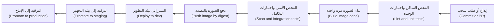
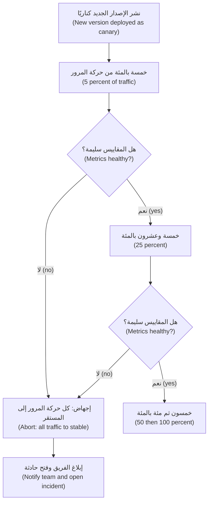
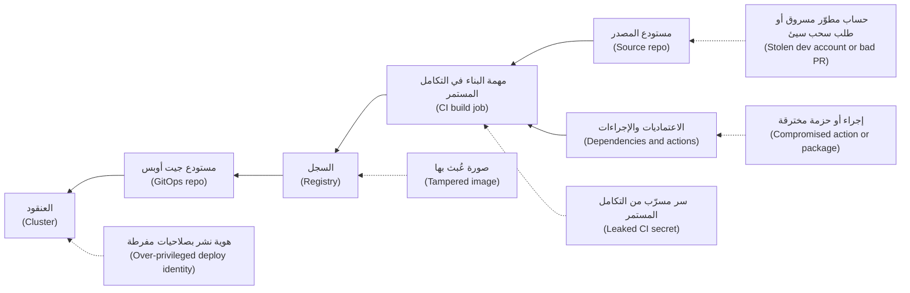

# الوحدة 4 — التكامل والتسليم المستمران (CI/CD) والإطلاقات الآمنة

*منحت الوحدتان 2 و3 فريقَ هندسة المنصات في بنك نجم (Najm Bank) الحاويات (containers) والعناقيد (clusters) والبنية التحتية الموصوفة بوصفها شيفرة. والآن يحتاج الفريق إلى طريقة آمنة وقابلة للتكرار لنقل التغيير من إيداع المطوّر إلى هاتف العميل، مرات كثيرة في الأسبوع. وهذا هو عمل التكامل والتسليم المستمرين. تبدأ هذه الوحدة بالتكامل المستمر (continuous integration): خطوط تسليم (pipelines) تبني أثرًا برمجيًا واحدًا، وتختبره على طبقات، وتجيب عن سؤال أي "هل هذا التغيير آمن للدمج؟" في دقائق. ثم تتناول استراتيجيات الإطلاق: النشر المتدرّج والأزرق والأخضر (blue-green) والكناري (canary)، وأعلام الميزات (feature flags) التي تفصل نشر الشيفرة عن إطلاق الميزة، والتراجع (rollback) الذي يجب أن تتمرّن عليه قبل أن تحتاج إليه. وتنتهي بمعاملة خط التسليم (pipeline) على حقيقته: نظام ذو صلاحيات مميّزة قادر على تغيير بيئة الإنتاج (production)، فلا مفاتيح طويلة العمر، وآثار برمجية موقّعة، وعمليات نشر بأقل الصلاحيات. ستتابع يوسف وهو يحوّل خط تسليم مدته 48 دقيقة إلى خط مدته 9 دقائق، ومها وهي تمنح خدمة المدفوعات (Payments service) أول إطلاق كناري مؤتمت لها، ونورة وسالم والفريق يزيلون آخر مفتاح سحابي من إعدادات التكامل المستمر.*

> **المراحل:** Build, Test, Release, Deploy — تحويل كل إيداع (commit) إلى أثر برمجي واحد موثوق، ثم وضعه أمام العملاء شيئًا فشيئًا، مع طريق للعودة.

---

# 4.1 — التكامل المستمر: خطوط التسليم والاختبارات والآثار البرمجية والتغذية الراجعة السريعة
*المستوى: 🟡 متوسط* · *المتطلبات: 2.1، 3.2* · *المرحلة: Build, Test*

**بعد هذا الدرس تستطيع** بناء سير عمل CI بصلاحيات قراءة فقط ومهلات وتخزين مؤقت للطبقات يتحوّل إلى الأحمر عند فشل اختبار، وإثبات أن البصمة العاملة في عنقودك هي نفسها التي بناها CI. *مدة الدراسة: قراءة نحو 15 دقيقة، وعمل تطبيقي نحو 3 ساعة (تقدير).*

## ⚡ الدرس في دقيقة
- **التكامل المستمر (continuous integration, CI)** يعني أن يدمج الجميع تغييرات صغيرة في الفرع الرئيسي كثيرًا، مرة يوميًا على الأقل، وأن يُبنى كل تغيير ويُختبر آليًا قبل دمجه وبعده.
- مهمة خط التسليم أن يجيب عن سؤال واحد بسرعة وأمانة: أي "هل هذا التغيير آمن للدمج؟". والإجابة البطيئة، أو الإجابة التي لا يثق بها الناس، تجعل التكامل المستمر (CI) بلا جدوى.
- **ابنِ مرة واحدة، ورقِّ الأثر البرمجي نفسه.** ابنِ صورة الحاوية (container image) مرة واحدة، وعرّفها ببصمتها، وانشر تلك الصورة نفسها تمامًا إلى بيئات التطوير والتجهيز (staging) والإنتاج. لا تُعِد البناء لكل بيئة أبدًا.
- اختبر على طبقات وفق **هرم الاختبارات**: كثير من اختبارات الوحدة السريعة، وعدد أقل من اختبارات التكامل، وحفنة من الاختبارات الشاملة من الطرف إلى الطرف.
- إشارة القرار: أبقِ فحص الدمج تحت عشر دقائق تقريبًا. وعندما يطول، استخدم التخزين المؤقت (cache) والتوازي وانقل الحزم البطيئة إلى ما بعد الدمج قبل أن تضيف عتادًا أكثر.
- الفخ الأكبر: الاختبارات المتقلّبة. فالاختبار الذي يفشل عشوائيًا يعلّم الفريق أن يضغط "أعد التشغيل" وأن يتجاهل عمليات البناء الحمراء.

## 🧭 لماذا يهم
ينضم يوسف إلى فريق المنصة (platform team) في بنك نجم وسط شكوى. فخط تسليم واجهة برمجة تطبيق نجم للهاتف (Najm Mobile API) يستغرق 48 دقيقة. ولأن الانتظار مؤلم، يجمع المطوّرون عمل أسبوع كامل في طلب سحب (pull request) واحد كبير. فتستغرق المراجعات أيامًا، وتتعارض عمليات الدمج، وعندما يتعطّل شيء لا يستطيع أحد أن يحدّد أيّ الإيداعات الأربعين سبّبه. وتفشل ثلاثة اختبارات شاملة في نحو تشغيل واحد من كل خمسة دون سبب واضح، فصارت عادة الفريق أي "أعد التشغيل حتى يخضرّ".

ثم وقعت حادثة. تغيير اجتاز بيئة التجهيز يوم الخميس. ويوم الجمعة **أعادت** مهمة الإنتاج **بناء** الصورة من الإيداع نفسه. وكان وسم الصورة الأساسية `latest` قد تحرّك خلال الليل، وتغيّرت مكتبة نظام، ففشلت واجهة البرمجة (API) في الإقلاع في الإنتاج. لقد اختبرت بيئة التجهيز صورةً لم تصل إلى الإنتاج قط. ونجح التراجع، لكن مراجعة ما بعد الحادثة (5.3) سجّلت حقيقة قاسية: أي "ما اختبرناه ليس ما شحنّاه".

يكلّف سالم يوسف بالمهمة: "اجعل خط التسليم شيئًا يثق به الناس. سريعًا بما يكفي كي لا يجمع أحد عمله في دفعات، وأمينًا بما يكفي كي يعني البناء الأحمر شيئًا، وأن يكون الأثر البرمجي الذي نختبره هو الأثر البرمجي الذي نشحنه". وهذا هو موضوع هذا الدرس.

## 📐 كيف يعمل

### 🟢 الأساسيات

**ثلاثة مصطلحات يُخلط بينها.**

| المصطلح | المعنى | السؤال الذي يجيب عنه |
|---|---|---|
| **التكامل المستمر** | تغييرات صغيرة تُدمج في الفرع الرئيسي كثيرًا؛ ويُبنى كلٌّ منها ويُختبر آليًا | هل هذا التغيير آمن للدمج؟ |
| **التسليم المستمر (Continuous delivery)** | كل تغيير يجتاز خط التسليم *يمكن* أن يذهب إلى الإنتاج بضغطة زر | هل يمكننا إطلاق هذا الآن؟ |
| **النشر المستمر (Continuous deployment)** | كل تغيير يجتاز يذهب إلى الإنتاج آليًا، دون أي خطوة بشرية | (لا أحد يسأل؛ يُشحن فحسب) |

تمارس معظم البنوك، ومنها نجم، التسليم المستمر: فخط التسليم يجعل كل تغيير قابلًا للإطلاق، وقرار إطلاق (مؤتمت أحيانًا، وبشري أحيانًا) يضعه قيد التشغيل. وتأتي هذه الأفكار من كتاب جيز هامبل وديفيد فارلي *Continuous Delivery* (2010)، وقد ربط كتاب *Accelerate* (Forsgren، Humble، Kim، 2018) هذه الممارسات بأداء التسليم.

**التطوير القائم على الجذع.** يعمل المطوّرون على فروع قصيرة العمر، يوم أو يومان على الأكثر، ويدمجون في فرع مشترك واحد، هو `main` عادةً، كثيرًا. أما فروع الميزات طويلة العمر فتؤدي إلى عمليات دمج مؤلمة ومفاجآت متأخرة. ويُخفى العمل غير المكتمل خلف **علم ميزة (feature flag)** (الدرس 4.2) بدلًا من إبقائه على فرع لأسابيع.

**ما خط التسليم؟.** **خط التسليم** تسلسل مؤتمت من **المراحل**، كلٌّ منها مكوّن من **مهام** تعمل على أجهزة تُسمّى **المشغّلات (runners)** (أو الوكلاء). ويُطلَق بحدث: فتح طلب سحب، أو دفع إيداع إلى `main`، أو إنشاء وسم، أو جدول زمني. ويعيش تعريف خط التسليم في المستودع (repository) بوصفه شيفرة، فيُراجَع ويُدار إصداره مثل كل شيء آخر. المراحل النموذجية:



كل ما يقع يسار مرحلة "الدفع" يعمل على كل طلب سحب ويجب أن يكون سريعًا. أما عمليات الترقية على اليمين فتنقل الصورة *نفسها* عبر البيئات، كما وُصف في الدرس 3.2.

**الآثار البرمجية (Artefacts).** **الأثر البرمجي (artefact)** هو مُخرَج عملية البناء الذي تحتفظ به وتنشره: وهو هنا صورة حاوية OCI (الدرس 2.1)؛ وفي مواضع أخرى ملف JAR، أو حزمة Python wheel، أو حزمة موقع ساكن. قاعدتان:
1. **ابنِ مرة واحدة.** ابنِ الأثر البرمجي في مهمة واحدة، وخزّنه في سجل (registry)، واجعل كل مرحلة لاحقة تسحبه. لا تشغّل `docker build` مرة أخرى للتجهيز أو الإنتاج أبدًا.
2. **عرّفه تعريفًا ثابتًا.** الوسم (tag) مثل `v1.4.2` أو `latest` يمكن نقله إلى صورة مختلفة. أما **البصمة (digest)** (`sha256:...`، وهي تجزئة لمحتوى الصورة) فلا يمكن. وسِم الصور بمعرّف الإيداع من أجل البشر، لكن انشر بالبصمة.

الإعدادات التي تختلف بين البيئات (مضيف قاعدة البيانات، والقيم الافتراضية لأعلام الميزات، وأعداد النسخ المتماثلة) تُحقن وقت النشر عبر متغيرات البيئة (environment variables) أو ConfigMaps أو طبقة GitOps الفوقية (الدرسان 2.3 و3.2)، ولا تُخبز في الصورة أبدًا. وهذا هو العامل الثالث من منهجية التطبيق ذي العوامل الاثني عشر (Twelve-Factor App): خزّن الإعدادات في البيئة. ويروي [*تصميم الأنظمة لمبرمجي الحدس*، الدرس 4.5 — تحقّق من الأثر البرمجي لا من المصدر](../vibe/index.ar.html#l4-5) هذه القصة للبنّائين الأفراد.

**خط تسليم مصغّر في GitHub Actions.** نستخدم GitHub Actions هنا لأنه واسع الانتشار ومجاني للمستودعات العامة؛ وتشترك GitLab CI/CD وJenkins وAzure Pipelines في المفاهيم نفسها.

```yaml
# .github/workflows/ci.yml
name: ci
on:
  pull_request:
  push:
    branches: [main]

permissions:
  contents: read            # least privilege by default (lesson 4.3)

concurrency:
  group: ci-${{ github.ref }}
  cancel-in-progress: ${{ github.event_name == 'pull_request' }}  # cancel outdated PR runs, never main builds

jobs:
  test:
    runs-on: ubuntu-latest
    timeout-minutes: 15
    steps:
      - uses: actions/checkout@v4   # pin to a full commit SHA in real use (lesson 4.3)
      - run: make lint
      - run: make test-unit

  build:
    needs: test
    runs-on: ubuntu-latest
    timeout-minutes: 20
    steps:
      - uses: actions/checkout@v4
      - uses: docker/setup-buildx-action@v3
      - uses: docker/build-push-action@v6
        with:
          context: .
          push: false
          tags: mobile-api:${{ github.sha }}
          cache-from: type=gha
          cache-to: type=gha,mode=max
```

لاحظ الإعدادات الافتراضية: صلاحيات للقراءة فقط، ومهلات للمهام، وإلغاء تشغيلات طلبات السحب القديمة (ولا تُلغى تشغيلات `main` أبدًا: فكل إيداع مدموج يجب أن يُنتج أثره البرمجي).

**هرم الاختبارات.** ليست كل الاختبارات متساوية في الكلفة. ينصّ الهرم، الذي روّج له مايك كون، على أن يكون لديك كثير من الاختبارات الرخيصة في القاعدة وقليل من الاختبارات المكلفة في القمة.

| الطبقة (Layer) | ما الذي تفحصه | السرعة | العدد | أين تعمل |
|---|---|---|---|---|
| **الفحوص الساكنة** | التنسيق، والفحص الساكن (lint)، وفحوص الأنواع، والتحقق من البنية التحتية بوصفها شيفرة | ثوانٍ | كل ملف | كل طلب سحب |
| **اختبارات الوحدة** | دالة أو صنف واحد، دون شبكة أو قاعدة بيانات | أجزاء من الثانية لكلٍّ منها | الآلاف | كل طلب سحب |
| **اختبارات التكامل** | الخدمة مع اعتماديات حقيقية: حاوية PostgreSQL، وشبكة دفع مزيّفة | ثوانٍ لكلٍّ منها | المئات | كل طلب سحب، بالتوازي |
| **اختبارات العقود** | أن واجهة البرمجة ما زالت تطابق ما يتوقعه عملاؤها | ثوانٍ | واحد لكل مستهلك | كل طلب سحب |
| **الاختبارات الشاملة** | رحلة مستخدم كاملة عبر الخدمات المنشورة | دقائق لكلٍّ منها | حفنة | بعد النشر إلى التطوير أو التجهيز |

والهرم المقلوب، بمئات من اختبارات المتصفّح البطيئة الهشّة وقليل من اختبارات الوحدة، سبب شائع لخط تسليم مدته 48 دقيقة.

### 🟡 التعمق أكثر

**تسريع خط التسليم.** يقيس يوسف قبل أن يغيّر أي شيء. فتتوزّع الدقائق الـ48 على تنزيل الاعتماديات (7)، وبناء الصورة دون تخزين مؤقت (11)، واختبارات الوحدة المشغّلة تسلسليًا (9)، واختبارات التكامل (8)، والاختبارات الشاملة على كل طلب سحب (13). والإصلاحات، مرتبة حسب قيمتها:

- **خزّن الاعتماديات مؤقتًا.** استعِد ذاكرة التخزين المؤقت لمدير الحزم بمفتاح مبني على تجزئة ملف القفل؛ ولدى معظم أنظمة التكامل المستمر إجراء تخزين مؤقت مدمج.
- **رتّب ملف Dockerfile للاستفادة من التخزين المؤقت للطبقات** (الدرس 2.1): انسخ بيان الاعتماديات وثبّت الاعتماديات *قبل* نسخ الشيفرة المصدرية، كي لا يُبطل تغيير الشيفرة طبقة الاعتماديات. واستخدم ذاكرة تخزين مؤقت بعيدة للبناء (`cache-from`/`cache-to`) كي تتمكن المشغّلات المؤقتة من إعادة استخدام الطبقات.
- **وازِ.** قسّم الاختبارات إلى أجزاء عبر عدة مهام، أو استخدم مصفوفة (مثلًا عدة إصدارات من Python أو Node) فقط حيث تضيف تغطية حقيقية.
- **شغّل ما تغيّر فقط.** في المستودع الأحادي (monorepo)، تتخطى مرشّحات المسارات (`on.pull_request.paths`) خطوط التسليم للخدمات التي لم تُمسّ. وكن حذرًا: فتغيير مكتبة مشتركة يجب أن يظل يُطلق خطوط التسليم للخدمات المعتمدة عليها.
- **انقل الحزم البطيئة إلى ما بعد الدمج.** تعمل الاختبارات الشاملة على بيئة التطوير بعد الدمج ووفق جدول زمني؛ فهي تحجب *الترقية* لا *الدمج*.

النتيجة: الفحص الساكن واختبارات الوحدة في 3 دقائق، والبناء واختبارات التكامل في 6، أي فحص دمج مدته 9 دقائق، مع اختبارات شاملة تحرس الترقية إلى التجهيز.

**الاختبارات المتقلّبة.** **الاختبار المتقلّب** ينجح ويفشل على الشيفرة نفسها. ومن أسبابه افتراضات التوقيت (`sleep(2)` والأمل)، وبيانات الاختبار المشتركة، والاعتماد على ترتيب الاختبارات، واستدعاءات الشبكة الحقيقية والساعات. السياسة في نجم:
1. الاختبار الذي يفشل ثم ينجح عند إعادة المحاولة، على الإيداع نفسه، يُعلَّم آليًا بأنه مشتبه في تقلّبه.
2. يُوضع الاختبار المتقلّب **في الحجر**: يُنقل إلى مهمة غير حاجبة، مع تذكرة ومالك، ويُصلَح أو يُحذف خلال مدة متفق عليها.
3. لا يُسمح بـ"إعادة المحاولة حتى يخضرّ" الآلية على خط التسليم كله. فهي تخفي أخطاء متقطعة حقيقية، ومنها حالات التسابق التي ستحدث في الإنتاج أيضًا.

**طوابير الدمج.** حين يدمج كثيرون في `main`، قد ينجح طلبا سحب كلٌّ على حدة ثم يتعطلان معًا. أما **طابور الدمج** (طابور الدمج في GitHub، وقطارات الدمج في GitLab وميزات مشابهة) فيختبر كل طلب سحب فوق طلبات السحب التي تسبقه قبل الدمج، فيبقى `main` أخضر.

**توسيم الأثر البرمجي.** سجّل مصدر الصورة، كي يستطيع أي شخص تتبّع حجيرة عاملة رجوعًا إلى إيداع. وتعليقات صور OCI مثل `org.opencontainers.image.revision` (معرّف الإيداع) و`org.opencontainers.image.source` (عنوان المستودع) مفاتيح قياسية. ويحوّل الدرس 4.3 هذا إلى **مصدرية (provenance)** موقّعة.

**ما يفحصه خط التسليم إلى جانب الاختبارات.** خط التكامل المستمر هو أيضًا موطن الفحوص المؤتمتة الرخيصة: فحص الأسرار (secret scanning)، وفحص ثغرات الاعتماديات، والتحليل الأمني الساكن، والفحص الساكن لملفات Dockerfile والبنية التحتية بوصفها شيفرة، وفحوص السياسات (policy checks) من الدرس 3.3. لا تحجب إلا على النتائج الجديدة عالية الثقة، وإلا تعلّم المطوّرون تجاهل البوابة. ويشرح [*أمن الذكاء الاصطناعي وأمن التطبيقات*، الدرس 6.1 — دورة حياة تطوير آمنة](../secai/index.ar.html#/6.1) كيفية ضبط هذه الماسحات.

### 🔴 نظرة الخبير

**قِس النتيجة لا خط التسليم.** يتتبّع برنامج أبحاث DORA أربعة مقاييس تسليم رئيسية: **تكرار النشر**، و**زمن إنجاز التغييرات (lead time for changes)** (من الإيداع إلى الإنتاج)، و**معدل فشل التغييرات (change failure rate)**، و**زمن استعادة الخدمة (time to restore service)**. وقد أعادت DORA منذ ذلك الحين تسمية زمن استعادة الخدمة إلى **زمن التعافي من النشر الفاشل (failed deployment recovery time)**، وأضافت في 2024 مقياسًا خامسًا هو **معدل إعادة العمل في النشر (deployment rework rate)**، أي نسبة عمليات النشر التي تكون إصلاحات غير مخطط لها لحادثة في الإنتاج؛ راجع dora.dev للاطلاع على التعريفات الحالية. يحسّن خط التسليم السريع زمن الإنجاز؛ وتخفّض الاختبارات الجديرة بالثقة معدل فشل التغييرات. راقب الاثنين معًا: فالتسريع بحذف الاختبارات لا يفعل سوى نقل الكلفة إلى الحوادث.

**خط التسليم منتَج.** في نجم، لا يكتب كل فريق منتج خط تسليمه الخاص. بل ينشر فريق المنصة **مسارًا ذهبيًا (golden path)**: سير عمل قابلًا لإعادة الاستخدام (في GitHub Actions، سير عمل يُستدعى بـ `uses: najm-bank/platform-workflows/.github/workflows/service-ci.yml@<version>`) يتولى البناء والفحص والاختبار والتوقيع والدفع بالطريقة المعتمدة. وتمرّر الفرق بضعة مدخلات. وحين يحسّن فريق المنصة التخزين المؤقت (caching) أو يضيف ماسحًا، تحصل عليه كل خدمة. أدِر إصداره، واحتفظ بسجل للتغييرات، وقِس معدل التبنّي وأزمنة البناء.

**عمليات البناء القابلة لإعادة الإنتاج والمحكمة.** يستخدم البناء **المحكم (hermetic)** مدخلات مُعلنة ومثبّتة فقط: صورة أساسية بالبصمة، واعتماديات عبر ملف قفل مع تجزئات، وسلسلة أدوات مثبّتة، ودون وصول غير مُعلن إلى الشبكة. أما عمليات البناء **القابلة لإعادة الإنتاج** بالكامل بتًا ببت فصعبة لصور الحاويات (الطوابع الزمنية، وترتيب الملفات)، لكن المدخلات المحكمة وحدها تزيل حادثة الجمعة: فلا يستطيع وسم `latest` متحرك أن يتسلّل.

**زمن التغذية الراجعة ميزانية تصميم.** انشر هدفًا (هدف نجم أدناه). وأي فحص جديد قد يكسره يجب أن يحلّ محل شيء آخر، أو يعمل بالتوازي، أو يعمل بعد الدمج.

## 🧰 الأدوات
| الأداة أو الممارسة أو الخدمة | ما هي وماذا تفعل | متى تلجأ إليها |
|---|---|---|
| **GitHub Actions** | تكامل وتسليم مستمران مدمجان في GitHub؛ وسير العمل مكتوبة بصيغة YAML في المستودع، وتعمل على مشغّلات مستضافة أو مستضافة ذاتيًا | حين تكون الشيفرة على GitHub أصلًا؛ وللتمرّن المجاني على المستودعات العامة |
| **GitLab CI/CD** | تكامل وتسليم مستمران مدمجان في GitLab؛ وخطوط التسليم معرّفة في `.gitlab-ci.yml` | حين تكون الشيفرة على GitLab، بما في ذلك التثبيتات المُدارة ذاتيًا |
| **Jenkins** | خادم أتمتة مفتوح المصدر عريق بمنظومة إضافات كبيرة | البيئات القائمة؛ وحين يجب تشغيل كل شيء داخل المقر (on-premises) |
| **Trunk-based development** — التطوير القائم على الجذع | فروع قصيرة العمر تُدمج في فرع رئيسي واحد مرة يوميًا على الأقل | دائمًا، بوصفه نموذج التفريع الافتراضي للتكامل المستمر |
| **Build once, promote** — ابنِ مرة واحدة ورقِّ | بناء واحد يُنتج أثرًا برمجيًا واحدًا ثابتًا ينتقل عبر كل بيئة | كل خدمة؛ فهو يزيل مشكلة أي "ما اختُبر ليس ما شُحن" |
| **Test pyramid** — هرم الاختبارات | كثير من اختبارات الوحدة، وأقل من اختبارات التكامل، وقليل من الاختبارات الشاملة | تصميم حزمة اختبارات أو تشخيص خط تسليم بطيء |
| **Merge queue** — طابور الدمج | يختبر كل طلب سحب (PR) مقابل طلبات السحب التي تسبقه قبل الدمج | المستودعات المزدحمة حيث يظل `main` يتعطل بعد عمليات دمج "خضراء" |
| **Golden path** — المسار الذهبي | خط تسليم قابل لإعادة الاستخدام يصونه فريق المنصة، تتبنّاه الفرق بدلًا من كتابة خطوطها الخاصة | أكثر من حفنة من الخدمات بعمليات بناء متشابهة |

## 🏛️ عمليًا في بنك نجم
ينشر يوسف وسالم **معيار التكامل المستمر للمسار الذهبي في نجم، الإصدار 1 (Najm Golden-Path CI Standard v1)**، مُنفَّذًا بوصفه سير عمل قابلًا لإعادة الاستخدام. وكل خدمة جديدة تبدأ به.

**الجزء أ: المراحل والبوابات وميزانيات الزمن**

| المرحلة | تعمل على | تحجب | ميزانية الزمن (p95) |
|---|---|---|---|
| الفحص الساكن والتنسيق وفحص الأنواع والتحقق من البنية التحتية بوصفها شيفرة | كل طلب سحب | الدمج | دقيقتان |
| اختبارات الوحدة (مقسّمة إلى أجزاء) | كل طلب سحب | الدمج | 4 دقائق |
| فحص الأسرار وSCA وSAST | كل طلب سحب | الدمج | 3 دقائق، بالتوازي |
| بناء الصورة مرة واحدة، مع ذاكرة تخزين مؤقت بعيدة | كل طلب سحب | الدمج | 4 دقائق |
| اختبارات التكامل والعقود (PostgreSQL في حاوية) | كل طلب سحب | الدمج | 5 دقائق، بالتوازي |
| دفع الصورة بالبصمة، وتسجيل معرّف الإيداع والمصدر | الدمج في `main` | — | دقيقتان |
| النشر إلى بيئة التطوير وتشغيل اختبارات الدخان الشاملة | الدمج في `main` | الترقية إلى التجهيز | 10 دقائق |
| الحزمة الشاملة الكاملة | كل بضع ساعات وقبل الإنتاج | الترقية إلى الإنتاج | 30 دقيقة |

الهدف العام لفحص الدمج: أن تنتهي 95% من فحوص طلبات السحب خلال 10 دقائق.

**الجزء ب: القواعد**
1. تُبنى الصور مرة واحدة لكل إيداع وتُنشر بالبصمة. وخط التسليم الذي يشغّل `docker build` في مهمة نشر يرسب في مراجعة المنصة.
2. تُثبَّت الصور الأساسية (base images) وسلاسل الأدوات بالبصمة أو بالإصدار الدقيق؛ ويقترح روبوت التحديثات بوصفها طلبات سحب عادية.
3. لكل مهمة مهلة. ويكون الافتراضي لسير العمل صلاحيات القراءة فقط.
4. توضع الاختبارات المتقلّبة في الحجر خلال يوم عمل واحد، مع مالك وتذكرة. ولا إعادة محاولة آلية لخط التسليم كله.
5. تعرض لوحة كل خدمة زمن الإنجاز، وتكرار النشر، ومعدل فشل التغييرات، ومدة فحص طلب السحب.

**الجزء ج: واجهة سير العمل القابل لإعادة الاستخدام**

```yaml
# In the service repository
jobs:
  ci:
    uses: najm-bank/platform-workflows/.github/workflows/service-ci.yml@v3   # pin by SHA in real use
    with:
      service-name: mobile-api
      dockerfile: ./Dockerfile
      integration-services: postgres
      test-shards: 4
```

## 🛠️ التمارين
استخدم حسابك الخاص على GitHub ومستودعًا عامًا للتمرين؛ ولا تستخدم مستودع جهة عملك دون إذن أبدًا.

- 🟢 خذ تطبيقًا صغيرًا لك (بأي لغة) وأضف إليه سير عمل للتكامل المستمر يشغّل الفحص الساكن واختبارات الوحدة على كل طلب سحب، مع صلاحيات القراءة فقط، ومهلة للمهمة، وإلغاء التشغيلات القديمة. افتح طلب سحب فيه اختبار فاشل عمدًا. *يكتمل عندما:* يُظهر طلب السحب فحصًا أحمر يسمّي الاختبار الفاشل، ويحوّله إصلاح الاختبار إلى الأخضر.
- 🟡 أضف إلى خط التسليم بناءً للحاوية مع التخزين المؤقت للطبقات. أعد ترتيب ملف Dockerfile بحيث تُثبَّت الاعتماديات قبل نسخ الشيفرة المصدرية. سجّل زمن البناء قبل التغيير وبعده لتعديل شيفرة من سطر واحد. *يكتمل عندما:* يكون لديك التوقيتان، ويعيد بناءٌ ثانٍ بعد تغيير في المصدر فقط استخدام طبقة الاعتماديات (يُظهر السجل خطوات مخزّنة مؤقتًا).
- 🔴 نفّذ مبدأ "ابنِ مرة واحدة، ورقِّ": عند الدمج في `main`، ادفع الصورة إلى سجل (يصلح GitHub Container Registry لمستودع عام)، وأخرِج بصمتها، واجعل مهمة ثانية تحدّث بيانًا (manifest) في مجلد GitOps إلى تلك البصمة، فيزامنه Argo CD (3.2) في عنقود kind المحلي. لا يستطيع مشغّل مستضاف لدى GitHub الوصول إلى عنقود على حاسوبك المحمول؛ والنشر مباشرة من المهمة يحتاج إلى مشغّل ذاتي الاستضافة (self-hosted runner) على جهازك. أضف اختبارًا يفشل إذا احتوت أي مهمة نشر على أمر `docker build`. *يكتمل عندما:* تطابق البصمة العاملة في عنقودك (`kubectl get pod -o jsonpath='{.items[*].status.containerStatuses[*].imageID}'`) البصمة التي طبعتها مهمة البناء.

## ⚠️ أخطاء وفخاخ
- **إعادة البناء لكل بيئة.** تختبر بيئة التجهيز صورة ويشغّل الإنتاج صورة أخرى. ابنِ مرة واحدة، وانشر بالبصمة، واحقن الإعدادات وقت النشر.
- ** أي "أعد التشغيل حتى يخضرّ".** فهي تخفي الاختبارات المتقلّبة وحالات التسابق الحقيقية. ضع الاختبارات المتقلّبة في الحجر مع مالك وموعد نهائي؛ ولا تُعِد محاولة خطوط التسليم كاملة آليًا أبدًا.
- **الهرم المقلوب.** مئات الاختبارات الشاملة على كل طلب سحب تجعل التكامل المستمر بطيئًا وهشًا. ادفع الفحوص إلى أسفل الهرم؛ وشغّل الحزم الشاملة بعد الدمج.
- **فروع الميزات طويلة العمر.** تحوّل التكامل إلى أزمة أسبوعية. ادمج تغييرات صغيرة يوميًا، وأخفِ العمل غير المكتمل خلف الأعلام.
- **المدخلات غير المثبّتة.** إن `FROM node:latest` أو الأدوات غير المثبّتة تجعل البناء الأخضر بالأمس بلا معنى اليوم. ثبّت بالبصمة أو بالإصدار الدقيق وحدّث عن قصد.

## 🧾 الخلاصة
- يجيب التكامل المستمر عن سؤال أي "هل هذا التغيير آمن للدمج؟"؛ ويُبقي التسليم المستمر كل تغيير ناجح قابلًا للإطلاق؛ ويطلقه النشر المستمر آليًا.
- يجعل التطوير القائم على الجذع وعمليات الدمج الصغيرة المتكررة التكامل أمرًا روتينيًا لا محفوفًا بالمخاطر.
- ابنِ أثرًا برمجيًا واحدًا ثابتًا، وعرّفه بالبصمة، ورقِّ الأثر نفسه عبر كل بيئة.
- شكّل الاختبارات هرمًا، وأبقِ فحص الدمج سريعًا بالتخزين المؤقت والتوازي ونقل الحزم البطيئة إلى ما بعد الدمج.
- عامِل الاختبارات المتقلّبة بوصفها عيوبًا، وخط التسليم بوصفه منتجًا، ومقاييس DORA بوصفها بطاقة الأداء.

## ✍️ اختبر نفسك

**1. اجتازت بيئة التجهيز الاختبار يوم الخميس، لكن نشر الإنتاج فشل يوم الجمعة لأن الصورة تصرّفت بشكل مختلف. كانت مهمة الإنتاج قد أعادت بناء الصورة من الإيداع نفسه. ما التغيير الذي يمنع هذه الفئة من الإخفاقات؟**

- A. تشغيل اختبارات التجهيز مرة أخرى داخل مهمة الإنتاج
- B. البناء مرة واحدة ونشر الصورة نفسها بالبصمة في كل مكان
- C. استخدام الوسم `latest` في كل مكان كي تتطابق كل البيئات
- D. إضافة خطوة موافقة يدوية قبل كل نشر إلى الإنتاج

<details><summary>الإجابة</summary>

**B.** البناء مرة واحدة والنشر بالبصمة يضمنان أن يشغّل الإنتاج بالضبط ما اختُبر. أما C فتزيد الأمر سوءًا، لأن `latest` يتحرك؛ وD تضيف إنسانًا لكنها لا تضمن الأثر البرمجي نفسه. (🟢 الأساسيات.)

</details>

**2. يستغرق فحص طلب السحب لواجهة برمجة تطبيق نجم للهاتف 48 دقيقة، منها 13 دقيقة للاختبارات الشاملة. ما أفضل خطوة أولى؟**

- A. حذف الاختبارات الشاملة، لأن اختبارات الوحدة تغطي المنطق
- B. شراء مشغّلات أكبر وإبقاء كل شيء على حاله
- C. تشغيل الاختبارات الشاملة بعد الدمج، بحيث تحرس الترقية بدلًا من الدمج
- D. مطالبة المطوّرين بفتح طلبات سحب أقل عددًا وأكبر حجمًا

<details><summary>الإجابة</summary>

**C.** ما زالت الاختبارات تحمي الإنتاج، لكنها لم تعد تبطئ كل دمج. أما A فتفقد الحماية؛ وB مكلفة وتُبقي البنية دون تغيير؛ وD تشجّع التجميع في دفعات الذي سبّب المشكلة. (🟡 التعمق أكثر.)

</details>

**3. أيّ العبارات التالية تصف التسليم المستمر على أفضل وجه؟**

- A. كل تغيير ناجح قابل للإطلاق؛ وقرار إطلاق يضعه قيد التشغيل
- B. كل تغيير يذهب إلى الإنتاج آليًا دون أي خطوة بشرية
- C. يدمج المطوّرون فروعهم في الفرع الرئيسي مرة واحدة أسبوعيًا على الأقل
- D. يبني خط التسليم كل التغييرات ويختبرها مرة كل ليلة

<details><summary>الإجابة</summary>

**A.** أما B فهي النشر المستمر (continuous deployment). وC تصف تكاملًا غير متكرر، وD بناء ليلي وليست تكاملًا مستمرًا. (🟢 الأساسيات.)

</details>

**4. اختبار في خدمة المدفوعات يفشل في نحو تشغيل واحد من كل عشرة وينجح عند إعادة تشغيله على الإيداع نفسه. ماذا تتطلب سياسة نجم؟**

- A. تفعيل إعادة المحاولة الآلية على خط التسليم كله كي لا تُحجب عمليات الدمج
- B. حذف الاختبار فورًا والاعتماد على بقية الحزمة
- C. إبقاؤه حاجبًا، وإعادة تشغيل خط التسليم كلما فشل
- D. وضعه في الحجر في مهمة غير حاجبة، مع مالك وموعد نهائي

<details><summary>الإجابة</summary>

**D.** يُبقي الحجر إشارة الدمج جديرة بالثقة بينما يبحث أحدهم عن السبب، الذي قد يكون حالة تسابق حقيقية. أما A فتخفي المشكلات؛ وB قد تحذف تغطية مفيدة دون فهمها؛ وC تعلّم الناس تجاهل عمليات البناء الحمراء. (🟡 التعمق أكثر.)

</details>

**5. يريد سالم أن يعرف هل تحسينات التكامل المستمر تجعل التسليم أفضل إجمالًا، لا أسرع فحسب. أيّ زوج من المقاييس ينبغي أن يراقبه معًا؟**

- A. عدد خطوط التسليم وعدد المشغّلات
- B. أسطر الشيفرة وعدد الاختبارات
- C. زمن إنجاز التغييرات ومعدل فشل التغييرات
- D. معدل إصابة ذاكرة البناء المؤقتة وحجم الصورة

<details><summary>الإجابة</summary>

**C.** يُظهر زمن الإنجاز (lead time) السرعة، ويُظهر معدل فشل التغييرات (change failure rate) هل السرعة آمنة؛ ومراقبة أحدهما وحده قد تضلّل. أما الخيارات الأخرى فأدوات تشخيص مفيدة، لا نتائج. (🔴 نظرة الخبير.)

</details>

## 📚 المراجع
- أبحاث DORA ومقاييسها — https://dora.dev/
- توثيق GitHub Actions — https://docs.github.com/en/actions
- GitHub، إدارة طابور الدمج — https://docs.github.com/en/repositories/configuring-branches-and-merges-in-your-repository/configuring-pull-request-merges/managing-a-merge-queue
- توثيق GitLab CI/CD — https://docs.gitlab.com/ee/ci/
- توثيق Jenkins — https://www.jenkins.io/doc/
- Docker، ذاكرة البناء المؤقتة (build cache) — https://docs.docker.com/build/cache/
- مواصفة صور OCI، التعليقات التوضيحية — https://github.com/opencontainers/image-spec/blob/main/annotations.md
- التطبيق ذو العوامل الاثني عشر — https://12factor.net/
- التطوير القائم على الجذع — https://trunkbaseddevelopment.com/
- [*اختبار البرمجيات من الصفر إلى الاحتراف في عصر الذكاء الاصطناعي*، الدرس 5.2 — الاختبار في CI/CD وفي بيئة الإنتاج](../testing/index.ar.html#/5.2) — منظور الاختبار لهذا الموضوع
- [*بناء تطبيقات الذكاء الاصطناعي والوكلاء من الصفر إلى الاحتراف*، الدرس 12.2 — المختبر: كل وكيل تحت تقييم من 50 حالة وفحص تكامل مستمر](../aiapps/index.ar.html#/12.2) — منظور البناء والتسليم لهذا الموضوع

---

# 4.2 — استراتيجيات الإطلاق: المتدرّج والأزرق والأخضر والكناري وأعلام الميزات والتراجع
*المستوى: 🟡 متوسط* · *المتطلبات: 2.2، 2.3، 4.1* · *المرحلة: Release, Deploy*

**بعد هذا الدرس تستطيع** تنفيذ تحديث متدرّج وتراجع دون أي طلب فاشل، وشرح لماذا يتوقف إطلاق مجسّه فاشل بينما لا يتوقف إطلاق يعيد HTTP 500، وإعداد كناري يُلغي نفسه عند فشل التحليل. *مدة الدراسة: قراءة نحو 15 دقيقة، وعمل تطبيقي نحو 4 ساعة (تقدير).*

## ⚡ الدرس في دقيقة
- **النشر** يضع الشيفرة الجديدة على الخوادم؛ و**الإطلاق** يتيح للمستخدمين الوصول إليها. والفصل بين الاثنين، بأعلام الميزات والتحويل التدريجي لحركة المرور، هو جوهر التسليم الآمن.
- الاستراتيجيات الرئيسية هي **إعادة الإنشاء**، و**المتدرّج**، و**الأزرق والأخضر**، و**الكناري**، و**الظل**؛ وكلٌّ منها يوازن بين الكلفة والسرعة ونطاق الضرر (blast radius) بطريقة مختلفة.
- اختر حسب نطاق الضرر وحسب سرعة اكتشافك للمشكلة. فالخدمات عالية المخاطر مثل المدفوعات تحصل على إطلاق كناري مع تحليل آلي؛ أما الأدوات الداخلية فيمكن نشرها نشرًا متدرّجًا.
- كل إطلاق يحتاج إلى تراجع مُتمرَّن عليه، ويجب أن تعمل قاعدة البيانات مع الإصدار القديم والجديد في الوقت نفسه.
- الفخ الأكبر: شحن تغيير إلى الجميع دفعة واحدة لأنه أي "مجرد إعدادات". فالإعدادات والمحتوى شيفرة؛ فأطلقهما على مراحل أيضًا.

## 🧭 لماذا يهم
في 19 يوليو 2024، دفعت CrowdStrike تحديثًا لإعدادات المحتوى لمستشعرها Falcon إلى أجهزة Windows. وتسبّب عيب في ذلك التحديث في انهيار الأجهزة المتأثرة، وقدّرت Microsoft أن نحو 8.5 مليون جهاز Windows قد تأثر، فتوقفت رحلات جوية وتعطلت مستشفيات وبنوك. وقالت مراجعة CrowdStrike نفسها إن هذا النوع من المحتوى لم يكن يُطرح على مراحل. ومن بين التزاماتها بعد ذلك نشرٌ مرحلي لهذا النوع من المحتوى، مع مجموعات كناري أولًا وتحكّم العملاء في التوقيت. فالتغيير الذي يصل إلى الجميع دفعة واحدة يمكن أن يفشل لدى الجميع دفعة واحدة.

وفي نجم، لدى مها مثال أقرب. ففي الربع الماضي، غيّر إصدار جديد من **خدمة المدفوعات** طريقة قراءته لحقل العملة. وانتشر النشر عبر كل الحجيرات في أربع دقائق. فارتفعت معدلات الخطأ في نحو 3% من التحويلات (تلك التي بعملة واحدة) وبقيت تحت عتبة التنبيه القديمة مدة 40 دقيقة. وبحلول ذلك الوقت كانت كل حجيرة تشغّل الشيفرة الجديدة، واستغرق التراجع غير المُتمرَّن عليه 15 دقيقة أخرى.

هدف مها: أن يصل إطلاق المدفوعات التالي إلى 5% من حركة المرور أولًا، وأن يُحكم عليه بالأرقام، وأن يتراجع من تلقاء نفسه إذا ساءت.

## 📐 كيف يعمل

### 🟢 الأساسيات

**النشر ليس إطلاقًا.** **تحويل حركة المرور** (المتدرّج والأزرق والأخضر والكناري) يتحكم في أيّ *إصدار* يتلقى الطلبات؛ و**أعلام الميزات** تتحكم في أيّ *سلوك* يراه المستخدمون داخل إصدار واحد.

وبالاثنين معًا، يمكنك النشر يوم الثلاثاء، وتفعيل الميزة للموظفين يوم الأربعاء ولـ5% من العملاء يوم الخميس، وإيقافها في ثوانٍ.

**الاستراتيجيات.**

| الاستراتيجية | كيف تعمل | التراجع | الكلفة الإضافية | مناسبة لـ |
|---|---|---|---|---|
| **إعادة الإنشاء** | أوقف كل النسخ القديمة، ثم شغّل الجديدة | إعادة نشر الإصدار القديم | لا شيء، لكنها تسبّب توقفًا عن الخدمة | المهام الدفعية؛ وبيئات التطوير؛ والإصدارات التي لا يمكن تشغيلها جنبًا إلى جنب |
| **التحديث المتدرّج (Rolling update)** | استبدل النسخ بضعًا بعد بضع؛ وتنضم الجديدة حين تصبح جاهزة | تراجع بالطريقة نفسها، بضعًا بعد بضع | قدر قليل من السعة الاحتياطية | معظم الخدمات عديمة الحالة؛ والافتراضي في Kubernetes |
| **الأزرق والأخضر** | شغّل الإصدار الجديد (الأخضر) بجانب القديم (الأزرق) بالحجم الكامل؛ وحوّل كل حركة المرور دفعة واحدة | أعِد حركة المرور إلى الأزرق، في ثوانٍ | ضعف السعة أثناء الإطلاق | انتقال سريع ونظيف؛ وتحقق سهل قبل التحويل |
| **الكناري** | أرسل حصة صغيرة من حركة المرور الحقيقية إلى الإصدار الجديد، وقارن مقاييسه، ثم زِدها خطوة بخطوة | أرسل كل حركة المرور عائدةً إلى الإصدار المستقر | بضع نسخ إضافية مع المقاييس | الخدمات عالية المخاطر؛ وقواعد المستخدمين الكبيرة |
| **الظل** (النسخ المرآوي) | انسخ الطلبات الحية إلى الإصدار الجديد وتجاهل استجاباته | لا شيء للتراجع عنه؛ فالمستخدمون لم يروه قط | سعة إضافية؛ والحذر من الآثار الجانبية | اختبار أداء إعادة كتابة أو صحتها على حركة مرور حقيقية |

يجب ألا تُطلق حركة مرور الظل (shadow traffic) أي آثار جانبية حقيقية أبدًا، مثل تحويل منسوخ مرآويًا ينقل المال مرتين. استخدمها على مسارات القراءة أو مع آثار جانبية مستبدلة بأخرى وهمية.

**التحديثات المتدرّجة في Kubernetes.** يستبدل كائن Deployment (الدرس 2.2) الحجيرات (pods) وفق إعدادين، ولا يرسل حركة المرور إلى حجيرة جديدة إلا بعد أن يجتاز **مسبار الجاهزية (readiness probe)** الخاص بها (الدرس 2.3):

```yaml
apiVersion: apps/v1
kind: Deployment
metadata:
  name: mobile-api
spec:
  replicas: 10
  selector:
    matchLabels: { app: mobile-api }
  strategy:
    type: RollingUpdate
    rollingUpdate:
      maxSurge: 2          # up to 2 extra pods during the rollout
      maxUnavailable: 0    # never drop below 10 ready pods
  minReadySeconds: 20      # a new pod must stay ready 20s before it counts
  progressDeadlineSeconds: 600
  template:
    metadata:
      labels: { app: mobile-api }
    spec:
      containers:
        - name: api
          image: registry.najm.internal/mobile-api@sha256:<digest>
          readinessProbe:
            httpGet: { path: /ready, port: 8080 }
            periodSeconds: 5
```

يوقف التحديث المتدرّج الحجيرات التي *لا تصبح جاهزة أبدًا*، لا الحجيرات التي تبدأ بشكل سليم ثم تُعيد إجابات خاطئة، كما فعلت خدمة المدفوعات. وذلك يحتاج إلى كناري ومقاييس.

**التراجع، بطريقتين.** في إعداد قائم على الدفع، يعيد الأمر `kubectl rollout undo deployment/mobile-api` إلى مجموعة النسخ المتماثلة السابقة. أما في إعداد GitOps (الدرس 3.2)، فمستودع Git هو الحقيقة: ومع تفعيل المزامنة الآلية والإصلاح الذاتي، سرعان ما يعكس المتحكم (controller) أي تراجع يدوي عبر `kubectl`. فالتراجع هنا هو `git revert` للإيداع الذي غيّر بصمة الصورة (image digest)، ثم يطبّقه المتحكم. قرّر أي النموذجين تستخدم، واكتب دليل التشغيل (runbook) بما يطابقه.

**التراجع أم المضي قدمًا؟** **التراجع** يعيدك إلى آخر إصدار معروف بأنه سليم. و**المضي قدمًا** يشحن إصلاحًا جديدًا. اجعل التراجع خيارك الافتراضي حين يتضرر العملاء: فهو أسرع ومُختبر سلفًا. ولا تمضِ قدمًا إلا حين يكون التراجع مستحيلًا أو حين يكون الإصلاح تافهًا ومفهومًا جيدًا.

### 🟡 التعمق أكثر

**التحليل الآلي للكناري.** لا يكون الكناري جيدًا إلا بقدر جودة المقارنة التي تقف خلفه. وأدوات مثل **Argo Rollouts** و**Flagger** توسّع Kubernetes باستراتيجيات الكناري والأزرق والأخضر، وتحوّل حركة المرور عبر شبكة خدمات أو تنفيذ لواجهة Gateway API أو متحكم دخول (ingress controller)، وتستعلم عن المقاييس لتقرّر هل تستمر. وهذا مخطط تقريبي لتصميم مها باستخدام Argo Rollouts:

```yaml
apiVersion: argoproj.io/v1alpha1
kind: Rollout
metadata:
  name: payments
spec:
  replicas: 12
  strategy:
    canary:
      canaryMetadata:
        labels: { track: canary }   # lets the query below select canary pods
      stableMetadata:
        labels: { track: stable }
      steps:
        - setWeight: 5
        - pause: { duration: 10m }
        - analysis:
            templates:
              - templateName: payments-success-rate
        - setWeight: 25
        - pause: { duration: 10m }
        - analysis:
            templates:
              - templateName: payments-success-rate
        - setWeight: 50
        - pause: { duration: 10m }
  # selector and pod template as in a Deployment
---
apiVersion: argoproj.io/v1alpha1
kind: AnalysisTemplate
metadata:
  name: payments-success-rate
spec:
  metrics:
    - name: success-rate
      interval: 1m
      count: 5
      failureLimit: 1
      successCondition: result[0] >= 0.995
      provider:
        prometheus:
          address: http://prometheus.monitoring:9090
          query: |
            sum(rate(http_requests_total{app="payments",track="canary",code!~"5.."}[5m]))
            /
            sum(rate(http_requests_total{app="payments",track="canary"}[5m]))
```

إذا أخطأ معدل نجاح الكناري العتبة أكثر من مرة، يُجهَض الطرح وتعود حركة المرور إلى الإصدار المستقر، دون إيقاظ أحد ليقرّر. ومن دون موجّه لحركة المرور، تُقرَّب الأوزان بعدد الحجيرات (فـ5% من 12 نسخة متماثلة تساوي حجيرة واحدة، أي نحو 8%)؛ أما إضافة شبكة الخدمات أو Gateway API فتعطي تقسيمات دقيقة. وأسماء الحقول تتغير بين الإصدارات؛ فراجع التوثيق الخاص بإصدارك.



**اختيار ما يقيسه الكناري.** استخدم الإشارات نفسها التي تستخدمها أهداف مستوى الخدمة (SLOs) لديك (الدرس 5.2): معدل الخطأ، وزمن الاستجابة عند مئين مرتفع مثل p99، وإشارة أعمال حيثما أمكن (للمدفوعات: نسبة التحويلات التي تبلغ حالة "مُسوّاة"). قارن الكناري بالمستقر *في الوقت نفسه*، لا بالأسبوع الماضي. واجعل الكناري كبيرًا بما يكفي: فعند 1% من خدمة هادئة، قد تحوي عشر دقائق طلبات أقل من أن يُحكم بها.

**أعلام الميزات.** **علم الميزة** (مفتاح تبديل الميزة) مفتاح وقت التشغيل يغيّر السلوك دون نشر. ويسمّي تصنيف بيت هودجسون الواسع الاستشهاد أربعة أنواع:

| النوع | الغرض | العمر | مثال من نجم |
|---|---|---|---|
| **علم الإطلاق** | إخفاء الميزات غير المكتملة أو الجديدة حتى تجهز | من أيام إلى أسابيع، ثم يُحذف | شاشة تجميد البطاقة الجديدة |
| **علم العمليات / مفتاح الإيقاف (Ops flag / kill switch)** | إيقاف مسار مكلف أو خطِر تحت الحمل أو أثناء حادثة | طويل العمر، وموثّق | تعطيل رفع المستندات في نجم أسيست (Najm Assist) إذا كانت بوابة النماذج تعاني |
| **علم التجربة** | اختبار A/B (A/B test) لنسختين | طول مدة التجربة | مساران للتسجيل |
| **علم الصلاحية** | تفعيل ميزات لمستخدمين أو مستأجرين معيّنين | طويل العمر | ميزات تجريبية للموظفين فقط |

يعرّف **OpenFeature**، وهو مشروع ضمن CNCF، واجهة برمجة محايدة تجاه المورّدين لتقييم الأعلام، كي لا تعتمد شيفرة التطبيق على مورّد أعلام واحد. و*إدارة* الأعلام (من يستطيع تغيير أيّ علم، وبأي موافقة وسجل تدقيق) لا تقل أهمية عن تقييمها، خصوصًا في بنك. ويقارن [*لبنات بناء البرمجيات كخدمة*، الدرس 6.3 — أعلام الميزات والتجارب](../saas/index.ar.html#/6.3) خدمات الأعلام بتعمّق.

**الأعلام شيفرة قصيرة العمر.** في عام 2012 نشرت شركة التداول الأمريكية نايت كابيتال شيفرة جديدة على ثمانية خوادم، لكن وفقًا لأمر هيئة الأوراق المالية والبورصات الأمريكية، لم يتلقَّها أحد الخوادم. وأعاد الإطلاق استخدام علم قديم، فأيقظ على ذلك الخادم منطقًا متقاعدًا منذ زمن طويل أرسل ملايين الأوامر في نحو 45 دقيقة. ويصف الأمر خسائر تزيد على 460 مليون دولار أمريكي. درسان: لا تُعِد استخدام اسم علم لمعنى جديد أبدًا، وتحقّق من أن كل نسخة تشغّل الإصدار الذي تظن أنها تشغّله.

**قواعد البيانات: التوسيع والتقليص.** أثناء أي إطلاق متدرّج أو كناري أو أزرق وأخضر، يعمل الإصداران القديم والجديد *في الوقت نفسه* على قاعدة البيانات نفسها. فيجب أن يعمل أي تغيير في المخطط مع كليهما. ونمط **التوسيع والتقليص** (ويُسمّى أيضًا التغيير المتوازي) يفعل ذلك على خطوات:
1. **التوسيع:** أضف العمود أو الجدول الجديد؛ فتتجاهله الشيفرة القديمة.
2. **الترحيل:** انشر شيفرة تكتب في القديم والجديد معًا، واملأ الصفوف الموجودة بأثر رجعي، ثم حوّل القراءات إلى العمود الجديد.
3. **التقليص:** حين لا يعود أي إصدار عامل يقرأ العمود القديم، احذفه في إطلاق لاحق.

لا تُعِد تسمية عمود أو تحذفه أبدًا في الإطلاق نفسه الذي توقفت فيه الشيفرة عن استخدامه. فهذه القاعدة الواحدة تجعل التراجع ممكنًا.

### 🔴 نظرة الخبير

**الحلقات والمناطق.** تُطلق المنصات الكبيرة على **حلقات** مع فترة مراقبة بينها؛ وتصف التزامات CrowdStrike الفكرة نفسها. وحلقات نجم: الموظفون، ثم 5% من حركة مرور قطر، ثم قطر كلها، ثم الإمارات، ثم الاتحاد الأوروبي. وكل حلقة تحدّ من نطاق ضرر الخطأ التالي.

**التراجع الآلي عند استنزاف هدف مستوى الخدمة.** يلتقط التحليل أثناء الطرح الإخفاقات الواضحة. أما الدقيقة منها، مثل خطأ العملة في المدفوعات عند 3% من حركة المرور، فتحتاج إلى مراقبة أطول. فبعد اكتمال الإطلاق، قارن **معدل استنزاف ميزانية الأخطاء** (الدرس 5.2) خلال الساعة أو الساعتين التاليتين بمعدل الإصدار السابق. والاستنزاف المستمر الذي يفوق المعتاد بكثير ينبغي أن يُطلق تراجعًا آليًا، أو على الأقل نداءً يسمّي الإطلاق.

**الدفعات الصغيرة تتفوق على التجميد.** تتفاعل منظمات كثيرة مع الإطلاقات السيئة بمجالس التغيير وفترات تجميد طويلة؛ وقد وجدت أبحاث DORA أن الموافقة الخارجية الثقيلة تميل إلى إبطاء التسليم دون تحسين الاستقرار. وتحتفظ نجم بتجميد قصير حول فترات الذروة مثل يوم صرف الرواتب والعيد، لكن دفاعها الرئيسي هو الإطلاقات الصغيرة المتكررة المؤتمتة القابلة للمراقبة مع مراجعة الأقران. وما زالت الجهات التنظيمية تتوقع أدلة على ضبط التغيير؛ فقانون DORA الأوروبي (EU DORA)، على سبيل المثال، يشترط إدارة تغييرات تقنية المعلومات والاتصالات ضمن إطار مخاطر تقنية المعلومات والاتصالات. وخط التسليم الذي يسجّل من وافق على ماذا، وأيّ كناري جرى، وماذا قاس، هو ذلك الدليل. ويغطي [*أمن الذكاء الاصطناعي وأمن التطبيقات*، الدرس 11.2 — التنظيم الذي يمسّ الأمن](../secai/index.ar.html#/11.2) قواعد القطاع المالي.

## 🧰 الأدوات
| الأداة أو الممارسة أو الخدمة | ما هي وماذا تفعل | متى تلجأ إليها |
|---|---|---|
| **Rolling update** — التحديث المتدرّج | استراتيجية Deployment في Kubernetes تستبدل الحجيرات تدريجيًا، مشروطة بالجاهزية | الافتراضي للخدمات عديمة الحالة |
| **Blue-green deployment** — النشر الأزرق والأخضر | بيئتان كاملتان؛ تتحوّل حركة المرور دفعة واحدة، وتعود بالسرعة نفسها | الانتقالات السريعة النظيفة؛ وحين تستطيع تحمّل ضعف السعة لفترة وجيزة |
| **Canary release** — الإطلاق الكناري | حصة صغيرة من حركة المرور إلى الإصدار الجديد، يُحكم عليها بالمقاييس قبل الزيادة | الخدمات عالية المخاطر مثل المدفوعات؛ وأي شيء له مستخدمون كثيرون |
| **Argo Rollouts** (CNCF، جزء من مشروع Argo) | متحكم Kubernetes يضيف الكناري والأزرق والأخضر مع التحليل الآلي | التسليم التدريجي مع Argo CD |
| **Flagger** (جزء من مشروع Flux) | مشغّل Kubernetes (Kubernetes operator) يؤتمت الكناري واختبارات A/B والأزرق والأخضر مع فحوص المقاييس | التسليم التدريجي مع Flux أو شبكة خدمات |
| **OpenFeature** (CNCF) | واجهة برمجة ومجموعات تطوير برمجيات محايدة تجاه المورّدين لتقييم أعلام الميزات | استخدام الأعلام دون ربط الشيفرة بمورّد واحد |
| **Feature flag** — علم الميزة | مفتاح وقت التشغيل يغيّر السلوك دون نشر | فصل النشر عن الإطلاق؛ ومفاتيح الإيقاف (kill switches) |
| **Expand and contract** — التوسيع والتقليص | تغييرات المخطط وواجهات البرمجة على خطوات متوافقة مع الإصدارات السابقة | أي تغيير في قاعدة بيانات أو واجهة برمجة يستخدمها أكثر من إصدار واحد |

## 🏛️ عمليًا في بنك نجم
ينشر سالم ومها **معيار الإطلاق في نجم، الإصدار 1 (Najm Release Standard v1)**: استراتيجية لكل فئة خدمات وقائمة فحص للإطلاق.

**الجزء أ: الاستراتيجية حسب الفئة**

| الفئة | الخدمات | الاستراتيجية | التحليل الآلي | هدف التراجع |
|---|---|---|---|---|
| 1 | خدمة المدفوعات، وتسجيل الدخول | كناري 5% ← 25% ← 50% ← 100%، عشر دقائق لكل خطوة؛ وحلقات حسب الدولة | معدل النجاح ≥ 99.5%، وزمن الاستجابة p99 (p99 latency) ضمن 20% من المستقر، ونسبة التحويلات المُسوّاة | أقل من 5 دقائق، آلي |
| 2 | واجهة برمجة تطبيق نجم للهاتف، وبوابة نجم أسيست | كناري 10% ← 50% ← 100% | معدل الخطأ وزمن الاستجابة p99 | أقل من 10 دقائق، آلي |
| 3 | الأدوات الداخلية، والمهام الدفعية | تحديث متدرّج مع بوابات الجاهزية | سلامة الطرح فقط | أقل من 30 دقيقة، يدوي |

العتبات هي خيارات نجم الخاصة، تُحدَّد انطلاقًا من هدف مستوى الخدمة (SLO) لكل خدمة (الدرس 5.2)، وتُراجَع بعد كل حادثة.

**الجزء ب: قائمة فحص الإطلاق (الفئة 1) (Part B: release checklist)**

| الفحص | الدليل |
|---|---|
| الصورة هي البصمة التي بناها التكامل المستمر واختبرها (الدرس 4.1) وهي موقّعة (الدرس 4.3) | رابط تشغيل خط التسليم؛ والتحقق من التوقيع عند القبول |
| تغييرات المخطط في هذا الإطلاق توسيع فقط | ملف الترحيل مُراجَع؛ ولا يوجد `DROP` أو `RENAME` |
| السلوك الجديد خلف علم إطلاق، معطّل افتراضيًا | اسم العلم، والمالك، وتاريخ الإزالة |
| لا يُعاد استخدام أي اسم علم | فحص سجل الأعلام |
| قالب تحليل الكناري يطابق هدف مستوى الخدمة الحالي للخدمة | إصدار القالب |
| التمرّن على التراجع في بيئة التجهيز هذا الربع | التاريخ والنتيجة |
| ليس ضمن نافذة تجميد؛ والمناوبة (on-call) على علم | تقويم الإطلاقات؛ ورسالة في قناة الإطلاقات |

**الجزء ج: دليل تشغيل التراجع (GitOps)**
1. إذا أُجهض التحليل، فتأكد من أن حركة المرور 100% على الإصدار المستقر. وإن لم تكن، فأجهض الطرح يدويًا.
2. نفّذ `git revert` للإيداع في مستودع GitOps الذي غيّر بصمة الصورة؛ فيطبّقه Argo CD.
3. إذا كان علمٌ متورطًا، فأوقفه أولًا؛ فذلك أسرع من أي تراجع.
4. انشر الإصدار والوقت والعَرَض والإجراء في قناة الحادثة؛ وافتح مراجعة ما بعد الحادثة (postmortem) إذا تأثر العملاء (الدرس 5.3).

## 🛠️ التمارين
نفّذ هذه التمارين على عنقود kind أو k3d محلي.

- 🟢 انشر تطبيق ويب صغيرًا بوصفه Deployment بأربع نسخ متماثلة، ومسبار جاهزية، و`maxSurge: 1`، و`maxUnavailable: 0`، وانتظار `preStop` قصير كي تُصرَّف نقاط النهاية قبل توقف الحجيرات. حدّث الصورة وراقب `kubectl rollout status`. ثم تراجع باستخدام `kubectl rollout undo`. *يكتمل عندما:* تُظهر حلقةٌ من طلبات `curl` على الخدمة أثناء التحديث والتراجع كليهما عدم وجود أي طلب فاشل.
- 🟡 انشر إصدارًا لا يجتاز مسبار جاهزيته أبدًا. لاحظ ما يفعله التحديث المتدرّج وما يبلّغ عنه `progressDeadlineSeconds`. ثم انشر إصدارًا يبدأ بشكل سليم لكنه يُعيد HTTP 500 على نقطة نهاية واحدة. *يكتمل عندما:* تستطيع أن تشرح في ثلاث جمل لماذا أُوقف الإصدار السيئ الأول ولم يُوقف الثاني، وما الذي كان سيوقف الثاني.
- 🔴 *الأفضل أن تنفّذه بعد 5.1.* ثبّت Argo Rollouts وPrometheus في عنقودك بالأوامر أدناه؛ ويجب أن يعرض تطبيقك عدّادًا للطلبات يجمعه Prometheus. حوّل Deployment إلى Rollout مع كناري (10% ← 50% ← 100%) وقالب AnalysisTemplate على معدل النجاح. أطلق إصدارًا يُعيد أخطاء على 20% من الطلبات. *يكتمل عندما:* يُجهض الطرح من تلقاء نفسه، وتعود حركة المرور إلى المستقر، وتستطيع عرض تشغيل التحليل الفاشل.

```bash
# Lab installs for the 🔴 exercise (Prometheus itself is taught in 5.1)
kubectl create namespace argo-rollouts
kubectl apply -n argo-rollouts -f https://github.com/argoproj/argo-rollouts/releases/latest/download/install.yaml
helm repo add prometheus-community https://prometheus-community.github.io/helm-charts
helm install monitoring prometheus-community/kube-prometheus-stack -n monitoring --create-namespace
```

## ⚠️ أخطاء وفخاخ
- **معاملة الإعدادات والمحتوى على أنها أي "ليست إطلاقًا".** فدفعة إعدادات أو محتوى سيئة قد تكسر كل شيء دفعة واحدة. أطلقها على مراحل عبر الحلقات نفسها.
- **كناري دون تحليل حقيقي.** إنسان يلقي نظرة على لوحة لدقيقتين ليس تحليلًا. عرّف المقاييس والعتبات والمدة في الشيفرة.
- **كسر قاعدة البيانات في الإطلاق نفسه.** حذف عمود أو إعادة تسميته مع تغيير الشيفرة يجعل التراجع مستحيلًا. وسّع، ثم رحّل، ثم قلّص في إطلاق لاحق.
- **أعلام لا تُحذف أبدًا.** تتراكم الأعلام القديمة في تركيبات غير مُختبرة، والأسماء المعاد استخدامها قد توقظ شيفرة ميتة، كما حدث في نايت كابيتال. امنح كل علم إطلاق مالكًا وتاريخ إزالة.
- **تراجع غير مُتمرَّن عليه.** التراجع أثناء حادثة هو أسوأ وقت لاكتشاف أنه لا يعمل. تمرّن عليه في بيئة التجهيز كل ربع سنة.

## 🧾 الخلاصة
- افصل النشر عن الإطلاق: تحويل حركة المرور يختار الإصدار؛ وأعلام الميزات تختار السلوك.
- توقف التحديثات المتدرّجة (rolling updates) الحجيرات التي لا تصبح جاهزة أبدًا؛ ويوقف الكناري مع التحليل الآلي الإصدارات التي تعمل لكنها تتصرف بشكل سيئ.
- اختر الاستراتيجية حسب فئة المخاطر: الكناري للمدفوعات وتسجيل الدخول، والمتدرّج للأدوات الداخلية.
- يعمل الإصداران القديم والجديد معًا، لذا تتغير قواعد البيانات وواجهات البرمجة بالتوسيع والتقليص.
- يجب أن يكون التراجع سريعًا ومُتمرَّنًا عليه ومنفّذًا بطريقة GitOps.

## ✍️ اختبر نفسك

**1. إصدار جديد من المدفوعات يبدأ بشكل طبيعي ويجتاز مسبار جاهزيته، لكنه يُفشل التحويلات بعملة واحدة، أي نحو 3% من حركة المرور. أيّ استراتيجية كانت على الأرجح ستحدّ من الأثر؟**

- A. تحديث متدرّج بقيمة `maxSurge` أكبر
- B. نشر بإعادة الإنشاء، كي لا تختلط الإصدارات أبدًا
- C. كناري يُحكم عليه آليًا بمعدل النجاح
- D. قيمة `progressDeadlineSeconds` أطول على Deployment

<details><summary>الإجابة</summary>

**C.** الحجيرات سليمة بمعيار المسبار، فلا يلتقط العطل إلا مقارنة مقاييس على حركة مرور حقيقية، والكناري يحدّ ممّن يتعرّضون له. أما A وB وD فلا تستجيب إلا للحجيرات التي تفشل في الإقلاع أو في أن تصبح جاهزة. (🟡 التعمق أكثر.)

</details>

**2. يريد يوسف إعادة تسمية عمود في قاعدة بيانات المدفوعات في الإطلاق نفسه الذي يحدّث الشيفرة لتستخدم الاسم الجديد. بماذا ينبغي أن تنصح مها؟**

- A. لا بأس، ما دام الأزرق والأخضر يحوّل كل حركة المرور دفعة واحدة
- B. أضف العمود الجديد واملأه بأثر رجعي؛ واحذف القديم لاحقًا
- C. نفّذ ذلك ليلًا، خلال نافذة حركة مرور منخفضة
- D. اختبره أولًا بحركة مرور الظل، ثم أطلقه كالمعتاد

<details><summary>الإجابة</summary>

**B.** يُبقي التوسيع والتقليص الإصدارين القديم والجديد يعملان معًا، فيبقى التراجع ممكنًا. أما الأزرق والأخضر (A) فما زال يشغّل الإصدارين على قاعدة بيانات واحدة، والتراجع سيصطدم بالعمود المعاد تسميته. (🟡 التعمق أكثر.)

</details>

**3. تنشر نجم باستخدام Argo CD، مع تفعيل المزامنة الآلية والإصلاح الذاتي. أثناء حادثة، يشغّل مهندس `kubectl rollout undo`، وبعد عشر دقائق يعود الإصدار السيئ. لماذا؟**

- A. أعاد Argo CD مزامنة العنقود مع الإصدار المُعلن في Git
- B. إن `kubectl rollout undo` مؤقت وتنتهي صلاحيته بعد مدة محددة
- C. فشل مسبار الجاهزية للإصدار القديم، فمضى Kubernetes قدمًا
- D. أعاد Horizontal Pod Autoscaler إنشاء الحجيرات من قالبه الخاص

<details><summary>الإجابة</summary>

**A.** في GitOps، يكون Git مصدر الحقيقة (source of truth)، فتراجع باستخدام `git revert` لتغيير البصمة. أما الخيارات الأخرى فلا تعيد إصدارًا قديمًا من الصورة. (🟢 الأساسيات.)

</details>

**4. أيّ استخدام لحركة مرور الظل (المنسوخة مرآويًا) آمن لخدمة المدفوعات؟**

- A. نسخ طلبات التحويل مرآويًا إلى الإصدار الجديد مع تفعيل التسوية الحقيقية
- B. نسخ كل الطلبات مرآويًا وإعادة أيّ استجابة تصل أولًا
- C. استخدام حركة مرور الظل بدلًا من أي اختبارات مؤتمتة
- D. نسخ طلبات القراءة فقط مرآويًا، أو الطلبات ذات الآثار الجانبية المستبدلة بأخرى وهمية

<details><summary>الإجابة</summary>

**D.** تُتجاهل استجابات الظل، لذا يجب ألا يُحدث الإصدار الجديد آثارًا حقيقية. أما A فستنقل المال مرتين؛ وB ليست ظلًا؛ وC تسيء استخدامه. (🟢 الأساسيات.)

</details>

**5. بعد حادثة CrowdStrike في يوليو 2024، بأيّ ممارسة إطلاق التزم المورّد لهذا النوع من تحديثات المحتوى؟**

- A. إيقاف تحديثات المحتوى وشحن إطلاقات المستشعر الكاملة فقط
- B. نشر مرحلي عبر مجموعات كناري، مع تحكّم العملاء في التوقيت
- C. إطلاق تحديثات المحتوى مرة واحدة فقط كل ربع سنة، بعد تجميد
- D. مطالبة كل عميل بتثبيت كل تحديث يدويًا

<details><summary>الإجابة</summary>

**B.** تحدّ عمليات الطرح المرحلية من نطاق ضرر (blast radius) التحديث السيئ، وهي الفكرة نفسها التي تقوم عليها الحلقات والكناري. أما الخيارات الأخرى فليست ما وُصف، وستترك العملاء دون تحديثات الحماية. (🧭 لماذا يهم، 🔴 نظرة الخبير.)

</details>

## 📚 المراجع
- Kubernetes، كائنات Deployment والتحديثات المتدرّجة — https://kubernetes.io/docs/concepts/workloads/controllers/deployment/
- توثيق Argo Rollouts — https://argo-rollouts.readthedocs.io/
- توثيق Flagger — https://docs.flagger.app/
- OpenFeature — https://openfeature.dev/
- موقع مارتن فاولر، مفاتيح تبديل الميزات (بيت هودجسون) — https://martinfowler.com/articles/feature-toggles.html
- CrowdStrike، معلومات حادثة Channel File 291 وتحليل السبب الجذري — https://www.crowdstrike.com/wp-content/uploads/2024/08/Channel-File-291-Incident-Root-Cause-Analysis-08.06.2024.pdf
- هيئة الأوراق المالية والبورصات الأمريكية (US SEC)، الإجراء الإداري ضد Knight Capital Americas LLC (2013) — https://www.sec.gov/litigation/admin/2013/34-70694.pdf
- كتاب Google SRE، فصل هندسة الإطلاق — https://sre.google/sre-book/release-engineering/
- أبحاث DORA — https://dora.dev/

---

# 4.3 — تأمين خط التسليم: الأسرار والآثار البرمجية الموقّعة وعمليات النشر بأقل الصلاحيات
*المستوى: 🟡 متوسط* · *المتطلبات: 1.3، 3.2، 4.1* · *المرحلة: Build, Deploy*

**بعد هذا الدرس تستطيع** تثبيت كل إجراء في سير العمل على SHA إيداع مع صلاحيات بالحد الأدنى، وتوقيع صورة دون مفاتيح باستخدام cosign، وإظهار نجاح التحقق لهوية سير عملك وفشله لفرع آخر. *مدة الدراسة: قراءة نحو 15 دقيقة، وعمل تطبيقي نحو 3 ساعة (تقدير).*

## ⚡ الدرس في دقيقة
- يستطيع خط التكامل والتسليم المستمرين (CI/CD pipeline) تغيير الإنتاج، لذا فهو من أكثر الأنظمة التي تشغّلها امتيازًا. والمهاجمون يعرفون ذلك؛ فاحمِه كما تحمي الإنتاج.
- **لا مفاتيح سحابية طويلة العمر في التكامل المستمر.** استخدم **اتحاد هوية أعباء العمل عبر OIDC**: تحصل كل مهمة على رمز قصير العمر، ولا تثق به السحابة إلا لمستودع أو فرع أو بيئة محددة.
- **أقل الصلاحيات في كل مكان:** صلاحيات رمز افتراضية للقراءة فقط، وإجراءات الأطراف الثالثة مثبّتة على معرّف إيداع كامل، وهوية منفصلة لكل مهمة، وعمليات نشر إلى الإنتاج تحرسها بيئة محمية.
- **وقّع ما تبنيه وتحقّق قبل أن تشغّل:** وقّع الصور بالبصمة، وأرفق المصدرية وقائمة مكوّنات البرمجيات (SBOM)، ودع العنقود (cluster) لا يقبل إلا الصور الموقّعة من سير عمل الإطلاق الخاص بك.
- فضّل **عمليات النشر القائمة على السحب**: فلا يحمل التكامل المستمر أبدًا بيانات اعتماد العنقود؛ بل يسحب متحكمٌ داخل العنقود التغييرات المعتمدة.
- الفخ الأكبر: معاملة خط التسليم على أنه أي "مجرد أدوات"، لا يملكه أحد ولا يدقّقه أحد.

## 🧭 لماذا يهم
حادثتان علنيتان تُظهران السبب. ففي أبريل 2021، كشفت Codecov أن مهاجمًا عدّل سكربت Bash Uploader الخاص بها، الذي كان كثير من العملاء يشغّلونه داخل خطوط التكامل المستمر لديهم. وأرسل السكربت المعدّل متغيرات البيئة لتلك المهام، التي كثيرًا ما تضمنت بيانات اعتماد (credentials) ورموزًا (tokens)، إلى خادم يتحكم فيه المهاجم. وفي مارس 2025، اختُرق إجراء GitHub الشائع `tj-actions/changed-files` (CVE-2025-30066): إذ وُجّهت أوسام إصداراته إلى إيداع خبيث طبع أسرار التكامل المستمر في سجلات البناء، حيث يستطيع أي شخص قراءتها في المستودعات العامة. فالفرق التي أشارت إلى الإجراء بوسم شغّلت الشيفرة الخبيثة دون تغيير سطر واحد؛ أما الفرق التي ثبّتته على معرّف إيداع كامل فلم تفعل.

وفي نجم، يُعدّ يوسف خط تسليم لخدمة داخلية جديدة. والنشر يحتاج إلى وصول سحابي، فينشئ مفتاح وصول سحابي لمستخدم بصلاحيات المسؤول، ويخزّنه سرًّا في المستودع، ويضيف إجراءً من طرف ثالث وجده على الإنترنت أي "يجعل النشر أسهل". فيعمل من المحاولة الأولى. وتلاحظه نورة في المراجعة: مفتاح واحد، لا تنتهي صلاحيته أبدًا، يمنح تحكمًا كاملًا بالحساب السحابي، ومتاح لكل سير عمل في المستودع، وقطعة من شيفرة مجهولة تستطيع قراءته.

يحوّل سالم المراجعة إلى مشروع: "بحلول نهاية الربع، لا يوجد أي مفتاح سحابي طويل العمر في أي خط تسليم في نجم، ويرفض العنقود أي صورة لم يوقّعها سير عمل الإطلاق لدينا".

## 📐 كيف يعمل

### 🟢 الأساسيات

**نمذجة التهديدات لخط التسليم.** فكّر فيما يستطيع المهاجم فعله في كل خطوة من الإيداع إلى الإنتاج:



لكل سهم ضابط: حماية الفروع والمراجعة على المصدر؛ واعتماديات وإجراءات مثبّتة ومفحوصة؛ وبيانات اعتماد قصيرة العمر (short-lived credentials) للبناء؛ وتواقيع على الصورة؛ ومسار نشر ضيق إلى العنقود. ويصف إطار SLSA هذه التهديدات بالتفصيل. ويغطي [*أمن الذكاء الاصطناعي وأمن التطبيقات*، الدرس 6.2 — سلسلة توريد البرمجيات](../secai/index.ar.html#/6.2) الاعتماديات وقوائم مكوّنات البرمجيات (SBOMs) وSLSA من الجانب الأمني؛ ويبقى هذا الدرس على كيفية بناء فريق المنصة لخط التسليم وتشغيله.

**الأسرار: كلما قلّت كان أفضل.** أفضل سر هو السر غير الموجود. وترتيب الأفضلية:
1. **الهوية الاتحادية (بلا سر).** تثبت مهمة التكامل المستمر هويتها برمز OIDC قصير العمر تُصدره منصة التكامل المستمر؛ وتستبدله السحابة ببيانات اعتماد مؤقتة (الدرس 1.3).
2. **أسرار قصيرة العمر من مدير أسرار**، تُجلب وقت التشغيل بهوية اتحادية.
3. **أسرار مخزّنة في التكامل المستمر**، فقط حيث لا يصلح شيء آخر، مقصورة على بيئة واحدة، ومُدوَّرة وفق جدول، ولا تُطبع أبدًا.

**الاتحاد عبر OIDC من GitHub Actions.** يطلب سير العمل رمز هوية، ولا يثق دور السحابة إلا بالرموز التي تطابق مطالباتها الشروط. وهذه مهمة إطلاق تدفع الصورة:

```yaml
permissions:
  contents: read             # workflow default: read-only

jobs:
  push-image:
    runs-on: ubuntu-latest
    environment: production   # protected: required reviewers, main branch only
    permissions:
      contents: read
      id-token: write         # only this job may request an OIDC token
    steps:
      - uses: aws-actions/configure-aws-credentials@v4   # pin by SHA in real use
        with:
          role-to-assume: arn:aws:iam::111122223333:role/mobile-api-ci-push
          aws-region: me-central-1
```

وهذا شرط الثقة على جانب السحابة (يظهر هنا AWS IAM؛ وصيغة الموضوع هي صيغة GitHub):

```json
"Condition": {
  "StringEquals": {
    "token.actions.githubusercontent.com:aud": "sts.amazonaws.com",
    "token.actions.githubusercontent.com:sub": "repo:najm-bank/mobile-api:environment:production"
  }
}
```

المهمة في مستودع آخر، أو المهمة التي لا تعمل في بيئة `production`، تحصل على رمز بموضوع مختلف، فلا تستطيع تولّي الدور. ولأن الموضوع يسمّي البيئة لا الفرع، فاقصر تلك البيئة على `main` في إعدادات فروع النشر الخاصة بها. وتدعم السحب الكبرى الثلاث الفكرة نفسها:

| السحابة | الميزة | جانب التكامل المستمر |
|---|---|---|
| AWS | مزوّد هوية OIDC في IAM ودور بسياسة ثقة | `aws-actions/configure-aws-credentials` |
| Microsoft Azure | اتحاد هوية أعباء العمل (workload identity federation): بيانات اعتماد اتحادية على تسجيل تطبيق أو هوية مُدارة (managed identity) في Entra ID | `azure/login` |
| Google Cloud | اتحاد هوية أعباء العمل مع مجمّع هويات أعباء العمل ومزوّد | `google-github-actions/auth` |

**رمز التكامل المستمر الخاص.** يمنح GitHub كل سير عمل رمزًا `GITHUB_TOKEN`. اضبط `permissions: contents: read` في أعلى كل سير عمل، وامنح المزيد لكل مهمة على حدة فقط عند الحاجة (`packages: write` للدفع إلى سجل GitHub، و`id-token: write` لـOIDC). ويمكن لإعداد على مستوى المنظمة أن يجعل القراءة فقط هي الافتراضي.

**إجراءات الأطراف الثالثة وإضافاتها تعمل بأسرارك.** الوسم مثل `@v4` يمكن أن ينقله من يتحكم في مستودع الإجراء؛ أما معرّف الإيداع الكامل فلا.

```yaml
# Risky: the tag can be repointed to different code
- uses: some-org/deploy-helper@v2

# Hardened: an immutable commit, with the tag as a comment for humans
- uses: some-org/deploy-helper@<full-40-character-commit-sha>   # v2.3.1
```

استخدم روبوت اعتماديات ليقترح تحديثات المعرّفات بوصفها طلبات سحب مُراجَعة، واحتفظ بقائمة سماح للإجراءات المعتمدة على مستوى المنظمة. وينطبق الأمر نفسه على إضافات Jenkins، وتضمينات GitLab CI، وصور الحاويات الأساسية.

**الشيفرة غير الموثوقة في طلبات السحب.** يحوي طلب السحب القادم من نسخة مشتقة شيفرة لم تراجعها. فلا تشغّلها أبدًا والأسرار متاحة. وعلى GitHub، يعمل المُطلِق `pull_request_target` في سياق المستودع الأساسي، مع وصول إلى أسراره؛ وسحب شيفرة طلب السحب وتشغيلها في ذلك السياق طريقة معروفة لتسريب الأسرار. استخدم المُطلِق العادي `pull_request` للشيفرة غير الموثوقة.

### 🟡 التعمق أكثر

**توقيع الآثار البرمجية والتحقق منها.** يثبت التوقيع (signature) *مَن* أنتج الأثر البرمجي وأنه لم يتغير منذ ذلك الحين. و**Sigstore** مشروع مفتوح المصدر (تحت مظلة OpenSSF) تقوم أداته **cosign** بتوقيع صور الحاويات (container images). وفي التوقيع **بلا مفاتيح (keyless)**، تُربط هوية OIDC لمهمة التكامل المستمر بشهادة قصيرة العمر، ويُسجَّل التوقيع في سجل شفافية عام (Rekor)، فلا يوجد مفتاح توقيع طويل العمر يمكن سرقته أو تدويره.

```bash
# In the release workflow, after pushing; the identity comes from the job's OIDC token
cosign sign --yes registry.najm.internal/mobile-api@sha256:<digest>

# Before deploy, or at admission: accept only Najm's release workflow on main
cosign verify \
  --certificate-identity "https://github.com/najm-bank/mobile-api/.github/workflows/release.yml@refs/heads/main" \
  --certificate-oidc-issuer "https://token.actions.githubusercontent.com" \
  registry.najm.internal/mobile-api@sha256:<digest>
```

وقّع **البصمة**، لا الوسم أبدًا. فالتوقيع على وسم لا يعني شيئًا بمجرد أن يتحرك الوسم.

**المصدرية وقوائم مكوّنات البرمجيات.** **المصدرية** بيان موقّع بكيفية بناء الأثر البرمجي: أيّ إيداع مصدري، وأيّ سير عمل، وأيّ بانٍ، وأيّ مدخلات. ويعرّف **SLSA** مستويات بناء (من Build L1 إلى L3) حسب مدى جدارة تلك المصدرية بالثقة؛ ففي المستوى L3 يعمل البناء على منصة مُحصّنة لا تستطيع خطوات البناء نفسها العبث بها. ويضيف SLSA v1.2، الإصدار الحالي وقت كتابة هذا الدرس (2026)، مسارًا للمصدر (Source track) يخص كيفية تغيير الشيفرة ومراجعتها. و**قائمة مكوّنات البرمجيات** تسرد المكوّنات داخل الصورة، فتستطيع الإجابة عن سؤال «هل نحن متأثرون؟» حين تظهر الثغرة الحرجة التالية. ويستطيع إجراء البناء والدفع من Docker إرفاق المصدرية وقائمة المكوّنات بوصفهما شهادات، ويقدّم GitHub شهادات الآثار البرمجية؛ وفي وقت كتابة هذا الدرس (2026)، راجع توثيق كل أداة للاطلاع على الخيارات الدقيقة.

**تحقّق عند الباب: ضبط القبول.** يضيع التوقيع سدى إن لم يتحقق منه شيء. و**متحكم القبول (admission controller)** في Kubernetes يفحص كل حجيرة جديدة قبل إنشائها. ومحرّكات السياسات مثل **Kyverno** أو **policy-controller** من Sigstore تستطيع رفض أي صورة غير موقّعة من الهوية المتوقعة، أو تفتقر إلى المصدرية. واجمع ذلك مع حواجز السياسات بوصفها شيفرة من الدرس 3.3: الصور بالبصمة فقط، ومن السجل الداخلي فقط. وابدأ الطرح بوضع التدقيق أولًا، ثم الإنفاذ، بدءًا بنطاق أسماء واحد.

**عمليات النشر بأقل الصلاحيات: الدفع مقابل السحب.**

| النموذج | كيف يعمل | أين تعيش بيانات اعتماد الإنتاج | المخاطرة |
|---|---|---|---|
| **الدفع** | تشغّل مهمة التكامل المستمر `kubectl apply` أو `helm upgrade` على العنقود | في التكامل المستمر، لكل خط تسليم ينشر | خط التسليم المخترق يستطيع تغيير العنقود مباشرة |
| **السحب** | يدفع التكامل المستمر صورة موقّعة ويفتح تغييرًا في مستودع GitOps؛ ويطبّقه متحكم داخل العنقود | داخل العنقود فقط | لا وصول للتكامل المستمر إلى العنقود؛ وتمر التغييرات عبر مراجعة Git |

تستخدم نجم السحب. فهوية التكامل المستمر تستطيع دفع الصور إلى مستودع سجل واحد وفتح طلبات سحب إلى مستودع GitOps. ولا تستطيع لمس العنقود أو موارد سحابية أخرى. وصلاحيات Argo CD الخاصة مقصورة حسب المشروع على نطاقات الأسماء (namespaces) التي يملكها كل فريق.

**قسّم الهويات حسب المهمة.** هوية تكامل مستمر واحدة قوية لكل شيء نقطة فشل واحدة (single point of failure). امنح أدوارًا منفصلة لمهام منفصلة: مهمة بناء تستطيع قراءة الاعتماديات والدفع إلى مسار سجل التجهيز؛ ومهمة إطلاق، على `main` فقط وفي البيئة المحمية فقط، تستطيع الترقية والتوقيع؛ ومهمة **تخطيط** للبنية التحتية بوصول للقراءة فقط؛ ومهمة **تطبيق** لا تعمل إلا بعد الموافقة (الدرس 3.1).

### 🔴 نظرة الخبير

**المشغّلات بنية تحتية إنتاجية.** المشغّلات المستضافة جديدة لكل مهمة. أما **المشغّلات المستضافة ذاتيًا**، التي تحتاجها نجم للوصول إلى الشبكات الخاصة، فليست كذلك، ما لم تجعلها كذلك. فالمشغّل الدائم قد يحتفظ بملفات أو بيانات اعتماد أو برمجيات خبيثة من مهمة إلى التالية. استخدم **المشغّلات المؤقتة** (مهمة واحدة، ثم تُدمَّر)، مثل حجيرات المشغّلات ذات التوسّع التلقائي على Kubernetes؛ ولا تربط المشغّلات المستضافة ذاتيًا بالمستودعات العامة أبدًا؛ وقيّد حركة الخروج الشبكية لديها؛ وافصل مجموعات المشغّلات للإنتاج عن غير الإنتاج.

**الفصل بين المهام دون إبطاء.** يجب على البنوك أن تُثبت أن شخصًا واحدًا لا يستطيع وحده أن يكتب تغييرًا ويشحنه. وعمليًا: فروع محمية تشترط مراجعًا واحدًا على الأقل ليس هو المؤلف؛ وملفات **CODEOWNERS** بحيث تحتاج تغييرات تعريفات خطوط التسليم والبنية التحتية بوصفها شيفرة (IaC) ومستودع GitOps إلى موافقة فريق المنصة أو الأمن؛ وبيئات محمية تحتاج فيها الترقية إلى الإنتاج إلى مراجع؛ وإيداعات موقّعة حيث تبرّر المخاطرة الاحتكاك. وعندها يصبح خط التسليم دليل ضبط التغيير الذي تطلبه الجهات التنظيمية، بدلًا من تذكرة منفصلة.

**كسر الزجاج والتدقيق.** أحيانًا يجب على البشر التصرف مباشرة على الإنتاج. فخطّط لذلك: دور **كسر الزجاج (break-glass)** يتطلب عاملًا ثانيًا قويًا، ويرسل تنبيهًا إلى مركز العمليات الأمنية (SOC) (فريق جاسم)، وتنتهي صلاحيته خلال ساعات، ويُراجَع بعد ذلك. وأرسل سجلات تدقيق التكامل المستمر وسجلات تدقيق السحابة وحالات الرفض من متحكم القبول إلى منصة المراقبة الأمنية، ونبّه على الأحداث غير المعتادة مثل مشغّل مستضاف ذاتيًا جديد، أو تغيير في حماية الفروع، أو نشر إلى الإنتاج خارج خط التسليم.

**الأسرار تتسرّب مع ذلك؛ فخطّط للتدوير.** حتى مع الاتحاد (federation)، تبقى بعض الأسرار: كلمات مرور قواعد البيانات، ومفاتيح واجهات برمجة الأطراف الثالثة لمزوّدي النماذج في نجم أسيست. خزّنها في مدير أسرار (secrets manager) واحقنها وقت التشغيل (الدرس 2.3)، مع فحص الأسرار عند كل دفع ودليل تشغيل للتدوير مُختبر مسبقًا. ويتعمّق [*أمن الذكاء الاصطناعي وأمن التطبيقات*، الدرس 5.2 — إدارة الأسرار (Secrets management)](../secai/index.ar.html#/5.2) أكثر، ويغطي [*أمن الذكاء الاصطناعي وأمن التطبيقات*، الدرس 7.2 — الحاويات وKubernetes والبنية التحتية بوصفها شيفرة](../secai/index.ar.html#/7.2) تحصين العناقيد.

## 🧰 الأدوات
| الأداة أو الممارسة أو الخدمة | ما هي وماذا تفعل | متى تلجأ إليها |
|---|---|---|
| **OIDC workload identity federation** — اتحاد هوية أعباء العمل عبر OIDC | تستبدل مهام التكامل المستمر رمز هوية قصير العمر ببيانات اعتماد سحابية مؤقتة؛ دون مفاتيح مخزّنة | كل خط تسليم يلمس حسابًا سحابيًا |
| **Protected environments** — البيئات المحمية | أهداف نشر بمراجعين إلزاميين وقيود على الفروع وأسرار خاصة بها | حراسة الترقية إلى الإنتاج |
| **SHA pinning** — التثبيت بمعرّف الإيداع | الإشارة إلى إجراءات الأطراف الثالثة وإضافاتها وصورها بإيداع أو بصمة ثابتة | كل اعتمادية خارجية لخط التسليم |
| **cosign** (Sigstore) | يوقّع صور الحاويات ويتحقق منها، بما في ذلك التوقيع بلا مفاتيح عبر OIDC | توقيع صور الإطلاق؛ والتحقق قبل النشر |
| **SLSA** (OpenSSF) | إطار لتهديدات سلسلة التوريد ومستويات البناء الخاصة بالمصدرية | وضع أهداف لسلامة البناء |
| **SBOM** — قائمة مكوّنات البرمجيات | قائمة بالمكوّنات داخل الأثر البرمجي، بصيغة SPDX أو CycloneDX | الإجابة عن سؤال أي "هل نحن متأثرون؟" للثغرات الجديدة |
| **Kyverno** | محرّك سياسات Kubernetes، بما في ذلك التحقق من توقيع الصور عند القبول | قبول الصور الموقّعة المعتمدة فقط |
| **Ephemeral runners** — المشغّلات المؤقتة | مشغّلات تكامل مستمر تُنشأ لمهمة واحدة ثم تُدمَّر | أي مشغّل مستضاف ذاتيًا، خصوصًا مع وصول شبكي إلى الإنتاج |

## 🏛️ عمليًا في بنك نجم
ينشر سالم ونورة **خط الأساس لأمن خطوط التسليم في نجم، الإصدار 1 (Najm Pipeline Security Baseline v1)**. ويُقيَّم كل مستودع مقابله على لوحة؛ ويجب أن تستوفيه خدمات الفئة 1 كاملًا بحلول نهاية الربع.

| # | الضابط | كيف يُنفَّذ | الدليل |
|---|---|---|---|
| P1 | لا مفاتيح سحابية طويلة العمر في التكامل المستمر | الوصول السحابي فقط عبر أدوار OIDC مقصورة على المستودع والبيئة؛ وفحص مجدول لأسماء أسرار التكامل المستمر وأعمار المفاتيح السحابية | صفر مفاتيح وصول نشطة لمستخدمي التكامل المستمر |
| P2 | رمز افتراضي للقراءة فقط | إعداد على مستوى المنظمة؛ وتعلن سير العمل الصلاحيات لكل مهمة | فحص سياسات على كل ملف سير عمل |
| P3 | إجراءات الأطراف الثالثة مثبّتة على معرّف كامل من قائمة سماح | قائمة سماح على مستوى المنظمة؛ وفاحص ساكن (linter) لملفات سير العمل؛ وتحديثات بالروبوت | تقرير الفاحص الساكن |
| P4 | لا أسرار لطلبات السحب غير الموثوقة | حظر `pull_request_target` إلا في القوالب المُراجَعة | تقرير الفاحص الساكن |
| P5 | صور موقّعة بالبصمة مع المصدرية وقائمة المكوّنات | سير عمل الإطلاق للمسار الذهبي (الدرس 4.1) | التوقيع والشهادات في السجل |
| P6 | لا يقبل العنقود إلا الصور الموقّعة من `release.yml` على `main` | سياسة Kyverno، مُنفَّذة في نطاقات أسماء الإنتاج | سجل رفض القبول |
| P7 | عمليات نشر قائمة على السحب | لا يملك التكامل المستمر بيانات اعتماد العنقود؛ ويطبّق Argo CD من مستودع GitOps | مراجعة ارتباطات أدوار العنقود |
| P8 | الفصل بين المهام | حماية الفروع، وCODEOWNERS على سير العمل والبنية التحتية بوصفها شيفرة ومستودع GitOps؛ وبيئة إنتاج محمية | تصدير الإعدادات، شهريًا |
| P9 | مشغّلات مؤقتة ومعزولة | مشغّلات مستضافة ذاتيًا بوصفها حجيرات لمهمة واحدة؛ ومجموعات منفصلة للإنتاج | جرد المشغّلات |
| P10 | وصول كسر الزجاج (Break-glass access) | دور محدود زمنيًا، ومصادقة متعددة العوامل (MFA)، وتنبيه لمركز العمليات الأمنية، ومراجعة بعد الاستخدام | سجل الوصول وسجل المراجعة |

الإصلاح لخط تسليم يوسف: يُحذف مفتاح المسؤول؛ ويتولى سير العمل دورًا لا يستطيع إلا الدفع إلى `registry.najm.internal/internal-tool/*`؛ ويُزال إجراء النشر من الطرف الثالث، لأن إيداعًا في مستودع GitOps يحلّ محله.

## 🛠️ التمارين
استخدم حسابك الخاص على GitHub، وإن استخدمت سحابة، فحسابًا من الفئة المجانية بعد ضبط تنبيه ميزانية (budget alert) أولًا.

- 🟢 دقّق سير العمل في أحد مستودعاتك: أضف `permissions: contents: read` في الأعلى، وامنح صلاحيات إضافية لكل مهمة فقط حيث تلزم، وثبّت كل إجراء من طرف ثالث على معرّف إيداع كامل مع الإصدار بوصفه تعليقًا. *يكتمل عندما:* يشير كل سطر `uses:` إلى معرّف من 40 حرفًا ويعلن كل سير عمل صلاحياته.
- 🟡 ابنِ صورة في GitHub Actions، وادفعها إلى GitHub Container Registry، ووقّعها بتوقيع cosign بلا مفاتيح (تحتاج المهمة إلى `id-token: write`). ثم تحقّق منها محليًا باستخدام `cosign verify`، مستخدمًا هوية سير العمل والمُصدِر الدقيقين. *يكتمل عندما:* ينجح التحقق بالهوية الصحيحة، ويفشل حين تغيّر الهوية إلى فرع مختلف.
- 🔴 في عنقود kind محلي، ثبّت Kyverno واكتب سياسة لا تقبل الصور من سجلك إلا إذا كانت موقّعة بهوية سير عملك. ابدأ بوضع التدقيق، ثم الإنفاذ. جرّب تشغيل صورة غير موقّعة وأخرى موقّعة. أو بديلًا عن ذلك، اضبط اتحاد OIDC (OIDC federation) من GitHub Actions إلى حساب سحابي من الفئة المجانية مع شرط ثقة على مستودعك وبيئتك. *يكتمل عندما:* تُرفض الصورة غير الموقّعة برسالة سياسة واضحة وتعمل الموقّعة؛ أو، في خيار السحابة، تحصل مهمة في البيئة المسمّاة على بيانات اعتماد وتُرفض مهمة على فرع آخر.

## ⚠️ أخطاء وفخاخ
- **مفاتيح مسؤول طويلة العمر في أسرار التكامل المستمر.** تسريب واحد يمنح تحكمًا سحابيًا كاملًا. استخدم اتحاد OIDC بأدوار ضيقة النطاق لكل مهمة.
- **الثقة بالأوسام.** الأوسام على الإجراءات والإضافات والصور يمكن أن تتحرك. ثبّت بمعرّف الإيداع أو البصمة وحدّث عبر طلبات سحب مُراجَعة من الروبوت.
- **التوقيع دون تحقق.** التواقيع التي لا يفحصها أحد زينة. أنفِذ التحقق عند القبول، بدءًا بوضع التدقيق.
- **تشغيل شيفرة النسخ المشتقة مع الأسرار.** إن `pull_request_target` مع سحب شيفرة طلب السحب يكشف الأسرار. أبقِ الشيفرة غير الموثوقة بعيدة عن السياقات ذات الامتيازات.
- **المشغّلات المستضافة ذاتيًا الدائمة.** قد تترك المهام وراءها بيانات اعتماد أو برمجيات خبيثة للمهمة التالية. اجعل المشغّلات مؤقتة (ephemeral) واعزل الإنتاج.
- **تكامل مستمر بصلاحيات مسؤول العنقود.** خط التسليم القائم على الدفع الذي يحمل بيانات اعتماد العنقود طريق مباشر إلى الإنتاج. فضّل GitOps القائم على السحب.

## 🧾 الخلاصة
- خط التسليم نظام إنتاج ذو امتيازات؛ فاعمل على نمذجة التهديدات لكل خطوة من الإيداع إلى العنقود.
- استبدل المفاتيح السحابية المخزّنة باتحاد OIDC مقصور على المستودع والبيئة؛ واجعل كل الرموز للقراءة فقط افتراضيًا.
- ثبّت إجراءات الأطراف الثالثة والصور تثبيتًا ثابتًا (immutably)؛ ولا تكشف الأسرار أبدًا لطلبات السحب غير الموثوقة.
- وقّع الصور بالبصمة، وأرفق المصدرية وقائمة مكوّنات البرمجيات، ولا تقبل إلا الصور المُتحقَّق منها.
- انشر بالسحب عبر GitOps، وقسّم الهويات حسب المهمة، واستخدم المشغّلات المؤقتة، واحتفظ بوصول كسر زجاج مُدقَّق.

## ✍️ اختبر نفسك

**1. يخزّن سير عمل يوسف مفتاح مسؤول سحابي لا تنتهي صلاحيته أبدًا بوصفه سرًّا في المستودع. ما الذي ينبغي أن يحلّ محله؟**

- A. مفتاح المسؤول نفسه، مع تدويره آليًا كل 90 يومًا
- B. مفتاح لمستخدم أقل امتيازًا، مخزّن في مستودع مختلف
- C. المفتاح مرمَّزًا بـbase64 في ملف سير العمل، كي لا يكون نصًّا صريحًا
- D. اتحاد OIDC، مع دور لا يثق إلا بهذا المستودع وهذه البيئة

<details><summary>الإجابة</summary>

**D.** يزيل الاتحاد (federation) السر طويل العمر كليًا ويربط الوصول بمستودع وبيئة محددين. أما A وB فما زالتا تتركان مفتاحًا قابلًا للسرقة؛ وC ليست تشفيرًا (encryption) على الإطلاق. (🟢 الأساسيات.)

</details>

**2. في مارس 2025، شغّلت الفرق التي أشارت إلى `tj-actions/changed-files` بوسم إصدار شيفرة خبيثة. أيّ ممارسة حمت الفرق التي لم تتأثر؟**

- A. تثبيت الإجراء على معرّف إيداع كامل
- B. استخدام أحدث وسم إصدار للإجراء دائمًا
- C. تشغيل سير العمل على مشغّل مستضاف ذاتيًا
- D. ضبط مهلة قصيرة لكل مهمة

<details><summary>الإجابة</summary>

**A.** نقل المهاجم الأوسام؛ أما معرّف الإيداع المثبّت فلا يمكن نقله. وB تتبع الوسم المنقول؛ وC وD لا تغيّران الشيفرة التي تعمل. (🧭 لماذا يهم، 🟢 الأساسيات.)

</details>

**3. توقّع نجم كل صورة، لكنها تجد صورة غير موقّعة تعمل في الإنتاج. ما الذي ينقص؟**

- A. شهادات توقيع أطول عمرًا، كي تبقى التواقيع صالحة
- B. فحوص القبول مقابل هوية سير عمل الإطلاق
- C. التوقيع بالوسم بدلًا من البصمة، كي تشمل التحديثات
- D. قائمة مكوّنات برمجيات أكثر تفصيلًا مرفقة بكل صورة

<details><summary>الإجابة</summary>

**B.** لا يحميك التوقيع إلا إذا كان هناك شيء، مثل سياسة Kyverno، يرفض الصور غير الموقّعة أو الموقّعة خطأً. أما C فستُضعف التوقيع، لأن الأوسام يمكن أن تتحرك؛ وA وD لا توقفان صورة غير موقّعة. (🟡 التعمق أكثر.)

</details>

**4. لماذا تفضّل نجم عمليات نشر GitOps القائمة على السحب على مهام التكامل المستمر التي تشغّل `kubectl apply`؟**

- A. عمليات النشر القائمة على السحب تصل إلى الإنتاج دائمًا أسرع من مهام التكامل المستمر
- B. لا يستطيع `kubectl apply` تحديث Deployment موجود
- C. لا يحمل التكامل المستمر بيانات اعتماد العنقود؛ ولا يصل إليه إلا تغييرات Git المُراجَعة
- D. يتيح GitOps للفرق تخطي مراجعة الشيفرة على تغييرات النشر

<details><summary>الإجابة</summary>

**C.** لا يستطيع خط التسليم المخترق تغيير العنقود مباشرة، وتصبح مراجعة Git سجل التغيير. أما D فعكس الحقيقة؛ وA وB خاطئتان. (🟡 التعمق أكثر.)

</details>

**5. تحتاج نجم إلى مشغّلات مستضافة ذاتيًا تستطيع الوصول إلى الشبكات الخاصة. أيّ إعداد هو الأكثر أمانًا؟**

- A. مشغّلات مؤقتة لمهمة واحدة، معزولة حسب البيئة، وبعيدة عن المستودعات العامة
- B. مشغّل واحد طويل العمر تتشاركه كل المستودعات، من أجل السرعة
- C. مشغّلات مستضافة ذاتيًا مربوطة بمستودعات عامة كي يتمكن المجتمع من الاختبار
- D. مشغّل دائم ببيانات اعتماد مسؤول العنقود مخزّنة مؤقتًا على القرص

<details><summary>الإجابة</summary>

**A.** تمنع المشغّلات المؤقتة المعزولة أي مهمة من ترك بيانات اعتماد أو برمجيات خبيثة للمهمة التالية. أما B وC وD فكلٌّ منها يمنح المهاجم موطئ قدم دائمًا. (🔴 نظرة الخبير.)

</details>

## 📚 المراجع
- GitHub، التحصين الأمني باستخدام OpenID Connect — https://docs.github.com/en/actions/security-for-github-actions/security-hardening-your-deployments/about-security-hardening-with-openid-connect
- GitHub، التحصين الأمني لـGitHub Actions — https://docs.github.com/en/actions/security-for-github-actions/security-guides/security-hardening-for-github-actions
- GitHub، إدارة بيئات النشر — https://docs.github.com/en/actions/managing-workflow-runs-and-deployments/managing-deployments/managing-environments-for-deployment
- AWS IAM، مزوّدو هوية OIDC — https://docs.aws.amazon.com/IAM/latest/UserGuide/id_roles_providers_create_oidc.html
- Microsoft Entra، اتحاد هوية أعباء العمل — https://learn.microsoft.com/en-us/entra/workload-id/workload-identity-federation
- Google Cloud، اتحاد هوية أعباء العمل — https://cloud.google.com/iam/docs/workload-identity-federation
- توثيق Sigstore (cosign، Rekor) — https://docs.sigstore.dev/
- مواصفة SLSA v1.2 — https://slsa.dev/spec/v1.2/
- Kyverno، التحقق من الصور — https://kyverno.io/docs/
- توثيق Argo CD — https://argo-cd.readthedocs.io/
- NVD، الثغرة CVE-2025-30066 (tj-actions/changed-files) — https://nvd.nist.gov/vuln/detail/CVE-2025-30066
- Codecov، تحديث أمني لـBash Uploader (أبريل 2021) — https://about.codecov.io/security-update/
