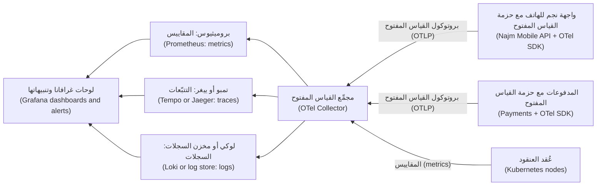
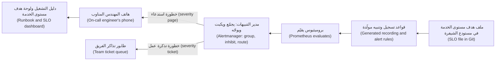
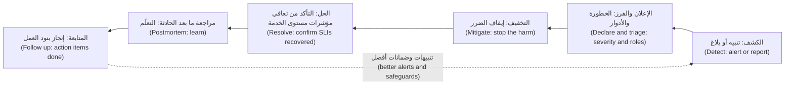

# الوحدة 5 — قابلية المراقبة والموثوقية (Observability and reliability)

*إطلاق خدمةٍ هو بداية حياتها لا نهايتها. وبعد ذلك يحسم سؤالان ما إذا كان العملاء سيثقون بها: هل تستطيع أن ترى ما تفعله، وهل تعرف مقدار الموثوقية التي تحتاجها؟ تجيب هذه الوحدة عن السؤالين كليهما. فهي تبدأ بالقياس عن بُعد (telemetry): السجلات (logs) والمقاييس (metrics) والتتبّعات (traces) التي تُصدرها الخدمة، وOpenTelemetry، المعيار المفتوح الذي يتيح لك جمعها مرةً واحدة وإرسالها إلى أي مكان. ثم تحوّل هذا القياس عن بُعد إلى قرارات موثوقية (reliability decisions) بأهداف مستوى الخدمة، وميزانيات الأخطاء (error budgets)، وتنبيهاتٍ لا تنطلق إلا حين يتألم المستخدمون، وجدول مناوبة (on-call rota) يستطيع الناس التعايش معه. وتنتهي بالحوادث (incidents): كيف تديرها بهدوء، وكيف تكتب مراجعة ما بعد الحادثة الخالية من اللوم (blameless postmortem) التي تجعل الحادثة التالية أقل احتمالًا. ستتابع فريق هندسة المنصات وهندسة موثوقية المواقع (Platform Engineering & SRE team) في بنك نجم (Najm Bank) بينما يطارد يوسف شكوى تحويلٍ بطيء (slow-transfer complaint) عبر ثلاثة أنظمة دون شيءٍ سوى ملفات سجلاتٍ متناثرة، وتستبدل مها 140 تنبيهًا مزعجًا (140 noisy alerts) بأربعةٍ مهمة، ويدير الفريق حادثة مدفوعات (payments incident) سببها تغيير إعدادات من سطرٍ واحد، ثم يتعلّم منها.*

> **المراحل (Phases):** Operate, Monitor — رؤية ما يفعله الإنتاج حقًّا، وتقرير مقدار الموثوقية المطلوبة منه، والاستجابة جيدًا حين لا يكون كذلك.

---

# 5.1 — القياس عن بُعد: السجلات والمقاييس والتتبّعات وOpenTelemetry
*المستوى (Level): 🟡 متوسط (Intermediate)* · *المتطلبات (Prerequisites): 2.2، 4.1* · *المرحلة (Phase): Monitor*

## ⚡ الدرس في دقيقة (In 60 seconds)
- **القياس عن بُعد (Telemetry)** هو البيانات التي يُصدرها نظامٌ عاملٌ عن نفسه. والإشارات الرئيسية الثلاث هي **السجلات (logs)**، أي الأحداث مع التفاصيل، و**المقاييس (metrics)**، أي أرقامٌ عبر الزمن رخيصة الحفظ والتنبيه عليها، و**التتبّعات (traces)**، أي مسار طلبٍ واحد عبر الخدمات. أمّا **الملفات التعريفية للأداء (Profiles)**، أي أين يذهب المعالج والذاكرة داخل الشيفرة، فهي إشارةٌ رابعة ما زالت تنضج.
- **قابلية المراقبة (Observability)** هي القدرة على الإجابة عن أسئلةٍ جديدة حول الإنتاج من ذلك القياس عن بُعد، دون إطلاق شيفرةٍ جديدة لمعرفة الجواب.
- **OpenTelemetry** (OTel) هو المعيار المفتوح المحايد تجاه المورّدين لإنتاج القياس عن بُعد ونقله. جهّز القياس مرةً واحدة (Instrument once) باستخدام OTel، ثم أرسل البيانات إلى أي واجهة خلفية تختارها: Prometheus أو Grafana أو خدمة المراقبة لدى مزوّد سحابي أو أداةٍ تجارية.
- القاعدة الأهم: كل إشارة تحمل **السياق (context)** نفسه، أي الخدمة والبيئة والإصدار ومعرّف التتبّع، حتى تستطيع الانتقال من تنبيهٍ إلى تتبّعٍ إلى سطر السجل.
- مؤشر القرار (Decision cue): المقاييس تخبرك *بأنّ* شيئًا ما خاطئ، والتتبّعات تخبرك *أين* (*where*)، والسجلات تخبرك *لماذا*.
- أكبر فخ (Biggest trap): الوسوم عالية التعدّدية (high-cardinality labels)، مثل معرّف العميل ورقم الحساب، على المقاييس. فهي تضاعف السلاسل الزمنية حتى يصبح نظام المراقبة بطيئًا أو مكلفًا أو ينهار.

## 🧭 لماذا يهم
في عصر يوم خميس، يحيل مركز الاتصال (contact centre) شكوى إلى هندسة المنصات (Platform Engineering): التحويلات في تطبيق نجم للهاتف (Najm Mobile app) «تدور طويلًا» قبل أن تنجح. يفتح يوسف لوحة المتابعة (dashboard): المعالج (CPU) سليم، ومتوسط زمن الاستجابة لواجهة برمجة تطبيق نجم للهاتف (Najm Mobile API) هو 180 مللي ثانية. ثم يقضي ساعتين في قراءة ملفات السجلات (log files) من حجيرات الواجهة (API pods) وخدمة المدفوعات (Payments service) ومحوّل الأنظمة المصرفية الأساسية (core banking adapter) في مركز البيانات (data centre). كلٌّ منها يسجّل بصيغةٍ مختلفة، دون معرّف طلبٍ مشترك، فلا يستطيع أن يعرف أيّ سطرٍ بطيء ينتمي إلى أيّ تحويل.

يجلس سالم معه. يقول: «المتوسط يُخفي الذيل ⁦⁩ إذا استغرق تحويلٌ واحد من كل مئة ثماني ثوانٍ، فسيبدو المتوسط سليمًا مع ذلك. ولا تستطيع تتبّع طلبٍ واحد عبر ثلاثة أنظمة لأن لا شيء يربطها معًا». والحل هو تجهيز المسار بالقياس بحيث يحمل كل طلبٍ معرّف تتبّع (trace ID) من الواجهة، مرورًا بالمدفوعات (through Payments)، عبر الرابط الهجين إلى الأنظمة المصرفية الأساسية (core banking)، وتسجيل زمن الاستجابة (latency) بوصفه توزيعًا لا متوسطًا.

بعد يومين من تجهيز الفريق للمسار بالقياس، يُظهر تتبّعٌ الجوابَ في صورةٍ واحدة: 7.4 ثانية من تحويلٍ بطيء تُقضى في انتظار اتصالٍ بقاعدة البيانات داخل المدفوعات، والأنظمة المصرفية الأساسية سريعة. ولولا القياس عن بُعد (Without telemetry)، لألقى الفريق اللوم على مركز البيانات. ولا يمكنك أن تضع هدف موثوقية أو تنبّه عليه أو تدير حادثةً ببياناتٍ لا تملكها.

## 📐 كيف يعمل
### 🟢 الأساسيات
**المراقبة مقابل قابلية المراقبة (Monitoring vs observability).** **المراقبة (Monitoring)** تترقّب الأعطال التي توقّعتها: «نبّه إذا تجاوز معدل الأخطاء 1%» ("alert if the error rate goes above 1%"). أمّا **قابلية المراقبة (Observability)** فتتيح لك التحقيق في أعطالٍ لم تتوقّعها: «لماذا يرى مستخدمو Android على أحدث إصدارٍ من التطبيق وحدهم تحويلاتٍ بطيئة منذ 14:05؟» ⁦("why are only Android users on the newest app version seeing slow transfers since 14:05?")⁩ تحتاج إلى الاثنين.

**الإشارات الثلاث (The three signals).**

| الإشارة (Signal) | ما هي | نقطة القوة (Strength) | نقطة الضعف (Weakness) | مثال من نجم (Najm example) |
|---|---|---|---|---|
| **السجلات (Logs)** | سجلاتٌ مختومة بالوقت لأحداثٍ منفصلة، ويُفضَّل أن تكون مُهيكلة (ideally structured)، أي أزواج مفتاح وقيمة بصيغة JSON | تفاصيل غنية (Rich detail)؛ «لماذا» | مكلفة عند الحجم الكبير؛ يصعب تجميعها | `transfer rejected: insufficient funds` |
| **المقاييس (Metrics)** | قياساتٌ رقمية مجمّعة عبر الزمن: العدّادات (counters) والمقاييس اللحظية (gauges) والمدرّجات التكرارية (histograms) | رخيصة (Cheap)؛ سريعة الاستعلام؛ أساس التنبيهات ولوحات المتابعة | لا تفاصيل لكل طلب | الطلبات في الثانية (Requests per second)، ومعدل الأخطاء (error rate)، وتوزيع زمن الاستجابة (latency distribution) |
| **التتبّعات (Traces)** | رحلة طلبٍ واحد، مكوّنة من **امتدادات (spans)**، أي عملياتٍ مؤقّتة (timed operations)، يربطها معرّف تتبّعٍ مشترك | تُظهر أين يذهب الوقت عبر الخدمات | تُؤخذ منها عيّنات عادةً (Usually sampled)؛ تحتاج إلى تجهيزٍ بالقياس في كل قفزة | الواجهة ← المدفوعات ← محوّل الأنظمة المصرفية الأساسية، مع التوقيتات |

**السجلات المُهيكلة (Structured logs).** ينبغي أن يكون سطر السجل (log line) سجلًّا تقرؤه الآلة (machine-readable record)، لا جملةً. قارن:

```text
# Risky: free text, no context, personal data
2026-03-12 14:05:11 Transfer failed for Ahmed Al-Kuwari acct 1234567890 after timeout
```

```json
{"ts":"2026-03-12T14:05:11.482Z","level":"error","service.name":"payments",
 "deployment.environment":"prod","service.version":"2.14.0",
 "event":"transfer.failed","reason":"db_pool_timeout","duration_ms":8012,
 "trace_id":"4bf92f3577b34da6a3ce929d0e0e4736","span_id":"00f067aa0ba902b7"}
```

يمكن عدّ النسخة المحصّنة، وهي تحمل معرّف التتبّع ولا تحتوي على اسمٍ أو رقم حساب. أمّا ما يجب ألّا يدخل السجلات أبدًا فيُغطّى في [*أمن الذكاء الاصطناعي وأمن التطبيقات (Secure AI & Application Security)*، الدرس 5.3 — حماية البيانات الشخصية: تقليل البيانات والتسجيل وهندسة الخصوصية](../secai/index.ar.html#/5.3).

**أنواع المقاييس (Metric types).** **العدّاد (counter)** لا يزداد إلا صعودًا، مثل إجمالي الطلبات وإجمالي الأخطاء؛ وتنظر إلى معدل تغيّره. و**المقياس اللحظي (gauge)** يصعد وينزل، مثل عمق الطابور والذاكرة المستخدمة والاتصالات المفتوحة. و**المدرّج التكراري (histogram)** يعدّ المشاهدات في دلاء، أي كم طلبًا استغرق أقل من 100 مللي ثانية، وأقل من 250 مللي ثانية، وأقل من ثانية، وهكذا (how many requests took under 100 ms, under 250 ms, under 1 s and so on)، ما يتيح لك حساب المئينات لاحقًا.

**المئينات لا المتوسطات (Percentiles, not averages).** زمن الاستجابة عند **المئين 99 (p99)** هو القيمة التي يكون 99% من الطلبات أسرع منها (the value that 99% of requests are faster than). فإذا كان الوسيط (median) 150 مللي ثانية والمئين 99 (p99) ست ثوانٍ، فإن طلبًا واحدًا من كل مئة بطيءٌ إلى حدٍّ مؤلم (painfully slow). المتوسطات تُخفي بالضبط المستخدمين الذين يشتكون، لذا سجّل زمن الاستجابة بوصفه مدرّجاتٍ تكرارية وراقب p50 وp95 وp99.

**ماذا تقيس أولًا (What to measure first).** ثلاث قوائم تحقّق معروفة:
- **الإشارات الذهبية الأربع (The four golden signals)**، من كتاب Google *هندسة موثوقية المواقع (Site Reliability Engineering)*: زمن الاستجابة وحجم الحركة (traffic) والأخطاء (errors) والتشبّع (saturation)، أي مدى «امتلاء» الخدمة.
- **RED** للخدمات المدفوعة بالطلبات (request-driven services): **R**ate، أي المعدل أو الطلبات في الثانية، و**E**rrors، أي الأخطاء أو الطلبات الفاشلة في الثانية، و**D**uration، أي المدة أو توزيع زمن الاستجابة. استخدمها لواجهة برمجة تطبيق نجم للهاتف وللمدفوعات (Payments).
- **USE** للموارد: **U**tilisation، أي الاستخدام، و**S**aturation، أي التشبّع، و**E**rrors، أي الأخطاء، لكل معالج أو قرص أو رابط شبكي أو مجمّع اتصالات. استخدمها للعُقد (nodes) وقواعد البيانات (databases) والرابط الهجين إلى مركز البيانات.

### 🟡 التعمق أكثر (Going deeper)
**OpenTelemetry في فقرةٍ واحدة (OpenTelemetry in one paragraph).** OpenTelemetry مشروعٌ تابع لـ CNCF، تكوّن عام 2019 بدمج مشروعين سابقين، هما OpenTracing وOpenCensus. وهو يوفّر: **واجهة برمجة وحزم تطوير (API and SDKs)** للغاتٍ كثيرة، لإنشاء الامتدادات والمقاييس والسجلات في شيفرتك؛ و**التجهيز التلقائي بالقياس دون شيفرة (automatic (zero-code) instrumentation)** للأطر والمكتبات الشائعة، بحيث تُصدر خوادم HTTP وعملاء HTTP ومشغّلات قواعد البيانات امتداداتٍ دون تغيير الشيفرة؛ و**OTLP**، أي بروتوكول OpenTelemetry (OpenTelemetry Protocol) لإرسال القياس عن بُعد؛ و**الاصطلاحات الدلالية (semantic conventions)**، أي أسماء سماتٍ معيارية مثل `service.name` و`http.request.method` و`http.route` و`http.response.status_code`؛ و**المجمِّع (Collector)**، وهو عمليةٌ منفصلة تستقبل القياس عن بُعد وتعالجه وتصدّره. وفي وقت كتابة هذا الدرس، أي عام 2026 (At the time of writing (2026))، فإن مواصفات التتبّعات والمقاييس مستقرة، ودعم السجلات (log support) مستقر في حزم تطوير بعض اللغات وما زال ينضج في غيرها، والملفات التعريفية للأداء ما زالت قيد التطوير. راجع صفحة الحالة (status page) للغتك قبل الاعتماد على إشارةٍ ما.

**كيف يعبر التتبّع الخدمات (How a trace crosses services).** حين تستدعي واجهة برمجة تطبيق نجم للهاتف خدمةَ المدفوعات عبر HTTP، تضيف حزمة تطوير OTel (OTel SDK) ترويسة `traceparent` بصيغة سياق التتبّع من W3C (W3C Trace Context format): الإصدار، ومعرّف التتبّع المكوّن من 32 محرفًا ست عشريًّا (the 32-hex-character trace ID)، ومعرّف الامتداد المستدعي المكوّن من 16 محرفًا ست عشريًّا (the 16-hex-character ID of the calling span)، والأعلام (flags)، بما فيها ما إذا كان التتبّع مأخوذًا ضمن العيّنة.

```text
traceparent: 00-4bf92f3577b34da6a3ce929d0e0e4736-00f067aa0ba902b7-01
```

تقرأ المدفوعات الترويسة وتنشئ امتداداتها بوصفها أبناءً لذلك الامتداد. والقفزة التي تُسقط الترويسة، مثل وكيلٍ قديم أو محوّل الأنظمة المصرفية الأساسية، تكسر التتبّع إلى قطع، ولهذا جهّزت نجم المحوّل بالقياس أولًا.

**إضافة سياق الأعمال إلى امتداد (Adding business context to a span).** يمنحك التجهيز التلقائي بالقياس (Automatic instrumentation) امتدادات HTTP وقواعد البيانات؛ فأضف امتداداتٍ يدوية (manual spans) حيث يعيش منطق الأعمال:

```python
from opentelemetry import trace

tracer = trace.get_tracer("najm.payments")

def reserve_funds(transfer):
    with tracer.start_as_current_span("reserve_funds") as span:
        span.set_attribute("payment.rail", transfer.rail)        # e.g. "domestic"
        span.set_attribute("payment.amount_band", transfer.band)  # "small", not the amount
        return ledger.reserve(transfer)
```

اجعل السمات منخفضة المخاطر: شريحةً لا المبلغ؛ ومسار دفعٍ لا رقم الحساب.

**خط معالجة المجمِّع (The Collector pipeline).** ترسل التطبيقات OTLP إلى مجمِّعٍ قريب، وغالبًا ما يكون DaemonSet، أي واحدًا لكل عقدة Kubernetes، إضافةً إلى مجمِّعٍ مركزي بدور «البوابة». ويقوم المجمِّع بالتجميع على دفعات والإثراء والتصفية والتوجيه:



إعدادٌ أدنى للمجمِّع لمختبرٍ محلي:

```yaml
receivers:
  otlp:
    protocols:
      grpc:
        endpoint: 0.0.0.0:4317
      http:
        endpoint: 0.0.0.0:4318
processors:
  memory_limiter:          # protect the Collector itself; put it first
    check_interval: 1s
    limit_percentage: 80
    spike_limit_percentage: 20
  attributes/scrub:        # defence in depth: drop fields that must never leave the app
    actions:
      - key: enduser.id
        action: delete
  batch: {}
exporters:
  otlp/tempo:
    endpoint: tempo:4317
    tls:
      insecure: true       # local lab only; use TLS in any shared environment
  prometheus:
    endpoint: 0.0.0.0:8889 # Prometheus scrapes the Collector here
  debug: {}                # prints logs to the Collector's output in the lab
service:
  pipelines:
    traces:  {receivers: [otlp], processors: [memory_limiter, attributes/scrub, batch], exporters: [otlp/tempo]}
    metrics: {receivers: [otlp], processors: [memory_limiter, batch], exporters: [prometheus]}
    logs:    {receivers: [otlp], processors: [memory_limiter, attributes/scrub, batch], exporters: [debug]}
```

ولأن التطبيقات لا تتحدث إلا OTLP مع المجمِّع، تستطيع نجم تغيير الواجهات الخلفية بتغيير المجمِّع، لا كل خدمة.

**Prometheus ولغة PromQL (Prometheus and PromQL).** يستخدم **Prometheus**، وهو مشروعٌ متخرّج في CNCF، **نموذج السحب (pull model)**: فهو **يكشط (scrapes)** نقطة نهاية HTTP (HTTP endpoint) هي `/metrics` لدى كل هدف على فتراتٍ منتظمة ويخزّن النتائج بوصفها سلاسل زمنية (time series)، تُعرَّف كلٌّ منها باسم مقياس (metric name) و**وسوم (labels)**، أي أزواج مفتاح وقيمة (key-value pairs). وتستعلم عنه بلغة **PromQL**. وتبدو مقاييس RED (RED metrics) لواجهة برمجة تطبيق نجم للهاتف هكذا:

```promql
# Rate: requests per second over the last 5 minutes
sum(rate(http_requests_total{job="najm-mobile-api"}[5m]))

# Errors: share of requests that returned 5xx
sum(rate(http_requests_total{job="najm-mobile-api", code=~"5.."}[5m]))
  /
sum(rate(http_requests_total{job="najm-mobile-api"}[5m]))

# Duration: p99 latency from a histogram
histogram_quantile(
  0.99,
  sum by (le) (rate(http_request_duration_seconds_bucket{job="najm-mobile-api"}[5m])))
```

تختلف أسماء المقاييس باختلاف مكتبة التجهيز بالقياس (instrumentation library)؛ فمقياس خادم HTTP في OTel، مثلًا، يصبح `http_server_request_duration_seconds` بعد تصديره إلى Prometheus. تحقّق مما تُصدره خدماتك فعلًا قبل أن تنسخ استعلامًا. ثم يحوّل **Grafana** هذه الاستعلامات إلى لوحات متابعة وتنبيهات (dashboards and alerts).

**المكافئات السحابية (Cloud equivalents).** لدى كل مزوّدٍ رئيسي (major provider) منظومة مراقبة مُدارة: Amazon CloudWatch وAWS X-Ray، وAzure Monitor مع Application Insights، وGoogle Cloud Observability. ويتغيّر دعمها لبيانات OTLP وPrometheus وميزاتها وتسعيرها؛ فراجع التوثيق الحالي.

### 🔴 نظرة الخبير (Expert view)
**التعدّدية هي محرّك التكلفة (Cardinality is the cost driver).** كل تركيبةٍ فريدة من قيم الوسوم هي سلسلة زمنية منفصلة. فالمقياس `http_requests_total` مع الوسوم `route` (40 قيمة) و`code` (10) و`pod` (30) يصل إلى 12,000 سلسلة (up to 12,000 series)، وهذا لا بأس به. أضِف `customer_id` (مليونا قيمة) وتكون قد أنشأت مليارات السلاسل المحتملة. القواعد التي تتبعها نجم: الوسوم على المقاييس تأتي من مجموعاتٍ صغيرة محدودة، مثل قالب المسار وفئة الحالة والمنطقة والإصدار؛ والمعرّفات (identifiers) مكانها الامتدادات والسجلات، لا المقاييس أبدًا.

**أخذ عيّنات من التتبّعات (Sampling traces).** تتبّع كل طلب مكلفٌ على نطاقٍ واسع. **أخذ العيّنات من الرأس (Head sampling)** يقرّر عند بداية الطلب، كأن يحتفظ بـ 10% عشوائيًّا (keep 10% at random)، وهو رخيص لكنه قد يتخلّص من التتبّع البطيء الوحيد الذي تحتاجه. أمّا **أخذ العيّنات من الذيل (Tail sampling)**، الذي يجري في مجمِّعٍ بعد اكتمال التتبّع، فيحتفظ بالتتبّعات حسب النتيجة: كل الأخطاء، وكل الطلبات الأبطأ من ثانيتين (all requests slower than 2 s)، إضافةً إلى حصةٍ عشوائية صغيرة من الباقي. تحتفظ نجم بـ 100% من تتبّعات الأخطاء والتتبّعات البطيئة للمدفوعات، وبعيّنةٍ صغيرة من السليمة. ويتطلّب أخذ العيّنات من الذيل أن تصل كل امتدادات التتبّع إلى نسخة المجمِّع نفسها، وهذا يحدّد طريقة نشرك للبوابة.

**الشواهد والربط (Exemplars and correlation).** **الشاهد (exemplar)** هو معرّف تتبّعٍ مُلحَق بدلوٍ في مدرّجٍ تكراري. انقر النقطة في دلوٍ بطيء على لوحة زمن استجابة في Grafana لتفتح تتبّعًا بطيئًا حقيقيًّا، ثم اتبع معرّف تتبّعه إلى السجلات: دقيقتان بدل ساعتين من البحث بـ grep.

**للقياس عن بُعد ميزانية (Telemetry has a budget).** تسجيل التصحيح في الإنتاج، والوسوم غير المحدودة (unbounded labels)، والتتبّع بنسبة 100% (100% tracing)، كلها قد تجعل قابلية المراقبة بندًا كبيرًا في فاتورة السحابة. اضبط مدة الاحتفاظ لكل إشارة، واتبع في السجلات قواعد البنك للسجلات الرسمية والخصوصية. أمّا سجلات التدقيق والأمن فهي تيّارٌ منفصل له متطلبات احتفاظ وسلامة خاصة به؛ انظر [*أمن الذكاء الاصطناعي وأمن التطبيقات*، الدرس 10.1 — التسجيل والمراقبة وهندسة الكشف (Logging, monitoring and detection engineering)](../secai/index.ar.html#/10.1).

**جهّز المنصة بالقياس، لا كل فريقٍ على حدة (Instrument the platform, not each team).** ضع القياس عن بُعد على المسار الذهبي: يأتي قالب الخدمة (service template) مزوّدًا بحزمة تطوير OTel، والتجهيز التلقائي بالقياس، ومسجّلٍ (logger) يضيف `trace_id`، ولوحة RED افتراضية، فتكون كل خدمةٍ جديدة قابلةً للمراقبة من يومها الأول.

ولرؤية غير المهندس لسبب تضليل لوحات المتابعة، انظر [*تصميم الأنظمة لمبرمجي الحدس (System Design for Vibe Coders)*، الدرس 7.1 — لوحة المتابعة التي تكذب والمقياس الذي لا يكذب](../vibe/index.ar.html#l7-1)؛ ولقابلية المراقبة بوصفها مكوّنًا في البرمجيات كخدمة، انظر [*لبنات بناء البرمجيات كخدمة (SaaS Building Blocks)*، الدرس 7.2 — قابلية المراقبة: السجلات والأخطاء والمقاييس والتتبّعات](../saas/index.ar.html#/7.2).

## 🧰 الأدوات
| الأداة أو الممارسة أو الخدمة (Tool, practice or service) | ما هي وماذا تفعل | متى تلجأ إليها |
|---|---|---|
| **OpenTelemetry** (CNCF) | واجهات برمجة وحزم تطوير محايدة تجاه المورّدين، وتجهيزٌ تلقائي بالقياس، واصطلاحات دلالية، وبروتوكول OTLP (OTLP protocol) للتتبّعات والمقاييس والسجلات | كل خدمةٍ جديدة؛ الطريقة الافتراضية للتجهيز بالقياس في نجم |
| **OpenTelemetry Collector** | عمليةٌ تستقبل القياس عن بُعد وتعالجه، أي تجمّعه على دفعات وتنظّفه وتأخذ منه عيّنات، وتصدّره إلى واجهةٍ خلفية أو أكثر | بين التطبيقات والواجهات الخلفية، كي لا تتحدث الخدمات مع مورّدٍ مباشرةً أبدًا |
| **Prometheus** | قاعدة بيانات سلاسل زمنية قائمة على السحب مع لغة الاستعلام PromQL وقواعد التنبيه (alert rules) | مقاييس أحمال عمل Kubernetes ولوحات RED/USE (RED/USE dashboards) |
| **Grafana** | لوحات متابعة وتنبيه فوق مصادر بياناتٍ كثيرة، منها Prometheus وLoki وTempo | مكانٌ واحد لرؤية المقاييس والسجلات والتتبّعات جنبًا إلى جنب |
| **Jaeger** أو **Grafana Tempo** | تخزين التتبّعات والبحث فيها | متابعة طلبٍ واحد عبر الخدمات؛ العثور على القفزة البطيئة |
| **RED and USE methods** | قوائم تحقّق (Checklists): المعدل والأخطاء والمدة للخدمات؛ والاستخدام والتشبّع والأخطاء للموارد | تقرير ما يوضع على أول لوحة متابعة لخدمةٍ ما |

## 🏛️ عمليًا في بنك نجم
**الأثر البرمجي (Artefact): معيار القياس عن بُعد في نجم، الإصدار الأول (the Najm telemetry standard (v1))، وهو جزءٌ من قالب المسار الذهبي (part of the golden-path template).**

| المجال (Area) | المعيار (Standard) |
|---|---|
| سمات المورد (Resource attributes) | كل إشارةٍ تحمل `service.name` و`service.version` و`deployment.environment` و`cloud.region` و`k8s.namespace.name` |
| السجلات | JSON إلى المخرج القياسي؛ الحقول (fields) `ts` و`level` و`service.name` و`event` و`trace_id` و`span_id`؛ لا أسماء ولا أرقام حسابات ولا أرقام بطاقات ولا رموز مميزة ولا مدخلات نصية حرّة من العملاء |
| المقاييس | RED لكل نقطة نهاية HTTP وgRPC، بوصفها مدرّجاتٍ تكرارية، مع زمن الاستجابة بالثواني؛ وUSE لمجمّعات الاتصالات والطوابير والرابط الهجين؛ والوسوم من مجموعاتٍ محدودة فقط |
| التتبّعات | تجهيز OTel التلقائي بالقياس إضافةً إلى امتداداتٍ يدوية لخطوات الأعمال (`reserve_funds`، `post_to_core`)؛ وتمرير ترويسة `traceparent` بصيغة W3C عبر كل قفزة، بما فيها محوّل الأنظمة المصرفية الأساسية |
| أخذ العيّنات (Sampling) | أخذ العيّنات من الذيل عند مجمِّع البوابة (gateway Collector): الاحتفاظ بكل تتبّعات الأخطاء والتتبّعات الأبطأ من ثانيتين (traces slower than 2 s)؛ وأخذ عيّنات من التتبّعات السليمة بمعدلٍ منخفض يُحدَّد لكل خدمة |
| النقل (Transport) | ترسل التطبيقات OTLP إلى مجمِّع العقدة فقط؛ ولا يتحدث مع الواجهات الخلفية إلا مجمِّع البوابة |
| لوحات المتابعة (Dashboards) | تحصل كل خدمةٍ على لوحة RED مولَّدة فيها p50/p95/p99، ونسبة الأخطاء (error ratio)، ورابطٌ إلى دليل التشغيل الخاص بها |
| الاحتفاظ (Retention) | يُحدَّد لكل إشارة ويُتّفق عليه مع الأمن والامتثال؛ وسجلات التدقيق (audit logs) تيّارٌ منفصل يملكه مركز العمليات الأمنية |
| المراجعة (Review) | لا تنتقل خدمةٌ إلى الإنتاج حتى تجتاز فحص «الدقائق الخمس الأولى»: مهندسٌ لم يرها قط يستطيع أن يجد معدل أخطائها وp99 الخاص بها وتتبّعًا فاشلًا واحدًا في أقل من خمس دقائق |

## 🛠️ التمارين (Exercises)
تعمل التمارين الثلاثة كلها محليًّا (run locally) باستخدام Docker أو عنقود kind/k3d (a kind/k3d cluster). لا توجّهها إلى أنظمة جهة عملٍ دون إذن (without permission).

- 🟢 شغّل تطبيق ويب صغيرًا خاصًّا بك، أو تطبيقًا تجريبيًّا من OpenTelemetry، مع Prometheus وGrafana في Docker Compose. ابنِ لوحة RED: الطلبات في الثانية، ونسبة أخطاء 5xx (5xx ratio)، وزمن الاستجابة p50/p95/p99 من مدرّجٍ تكراري. *يكتمل عندما (Done when):* تستطيع جعل التطبيق بطيئًا، بإضافة توقّفٍ مؤقت إلى مسارٍ واحد، وتشاهد p99 يرتفع بينما لا يكاد المتوسط يتحرك، وتستطيع شرح الفرق في جملتين.
- 🟡 أضِف التجهيز التلقائي بالقياس من OpenTelemetry إلى خدمتين صغيرتين تستدعي فيهما الخدمة A الخدمة B عبر HTTP. أرسل التتبّعات عبر مجمِّع OTel (OTel Collector) إلى Jaeger أو Tempo، واكتب سجلات JSON مُهيكلة (structured JSON logs) تتضمّن `trace_id`. *يكتمل عندما:* تستطيع فتح تتبّعٍ واحد يُظهر امتداداتٍ من الخدمتين كلتيهما، وإيجاد أسطر سجل ذلك التتبّع بالبحث عن معرّف تتبّعه.
- 🔴 وسّع مختبر 🟡 بأخذ العيّنات من الذيل في المجمِّع: احتفظ بكل تتبّع خطأ وكل تتبّعٍ أبطأ من ثانية واحدة، إضافةً إلى عيّنةٍ بنسبة 5% من الباقي (a 5% sample of the rest). أضِف مدرّجًا تكراريًّا لزمن الاستجابة مُفعَّلًا فيه الشواهد ولوحةً في Grafana. ثم أضِف وسمًا عشوائيًّا لمعرّف المستخدم إلى مقياسٍ واحد وقِس كيف يزداد عدد السلاسل. *يكتمل عندما:* يفتح النقر على شاهدٍ بطيء تتبّعًا بطيئًا حقيقيًّا، ويثبت أن سياسة أخذ العيّنات لديك تحتفظ بخطأٍ مفتعَل، وتكون قد كتبت ملاحظةً من فقرةٍ واحدة عن التعدّدية التي قستها وكيف أزلتها.

## ⚠️ أخطاء وفخاخ (Mistakes and traps)
- **التنبيه على المتوسطات والإبلاغ عنها (Alerting on and reporting averages).** المتوسطات تُخفي الذيل البطيء الذي يشعر به العملاء. سجّل المدرّجات التكرارية (Record histograms)؛ وانظر إلى p95 وp99.
- **الوسوم غير المحدودة على المقاييس (Unbounded labels on metrics).** معرّفات العملاء أو معرّفات الطلبات أو عناوين URL الكاملة بوصفها وسومًا قد تضاعف السلاسل حتى يفشل نظام المراقبة. استخدم قوالب المسارات والوسوم المحدودة؛ وضع المعرّفات على الامتدادات والسجلات.
- **تسجيل البيانات الشخصية والأسرار «لأغراض التصحيح» (Logging personal data and secrets "for debugging").** السجلات تُنسخ وتُحفظ ويقرؤها كثيرون. سجّل الأحداث والأسباب لا الأشخاص؛ ونظّف البيانات عند المجمِّع بوصفه خط دفاعٍ ثانيًا.
- **سياق تتبّعٍ مكسور (Broken trace context).** قفزةٌ واحدة تُسقط `traceparent`، مثل محوّلٍ قديم أو طابور رسائل أو وكيلٍ، تقسم كل تتبّع. اختبر التمرير من طرفٍ إلى طرف، بما في ذلك المسارات غير المتزامنة.

## 🧾 الخلاصة (Recap)
- السجلات تعطي التفاصيل، والمقاييس تعطي مجاميع رخيصة وتنبيهات، والتتبّعات تُظهر أين يذهب الوقت عبر الخدمات؛ والملفات التعريفية للأداء إشارةٌ رابعة ناشئة.
- السياق المشترك (Shared context)، أي الخدمة والإصدار والبيئة ومعرّف التتبّع، هو ما يتيح لك التنقل بين الإشارات.
- استخدم RED للخدمات وUSE للموارد والإشارات الذهبية الأربع للتحقق المتقاطع؛ وقِس زمن الاستجابة بوصفه مدرّجاتٍ تكرارية ومئينات.
- يوحّد OpenTelemetry التجهيز بالقياس والنقل؛ ويفصل المجمِّع الخدمات عن الواجهات الخلفية، وهو المكان الذي تجمّع فيه على دفعات وتنظّف وتأخذ العيّنات.
- التعدّدية والاحتفاظ وأخذ العيّنات تحدّد تكلفة قابلية المراقبة؛ صمّمها ولا تكتشفها في الفاتورة.

## ✍️ اختبر نفسك (Check yourself)

**1. تُظهر لوحة متابعة واجهة برمجة تطبيق نجم للهاتف (Najm Mobile API dashboard) متوسط زمن استجابة (average latency) قدره 180 مللي ثانية، لكن العملاء يشتكون من أن بعض التحويلات تستغرق ثوانيَ كثيرة (some transfers take many seconds). إلامَ ينبغي أن ينظر يوسف أولًا؟**

- A. استخدام المعالج (CPU utilisation) في حجيرات الواجهة (API pods)
- B. زمن الاستجابة عند p95 وp99 من مدرّجٍ تكراري لمدة الطلبات (request-duration histogram)
- C. العدد الإجمالي لأسطر السجل في الدقيقة
- D. متوسط زمن الاستجابة عبر نافذةٍ أطول، مثل 24 ساعة

<details><summary>الإجابة</summary>

**B.** المئينات من مدرّجٍ تكراري تكشف الذيل البطيء الذي يخفيه المتوسط. والمتوسط الأطول (D) يخفيه أكثر؛ وقد يكون المعالج (CPU) طبيعيًّا بينما تنتظر الطلبات مجمّع اتصالات. (🟢 الأساسيات.)

</details>

**2. يريد مطوّرٌ إضافة الوسم `customer_id` إلى المقياس `http_requests_total` كي يرى فريق الدعم (support) معدل طلبات كل عميل (each customer's request rate). ما الردّ الأفضل؟**

- A. اقبله، لأن الوسوم رخيصة والمزيد منها يفيد دائمًا
- B. اقبله في الإنتاج فقط، حيث يحتاجه الدعم فعلًا
- C. اقبله بعد تجزئة معرّف العميل، كي لا تُخزَّن بياناتٌ شخصية
- D. ارفضه: القيم غير المحدودة تضاعف السلاسل؛ استخدم الامتدادات أو السجلات بدلًا منه

<details><summary>الإجابة</summary>

**D.** كل قيمة وسمٍ فريدة تنشئ سلسلةً جديدة؛ وملايين العملاء تجعل نظام المقاييس بطيئًا ومكلفًا (slow and costly). والتجزئة (Hashing) (C) تُبقي التعدّدية نفسها تمامًا. المعرّفات مكانها الامتدادات والسجلات، ضمن قواعد الخصوصية. (🔴 نظرة الخبير (Expert view).)

</details>

**3. تتوقف التتبّعات القادمة من واجهة برمجة تطبيق نجم للهاتف (Najm Mobile API) عند محوّل الأنظمة المصرفية الأساسية (core banking adapter)، ويبدأ تتبّعٌ جديد على الجانب الآخر (a new trace starts on the other side). ما السبب الأرجح؟**

- A. المحوّل لا يمرّر ترويسة `traceparent` بصيغة W3C
- B. يكشط Prometheus المحوّل ببطءٍ شديد
- C. السجلات ليست بصيغة JSON
- D. أخذ العيّنات من الرأس (Head sampling) مضبوطٌ على 100%

<details><summary>الإجابة</summary>

**A.** يبقى التتبّع موصولًا فقط إذا مرّرت كل قفزةٍ سياق التتبّع. أمّا فترة الكشط (Scrape interval) (B) وصيغة السجل (log format) (C) فلا تؤثران في ربط التتبّعات (trace linking)؛ وأخذ عيّنات من كل شيء (sampling everything) (D) لن يقسم التتبّعات. (🟡 التعمق أكثر (Going deeper).)

</details>

**4. لماذا توجّه نجم كل القياس عن بُعد للتطبيقات (all application telemetry) عبر مجمِّعات OpenTelemetry (OpenTelemetry Collectors) بدل أن ترسل كل خدمةٍ البيانات مباشرةً إلى واجهتها الخلفية (straight to its back end)؟**

- A. لأن Prometheus لا يملك أي طريقة لكشط المقاييس من التطبيقات مباشرةً
- B. لأن بيانات OTLP لا يستقبلها إلا مجمِّع، ولا تستقبلها واجهةٌ خلفية أبدًا
- C. لأنه يمركز التجميع على دفعات والتنظيف وأخذ العيّنات، ويفصل الخدمات عن الواجهات الخلفية
- D. لأن المجمِّع هو المخزن طويل الأمد الذي تستعلم منه لوحات المتابعة عن التاريخ

<details><summary>الإجابة</summary>

**C.** يفصل المجمِّع الخدمات عن الواجهات الخلفية ويمركز المعالجة (centralises processing). يستطيع Prometheus كشط التطبيقات مباشرةً، ويمكن أن تذهب OTLP مباشرةً إلى واجهةٍ خلفية تقبلها (B)، والمجمِّع خط معالجة لا مخزن (D). (🟡 التعمق أكثر (Going deeper).)

</details>

**5. تريد نجم إبقاء تكاليف التتبّع منخفضة (keep tracing costs down) دون خسارة التتبّعات التي يحتاجها المهندسون أثناء الحوادث (during incidents). أيّ نهجٍ هو الأنسب؟**

- A. أخذ العيّنات من الرأس بنسبة 1% (Head sampling at 1%) لكل خدمة، يُقرَّر عند بدء كل طلب
- B. أخذ العيّنات من الذيل (Tail sampling): الاحتفاظ بكل تتبّعات الأخطاء والتتبّعات البطيئة، إضافةً إلى قليلٍ من السليمة
- C. إيقاف التتبّع كليًّا والاعتماد على السجلات المُهيكلة مع معرّفات التتبّع
- D. الاحتفاظ بكل تتبّع، لكن حذفها كلها تلقائيًّا بعد ساعة واحدة

<details><summary>الإجابة</summary>

**B.** أخذ العيّنات من الذيل يقرّر بعد معرفة النتيجة، فتُحفظ الأخطاء النادرة والطلبات البطيئة. أمّا أخذ العيّنات العشوائي من الرأس فسيتخلّص منها عادةً؛ وC وD يُضيّعان الدليل الذي تحتاجه. (🔴 نظرة الخبير (Expert view).)

</details>

## 📚 المراجع (References)
- توثيق OpenTelemetry (OpenTelemetry documentation) — https://opentelemetry.io/docs/
- مجمِّع OpenTelemetry (OpenTelemetry Collector) — https://opentelemetry.io/docs/collector/
- الاصطلاحات الدلالية في OpenTelemetry — https://opentelemetry.io/docs/specs/semconv/
- سياق التتبّع من W3C (W3C Trace Context) — https://www.w3.org/TR/trace-context/
- توثيق Prometheus (Prometheus documentation) — https://prometheus.io/docs/introduction/overview/
- Prometheus، تسمية المقاييس والوسوم — https://prometheus.io/docs/practices/naming/
- توثيق Grafana (Grafana documentation) — https://grafana.com/docs/
- توثيق Jaeger (Jaeger documentation) — https://www.jaegertracing.io/docs/
- Google، *هندسة موثوقية المواقع*، «مراقبة الأنظمة الموزّعة» — https://sre.google/sre-book/monitoring-distributed-systems/
- مشاريع CNCF (CNCF projects) — https://www.cncf.io/projects/

---

# 5.2 — أهداف مستوى الخدمة وميزانيات الأخطاء والتنبيه ومناوبةٌ يستطيع الناس تحمّلها
*المستوى: 🟡 متوسط* · *المتطلبات: 5.1* · *المرحلة: Operate, Monitor*

## ⚡ الدرس في دقيقة (In 60 seconds)
- **مؤشر مستوى الخدمة (service level indicator, SLI)** يقيس ما يختبره المستخدمون، مثل «نسبة طلبات التحويل التي تنجح في أقل من ثانيتين» ("the share of transfer requests that succeed in under 2 seconds"). و**هدف مستوى الخدمة (service level objective, SLO)** هو الهدف المحدّد له عبر نافذةٍ زمنية، مثل 99.9% عبر 30 يومًا. أمّا **اتفاقية مستوى الخدمة (service level agreement, SLA)** فهي عقدٌ له عواقب، وينبغي أن تكون أكثر تساهلًا من هدف مستوى الخدمة.
- **ميزانية الأخطاء (error budget)** هي ما يسمح هدف مستوى الخدمة بفشله: 100% ناقص الهدف (100% minus the target). وهي تحوّل سؤال «ما مقدار الموثوقية؟» ⁦⁩ إلى قرارٍ رقمي مشترك بين المنتج والعمليات: أنفِق الميزانية على التغيير، أو أبطئ حين تنفد.
- لا تستدعِ إنسانًا إلا من أجل **أعراضٍ يشعر بها المستخدمون (symptoms users feel)** وتحتاج إلى تصرّفٍ الآن. نبّه على سرعة احتراق ميزانية الأخطاء، لا على وصول المعالج إلى 80% (not on CPU at 80%).
- **التنبيهات متعددة النوافذ ومتعددة معدلات الاحتراق (Multi-window, multi-burn-rate alerts)**، المأخوذة من *كتاب عمل هندسة موثوقية المواقع*، تلتقط الانقطاعات السريعة بسرعة والتسرّبات البطيئة بموثوقية، مع قليلٍ من الإنذارات الكاذبة.
- لا تكون المناوبة (On-call) مستدامة (sustainable) إلا إذا كانت الاستدعاءات نادرة، وقابلةً للتصرّف (actionable)، ومرتبطةً بدليل تشغيل، وتتبعها إصلاحاتٌ تزيل السبب.
- أكبر فخ: استهداف 100% (aiming for 100%). فهو مستحيل (impossible)، ويعطّل كل تغيير، وهواتف المستخدمين وشبكاتهم نفسها أقل موثوقيةً من ذلك على أي حال.

## 🧭 لماذا يهم
ترث مها جدول المناوبة لواجهة برمجة تطبيق نجم للهاتف وخدمة المدفوعات. وفي أسبوعها الأول تعدّ 140 قاعدة تنبيه (140 alert rules). وفي ليلةٍ واحدة يُستدعى يوسف إحدى عشرة مرة بسبب ارتفاع استخدام المعالج (high CPU) وإعادة تشغيل الحجيرات (pod restarts) وتحذيرات الأقراص (disk warnings). لم يحتج أيٌّ منها إلى تصرّف. وفي الساعة 04:10 تبدأ مشكلةٌ حقيقية: تفشل حصةٌ من التحويلات لأن شهادةً على محوّل الأنظمة المصرفية الأساسية انتهت صلاحيتها (has expired). فيقرّ يوسف، وهو نصف نائم (half-asleep)، بذلك التنبيه مع غيره، ويلاحظ العملاء المشكلة قبل أن يلاحظها الفريق.

هذا هو **إرهاق التنبيهات (alert fatigue)**: حين يكون معظم الاستدعاءات ضجيجًا، يتعلّم الناس تجاهل الاستدعاءات (ignore pages)، ثم يفوّتون الحقيقي منها. ويبدأ حلّ مها بسؤالٍ مختلف: «ماذا يحتاج العميل من خدمة المدفوعات، وما مقدار الفشل الذي يحتمله قبل أن يصبح ذلك مهمًّا؟» ⁦⁩ تصبح الإجابات أهدافًا لمستوى الخدمة. ولا تأتي الاستدعاءات إلا من احتراق أهداف مستوى الخدمة. وكل ما عدا ذلك يصبح تذكرة عمل، أو بندًا في لوحة متابعة، أو يُحذف.

وتحسم أهداف مستوى الخدمة أيضًا جدالًا قديمًا: فرق طارق تريد السرعة (want speed)، وفريق مها يريد الاستقرار (wants stability). ومع ميزانية الأخطاء يتفق الطرفان مسبقًا: ما دامت الميزانية باقية، أطلِق؛ وحين تُستنفد، يأتي عمل الموثوقية أولًا. والجهات التنظيمية (Regulators) تهتم أيضًا: فقانون المرونة التشغيلية الرقمية في الاتحاد الأوروبي، المطبّق على الكيانات المالية منذ يناير 2025 (applicable to financial entities from January 2025)، والجهات التنظيمية الخليجية (GCC regulators) تتوقع من البنوك أن تفهم مرونة خدماتها المهمة وتختبرها؛ وهدف مستوى الخدمة المقيس جزءٌ من هذا الدليل.

## 📐 كيف يعمل
### 🟢 الأساسيات
**من المستخدمين إلى الأرقام (From users to numbers).** ابدأ برحلة مستخدم، لا بمكوّن: «يرسل العميل تحويلًا ويرى النتيجة». ثم اختر مؤشرات مستوى الخدمة (choose SLIs) التي تصف تجربةً جيدة لها:

| نوع المؤشر (SLI type) | التعريف (Definition) | مثال من المدفوعات (Payments example) |
|---|---|---|
| **التوافر (Availability)** | الطلبات الجيدة ÷ الطلبات الصالحة | طلبات التحويل التي تعيد نتيجةً ليست 5xx (return a non-5xx result) ÷ كل طلبات التحويل، باستثناء أخطاء العميل مثل المدخلات غير الصالحة |
| **زمن الاستجابة (Latency)** | الطلبات الأسرع من عتبةٍ معيّنة ÷ الطلبات الصالحة | طلبات التحويل المكتملة في أقل من ثانيتين (completed in under 2 s) ÷ كل طلبات التحويل |
| **الصحة (Correctness)** | النتائج الصحيحة ÷ النتائج | التحويلات المرحَّلة مرةً واحدة بالضبط والمطابَقة مع الأنظمة المصرفية الأساسية ÷ كل التحويلات |

عبّر عن مؤشرات مستوى الخدمة بوصفها أحداثًا جيدة ÷ أحداثًا صالحة: فهي سهلة الحساب من العدّادات وقابلة للمقارنة بين الخدمات.

**هدف مستوى الخدمة واتفاقية مستوى الخدمة والنافذة (SLO, SLA and the window).** يضيف هدف مستوى الخدمة هدفًا ونافذةً: «99.9% من طلبات التحويل تنجح، مقيسةً عبر 30 يومًا متحركة» ⁦("99.9% of transfer requests succeed, measured over a rolling 30 days.")⁩. و**النافذة المتحركة (rolling window)** تنظر دائمًا إلى آخر 30 يومًا (always looks at the last 30 days)، فيبقى اليوم السيئ ظاهرًا مدة شهر. أمّا **اتفاقية مستوى الخدمة (SLA)** فهي وعدٌ خارجي بعقوبات، يُحدَّد أدنى من هدف مستوى الخدمة الداخلي.

**حساب ميزانية الأخطاء (Error budget arithmetic).** الميزانية هي 100% ناقص هدف مستوى الخدمة (100% minus the SLO).

| هدف مستوى الخدمة (SLO) | ميزانية الأخطاء | الوقت «السيئ» المسموح إذا تعطّلت الخدمة كليًّا، لكل 30 يومًا (Allowed "bad" time if fully down, per 30 days) | الطلبات السيئة المسموحة لكل 10 ملايين (Bad requests allowed per 10 million) |
|---|---|---|---|
| 99% | 1% | 7.2 ساعة (hours) | 100,000 |
| 99.5% | 0.5% | 3.6 ساعة | 50,000 |
| 99.9% | 0.1% | 43.2 دقيقة (minutes) | 10,000 |
| 99.99% | 0.01% | نحو 4.3 دقيقة (about 4.3 minutes) | 1,000 |

كل «تسعة» إضافية تقلّص الميزانية عشر مرات، وتكلّف عادةً أكثر بكثير في التكرار الاحتياطي (redundancy) وسرعة الإطلاق (release speed) وجهد المناوبة (on-call effort). اختر الهدف بناءً على حاجات المستخدمين لا الطموح. تحصل المدفوعات على توافرٍ بنسبة 99.9% (99.9% availability) وعلى 99% من التحويلات في أقل من ثانيتين (99% of transfers under 2 s)؛ وتحصل بوابة المطوّرين الداخلية على 99%.

**نبّه على الأعراض لا الأسباب (Alert on symptoms, not causes).** **العَرَض (symptom)** شيءٌ يشعر به المستخدمون: أخطاء أو بطء أو نتائج خاطئة. و**السبب (cause)** شيءٌ قد يؤدي إليه: ارتفاع استخدام المعالج، أو إعادة تشغيل حجيرة، أو طابور ممتلئ. الأسباب مفيدة في لوحات المتابعة وتذاكر العمل. أمّا الاستدعاء فيكون على الأعراض، لأن كثيرًا من الأسباب لا يؤذي المستخدمين أبدًا، ولأن بعض الأعطال التي تواجه المستخدمين (user-facing failures) لها أسبابٌ لم تتوقعها.

**ثلاثة أنواع من الاستجابة (Three kinds of response).**
- **الاستدعاء (Page)**: يجب أن يتصرّف إنسانٌ الآن، في أي ساعة. للأعراض التي تهدّد هدف مستوى الخدمة فقط.
- **تذكرة العمل (Ticket)**: يجب أن يتصرّف أحدٌ خلال أيام العمل. احتراقٌ بطيء للميزانية، أو شهادةٌ تنتهي صلاحيتها بعد 14 يومًا (a certificate expiring in 14 days)، أو قرصٌ يمتلئ على مدى أسابيع.
- **السجل أو لوحة المتابعة فقط (Log or dashboard only)**: معلوماتٌ للتحقيقات. دون إشعار.

### 🟡 التعمق أكثر
**معدل الاحتراق (Burn rate).** **معدل الاحتراق (burn rate)** هو سرعة استهلاكك لميزانية الأخطاء، منسوبةً إلى المعدل الذي يستهلكها كلها بالضبط خلال نافذة هدف مستوى الخدمة. معدل احتراقٍ قدره 1 يعني أنك ستنهي الأيام الثلاثين دون أي ميزانية متبقية. ومعدل احتراقٍ قدره 14.4 يعني أن ميزانية الثلاثين يومًا كلها ستذهب في نحو يومين. ولهدف مستوى خدمة قدره 99.9%، تكون الميزانية 0.1%، فتكون نسبة أخطاء قدرها 1.44% معدل احتراقٍ قدره 14.4.

**لماذا تفشل تنبيهات العتبة البسيطة (Why simple threshold alerts fail).** «استدعِ إذا تجاوزت نسبة الأخطاء 0.1% لمدة 5 دقائق» ("Page if the error ratio is above 0.1% for 5 minutes") ينطلق على ومضاتٍ قصيرة بالكاد تمسّ الميزانية. و«استدعِ إذا تجاوزت النسبة على مدى 30 يومًا 0.1%» ("Page if the 30-day ratio is above 0.1%") ينطلق متأخرًا بأيام. ويعالج *كتاب عمل هندسة موثوقية المواقع*، في فصل «التنبيه على أهداف مستوى الخدمة»، هذه الخيارات ويوصي بتنبيهات **متعددة النوافذ ومتعددة معدلات الاحتراق (multi-window, multi-burn-rate)**. فالنافذة الطويلة تُظهر أن الاحتراق كبير؛ والنافذة القصيرة تؤكد أنه ما زال يحدث، فيتوقف التنبيه أيضًا بعد التعافي بوقتٍ قصير.

| الخطورة (Severity) | معدل الاحتراق | النافذة الطويلة (Long window) | النافذة القصيرة (Short window) | الميزانية المستهلكة إذا استمر طوال النافذة الطويلة |
|---|---|---|---|---|
| استدعاء | 14.4 | ساعة واحدة (1 hour) | 5 دقائق (5 minutes) | 2% |
| استدعاء | 6 | 6 ساعات (6 hours) | 30 دقيقة (30 minutes) | 5% |
| تذكرة عمل | 1 | 3 أيام (3 days) | 6 ساعات (6 hours) | 10% |

هذه هي القيم الابتدائية المقترحة في كتاب العمل لنافذة 30 يومًا (for a 30-day window). اضبطها ببياناتك الخاصة.

**التنبيه بوصفه شيفرة (The alert as code).** أولًا، تحسب قواعد التسجيل (recording rules) نسبة الأخطاء عبر عدة نوافذ، وتولّدها نجم من ملف هدف مستوى الخدمة:

```yaml
groups:
  - name: payments-slo-recordings
    rules:
      - record: slo:payments_errors:ratio_rate5m
        expr: |
          sum(rate(http_requests_total{job="payments", route="/transfers", code=~"5.."}[5m]))
          /
          sum(rate(http_requests_total{job="payments", route="/transfers"}[5m]))
      - record: slo:payments_errors:ratio_rate1h
        expr: |
          sum(rate(http_requests_total{job="payments", route="/transfers", code=~"5.."}[1h]))
          /
          sum(rate(http_requests_total{job="payments", route="/transfers"}[1h]))
      # ... the same for 30m, 6h and 3d
```

ثم لا تستدعي قاعدة التنبيه إلا حين تحترق النافذتان الطويلة والقصيرة كلتاهما بسرعة:

```yaml
  - name: payments-slo-alerts
    rules:
      - alert: PaymentsErrorBudgetFastBurn
        expr: |
          (slo:payments_errors:ratio_rate1h > 14.4 * 0.001
            and slo:payments_errors:ratio_rate5m > 14.4 * 0.001)
          or
          (slo:payments_errors:ratio_rate6h > 6 * 0.001
            and slo:payments_errors:ratio_rate30m > 6 * 0.001)
        labels:
          severity: page
          service: payments
        annotations:
          summary: "Payments is burning its 30-day error budget fast"
          runbook_url: "https://runbooks.najm.example/payments/error-budget-burn"
          dashboard: "https://grafana.najm.example/d/payments-slo"
```

قارن بالقاعدة التي كانت لدى يوسف من قبل:

```yaml
# Risky: a cause, not a symptom; pages at 3 a.m.; no runbook
- alert: HighCPU
  expr: avg(rate(container_cpu_usage_seconds_total{namespace="payments"}[5m])) > 0.8
  labels:
    severity: page
```

تولّد أدواتٌ مفتوحة المصدر (Open-source tools) مثل **Sloth** و**Pyrra** قواعد التسجيل والتنبيه هذه من تعريفٍ قصير لهدف مستوى الخدمة، ويعرّف مشروع **OpenSLO** صيغة ملفٍ لأهداف مستوى الخدمة محايدةً تجاه المورّدين.

**التوجيه والتجميع والإسكات (Routing, grouping and silences).** يقيّم Prometheus القواعد (evaluates rules)؛ ويقرّر **Alertmanager** (أو تنبيهات Grafana) من يُبلَّغ. فهو **يجمّع (groups)** التنبيهات المترابطة في إشعارٍ واحد، و**يكبت (inhibits)** التنبيهات الأدنى حين ينطلق تنبيهٌ أعلى، فلا تستدعِ بشأن 30 خطأ حجيرة حين يكون العنقود كله معطّلًا (do not page about 30 pod errors when the whole cluster is down)، و**يوجّه (routes)** حسب الوسوم، فيذهب `service: payments` إلى جدول مناوبة المدفوعات، ويدعم **الإسكات (silences)** أثناء الصيانة المخطط لها.



**سياسة ميزانية الأخطاء (The error budget policy).** هدف مستوى الخدمة الذي لا عواقب له ليس سوى رسمٍ بياني. سياسة نجم، التي اتفق عليها سالم ومها وطارق:
- الميزانية سليمة (Budget healthy): تُطلق الفرق بوتيرتها المعتادة.
- الميزانية المتبقية أقل من 25% (Budget below 25% remaining): تحتاج الإطلاقات إلى تلك الخدمة مراجعةً من هندسة موثوقية المواقع؛ وتتضمّن دورة العمل القصيرة التالية بند الموثوقية الأعلى أولوية.
- الميزانية مستنفدة (Budget exhausted): لا يُطلق إلى تلك الخدمة إلا الإصلاحات وعمل الموثوقية حتى تتعافى النافذة المتحركة، ما لم يوقّع رئيس المنصة ومالك المنتج استثناءً.
- الحادثة المفردة التي تستهلك أكثر من 20% من الميزانية تحصل على مراجعة ما بعد الحادثة (الدرس 5.3).

ويمكن لإشارة الاحتراق نفسها أن تقود الأتمتة (drive automation): فإطلاقٌ كناري يستطيع التراجع من تلقاء نفسه حين تتدهور مؤشرات مستوى الخدمة الخاصة به (الدرس 4.2).

### 🔴 نظرة الخبير
**المناوبة المستدامة (Sustainable on-call).** يتعامل كتاب Google *هندسة موثوقية المواقع* مع عبء المناوبة (on-call load) بوصفه شيئًا يُقاس ويُسقَّف، ومع **العمل الروتيني الشاق (toil)**، أي العمل اليدوي المتكرر القابل للأتمتة الذي يكبر مع الخدمة ولا قيمة دائمة له، بوصفه شيئًا يُقلَّص عمدًا. الممارسات التي تتبنّاها نجم:
- **حجم جدول المناوبة والتسليم (Rota size and hand-offs).** عددٌ كافٍ من الأشخاص بحيث لا يكون كل مهندس مناوبًا إلا نحو أسبوع واحد من عدة أسابيع على الأكثر، مع تسليمٍ مكتوب عند كل تغيير مناوبة. وجداول «تتبّع الشمس» (Follow-the-sun rotas)، حيث يمتد الفريق عبر مناطق زمنية، تزيل معظم الاستدعاءات الليلية.
- **كل استدعاء قابل للتصرّف وله دليل تشغيل (Every page is actionable and has a runbook).** إذا لم يكن المستجيب قادرًا على فعل أي شيء، فلا ينبغي أن يكون استدعاءً. و**دليل التشغيل (runbook)** يقول ما يعنيه التنبيه، وكيف تتأكد من الأثر على المستخدمين، والإجراءات الأولى الآمنة، أي التراجع أو التحويل إلى البديل أو التوسّع الأفقي، وإلى من تصعّد.
- **قِس جدول المناوبة (Measure the rota).** الاستدعاءات لكل مناوبة، والاستدعاءات خارج ساعات العمل، والوقت حتى الإقرار، وحصة الاستدعاءات التي احتاجت إلى تصرّف. والتنبيهات التي انطلقت دون حاجةٍ إلى تصرّف تُضبط أو تُحذف خلال الأسبوع.
- **سدِّد العبء (Pay back the load).** يحصل المهندسون على وقت تعافٍ محمي بعد ليلةٍ ثقيلة؛ والاستدعاءات المتكررة (recurring pages) تصبح بنودًا مملوكة في قائمة الأعمال.
- **المهندسون الجدد يرافقون أولًا (New engineers shadow first).** يرافق يوسف مها لدورتي مناوبة قبل أن يحمل جهاز الاستدعاء وحده.

**اختيار مؤشرات مستوى الخدمة حيث تقيسها (Choosing SLIs where you measure them).** مقاييس جانب الخادم (Server-side metrics) تفوّت الأعطال التي تحدث قبل أن يصل الطلب إليك، مثل DNS وشبكة توصيل المحتوى وجدار حماية تطبيقات الويب وموازن الأحمال. تقيس نجم مؤشر توافر المدفوعات عند موازن الأحمال وتضيف **مسابير اصطناعية (synthetic probes)**: تحويلاتٌ مكتوبة نصيًّا بين حسابات اختبار كل دقيقة من خارج السحابة، وهي تلتقط أيضًا الأعطال عند الحافة. 

**التبعيات وأهداف مستوى الخدمة المركّبة (Dependencies and composite SLOs).** إذا كانت المدفوعات تعتمد تسلسليًّا على ثلاث خدمات تحقق كلٌّ منها 99.9%، فقد يكون توافرها هي أدنى من أيٍّ منها. تحقّق مما يجب أن تحققه كل تبعية، وصمّم للفشل حيث لا تتّسق الأرقام: المهلات الزمنية (timeouts)، وإعادة المحاولة مع التراجع التدريجي، ومفاتيح عدم التكرار (idempotency keys) كي لا تكرّر إعادة المحاولة تحويلًا أبدًا، والتدهور اللطيف (graceful degradation)، أي إظهار «التحويل قيد المعالجة» بدل الفشل.

**أهداف مستوى الخدمة للعمل غير المتزامن وعمل الذكاء الاصطناعي (SLOs for asynchronous and AI work).** للطابور، قِس «الرسائل المعالَجة خلال N دقيقة». ولنجم أسيست (Najm Assist)، قِس الوقت حتى أول رمز (time to first token) إلى جانب الوقت الكلي (total time)؛ وتشغيل وكلاء الذكاء الاصطناعي مغطّى في [*تشغيل وكلاء الذكاء الاصطناعي في الإنتاج (Running AI Agents in Production)*، المستوى 3 — مهندس الإنتاج (Production Engineer)](../agentic/learning-path.ar.html#level-3-production-engineer).

ولمدخلٍ ألطف إلى منظومات المراقبة ونظافة التنبيهات، انظر [*تصميم الأنظمة لمبرمجي الحدس*، الدرس 7.6 — منظومة المراقبة لديك: Sentry وفحوص التوافر والمقاييس والتنبيهات](../vibe/index.ar.html#l7-6).

## 🧰 الأدوات
| الأداة أو الممارسة أو الخدمة | ما هي وماذا تفعل | متى تلجأ إليها |
|---|---|---|
| **Service level objective (SLO)** — هدف مستوى الخدمة | هدفٌ لمؤشرٍ متمحور حول المستخدم عبر نافذةٍ زمنية، مكتوبٌ ومتّفقٌ عليه | كل خدمة إنتاج لها مستخدمون، بدءًا بأهم الرحلات |
| **Error budget** — ميزانية الأخطاء | مقدار الفشل الذي يسمح به هدف مستوى الخدمة، إضافةً إلى سياسةٍ لما يحدث مع إنفاقه | الموازنة بين سرعة الإطلاق والموثوقية بالأرقام لا بالآراء |
| **Multi-window, multi-burn-rate alerting** (SRE Workbook) — التنبيه متعدد النوافذ ومعدلات الاحتراق | يستدعي حين يكون احتراق الميزانية كبيرًا عبر نافذةٍ طويلة وما زال يحدث في نافذةٍ قصيرة | استبدال الاستدعاءات القائمة على العتبات والأسباب |
| **Alertmanager** (Prometheus) | يجمّع التنبيهات ويكبتها ويوجّهها ويُسكتها | إرسال التنبيه الصحيح إلى جدول المناوبة الصحيح، مرةً واحدة |
| **Sloth** / **Pyrra** | مولّداتٌ مفتوحة المصدر (Open-source generators) لقواعد تسجيل أهداف مستوى الخدمة وتنبيهها في Prometheus من مواصفةٍ قصيرة | إبقاء أهداف مستوى الخدمة بوصفها شيفرة بدل PromQL المكتوبة يدويًّا (hand-written PromQL) |
| **Runbook** — دليل التشغيل | دليلٌ قصير مرتبط: ما يعنيه التنبيه، وكيف تتحقق من الأثر، والإجراءات الأولى الآمنة، والتصعيد | يُرفق بكل تنبيه استدعاء |

## 🏛️ عمليًا في بنك نجم
**الأثر البرمجي (Artefact): وثيقة هدف مستوى الخدمة لخدمة المدفوعات، الإصدار الأول (the Payments service SLO document (v1))، المخزّنة في Git بجوار الخدمة (stored in Git next to the service).**

| الحقل (Field) | القيمة (Value) |
|---|---|
| الخدمة والمالك | خدمة المدفوعات · فرقة المدفوعات (Payments squad)، ضمن نطاق طارق (Tariq's area) · شريكة هندسة موثوقية المواقع (SRE partner): مها |
| رحلة المستخدم (User journey) | عميل أفراد يقدّم تحويلًا في نجم للهاتف (Najm Mobile) ويتلقى نتيجةً نهائية |
| المؤشر 1: التوافر (SLI 1: availability) | طلبات التحويل عند موازن الأحمال التي لا تعيد 5xx ولا تنتهي مهلتها (not returning 5xx or timing out) ÷ طلبات التحويل الصالحة، باستثناء أخطاء التحقق 4xx (excluding 4xx validation errors) |
| الهدف 1 (SLO 1) | 99.9% عبر 30 يومًا متحركة (over a rolling 30 days) |
| المؤشر 2: زمن الاستجابة (SLI 2: latency) | طلبات التحويل المكتملة في أقل من ثانيتين (completed in under 2 s) ÷ طلبات التحويل الصالحة |
| الهدف 2 (SLO 2) | 99% عبر 30 يومًا متحركة (over a rolling 30 days) |
| المؤشر 3: الصحة (SLI 3: correctness) | التحويلات المرحَّلة مرةً واحدة بالضبط، كما تُظهر المطابقة اليومية مع الأنظمة المصرفية الأساسية ÷ كل التحويلات؛ وأي عدم تطابق يفتح حادثة |
| مصادر البيانات (Data sources) | مقاييس موازن الأحمال؛ المدرّجات التكرارية من OTel (OTel histograms)؛ مسبار تحويلٍ اصطناعي كل دقيقة من خارج السحابة؛ مهمة المطابقة (reconciliation job) |
| التنبيهات (Alerts) | استدعاء: معدل احتراق قدره 14.4 (ساعة و5 دقائق) أو 6 (6 ساعات و30 دقيقة). تذكرة عمل: معدل احتراق قدره 1 (3 أيام و6 ساعات). عدم تطابق المطابقة (Reconciliation mismatch): استدعاء |
| سياسة ميزانية الأخطاء | كما في 🟡 التعمق أكثر؛ والاستثناءات يوقّعها سالم ومالك المنتج |
| التبعيات (Dependencies) | PostgreSQL المُدارة (Managed PostgreSQL)، ومحوّل الأنظمة المصرفية الأساسية، والرابط الهجين (hybrid link)؛ ولكلٍّ منها هدف مستوى خدمة خاص به، يُراجَع مقابل هذا الهدف |
| ما لا يشمله | اتفاقية مستوى الخدمة بصيغة العملاء وعتبات الإبلاغ التنظيمي؛ تملكها إدارة المخاطر والامتثال |
| المراجعة | شهريًّا مع طارق ومها: الميزانية المتبقية (budget left)، والحوادث، وجودة التنبيهات (alert quality)، أي الاستدعاءات في الأسبوع وحصة القابلة للتصرّف منها |

## 🛠️ التمارين
- 🟢 لخدمةٍ واحدة تعرفها، سواء مشروعك الخاص أو موقع ويب عام تستخدمه، اكتب ثلاثة مؤشرات لمستوى الخدمة بوصفها نسب أحداثٍ جيدة ÷ أحداثٍ صالحة، واختر هدف مستوى خدمة لكلٍّ منها، واحسب ميزانية الأخطاء بالدقائق وبالطلبات لنافذة 30 يومًا. *يكتمل عندما:* يحدّد كل مؤشر بالضبط أيّ الأحداث تُعدّ جيدة وسيئة ومستثناة، وتستطيع تبرير كل هدف في جملةٍ واحدة عن المستخدمين.
- 🟡 في مختبر Prometheus المحلي لديك من الدرس 5.1 (your local Prometheus lab from lesson 5.1)، اكتب قواعد تسجيل وتنبيهًا متعدد النوافذ ومتعدد معدلات الاحتراق لهدف توافرٍ قدره 99.9% (a 99.9% availability SLO)، موجَّهًا عبر Alertmanager. احقن أخطاءً مرتين: دفقةً مدتها دقيقة واحدة بنسبة أخطاء 10% (a one-minute burst at a 10% error ratio)، ثم نسبة أخطاء ثابتة قدرها 10% (a steady 10% error ratio). *يكتمل عندما:* لا تُطلق الدفقة استدعاءً، وتُطلق الأخطاء الثابتة استدعاءً خلال نحو عشر دقائق، فاستنتج السبب من نافذة الساعة الواحدة (work out why from the 1-hour window)، ويتوقف التنبيه بعد إزالتك للأخطاء.
- 🔴 خذ أي مجموعة تنبيهات تستطيع الوصول إليها قانونيًّا، كمشروعك الخاص، أو القواعد المنشورة لمشروعٍ مفتوح المصدر، أو عيّنة من درسٍ تعليمي في المراقبة، ودقّقها (audit it): صنّف كل تنبيه بوصفه استدعاءً أو تذكرة عمل أو حذفًا، وأعد كتابة الاستدعاءات القائمة على الأسباب (cause-based pages) بوصفها تنبيهات احتراقٍ لهدف مستوى الخدمة، واكتب دليل تشغيلٍ واحدًا (one runbook)، وصُغ مسودة سياسة ميزانية أخطاء. *يكتمل عندما:* يكون لديك جدول قبل وبعد فيه سببٌ لكل تغيير، وسياسة من صفحةٍ واحدة يستطيع مالك منتجٍ أن يوقّعها.

## ⚠️ أخطاء وفخاخ
- **أهداف 100% أو «أكبر عدد ممكن من التسعات» (Targets of 100% or "as many nines as possible").** إنها تعطّل كل تغيير وتكلّف أكثر بكثير مما يلاحظه المستخدمون. اختر أدنى هدفٍ يرضى عنه المستخدمون.
- **مؤشرات مستوى الخدمة التي تقيس الخادم لا المستخدم (SLIs that measure the server, not the user).** المعالج وسلامة الحجيرات ليست تجارب. قِس نجاح الرحلات الحقيقية وزمن استجابتها، بأقرب ما تستطيع إلى المستخدم.
- **الاستدعاء على الأسباب (Paging on causes).** المعالج والذاكرة وإعادة التشغيل وتحذيرات الأقراص توقظ الناس بلا طائل. ضعها في لوحات المتابعة أو تذاكر العمل؛ واستدعِ على احتراق الميزانية.
- **أهداف مستوى الخدمة بلا سياسة (SLOs without a policy).** إذا لم يكن نفاد الميزانية يغيّر شيئًا، فلن يثق أحدٌ بهدف مستوى الخدمة ولن يستخدمه. اتفقوا على السياسة قبل أول شهرٍ سيئ.
- **تنبيهاتٌ بلا أدلة تشغيل، وجدول مناوبة مُهمَل (Alerts without runbooks, and an ignored rota).** الاستدعاء الذي لا خطوة تالية له يهدر الدقائق الأولى من الحادثة. اربط دليل تشغيل بكل استدعاء؛ وأصلح التنبيه الأكثر ضجيجًا أسبوعيًّا.

## 🧾 الخلاصة
- تقيس مؤشرات مستوى الخدمة (SLIs) تجربة المستخدم بوصفها أحداثًا جيدة ÷ صالحة؛ وتضع أهداف مستوى الخدمة (SLOs) هدفًا عبر نافذة؛ واتفاقيات مستوى الخدمة (SLAs) وعودٌ خارجية أكثر تساهلًا.
- ميزانية الأخطاء، أي 100% ناقص هدف مستوى الخدمة (100% minus the SLO)، أداةٌ مشتركة لتقرير متى تُطلق ومتى تُصلح.
- لا تستدعِ إلا على الأعراض التي تواجه المستخدمين وتحتاج إلى تصرّفٍ الآن؛ واستخدم تذاكر العمل ولوحات المتابعة لكل ما عدا ذلك.
- التنبيهات متعددة النوافذ ومتعددة معدلات الاحتراق تكشف الاحتراق السريع والبطيء للميزانية وتتجاهل الومضات (ignoring blips).
- يجمّع Alertmanager ويكبت ويوجّه؛ ولكل استدعاءٍ دليل تشغيل ومالك.
- المناوبة المستدامة تُقاس وتُهندَس: استدعاءاتٌ قليلة قابلة للتصرّف، وتعافٍ محمي (protected recovery)، وإصلاحٌ أسبوعي للتنبيه الأكثر ضجيجًا.

## ✍️ اختبر نفسك

**1. لخدمة المدفوعات (Payments service) هدف توافرٍ (availability SLO) قدره 99.9% عبر 30 يومًا. ما مقدار التعطّل الكلي (total downtime) الذي يسمح به ذلك تقريبًا، إذا فشل كل طلبٍ أثناء التعطّل (if every request fails while it is down)؟**

- A. نحو 4 دقائق (About 4 minutes)
- B. نحو 7 ساعات (About 7 hours)
- C. نحو 43 دقيقة (About 43 minutes)
- D. نحو يومٍ واحد (About 1 day)

<details><summary>الإجابة</summary>

**C.** 0.1% من 30 يومًا (43,200 دقيقة) تساوي 43.2 دقيقة. ونحو 4 دقائق هي ميزانية 99.99%؛ ونحو 7 ساعات هي ميزانية 99% (B). (🟢 الأساسيات.)

</details>

**2. تجد مها أن جدول المناوبة يُستدعى عدة مرات في الليلة (paged several times a night) بسبب «المعالج فوق 80%» ("CPU above 80%") على حجيرات المدفوعات (payment pods)، ولا يحتاج الأمر إلى أي تصرّف أبدًا. ماذا ينبغي أن تفعل؟**

- A. أنزِل المعالج إلى لوحة متابعة أو تذكرة عمل؛ ولا تستدعِ إلا على احتراق هدف مستوى خدمة المدفوعات
- B. ارفع العتبة إلى 90% (Raise the threshold to 90%) وأبقِه استدعاءً، لتقليل العدد
- C. أضِف مهندسًا ثانيًا إلى جدول المناوبة كي يُتقاسم العبء الليلي
- D. اكتم قناة الاستدعاء ليلًا وراجع التنبيهات كل صباح

<details><summary>الإجابة</summary>

**A.** المعالج سببٌ لا عَرَض؛ والاستدعاء عليه يولّد إرهاق التنبيهات. ورفع العتبة (B) يُبقي استدعاءً قائمًا على سبب؛ وزيادة الأشخاص (more people) (C) توزّع الضجيج؛ والكتم (muting) (D) يُخفي الاستدعاءات الحقيقية أيضًا. (🟢 الأساسيات.)

</details>

**3. لهدف مستوى خدمة قدره 99.9%، نسبة الأخطاء (error ratio) خلال الساعة الأخيرة 1.5% وخلال الدقائق الخمس الأخيرة 1.6%. ماذا يعني ذلك وفق قاعدة التنبيه في هذا الدرس (under the alert rule in this lesson)؟**

- A. لا شيء بعد، لأن نسبة الأخطاء على مدى 30 يومًا (the 30-day error ratio) لم تتجاوز 0.1%
- B. تذكرة عمل، لأن معدل الاحتراق أعلى من 1 بقليل فقط ويمكنه الانتظار (only slightly above 1 and can wait)
- C. لا شيء، لأن النافذة القصيرة أعلى من النافذة الطويلة
- D. استدعاء، لأن النافذتين كلتيهما تتجاوزان 14.4 × 0.1% = 1.44%

<details><summary>الإجابة</summary>

**D.** النافذتان كلتاهما تتجاوزان عتبة 14.4× (the 14.4× threshold)، فالميزانية تحترق بسرعة وما زالت تحترق: وهذا شرط استدعاء الاحتراق السريع. وانتظار نسبة الثلاثين يومًا سيستدعي متأخرًا جدًّا؛ ومعدل احتراقٍ فوق 14 ليس «أعلى من 1 بقليل» ("slightly above 1") (B). (🟡 التعمق أكثر (Going deeper).)

</details>

**4. استهلكت فرقة طارق ميزانية أخطاء المدفوعات كلها (the whole Payments error budget) في منتصف النافذة (halfway through the window)، وتريد إطلاق ميزةٍ جديدة غدًا (release a new feature tomorrow). ماذا يحدث وفق سياسة نجم (Under Najm's policy)؟**

- A. يُطلقون كالمعتاد، لأن الميزانية تُعاد ضبطها في أول الشهر القادم
- B. لا يُطلق إلا الإصلاحات وعمل الموثوقية، ما لم يُوقَّع استثناء
- C. يُخفَّض هدف مستوى الخدمة لهذا الشهر كي تُطلق الميزة
- D. يتولى فريق مها كل إطلاقات المدفوعات بشكلٍ دائم بدلًا من الفرقة

<details><summary>الإجابة</summary>

**B.** سياسة ميزانية الأخطاء، المتفق عليها مسبقًا (agreed in advance)، تحسم هذا دون نزاع؛ ويستطيع سالم ومالك المنتج توقيع استثناء. النافذة المتحركة لا تُعاد ضبطها في تاريخٍ معيّن؛ وخفض هدف مستوى الخدمة لتناسب إطلاقًا ما (C) يُبطل غرضه. (🟡 التعمق أكثر (Going deeper).)

</details>

**5. يُقاس مؤشر توافر المدفوعات (The Payments availability SLI) من مقاييس جانب الخادم فقط (server-side metrics only). وأثناء خطأٍ في إعداد شبكة توصيل المحتوى (a CDN misconfiguration)، لا يستطيع كثير من العملاء الوصول إلى الواجهة، ومع ذلك تبقى لوحة هدف مستوى الخدمة خضراء (the SLO dashboard stays green). أيّ تغييرٍ يعالج هذه النقطة العمياء على أفضل وجه (best fixes this blind spot)؟**

- A. خفض هدف مستوى الخدمة كي تبقى مشكلات الحافة القصيرة ضمن الميزانية
- B. إضافة مزيدٍ من تنبيهات المعالج والذاكرة على حجيرات الواجهة خلف شبكة توصيل المحتوى
- C. إضافة مسابير تحويلٍ اصطناعية من خارج السحابة ومؤشراتٍ على مستوى الحافة (edge-level SLIs)
- D. زيادة فترة الكشط في Prometheus كي تظهر فجواتٌ أقل

<details><summary>الإجابة</summary>

**C.** الطلبات التي لا تصل إلى الخادم أبدًا لا تظهر في مقاييس الخادم؛ أمّا المسابير الخارجية والقياس عند الحافة فتراها. والخيارات الأخرى لا ترصد الأعطال التي تقع قبل الخادم. (🔴 نظرة الخبير (Expert view).)

</details>

## 📚 المراجع
- Google، *هندسة موثوقية المواقع*، «أهداف مستوى الخدمة» — https://sre.google/sre-book/service-level-objectives/
- Google، *هندسة موثوقية المواقع*، «القضاء على العمل الروتيني الشاق» ("Eliminating Toil") — https://sre.google/sre-book/eliminating-toil/
- Google، *هندسة موثوقية المواقع*، «أن تكون مناوبًا» ("Being On-Call") — https://sre.google/sre-book/being-on-call/
- Google، *كتاب عمل هندسة موثوقية المواقع*، «التنبيه على أهداف مستوى الخدمة» — https://sre.google/workbook/alerting-on-slos/
- Google، *كتاب عمل هندسة موثوقية المواقع*، «تطبيق أهداف مستوى الخدمة» ("Implementing SLOs") — https://sre.google/workbook/implementing-slos/
- Prometheus، قواعد التنبيه (alerting rules) — https://prometheus.io/docs/prometheus/latest/configuration/alerting_rules/
- Prometheus، Alertmanager — https://prometheus.io/docs/alerting/latest/alertmanager/
- مواصفة OpenSLO (OpenSLO specification) — https://github.com/OpenSLO/OpenSLO
- اللائحة (EU) 2022/2554 (DORA) (Regulation 2022/2554) — https://eur-lex.europa.eu/eli/reg/2022/2554/oj
- [*بناء تطبيقات الذكاء الاصطناعي والوكلاء من الصفر إلى الاحتراف*، الدرس 15.1 — تشغيل وكيل في الإنتاج: قابلية المراقبة والحوادث وأدلة التشغيل](../aiapps/index.ar.html#/15.1) — منظور البناء والتسليم (build and ship) لهذا الموضوع

---

# 5.3 — الحوادث ومراجعات ما بعد الحادثة الخالية من اللوم (Incidents and blameless postmortems)
*المستوى: 🟡 متوسط* · *المتطلبات: 5.1، 5.2* · *المرحلة: Operate*

## ⚡ الدرس في دقيقة (In 60 seconds)
- **الحادثة (incident)** حدثٌ غير مخطط له يؤذي المستخدمين أو الأعمال، أو يهدّد بإيذائهم، ويحتاج إلى استجابةٍ منسّقة. إعلان الحادثة مبكرًا رخيص؛ وإعلانها متأخرًا مكلف.
- أدِر الحوادث بـ **أدوارٍ (roles)** واضحة: **قائد الحادثة (incident commander)** الذي ينسّق ويقرّر، و**قائد العمليات (operations lead)** الذي يغيّر الأنظمة (changes systems)، و**قائد الاتصالات (communications lead)** الذي يُبقي الناس على اطلاع، و**المدوّن (scribe)** الذي يسجّل الخط الزمني.
- **خفّف الضرر أولًا، وحقّق لاحقًا (Mitigate first, investigate later).** تراجَع (Roll back)، أو حوّل إلى البديل (fail over)، أو أطفئ علَم ميزة، أو تخلّص من جزءٍ من الحمل (shed load) لإيقاف الضرر؛ واعثر على السبب الجذري (root cause) بعد أن يصبح العملاء في أمان.
- **مراجعة ما بعد الحادثة الخالية من اللوم (blameless postmortem)** تسأل كيف سمح النظام لتصرّف شخصٍ معقول بأن يسبّب ضررًا، لا من يُلام. اللوم يُخفي المعلومات؛ والتعلّم يحتاج إليها.
- لا تكتمل مراجعة ما بعد الحادثة إلا حين يكون لـ **بنود العمل (action items)** فيها مالكون وتواريخ استحقاق، وتُتابَع حتى إنجازها.
- أكبر فخ: «الخطأ البشري» ("human error") بوصفه السبب الجذري. إنه المكان الذي ينبغي أن يبدأ منه التحقيق، لا حيث ينتهي.

## 🧭 لماذا يهم
في الساعة 10:52 من صباح يوم عمل، يستدعي تنبيه الاحتراق السريع من الدرس 5.2 يوسفَ: ميزانية أخطاء المدفوعات تحترق بعشرات أضعاف المعدل المستدام. طلبات التحويل تنتهي مهلتها. يبدأ يوسف التصحيح وحده. وبعد عشر دقائق، تكون فرقة طارق تصحّح أيضًا في محادثةٍ مختلفة، ومركز الاتصال يسأل عمّا يقوله للعملاء، ولا أحد يعرف من المسؤول. ومهندسان على وشك إعادة تشغيل قاعدة البيانات في الوقت نفسه.

تنضم مها، فتعلن حادثةً من مستوى SEV2 (declares a SEV2 incident)، وتتولى دور قائدة الحادثة، وتعطي كل شخصٍ مهمة. وبعد ثلاث عشرة دقيقة، يتراجع الفريق (rolls back) عن تغيير إعداداتٍ (configuration change) نُشر الساعة 10:40، فتتوقف الأخطاء. ويتبيّن أن السبب سطرٌ واحد (one line): تغييرٌ مقصود للتطوير فقط، أُجري في ملف قيم Helm مشترك بين كل البيئات، خفّض مجمّع اتصالات قاعدة بيانات المدفوعات من 50 إلى 5، ثم رُقّي إلى الإنتاج مع دفعةٍ من التغييرات غير المترابطة. لم يتكرر أي تحويل، لأن كل إعادة محاولة حملت مفتاح عدم تكرار. ورأى نحو 3,100 عميل تحويلاتٍ فاشلة أو بطيئة مدة 37 دقيقة.

كان يوسف قد وافق على طلب السحب الذي حمل التغيير، ويتوقع أن يُلام. لكن مراجعة ما بعد الحادثة تسأل بدلًا من ذلك: لماذا أمكن لقيمة تطويرٍ أن تصل إلى الإنتاج، ولماذا لم يُظهر خط التسليم فروقات الإعدادات الفعلية، ولماذا استغرق التنبيه اثنتي عشرة دقيقة ليجمع الأشخاص المناسبين. وبنود العمل تُصلح هذه الأمور.

## 📐 كيف يعمل
### 🟢 الأساسيات
**متى تُعلن الحادثة (When to declare).** أعلن حادثةً حين يصحّ أيٌّ مما يلي: المستخدمون متأثرون الآن؛ أو تنبيه احتراقٍ سريع لهدف مستوى الخدمة ينطلق؛ أو تحتاج إلى أكثر من فريقٍ واحد لإصلاحها؛ أو لست متأكدًا مما إذا كانت خطيرة. الإنذار الكاذب يكلّف دقائق؛ والإعلان المتأخر يكلّف ساعات. اجعل الإعلان سهلًا: أمرٌ واحد في المحادثة أو زرٌّ واحد يفتح قناة حادثة ويستدعي جدول مناوبة قادة الحوادث.

**مستويات الخطورة (Severity levels).** تحدّد الخطورة عدد الأشخاص المشاركين، وعدد مرات التواصل، ومن يجب إبلاغه. مقياس نجم (Najm's scale):

| الخطورة | المعنى (Meaning) | أمثلة (Examples) | الاستجابة (Response) |
|---|---|---|---|
| **SEV1** | خدمةٌ حرجة معطّلة أو بياناتٌ معرّضة للخطر لعددٍ كبير من العملاء | المدفوعات غير متاحة (Payments unavailable)؛ اشتباهٌ في تلف بيانات أو اختراق | قائد حادثة من جدول المناوبة الأقدم، وإبلاغ الإدارة التنفيذية ومسؤول التواصل مع الجهة التنظيمية، وتحديثات كل 30 دقيقة (updates every 30 minutes) |
| **SEV2** | تدهورٌ كبير لحصةٍ معتبرة من العملاء | تحويلاتٌ تفشل لحصةٍ من المستخدمين؛ واجهة برمجة تطبيق نجم للهاتف بطيئة جدًّا | قائد حادثة من جدول مناوبة هندسة موثوقية المواقع، وإبلاغ مالك المنتج، وتحديثات كل 30–60 دقيقة |
| **SEV3** | أثرٌ محدود أو يوجد حلٌّ بديل | ميزةٌ واحدة غير حرجة معطّلة؛ البوابة الداخلية معطّلة | يتولاها الفريق المالك؛ ومراجعة ما بعد الحادثة اختيارية (postmortem optional) |
| **SEV4** | لا أثر حاليًّا على المستخدمين، لكن ثمة خطر | فشلت نسخةٌ متماثلة؛ شهادةٌ تنتهي صلاحيتها بعد 3 أيام (a certificate expires in 3 days) | تذكرة عمل؛ تُعالج في ساعات العمل |

عند الشك، اختر الخطورة الأعلى؛ إذ تستطيع خفضها لاحقًا.

**الأدوار (The roles).** النموذج مقتبس من أنظمة قيادة الحوادث في خدمات الطوارئ:
- **قائد الحادثة (Incident commander, IC).** يملك الحادثة. يحافظ على الصورة الكبيرة، ويوزّع العمل (assigns work)، ويقرّر (decides)، مثل: هل نتراجع الآن؟ هل نصعّد؟ ⁦⁩، ويعلن النهاية. قائد الحادثة **لا** يصحّح الأخطاء؛ ففي اللحظة التي يفعل فيها ذلك، لا يبقى أحدٌ ينسّق.
- **قائد العمليات (Operations lead).** يقود العمل العملي على الأنظمة، مع خبراء الموضوع (subject-matter experts). ولا يُجري تغييراتٍ على الإنتاج إلا الأشخاص الذين يسمّيهم قائد العمليات.
- **قائد الاتصالات (Communications lead).** يكتب التحديثات الداخلية وفق جدولٍ ثابت، ويعمل مع مركز الاتصال والفرق التي تتعامل مع العملاء (customer-facing teams) على ما يُقال للعملاء.
- **المدوّن (Scribe).** يسجّل خطًّا زمنيًّا مختومًا بالوقت: ما شوهد وما تقرّر وما تغيّر. وفي الحادثة الصغيرة قد يتولى قائد الحادثة ذلك بمساعدة أدوات المحادثة.

**دورة الحياة (The lifecycle).**



**خفّف الضرر أولًا (Mitigate first).** الإجراء الآمن الأسرع الذي يوقف الضرر عن المستخدمين يأتي قبل الفهم. التخفيفات المعتادة (Typical mitigations)، بترتيب الأفضلية تقريبًا: **التراجع (roll back)** عن أحدث تغيير، فعمليات النشر وتغييرات الإعدادات تسبّب حصةً كبيرة من الحوادث، ولذلك فإن «ما الذي تغيّر؟» ⁦⁩ هو السؤال الأول؛ و**إطفاء علَم الميزة (turn off a feature flag)**؛ و**التحويل إلى البديل (fail over)** إلى منطقةٍ سليمة أو نسخةٍ متماثلة سليمة؛ و**التوسّع الأفقي (scale out)** أو **التخلّص من جزءٍ من الحمل (shed load)**، أي رفض الحركة منخفضة الأولوية لحماية المدفوعات. احفظ الأدلة قبل أن تُتلفها: التقط السجلات أو تفريغ الذاكرة أو الإعدادات السيئة قبل إعادة تشغيل الأشياء، إذا كان ذلك يستغرق ثوانيَ لا دقائق.

### 🟡 التعمق أكثر
**التحديث الجيد (A good update)** له شكلٌ ثابت سهل المسح بالعين:

```text
[SEV2 · Payments · Update 3 · 11:30]
Impact: ~8% of transfer requests failing or slow since 10:41. No duplicate transfers.
Current status: Mitigated. Config rolled back at 11:17; error ratio back to normal since 11:18.
Next steps: Monitoring for 30 min before resolving. Investigating why the change reached prod.
Next update: 12:00 or sooner if anything changes.
IC: Maha · Ops: Tariq · Comms: Salem · Scribe: Yousef
```

قل ما تعرفه، وما لا تعرفه، ومتى ستتحدث في المرة القادمة. ولا تخمّن سببًا أبدًا في رسالةٍ موجّهة إلى العملاء.

**عادات التنسيق (Coordination habits).** قناة حادثة واحدة، ومكالمة جسر واحدة، وقائد حادثة واحد. أعلِن التغييرات قبل إجرائها: «طارق: أتراجع الآن عن payments-config إلى المراجعة 41» ⁦("Tariq: rolling back payments-config to revision 41 now")⁩. وسلِّم دور قائد الحادثة صراحةً عند تغيّر المناوبات أو حين تتجاوز الحادثة طاقة شخصٍ واحد: «مها تسلّم قيادة الحادثة إلى سالم الساعة 13:00؛ سالم، أكّد» ⁦("Maha handing IC to Salem at 13:00; Salem, confirm.")⁩ 

**حين تكون الحادثة حادثةً أمنية أيضًا (When an incident is also a security incident).** إذا ظهرت أي علامة على وجود مهاجم، مثل وصولٍ غير متوقع (unexpected access) أو بياناتٍ تغادر (data leaving) أو أثرٍ برمجي عُبث به، فأشرِك مركز العمليات الأمنية لدى جاسم (Jassim's SOC) فورًا. فالحوادث الأمنية تغيّر القواعد: احفظ الأدلة (preserve evidence)، ولا تنبّه المهاجم، واتبع خطة الاستجابة للحوادث الأمنية، بواجباتها القانونية والتنظيمية. وتُدرَّس هذه العملية في [*أمن الذكاء الاصطناعي وأمن التطبيقات*، الدرس 10.2 — الاستجابة للحوادث: الاستعداد والكشف والاحتواء والتعافي والتعلّم](../secai/index.ar.html#/10.2).

**الإبلاغ التنظيمي (Regulatory reporting).** على الكيانات المالية واجبات إبلاغٍ عن الحوادث. فبموجب قانون DORA في الاتحاد الأوروبي، يجب على الشركات تصنيف الحوادث المتعلقة بتقنية المعلومات والاتصالات والإبلاغ عن الكبرى منها إلى السلطة المختصة ضمن مهلٍ محددة؛ كما تضع الجهات التنظيمية الخليجية، ومنها مصرف قطر المركزي، توقعاتٍ للإبلاغ عن الحوادث وإخفاقات الإسناد الخارجي. وتملك إدارة المخاطر والامتثال (Risk and Compliance) المعايير والمهل؛ أمّا واجب الهندسة (engineering's duty) فهو تزويدها بحقائق دقيقة بسرعة، أي وقت البدء والخدمات والعملاء والمعاملات المتأثرة وأثر البيانات، وهذا سببٌ إضافي للاحتفاظ بخطٍّ زمني من الدقيقة الأولى.

**مراجعة ما بعد الحادثة الخالية من اللوم (The blameless postmortem).** **مراجعة ما بعد الحادثة (postmortem)**، وتُسمّى أيضًا المراجعة اللاحقة للحادثة (post-incident review)، تحليلٌ مكتوب للحادثة: ما الذي حدث، وأثره، ولماذا حدث، وكيف سارت الاستجابة، وما الذي سيتغيّر. و**الخالية من اللوم (Blameless)** تعني أنها تفترض أن الجميع تصرّفوا بشكلٍ معقول بالنظر إلى ما كانوا يعرفونه حينها، وتبحث عن الظروف التي جعلت التصرّف الضار سهلًا والتصرّف الآمن صعبًا. والغاية عملية: إذا خاف الناس من اللوم، أخفوا التفاصيل (hide details)، ودون التفاصيل لا تستطيع إصلاح النظام.

الخلوّ من اللوم لا يعني أن لا أحد مساءل. فالفرق مساءلة عن إنجاز بنود العمل؛ والقادة مساءلون عن جعل قول الحقيقة آمنًا.

**من «الخطأ البشري» إلى العوامل المساهمة (From "human error" to contributing factors).** «وافق يوسف على تغييرٍ سيئ» صحيحٌ وعديم الفائدة. اطرح أسئلةً أفضل:
- كيف كان الأمر منطقيًّا في حينه؟ ⁦⁩ (أظهرت الفروقات سطرًا واحدًا في ملفٍ اسمه `values-shared.yaml`، وبدا غير ضار (looked harmless).)
- ما الذي جعل الخطأ سهلًا؟ ⁦⁩ (قيمٌ مشتركة لكل البيئات؛ ولا فروقات مُصيَّرة لإعدادات الإنتاج في خط التسليم.)
- ما الذي جعل الكشف بطيئًا؟ ⁦⁩ (استدعى التنبيه شخصًا واحدًا ولم يجمع شيءٌ الفريق المناسب.)
- ما الذي حدّ من الضرر؟ ⁦⁩ (مفاتيح عدم التكرار، ومسار تراجعٍ سريع.)

للأعطال المعقدة عادةً عدة **عوامل مساهمة (contributing factors)** بدل سببٍ جذري واحد. اذكرها كلها؛ وأصلح الأكثر تأثيرًا منها.

### 🔴 نظرة الخبير
**مثالٌ علني: انقطاع Amazon S3 في فبراير 2017 (A public example: the Amazon S3 outage of February 2017).** نشرت AWS ملخصًا لتعطّلٍ أصاب S3 في منطقتها us-east-1 (its us-east-1 region). فقد شغّل مهندسٌ مخوَّل، متّبعًا دليل إجراءاتٍ معتمدًا، أمرًا مقصودًا لإزالة عددٍ صغير من الخوادم من نظامٍ فرعي في S3 (remove a small number of servers from an S3 subsystem)؛ فأُدخل أحد المدخلات بشكلٍ خاطئ وأُزيلت مجموعةٌ أكبر بكثير. وركّزت استجابة AWS على الأداة لا على الشخص: فقد غيّرت الأداة لتزيل السعة ببطءٍ أكبر وترفض النزول تحت حدٍّ أدنى آمن. وأشار الملخص أيضًا إلى أن لوحة الحالة الخاصة بـ AWS كانت تعتمد على S3، فلم تستطع إظهار الانقطاع في البداية. والدروس لنجم: ابنِ حواجز حماية في الأدوات الخطرة، وتأكد من أن أدوات الحوادث لديك لا تعتمد على الشيء الذي يفشل.

**مثالٌ ثانٍ: GitLab، يناير 2017 (A second example: GitLab, January 2017).** أثناء جهدٍ في وقتٍ متأخر من الليل لإصلاح تكرار قاعدة البيانات، حذف مهندسٌ بياناتٍ على قاعدة البيانات الرئيسية بدل النسخة المتماثلة. ثم وجدت مراجعة ما بعد الحادثة العلنية لدى GitLab أن عددًا من آليات النسخ الاحتياطي والتكرار لديها لم تكن تعمل كما هو متوقع، وفُقدت بيانات إنتاج لنحو ست ساعات. والدروس: النسخة الاحتياطية التي لم تستعِدها أملٌ لا نسخة احتياطية، والدرس 6.1 يغطي اختبار الاستعادة (recovery testing)، والأشخاص المتعبون الذين يؤدون عملًا يدويًّا خطرًا ليلًا يحتاجون إلى أدواتٍ تجعل التصرّف الآمن سهلًا.

**بنود عملٍ تغيّر الأشياء (Action items that change things).** البنود الضعيفة (Weak items)، مثل «كن أكثر حذرًا» و«أضِف مزيدًا من المراقبة»، لا تصمد حتى دورة العمل القصيرة التالية. أمّا البنود القوية (Strong items) فهي محددة، ومملوكة، ومؤرّخة، وتغيّر النظام:

| ضعيف (Weak) | قوي (Strong) |
|---|---|
| كن أكثر حذرًا مع تغييرات الإعدادات | قسّم `values-shared.yaml` إلى ملفاتٍ لكل بيئة (per-environment files)؛ ويفشل التكامل المستمر (CI fails) إذا تغيّرت قيمةٌ إنتاجية دون مراجعةٍ موسومة للإنتاج (المالك (owner): يوسف، الاستحقاق (due): أسبوعان) |
| حسّن المراقبة (Improve monitoring) | أضِف لوحة USE وتنبيهًا بمستوى تذكرة عمل لتشبّع مجمّع اتصالات قاعدة بيانات المدفوعات فوق 80% (Payments DB pool saturation above 80%) (المالك: مها، الاستحقاق: أسبوع واحد) |
| تواصل بسرعة أكبر (Communicate faster) | استدعاءات الاحتراق السريع للمدفوعات تستدعي أيضًا جدول مناوبة قادة الحوادث وتُنشئ قناة الحادثة تلقائيًّا (المالك: فريق المنصة لدى سالم (Salem's platform team)، الاستحقاق: 3 أسابيع) |

أعطِ الأولوية للبنود التي **تمنع (prevent)** التكرار، ثم التي **تكشف (detect)** بسرعة أكبر، ثم التي **تستجيب (respond)** بسرعة أكبر. تابعها في قائمة الأعمال العادية وراجعها أسبوعيًّا.

**قياس الاستجابة للحوادث (Measuring incident response).** تتابع الفرق أزمنةً مثل **الوقت حتى الكشف (time to detect)**، و**الوقت حتى الإقرار (time to acknowledge)**، و**الوقت حتى الاستعادة (time to restore)**. ويستخدم بحث DORA (DORA's research) الوقت حتى استعادة الخدمة (time to restore service)، الذي نُقّح في تقارير لاحقة، بوصفه مقياس تسليمٍ رئيسيًّا. تعامل مع هذه الأرقام بحذر: فالحوادث قليلة ومختلفة جدًّا، لذا تضلّل المتوسطات على مدى ربع سنة. انظر إلى الاتجاهات (trends) والتوزيع والقصة وراء أطولها.

**تدرّب قبل أن يكون الأمر حقيقيًّا (Practise before it is real).** **أيام التمرين (Game days)** تمارين مخطط لها (planned exercises) يستجيب فيها الفريق لحادثةٍ محاكاة في بيئة اختبار: تحويل قاعدة بيانات إلى البديل، أو فقدان منطقة، أو شهادة منتهية الصلاحية. وهي تختبر أدلة التشغيل والأدوار والأدوات، وتدرّب الأشخاص الجدد مثل يوسف بأمان. وهندسة الفوضى (Chaos engineering) توسّع ذلك (الدرس 6.1). وتُجري نجم يومًا واحدًا كل ربع سنة، بعضها بالاشتراك مع مركز العمليات الأمنية لدى جاسم.

## 🧰 الأدوات
| الأداة أو الممارسة أو الخدمة | ما هي وماذا تفعل | متى تلجأ إليها |
|---|---|---|
| **Incident commander** — قائد الحادثة | الشخص الوحيد الذي ينسّق الاستجابة، ويوزّع الأدوار (assigns roles)، ويتخذ القرارات (makes decisions)؛ ولا يصحّح الأخطاء | كل حادثةٍ مُعلنة، منذ الدقائق الأولى |
| **Severity levels** — مستويات الخطورة | مقياسٌ مشترك يحدّد من يشارك، وعدد مرات التواصل، ومن يجب إبلاغه | إعلان الحوادث وتصعيدها باتساق |
| **Blameless postmortem** (Google SRE) — مراجعة ما بعد الحادثة الخالية من اللوم | مراجعةٌ مكتوبة تبحث عن العوامل المساهمة في النظام، لا عن أشخاصٍ يُلامون | بعد كل حادثة SEV1 وSEV2 (After every SEV1 and SEV2)، وأي حادثة استهلكت حصةً كبيرة من ميزانية الأخطاء |
| **Status page** — صفحة الحالة | صفحةٌ عامة أو داخلية تُظهر حالة الخدمة الحالية وتحديثات الحوادث، مستضافةٌ بشكلٍ مستقل عن الخدمات التي تبلّغ عنها | الحوادث التي تمسّ العملاء (Customer-facing incidents)؛ إبقاء مركز الاتصال على اطلاع |
| **Game day** — يوم التمرين | حادثةٌ محاكاة مخطط لها في بيئةٍ آمنة لاختبار أدلة التشغيل والأدوار والأدوات | كل ربع سنة (Quarterly)، وقبل أن تبدأ خدمةٌ جديدة أو جدول مناوبة جديد العمل |

## 🏛️ عمليًا في بنك نجم
**الأثر البرمجي (Artefact): مراجعة ما بعد الحادثة لحادثة مجمّع اتصالات المدفوعات (the postmortem for the Payments connection-pool incident)، مختصرةً (abridged)، باستخدام قالب نجم (using Najm's template).**

| القسم (Section) | المحتوى (Content) |
|---|---|
| العنوان والحالة | PM-2026-014 · تحويلات المدفوعات تفشل بعد تغيير إعدادات · SEV2 · نهائية (Final) |
| الملخص (Summary) | خفّض تغييرٌ في قيم Helm المشتركة مجمّع اتصالات قاعدة بيانات المدفوعات من 50 إلى 5 في الإنتاج. فاصطفّت التحويلات بانتظار الاتصالات وانتهت مهلتها (timed out). وأعاد التراجع عن الإعدادات الخدمة (restored service). |
| الأثر (Impact) | 10:41–11:18 (37 دقيقة). نحو 8% من طلبات التحويل فشلت أو استغرقت أكثر من ثانيتين (failed or took over 2 s)؛ ونحو 3,100 عميل متأثر. لا تحويلات مكرّرة أو مفقودة، وقد تحقّقت المطابقة من ذلك. واستُهلك نحو 5–10% من ميزانية أخطاء التوافر للمدفوعات على مدى 30 يومًا (of the 30-day Payments availability error budget)، تبعًا لحجم الحركة في تلك الساعة وعدد الطلبات التي فشلت بدل أن تكون بطيئة. |
| الكشف (Detection) | استدعاء احتراقٍ سريع لهدف مستوى الخدمة الساعة 10:52 (بعد 11 دقيقة من البدء (11 minutes after onset)). وبدأت بلاغات مركز الاتصال الساعة 10:49. |
| الخط الزمني (مقتطف) (Timeline) | 10:40 ترقية الإعدادات (config promoted) · 10:41 بدء الأخطاء (errors begin) · 10:52 استدعاء يوسف · 11:04 إعلان SEV2، ومها قائدة الحادثة (SEV2 declared, Maha IC) · 11:12 سؤال «ما الذي تغيّر؟» يشير إلى الإعدادات · 11:17 التراجع (rollback) · 11:18 عودة الأخطاء إلى طبيعتها (errors normal) · 11:48 الحل (resolved) |
| العوامل المساهمة | ملف قيم واحد مشترك بين كل البيئات؛ أظهر خط التسليم فروقات المصدر لا فروقات الإنتاج المُصيَّرة؛ لا تنبيه على تشبّع المجمّع؛ لم يصل الاستدعاء إلى جدول مناوبة قادة الحوادث؛ خلطت الترقية الجماعية تغييراتٍ غير مترابطة |
| ما سار جيدًا | منعت مفاتيح عدم التكرار التحويلات المكرّرة؛ واستغرق التراجع أمرًا واحدًا؛ وأبقت تحديثات قائد الاتصالات مركزَ الاتصال متّسقًا |
| أين حالفنا الحظ | وقعت الحادثة في ساعات العمل ومها متصلة |
| بنود العمل | ملفات قيمٍ لكل بيئة وفحصٌ للفروقات المُصيَّرة في التكامل المستمر (يوسف، أسبوعان، منع) · تنبيه تشبّع المجمّع بوصفه تذكرة عمل (مها، أسبوع واحد، كشف) · استدعاءات الاحتراق السريع تستدعي أيضًا جدول مناوبة قادة الحوادث (فريق المنصة، 3 أسابيع، استجابة) · ترقية مجموعة تغييراتٍ واحدة في كل مرة إلى المدفوعات (طارق، أسبوعان، منع) |
| المراجعة | عُرضت في مراجعة العمليات الأسبوعية؛ وتُتابع بنود العمل حتى الإغلاق؛ وشوركت الحقائق مع إدارة المخاطر والامتثال لسجل الحوادث |

## 🛠️ التمارين
- 🟢 اقرأ ملخص AWS عن انقطاع S3 في فبراير 2017 (the AWS S3 February 2017 summary) أو مراجعة ما بعد الحادثة لدى GitLab في يناير 2017 (GitLab's January 2017 postmortem). اكتب ملخصًا من نصف صفحة بقالب نجم: الأثر والخط الزمني والعوامل المساهمة وثلاثة بنود عمل. *يكتمل عندما:* لا يكون أيٌّ من عواملك المساهمة «خطأً بشريًّا»، ويغيّر كل بند عمل نظامًا أو أداة.
- 🟡 أدِر تمرينًا مكتبيًّا مدته 45 دقيقة مع صديقين أو ثلاثة أو زملاء دراسة. استخدم سيناريو مثل «زمن استجابة واجهة برمجة تطبيق نجم للهاتف يتضاعف ثلاث مرات بعد نشر». وزّع أدوار قائد الحادثة والعمليات والاتصالات والمدوّن؛ ويكشف «مدير اللعبة» ("game master") حقائق جديدة كل بضع دقائق. *يكتمل عندما:* يكون لديك خطٌّ زمني مختوم بالوقت، وثلاثة تحديثات حالة بالصيغة أعلاه، وقائمة بما أبطأكم.
- 🔴 في مختبر kind أو k3d المحلي لديك (your local kind or k3d lab) مع منظومة قابلية المراقبة من الدرسين 5.1 و5.2 (the observability stack from lessons 5.1 and 5.2)، أدِر يوم تمرين: انشر تغييرًا يسبّب احتراقًا سريعًا لهدف مستوى الخدمة، مثل مجمّع اتصالاتٍ صغيرٍ جدًّا أو تأخيرٍ محقون، واستجب بالأدوار، وخفّف الضرر بالتراجع، واكتب مراجعة ما بعد الحادثة كاملةً خاليةً من اللوم. *يكتمل عندما:* يكون التنبيه قد استدعى كما صُمّم، والتراجع مسجّلًا في الخط الزمني، ولمراجعة ما بعد الحادثة ثلاثة بنود عمل على الأقل مملوكة ومؤرّخة موزّعة بين المنع والكشف والاستجابة.

## ⚠️ أخطاء وفخاخ
- **التصحيح قبل الإعلان (Debugging before declaring).** عشرة أشخاص يحقّقون في خمس محادثات ليست استجابة. أعلِن مبكرًا (Declare early)، وسمِّ قائد حادثة، ثم حقّق (then investigate).
- **قائد الحادثة الذي يصحّح الأخطاء (The IC who debugs).** حين يضيع المنسّق في الطرفية، لا يبقى أحدٌ يراقب الصورة الكبيرة. يفوّض قائد الحادثة العمل العملي.
- **البحث عن السبب الجذري بينما ما زال العملاء يواجهون الفشل (Looking for the root cause while customers are still failing).** تراجَع، أو حوّل إلى البديل، أو أطفئ العلَم أولًا؛ وحقّق بعد ذلك (investigate after).
- **«الخطأ البشري» بوصفه الخلاصة ("Human error" as the conclusion).** إنه يوقف التعلّم (stops learning) ويعلّم الناس إخفاء الأخطاء. اسأل عمّا جعل الخطأ سهلًا والكشف بطيئًا.
- **بنود عملٍ لا تُغلق أبدًا (Action items that never close).** مراجعة ما بعد الحادثة التي فيها «كن أكثر حذرًا» أو بنودٌ غير متابَعة (untracked items) لا تغيّر شيئًا. اجعل البنود محددة ومملوكة ومؤرّخة ومُراجَعة.

## 🧾 الخلاصة
- أعلِن الحوادث مبكرًا، وحدّد خطورةً، وعيّن قائد حادثة وقائد عمليات وقائد اتصالات ومدوّنًا.
- أوقف الضرر أولًا: تراجَع، أو اقلب العلَم، أو حوّل إلى البديل، أو تخلّص من جزءٍ من الحمل؛ واحفظ الأدلة حيث يكون ذلك رخيصًا.
- تواصل وفق جدولٍ ثابت بالأثر والحالة والخطوات التالية وموعد التحديث القادم؛ ووجّه الحوادث الأمنية إلى مركز العمليات الأمنية.
- مراجعات ما بعد الحادثة الخالية من اللوم (Blameless postmortems) تبحث عن العوامل المساهمة في النظام لأن اللوم يُخفي الحقائق التي تحتاجها.
- بنود العمل القوية محددة ومملوكة ومؤرّخة ومتابَعة؛ امنع، ثم اكشف، ثم استجب بسرعة أكبر.
- تدرّب بأيام التمرين والتمارين المكتبية حتى لا تكون الحادثة الحقيقية الأولى هي البروفة الأولى.

## ✍️ اختبر نفسك

**1. بعد خمس عشرة دقيقة من انقطاع واجهة برمجة تطبيق نجم للهاتف (a Najm Mobile API outage)، يصحّح ثلاثة مهندسين في محادثاتٍ منفصلة (separate chats)، ولا يعرف مركز الاتصال ماذا يقول للعملاء. ما الذي ينبغي أن يحدث أولًا؟**

- A. يتولى المهندس الأقدم كل التصحيح بنفسه
- B. يوقف الجميع التغييرات حتى يُفهم السبب الجذري تمامًا
- C. يتفق الفريق على الأدوار لاحقًا، في مراجعة ما بعد الحادثة، حين تهدأ الأمور
- D. أعلِن حادثةً، وسمِّ قائد حادثة، ووزّع الأدوار

<details><summary>الإجابة</summary>

**D.** الأدوار ونقطة تنسيقٍ واحدة تحوّل الجهد المتوازي إلى استجابة. أمّا مهندسٌ أقدم يصحّح فلا يترك أحدًا ينسّق؛ وانتظار السبب الجذري (B) يؤخّر التخفيف (delays mitigation). (🟢 الأساسيات.)

</details>

**2. بدأت أخطاء المدفوعات بعد دقيقتين من ترقية تغيير إعدادات (a configuration change was promoted). والسبب لم يتأكد بعد (not yet confirmed). ما الخطوة التالية الأفضل؟**

- A. واصل التحقيق حتى يثبت السبب الجذري بدقة
- B. تراجَع عن تغيير الإعدادات لإيقاف الضرر، ثم حقّق
- C. أعِد تشغيل قاعدة البيانات لمسح أي حالةٍ سيئة
- D. انشر رسالةً للعملاء تقول إن قاعدة البيانات فشلت

<details><summary>الإجابة</summary>

**B.** التغييرات الحديثة هي السبب الأرجح والتراجع سريعٌ وآمن؛ خفّف الضرر أولًا (mitigate first). إعادة تشغيل قاعدة البيانات (C) تخاطر بمزيدٍ من الضرر وتُتلف الأدلة؛ وتخمين سببٍ علنًا (D) خطأٌ في التواصل. (🟢 الأساسيات.)

</details>

**3. تذكر مسودة مراجعة ما بعد الحادثة (A draft postmortem) أن السبب الجذري هو «وافق يوسف على طلب سحبٍ بقيمةٍ خاطئة» ("Yousef approved a pull request with a wrong value"). ماذا ينبغي أن تطلب مها بدلًا من ذلك؟**

- A. العوامل المساهمة (Contributing factors)، مثل كيف وصلت قيمة تطوير إلى الإنتاج دون أن يلاحظها أحد
- B. إنذارًا كتابيًّا ليوسف، يُسجَّل في ملف أدائه
- C. إزالة يوسف من قائمة الموافقين (approvers list) على مستودعات المدفوعات (Payments repositories)
- D. إغلاق مراجعة ما بعد الحادثة مبكرًا، لأن السبب واضحٌ أصلًا

<details><summary>الإجابة</summary>

**A.** التحليل الخالي من اللوم (Blameless analysis) يسأل عمّا جعل الخطأ سهلًا والكشف بطيئًا، ما يُنتج إصلاحاتٍ تمنع التكرار. أمّا العقاب (Punishment) (B، C) فيعلّم الناس إخفاء المعلومات (hide information) ويُبقي الفخ في مكانه. (🟡 التعمق أكثر (Going deeper).)

</details>

**4. أيّ بند عملٍ في مراجعة ما بعد الحادثة هو الأقوى (strongest)؟**

- A. ينبغي أن يحرص الجميع أكثر عند تعديل الإعدادات مستقبلًا
- B. تحسين مراقبة خدمة المدفوعات عبر كل البيئات
- C. ملفات قيمٍ لكل بيئة إضافةً إلى فحصٍ في التكامل المستمر؛ المالك يوسف، والاستحقاق خلال أسبوعين
- D. مناقشة ممارسات الإعدادات مع كل المهندسين في الاجتماع العام القادم

<details><summary>الإجابة</summary>

**C.** إنه محدد ومملوك ومؤرّخ ويغيّر النظام بحيث لا يتكرر الخطأ بالطريقة نفسها. أمّا A وB وD فغامضة وغير متابَعة. (🔴 نظرة الخبير (Expert view).)

</details>

**5. أثناء تعطّل S3 في فبراير 2017 (the February 2017 S3 disruption)، لم تستطع لوحة الحالة الخاصة بـ AWS (AWS's own status dashboard) إظهار المشكلة في البداية. ما الدرس الذي تأخذه نجم من ذلك؟**

- A. صفحات الحالة غير مفيدة أثناء الحوادث ويمكن الاستغناء عنها
- B. شغّل كل خدمة في منطقةٍ سحابية واحدة لإبقاء الأمور بسيطة
- C. لا تدع أي مهندسٍ يشغّل أوامر على أنظمة الإنتاج أبدًا
- D. استضِف أدوات الحوادث بشكلٍ مستقل عن الأنظمة التي تبلّغ عنها

<details><summary>الإجابة</summary>

**D.** كانت اللوحة تعتمد على S3، ففشلت معه؛ ويجب أن تصمد أدوات الحوادث (incident tooling)، مثل صفحة الحالة والاستدعاء، أمام العطل الذي تبلّغ عنه. أمّا حظر كل أوامر الإنتاج (C) فغير عملي (unworkable)؛ وكان إصلاح AWS حواجز حماية في الأداة. (🔴 نظرة الخبير (Expert view).)

</details>

## 📚 المراجع
- Google، *هندسة موثوقية المواقع*، «إدارة الحوادث» ("Managing Incidents") — https://sre.google/sre-book/managing-incidents/
- Google، *هندسة موثوقية المواقع*، «ثقافة مراجعة ما بعد الحادثة: التعلّم من الفشل» — https://sre.google/sre-book/postmortem-culture/
- Google، *كتاب عمل هندسة موثوقية المواقع*، «الاستجابة للحوادث» ("Incident Response") — https://sre.google/workbook/incident-response/
- Google، *كتاب عمل هندسة موثوقية المواقع*، «ثقافة مراجعة ما بعد الحادثة» ("Postmortem Culture") — https://sre.google/workbook/postmortem-culture/
- AWS، ملخص تعطّل خدمة Amazon S3 في منطقة شمال فرجينيا (US-EAST-1) (Summary of the Amazon S3 Service Disruption in the Northern Virginia (US-EAST-1) Region) — https://aws.amazon.com/message/41926/
- GitLab، مراجعة ما بعد الحادثة لانقطاع قاعدة البيانات في 31 يناير (Postmortem of database outage of January 31) — https://about.gitlab.com/blog/
- أبحاث DORA (DORA research) — https://dora.dev/
- اللائحة 2022/2554 (Regulation 2022/2554) — https://eur-lex.europa.eu/eli/reg/2022/2554/oj
