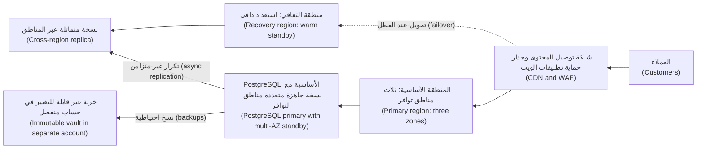
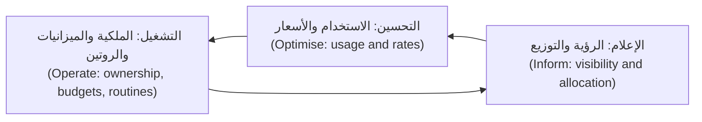
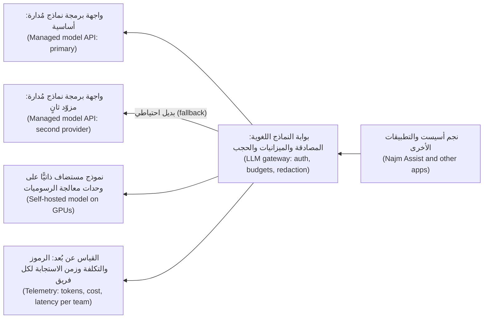

# الوحدة 6 — التوسّع والتكلفة والبنية التحتية للذكاء الاصطناعي

*إيصال خدمةٍ إلى الإنتاج هو نصف المهمة. أمّا النصف الآخر فهو إبقاؤها عاملةً حين تتضاعف حركة المرور ثلاث مرات، وحين تتعطّل منطقة توافر أو تُحذف قاعدة بيانات خطأً، مع إبقاء الفاتورة تحت السيطرة أثناء ذلك، وتشغيل أحدث أعباء العمل وأكثرها شراهةً على الإطلاق: النماذج اللغوية الكبيرة على وحدات معالجة الرسوميات (GPUs). تغطي هذه الوحدة القرارات الثلاثة التي تميّز مهندس المنصات (platform engineer) عن شخصٍ لا يستطيع سوى النشر. أولًا، التوسّع والمرونة: التوسّع التلقائي (autoscaling) على مستوى الحجيرة والعقدة، والتوزّع عبر مناطق التوافر، ونُسخٌ احتياطية استعدتها فعلًا، وأهداف التعافي من الكوارث، أي RTO وRPO، التي وقّع عليها قطاع الأعمال. ثانيًا، FinOps: رؤية أين يذهب المال، وإعطاء كل تكلفةٍ مالكًا، وخفض الهدر دون خفض الموثوقية. ثالثًا، البنية التحتية للذكاء الاصطناعي: وحدات معالجة الرسوميات، وتقديم النماذج، وبوابات النماذج اللغوية (LLM gateways)، والتكلفة لكل رمز. ستتابع فريق هندسة المنصات وهندسة موثوقية المواقع في بنك نجم (Najm Bank) بينما تدير مها أول اختبارٍ كامل للتعافي من الكوارث لخدمة المدفوعات (Payments service)، وتسأل منى من الإدارة المالية لماذا نمت فاتورة السحابة أسرع من قاعدة العملاء، ويتعيّن على سالم أن يقرّر كيف ينبغي لنجم أسيست (Najm Assist) أن يقدّم نماذجه دون أن يحرق ميزانية وحدات معالجة الرسوميات في شهرٍ واحد.*

> **المراحل:** Operate, Monitor — إبقاء الإنتاج عاملًا، وميسور التكلفة، وجاهزًا لأعباء عمل الذكاء الاصطناعي بعد أن يصبح حيًّا، وإثبات ذلك بالاختبارات والأرقام لا بالأمل.

---

# 6.1 — التوسّع والمرونة: التوسّع التلقائي وتعدّد المناطق والنسخ الاحتياطية والتعافي من الكوارث
*المستوى: 🔴 متقدم* · *المتطلبات: 2.3، 3.2، 5.2* · *المرحلة: Operate*

**بعد هذا الدرس تستطيع** إظهار HPA يتوسّع ثم يتقلّص تحت الحمل، وإبقاء خدمة متاحة أثناء إفراغ منطقة كاملة بقيود التوزيع وPDB، وقياس استعادة فعلية مقابل RTO وRPO اخترتهما. *مدة الدراسة: نحو 115 دقيقة (تقدير).*

## ⚡ الدرس في دقيقة
- **التوسّع** يتعامل مع حملٍ أكبر؛ و**المرونة** تصمد أمام الأعطال، عبر التكرار الاحتياطي والنسخ الاحتياطية وخطط التعافي.
- توسّع تلقائيًّا على طبقات: **المُوسِّع التلقائي الأفقي للحجيرات (Horizontal Pod Autoscaler)** يضيف حجيرات، و**المُوسِّع التلقائي للعقد** يضيف آلاتٍ لتلك الحجيرات، و**قاعدة البيانات** لا تتوسّع تلقائيًّا في العادة أصلًا، لذا تكون غالبًا هي الحدّ الحقيقي.
- وزّع كل خدمةٍ إنتاجية على **منطقتين أو ثلاث من مناطق التوافر** على الأقل، وافرض ذلك بقيود توزيع الطوبولوجيا وميزانيات تعطيل الحجيرات (PodDisruptionBudgets).
- أهداف التعافي قراراتٌ تجارية: **RTO** و**RPO**. دوّنها لكل خدمة، ثم اختر أرخص تصميمٍ يحقّقها.
- مؤشر القرار: النسخة الاحتياطية التي لم تستعدها أملٌ لا نسخة احتياطية. جدوِل اختبارات الاستعادة وقِس زمنها مقابل RTO.
- أكبر فخ: معاملة تعدّد المناطق (multi-zone) على أنه تعافٍ من الكوارث (disaster recovery). مناطق التوافر تصمد أمام تعطّل مركز بيانات، لا أمام نشرٍ سيئ أو جدولٍ محذوف أو برمجية فدية، لأن أضرارها تتكرّر في كل مكان خلال ثوانٍ.

## 🧭 لماذا يهم
في 31 يناير 2017، نفّذ مهندسٌ في GitLab كان يصلح مشكلة تكرار أمرَ حذف على ما ظنّ أنها قاعدة البيانات الثانوية. لكنها كانت الأساسية. وتصف مراجعة ما بعد الحادثة العلنية لدى GitLab كيف أن أيًّا من أساليب النسخ الاحتياطي والتكرار التي اعتمد عليها الفريق لم يعمل كما هو متوقّع؛ فتعافوا من نسخةٍ في بيئة التجهيز عمرها نحو ست ساعات، وفقدوا قرابة ست ساعات من بيانات الإنتاج. لم يكن أحدٌ قد استعاد نسخةً احتياطية من البداية إلى النهاية، لذا لم يكن أحدٌ يعلم أن النسخ الاحتياطية معطّلة.

انتقلت خدمة المدفوعات للتوّ إلى السحابة، ويسأل حمد (CISO) ووظيفة المخاطر سالمًا: «لو تعطّلت المنطقة الأساسية عصر اليوم، أو حذف أحدهم قاعدة بيانات المدفوعات، فكم سيمضي من الوقت قبل أن يتمكّن العملاء من إرسال الأموال مجددًا، وكم تحويلًا سنفقد». ويتوقّع قانون المرونة التشغيلية الرقمية في الاتحاد الأوروبي، المطبَّق على الكيانات المالية منذ 17 يناير 2025، أن يُظهر كيانُ البنك في الاتحاد الأوروبي ترتيباتٍ مختبَرة للنسخ الاحتياطي والاستعادة والاستمرارية، كما تضع الجهات التنظيمية الخليجية مثل مصرف قطر المركزي (Qatar Central Bank) توقّعاتها الخاصة للاستمرارية والإسناد الخارجي. و«نحن نستخدم تعدّد مناطق التوافر» ليست إجابة. يبني هذا الدرس إجابةً حقيقية: أهدافًا، وتصميمًا، والاختبار الذي يثبتها.

## 📐 كيف يعمل

### 🟢 الأساسيات

**التوسّع: الرأسي والأفقي.** *التوسّع الرأسي* يمنح الخادم مزيدًا من المعالج أو الذاكرة. وهو بسيط لكن له سقف ويعني عادةً إعادة تشغيل. أمّا *التوسّع الأفقي* فيضيف نسخًا أكثر من الخدمة خلف موازن أحمال. وسقفه أعلى بكثير، لكنه لا يعمل إلا إذا كانت الخدمة **عديمة الحالة (stateless)**: لا بيانات جلسات ولا ملفات مرفوعة ولا ذاكرات تخزين مؤقت (caches) محفوظة على القرص المحلي أو في الذاكرة تحتاجها نسخةٌ أخرى. فالحالة (State) تذهب إلى قاعدة بيانات أو خدمة تخزين مؤقت أو تخزين الكائنات (object storage). ولرؤية غير المبرمج، انظر [*تصميم الأنظمة لمبرمجي الحدس*، الدرس 10.1 — الخدمات عديمة الحالة وموازنة الأحمال](../vibe/index.ar.html#l10-1).

**يحدث التوسّع التلقائي في Kubernetes على طبقات.**

| الطبقة (Layer) | ما الذي يتوسّع | ما الذي يطلقه | انتبه إلى |
|---|---|---|---|
| **المُوسِّع التلقائي الأفقي للحجيرات (Horizontal Pod Autoscaler, HPA)** | عدد نسخ الحجيرات المتماثلة | استخدام المعالج أو الذاكرة مقابل الطلبات، أو مقاييس مخصّصة | يحتاج إلى طلبات موارد معقولة (2.3)؛ يستجيب خلال عشرات الثواني، لا فورًا |
| **المُوسِّع التلقائي للعقد** | عدد العقد العاملة | حجيراتٌ عالقة في `Pending` لأن أي عقدةٍ لا تتّسع لها | قد تستغرق العقدة الجديدة دقائق؛ احتفظ ببعض الهامش |
| **المُوسِّع التلقائي الرأسي للحجيرات (Vertical Pod Autoscaler, VPA)** | طلبات المعالج والذاكرة لكل حجيرة | الاستخدام المرصود عبر الزمن | لا تدع HPA وVPA يعملان على مقياس المعالج أو الذاكرة نفسه |
| **التوسّع المدفوع بالأحداث** (KEDA) | النسخ المتماثلة، نزولًا حتى الصفر | طول الطابور، وتأخّر التدفّق، والجداول الزمنية | التوسّع إلى الصفر (Scale-to-zero) يعني بدءًا باردًا |

مُوسِّعٌ تلقائي أفقي أساسي لواجهة برمجة تطبيق نجم للهاتف (Najm Mobile API):

```yaml
apiVersion: autoscaling/v2
kind: HorizontalPodAutoscaler
metadata:
  name: mobile-api
  namespace: mobile
spec:
  scaleTargetRef:
    apiVersion: apps/v1
    kind: Deployment
    name: mobile-api
  minReplicas: 6          # two per zone, never fewer
  maxReplicas: 30         # a ceiling the database can survive
  metrics:
    - type: Resource
      resource:
        name: cpu
        target:
          type: Utilization
          averageUtilization: 65   # percent of the CPU *request*
  behavior:
    scaleDown:
      stabilizationWindowSeconds: 300   # the default, made explicit: no flapping
```

رقمان هنا يعتمدان على الحكم التقديري لا على القيم الافتراضية. فالقيمة `minReplicas: 6` تُبقي حجيرتين في كل منطقة توافر حتى في الليل. والقيمة `maxReplicas: 30` تحمي قاعدة البيانات: كل حجيرةٍ تفتح اتصالات، والمُوسِّع التلقائي غير المحدود قد يحوّل ذروة حركة مرور إلى انقطاعٍ في قاعدة البيانات.

**مناطق التوافر (Availability zones).** *منطقة التوافر* هي مركز بياناتٍ واحد أو أكثر داخل منطقة، لها كهرباء وتبريد وشبكات منفصلة (1.2). شغّل الإنتاج في منطقتين على الأقل، ويُفضَّل ثلاث، خلف موازن أحمال إقليمي. وتقدّم قواعد البيانات المُدارة خيار *تعدّد مناطق التوافر (multi-AZ)*: نسخةً احتياطية جاهزة في منطقةٍ أخرى تتولّى العمل تلقائيًّا.

**أهداف التعافي.**
- **RTO (هدف زمن التعافي):** أطول مدةٍ يُسمح فيها بأن تكون الخدمة غير متاحة بعد كارثة قبل أن يصبح الضرر غير مقبول.
- **RPO (هدف نقطة التعافي):** أقصى قدرٍ من البيانات، مقيسًا بالزمن، يُسمح لك بفقدانه. فـRPO مقداره 5 دقائق يعني أنه بعد التعافي قد تفتقد ما يصل إلى آخر 5 دقائق من عمليات الكتابة.

يحدّدها مالك العمل مع فريق المخاطر، لأن الأهداف الأشدّ تكلّف أكثر؛ ويسعّر فريق المنصة كل خيار ويثبت النتيجة.

**النسخ الاحتياطية.** من خطوط الأساس المفيدة **قاعدة 3-2-1**: ثلاث نسخ، على نوعين من التخزين، إحداها خارج الموقع. وأضِف قاعدتين: نسخةٌ واحدة على الأقل **غير قابلة للتغيير (immutable)** (مقفلة ضد التغيير أو الحذف حتى تنتهي مدة الاحتفاظ، مثلًا بقفل الكائنات)، كي لا يستطيع نصٌّ برمجي سيئ أو مهاجمٌ يملك صلاحيات المدير محوها، و**كل نسخةٍ احتياطية تُختبر استعادتها** وفق جدول. انظر أيضًا [*تصميم الأنظمة لمبرمجي الحدس*، الدرس 2.3 — النسخ الاحتياطية: ماذا، لا هل فقط](../vibe/index.ar.html#l2-3).

### 🟡 التعمق أكثر

**جعل Kubernetes يتوزّع عبر مناطق التوافر.** تشغيل العقد في ثلاث مناطق لا يضمن أن تستقر حجيراتك في ثلاث مناطق؛ فقد يكدّسها المُجدوِل في منطقةٍ واحدة. اطلب التوزيع صراحةً، واحمِ النسخ المتماثلة أثناء الصيانة:

```yaml
# In the Deployment's pod template
topologySpreadConstraints:
  - maxSkew: 1
    topologyKey: topology.kubernetes.io/zone
    whenUnsatisfiable: DoNotSchedule
    labelSelector:
      matchLabels: { app: mobile-api }
---
apiVersion: policy/v1
kind: PodDisruptionBudget
metadata:
  name: mobile-api
  namespace: mobile
spec:
  minAvailable: 4         # node drains may never take us below 4 pods
  selector:
    matchLabels: { app: mobile-api }
```

**ميزانية تعطيل الحجيرات (PodDisruptionBudget, PDB)** تحدّ من التعطيلات *الطوعية* مثل ترقيات العقد وتفريغها. لكنها لا تمنع تعطّل منطقة توافر، ولهذا تحتاج أيضًا إلى سعةٍ احتياطية: إذا كنت تحتاج إلى 4 حجيرات لخدمة حمل الذروة، فشغّل 6 على الأقل عبر ثلاث مناطق، بحيث يبقى 4 حتى عند فقدان منطقةٍ واحدة.

**التوسّع ينقل عنق الزجاجة.** حين تتوسّع واجهة الهاتف من 6 إلى 30 حجيرة، تنفد اتصالات قاعدة البيانات أولًا في العادة، ثم معالج قاعدة البيانات، ثم يبدأ الرابط مع الأنظمة المصرفية الأساسية بتجاوز المهلة. خطّط لذلك بمجمِّع اتصالات مثل PgBouncer، وبمهلٍ زمنية وقواطع دوائر على الاستدعاءات إلى النظام الأساسي، وبالتخلّص من الحمل (استجابة 503 سريعة مع `Retry-After` للطلبات منخفضة الأولوية). واختبر الحمل لتجد أول عنق زجاجة قبل أن يجده العملاء.

**استراتيجيات التعافي من الكوارث.** السلّم الشائع، المسمّى في الورقة البيضاء للتعافي من الكوارث لدى AWS والمستخدم لدى مختلف المزوّدين، يوازن بين التكلفة والسرعة:

| الاستراتيجية | ما الذي يعمل في منطقة التعافي | RTO / RPO النموذجيان | التكلفة النسبية |
|---|---|---|---|
| **النسخ الاحتياطي والاستعادة** | لا شيء؛ تُنسخ النسخ الاحتياطية إلى هناك | ساعات / ساعات (Hours / hours) | الأدنى |
| **الشعلة التجريبية (Pilot light)** | البيانات مكرّرة؛ البنية التحتية الأساسية معرَّفة لكن مقلَّصة إلى الصفر أو الحدّ الأدنى | من عشرات الدقائق إلى ساعات / دقائق | منخفضة |
| **الاستعداد الدافئ** | نسخةٌ عاملة أصغر من المنظومة كلها | دقائق / من ثوانٍ إلى دقائق | متوسطة |
| **تعدّد المواقع نشط-نشط** | سعةٌ كاملة تخدم حركة المرور في المنطقتين كلتيهما | قرابة الصفر / قرابة الصفر، إذا سمح تصميم البيانات بذلك | الأعلى، والأصعب بناءً |

أرقام RTO وRPO هذه تقريبية؛ فلا يُعتدّ إلا بنتيجتك المقيسة. والبنية التحتية بوصفها شيفرة (infrastructure as code) (الوحدة 3) تجعل الشعلة التجريبية والاستعداد الدافئ في المتناول: فمنطقة التعافي لا تبعد سوى `tofu apply` ومزامنة GitOps، لا نسخةً مبنية يدويًّا تنحرف.



**لماذا يصعب النشط-النشط.** بالنسبة إلى الخدمات عديمة الحالة، الأمر في معظمه توجيه. أمّا البيانات، فمنطقتان تقبلان الكتابة على الرصيد نفسه قد تتعارضان، والتكرار المتزامن عبر المناطق يضيف زمن الذهاب والإياب بين المناطق إلى كل عملية كتابة. والنمط الشائع هو تشغيل الحافة عديمة الحالة بنمط نشط-نشط ونظام السجل بنمط نشط-خامل. وفي خدمة المدفوعات، تحمل كل عملية دفع **مفتاح عدم التكرار (idempotency key)**، بحيث يجد الطلبُ المعادُ بعد التحويل عند العطل السجلَّ الموجود بدلًا من إنشاء تحويلٍ ثانٍ.

**التكرار غير المتزامن يحدّد RPO لديك.** النسخة المتماثلة عبر المناطق تتأخّر عادةً عن الأساسية بثوانٍ أو أكثر، وذلك التأخّر *هو* RPO لديك في كارثةٍ إقليمية. راقبه (5.1) ونبّه حين يتجاوز RPO.

### 🔴 نظرة الخبير

**افصل أنماط العطل.** الكوارث المختلفة تحتاج إلى دفاعاتٍ مختلفة:

| العطل | هل يساعد تعدّد مناطق التوافر؟ | هل تساعد النسخة المتماثلة عبر المناطق؟ | هل تساعد النسخة الاحتياطية لنقطة زمنية؟ |
|---|---|---|---|
| منطقة توافر واحدة تفقد الكهرباء | نعم | نعم | ببطء |
| المنطقة كلها متدهورة | لا | نعم | نعم، ببطء |
| ترحيلٌ سيئ يُفسد البيانات | لا، فالفساد يتكرّر | لا، فالفساد يتكرّر | نعم: استعِد إلى ما قبله مباشرةً |
| برمجية فدية أو مديرٌ مارق يحذف البيانات | لا | لا | فقط إذا كانت النسخة الاحتياطية غير قابلة للتغيير وفي حسابٍ منفصل |

الصفّان الأخيران هما سبب أن التكرار ليس نسخًا احتياطيًّا. و**الاستعادة إلى نقطة زمنية (Point-in-time recovery, PITR)**، التي تقدّمها خدمات PostgreSQL المُدارة بالاحتفاظ بنسخٍ احتياطية أساسية إضافةً إلى سجل الكتابة المسبقة، تتيح لك الاستعادة إلى ثانيةٍ تختارها قبل التغيير السيئ. اعرف نافذة الاحتفاظ لديك وكم تستغرق فعلًا استعادةُ بياناتٍ بحجم بياناتك.

**الثبات الساكن ومسار التعافي.** النظام *الثابت سكونيًّا* يواصل العمل دون حاجةٍ إلى التغيير أثناء العطل، مثلًا لأن السعة مُجهَّزة مسبقًا في كل منطقة توافر بدلًا من إطلاقها في منتصف الانقطاع. وتحقّق أيضًا من أن مسار التعافي لا يعتمد على ما تعطّل. ففي انقطاع Facebook في أكتوبر 2021، فصل تغييرٌ في الشبكة الأساسية مراكز البيانات، وسحبت خوادم DNS مسارات BGP الخاصة بها؛ وتشير تدوينة Facebook الهندسية إلى أن الأدوات الداخلية اللازمة للإصلاح تأثّرت هي أيضًا. اسأل: إذا زالت منطقتنا الأساسية، فهل تبقى أدلة التشغيل (runbooks)، ومستودع GitOps، ومشغّلات CI، والأسرار، وحسابات كسر الزجاج في المتناول؟

**هندسة الفوضى وأيام اللعب.** تُجري هندسة الفوضى (Chaos engineering) تجارب مضبوطة تحقن الأعطال للتحقّق من أن النظام يتصرّف كما هو متوقّع. ابدأ صغيرًا وفي غير الإنتاج؛ وصُغ فرضية؛ وقيّد نطاق الأثر؛ واحتفظ بمفتاح إيقاف. و**يوم اللعب (game day)** تمرينٌ مُجدوَل لسيناريو كامل، مثل التحويل الإقليمي عند العطل، مع فريق المناوبة، ومها قائدةً للحادثة (incident commander)، ومراقبين يقيسون زمن كل خطوة. ويتوقّع قانون DORA الأوروبي اختبار المرونة؛ وأيام اللعب تُنتج الأدلة.

## 🧰 الأدوات
| الأداة أو الممارسة أو الخدمة | ما هي وماذا تفعل | متى تلجأ إليها |
|---|---|---|
| **Horizontal Pod Autoscaler** (Kubernetes) — المُوسِّع التلقائي الأفقي للحجيرات | يغيّر عدد النسخ المتماثلة لعبء عمل بناءً على المعالج أو الذاكرة أو مقاييس مخصّصة | الخدمات عديمة الحالة ذات الحمل المتغيّر، مع حدٍّ أدنى وأقصى مختارين |
| **Cluster Autoscaler** / **Karpenter** | يضيفان العقد ويزيلانها حين يتعذّر جدولة الحجيرات أو تكون العقد خاملة | أي عنقودٍ يتغيّر حمله؛ اقرنهما بـHPA |
| **KEDA** (CNCF) | توسّعٌ تلقائي مدفوع بالأحداث من الطوابير والتدفّقات والجداول الزمنية، بما في ذلك إلى الصفر | العمّال الذين يفرّغون الطوابير؛ المهام الدُّفعية؛ التوسّع إلى الصفر للخدمات الخاملة |
| **PodDisruptionBudget** — ميزانية تعطيل الحجيرات | تحدّد سقفًا لعدد النسخ المتماثلة التي يجوز للتعطيلات الطوعية إزالتها دفعةً واحدة | كل نشرٍ إنتاجي فيه أكثر من نسخةٍ متماثلة واحدة |
| **Point-in-time recovery** — الاستعادة إلى نقطة زمنية | استعادة قاعدة بيانات إلى لحظةٍ مختارة باستخدام النسخ الاحتياطية الأساسية والسجلات | التعافي من الترحيلات السيئة والحذف العرَضي |
| **Immutable backup vault** — خزنة نسخ احتياطية غير قابلة للتغيير | نسخٌ احتياطية مقفلة ضد التغيير أو الحذف حتى تنتهي مدة الاحتفاظ، في حسابٍ منفصل | الدفاع ضد برمجيات الفدية وبيانات اعتماد المدير المخترقة |
| **Game day** — يوم اللعب | تمرينٌ مُتدرَّب عليه ومُوقَّت لسيناريو عطل مع فريق المناوبة الحقيقي | إثبات RTO وRPO قبل أن يطلب ذلك مدقّقٌ أو كارثة |

## 🏛️ عمليًا في بنك نجم
يُعدّ فريق مها **خطة اختبار للتعافي من الكوارث** لخدمة المدفوعات. وتعيش في مستودع المنصة بجوار دليل التشغيل الذي تختبره.

| الحقل | خدمة المدفوعات |
|---|---|
| المالك وصاحب القرار | مالك الخدمة: قائد هندسة المدفوعات. من يعلن الكارثة: قائد الحادثة مع سالم |
| الأهداف المتّفق عليها | RTO وRPO كما وقّع عليهما مالك العمل وفريق المخاطر |
| التصميم | ثلاث مناطق توافر في المنطقة الأساسية؛ PostgreSQL مُدارة متعدّدة مناطق التوافر؛ نسخة متماثلة غير متزامنة عبر المناطق؛ منظومة استعداد دافئ في منطقة التعافي من وحدات OpenTofu ومستودع GitOps نفسيهما |
| النسخ الاحتياطية | لقطاتٌ يومية إضافةً إلى PITR؛ نسخٌ في حساب نسخ احتياطي ومنطقة منفصلين مع قفل الخزنة؛ الاحتفاظ وفق سياسة السجلات |
| السيناريوهات المختبَرة هذا الربع | 1. تفريغ منطقة توافر في الإنتاج خلال حركة مرور منخفضة. 2. استعادة PITR لقاعدة بيانات المدفوعات إلى نسخةٍ مؤقتة. 3. تحويلٌ إقليمي كامل عند العطل في بيئة التجهيز |
| الخطوات والتوقيتات | الكشف، والإعلان، وترقية النسخة المتماثلة، وتحويل حركة المرور، وتوسيع الاستعداد، واختبار الدخان (smoke-test)، وإعادة الفتح؛ مع قياس زمن كل خطوة |
| معايير النجاح | RTO وRPO المقيسان ضمن الأهداف؛ صفر تحويلاتٍ مؤكَّدة مكرّرة أو مفقودة |
| الأدلة | الخط الزمني، ولوحات المتابعة، وتقرير المطابقة؛ تُحفظ في سجل اختبار المرونة |
| المتابعات | كل ثغرةٍ تصبح تذكرة لها مالكٌ وتاريخ؛ والاختبار التالي يعيد فحصها |

وجد التشغيل الأول ثلاث ثغرات لم تكتشفها أي مراجعة تصميم: تنبيه تأخّر النسخة المتماثلة كان يذهب إلى لوحة متابعة لا يراقبها أحد، وسجل DNS للمدفوعات كانت له مدة صلاحية (TTL) أطول بكثير مما يسمح به RTO، ودور كسر الزجاج لحساب التعافي كان يحتاج إلى جهاز مصادقة متعدّدة العوامل جديد.

## 🛠️ التمارين
- 🟢 **شاهد مُوسِّعًا تلقائيًّا وهو يعمل.** على عنقودٍ محلي من kind أو k3d مع خادم المقاييس، انشر حاوية ويب صغيرة لها طلبات معالج ومُوسِّعًا تلقائيًّا أفقيًّا (HPA) (الحدّ الأدنى 2؛ الحدّ الأقصى 8؛ الهدف 50% من المعالج). وولّد حملًا من حجيرةٍ أخرى وراقب `kubectl get hpa -w`. *يكتمل عندما:* تكون لديك لقطة شاشة أو سجل يُظهر النسخ المتماثلة ترتفع تحت الحمل وتنخفض بعد نافذة الاستقرار، وجملةٌ واحدة تشرح لماذا كان التقليص أبطأ من التوسيع.
- 🟡 **توزّع عبر مناطق التوافر واصمد أمام التفريغ.** أنشئ عنقود kind فيه أربع عقد عاملة ووسِمها بقيم `topology.kubernetes.io/zone` هي `a` و`b` و`c`. انشر ست نسخ متماثلة مع قيد توزيع الطوبولوجيا وميزانية تعطيل (PDB) قيمتها `minAvailable: 4`. فرّغ كل عقدةٍ في منطقة توافر واحدة باستخدام `kubectl drain`. وتوقّع أن تبقى الحجيرات المُخلاة في حالة `Pending`: فالمنطقة المفرَّغة ما زالت تُحتسب في قيد التوزيع. *يكتمل عندما:* تكون الحجيرات قد توزّعت حجيرتين في كل منطقة، واحترم التفريغ ميزانية التعطيل، وظلّت الخدمة تجيب طوال الوقت، وتستطيع تفسير الحجيرات العالقة في `Pending`.
- 🔴 **اكتب اختبار استعادة ونفّذه.** شغّل PostgreSQL في Docker مع أرشفة سجل الكتابة المسبقة أو نسخٍ احتياطية منتظمة باستخدام `pg_dump`. أدخِل صفوفًا مختومة بالوقت، ثم احذف جدولًا «عن طريق الخطأ»، ثم استعِد إلى حاويةٍ ثانية. اكتب خطة اختبار تعافٍ من الكوارث من صفحةٍ واحدة بالصيغة أعلاه، مع RTO وRPO تختارهما. *يكتمل عندما:* تكون قد قست زمن الاستعادة الفعلي وفقدان البيانات، وقارنتهما بأهدافك، وأدرجت تغييرين على الأقل من شأنهما سدّ أي ثغرة.

## ⚠️ أخطاء وفخاخ
- **تسمية التكرار نسخًا احتياطيًّا.** النسخ المتماثلة تنسخ عمليات الحذف والفساد فورًا. احتفظ أيضًا بنسخٍ احتياطية لنقطة زمنية وغير قابلة للتغيير في حسابٍ منفصل.
- **عدم الاستعادة أبدًا.** النسخ الاحتياطية غير المختبَرة تخذلك حين تحتاج إليها، كما تعلّمت GitLab. جدوِل اختبارات الاستعادة وقِس زمنها.
- **التوسّع التلقائي غير المحدود.** مُوسِّعٌ تلقائي أفقي بقيمة `maxReplicas` ضخمة قد يستنفد اتصالات قاعدة البيانات أو حصّةً لدى خدمةٍ تابعة. اضبط السقف بحسب ما تحتمله التبعيات.
- **مسار تعافٍ يعتمد على المنطقة المتعطّلة.** أبقِ أدلة التشغيل، والبنية التحتية بوصفها شيفرة (IaC)، وCI، والأسرار (secrets)، ووصول كسر الزجاج (break-glass access) في المتناول من خارجها.
- **أهدافٌ لم يوقّع عليها أحد.** RTO اختاره فريق المنصة وحده سيُطعن فيه بعد الحادثة. احصل على توقيع مالك العمل وفريق المخاطر عليها.

## 🧾 الخلاصة
- التوسّع يضيف سعة؛ والمرونة تصمد أمام الأعطال. وسّع الحجيرات والعقد تلقائيًّا على طبقات، مع حدودٍ دنيا وسقوفٍ مختارة عن قصد.
- شغّل الإنتاج عبر منطقتين أو ثلاث من مناطق التوافر، مفروضًا بقيود التوزيع (spread constraints) وميزانيات التعطيل (PDBs) والسعة الاحتياطية.
- RTO وRPO قراران تجاريان؛ واستراتيجية التعافي من الكوارث هي أرخص تصميمٍ يحقّقهما.
- مناطق التوافر والنسخ المتماثلة لا تحمي من التغييرات السيئة أو الحذف؛ بل تحمي منها النسخ الاحتياطية لنقطة زمنية وغير القابلة للتغيير وفي حسابٍ منفصل.
- لا يُعتدّ إلا بالتعافي المختبَر: تمارين الاستعادة، وأيام اللعب (game days)، والتحويلات عند العطل المُوقَّتة تُنتج الأدلة التي تحتاجها الجهات التنظيمية والتنفيذيون.

## ✍️ اختبر نفسك

**1. تعمل واجهة برمجة تطبيق نجم للهاتف بست حجيرات عبر ثلاث مناطق توافر، وتحتاج إلى 4 للتعامل مع حمل الذروة. أيّ تغييرٍ يضمن على أفضل وجه أن فقدان منطقة واحدة لا يُثقل الخدمة؟**

- A. رفع قيمة `maxReplicas` في المُوسِّع التلقائي الأفقي إلى 100 كي تحلّ حجيراتٌ جديدة محلّ المفقودة
- B. الإبقاء على 6 حجيرات مع قيد توزيعٍ على مناطق التوافر، حجيرتين في كل منطقة
- C. إضافة ميزانية تعطيل حجيرات بقيمة `minAvailable: 6` على النشر
- D. نقل كل الحجيرات إلى أكبر منطقة توافر لتقليل حركة المرور بين المناطق

<details><summary>الإجابة</summary>

**B.** حجيرتان في كل منطقة تعني أن تعطّل منطقة لا يزيل إلا اثنتين، فتبقى الأربع المطلوبة. ولا يساعد A إلا بعد وصول حجيرات وعقد جديدة؛ وC يغطي التعطيلات الطوعية لا تعطّل المناطق، وسيمنع التفريغ؛ وD يُنشئ نقطة عطلٍ وحيدة. (🟡 التعمق أكثر.)

</details>

**2. يُجري مطوّرٌ ترحيلًا يُفسد جدول `transfers` بصمت. قاعدة البيانات متعدّدة مناطق التوافر ولها نسخة متماثلة عبر المناطق. ما الذي يستعيد البيانات؟**

- A. التحويل عند العطل إلى النسخة الجاهزة متعددة مناطق التوافر في منطقةٍ أخرى
- B. ترقية النسخة المتماثلة عبر المناطق في منطقة التعافي
- C. إعادة تشغيل قاعدة البيانات
- D. استعادةٌ إلى نقطة زمنية إلى ما قبل الترحيل مباشرةً

<details><summary>الإجابة</summary>

**D.** يصل الفساد إلى النسخة الجاهزة والنسخة المتماثلة خلال ثوانٍ، لذا يعطيك A وB البيانات السيئة نفسها. ولا يعود إلى ما قبل التغيير إلا نسخةٌ احتياطية لنقطة زمنية. (🔴 نظرة الخبير، جدول أنماط العطل.)

</details>

**3. من الذي ينبغي أن يحدّد RPO لخدمة المدفوعات؟**

- A. مالك العمل مع فريق المخاطر، بعد أن يحسب فريق المنصة تكلفة الخيارات
- B. فريق المنصة وحده، لأنه يبني البنية التحتية ويشغّلها
- C. مزوّد السحابة، عبر اتفاقية مستوى الخدمة في شروط خدمته
- D. لا أحد، لأن RPO يساوي صفرًا دائمًا لنظام مدفوعات

<details><summary>الإجابة</summary>

**A.** يعبّر RPO عن مقدار الخسارة الذي يقبله قطاع الأعمال، والأهداف الأشدّ تكلّف أكثر. وB يُنشئ أهدافًا لن يدافع عنها أحد لاحقًا؛ واتفاقية مستوى الخدمة لدى المزوّد تغطي خدمته لا تعافيك؛ وD أمنيةٌ لا تصميم. (🟢 الأساسيات.)

</details>

**4. يُظهر اختبار التعافي من الكوارث الذي أجرته مها أن النسخة المتماثلة عبر المناطق تتأخّر عادةً بضع ثوانٍ، لكنها بلغت مرةً 40 دقيقة أثناء مهمةٍ دُفعية. وRPO المتّفق عليه هو 5 دقائق. ما القراءة الصحيحة؟**

- A. RPO متحقّق، لأن التأخّر المعتاد ثوانٍ قليلة فقط
- B. RPO لا ينطبق إلا على تعطّل مناطق التوافر، لا على الأعطال الإقليمية
- C. كان RPO الحقيقي حينها 40 دقيقة؛ نبّه على التأخّر وأصلح السبب
- D. انتقل الآن إلى التكرار المتزامن عبر المناطق، دون قياس زمن الاستجابة

<details><summary>الإجابة</summary>

**C.** مع التكرار غير المتزامن، التأخّر لحظة الكارثة هو البيانات التي تفقدها. وA يتجاهل أسوأ الحالات؛ وB خاطئ؛ وD يضيف زمن الذهاب والإياب بين المناطق إلى كل عملية كتابة ويحتاج إلى تحليلٍ أولًا. (🟡 التعمق أكثر.)

</details>

**5. أيّ عبارةٍ عن هندسة الفوضى هي الأدق؟**

- A. تعني كسر الإنتاج عشوائيًّا، بأكبر قدرٍ ممكن من التكرار
- B. اختبارٌ مضبوط لفرضيةٍ مُعلَنة، مع مفتاح إيقاف
- C. حين تُجرى بانتظام، تحلّ محلّ استعادة النسخ الاحتياطية واختبارات التعافي من الكوارث
- D. لا تفيد إلا الشركات التي تشغّل آلاف الخدمات

<details><summary>الإجابة</summary>

**B.** تختبر هندسة الفوضى تنبؤًا مُعلَنًا تحت السيطرة. وA تهوّر؛ وC خاطئ، لأنها تكمّل تمارين الاستعادة؛ وحتى تفريغٌ صغير لمنطقة توافر يعلّم الكثير، لذا D خاطئ. (🔴 نظرة الخبير.)

</details>

## 📚 المراجع
- Kubernetes: التوسّع التلقائي الأفقي للحجيرات — https://kubernetes.io/docs/tasks/run-application/horizontal-pod-autoscale/
- Kubernetes: قيود توزيع طوبولوجيا الحجيرات — https://kubernetes.io/docs/concepts/scheduling-eviction/topology-spread-constraints/
- Kubernetes: تحديد ميزانية تعطيل — https://kubernetes.io/docs/tasks/run-application/configure-pdb/
- توثيق KEDA — https://keda.sh/docs/
- توثيق Karpenter — https://karpenter.sh/docs/
- الورقة البيضاء من AWS: التعافي من الكوارث لأعباء العمل على AWS — https://docs.aws.amazon.com/whitepapers/latest/disaster-recovery-workloads-on-aws/disaster-recovery-workloads-on-aws.html
- إطار Azure المُحكَم البنيان، الموثوقية — https://learn.microsoft.com/azure/well-architected/
- إطار بنية Google Cloud — https://cloud.google.com/architecture/framework
- GitLab: مراجعة ما بعد حادثة انقطاع قاعدة البيانات في 31 يناير (2017) — https://about.gitlab.com/blog/
- كتب Google في هندسة موثوقية المواقع — https://sre.google/books/
- اللائحة (EU) 2022/2554 بشأن المرونة التشغيلية الرقمية (Regulation 2022/2554 on digital operational resilience, DORA) — https://eur-lex.europa.eu/eli/reg/2022/2554/oj
- تعمّق أكثر في ضوابط أمن السحابة: [*أمن الذكاء الاصطناعي وأمن التطبيقات*، الدرس 7.1 — أمن السحابة: المسؤولية المشتركة وإدارة الهوية والوصول وسوء الإعداد](../secai/index.ar.html#/7.1)

---

# 6.2 — FinOps: فهم تكلفة السحابة وتوزيعها وخفضها
*المستوى: 🔴 متقدم* · *المتطلبات: 1.2، 3.1، 6.1* · *المرحلة: Operate, Monitor*

**بعد هذا الدرس تستطيع** كتابة سياسة وسوم مع فحص بالسياسة بوصفها شيفرة يفشل عند غياب الوسوم، وإعداد جدول تكلفة لكل نطاق أسماء في عنقود مشترك، وحساب تكلفة كل 1,000 طلب في ثلاثة سيناريوهات. *مدة الدراسة: نحو 115 دقيقة (تقدير).*

## ⚡ الدرس في دقيقة
- **FinOps** هي ممارسة جعل الهندسة والمالية وقطاع الأعمال يتقاسمون المسؤولية عن الإنفاق السحابي، بحيث تصبح التكلفة إشارةً هندسية مثل زمن الاستجابة، لا مفاجأةً في نهاية الشهر.
- يعمل إطار مؤسسة FinOps في حلقةٍ من ثلاث مراحل: **الإعلام**، و**التحسين**، و**التشغيل**.
- لا يمكنك خفض ما لا تستطيع نسبته. ابدأ بـ**الوسم والتوزيع**: لكل موردٍ مالكٌ وخدمةٌ وبيئة.
- اخفض الاستخدام قبل شراء الخصومات: احذف الموارد الخاملة، وعدّل الأحجام لتناسب الحاجة، ووسّع تلقائيًّا (autoscale)، وجدوِل البيئات غير الإنتاجية، ثم التزم بـ**السعة المحجوزة أو خطط التوفير** للقاعدة الثابتة، واستخدم سعة **السوق الفورية (spot)** فقط للعمل الذي يحتمل المقاطعة.
- مؤشر القرار: احكم على التكلفة لكل وحدةٍ من القيمة التجارية، لا على إجمالي الفاتورة وحده.
- أكبر فخ: خفض التكاليف الذي يزيل المرونة بهدوء، مثل التخلّي عن منطقة التوافر الثانية أو عن نسخ النسخ الاحتياطية التي بُنيت في 6.1 لتوفير المال.

## 🧭 لماذا يهم
بعد ستة أشهر من انتقال الخدمات الأولى إلى السحابة، تُحضر منى، محلّلة FinOps في الإدارة المالية، رسمًا بيانيًّا إلى سالم. لقد نمت فاتورة السحابة الشهرية لنجم أسرع بكثير من عدد عملاء الهاتف النشطين. وأسئلتها منصفة: «على ماذا ندفع؟ من يملكه؟ هل هذا النمو نموٌّ جيد؟» لا يستطيع سالم الإجابة من وحدة التحكم. فحصّةٌ كبيرة من الإنفاق غير موسومة. وهناك بندٌ اسمه «نقل البيانات» لم يضع له أحدٌ ميزانية. وثلاث عقد بوحدات معالجة رسوميات أُنشئت لتجربةٍ في نجم أسيست تعمل كل ساعةٍ من كل يوم منذ هاكاثون. وعناقيد التطوير تعمل بكامل حجمها طوال عطلة نهاية الأسبوع.

لا تستطيع الإدارة المالية إصلاح هذا وحدها. ففي السحابة، كل مهندسٍ يدمج تغييرًا في OpenTofu أو يرفع سقف مُوسِّعٍ تلقائي أفقي يتّخذ قرار إنفاق، وغالبًا دون أن يرى السعر. لقد انتهى نموذج مركز البيانات القديم، حيث كانت المشتريات توافق على العتاد قبل أشهر. وFinOps تعيد إشارة التكلفة إلى حيث تُتّخذ القرارات: في طلب الدمج، ولوحة المتابعة، وقائمة المهام المتراكمة لدى الفريق نفسه. يمنحك هذا الدرس لغة منى، وآليات التوزيع، وترتيبًا لخفض التكلفة دون الإضرار بالموثوقية. ولمعالجةٍ أخفّ موجّهة إلى الفرق الصغيرة، انظر [*تصميم الأنظمة لمبرمجي الحدس*، الدرس 11.4 — هندسة التكلفة](../vibe/index.ar.html#l11-4).

## 📐 كيف يعمل

### 🟢 الأساسيات

**إطار مؤسسة FinOps.** تنشر مؤسسة FinOps، وهي جزءٌ من مؤسسة Linux، إطار FinOps. وفي وقت كتابة هذا النص (2026)، يصف الإطار مبادئ، وشخصيات، وقدرات، ودورةً من ثلاث مراحل. ومن المبادئ أن الفرق بحاجةٍ إلى التعاون، وأن القيمة التجارية تقود القرارات التقنية، وأن الجميع يتحمّل ملكية استخدامه للسحابة، وأن بيانات التكلفة ينبغي أن تكون متاحةً وفي وقتها، وأن FinOps يُمكّنها فريقٌ مركزي، وأن على الفرق الاستفادة من نموذج التكلفة المتغيّرة في السحابة. تحقّق من موقع finops.org للصياغة الحالية.



**كيف يعمل تسعير السحابة، من حيث المفاهيم.** لا تذكر سعرًا من الذاكرة أبدًا؛ فالأسعار تختلف بحسب المنطقة وتتغيّر. أمّا الشكل فثابت:
- **الحوسبة** تُحتسب بالزمن وبالحجم. والمثيل الكبير الخامل يكلّف ما يكلّفه المثيل المشغول.
- **التخزين** يُحتسب بالكمية المخزّنة شهريًّا، مع فئات: التخزين الكثير الوصول يكلّف أكثر لكل غيغابايت من فئات الأرشفة، التي تفرض رسومًا أعلى على القراءة منها.
- **الطلبات والعمليات**: كثيرٌ من الخدمات المُدارة (managed services) تفرض رسومًا لكل استدعاء واجهة برمجة، أو لكل مليون طلب، أو لكل قراءة وكتابة.
- **نقل البيانات إلى الخارج (Data transfer (egress))**: نقل البيانات *إلى خارج* المزوّد نحو الإنترنت يكلّف مالًا في العادة، وكذلك حركة المرور بين المناطق، ولدى بعض المزوّدين، بين مناطق التوافر. وكثيرًا ما تفرض بوابات NAT المُدارة رسومًا لكل غيغابايت تتمّ معالجته. تحقّق من صفحات التسعير الحالية لدى مزوّدك، لأن الخروج كثيرًا ما يفاجئ الفرق.
- **علاوات الخدمات المُدارة**: قاعدة البيانات المُدارة تكلّف أكثر من الآلة الافتراضية التي تحتها، وتشتري لك التحديثات الأمنية والنسخ الاحتياطية والتحويل عند العطل. وهذه عادةً مقايضةٌ جيدة؛ فقط اعرف أنك تجريها.

**التوزيع: الوسوم والتسميات.** يتيح لك كل مزوّد إرفاق بياناتٍ وصفية على شكل مفتاح وقيمة بالموارد: *الوسوم (tags)* في AWS وAzure، و*التسميات (labels)* في Google Cloud. وتحدّد سياسة توزيع التكلفة مجموعةً صغيرة إلزامية:

| المفتاح | قيمة مثال | لماذا |
|---|---|---|
| `owner` | `team-payments` | شخصٌ تسأله، وشخصٌ يرى الفاتورة |
| `service` | `payments-api` | التكلفة لكل خدمة ولكل وحدة |
| `environment` | `prod`، `staging`، `dev` | هدر البيئات غير الإنتاجية هو عادةً الهدف الأول |
| `cost-centre` | رمز مالي | الاسترداد المالي أو العرض المالي لقطاع الأعمال |
| `data-classification` | `confidential` | مشترك مع الأمن؛ ليس مفتاح تكلفة لكنه يُفرض بالطريقة نفسها |

يجب عادةً تفعيل الوسوم لتقارير الفوترة، وهي في الغالب لا تسري إلا من لحظة ضبطها، لذا ابدأ مبكرًا. افرضها في البنية التحتية بوصفها شيفرة (3.1) وبالسياسة بوصفها شيفرة (policy as code) (3.3): الخطة التي تُنشئ موردًا غير موسوم تفشل في الفحص.

**العرض المالي والاسترداد المالي.** *العرض المالي* يُري كل فريقٍ ما أنفقه؛ أمّا *الاسترداد المالي (chargeback)* فينقل التكلفة فعلًا إلى ميزانية الفريق. ابدأ بالعرض المالي: فالهدف الأول هو الوعي، لا المحاسبة.

### 🟡 التعمق أكثر

**التكاليف المشتركة وKubernetes.** تعمل الوسوم جيدًا لقاعدة بياناتٍ يملكها فريقٌ واحد. لكنها تفشل في عنقود Kubernetes مشترك تعمل فيه عشرون خدمة على العقد نفسها. وزّع العناقيد المشتركة بحسب ما *يحجزه* كل عبء عمل أو ما *يستخدمه*، أيّهما أعلى، لكل نطاق أسماء. وأدواتٌ مثل **OpenCost** تقرأ بيانات موارد العنقود وأسعار المزوّد لتُنتج التكلفة لكل نطاق أسماء وتسمية وعبء عمل. قرّر علنًا كيف يُقسَم ما يتبقّى: السعة الخاملة، ومستوى التحكم، ومنظومة قابلية المراقبة، والشبكات المشتركة. والقاعدة الشائعة هي توزيعها بالتناسب مع التكلفة المباشرة لكل فريق، وإظهار السعة الخاملة بندًا مستقلًّا كي يملك فريق المنصة كفاءة التعبئة.

الطلبات مهمة هنا. فالفريق الذي يطلب 4 معالجات لكل حجيرة ويستخدم 0.3 يدفع، في توزيعٍ عادل، ثمن 4. وهذا هو الحافز الصحيح: فالطلب المُفرط يحجب تلك السعة عن الجميع.

**مواصفة FOCUS.** لتصدير الفوترة لدى كل مزوّد أعمدته وأسماؤه الخاصة. و**المواصفة المفتوحة لتكلفة FinOps واستخدامها (FinOps Open Cost and Usage Specification, FOCUS)**، من مؤسسة FinOps، تعرّف صيغةً مشتركة لبيانات الفوترة، ويقدّم المزوّدون الكبار تصديراتٍ بصيغة FOCUS في وقت كتابة هذا النص (2026؛ تحقّق من الإصدار الذي يدعمه كلٌّ منهم). وإذا شغّلت نجم أعباء عملٍ في أكثر من سحابة، فإن FOCUS يجعل مجموعة بيانات تكلفة واحدة ممكنة.

**حسّن الاستخدام أولًا، ثم الأسعار.** تحسين الاستخدام يعني أن تدفع مقابل أقل؛ وتحسين الأسعار يعني أن تدفع أقل مقابل الشيء نفسه. ابدأ بالاستخدام، لأن الالتزام بخصمٍ على سعةٍ كان ينبغي أن تحذفها يثبّت الهدر.

| الترتيب | الرافعة | الإجراء النموذجي | الخطر الذي يجب مراقبته |
|---|---|---|---|
| 1 | **إزالة الخامل** | احذف الأقراص غير المرتبطة، واللقطات القديمة خارج مدة الاحتفاظ، وموازنات الأحمال الخاملة، وعقد وحدات معالجة الرسوميات المنسية | تأكّد من المالك؛ واحتفظ بما تتطلبه سياسة الاحتفاظ |
| 2 | **الجدولة** | قلّص عناقيد التطوير والاختبار ليلًا وفي عطلات نهاية الأسبوع | الفرق في مناطق زمنية أخرى؛ المهام الدُّفعية |
| 3 | **تعديل الحجم** | خفّض أحجام المثيلات وطلبات الحجيرات لتطابق الاستخدام المرصود | اترك هامشًا؛ راقب زمن استجابة الذيل والذاكرة |
| 4 | **التوسّع التلقائي** | مُوسِّع تلقائي أفقي وتوسّع تلقائي للعقد كي تتبع السعة الطلب (6.1) | حدودٌ دنيا للمرونة؛ سرعة التوسيع |
| 5 | **دورة حياة التخزين** | انقل السجلات والكائنات القديمة إلى فئاتٍ أرخص؛ وأنهِ صلاحيتها وفق السياسة | تكلفة الاسترجاع وتأخيره من فئات الأرشفة |
| 6 | **البنية** | قلّل حركة المرور بين مناطق التوافر والخروج، وخزّن مؤقتًا في شبكة توصيل المحتوى، واستخدم نقاط النهاية الخاصة | لا يكون ذلك أبدًا على حساب تكرار مناطق التوافر |
| 7 | **الالتزامات** | المثيلات المحجوزة، وخطط التوفير، وخصومات الاستخدام الملتزم به للقاعدة الثابتة | الإفراط في الالتزام إذا انخفض الاستخدام |
| 8 | **سعة السوق الفورية** | مثيلاتٌ قابلة للمقاطعة للمهام الدُّفعية، ومشغّلات CI، والذروات عديمة الحالة | المقاطعات بإشعارٍ قصير |

**الالتزامات والسوق الفورية، بوصفها مفاهيم.** يقدّم المزوّدون الثلاثة جميعًا خصوماتٍ مقابل الالتزام بمستوى استخدام لسنةٍ أو ثلاث سنوات: المثيلات المحجوزة وخطط التوفير في AWS، والحجوزات وخطة توفير الحوسبة في Azure، وخصومات الاستخدام الملتزم به في Google Cloud. التزم بالحدّ الأدنى الذي أنت واثقٌ من استخدامه، لا بالذروة. وسعة **السوق الفورية** هي سعةٌ فائضة تُباع بخصم يستطيع المزوّد استعادتها بإشعارٍ قصير؛ تحقّق من مدة الإشعار الحالية لدى كل مزوّد. استخدمها للعمل الذي يحتمل المقاطعة: مشغّلات CI، والمهام الدُّفعية، والنسخ المتماثلة عديمة الحالة فوق الحدّ الأدنى. ولا تضع عليها أبدًا النسخة الوحيدة من قاعدة بيانات المدفوعات.

### 🔴 نظرة الخبير

**اقتصاديات الوحدة (Unit economics).** ارتفاع إجمالي الفاتورة ليس خبرًا سيئًا إذا كان قطاع الأعمال ينمو أسرع. والرقم المهم هو **تكلفة الوحدة**: التكلفة مقسومةً على محرّكٍ تجاري.

```text
Cost per 1,000 Mobile API requests = (allocated Mobile API cost for the month)
                                     / (requests served in the month / 1,000)
Cost per successful payment        = (allocated Payments service cost)
                                     / (payments completed)
Cost per Najm Assist conversation  = (gateway + model API + GPU cost)
                                     / (conversations)
```

تتضمّن التكلفة الموزَّعة حصّة الخدمة من التكاليف المشتركة. ارسم تكلفة الوحدة شهريًّا. فإذا ارتفعت بينما ترتفع حركة المرور، فلديك عدم كفاءة في التوسّع؛ وإذا ارتفعت بينما حركة المرور ثابتة، فابحث عن هدرٍ أو تغيّرٍ في التسعير. كما تجعل تكاليف الوحدة المقايضات الهندسية ملموسة: فتغيير تخزينٍ مؤقت يخفض التكلفة لكل ألف طلب بمقدار الخُمس يسهل شرحه لمنى وللقيادة. وتستخدم فرق المنتج الفكرة نفسها عند التسعير؛ انظر [*إدارة منتجات الذكاء الاصطناعي*، الدرس 8.2 — اقتصاديات الوحدة: تكلفة الخدمة ونماذج التسعير والهوامش](../aipm/index.ar.html#/8.2).

**التكلفة في طلب الدمج.** أرخص لحظةٍ لتجنّب الهدر هي قبل أن يُنشأ. وأدواتٌ مثل **Infracost** تقدّر التغيّر الشهري في التكلفة لخطة OpenTofu أو Terraform وتنشره تعليقًا على طلب الدمج. اجمعها مع سياسة: التغييرات التي تتجاوز عتبةً تحتاج إلى مراجعٍ ثانٍ من الفريق المالك، لا إلى طابور موافقات مالية. يحتفظ المهندسون بسرعتهم؛ وتصبح القرارات الكبيرة مرئية.

**الميزانيات وكشف الشذوذ.** يحصل كل حسابٍ أو اشتراك على ميزانيةٍ مع تنبيهاتٍ إلى مالكه، وتنبّه ميزات كشف شذوذ التكلفة لدى المزوّدين على الارتفاعات المفاجئة. عامِل شذوذ التكلفة كتنبيهٍ تشغيلي: وجّهه إلى الفريق المالك، مع دليل تشغيل. ولو كان ذلك قائمًا لاكتُشفت عقد وحدات معالجة الرسوميات المنسية من الهاكاثون خلال أيام، لا أشهر.

**لا تقايض على المرونة.** أخطر تخفيضات التكلفة تبدو معقولة في جدول بيانات: منطقة توافر واحدة بدلًا من ثلاث، ونسخةٌ جاهزة أصغر، ومدة احتفاظ أقصر بالنسخ الاحتياطية، ولا نسخ عبر المناطق. وكلٌّ من هذه يغيّر RTO وRPO المتّفق عليهما في 6.1. والقاعدة في نجم: أي تغييرٍ في التكلفة يمسّ التكرار الاحتياطي أو النسخ الاحتياطية أو التعافي يجب أن يوافق عليه مالك الخدمة وهندسة موثوقية المواقع، وأن تُحدَّث خطة اختبار التعافي من الكوارث. فالتكلفة والموثوقية قرارٌ واحد لا قراران.

## 🧰 الأدوات
| الأداة أو الممارسة أو الخدمة | ما هي وماذا تفعل | متى تلجأ إليها |
|---|---|---|
| **FinOps Framework** — إطار FinOps | المبادئ، والشخصيات، والقدرات، ودورة الإعلام والتحسين والتشغيل | إنشاء ممارسةٍ للتكلفة والاتفاق على الأدوار مع المالية |
| **Cost allocation tags** — وسوم توزيع التكلفة | بياناتٌ وصفية إلزامية تستطيع الفوترة التجميع بحسبها | اليوم الأول لأي حساب سحابي؛ تُفرض بالسياسة بوصفها شيفرة |
| **FOCUS** | صيغةٌ مشتركة محايدة تجاه المزوّدين لبيانات الفوترة | دمج بيانات التكلفة من أكثر من سحابة أو أداة |
| **OpenCost** | توزيع تكلفة مفتوح المصدر لـKubernetes بحسب نطاق الأسماء والتسمية وعبء العمل | العرض المالي للعناقيد المشتركة |
| **Infracost** | يقدّر تغيّر التكلفة لخطة بنية تحتية بوصفها شيفرة ويعلّق على طلب الدمج | اكتشاف التغييرات المكلفة قبل دمجها |
| **Provider cost tools** — أدوات التكلفة لدى المزوّدين | تحليل الفوترة الأصلي، والميزانيات، وتنبيهات الشذوذ | الرؤية اليومية؛ ميزانيات لكل حسابٍ ومالك |
| **Commitment discounts** — خصومات الالتزام | أسعارٌ أقل مقابل استخدامٍ ملتزم به لسنةٍ أو ثلاث سنوات | بعد تحسين الاستخدام، للخط الأساسي الثابت |
| **Spot capacity** — سعة السوق الفورية | سعةٌ فائضة مخفَّضة يمكن استعادتها بإشعارٍ قصير | مشغّلات CI، والمهام الدُّفعية، والذروات عديمة الحالة فوق الحدّ الأدنى |

## 🏛️ عمليًا في بنك نجم
تتّفق منى وسالم على **تقرير شهري لتكلفة السحابة**، يُولَّد من تصدير FOCUS وOpenCost، ويُراجَع في اجتماعٍ مدته 30 دقيقة مع كل قائد فريق.

| القسم | المحتوى للشهر |
|---|---|
| العنوان الرئيسي | إجمالي الإنفاق مقابل الميزانية ومقابل الشهر الماضي؛ حصّة الإنفاق الموزَّعة على مالك |
| تكاليف الوحدة | التكلفة لكل 1,000 طلب لواجهة الهاتف؛ التكلفة لكل عملية دفع ناجحة؛ التكلفة لكل محادثة في نجم أسيست؛ الاتجاه على مدى ستة أشهر |
| بحسب الفريق والخدمة | جدول العرض المالي: التكلفة المباشرة، وحصّة التكاليف المشتركة، والتغيّر، وتفسير المالك في سطرٍ واحد |
| الهدر المكتشَف | الموارد الخاملة، وأعباء العمل المُفرطة الحجم، والإنفاق غير الموسوم، مع المالكين وتواريخ الاستحقاق |
| الالتزامات | تغطية خطط التوفير أو الحجوزات واستخدامها؛ التجديدات القادمة |
| حالات الشذوذ | الارتفاعات المكتشَفة، والسبب، والإصلاح |
| فحص المرونة | أي تخفيضٍ مقترح يمسّ مناطق التوافر أو النسخ الاحتياطية أو التعافي من الكوارث، مع حالة موافقة هندسة موثوقية المواقع |
| القرارات | ما الذي نغيّره الشهر المقبل، ومن يملكه |

إجراءات التقرير الأول: فُرضت سياسة الوسوم في خط تسليم OpenTofu، وحُذفت عقد وحدات معالجة الرسوميات الثلاث من الهاكاثون بعد التأكد مع فريق نجم أسيست، وقُلّصت عناقيد التطوير خارج ساعات العمل، وتُتبّع بند «نقل البيانات» الكبير إلى حجيرات واجهة الهاتف التي تستدعي تخزين الكائنات عبر بوابة NAT بدلًا من نقطة نهاية خاصة. واقترح يوسف أيضًا تقليص قاعدة بيانات المدفوعات إلى منطقة توافر واحدة «لتوفير الكثير»؛ فأشارت مها إلى خطة اختبار التعافي من الكوارث من 6.1، وأُسقطت الفكرة.

## 🛠️ التمارين
- 🟢 **صمّم سياسة وسوم.** اكتب سياسة وسوم لشركةٍ خيالية لديها ثلاثة فرق وثلاث بيئات: المفاتيح الإلزامية، والقيم المسموح بها، ومن يملك الفرض، وماذا يحدث للموارد غير الموسومة. أضِف قاعدة سياسة بوصفها شيفرة تفشل حين يغيب `owner` أو `environment`. *يكتمل عندما:* تفشل القاعدة على خطةٍ فيها موردٌ غير موسوم وتنجح حين تُضاف الوسوم.
- 🟡 **وزّع عنقودًا مشتركًا.** ثبّت OpenCost وPrometheus الذي يحتاجه على عنقود kind محلي وانشر أعباء عمل في ثلاثة نطاقات أسماء بطلباتٍ مختلفة عمدًا. قارن الطلبات بالاستخدام الفعلي لكل نطاق أسماء. *يكتمل عندما:* يكون لديك جدول للتكلفة بحسب نطاق الأسماء، وحدّدت عبء العمل الأكثر إفراطًا في الطلب، واقترحت طلباتٍ جديدة مع تبريرٍ قصير للهامش الذي أبقيته.
- 🔴 **ابنِ نموذجًا لتكلفة الوحدة.** باستخدام حسابٍ في الفئة المجانية مع ضبط تنبيه ميزانية أولًا، أو جدول بيانات بأرقام عيّنة مختلقة لكنها موسومة بوضوح، ابنِ نموذجًا شهريًّا لواجهة برمجة صغيرة: الحوسبة الموزَّعة، وقاعدة البيانات، والتخزين، والنقل، والطلبات المخدومة. احسب التكلفة لكل 1,000 طلب لثلاثة سيناريوهات: الحالي، وبعد تعديل الحجم، وبعد تعديل الحجم مع التزامٍ على الخط الأساسي. *يكتمل عندما:* يُظهر النموذج تكلفة الوحدة لكل سيناريو، ويذكر كل افتراض، ويحدّد التغيير الذي ستجريه أولًا ولماذا.

## ⚠️ أخطاء وفخاخ
- **شراء الالتزامات قبل التنظيف.** الخصومات على الهدر تثبّت الهدر لسنوات. أزِل الخامل وجدوِل وعدّل الحجم أولًا.
- **الوسم لاحقًا.** التاريخ غير الموسوم لا يمكن توزيعه جيدًا. افرض الوسوم في البنية التحتية بوصفها شيفرة منذ المورد الأول.
- **FinOps للمالية فقط.** جدول بيانات شهري من المالية لا يغيّر شيئًا إذا لم يره المهندسون أبدًا. ضع التكلفة في طلبات الدمج ولوحات المتابعة ومراجعات الفرق.
- **تجاهل نقل البيانات.** الخروج، وحركة المرور بين مناطق التوافر، ومعالجة NAT قد تصبح بندًا كبيرًا. تحقّق من صفحات التسعير وصمّم مسارات حركة المرور واضعًا إياها في الحسبان.
- **خفض المرونة لتوفير المال.** منطقة توافر واحدة، ونسخٌ جاهزة أصغر، ومدة احتفاظ أقصر تغيّر RTO وRPO لديك. وجّه هذه التغييرات عبر مالك الخدمة وهندسة موثوقية المواقع.
- **الحكم على الإجمالي لا على الوحدة.** قد تكون الفاتورة المتنامية صحية. تتبّع التكلفة لكل وحدةٍ تجارية لتميّز النمو من الهدر.

## 🧾 الخلاصة
- تجعل FinOps الهندسة والمالية وقطاع الأعمال يملكون تكلفة السحابة معًا، عبر دورة الإعلام والتحسين والتشغيل.
- التوزيع أولًا: وسومٌ إلزامية تُفرض في البنية التحتية بوصفها شيفرة، وتوزيعٌ قائم على الطلبات للعناقيد المشتركة في Kubernetes، والعرض المالي قبل الاسترداد المالي.
- حسّن الاستخدام قبل الأسعار (الالتزامات؛ السوق الفورية، spot).
- تكلفة الوحدة، مثل التكلفة لكل عملية دفع أو لكل ألف طلب، هي المقياس الذي يربط الإنفاق بالقيمة.
- التكلفة والمرونة قرارٌ واحد: لا يجوز لأي خفضٍ في التكلفة أن يُضعف بصمت RTO وRPO المتّفق عليهما مع قطاع الأعمال.

## ✍️ اختبر نفسك

**1. تجد منى أن حصّةً كبيرة من الإنفاق السحابي لنجم لا يمكن نسبتها إلى أي فريق. ماذا ينبغي أن يفعل سالم أولًا؟**

- A. شراء خطة توفيرٍ لثلاث سنوات لخفض الإجمالي بسرعة
- B. أن يطلب من المالية تقسيم التكلفة غير المنسوبة بالتساوي على كل الفرق
- C. فرض الوسوم إلزاميًّا، وتطبيقها في خط تسليم OpenTofu، وملاحقة المالكين
- D. نقل كل أعباء العمل إلى مثيلات السوق الفورية قبل توزيع أي شيء

<details><summary>الإجابة</summary>

**C.** لا يمكنك التحسين أو محاسبة أحد دون توزيع، والفرض في البنية التحتية بوصفها شيفرة يمنع تكرار المشكلة. وA يلتزم بالمال قبل أن تعرف ما هو الهدر؛ وB يخفي المشكلة؛ وD يعرّض الموثوقية للخطر ولا يفسّر الإنفاق. (🟢 الأساسيات.)

</details>

**2. يطلب فريقٌ 4 معالجات لكل حجيرة لكنه يستخدم نحو 0.3 في المتوسط. في عنقودٍ مشترك، كيف ينبغي توزيع تكلفته، ولماذا؟**

- A. بحسب الأعلى بين الطلبات والاستخدام: يدفع ثمن الأربعة المحجوزة
- B. بحسب الاستخدام الفعلي فقط، لأن بقية الطلب ظلّت غير مستخدمة
- C. لا تُوزَّع إطلاقًا، لأن العناقيد المشتركة لا يمكن تقسيمها بين الفرق
- D. بالتساوي بين كل الفرق التي تشغّل أعباء عمل على العنقود

<details><summary>الإجابة</summary>

**A.** الطلبات تحجز سعةً لا يستطيع أحدٌ آخر الجدولة عليها، لذا فإن احتساب ثمنها يعطي الحافز الصحيح. وB يكافئ الإفراط في الطلب؛ وC خاطئ، لأن أدواتٍ مثل OpenCost توزّع بحسب نطاق الأسماء؛ وD يُزيل المساءلة. (🟡 التعمق أكثر.)

</details>

**3. أيّ ترتيبٍ لخطوات التحسين هو الأكثر منطقية؟**

- A. شراء الالتزامات أولًا، ثم تعديل الحجم، ثم حذف الموارد الخاملة
- B. نقل كل شيء إلى مثيلات السوق الفورية أولًا، ثم إضافة الالتزامات بعد ذلك
- C. تعديل الحجم فقط، لأن الالتزامات لا تستحق أبدًا التقيّد بها
- D. إزالة الخامل، والجدولة، وتعديل الحجم، ثم الالتزام للقاعدة الثابتة

<details><summary>الإجابة</summary>

**D.** تحسين الاستخدام أولًا يعني أن الالتزام لا يغطي إلا السعة التي ستستخدمها فعلًا. وA يثبّت الهدر؛ وB يعرّض أعباء العمل التي لا تحتمل المقاطعة للخطر؛ وC يترك وفوراتٍ حقيقية على خطٍّ أساسي ثابت دون استغلال. (🟡 التعمق أكثر.)

</details>

**4. يقترح يوسف تشغيل قاعدة بيانات المدفوعات في منطقة توافر واحدة لخفض تكلفتها. ما أفضل ردّ؟**

- A. الموافقة عليه، لأن خفض التكلفة هو الأولوية هذا الربع
- B. معاملته على أنه تغييرٌ في المرونة يقرّره مالك الخدمة وهندسة موثوقية المواقع
- C. الموافقة عليه بهدوء وإبقاء فريق المخاطر خارج القرار
- D. الموافقة عليه ما دام Infracost يُظهر توفيرًا شهريًّا واضحًا

<details><summary>الإجابة</summary>

**B.** إزالة تكرار مناطق التوافر تغيّر RTO وRPO اللذين وقّع عليهما قطاع الأعمال، لذا يقرّر مالك الخدمة وهندسة موثوقية المواقع، وعلى الأرجح سيرفضان. وA وD لا ينظران إلا إلى المال؛ وC يقوّض الحوكمة. (🔴 نظرة الخبير.)

</details>

**5. ارتفع إجمالي فاتورة السحابة لنجم هذا الربع بينما نما العملاء أسرع. وانخفضت التكلفة لكل عملية دفع ناجحة. كيف ينبغي لمنى أن تقرأ هذا؟**

- A. على أنه مشكلة، لأن إجمالي الفاتورة ارتفع هذا الربع
- B. على أنه دليلٌ على أنه لا حاجة إلى أي عمل تحسين في أي مكان
- C. على أنه نموٌّ صحي، مع الاستمرار في فحص قائمة الهدر
- D. على أنه خطأ فوترة محتمل يُرفع إلى المزوّد

<details><summary>الإجابة</summary>

**C.** انخفاض تكلفة الوحدة مع ارتفاع الحجم يعني أن الخدمة تتوسّع بكفاءة. وA يحكم بالإجمالي وحده؛ وB يبالغ، لأن خدماتٍ أخرى وموارد خاملة قد تظل تهدر المال؛ وD لا أساس له. (🔴 نظرة الخبير.)

</details>

## 📚 المراجع
- مؤسسة FinOps: إطار FinOps — https://www.finops.org/framework/
- المواصفة المفتوحة لتكلفة FinOps واستخدامها — https://focus.finops.org/
- توثيق OpenCost — https://www.opencost.io/docs/
- توثيق Infracost — https://www.infracost.io/docs/
- الإدارة المالية السحابية في AWS وتوثيق إدارة التكلفة — https://docs.aws.amazon.com/cost-management/
- توثيق Microsoft Cost Management — https://learn.microsoft.com/azure/cost-management-billing/
- توثيق Google Cloud Billing — https://cloud.google.com/billing/docs
- Kubernetes: إدارة الموارد للحجيرات والحاويات — https://kubernetes.io/docs/concepts/configuration/manage-resources-containers/
- رؤيةٌ أخفّ للفرق الصغيرة: [*تصميم الأنظمة لمبرمجي الحدس*، الدرس 11.4 — هندسة التكلفة](../vibe/index.ar.html#l11-4)

---

# 6.3 — تشغيل أعباء عمل الذكاء الاصطناعي: وحدات معالجة الرسوميات وتقديم النماذج وبوابات النماذج اللغوية وتكلفتها
*المستوى: 🔴 متقدم* · *المتطلبات: 2.3، 5.1، 6.2* · *المرحلة: Deploy, Operate*

**بعد هذا الدرس تستطيع** تقدير ذاكرة GPU لنموذج بثلاث درجات دقة (16 و8 و4 بت)، وتشغيل بوابة LLM بحدّ للمعدل ومسار احتياطي، والاختيار بين واجهة API مُدارة والاستضافة الذاتية بناءً على حساب نقطة تعادل مؤرّخ. *مدة الدراسة: نحو 115 دقيقة (تقدير).*

## ⚡ الدرس في دقيقة
- تحتاج أعباء عمل الذكاء الاصطناعي إلى **وحدات معالجة رسوميات** نادرة ومكلفة، وتحمّل ملفات نماذج كبيرة قبل التقديم، وتتوسّع تكلفتها مع **الرموز (tokens)**، لا مع الطلبات.
- استدعِ **واجهة برمجة نماذج مُدارة** أو **استضِف ذاتيًّا** نموذجًا مفتوح الأوزان بمحرّك تقديم مثل **vLLM**. ومعظم المؤسسات، ومنها نجم، تستخدم الاثنين.
- ضع **بوابة نماذج لغوية (LLM gateway)** أمام كل نموذج: مكانٌ واحد للمصادقة، والتوجيه، وحدود المعدّل والميزانيات، والبدائل الاحتياطية، والتخزين المؤقت (caching)، والتسجيل، وتتبّع التكلفة لكل فريق.
- قِس ما يشعر به المستخدمون: **الوقت حتى أول رمز (time to first token)**، والوقت لكل رمز مُخرَج، والرموز في الثانية (tokens per second)، ومعدل الأخطاء، إضافةً إلى استخدام وحدة معالجة الرسوميات وذاكرتها.
- مؤشر القرار: استضِف ذاتيًّا حين يكون الحجم ثابتًا أو تتطلّب ذلك إقامة البيانات والتحكم، وفقط إذا استطعت إبقاء وحدات معالجة الرسوميات مشغولة. فوحدات معالجة الرسوميات الخاملة هي أغلى خطأ في هذه الوحدة.
- أكبر فخ: كل فريقٍ يستدعي واجهات برمجة النماذج مباشرةً بمفتاحه الخاص، فلا أحد يعرف التكلفة ولا تدفّقات البيانات ولا الخطة حين يتعطّل مزوّد.

## 🧭 لماذا يهم
بدأ نجم أسيست تجربةً أولية استدعت فيها ثلاثة فرق واجهة برمجة نماذج مستضافة مباشرةً، كلٌّ بمفتاحه الخاص. ثم، في شهرٍ واحد، تعرّض مزوّدٌ لانقطاعٍ جزئي فتعطّل المساعد معه، لأنه لم يكن هناك بديلٌ احتياطي؛ وأظهر تقرير التكلفة الذي أعدّته منى في 6.2 إنفاقًا على النماذج يرتفع أسبوعيًّا دون طريقةٍ لمعرفة أي فريقٍ يقف وراءه؛ وسألت نورة أيّ بيانات العملاء ذهبت إلى أيّ مزوّد وأين سُجّلت. ولم يستطع أحدٌ الإجابة إجابةً كاملة.

في الأثناء، أراد فريق علم البيانات أن يستضيف ذاتيًّا نموذجًا صغيرًا مفتوح الأوزان لمهمة تصنيف يجب أن تبقى بياناتها في المنطقة التي اختارتها نجم. فشغّله يوسف في حاوية على عقدة بوحدة معالجة رسوميات بالإعدادات الافتراضية، وأفاد بأنه «بطيء، ووحدة معالجة الرسوميات عند 15%». ويجب على سالم الآن أن يقرّر ما الذي يمرّ عبر واجهات البرمجة المُدارة، وما الذي يُستضاف ذاتيًّا، وكيف يُتحكَّم في الاثنين، وكم تكلّف كل محادثة. ولتشغيل الوكلاء المبنيّين على هذه النماذج، انظر [*تشغيل وكلاء الذكاء الاصطناعي في الإنتاج*، المستوى 3 — مهندس الإنتاج](../agentic/learning-path.ar.html#level-3-production-engineer).

## 📐 كيف يعمل

### 🟢 الأساسيات

**لماذا وحدات معالجة الرسوميات.** تشغيل نموذج (*الاستدلال، inference*) هو في معظمه عمليات ضرب مصفوفات كبيرة على *أوزانه*، أي مليارات الأرقام التي تعلّمها في التدريب، وهي عملياتٌ تنفّذها وحدات معالجة الرسوميات بالتوازي أسرع بكثير من المعالجات المركزية. والحدّ المعتاد هو **ذاكرة وحدة معالجة الرسوميات**: يجب أن تتّسع للأوزان، إضافةً إلى ذاكرة عمل لكل محادثة تُخدم.

قاعدةٌ تقريبية للأوزان: الذاكرة ≈ عدد المعاملات × البايتات لكل معامل. فالنموذج ذو 8 مليارات معامل المخزّن بدقة 16 بت (2 بايت لكلٍّ منها) يحتاج إلى نحو 16 GB للأوزان وحدها؛ وبدقة 8 بت، نحو 8 GB؛ وبدقة 4 بت، نحو 4 GB. أضِف مساحةً لـ**ذاكرة KV المؤقتة (KV cache)** (أدناه) ولمحرّك التقديم. وهذا الحساب السريع يخبرك ما إذا كان نموذجٌ يتّسع في وحدة معالجة رسوميات معيّنة.

**واجهة برمجة مُدارة أم استضافة ذاتية؟**

| السؤال | واجهة برمجة نماذج مُدارة | نموذج مفتوح الأوزان مستضاف ذاتيًّا |
|---|---|---|
| من يشغّل وحدات معالجة الرسوميات | المزوّد | أنت |
| كيف تدفع | لكل رمز مُدخَل ومُخرَج | مقابل وقت وحدة معالجة الرسوميات، مشغولةً أو خاملة |
| اختيار النموذج | نماذج المزوّد، وغالبًا الأكثر قدرة | النماذج مفتوحة الأوزان المرخّص لك باستخدامها |
| مسار البيانات | تذهب البيانات إلى المزوّد وفق شروطه وخيارات مناطقه | تبقى البيانات في بيئتك |
| الجهد | منخفض: مفتاح واجهة برمجة وعميل | مرتفع: المشغّلات، ومحرّك التقديم، والتوسّع، والترقيات |
| الأفضل لـ | الحجم المتغيّر أو المنخفض؛ القدرات الرائدة؛ البدء السريع | الحجم المرتفع الثابت؛ احتياجات الإقامة أو التحكم؛ النماذج الصغيرة المتخصّصة |

لا أحد منهما خالٍ من المخاطر. فواجهات البرمجة المُدارة تثير أسئلةً عن الأطراف الثالثة ونقل البيانات. أمّا الاستضافة الذاتية فتجلب تكلفة وحدات معالجة الرسوميات، وندرتها، وخدمةً حرجة أخرى يجب تشغيلها.

**الرموز هي وحدة التكلفة.** تقرأ النماذج وتكتب *رموزًا*، أي أجزاءً من الكلمات، وتفرض واجهات البرمجة المُدارة رسومًا لكل رمز، عادةً بأسعارٍ مختلفة للإدخال والإخراج. لذا تعتمد التكلفة على طول الموجّه وطول الإجابة: فالميزة التي تحشو عشرين مستندًا في كل موجّه تكلّف أكثر بكثير من ميزةٍ تسترجع ثلاثة. تحقّق من صفحات التسعير الحالية؛ ولا تُدرج الأسعار في الشيفرة بشكلٍ ثابت أبدًا.

**بوابة نماذج لغوية.** البوابة خدمةٌ بين تطبيقاتك وكل نموذج، مُدارًا كان أو مستضافًا ذاتيًّا. تستدعي التطبيقات نقطة نهاية داخلية واحدة؛ وتتولّى البوابة الباقي.



### 🟡 التعمق أكثر

**ما الذي ينبغي أن تفعله البوابة.**

| الوظيفة | لماذا تهم |
|---|---|
| **المصادقة** | تستخدم التطبيقات هوية عبء العمل (workload identity) (1.3)؛ ومفاتيح المزوّدين لا تعيش إلا في البوابة |
| **التوجيه** | أرسل كل حالة استخدام إلى النموذج المعتمَد؛ ووجّه بحسب تصنيف البيانات |
| **حدود المعدّل والميزانيات** | لكل فريقٍ ولكل ميزة، بالرموز والمال، كي لا تستطيع حلقةٌ خارجة عن السيطرة إنفاق ميزانية الشهر |
| **البدائل الاحتياطية وإعادة المحاولة** | أعِد المحاولة مع تراجعٍ تدريجي، ثم انتقل إلى نموذجٍ بديل معتمَد سبق اختبار جودته |
| **التخزين المؤقت** | التخزين المؤقت للتطابق التام يوفّر التكلفة؛ أمّا التخزين المؤقت الدلالي (semantic caching) فيجب ألّا يعطي أبدًا عميلًا إجابةَ عميلٍ آخر |
| **الحجب والسياسة** | أخفِ البيانات الشخصية التي لا تحتاجها حالة الاستخدام؛ وافرض فحوص الإدخال والإخراج المتّفق عليها مع الأمن |
| **القياس عن بُعد (Telemetry)** | الرموز الداخلة والخارجة، والتكلفة، وزمن الاستجابة (latency)، والنموذج، والفريق، والميزة في كل استدعاء، تُصدَّر باستخدام OpenTelemetry (5.1) |

توجد بواباتٌ مفتوحة المصدر، وبوابات لدى المزوّدين وأخرى تجارية؛ وتشغّل نجم بوابةً على منصتها كي تعيش قواعد التوجيه في مستودع GitOps. والبوابة بنيةٌ تحتية حرجة: شغّلها على مناطق توافر متعدّدة مع هدف مستوى خدمة، كما في 6.1. أمّا الضوابط الأمنية لمدخلات النماذج ومخرجاتها فتتعمّق فيها [*أمن الذكاء الاصطناعي وأمن التطبيقات*، الدرس 9.1 — الحواجز الوقائية ومعالجة المخرجات: لا تثق أبدًا بمخرجات النموذج](../secai/index.ar.html#/9.1).

**وحدات معالجة الرسوميات في Kubernetes.** تحتاج العقد المزوّدة بوحدات معالجة رسوميات إلى مشغّل المورّد و*إضافة جهاز*، تعلن عن وحدات معالجة الرسوميات لـKubernetes بوصفها موردًا (لدى NVIDIA، `nvidia.com/gpu`). وتطلب الحجيرات وحداتٍ كاملة في حدودها. أبقِ عقد وحدات معالجة الرسوميات في مجمّع عقد منفصل مع **وصمة (taint)**، كي لا يستقر هناك إلا أعباء العمل التي تتحمّلها (وتحتاج إلى وحدة معالجة رسوميات):

```yaml
apiVersion: apps/v1
kind: Deployment
metadata:
  name: assist-classifier
  namespace: assist
spec:
  replicas: 2
  selector:
    matchLabels: { app: assist-classifier }
  template:
    metadata:
      labels: { app: assist-classifier }
    spec:
      nodeSelector:
        pool: gpu
      tolerations:
        - key: "gpu"
          operator: "Exists"
          effect: "NoSchedule"
      containers:
        - name: server
          image: registry.najm.example/assist/vllm-server@sha256:<digest>   # pinned by digest
          args: ["--model", "/models/classifier", "--max-model-len", "8192"]
          resources:
            limits:
              nvidia.com/gpu: 1
          readinessProbe:            # model loading takes time; do not send traffic early
            httpGet: { path: /health, port: 8000 }
            periodSeconds: 10
          securityContext:
            runAsNonRoot: true
            allowPrivilegeEscalation: false
```

يمكن لأعباء العمل الصغيرة أن تتشارك وحدة معالجة رسوميات بالتقسيم الزمني (time-slicing)، أو، على بعض وحدات NVIDIA لمراكز البيانات، بتقنية وحدة معالجة الرسوميات متعدّدة المثيلات، التي تقسم الوحدة إلى شرائح معزولة. وتقدّم واجهة برمجة التخصيص الديناميكي للموارد في Kubernetes طلبات أجهزة أكثر مرونة؛ تحقّق من حالتها في إصدارك.

**محرّكات التقديم.** تشغيل نموذج بنصٍّ برمجي بسيط يخدم طلبًا واحدًا في كل مرة ويترك وحدة معالجة الرسوميات خاملةً في معظم الوقت، وهو ما رآه يوسف. ومحرّكات التقديم تعالج ذلك:
- **vLLM** محرّكٌ مفتوح المصدر معروف بـ*الانتباه المُقسَّم إلى صفحات (PagedAttention)*، الذي يدير ذاكرة KV المؤقتة في صفحات، و*التجميع المستمر*، الذي يضيف الطلبات الجديدة إلى الدفعة الجارية كلما انتهت أخرى. ويكشف واجهة برمجة HTTP متوافقة مع OpenAI.
- **NVIDIA Triton Inference Server** يقدّم نماذج من أطر عمل متعدّدة مع التجميع الديناميكي؛ تحقّق من التسمية الحالية لدى NVIDIA له.
- **KServe** طبقة تقديم نماذج أصلية في Kubernetes تدير عمليات نشر النماذج والتوسّع التلقائي والإطلاقات التدريجية (rollouts)، ويمكنها تشغيل محرّكاتٍ مثل vLLM تحتها.

**المفاهيم وراء السرعة.**
- **التجميع:** خدمة محادثاتٍ كثيرة في آنٍ واحد ترفع الإنتاجية كثيرًا، على حساب بعض زمن الاستجابة لكل طلب؛ والتجميع المستمر يُبقي الانتظار قصيرًا.
- **ذاكرة KV المؤقتة:** أثناء التوليد، يحتفظ النموذج بنتائج وسيطة لكل رمزٍ سابق كي لا يعيد حسابها. وتكبر الذاكرة المؤقتة مع طول السياق ومع عدد المحادثات المتزامنة، وكثيرًا ما تكون هي ما يحدّ من عدد المستخدمين الذين تستطيع وحدة معالجة رسوميات واحدة خدمتهم. وفي vLLM، يحدّد `--max-model-len` سقف السياق لكل طلب، ويحدّد `--gpu-memory-utilization` سقف حصّة المحرّك من ذاكرة وحدة معالجة الرسوميات.
- **التكميم (Quantisation):** تخزين الأوزان بـ8 أو 4 بت بدلًا من 16 يقلّل الذاكرة ويرفع السرعة غالبًا، مع بعض فقدان الجودة الذي يجب أن تقيسه على مجموعة التقييم الخاصة بك.

### 🔴 نظرة الخبير

**المقاييس المهمة.** مقاييس RED الكلاسيكية (5.1) لا تكفي. تتبّع، لكل نموذجٍ ومسار:

| المقياس (Metric) | ما الذي يخبرك به |
|---|---|
| **الوقت حتى أول رمز (Time to first token, TTFT)** | كم ينتظر المستخدم قبل أن يبدأ النص؛ ويهيمن عليه الانتظار في الطابور ومعالجة الموجّه |
| **الوقت لكل رمز مُخرَج** (زمن الاستجابة بين الرموز) | مدى سلاسة تدفّق النص |
| **الرموز في الثانية** لكل وحدة معالجة رسوميات | الإنتاجية؛ رقم كفاءة التكلفة |
| **عمق الطابور والطلبات الجارية** | التشبّع (Saturation)؛ أفضل إشارة توسّع تلقائي للنماذج المستضافة ذاتيًّا |
| **استخدام ذاكرة KV المؤقتة** | مدى قربك من رفض الطلبات أو استباقها |
| **استخدام وحدة معالجة الرسوميات وذاكرتها** | ما إذا كنت تدفع مقابل عتادٍ خامل |
| **الرموز والتكلفة لكل فريقٍ وميزة** | من البوابة؛ يغذّي تقرير FinOps في 6.2 |

لدى OpenTelemetry اصطلاحاتٌ دلالية لاستدعاءات الذكاء الاصطناعي التوليدي؛ وكانت لا تزال تتطوّر في وقت كتابة هذا النص، لذا ثبّت الإصدار الذي تستخدمه.

وقد يكون هدف مستوى الخدمة لنجم أسيست: 99% من المحادثات تحصل على أول رمز خلال عددٍ مستهدف من الثواني، مقيسًا عند البوابة على مدى 28 يومًا، مع تحديد الهدف من القياس، لا من معيار أداء لدى المورّد.

**توسيع النماذج المستضافة ذاتيًّا.** المعالج إشارةٌ خاطئة؛ وسّع بحسب عمق الطابور أو الطلبات الجارية. والبدء البارد بطيء: قد تحتاج نسخةٌ متماثلة جديدة إلى عقدة وحدة معالجة رسوميات جديدة، وإلى الصورة، وإلى ملف نموذج من غيغابايتات كثيرة. احتفظ بحدٍّ أدنى دافئ من النسخ المتماثلة في ساعات العمل، واسحب الصور مسبقًا، وأبقِ ملفات النماذج على تخزينٍ سريع قريب، وتحكّم في حركة المرور بفحوص الجاهزية. ولا توسّع إلى الصفر إلا حيث تكون الاستجابة الأولى الطويلة مقبولة.

**نقطة التعادل للاستضافة الذاتية.** قارن، للجودة نفسها على مجموعة التقييم الخاصة بك:

```text
Managed cost per month  = Σ (input tokens × input rate + output tokens × output rate)
Self-hosted per month   = GPU node hours × node rate (busy or idle)
                        + engineering and on-call time
                        + storage, network, observability
Self-hosted cost per 1M tokens = self-hosted per month / (tokens served / 1,000,000)
```

تنخفض تكلفة الاستضافة الذاتية لكل رمز كلما ارتفع الاستخدام؛ وعند الاستخدام المنخفض تكون عادةً أسوأ من واجهة البرمجة المُدارة. أعِد الحساب حين تتغيّر الأسعار. وقد يصعب الحصول على سعة وحدات معالجة الرسوميات عند الطلب، لذا احجز سعةً لنموذجٍ مستضاف ذاتيًّا حرج أو احتفظ ببديلٍ احتياطي مُدار.

**سلامة الإطلاق للنماذج.** تغيير إصدار النموذج، أو التكميم، أو موجّه النظام يغيّر الإجابات، لذا فهو إطلاق. أطلقه بنمط الكناري عند البوابة (4.2): أرسل حصّةً صغيرة من حركة المرور، وقارن نتائج التقييم، والملاحظات، وزمن الاستجابة، والتكلفة، ثم رقِّ أو تراجع. ثبّت إصدارات النماذج حيث يسمح المزوّدون؛ فالاسم المستعار الذي ينتقل بصمت إلى نموذجٍ أحدث هو نشرٌ لم تتمّ مراجعته.

## 🧰 الأدوات
| الأداة أو الممارسة أو الخدمة | ما هي وماذا تفعل | متى تلجأ إليها |
|---|---|---|
| **LLM gateway** — بوابة النماذج اللغوية | نقطة دخولٍ واحدة مضبوطة إلى كل النماذج: المصادقة، والتوجيه، والميزانيات، والبدائل الاحتياطية، والتخزين المؤقت، والقياس عن بُعد | قبل أن يبدأ الفريق الثاني باستدعاء النماذج؛ ودائمًا في بنك |
| **vLLM** | محرّك تقديم نماذج لغوية مفتوح المصدر مع PagedAttention، والتجميع المستمر، وواجهة برمجة متوافقة مع OpenAI | الاستضافة الذاتية للنماذج اللغوية مفتوحة الأوزان بكفاءة |
| **NVIDIA Triton Inference Server** | خادم استدلال متعدّد أطر العمل مع التجميع الديناميكي | تقديم أنواعٍ كثيرة من النماذج، بما فيها نماذج غير لغوية، على وحدات NVIDIA |
| **KServe** | طبقة تقديم نماذج أصلية في Kubernetes مع التوسّع التلقائي والإطلاقات التدريجية | توحيد عمليات نشر النماذج على المنصة |
| **NVIDIA device plugin** and **DCGM exporter** — إضافة جهاز NVIDIA ومُصدِّر DCGM | كشف وحدات معالجة الرسوميات لـKubernetes بوصفها موردًا؛ وتصدير مقاييس وحدات معالجة الرسوميات إلى Prometheus | أي عنقودٍ فيه عقد بوحدات NVIDIA |
| **KEDA** | توسّعٌ تلقائي مدفوع بالأحداث من الطوابير والتدفّقات والمقاييس | توسيع خوادم النماذج بحسب عمق الطابور بدلًا من المعالج |
| **OpenTelemetry** GenAI conventions — اصطلاحات الذكاء الاصطناعي التوليدي | سماتٌ قياسية لاستدعاءات النماذج وأعداد الرموز وزمن الاستجابة | بيانات تكلفة وزمن استجابة متّسقة عبر النماذج والفرق |

## 🏛️ عمليًا في بنك نجم
يكتب فريق سالم **قرار التقديم وسياسة البوابة لنجم أسيست**، ويراجعه مع نورة ومها ومنى، ويُخزَّن في مستودع GitOps بجوار إعدادات البوابة.

| القسم | القرار |
|---|---|
| حالات الاستخدام والمسارات | المحادثة مع العملاء: واجهة برمجة مُدارة في منطقة معتمَدة، مع نموذجٍ معتمَد ثانٍ بديلًا احتياطيًّا. التصنيف السرّي: نموذج مستضاف ذاتيًّا في المنطقة الأساسية لنجم فقط. التلخيص الداخلي: فئة مُدارة أرخص |
| قواعد البيانات | التصنيف يحدّد المسار؛ والبيانات الشخصية غير اللازمة تُخفى عند البوابة؛ ومدة الاحتفاظ بالسجلات متّفق عليها مع الأمن والخصوصية |
| الوصول | هوية عبء العمل إلى البوابة؛ ومفاتيح المزوّدين في مدير أسرارها فقط، مع تدويرها؛ والاستدعاءات المباشرة للمزوّدين محظورة بسياسة الخروج |
| الميزانيات | ميزانية رموزٍ ومال لكل فريقٍ وميزة، مع مالك؛ تنبيهٌ عند حصّةٍ محدّدة، وإيقافٌ صارم للميزات غير الحرجة |
| الموثوقية | بوابة على مناطق توافر متعدّدة مع هدف مستوى خدمة للتوافر والوقت حتى أول رمز؛ واختبار البديل الاحتياطي شهريًّا؛ ونموذج مستضاف ذاتيًّا بحدٍّ أدنى دافئ من النسخ المتماثلة خلال ساعات العمل |
| السعة | مجمّع عقد وحدات معالجة الرسوميات موصوم ويتوسّع تلقائيًّا بحسب عمق الطابور؛ ومراجعة استخدام وحدات معالجة الرسوميات والرموز في الثانية أسبوعيًّا؛ وإعادة حساب نقطة التعادل كل ربع بالأسعار الحالية |
| ضبط التغيير | تغييرات النموذج أو التكميم أو الموجّه تمرّ عبر التقييم وإطلاق كناري عند البوابة؛ وإصدارات النماذج مثبّتة |
| التقارير | التكلفة لكل محادثة ولكل فريق في تقرير منى الشهري من 6.2 |

يعمل مصنّف يوسف الآن على vLLM مع التجميع المستمر ونموذجٍ مكمَّم بـ8 بت اجتاز مجموعة التقييم، واستوعب مسار البديل الاحتياطي انقطاع المزوّد التالي مع ارتفاعٍ قصير في زمن الاستجابة.

## 🛠️ التمارين
- 🟢 **حدّد حجم نموذج.** اختر ثلاثة نماذج مفتوحة الأوزان بأحجامٍ مختلفة. احسب ذاكرة الأوزان بدقة 16 و8 و4 بت، وقرّر أيّها يتّسع في حجم ذاكرة وحدة معالجة رسوميات تسمّيه، تاركًا الربع لذاكرة KV المؤقتة والمحرّك. *يكتمل عندما:* يكون لديك جدولٌ بتسعة تقديرات للذاكرة مع إظهار الحساب، وقرار ملاءمة من سطرٍ واحد لكل نموذج.
- 🟡 **شغّل بوابةً محليًّا.** شغّل نموذجًا مفتوحًا صغيرًا محليًّا خلف واجهة برمجة متوافقة مع OpenAI، وضع أمامه بوابة نماذج لغوية مفتوحة المصدر في Docker مع مسارين، وحدّ معدّلٍ لكل مفتاح، وبديلٍ احتياطي إلى نموذجٍ محلي ثانٍ. *يكتمل عندما:* تستطيع إظهار طلبٍ خدمه المسار الأساسي، وطلبٍ رفضه حدّ المعدّل، وطلبٍ ينتقل إلى البديل حين توقف النموذج الأساسي، مع سجلات البوابة أو مقاييسها التي تُظهر الرموز لكل طلب.
- 🔴 **اكتب نقطة تعادل وقرار تقديم.** لمساعدٍ خيالي يتعامل مع عددٍ محدّد من المحادثات يوميًّا بمتوسطات محدّدة لرموز الإدخال والإخراج، استخدم الأسعار العامة الحالية من واجهة برمجة مُدارة واحدة ونوع مثيل وحدة معالجة رسوميات واحد لحساب التكلفة الشهرية بالطريقتين عند استخدام وحدة معالجة الرسوميات بنسبة 20% و50% و80%. أضِف وقت الهندسة افتراضًا مُعلَنًا. *يكتمل عندما:* يكون لديك قرارٌ من صفحةٍ واحدة بصيغة جدول نجم، مع نسبة الاستخدام التي تتعادل عندها الاستضافة الذاتية والأسباب غير المتعلقة بالتكلفة التي قد تغيّر اختيارك.

## ⚠️ أخطاء وفخاخ
- **استدعاءاتٌ مباشرة بمفاتيح متناثرة.** أن يحمل كل فريقٍ مفتاح مزوّدٍ خاصًّا به يعني لا رؤية للتكلفة، ولا بديل احتياطي، وتدفّقات بيانات مجهولة. وجّه كل شيء عبر بوابةٍ واحدة واحظر الخروج المباشر.
- **وحدات معالجة الرسوميات الخاملة.** عقدة وحدة معالجة رسوميات تشغّل نموذجًا لا يستدعيه أحد تكلّف ما تكلّفه عقدةٌ مشغولة. وسّع بحسب عمق الطابور، وجدوِل البيئات غير الإنتاجية، وراجع الاستخدام أسبوعيًّا.
- **التقديم دون محرّك تقديم.** النص البرمجي البسيط يعالج طلبًا واحدًا في كل مرة. استخدم محرّكًا بتجميعٍ مستمر وقِس الرموز في الثانية.
- **التكميم أو تبديل النماذج دون تقييم.** الأصغر والأرخص قد يكون أسوأ. شغّل مجموعة التقييم وإطلاق كناري قبل الترقية.
- **التخزين المؤقت الدلالي غير الآمن.** إعادة استخدام إجاباتٍ لموجّهاتٍ «مشابهة» قد تُسرّب بيانات عميلٍ إلى آخر. لا تخزّن مؤقتًا إلا الإجابات غير الشخصية، أو اجعل نطاق الذاكرة المؤقتة لكل مستخدم.

## 🧾 الخلاصة
- أعباء عمل الذكاء الاصطناعي مقيّدة بذاكرة وحدة معالجة الرسوميات ومسعّرة بالرموز؛ حدّد أحجام النماذج بحسابٍ بسيط وتتبّع التكلفة لكل محادثة.
- تمنح بوابة النماذج اللغوية مكانًا واحدًا للمصادقة، والتوجيه بحسب فئة البيانات، والميزانيات، والبدائل الاحتياطية، والتخزين المؤقت، والحجب، والقياس عن بُعد؛ شغّلها بوصفها بنيةً تحتية حرجة.
- قدّم النماذج المستضافة ذاتيًّا بمحرّكٍ مثل vLLM أو Triton أو KServe، باستخدام التجميع، وحدود ذاكرة KV المؤقتة، والتكميم المُقيَّم، ووسّع بحسب عمق الطابور.
- عامِل كل تغييرٍ في النموذج أو الموجّه أو التكميم بوصفه إطلاقًا: قيّم، وأطلق بنمط الكناري (canary)، وثبّت الإصدارات، وتراجع عند الحاجة.

## ✍️ اختبر نفسك

**1. يشغّل يوسف نموذجًا مستضافًا ذاتيًّا بنصٍّ برمجي بسيط بلغة Python على عقدة وحدة معالجة رسوميات. زمن الاستجابة مرتفع واستخدام وحدة معالجة الرسوميات نحو 15%. ما الإصلاح الأرجح؟**

- A. نقل النص البرمجي نفسه إلى وحدة معالجة رسوميات أكبر بذاكرةٍ أكثر
- B. إضافة مُوسِّع تلقائي أفقي يوسّع الحجيرات بحسب استخدامها للمعالج
- C. الانتقال فورًا إلى واجهة برمجة مُدارة والتخلّي عن وحدة معالجة الرسوميات
- D. تقديمه بمحرّكٍ للتجميع المستمر مثل vLLM

<details><summary>الإجابة</summary>

**D.** النص البرمجي الذي يعالج طلبًا واحدًا في كل مرة يترك وحدة معالجة الرسوميات خاملة؛ والتجميع يخدم طلباتٍ كثيرة معًا. وA يشتري مزيدًا من العتاد الخامل؛ وB يوسّع بحسب الإشارة الخاطئة؛ وC لا يفسّر الهدر. (🟡 التعمق أكثر.)

</details>

**2. ما مقدار ذاكرة وحدة معالجة الرسوميات التي تحتاجها تقريبًا أوزان نموذجٍ ذي 8 مليارات معامل بدقة 4 بت؟**

- A. نحو 32 GB، لأن كل معامل يحتاج إلى أربعة بايتات
- B. نحو 4 GB، إضافةً إلى مساحةٍ لذاكرة KV المؤقتة
- C. نحو 8 GB، دون حاجةٍ إلى مساحةٍ إضافية للتقديم
- D. لا يمكن تقديرها دون سؤال المورّد

<details><summary>الإجابة</summary>

**B.** 8 مليارات معامل × نصف بايت ≈ 4 GB، والتقديم يحتاج أيضًا إلى ذاكرةٍ لذاكرة KV المؤقتة وللمحرّك. وA هو الحجم بدقة 32 بت؛ وC هو الحجم بدقة 8 بت ويتجاهل ذاكرة KV المؤقتة؛ وD خاطئ لأن الحساب بسيط. (🟢 الأساسيات.)

</details>

**3. يتعرّض مزوّد نماذج لانقطاعٍ جزئي فيتعطّل نجم أسيست كليًّا. أيّ تغييرٍ يمنع هذا مباشرةً في المرة القادمة؟**

- A. أن تطلب من المزوّد اتفاقية مستوى خدمة أقوى في العقد التالي
- B. إضافة نسخٍ متماثلة أكثر من واجهة المحادثة الأمامية في كل منطقة توافر
- C. مسار في البوابة مع إعادة المحاولة ونموذج بديل احتياطي مُختبَر
- D. تخزين كل إجابة مؤقتًا إلى الأبد كي يُستدعى المزوّد نادرًا

<details><summary>الإجابة</summary>

**C.** البديل الاحتياطي في البوابة يُبقي الميزة عاملةً حين يتعطّل مزوّدٌ واحد. وA لا يغيّر شيئًا أثناء الانقطاع؛ وB يوسّع الطبقة الخاطئة؛ وD يقدّم إجاباتٍ قديمة ويخاطر بالتسرّب. (🟡 التعمق أكثر.)

</details>

**4. متى تكون الاستضافة الذاتية لنموذجٍ مفتوح الأوزان منطقيةً أكثر في العادة؟**

- A. حين يُبقي الحجم الثابت وحدات معالجة الرسوميات مشغولة، أو تتطلّب الإقامة ذلك
- B. دائمًا، لأن ساعات وحدات معالجة الرسوميات أرخص من الدفع مقابل الرموز
- C. لأداةٍ داخلية منخفضة الحركة لا تُستخدم إلا بضع مرات يوميًّا
- D. فقط حين لا تقدّم أي واجهة برمجة مُدارة نموذجًا بجودةٍ مماثلة

<details><summary>الإجابة</summary>

**A.** تؤتي الاستضافة الذاتية ثمارها مع الاستخدام المرتفع أو المتطلبات غير المتعلقة بالتكلفة. وB يتجاهل تكلفة الخمول ووقت الهندسة؛ وC يترك وحدات معالجة الرسوميات خاملة؛ وD يتجاهل الإقامة والتحكم والاستخدام. (🔴 نظرة الخبير.)

</details>

**5. أيّ مقياس هو أفضل إشارة توسّع تلقائي لخادم نماذج لغوية مستضاف ذاتيًّا؟**

- A. استخدام المعالج في العقد بمتوسطه عبر مجمّع وحدات معالجة الرسوميات
- B. عدد الحجيرات التي تقدّم النموذج حاليًّا
- C. استخدام القرص على العقد التي تحمل ملفات النماذج
- D. عمق الطابور أو الطلبات الجارية عند المحرّك

<details><summary>الإجابة</summary>

**D.** يُظهر عمق الطابور الطلب المنتظر لوحدة معالجة الرسوميات. وA لا يقول الكثير عن حمل وحدة معالجة الرسوميات؛ وB هو الشيء الذي يُوسَّع، لا إشارة؛ وC لا علاقة له بحمل الطلبات. (🔴 نظرة الخبير.)

</details>

## 📚 المراجع
- Kubernetes: جدولة وحدات معالجة الرسوميات — https://kubernetes.io/docs/tasks/manage-gpus/scheduling-gpus/
- Kubernetes: الوصمات والتحمّلات — https://kubernetes.io/docs/concepts/scheduling-eviction/taint-and-toleration/
- توثيق vLLM — https://docs.vllm.ai/
- توثيق NVIDIA Triton Inference Server — https://docs.nvidia.com/deeplearning/triton-inference-server/
- توثيق KServe — https://kserve.github.io/website/
- إضافة جهاز NVIDIA لـKubernetes — https://github.com/NVIDIA/k8s-device-plugin
- توثيق KEDA — https://keda.sh/docs/
- الاصطلاحات الدلالية في OpenTelemetry للذكاء الاصطناعي التوليدي — https://opentelemetry.io/docs/specs/semconv/gen-ai/
- مؤسسة FinOps — https://www.finops.org/
- أمن تطبيقات النماذج اللغوية الكبيرة: [*أمن الذكاء الاصطناعي وأمن التطبيقات*، الدرس 8.1 — سطح الهجوم في الذكاء الاصطناعي: قائمة OWASP لأعلى 10 مخاطر لتطبيقات النماذج اللغوية الكبيرة وMITRE ATLAS](../secai/index.ar.html#/8.1)
- تشغيل الوكلاء في الإنتاج: [*تشغيل وكلاء الذكاء الاصطناعي في الإنتاج*، المستوى 3 — مهندس الإنتاج](../agentic/learning-path.ar.html#level-3-production-engineer)
- [*بناء تطبيقات الذكاء الاصطناعي والوكلاء من الصفر إلى الاحتراف*، الدرس 14.2 — هندسة التكلفة وزمن الاستجابة والموثوقية](../aiapps/index.ar.html#/14.2) — منظور البناء والتسليم لهذا الموضوع
