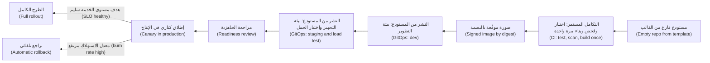

# الوحدة 7 — الاحتراف: المشروع الختامي والامتحان التدريبي

*لقد تعلّمت السحابة وDevOps طبقةً بعد طبقة: سطر الأوامر والشبكة، والهوية، والحاويات (containers)، وKubernetes، والبنية التحتية بوصفها شيفرة (infrastructure as code)، وخطوط التسليم (pipelines)، والإطلاقات، والقياس عن بُعد (telemetry)، وأهداف مستوى الخدمة (SLOs)، والحوادث، والتوسّع، والتكلفة، وأعباء عمل الذكاء الاصطناعي. وهذه الوحدة تعيد جمع الطبقات معًا. ففي المشروع الختامي تأخذ خدمةً جديدة كليًّا في بنك نجم، هي ضوابط البطاقات (Card Controls)، من مستودعٍ فارغ إلى الإنتاج (production) مع هدف مستوى خدمة موقَّع، معيدًا استخدام أثرٍ برمجي (artefact) من كل وحدةٍ سابقة، وتربطها جميعًا في ملف جاهزية للإنتاج واحد يستطيع سالم ومها ونورة اعتماده. ثم ننتقل إليك أنت: الأدوار التي يتكوّن منها عمل السحابة والمنصات وDevOps وهندسة موثوقية المواقع، وكيف تختار الشهادات من مزوّدي السحابة ومؤسسة Linux وغيرها دون أن تتحكّم بك، وما الذي تختبره المقابلات فعلًا، وكيف تبني ملف أعمال يُثبت أنك تستطيع تشغيل البرمجيات، لا مجرد كتابتها. وتُختتم الوحدة بامتحانٍ تدريبي من 60 سؤالًا يغطي المراحل الثماني جميعها.*

> **المراحل:** من Plan إلى Monitor — حلقة التسليم كاملةً، من طرفها إلى طرفها، على خدمةٍ واحدة ثم في امتحانٍ واحد.

---

# 7.1 — المشروع الختامي: خذ خدمةً جديدة في نجم من مستودعٍ فارغ إلى الإنتاج مع هدف مستوى خدمة
*المستوى: 🔴 متقدم* · *المتطلبات: الوحدات 0–6 (Modules 0–6)* · *المرحلة: Deploy, Operate*

**بعد هذا الدرس تستطيع** نقل خدمة صغيرة من مستودع فارغ إلى عنقود محلي مع خط تسليم يبني مرة واحدة وتراجع عبر GitOps وهدف SLO بتنبيهات معدل الاستهلاك، وإظهار أن كل عطل مُدخَل التقطه تنبيه أو الكناري. *مدة الدراسة: نحو 125 دقيقة (تقدير).*

## ⚡ الدرس في دقيقة
- يأخذ المشروع الختامي خدمة **ضوابط البطاقات**، وهي خدمةٌ جديدة في نجم لتجميد البطاقات وتعيين الحدود، من مستودعٍ فارغ إلى الإنتاج عبر المراحل الثماني جميعها.
- المُخرَج هو **ملف الجاهزية للإنتاج**: أدلةٌ مترابطة على أن الخدمة يمكن بناؤها وإطلاقها ومراقبتها واستعادتها وتحمّل تكلفتها، مع مالكٍ لكل جزء.
- العمود الفقري هو **أثرٌ برمجي واحد وبيئاتٌ متعددة**: ابنِ صورة الحاوية (container image) مرةً واحدة، ووقّعها، ورقِّ البصمة نفسها من التطوير إلى التجهيز (staging) إلى الإنتاج عبر Git.
- هدف مستوى الخدمة يأتي أولًا لا أخيرًا. فهو يحدّد التنبيهات، وبوابات الإطلاق، وعدد النسخ المتماثلة، وأهداف النسخ الاحتياطي، وجدول المناوبة.
- مؤشر القرار: قبل كل بوابة، اسأل «لو فشلت هذه الخطوة بصمت في الثانية فجرًا، فكيف سنعرف، وكيف سنتراجع عنها؟».
- أكبر فخ: قائمة تحقق للجاهزية تُعلَّم من الذاكرة. كل بندٍ يحتاج إلى دليل، والتراجع والاستعادة ومفاتيح الإيقاف الطارئ تحتاج إلى تمرينٍ موقوت.

## 🧭 لماذا يهم
يأتي طارق بطلبٍ إلى فريق المنصات. يريد فريق البطاقات **خدمة ضوابط البطاقات**: يجمّد العملاء البطاقة، ويحظرون الاستخدام عبر الإنترنت أو خارج البلاد، ويعيّنون حدًّا يوميًّا من تطبيق نجم للهاتف (Najm Mobile app). ويتحقّق معالج البطاقات من هذه الضوابط أثناء التفويض، لذا فإن الإجابة الخاطئة إمّا تمنع عميلًا عند نقطة الدفع وإمّا تمرّر بطاقةً مسروقة. ويريدها قطاع الأعمال حيّةً خلال ربع سنة واحد.

يُسند سالم المهمة إلى يوسف، مع مها شريكةً في هندسة موثوقية المواقع. كانت خطة يوسف الأولى: نسخ مستودعٍ قديم، ودفع صورةٍ موسومة بـ`latest`، وتطبيق ملفات البيان يدويًّا، و«إضافة المراقبة بعد الإطلاق». فيطرح سالم ثلاثة أسئلة: «ما هدف مستوى الخدمة؟ كيف تتراجع في أقل من خمس دقائق؟ ماذا يحدث إن تعطّلت منطقة توافر قاعدة البيانات خلال ذروة يوم صرف الرواتب؟». ولم تكن لدى يوسف إجاباتٌ بعد.

والتاريخ العام يبيّن لماذا تهمّ هذه الأسئلة. ففي أغسطس 2012 نشرت شركة Knight Capital شيفرةً جديدة على خوادمها، لكن خادمًا واحدًا احتفظ بشيفرةٍ قديمة خلف علَمٍ أُعيد استخدامه؛ وبحسب الأمر اللاحق الصادر عن هيئة الأوراق المالية الأمريكية، خسرت الشركة مئات الملايين من الدولارات في أقل من ساعة. وفي يناير 2017 فقدت GitLab ساعاتٍ من بيانات الإنتاج بعد حذف مجلد قاعدة بيانات أثناء حادثة، وتبيّن أن عدة طرق للنسخ الاحتياطي لا تعمل. وكانت كلٌّ منهما خطوةً مفقودة وغير مختبرة على الطريق إلى الإنتاج. وهذا الدرس يبني الطريق كله مرةً واحدة، وبالشكل الصحيح.

## 📐 كيف يعمل

### 🟢 الأساسيات

**الخدمة في فقرةٍ واحدة.** ضوابط البطاقات واجهةُ برمجة HTTP صغيرة لها قاعدة بيانات PostgreSQL مُدارة خاصة بها. تستدعيها واجهة برمجة تطبيق نجم للهاتف (Najm Mobile API) لتغيير الضوابط؛ ويستدعيها تكامل معالج البطاقات لقراءتها أثناء التفويض. وتعمل على عنقود Kubernetes المُدار الخاص بالبنك عبر منطقتي توافر. ولا تخزّن إلا مرجعًا داخليًّا للبطاقة، ولا تخزّن أبدًا أرقام البطاقات، وهو ما تؤكّده نورة في مراجعة التصميم.

**ملف الجاهزية للإنتاج.** **مراجعة الجاهزية للإنتاج (production readiness review, PRR)** فحصٌ منظَّم قبل الإطلاق للتأكد من أن الخدمة يمكن تشغيلها بأمان؛ وتصف كتب SRE من Google هذه الممارسة. ومراجعة نجم مجلدٌ من الآثار البرمجية المترابطة تحت صفحة ملخّص واحدة (انظر 🏛️ أدناه)، ولها ثلاث قواعد:
1. **لكل ادّعاءٍ دليل** يستطيع المراجع فتحه، لا «نعم، تم».
2. **كل تغييرٍ خطِر يمكن التراجع عنه** بطريقةٍ موثّقة وموقوتة.
3. **كل تنبيهٍ يرتبط بهدف مستوى خدمة أو بدليل تشغيل.** والتنبيه الذي لا يقابله إجراء ضجيج.

**المراحل الثماني.** تعيد كل مرحلةٍ استخدام أثرٍ برمجي من وحدةٍ سابقة؛ وصفحة الملخّص في 🏛️ أدناه تربط كلًّا منها بدليله ودرسه. وكل الأرقام في هذا الدرس توضيحية.

**ابدأ بهدف مستوى الخدمة.** تتفق مها ومالك منتج البطاقات على رحلات المستخدم المهمة، ويكتبان **مؤشرات مستوى الخدمة (SLIs)** و**أهداف مستوى الخدمة**:

| الرحلة | مؤشر مستوى الخدمة (SLI) | هدف مستوى الخدمة (SLO) (نافذة 28 يومًا) |
|---|---|---|
| قراءة الضوابط أثناء التفويض | نسبة طلبات القراءة التي يُجاب عنها بنجاح خلال 100 ms عند موازن الأحمال | 99.95% |
| العميل يغيّر ضابطًا | نسبة طلبات الكتابة التي تنجح خلال 500 ms | 99.9% |
| الحداثة | نسبة تغييرات الضوابط التي تظهر للقراءات خلال ثانيتين | 99.9% |

هدف القراءة أشدّ لأن فشل القراءة قد يمنع عملية شراء حقيقية. ومع 99.95% على مدى 28 يومًا، تكون **ميزانية الأخطاء (error budget)** هي 0.05% من طلبات القراءة. وهي تحدّد سياسة الإطلاق: ما دامت الميزانية متبقية، يُطلق الفريق؛ وبمجرد استنفادها، لا يُطلق إلا إصلاحات الموثوقية.

**الطريق.** كل صندوقٍ بوابةٌ تترك دليلًا:



### 🟡 التعمق أكثر

**الشيفرة: ابدأ من المسار الذهبي.** لا ينسخ يوسف مستودعًا قديمًا. بل يُنشئ الخدمة من قالب المنصة، الذي يحتوي مسبقًا على ملف Dockerfile، وسير عمل للتكامل المستمر، ومخطط Helm (Helm chart)، وإعداد OpenTelemetry، وملف `CODEOWNERS`، ومدخلٍ في فهرس البوابة. وتأتي الإعدادات من متغيرات البيئة (environment variables)، ولا تُدمَج أبدًا في الصورة، فتعمل صورةٌ واحدة في كل مكان. وتعرض الخدمة المسار `/healthz/live` والمسار `/healthz/ready`، وهما يصبحان مِجسّي الحيوية والجاهزية من الدرس 2.3.

**البناء: مرةً واحدة، بالبصمة، وموقَّعًا.** يبني التكامل المستمر (CI) الصورة مرةً واحدة لكل إيداع، ويدفعها، ويسجّل بصمتها، ثم يولّد قائمة مكونات البرمجيات (SBOM) ويوقّع تلك البصمة باستخدام cosign. وتشير البيئات اللاحقة إلى البصمة نفسها ولا تعيد البناء أبدًا. ويصل التكامل المستمر إلى السحابة عبر **اتحاد هوية أعباء العمل (workload identity federation)** (OIDC)، فلا يوجد مفتاحٌ طويل العمر في المستودع (1.3، 4.3):

```yaml
# .github/workflows/ci.yml (excerpt)
permissions:
  contents: read
  id-token: write        # lets the job request a short-lived OIDC token
jobs:
  build:
    runs-on: ubuntu-latest
    steps:
      - uses: actions/checkout@v4      # pin actions to a full commit SHA in real use
      - run: make test                  # unit and contract tests
      - run: make image                 # multi-stage, non-root build
      - run: make push sbom sign        # push, then SBOM and cosign signature on the digest
      - run: make bump-dev              # opens a PR to the GitOps repo with the new digest
```

**النشر: البنية التحتية والتطبيق، كلاهما من Git.** قاعدة البيانات والنسخ الاحتياطية ودور السحابة وقواعد الشبكة هي استدعاءٌ واحد لوحدة OpenTofu، يُراجَع بأمر `tofu plan` على طلب الدمج (3.1). وفحوص السياسات (Policy checks) (3.3) ترفض قاعدة بيانات بلا تشفير أثناء التخزين أو حماية من الحذف (deletion protection) أو مدة احتفاظ بالنسخ الاحتياطية. أمّا جانب Kubernetes فيقيم في مستودع GitOps، بمجلدٍ لكل بيئة، ويُوفّقه Argo CD:

```yaml
apiVersion: argoproj.io/v1alpha1
kind: Application
metadata:
  name: card-controls-prod
  namespace: argocd
spec:
  project: cards
  source:
    repoURL: https://git.example.com/najm/gitops.git
    targetRevision: main
    path: apps/card-controls/overlays/prod
  destination:
    server: https://kubernetes.default.svc
    namespace: card-controls
  syncPolicy:
    automated:
      prune: true
      selfHeal: true     # reverts manual edits in the cluster back to Git
```

الترقية إلى الإنتاج طلبُ دمج يغيّر سطرًا واحدًا، هو بصمة الصورة في طبقة `prod`، ويعتمده فريق البطاقات وفريق المنصة. والتراجع (Rollback) هو التراجع عن ذلك الإيداع.

**الإطلاق: كناري مع حارس.** يرسل الطرح حصةً صغيرة من حركة المرور إلى النسخة الجديدة، ويقارن أخطاءها وزمن استجابتها بالنسخة المستقرة، ويتوسّع خطوةً بخطوة (4.2). وتُؤتمِت أداةُ تحكّم مثل Argo Rollouts أو Flagger عملية التحليل؛ فإن تجاوز الكناري عتباتٍ مبنية على هدف مستوى الخدمة، يُلغي الطرح وتعود حركة المرور إلى النسخة المستقرة. والسلوك الجديد، مثل «حظر الاستخدام خارج البلاد»، يقع خلف علَم ميزة لكي يمكن إيقافه دون نشر. وتحديث المحتوى لـCrowdStrike Falcon في يوليو 2024، الذي أسقط أجهزة Windows حول العالم، يبيّن ما يحدث حين يصل تغييرٌ إلى الجميع دفعةً واحدة.

**المراقبة: تنبيهاتٌ من الميزانية.** تُصدر الخدمة تتبّعات OpenTelemetry ومقاييس RED (RED metrics). وتكتب مها **تنبيهات متعددة النوافذ ومتعددة معدلات الاستهلاك** من كتاب SRE التطبيقي: استدعِ المناوب حين تُستهلك الميزانية بسرعة على نافذةٍ طويلة وأخرى قصيرة معًا؛ وافتح تذكرة حين تُستهلك ببطء. وهذا تنبيه الاستهلاك السريع لهدف القراءة:

```yaml
# Prometheus alert rule (excerpt): 14.4x burn over 1h, confirmed over 5m.
# Recording rules (not shown) compute the read error ratio over each window.
- alert: CardControlsReadFastBurn
  expr: |
    card_controls:read_error_ratio:rate1h > (14.4 * 0.0005)
    and
    card_controls:read_error_ratio:rate5m > (14.4 * 0.0005)
  labels:
    severity: page
  annotations:
    runbook: https://runbooks.example.com/card-controls/read-errors
```

المعامل 14.4 يعني أن الميزانية ستنفد في نحو يومين بهذا المعدل؛ والنافذة القصيرة توقف الاستدعاء بمجرد انتهاء الاستهلاك. وكل استدعاءٍ يرتبط بدليل تشغيل.

**التشغيل: أثبت التعافي.** بالاتفاق مع قطاع الأعمال، تحدّد مها **RPO** بخمس دقائق و**RTO** بثلاثين دقيقة لتعطّل منطقة توافر. وتعمل قاعدة البيانات مع نسخةٍ احتياطية جاهزة في منطقة توافرٍ ثانية ومع الاستعادة إلى نقطةٍ زمنية. ثم يستعيدون في بيئة التجهيز نسخة الليلة الماضية الاحتياطية إلى مثيلٍ جديد، ويعيدون التشغيل حتى وقتٍ مختار ويقيسون الزمن. والنسخة الاحتياطية التي لم تُستعَد قط أملٌ لا ضابط.

### 🔴 نظرة الخبير

**قرارات المعمارية، مكتوبةً.** يطلب سالم **سجلات قرارات المعمارية (architecture decision records, ADRs)**: صفحةٌ واحدة لكل قرار تتضمن السياق والخيارات والاختيار والعواقب. وهذه ثلاثةٌ من سجلات ضوابط البطاقات:

| القرار | الاختيار | السبب | أعِد النظر حين |
|---|---|---|---|
| مسار القراءة أثناء التفويض | التقديم من الخدمة مع ذاكرة تخزين مؤقت قصيرة في الذاكرة، لا عنقود تخزين مؤقت منفصل | أجزاءٌ متحركة أقل؛ وهدف الحداثة يسمح بثانيتين | يصبح هدف زمن استجابة القراءة معرّضًا للخطر تحت الذروة |
| تعدّد مناطق التوافر أم تعدّد المناطق | تعدّد مناطق التوافر في منطقةٍ واحدة الآن | يحقّق RTO لتعطّل منطقة التوافر؛ وتعدّد المناطق يضاعف التكلفة والتعقيد | يشترط المنظِّم أو قطاع الأعمال RTO على مستوى المنطقة |
| نمط الفشل إن تعطّلت الخدمة | يطبّق معالج البطاقات سلوكًا افتراضيًّا موثّقًا متفقًا عليه مع فريقي البطاقات والمخاطر | «السماح للجميع» أو «الرفض للجميع» الأعمى قرارٌ تجاري لا تقني | بعد كل حادثة تمسّ هذا المسار |

الصف الثالث هو ما تتخطاه معظم الفرق: فما يفعله المستدعي حين تفشل تبعيةٌ ما قرارُ تصميم يجب أن يوقّع عليه المنتج والمخاطر والأمن.

**السعة والتكلفة قبل الإطلاق.** يُجري يوسف اختبار حمل على بيئة التجهيز بضعف ذروة يوم الرواتب المتوقعة، ويضبط طلبات المعالج والذاكرة من الاستخدام المقيس، ويمنح المُوسِّع التلقائي الأفقي للحجيرات حدًّا أدنى من أربع نسخ متماثلة موزّعة على منطقتي توافر بقيد توزيع الطوبولوجيا، بحيث يُبقي فقدانُ منطقة توافر نسختين، وهو ما يكفي للذروة المقيسة. وتطلب منى **تكلفة الوحدة** (التكلفة الشهرية من الموارد الموسومة مقسومةً على الطلبات الشهرية، 6.2)، معروضةً بجوار هدف مستوى الخدمة، كي يكون التغيير «الأرخص» الذي يستهلك الميزانية، أو «الأكثر أمانًا» الذي يضاعف التكلفة ثلاث مرات، مرئيًّا للطرفين.

**التنظيم دون تخمين.** أدلة التشغيل وسجلات الحوادث واختبارات التعافي تغذّي أيضًا أدلة المرونة التشغيلية: لائحة DORA الأوروبية (EU DORA) (المطبَّقة منذ يناير 2025) للكيان الأوروبي، وتوقعات الجهات التنظيمية في قطر والإمارات بشأن السحابة والإسناد الخارجي. لا تخمّن أرقام البنود؛ اسأل فريق المخاطر والامتثال عمّا يحتاجون إليه ([*أمن الذكاء الاصطناعي وأمن التطبيقات*، الدرس 11.2 — التنظيمات التي تمسّ الأمن](../secai/index.ar.html#/11.2)).

**يوم المحاكاة (The game day).** قبل الإطلاق، تُدير مها **يوم محاكاة** مدته ساعتان، تحقن فيه أعطالًا في بيئة التجهيز للتدرّب على الاستجابة:
1. انشر كناري يُرجع أخطاءً في 5% من القراءات. *المتوقّع:* يُلغي التحليل الطرح تلقائيًّا.
2. اعزل عقد منطقة توافر واحدة واحذف حجيراتها. *المتوقّع:* يصمد هدف القراءة؛ وتبدأ حجيراتٌ بديلة في منطقة التوافر الأخرى.
3. نفّذ تجاوز فشل قاعدة البيانات. *المتوقّع:* تتوقف الكتابات لفترةٍ وجيزة، ثم تُستأنف ضمن الزمن المتفق عليه.
4. ألغِ بيانات اعتماد قاعدة البيانات الخاصة بالخدمة. *المتوقّع:* يفشل فحص الجاهزية، ويُطلَق الاستدعاء ويرتبط بدليل التشغيل الصحيح.

وجد يوم المحاكاة الأول ثغرتين: دليل تشغيل بيانات الاعتماد كان يشير إلى سرٍّ أُعيدت تسميته، وتجاوز الفشل (failover) استغرق وقتًا أطول مما افترضه RTO لأن مجمّع الاتصالات لم يُعِد الاتصال. وتحوّلت كلتاهما إلى إصلاحات وفحوص انحدار.

## 🧰 الأدوات
| الأداة أو الممارسة أو الخدمة | ما هي وماذا تفعل | متى تلجأ إليها |
|---|---|---|
| **Production readiness review** — مراجعة الجاهزية للإنتاج | فحصٌ منظَّم قائم على الأدلة للتأكد من أن الخدمة يمكن تشغيلها بأمان قبل الإطلاق | كل خدمةٍ جديدة أو تغييرٍ كبير في المعمارية |
| **Architecture decision record** — سجل قرار المعمارية | سجلٌّ من صفحةٍ واحدة لقرارٍ وخياراته وعواقبه | أي اختيارٍ سيسأل عنه أحدٌ لاحقًا «لماذا؟» |
| **Argo CD** | أداة تحكّم GitOps تُبقي العناقيد متزامنةً مع مستودع Git | ترقية الأثر البرمجي نفسه عبر البيئات بطلب دمج |
| **Canary release** — الإطلاق الكناري | إرسال حصةٍ صغيرة من حركة المرور إلى نسخةٍ جديدة والتوسيع فقط إن كانت سليمة | كل طرحٍ في الإنتاج لخدمةٍ يواجهها المستخدم |
| **Error budget** — ميزانية الأخطاء | نسبة الإخفاقات التي يسمح بها هدف مستوى الخدمة على مدى نافذته | ضبط سياسة الإطلاق وعتبات التنبيه |
| **Burn-rate alert** — تنبيه معدل الاستهلاك | تنبيهٌ على سرعة استهلاك ميزانية الأخطاء، على نافذةٍ طويلة وأخرى قصيرة | استدعاء المناوب على خطر هدف مستوى الخدمة بدلًا من مقاييس الموارد الخام |
| **Game day** — يوم المحاكاة | تمرينٌ مخطَّط يحقن الأعطال لاختبار الأنظمة وأدلة التشغيل والأشخاص | قبل الإطلاق، ثم بانتظام وبعد كل تغييرٍ كبير |

## 🏛️ عمليًا في بنك نجم
**ملف الجاهزية للإنتاج لخدمة ضوابط البطاقات: صفحة الملخّص** (الإصدار 1.0؛ المالك يوسف؛ المراجعون: مها لهندسة موثوقية المواقع، ونورة للأمن، ومنى للتكلفة؛ اعتمده سالم).

| المرحلة | الدليل (الدرس) | القرار المسجَّل | تُجتاز البوابة حين |
|---|---|---|---|
| Plan | موجز الخدمة، ووثيقة هدف مستوى الخدمة، وأربعة سجلات قرارات معمارية (5.2) | هدف القراءة 99.95%، وهدف الكتابة 99.9%؛ تعدّد مناطق التوافر (multi-zone) | يوقّع مالك المنتج ومها على هدف مستوى الخدمة |
| Code | مستودع من القالب؛ ومدخل في الفهرس؛ والمالكون (0.1) | الإعدادات من البيئة فقط | فحوص القالب خضراء |
| Build | بصمة الصورة (Image digest)، وقائمة مكونات البرمجيات، والتوقيع (signature) (2.1، 4.3) | تشغيل بغير صلاحيات الجذر، وصورة أساس مثبّتة | يُتحقَّق من التوقيع عند القبول |
| Test | تشغيل التكامل المستمر، واختبارات العقود مع واجهة الهاتف، وفحوص السياسات (3.3، 4.1) | لا وصول مباشر إلى قاعدة البيانات من الخدمات الأخرى | كل البوابات خضراء على الفرع الرئيسي |
| Release | إعدادات تحليل الكناري؛ وقائمة الأعلام (4.2) | الإلغاء عند تجاوز أخطاء القراءة معدّل الميزانية | اختُبر الإلغاء في بيئة التجهيز |
| Deploy | خطة OpenTofu، وتطبيق Argo CD، وترقية بموافقتين (3.1، 3.2) | التراجع هو التراجع عن إيداعٍ واحد | قِيس زمن التراجع فكان أقل من خمس دقائق |
| Operate | أدلة التشغيل (Runbooks)، وجدول المناوبة، وتقرير تمرين الاستعادة (5.3، 6.1) | RPO خمس دقائق وRTO ثلاثون دقيقة لفقدان منطقة توافر | حقّق تمرين الاستعادة الهدفين كليهما |
| Monitor | لوحة هدف مستوى الخدمة، وتنبيهات معدل الاستهلاك، والتكلفة لكل طلب (5.1، 5.2، 6.2) | الاستدعاء فقط عند استهلاك هدف مستوى الخدمة | أُطلق كل تنبيه مرةً في اختبار |

## 🛠️ التمارين
- 🟢 اكتب وثيقة هدف مستوى الخدمة لخدمةٍ صغيرة خاصة بك: مؤشرا مستوى خدمة، وهدفٌ لكلٍّ منهما على مدى 28 يومًا، وميزانية الأخطاء بعدد الطلبات عند مستوى حركة مرور مفترض، وسياسة الإطلاق حين تنفد. *يكتمل عندما:* يستطيع زميلٌ أن يقول ما الذي سيستدعي أحدًا وما الذي سيجمّد الإطلاقات، دون أن يسألك.
- 🟡 على حاسوبك المحمول، خذ تلك الخدمة من مستودعٍ فارغ إلى عنقود kind أو k3d محلي: ملف Dockerfile متعدد المراحل وبغير صلاحيات الجذر، وسير عمل GitHub Actions يبني مرةً واحدة ويسجّل البصمة، وArgo CD يزامن من مجلد Git تملكه. *يكتمل عندما:* يؤدي تغيير البصمة في Git إلى تقدّم العنقود، ويؤدي التراجع عن الإيداع إلى إرجاعه، وتكون قد قست زمن الحالتين.
- 🔴 أضِف Prometheus وGrafana إلى عنقودك المحلي، وعرّف هدف مستوى خدمة واحدًا مع تنبيهات استهلاك سريع وبطيء، ثم أدِر يوم محاكاة مدته ساعة بثلاثة أعطال محقونة. استخدم فقط الأجهزة والحسابات التي تملكها؛ وعلى حساب الفئة المجانية، اضبط تنبيه ميزانية أولًا. *يكتمل عندما:* يُكتشف كل عطلٍ بتنبيه أو بالكناري، ويكون لكلٍّ منها خطوةٌ في دليل التشغيل نجحت، ويسرد تقريرك ثغرتين على الأقل أصلحتهما.

## ⚠️ أخطاء وفخاخ
- **هدف مستوى الخدمة بعد الإطلاق.** من دونه لا يستطيع أحدٌ أن يقول أيّ التنبيهات مهمة أو متى يتوقف الإطلاق. اتفق عليه في مرحلة Plan مع مالك المنتج.
- **إعادة البناء لكل بيئة.** إعادة البناء في التجهيز أو الإنتاج تُنتج أثرًا برمجيًّا مختلفًا عن الذي اختبرته. ابنِ مرةً واحدة ورقِّ البصمة.
- **التعديلات اليدوية في العنقود.** تنحرف عن Git وتختفي عند المزامنة التالية. غيّر Git؛ ودع أداة التحكّم توفّق الحالة.
- **نسخ احتياطية وتراجعات غير مختبرة.** تُظهر مراجعة ما بعد الحادثة لـGitLab عام 2017 نسخًا احتياطية غير مختبرة تفشل معًا. تمرّن على الاستعادة والتراجع، وقِس زمنهما.
- **تنبيهات على الأسباب لا على الأعراض.** استدعاء المناوب عند بلوغ المعالج 80% يوقظ الناس لأمورٍ لا يشعر بها العملاء أبدًا. استدعِ على استهلاك هدف مستوى الخدمة.
- **ترك نمط الفشل دون قرار.** قرِّر ووقّع مسبقًا ما يفعله المستدعون حين تتعطّل الخدمة.

## 🧾 الخلاصة
- هدف مستوى الخدمة، المتفق عليه أولًا، يقود التنبيهات وسياسة الإطلاق والسعة وأهداف التعافي.
- صورةٌ واحدة موقّعة، يُشار إليها بالبصمة، تنتقل عبر البيئات بطلب دمج؛ والتراجع هو التراجع عن إيداع.
- تحليل الكناري (Canary analysis) وأعلام الميزات (feature flags) وتنبيهات معدل الاستهلاك تحوّل ميزانية الأخطاء إلى حواجز حماية تلقائية.
- التعافي وأنماط الفشل والتكلفة تُصمَّم ويُتمرَّن عليها قبل الإطلاق.

## ✍️ اختبر نفسك

**1. خط التسليم في بيئة التجهيز لدى يوسف يعيد بناء صورة الحاوية من إيداع Git نفسه قبل النشر إلى الإنتاج «للاحتياط». ما المشكلة؟**

- A. إعادة البناء أبطأ، وهذا يضرّ بزمن التسليم لكنه غير ضارٍّ فيما عدا ذلك
- B. لم يعد الإنتاج يشغّل الأثر البرمجي المختبَر؛ رقِّ البصمة نفسها
- C. إعادة البناء مطلوبة للإنتاج لأن صور التجهيز غير موقّعة
- D. لا مشكلة ما دام البناءان يستخدمان إيداع Git نفسه

<details><summary>الإجابة</summary>

**B.** قد تلتقط إعادة البناء طبقات أساس أو تبعياتٍ مختلفة، فيشغّل الإنتاج شيئًا لم يختبره أحد. والخيار D مغرٍ، لكن الإيداع نفسه لا يضمن الأثر البرمجي نفسه. (🟡 التعمق أكثر.)

</details>

**2. هدف القراءة لخدمة ضوابط البطاقات هو 99.95% على مدى 28 يومًا. ما الذي تخبر به ميزانية الأخطاء الفريق؟**

- A. كم مهندسًا يجب أن يكون في المناوبة خلال كل أسبوع من النافذة
- B. أقصى زمن استجابة مسموح به لأي طلب قراءة منفرد
- C. كم يُسمح أن تكلّف الخدمة كل شهر
- D. كم قراءةً يمكن أن تفشل قبل أن يتقدّم عمل الموثوقية على الإطلاقات

<details><summary>الإجابة</summary>

**D.** ميزانية الأخطاء هي نسبة 0.05% من الطلبات التي يسمح هدف مستوى الخدمة بفشلها؛ وما دامت متبقية يُطلق الفريق؛ وحين تُستنفد يأتي عمل الموثوقية أولًا. ولا تقول شيئًا مباشرًا عن التوظيف أو التكلفة أو زمن استجابة طلبٍ منفرد. (🟢 الأساسيات.)

</details>

**3. خلال يوم المحاكاة، يُرجع الكناري أخطاءً في 5% من القراءات. ماذا يجب أن يحدث إن كان الإطلاق مُعدًّا كما يصفه هذا الدرس؟**

- A. يُلغي التحليل الطرح وتعود حركة المرور إلى النسخة المستقرة
- B. تُستدعى مها وتعدّل كائن Deployment في العنقود يدويًّا للتراجع
- C. يستمر الطرح، لأن 95% من القراءات ما زالت تنجح وهذا قريبٌ من الهدف
- D. يعيد يوسف بناء الصورة بإصلاح ويدفعها مباشرةً إلى الإنتاج

<details><summary>الإجابة</summary>

**A.** التحليل المرتبط بهدف مستوى الخدمة يُلغي تلقائيًّا. أمّا التعديلات اليدوية في العنقود (Manual cluster edits) (B) فتنحرف عن Git؛ والاستمرار (continuing) (C) سيستهلك الميزانية أسرع بكثير مما هو مسموح؛ والدفع المباشر (pushing directly) (D) يتخطى كل بوابة. (🟡 التعمق أكثر.)

</details>

**4. أيّ بندٍ ينتمي إلى سجل قرار معمارية بدلًا من أن يكون في دليل تشغيل فقط؟**

- A. الأمر الدقيق لإعادة تشغيل حجيرة عالقة في حلقة انهيار
- B. جدول المناوبة وجهات التصعيد لأسبوع الإطلاق
- C. ما يفعله المعالج حين تتعطّل ضوابط البطاقات، ومن وافق على ذلك
- D. رابط لوحة Grafana التي تعرض هدف القراءة

<details><summary>الإجابة</summary>

**C.** نمط الفشل قرارٌ تجاري وقرار مخاطر له خيارات وعواقب، وهذا ما يسجّله سجل قرار المعمارية. أمّا البقية فتفاصيل تشغيلية لأدلة التشغيل وصفحات جداول المناوبة. (🔴 نظرة الخبير.)

</details>

**5. يسأل سالم كيف يعرف الفريق أن RTO البالغ 30 دقيقة لفقدان منطقة توافر واقعي. ما أفضل دليل؟**

- A. توثيق المزوّد يقول إن تجاوز فشل قاعدة البيانات عبر مناطق التوافر تلقائي
- B. تقرير تمرين مؤرَّخ يتضمن الأزمنة المقيسة لتجاوز الفشل والاستعادة
- C. النسخ الاحتياطية الآلية لقاعدة البيانات مفعّلة في وحدة OpenTofu الخاصة بالخدمة
- D. نجح فحص السياسة الذي يشترط مدة احتفاظ بالنسخ الاحتياطية على طلب الدمج

<details><summary>الإجابة</summary>

**B.** وحده التمرين الموقوت يُظهر أن التعافي يعمل ضمن الهدف؛ فقد وجد يوم المحاكاة مشكلةً في مجمّع الاتصالات لم تكن أي إعداداتٍ لتكشفها. أمّا A وC وD فتُظهر إعدادات لا نتائج. (🟡 التعمق أكثر، 🔴 نظرة الخبير.)

</details>

## 📚 المراجع
- Google، كتاب *هندسة موثوقية المواقع (Site Reliability Engineering)* (2016) و*كتاب هندسة موثوقية المواقع التطبيقي* (2018)، بما في ذلك أهداف مستوى الخدمة والتنبيه على أهداف مستوى الخدمة ومراجعات الإطلاق — https://sre.google/books/
- منهجية التطبيق ذي العوامل الاثني عشر — https://12factor.net
- مبادئ OpenGitOps — https://opengitops.dev
- توثيق Argo CD — https://argo-cd.readthedocs.io
- توثيق Argo Rollouts — https://argoproj.github.io/rollouts/
- توثيق OpenTofu — https://opentofu.org/docs/
- توثيق OpenTelemetry — https://opentelemetry.io/docs/
- قواعد التنبيه في Prometheus — https://prometheus.io/docs/prometheus/latest/configuration/alerting_rules/
- توثيق GitHub، التحصين الأمني باستخدام OpenID Connect — https://docs.github.com/en/actions/security-for-github-actions/security-hardening-your-deployments/about-security-hardening-with-openid-connect
- GitLab، مراجعة ما بعد الحادثة لانقطاع قاعدة البيانات في 31 يناير 2017 — https://about.gitlab.com/blog/
- هيئة الأوراق المالية الأمريكية (US SEC)، الأمر في قضية Knight Capital Americas LLC (2013) — https://www.sec.gov
- اللائحة (EU) 2022/2554 بشأن المرونة التشغيلية الرقمية للقطاع المالي (Regulation 2022/2554 on digital operational resilience for the financial sector) (DORA) — https://eur-lex.europa.eu/eli/reg/2022/2554/oj

---

# 7.2 — المسار المهني في السحابة: الأدوار والشهادات والمقابلات وملف الأعمال
*المستوى: 🔴 متقدم* · *المتطلبات: 7.1* · *المرحلة: Plan*

**بعد هذا الدرس تستطيع** بناء جدول مهارات لدور مستهدف من إعلانات وظائف حقيقية مع أهم ثلاث فجوات لديك، ونشر مستودع ملف أعمال يستطيع زميل تشغيله من ملف README وحده، وتقييم مقابلة تجريبية ببطاقة تقييم. *مدة الدراسة: نحو 155 دقيقة (تقدير).*

## ⚡ الدرس في دقيقة
- «السحابة» عدة وظائف: السحابة، وDevOps، والمنصات، وموثوقية المواقع، وأمن السحابة، وFinOps، والبنية التحتية للذكاء الاصطناعي. تتشارك الأساسيات لكنها تملك أشياء مختلفة. اختر دورًا مستهدفًا أولًا.
- الشهادات إشارةٌ لا برهان. ومصادرها الرئيسية هي مزوّدو السحابة الثلاثة، و**مؤسسة Linux وCNCF** لـKubernetes، و**HashiCorp** لـTerraform، و**مؤسسة FinOps**. الأسماء والرموز والمحتوى تتغيّر، لذا راجع الصفحة الحالية للجهة المُصدِرة.
- **ملف أعمالٍ من الأدلة** يتفوّق على قائمة الشارات: خدمةٌ أوصلتها إلى «الإنتاج» على حاسوبك المحمول أو الفئة المجانية، مع هدف مستوى خدمة وخط تسليم ودليل تشغيل ومراجعة ما بعد حادثة لشيءٍ كسرته عمدًا.
- تختبر المقابلات منهجية استكشاف الأعطال أكثر من الاستذكار: حجيرةٌ معطوبة، وتصميمٌ يجب جعله قابلًا للنشر، وحادثةٌ عليك قيادتها.
- مؤشر القرار: اختر الشهادة بحسب الدور المستهدف والطلب المحلي، واقرنها بأثرٍ برمجي بنيته أثناء الدراسة.
- أكبر فخ: ترك حساب الفئة المجانية دون تنبيه ميزانية، أو وضع معمارية صاحب العمل أو مفاتيحه أو حوادثه في مستودعٍ عام.

## 🧭 لماذا يهم
بعد ستة أشهر من التحاقه، يسأل يوسف سالمًا: «هل أنال شهادة Kubernetes أم شهادة مهندس معمارية سحابية؟ وهل هندسة المنصات (platform engineering) مسارٌ مهني حقيقي، أم مجرد DevOps بعد إعادة تسميتها؟». لديه خدمةٌ واحدة في الإنتاج ولا خطة.

ولدى سالم المشكلة المقابلة. فهو يوظّف مهندسَي منصات ومهندس موثوقية مواقع واحدًا للانتقال من مركز البيانات. كثيرٌ من السير الذاتية تسرد عدة شهادات سحابية؛ والأقل منها يُظهر شيئًا يستطيع قراءته أو تشغيله. مرشّحةٌ واحدة بشهادةٍ واحدة من المستوى المشارك أرفقت رابط مستودع: واجهة برمجة صغيرة منشورة إلى عنقود kind محلي عبر GitHub Actions وArgo CD، وهدف مستوى خدمة مع تنبيهات معدل الاستهلاك، ومراجعة ما بعد حادثة من صفحتين لعطلٍ تسبّبت فيه عمدًا في يوم محاكاة. يدعوها سالم أولًا.

ومع ذلك ما زالت الشهادات مهمة. فإعلانات الوظائف في بنوك الخليج والجهات الحكومية وشركات الاستشارات كثيرًا ما تسرد شهادات سحابية بأسمائها على أنها مطلوبة أو مفضّلة، وهي تساعدك على اجتياز الفرز الأول. أمّا المقابلة، ثم جهاز الاستدعاء، فيختبران ما إذا كنت تستطيع أداء العمل. وللبحث الأوسع عن وظيفة، انظر [*من التخرّج إلى التوظيف*، الدرس 2.4 — مهندس السحابة والمنصات وDevOps والأمن](../career/index.ar.html#/2.4).

## 📐 كيف يعمل

### 🟢 الأساسيات

**خريطة الأدوار.** تختلف المسمّيات من مؤسسة لأخرى، فاقرأ الوصف الوظيفي لا المسمّى. وفي وقت كتابة هذا الدرس (2026)، تبدو الأدوار الأقرب إلى هذه الدورة هكذا:

| الدور | ما يملكه يومًا بيوم | وحدات الدورة التي يُركَّز عليها |
|---|---|---|
| مهندس السحابة (Cloud engineer) | الحسابات السحابية والشبكات والهوية والخدمات المُدارة؛ ومناطق الهبوط والترحيلات | 1، 3، 6 |
| مهندس DevOps (DevOps engineer) | خطوط التكامل والتسليم المستمرين (CI/CD pipelines)، وأدوات البناء، وأتمتة الإطلاق، ودعم المطوّرين | 2، 3، 4 |
| مهندس المنصات (Platform engineer) | منصة المطوّرين الداخلية: المسارات الذهبية (golden paths)، وKubernetes، وGitOps، والخدمة الذاتية | 2، 3، 4، 7.1 |
| مهندس موثوقية المواقع (Site reliability engineer) | أهداف مستوى الخدمة، والتنبيه، والمناوبة (on-call)، والحوادث، والسعة، وإزالة العمل الرتيب بالشيفرة | 5، 6، 7.1 |
| مهندس أمن السحابة | إدارة الهوية والوصول (IAM)، والسياسات بوصفها شيفرة (policy as code)، وضوابط أعباء العمل والشبكة، وسلسلة التوريد (supply chain) | 1.3، 3.3، 4.3، إضافةً إلى دورة الأمن |
| ممارس FinOps | رؤية التكلفة، وتوزيعها، وتحسينها، واقتصاديات الوحدة مع الإدارة المالية | 6.2 |
| مهندس البنية التحتية للذكاء الاصطناعي أو MLOps | وحدات معالجة الرسوميات (GPUs)، وتقديم النماذج، وبوابات النماذج اللغوية (LLM gateways)، وموثوقيتها وتكلفتها | 6.3، 5، 6.1 |

«هندسة المنصات» ليست مجرد DevOps بعد إعادة تسميتها. فـDevOps ثقافةٌ ومجموعة ممارسات يتشاركها كل من يبني البرمجيات ويشغّلها؛ أمّا هندسة المنصات فهي فريقٌ يبني منتجًا داخليًّا، هو المنصة، لكي تتبع الفرق الأخرى تلك الممارسات دون إعادة اختراعها. وهندسة موثوقية المواقع (SRE) تشغّل الإنتاج مع معاملة الموثوقية بوصفها هندسة، بميزانياتٍ صريحة. في الشركة الناشئة يؤدي شخصٌ واحد الأدوار الثلاثة؛ وفي نجم هي فرقٌ منفصلة.

**من أين يأتي الناس.** ينتقل المطوّرون إلى عمل المنصات وموثوقية المواقع، ومديرو الأنظمة والشبكات إلى هندسة السحابة، ومهندسو البيانات إلى MLOps. وعادةً ما يدخل الخرّيجون بوصفهم مهندسين مبتدئين في السحابة أو DevOps أو المنصات. والخبرة السابقة ميزة: فالمطوّر السابق يعرف لماذا يُتجاوَز خط التسليم البطيء.

**الشهادات باختصار.** هذه الدورة غير منتسبة إلى أي جهة مُصدِرة ولا تُعدّك لامتحانٍ بعينه. والجدول توجيهٌ عام. فأسماء الامتحانات ورموزها ومستوياتها وأسعارها وصيغها وقواعد تجديدها تتغيّر، والمزوّدون يُوقفون امتحاناتٍ ويستبدلونها، لذا راجع الصفحة الحالية لكل جهة مُصدِرة قبل أن تخطّط.

| الجهة المُصدِرة | أنواع الاعتماد (أمثلة في وقت الكتابة، 2026) | الملاءمة النموذجية |
|---|---|---|
| **AWS** | المستوى التأسيسي، والمستوى المشارك، والمستويان الاحترافي والتخصصي | الأدوار في المؤسسات العاملة على AWS |
| **Microsoft** | الأساسيات، والمستوى المشارك القائم على الدور (مثلًا Azure Administrator)، ومستوى الخبير | المؤسسات العاملة على Azure؛ شائعة في الشركات الكبرى والجهات الحكومية |
| **Google Cloud** | المستوى التأسيسي، والمشارك، والاحترافي | المؤسسات العاملة على Google Cloud؛ والفرق كثيفة البيانات |
| **Linux Foundation and CNCF** | شهادات Kubernetes: KCNA (مشارك، قائم على المعرفة)، وCKAD (مطوّر تطبيقات)، وCKA (مدير)، وCKS (الأمن)؛ والعملية منها قائمة على الأداء | أدوار المنصات وموثوقية المواقع على أي سحابة |
| **HashiCorp** | Terraform Associate | الأدوار كثيفة البنية التحتية بوصفها شيفرة؛ والمفاهيم تنتقل إلى OpenTofu |
| **FinOps Foundation** | FinOps Certified Practitioner ومستويات أعلى | أدوار FinOps؛ والمهندسون الذين يعملون عن قرب مع الإدارة المالية |

نمطان يساعدان. **شهادات المزوّدين** تُثبت أنك تعرف خدمات سحابةٍ واحدة؛ فاختر السحابة التي يشغّلها أصحاب العمل المستهدفون. و**الشهادات المحايدة تجاه المورّدين**، مثل شهادات Kubernetes، تنتقل عبر السحابات، وصيغتها **القائمة على الأداء** أقرب إلى العمل الحقيقي. وكثيرٌ من الاعتمادات تنتهي صلاحيتها بعد بضع سنوات ويجب تجديدها؛ فخصّص وقتًا لذلك.

### 🟡 التعمق أكثر

**اختيار الشهادة عن قصد.** امنح كل اعتمادٍ مرشّح درجةً من 1 إلى 3 على خمسة أسئلة:
1. **ملاءمة الدور.** هل يطابق الدور الذي تريده خلال سنتين إلى ثلاث؟
2. **طلب السوق.** هل يذكره أصحاب العمل في سوقك؟ اقرأ عشرة إعلانات وظائف حالية واحسب.
3. **عملي أم قائم على المعرفة؟** الامتحانات العملية تُظهر أنك تستطيع أداء المهمة؛ وامتحانات المعرفة تُظهر الاتساع.
4. **التكلفة الكاملة.** التدريب والامتحان وإعادة المحاولات والتجديد ووقتك.
5. **الرعاية.** كثيرٌ من أصحاب العمل، ومنهم نجم، يموّلون الشهادات المرتبطة بخطة تطوير.

وبالنسبة إلى يوسف، وهو مهندس منصات في بنكٍ يشغّل Kubernetes على سحابةٍ واحدة، تشير الدرجات إلى اعتماد عملي لمدير Kubernetes الآن، ثم اعتماد المستوى المشارك من مزوّد السحابة الذي يعتمده البنك بعد ذلك. أمّا اعتماد مهندس المعمارية الاحترافي فيناسب لاحقًا، حين يصمّم عبر فرقٍ كثيرة.

**ادرس بالبناء.** اختم كل أسبوع دراسة بشيءٍ يعمل. فامتحان السحابة التأسيسي يقترن بإعداد حساب الفئة المجانية إعدادًا صحيحًا؛ وامتحان Kubernetes يقترن بكسر عنقود kind الخاص بك وإصلاحه؛ وامتحان Terraform يقترن بوحدة OpenTofu ذات حالة بعيدة (remote state) وخطة في التكامل المستمر. استخدم حساباتك وأجهزتك فقط.

**ملف الأعمال.** ملف أعمال السحابة مجموعةٌ صغيرة من الآثار البرمجية يستطيع الآخرون قراءتها وتشغيلها، يُظهر كلٌّ منها حسن التقدير إلى جانب المهارة. وهذه بنودٌ جيدة، كلها قانونية وكلها على موارد تملكها:
- **خدمة مشروع ختامي**، مثل 7.1 على نطاقٍ صغير: ملف Dockerfile متعدد المراحل، وتكامل مستمر يبني مرةً واحدة، وGitOps إلى kind أو k3d، وهدف مستوى خدمة مع تنبيهات معدل الاستهلاك، وملف README يعمل خلال عشر دقائق.
- **وحدة بنية تحتية بوصفها شيفرة** بواجهةٍ واضحة، وأمثلة واختبارات وفحص سياسات.
- **تقرير يوم محاكاة ومراجعة ما بعد الحادثة**: ما كسرته عمدًا، وما اكتشفه، وما غيّرته. بلا لوم، مع جدولٍ زمني.
- **مذكرة تكلفة**: تقديرٌ من حاسبة الأسعار لدى المزوّد، مع ذكر الافتراضات وتأريخها.
- **مساهمات مفتوحة المصدر**: إصلاحٌ لمخطط Helm أو تحسينٌ للتوثيق في مشروعٍ من CNCF.
- **الكتابة**: مقالٌ يشرح قرارًا واحدًا جيدًا، مثل «لماذا يُلغي الكناري لديّ الطرح بناءً على معدل الاستهلاك لا على المعالج».

وكل دراسة حالة تتبع شكلًا واحدًا: السياق، والقرار، والدليل، والمفاضلة، والدرس. فعبارة «اخترت تعدّد مناطق التوافر على تعدّد المناطق لأن RTO سمح بذلك وتعدّد المناطق ضاعف الأجزاء المتحركة» تُظهر أكثر من «نشرتُ إلى Kubernetes».

**ما لا يدخل ملف الأعمال أبدًا.** مخططات صاحب عملك، وأسماء مضيفيه، ومعرّفات حساباته، وحوادثه، وسجلاته، أو بيانات عملائه، أو أي شيء في تاريخه سرّ. افحص المستودعات العامة بحثًا عن الأسرار أولًا؛ فحذف ملف لا يزيله من تاريخ Git، والمفتاح المسرَّب يجب إلغاؤه. ولعرض عملٍ من وظيفتك، أعِد بناء النمط في مختبرك الخاص واستأذن صاحب العمل قبل ذكر اسمه.

**حلقة المقابلات.** تمزج حلقات مقابلات السحابة والمنصات عادةً:
- **الأساسيات**: عمليات Linux وصلاحياته، و«ماذا يحدث حين تفتح رابطًا»، وأدوار IAM مقابل المستخدمين.
- **استكشاف الأعطال**: نظامٌ معطوب، مثل حجيرة في حالة `CrashLoopBackOff` أو خدمة تُرجع أخطاء 502. ويراقب المحاورون منهجيتك أكثر من إجابتك.
- **العمل التطبيقي**: اكتب ملف Dockerfile، أو أصلح خط تسليم، أو اقرأ خطة Terraform، أو اكتب استعلام PromQL.
- **تصميم الأنظمة**: صمّم خدمةً بحيث تكون قابلة للنشر والمراقبة والاستعادة. انظر [*من التخرّج إلى التوظيف*، الدرس 5.3 — مقابلات تصميم الأنظمة والبيانات وتعلّم الآلة للمبتدئين](../career/index.ar.html#/5.3).
- **سيناريو حادثة** («هذا التنبيه يُطلَق في الثانية فجرًا») وأسئلة **سلوكية**، يُجاب عنها بطريقة **STAR**.

سؤالٌ نموذجي في استكشاف الأعطال، وكيف تبدو الإجابة القوية:

```text
Q: After a deploy, the new pods show CrashLoopBackOff. What do you do?

Strong answer, out loud, in order:
1. Limit the damage: is the rollout paused or old pods still serving? If users
   are affected, roll back first (revert the GitOps commit), then investigate.
2. kubectl describe pod <name>    -> events: image pull? OOMKilled? probe failures?
3. kubectl logs <name> --previous -> the crashed container's last output
4. Compare with the last good release: config, secrets, image digest, limits.
5. Fix forward or keep the rollback; add a test or check so it cannot recur.
```

الترتيب مهم: استعِد الخدمة، ثم شخّص، ثم امنع التكرار. وهي السلسلة نفسها في 7.1 و5.3.

### 🔴 نظرة الخبير

**كيف تنمو الوظيفة.**

| المستوى | النطاق | الدليل الذي يُظهره |
|---|---|---|
| مهندس مبتدئ | ينجز مهامّ محدّدة جيدًا؛ وينضم إلى المناوبة مع زميلٍ مرافق | خطوط تسليم ووحدات وأدلة تشغيل تعمل؛ وتقارير مكتوبة بوضوح |
| مهندس | يملك مكوّنًا؛ ويناوب باستقلالية | خدمةٌ أُوصلت إلى الإنتاج، مثل 7.1 |
| مهندس أول | يملك مجالًا مثل قابلية المراقبة أو GitOps؛ ويضع أنماطًا قابلة لإعادة الاستخدام | مسارٌ ذهبي تستخدمه فرقٌ كثيرة؛ وحوادث قِيدت جيدًا |
| مهندس رئيسي أو أول رئيسي | يشكّل المعمارية والمعايير عبر فرقٍ كثيرة | قرارات منصة اعتُمدت على مستوى البنك؛ وأشخاصٌ نمَوا على يديه |
| رئيس المنصات أو موثوقية المواقع | الاستراتيجية والميزانية والتوظيف ونتائج الموثوقية والتكلفة | تسليمٌ أسرع وأكثر أمانًا بشكلٍ قابل للقياس بتكلفةٍ معروفة |

في كل خطوة ينتقل العمل من أداء المهامّ إلى جعل النتائج الجيدة هي الافتراض لدى فرقٍ كثيرة. وعمل المنصات وظيفة منتج: ففريق سالم يقيس التبنّي ورضا المطوّرين، لا وقت التشغيل فقط.

**على شكل حرف T، لا على شكل أداة.** الأدوات تتغيّر؛ أمّا Linux والشبكات وأنماط الفشل وحسن التقدير التشغيلي فتتغيّر ببطء. ومن يفهم لماذا يوجد مِجسّ الجاهزية يستطيع تعلّم أي منسِّق. تعمّق في مجالٍ واحد (Kubernetes، أو قابلية المراقبة (observability)، أو البنية التحتية بوصفها شيفرة (IaC)، أو FinOps) على أساسٍ عريض. والبنية التحتية للذكاء الاصطناعي كذلك: وحدات معالجة الرسوميات وبوابات النماذج اللغوية جديدة، لكن السعة وزمن الاستجابة والتكلفة والفشل أسئلةٌ قديمة. ويتعمّق [*تشغيل وكلاء الذكاء الاصطناعي في الإنتاج* — المستوى 3، مهندس الإنتاج (Level 3, Production Engineer)](../agentic/learning-path.ar.html#level-3-production-engineer) أكثر في تشغيل الوكلاء، ويغطي [*أمن الذكاء الاصطناعي وأمن التطبيقات*، الدرس 12.2 — المسار المهني في الأمن: الأدوار والشهادات وملف الأعمال](../secai/index.ar.html#/12.2) مسار أمن السحابة.

**مواكبة الجديد دون ضجيج.**
- *أسبوعيًّا:* تصفّح ملاحظات الإصدار لدى مزوّدك ولدى Kubernetes بحثًا عن حالات الإيقاف التدريجي التي تؤثّر فيك.
- *شهريًّا:* اقرأ مصدرًا أوليًّا واحدًا، مثل مراجعة ما بعد حادثة عامة، وجرّب شيئًا واحدًا في مختبرك.
- *سنويًّا:* أعِد النظر في دورك المستهدف ودرجات الشهادات وملف أعمالك.

تنشر DORA أبحاثًا عن أداء تسليم البرمجيات؛ فاقرأ التقرير الحالي بدلًا من تكرار الأرقام القديمة.

**التوظيف من الجهة الأخرى.** لا يفرز سالم على أساس الشهادات وحدها، إذ سيُقصي ذلك مهندسين أقوياء علّموا أنفسهم بأنفسهم. فكل مرشّح يحصل على المهمة العملية نفسها، ويضع أعضاء اللجنة درجاتهم مستقلّين قبل النقاش. ويبحث أيضًا عمّا لا تُظهره أي شهادة: هل يقول المرشّح «لا أعرف، وهكذا سأكتشف ذلك» بدلًا من التخمين؟

**الاستدامة.** أدوار موثوقية المواقع والمنصات تتضمن المناوبة. والفرق الجيدة تضع حدًّا أقصى للاستدعاءات في كل نوبة، وتدفع مقابل المناوبة أو تعوّض عنها، وتُجري مراجعات ما بعد الحوادث بلا لوم، وتحمي الوقت المخصّص لتقليل العمل الرتيب (5.2). اسأل عن هذه الأمور في المقابلات؛ فالإجابات تخبرك كيف يعمل الفريق حقًّا.

## 🧰 الأدوات
| الأداة أو الممارسة أو الخدمة | ما هي وماذا تفعل | متى تلجأ إليها |
|---|---|---|
| **Role map** — خريطة الأدوار | جدولٌ بأدوار السحابة، وما يملكه كلٌّ منها والمهارات التي يحتاجها | اختيار دورٍ مستهدف؛ وقراءة إعلانات الوظائف |
| **Certification decision matrix** — مصفوفة قرار الشهادات | تمنح الاعتمادات درجاتٍ على ملاءمة الدور والطلب والطابع العملي والتكلفة والرعاية | قبل الالتزام بالوقت والمال لشهادة |
| **Performance-based exam** — الامتحان القائم على الأداء | امتحانٌ تحلّ فيه مهامّ في بيئةٍ حيّة | حين تريد اعتمادًا هو الأقرب إلى العمل الحقيقي، مثل إدارة Kubernetes |
| **kind** | يشغّل عنقود Kubernetes محليًّا في حاويات Docker | بناء عنقود ملف الأعمال وكسره دون تكلفة سحابية |
| **Budget alert** — تنبيه الميزانية | تنبيه فوترة سحابية عند عتبةٍ تحدّدها | قبل إنشاء أي شيء في حساب الفئة المجانية أو الحساب الشخصي |
| **Portfolio case study** — دراسة حالة لملف الأعمال | صفحةٌ أو صفحتان: السياق، والقرار، والدليل، والمفاضلة، والدرس | طلبات التوظيف، وملفات الترقية، والظهور الداخلي |
| **STAR** | الموقف، والمهمة، والإجراء، والنتيجة: بنيةٌ للإجابات السلوكية | أسئلة المقابلات السلوكية |

## 🏛️ عمليًا في بنك نجم
**بطاقة تقييم مقابلة مهندس المنصات** لدى سالم، المستخدمة مع كل مرشّح:

| المعيار | كيف يبدو الأداء «القوي» | يُقيَّم عبر |
|---|---|---|
| الأساسيات | يشرح DNS وTLS وموازنة الأحمال وIAM ببساطة وبشكلٍ صحيح | المقابلة التقنية |
| استكشاف الأعطال | يستعيد الخدمة أولًا، ثم يشخّص بمنهجيةٍ واضحة؛ ويقول ما الذي سيفحصه تاليًا | تمرين عنقود معطوب مدته 30 دقيقة |
| التسليم | يبني مرةً واحدة، ويرقّي بالبصمة، ويشرح التراجع؛ ويقرأ خطة Terraform أو OpenTofu | مهمة عملية |
| الموثوقية | يكتب مؤشر مستوى خدمة وهدفًا له لخدمةٍ ما ويشرح أيّ تنبيهٍ يستدعي المناوب | نقاش تصميم |
| التصميم | يجعل الخدمة قابلة للنشر والمراقبة والاستعادة؛ ويسمّي المفاضلات وأنماط الفشل | تمرين تصميم مدته 45 دقيقة |
| دليل العمل | بنود ملف الأعمال مشروحةٌ بعمق، ضمن حدود السرية | نقاش ملف الأعمال |
| التعاون والتعلّم | لغةٌ بلا لوم؛ ويغيّر رأيه عند ظهور دليلٍ جديد | الأسئلة السلوكية (STAR) |

## 🛠️ التمارين
- 🟢 اختر دورًا مستهدفًا من خريطة الأدوار واجمع خمسة إعلانات وظائف حالية له في سوقك. *يكتمل عندما:* يكون لديك جدولٌ بالمهارات والأدوات والشهادات التي تطلبها، وكل شهادةٍ متحقَّقٌ منها مقابل الصفحة الرسمية الحالية للجهة المُصدِرة، وفقرةٌ تسمّي دورك المستهدف وأكبر ثلاث ثغرات لديك.
- 🟡 حوّل تمرينك في 7.1 إلى مستودع ملف أعمال عام: ملف README يعمل خلال عشر دقائق، ومخطط معمارية، ووثيقة هدف مستوى الخدمة، ومراجعة ما بعد حادثة ليوم محاكاة، ومذكرة تكلفة مؤرّخة بافتراضات مذكورة. افحصه بحثًا عن الأسرار قبل النشر. *يكتمل عندما:* يستنسخه زميل، ويشغّله محليًّا من ملف README وحده، ويستطيع ذكر قرار التصميم الرئيسي لديك بعد عشر دقائق من القراءة.
- 🔴 أدِر حلقة مقابلات تجريبية مع زميل: تمرين عنقود معطوب على عنقود kind الخاص بك، وتصميمٌ مدته 45 دقيقة لـ«خدمة إشعارات يجب ألا ترسل نسخًا مكرّرة»، وسؤالان سلوكيان. تبادلا الأدوار وقيّما ببطاقة التقييم أعلاه. *يكتمل عندما:* يكون كلا المقيّمَين قد قيّما مستقلّين قبل المقارنة، وسمّيت أضعف معيارٍ لديك، ولديك خطةٌ مؤرّخة لتحسينه.

## ⚠️ أخطاء وفخاخ
- **جمع الشارات بدلًا من الأدلة.** اقرن كل شهادة بشيءٍ بنيته وكسرته وأصلحته.
- **لا تنبيه ميزانية على حساب التدريب.** مثيل GPU منسيّ أو موازن أحمال (load balancer) قد يُفوتَر لأسابيع. اضبط تنبيه ميزانية أولًا وأزِل الموارد بعد كل جلسة.
- **التسريب في ملف الأعمال.** مخططات صاحب العمل أو معرّفات الحسابات أو السجلات أو المفاتيح في مستودعٍ عام قد تكلّفك أكثر بكثير من فجوةٍ في سيرتك الذاتية. أعِد بناء الأنماط في مختبرك الخاص.
- **الثقة بمعلومات المنتديات عن الامتحانات.** رموز الامتحانات ومحتواها وقواعد تجديدها تتغيّر، والامتحانات تُوقف. اقرأ الصفحات الحالية للجهة المُصدِرة.
- **التخمين في المقابلات.** الإجابات الخاطئة الواثقة خلال سؤال حادثة أسوأ من «سأفحص X تاليًا». أظهِر منهجيتك.

## 🧾 الخلاصة
- عمل السحابة عائلةٌ من الأدوار: السحابة، وDevOps، والمنصات، وموثوقية المواقع، وأمن السحابة، وFinOps، والبنية التحتية للذكاء الاصطناعي. اختر هدفًا قبل اختيار الدورات أو الشهادات.
- اعتمادات المزوّدين وKubernetes وTerraform وFinOps لها تركيزاتٌ مختلفة؛ تحقّق من التفاصيل الحالية من المصدر واختر بمصفوفة قرار.
- ملف الأعمال الذي يمكنك تشغيله، مع هدف مستوى خدمة وخط تسليم ودليل تشغيل ومراجعة ما بعد حادثة، يُظهر حسن تقديرٍ لا تُظهره الشهادات.
- تختبر المقابلات الأساسيات، ومنهجية استكشاف الأعطال، والمهارة العملية، والتصميم لقابلية التشغيل، والحوادث، والسلوك؛ وسلسلة «استعِد، شخّص، امنع» تجيب عن معظمها.
- انمُ على شكل حرف T: عميقًا في مجالٍ واحد على أساسٍ عريض، مع عادةٍ ثابتة في التعلّم والكتابة.

## ✍️ اختبر نفسك

**1. يعمل يوسف في فريق المنصات في نجم، الذي يشغّل Kubernetes على سحابةٍ واحدة. أيّ خطة شهادات تناسب دوره أكثر في العام المقبل؟**

- A. شهادة مهندس معمارية من المستوى الاحترافي على سحابةٍ لا يستخدمها البنك
- B. أكبر عددٍ ممكن من الشهادات التأسيسية، عبر السحابات الكبرى الثلاث
- C. اعتماد عملي لمدير Kubernetes، ثم اعتماد المستوى المشارك من سحابة البنك
- D. لا شهادات إطلاقًا، لأن ملف الأعمال من الآثار البرمجية وحده ما يهم أصحاب العمل

<details><summary>الإجابة</summary>

**C.** يحصل على درجاتٍ عالية في ملاءمة الدور والطلب والطابع العملي؛ واقتران كلٍّ منهما بأثرٍ برمجي يضيف دليلًا. أمّا B فاتساعٌ بلا عمق؛ وA لا يناسب الدور ولا صاحب العمل؛ وD يتجاهل أن الإعلانات كثيرًا ما تذكر الشهادات. (🟡 التعمق أكثر.)

</details>

**2. في مقابلة استكشاف أعطال، الحجيرات الجديدة في حالة CrashLoopBackOff بعد نشر والعملاء يرون أخطاء. ما الذي يجب أن تفعله الإجابة القوية أولًا؟**

- A. استعادة الخدمة بالتراجع عن إيداع GitOps، ثم التشخيص
- B. قراءة الشيفرة المصدرية للتطبيق سطرًا سطرًا للعثور على الخلل
- C. زيادة حدّ الذاكرة على كائن Deployment وإعادة النشر فورًا
- D. حذف مساحة الأسماء وإعادة إنشاء كل ما فيها من الصفر

<details><summary>الإجابة</summary>

**A.** استعِد، شخّص، امنع. أمّا C فيخمّن سببًا قبل النظر في الأحداث، وB بطيء بينما المستخدمون متأثرون، وD يُتلف الأدلة وقد يسبّب انقطاعًا أكبر. (🟡 التعمق أكثر.)

</details>

**3. ما الذي يميّز هندسة المنصات عن DevOps على أفضل وجه، كما يصفهما هذا الدرس؟**

- A. هندسة المنصات تحلّ محلّ DevOps وتجعل ممارساتها وثقافتها متقادمة
- B. DevOps تتعلّق فقط بأدوات التكامل والتسليم المستمرين، بينما هندسة المنصات تتعلّق فقط بتشغيل Kubernetes
- C. هما الوظيفة نفسها، أُعيدت تسميتها لتبدو جديدة في إعلانات الوظائف
- D. DevOps ثقافة؛ وفرق المنصات تبني منتجًا داخليًّا يجعلها سهلة

<details><summary>الإجابة</summary>

**D.** المنصة منتجٌ داخلي يجعل الممارسة الجيدة هي المسار السهل. أمّا C فهو التصوّر الخاطئ الشائع الذي يعالجه الدرس؛ وA وB يُسيئان وصف كليهما. (🟢 الأساسيات.)

</details>

**4. تريد مرشّحةٌ أن تعرض مراجعة ما بعد حادثة ليوم محاكاة كتبتها لدى صاحب عملها الحالي في ملف أعمالها العام. ماذا عليها أن تفعل؟**

- A. تنشرها كما كُتبت، لأن الحادثة حُلّت والدروس مفيدة
- B. تعيد بناءها في مختبرها الخاص وتستأذن قبل ذكر اسم صاحب عملها
- C. تنشرها بعد حذف اسم البنك مع إبقاء المخططات والسجلات كما هي
- D. تحتفظ بها في مستودعٍ خاص وترسل الرابط إلى كل مسؤول توظيف

<details><summary>الإجابة</summary>

**B.** معمارية صاحب العمل وسجلاته وحوادثه تبقى سرية ما لم يوافق صاحب العمل. أمّا C فما زال يسرّب تفاصيل داخلية؛ وD يشاركها على أي حال. وإعادة البناء في المختبر تحتفظ بالتعلّم دون المخاطرة. (🟡 التعمق أكثر.)

</details>

**5. قبل التدرّب لشهادة سحابية على حساب شخصي في الفئة المجانية، ما الذي يجب على المتعلّم فعله أولًا؟**

- A. إنشاء مفتاح وصول طويل العمر للراحة عند كتابة النصوص البرمجية من الحاسوب المحمول
- B. استخدام المستخدم الجذر للحساب في كل شيء لتجنّب أخطاء الصلاحيات
- C. ضبط تنبيه ميزانية وتفعيل المصادقة متعددة العوامل للمستخدم المدير
- D. لا شيء، لأن حسابات الفئة المجانية لا يمكن أن تولّد رسومًا من أي نوع

<details><summary>الإجابة</summary>

**C.** للفئات المجانية حدود، والموارد خارجها يمكن أن تُفوتَر حتى تُحذف. تنبيه الميزانية والمصادقة متعددة العوامل يأتيان أولًا، وتُزال الموارد بعد كل جلسة. أمّا A وB فيُنشئان مخاطر أمنية؛ وD خاطئ. (🟡 التعمق أكثر، ⚠️ أخطاء وفخاخ.)

</details>

## 📚 المراجع
- شهادات AWS — https://aws.amazon.com/certification/
- Microsoft Learn، الاعتمادات والشهادات — https://learn.microsoft.com/credentials/
- شهادات Google Cloud — https://cloud.google.com/learn/certification
- التدريب والشهادات من مؤسسة Linux — https://training.linuxfoundation.org
- نظرة عامة على شهادات CNCF — https://www.cncf.io/training/certification/
- شهادات HashiCorp — https://developer.hashicorp.com/certifications
- مؤسسة FinOps، التدريب والشهادات — https://www.finops.org
- Google، كتاب *هندسة موثوقية المواقع* (2016) و*كتاب هندسة موثوقية المواقع التطبيقي* (2018) — https://sre.google/books/
- برنامج أبحاث DORA — https://dora.dev
- kind — https://kind.sigs.k8s.io
- توثيق Kubernetes: تصحيح أخطاء الحجيرات — https://kubernetes.io/docs/tasks/debug/

---

# 7.3 — الامتحان التدريبي: 60 سؤالًا قائمًا على السيناريوهات
*المستوى: 🔴 متقدم* · *المتطلبات: 7.1، 7.2* · *المرحلة: Plan*

**بعد هذا الدرس تستطيع** حلّ اختبار من 60 سؤالًا قائمًا على السيناريوهات في جلسة واحدة محددة الوقت، وبناء سجل أخطاء فيه سبب وإجراء لكل خطأ، وكتابة أسئلة سيناريو جديدة بإجابات قابلة للدفاع عنها في أضعف مرحلة لديك. *مدة الدراسة: نحو 135 دقيقة (تقدير).*

> **قيد المراجعة، نوفمبر 2026.** في كثير من أسئلة هذا الامتحان التدريبي يمكن تمييز الخيار الصحيح من طوله أو صياغته، لذا فالدرجة العالية هنا لا تدل على الجاهزية (readiness) لأي امتحان حقيقي. استخدمه للتدرّب على التفكير: أجب عن كل سؤال بكلماتك قبل أن تقرأ الخيارات، ثم قارن.

## ⚡ الدرس في دقيقة
- هذا امتحان تدريبي من 60 سؤالًا يغطي كل درس من 0.1 إلى 7.2 والمراحل الثماني جميعها لحلقة التسليم. معظم الأسئلة سيناريوهات تدور في بنك نجم (Najm Bank). والأسئلة مختلطة، كما في امتحان حقيقي، بدلًا من تجميعها حسب الوحدة.
- أدِّه في جلسة واحدة مدتها نحو 90 دقيقة، دون كتاب، ودون مختبر ولا بحث. اكتب كل إجابة وضع عليها علامة «متأكد» أو «تخمين» قبل أن تفتح أي إجابة.
- تنتهي كل إجابة بالمرحلة والدرس الواجب مراجعته، مثل *(Deploy · 4.2)*. إجاباتك الخاطئة هي خطة دراستك.
- قراءة مقترحة لنتيجتك (وهي دليل المقرر نفسه، لا معيار شهادة): إن أصبت في 48 سؤالًا أو أكثر فأعِد قراءة الدروس التي تقف خلف أخطائك القليلة؛ ومن 36 إلى 47 فراجع الدروس التي أخطأت فيها؛ وأقل من 36 فأعِد العمل على الوحدات مع أداء التمارين.
- إشارة القرار: لكل خطأ، اكتب لماذا أغراك الخيار الخاطئ. ذلك السبب هو العادة التي ينبغي إصلاحها.
- أكبر فخ: التحقق من كل إجابة أولًا بأول، أو إعادة الامتحان في اليوم التالي. فكلاهما يقيس الذاكرة لا الحكم.

## 🧭 لماذا يهم
قبل أن يحمل يوسف جهاز الاستدعاء وحده، يطلب منه سالم أن يؤدي هذا الامتحان. يقول سالم: «إن جدول المناوبة لدينا والمقابلات ومراجعات الجاهزية لا تطلب منك تعريف الحجيرة. بل تعطيك عَرَضًا في الثانية فجرًا، أو خطة تريد تدمير قاعدة بيانات، أو فاتورة نمت أسرع من العملاء، وتسألك ماذا تفعل بعد ذلك». يحقق يوسف نتيجة جيدة في Kubernetes وسيئة في التكلفة والحوادث، وهذا يطابق أشهره الستة الأولى: فقد نشر كثيرًا، لكنه لم يقرأ قط تقرير تكلفة ولم يُدِر حادثة.

وهذا هو الغرض من امتحان السيناريوهات. يعطيك كل سؤال نوع الموقف الذي درّبك عليه المقرر، ويقدّم معظمها إجابة تبدو معقولة لكنها خاطئة، لأن أخطاء الإنتاج تبدو معقولة أيضًا. والنتيجة أقل أهمية من نمط الأخطاء، وكل خطأ يشير إلى الدرس الذي يصلحه.

## 📐 كيف يعمل

### 🟢 الأساسيات
**هيّئ الظروف.** اختر 90 دقيقة هادئة. جهّز ورقة أو ملفًا نصيًا فيه الأرقام من 1 إلى 60. لا تفتح المقرر ولا طرفية ولا محرك بحث. وإن لم تعرف إجابة، فاختر الخيار الذي ستعمل به في العمل وضع عليه علامة «تخمين».

**جولة واحدة، ثم ثانية.** أجب عن كل سؤال بالترتيب دون أن تفتح أي إجابة. ثم عُد إلى الأسئلة التي علّمتها وقرّر من جديد. لا تغيّر إجابة إلا إذا استطعت أن تسمّي الحقيقة أو المبدأ الذي غيّر رأيك.

**علّم الإجابة ودرجة ثقتك.** بجانب كل رقم، اكتب الحرف و«متأكد» أو «تخمين». التخمين الصحيح فجوة لم تكتشفها بعد؛ أما «المتأكد» الخاطئ فهو أثمن نتيجة في الامتحان، لأنه قناعة ستعمل بها في الإنتاج.

**ثم صحّح، دفعة واحدة.** افتح الإجابات، وقيّم نفسك، وانسخ المرحلة والدرس من كل سؤال أخطأت فيه أو خمّنته.

### 🟡 التعمق أكثر
**راجع حسب النمط لا حسب السؤال.** ضع أخطاءك في جدول حسب المرحلة وحسب الدرس. ثلاثة أخطاء في درس واحد تعني درسًا ينبغي إعادة قراءته. والأخطاء الموزعة على مرحلة واحدة تعني عادة ينبغي بناؤها، مثل قراءة كل خطة أو الاستدعاء على الأعراض فقط.

| المرحلة | الأسئلة في هذا الامتحان |
|---|---|
| Plan | 1، 8، 10، 14، 16، 17، 24، 31، 33، 39، 40، 41، 52 |
| Code | 4، 27، 57 |
| Build | 3، 21، 50 |
| Test | 5، 20، 28 |
| Release | 9، 12، 13، 46، 55 |
| Deploy | 18، 19، 26، 32، 35، 36، 44، 48، 49، 58، 60 |
| Operate | 2، 7، 11، 22، 23، 25، 30، 34، 38، 42، 43، 45، 47، 53، 54، 59 |
| Monitor | 6، 15، 29، 37، 51، 56 |

**سمِّ نوع الخطأ.** لكل خطأ، اختر سببًا واحدًا:
- **لم أكن أعرف**: كانت الحقيقة أو الفكرة غائبة. أعِد قراءة قسم الدرس الذي تشير إليه الإجابة.
- **أسأت القراءة**: كنت تعرفها لكنك فوّتّ كلمة مثل «أولًا» أو «الأفضل» أو «الأرجح». تمهّل عند نص السؤال.
- **أُغريت**: اخترت خيارًا يبدو مسؤولًا لكنه يفشل في السيناريو، مثل «أضف موافقة يدوية» أو «أعِد تشغيله». هذه هي الأخطاء الأهم في العمل.

**أغلق الحلقة بيديك.** لأضعف درسين لديك، أعِد أداء تمرين 🟢 أو 🟡 من الدرس في مختبرك. قراءة الشرح تصلح الإجابة؛ وأداء التمرين يصلح الحكم.

### 🔴 نظرة الخبير
**أعِد الامتحان لاحقًا لا قريبًا.** انتظر أسبوعين على الأقل، ثم أدِّ الامتحان مرة أخرى دون تحضير. وإن ظللت تخطئ في سؤال، فإن الشرح لم يرسخ؛ فعُد إلى الدرس وتمرينه.

**اشرح، لا تتعرّف.** لكل سؤال، قل بصوت عالٍ لماذا الإجابة الصحيحة صحيحة ولماذا كل مُشتِّت خاطئ. إن استطعت فعل ذلك للخيارات الأربعة جميعها، فستستطيع التعامل مع الفكرة نفسها في مقابلة أو حادثة، حيث لا أحد يقدّم لك خيارات.

**اكتب أسئلتك بنفسك.** أقوى اختبار للفهم هو كتابة سؤال سيناريو منصف بإجابة واحدة يمكن الدفاع عنها وثلاث إجابات مغرية وخاطئة. اكتب سؤالًا لكل درس من أضعف وحدة لديك وتبادلها مع زميل.

**اعرف ما ليس عليه هذا الامتحان.** فهو غير تابع لأي شهادة ولا يحاكي تنسيق امتحان أي مزوّد أو محتواه (الدرس 7.2). استخدمه لتجد فجواتك؛ واستخدم الأدلة الرسمية للجهة المانحة للاستعداد لشهادة بعينها.

## 🧰 الأدوات
| الأداة أو الممارسة أو الخدمة | ما هي وماذا تفعل | متى تلجأ إليها |
|---|---|---|
| **Confidence marking** — تعليم الثقة | كتابة «متأكد» أو «تخمين» بجانب كل إجابة قبل التصحيح | كل امتحان تدريبي؛ فهو يكشف التخمينات المحظوظة واليقين الزائف |
| **Miss log** — سجل الأخطاء | جدول بكل إجابة خاطئة أو مخمَّنة مع مرحلتها ودرسها ونوع الخطأ | مباشرة بعد التقييم؛ فيصبح خطة دراستك |
| **Spaced retake** — الإعادة المتباعدة | أداء الامتحان نفسه مرة أخرى بعد فاصل أسبوعين أو أكثر | للتحقق من أن المراجعة أصلحت الفجوة، لا الإجابة فحسب |

## 🏛️ عمليًا في بنك نجم
يستخدم سالم الامتحان مدخلًا واحدًا إلى **الجاهزية للمناوبة**، إلى جانب مرافقة مناوبة مها ويوم تمرين واحد. تُناقَش النتيجة ولا تُحفظ في الأدراج. وهذا **سجل الأخطاء** الخاص بيوسف كما ملأه:

| السؤال | المرحلة · الدرس (Phase · lesson) | إجابتي (درجة الثقة) | نوع الخطأ | الإجراء والتاريخ |
|---|---|---|---|---|
| 15 | Monitor · 6.2 | A (متأكد) | أُغريت: أزلت بوابة NAT دون التفكير في التعرّض | أعِد قراءة 6.2 🟡؛ تتبّع مسار حركة مرور واحدًا في تقرير تكلفة المختبر |
| 22 | Operate · 5.3 | A (تخمين) | لم أكن أعرف قاعدة قائد الحادثة | أعِد قراءة 5.3 🟢؛ أدِّ دور المدوِّن في تمرين المحاكاة المكتبية القادم |
| 35 | Deploy · 3.2 | C (متأكد) | أُغريت: أطفأت الإصلاح الذاتي | أعِد قراءة سياسة الترقية؛ اكتب تغييرًا يدويًا واحدًا عائدًا إلى Git في المختبر |

**قاعدة الجاهزية:** لا يُترك أي درس فيه خطآن أو أكثر دون إجراء مراجعة مؤرَّخ، ويعيد يوسف الامتحان قبل أول مناوبة منفردة له.

## 🛠️ التمارين
- 🟢 أدِّ الامتحان في جلسة واحدة وفق الظروف المذكورة أعلاه، مع تعليم كل إجابة بـ«متأكد» أو «تخمين». *يكتمل عندما:* تكون لديك نتيجة من 60 وقائمة بكل سؤال أخطأت فيه أو خمّنته مع مرحلته ودرسه.
- 🟡 ابنِ سجل أخطائك مع نوع كل خطأ، وأعِد قراءة أقسام الدروس لكل خطأ، وأعِد أداء تمرين واحد من كلٍّ من أضعف درسين لديك في مختبرك. *يكتمل عندما:* يكون لكل خطأ سبب من سطر واحد وإجراء، ولديك مخرجات التمرينين المُعادين.
- 🔴 اكتب خمسة أسئلة سيناريو جديدة بتنسيق هذا الامتحان لأضعف مرحلة لديك، لكلٍّ منها إجابة واحدة يمكن الدفاع عنها، وثلاثة مُشتِّتات مغرية، وشرح ينتهي بمرحلته ودرسه. تبادلها مع زميل، ثم أعِد هذا الامتحان بعد أسبوعين على الأقل. *يكتمل عندما:* يكون زميلك قد أجاب عن أسئلتك ونقدها، ولا تتضمن إعادتك أي سؤال أخطأت فيه في المرتين.

## ⚠️ أخطاء وفخاخ
- **التحقق من الإجابات أولًا بأول.** تتعلم إجابة سؤال واحد وتفقد مقياس البقية. أجب عن الأسئلة الستين كلها، ثم صحّح.
- **الاكتفاء بعدّ النتيجة.** النتيجة الجيدة مع تخمينات كثيرة تخفي فجوات. راجع التخمينات كأنها أخطاء.
- **إعادة القراءة بدل الممارسة.** الشرح يخبرك بالإجابة؛ أما تمرين المختبر فيبني الحكم. أعِد أداء التمارين لأضعف دروسك.
- **الإعادة مبكرًا جدًا.** في اليوم التالي تتذكر الحروف لا الأفكار. انتظر أسبوعين على الأقل.
- **معاملة هذا الامتحان كمحاكاة لامتحان شهادة.** لامتحانات المزوّدين وKubernetes نطاقها وتنسيقها الخاص. استخدم أدلتها الرسمية لذلك (الدرس 7.2).

## ✍️ الامتحان التدريبي

**1. كل ليلة يعيد مهندس في فريق مها تشغيل مهمة مطابقة عالقة يدويًا. يستغرق ذلك عشر دقائق، ويزداد العمل كلما انتقلت خدمات أكثر إلى السحابة. كيف تصنّف ممارسة هندسة موثوقية المواقع هذا العمل، وما الذي يترتب على ذلك؟**

- A. عمل تشغيلي عادي للمناوبة، لذا ينبغي ببساطة إضافته إلى دليل جدول المناوبة
- B. عمل شاق متكرر: عمل يدوي ينمو مع الحجم، يُحدّ ثم يُزال بالأتمتة
- C. خطر أمني يجب أن يُرفع إلى فريق نورة قبل فعل أي شيء آخر في الأمر
- D. عمل منتج، لذا ينبغي لفريق التطبيق إضافته إلى خارطة طريق الميزات للعام القادم

<details><summary>الإجابة</summary>

**B.** العمل الشاق المتكرر (Toil) عمل يدوي متكرر ينمو مع الخدمة ولا يترك شيئًا ذا قيمة دائمة. تضع SRE له حدًّا (يقترح كتاب SRE من Google إبقاء العمل التشغيلي عند نحو نصف وقت مهندس SRE) وتزيله بالأتمتة. يُغري A لأن العمل تشغيلي، لكن كتابته في دليل تجعله دائمًا بدل إزالته. *(Plan · 0.1)*

</details>

**2. أثناء انقطاع، يعيد `dig` العنوان الصحيح لـ `api.najm.example`، لكن `nc -vz api.najm.example 443` يتعلّق مدة طويلة ثم تنتهي مهلته. أي قفزة فشلت، وأين ينبغي أن يبحث يوسف؟**

- A. TLS: ربما انتهت صلاحية الشهادة على المستمع ويلزم تجديدها الآن
- B. DNS: مدة بقاء السجل طويلة جدًا، فلا يزال العملاء يحتفظون بإجابة قديمة مخزّنة مؤقتًا
- C. التطبيق: خطأ 5xx في الحجيرات يغلق كل اتصال فورًا
- D. مسار الشبكة: جدار حماية أو مجموعة أمان تُسقط الحزم بصمت

<details><summary>الإجابة</summary>

**D.** الاتصال الذي يتعلّق ثم تنتهي مهلته يعني عادةً أن شيئًا يُسقط الحزم بصمت، وهو عادةً قاعدة جدار حماية أو مجموعة أمان؛ أما «رُفض الاتصال» فيعني أن لا شيء يستمع. يأتي TLS (A) وHTTP (C) بعد TCP، لذا لا يمكن اختبارهما بعد، وقد أعاد DNS (B) العنوان الصحيح بالفعل. *(Operate · 1.1)*

</details>

**3. يجب أن يُنزّل بناء واجهة برمجة تطبيق نجم للهاتف حزمًا من فهرس حزم خاص يحتاج إلى بيانات اعتماد (a credential). ما الطريقة الآمنة لإعطاء البناء بيانات الاعتماد هذه؟**

- A. ركّبها سرًّا للبناء لخطوة `RUN` التي تحتاجها، فلا تحويها أي طبقة
- B. عيّنها بـ `ENV` في ملف Dockerfile كي يقرأها `pip` أثناء البناء
- C. انسخ ملف `pip.conf` إلى الداخل، ونفّذ التثبيت، ثم احذف الملف في الخطوة التالية
- D. ادمجها في الصورة الأساسية المعتمدة كي يعيد كل فريق استخدامها بسهولة

<details><summary>الإجابة</summary>

**A.** تركيب السر متاح لخطوة واحدة ولا يُكتب أبدًا في طبقة. يُخزَّن `ENV` (B) في إعدادات الصورة؛ وحذف ملف منسوخ في خطوة لاحقة (C) يخفيه فقط، لأن الطبقة السابقة لا تزال تحويه؛ وينشر D بيانات الاعتماد إلى كل صورة مبنية على تلك القاعدة. *(Build · 2.1)*

</details>

**4. لم يغيّر أحد شيفرة الشبكات في نجم، ومع ذلك تقترح خطة هذا الأسبوع تحديثات لأربعين موردًا. تسمح الإعدادات بأي إصدار مزوّد `>= 5.0`، وملف قفل الاعتماديات (the dependency lock file) غير مُودَع. ما السبب الأرجح، وما الإصلاح؟**

- A. غيّر أحدهم كل مورد في وحدة التحكم ليلًا؛ تراجع عنها كلها دفعة واحدة بتطبيق جديد
- B. ملف الحالة تالف؛ احذفه واستورد كل مورد من جديد من سطر الأوامر
- C. جلب الأمر init مزوّدًا أحدث بقيم افتراضية متغيّرة؛ ثبّت الإصدار وأودِع ملف القفل
- D. الخطط ليست حتمية، لذا أعِد تشغيل الخطة حتى لا تُظهر أي تغييرات قبل التطبيق

<details><summary>الإجابة</summary>

**C.** دون قيد إصدار وملف قفل مُودَع، قد يلتقط `init` مزوّدًا أحدث تُنتج قيمه الافتراضية المتغيّرة خطةً مليئة بتحديثات لم يطلبها أحد. ثبّت المزوّدين، وأودِع `.terraform.lock.hcl` وحدّث عن قصد، في بيئة التطوير أولًا. يُغري A، لكن الانحراف (drift) على أربعين موردًا دفعة واحدة غير مرجّح، وقد يلغي التطبيق الأعمى إصلاحات متعمَّدة؛ أما B فجراحة حالة خطرة. *(Code · 3.1)*

</details>

**5. في مستودع نشط لدى نجم، يجتاز طلبا سحب كل الفحوصات كلٌّ على حدة ويُدمجان خلال دقائق من بعضهما. ثم يتحوّل `main` إلى الأحمر. ما الذي يمنع ذلك؟**

- A. أن يُطلب من المطوّرين إعلان كل دمج في محادثة الفريق وانتظار بعضهم بعضًا
- B. إعادة تشغيل خط التسليم على `main` حتى ينجح، ثم الانتقال إلى التغيير التالي
- C. طابور دمج يختبر كل طلب سحب فوق الطلبات التي تسبقه قبل الدمج
- D. فروع ميزات أطول عمرًا، كي يصل عدد أقل من عمليات الدمج إلى `main` كل يوم

<details><summary>الإجابة</summary>

**C.** يختبر طابور الدمج (أو قطار الدمج) كل طلب سحب مع الطلبات التي سبقته في الطابور، فيبقى `main` أخضر. يعتمد A على الناس؛ وB هو «أعِد التشغيل حتى يخضرّ»، الذي يخفي الإخفاقات الحقيقية؛ ويعيد D التكامل المؤلم المتأخر الذي وُجد التكامل المستمر (CI) لإزالته. *(Test · 4.1)*

</details>

**6. يجب أن يبني يوسف أول لوحة متابعة لمجمّع اتصالات قاعدة بيانات المدفوعات وللرابط الهجين إلى مركز البيانات. أي قائمة تحقق تناسب هذه الموارد أكثر؟**

- A. USE: الاستخدام والتشبّع والأخطاء لموارد مثل المجمّعات والروابط
- B. RED: معدل الطلبات والأخطاء والمدة لكل نقطة نهاية في كل خدمة
- C. DORA: تكرار النشر، ومهلة التسليم، ومعدل فشل التغييرات، والوقت اللازم للاستعادة
- D. متوسط زمن الاستجابة لواجهة Mobile API، لأنها تقع أمامهما كليهما

<details><summary>الإجابة</summary>

**A.** USE هي قائمة التحقق للموارد مثل مجمّعات الاتصالات والطوابير والأقراص وروابط الشبكة. تناسب RED (B) الخدمات المدفوعة بالطلبات مثل الواجهة نفسها؛ وتقيس DORA (C) التسليم لا الموارد؛ ويخفي المتوسط (D) الذيل البطيء ولا يقول شيئًا عن التشبّع (saturation). *(Monitor · 5.1)*

</details>

**7. تعتمد خطة التحويل الإقليمي عند العطل التي وضعتها مها للمدفوعات على أدلة تشغيل في ويكي، ومشغّلات CI، ومخزن الأسرار، وكلها تعمل في المنطقة الأساسية فقط. ما نقطة الضعف؟**

- A. لا شيء، لأن منطقة احتياطية دافئة تحمل بالفعل نسخة أصغر من مكدّس التطبيق
- B. ينبغي أن تستخدم الخطة النسخ الاحتياطي والاستعادة بدلًا من ذلك، لأنها أرخص استراتيجية متاحة
- C. ينبغي حفظ أدلة التشغيل على الورق بدلًا من ذلك، لأن الويكي لا يُعتمد عليه أبدًا أثناء الحوادث
- D. مسار التعافي يعتمد على المنطقة نفسها التي فشلت تمامًا، فلا يمكن تشغيله في اللحظة التي تلزم فيها

<details><summary>الإجابة</summary>

**D.** إن ذهبت المنطقة الأساسية، ذهبت معها أدلة التشغيل والمشغّلات والأسرار اللازمة للتحويل عند العطل. وقد أظهر انقطاع Facebook في أكتوبر 2021 النمط نفسه: فالأدوات اللازمة للإصلاح تأثرت هي أيضًا. يُغري A، لكن منطقة احتياطية لا تستطيع الوصول إليها أو تشغيلها لا تفيد؛ ويغيّر B أهداف التعافي لا نقطة الضعف. *(Operate · 6.1)*

</details>

**8. خلال مراجعة الجاهزية لضوابط البطاقات، تجد مها تنبيه استدعاء اسمه `CardControlsPodRestarted` دون دليل تشغيل ودون ربط بهدف مستوى خدمة. وفق قواعد مراجعة الجاهزية، ما الذي ينبغي أن يحدث؟**

- A. أبقِه استدعاءً، لأن أي إعادة تشغيل لحجيرة في خدمة جديدة تستحق نظرة بشرية ليلًا
- B. اجعله تذكرة أو عنصرًا في لوحة متابعة، أو احذفه، لأنه لا يرتبط بأي هدف SLO أو دليل تشغيل
- C. أضف مهندسًا ثانيًا إلى جدول المناوبة كي تُوزَّع الاستدعاءات الإضافية بإنصاف
- D. أبقِه استدعاءً، لكن ارفع عتبته كي لا ينطلق إلا بعد ثلاث إعادات تشغيل في الساعة

<details><summary>الإجابة</summary>

**B.** في مراجعة الجاهزية للإنتاج، يرتبط كل تنبيه بهدف مستوى خدمة (SLO) أو دليل تشغيل (runbook)؛ والتنبيه الذي لا إجراء له ضجيج. لا تستدعي ضوابط البطاقات (Card Controls) إلا عند استهلاك SLO. يُبقي A وD استدعاءً قائمًا على السبب يوقظ الناس لأشياء قد لا يشعر بها العملاء أبدًا؛ ويوزّع C الضجيج بدل إزالته. *(Plan · 7.1)*

</details>

**9. يريد فريق الحافة دفع مجموعة قواعد WAF جديدة إلى كل مناطق نجم دفعة واحدة، بحجة أنها «إعدادات، لا نشر». ماذا تقول رؤية المسار إلى الإنتاج؟**

- A. هم محقّون: يمكن لتغييرات الإعدادات تخطّي خط التسليم لأنها لا تحوي شيفرة تطبيق
- B. ادفعها ليلًا، حين تكون الحركة منخفضة، كي يلاحظ عدد أقل من العملاء أي مشكلة
- C. اطلب من فريق الأمن الموافقة عليها بالبريد الإلكتروني، فهي تحلّ محلّ بيئة التجهيز لتغييرات القواعد
- D. عاملها كأي تغيير إنتاجي: مُراجَع، مُرقَّم الإصدار، مُرحَّل، وسهل العكس

<details><summary>الإجابة</summary>

**D.** تصل تغييرات الإعدادات والبنية التحتية والمحتوى إلى الإنتاج أيضًا؛ فتحديث محتوى CrowdStrike في يوليو 2024 وأمر الصيانة لدى Facebook في 2021 لم يكونا عمليات نشر تطبيقات. كل تغيير إنتاجي يمرّ بالمسار نفسه المُراجَع والمُرحَّل والقابل للعكس. أما B فلا يزال يرسله إلى كل مكان دفعة واحدة، فقط في ساعة أهدأ. *(Release · 0.2)*

</details>

**10. يخطّط يوسف لسحابة VPC الجديدة على أنها `10.0.0.0/16`. يقول فريق الشبكات إن مركز البيانات يستخدم `10.0.0.0/16` بالفعل، وإن نجم سيربط الاثنين برابط خاص. ما المشكلة؟**

- A. يرفض مزوّدو السحابة إنشاء VPC في النطاق `10.0.0.0/8`، فلا يمكن تطبيق الخطة
- B. النطاقات المتداخلة تكسر التوجيه، لأن الموجّهات لا تعرف أي جانب يملك العنوان
- C. النطاق `/16` يحوي عناوين أقل من اللازم لعنقود Kubernetes مُدار عبر ثلاث مناطق توافر
- D. لا مشكلة، لأن الرابط الخاص يترجم كل عنوان تلقائيًا

<details><summary>الإجابة</summary>

**B.** حين توجد العناوين نفسها على الجانبين، لا تستطيع الموجّهات معرفة إلى أين ترسل الحركة، فينكسر التوجيه الهجين. اتفق على نطاقات العناوين مع فريق الشبكات قبل البناء. النطاق `10.0.0.0/8` نطاق خاص عادي، و`/16` يحوي 65,536 عنوانًا (C). *(Plan · 1.2)*

</details>

**11. بعد إطلاق، تبقى حجيرتان جديدتان لواجهة Mobile API في حالة `Pending`. يُظهر `kubectl describe pod` الحدث "0/6 nodes are available: Insufficient cpu". ما الذي يجري؟**

- A. ملخّص الصورة غير موجود في السجل، فلا يستطيع kubelet سحبها
- B. تبدأ الحاوية ثم تنهار، وKubernetes يتراجع بين إعادات التشغيل
- C. لا يستطيع المُجدوِل وضعهما: لا عقدة فيها ما يكفي من المعالج غير المحجوز للطلبات
- D. مسبار الجاهزية يفشل، فأزالت الخدمة الحجيرات من نقاط نهايتها

<details><summary>الإجابة</summary>

**C.** تعني `Pending` أن المُجدوِل لا يستطيع وضع الحجيرة؛ وهنا لا توجد عقدة فيها متّسع لطلب المعالج الخاص بها. افحص سعة مجمّع العقد والموسّع التلقائي للعقد، وما إذا كانت الطلبات معقولة. كان A سيُظهر `ImagePullBackOff`، وB `CrashLoopBackOff`، ولا ينطبق D إلا على الحجيرات التي تعمل بالفعل. *(Operate · 2.2)*

</details>

**12. يبدو تغيير من سطر واحد في ملف قيم Helm مشترك غير ضارّ في طلب السحب (pull request) لكنه يغيّر سلوك الإنتاج. ما الذي يساعد المراجعين على رؤية ما سيتلقاه العنقود فعلًا؟**

- A. صيِّر ملفات التعريف في CI وانشر الفرق المُصيَّر في طلب السحب نفسه
- B. اشترط ثلاثة موافقين بدل واحد على كل طلب سحب في مستودع GitOps
- C. دع Argo CD يطبّق التغيير على الإنتاج أولًا، ثم راجع عرض الفرق بعد ذلك
- D. انقل ملف القيم إلى مستودع التطبيق، بجانب الشيفرة المصدرية للخدمة

<details><summary>الإجابة</summary>

**A.** حين يُصيِّر Helm أو Kustomize بشكل مختلف عن المتوقع، يُظهر فرق المصدر تغيير المُدخل فقط؛ أما التصيير في CI فيُظهر الأثر. وقد بدأت حادثة مجمّع الاتصالات للمدفوعات في 5.3 بهذه الطريقة تمامًا. يضيف B مراجعين لا يزالون يرون الفرق المضلّل نفسه؛ ويراجع C بعد وقوع الضرر. *(Release · 3.2)*

</details>

**13. يتلقى تصدير كشوف الحساب الداخلي في نجم بضعة طلبات في الدقيقة. يرسل إليه إطلاق كناري (A canary) 1% من الحركة لعشر دقائق، فلا يرى أي أخطاء ويُرقّي. ما الخطأ في هذا التحليل؟**

- A. وصل إلى الكناري عدد قليل جدًا من الطلبات في عشر دقائق، فلا يعني انعدام الأخطاء شيئًا يُعتد به
- B. يجب أن يقارن الكناري مقاييسه بأرقام الأسبوع الماضي، لا بالإصدار المستقر
- C. لا تعمل إطلاقات الكناري إلا مع شبكة خدمات، فلم يكن تقسيم الحركة حقيقيًا أصلًا
- D. لا شيء؛ انعدام الأخطاء في عشر دقائق يثبت أن الإصدار الجديد آمن للترقية

<details><summary>الإجابة</summary>

**A.** عند 1% من خدمة هادئة، قد لا تحوي عشر دقائق أي طلبات تقريبًا، فـ«انعدام الأخطاء» لا يثبت شيئًا. استخدم حصة أكبر، أو خطوة أطول، أو، لأداة داخلية منخفضة المخاطر، تحديثًا متدرّجًا. أما B فمعكوس: قارن الكناري والمستقر في الوقت نفسه؛ وC خاطئ، إذ يمكن تقريب الأوزان بعدد الحجيرات. *(Release · 4.2)*

</details>

**14. تريد المبيعات أن تَعِد عملاء الشركات بتوافر تعاقدي قدره 99.95% للمدفوعات، التي يبلغ هدف مستوى خدمتها الداخلي 99.9%. بماذا ينبغي أن تنصح مها؟**

- A. الموافقة، لأن العقد سيدفع الفريق إلى موثوقية لم يكن ليبلغها بغير ذلك
- B. الموافقة، ورفع SLO الداخلي إلى 99.95% يوم توقيع العقد
- C. اجعل اتفاقية مستوى الخدمة أكثر تساهلًا من SLO البالغ 99.9%، لا أشد أبدًا، لترك هامش قبل الإخلال
- D. ارفض أي SLA، لأن البنوك لا يُسمح لها بتقديم وعود بالتوافر

<details><summary>الإجابة</summary>

**C.** اتفاقية مستوى الخدمة وعد خارجي له عواقب، لذا تقع دون SLO الداخلي، تاركةً هامشًا للتصرف قبل الإخلال بالعقد. يَعِد A بأكثر مما صُمّمت الخدمة لتقديمه؛ ويغيّر B هدف SLO لسبب تجاري لا لحاجة المستخدم، فيخفض ميزانية الأخطاء (error budget) إلى النصف (من 0.1% إلى 0.05%) ولا يزال لا يترك هامشًا تحت العقد. *(Plan · 5.2)*

</details>

**15. يُظهر تقرير منى بندًا كبيرًا ومتناميًا باسم «نقل البيانات». يتتبّعه يوسف إلى حجيرات Mobile API في شبكات فرعية خاصة (private subnets) تقرأ من تخزين الكائنات (object storage) عبر بوابة NAT (a NAT gateway). ما أفضل إصلاح؟**

- A. انقل الحجيرات إلى شبكات فرعية عامة كي تصل إلى تخزين الكائنات دون بوابة NAT
- B. صِل إلى تخزين الكائنات عبر نقطة نهاية خاصة، فتتجاوز الحركة بوابة NAT
- C. اشترِ التزامًا لثلاث سنوات أولًا، كي يُخصم بند النقل فورًا
- D. أزل منطقة التوافر الثانية، كي تعبر الحركة حدود مناطق أقل

<details><summary>الإجابة</summary>

**B.** كثيرًا ما تُحتسب رسوم بوابات NAT المُدارة لكل غيغابايت معالَج؛ وتُبقي نقطة النهاية الخاصة الحركة بعيدًا عن NAT وداخل شبكة المزوّد (تحقّق من الأسعار الحالية لمزوّدك). يعرّض A الحجيرات للإنترنت؛ ويشتري C خصمًا قبل إزالة الهدر؛ ويتخلى D عن المرونة التي وقّع عليها قطاع الأعمال. *(Monitor · 6.2)*

</details>

**16. أثناء تجهيز مستودع ملف أعماله العام، يلاحظ يوسف أن إيداعًا قديمًا يحوي مفتاح وصول سحابي لحساب مختبره الشخصي. فيحذف الملف في إيداع جديد. هل هذا كافٍ؟**

- A. نعم، لأن الملف لم يعد يظهر في أي مكان على الفرع الرئيسي للمستودع
- B. نعم، ما دام المستودع يبقى خاصًا حتى طلب التوظيف التالي
- C. لا؛ ينبغي أيضًا إعادة تسمية الملف كي لا تتعرّف عليه ماسحات الأسرار
- D. لا؛ لا يزال سجل Git يحويه، فألغِ المفتاح وافحص المستودع قبل النشر

<details><summary>الإجابة</summary>

**D.** حذف ملف لا يزيله من سجل Git (Git history)، وأي شخص يستنسخ المستودع يستطيع استعادته. يجب إلغاء المفتاح المسرَّب؛ ثم افحص المستودع قبل أن يصبح عامًا. أما A فهو سوء الفهم الشائع؛ ويخفي C المشكلة عن الأدوات المصمّمة لاكتشافها. *(Plan · 7.2)*

</details>

**17. في أسبوعه الأول، يطلب خرّيج جديد في فريق سالم صلاحية مسؤول الإنتاج «ليتعلّم أسرع». ماذا تعطيه قائمة تحقق الانضمام في نجم بدلًا من ذلك؟**

- A. صلاحية مسؤول الإنتاج لمدة شهر، يراجعها سالم في نهايته
- B. أدوارًا مسمّاة في بيئة التجهيز فقط، ولا وصول إلى الإنتاج، وأسبوعًا من مرافقة المناوبة
- C. صلاحية قراءة بيانات اعتماد حساب كسر الزجاج، ليرى كيف تعمل
- D. لا وصول إلى السحابة إطلاقًا حتى يجتاز امتحان شهادة مزوّد سحابي

<details><summary>الإجابة</summary>

**B.** تمنح قائمة التحقق أدوارًا مسمّاة لبيئة التجهيز فقط، ولا وصول إلى الإنتاج في الشهر الأول، وأسبوعًا من مرافقة جدول مناوبة مها دون جهاز استدعاء. يعطي A صلاحيات مسؤول دائمة، وهي ما لا يحصل عليه أحد؛ ويكشف C أكثر بيانات الاعتماد حساسية؛ ويعيق D التعلّم العملي الذي يعتمد عليه المقرر. *(Plan · 0.3)*

</details>

**18. يتيح خلل في Mobile API لمهاجم أن يجعل الخادم يجلب أي عنوان URL يختاره. تقلق نورة بشأن بيانات الاعتماد السحابية المتاحة على العقدة. أي الضوابط تقلّل هذا الخطر؟**

- A. اشترط نقطة نهاية البيانات الوصفية المحصّنة، وأبقِ الأدوار ضيقة، وامنع وصول الحجيرات إليها
- B. دوّر مفتاح وصول العقدة كل 90 يومًا واحفظه في Kubernetes Secret
- C. انقل الواجهة إلى شبكة فرعية عامة كي لا يعود الوصول إلى نقطة نهاية البيانات الوصفية ممكنًا
- D. فعّل المصادقة متعددة العوامل لكل مهندس، لأن المهاجمين يحتاجون إلى MFA للوصول إلى نقطة نهاية البيانات الوصفية

<details><summary>الإجابة</summary>

**A.** هذا تزوير الطلبات من جهة الخادم (server-side request forgery, SSRF): يستخدم المهاجم الخادم للوصول إلى نقطة نهاية البيانات الوصفية التي توزّع بيانات اعتماد أعباء العمل (workload credentials). اشترط نقطة النهاية المحصّنة حيث تتوفر (IMDSv2 على AWS)، وأبقِ كل دور ضيقًا، وامنع وصول الحجيرات إلى نقطة نهاية العقدة حيث تملك الحجيرات هوياتها الخاصة. يُبقي B مفتاحًا طويل العمر؛ ويعرّض C الواجهة للإنترنت ويترك نقطة نهاية البيانات الوصفية قابلة للوصول من الجهاز؛ ويخلط D بين تسجيل دخول البشر وبيانات اعتماد أعباء العمل. *(Deploy · 1.3)*

</details>

**19. يغيّر يوسف `LOG_LEVEL` في ConfigMap الخاص بـMobile API عبر GitOps. بعد ساعة، لا تزال الحجيرات العاملة تسجّل بالمستوى القديم. ما الإصلاح المعياري؟**

- A. احذف ConfigMap وأعِد إنشاءه كي يدفع Kubernetes القيم الجديدة إلى الحاويات العاملة
- B. انقل الإعداد إلى Secret، الذي يُعاد تحميله في الحاويات العاملة تلقائيًا
- C. انتظر أكثر، لأن متغيرات البيئة تُحدَّث من ConfigMap كل بضع ساعات
- D. دوّر الحجيرات مع كل تغيير في الإعدادات، مثلًا بتعليق توضيحي لمجموع اختباري لـConfigMap

<details><summary>الإجابة</summary>

**D.** لا تُقرأ متغيرات البيئة (Environment variables) إلا عند بدء الحاوية، لذا تحتاج القيم المتغيّرة إلى طرح؛ ووضع مجموع اختباري لـConfigMap في تعليق توضيحي للحجيرة يجعل كل تغيير في الإعدادات يدوّر الحجيرات. يصف A وC سلوكًا غير موجود؛ ويسيء B استخدام الأسرار، التي لها سلوك وقت البدء نفسه لمتغيرات البيئة. *(Deploy · 2.3)*

</details>

**20. يعدّل مهندس منصات سياسة Conftest لإصلاح خطأ مطبعي. في الصباح التالي، يفشل كل خط تسليم للبنية التحتية في البنك على خطط ممتثلة. أي ممارسة كانت ستكتشف هذا قبل الدمج؟**

- A. طرح كل تغيير في السياسات مباشرةً في وضع الإنفاذ كي تظهر الأخطاء بسرعة
- B. السماح لكل فريق بتعطيل السياسات محليًا كلما حجبت أحد خطوط تسليمه
- C. اختبارات في CI بمثال مسموح به وآخر مرفوض لكل قاعدة في السياسة المعتمدة
- D. مراجعة كل السياسات مرة في السنة، ضمن التدقيق السنوي للبنك

<details><summary>الإجابة</summary>

**C.** السياسات شيفرة؛ ومع مثال واحد على الأقل يجب أن ينجح وآخر يجب أن يفشل لكل قاعدة (اختبارات `opa test` أو Conftest في CI)، يفشل التعديل المعطوب في اختباراته الخاصة قبل أن يستطيع حجب أي أحد. ينشر A خطأً غير مختبَر إلى كل خطوط التسليم دفعة واحدة؛ ويطفئ B الحواجز الواقية فريقًا تلو الآخر؛ ويكتشف D المشكلة متأخرًا بأشهر. *(Test · 3.3)*

</details>

**21. يفتح مساهم طلب سحب من نسخة متفرّعة. يسحب سير عمل يُطلَق بـ `pull_request_target` شيفرة طلب السحب ويشغّل اختباراتها. لماذا تحجب نورة هذا؟**

- A. لا يستطيع `pull_request_target` سحب الشيفرة من النسخ المتفرّعة، فلا تعمل الاختبارات فعليًا أبدًا
- B. تعمل الاختبارات على مشغّلات تستضيفها GitHub، مشتركة مع عملاء آخرين وبطيئة
- C. تعمل شيفرة النسخة المتفرّعة غير المُراجَعة في سياق المستودع الأساسي، مع أسراره
- D. يجب دائمًا دمج طلبات السحب من النسخ المتفرّعة أولًا واختبارها على `main` بعد ذلك

<details><summary>الإجابة</summary>

**C.** يعمل `pull_request_target` في سياق المستودع الأساسي، مع وصول إلى أسراره؛ وتشغيل شيفرة النسخة المتفرّعة هناك طريقة معروفة لتسريبها. استخدم المُطلِق العادي `pull_request` للشيفرة غير الموثوقة. A خاطئ؛ وB يتعلق بالسرعة لا بالخطر الأمني؛ ويدمج D شيفرة غير مختبَرة وغير مُراجَعة. *(Build · 4.3)*

</details>

**22. بعد أربعين دقيقة من حادثة SEV2، فتح قائد الحادثة (the incident commander) طرفية ويقرأ سجلات المدفوعات، ولم يصدر أي تحديث منذ إعلان الحادثة. ما الذي ينبغي أن يحدث؟**

- A. لا شيء؛ ينبغي للقائد الخبير أن يصحّح الأخطاء، لأنه أعرف الناس بالنظام
- B. يتوقف كل العمل حتى ينتهي القائد من قراءة السجلات ويقرّر
- C. يكتب مركز الاتصال تحديثاته الخاصة للعملاء حتى تهدأ الأمور
- D. يسلّم قائد الحادثة التصحيح إلى قائد العمليات ويعود إلى التنسيق بين الفرق

<details><summary>الإجابة</summary>

**D.** قائد الحادثة ينسّق ويوزّع العمل ويقرّر؛ وفي اللحظة التي يبدأ فيها التصحيح بنفسه، لا يراقب أحد الصورة الكبيرة ولا يُبقي التحديثات في موعدها. قائد العمليات يملك العمل العملي. أما A فهو الخطأ المغري الذي يحذّر منه الدرس؛ ويوقف B الاستجابة على شخص واحد؛ ويخاطر C بإخبار العملاء بتخمينات. *(Operate · 5.3)*

</details>

**23. لخفض الإنفاق على النماذج، يقترح فريق التخزين المؤقت الدلالي (semantic caching) في بوابة النماذج اللغوية (LLM gateway) لمحادثة العملاء في نجم أسيست (Najm Assist)، بإعادة استخدام إجابات المطالبات المتشابهة عبر كل المستخدمين. ما الخطر الرئيسي؟**

- A. قد يتلقى عميل إجابة مخزّنة مؤقتًا مبنية من بيانات عميل آخر دون علم أحد
- B. يرفع التخزين المؤقت الدلالي دائمًا تكلفة الرموز، لأن كل مطالبة تُعالَج مرتين
- C. لا يمكن أن تقع ذاكرات التخزين المؤقت في بوابة، بل داخل منصة مزوّد النموذج فقط
- D. الإجابات المخزّنة مؤقتًا أبطأ من الاستدعاءات الجديدة، فيسوء الوقت حتى أول رمز

<details><summary>الإجابة</summary>

**A.** إعادة استخدام إجابات المطالبات «المتشابهة» عبر المستخدمين قد تسرّب تفاصيل عميل إلى آخر. خزّن مؤقتًا الإجابات غير الشخصية فقط، أو اجعل ذاكرات التخزين المؤقت لكل مستخدم على حدة. B وC وD خاطئة: التخزين المؤقت في البوابة طريقة معيارية لتوفير التكلفة والوقت. *(Operate · 6.3)*

</details>

**24. يطلب مدير من سالم أن يضبط كل خدمة في نجم، بما فيها أداة التقارير الداخلية، على SLO بنسبة 99.99% «كي نبدو جادّين». ما أفضل رد؟**

- A. الموافقة، لأن الأهداف الأعلى تجعل الخدمات دائمًا أكثر موثوقية دون تكلفة إضافية
- B. اضبط كل SLO وفق ما يحتاجه مستخدموه: مرتفعًا للمدفوعات، وأدنى للأدوات الداخلية
- C. استخدم 100% لكل شيء بدلًا من ذلك، لأن أي هدف أدنى اعتراف بالفشل أمام الجهات التنظيمية
- D. تخطَّ أهداف SLO للأدوات الداخلية كليًا، لأن أحدًا داخل البنك لا يقيسها

<details><summary>الإجابة</summary>

**B.** الموثوقية قرار منتج: كل تسعة إضافية تكلّف أكثر في التكرار الاحتياطي وسرعة الإطلاق وجهد المناوبة، ولا يستطيع المستخدمون تمييز الفرق فيما يتجاوز حاجتهم. يتجاهل A تلك التكلفة؛ وC مستحيل ويحجب كل تغيير؛ ويزيل D الإشارة التي تخبر فريق المنصة متى تحتاج الأداة الداخلية إلى عمل. *(Plan · 0.1)*

</details>

**25. يشغّل يوسف `openssl s_client -connect api.najm.example:443` دون `-servername` فيرى شهادة لاسم مضيف مختلف. لا يبلغ العملاء عن أي أخطاء TLS. ما التفسير الأرجح؟**

- A. انتهت صلاحية الشهادة على موازن الأحمال ويجب تجديدها فورًا دون أي تأخير
- B. يوجّه DNS `api.najm.example` إلى موازن الأحمال الخطأ لدى بعض المحلِّلات
- C. تقدّم حجيرات الخلفية شهاداتها الموقّعة ذاتيًا للعملاء
- D. دون SNI، يعيد موازن الأحمال شهادته الافتراضية لاسم آخر

<details><summary>الإجابة</summary>

**D.** كثيرًا ما يخدم موازن أحمال واحد أسماء كثيرة؛ ويسمّي العميل المضيف الذي يريده بإشارة اسم الخادم، ودونها قد يقدّم الخادم شهادة افتراضية. أعِد التشغيل بـ `-servername api.najm.example`. كانت A وB وC ستظهر أخطاءً لدى العملاء، الذين ترسل برامجهم العميلة SNI فعلًا. *(Operate · 1.1)*

</details>

**26. ذات صباح، لا يستطيع العنقود بدء حجيرات جديدة، لأن سحب الصور الأساسية العامة من Docker Hub يخضع لتحديد المعدل. ما الذي يمنع هذا من حجب عمليات النشر مستقبلًا؟**

- A. اضبط كل Deployment على `imagePullPolicy: Always` كي يُعاد محاولة السحب أكثر
- B. استخدم الوسم `latest` للصور العامة، كي يكون لدى العنقود نسخة مخزّنة مؤقتًا دائمًا
- C. قدّم الصور الأساسية العامة من ذاكرة سحب وسيطة أو مرآة في سجل نجم الخاص
- D. اطلب من كل فريق بناء الصور على حواسيبه المحمولة ونسخها مباشرة إلى العقد

<details><summary>الإجابة</summary>

**C.** عامِل السجل (registry) بوصفه بنية تحتية إنتاجية: فذاكرة السحب الوسيطة أو المرآة تعني أن حدود سجل عام أو انقطاعه لا يمكن أن توقف عمليات نشرك. يُكثر A عمليات السحب لا يقلّلها؛ ويضيف B وسمًا متحركًا ولا يصلح شيئًا؛ ويتجاوز D خط التسليم والسجل كليًا. *(Deploy · 2.1)*

</details>

**27. يعلّم زميل متغيّر كلمة مرور قاعدة البيانات بـ `sensitive = true` ويقول إن ملف الحالة (the state file) صار الآن آمنًا للمشاركة مع مجموعة الهندسة كلها. ما الخطأ؟**

- A. لا شيء؛ العَلَم `sensitive` يشفّر القيمة داخل ملف الحالة بمفتاح المزوّد
- B. قد تبقى القيمة في الحالة نصًا صريحًا؛ العَلَم يخفي المخرجات فقط
- C. يتجاهل OpenTofu العَلَم، ولا يدعم القيم الحساسة إلا في خدمات الحالة
- D. لا يمكن للمتغيرات الحساسة أن تحمل كلمات مرور، بل رموزًا وشهادات فقط

<details><summary>الإجابة</summary>

**B.** لا يفعل `sensitive` سوى إخفاء القيمة من مخرجات الشاشة؛ أما سمات الموارد فتنتهي في الحالة. أبقِ الحالة مخزّنة عن بُعد ومشفّرة ومضبوطة بإحكام، والأفضل أن تدع قاعدة البيانات تولّد كلمة مرورها في مدير أسرار كي لا تمرّ أبدًا عبر البنية التحتية بوصفها شيفرة (IaC). أما A فهو سوء الفهم الذي لدى الزميل. *(Code · 3.1)*

</details>

**28. في المستودع الأحادي (monorepo) لنجم، يضيف يوسف مرشّحات مسارات كي لا يعمل خط تسليم كل خدمة إلا حين يتغيّر مجلدها الخاص. ما الذي يجب أن يتأكد منه؟**

- A. أن تغييرًا في المكتبة المشتركة لا يزال يُطلق كل خدمة تعتمد عليها
- B. أن تستثني المرشّحات مجلد المكتبة المشتركة، لأن لا فريق خدمة واحدًا يملكها
- C. أن كل طلب سحب لا يزال يشغّل مجموعة الاختبارات الشاملة كاملة، كي لا يفوت شيء
- D. أن كل خدمة تحتفظ بنسختها الخاصة من الشيفرة المشتركة، كي تبقى المرشّحات بسيطة

<details><summary>الإجابة</summary>

**A.** تشغيل ما تغيّر فقط يسرّع CI، لكن تغييرًا في مكتبة مشتركة قد يكسر كل خدمة تعتمد عليها، لذا يجب أن تظل خطوط تسليمها تعمل. B هو بالضبط الفجوة التي تتيح لتغيير مشترك أن يكسر التابعين دون أن يُرى؛ ويعيد C أبطأ مجموعة اختبارات إلى كل طلب سحب، بينما ينقل الدرس الاختبارات الشاملة إلى ما بعد الدمج؛ وينشئ D نسخًا تتباعد. *(Test · 4.1)*

</details>

**29. تُظهر لوحة زمن الاستجابة في Grafana للمدفوعات ارتفاعًا مفاجئًا في أبطأ دلو في المدرّج التكراري. تريد مها فتح طلب بطيء حقيقي من هناك بنقرة واحدة. ما الذي يجعل هذا ممكنًا؟**

- A. النماذج الشاهدة، التي ترفق معرّفات التتبّع من طلبات حقيقية بدلاء المدرّج التكراري
- B. فاصل جمع أطول، كي يحتفظ Prometheus بعينات خام أكثر لكل سلسلة
- C. وسم `customer_id` على مدرّج زمن الاستجابة، كي تكون لكل عميل سلسلة
- D. تحويل اللوحة من p99 إلى المتوسط، الذي يسهل ربطه بالسجلات

<details><summary>الإجابة</summary>

**A.** يرفق النموذج الشاهد معرّف تتبّع بدلو في المدرّج التكراري، فتستطيع القفز من الدلو البطيء إلى تتبّع حقيقي ثم، عبر معرّف التتبّع، إلى سجلاته. ينشئ C عددية غير محدودة؛ وB معكوس، إذ يحتفظ الفاصل الأطول بعينات أقل؛ ويخفي D الذيل البطيء. *(Monitor · 5.1)*

</details>

**30. يسأل حمد ما الذي سيحمي بيانات المدفوعات إن حصل مهاجم على صلاحيات مسؤول السحابة في حساب الإنتاج وحذف كل شيء هناك. أي تصميم يجيبه؟**

- A. نسخة احتياطية جاهزة متعددة مناطق التوافر، لأنها في منطقة غير منطقة قاعدة البيانات الأساسية
- B. نسخ احتياطية غير قابلة للتعديل في حساب منفصل، بعيدًا عن متناول مسؤولي الإنتاج
- C. نسخة قراءة متماثلة عبر المناطق تنسخ كل كتابة خلال ثوانٍ
- D. لقطات يومية مخزّنة في الحساب نفسه، مع فترة احتفاظ أطول

<details><summary>الإجابة</summary>

**B.** وحدها النسخ الاحتياطية التي لا يمكن تغييرها أو حذفها قبل انتهاء فترة الاحتفاظ، والمحفوظة خارج الحساب المخترَق، تنجو من مهاجم أو مسؤول متمرّد. ينسخ A وC عمليات الحذف خلال ثوانٍ، فالتكرار ليس نسخًا احتياطيًا؛ ويقع D في متناول المهاجم. *(Operate · 6.1)*

</details>

**31. لضوابط البطاقات، تضبط مها هدف SLO للقراءة عند 99.95% وهدف SLO للكتابة عند 99.9%. لماذا يكون هدف القراءة هو الأشد؟**

- A. القراءات أرخص في التقديم، لذا لا يكلّف الهدف الأعلى البنك شيئًا إضافيًا
- B. يعيد تطبيق الهاتف محاولة الكتابات تلقائيًا، فلا تُرى إخفاقاتها أبدًا
- C. قد توقف قراءة فاشلة أثناء تفويض البطاقة عملية شراء العميل عند الصندوق
- D. تشترط الجهات التنظيمية أن تحمل مسارات القراءة تسعة واحدة أكثر بالضبط من مسارات الكتابة

<details><summary>الإجابة</summary>

**C.** يقرأ معالج البطاقات الضوابط أثناء التفويض، لذا قد توقف قراءة فاشلة عميلًا عند الصندوق؛ أما الكتابة الفاشلة فتعني أن العميل يعيد محاولة إعداد في التطبيق. تتبع أهداف SLO ما يحتاجه المستخدمون من كل رحلة. A خاطئ، لأن كل تسعة إضافية تكلّف أكثر؛ ويخترع D قاعدة. *(Plan · 7.1)*

</details>

**32. في خريطة المسار إلى الإنتاج التي وضعها يوسف لخدمة جديدة مرحلة «النشر إلى بيئة التجهيز» يكون الالتقاط الآلي فيها هو «يفحص طارق الحجيرات بعد كل نشر». ماذا تقول قاعدة نجم؟**

- A. هذا مقبول، لأن مشكلات بيئة التجهيز لا تصل أبدًا إلى العملاء مباشرة في الإنتاج
- B. أزل المرحلة، لأن الفحص اليدوي يعني أنها لا تضيف قيمة إلى المسار
- C. اطلب من طارق كتابة ما يفحصه، وأبقِ الخطوة اليدوية بشكل دائم
- D. اجعلها عنصرًا في قائمة الأعمال المؤجلة، له مالك وتاريخ، لأتمتة فحص طارق

<details><summary>الإجابة</summary>

**D.** أي مرحلة يكون التقاطها «شخص يفحص» تصبح عنصرًا في قائمة الأعمال المؤجلة له مالك وتاريخ؛ وإن كانت الإجابة عن «ما الذي يلتقطها آليًا؟» هي شخص يتذكّر، فتلك هي مهمة الأتمتة التالية. يوثّق C الخطوة اليدوية لكنه يُبقي نقطة الضعف؛ ويتخلّص B من حماية المرحلة. *(Deploy · 0.2)*

</details>

**33. يحتاج تطبيق تقارير قديم في نجم، ينتقل إلى أجهزة افتراضية سحابية، إلى مجلد واحد تركّبه عدة أجهزة وتكتب فيه في الوقت نفسه. أي نوع تخزين يناسب؟**

- A. التخزين الكتلي، مع قرص افتراضي واحد مُلحَق بكل الأجهزة الافتراضية في الوقت نفسه
- B. تخزين الكائنات، مركّبًا على كل جهاز افتراضي كأنه قرص محلي عادي
- C. تخزين الملفات: نظام ملفات NFS أو SMB مشترك تركّبه أجهزة افتراضية كثيرة معًا
- D. جدول في قاعدة بيانات PostgreSQL المُدارة، يخزّن كل ملف صفًّا واحدًا

<details><summary>الإجابة</summary>

**C.** تخزين الملفات نظام ملفات NFS أو SMB مشترك تركّبه أجهزة كثيرة، وهذا بالضبط ما تتطلبه التطبيقات القديمة التي تحتاج إلى مجلد مشترك. التخزين الكتلي (Block storage) قرص يُلحَق عادة بجهاز واحد في كل مرة؛ ويُوصَل إلى تخزين الكائنات (object storage) (B) بالمفتاح عبر HTTP، ولا يُعدَّل في مكانه؛ ويضخّم D قاعدة البيانات. *(Plan · 1.2)*

</details>

**34. لتصحيح سريع، بدأ مهندس حجيرة لـMobile API بـ `kubectl run` بدل استخدام Deployment. ليلًا، فشلت عقدتها. في الصباح اختفت الحجيرة ولم يحلّ محلها شيء. لماذا؟**

- A. لم يكن هناك متحكّم مثل ReplicaSet يملك الحجيرة، فلم يُعِد إنشاءها شيء
- B. حذفت الخدمة الحجيرة لأنها لم تكن لها نقاط نهاية مطابقة ليلًا
- C. كان ينبغي أن يعيد kubelet على عقدة سليمة تشغيلها، فالعنقود معطوب تمامًا وفي حالة سيئة
- D. تنتهي صلاحية الحجيرات المُنشأة بـ `kubectl run` تلقائيًا بعد اثنتي عشرة ساعة

<details><summary>الإجابة</summary>

**A.** الحجيرة المجرّدة لا متحكّم يراقبها، لذا حين تموت عقدتها لا يلاحظ أحد الفجوة. كان ReplicaSet الخاص بـDeployment سيُنشئ بديلًا على عقدة أخرى. الخدمات لا تُنشئ الحجيرات ولا تحذفها أبدًا (B)؛ وkubelet لا يعيد تشغيل الحاويات إلا على عقدته الخاصة (only on its own node) (C). *(Operate · 2.2)*

</details>

**35. أثناء حادثة SEV1، وبموافقة قائد الحادثة، يرفع مهندس حجم مجمّع اتصالات المدفوعات يدويًا في الإنتاج. وفق سياسة الترقية في نجم، ما الذي يجب أن يحدث بعد ذلك؟**

- A. لا شيء أكثر؛ موافقة قائد الحادثة تجعل التغيير اليدوي دائمًا
- B. اكتبه عائدًا إلى Git خلال يوم عمل واحد وإلا فإن المزامنة التالية ستعيده بصمت
- C. أطفئ الإصلاح الذاتي في تطبيق Argo CD للإنتاج حتى الإطلاق التالي
- D. سجّله في مراجعة ما بعد الحادثة فقط، لأن Git للتغييرات المخطّطة لا للحوادث

<details><summary>الإجابة</summary>

**B.** تغييرات كسر الزجاج مسموحة، لكن يجب كتابتها عائدةً إلى Git خلال يوم عمل واحد، وإلا أعادها المتحكّم ولن يعرف أحد لماذا تغيّرت القيمة. يُغري C أثناء الحادثة، لكنه يطفئ تصحيح الانحراف لكل شيء آخر. *(Deploy · 3.2)*

</details>

**36. شغّل إطلاق للمدفوعات ترحيل بيانات لا يمكن التراجع عنه، وفي الشيفرة الجديدة الآن خلل طفيف في تقرير واحد. متى يكون المضي قدمًا بإصلاح هو القرار الصحيح بدل التراجع؟**

- A. دائمًا؛ المضي قدمًا أسرع من التراجع لأنه يتخطى خط التسليم
- B. أبدًا؛ التراجع ممكن دائمًا ما دامت الصورة القديمة لا تزال في السجل
- C. فقط خلال نافذة التجميد، حين يحجب تقويم التغييرات كل تراجع
- D. حين يكون التراجع مستحيلًا، كما هنا، أو يكون الإصلاح صغيرًا ومفهومًا جيدًا

<details><summary>الإجابة</summary>

**D.** اجعل التراجع خيارك الافتراضي حين يتضرر العملاء، لأنه أسرع ومختبَر بالفعل؛ وامضِ قدمًا حين يكون التراجع مستحيلًا، كما بعد تغيير بيانات لا رجعة فيه، أو حين يكون الإصلاح تافهًا. يُغري B، لكن الصورة القديمة لا فائدة منها إن لم تعد البيانات تطابق ما تتوقعه؛ ويتخطى A الفحوصات التي تحمي المستخدمين. *(Deploy · 4.2)*

</details>

**37. يفشل مجمّع عقد (A node pool)، فيتلقى هاتف المناوبة ثلاثين تنبيهًا منفصلًا، واحدًا لكل حجيرة متأثرة، إلى جانب تنبيه تعطّل العنقود. أي ميزات Alertmanager تعالج هذا؟**

- A. الإسكات، مضبوطًا بشكل دائم لكل تنبيه على مستوى الحجيرة في العنقود
- B. الكبح أثناء انطلاق تنبيه تعطّل العنقود، إضافة إلى تجميع التنبيهات المترابطة
- C. عتبة أعلى على كل تنبيه، كي لا ينطلق منها إلا واحد
- D. توجيه كل تنبيه حجيرة إلى فريق الأمن بدل جدول المناوبة

<details><summary>الإجابة</summary>

**B.** يكبح الكبح التنبيهات ذات المستوى الأدنى أثناء انطلاق تنبيه أعلى، ويجمّع التجميع التنبيهات المترابطة في إشعار واحد. أما الإسكات الدائم (Permanent silences) (A) فسيخفي مشكلات حقيقية لاحقًا؛ ويُضعف C كل تنبيه؛ ويرسل D الضجيج إلى الفريق الخطأ. *(Monitor · 5.2)*

</details>

**38. تسأل منى أين يمكن لسعة spot القابلة للمقاطعة أن توفّر المال بأمان في نجم. أي عبء عمل (workload) هو الأنسب؟**

- A. النسخة الأساسية الوحيدة من قاعدة بيانات المدفوعات التي تخدم حركة حيّة
- B. الحد الأدنى الدافئ من نسخ نجم أسيست المستضافة ذاتيًا العاملة في ساعات العمل
- C. بوابة النماذج اللغوية المشتركة، التي تعتمد عليها حركة النماذج لكل فريق
- D. مشغّلات CI والمهام الدُّفعية التي يمكنها إعادة المحاولة إن استُعيدت عقدة

<details><summary>الإجابة</summary>

**D.** يمكن استعادة سعة spot بإشعار قصير، لذا تناسب العمل الذي يتحمّل المقاطعة: مشغّلات CI، والمهام الدُّفعية، والنسخ عديمة الحالة فوق الحد الأدنى. أما A وB وC فهي الحدود الدنيا والمسارات الحرجة التي يجب ألا تختفي دون إنذار. *(Operate · 6.2)*

</details>

**39. تخبر خرّيجة سالمًا أنها تستمتع بتعريف أهداف SLO، وكتابة التنبيهات، وقيادة الحوادث، وإزالة العمل المتكرر بالأتمتة. أي دور في خريطة أدوار المقرر يناسبها أكثر؟**

- A. مهندسة موثوقية المواقع، تملك أهداف SLO والحوادث وإزالة العمل الشاق
- B. ممارسة FinOps، تعمل مع الإدارة المالية على التكلفة واقتصاديات الوحدة
- C. مهندسة سحابة، تملك مناطق الهبوط والحسابات وعمليات الترحيل
- D. مهندسة DevOps، تملك أدوات البناء وأتمتة الإطلاق

<details><summary>الإجابة</summary>

**A.** تملك SRE أهداف SLO والتنبيه والمناوبة والحوادث والسعة وإزالة العمل الشاق المتكرر بالشيفرة. تتشارك الأدوار الأخرى الأسس لكنها تملك أشياء مختلفة: التكلفة (B)، والحسابات والشبكات (C)، وخطوط التسليم وأدوات الإطلاق (D). المسمّيات الوظيفية تختلف، لذا اقرأ الوصف الوظيفي لا المسمّى. *(Plan · 7.2)*

</details>

**40. يفشل أمر تثبيت للمختبر منسوخ من تدوينة عمرها ثلاث سنوات على حاسوب يوسف المحمول. بماذا يوصي المقرر؟**

- A. واصل تجربة إصدارات أقدم من الأداة حتى يُثبَّت أحدها بذلك الأمر
- B. اطلب من زميل ملفاته التنفيذية وانسخها عبر وحدة USB
- C. ثبّت من التوثيق الرسمي الحالي للأداة، لا من التدوينات القديمة
- D. تخطَّ تلك الأداة وتابع التمارين التي لا تحتاجها

<details><summary>الإجابة</summary>

**C.** الأدوات تتغيّر، لذا ثبّت من الموقع الرسمي واتبع التوثيق الحالي بدل التدوينات القديمة. يتركك A على إصدار قديم؛ وينسخ B ملفات تنفيذية مجهولة المصدر؛ ويتخطى D الممارسة العملية التي يعتمد عليها المقرر. *(Plan · 0.3)*

</details>

**41. ينتقل يوسف من فريق المنصة (the platform team) إلى فريق المدفوعات (the payments squad). بعد ثلاثة أشهر لا يزال قادرًا على تغيير أسس الشبكة المشتركة. أي ممارسة فشلت؟**

- A. المصادقة متعددة العوامل، لأن عاملًا ثانيًا كان سيمنعه من استخدام الدور القديم
- B. وصول كسر الزجاج، الذي كان ينبغي استخدامه لتغييرات الشبكة بدلًا من ذلك
- C. التشفير أثناء التخزين، لأن إعدادات الشبكة لا ينبغي أن تكون قابلة للقراءة
- D. المنضمّ والمنتقل والمغادر: ينبغي إزالة الوصول القديم يوم انتقاله

<details><summary>الإجابة</summary>

**D.** الصلاحيات تتراكم، لذا حين ينتقل شخص بين الفرق يُزال الوصول القديم في اليوم نفسه، وتلتقط مراجعات الوصول الدورية ما يفلت. يخلط A بين المصادقة والتفويض؛ وكسر الزجاج (B) للطوارئ لا للعمل اليومي؛ وC لا علاقة له بمن يستطيع تغيير الأشياء. *(Plan · 1.3)*

</details>

**42. يرتفع زمن الاستجابة p99 (p99 latency) لواجهة Mobile API أثناء الدفقات مع أن عقدها خاملة في معظمها. تُظهر المقاييس أن الحاويات تُخنق بشدة مقابل حد المعالج الخاص بها. ما الإصلاح المعقول الذي ينبغي تقييمه؟**

- A. اخفض حد الذاكرة كي تُقتل الحاوية ويُعاد تشغيلها أسرع
- B. احذف مسبار الجاهزية، لأن المسابير تستهلك معالجًا تحتاجه الطلبات
- C. ارفع حد المعالج أو أزله مع إبقاء طلبات المعالج مضبوطة، ثم قِس
- D. اضبط حد المعالج أدنى بكثير من الطلب كي توزَّع الحجيرات بشكل أكثر توازنًا

<details><summary>الإجابة</summary>

**C.** فوق حد المعالج تُخنق الحاوية حتى حين يكون لدى العقدة معالج فائض، وهذا يضر الخدمات الحساسة لزمن الاستجابة. تضبط فرق كثيرة طلبات المعالج في كل مكان والحدود فقط حيث يلزم إنصاف صارم؛ قِس وقرّر لكل خدمة. يسبّب A عمليات قتل بسبب نفاد الذاكرة؛ ويرسل B الحركة إلى حجيرات غير جاهزة؛ وD ليس إعدادًا صالحًا، لأن الحد لا يمكن أن يكون أدنى من الطلب. *(Operate · 2.3)*

</details>

**43. يشترط الامتثال ألا تُخزَّن بيانات العملاء الخاصة بكيان نجم في قطر أبدًا خارج المناطق المعتمدة، أيًّا كانت الأداة أو الشخص الذي يُنشئ المورد. أين ينبغي إنفاذ هذه القاعدة أولًا؟**

- A. حاجز واقٍ على مستوى المؤسسة للمناطق المعتمدة، لكل حساب
- B. سياسة قبول Kyverno في كل عنقود Kubernetes للإنتاج
- C. فقرة في دليل الانضمام يجب أن يوقّعها كل مهندس
- D. قاعدة Conftest تُطبَّق على خطط OpenTofu في خط تسليم البنية التحتية فقط

<details><summary>الإجابة</summary>

**A.** تنطبق سياسات المؤسسة على كل استدعاء API في الحسابات التي تحتها، بما في ذلك النقرات في وحدة التحكم. D فحص مبكر مفيد لكنه يفوّت التغييرات التي تتم خارج خط التسليم؛ ولا يرى B إلا كائنات Kubernetes؛ ويعتمد C على الذاكرة. *(Operate · 3.3)*

</details>

**44. يثق دور النشر للإنتاج بالرموز (tokens) التي يكون موضوعها هو `repo:najm-bank/mobile-api:environment:production`. ما الذي يجب ضبطه أيضًا كي لا يستطيع فرع ميزة استخدام ذلك الدور؟**

- A. لا شيء، لأن الموضوع يسمّي الفرع `main` ضمنيًا
- B. قيّد البيئة `production` كي لا يستطيع النشر إليها إلا `main`
- C. أضف مفتاح وصول طويل العمر بوصفه بيانات اعتماد احتياطية في أسرار المستودع
- D. وسّع صلاحيات الدور كي يحصل فرع الميزة على نطاقه الخاص

<details><summary>الإجابة</summary>

**B.** يسمّي الموضوع البيئة لا الفرع، لذا يجب أن تسمح البيئة نفسها بـ`main` فقط (مع مراجعين مطلوبين). أما A فهو الافتراض المغري؛ ويعيد C المفتاح المخزَّن الذي يزيله الاتحاد (federation)؛ ويوسّع D ما يمكن أن يفعله أي تسريب. *(Deploy · 4.3)*

</details>

**45. أثناء التخفيف من بطء في المدفوعات، يرى الفريق عنوان IP مجهولًا ينزّل كميات كبيرة من البيانات من حاوية تخزين. ما الذي يتغيّر في الاستجابة؟**

- A. استدعِ مركز العمليات الأمنية التابع لجاسم، واحفظ الأدلة وتجنّب تنبيه المهاجم بأي إجراء ظاهر
- B. احذف الحاوية فورًا كي لا يستطيع المهاجم تنزيل مزيد من البيانات
- C. انشر عنوان IP الخاص بالمهاجم في التحديث التالي لصفحة حالة العملاء
- D. واصل التعامل معها كحادثة موثوقية عادية واذكرها في مراجعة ما بعد الحادثة

<details><summary>الإجابة</summary>

**A.** أي علامة على وجود مهاجم تجعلها حادثة أمنية: أشرك مركز العمليات الأمنية (SOC) فورًا، واحفظ الأدلة، وتجنّب تنبيه المهاجم، واتبع خطة الاستجابة الأمنية بواجباتها القانونية والتنظيمية. يدمّر B الأدلة وقد يضر العمل؛ وينبّه C المهاجم؛ ويؤخّر D الأشخاص الذين ينبغي أن يقودوا. *(Operate · 5.3)*

</details>

**46. يستدعي نجم أسيست نموذج مزوّد عبر اسم مستعار ينقله المزوّد بصمت إلى إصدار نموذج أحدث. لماذا يعدّ سالم هذا مشكلة؟**

- A. النماذج الأحدث تكلّف دائمًا أكثر لكل رمز من الإصدارات التي تحلّ محلها
- B. إنه إطلاق غير مُراجَع؛ ثبّت إصدارات النماذج وأطلق التغيير بأسلوب الكناري
- C. لا تستطيع البوابة التوجيه إلى الأسماء المستعارة، لذا يفشل الآن كل طلب يصل إليها
- D. تتجاوز الأسماء المستعارة الميزانيات لكل فريق، فيتوقف تتبّع التكلفة

<details><summary>الإجابة</summary>

**B.** تغيير النموذج يغيّر الإجابات، فهو إطلاق: ثبّت إصدارات النماذج حيث يسمح المزوّد، وأطلق أي تغيير بأسلوب الكناري في البوابة مقابل مجموعة التقييم وزمن الاستجابة والتكلفة. A وC وD ليست صحيحة عمومًا؛ فالخطر الحقيقي هو تغيّر السلوك دون مراجعة. *(Release · 6.3)*

</details>

**47. يجد يوسف المفتاح الخاص لـTLS الخاص بـMobile API على جهاز افتراضي بصلاحيات `-rw-r--r--` (644). ماذا ينبغي أن تكون، ولماذا؟**

- A. 777، كي تستطيع الخدمة قراءته دائمًا، أيًّا كان المستخدم الذي تعمل به
- B. 644 لا بأس بها، لأن الجذر وحده يستطيع تسجيل الدخول إلى الجهاز الافتراضي على أي حال
- C. 755، كي تستطيع الخدمة أيضًا تنفيذ الملف عند الحاجة
- D. 600: وصول للمالك فقط، لأن 644 تتيح لكل مستخدم محلي قراءته

<details><summary>الإجابة</summary>

**D.** ينبغي ألا يكون المفتاح الخاص قابلًا للقراءة إلا لمالكه، أي المستخدم المخصّص للخدمة. تجعله 644 قابلًا للقراءة للجميع، و777 (A) تجعله أيضًا قابلًا للكتابة من أي أحد؛ والمفتاح لا يُنفَّذ أبدًا (C). يفترض B أن لا أحد غيره يستطيع تشغيل شيفرة على الجهاز، وهذا ما يمكن لخلل تطبيقي واحد أن يدحضه. *(Operate · 1.1)*

</details>

**48. يحدّث طلب سحب للترقية ملخّص صورة Mobile API في طبقة الإنتاج. تُظهر الحجيرات الجديدة `ImagePullBackOff`. أي سببين ينبغي أن يفحصهما يوسف أولًا؟**

- A. مسبار حيوية فاشل، أو حاوية تتجاوز حد ذاكرتها
- B. عدم تطابق محدِّد الخدمة، أو غياب قاعدة توزيع الطوبولوجيا
- C. ملخّص صورة خاطئ أو مفقود، أو غياب صلاحية السحب من السجل
- D. موسّع HPA عند حده الأقصى، أو ميزانية تعطيل حجيرات تحجب الطرح

<details><summary>الإجابة</summary>

**C.** تعني `ImagePullBackOff` أن الصورة لا يمكن سحبها: ملخّص خاطئ أو مفقود، أو غياب صلاحية السجل للعقدة أو الحجيرة، أو سجل لا يمكن الوصول إليه. يسبّب A إعادات تشغيل و`OOMKilled`؛ ويؤثر B في الحركة والتوزيع لا في السحب؛ ويؤثر D في التوسّع والتفريغ. *(Deploy · 2.2)*

</details>

**49. أُنشئت حاوية تخزين يدويًا في وحدة التحكم العام الماضي. يريد سالم أن يديرها OpenTofu دون إعادة إنشائها. ما الطريقة المُراجَعة لفعل ذلك؟**

- A. احذف الحاوية ودع OpenTofu يُنشئ واحدة جديدة بالاسم نفسه
- B. شغّل `state rm`، ثم عدّل ملف الحالة يدويًا لإضافة معرّف الحاوية
- C. كتلة `import` للحاوية، تُراجَع في الخطة كسائر التغييرات
- D. اتركها غير مُدارة، لأن الحاويات المبنية يدويًا لا يمكن أبدًا إخضاعها للبنية التحتية بوصفها شيفرة

<details><summary>الإجابة</summary>

**C.** تُخضع كتلة `import` موردًا موجودًا للإدارة وتظهر في الخطة كأي تغيير آخر، فتُراجَع. يُضيّع A البيانات؛ وB جراحة حالة غير مُراجَعة؛ وD خاطئ ويترك الحاوية خارج كشف الانحراف والسياسات. *(Deploy · 3.1)*

</details>

**50. يلغي سير عمل CI لدى نجم التشغيلات القديمة لطلبات السحب لكنه لا يلغيها أبدًا لعمليات الدفع إلى `main`. لماذا الفرق؟**

- A. التشغيلات على `main` مجانية على المشغّلات المستضافة، فلن يوفّر إلغاؤها شيئًا
- B. لا تسمح GitHub Actions بإلغاء تشغيل سير عمل أطلقه دفع
- C. إلغاء تشغيلات `main` سيجعل خط التسليم أبطأ لطلبات السحب إجمالًا
- D. يجب أن يبني كل إيداع على `main` أثره البرمجي الخاص ويسجّله لأجل الترقيات

<details><summary>الإجابة</summary>

**D.** تشغيل طلب السحب القديم عمل مُهدَر، لكن كل إيداع على `main` يجب أن يبني أثره البرمجي (artefact) الخاص ويسجّله، كي يكون للترقيات والتراجعات اللاحقة شيء تشير إليه. ليست A وB وC هي السبب، وB خاطئ. *(Build · 4.1)*

</details>

**51. يضيف مطوّر سطر السجل `Transfer failed for Ahmed Al-Kuwari acct 1234567890 after timeout`. ماذا ينبغي أن يطلب المراجع؟**

- A. أبقِه، لكن اخفضه إلى مستوى `debug` كي لا يظهر إلا في بيئة التطوير
- B. حقولًا منظّمة للحدث والسبب ومعرّف التتبّع؛ بلا اسم ولا رقم حساب
- C. أبقِ النص، لكن شفّر ملف السجل كاملًا على القرص في نهاية كل يوم
- D. أزل السطر، لأن التحويلات الفاشلة ينبغي ألا تُسجَّل في أي مكان أبدًا

<details><summary>الإجابة</summary>

**B.** يمكن عدّ سطر السجل المنظّم وربطه عبر معرّف التتبّع، والسجلات تدوّن الأحداث والأسباب لا الأشخاص: لا أسماء ولا أرقام حسابات ولا رموز. لا يزال A يشحن البيانات كلما فُعّل مستوى debug؛ ويتركها C مقروءة لكل من يقرأ السجلات؛ ويتخلّص D من حدث مهم. *(Monitor · 5.1)*

</details>

**52. لخدمة داخلية، يوقّع قطاع الأعمال على RTO قدره ساعة تقريبًا وRPO قدره بضع دقائق، ويريد أدنى تكلفة تحققهما. أي استراتيجية للتعافي من الكوارث تناسب أكثر؟**

- A. الشعلة التجريبية: بيانات تُنسخ باستمرار، وحد أدنى من البنية التحتية جاهز
- B. نشط-نشط متعدد المواقع، بسعة كاملة تخدم في المنطقتين
- C. النسخ الاحتياطي والاستعادة فقط، مع نسخ ليلية تُرسل إلى منطقة التعافي
- D. لا تعافي من الكوارث على الإطلاق، لأن تعدّد مناطق التوافر يحمي بالفعل من فقدان منطقة

<details><summary>الإجابة</summary>

**A.** تنسخ الشعلة التجريبية (Pilot light) البيانات باستمرار (RPO بالدقائق) وتُبقي البقية معرّفة في البنية التحتية بوصفها شيفرة لكن بحدها الأدنى، فيمكن توسيعها خلال عشرات الدقائق إلى ساعات. تعني النسخ الاحتياطية الليلية (Nightly backups) (C) ساعات من البيانات المفقودة؛ ويحقق النشط-نشط (active-active) (B) الأهداف بأعلى تكلفة؛ ولا تنجو مناطق التوافر من عطل إقليمي (a regional failure) (D). هذه الأرقام تقريبية؛ ولا يثبت أرقامك إلا اختبار مؤقَّت. *(Plan · 6.1)*

</details>

**53. تتعلّق ترقية عقدة في عنقود المنصة لأن عمليات التفريغ لا تنتهي أبدًا. يجد يوسف ميزانية تعطيل حجيرات (PodDisruptionBudget) على خدمة بنسختين متماثلتين مع `minAvailable: 2`. ما الذي يجري؟**

- A. تحمي PDB الحجيرات من عطل منطقة توافر، وهذا بالضبط غرضها
- B. لا تسمح PDB بأي تعطيلات طوعية، فينتظر كل تفريغ عقدة إلى الأبد
- C. نفدت سعة الموسّع التلقائي للعقد ولا يستطيع إضافة عقد بديلة للتفريغ
- D. مسابير الحيوية للحجيرات تفشل، فيرفض kubelet إخلاءها

<details><summary>الإجابة</summary>

**B.** مع نسختين متماثلتين و`minAvailable: 2`، لا يمكن أبدًا إخلاء أي حجيرة طوعًا، فيُحجب كل تفريغ. اسمح بتعطيل واحد على الأقل، مثلًا `maxUnavailable: 1`. A خاطئ: تغطي PDB التعطيلات الطوعية مثل التفريغ، لا أعطال المناطق أو العقد. *(Operate · 2.3)*

</details>

**54. كل ليلة، تعلّم مهمة الانحراف السعة المرغوبة لمجموعة توسّع تلقائي لأجهزة افتراضية، لأن الموسّع التلقائي يغيّرها خلال النهار. كيف ينبغي للفريق التعامل مع هذا؟**

- A. `ignore_changes` على تلك السمة وحدها، مع تعليق يشرح السبب
- B. طبّق الشيفرة كل ليلة كي تعود المجموعة إلى القيمة المكتوبة في Git
- C. أطفئ مهمة الانحراف لملف الحالة كله، لأنها لا تنتج إلا ضجيجًا
- D. عطّل الموسّع التلقائي كي لا تختلف السعة أبدًا عن الشيفرة

<details><summary>الإجابة</summary>

**A.** حين تتغيّر سمة بشكل مشروع خارج البنية التحتية بوصفها شيفرة، صرّح بذلك صراحةً بـ `lifecycle { ignore_changes = [...] }` لتلك السمة وحدها، مع تعليق يشرح السبب. يحارب B الموسّع التلقائي كل ليلة؛ ويخفي C الانحراف الحقيقي في كل شيء آخر؛ ويتخلّص D من المرونة (elasticity). *(Operate · 3.3)*

</details>

**55. أثناء بطء في بوابة النماذج، تجرّ ميزة رفع المستندات في نجم أسيست المساعدَ كله إلى الأسفل. أي نوع من أعلام الميزات (feature flag) يتيح للفريق إطفاء ذلك المسار وحده؟**

- A. علم إطلاق، يُحذف بعد بضعة أسابيع من إطلاق الميزة
- B. علم تجربة، يقسم المستخدمين إلى متغيّرين لاختبار A/B
- C. علم تشغيلي، أو مفتاح إيقاف، يطفئ مسارًا خطرًا أثناء الحوادث
- D. علم صلاحيات، يقصر الميزات التجريبية على الموظفين ومستأجرين مختارين

<details><summary>الإجابة</summary>

**C.** الأعلام التشغيلية مفاتيح طويلة العمر وموثّقة تطفئ مسارًا مكلفًا أو خطرًا تحت الحمل أو أثناء حادثة، وتبديل العلم أسرع من أي تراجع. أعلام الإطلاق (Release flags) (A) قصيرة العمر؛ وتخدم أعلام التجربة (B) والصلاحيات (D) أغراضًا أخرى. *(Release · 4.2)*

</details>

**56. يكتشف فحص أن شهادة محوّل الأنظمة المصرفية الأساسية تنتهي صلاحيتها بعد 14 يومًا. كيف ينبغي أن يُبلَّغ الناس بذلك؟**

- A. استدعِ مهندس المناوبة فورًا، في أي ساعة، حتى تُجدَّد
- B. لا ترسل شيئًا؛ التجديد مؤتمت، لذا تنبيهات انتهاء الصلاحية مجرد ضجيج
- C. اعرضها على لوحة متابعة فقط، دون إشعار أحد
- D. افتح تذكرة للفريق المالك كي يجدّدها خلال أيام العمل

<details><summary>الإجابة</summary>

**D.** ما يحتاج إلى إجراء خلال أيام العمل، لا الآن، هو تذكرة. يوقظ A الناس لمشكلة أُنذر بها قبل أسبوعين؛ ويتجاهل B حقيقة أن الأتمتة تفشل بصمت؛ ويتركها C حتى تصبح استدعاء الساعة 04:10 من الدرس 5.2. *(Monitor · 5.2)*

</details>

**57. يريد سالم أن يرى المهندسون تكلفة تغيير في البنية التحتية قبل دمجه، دون إنشاء طابور موافقات مالية. ما الأنسب؟**

- A. جدول بيانات شهري من الإدارة المالية يُظهر إنفاق كل فريق بعد وقوعه
- B. قاعدة تشترط أن يحصل كل طلب سحب للبنية التحتية على موافقة من منى
- C. مراجعة ربع سنوية لفاتورة السحابة بحضور كل قادة الفرق ومدير تقنية المعلومات
- D. تقدير تكلفة للخطة على طلب السحب، مع عتبة لمراجعة ثانية

<details><summary>الإجابة</summary>

**D.** تقدّر أدوات مثل Infracost التغيّر الشهري في تكلفة الخطة وتعلّق على طلب السحب؛ وتحتاج التغييرات التي تتجاوز عتبة إلى مراجع ثانٍ من الفريق المالك. B هو الطابور المالي الذي يريد سالم تجنّبه؛ ويصل A وC بعد إنفاق المال. *(Code · 6.2)*

</details>

**58. يستخدم خط تسليم البنية التحتية في نجم دورًا سحابيًا قويًا واحدًا لكلٍّ من `tofu plan` على كل طلب سحب و`tofu apply` بعد الدمج. بماذا يوصي خط الأساس لخطوط التسليم؟**

- A. أبقِ دورًا واحدًا، لكن دوّر بيانات اعتماده كل أسبوع للحد من التعرّض
- B. أدوار منفصلة: للقراءة فقط للخطة، وللكتابة للتطبيق بعد الموافقة فقط
- C. امنح مهمة الخطة صلاحية كتابة أيضًا، كي تستطيع الخطط تحديث كل مورد
- D. شغّل المهمتين من حاسوب مهندس المحمول، حيث الدور محمي أفضل

<details><summary>الإجابة</summary>

**B.** افصل الهويات حسب المهمة: مهمة خطة لا تفعل سوى القراءة، ومهمة تطبيق لا تعمل إلا بعد الموافقة، من بيئة محمية، مع OIDC. الدور القوي الواحد نقطة فشل وحيدة، متاحة لكل طلب سحب. يُبقي A الدور ذا الصلاحيات المفرطة؛ ويسلّم C صلاحية الكتابة لكل طلب سحب، مع أن الخطة لا تحتاج إلا إلى القراءة؛ ويزيل D ضوابط خط التسليم. *(Deploy · 4.3)*

</details>

**59. أخطاء المدفوعات في ازدياد، لكن الأثر غير واضح: ربما بضعة عملاء، وربما كثيرون. مهندس المناوبة غير متأكد هل يصنّفها SEV2 أم SEV3. ماذا تقول إرشادات نجم؟**

- A. اختر الخطورة الأعلى الآن؛ يمكن خفضها لاحقًا إن كانت أصغر
- B. اختر الخطورة الأدنى، لتجنّب إثارة قلق المسؤولين التنفيذيين دون دليل
- C. انتظر حتى يُقاس الأثر بالكامل قبل تحديد أي خطورة
- D. تخطَّ مستويات الخطورة للمدفوعات، لأن كل حادثة مدفوعات هي SEV1

<details><summary>الإجابة</summary>

**A.** عند الشك، اختر الخطورة الأعلى؛ يمكنك خفضها لاحقًا. الإنذار الكاذب يكلّف دقائق، بينما الإعلان المتأخر يكلّف ساعات. يؤخّر B وC الاستجابة التي قد تحتاجها الحادثة؛ ويزيل D المقياس الذي يحدد من يُشرَك. *(Operate · 5.3)*

</details>

**60. يتعامل نجم أسيست مع محادثة العملاء العامة ومع مهمة تصنيف على بيانات سرية يجب أن تبقى في المنطقة التي اختارها نجم. كيف ينبغي للبوابة أن تتعامل مع الاثنتين؟**

- A. أرسل الاثنتين إلى واجهة API المُدارة ذات الجودة الأفضل، ولا تحجب شيئًا
- B. دع كل فريق تطبيق يختار نموذجه الخاص ويستدعيه بمفتاحه الخاص
- C. وجّه حسب فئة البيانات: البيانات السرية إلى النموذج المستضاف ذاتيًا داخل المنطقة
- D. أرسل الاثنتين إلى النموذج المستضاف ذاتيًا، وأطفئ واجهة API المُدارة كليًا

<details><summary>الإجابة</summary>

**C.** توجّه البوابة كل حالة استخدام حسب تصنيف البيانات: العمل السري إلى النموذج المستضاف ذاتيًا في منطقة نجم، ومحادثة العملاء إلى واجهة API مُدارة معتمدة مع بديل احتياطي. يتجاهل A متطلبات بقاء البيانات في المنطقة؛ ويعيد B المفاتيح المبعثرة وتدفقات البيانات المجهولة؛ ويتخلّى D عن قدرات تحتاجها حالة استخدام المحادثة. *(Deploy · 6.3)*

</details>

## 🧾 الخلاصة
- أدِّ الامتحان مرة واحدة، في جلسة واحدة، دون كتاب، مع تعليم كل إجابة بـ«متأكد» أو «تخمين» قبل التحقق من أي منها.
- كل إجابة تسمّي مرحلة ودرسًا؛ وأخطاؤك، مجمّعة حسب المرحلة والدرس، هي خطة دراستك.
- صنّف كل خطأ بـ«لم أكن أعرف» أو «أسأت القراءة» أو «أُغريت»، واعمل بأقصى جهد على الأخطاء المغرية.
- أصلح الفجوات بتمارين الدرس في مختبرك، لا بإعادة قراءة الشرح فقط.
- أعِد الامتحان بعد أسبوعين على الأقل؛ والسؤال الذي تخطئ فيه مرتين يعيدك إلى درسه.

## 📚 المراجع
- Google، *Site Reliability Engineering* (2016) و*The Site Reliability Workbook* (2018) — كتابا هندسة موثوقية المواقع — https://sre.google/books/
- برنامج أبحاث DORA — https://dora.dev/
- توثيق Kubernetes — https://kubernetes.io/docs/
- توثيق Docker — https://docs.docker.com/
- توثيق OpenTofu — https://opentofu.org/docs/
- توثيق Argo CD — https://argo-cd.readthedocs.io/
- توثيق GitHub Actions — https://docs.github.com/actions
- توثيق OpenTelemetry — https://opentelemetry.io/docs/
- توثيق Prometheus — https://prometheus.io/docs/introduction/overview/
- مؤسسة FinOps، إطار عمل FinOps — https://www.finops.org/framework/
- مشاريع CNCF — https://www.cncf.io/projects/
- اللائحة (الاتحاد الأوروبي) 2022/2554 (قانون المرونة التشغيلية الرقمية) (Regulation 2022/2554) — https://eur-lex.europa.eu/eli/reg/2022/2554/oj
