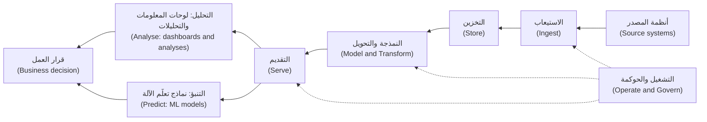
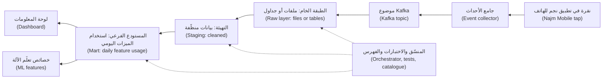
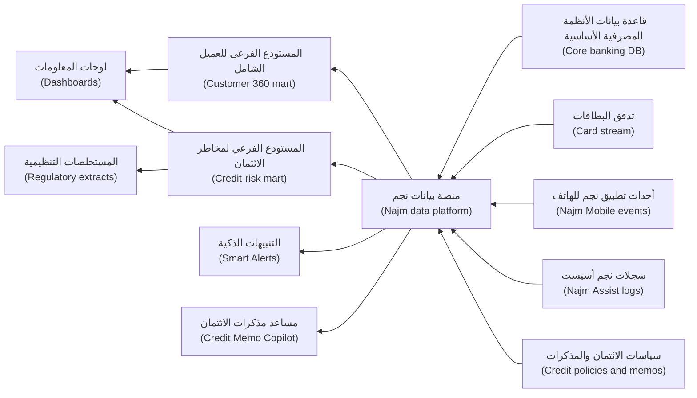

# الوحدة 0 — التوجيه (Orientation)

*قبل أن تكتب خط بيانات (pipeline) أو لوحة معلومات (dashboard)، تحتاج إلى خريطة. تمنحك هذه الوحدة ثلاث خرائط. الأولى خريطة للعمل: ما يفعله كلٌّ من مهندسي البيانات (data engineers) ومهندسي التحليلات (analytics engineers) والمحلّلين (analysts) وعلماء البيانات (data scientists) ومهندسي تعلّم الآلة (ML engineers)، وكيف يمرّ سؤال عمل واحد (business question) عبرهم جميعًا. الثانية خريطة للنظام: المسار الذي تسلكه نقرة واحدة في تطبيق نجم للهاتف (Najm Mobile)، عبر الاستيعاب (ingestion) والتخزين (storage) والتحويل (transformation) والاختبار (testing)، حتى تصبح رقمًا على لوحة معلومات يستخدمه أحدهم لاتخاذ قرار. الثالثة خريطة للمكان: بنك نجم (Najm Bank)، وفريق منصة البيانات والتحليلات (Data Platform & Analytics) فيه، والأنظمة التي يديرها، وكيف تستخدم هذا المقرر لبناء ملف أعمال (portfolio) أثناء تقدّمك. ستلتقي فيصل، الذي يدير المنصة ويصبح مرشدك (mentor)، وهدى، الخرّيجة الجديدة (new graduate) التي تبدأ في الأسبوع نفسه الذي تبدأ فيه، وتتعلّم، أحيانًا بالطريقة الصعبة، لماذا لا يكون «الرقم الذي على الشريحة» مجرد استعلام أبدًا.*

> **المراحل (Stages):** Ingest, Store, Model, Transform, Serve, Analyse, Operate, Govern — دورة حياة البيانات كاملةً بنظرة واحدة، قبل أن تقرّب كل وحدة الصورة إلى جزء منها.

---

# 0.1 — ما هندسة البيانات (data engineering) والتحليلات (analytics) وعلم البيانات (data science)، وكيف تتكامل معًا
*المستوى (Level): 🟢 مبتدئ (Beginner)* · *المتطلبات (Prerequisites): لا شيء (None)* · *المرحلة (Stage): Analyse, Serve*

## ⚡ الدرس في دقيقة (In 60 seconds)
- **هندسة البيانات (Data engineering)** تبني وتشغّل الأنظمة التي تنقل البيانات وتخزّنها وتهيّئها بموثوقية. **هندسة التحليلات (Analytics engineering)** تحوّل البيانات الخام (raw data) إلى جداول نظيفة ومختبرة وموثّقة ومقاييس متّفق عليها (agreed metrics). **تحليل البيانات (Data analysis)** يجيب عن أسئلة العمل (business questions) باستخدام تلك الجداول. **علم البيانات (Data science)** يبني نماذج تتنبأ أو تفسّر. **هندسة تعلّم الآلة (ML engineering)** تُبقي تلك النماذج عاملة في بيئة الإنتاج (running in production).
- ليست عوالم منفصلة (separate worlds). إنها مراحل سلسلة واحدة، وسؤال العمل يحتاج عادةً إليها جميعًا.
- القاعدة الأهم: **الرقم لا يكون جديرًا بالثقة إلا بقدر أضعف حلقة في السلسلة التي خلفه (a number is only as trustworthy as the weakest link in the chain behind it)**. النموذج البارع (brilliant model) المبني على بيانات حُمّلت بشكل سيئ هو إجابة خاطئة بارعة.
- إشارة القرار (Decision cue): حين يطلب أحدهم «لوحة معلومات» أو «نموذجًا»، اسأل أولًا *أيّ قرار سيغيّره* و*أيّ تعريف يقصده لكل مصطلح*.
- الفخ الأكبر (Biggest trap): معاملة الأرقام المتعارضة (disagreeing numbers) على أنها مشكلة أدوات. في الغالب هي مشكلة تعريف لا يملكها أحد (nobody owns).

## 🧭 لماذا يهم
إنه يوم الاثنين الأول لهدى في بنك نجم. في مراجعة الأعمال الأسبوعية، تقول شريحة فريق التجزئة (retail team) إن لدى نجم **412,000 عميل نشط (active customers)**. بعد عشر دقائق، تقول شريحة المالية (finance slide) **368,000**. (الأرقام افتراضية (hypothetical)، لكن الموقف شائع في كل مؤسسة تملك بيانات.) يسأل الرئيس التنفيذي للعمليات أيّهما الصحيح. لا يجيب أحد. كتب كريم، محلّل بيانات التجزئة (retail data analyst)، استعلامًا (query)؛ وكتب شخص في المالية الاستعلام الآخر. كلا الاستعلامين يعمل دون أخطاء (without errors). وكلاهما «صحيح» (correct).

بعد الاجتماع، يأخذ فيصل، رئيس منصة البيانات (Head of Data Platform)، هدى جانبًا. «الرقمان صحيحان، كلٌّ بحسب تعريفه الخاص لكلمة *نشط (active)*. التجزئة تعدّ كل من لديه حساب مفتوح (open account). والمالية تعدّ كل من أجرى معاملة بنفسه خلال آخر 90 يومًا. مهمتنا ليست كتابة استعلام ثالث. مهمتنا أن نتأكد أن لدى البنك تعريفًا *واحدًا (one definition)*، يُبنى مرة واحدة (built once)، ويُختبر (tested)، ويُستخدم في كل مكان (used everywhere). لهذا وُجد هذا الفريق.»

يدور هذا الدرس حول ذلك الفريق: ما يفعله كل دور (role)، وأين تقع نقاط التسليم (hand-offs)، ولماذا تحدث معظم إخفاقات البيانات (data failures) في الفجوات بين الأدوار لا داخل دور بعينه.

## 📐 كيف يعمل

### 🟢 الأساسيات

**البيانات (Data)** هنا تعني حقائق مسجّلة (recorded facts) عن أشياء حدثت: عميل فتح حسابًا، بطاقة نُقرت عند مقهى، دفعة قرض وصلت متأخرة، شخص ضغط «تجميد البطاقة» (Freeze card) في التطبيق. تجمع المؤسسات هذه الحقائق في **الأنظمة التشغيلية (operational systems)**، أي البرمجيات التي تدير العمل يومًا بيوم، مثل قاعدة بيانات الأنظمة المصرفية الأساسية (core banking database). تُبنى تلك الأنظمة لكي *تنفّذ* الأشياء بسرعة وأمان، عميلًا واحدًا في كل مرة. ولا تُبنى لكي *تجيب (answer)* عن أسئلة تشمل ملايين العملاء. الأدوار أدناه موجودة لسدّ تلك الفجوة.

| الدور | السؤال الذي يجيب عنه | ما يبنيه | الأدوات المعتادة (Typical tools) |
|---|---|---|---|
| **مهندس البيانات (Data engineer)** | «هل تصل البيانات الصحيحة كاملةً وفي موعدها، وهل يمكننا إعادة تشغيلها بأمان؟» | مهام الاستيعاب (ingestion jobs)، وخطوط البيانات (pipelines)، والتخزين، والتنسيق (orchestration)، والمنصة نفسها | SQL، وPython، وPostgreSQL، وKafka، وAirflow أو Dagster، ومستودع بيانات (warehouse) أو مستودع بحيري (lakehouse) |
| **مهندس التحليلات (Analytics engineer)** | «هل هذا الجدول نظيف ومختبر وموثّق، وهل يعني *العميل النشط (active customer)* شيئًا واحدًا؟» | جداول منمذجة (modelled tables)، واختبارات (tests)، وتعريفات المقاييس (metric definitions)، وتوثيق (documentation) | SQL، وdbt، والتحكم في الإصدارات (version control) |
| **محلّل البيانات (Data analyst)** | «ماذا حدث، ولماذا، وماذا ينبغي أن نفعل حياله؟» | تحليلات (analyses)، ولوحات معلومات (dashboards)، وتوصيات (recommendations) | SQL، وجداول البيانات (spreadsheets)، وأداة ذكاء أعمال (BI tool) مثل Metabase أو Superset |
| **عالم البيانات (Data scientist)** | «ما الذي يُرجَّح أن يحدث، وماذا سيحدث لو غيّرنا شيئًا؟» | نماذج (models)، وتجارب (experiments)، وتحليلات إحصائية (statistical analyses) | Python، ودفاتر الملاحظات التفاعلية (notebooks)، والإحصاء (statistics)، ومكتبات تعلّم الآلة (ML libraries) |
| **مهندس تعلّم الآلة (ML engineer)** | «هل سيظل هذا النموذج يعمل في الإنتاج، على نطاق واسع، في الشهر القادم؟» | خطوط الخصائص (feature pipelines)، وخطوط التدريب (training pipelines)، وتقديم النماذج ومراقبتها | Python، وMLflow، ومخزن خصائص (feature store)، والحاويات (containers) |

تختلف المسمّيات الوظيفية (titles) بين الشركات. في الشركة الصغيرة يؤدي شخص واحد الأدوار الخمسة كلها. وفي البنك الكبير قد يكون كلٌّ منها فريقًا. ما لا يختلف هو *العمل*. كل واحدة من هذه الوظائف يجب أن يؤديها أحد، وإلا انكسرت السلسلة.

**الأنواع الأربعة من الأسئلة (The four kinds of question).** من الطرق المفيدة لرؤية كيف تتكامل الأدوار النظرُ إلى نوع السؤال المطروح:
- **وصفي (Descriptive):** *ماذا حدث؟ ⁦⁩* «كم عميلًا جمّد بطاقته الأسبوع الماضي؟» في الغالب المحلّلون، على جداول بناها المهندسون.
- **تشخيصي (Diagnostic):** *لماذا حدث؟ ⁦⁩* «لماذا تضاعفت عمليات تجميد البطاقات (card freezes) يوم الخميس؟» المحلّلون، وغالبًا مع مهندسي البيانات الذين يتحققون مما إذا كانت البيانات نفسها قد تغيّرت.
- **تنبّؤي (Predictive):** *ماذا سيحدث؟ ⁦⁩* «أيّ معاملات البطاقات (card transactions) يُرجَّح أن تكون احتيالًا (fraud)؟» علماء البيانات؛ وهذا هو نموذج الاحتيال (fraud model) لدى نجم المسمّى **التنبيهات الذكية (Smart Alerts)**.
- **توجيهي (Prescriptive):** *ماذا ينبغي أن نفعل؟ ⁦⁩* «هل ينبغي أن نحظر هذه المعاملة أم نرسل تنبيهًا؟» علماء البيانات وقطاع العمل معًا، وغالبًا يُختبر ذلك بتجربة.

كل خطوة صعودًا في القائمة تحتاج إلى كل ما تحتها. لا يمكنك التنبؤ بالاحتيال (predict fraud) من بيانات لا تستطيع وصفها بشكل صحيح (describe correctly).

**السؤال نفسه، بتعريفين (Same question, two definitions).** إليك خلاف صباح الاثنين مكتوبًا بلغة SQL. كلا الاستعلامين صالح (valid). وهما يجيبان عن سؤالين مختلفين (different questions).

```sql
-- DuckDB syntax (in PostgreSQL, write INTERVAL '90 days')
-- Retail's definition: holds at least one open account
SELECT COUNT(DISTINCT customer_id) AS active_customers
FROM accounts
WHERE status = 'open';

-- Finance's definition: made at least one customer-initiated
-- transaction in the 90 days up to the reporting date
SELECT COUNT(DISTINCT a.customer_id) AS active_customers
FROM transactions AS t
JOIN accounts AS a ON a.account_id = t.account_id
WHERE t.initiated_by = 'customer'
  AND t.txn_date >  DATE '2026-02-28' - INTERVAL 90 DAY
  AND t.txn_date <= DATE '2026-02-28';
```

العميل الذي لديه حساب مفتوح لكنه لا يدفع سوى رسوم شهرية (monthly fee) يُحسب في الاستعلام الأول ولا يُحسب في الثاني. لا أحد من الاستعلامين خاطئ. الخطأ هو بنكٌ يصل فيه الرقمان إلى الاجتماع نفسه تحت الاسم نفسه. وإصلاح ذلك هو مهمة هندسة التحليلات، والدرس 4.1 يبيّن كيف.

### 🟡 التعمق أكثر (Going deeper)

**دورة حياة البيانات (The data life cycle).** يصنّف هذا المقرر كل درس بمرحلة أو مرحلتين من ثماني **مراحل (stages)**. فكّر فيها على أنها الخطوات التي تمر بها كل قطعة بيانات مفيدة:

| المرحلة | ما يحدث | من يقود عادةً |
|---|---|---|
| **الاستيعاب (Ingest)** | تُنسخ البيانات من مكان إنشائها إلى منصة البيانات (data platform) | مهندس البيانات |
| **التخزين (Store)** | تُحفظ بشكل رخيص وآمن وسريع الاستعلام | مهندس البيانات |
| **النمذجة (Model)** | تُصمَّم بنيتها: أيّ الجداول، وبأيّ مستوى تفصيل، وكيف ترتبط (linked how) | مهندس التحليلات، ومهندس البيانات |
| **التحويل (Transform)** | تُنظَّف البيانات الخام وتُدمج ويُعاد تشكيلها في الجداول المنمذجة | مهندس التحليلات |
| **التقديم (Serve)** | تُتاح الجداول والمقاييس والخصائص للأشخاص والأنظمة | مهندس التحليلات، ومهندس تعلّم الآلة |
| **التحليل (Analyse)** | يستخدم الناس البيانات للإجابة عن الأسئلة واتخاذ القرارات | المحلّل (Analyst)، وعالم البيانات |
| **التشغيل (Operate)** | يُراقَب كل شيء ويُختبر ويُعاد تشغيله ويُبقى ضمن التكلفة | مهندس البيانات، ومهندس تعلّم الآلة |
| **الحوكمة (Govern)** | تُحدَّد الملكية والوصول والخصوصية والجودة وتُفرض (enforced) | الجميع (Everyone)، مع مسؤول حماية البيانات (DPO) وفريق الحوكمة (governance team) |



الخطوط المنقّطة (dotted lines) مهمة. التشغيل والحوكمة ليسا خطوتين في النهاية؛ بل ينطبقان عند كل قفزة.

**أين تنكسر نقاط التسليم (Where the hand-offs break).** معظم حوادث البيانات (data incidents) لا تأتي من شخص واحد يؤدي عمله بشكل سيئ. بل تأتي من نقطة تسليم (hand-off) لم يملكها أحد (nobody owned):
- يغيّر فريق التطبيق (app team) اسم حدث، فيستمر خط البيانات في تحميله، لكن كل لوحة معلومات كانت تُرشّح على الاسم القديم تهبط بصمت إلى الصفر. (نقطة التسليم *من المنتِج إلى المهندس*. يسمّي الدرس 3.2 الحلَّ عقدَ بيانات (data contract).)
- ينسخ محلّل استعلام «إيرادات» (revenue) من دفتر ملاحظات قديم (old notebook) إلى لوحة معلومات جديدة، مع مرشّح (filter) لا يتذكر أحد أنه أضافه. (نقطة التسليم *من المهندس إلى المحلّل*. يضع الدرس 4.1 التعريفات في مكان واحد.)
- يدرّب عالم بيانات نموذجًا على مستخلص نُظّف بعناية، لكن خط بيانات الإنتاج (production pipeline) يغذّيه ببيانات مختلفة قليلًا. (نقطة التسليم *من عالم البيانات إلى مهندس تعلّم الآلة*. يتناول الدرس 5.1 ذلك.)

قاعدة فيصل لهدى: *حين تستلم بيانات، اسأل من ينتجها وماذا وعد؛ وحين تسلّم بيانات لغيرك، اكتب ما تعِد به.*

**هندسة التحليلات، باختصار (Analytics engineering, briefly).** هذا الدور أحدث من الأدوار الأخرى. انتشر الاسم بفضل المجتمع المحيط بأداة **dbt**، الأداة مفتوحة المصدر (open-source tool) التي تتيح لك كتابة التحويلات (transformations) بلغة SQL خاضعة للتحكم في الإصدارات (version-controlled SQL) مع اختبارات. والفكرة التي وراءها أقدم وبسيطة: المنطق الذي يحوّل البيانات الخام إلى جداول موثوقة (trusted tables) هو *برمجيات (software)*، وينبغي معاملته كبرمجيات، مع مراجعة الشيفرة (code review) والاختبارات والتوثيق. ستفعل هذا في الدرس 3.1.

### 🔴 نظرة الخبير (Expert view)

**القيمة تأتي من القرارات لا من البيانات (Value comes from decisions, not data).** خط البيانات الذي يعمل بإتقان لكنه يغذّي لوحة معلومات لا يستخدمها أحد له تكلفة بلا قيمة. تعمل فرق البيانات القوية بالعكس انطلاقًا من القرار: «يقرّر فريق الاحتيال (fraud team) كل صباح أيّ قواعد التنبيه (alert rules) سيشدّدها. ماذا يحتاجون أن يروا، وبأيّ حداثة، وما درجة اليقين المطلوبة؟» تلك الجملة الواحدة تخبرك بهدف الحداثة (freshness target)، وحُبَيبية الجدول، وفحوص الجودة المهمة، ومن تتصل به حين ينكسر.

**مركزي أو مدمج أو محوري متفرّع (Centralised, embedded or hub-and-spoke).** تنظّم المؤسسات هذه الأدوار بثلاث طرق شائعة. فريق بيانات *مركزي (central)* يملك كل شيء؛ هو متّسق (consistent) لكنه يتحوّل إلى طابور. ومحلّلون *مدمجون (Embedded)* يجلسون في كل وحدة عمل (business unit)؛ هم سريعون لكن التعريفات تتباعد، وهذه بالضبط مشكلة صباح الاثنين. أما *المحور والأذرع (Hub and spoke)* فيحتفظ بمنصة مركزية وتعريفات مشتركة (المحور) مع محلّلين وعلماء بيانات داخل قطاع العمل (الأذرع). تستخدم نجم نموذج المحور والأذرع: فريق فيصل يملك المنصة، والنماذج الأساسية (core models)، وتعريفات المقاييس؛ وكريم يجلس مع التجزئة (retail). وثمة فكرة قريبة، هي **شبكة البيانات (data mesh)** (التي وصفتها Zhamak Dehghani عام 2019)، تدفع ملكية منتجات البيانات أبعد نحو فرق المجالات (domain teams). إنها مجموعة من المبادئ التنظيمية (organisational principles)، لا أداة، ولا تنجح إلا حيث تملك فرق المجالات المهارات والمنصة لامتلاك البيانات جيدًا.

**البيانات المنظَّمة ترفع السقف (Regulated data raises the bar).** في البنك، قد يصبح الرقم الخاطئ تقريرًا تنظيميًا خاطئًا أو قرارًا ائتمانيًا غير عادل، لا مجرد اجتماع محرج (awkward meeting). لهذا تظهر الحوكمة (governance) في كل وحدة من هذا المقرر، ولهذا ستظهر سارة، مسؤولة حماية البيانات (Data Protection Officer) لدى نجم، وليلى، رئيسة حوكمة الذكاء الاصطناعي (Head of AI Governance)، كثيرًا في المحادثة نفسها مع خط بيانات. وللتعمق في الجانب القانوني وجانب حوكمة الذكاء الاصطناعي (AI-governance side)، راجع [*حوكمة الذكاء الاصطناعي: من الصفر إلى الاحتراف (AI Governance: Zero to Hero)*، الدرس 3.2 — سياسات حوكمة البيانات والملكية الفكرية للذكاء الاصطناعي](../aigp/index.ar.html#/3.2).

## 🧰 الأدوات
| الأداة أو النمط أو المعيار (Tool, pattern or standard) | ما هو وماذا يفعل | متى تلجأ إليه |
|---|---|---|
| **SQL** — لغة الاستعلام البنيوية | اللغة المعيارية (standard language) للاستعلام عن الجداول وتشكيلها؛ يستخدمها كل دور بيانات يوميًا | دائمًا (Always). إنها المهارة الوحيدة التي تشترك فيها كل الأدوار في هذا الدرس |
| **Python** (pandas, Polars) — لغة البرمجة بايثون | لغة عامة الأغراض (general-purpose language) مع مكتبات لأُطر البيانات (data frames) والإحصاء وتعلّم الآلة (ML) | البيانات التي لا تتعامل معها SQL جيدًا: الملفات (files)، وواجهات البرمجة (APIs)، والإحصاء، والنماذج |
| **dbt** — أداة التحويل dbt (وdbt Core مفتوحة المصدر) | تشغّل تحويلات SQL (SQL transformations) كنماذج خاضعة للتحكم في الإصدارات (version-controlled models) مع اختبارات وتوثيق (tests and documentation) | تحويل الجداول الخام (raw tables) إلى نماذج موثوقة ومختبرة (الدرس 3.1) |
| **Jupyter notebooks** — دفاتر Jupyter التفاعلية | مستندات تفاعلية (interactive documents) تمزج الشيفرة والمخرجات والملاحظات | الاستكشاف والتحليل؛ لا كخط بيانات الإنتاج نفسه |
| **Data life cycle stages** — مراحل دورة حياة البيانات | المراحل الثماني المستخدمة في هذا المقرر: Ingest, Store, Model, Transform, Serve, Analyse, Operate, Govern | وضع أيّ مهمة أو أداة أو مشكلة على الخريطة، ورؤية من يملكها |
| **Hub-and-spoke data team** — فريق البيانات بنموذج المحور والأذرع | منصة مركزية وتعريفات مشتركة، مع محلّلين وعلماء بيانات مدمجين في قطاع العمل | النمو إلى ما بعد فريق واحد دون ترك التعريفات تتباعد |

## 🏛️ عمليًا في بنك نجم
يطلب فيصل من هدى إعداد **بطاقة استقبال طلبات البيانات (data request intake card)** لسؤال «العملاء النشطين». من الآن فصاعدًا، يبدأ كل طلب جديد للفريق بواحدة من هذه البطاقات، قبل أن يكتب أحد أيّ استعلام.

| الحقل (Field) | إجابة نجم عن «العملاء النشطين» |
|---|---|
| الطلب (Request) | رقم واحد للعملاء النشطين، تستخدمه التجزئة والمالية |
| القرار الذي يدعمه | الأهداف الفصلية لفريق التجزئة؛ وعدد العملاء في ملف مجلس الإدارة |
| نوع السؤال (Question type) | وصفي |
| التعريفات الواجب الاتفاق عليها | *نشط*: معاملة واحدة على الأقل بمبادرة من العميل (customer-initiated transaction) خلال الـ 90 يومًا حتى تاريخ التقرير (reporting date). *العميل (Customer)*: شخص واحد أو شركة واحدة، مهما كان عدد الحسابات التي يملكها |
| مالك التعريف | رئيس التجزئة مع المراقب المالي (Finance Controller)؛ وتصوغه لينا (مهندسة التحليلات) |
| المصادر (Sources) | قاعدة بيانات الأنظمة المصرفية الأساسية: `customers`، `accounts`، `transactions` |
| المراحل المعنية (Stages involved) | الاستيعاب (هدى)، والنمذجة والتحويل (لينا)، والتقديم (لينا)، والتحليل (كريم)، والحوكمة (سارة تتحقق من استخدام البيانات الشخصية) |
| الحداثة المطلوبة (Freshness needed) | التحديث اليومي يكفي؛ فالقرار شهري |
| فحوص الجودة (Quality checks) | لا عملاء مكرّرون؛ ولا تواريخ معاملات في المستقبل؛ ولا يتحرك العدد أكثر من مقدار متّفق عليه من يوم لآخر (day to day) دون تفسير |
| أين سيُحفظ | مستودع العميل الشامل (customer 360 mart) وفهرس المقاييس (metrics catalogue) (الدرس 4.1)؛ ولوحات معلومات التجزئة والمالية تقرأ كلتاهما منه |
| خارج النطاق | التنبؤ بأيّ العملاء سيصبحون غير نشطين (طلب علم بيانات منفصل) |

البطاقة قصيرة عن قصد. مهمتها أن تفرض المحادثتين اللتين تمنعان معظم مشكلات البيانات: *لأيّ قرار هذا*، و*ماذا تعني هذه الكلمات بالضبط*.

## 🛠️ التمارين (Exercises)
- 🟢 ابحث عن خمسة إعلانات وظائف حقيقية: واحد لكلٍّ من مهندس البيانات، ومهندس التحليلات، ومحلّل البيانات، وعالم البيانات، ومهندس تعلّم الآلة. لكل إعلان، اذكر المهارات الثلاث الأكثر ظهورًا وضع الدور على دورة الحياة ذات المراحل الثماني. *يكتمل عندما (Done when):* يكون لديك جدول من صفحة واحدة (one-page table) وتستطيع أن تشرح، في جملتين، الفرق بين مهندس التحليلات ومحلّل البيانات.
- 🟡 ثبّت DuckDB على حاسوبك المحمول (laptop). أنشئ جدولين صغيرين `accounts` و`transactions` بعشرة صفوف مختلقة (made-up rows) لكلٍّ منهما، وشغّل استعلامَي «العميل النشط» من هذا الدرس. ثم أضف صفوفًا تجعل الرقمين يختلفان لثلاثة أسباب مختلفة (حساب برسوم فقط، وحساب مغلق، ومعاملة أقدم من 90 يومًا (a transaction older than 90 days)). *يكتمل عندما:* يعمل الاستعلامان وتستطيع شرح كل فرق صفًّا بصف.
- 🔴 اختر مقياسًا (metric) رأيته مُستشهَدًا به علنًا، مثل «المستخدمين النشطين شهريًا» في نتائج شركة، أو إحصاءً عامًا (public statistic) من بوابة البيانات المفتوحة (open-data portal) في بلدك. اكتب له بطاقة استقبال طلب بيانات: القرار الذي يدعمه، والتعريف الدقيق (exact definition)، والمصدر (source)، والمالك (owner)، والحداثة (freshness)، وثلاثة فحوص جودة. دوّن كل نقطة لا تخبرك فيها المادة المنشورة بما يكفي. *يكتمل عندما:* تكتمل البطاقة، وتُظهر قائمة الأسئلة غير المُجاب عنها (unanswered questions) موضعين على الأقل يمكن أن يعني فيهما الرقم بهدوء أشياء مختلفة.

## ⚠️ أخطاء وفخاخ (Mistakes and traps)
- **معاملة الخلاف على أنه خطأ في الاستعلام (Treating a disagreement as a query bug).** نادرًا ما يختلف رقمان لأن SQL معطوبة. ابحث عن التعريفات أولًا، ثم عن المالك الذي يحسم بينها.
- **البدء من الأداة (Starting from the tool).** «نحتاج لوحة معلومات» أو «نحتاج نموذجًا» حلٌّ لا طلب. اسأل أيّ قرار سيتغيّر.
- **الظن أن دورك ينتهي عند نقطة تسليمك (Thinking your role ends at your hand-off).** مهندس البيانات الذي يحمّل بيانات لا يثق بها أحد، وعالم البيانات الذي لا يستطيع أحد تشغيل نموذجه، كلاهما يفشل. اعرف المرحلة التي قبل مرحلتك والتي بعدها.
- **استخدام دفتر الملاحظات كنظام إنتاج (Using a notebook as the production system).** دفاتر الملاحظات ممتازة للاستكشاف (exploring) وسيئة في أن يعيد تشغيلها شخص آخر بموثوقية في السادسة صباحًا. انقل كل ما يهم إلى خط بيانات (الدرسان 2.2 و5.1).
- **نسخ الاستعلامات بدل إعادة استخدام النماذج (Copying queries instead of reusing models).** كل استعلام منسوخ (copied query) هو تعريف سيتباعد. ابنِه مرة واحدة، واختبره، ووجّه كل شيء إليه.

## 🧾 الخلاصة (Recap)
- هندسة البيانات تنقل البيانات وتخزّنها بموثوقية؛ وهندسة التحليلات تحوّلها إلى جداول مختبرة ومقاييس متّفق عليها؛ والمحلّلون يجيبون عن الأسئلة؛ وعلماء البيانات يتنبؤون؛ ومهندسو تعلّم الآلة يُبقون النماذج عاملة.
- تشكّل الأدوار سلسلة واحدة (one chain)، والسلسلة لا تكون أقوى من أضعف نقطة تسليم فيها.
- الأسئلة الوصفية والتشخيصية والتنبّؤية والتوجيهية يبني بعضها على بعض.
- المراحل الثماني هي خريطة المقرر كله.
- ابدأ كل طلب (every request) من القرار الذي يدعمه والتعريفات الدقيقة التي يحتاجها.

## ✍️ اختبر نفسك (Check yourself)

**1. في مراجعة الأعمال (business review) لدى نجم، تُبلغ التجزئة (retail) عن 412,000 عميل نشط (active customers) وتُبلغ المالية (finance) عن 368,000. كلا الاستعلامين يعمل دون أخطاء (without errors). ما السبب الجذري الأرجح (most likely root cause)؟**

- A. أحد الاستعلامين يحتوي خطأً نحويًا (syntax error) تخطّته قاعدة البيانات بصمت أثناء العدّ
- B. تعريفان لـ«العميل النشط» (active customer)، دون أن يملك أحدٌ أيًّا منهما
- C. مستودع البيانات (warehouse) أبطأ من أن يعدّ مئات الآلاف من العملاء بدقة في تمريرة واحدة
- D. بنت المالية (finance) رقمها بلغة Python بينما بنت التجزئة (retail) رقمها بلغة SQL

<details><summary>الإجابة</summary>

**B.** يمكن أن يكون كلا الاستعلامين صحيحًا بحسب تعريفه الخاص. والحل تعريف متّفق عليه ومملوك يُبنى مرة واحدة (built once). الخيار A مغرٍ (tempting)، لكن الاستعلام الذي فيه خطأ نحوي (syntax error) لن يعمل أصلًا، والسيناريو يقول إن كليهما يعمل. (🟢 الأساسيات.)

</details>

**2. أيّ دور هو المسؤول أساسًا (mainly responsible) عن تحويل الجداول الخام (raw tables) إلى نماذج نظيفة ومختبرة وموثّقة (clean, tested, documented models) مع تعريفات مقاييس متّفق عليها (agreed metric definitions)؟**

- A. عالم البيانات (Data scientist)، الذي يبني النماذج التنبّؤية (predictive models)
- B. مهندس تعلّم الآلة (ML engineer)، الذي يُبقي النماذج عاملة في الإنتاج (running in production)
- C. محلّل البيانات (Data analyst)، الذي يجيب عن أسئلة العمل بلوحات المعلومات
- D. مهندس التحليلات (Analytics engineer)

<details><summary>الإجابة</summary>

**D.** مهندسو التحليلات (Analytics engineers) يملكون طبقة التحويل (transformation layer) والتعريفات (definitions). والمحلّلون (Analysts) (C) يستخدمون تلك الجداول للإجابة عن الأسئلة؛ وقد يساعدون في تعريف المقاييس (define metrics) لكنهم لا يملكون عادةً النماذج المختبرة (tested models). (🟢 الأساسيات.)

</details>

**3. يسأل فريق الاحتيال (fraud team) هدى: «أيّ معاملات البطاقات غدًا يُرجَّح أن تكون احتيالًا؟ ⁦(Which card transactions tomorrow are likely to be fraud?)⁩» ما نوع هذا السؤال (what kind of question)، ومن يقود الإجابة عادةً (who usually leads the answer)؟**

- A. تنبّؤي (Predictive)؛ عالم بيانات
- B. وصفي (Descriptive)؛ محلّل بيانات، يبني لوحة معلومات لحالات الاحتيال المؤكدة في الشهر الماضي
- C. تشخيصي (Diagnostic)؛ مهندس البيانات، الذي يفحص سجلات خط البيانات (pipeline logs) بحثًا عمّا تعطّل أمس
- D. توجيهي (Prescriptive)؛ مسؤول حماية البيانات، الذي يقرّر أيّ المعاملات يجوز تقييمها

<details><summary>الإجابة</summary>

**A.** التنبؤ بما سيحدث سؤال تنبّؤي (predictive question)، وهو مهمة نموذج التنبيهات الذكية (Smart Alerts) لدى نجم. الخيار B يصف ما حدث بالفعل؛ والخيار D يخلط بين الحوكمة والتحليل. (🟢 الأساسيات.)

</details>

**4. يغيّر فريق التطبيق (app team) اسم الحدث `card_freeze` إلى `card_freeze_tap`. يستمر خط البيانات (pipeline) في العمل، لكن لوحة معلومات «تجميد البطاقات» (card freezes) تهبط إلى الصفر (drops to zero). أين انكسرت السلسلة (where did the chain break)؟**

- A. في إعدادات الرسم البياني (chart settings) في أداة ذكاء الأعمال (BI tool)، لأن هناك يظهر الصفر أولًا
- B. في نموذج عالم البيانات، الذي دُرّب على اسم الحدث القديم
- C. عند نقطة التسليم من المنتِج إلى المنصة (producer-to-platform hand-off)، التي لم يغطّها أيّ اتفاق
- D. في صيغة التخزين (storage format) في مستودع البيانات (warehouse)، التي لا تستطيع حمل اسمَي حدث للإجراء نفسه

<details><summary>الإجابة</summary>

**C.** غيّر المنتِج (producer) شيئًا كان المستهلكون (consumers) يعتمدون عليه، ولم يجعل شيءٌ ذلك الاعتماد صريحًا. عقود البيانات (Data contracts) تسدّ هذه الفجوة. الخيار A مغرٍ لأن الصفر يظهر على لوحة المعلومات، لكن الرسم البياني (chart) لا يعرض إلا ما تقوله البيانات الآن. (🟡 التعمق أكثر (Going deeper).)

</details>

**5. لدى نجم محلّلون في كل وحدة عمل (business unit)، يكتب كلٌّ منهم استعلامات مقاييسه الخاصة (metric queries)، والأرقام تتباعد باستمرار (keep drifting apart). أيّ تغيير يعالج هذا على أفضل وجه مع إبقاء المحلّلين قريبين من قطاع العمل (close to the business)؟**

- A. نقل كل محلّل إلى فريق بيانات مركزي واحد يستقبل كل الطلبات من طابور مشترك واحد
- B. المحور والأذرع (Hub and spoke): تعريفات مشتركة مركزيًا، ويبقى المحلّلون في الوحدات
- C. شراء أداة ذكاء أعمال ثانية لكي تقارن كل وحدة عمل نتائجها بنتائج الأخرى
- D. الطلب من كل محلّل توثيق تعريفات مقاييسه بعناية في مجلد فريقه الخاص (team folder)

<details><summary>الإجابة</summary>

**B.** المحور يعطي تعريفًا واحدًا؛ والأذرع تُبقي معرفة العمل قريبة. الخيار A يصلح الاتساق (fixes consistency) لكنه يخلق عنق زجاجة (bottleneck)؛ والخيار D يوثّق التباعد دون أن يوقفه. (🔴 نظرة الخبير (Expert view).)

</details>

## 📚 المراجع (References)
- توثيق PostgreSQL (PostgreSQL documentation) — https://www.postgresql.org/docs/
- توثيق DuckDB (DuckDB documentation) — https://duckdb.org/docs/
- توثيق dbt (dbt documentation) — https://docs.getdbt.com/
- مشروع Jupyter (Project Jupyter) — https://jupyter.org/
- DAMA International، *DAMA-DMBOK: Data Management Body of Knowledge* (الطبعة الثانية (2nd edition)) — https://www.dama.org/
- Joe Reis وMatt Housley، *Fundamentals of Data Engineering* (O'Reilly)

---

# 0.2 — حزمة البيانات الحديثة من طرف إلى طرف: من نقرة في التطبيق إلى رقم على لوحة المعلومات
*المستوى: 🟢 مبتدئ* · *المتطلبات: 0.1* · *المرحلة: Ingest, Serve*

## ⚡ الدرس في دقيقة (In 60 seconds)
- **حزمة البيانات الحديثة (modern data stack)** هي السلسلة المعتادة من المكوّنات: المصادر ← الاستيعاب ← التخزين ← التحويل ← التقديم (serving) (لوحات المعلومات، والنماذج، والتطبيقات)، مع التنسيق وفحوص الجودة والحوكمة تعمل بموازاتها (running alongside).
- تستخدم فرق كثيرة اليوم **ELT**: تحميل البيانات الخام أولًا، ثم تحويلها داخل مستودع البيانات أو المستودع البحيري بلغة SQL.
- تتحرك البيانات عبر **طبقات (layers)**: **الخام (raw)** (تمامًا كما وصلت)، و**التهيئة (staging)** (منظّفة ومُعاد تسميتها)، و**المستودعات الفرعية (marts)** (منمذجة لغرض عمل).
- القاعدة الأهم: **كل قفزة يمكن أن تغيّر الرقم بصمت (every hop can silently change the number)**. التكرارات (duplicates)، والمناطق الزمنية (time zones)، والبيانات المتأخرة (late data)، والاقتطاع (truncation)، لكلٍّ منها موطن في مكان ما على المسار.
- إشارة القرار: لأيّ رقم على لوحة معلومات، ينبغي أن تستطيع تسمية كل قفزة مرّ بها، ومن يملك كلًّا منها، ومدى حداثته.
- الفخ الأكبر: فحص الخطوة الأخيرة فقط. يمكن أن تُبنى لوحة معلومات بإتقان فوق بيانات كانت خاطئة قبل ثلاث قفزات.

## 🧭 لماذا يهم
في مارس، يطلق تطبيق نجم للهاتف زر «تجميد البطاقة» على الشاشة الرئيسية (home screen). تقول لوحة معلومات كريم إن **المستخدمين اليوميين لميزة تجميد البطاقة (daily users of Freeze card) قفزوا 40% يوم الإطلاق (on launch day)**. يحتفل فريق المنتج (product team). بعد يومين، تلاحظ هدى أن عدد *النقرات (taps)* أعلى بكثير من عدد *العملاء (customers)*، وأن كثيرًا من نقرات يوم الإطلاق مختومة (stamped) بعد الساعة 21:00 بالتوقيت العالمي المنسّق (UTC)، أي بعد منتصف الليل، في اليوم التالي، في الدوحة (Doha). (نجم والميزة والأرقام افتراضية.)

يتبيّن أن أمرين حدثا في الطريق من الهاتف إلى الرسم البياني. التطبيق يعيد محاولة إرسال الحدث حين تكون الشبكة بطيئة، فتصل بعض النقرات مرتين (arrive twice). ولوحة المعلومات جمّعت الأحداث حسب تاريخ **UTC**، المتأخر ثلاث ساعات عن الدوحة. فوقعت النقرات المسائية (evening taps) في اليوم «الخطأ». لم يتعطّل شيء بالمعنى المعتاد. كل مكوّن فعل ما بُني ليفعله. ومع ذلك كان الرقم خاطئًا.

تُظهر أمثلة عامة (public examples) كم يمكن أن تكون لقفزة واحدة أهمية. في أوائل أكتوبر 2020، تبيّن أن أرقام كوفيد-19 اليومية في إنجلترا (England's daily COVID-19 figures) أغفلت نحو 16,000 حالة إيجابية (positive cases) على مدى أسبوع تقريبًا. وأرجعت روايات منشورة على نطاق واسع ذلك إلى خطوة كانت تحمّل نتائج الاختبارات في صيغة ملفات جداول بيانات قديمة ذات حدّ للصفوف (row limit)، فأُسقطت الصفوف التي تتجاوز الحدّ دون خطأ. كل نظام حولها عمل. وقفزة واحدة اقتطعت البيانات بصمت.

يمشي بك هذا الدرس على المسار كله مرة واحدة، لكي تعرف أين تبحث.

## 📐 كيف يعمل

### 🟢 الأساسيات

تتبّع نقرة واحدة على «تجميد البطاقة» من هاتف هدى إلى الرسم البياني لدى كريم (Kareem's chart).



**الخطوة 1: المصدر (Step 1: Source).** ينشئ التطبيق **حدثًا (event)**: سجلًّا صغيرًا بأن شيئًا ما حدث، مثل `{"event_id": "e1", "customer_id": "c001", "event_name": "card_freeze_tap", "event_ts": "2026-03-01T21:30:00Z"}`. ومن المصادر الأخرى في نجم قاعدة بيانات الأنظمة المصرفية الأساسية (العملاء، والحسابات، والمعاملات، والقروض)، وتدفق تفويضات البطاقات، وسجلات محادثات نجم أسيست. ولمعرفة كيف ينبغي لفرق المنتج أن تصمّم أحداثها وتملكها، راجع [*تصميم الأنظمة لمبرمجي الحدس (System Design for Vibe Coders)*، الدرس 7.5 — تحليلات المنتج عمليًا](../vibe/index.ar.html#l7-5).

**الخطوة 2: الاستيعاب (Step 2: Ingestion).** شيءٌ ما ينسخ البيانات إلى المنصة. تمر الأحداث عادةً عبر **وسيط رسائل (message broker)** مثل **Apache Kafka**، الذي يخزّنها بشكل دائم، ومرتّبةً داخل كل قسم، ويتيح لعدة أنظمة قراءتها. أما جداول قواعد البيانات فتُنسخ بمهام **دفعية (batch)** (كل ساعة أو كل ليلة) أو عبر **التقاط تغيّر البيانات (change data capture, CDC)**، الذي يقرأ سجل التغييرات الخاص بقاعدة البيانات. يتناول الدرس 2.1 هذه الخيارات.

**الخطوة 3: التخزين (Step 3: Storage).** تستقر البيانات في **مستودع بيانات (warehouse)** (قاعدة بيانات مبنية للتحليل، مثل PostgreSQL للبيانات الصغيرة، أو Snowflake أو BigQuery أو Amazon Redshift أو Microsoft Fabric كخدمات مُدارة)، أو في **بحيرة بيانات (lake)** (ملفات، غالبًا بصيغة **Parquet**، على تخزين كائنات رخيص)، أو في **مستودع بحيري (lakehouse)**، الذي يضيف ميزات الجداول إلى البحيرة. يقارن الدرس 1.3 بينها. وللتعلّم، يؤدي **DuckDB** على حاسوبك المحمول دور مستودع البيانات جيدًا.

**الخطوة 4: التحويل (Step 4: Transformation).** تُحوَّل البيانات الخام إلى جداول مفيدة (useful tables) على طبقات:

| الطبقة (Layer) | ما تحمله | القاعدة (Rule) |
|---|---|---|
| **الخام (Raw)** (وتُسمّى أيضًا *البرونزية (bronze)* في تسمية الميدالية (medallion naming) لدى Databricks) | البيانات تمامًا كما وصلت، بتكراراتها وكل شيء | لا تعدّلها أبدًا؛ إنها دليلك وتتيح لك إعادة البناء |
| **التهيئة (Staging)** (*الفضية (silver)*) | جدول واحد منظّف لكل مصدر: أعمدة مُعاد تسميتها (renamed columns)، وأنواع صحيحة (correct types)، وتكرارات مُزالة (duplicates removed)، ومناطق زمنية مُصحّحة | مصدر واحد يدخل، وجدول واحد يخرج؛ ولا منطق عمل بعد |
| **المستودعات الفرعية (Marts)** (*الذهبية (gold)*) | جداول منمذجة لغرض عمل (modelled for a business purpose): العميل الشامل (customer 360)، ومخاطر الائتمان (credit risk)، واستخدام الميزات اليومي | حُبَيبية محدّدة (defined grain)، ومختبرة، وموثّقة، ومملوكة |

**الخطوة 5: التقديم (Step 5: Serving).** يقرأ الأشخاص والأنظمة المستودعاتِ الفرعية: لوحات معلومات في **أداة ذكاء أعمال (BI tool)** (business intelligence) مثل Metabase أو Apache Superset، وخصائص تعلّم الآلة (ML features) للتنبيهات الذكية، ومستخلصات للتقارير التنظيمية، ومستندات وتضمينات لمساعد مذكرات الائتمان (Credit Memo Copilot).

**ETL أم ELT؟ ⁦(ETL or ELT?)⁩** في **ETL** (الاستخراج ثم التحويل ثم التحميل)، تُحوَّل البيانات *قبل (before)* تحميلها إلى مستودع البيانات. وفي **ELT** (الاستخراج ثم التحميل ثم التحويل)، تُحمَّل البيانات الخام أولًا وتُحوَّل داخل مستودع البيانات بلغة SQL. أصبح ELT خيارًا افتراضيًا شائعًا (common default) مع ازدياد رخص مستودعات البيانات وقوتها بما يكفي للقيام بالتحويل. ميزته الكبرى: لأن البيانات الخام محفوظة، يمكنك إصلاح تحويل وإعادة بناء التاريخ. وما يزال لـ ETL مكانه، مثلًا حين يجب إخفاء البيانات الشخصية *قبل* أن تصل إلى المنصة أصلًا (الدرس 6.2).

### 🟡 التعمق أكثر

**خطأ يوم الإطلاق بلغة SQL (The launch-day bug in SQL).** إليك الأحداث الخام (raw events)، بما فيها تكرار (أعاد التطبيق محاولة إرسال `e1`):

| event_id | customer_id | event_name | event_ts_utc |
|---|---|---|---|
| e1 | c001 | card_freeze_tap | 2026-03-01 21:30 |
| e1 | c001 | card_freeze_tap | 2026-03-01 21:30 |
| e2 | c001 | card_freeze_tap | 2026-03-01 22:10 |
| e3 | c002 | card_freeze_tap | 2026-03-01 08:05 |
| e4 | c003 | card_freeze_tap | 2026-03-02 09:00 |

الطريقة الخاطئة تعدّ الصفوف (counts rows) وتجمّع حسب تاريخ UTC (تستخدم المقتطفات صياغة DuckDB):

```sql
-- Wrong: counts taps (including retries) and uses the UTC calendar day
SELECT CAST(event_ts_utc AS DATE) AS day, COUNT(*) AS users
FROM raw_app_events
GROUP BY 1
ORDER BY 1;
-- 2026-03-01 → 4,  2026-03-02 → 1
```

الطريقة الصحيحة تزيل التكرارات حسب `event_id` (removes duplicates)، وتحوّل إلى توقيت الدوحة، وتعدّ العملاء المتمايزين:

```sql
-- Right: one row per event, Doha calendar day, distinct customers
WITH deduped AS (
  SELECT DISTINCT ON (event_id) *
  FROM raw_app_events
  ORDER BY event_id
)
SELECT CAST(event_ts_utc + INTERVAL 3 HOUR AS DATE) AS day_doha,  -- Qatar is UTC+3 all year
       COUNT(DISTINCT customer_id)                  AS users
FROM deduped
GROUP BY 1
ORDER BY 1;
-- 2026-03-01 → 1,  2026-03-02 → 2
```

البيانات نفسها، والقصة معاكسة: «قفزة يوم الإطلاق» (launch-day spike) كانت إعادات محاولة (retries) ونقرات مسائية تنتمي إلى يوم الدوحة التالي. ينتج عن ذلك درسان. أولًا، إزالة التكرار (deduplication) ومعالجة المناطق الزمنية (time-zone handling) مكانهما في **التهيئة (staging)**، مرة واحدة (once)، لا في كل استعلام للوحة المعلومات. ثانيًا، الإزاحة الثابتة بثلاث ساعات تنجح مع قطر، التي لا تستخدم التوقيت الصيفي. أما العملاء في الاتحاد الأوروبي (EU)، الذين تتغيّر ساعاتهم مرتين في السنة، فاستخدم منطقة زمنية مسمّاة مثل `Europe/Berlin` مع دوال المناطق الزمنية في قاعدة بياناتك (time-zone functions) بدل الإزاحة الثابتة.

**التنسيق (Orchestration).** لا بد من شيء يشغّل كل خطوة بالترتيب، في الوقت الصحيح، ويعيد المحاولة أو ينبّه حين تفشل خطوة. ذلك هو **المنسّق (orchestrator)** مثل **Apache Airflow** أو **Dagster**. فهو يعرف أن نموذج التهيئة (staging model) يجب أن ينتظر التحميل الخام (raw load)، وأن المستودع الفرعي (mart) يجب أن ينتظر التهيئة. يعلّم الدرس 2.2 التنسيق، بما في ذلك كيف تجعل كل خطوة آمنة لإعادة التشغيل.

**فحوص الجودة عند كل طبقة (Quality checks at every layer).** الاختبارات مكانها في كل طبقة، لا في الأخيرة فقط:
- الخام: هل وصلت البيانات أصلًا، وبكمية قريبة من المعتاد؟ (الحداثة والحجم)
- التهيئة: هل قيم `event_id` فريدة بعد إزالة التكرار؛ وهل `customer_id` غير فارغ أبدًا (never empty)؟
- المستودعات الفرعية: هل يطابق كل صف عميلًا حقيقيًا؛ وهل يتحرك العدد اليومي ضمن نطاق متوقع؟

أدوات مثل اختبارات dbt (dbt tests) أو Great Expectations تشغّل هذه الفحوص تلقائيًا (الدرسان 3.1 و3.2).

**دفعي أم متدفق؟ ⁦(Batch or streaming?)⁩** معظم لوحات معلومات نجم تُحدَّث بنمط **الدفعي (batch)**: تُعالَج البيانات على شكل دفعات، كل ساعة أو كل ليلة. أما التنبيهات الذكية فلا تستطيع الانتظار كل هذا؛ إذ يجب أن تقيّم تفويض البطاقة في غضون لحظات (within moments)، لذا تقرأ تدفق البطاقات (card stream) بنمط **المتدفق (streaming)**، فتعالج كل حدث فور وصوله. المعالجة المتدفقة أصعب بناءً وتشغيلًا. اخترها حين يحتاج القرار فعلًا إلى ثوانٍ، لا لأنها تبدو عصرية (الدرس 2.3).

### 🔴 نظرة الخبير

**الحداثة وعدٌ لا خاصية (Freshness is a promise, not a property).** «الوقت الحقيقي» (Real-time) لا يعني شيئًا حتى يقول أحدهم بأيّ حداثة، ولأيّ قرار. اكتب **هدف حداثة (freshness target)** لكل مستودع فرعي: «يكون المستودع الفرعي لاستخدام الميزات اليومي مكتملًا ليوم الدوحة السابق بحلول 07:00.» ثم اعمل بالعكس (work backwards). إذا كان بناء المستودع الفرعي يستغرق 20 دقيقة، فيجب أن تنتهي التهيئة بحلول 06:40، والتحميل الخام قبل ذلك، ويجب أن يكون جامع الأحداث (event collector) قد دفع أحداث الأمس المتأخرة. تحصل كل قفزة على ميزانية. وحين تتأخر لوحة المعلومات، تنظر إلى الميزانيات (budgets)، لا إلى لوحة المعلومات.

**البيانات المتأخرة وغير المرتّبة (Late and out-of-order data).** قد يرسل هاتف في وضع الطيران (airplane mode) نقرات الأمس هذا الصباح. إذا بُني المستودع الفرعي للأمس في 07:00 ولم يُعد بناؤه أبدًا، فإن تلك النقرات تضيع منه إلى الأبد. خطوط البيانات الناضجة (mature pipelines) تعيد معالجة نافذة قصيرة من الأيام الأخيرة في كل تشغيل، أو تستخدم الطابع الزمني للحدث نفسه (**وقت الحدث (event time)**) بدل وقت وصوله (**وقت المعالجة (processing time)**). ستلتقي بالفكرتين كما ينبغي في الدرسين 2.2 و2.3.

**أين تعيش الحقيقة (Where the truth lives).** لكل حقيقة، قرّر أيّ نظام هو **نظام السجل (system of record)**. أرصدة الحسابات (account balances) تعيش في قاعدة بيانات الأنظمة المصرفية الأساسية، لا في مستودع البيانات. مستودع البيانات يحمل نسخة للتحليل. وحين يختلف الاثنان، يفوز النظام الأساسي، ويكون الفرق خطأً في خط البيانات يستوجب التحقيق. كتابة هذا توفّر الجدال لاحقًا.

**كل قفزة هي أيضًا تكلفة ومخاطرة (Every hop is also a cost and a risk).** كل نسخة من البيانات تكلّف تخزينًا وحوسبة، وكل نسخة من البيانات الشخصية (personal data) هي مكان آخر يمكن أن تتسرّب منه أو تُحفظ فيه أطول من اللازم. حزمة البيانات الحديثة تجعل النسخ سهلًا. والتصميم الجيد (good design) ينسخ عن قصد (copies deliberately): الأعمدة المطلوبة فقط، مخفيّة حيثما أمكن، مع مدة احتفاظ (retention period) (الدرس 6.2). وللجانب الأمني من المنصة، راجع الدرس 6.3؛ ولخط بيانات تحليلات المنتج (product-analytics pipeline) من منظور باني منتجات SaaS (SaaS builder)، راجع [*لبنات بناء SaaS (SaaS Building Blocks)*، الدرس 6.2 — التحليلات: المنتج والويب وخط الأحداث](../saas/index.ar.html#/6.2).

**الإخفاقات الصامتة هي الخطرة (Silent failures are the dangerous ones).** حالة تقارير كوفيد-19 (COVID-19 reporting case) تُظهر النمط. الخطوة التي تفشل بصوت عالٍ (fails loudly) تُصلَح بسرعة. أما الخطوة التي تُسقط الصفوف بهدوء، أو تُبقي البيانات القديمة، أو تضاعف البيانات الجديدة، فيمكن أن تعمل لأسابيع. والدفاع هو عادة **المطابقة (reconciliation)**: قارن الأعداد والمجاميع بين القفزات («صفوف الخام الداخلة، وصفوف التهيئة الخارجة، ناقص التكرارات المُزالة»)، ونبّه حين لا تتطابق.

## 🧰 الأدوات
| الأداة أو النمط أو المعيار | ما هو وماذا يفعل | متى تلجأ إليه |
|---|---|---|
| **Apache Kafka** — منصة تدفق الأحداث | سجل أحداث موزّع: يكتب المنتِجون (producers) الأحداث في مواضيع (topics)، ويقرؤها مستهلكون كثيرون (many consumers)، مرتّبةً داخل كل قسم | جمع أحداث التطبيق والبطاقات التي تحتاجها عدة أنظمة (الدرس 2.3) |
| **ELT** — الاستخراج ثم التحميل ثم التحويل | حمّل البيانات الخام أولًا، ثم حوّلها داخل مستودع البيانات | الخيار الافتراضي للتحليلات؛ يحفظ البيانات الخام لكي يمكن إعادة بناء التاريخ |
| **Raw, staging and marts layers** — طبقات الخام والتهيئة والمستودعات الفرعية | البيانات كما وصلت؛ منظّفة لكل مصدر؛ منمذجة لغرض عمل | تنظيم كل مشروع مستودع بيانات أو مستودع بحيري |
| **DuckDB** — قاعدة البيانات التحليلية DuckDB | قاعدة بيانات تحليلية داخل العملية (in-process analytical database) تشغّل SQL على الملفات المحلية (local files)، بما فيها Parquet وCSV | التعلّم (learning)، والتطوير المحلي (local development)، والتحليلات الصغيرة إلى المتوسطة (small-to-medium analytics) |
| **Apache Airflow** — منسّق Airflow | منسّق مفتوح المصدر (open-source orchestrator) يشغّل رسومًا بيانية موجّهة غير دورية من المهام وفق جدول زمني | تشغيل خطوط البيانات متعددة الخطوات (multi-step pipelines) وإعادة محاولتها (الدرس 2.2) |
| **dbt** — أداة التحويل dbt | تشغّل تحويلات SQL كنماذج خاضعة للتحكم في الإصدارات مع اختبارات وتوثيق | بناء طبقتي التهيئة والمستودعات الفرعية (الدرس 3.1) |
| **Metabase** — أداة ذكاء الأعمال Metabase | أداة ذكاء أعمال مفتوحة المصدر للأسئلة ولوحات المعلومات فوق قواعد بيانات SQL | تقديم المستودعات الفرعية لمستخدمي الأعمال |
| **Reconciliation checks** — فحوص المطابقة | مقارنة الأعداد والمجاميع بين قفزات خط البيانات | التقاط الاقتطاع والتكرار والفقد الصامت |

## 🏛️ عمليًا في بنك نجم
تكتب هدى أول **ورقة تدفق بيانات (data flow sheet)** للفريق لرقم واحد على لوحة المعلومات. ويريد فيصل ورقة لكل مقياس (every metric) على لوحة معلومات التجزئة (retail dashboard).

**المقياس (Metric):** المستخدمون اليوميون لتجميد البطاقة (العملاء المتمايزون الذين نقروا «تجميد البطاقة»، حسب يوم الدوحة التقويمي)

| القفزة (Hop) | النظام (System) | المالك | هدف الحداثة | ما الذي يمكن أن يغيّر الرقم | الفحص (Check) |
|---|---|---|---|---|---|
| 1. المصدر | تطبيق نجم للهاتف (Najm Mobile app) | فريق الهاتف (Mobile team) | تُرسَل الأحداث في غضون دقائق (within minutes)، ويُعاد إرسالها عند انقطاع الاتصال | إعادات المحاولة تخلق تكرارات؛ والهواتف غير المتصلة ترسل متأخرة | لكل حدث `event_id` فريد (unique) |
| 2. الجمع (Collect) | جامع الأحداث ← موضوع Kafka (Kafka topic) `app_events` | منصة البيانات (هدى) | في غضون دقائق | انقطاع الجامع يُفقد الأحداث | الحجم بالساعة ضمن النطاق المتوقع |
| 3. الخام | `raw.app_events` | منصة البيانات (هدى) | يُحمَّل بحلول 06:00 بتوقيت الدوحة (Loaded by 06:00 Doha) | تخطّي مهمة التحميل أو تشغيلها مرتين | عدد الصفوف يتطابق مع إزاحات Kafka |
| 4. التهيئة | `stg_app_events` | هندسة التحليلات (لينا) | بحلول 06:30 | إزالة التكرار، والتحويل من UTC إلى توقيت الدوحة | `event_id` فريد؛ و`customer_id` غير فارغ |
| 5. المستودع الفرعي | `mart_daily_feature_usage` (الحُبَيبية (grain): صف واحد لكل يوم دوحة لكل ميزة) | لينا | بحلول 07:00؛ ويُعاد بناء آخر 3 أيام في كل تشغيل (last 3 days rebuilt each run) لأجل الأحداث المتأخرة (late events) | تعريف «المستخدم» | صف واحد لكل يوم وميزة؛ والتغيّر من يوم لآخر ضمن النطاق المتّفق عليه |
| 6. لوحة المعلومات | Metabase، لوحة معلومات التجزئة | كريم | تُحدَّث 07:15 (Refreshed 07:15) | المرشّحات وإعدادات الرسم البياني | مجموع لوحة المعلومات يساوي مجموع المستودع الفرعي |

**التعريف (Definition):** *المستخدم (user)* هو `customer_id` متمايز (distinct) لديه حدث `card_freeze_tap` واحد على الأقل بعد إزالة التكرار (deduplicated) في يوم الدوحة التقويمي. **نظام السجل (System of record):** تدفق أحداث التطبيق. **البيانات الشخصية (Personal data):** `customer_id` مستعار (pseudonymous) داخل المنصة؛ ولا تدخل أسماء أو أرقام هواتف في هذا التدفق.

## 🛠️ التمارين
- 🟢 اختر أيّ تطبيق تستخدمه يوميًا. ارسم مسار إجراء واحد («إعجاب»، أو دفعة، أو بحث) من نقرتك إلى رقم قد يراه أحدهم في تلك الشركة على لوحة معلومات. صنّف كل قفزة بواحدة من المراحل الثماني (eight stages). *يكتمل عندما:* يحتوي رسمك على خمس قفزات على الأقل ويسمّي عند كل قفزة شيئًا واحدًا يمكن أن يغيّر الرقم.
- 🟡 في DuckDB، أنشئ جدول `raw_app_events` ذا الصفوف الخمسة من هذا الدرس وشغّل الاستعلامين. ثم أضف ثلاثة صفوف من عندك: تكرارًا، ونقرة عند 22:30 UTC، وحدثًا متأخرًا (late event) يصل بعد يوم من حدوثه (أضف عمود `arrived_ts_utc`). *يكتمل عندما:* تستطيع التنبؤ بمخرجات الاستعلامين قبل تشغيلهما، وشرح أيّ قفزة ينبغي أن تصلح كل مشكلة.
- 🔴 ابنِ خط بيانات مصغّرًا من ثلاث طبقات (three-layer mini-pipeline) على حاسوبك المحمول. حمّل مجموعة بيانات مفتوحة عامة (مثلًا بيانات رحلات مشاركة الدراجات المفتوحة لمدينة ما بصيغة CSV) إلى جدول خام (raw table) في DuckDB، واكتب عرض تهيئة (staging view) يصلح الأنواع ويزيل التكرارات، ومستودعًا فرعيًا يجيب عن سؤال واحد حسب اليوم. أضف استعلام مطابقة واحدًا (reconciliation query) يقارن أعداد الصفوف في الخام والتهيئة والمستودع الفرعي. *يكتمل عندما:* يُعاد بناء خط البيانات من الخام بنص برمجي واحد (one script)، ويفسّر استعلام المطابقة كل صف مفقود بين الطبقات.

## ⚠️ أخطاء وفخاخ
- **إصلاح المشكلات في لوحة المعلومات (Fixing problems in the dashboard).** إزالة التكرار أو إزاحة المناطق الزمنية داخل استعلام رسم بياني (chart's query) تصلح رسمًا واحدًا وتترك كل مستهلك آخر على خطأ. أصلحها مرة واحدة، في التهيئة.
- **تعديل الطبقة الخام (Editing the raw layer).** البيانات الخام هي دليلك وطريقتك لإعادة البناء. احفظها كما وصلت؛ ونظّفها في المراحل اللاحقة.
- **التجميع حسب تاريخ UTC لعمل محلي (Grouping by UTC date for a local business).** يعيش العملاء بتوقيت الدوحة (Doha time) (وتوقيت برلين). حدّد المنطقة الزمنية للتقارير لكل مقياس وحوّل مرة واحدة (convert once).
- **عدّ الصفوف وأنت تقصد الأشخاص (Counting rows when you mean people).** النقرات والجلسات والأحداث والعملاء أشياء مختلفة. سمِّ الوحدة في تعريف المقياس.
- **الوثوق بخط بيانات أخضر (Trusting a green pipeline).** «لا أخطاء» لا تعني «كل البيانات». طابِق الأعداد بين القفزات.
- **اختيار المعالجة المتدفقة لأنها تبدو عصرية (Choosing streaming because it sounds modern).** إذا كان القرار يُتّخذ يوميًا، فالدفعة اليومية (daily batch) أرخص وأبسط وأسهل إصلاحًا.

## 🧾 الخلاصة
- تعمل حزمة البيانات الحديثة وفق: المصادر ← الاستيعاب ← التخزين ← التحويل ← التقديم، مع التنسيق والاختبارات والحوكمة عند كل قفزة.
- يحمّل ELT البيانات الخام أولًا ويحوّلها في مستودع البيانات، لكي يمكن إعادة بناء التاريخ.
- الخام يحفظ البيانات كما وصلت، والتهيئة تنظّفها مرة واحدة لكل مصدر، والمستودعات الفرعية تنمذجها لغرض.
- التكرارات والمناطق الزمنية والبيانات المتأخرة والاقتطاع يمكن لكلٍّ منها أن يغيّر رقمًا دون أيّ خطأ.
- لكل مقياس، اعرف كل قفزة (every hop)، ومالكها، وهدف حداثتها، وفحصها.

## ✍️ اختبر نفسك

**1. تُظهر لوحة معلومات كريم قفزة بنسبة 40% يوم الإطلاق (launch-day spike) في مستخدمي تجميد البطاقة (Freeze card users). كثير من النقرات مختومة بعد 21:00 UTC، وتُظهر البيانات الخام (raw data) بعض الأحداث بـ `event_id` نفسه مرتين. ماذا ينبغي أن تصلح هدى أولًا، وأين (what should Huda fix first, and where)؟**

- A. إضافة `DISTINCT` وإزاحة للمنطقة الزمنية (time-zone shift) إلى استعلام لوحة معلومات كريم، لأن هناك يظهر الخطأ
- B. الطلب من فريق الهاتف (mobile team) التوقف عن إعادة محاولة إرسال الأحداث حين تكون الشبكة بطيئة، لكي لا تصل التكرارات أبدًا
- C. إزالة التكرار والتحويل إلى توقيت الدوحة مرة واحدة، في التهيئة
- D. حذف الصفوف المكرّرة من الطبقة الخام (raw layer) لكي تبدأ كل طبقة لاحقة من بيانات نظيفة (clean data)

<details><summary>الإجابة</summary>

**C.** التهيئة (Staging) هي حيث يحدث التنظيف لكل مصدر مرة واحدة. الخيار A يصلح رسمًا واحدًا ويترك المستهلكين الآخرين على خطأ؛ والخيار D يدمّر الدليل الذي يتيح لك إعادة البناء؛ والخيار B يزيل ميزة موثوقية مفيدة. (🟡 التعمق أكثر (Going deeper).)

</details>

**2. ما الميزة الرئيسية لـ ELT على ETL (main advantage of ELT over ETL) في منصة تحليلات (analytics platform)؟**

- A. تُحفظ البيانات الخام، لذا يمكن للمنطق المُصلَح أن يعيد بناء التاريخ
- B. البيانات المحمّلة بهذه الطريقة لا تحتاج تنظيفًا أبدًا، لأن مستودع البيانات يعالج الجودة تلقائيًا
- C. لا يحتاج إلى منسّق (orchestrator)، لأن مستودع البيانات يشغّل كل خطوة بنفسه بالترتيب الصحيح
- D. يعالج البيانات دائمًا في الوقت الحقيقي، فلا تُظهر لوحات المعلومات أرقام الأمس أبدًا

<details><summary>الإجابة</summary>

**A.** تحميل البيانات الخام أولًا يعني أنك تستطيع إعادة تشغيل تحويلات محسّنة (improved transformations) على التاريخ كله. الخيار B خاطئ لأن التنظيف ما يزال يحدث، لكن داخل مستودع البيانات. (🟢 الأساسيات.)

</details>

**3. تحتاج لوحة معلومات التجزئة (retail dashboard) لدى نجم أرقام الأمس بحلول 08:00، ويجب أن تقيّم التنبيهات الذكية (Smart Alerts) كل تفويض بطاقة (card authorisation) في غضون لحظات. أيّ تصميم يناسب (which design fits)؟**

- A. المعالجة المتدفقة (Streaming) للاثنين، لأن الوقت الحقيقي أفضل دائمًا
- B. دفعة ليلية (Nightly batch) للاثنين معًا، لأنها أرخص وأبسط (cheaper)
- C. التنبيهات الذكية (Smart Alerts) بالدفعي؛ ولوحة المعلومات بالمتدفق
- D. الدفعي للوحة المعلومات؛ والمتدفق للتنبيهات الذكية

<details><summary>الإجابة</summary>

**D.** طابِق زمن الاستجابة مع القرار. قرار لوحة المعلومات يومي (daily)؛ وتقييم الاحتيال (fraud scoring) يحتاج ثوانيَ (needs seconds). الخيار A يضيف تكلفة وتعقيدًا لا تحتاجهما لوحة المعلومات؛ والخيار B يجعل كشف الاحتيال (fraud detection) بلا فائدة. (🟡 التعمق أكثر (Going deeper).)

</details>

**4. يعمل خط بيانات (pipeline) كل ليلة دون أخطاء (with no errors)، لكن مجموعًا شهريًا (monthly total) أقل من رقم المالية (finance's figure). إحدى الخطوات تحمّل البيانات عبر صيغة ملفات ذات حدّ للصفوف (file format with a row limit). أيّ ممارسة كانت على الأرجح ستلتقط هذا مبكرًا (would most likely have caught this early)؟**

- A. تشغيل خط البيانات نفسه أكثر (more often)، مثلًا كل ساعة بدل كل ليلة
- B. مطابقة الأعداد والمجاميع بين القفزات
- C. نقل لوحة معلومات المالية إلى أداة ذكاء أعمال أخرى برسوم بيانية وتنبيهات أفضل
- D. إضافة أعمدة أكثر إلى المستودع الفرعي (mart) لكي يرصد المحلّلون القيم المفقودة (missing values) بأنفسهم

<details><summary>الإجابة</summary>

**B.** الاقتطاع الصامت (silent truncation) لا ينتج خطأً؛ ولا يكشفه إلا مقارنة الأعداد بين القفزات، كما أظهرت حالة تقارير كوفيد-19 عام 2020 (2020 COVID-19 reporting case). الخيار A يكرّر الفقد الصامت نفسه بوتيرة أكبر فحسب. (🔴 نظرة الخبير (Expert view).)

</details>

**5. يختلف رصيد الحساب (account balance) في المستودع الفرعي للعميل الشامل (customer 360 mart) في مستودع البيانات عن الرصيد في النظام المصرفي الأساسي (core banking system). ماذا ينبغي أن يستنتج الفريق (what should the team conclude)؟**

- A. مستودع البيانات على حق، لأن بياناته نُظّفت وأُزيل تكرارها واختُبرت
- B. كلاهما صالح بالقدر نفسه (equally valid)، فانشر الاثنين ودع كل فريق يختار ما يفضّله
- C. الأنظمة المصرفية الأساسية تفوز؛ حقّق في خط البيانات
- D. الفرق طبيعي في أيّ نسخة من البيانات، ويمكن تجاهله بأمان

<details><summary>الإجابة</summary>

**C.** مستودع البيانات يحمل نسخة للتحليل؛ ونظام السجل التشغيلي هو الذي يفوز. الخيار A مغرٍ لأن بيانات المستودع «منظّفة» (cleaned)، لكن التنظيف لا يمكن أن يجعل النسخة أكثر حجّية من مصدرها. (🔴 نظرة الخبير (Expert view).)

</details>

## 📚 المراجع
- توثيق Apache Kafka (Apache Kafka documentation) — https://kafka.apache.org/documentation/
- توثيق Apache Airflow — https://airflow.apache.org/docs/
- توثيق Dagster (Dagster documentation) — https://docs.dagster.io/
- توثيق dbt — https://docs.getdbt.com/
- توثيق DuckDB — https://duckdb.org/docs/
- Apache Parquet — https://parquet.apache.org/
- توثيق Metabase (Metabase documentation) — https://www.metabase.com/docs/
- Joe Reis وMatt Housley، *Fundamentals of Data Engineering*

---

# 0.3 — تعرّف على فريق منصة البيانات في بنك نجم، وكيف تستخدم هذا المقرر
*المستوى: 🟢 مبتدئ* · *المتطلبات: 0.1، 0.2* · *المرحلة: Operate, Govern*

## ⚡ الدرس في دقيقة (In 60 seconds)
- **بنك نجم خيالي (Najm Bank is fictional).** إنه بنك خليجي متوسط الحجم (mid-sized Gulf bank) (إقراض التجزئة والمنشآت الصغيرة والمتوسطة والشركات) له عملاء في قطر والإمارات والاتحاد الأوروبي، ويُستخدم عبر هذه المكتبة من المقررات. تنضم أنت إلى فريق **منصة البيانات والتحليلات (Data Platform & Analytics)** فيه.
- يدير الفريق نسخة **الأنظمة المصرفية الأساسية (core banking)**، و**تدفق معاملات البطاقات (card transactions stream)**، وبيانات **تطبيق نجم للهاتف (Najm Mobile)** و**نجم أسيست (Najm Assist)**، ومستودع البيانات بمستودعيه الفرعيين **العميل الشامل (customer 360)** و**مخاطر الائتمان (credit-risk)**، ونموذج الاحتيال **التنبيهات الذكية (Smart Alerts)**، وبيانات الاسترجاع (retrieval data) الخاصة بـ**مساعد مذكرات الائتمان (Credit Memo Copilot)**.
- ستعمل مع طاقم متكرّر (recurring cast): **فيصل** (مرشدك)، و**هدى** (زميلتك، التي ترتكب الأخطاء التي ينبغي أن تتجنّبها)، و**لينا**، و**دانة**، و**كريم**، و**سارة**، و**ليلى**، و**طارق**، و**سالم**.
- لكل درس الأقسام العشرة نفسها (same ten sections)، ومستوى (🟢 🟡 🔴)، ومرحلة أو مرحلتان، ومُنتَج عمل من نجم، وثلاثة تمارين متدرّجة (three graded exercises)، وخمسة أسئلة (five questions).
- أفضل طريقة للدراسة: ابنِ نسختك الخاصة من كل مُنتَج عمل (every artefact) على حاسوبك المحمول بأدوات مجانية (free tools) وبيانات اصطناعية أو مفتوحة (synthetic or open data). بحلول الوحدة 7 سيكون لديك ملف أعمال.
- الفخ الأكبر: القراءة دون تشغيل (reading without running). مهارات البيانات (data skills) تأتي من استعلامات تفشل وخطوط بيانات تنكسر على جهازك أنت.

## 🧭 لماذا يهم
عبارة «حدّد الحُبَيبية» لا تعني الكثير حتى تحدّدها لمستودع فرعي لمخاطر الائتمان (credit-risk mart) تعتمد عليه لجنة مخاطر (risk committee)، مع عالم بيانات يريد تاريخًا أطول (more history)، ومسؤول حماية بيانات يريد بيانات شخصية أقل، وقائد هندسي (engineering lead) قلق بشأن نافذة التحميل الليلي. الحالة المستمرة تمنح كل فكرة مكانًا تهبط فيه: الجداول وخطوط البيانات والأشخاص أنفسهم يعودون في كل وحدة.

في اليوم الأول لهدى، يعطيها فيصل شيئين: خريطة من صفحة واحدة للأنظمة التي يملكها الفريق، وقائمة بأشخاص تلتقيهم في أسبوعيها الأولين. يقول: «نصف هذه الوظيفة هو أن تعرف من أيّ نظام يأتي الرقم، وأيّ شخص تسأل قبل أن تغيّره.» بنهاية هذا الدرس سيكون لديك الخريطة نفسها، ومختبر عامل (working lab) على حاسوبك المحمول.

## 📐 كيف يعمل

### 🟢 الأساسيات

**بنك نجم بنظرة سريعة (Najm Bank at a glance).** نجم خيالي (fictional)؛ وأيّ تشابه مع مؤسسة حقيقية (real institution) غير مقصود (unintended). ويظهر البنك نفسه في مقررات المكتبة الأخرى، من منظور فرق أخرى.

| الحقيقة (Fact) | التفاصيل (Detail) |
|---|---|
| النوع (Type) | بنك تجاري متوسط الحجم (mid-sized commercial bank): إقراض التجزئة والمنشآت الصغيرة والمتوسطة والشركات (retail, SME and corporate lending)، والبطاقات والودائع |
| العملاء | أفراد وشركات في قطر والإمارات، وعملاء مقيمون في الاتحاد الأوروبي (EU-resident customers) |
| اللغات (Languages) | العربية والإنجليزية (Arabic and English)، للعملاء والموظفين |
| الفريق الذي تنضم إليه | **منصة البيانات والتحليلات (Data Platform & Analytics)**، بقيادة فيصل، ويخدم التجزئة والمخاطر والمالية والاحتيال والمنتج وفرق الذكاء الاصطناعي |

ثلاث ولايات قضائية مهمة: أين يجوز تخزين البيانات، وكم يجوز الاحتفاظ بها، ومن يجوز له رؤيتها، كلها قد تختلف بين قطر والإمارات والاتحاد الأوروبي. ستتعلّم متى تسأل سارة.

**الطاقم (The cast).** تعلّم ما يهتم به كل شخص. معظم عمل البيانات الحقيقي هو جعل هؤلاء الأشخاص يتفقون.

| الشخص (Person) | الدور | ما يهتم به | السؤال الذي يطرحه دائمًا |
|---|---|---|---|
| **فيصل (Faisal)** | رئيس منصة البيانات (مرشدك) | منصة يثق بها الناس: موثوقة ومختبرة ومملوكة | «من يملك هذا، وماذا وعد؟ ⁦⁩» |
| **هدى (Huda)** | مهندسة بيانات خرّيجة (Graduate data engineer) (زميلتك) | تسليم أول خطوط بياناتها بسرعة | «عمل دون أخطاء، إذن انتهى، صحيح؟ ⁦⁩» |
| **لينا (Lina)** | مهندسة تحليلات | نماذج نظيفة (clean models)، وتعريف واحد لكل مقياس، واختبارات | «ما حُبَيبية هذا الجدول؟ ⁦⁩» |
| **دانة (Dana)** | كبيرة علماء البيانات (Lead data scientist) | التنبيهات الذكية، والتجارب، والتقييم الصادق (honest evaluation) | «مقيس على أيّ بيانات، ومقارنةً بأيّ خط أساس؟ ⁦⁩» |
| **كريم (Kareem)** | محلّل بيانات، قطاع التجزئة | إجابات يستطيع فريق التجزئة التصرف بناءً عليها هذا الأسبوع | «هل أستطيع الوثوق بهذا الرقم أمام قطاع العمل؟ ⁦(Can I trust this number in front of the business?)⁩» |
| **سارة (Sara)** | مسؤولة حماية البيانات (Data Protection Officer, DPO) | استخدام مشروع ومقتصد للبيانات الشخصية؛ وحقوق العملاء (customers' rights) | «أيّ بيانات شخصية، ولأيّ غرض، ويُحتفظ بها كم من الوقت؟ ⁦⁩» |
| **ليلى (Layla)** | رئيسة حوكمة الذكاء الاصطناعي | مستويات المخاطر (risk tiers)، والضوابط (controls)، والموافقات (approvals) للنماذج والذكاء الاصطناعي | «ما المخاطرة، ومن يوقّع بالموافقة؟ ⁦⁩» |
| **طارق (Tariq)** | قائد هندسي، الأنظمة المصرفية الأساسية وتطبيق نجم للهاتف | الأنظمة التي *تنتج (produce)* البيانات | «هل سيبطئ هذا التغيير بيئة الإنتاج؟ ⁦⁩» |
| **سالم (Salem)** | رئيس هندسة المنصات (Head of Platform Engineering) | البنية التحتية (infrastructure)، والسحابة (cloud)، والتكلفة (cost)، والموثوقية (reliability) | «كم يكلّف تشغيله، ومن يُستدعى عند العطل؟ ⁦⁩» |

**الأنظمة (The systems).** هذه مصادر البيانات والمنتجات التي ستبني عليها في كل وحدة.

| النظام | ما هو | نوع البيانات |
|---|---|---|
| **قاعدة بيانات الأنظمة المصرفية الأساسية (Core banking database)** | قاعدة بيانات PostgreSQL تشغيلية: العملاء والحسابات والمعاملات والقروض | جداول تتغيّر طوال اليوم |
| **تدفق معاملات البطاقات (Card transactions stream)** | تفويضات البطاقات (card authorisations) منشورة كأحداث إلى Kafka | تدفق أحداث عالي الحجم |
| **أحداث تطبيق نجم للهاتف (Najm Mobile events)** | الشاشات والنقرات واستخدام الميزات من التطبيق | أحداث شبه مهيكلة (semi-structured events) |
| **سجلات نجم أسيست (Najm Assist logs)** | محادثات مع المساعد الآلي القائم على نموذج لغوي كبير والموجّه للعملاء | نص يحتوي بيانات شخصية |
| **مستودع البيانات (The warehouse)** (الخام ← التهيئة ← المستودعات الفرعية) | المخزن التحليلي لنجم | جداول منمذجة |
| **المستودع الفرعي للعميل الشامل (Customer 360 mart)** | رؤية واحدة موثوقة لكل عميل عبر المنتجات | مستودع فرعي |
| **المستودع الفرعي لمخاطر الائتمان (Credit-risk mart)** | القروض والتعرّضات والمدفوعات والمتأخرات لتقارير المخاطر (risk reporting) | مستودع فرعي |
| **المستخلصات التنظيمية (Regulatory extracts)** | ملفات تُنتَج للجهات الرقابية من المستودعات الفرعية | مستخلصات (Extracts) |
| **التنبيهات الذكية (Smart Alerts)** | نموذج تعلّم الآلة لكشف الاحتيال | الخصائص والتسميات والدرجات |
| **مساعد مذكرات الائتمان (Credit Memo Copilot)** | ذكاء اصطناعي توليدي داخلي (internal GenAI) يسترجع من سياسات الائتمان والمذكرات | مستندات ومقاطع وتضمينات |
| **لوحات معلومات التجزئة والمخاطر والمالية (Retail, risk and finance dashboards)** | لوحات معلومات ذكاء أعمال (BI dashboards) مبنية على المستودعات الفرعية | مقاييس (Metrics) |



### 🟡 التعمق أكثر

**كيف نُظّم المقرر (How the course is organised).** ثماني وحدات تأخذك من الصفر إلى الاحتراف.

| الوحدة (Module) | ستكون قادرًا على… | المستوى |
|---|---|---|
| 0 التوجيه | شرح الأدوار والحزمة والفريق | 🟢 |
| 1 SQL ونمذجة البيانات (SQL and data modelling) | الإجابة عن أسئلة العمل بلغة SQL ونمذجة البيانات بالحُبَيبية الصحيحة | 🟢 |
| 2 الاستيعاب وخطوط البيانات (Ingestion and pipelines) | تحميل البيانات تزايديًا، وتنسيقها بأمان، ومعالجة التدفقات (handle streams) | 🟡 |
| 3 التحويل والجودة (Transformation and quality) | بناء نماذج dbt مختبرة (tested dbt models)، وكتابة عقود البيانات (data contracts)، والتحكم في التكلفة (control cost) | 🟡 |
| 4 تحليلات يثق بها الناس | تعريف المقاييس مرة واحدة، وتصميم لوحات معلومات تقود القرارات (drive decisions)، وإجراء تجارب سليمة | 🟡 |
| 5 علم البيانات وتعلّم الآلة في الإنتاج | نقل النماذج من دفتر الملاحظات إلى خط البيانات، ومراقبة الانجراف (monitor drift)، وتهيئة البيانات لتطبيقات النماذج اللغوية الكبيرة (LLM applications) | 🟡 |
| 6 الحوكمة والخصوصية والأمن (Governance, privacy and security) | امتلاك البيانات وتصنيفها وحمايتها ومشاركتها كما ينبغي | 🔴 |
| 7 الاحتراف (Hero) | بناء المستودع الفرعي لمخاطر الائتمان من طرف إلى طرف (end to end)، وتخطيط مسيرتك المهنية، وخوض امتحان تدريبي من 60 سؤالًا (60-question practice exam) | 🔴 |

**كيف يعمل كل درس (How every lesson works).** تأتي الأقسام العشرة دائمًا بالترتيب نفسه. في **📐 كيف يعمل (How it works)**، اقرأ 🟢 أولًا، وجرّب 🟡، وعُد إلى 🔴 حين تحتاج إليه. و**🏛️ عمليًا في بنك نجم (In practice at Najm Bank)** هو مُنتَج العمل (artefact) الذي تنسخه إلى ملف أعمالك.

**ثلاثة مسارات (Three ways through).**
- *إن كنت تستهدف هندسة البيانات:* اسلك الترتيب، وامنح وقتًا إضافيًا للوحدتين 2 و3.
- *إن كنت تستهدف التحليلات أو تحليل البيانات:* أنجز الوحدات 0 و1 و3 و4 بعمق (thoroughly)، وتصفّح الوحدة 2 سريعًا (skim) لتعرف كيف تصل بياناتك.
- *إن كنت تستهدف علم البيانات أو تعلّم الآلة:* أنجز الوحدات 0 و1 و4 و5 بعمق؛ ولا تتخطَّ الدرس 3.2، لأن النموذج لا يكون أفضل من جودة بياناته.

على الجميع إنجاز الوحدة 6 والمشروع الختامي.

**جهّز مختبرك (Set up your lab).** كل تمرين يعمل على حاسوب محمول بأدوات مجانية. تحتاج إلى:
- **Python**، الإصدار 3.11 أو أحدث (version 3.11 or newer)، و**DuckDB** (`pip install duckdb`). وهذا يكفي للوحدتين 0 و1.
- **PostgreSQL**، مثبّتًا محليًا (installed locally) أو مشغّلًا في حاوية، من الوحدة 1 فصاعدًا.
- **Docker** (أو أداة حاويات متوافقة) لتشغيل Kafka أو Redpanda، وAirflow أو Dagster، وMetabase من الوحدة 2 فصاعدًا. وللحاويات كما ينبغي، راجع [*السحابة وDevOps: من الصفر إلى الاحتراف (Cloud & DevOps: Zero to Hero)*، الدرس 2.1 — الحاويات بالطريقة الصحيحة (Containers done right)](../cloud/index.ar.html#/2.1).
- **dbt Core** مع محوّل (adapter) DuckDB أو PostgreSQL من الوحدة 3.
- **git**، لكي يعيش كل تمرين في مستودع شيفرة (repository) تستطيع عرضه.

**لا تستخدم بيانات شخصية حقيقية أبدًا (Never use real personal data).** استخدم بيانات اصطناعية تولّدها بنفسك، أو بيانات مفتوحة عامة. هذا النص البرمجي (script) ينشئ مجموعة بيانات اصطناعية صغيرة لنجم في ملف DuckDB واحد:

```python
import duckdb

con = duckdb.connect("najm_lab.duckdb")  # one file on your laptop

con.sql("""
CREATE OR REPLACE TABLE customers AS
SELECT
    printf('C%06d', i)                            AS customer_id,
    (['retail', 'sme', 'corporate'])[1 + i % 3]   AS segment,
    (['QA', 'AE', 'DE'])[1 + (i // 3) % 3]        AS country,
    DATE '2020-01-01' + CAST(i % 2000 AS INTEGER) AS opened_on
FROM range(1, 1001) AS r(i);
""")

con.sql("""
-- hash() instead of random(): the same "random-looking" rows on every run
CREATE OR REPLACE TABLE transactions AS
SELECT
    i                                             AS txn_id,
    printf('C%06d', 1 + hash(i, 'cust') % 1000)   AS customer_id,
    5 + (hash(i, 'amount') % 99500) / 100         AS amount_qar,
    TIMESTAMP '2026-01-01'
      + to_minutes(CAST(hash(i, 'ts') % 129600 AS BIGINT)) AS txn_ts_utc
FROM range(1, 50001) AS r(i);
""")

print(con.sql("""
SELECT c.segment, COUNT(*) AS txns, round(SUM(t.amount_qar)) AS total_qar
FROM transactions AS t
JOIN customers AS c USING (customer_id)
GROUP BY c.segment
ORDER BY c.segment;
"""))
```

ينشئ 1,000 عميل و50,000 معاملة في الربع الأول من 2026 (first quarter of 2026). لاحظ التعليق: مع `random()`، كانت إجابات تمارين هدى تتغيّر في كل إعادة تشغيل. أما استخدام `hash()` لرقم الصف (row number) فيعطي بيانات تبدو عشوائية (looks random) لكنها هي نفسها في كل تشغيل مع إصدار DuckDB نفسه. **قابلية إعادة الإنتاج (Reproducibility)** موضوع ستلتقيه مجددًا في خطوط البيانات (الدرس 2.2) وفي تعلّم الآلة (الدرس 5.1).

### 🔴 نظرة الخبير

**ابنِ ملف أعمال، لا كومة ملاحظات (Build a portfolio, not a pile of notes).** مديرو التوظيف (hiring managers) لأدوار البيانات يريدون دليلًا على أنك تستطيع أداء العمل. احتفظ بمستودع git واحد لهذا المقرر. كل وحدة تضيف شيئًا حقيقيًا: مخططًا منمذجًا (modelled schema)، وخط بيانات تزايديًا (incremental pipeline)، ومشروع dbt مختبرًا، وبطاقة مقياس (metric card)، وقائمة تحقق للانجراف (drift checklist)، وجدول تصنيف (classification table)، وأخيرًا المستودع الفرعي لمخاطر الائتمان. اكتب ملف README قصيرًا لكلٍّ منها، على طريقة مُنتَجات عمل نجم: أيّ قرار يدعم، وما الذي يفترضه، وكيف يُشغَّل. ولمعرفة كيف تعرض هذا على أصحاب العمل، راجع [*من الخرّيج إلى الموظّف*، الدرس 2.3 — مهندس البيانات والمحلّل وعالم البيانات](../career/index.ar.html#/2.3) والدرس 7.2 من هذا المقرر.

**استخدم المقررات المرافقة (Use the companion courses)** حيث تتعمّق أكثر:
- قواعد البيانات والنسخ الاحتياطية والفهارس في الإنتاج: [*تصميم الأنظمة لمبرمجي الحدس*، الدرس 2.1 — قاعدة البيانات هي الجزء السهل](../vibe/index.ar.html#l2-1).
- طبقة البيانات وخط التحليلات لمنتج SaaS: [*لبنات بناء SaaS*، الدرس 2.1 — طبقة البيانات](../saas/index.ar.html#/2.1).
- قانون الخصوصية وحوكمة الذكاء الاصطناعي: [*حوكمة الذكاء الاصطناعي: من الصفر إلى الاحتراف*، الدرس 4.1 — مبادئ حماية البيانات في مواجهة الذكاء الاصطناعي (Data protection principles meet AI)](../aigp/index.ar.html#/4.1).
- جاهزية البيانات والتجارب من جانب المنتج: [*إدارة منتجات الذكاء الاصطناعي: من الصفر إلى الاحتراف*، الدرس 3.1 — جاهزية البيانات (Data readiness)](../aipm/index.ar.html#/3.1).
- حماية البيانات الشخصية (Protecting personal data): [*أمن الذكاء الاصطناعي وأمن التطبيقات (Secure AI & Application Security)*، الدرس 5.3 — حماية البيانات الشخصية](../secai/index.ar.html#/5.3).

**اقرأ الطاقم كمجموعة من المخاطر (Read the cast as a set of risks).** طارق يمثّل المنتِج الذي يكسرك تغييره؛ وسارة البيانات الشخصية التي ما كان ينبغي أن تنسخها؛ وليلى النموذج الذي لم يوافق عليه أحد؛ وسالم الفاتورة التي لم يتوقعها أحد؛ وكريم الرقم الذي وصل إلى قطاع العمل دون فحص. قبل أن تسلّم أيّ شيء، اسأل ماذا سيقول كلٌّ منهم: مراجعة سريعة وكاملة على نحو مفاجئ.

**قواعد الدقة (Accuracy rules).** الحقائق التي يمكن أن تتغيّر مُعلَّمة بعبارة «وقت كتابة هذا النص (2026)» (at the time of writing (2026)) وتشير إلى التوثيق الرسمي (official documentation)؛ ولا تُذكر أسعار الخدمات المُدارة وحدودها؛ وأرقام نجم افتراضية ما لم يُذكر مصدر.

## 🧰 الأدوات
| الأداة أو النمط أو المعيار | ما هو وماذا يفعل | متى تلجأ إليه |
|---|---|---|
| **DuckDB** — قاعدة البيانات التحليلية DuckDB | قاعدة بيانات تحليلية داخل العملية تشغّل SQL على الملفات المحلية، بما فيها Parquet وCSV | الوحدتان 0 و1، والتحليل المحلي السريع طوال المقرر |
| **PostgreSQL** — قاعدة البيانات العلائقية PostgreSQL | قاعدة بيانات علائقية مفتوحة المصدر (open-source relational database)؛ تؤدي دور النظام المصرفي الأساسي لنجم في الأمثلة | من الوحدة 1: أمثلة معالجة المعاملات عبر الإنترنت (OLTP examples)، والتقاط تغيّر البيانات (CDC)، وpgvector |
| **Docker** — منصة الحاويات Docker | يشغّل البرمجيات في حاويات فتبدأ حزمة كاملة بأمر واحد | من الوحدة 2: Kafka أو Redpanda، وAirflow أو Dagster، وMetabase |
| **dbt Core** — أداة التحويل dbt Core | أداة سطر أوامر مفتوحة المصدر لتحويلات SQL مع اختبارات وتوثيق | من الوحدة 3 |
| **Git** — نظام التحكم في الإصدارات Git | التحكم في الإصدارات لكل تمرين واستعلام ونموذج | من التمرين الأول: ملف أعمالك يعيش هنا |
| **Synthetic data** — البيانات الاصطناعية | بيانات مولّدة (generated data) ذات شكل واقعي (realistic shape) لكن دون أشخاص حقيقيين فيها | كل تمرين كان سيحتاج لولا ذلك إلى بيانات شخصية |

## 🏛️ عمليًا في بنك نجم
يسلّم فيصل كل منضمّ جديد **حزمة التهيئة لمنصة البيانات (Data Platform onboarding pack)**. تملأ هدى حزمتها خلال الأسبوع الأول (week one)؛ وتملأ أنت حزمتك لمختبرك.

**الجزء A: أنظمة أستطيع تسمية مالكها (Part A: systems I can name the owner of)**

| النظام | المالك | أين تستقر بياناته | من تسأل قبل تغييره |
|---|---|---|---|
| قاعدة بيانات الأنظمة المصرفية الأساسية | الفريق الهندسي لطارق | جداول `raw.core_*` (tables) | طارق |
| تدفق معاملات البطاقات | فريق منصة البطاقات | موضوع Kafka `card_authorisations` | قائد منصة البطاقات، ودانة (التنبيهات الذكية تعتمد عليه) |
| أحداث تطبيق نجم للهاتف | فريق الهاتف | موضوع Kafka `app_events` ← `raw.app_events` | طارق |
| المستودع الفرعي للعميل الشامل (Customer 360 mart) | لينا | `marts.customer_360` | لينا؛ وسارة لأعمدة البيانات الشخصية الجديدة |
| المستودع الفرعي لمخاطر الائتمان | لينا، مع فريق المخاطر | `marts.credit_risk_*` | لينا ومالك المخاطر |
| خصائص التنبيهات الذكية | دانة | جداول الخصائص (Feature tables) | دانة |
| مستندات مساعد مذكرات الائتمان | فريق سياسات الائتمان (Credit policy team)، مع فريق الذكاء الاصطناعي | مخزن المستندات والفهرس المتّجهي | ليلى للنطاق؛ وسارة للبيانات الشخصية |

**الجزء B: قائمة تحقق مختبري (Part B: my lab checklist)**

| البند (Item) | يكتمل عندما |
|---|---|
| Python وDuckDB | يعمل النص البرمجي للبيانات الاصطناعية (synthetic-data script) ويطبع ثلاث شرائح (three segments) |
| PostgreSQL | تستطيع الاتصال باستخدام `psql` وإنشاء جدول |
| Docker | ينجح الأمر `docker run hello-world` (succeeds) |
| مستودع Git (Git repository) | مستودع مسمّى باسم هذا المقرر، فيه ملف README والنص البرمجي للبيانات الاصطناعية مُودَعَين (committed) |
| قاعدة البيانات (Data rule) | سطر في ملف README لديك: «لا يحتوي هذا المستودع إلا على بيانات اصطناعية أو بيانات مفتوحة عامة ⁦⁩» |

**الجزء C: المحادثات الأولى (Part C: first conversations).** سؤال واحد لكلٍّ من فيصل ولينا وكريم ودانة وسارة؛ ودوّن الإجابات.

## 🛠️ التمارين
- 🟢 جهّز المختبر: ثبّت Python وDuckDB، وشغّل النص البرمجي للبيانات الاصطناعية وأودِعه (commit it) في مستودع git جديد مع ملف README. *يكتمل عندما:* يشغّل استنساخ جديد لمستودعك النص البرمجي ويطبع الصفوف الثلاثة نفسها التي طبعها تشغيلك الأول.
- 🟡 وسّع مجموعة البيانات الاصطناعية بجدول `accounts` (من حساب إلى ثلاثة حسابات لكل عميل، بعضها مغلق) وجدول `loans` (بضع مئات من القروض لكلٍّ منها مبلغ (amount) وتاريخ بدء (start date) وحالة). ثم اكتب ثلاثة استعلامات قد يطرحها صاحب مصلحة في نجم (Najm stakeholder)، ودوّن أيّ عضو في الطاقم سيطرح كلًّا منها. *يكتمل عندما:* تُحمَّل الجداول، ويرتبط كل حساب وقرض بعميل موجود، ويعلو كل استعلام سؤال عمل من سطر واحد.
- 🔴 املأ الجزء A من حزمة التهيئة لخمسة أنظمة في مؤسسة تعرفها (صاحب عمل، أو جامعة، أو خدمة عامة)، مستخدمًا المعلومات العامة فقط أو دورك الخاص. علّم كل خلية لا تستطيع ملأها. *يكتمل عندما:* يكتمل الجدول أو يُعلَّم، مع ثلاث جمل عمّا ستعنيه الفجوات لفريق بيانات جديد هناك.

## ⚠️ أخطاء وفخاخ
- **القراءة دون تشغيل (Reading without running).** لن تتعلّم SQL أو خطوط البيانات أو dbt بالقراءة. شغّل كل مقتطف، ثم اكسره عن قصد (break it on purpose).
- **استخدام بيانات شخصية حقيقية «للتدرّب فقط» (Using real personal data "just to practise").** تدرّب فقط على بيانات اصطناعية أو مفتوحة. وفي العمل، سيتطلّب قانون حماية البيانات (data protection law) وسياسة البنك (bank policy) عادةً العادة نفسها.
- **تقليد هدى (Copying Huda).** هي موجودة لترتكب الأخطاء أولًا. حين تقول «عمل، إذن انتهى»، اسأل ما الذي كان فيصل سيتحقق منه.
- **الاحتفاظ بالتمارين على سطح مكتبك (Keeping exercises on your desktop).** العمل الذي ليس في مستودع مع README ليس دليلًا في ملف الأعمال.

## 🧾 الخلاصة
- بنك نجم بنك خليجي خيالي (fictional Gulf bank)؛ وأنت تنضم إلى فريق منصة البيانات والتحليلات فيه.
- أنظمته (الأنظمة المصرفية الأساسية، وتدفق البطاقات، وأحداث التطبيق (app events)، وسجلات نجم أسيست، والمستودعات الفرعية في مستودع البيانات (warehouse marts)، والتنبيهات الذكية، ومساعد مذكرات الائتمان) هي الحالة المستمرة لكل وحدة.
- يمثّل الطاقم الأشخاص، والمخاطر، التي يجب أن يأخذها كل قرار بيانات في الحسبان.
- جهّز مختبرًا على حاسوبك المحمول (laptop lab)، واستخدم فقط بيانات اصطناعية أو مفتوحة، واحفظ كل شيء في git، وابنِ ملف أعمال أثناء تقدّمك.

## ✍️ اختبر نفسك

**1. أيّ عبارة عن بنك نجم (Najm Bank) صحيحة (correct)؟**

- A. إنه بنك قطري حقيقي، وتُستخدم عيّنات مجهّلة من بياناته في التمارين
- B. إنه بنك خيالي (fictional bank)، لكن الأرقام في سيناريوهاته إحصاءات صناعية حقيقية
- C. يعمل في قطر فقط، لذا لا ينطبق على بياناته إلا قانون حماية البيانات القطري
- D. إنه خيالي (fictional)، وله عملاء في قطر والإمارات والاتحاد الأوروبي

<details><summary>الإجابة</summary>

**D.** نجم خيالي (fictional) ويمتد عبر ثلاث ولايات قضائية (three jurisdictions). الخيار B مغرٍ، لكن أرقام نجم توضيحية (illustrative) ما لم يُذكر مصدر؛ والخيار C يتجاهل عملاءه في الإمارات والاتحاد الأوروبي. (🟢 الأساسيات.)

</details>

**2. تريد هدى إضافة أرقام هواتف العملاء (customers' phone numbers) إلى المستودع الفرعي للعميل الشامل (customer 360 mart) «تحسّبًا لأن يحتاجها أحد» (in case someone needs them). مع من ينبغي أن تتحدث أولًا، ولماذا (who should she talk to first, and why)؟**

- A. سالم، لأن العمود الإضافي سيُكبّر المستودع الفرعي ويرفع تكاليف التخزين والحوسبة
- B. سارة، لأن البيانات الشخصية الجديدة تحتاج إلى غرض
- C. كريم، لأنه يبني لوحات معلومات التجزئة (retail dashboards) التي ستقرأ العمود الجديد
- D. لا أحد، لأن المستودعات الفرعية ملك فريق البيانات ويجوز له تغييرها كما يرى

<details><summary>الإجابة</summary>

**B.** البيانات الشخصية الجديدة في مستودع فرعي مشترك (shared mart) هي قرار خصوصية أولًا. عبارة «تحسّبًا لأن يحتاجها أحد» لا غرض لها، وهذا بالضبط ما ستسأل عنه سارة. الخيار A مصدر قلق حقيقي لكنه ثانوي؛ والخيار D يتجاهل أن المستودعات الفرعية مشتركة ومحكومة. (🟢 الأساسيات.)

</details>

**3. مجموعة بيانات التدريب لدى هدى (practice dataset) تعطي إجابات مختلفة في كل مرة تعيد فيها تشغيل نص التوليد البرمجي (generator script). ما أفضل حلّ (best fix)؟**

- A. اشتقاق القيم بشكل حتمي، مثلًا من `hash()`
- B. تشغيل النص البرمجي مرة واحدة فقط، والاحتفاظ بذلك الملف، وعدم تشغيل المولّد مجددًا أبدًا
- C. استخدام عيّنة صغيرة من بيانات عملاء حقيقية (real customer data) بدلًا من ذلك، لأنها لا تتغيّر بين التشغيلات
- D. تقريب كل الأرقام المولّدة إلى قيم صحيحة (whole values) لكي تختفي الفروق الصغيرة

<details><summary>الإجابة</summary>

**A.** التوليد الحتمي (deterministic generation) يجعل النتائج قابلة لإعادة الإنتاج (reproducible)، وهذا مهم للتحقق من الإجابات ولاحقًا لخطوط البيانات وتعلّم الآلة. الخيار C يخرق قاعدة التدرّب فقط على بيانات اصطناعية أو مفتوحة (synthetic or open data)؛ والخيار B يُخفي المشكلة بدل إصلاحها. (🟡 التعمق أكثر (Going deeper).)

</details>

**4. يسأل عالم بيانات طموح (aspiring data scientist) أيّ الوحدات ينبغي أن يقدّمها (which modules to prioritise). أيّ نصيحة تطابق توجيهات هذا المقرر (matches this course's guidance)؟**

- A. الوحدة 5 فقط، لأن كل ما عداها في المقرر عمل هندسي يؤديه آخرون
- B. الوحدتان 2 و3 فقط، لأن خطوط البيانات (pipelines) يجب أن تأتي قبل بناء أيّ نموذج
- C. الوحدات 0 و1 و4 و5، إضافةً إلى 3.2، والوحدة 6، والمشروع الختامي
- D. ابدأ بالامتحان التدريبي (practice exam) ثم تخطَّ كل درس اجتزت أسئلته بالفعل

<details><summary>الإجابة</summary>

**C.** مسار علم البيانات يعتمد على SQL والتحليلات وتعلّم الآلة، لكن جودة البيانات والحوكمة والمشروع الختامي تنطبق على الجميع. الخيار A يتجاهل أن النموذج يعتمد على البيانات التي تحته. (🟡 التعمق أكثر (Going deeper).)

</details>

**5. تقترح لينا عمودًا جديدًا في المستودع الفرعي لمخاطر الائتمان (credit-risk mart) يغيّر طريقة عدّ المتأخرات (how arrears are counted). باستخدام الطاقم كقائمة تحقق للمراجعة (cast as a review checklist)، أيّ سؤال هو الأهم للإجابة عنه قبل تسليم التغيير (before the change ships)؟**

- A. هل اسم العمود الجديد يناسب أعراف التسمية والألوان في لوحات معلومات ذكاء الأعمال
- B. هل العمود الجديد يجعل التحميل الليلي للمستودع الفرعي أسرع أم أبطأ من قبل
- C. هل راجعت هدى، بصفتها أحدث مهندسة (newest engineer)، التغيير ووافقت عليه
- D. من يقرأ التعريف القديم، وهل وافق مالك المخاطر؟ ⁦⁩

<details><summary>الإجابة</summary>

**D.** تغيير تعريف (definition change) في مستودع فرعي يغذّي المستخلصات التنظيمية يؤثر في تقارير تعتمد عليها الجهات الرقابية. إيجاد المستهلكين والحصول على موافقة المالك يأتيان أولًا. الخيار B مصدر قلق معقول لسالم لكنه ثانوي مقارنةً بالصحة. (🔴 نظرة الخبير (Expert view).)

</details>

## 📚 المراجع
- تثبيت DuckDB وتوثيقه — https://duckdb.org/docs/
- تنزيلات PostgreSQL وتوثيقه — https://www.postgresql.org/
- توثيق Docker (Docker documentation) — https://docs.docker.com/
- توثيق dbt Core — https://docs.getdbt.com/
- توثيق Git (Git documentation) — https://git-scm.com/doc
- توثيق Python (Python documentation) — https://docs.python.org/3/
