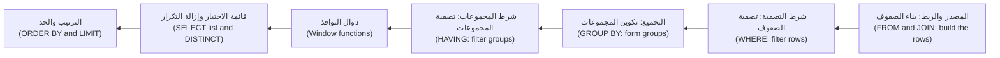
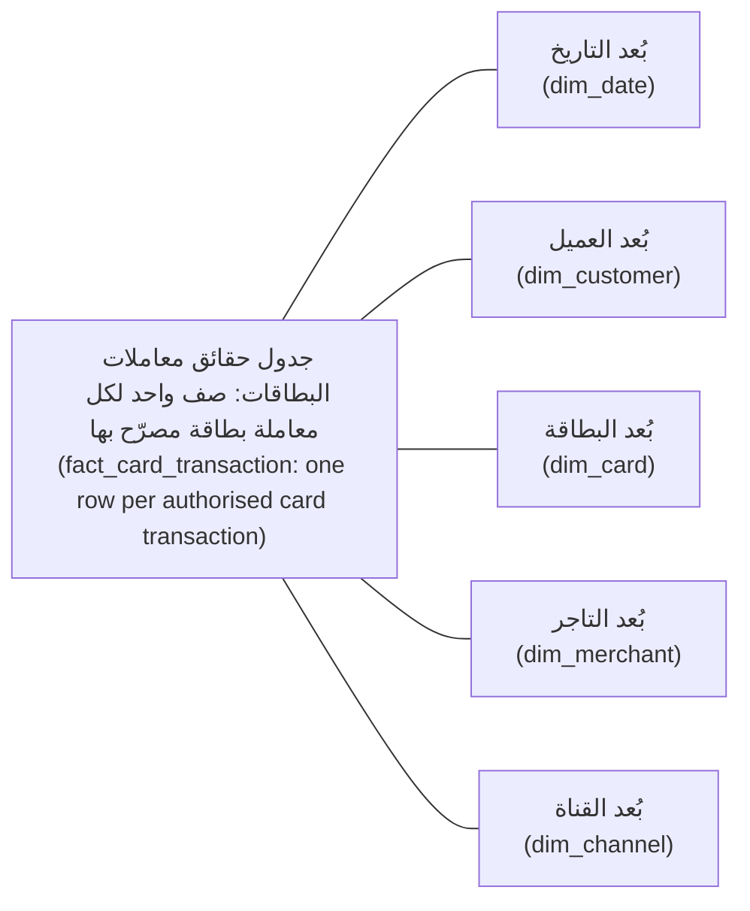
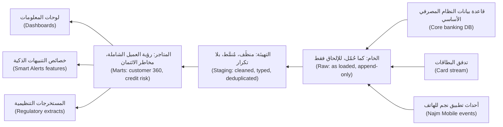

# الوحدة 1 — SQL ونمذجة البيانات

*كل رقم يُصدره بنك نجم (Najm Bank) يبدأ استعلامًا (query) على جدول صمّمه أحدهم. وحين يعدّ الاستعلام الشيء الخطأ، أو حين لا يستطيع الجدول أن يتذكّر ما كان صحيحًا في مارس الماضي، تصبح لوحة المعلومات خاطئة، ولا أحد يستطيع أن يقول لماذا. تمنحك هذه الوحدة الأسس الثلاثة التي يبني عليها باقي المقرر. أولًا، لغة SQL التي تجيب عن الأسئلة التجارية إجابة صحيحة: عمليات ربط لا تضاعف الصفوف، وتجميع (aggregation) عند الحُبَيبية (grain) الصحيحة، وتعبيرات جدولية مشتركة (CTEs) تجعل الاستعلام الطويل مقروءًا، ودوال النوافذ (window functions) التي ترتّب وتقارن وتحسب المجاميع التراكمية (running totals). ثانيًا، نمذجة البيانات: جداول مُطبَّعة للأنظمة التي تُشغّل البنك، ومخططات النجمة (star schemas) للأسئلة التي يطرحها الناس عنه، وبيان حُبَيبية لكل جدول، والأبعاد المتغيّرة ببطء (slowly changing dimensions) كي يبقى التاريخ صحيحًا. ثالثًا، أين تعيش البيانات: قواعد بيانات معالجة المعاملات ومحرّكات المعالجة التحليلية (OLAP engines)، والتخزين الصفّي والعمودي، ومستودعات البيانات (warehouses) وبحيرات البيانات (lakes) والمستودعات البحيرية (lakehouses)، وصيغ الجداول المفتوحة (open table formats) التي تجعل الملفات تتصرّف كالجداول. ستتابع هدى، مهندسة البيانات (data engineer) حديثة التخرج في الفريق، حين يخرج عدد "العملاء النشطين" لديها أعلى بثلاثة أضعاف، وحين يتغيّر تقرير فرع من مارس عند إعادة تشغيله في يونيو، وحين يُبطئ استعلام نهاية الشهر على قاعدة بيانات النظام المصرفي الأساسي عملَ الفروع.*

> **المراحل:** Model, Analyse, Store — طرح السؤال الصحيح على البيانات، وتشكيل الجداول كي تبقى الإجابة صحيحة، واختيار المكان الذي ينبغي أن تعيش فيه البيانات.

---

# 1.1 — SQL التي تجيب عن الأسئلة التجارية: الربط والتجميع والتعبيرات الجدولية المشتركة ودوال النوافذ
*المستوى: 🟢 مبتدئ* · *المتطلبات: 0.1، 0.2* · *المرحلة: Model, Analyse*

**بعد هذا الدرس تستطيع** أن تكتب استعلام SQL مبنيًا على التعبيرات الجدولية المشتركة ودوال النوافذ يجيب عن سؤال تجاري بالحُبَيبية الصحيحة، وتشرح لماذا يعطي العدّ الساذج بعد ربط كل الجداول رقمًا أكبر. *مدة الدراسة: قراءة نحو 15 دقيقةً، وعمل تطبيقي نحو 3 ساعات (تقدير).*

## ⚡ الدرس في دقيقة
- لغة SQL هي طريقتك في طرح سؤال على قاعدة البيانات. ويحتاج معظم الأسئلة التجارية إلى أربع حركات: **ربط** الجداول، و**تصفية** الصفوف، و**التجميع** (aggregate) إلى المستوى الذي يسأل عنه السؤال، ثم **الترتيب أو المقارنة** بدوال النوافذ.
- القاعدة الأهم: اعرف **الحُبَيبية** لكل جدول ولكل نتيجة، أي ما يمثّله الصف الواحد. فعبارة "صف واحد لكل عميل" وعبارة "صف واحد لكل معاملة" تعطيان إجابتين مختلفتين عن `COUNT(*)` نفسه.
- استخدم **التعبيرات الجدولية المشتركة** (كتل `WITH`) لبناء الاستعلام في خطوات مسمّاة، حُبَيبية واحدة في كل مرة، كي تستطيع أنت والمراجع فحص كل خطوة.
- استخدم **دوال النوافذ** (`OVER (...)`) للحصول على إجابات لكل صف تنظر إلى صفوف أخرى: أحدث رصيد لكل حساب، والمجاميع التراكمية، وهذا الشهر مقارنةً بالشهر الماضي.
- إشارة القرار: قبل كتابة SQL، اكتب السؤال في جملة واحدة مع حُبَيبيته ونافذته الزمنية وتعريفاته ("العميل *النشط* (active customer) هو من لديه حركة خصم مُرحَّلة (posted debit) واحدة على الأقل في الشهر الميلادي، بتوقيت الدوحة (Doha time)").
- الفخ الأكبر: **التضاعف** (fan-out). فربط علاقة واحد-إلى-متعدد (one-to-many relationship) قبل التجميع (aggregating) يضاعف الصفوف، ويصبح كل `SUM` و`COUNT` بعده أكبر من الصحيح بصمت.

## 🧭 لماذا يهم
يطلب كريم، محلّل البيانات (data analyst) لقطاع الأفراد، من هدى رقمًا للمراجعة الشهرية لقطاع الأفراد: "كم عدد عملاء الأفراد الذين كانوا نشطين في سبتمبر، وكم أنفقوا؟" ⁦⁩. تكتب هدى استعلامًا في عشر دقائق:

```sql
-- Huda's first attempt (wrong)
SELECT COUNT(*) AS active_customers, SUM(t.amount) AS spend
FROM customers c
JOIN accounts a     ON a.customer_id = c.customer_id
JOIN transactions t ON t.account_id  = a.account_id
WHERE c.segment = 'retail'
  AND t.txn_ts >= '2026-09-01' AND t.txn_ts < '2026-10-01';
```

الرقم الذي يُعيده يعدّ المعاملات لا العملاء: فالعميل الذي لديه 40 دفعة بالبطاقة يُعدّ 40 مرة. ويشمل الإنفاق قيود الرواتب الدائنة الواردة، لأن أحدًا لم يقل "حركات الخصم فقط". وتُظهر لوحة المعلومات لدى لينا رقمًا ثالثًا، لأنها تعرّف "النشط" بأنه "سجّل الدخول إلى تطبيق نجم للهاتف". صار لدى كريم ثلاث إجابات، ولا سبيل إلى الاختيار بينها.

يشير فيصل، رئيس منصة البيانات، إلى أن قاعدة البيانات فعلت بالضبط ما طُلب منها. فالسؤال لم تكن له حُبَيبية، ولا تعريف، ولا فحص. يعلّمك هذا الدرس لغة SQL والعادات التي تجعل إجاباتها جديرة بالثقة.

## 📐 كيف يعمل

### 🟢 الأساسيات

**الجداول والصفوف والحُبَيبية.** يحتوي الجدول على صفوف؛ وكل صف يصف شيئًا واحدًا. و**الحُبَيبية** للجدول هي ما يمثّله الصف الواحد: عميل واحد، أو حساب واحد، أو معاملة واحدة، أو حساب واحد في يوم واحد. وتستخدم أمثلة النظام المصرفي الأساسي (core banking) في نجم ثلاثة جداول:

| الجدول | الحُبَيبية | الأعمدة الرئيسية |
|---|---|---|
| `customers` | صف واحد لكل عميل | `customer_id` (المفتاح الأساسي)، `segment`، `branch_code` |
| `accounts` | صف واحد لكل حساب | `account_id`، `customer_id` (لكل عميل حساب واحد أو أكثر) |
| `transactions` | صف واحد لكل معاملة مُرحَّلة | `txn_id`، `account_id`، `txn_ts`، `amount`، `direction` (`'debit'` أو `'credit'`) |

**ترتيب تقييم الاستعلام.** أنت تكتب `SELECT` أولًا، لكن قاعدة البيانات تعالج البنود منطقيًا بهذا الترتيب، وهو ما يفسّر مثلًا لماذا لا يستطيع `WHERE` التصفية على دالة نافذة (window function):



**الربط.** يجمع الربط صفوفًا من جدولين حيث يتحقّق شرط.
- يحتفظ `INNER JOIN` فقط بالصفوف التي لها تطابق في الجانبين.
- يحتفظ `LEFT JOIN` بكل صف من الجدول الأيسر؛ وحيث لا يوجد تطابق، تكون أعمدة الجانب الأيمن بقيمة `NULL`.
- يحتفظ `FULL JOIN` بالصفوف غير المتطابقة من الجانبين؛ ويقرن `CROSS JOIN` كل صف بكل صف.

مثال: العميل 3 ليست لديه حسابات بعد.

| customers.customer_id | accounts.account_id بعد الربط الأيسر |
|---|---|
| 1 | 101 |
| 1 | 102 |
| 2 | 201 |
| 3 | NULL |

يظهر العميل 1 الآن مرتين: فحُبَيبية النتيجة هي "صف واحد لكل حساب"، لا "صف واحد لكل عميل".

**التجميع (Aggregation).** يطوي `GROUP BY` الصفوف في مجموعات، وتلخّص دوال التجميع (aggregate functions) كل مجموعة: `COUNT`، `SUM`، `AVG`، `MIN`، `MAX`. وتتصرّف ثلاث عمليات عدّ بشكل مختلف:
- يعدّ `COUNT(*)` الصفوف.
- يعدّ `COUNT(col)` الصفوف التي لا يكون فيها `col` بقيمة `NULL`.
- يعدّ `COUNT(DISTINCT col)` القيم المميّزة غير الفارغة.

يصفّي `WHERE` الصفوف *قبل* التجميع؛ ويصفّي `HAVING` المجموعات *بعده*: فسؤال "العملاء الذين لديهم أكثر من 10 معاملات" يحتاج إلى `HAVING COUNT(*) > 10`.

**القيمة NULL تعني "غير معروف".** أي مقارنة مع `NULL` تعطي *غير معروف*، لا صحيح، لذا فإن `WHERE closed_on = NULL` لا يطابق شيئًا. استخدم `IS NULL` و`IS NOT NULL`، و`COALESCE(x, 0)` للتعويض بقيمة افتراضية. ويتخطّى `SUM` و`AVG` القيم الفارغة، لذا فمتوسط `(100, NULL, 200)` هو 150، لا 100.

**التعبيرات الجدولية المشتركة (CTEs).** **التعبير الجدولي المشترك** هو استعلام فرعي مسمّى يُعرَّف بـ `WITH`. ويتيح لك بناء الإجابة في خطوات، لكل منها حُبَيبيتها. وهذا استعلام هدى بعد إعادة بنائه بشكل صحيح:

```sql
-- Right: one step per grain, definitions explicit
WITH sept_debits AS (          -- grain: one row per posted debit in September (Doha time)
    SELECT a.customer_id, t.amount
    FROM transactions t
    JOIN accounts a ON a.account_id = t.account_id
    WHERE t.direction = 'debit'
      AND t.txn_ts >= TIMESTAMPTZ '2026-09-01 00:00+03'
      AND t.txn_ts <  TIMESTAMPTZ '2026-10-01 00:00+03'
),
per_customer AS (              -- grain: one row per customer
    SELECT customer_id, SUM(amount) AS spend
    FROM sept_debits
    GROUP BY customer_id
)
SELECT COUNT(*)        AS active_customers,   -- safe now: one row = one customer
       SUM(pc.spend)   AS total_spend
FROM per_customer pc
JOIN customers c ON c.customer_id = pc.customer_id
WHERE c.segment = 'retail';
```

كل تعبير جدولي مشترك (CTE) يذكر حُبَيبيته، ويستطيع المراجع تشغيل كل خطوة وحدها.

### 🟡 التعمق أكثر

**فخ التضاعف (The fan-out trap).** لنفترض أن كريم يريد أيضًا إجمالي رصيد القروض لكل عميل بجانب إنفاقه بالبطاقة. إن ربط جدولَي الواحد-إلى-متعدد (one-to-many tables) كليهما بـ `customers` ثم الجمع يضاعف كل جانب بالآخر:

```sql
-- Wrong: a customer with 2 loans and 30 debits has each loan counted 30 times
SELECT c.customer_id, SUM(l.balance) AS loan_balance, SUM(t.amount) AS spend
FROM customers c
JOIN loans l        ON l.customer_id = c.customer_id
JOIN accounts a     ON a.customer_id = c.customer_id
JOIN transactions t ON t.account_id  = a.account_id
GROUP BY c.customer_id;
```

```sql
-- Right: aggregate each side to the customer grain first, then join one-to-one
WITH loans_pc AS (
    SELECT customer_id, SUM(balance) AS loan_balance
    FROM loans GROUP BY customer_id
),
spend_pc AS (
    SELECT a.customer_id, SUM(t.amount) AS spend
    FROM transactions t JOIN accounts a ON a.account_id = t.account_id
    WHERE t.direction = 'debit'
    GROUP BY a.customer_id
)
SELECT c.customer_id,
       COALESCE(l.loan_balance, 0) AS loan_balance,
       COALESCE(s.spend, 0)        AS spend
FROM customers c
LEFT JOIN loans_pc l ON l.customer_id = c.customer_id
LEFT JOIN spend_pc s ON s.customer_id = c.customer_id;
```

القاعدة: **جمّع إلى الحُبَيبية المستهدفة قبل أن تربط مسارين مختلفين من نوع واحد-إلى-متعدد.** يستطيع `COUNT(DISTINCT ...)` أن يُخفي التضاعف في عمليات العدّ، لكنه لا يستطيع إصلاح `SUM`.

**الربط الأيسر الذي صار ربطًا داخليًا.** يريد كريم كل عملاء الأفراد، مع إنفاقهم في سبتمبر أو صفر. إن وضع مرشّح التاريخ في `WHERE` يُزيل العملاء الذين لا معاملات لهم، لأن `t.txn_ts` لديهم يكون `NULL` والمقارنة غير معروفة:

```sql
-- Wrong: customers with no September transactions disappear
SELECT c.customer_id, COALESCE(SUM(t.amount), 0) AS spend
FROM customers c
LEFT JOIN accounts a     ON a.customer_id = c.customer_id
LEFT JOIN transactions t ON t.account_id  = a.account_id
WHERE t.txn_ts >= '2026-09-01' AND t.txn_ts < '2026-10-01'
GROUP BY c.customer_id;

-- Right: conditions on the optional side go in the ON clause
SELECT c.customer_id, COALESCE(SUM(t.amount), 0) AS spend
FROM customers c
LEFT JOIN accounts a     ON a.customer_id = c.customer_id
LEFT JOIN transactions t ON t.account_id  = a.account_id
                        AND t.txn_ts >= '2026-09-01' AND t.txn_ts < '2026-10-01'
GROUP BY c.customer_id;
```

**دوال النوافذ (Window functions).** تحسب دالة النافذة قيمة لكل صف من صفوف ذات صلة (*النافذة*) دون أن تطويها كما يفعل `GROUP BY`. وفي `OVER`، يقسّم `PARTITION BY` الصفوف إلى مجموعات ويرتّب `ORDER BY` داخل كل منها.

```sql
-- Monthly debit spend per customer, with last month and a running year-to-date total
WITH monthly AS (
    SELECT a.customer_id,
           date_trunc('month', t.txn_ts) AS month,
           SUM(t.amount)                 AS spend
    FROM transactions t JOIN accounts a ON a.account_id = t.account_id
    WHERE t.direction = 'debit'
    GROUP BY a.customer_id, date_trunc('month', t.txn_ts)
)
SELECT customer_id, month, spend,
       LAG(spend) OVER (PARTITION BY customer_id ORDER BY month)              AS prev_month_spend,
       SUM(spend) OVER (PARTITION BY customer_id, date_trunc('year', month)
                        ORDER BY month)                                       AS ytd_spend,
       spend / SUM(spend) OVER (PARTITION BY month)                           AS share_of_month
FROM monthly;
```

الاستخدام الأكثر شيوعًا هو "أحدث صف لكل مفتاح"، مثل أحدث رصيد لكل حساب:

```sql
WITH ranked AS (
    SELECT account_id, balance_date, balance,
           ROW_NUMBER() OVER (PARTITION BY account_id
                              ORDER BY balance_date DESC) AS rn
    FROM account_balances
)
SELECT account_id, balance_date, balance
FROM ranked
WHERE rn = 1;
```

لا يمكنك كتابة `WHERE ROW_NUMBER() OVER (...) = 1` مباشرةً، لأن `WHERE` يُقيَّم قبل دوال النوافذ (انظر المخطط أعلاه). ومن هنا الحاجة إلى التعبير الجدولي المشترك.

**الترتيب عند التعادل (Ranking ties).** عند التعادل، يعطي `ROW_NUMBER()` القيم 1، 2، 3 (مختارًا اعتباطيًا)، ويعطي `RANK()` القيم 1، 1، 3، ويعطي `DENSE_RANK()` القيم 1، 1، 2. أضف عمود كسر تعادل فريدًا كي تتكرّر النتائج بالضبط.

**الإطارات.** مع وجود `ORDER BY` في النافذة، تستخدم دوال التجميع مثل `SUM` *إطارًا*: وهو افتراضيًا في PostgreSQL ‏`RANGE BETWEEN UNBOUNDED PRECEDING AND CURRENT ROW`، الذي يشمل الصفوف المتعادلة مع الصف الحالي. اكتب الإطار صراحةً حين يكون مهمًا. فعبارة `ROWS BETWEEN 6 PRECEDING AND CURRENT ROW` تعني *سبعة صفوف*، لا سبعة أيام؛ وفي الأيام التي لا معاملات فيها تمتد لأكثر من أسبوع. وللحصول على نافذة سبعة أيام حقيقية، املأ الأيام الناقصة من جدول تقويم، أو استخدم `RANGE BETWEEN INTERVAL '6 days' PRECEDING AND CURRENT ROW` على عمود تاريخ.

### 🔴 نظرة الخبير

**الوقت تعريف، لا تفصيل.** تخزّن نجم قيم `timestamptz` (لحظات مطلقة). و"سبتمبر" يبدأ في لحظة مختلفة في الدوحة (`Asia/Qatar`، UTC+3) ودبي (`Asia/Dubai`، UTC+4) والاتحاد الأوروبي (EU)، لذا جمّع في فترات بمنطقة زمنية صريحة، مثل `date_trunc('month', txn_ts AT TIME ZONE 'Asia/Qatar')`. استخدم **النطاقات نصف المفتوحة** (half-open ranges) (`>= start AND < end`): فعبارة `BETWEEN '2026-09-01' AND '2026-09-30'` تُسقط بصمت كل ما بعد منتصف الليل في اليوم الثلاثين.

**المال دقيق، والعملات لا تُجمع.** خزّن المبالغ بنوع `numeric`، ولا تستخدم أبدًا `float`، الذي يؤدّي التقريب فيه إلى انجراف المجاميع. ولا تستخدم `SUM` أبدًا عبر العملات: حوّل أولًا بسعر موثّق، أو جمّع حسب العملة.

**‏`NOT IN` والقيم الفارغة.** إن سؤال "العملاء الذين ليست لديهم قروض" مكتوبًا بصيغة `WHERE customer_id NOT IN (SELECT customer_id FROM loans)` يُعيد *صفر صفوف على الإطلاق* إذا كان أي `loans.customer_id` بقيمة `NULL`، لأن `x NOT IN (..., NULL)` لا يكون صحيحًا أبدًا. استخدم الربط العكسي (anti-join):

```sql
SELECT c.customer_id
FROM customers c
WHERE NOT EXISTS (SELECT 1 FROM loans l WHERE l.customer_id = c.customer_id);
```

**اللهجات تختلف.** يدعم DuckDB ‏`QUALIFY` (التصفية على دالة نافذة مباشرةً) واستخدام الأسماء المستعارة (aliases) من `SELECT` في `WHERE`؛ ولا يدعم PostgreSQL أيًّا منهما وقت كتابة هذا النص ‏(2026). اذكر اسم محرّكك في ترويسة الاستعلام.

**اختبر الاستعلام كما تختبر الشيفرة.** قبل أن يغادر أي رقم الفريق:
1. **افحص الحُبَيبية.** لنتيجة بصف واحد لكل عميل، يجب ألا يُعيد `SELECT customer_id, COUNT(*) FROM result GROUP BY 1 HAVING COUNT(*) > 1` شيئًا.
2. **عُدّ الصفوف في كل تعبير جدولي مشترك.** القفزة المفاجئة بين الخطوات هي تضاعف.
3. **طابِق (Reconcile)** إجماليًا مع مصدر مستقل، مثل دفتر الأستاذ العام (general ledger)، وفسّر أي فرق.
4. **افحص عيّنات (Spot-check)** ثلاثة عملاء يدويًا.

**الأداء والأمان.** يُظهر `EXPLAIN ANALYZE` كيف شغّل PostgreSQL الاستعلام (المزيد في 3.3)؛ والفهارس (indexes) مشروحة في [*تصميم الأنظمة لمبرمجي الحدس*، الدرس 2.5 — الفهارس والاستعلامات ومجموعة العمل](../vibe/index.ar.html#l2-5). وحين تأتي قيمة من مستخدم أو تطبيق، مرّرها معاملًا مربوطًا (bound parameter)، ولا تلصق السلاسل النصية ببعضها أبدًا ([*أمن الذكاء الاصطناعي وأمن التطبيقات (Secure AI & Application Security)*، الدرس 2.1 — الحقن (Injection)](../secai/index.ar.html#/2.1)).

## 🧰 الأدوات
| الأداة أو النمط أو المعيار | ما هو وماذا يفعل | متى تلجأ إليه |
|---|---|---|
| **PostgreSQL** — قاعدة بيانات علائقية | قاعدة بيانات علائقية مفتوحة المصدر بتطبيق كامل للغة SQL‏، بما في ذلك دوال النوافذ والتعبيرات الجدولية المشتركة | تعلّم SQL؛ قواعد البيانات التشغيلية؛ أحمال العمل التحليلية الصغيرة |
| **DuckDB** — قاعدة بيانات تحليلية مضمّنة | قاعدة بيانات تحليلية مفتوحة المصدر تعمل داخل العملية (in-process analytical database)؛ تقرأ ملفات CSV وParquet مباشرةً؛ تعمل على حاسوب محمول | التحليل المحلي السريع، والتمارين، وبناء نماذج أولية للمتاجر التحليلية قبل مستودع البيانات (warehouse) |
| **Common table expression (CTE)** — التعبير الجدولي المشترك | خطوة مسمّاة في الاستعلام، تُعرَّف بـ `WITH` | أي استعلام بأكثر من حُبَيبية واحدة أو أكثر من مسار ربط واحد |
| **Window functions** — دوال النوافذ | `OVER (PARTITION BY … ORDER BY …)`: قيم لكل صف تُحسب على صفوف ذات صلة (`ROW_NUMBER`، `LAG`، `SUM` التراكمي) | أحدث صف لكل مفتاح، والترتيب، والمقارنة بين فترة وأخرى (period-over-period)، والمجاميع التراكمية، والحصص من الإجمالي |
| **Anti-join (NOT EXISTS)** — الربط العكسي | يُعيد الصفوف التي لا تطابق لها في جدول آخر، بأمان مع القيم الفارغة | أسئلة "العملاء الذين ليس لديهم X" |
| **EXPLAIN ANALYZE** — شرح خطة التنفيذ | يُظهر الخطة التي اختارها PostgreSQL والوقت الفعلي المستغرق في كل خطوة | حين يكون الاستعلام بطيئًا أو يمسح صفوفًا أكثر بكثير من المتوقع |

## 🏛️ عمليًا في بنك نجم
يحوّل فيصل الحادثة (incident) إلى معيار: كل رقم لمراجعة تجارية يبدأ الآن بـ **ترويسة استعلام** ويجتاز قائمة تحقّق للمراجعة.

**ترويسة الاستعلام في نجم (قالب) (The Najm query header (template))**

```sql
/*
Question     : How many retail customers were active in Sep 2026, and what did they spend?
Asked by     : Kareem (Retail Analytics)      Author: Huda      Reviewer: Lina
Engine       : PostgreSQL 16 (read replica of core banking)
Result grain : one row (summary); intermediate per_customer = one row per customer
Definitions  : active = at least one posted debit in the calendar month, Asia/Qatar time
               spend  = sum of posted debits in QAR; non-QAR amounts excluded (count reported)
Time window  : [2026-09-01 00:00 +03, 2026-10-01 00:00 +03)
Checks       : grain unique OK; debit total reconciles to GL report within 0.1%, difference explained
*/
```

**قائمة التحقق للمراجعة**

| الفحص | السؤال الذي يطرحه المراجع | الإخفاق المعتاد الذي يكشفه |
|---|---|---|
| الحُبَيبية | ما الذي يمثّله صف واحد من كل تعبير جدولي مشترك ومن النتيجة؟ | التضاعف؛ و`COUNT(*)` يعدّ الشيء الخطأ |
| التعريفات | هل كُتبت تعريفات "نشط" و"إنفاق" و"عميل" واتُّفق عليها مع صاحب السؤال؟ | ثلاثة فرق، ثلاثة أرقام |
| الربط | هل يحافظ كل ربط على الحُبَيبية؟ هل يوجد `LEFT JOIN` مُصفّى في `WHERE`؟ | صفوف صفرية مفقودة؛ مجاميع مضاعفة |
| القيم الفارغة (Nulls) | هل يوجد `NOT IN` أو `= NULL` أو متوسطات على أعمدة تقبل القيم الفارغة؟ | نتائج فارغة؛ متوسطات خاطئة |
| الوقت | هل سُمّيت المنطقة الزمنية (time zone)؟ هل النطاق نصف مفتوح (half-open range)؟ | يوم أخير مفقود؛ شهر مُزاح بثلاث ساعات |
| المطابقة (Reconciliation) | هل يطابق إجمالي ما مصدرًا مستقلًا؟ | أخطاء تصفية صامتة |

السؤال الذي يُطرح كل شهر يصبح نموذجًا مُختبرًا ‏(3.1) ومقياسًا معرّفًا ‏(4.1).

## 🛠️ التمارين
استخدم بيانات اصطناعية فقط: تضم مجموعة بيانات المختبر من الدرس 0.3 أصلًا جداول `customers` و`accounts` (بعض العملاء بلا حساب) و100,000 من `transactions` من يوليو 2025 إلى مارس 2026، ولذلك يمكن التحقق من كل إجابة أدناه بإعادة تشغيلها. وهناك تعديلان: سبتمبر في المختبر هو سبتمبر 2025، وأعمدته هي `amount_qar` و`txn_ts_utc` (أعد تسميتها في CTE، أو عدّل استعلامات الدرس).

- 🟢 اكتب استعلام "عملاء الأفراد النشطون في سبتمبر وإنفاقهم" مرتين: مرة بالطريقة الخاطئة (المرشّحات نفسها، وربط كل شيء، و`COUNT(*)`) ومرة بالتعبيرات الجدولية المشتركة، مع تعليق على كل منها بحُبَيبيته. *يكتمل عندما:* تستطيع شرح النسبة الدقيقة بين العددين (وهي متوسط عدد حركات الخصم لكل عميل نشط)، ويجتاز استعلامك الصحيح فحص الحُبَيبية.
- 🟡 لكل عميل وشهر، احسب الإنفاق، وإنفاق الشهر السابق، ونسبة التغيّر المئوية، وترتيب العميل ضمن شريحته في ذلك الشهر. ثم أعِد لكل عميل شهره الوحيد الأعلى إنفاقًا فقط. *يكتمل عندما:* يستخدم الاستعلام `LAG` و`DENSE_RANK` ونمط "أحدث صف أو أعلى صف لكل مفتاح"، مع كاسر تعادل حتمي، ويعطي نتائج متطابقة في تشغيلين.
- 🔴 ابنِ إنفاقًا متحرّكًا لسبعة أيام لكل عميل يكون صحيحًا في الأيام التي لا معاملات فيها، باستخدام جدول تقويم (صف واحد لكل تاريخ) مربوط ربطًا تقاطعيًا (cross-joined) بالعملاء. قارنه بنسخة ساذجة تستخدم `ROWS BETWEEN 6 PRECEDING AND CURRENT ROW`. *يكتمل عندما:* تستطيع أن تُظهر عميلًا وتاريخًا يختلف فيهما الاثنان، وتشرح السبب، وتكون قد كتبت ترويسة الاستعلام وشغّلت الفحوص الأربعة كلها من 🔴 نظرة الخبير.

## ⚠️ أخطاء وفخاخ
- **عدّ الصفوف بدل الأشياء.** يعدّ `COUNT(*)` بعد الربط الصفوفَ المربوطة. حدّد الحُبَيبية أولًا، وجمّع إليها، ثم عُدّ.
- **ربط مسارين من نوع واحد-إلى-متعدد ثم الجمع.** جمّع كل مسار إلى الحُبَيبية المستهدفة في تعبيره الجدولي المشترك الخاص، ثم اربط.
- **تصفية الجانب الاختياري من الربط الأيسر في WHERE.** ضع تلك الشروط في `ON`، وإلا اختفت الصفوف الصفرية.
- **‏`BETWEEN` على الطوابع الزمنية، أو `NOT IN` على عمود يقبل القيم الفارغة.** استخدم النطاقات نصف المفتوحة مع منطقة زمنية مسمّاة، و`NOT EXISTS`.
- **إصدار رقم بلا تعريف.** اكتب ترويسة الاستعلام؛ واتفق على التعريف مع الشخص الذي سأل.

## 🧾 الخلاصة
- لكل جدول ولكل نتيجة حُبَيبية. اكتبها قبل كتابة SQL.
- ابنِ الاستعلامات في خطوات من التعبيرات الجدولية المشتركة، حُبَيبية واحدة لكل خطوة؛ وجمّع قبل ربط مسارات واحد-إلى-متعدد مختلفة.
- يصفّي `WHERE` الصفوف، ويصفّي `HAVING` المجموعات، وتعمل دوال النوافذ بعدهما كليهما، لذا صفِّ عليها في خطوة خارجية (أو باستخدام `QUALIFY` في DuckDB).
- تجيب دوال النوافذ عن "الأحدث لكل مفتاح" و"مقارنةً بالفترة الماضية" و"المجموع التراكمي" (running total) دون فقدان الصفوف.
- القيم الفارغة والمناطق الزمنية (time zones) والعملات والتعادلات تُفسد استعلامات تبدو صحيحة؛ اختبر الحُبَيبية، وأعداد الصفوف في الخطوات، والإجماليات قبل المشاركة.

## ✍️ اختبر نفسك

**1. تربط هدى `customers` → `accounts` → `transactions` وتشغّل `SELECT COUNT(*)` لعدّ العملاء النشطين. فتأتي النتيجة أعلى بنحو 35 مرة مما توقّعه كريم. ما السبب الأرجح؟**

- A. إحصاءات المخطِّط قديمة
- B. يتجاهل `COUNT(*)` الصفوف التي فيها قيم فارغة
- C. حُبَيبيته هي صف واحد لكل معاملة، لا لكل عميل
- D. كان ينبغي أن يكون `JOIN` ربطًا من نوع `CROSS JOIN` للاحتفاظ بكل عميل

<details><summary>الإجابة</summary>

**C.** بعد الربط بالمعاملات، يصبح كل صف معاملة، لذا يعدّ `COUNT(*)` المعاملات. جمّع إلى حُبَيبية العميل (customer grain) أولًا، أو استخدم `COUNT(DISTINCT customer_id)` للعدّ. يؤثّر A في السرعة، ولا يؤثّر أبدًا في النتيجة. وB خاطئ: فـ `COUNT(*)` يعدّ كل الصفوف، بما فيها القيم الفارغة (nulls included). (🟢 الأساسيات).

</details>

**2. يربط استعلام `customers` بكل من `loans` و`transactions` ويجمع أرصدة القروض. فيُظهر عميل لديه قرضان و30 معاملة رصيد قروض أعلى بـ 30 مرة. ما الإصلاح الصحيح؟**

- A. جمّع كل جدول إلى صف واحد لكل عميل أولًا، ثم اربط
- B. استبدل `SUM(l.balance)` بـ `SUM(DISTINCT l.balance)` كي يُعدّ كل قرض مرة واحدة
- C. أضف `ORDER BY customer_id`
- D. غيّر الربطين كليهما إلى `LEFT JOIN`

<details><summary>الإجابة</summary>

**A.** هذا تضاعف (fan-out): مساران من نوع واحد-إلى-متعدد يضاعف كل منهما الآخر. وتجميع كل مسار إلى حُبَيبية العميل (customer grain) أولًا يُزيله. يبدو B مغريًا لكنه يُسقط بصمت قرضين مختلفين صادف أن لهما الرصيد نفسه. (🟡 التعمق أكثر).

</details>

**3. يريد كريم إدراج كل عملاء الأفراد، مع صفر لمن لم ينفقوا شيئًا في سبتمبر. يحتوي استعلام `LEFT JOIN` لدى هدى على `WHERE t.txn_ts >= '2026-09-01'`، والعملاء ذوو الإنفاق الصفري مفقودون. لماذا؟**

- A. يُسقط `LEFT JOIN` الصفوف غير المتطابقة كلما تلاه `GROUP BY` في الاستعلام
- B. للصفوف غير المتطابقة قيمة `txn_ts` من نوع `NULL`، لذا يُسقطها اختبار `WHERE`
- C. يجب أن يُغلّف `COALESCE` القيمة `t.txn_ts` قبل الربط، وإلا أفسدت القيم الفارغة المجموع
- D. يحتاج مرشّح التاريخ إلى `HAVING` بدل `WHERE`، لأنه يعمل بعد التجميع

<details><summary>الإجابة</summary>

**B.** المقارنة مع `NULL` تعطي غير معروف، لذا فإن مرشّح `WHERE` على الجانب الاختياري يحوّل `LEFT JOIN` إلى ربط داخلي (inner join)؛ انقله إلى `ON`. وA خاطئ: فالاحتفاظ بالصفوف غير المتطابقة هو بالضبط ما يفعله `LEFT JOIN`. (🟡 التعمق أكثر).

</details>

**4. تحتاج لينا إلى أحدث رصيد لكل حساب من `account_balances` (صف واحد لكل حساب في كل يوم (one row per account per day)). أي نهج صحيح في PostgreSQL؟**

- A. `SELECT account_id, MAX(balance) FROM account_balances GROUP BY account_id`
- B. `SELECT * FROM account_balances WHERE ROW_NUMBER() OVER (PARTITION BY account_id ORDER BY balance_date DESC) = 1`
- C. `SELECT account_id, balance FROM account_balances ORDER BY balance_date DESC LIMIT 1`
- D. رقّم الصفوف لكل حساب، الأحدث أولًا، باستخدام `ROW_NUMBER()` في تعبير جدولي مشترك؛ واحتفظ بـ `rn = 1` خارجه

<details><summary>الإجابة</summary>

**D.** تعمل دوال النوافذ (window functions) بعد `WHERE`، لذا يفشل B في PostgreSQL (وكان DuckDB سيقبل الفكرة نفسها مكتوبةً بـ `QUALIFY`). يُعيد A أعلى رصيد (highest balance)، لا الأحدث؛ ويُعيد C صفًا واحدًا للجدول كله. (🟡 التعمق أكثر).

</details>

**5. يعدّ استعلام "العملاء الذين ليست لديهم قروض" باستخدام `WHERE customer_id NOT IN (SELECT customer_id FROM loans)` ويُعيد صفر صفوف، رغم أن كثيرًا من العملاء ليست لديهم قروض. ما التفسير الأرجح؟**

- A. إحدى قيم `loans.customer_id` هي `NULL`، لذا لا يكون `NOT IN` صحيحًا أبدًا
- B. يحتاج الاستعلام الفرعي إلى `DISTINCT`، وإلا ألغت المعرّفات المكرّرة بعضها بعضًا
- C. لا يسمح PostgreSQL باستعلام فرعي داخل بند `WHERE`
- D. يحتاج جدول العملاء إلى فهرس على `customer_id` من أجل `NOT IN`

<details><summary>الإجابة</summary>

**A.** لا يمكن أن يكون `x NOT IN (…, NULL)` صحيحًا أبدًا، لذا لا يتأهّل أي صف. ويتعامل `NOT EXISTS` مع القيم الفارغة بشكل صحيح. لا يغيّر B شيئًا في القيمة الفارغة؛ ويؤثّر D في السرعة، لا في النتائج. (🔴 نظرة الخبير).

</details>

## 📚 المراجع
- توثيق PostgreSQL ‏(PostgreSQL documentation) — الاستعلامات (Queries) (الربط، واستعلامات `WITH`، و`GROUP BY`): https://www.postgresql.org/docs/current/queries.html
- توثيق PostgreSQL — درس دوال النوافذ: https://www.postgresql.org/docs/current/tutorial-window.html
- توثيق DuckDB ‏(DuckDB documentation) — مقدمة إلى SQL، ودوال النوافذ و`QUALIFY`: https://duckdb.org/docs/
- توثيق PostgreSQL — استخدام `EXPLAIN`: https://www.postgresql.org/docs/current/using-explain.html

---

# 1.2 — نمذجة البيانات: التطبيع ومخططات النجمة والحُبَيبية والأبعاد المتغيّرة ببطء
*المستوى: 🟢 مبتدئ* · *المتطلبات: 1.1* · *المرحلة: Model*

**بعد هذا الدرس تستطيع** أن تصمّم مخطط نجمة مع عبارة حُبَيبية مكتوبة، وتبني بُعد عملاء من النوع الثاني يُبقي التعرّض حسب الفرع في اليوم الأول ثابتًا بعد التحميلات اللاحقة. *مدة الدراسة: قراءة نحو 15 دقيقةً، وعمل تطبيقي نحو 4 ساعات (تقدير).*

## ⚡ الدرس في دقيقة
- يحدّد **نموذج البيانات** (data model) الجداول الموجودة، وما يعنيه الصف الواحد في كل منها، وكيف ترتبط ببعضها. وهو أغلى شيء يمكن تغييره لاحقًا، لذا يستحق أكبر قدر من التفكير مسبقًا.
- الأنظمة التي *تُشغّل* البنك تستخدم نماذج **مُطبَّعة** (normalised): كل حقيقة تُخزَّن مرة واحدة، فلا يمكن أن تتناقض التحديثات. والأنظمة التي *تحلّل* البنك تستخدم نماذج **بُعدية** (dimensional): **جدول حقائق** (fact table) للأحداث القابلة للقياس تحيط به **جداول أبعاد** (dimension tables) تصفها، أي **مخطط النجمة** (star schema).
- القاعدة الأهم: **أعلن الحُبَيبية** لكل جدول حقائق في جملة واحدة قبل اختيار أي عمود. وكل قرار آخر ينبع منها.
- **الأبعاد المتغيّرة ببطء** تحدّد ما يحدث حين تتغيّر سمة وصفية. النوع 1 (Type 1) يكتب فوق القيمة (overwrites)، فيُعاد كتابة التاريخ. والنوع 2 (Type 2) يضيف نسخة صف جديدة، فيبقى التاريخ صحيحًا.
- إشارة القرار: إذا كان أي أحد (الجهات الرقابية، أو المخاطر، أو المدققون) سيسأل "ما الذي كان صحيحًا *في ذلك الوقت*؟" ⁦⁩، فاستخدم النوع 2 (Type 2) لتلك السمة.
- الفخ الأكبر: خلط الحُبَيبيات في جدول حقائق واحد، أو الكتابة فوق سمات تجمّع التقارير حسبها، فتتغيّر أرقام الربع الماضي عند إعادة التشغيل.

## 🧭 لماذا يهم
في أبريل، بنت هدى تقرير "القروض حسب الفرع" لفريق مخاطر الائتمان، رابطةً جدول القروض بجدول العملاء الحالي للحصول على فرع كل عميل. ونجح الأمر. وفي يونيو، دمجت نجم فرعين في الدوحة ونقلت 4,000 عميل من الفرع `DOH-07` إلى `DOH-03`. ثم أعاد فريق المخاطر تشغيل تقرير مارس للإجابة عن سؤال متابعة من جهة رقابية. فصارت كل قروض مارس لأولئك العملاء تظهر تحت `DOH-03`، وهو فرع نما إجماليه لشهر مارس بين ليلة وضحاها، بينما تقلّص `DOH-07`، بعد ثلاثة أشهر من اعتماد التقرير.

لم يكن أي استعلام خاطئًا؛ بل كان النموذج هو الخاطئ. فجدول العملاء كان يعرف الفرع *الحالي* فقط، فكان الماضي يُعاد كتابته كلما انتقل عميل. وكان حكم فيصل: "يجب أن تكون تقارير البنك قابلة لإعادة الإنتاج (reproducible). إذا لم نستطع أن نقول ما الذي كنا نعتقده في 31 مارس، فلدينا مشكلة حوكمة، لا مشكلة SQL."

## 📐 كيف يعمل

### 🟢 الأساسيات

**الكيانات والمفاتيح والعلاقات.** يبدأ النموذج بـ **الكيانات** (entities) (العميل، والحساب، والقرض، والفرع)، و**سماتها** (attributes) (الشريحة، وتاريخ الفتح) و**علاقاتها** (relationships) (للعميل حساب واحد أو أكثر). وتربطها المفاتيح ببعضها:
- **المفتاح الطبيعي** (natural key) (أو مفتاح الأعمال) يأتي من العمل نفسه: رقم حساب، أو رقم هوية وطنية (national ID)، أو رقم IBAN.
- **المفتاح البديل** (surrogate key) عدد صحيح أو قيمة تجزئة (hash) بلا معنى يولّدها فريق البيانات. ويبقى ثابتًا حين تتغيّر مفاتيح الأعمال أو يُعاد استخدامها، ويتيح لكيان أعمال واحد أن تكون له عدة نسخ تاريخية.
- **المفتاح الأجنبي** (foreign key) يشير إلى مفتاح جدول آخر ويتيح لقاعدة البيانات فرض وجود الصف المُشار إليه.

**التطبيع: كل حقيقة مرة واحدة.** الصيغ الطبيعية (normal forms) لإدغار ف. كود قواعد لإزالة التكرار من الجداول التي تستخدمها التطبيقات (معالجة المعاملات عبر الإنترنت؛ انظر 1.3):
- **الصيغة الطبيعية الأولى (First normal form, 1NF):** كل عمود يحمل قيمة واحدة؛ لا مجموعات متكرّرة مثل `phone1, phone2, phone3`.
- **الصيغة الطبيعية الثانية (Second normal form, 2NF):** كل عمود غير مفتاحي يعتمد على المفتاح كاملًا، لا على جزء من مفتاح مركّب.
- **الصيغة الطبيعية الثالثة (Third normal form, 3NF):** الأعمدة غير المفتاحية تعتمد على المفتاح فقط، لا على أعمدة غير مفتاحية أخرى. فإذا كان `branch_city` موجودًا في `customers`، فهو يعتمد على `branch_code`، لا على العميل، لذا مكانه في `branches`.

الغاية تجنّب **شذوذ التحديث** (update anomalies): فإذا كانت مدينة الفرع موجودة على 50,000 صف من صفوف العملاء، فإن إعادة تسمية لم تكتمل تترك البيانات تناقض نفسها. النماذج المُطبَّعة تجعل عمليات الكتابة آمنة؛ لكنها تجعل الأسئلة التحليلية أصعب، لأن الإجابة الواحدة قد تحتاج إلى عمليات ربط كثيرة.

**النمذجة البُعدية: مبنية للأسئلة.** ينظّم نهج رالف كيمبال (*The Data Warehouse Toolkit*، مع مارجي روس) البيانات التحليلية حول العمليات التجارية:
- **جدول الحقائق** يسجّل قياسات حدث تجاري: تفويض بطاقة (card authorisation)، أو صرف قرض، أو رصيد حساب في نهاية اليوم. وأعمدته مفاتيح أجنبية (foreign keys) إلى الأبعاد إضافة إلى **مقاييس** رقمية (المبلغ، والرصيد، والعدد).
- **جداول الأبعاد** تحمل السياق الوصفي الذي يصفّي الناس ويجمّعون حسبه: العميل، والحساب، والتاجر، والفرع، والمنتج، والتاريخ.
- حين تُرتَّب مع جدول الحقائق في الوسط والأبعاد حوله، يكون هذا **مخطط النجمة**:



**خطوات كيمبال الأربع.** صمّم كل نجمة بهذا الترتيب:
1. **اختر العملية التجارية**، مثل تفويضات البطاقات، لا قسمًا ولا تقريرًا.
2. **أعلن الحُبَيبية**: "صف واحد لكل معاملة بطاقة مصرّح بها، كما سجّلها محوّل البطاقات" ⁦⁩
3. **حدّد الأبعاد** الصحيحة عند تلك الحُبَيبية: التاريخ، والعميل، والبطاقة، والتاجر، والقناة.
4. **حدّد الحقائق** (المقاييس) الصحيحة عند تلك الحُبَيبية: المبلغ بالريال القطري، والمبلغ الأصلي والعملة.

إذا لم يكن العمود المقترح صحيحًا عند الحُبَيبية المُعلنة (مثلًا، "إجمالي الإنفاق الشهري للعميل" على صف معاملة)، فمكانه في جدول آخر.

**ثلاثة أنواع من جداول الحقائق.**

| النوع | الحُبَيبية | مثال من نجم (Najm example) | السؤال المعتاد |
|---|---|---|---|
| المعاملة | صف واحد لكل حدث | `fact_card_transaction` | الإنفاق حسب فئة التاجر الأسبوع الماضي |
| اللقطة الدورية (Periodic snapshot) | صف واحد لكل شيء في كل فترة | `fact_loan_daily_balance`: صف واحد لكل قرض في كل يوم | التعرّض حسب الشريحة في نهاية الشهر |
| اللقطة التراكمية (Accumulating snapshot) | صف واحد لكل نسخة من العملية، يُحدَّث وهي تمرّ بالمراحل (milestones) | `fact_loan_application`: تواريخ التقديم والموافقة والصرف | متوسط الأيام من التقديم إلى الصرف |

**قابلية الجمع (Additivity).** تختلف المقاييس في كيفية جمعها:
- المقاييس **القابلة للجمع** (additive) يمكن جمعها عبر كل بُعد: مبالغ المعاملات.
- المقاييس **شبه القابلة للجمع** (semi-additive) يمكن جمعها عبر بعض الأبعاد لكن ليس عبر الزمن: الأرصدة. فعشرة أرصدة يومية قيمة كل منها 1,000 ريال قطري لا تساوي 10,000 ريال؛ ولشهر كامل، خذ الرصيد الختامي أو المتوسط.
- المقاييس **غير القابلة للجمع** (non-additive) لا يمكن جمعها إطلاقًا: النسب والنسب المئوية. خزّن البسط والمقام واقسم بعد التجميع.

### 🟡 التعمق أكثر

**الأبعاد المتغيّرة ببطء (Slowly changing dimensions).** تتغيّر سمات الأبعاد: ينتقل العملاء بين الفروع، أو تتغيّر شريحتهم من الأفراد إلى المميّزين، أو يحصلون على درجة مخاطر جديدة. وقد سمّى كيمبال الاستجابات المعيارية:

| النوع | ما يحدث عند التغيّر | التاريخ | الاستخدام |
|---|---|---|---|
| **Type 0** | لا يتغيّر أبدًا؛ احتفظ بالقيمة الأصلية | القيمة الأصلية فقط | تاريخ الميلاد، ودرجة الائتمان الأصلية عند الانضمام |
| **Type 1** | اكتب فوق القيمة القديمة | مفقود | التصحيحات (اسم مكتوب خطأً)؛ والسمات التي لا يُعِدّ أحد تقارير عن تاريخها |
| **Type 2** | أغلق الصف الحالي وأدرج نسخة جديدة بمفتاحها البديل الخاص وتواريخ صلاحيتها | محفوظ بالكامل | الفرع، والشريحة، ودرجة المخاطر، وأي شيء تجمّع التقارير حسبه |
| **Type 3** | أضف عمود "القيمة السابقة" | خطوة واحدة إلى الوراء فقط | إعادة تنظيم لمرة واحدة يريد فيها الناس "الفرع القديم" بجانب "الفرع الجديد" |

يصف كتاب *The Data Warehouse Toolkit* أيضًا أنواعًا هجينة (من 4 إلى 7)؛ وتغطي الأنواع من 1 إلى 3 معظم الاحتياجات.

يبدو بُعد العملاء من النوع 2 (Type 2 customer dimension) هكذا:

| customer_sk | customer_id | branch_code | segment | valid_from | valid_to | is_current |
|---|---|---|---|---|---|---|
| 5001 | C-1042 | DOH-07 | retail | 2023-02-11 | 2026-06-01 | false |
| 7310 | C-1042 | DOH-03 | retail | 2026-06-01 | 9999-12-31 | true |

‏`customer_sk` هو المفتاح البديل؛ و`customer_id` هو المفتاح الطبيعي من النظام المصرفي الأساسي. وقيمة `valid_to` في المستقبل البعيد (far-future) تميّز النسخة الحالية، فتعمل شروط النطاق دون معالجة القيم الفارغة.

تتطلب صيانته في PostgreSQL عبارتين في معاملة واحدة. يحمل `stg_customer_changes` أحدث سمات العملاء، مع وقت سريان كل تغيير:

```sql
BEGIN;

-- 1. Close the current version where a tracked attribute changed
UPDATE dim_customer d
SET valid_to = s.changed_at, is_current = false
FROM stg_customer_changes s
WHERE d.customer_id = s.customer_id
  AND d.is_current
  AND (d.branch_code IS DISTINCT FROM s.branch_code
       OR d.segment  IS DISTINCT FROM s.segment);

-- 2. Insert a new current version for changed and brand-new customers
INSERT INTO dim_customer (customer_id, branch_code, segment, valid_from, valid_to, is_current)
SELECT s.customer_id, s.branch_code, s.segment, s.changed_at, DATE '9999-12-31', true
FROM stg_customer_changes s
LEFT JOIN dim_customer d ON d.customer_id = s.customer_id AND d.is_current
WHERE d.customer_id IS NULL;

COMMIT;
```

يعامل `IS DISTINCT FROM` قيمتين فارغتين على أنهما متساويتان، بخلاف `<>`. وعمليًا نادرًا ما تكتب هذا يدويًا: فلقطات dbt ‏(dbt snapshots) تولّده لك (3.1).

**ربط الحقائق بالنسخة الصحيحة.** هناك طريقتان للحصول على "الفرع في ذلك الوقت":
- **خزّن المفتاح البديل على جدول الحقائق** عند تحميله. فمعاملة مارس المحمّلة في مارس تحمل `customer_sk = 5001` إلى الأبد. سريعة وبسيطة؛ وهذا هو النهج المعياري لكيمبال.
- **اربط على نطاق الصلاحية** حين لا يحمل جدول الحقائق سوى المفتاح الطبيعي:

```sql
SELECT d.branch_code, SUM(l.balance) AS exposure
FROM fact_loan_daily_balance l
JOIN dim_customer d
  ON d.customer_id = l.customer_id
 AND l.balance_date >= d.valid_from
 AND l.balance_date <  d.valid_to
WHERE l.balance_date = DATE '2026-03-31'
GROUP BY d.branch_code;
```

بأيٍّ من النهجين، يعطي تقرير مارس الإجابة نفسها في يونيو. وإذا أردت "قروض مارس حسب فرع *اليوم*"، فاربط على `is_current = true` بدلًا من ذلك. وينبغي أن يتيح النموذج للناس طرح أيٍّ من السؤالين عن قصد.

**الأبعاد الموحّدة ومصفوفة الناقل (Conformed dimensions and the bus matrix).** إذا بنت نجمة البطاقات ونجمة القروض كلٌّ منهما بُعد عملاء خاصًّا بها، فسيختلف "العملاء حسب الشريحة" بينهما. **البُعد الموحّد** (conformed dimension) هو بُعد مشترك واحد (المفاتيح نفسها، وقيم السمات نفسها) تستخدمه كل جداول الحقائق، كي تتّسق الأرقام القادمة من عمليات مختلفة. و**مصفوفة الناقل** (bus matrix) لكيمبال شبكة من العمليات التجارية (الصفوف) مقابل الأبعاد (الأعمدة) تُظهر الأبعاد التي تتشاركها كل عملية. ومصفوفة نجم، باختصار:

| العملية التجارية | التاريخ | العميل | الحساب | الفرع | التاجر | المنتج |
|---|---|---|---|---|---|---|
| تفويضات البطاقات | ✓ | ✓ | ✓ | | ✓ | ✓ |
| الأرصدة اليومية للقروض | ✓ | ✓ | ✓ | ✓ | | ✓ |
| جلسات تطبيق الهاتف | ✓ | ✓ | | | | |

**لبنات بناء أخرى.**
- **بُعد التاريخ** (date dimension) فيه صف واحد لكل يوم تقويمي، مع سمات مثل يوم العمل في الدوحة، وبداية الأسبوع، والشهر، والربع، وفترة رمضان، كي لا يعيد أحد حساب التقاويم في كل استعلام.
- **البُعد المنحلّ** (degenerate dimension) معرّف معاملة، مثل الرقم المرجعي للمعاملة لدى محوّل البطاقات، يُحتفظ به في جدول الحقائق دون جدول أبعاد خاص به.
- **مخطط ندفة الثلج** (snowflake schema) يطبّع الأبعاد في جداول إضافية (العميل ← الفرع ← المنطقة)؛ وهو يكلّف عمليات ربط، لذا تُبقي معظم الفرق الأبعاد مسطّحة.

### 🔴 نظرة الخبير

**كيمبال وإنمون وData Vault‏.** يبني نهج بيل إنمون أولًا مستودع بيانات مُطبَّعًا على مستوى المؤسسة ويشتقّ منه متاجر بيانات للأقسام. أما نهج كيمبال فيبني مخططات نجمة موحّدة عملية تلو عملية، تشكّل معًا مستودع البيانات. ونموذج Data Vault ‏(دان لينستيدت) ينمذج التاريخ الخام (raw history) على شكل محاور وروابط وأقمار، بهدف قابلية التدقيق (auditability) وسهولة إضافة المصادر، وعادةً ما يغذّي مخططات النجمة للاستهلاك. وكثير من المنصات الحديثة يمزج بينها: تاريخ خام يُحفظ كما حُمّل، وطبقة منظّفة ومتكاملة، ثم نجوم أو جداول عريضة (wide tables) للمستهلكين (انظر 1.3).

**الجداول العريضة خيار تقديم، لا نموذج.** تتعامل المحرّكات العمودية (columnar engines) ‏(1.3) جيدًا مع تصاميم "الجدول الكبير الواحد" العريضة والمربوطة مسبقًا (pre-joined)، وتحبّها أدوات لوحات المعلومات. ابنِها *من* نجمة ذات حُبَيبيات مُعلنة وأبعاد موحّدة، لا بديلًا عنها، وإلا عرّف كل جدول عريض "العميل" على طريقته.

**البيانات المتأخّرة الوصول (Late-arriving data).** ابحث عن نسخة البُعد حسب *وقت الحدث* (event time)، لا وقت التحميل. وإذا لم يصل صف البُعد لحقيقةٍ ما بعد، فوجّهها إلى عضو "غير معروف" وأصلحها حين يصل الصف، كي لا تُسقَط الحقائق أبدًا.

**نوعان من الوقت.** يتتبّع النوع 2 (Type 2) متى كان الشيء صحيحًا في العمل (الوقت الصالح). وأحيانًا تسأل الجهات الرقابية: "ما الذي كانت *أنظمتكم* تعتقده في 31 مارس؟"، أي قبل إدخال تصحيح بأثر رجعي. وهذا يحتاج إلى خط زمني ثانٍ، هو متى سُجّل كل صف، وهو تصميم يُسمّى **ثنائي الزمن** (bitemporal). وتُبقي نجم طبقتها الخام (raw layer) للإلحاق فقط (append-only) مع طوابع زمنية للتحميل ‏(2.1)، كي تبقى مثل هذه الأسئلة قابلة للإجابة.

**انمذج للأسئلة التي تستطيع تسميتها؛ واحتفظ بالتاريخ الخام للأسئلة التي لا تستطيع تسميتها**، كي يمكن إعادة بناء أي نموذج لاحقًا.

طبقة بيانات معالجة المعاملات الأساسية، بعمليات الترحيل (migrations) والقيود (constraints) فيها، مشروحة في [*لبنات بناء البرمجيات كخدمة*، الدرس 2.1 — طبقة البيانات: Postgres وأطر ORM وعمليات الترحيل والبيانات الأولية](../saas/index.ar.html#/2.1).

## 🧰 الأدوات
| الأداة أو النمط أو المعيار | ما هو وماذا يفعل | متى تلجأ إليه |
|---|---|---|
| **Normal forms** (Codd) — الصيغ الطبيعية (كود) | قواعد (1NF و2NF و3NF وما بعدها) تخزّن كل حقيقة مرة واحدة | تصميم مخططات تشغيلية (operational (OLTP) schemas) والطبقة المتكاملة |
| **Star schema** (Kimball) — مخطط النجمة (كيمبال) | جدول حقائق من المقاييس تحيط به جداول أبعاد مسطّحة | المتاجر التحليلية التي يستعلمها الناس ويبنون عليها لوحات المعلومات |
| **Grain statement** — بيان الحُبَيبية | جملة واحدة تعرّف ما يمثّله الصف الواحد من جدول الحقائق | قبل تصميم أي جدول حقائق؛ وفي توثيق كل نموذج |
| **Slowly changing dimension (Type 2)** — البُعد المتغيّر ببطء (النوع 2) | نسخة صف جديدة لكل تغيير، مع مفتاح بديل وتواريخ صلاحية | أي سمة تجمّع التقارير حسبها وقد يسأل عنها المدققون (auditors) تاريخيًا |
| **Conformed dimension** — البُعد الموحّد | بُعد مشترك واحد تستخدمه كل جداول الحقائق | حين يجب أن يتّفق متجران على "العميل" أو "المنتج" أو "التاريخ" |
| **Bus matrix** — مصفوفة الناقل (كيمبال) | شبكة من العمليات التجارية مقابل الأبعاد المشتركة | تخطيط خارطة طريق مستودع البيانات؛ واكتشاف الأبعاد التي ينبغي توحيدها |
| **Data Vault** (Linstedt) — نموذج Data Vault ‏(لينستيدت) | محاور وروابط وأقمار لتاريخ قابل للتدقيق وموجّه بالمصدر | مصادر متقلّبة كثيرة واحتياجات تدقيق قوية؛ وعادةً ما يغذّي النجوم |

## 🏛️ عمليًا في بنك نجم
بعد حادثة دمج الفروع، يجعل فيصل **بطاقة تصميم النموذج** إلزامية لكل جدول حقائق جديد. تكتب هدى أولى هذه البطاقات، لمتجر مخاطر الائتمان (credit-risk mart)، وتراجعها لينا.

**بطاقة تصميم النموذج: `fact_loan_daily_balance` (متجر مخاطر الائتمان (credit-risk mart))**

| الحقل | القيمة |
|---|---|
| العملية التجارية | أرصدة القروض في نهاية اليوم من النظام المصرفي الأساسي |
| الحُبَيبية | صف واحد لكل قرض في كل يوم عمل ‏(Asia/Qatar)، كما في إقفال نهاية اليوم في النظام المصرفي الأساسي |
| نوع جدول الحقائق | لقطة دورية |
| المفاتيح | `loan_sk`، `customer_sk`، `branch_sk`، `product_sk`، `date_key`؛ ويُحتفظ بالمفتاح الطبيعي ‏`loan_id` للتتبّع |
| التفرّد (Uniqueness) | (`loan_id`، `date_key`) فريد؛ ومُختبَر |
| المقاييس | `outstanding_principal` (شبه قابل للجمع: لا تجمعه عبر التواريخ أبدًا)، و`accrued_interest` (شبه قابل للجمع)، و`days_past_due` (غير قابل للجمع)، و`is_default` (علامة؛ عُدّ الصفوف، ولا تجمع الأرصدة) |
| العملة | يُخزَّن بالعملة الأصلية إضافة إلى الريال القطري (QAR) بسعر نهاية اليوم المركزي؛ ويُسجَّل مصدر السعر وتاريخه |
| الأبعاد ونوع البُعد المتغيّر ببطء | `dim_customer` من النوع 2 (Type 2) على الشريحة والفرع ودرجة المخاطر؛ ومن النوع 1 (Type 1) على تصحيحات الاسم. و`dim_branch` من النوع 2 على المنطقة. و`dim_product` من النوع 1. و`dim_date` ثابت |
| قاعدة النسخة | تحمل صفوف الحقائق المفاتيح البديلة للأبعاد الصالحة في تاريخ الرصيد |
| البيانات المتأخرة (Late data) | صف بُعد مفقود ← عضو "غير معروف" ‏(`-1`)؛ تُصلحه مهمة يومية؛ ويُبلَّغ عن العدد |
| الأسئلة المسموح بها | التعرّض (exposure) حسب الشريحة والفرع والمنتج في أي تاريخ سابق؛ واتجاهات الأرصدة (الختامي أو المتوسط) |
| ليس من أجل | التدفقات (الصرف (disbursements)، والسداد): استخدم `fact_loan_transaction` |
| المالك / المراجع | هدى / لينا؛ مالك الأعمال: رئيس مخاطر الائتمان |

سطر "ليس من أجل" مهم بقدر الباقي: فهو يمنع أي شخص من جمع الأرصدة اليومية في "إجمالي" شهري.

## 🛠️ التمارين
استخدم DuckDB أو PostgreSQL مع بيانات اصطناعية (synthetic data).

- 🟢 خذ جدولًا غير مُطبَّع هو `loan_report(loan_id, customer_name, customer_segment, branch_code, branch_city, product_name, product_rate, balance)` بخمسين صفًا تولّدها بنفسك. طبّعه إلى الصيغة الطبيعية الثالثة واذكر شذوذ تحديث واحدًا كان الجدول الأصلي يسمح به. *يكتمل عندما:* يكون لديك أربعة جداول بمفاتيح أساسية وأجنبية، واستعلام يعيد بناء التقرير الأصلي يُعيد بالضبط الصفوف الخمسين الأصلية.
- 🟡 صمّم مخطط نجمة لجلسات تطبيق نجم للهاتف: العملية التجارية، وبيان الحُبَيبية، ومن ثلاثة إلى خمسة أبعاد (dimensions)، والمقاييس، مع تمييز كل منها بأنه قابل للجمع أو شبه قابل للجمع أو غير قابل للجمع. *يكتمل عندما:* تكون لديك بطاقة تصميم نموذج بالصيغة أعلاه ومخطط نجمة بلغة mermaid‏، ويوافق شخص آخر على أن كل مقياس صحيح عند الحُبَيبية التي ذكرتها.
- 🔴 ابنِ `dim_customer` من النوع 2 (Type 2) من ثلاثة مستخرجات يومية لجدول عملاء اصطناعي ينتقل فيه بعض العملاء بين الفروع ويغيّرون شرائحهم، باستخدام نمط العبارتين. وحمّل `fact_loan_daily_balance` للأيام الثلاثة نفسها. *يكتمل عندما:* يعطي "التعرّض حسب الفرع في اليوم 1" النتيجة نفسها قبل تحميل اليومين 2 و3 وبعده، ويعطي استعلام منفصل "تعرّض اليوم 1 حسب الفرع *الحالي*"، ويُثبت اختبار وجود صف واحد على الأكثر من `is_current` لكل عميل.

## ⚠️ أخطاء وفخاخ
- **البدء بالأعمدة بدل الحُبَيبية.** اكتب جملة الحُبَيبية أولًا؛ وارفض أي عمود غير صحيح عند تلك الحُبَيبية.
- **خلط الحُبَيبيات في جدول حقائق واحد.** الأرصدة اليومية والإجماليات الشهرية في جدول واحد تُعدّ مرتين. استخدم جدولًا واحدًا لكل حُبَيبية.
- **النوع 1 على السمات التي يجمّع الناس حسبها.** الكتابة فوق الفرع أو الشريحة تعيد كتابة التقارير السابقة. استخدم النوع 2 (Type 2) حين يكون التاريخ مهمًا.
- **ربط الحقائق بالأبعاد على الصف الحالي افتراضيًا.** اجعل "كما كان" و"كما هو الآن" خيارين متعمّدين مسمّيين.

## 🧾 الخلاصة
- النماذج المُطبَّعة ‏(3NF) تُبقي البيانات التشغيلية متّسقة؛ ومخططات النجمة تجعل الأسئلة التحليلية بسيطة وسريعة.
- خطوات كيمبال الأربع: العملية التجارية، والحُبَيبية، والأبعاد، والحقائق (facts). والحُبَيبية تأتي أولًا.
- جداول الحقائق إما معاملة أو لقطة دورية أو لقطة تراكمية؛ والمقاييس إما قابلة للجمع أو شبه قابلة للجمع أو غير قابلة للجمع.
- النوع 1 من الأبعاد المتغيّرة ببطء (SCD Type 1) يكتب فوق القيمة، والنوع 2 يُنشئ نسخًا، والنوع 3 يحتفظ بقيمة سابقة واحدة. والنوع 2 مع المفاتيح البديلة (surrogate keys) يُبقي التقارير السابقة قابلة لإعادة الإنتاج.
- الأبعاد الموحّدة تجعل المتاجر المختلفة تتّفق. وإنمون وكيمبال وData Vault مناهج متكاملة، لا أديان متنافسة.

## ✍️ اختبر نفسك

**1. انتقل عميل من الفرع DOH-07 إلى DOH-03 في يونيو. وإعادة تشغيل تقرير القروض حسب الفرع لشهر مارس تُظهر الآن قروض العميل في مارس تحت DOH-03. أي تغيير في النموذج يمنع ذلك؟**

- A. أضف فهرسًا على `branch_code` كي يقرأ التقرير قيمة متّسقة
- B. النوع 2 على الفرع، مع ربط حقائق مارس بنسخة مارس
- C. اجعل بُعد العملاء من النوع 1 على الفرع، بالكتابة فوق القيمة القديمة
- D. قسّم جدول الحقائق حسب الفرع كي تبقى قروض كل فرع منفصلة

<details><summary>الإجابة</summary>

**B.** يحتفظ النوع 2 (Type 2) بكل نسخة مع تواريخ صلاحيتها (validity dates)، فتجد حقائق مارس فرعَ مارس. وC هو السلوك الحالي (الكتابة فوق القيمة) الذي سبّب المشكلة؛ وA وD لا يغيّران النسخة التي ترتبط بها الحقيقة. (🟡 التعمق أكثر).

</details>

**2. يجب أن تصمّم لينا جدول حقائق لطلبات القروض يتتبّع تواريخ التقديم والموافقة والصرف، والأيام بينها. أي نوع من جداول الحقائق هو الأنسب؟**

- A. لقطة تراكمية: صف لكل طلب، يُحدَّث عند كل مرحلة
- B. حقيقة معاملة: صف واحد لكل سداد قرض على حدة
- C. لقطة دورية: صف واحد لكل قرض في كل يوم تقويمي
- D. بُعد من النوع 3 يحمل حالة الطلب السابقة والحالية معًا

<details><summary>الإجابة</summary>

**A.** تتبع اللقطة التراكمية (accumulating snapshot) نسخة واحدة من العملية عبر مراحلها (milestones)، مما يجعل حساب المدد بين الخطوات سهلًا. ويجيب C عن "الرصيد في تاريخ ما"، لا عن "الوقت حتى الصرف". (🟢 الأساسيات).

</details>

**3. يجمع كريم `outstanding_principal` من `fact_loan_daily_balance` على مدى أيام سبتمبر الثلاثين ويبلّغ عنه بوصفه "تعرّض سبتمبر". ما الخطأ؟**

- A. لا شيء؛ الأرصدة قابلة للجمع عبر كل بُعد
- B. ينبغي تطبيع جدول الحقائق إلى الصيغة الطبيعية الثالثة قبل أي جمع
- C. أصل القرض غير قابل للجمع، لذا لا يمكن جمعه حتى عبر القروض
- D. الأرصدة شبه قابلة للجمع: لا تجمعها عبر الأيام أبدًا

<details><summary>الإجابة</summary>

**D.** جمع 30 رصيدًا يوميًا يعطي نحو 30 ضعف التعرّض (exposure)؛ استخدم الرصيد الختامي (closing balance) أو متوسط الرصيد للشهر. وC خاطئ لأن جمع الأرصدة عبر القروض في تاريخ واحد صحيح. (🟢 الأساسيات).

</details>

**4. ما أول قرار في خطوات التصميم لدى كيمبال بعد اختيار العملية التجارية؟**

- A. اختيار أداة لوحات المعلومات التي ستستخدمها جهة الأعمال
- B. إدراج كل عمود يوفّره النظام المصدر
- C. إعلان الحُبَيبية
- D. اختيار أنواع البيانات للمفاتيح البديلة

<details><summary>الإجابة</summary>

**C.** الحُبَيبية (grain) (ما يمثّله الصف الواحد) تأتي أولًا: يجب أن تكون الأبعاد والحقائق صحيحة عندها. وB هو الطريقة التي تُبنى بها الجداول مختلطة الحُبَيبية (mixed-grain tables). (🟢 الأساسيات).

</details>

**5. بنى متجر البطاقات ومتجر القروض كلٌّ منهما جدول عملاء خاصًّا به، فاختلف "العملاء حسب الشريحة" بين لوحتَي المعلومات. بماذا يوصي النهج البُعدي (dimensional approach)؟**

- A. ابنِ بُعد عملاء موحّدًا واحدًا يتشاركه الاثنان
- B. طبّع جدول العملاء في كل متجر إلى مخطط ندفة الثلج
- C. قرّب الرقمين إلى أقرب ألف قبل النشر
- D. أعِد المتجرين كليهما إلى الصيغة الطبيعية الثالثة من أجل الاتساق

<details><summary>الإجابة</summary>

**A.** البُعد الموحّد (conformed dimension)، بالمفاتيح والقيم نفسها لكل جدول حقائق، يتيح مقارنة الحقائق القادمة من عمليات مختلفة باتساق. ويضيف B عمليات ربط لكنه لا يجعل المتجرين يتّفقان. (🟡 التعمق أكثر).

</details>

## 📚 المراجع
- رالف كيمبال ومارجي روس (Ralph Kimball and Margy Ross)، *The Data Warehouse Toolkit: The Definitive Guide to Dimensional Modeling*، الطبعة الثالثة (3rd edition) ‏(Wiley).
- إ. ف. كود، "A Relational Model of Data for Large Shared Data Banks"، *Communications of the ACM*، 1970.
- و. هـ. إنمون، *Building the Data Warehouse*‏.
- دان لينستيدت ومايكل أولشيمكه، *Building a Scalable Data Warehouse with Data Vault 2.0*.
- توثيق PostgreSQL — القيود (المفاتيح الأساسية والأجنبية): https://www.postgresql.org/docs/current/ddl-constraints.html
- توثيق dbt ‏(dbt documentation) — اللقطات (Snapshots): https://docs.getdbt.com/docs/build/snapshots

---

# 1.3 — أين تعيش البيانات: OLTP مقابل OLAP، ومستودعات البيانات والبحيرات والمستودعات البحيرية وصيغ الجداول المفتوحة
*المستوى: 🟢 مبتدئ* · *المتطلبات: 1.1، 1.2* · *المرحلة: Store*

**بعد هذا الدرس تستطيع** أن تقيس زمن الاستعلام نفسه على CSV وParquet وعلى PostgreSQL وDuckDB، وتبرّر من قياساتك أي صيغة تخزين وأي محرّك يناسبان عبء عمل OLTP أو OLAP. *مدة الدراسة: قراءة نحو 15 دقيقةً، وعمل تطبيقي نحو 4 ساعات (تقدير).*

## ⚡ الدرس في دقيقة
- أنظمة **OLTP** ‏(معالجة المعاملات عبر الإنترنت) تُشغّل العمل: عمليات قراءة وكتابة صغيرة كثيرة، تمسّ كل منها صفوفًا قليلة، ويجب أن تكون سريعة وصحيحة. وأنظمة **OLAP** ‏(المعالجة التحليلية عبر الإنترنت) تحلّله: استعلامات أقل وأكبر تمسح ملايين الصفوف لكن أعمدة قليلة فقط.
- **التخزين الصفّي** (row storage) يُبقي كل صف مجتمعًا، وهو ما يناسب OLTP. و**التخزين العمودي** (columnar storage) يُبقي كل عمود مجتمعًا، فلا تقرأ الاستعلامات التحليلية إلا الأعمدة التي تحتاجها، وتنضغط القيم المتشابهة جيدًا.
- **مستودع البيانات** قاعدة بيانات تحليلية مُدارة. و**بحيرة البيانات** (data lake) ملفات (غالبًا **Parquet**) في تخزين كائنات رخيص. و**المستودع البحيري** (lakehouse) يضيف **صيغة جداول مفتوحة** (open table format) فوق البحيرة ليمنح الملفات سلوك الجداول: الالتزامات الذرّية (atomic commits)، وتطوّر المخطط (schema evolution)، والسفر عبر الزمن (time travel).
- القاعدة الأهم: **لا تشغّل التحليلات على قاعدة بيانات OLTP الإنتاجية.** انسخ البيانات إلى مخزن تحليلي، منظّمةً في طبقات: الخام ← التهيئة ← المتاجر.
- إشارة القرار: اختر التخزين حسب حِمل العمل (workload) (من يستعلم، وكم، ومدى الحداثة)، واحتياجات الحوكمة وتوطين البيانات، ومهارات الفريق، لا حسب الموضة.
- الفخ الأكبر: "بحيرة بيانات" من ملفات غير مُدارة بلا مخطط (schema) ولا مالك ولا فهرس (catalogue)، أي *مستنقع بيانات* لا يثق به أحد.

## 🧭 لماذا يهم
في آخر يوم عمل من الربع، تشغّل هدى استعلامًا ثقيلًا مباشرةً على الخادم الرئيسي لقاعدة بيانات PostgreSQL للنظام المصرفي الأساسي: سنة من المعاملات مربوطة بكل حساب، ومجمّعة حسب المنتج والشهر. ويقرأ عشرات الملايين من الصفوف. فيبدأ موظفو الفروع بالإبلاغ عن بطء الاستعلام عن الحسابات، ويرى فريق المدفوعات انتهاء مهلات. يجد سالم، رئيس هندسة المنصات، الاستعلامَ ويلغيه. ورسالته إلى فيصل قصيرة: "قاعدة بيانات النظام المصرفي الأساسي موجودة لخدمة العملاء. التحليلات تحتاج إلى بيت خاص بها." ⁦⁩

وخيارات التخزين تفشل في الاتجاه الآخر أيضًا. فقد كانت فجوة الإبلاغ عن حالات كوفيد-19 في إنجلترا عام 2020 (الدرس 0.2)، كما أُفيد على نطاق واسع، إخفاقًا في التخزين: حُمّلت نتائج الفحوص في صيغة Excel القديمة `.xls`‏، التي لا تتسع أوراق عملها (worksheets) لأكثر من 65,536 صفًا، فأُسقطت الصفوف التي تجاوزت الحد بصمت. كانت البيانات موجودة؛ لكن الحاوية (container) لم تستطع استيعابها، ولم يفحص شيءٌ ذلك. فأين تعيش البيانات، وما الذي تضمنه تلك الحاوية، قرار هندسي.

## 📐 كيف يعمل

### 🟢 الأساسيات

**حِملا عمل.** تخدم البيانات نفسها وظيفتين مختلفتين جدًا:

| | OLTP: تشغيل البنك | OLAP: تحليل البنك |
|---|---|---|
| العملية المعتادة | ترحيل دفعة، وقراءة حساب واحد | الإنفاق حسب الشريحة والشهر لمدة سنة |
| الصفوف لكل استعلام | قليلة | من الملايين إلى المليارات |
| الأعمدة لكل استعلام | معظم أعمدة صفوف قليلة | أعمدة قليلة من صفوف كثيرة |
| الكتابة | مستمرة، صغيرة، متزامنة | تحميل دفعي أو متدفق |
| الأولوية | الصحة في ظل التزامن، وزمن استجابة منخفض | إنتاجية المسح، وأسئلة مرنة |
| النموذج | مُطبَّع ‏(1.2) | بُعدي أو عريض ‏(1.2) |
| مثال من نجم | قاعدة بيانات PostgreSQL للنظام المصرفي الأساسي | مستودع البيانات أو المستودع البحيري |

**التخزين الصفّي مقابل العمودي.** تخيّل `transactions` بالأعمدة `txn_id, account_id, txn_ts, amount, currency, channel, merchant, description`.
- **التخزين الصفّي** ‏(PostgreSQL، ومعظم قواعد بيانات OLTP) يكتب قيم كل صف بجانب بعضها على القرص. وجلب معاملة كاملة واحدة قراءة صغيرة واحدة، وهو مثالي لطلب "أرني هذه الدفعة".
- **التخزين العمودي** يكتب كل قيم `amount` معًا، وكل قيم `channel` معًا، وهكذا. فالاستعلام `SUM(amount) GROUP BY channel` يقرأ عمودين من ثمانية، ويتخطّى الباقي. والقيم في العمود الواحد متشابهة (لـ `channel` حفنة فقط من القيم المميّزة)، لذا تنضغط جيدًا جدًا بتقنيات مثل الترميز بالقاموس (dictionary encoding) وترميز طول التكرار (run-length encoding).

لهذا السبب تخزّن المحرّكات التحليلية ‏(DuckDB، وClickHouse، ومستودعات البيانات السحابية (cloud warehouses) Snowflake وGoogle BigQuery وAmazon Redshift وDatabricks SQL وMicrosoft Fabric) البيانات في أعمدة.

**صيغ الملفات.** **CSV** نص بلا أنواع، ولا مخطط، ولا ضغط، مما يجعله مناسبًا للتبادل ورديئًا للتخزين. و**Apache Parquet** صيغة ملفات عمودية مفتوحة، ذات أنواع، ومضغوطة. وينقسم ملف Parquet إلى *مجموعات صفوف* (row groups)؛ وداخل كل منها، يُخزَّن كل عمود على شكل *قطعة عمود* مع إحصاءات مثل القيم الدنيا والقصوى. ويستطيع محرّك الاستعلام تخطّي مجموعات الصفوف التي تُظهر إحصاءاتها أنها لا يمكن أن تطابق مرشّحًا. و**Apache ORC** صيغة عمودية مشابهة من عالم Hadoop‏. ويقرأ DuckDB ملفات Parquet ويكتبها مباشرةً:

```sql
-- DuckDB: convert a CSV extract to Parquet, then query it in place
COPY (SELECT * FROM read_csv('transactions_2026_09.csv'))
  TO 'transactions_2026_09.parquet' (FORMAT parquet);

SELECT channel, SUM(amount) AS spend
FROM read_parquet('transactions_2026_09.parquet')
GROUP BY channel;
```

**مستودعات البيانات والبحيرات والمستودعات البحيرية.**
- **مستودع البيانات** (data warehouse) قاعدة بيانات تحليلية: تحمّل البيانات إليه، وهو يدير التخزين والجداول والمعاملات والتحكم في الوصول (access control). لغة SQL قوية، وحوكمة (governance) وأداء قويان؛ وتعيش البيانات في صيغة التخزين الخاصة بالمورّد.
- **بحيرة البيانات** ملفات في تخزين الكائنات (object storage) ‏(Amazon S3، وAzure Data Lake Storage، وGoogle Cloud Storage، أو مخازن متوافقة مع S3 ‏(S3-compatible stores) مثل MinIO). رخيصة، ومفتوحة لأي محرّك، وقادرة على حمل أي صيغة بما فيها الصور والمستندات، لكن الملفات وحدها بلا معاملات، ولا فرض للمخطط، ولا تحديث أو حذف سهل.
- **المستودع البحيري** يُبقي البيانات ملفات مفتوحة في تخزين الكائنات ويضيف طبقة جداول توفّر ضمانات شبيهة بمستودع البيانات. وقد روّجت Databricks لهذا المصطلح نحو عام 2020.

**الطبقات.** أيًّا كان التخزين، تنظّم نجم البيانات في طبقات كي لا يضيع التاريخ الخام أبدًا، وكي يقرأ كل مستهلك (consumer) جداول منسّقة:



تسمّي Databricks الفكرة نفسها **معمارية الميداليات** (medallion architecture): البرونزية (bronze) ‏(الخام)، والفضية (silver) ‏(المنظّفة)، والذهبية (gold) ‏(المنسّقة). الأسماء تختلف؛ والمبدأ واحد.

### 🟡 التعمق أكثر

**ما الذي تضيفه صيغة الجداول المفتوحة (What an open table format adds).** مجلّد من ملفات Parquet ليس جدولًا. فإذا كتبت مهمة نصف ملفاتها ثم تعطّلت، يرى القرّاء نصف تحميل. ويمكن لكاتبَين أن يكتب كلٌّ منهما فوق الآخر. وحذف صفوف عميل واحد يعني إعادة كتابة الملفات يدويًا. و**صيغة الجداول المفتوحة** تحلّ ذلك بطبقة بيانات وصفية بجانب ملفات البيانات:
- كل عملية كتابة تُنتج **لقطة** (snapshot) جديدة: قائمة بالملفات التي تكوّن الجدول بالضبط في تلك اللحظة.
- **الالتزام** (commit) يحوّل ذرّيًا (atomically) مؤشّر الجدول إلى اللقطة الجديدة. فيرى القرّاء اللقطة القديمة أو الجديدة، ولا يرون أبدًا حالة نصف مكتوبة. هذه ضمانات **ACID** ‏(الذرّية والاتساق والعزل والديمومة) على تخزين الكائنات.
- لأن اللقطات القديمة تُحفَظ حتى تنتهي صلاحيتها، يمكنك الاستعلام عن الجدول **كما كان** في نسخة أو وقت سابق: وهذا هو **السفر عبر الزمن**.
- تُتتبّع تغييرات المخطط (schema changes) في البيانات الوصفية (metadata)، دون إعادة كتابة كل ملف.
- تعمل عمليات `UPDATE` و`DELETE` و`MERGE` على مستوى الصف (row-level)، بإعادة كتابة الملفات المتأثّرة أو تسجيل عمليات حذف يطبّقها القرّاء.

الصيغ الثلاث الرئيسية:

| الصيغة | الأصل | السمات البارزة |
|---|---|---|
| **Apache Iceberg** | أُنشئت في Netflix، وهي الآن مشروع Apache ‏(Apache project) | مواصفة محايدة تجاه المحرّكات؛ و*التقسيم المخفي* (يعرف الجدول كيف هو مقسّم، فتصفّي الاستعلامات على `txn_ts`، لا على عمود تقسيم منفصل) وتطوّر التقسيم |
| **Delta Lake** | أنشأتها Databricks، وهي الآن مشروع لدى مؤسسة Linux | سجلّ معاملات من التزامات JSON إضافة إلى نقاط التحقق (checkpoints)؛ وتكامل عميق مع Spark وDatabricks؛ وقارئات مفتوحة المصدر بلغات أخرى ‏(delta-rs) |
| **Apache Hudi** | أُنشئت في Uber، وهي الآن مشروع Apache | مصمّمة لعمليات الإدراج أو التحديث المتكرّرة والمعالجة التزايدية؛ وفهارس على مستوى السجل |

تخزّن الثلاث كلها البيانات بصيغة Parquet (ويمكن لـ Iceberg وHudi أيضًا استخدام صيغ ملفات أخرى). ووقت كتابة هذا النص ‏(2026)، تقرأ المحرّكات والمنصات السحابية الرئيسية أكثر من صيغة من هذه الصيغ وتكتبها بدرجات متفاوتة، والمشاريع تتقارب (converging)؛ راجع توثيق محرّكك لمعرفة ما يدعمه اليوم.

**الفهارس (Catalogues).** يحتاج المحرّك إلى إيجاد البيانات الوصفية الحالية للجدول. و**الفهرس** يربط أسماء الجداول بمواقع البيانات الوصفية ويتحكّم في من يستطيع تغييرها: مثل Hive Metastore، أو فهرس Iceberg عبر REST‏، أو AWS Glue Data Catalog، أو Databricks Unity Catalog. والفهرس أيضًا هو المكان الذي يرتبط فيه التحكم في الوصول والحوكمة ‏(6.1، 6.3).

**التقسيم وتخطيط الملفات.** تُقسَّم الجداول الكبيرة حسب عمود تصفّي عليه الاستعلامات، عادةً التاريخ، فلا يقرأ استعلام عن سبتمبر إلا ملفات سبتمبر. والتقسيم الدقيق أكثر من اللازم ‏(لكل ساعة لكل تاجر) يُنشئ آلاف الملفات الصغيرة، فيصبح فتح الملفات أكلف من قراءتها: وهي **مشكلة الملفات الصغيرة** (small files problem). وتوفّر صيغ الجداول **الدمج** (compaction) لدمج الملفات الصغيرة، وإنهاء صلاحية اللقطات القديمة لاستعادة مساحة التخزين. المزيد في 3.3.

**إبعاد التحليلات عن الخادم الرئيسي.** أسرع تخفيف هو **النسخة المتماثلة للقراءة** (read replica): نسخة من قاعدة بيانات PostgreSQL تتبع الخادم الرئيسي وتستقبل استعلامات القراءة فقط. وهي تحمي موظفي الفروع، لكنها تبقى مخزنًا صفّيًا (row store) بمخطط OLTP، صالحة للتقارير التشغيلية، لا لعمليات المسح الممتدة لسنة كاملة. والحل الدائم هو تحميل البيانات إلى مخزن تحليلي، تزايديًا (incrementally) أو بالتقاط تغيّر البيانات (change data capture) ‏(2.1). والنسخ المتماثلة مشروحة في [*تصميم الأنظمة لمبرمجي الحدس*، الدرس 10.3 — توسيع قاعدة البيانات ](../vibe/index.ar.html#l10-3).

### 🔴 نظرة الخبير

**فصل التخزين عن الحوسبة.** تُبقي مستودعات البيانات والمستودعات البحيرية الحديثة البيانات في تخزين دائم وتُلحق الحوسبة عند الطلب، فتستطيع الفرق الاستعلام عن البيانات نفسها بحوسبة منفصلة. وعندها يكلّف الاستعلام المكتوب بشكل سيئ مالًا في كل مرة يُشغَّل فيها، ومسح بيانات أقل يوفّر الوقت والمال معًا. ونماذج التسعير تختلف حسب المورّد وتتغيّر كثيرًا؛ اقرأ صفحة التسعير الحالية.

**الصيغ المفتوحة تتعلّق بالخيارات.** البيانات بصيغة Parquet مع صيغة جداول مفتوحة يمكن أن تقرأها عدة محرّكات، لذا فإن تغيير المحرّكات لا يعني نقل البيانات. ويمكن أن يقدّم التخزين الأصلي لمستودع البيانات أداءً مُدارًا أكثر وعمليات أبسط. وليس أيٌّ منهما "الصحيح"؛ فالمفاضلة هي التحكم وقابلية النقل مقابل الراحة. وكثير من البنوك تشغّل الاثنين: مستودعًا بحيريًا للتاريخ الخام والأحجام الكبيرة وتعلّم الآلة (ML)، ومستودع بيانات أو نقطة نهاية SQL للمتاجر المنسّقة وذكاء الأعمال (BI).

**التوطين والسيادة.** لبنك لديه عملاء في قطر والإمارات والاتحاد الأوروبي، قد يكون *مكان* وجود التخزين فعليًا مهمًا بقدر صيغته. وتتوقّع الجهات الرقابية المصرفية في دول الخليج وقوانين حماية البيانات عمومًا أن تعرف البنوك مكان تخزين بيانات العملاء ومعالجتها وأن تتحكّم فيه، وقد يلزم بقاء بعض البيانات داخل البلد؛ والقواعد الدقيقة تختلف حسب البلد وتتغيّر، لذا تحقّق منها مع الامتثال (compliance) ومسؤول حماية البيانات (DPO) ‏(6.2). ولذلك فإن المناطق السحابية (cloud regions)، وحاويات تخزين الكائنات، وموضع الفهرس قرارات حوكمة. انظر [*حوكمة الذكاء الاصطناعي: من الصفر إلى الاحتراف*، الدرس 4.3 — تقييمات أثر حماية البيانات والخريطة العالمية للخصوصية، من الاتحاد الأوروبي إلى الخليج](../aigp/index.ar.html#/4.3) و[*لبنات بناء البرمجيات كخدمة*، الدرس 2.4 — تعمّق في تعدّد المستأجرين: العزل والجيران المزعجون والتوطين](../saas/index.ar.html#/2.4).

**الحذف في عالم غير قابل للتغيير.** يحتفظ السفر عبر الزمن باللقطات القديمة، مما يعني أن بيانات عميل محذوف قد تظل موجودة في ملفات أقدم حتى تنتهي صلاحية اللقطات وتُزال الملفات. ولا يكتمل طلب الحق في المحو ‏(6.2) إلا حين يُصمَّم الاحتفاظ (retention) وانتهاء صلاحية (expiry) اللقطات والطبقات الخام والنسخ الاحتياطية (backups) من أجله.

**الاختيار.** اسأل، بالترتيب:
1. **حِمل العمل (Workload):** أنماط الاستعلام، والحجم، والحداثة (freshness)، والمستخدمون المتزامنون.
2. **الحوكمة (Governance):** التحكم في الوصول، والتدقيق (audit)، والتوطين (residency)، والاحتفاظ والحذف (deletion).
3. **الفريق:** إعداد PostgreSQL أو DuckDB يُدار جيدًا (well-run) يتفوّق على مستودع بحيري طموح لا يفهمه أحد.
4. **المنظومة (Ecosystem):** ما الأدوات التي يجب أن تقرأ البيانات، وهل قابلية النقل (portability) مطلوبة؟
5. **نموذج التكلفة (Cost model):** كيف يتصاعد الإنفاق مع البيانات الممسوحة والتخزين ووقت الحوسبة.

## 🧰 الأدوات
| الأداة أو النمط أو المعيار | ما هو وماذا يفعل | متى تلجأ إليه |
|---|---|---|
| **Apache Parquet** — صيغة ملفات عمودية | صيغة ملفات عمودية مفتوحة، ذات أنواع، ومضغوطة مع إحصاءات لكل عمود (per-column statistics) | تخزين البيانات التحليلية في ملفات؛ وتبادل مجموعات البيانات الكبيرة |
| **Apache Iceberg** — صيغة جداول مفتوحة | صيغة جداول مفتوحة: لقطات، والتزامات ذرّية، وتقسيم مخفي، وسفر عبر الزمن على تخزين الكائنات | جداول مستودع بحيري محايدة تجاه المحرّكات تتشاركها عدة محرّكات |
| **Delta Lake** — صيغة جداول مفتوحة | صيغة جداول مفتوحة مبنية على سجلّ معاملات؛ وتكامل قوي مع Spark وDatabricks | جداول المستودع البحيري (lakehouse tables)، خصوصًا في بيئات Spark أو Databricks |
| **Apache Hudi** — صيغة جداول مفتوحة | صيغة جداول مفتوحة محسّنة لعمليات الإدراج أو التحديث المتكرّرة والسحب التزايدي | الجداول التي تغذّيها تدفقات تغييرات عالية الحجم |
| **DuckDB** — محرّك عمودي مضمّن | محرّك عمودي يعمل داخل العملية؛ يستعلم ملفات Parquet وCSV وصيغ الجداول (عبر الإضافات) محليًا | التحليلات على الحاسوب المحمول، وبناء نماذج أولية لتخطيطات المستودع البحيري، والتمارين |
| **Read replica** — النسخة المتماثلة للقراءة | نسخة للقراءة فقط من قاعدة بيانات OLTP تتبع الخادم الرئيسي | التقارير التشغيلية التي يجب ألا تُثقل الخادم الرئيسي؛ وليست مستودع بيانات |
| **Medallion architecture** — معمارية الميداليات (تسمية Databricks) | الطبقات البرونزية والفضية والذهبية: الخام والمنظّفة والمنسّقة | تنظيم أي بحيرة أو مستودع بحيري في طبقات موثوقة |

## 🏛️ عمليًا في بنك نجم
يتّفق فيصل وسالم على ألا يُشغَّل أي استعلام تحليلي على الخادم الرئيسي للنظام المصرفي الأساسي مرة أخرى. وتكتب هدى **سجلّ قرار التخزين** لمجموعات البيانات الرئيسية، ويراجعه سالم (المنصة) وسارة (مسؤولة حماية البيانات) ولينا (المتاجر).

**سجلّ قرار التخزين (مقتطف) (Storage decision record (extract))**

| مجموعة البيانات (Dataset) | حِمل العمل | المخزن والصيغة | التخطيط | الحداثة | الاحتفاظ والحذف | التوطين |
|---|---|---|---|---|---|---|
| جداول النظام المصرفي الأساسي | تشغيل البنك | الخادم الرئيسي لـ PostgreSQL‏؛ ونسخة متماثلة للقراءة للتقارير التشغيلية | مُطبَّع | فوري | وفق سياسة السجلات المصرفية | داخل البلد، وفق اللوائح (مؤكَّد مع الامتثال) |
| التاريخ الخام للنظام المصرفي الأساسي | إعادة بناء أي نموذج؛ التدقيق | تخزين الكائنات، وجداول Iceberg فوق Parquet‏، للإلحاق فقط | مقسّم حسب تاريخ التحميل | يومي، ولاحقًا عبر التقاط تغيّر البيانات ‏(2.1) | تنتهي صلاحية اللقطات بعد نافذة متّفق عليها كي تكتمل عمليات المحو | المنطقة نفسها التي فيها المصدر |
| تفويضات البطاقات (الخام) | خصائص كشف الاحتيال؛ تحليلات الإنفاق | Iceberg فوق Parquet، تُغذّى من Kafka ‏(2.3) | مقسّم حسب يوم الحدث | دقائق | وفق قواعد شبكات البطاقات والقواعد المصرفية | المنطقة نفسها التي فيها المصدر |
| متاجر رؤية العميل الشاملة ومخاطر الائتمان | ذكاء الأعمال، والتقارير التنظيمية (regulatory reports) | مخططات نجمة منسّقة ‏(1.2) على محرّك SQL التحليلي | مُجمَّع حسب التاريخ والشريحة | يومي بحلول 06:00 بتوقيت الدوحة | ذات نسخ (Versioned)؛ وتُحفظ لقطات نهاية الشهر لإمكانية إعادة الإنتاج (reproducibility) | المنطقة نفسها |
| أحداث تطبيق نجم للهاتف (Najm Mobile events) | تحليلات المنتج | تخزين الكائنات، Parquet؛ والمعرّفات الشخصية مُستعارة الهوية (pseudonymised) في طبقة التهيئة (staging) | مقسّم حسب يوم الحدث | كل ساعة | احتفاظ قصير للأحداث الخام؛ والتجميعات (aggregates) أطول | المنطقة وفق عقد العميل |

ويسمّي كل صف أيضًا مالكًا وسياسة وصول ‏(6.1، 6.3)، وسببًا من جملة واحدة، مثل: "يستخدم التاريخ الخام صيغة جداول مفتوحة كي تقرأ مهام Spark للتنبيهات الذكية (Smart Alerts) واستعلامات SQL للمتاجر الجداولَ نفسها دون نسخ" ⁦⁩.

## 🛠️ التمارين
استخدم بيانات اصطناعية فقط.

- 🟢 في DuckDB، ولّد جدول معاملات اصطناعيًا من 10 ملايين صف بثمانية أعمدة. صدّره بصيغة CSV وبصيغة Parquet، ثم شغّل `SELECT channel, SUM(amount) FROM … GROUP BY channel` على كل ملف. *يكتمل عندما:* تكون قد سجّلت حجمَي الملفين وزمنَي الاستعلامين على جهازك، وتستطيع شرح الفرق من حيث التخزين العمودي والضغط (compression).
- 🟡 حمّل البيانات نفسها إلى PostgreSQL وDuckDB. شغّل استعلامًا واحدًا بأسلوب OLTP (جلب معاملة واحدة حسب `txn_id`، مع فهرس مفتاح أساسي في PostgreSQL) واستعلامًا واحدًا بأسلوب OLAP ‏(OLAP-style query) (الإنفاق حسب القناة والشهر) على كليهما. *يكتمل عندما:* يكون لديك جدول من أربع خلايا للأزمنة وشرح من ثلاث جمل لأي محرّك يناسب أي حِمل عمل ولماذا.
- 🔴 باستخدام حزمة Python ‏`deltalake` أو PyIceberg مع فهرس محلي، أنشئ جدولًا لعملاء اصطناعيين، وألحِق دفعة ثانية، وحدّث خمسة صفوف واحذف صفين. *يكتمل عندما:* تستطيع قراءة الجدول كما كان في كل نسخة سابقة، وعرض تاريخ الجدول، وشرح الملفات التي أضافها كل التزام أو أزالها، ووصف ما يجب أن يحدث قبل أن تختفي بيانات عميل محذوف فعلًا.

## ⚠️ أخطاء وفخاخ
- **تشغيل التحليلات على الخادم الرئيسي لـ OLTP.** استخدم نسخة متماثلة (replica) للتقارير التشغيلية الصغيرة ومخزنًا تحليليًا لكل ما عدا ذلك.
- **معاملة مجلّد ملفات على أنه جدول.** من دون صيغة جداول، يستطيع القرّاء رؤية تحميلات نصف مكتوبة ويكون الحذف يدويًا. استخدم Iceberg أو Delta Lake أو Hudi، أو مستودع بيانات.
- **بناء مستنقع بيانات (Building a data swamp).** كل مجموعة بيانات تحتاج إلى مالك، ومخطط، وقيد في الفهرس، وطبقة؛ والطبقة الخام ليست مكانًا للمستهلكين.
- **الإفراط في التقسيم (Over-partitioning).** آلاف الملفات الصغيرة تُبطئ كل شيء. قسّم حسب ما تصفّي عليه الاستعلامات، عادةً التاريخ، وادمج الملفات بانتظام.
- **نسيان أن السفر عبر الزمن يحتفظ بالبيانات.** صمّم انتهاء صلاحية اللقطات (snapshot expiry) والاحتفاظ كي تُحترم وعود المحو والاحتفاظ.
- **الاختيار حسب الموضة.** المستودع البحيري ليس تلقائيًا أفضل من PostgreSQL أو من مستودع البيانات؛ اختر حسب حِمل العمل والحوكمة والفريق.

## 🧾 الخلاصة
- يُشغّل OLTP العمل بمعاملات صغيرة متزامنة على تخزين صفّي؛ ويحلّله OLAP بعمليات مسح كبيرة على تخزين عمودي.
- Parquet هي صيغة الملفات العمودية المفتوحة الافتراضية؛ وCSV للتبادل، لا للتخزين.
- مستودعات البيانات تدير التخزين نيابةً عنك؛ والبحيرات ملفات مفتوحة؛ والمستودعات البحيرية تضيف صيغ جداول مفتوحة من أجل الالتزامات وفق ACID ‏(ACID commits)، وتطوّر المخطط، والسفر عبر الزمن.
- نظّم البيانات في طبقات الخام والتهيئة والمتاجر ‏(البرونزية والفضية والذهبية في تسمية الميداليات)، ولا تدع المستهلكين يقرؤون الطبقة الخام أبدًا.
- موقع التخزين قرار حوكمة أيضًا: يجب تصميم التوطين والاحتفاظ والحذف من البداية.

## ✍️ اختبر نفسك

**1. يُبطئ استعلام هدى التحليلي الممتد لسنة كاملة معاملاتِ الفروع على الخادم الرئيسي للنظام المصرفي الأساسي. ما أفضل حل طويل الأمد؟**

- A. أبقِه على الخادم الرئيسي لكن شغّله ليلًا، حين تكون الفروع مغلقة
- B. أضف مزيدًا من الفهارس إلى الخادم الرئيسي كي ينتهي المسح أسرع
- C. انقل حِمل العمل هذا إلى مخزن تحليلي منفصل
- D. صدّر الجداول إلى ملفات CSV على قرص مشترك

<details><summary>الإجابة</summary>

**C.** أحمال عمل OLAP ‏(OLAP workloads) مكانها مخزن تحليلي عمودي، منفصل عن النظام الذي يخدم العملاء. وA ينقل الخطر إلى نافذة زمنية أخرى فقط؛ وD يُنشئ نسخة غير محكومة بلا أنواع ولا ضمانات جداول (table guarantees). (🟢 الأساسيات).

</details>

**2. لماذا يعمل `SUM(amount) GROUP BY channel` عادةً أسرع على Parquet منه على CSV بالصفوف نفسها؟**

- A. يقرأ الأعمدة المطلوبة فقط، مضغوطةً
- B. ملفات Parquet مرتّبة دائمًا حسب `amount`، فتكون عمليات الجمع أسرع
- C. لا يستطيع CSV تخزين الأرقام
- D. يخزّن Parquet إجابة محسوبة مسبقًا لاستعلامات التجميع الشائعة

<details><summary>الإجابة</summary>

**A.** Parquet عمودي ومضغوط، فلا يقرأ المحرّك إلا العمودين اللذين يحتاجهما، وبيانات أقل بكثير إجمالًا. كما تتيح إحصاءات مجموعات الصفوف (row-group statistics) للمحرّكات تخطّي البيانات من أجل المرشّحات. وC خاطئ: فـ CSV يخزّن الأرقام نصًا، بلا أنواع (without types). (🟢 الأساسيات).

</details>

**3. تعطّلت مهمة ليلية تكتب ملفات Parquet إلى تخزين الكائنات (object storage) في منتصفها، فرأى المحلّلون يومًا محمّلًا نصفه. أي تقنية مصمّمة لمنع ذلك؟**

- A. عنقود حوسبة أكبر، كي تنتهي المهمة قبل أن تتعطّل
- B. صيغة جداول مفتوحة ذات التزامات ذرّية
- C. تحويل كل الملفات إلى صيغة ORC
- D. التقسيم حسب الساعة بدلًا من اليوم، كي يضيع أقل

<details><summary>الإجابة</summary>

**B.** صيغ الجداول مثل Apache Iceberg أو Delta Lake تنشر الكتابة بالتحويل الذرّي إلى لقطة جديدة، فلا يرى القرّاء تحميلات جزئية أبدًا. وC يغيّر صيغة الملف، لا ضمانات الالتزام (commit guarantees)؛ وD سيضيف أيضًا ملفات صغيرة (small files). (🟡 التعمق أكثر).

</details>

**4. تسأل سارة، مسؤولة حماية البيانات (DPO)، هل يمكن استعادة عميل مُحي من جدول Iceberg الأسبوع الماضي. ما الإجابة الصادقة؟**

- A. لا: عمليات الحذف في صيغ الجداول فورية وفعلية على القرص دائمًا
- B. من النسخ الاحتياطية فقط، لأن Iceberg لا يحتفظ أبدًا بملفات البيانات القديمة
- C. نعم، ولا يمكن فعل شيء حيال ذلك في صيغة جداول مفتوحة
- D. ربما، حتى تنتهي صلاحية اللقطات القديمة وتُزال ملفاتها

<details><summary>الإجابة</summary>

**D.** يعمل السفر عبر الزمن (time travel) بالاحتفاظ باللقطات القديمة، التي قد تظل تشير إلى ملفات تحتوي على صفوف العميل، لذا لا يكتمل الحذف إلا بعد انتهاء الصلاحية وتنظيف الملفات، ويجب أن تشمل التغطية النسخَ الخام (raw copies) والنسخ الاحتياطية (backups) أيضًا. وA هو سوء الفهم المغري. (🔴 نظرة الخبير).

</details>

**5. شركة تقنية مالية صغيرة لديها ثلاثة مهندسين و50 غيغابايت من البيانات تسأل هل تحتاج إلى مستودع بحيري (lakehouse). باتّباع ترتيب القرار في الدرس، ما الذي ينبغي أن تنظر فيه أولًا؟**

- A. أي مورّد طرح هذا العام أحدث ميزات المستودع البحيري
- B. حِمل عملها: الاستعلامات والحجم والحداثة والمستخدمون
- C. هل يتوقّع منافسوها ومستثمروها استخدام Iceberg
- D. كم قسمًا يمكن تقسيم بياناتها إليه

<details><summary>الإجابة</summary>

**B.** يأتي حِمل العمل (workload) أولًا، ثم الحوكمة (governance)، ومهارات الفريق، والمنظومة (ecosystem)، والتكلفة. وقد يكون أفضل ما يخدم فريقًا صغيرًا إعداد PostgreSQL يُدار جيدًا (well-run PostgreSQL) مع DuckDB أو مستودع بيانات مُدار (managed warehouse). وA وC اختيار حسب الموضة. (🔴 نظرة الخبير).

</details>

## 📚 المراجع
- توثيق Apache Parquet‏: https://parquet.apache.org/docs/
- توثيق Apache Iceberg ومواصفة الجداول: https://iceberg.apache.org/
- توثيق Delta Lake‏: https://delta.io/
- توثيق Apache Hudi‏: https://hudi.apache.org/
- توثيق DuckDB — ملفات Parquet: https://duckdb.org/docs/
- م. أرمبراست وأ. غودسي ور. شين وم. زهارية، "Lakehouse: A New Generation of Open Platforms that Unify Data Warehousing and Advanced Analytics"، ‏CIDR 2021.
- توثيق PostgreSQL — التوافر العالي وموازنة الحمل والنسخ المتماثل: https://www.postgresql.org/docs/current/high-availability.html
