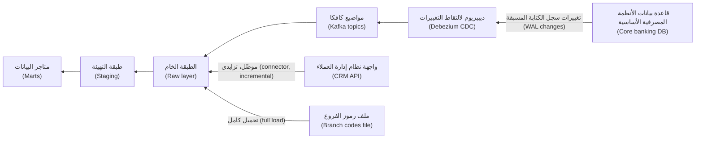
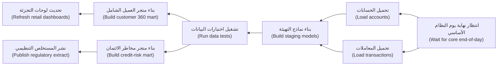
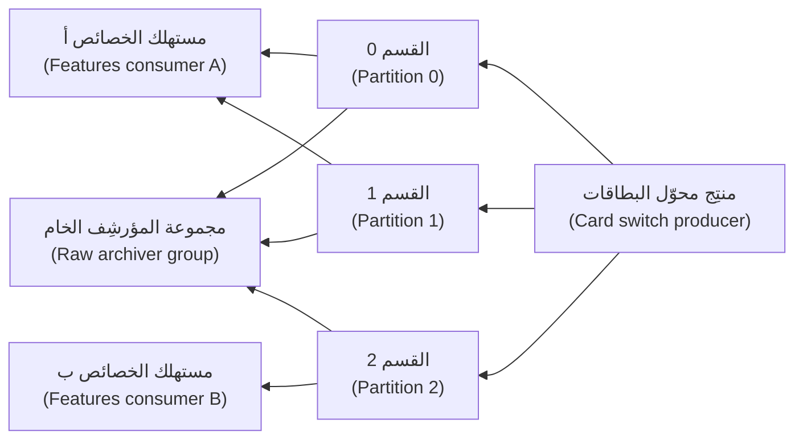

# الوحدة 2 — الاستيعاب وخطوط البيانات

*لا يكون مستودع البيانات (warehouse) أفضل من البيانات التي تصل إليه، ولا أجدر بالثقة من خطوط البيانات (pipelines) التي تنقل تلك البيانات في موعدها ومرة واحدة وكاملة. تتناول هذه الوحدة السباكة التي تعتمد عليها معظم لوحات المعلومات بصمت. تبدأ بإدخال البيانات: ETL مقابل ELT، والموصِّلات (connectors)، والتحميلات التزايدية (incremental loads)، والتقاط تغيّر البيانات (change data capture) من قاعدة بيانات الأنظمة المصرفية الأساسية لبنك نجم (Najm Bank). ثم تنتقل إلى التنسيق (orchestration): كيف ترتّب التحميلات في رسوم بيانية موجّهة غير دورية (DAGs) يمكن إعادة محاولتها (retried) وإعادة تشغيلها (re-run) وإعادة تعبئتها (backfilled) دون احتساب ريال واحد مرتين. وتنتهي بالبث المتدفق (streaming): تفويضات البطاقات التي يجب أن يقيّمها نظام التنبيهات الذكية (Smart Alerts) في ثوانٍ، وما الذي يضمنه Kafka فعلًا، وكيف تعمل النوافذ (windows) والعلامات المائية (watermarks)، ولماذا تكون "المعالجة مرة واحدة بالضبط" خاصيةً تبنيها لا خانةً تؤشّر عليها. ستتابع هدى وهي ترى أول تحميل ليلي لها يُفلت الحسابات المحذوفة، وأول DAG لها يضاعف يومًا من المعاملات عند إعادة المحاولة، وأول مستهلك بث لها يفقد أحداثًا في انهيار، وتتابع فيصل وهو يحوّل كل خطأ إلى قاعدة يتّبعها فريق منصة البيانات كله.*

> **المراحل:** Ingest, Operate — نقل البيانات من حيث تُنشأ إلى حيث تُستخدم، وفق جدول زمني أو لحظة حدوثها، بحيث تكون إعادة تشغيل أي شيء آمنة دائمًا.

---

# 2.1 — إدخال البيانات: ETL مقابل ELT، والموصِّلات، والتحميلات التزايدية، والتقاط تغيّر البيانات
*المستوى: 🟡 متوسط* · *المتطلبات: 1.1، 1.3* · *المرحلة: Ingest*

**بعد هذا الدرس تستطيع** تشغّل تحميلًا تزايديًا بعلامة الحد الأعلى، وتبيّن باستعلام بالضبط أي الإدراجات والتحديثات والحذوفات التقطها وأيها فاته، ثم تلتقط التغييرات نفسها بالتقاط تغيّر البيانات. *مدة الدراسة: نحو 120 دقيقة (تقدير).*

## ⚡ الدرس في دقيقة
- **الاستيعاب (ingestion)** ينسخ البيانات من الأنظمة المصدر (قواعد البيانات، وأدوات SaaS، والملفات، وواجهات API، وتدفقات الأحداث) إلى منصتك التحليلية. وتحمّل معظم المنصات الحديثة البيانات الخام (raw data) أولًا ثم تحوّلها داخل مستودع البيانات: أي **ELT** بدلًا من **ETL**.
- أنزِل البيانات الخام **دون مساس وبإلحاق فقط**، مع بيانات وصفية للتحميل (متى، ومن أين، وأي دفعة). يمكنك دائمًا إعادة اشتقاق الجداول النظيفة من الخام؛ لكنك لا تستطيع استعادة ما رميته في طريق الدخول.
- **التحميلات الكاملة (full loads)** بسيطة وصحيحة لكنها تصبح بطيئة. أما **التحميلات التزايدية (incremental loads)** فتنقل ما تغيّر فقط، عادةً عبر "علامة الحد الأعلى" ("high-water mark") مثل `updated_at`، وهي تُفلت بصمت عمليات الحذف والالتزامات المتأخرة ما لم تصمّم لها.
- **التقاط تغيّر البيانات (change data capture, CDC)** يقرأ سجل التغييرات الخاص بقاعدة البيانات نفسها، فيرى كل إدراج وتحديث وحذف بترتيب الالتزام. و**Debezium** هو الأداة الشائعة مفتوحة المصدر (open-source tool) لذلك.
- إشارة القرار: جدول صغير أو بطيء التغيّر، تحميل كامل (full load)؛ جدول كبير فيه `updated_at` جدير بالثقة ولا حذف فعلي، تحميل تزايدي (incremental)؛ إن كانت عمليات الحذف مهمة أو يجب أن تكون الحداثة (freshness) بالدقائق، CDC.
- الفخ الأكبر: تحميل تزايدي بعلامة مائية صارمة `>` ودون تداخل، يبدو مثاليًا في الاختبار ويُسقط صفوفًا بصمت في الإنتاج.

## 🧭 لماذا يهم
أول مهمة حقيقية لهدى في بنك نجم هي تحميل ليلي لجدول `accounts` من قاعدة بيانات الأنظمة المصرفية الأساسية إلى مستودع البيانات. تكتب استعلامًا (query) يختار الصفوف التي يكون فيها `updated_at` أحدث من التشغيل الأخير، ويلحقها (appends) بجدول في المستودع، ويسجّل علامة الحد الأعلى الجديدة. ويعمل ثلاثة أسابيع دون أي خطأ.

ثم يلاحظ كريم، محلّل البيانات (data analyst) في قطاع التجزئة، أن متجر بيانات العميل الشامل يُظهر 312 حسابًا مفتوحًا أكثر من تقرير الأنظمة المصرفية الأساسية. يجد فيصل وهدى سببين. الأول: الحسابات المفتوحة بالخطأ **تُحذف فعليًا (hard-deleted)** في النظام الأساسي، ولا يستطيع استعلام على `updated_at` أن يرى صفًا لم يعد موجودًا. والثاني: معاملة دفعية طويلة التشغيل تختم `updated_at` عند بدايتها لكنها تلتزم بعد دقائق، بعد أن يكون تحميل هدى قد نقل العلامة المائية (watermark) إلى ما بعد ذلك الوقت. وتلك التحديثات تُتخطّى إلى الأبد.

لم ينهَر شيء ولم ينطلق أي تنبيه. كان خط البيانات (pipeline) "أخضر" وخاطئًا. هكذا يفشل الاستيعاب عادةً، ولهذا يكون نمط التحميل قرارًا هندسيًا لا إعدادًا في الموصِّل.

## 📐 كيف يعمل

### 🟢 الأساسيات

**المصادر والمصبّات.** **المصدر** هو حيث تُنشأ البيانات: قاعدة بيانات الأنظمة المصرفية الأساسية، وتدفق البطاقات، وأحداث تطبيق نجم للهاتف (Najm Mobile)، ونظام إدارة علاقات العملاء (CRM)، وملفات الشركاء. و**المصبّ (sink)** هو حيث تضعها: مستودع البيانات أو المستودع البحيري (lakehouse) من الدرس 1.3.

**ETL مقابل ELT.** في **ETL** (الاستخراج ثم التحويل ثم التحميل)، تُنظَّف البيانات ويُعاد تشكيلها على خادم منفصل قبل تحميلها، فلا يصل إلى مستودع البيانات إلا الشكل النهائي. وكان هذا منطقيًا حين كانت سعة التخزين والحوسبة في المستودع باهظة. وفي **ELT** (الاستخراج ثم التحميل ثم التحويل)، تحمّل البيانات الخام أولًا ثم تحوّلها داخل المستودع بلغة SQL، عادةً بأداة مثل dbt (الدرس 3.1). وأصبح ELT هو الخيار الافتراضي بعد أن جعلت المستودعات العمودية وتخزين الكائنات الرخيص الاحتفاظ بكل شيء ميسور التكلفة. وميزته الكبرى أن النسخة الخام تبقى متاحة: فحين تتغيّر قاعدة عمل، تعيد البناء من الخام بدلًا من إعادة الاستخراج من المصدر.

ولا يزال ETL مناسبًا حين يجب أن تحوّل *قبل* التحميل: لإسقاط البيانات الشخصية (personal data) أو إخفائها (mask) حين لا ينبغي أن تُنزَل أبدًا، أو لتحويل صيغة ملف غريبة، أو لتقليص حجم ضخم.

**الطبقة الخام.** أول مكان تنزل فيه البيانات هو الطبقة **الخام (raw)** (تسميها Databricks "البرونزية"). قواعد توفّر عليك الألم لاحقًا:

- **إلحاق فقط وغير قابلة للتغيير.** لا تحدّث الصفوف الخام في مكانها أبدًا. كل تحميل يضيف صفوفًا؛ والتصحيحات تأتي صفوفًا جديدة.
- **بنفس شكل المصدر.** أبقِ أسماء الأعمدة وأنواعها أقرب ما يمكن إلى المصدر. فإعادة التسمية والتنظيف تحدث في طبقة التهيئة (staging).
- **بيانات وصفية للتحميل في كل صف.** على الأقل `_loaded_at` (متى كتبه خط بياناتك)، و`_source` (أي نظام وأي جدول) و`_batch_id` (أي تشغيل). هذه الأعمدة تجيب عن سؤال "من أين جاء هذا الرقم؟" ⁦⁩ بعد أشهر.

**التحميلات الكاملة (Full loads).** النمط الأبسط: انسخ الجدول كله في كل تشغيل واستبدل النسخة السابقة. وهو صحيح دائمًا ويلتقط عمليات الحذف مجانًا (فالصف المحذوف يغيب ببساطة). لكنه يصبح غير عملي للجداول الكبيرة. وللجداول المرجعية مثل الفروع أو رموز العملات، يكون عادةً هو الصواب.

**التحميلات التزايدية بعلامة الحد الأعلى (Incremental loads with a high-water mark).** في الجداول الكبيرة تنسخ فقط الصفوف التي تغيّرت منذ التشغيل الأخير. والطريقة المعتادة هي **علامة الحد الأعلى (high-water mark)**: تذكّر أكبر قيمة `updated_at` (أو معرّف متزايد) حمّلتها، واطلب في المرة التالية الصفوف التي تعلوها.

```sql
-- Fragile: strict ">" and no overlap. Misses rows whose transaction
-- committed late, and never sees hard deletes.
SELECT * FROM accounts
WHERE updated_at > :last_watermark;
```

```sql
-- Safer: overlap the window by a margin larger than your longest
-- transaction, then de-duplicate on the primary key when merging.
SELECT * FROM accounts
WHERE updated_at >= :last_watermark - INTERVAL '30 minutes';
```

يعني التداخل أنك ستعيد قراءة بعض الصفوف الموجودة لديك أصلًا. ولا بأس بذلك، ما دامت الخطوة التالية **دمجًا (merge)** (إدراجًا أو تحديثًا) على المفتاح الأساسي لا إلحاقًا أعمى (الدرس 2.2).

قبل الاعتماد على `updated_at`، اسأل الفريق المالك: هل يضبطه كل مسار في الشيفرة، بما فيه السكربتات المجمّعة؟ هل يضبطه ساعة قاعدة البيانات أم خوادم ذات ساعات مختلفة؟ هل تُحذف الصفوف فعليًا أحيانًا؟ إن كان أي جواب غير مؤكد، فاستخدم CDC أو مطابقة كاملة دورية.

**التقاط تغيّر البيانات (Change data capture).** كل قاعدة بيانات جادة تكتب التغييرات في سجل قبل تطبيقها، لأغراض التعافي من الانهيار والنسخ المتماثل (replication). وسجل PostgreSQL هو **سجل الكتابة المسبقة (write-ahead log, WAL)**؛ وسجل MySQL هو الـ binlog. و**CDC القائم على السجل (log-based CDC)** يقرأ ذلك السجل ويحوّل كل تغيير ملتزَم إلى حدث: هذا الصف أُدرج، وهذا حُدِّث من هذه القيم إلى تلك، وهذا حُذف. ولأنه يقرأ الالتزامات لا الطوابع الزمنية، فإنه يرى كل تغيير ملتزَم بالترتيب، بما في ذلك عمليات الحذف والالتزامات المتأخرة. فيختفي خطآ هدى كلاهما.



### 🟡 التعمق أكثر

**الموصِّلات (Connectors).** **الموصِّل (connector)** مستخرِج جاهز (packaged extractor) لنوع واحد من المصادر، يتولّى عنك ترقيم الصفحات (pagination) وحدود المعدل (rate limits) والمصادقة (authentication) وتغييرات المخطط (schema changes). ومن الخيارات مفتوحة المصدر (open-source options) **Airbyte** (منصة بفهرس كبير من الموصِّلات)، و**dlt** (أداة تحميل البيانات، مكتبة Python لكتابة خطوط البيانات كشيفرة) ومواصفة **Singer** (Singer specification) مع **Meltano**. وتستضيف الخدمات المُدارة (managed services) مثل Fivetran الفكرة نفسها. والحكم المطلوب ليس أي شعار، بل: من يصون هذا الموصِّل حين تتغيّر واجهة API للمصدر؟ هل يدعم المزامنة التزايدية وعمليات الحذف لهذا المصدر؟ وهل يمكننا تشغيله حيث تقتضي قواعد إقامة البيانات لدينا؟ تعامل مع وضع "التزايدي" في كل موصِّل على أنه ادعاء يجب اختباره، لا حقيقة.

**ثلاث طرق لتنفيذ CDC.**

| النهج | كيف يعمل | نقاط القوة | نقاط الضعف |
|---|---|---|---|
| القائم على الاستعلام (Query-based) | الاستطلاع الدوري بعلامة الحد الأعلى على `updated_at` | بسيط، ولا يحتاج وصولًا خاصًا إلى قاعدة البيانات | يُفلت الحذف الفعلي والالتزامات المتأخرة؛ ويحمّل المصدر بالعبء |
| القائم على المشغِّلات (Trigger-based) | مشغِّلات قاعدة البيانات تكتب كل تغيير في جدول تدقيق تقرؤه أنت بعد ذلك | يلتقط عمليات الحذف | يضيف عبء كتابة وشيفرة داخل قاعدة البيانات المصدر |
| القائم على السجل (Log-based) | قراءة WAL أو binlog | يرى كل تغيير ملتزَم بالترتيب، بأثر منخفض على المصدر | يحتاج صلاحيات النسخ المتماثل وتشغيلًا حذرًا |

**كيف يعمل Debezium مع PostgreSQL.** يعمل Debezium مجموعةً من الموصِّلات داخل **Kafka Connect**، وهو إطار عمل لنقل البيانات إلى Kafka ومنه. ومع PostgreSQL يستخدم **الفك المنطقي (logical decoding)**: يجب أن تعمل قاعدة البيانات بالإعداد `wal_level = logical`، وينشئ Debezium **فتحة نسخ متماثل (replication slot)**، وهي علامة مرجعية في WAL تحتفظ بها قاعدة البيانات حتى يؤكد المستهلك (consumer) أنه قرأ ما بعدها. وعند أول تشغيل يأخذ **لقطة (snapshot)** متّسقة للجداول المختارة، ثم يبثّ التغييرات من الفتحة. ويحمل كل حدث تغيير (change event) صورتي الصف `before` و`after`، ورمز عملية `op` (`c` إنشاء (create)، `u` تحديث (update)، `d` حذف (delete)، `r` قراءة لقطة) وبيانات وصفية عن المصدر منها **LSN** (رقم تسلسل السجل)، أي موضع التغيير في WAL، وهو مفيد للترتيب وإزالة التكرار.

إعداد موصِّل بسيط قد يسجّله فريق منصة نجم لدى Kafka Connect:

```json
{
  "name": "najm-core-cdc",
  "config": {
    "connector.class": "io.debezium.connector.postgresql.PostgresConnector",
    "plugin.name": "pgoutput",
    "database.hostname": "core-primary.internal",
    "database.port": "5432",
    "database.user": "cdc_reader",
    "database.password": "${file:/secrets/cdc.properties:password}",
    "database.dbname": "corebanking",
    "topic.prefix": "najm.core",
    "slot.name": "najm_dwh_cdc",
    "table.include.list": "public.customers,public.accounts,public.transactions",
    "column.exclude.list": "public.customers.national_id",
    "decimal.handling.mode": "string"
  }
}
```

ثلاثة خيارات هي الأهم. كلمة المرور تأتي من ملف أسرار. و`table.include.list` يسمّي بالضبط الجداول التي يحتاجها مستودع البيانات، لا قاعدة البيانات كلها. و`column.exclude.list` يمنع رقم الهوية الوطنية من مغادرة النظام الأساسي أبدًا؛ فتقليل البيانات عند نقطة الاستيعاب هو أرخص ضابط للخصوصية ستحصل عليه يومًا (الدرس 6.2، و[*أمن الذكاء الاصطناعي وأمن التطبيقات* (Secure AI & Application Security)، الدرس 5.3 — حماية البيانات الشخصية (Protecting personal data)](../secai/index.ar.html#/5.3) للجانب الهندسي).

**من أحداث التغيير إلى الجداول (From change events to tables).** تحتفظ الطبقة الخام بتاريخ التغييرات الكامل. وتبني طبقة التهيئة **الحالة الراهنة**: آخر تغيير لكل مفتاح حسب LSN، مع استبعاد عمليات الحذف. والتاريخ نفسه يمنحك البُعد المتغيّر ببطء من النوع 2 (slowly changing dimension Type 2) شبه مجاني (الدرس 1.2).

```sql
-- Current state of accounts from the raw CDC history (PostgreSQL / DuckDB)
SELECT *
FROM (
  SELECT *,
         ROW_NUMBER() OVER (PARTITION BY account_id ORDER BY lsn DESC) AS rn
  FROM raw.core_accounts_changes
) latest
WHERE rn = 1
  AND op <> 'd';
```

**انجراف المخطط (Schema drift).** المصادر تتغيّر. أضف الأعمدة الجديدة إلى الطبقة الخام تلقائيًا، لكن *نبّه* على الأعمدة المحذوفة أو التي تغيّر نوعها بدلًا من إكراهها بصمت؛ والدرس 3.2 يحوّل هذا إلى عقود بيانات (data contracts).

### 🔴 نظرة الخبير

**فتحات النسخ المتماثل قد تملأ قرص الخادم الأساسي (Replication slots can fill the primary's disk).** تحتفظ الفتحة (slot) بـ WAL حتى يؤكد مستهلكها. فإن توقف Kafka Connect عطلة نهاية أسبوع، تراكم WAL على خادم *الإنتاج*. نبّه على تأخر الفتحة واضبط `max_slot_wal_keep_size` (في PostgreSQL 13 وما بعده) حتى لا يستطيع مستهلك ميت إسقاط الأنظمة المصرفية الأساسية؛ والثمن لقطة جديدة إن أُبطلت الفتحة. اتفق على ذلك مع فريق المنصة لدى سالم قبل الإطلاق.

**الترتيب.** يجعل Debezium المفتاح الأساسي مفتاحًا للأحداث، فتبقى التغييرات على صف واحد بالترتيب (الدرس 2.3)، لكن التغييرات عبر الجداول ليست مرتّبة ترتيبًا شاملًا: فقد تصل معاملة قبل حسابها. لا تفرض المفاتيح الأجنبية (foreign keys) على الطبقة الخام؛ وتحقّق من العلاقات بالاختبارات (الدرس 3.2).

**نمط صندوق الصادر (The outbox pattern).** يربط CDC المستهلكين بالجداول الداخلية للمصدر. والبديل أن يكتب التطبيق حدث عمل مقصودًا، مثل `AccountClosed`، في جدول **صندوق صادر (outbox)** ضمن المعاملة نفسها التي فيها التغيير، ولا يُلتقط إلا ذلك الجدول. وهو يحتاج تغييرات في التطبيق، لذا يناسب الخدمات الجديدة أكثر من نظام أساسي قديم.

**المطابقة ليست اختيارية.** حتى مع CDC، قارن يوميًا أعداد الصفوف (row counts) ومجاميع المبالغ بين المصدر ومستودع البيانات. وحين تختلف، تريد أن تعرف ذلك في الصباح نفسه.

**أين يعمل الاستيعاب.** قد تحمل بيانات عملاء قطر والإمارات والاتحاد الأوروبي توقعات إقامة تقيّد أين تعمل الموصِّلات وKafka والتخزين؛ تأكد من ذلك مع سارة (مسؤولة حماية البيانات) بدلًا من الافتراض (الوحدة 6 (Module 6)).

## 🧰 الأدوات
| الأداة أو النمط أو المعيار | ما هو وماذا يفعل | متى تلجأ إليه |
|---|---|---|
| **ELT** | حمّل البيانات الخام أولًا، ثم حوّلها داخل مستودع البيانات بلغة SQL | الخيار الافتراضي لمستودعات البيانات الحديثة والمستودعات البحيرية (lakehouses) |
| **ETL** | التحويل قبل التحميل، على محرّك منفصل | إخفاء البيانات الحساسة أو إسقاطها قبل أن تُنزَل؛ تحويل الصيغ الثقيل؛ تقليص الحجم |
| **Change data capture (CDC)** — التقاط تغيّر البيانات | يحوّل كل إدراج وتحديث وحذف ملتزَم إلى حدث بقراءة سجل قاعدة البيانات | جداول OLTP الكبيرة، وعمليات الحذف المهمة، والحداثة بالدقائق |
| **Debezium** (مفتوح المصدر، مبني على Kafka Connect) | موصِّلات CDC قائمة على السجل لـ PostgreSQL وMySQL وSQL Server وغيرها | CDC من قاعدة PostgreSQL للأنظمة المصرفية الأساسية في نجم إلى Kafka |
| **Airbyte** | منصة تكامل بيانات مفتوحة المصدر مع موصِّلات جاهزة كثيرة | السحب من واجهات SaaS وقواعد البيانات دون كتابة مستخرِجات (extractors) |
| **dlt** (أداة تحميل البيانات) | مكتبة Python لكتابة خطوط الاستخراج والتحميل كشيفرة مع حالة تزايدية (incremental state) | واجهات API المخصصة والملفات حين تريد خطوط البيانات في مستودع شيفرتك |
| **High-water mark** — علامة الحد الأعلى | تذكّر أكبر `updated_at` أو معرّف (ID) محمَّل؛ واقرأ ما يعلوه في المرة التالية، مع تداخل | الجداول الكبيرة ذات طابع تغيير زمني جدير بالثقة ولا حذف فعلي فيها |

## 🏛️ عمليًا في بنك نجم
بعد فجوة الحسابات الـ 312 (312-account gap)، يطلب فيصل من هدى كتابة **مذكرة تصميم استيعاب** لكل جدول من جداول الأنظمة المصرفية الأساسية قبل بناء أي شيء جديد. والمذكرة صفحة واحدة يراجعها مالك المصدر (فريق الهندسة لدى طارق)، وفيصل، وسارة في كل ما هو شخصي.

**مذكرة تصميم الاستيعاب: `core.accounts` → `raw.core_accounts_changes`**

| الحقل | القرار |
|---|---|
| المصدر والمالك | قاعدة PostgreSQL للأنظمة المصرفية الأساسية، `public.accounts`؛ المالك: فريق الأنظمة المصرفية الأساسية (طارق) |
| المستهلكون (Consumers) | متجر بيانات العميل الشامل، ومتجر مخاطر الائتمان (credit-risk mart)، والمستخلصات التنظيمية (regulatory extracts) |
| عمليات الحذف | يحدث الحذف الفعلي (حسابات فُتحت بالخطأ) |
| نمط التحميل | CDC قائم على السجل باستخدام Debezium؛ لقطة أولية، ثم بث متدفق |
| لماذا ليس تزايديًا | `updated_at` يُفلت الحذف الفعلي (hard deletes) والتحديثات الدفعية متأخرة الالتزام |
| الأعمدة | الجميع عدا المدرجة تحت "المستبعدة" |
| هدف الحداثة (Freshness target) | الطبقة الخام خلال 15 دقيقة من الالتزام في ساعات العمل |
| تخطيط الطبقة الخام | تاريخ تغييرات بإلحاق فقط مع `op` و`lsn` و`_loaded_at` و`_source` و`_batch_id` |
| الحالة الراهنة | نموذج تهيئة (staging model): آخر تغيير لكل `account_id` حسب `lsn`، مع إزالة المحذوفات |
| المطابقة (Reconciliation) | يوميًا: عدد الحسابات المفتوحة ومجموع الأرصدة مقابل تقرير نهاية اليوم في النظام الأساسي؛ تنبيه عند أي فرق |
| أنماط الفشل والتنبيهات | تأخر فتحة النسخ المتماثل؛ توقف الموصِّل؛ تغيّر المخطط في المصدر؛ عدم تطابق المطابقة |
| الإقامة والوصول | Kafka والتخزين الخام في المنطقة المعتمدة؛ المخطط الخام قابل للقراءة لفريق المنصة فقط |
| دليل التشغيل (Runbook) | كيف تعيد تشغيل الموصِّل، وكيف تعيد أخذ لقطة لجدول واحد، ومن تتصل به في الفريق الأساسي |

ويجب أن يستوفي كل خط بيانات جديد أيضًا: *طبقة خام بإلحاق فقط مع بيانات وصفية للتحميل؛ معالجة عمليات الحذف؛ تداخل أو CDC؛ دمج في طبقة التهيئة؛ مطابقة محدَّدة؛ تقليل البيانات الشخصية عند المصدر؛ تسمية المالك والتنبيهات.*

## 🛠️ التمارين
استخدم بيانات اصطناعية فقط. لا بأس بسكربت توليد أو بقاعدة بيانات نموذجية عامة؛ ولا تستخدم أبدًا بيانات عملاء حقيقية.

- 🟢 في PostgreSQL أو DuckDB، أنشئ جدول `accounts` اصطناعيًا (synthetic) (1,000 صف مع `updated_at`) وانسخه إلى `raw_accounts` مع `_loaded_at` و`_batch_id`. ثم حدّث 50 صفًا، واحذف 10، وأدرج 20، وشغّل تحميلًا تزايديًا بعلامة الحد الأعلى. *يكتمل عندما:* تستطيع أن تُظهر باستعلام بالضبط أي التغييرات التقطها التحميل التزايدي (incremental load) وأيها فاته، وتشرح السبب.
- 🟡 شغّل PostgreSQL بالإعداد `wal_level = logical`، وKafka (أو Redpanda) وKafka Connect مع موصِّل Debezium لـ PostgreSQL في Docker، متّبعًا دليل Debezium التعليمي. التقط جدولًا واحدًا، ثم أدرج صفوفًا وحدّثها واحذفها. *يكتمل عندما:* تستطيع أن تُظهر أحداث `c` و`u` و`d` في الموضوع، واستعلام SQL على الأحداث المُنزَلة يعيد بناء حالة الجدول الراهنة بالضبط.
- 🔴 اكتب مذكرة تصميم استيعاب، باستخدام قالب نجم (Najm template)، لجدول `transactions` الاصطناعي لديك، مع استعلام مطابقة. أوقف موصِّل CDC ساعة أثناء توليد عمليات كتابة. *يكتمل عندما:* تستطيع أن تُظهر نمو WAL المحتجز في الفتحة، ولحاقًا نظيفًا بعد إعادة التشغيل (دون صفوف مفقودة أو مكررة) ونجاح المطابقة.

## ⚠️ أخطاء وفخاخ
- **الثقة في `updated_at` دون تحقق.** السكربتات المجمّعة والمشغِّلات (triggers) والمعاملات الطويلة تكسره. اسأل مالك المصدر، وداخِل النافذة، وادمج على المفتاح، أو استخدم CDC.
- **تجاهل عمليات الحذف.** التحميلات التزايدية لا ترى الحذف الفعلي أبدًا. استخدم CDC، أو الحذف المنطقي (soft deletes) المتفق عليه مع فريق المصدر، أو مقارنة كاملة دورية للمفاتيح.
- **نسخ كل عمود "احتياطًا".** استبعد الأعمدة الحساسة عند المصدر.
- **تشغيل CDC دون مراقبة فتحة النسخ المتماثل (Running CDC without monitoring the replication slot).** قد يملأ مستهلك متوقف قرص قاعدة البيانات الأساسية. نبّه على تأخر الفتحة وضع سقفًا لـ WAL المحتجز.
- **لا مطابقة (No reconciliation).** خط البيانات الأخضر ليس خطًا صحيحًا. قارن الأعداد والمجاميع بالمصدر كل يوم.

## 🧾 الخلاصة
- يحمّل ELT البيانات الخام أولًا ويحوّل في مستودع البيانات؛ ولا يزال ETL مناسبًا حين يجب إخفاء البيانات أو إسقاطها أو إعادة تشكيلها قبل أن تُنزَل.
- الطبقة الخام بإلحاق فقط (append-only)، وبشكل المصدر (source-shaped)، ومختومة ببيانات وصفية للتحميل.
- التحميلات الكاملة بسيطة وتلتقط عمليات الحذف؛ والتحميلات التزايدية تتوسّع لكنها تحتاج تداخلًا ودمجًا وعمود تغيير جديرًا بالثقة.
- يرى CDC القائم على السجل كل تغيير ملتزَم بالترتيب، بما في ذلك عمليات الحذف، لكن يجب تشغيله بعناية.
- يحتاج كل خط بيانات إلى مذكرة تصميم، وأعمدة مقلَّلة، وتنبيهات، ومطابقة يومية مع المصدر.

## ✍️ اختبر نفسك

**1. يُظهر تحميل هدى التزايدي (incremental load) على `updated_at` حسابات مفتوحة أكثر من النظام الأساسي. ويحذف فريق العمليات فعليًا الحسابات المفتوحة بالخطأ. أي تغيير يعالج السبب الجذري (root cause) بأكبر موثوقية؟**

- A. شغّل التحميل التزايدي كل ساعة بدلًا من كل ليلة، لتُغلق الفجوات أسرع
- B. غيّر مقارنة العلامة المائية من `>` إلى `>=` لتُحفظ صفوف الحدود
- C. انتقل إلى CDC القائم على السجل، الذي يسجّل عمليات الحذف
- D. أضف فهرسًا على `updated_at` في المصدر ليصبح الاستعلام أسرع

<details><summary>الإجابة</summary>

**C.** الصف المحذوف لم يعد موجودًا، فلا يستطيع أي استعلام على `updated_at` أن يراه؛ أما قراءة سجل قاعدة البيانات فتراه. A وB تغيّران التوقيت أو الحدود لكنهما لا تريان عمليات الحذف أبدًا؛ وD لا تفعل سوى تسريع الاستعلام الأعمى نفسه. (🟢 الأساسيات)

</details>

**2. ما الميزة الرئيسية لـ ELT على ETL في مستودع بيانات نجم (Najm's warehouse)؟**

- A. تبقى البيانات الخام في المستودع، فيمكن إعادة بناء الجداول دون إعادة الاستخراج
- B. لا يضع أي عبء على الأنظمة المصدر أبدًا، لأن التحويل يحدث لاحقًا بعد التحميل
- C. يلغي الحاجة إلى اختبارات جودة البيانات، لأن الخام محفوظ تمامًا كما في المصدر
- D. يضمن ألا تصل البيانات الشخصية إلى مستودع البيانات أبدًا بأي شكل من الأشكال

<details><summary>الإجابة</summary>

**A.** الاحتفاظ بالبيانات الخام يتيح لك إعادة اشتقاق كل ما يليها. B خاطئة (فالاستخراج لا يزال يقرأ المصدر)، وC خاطئة، وD عكس الصحيح: فإن كان يجب ألا تُنزَل البيانات الحساسة أبدًا، فهذا سبب للتحويل أو الاستبعاد قبل التحميل. (🟢 الأساسيات)

</details>

**3. يقرأ تحميل ليلي الشرط `WHERE updated_at > :last_watermark`. تُحدَّث بعض الصفوف بمهمة دفعية (batch job) تبدأ معاملتها عند 01:00 لكنها تلتزم عند 01:20؛ ويعمل التحميل عند 01:10. ماذا يحدث، وما الإصلاح المعياري؟**

- A. لا شيء يسوء، لأن PostgreSQL يجعل الصفوف الملتزَمة مرئية بترتيب الطوابع الزمنية
- B. تُحمَّل الصفوف مرتين؛ أصلِحه بتحويل الجدول كله إلى تحميل كامل ليلي
- C. تسبب الصفوف خطأ مفتاح أساسي في التشغيل التالي؛ أصلِحه بإسقاط المفتاح
- D. تُتخطّى الصفوف إلى الأبد لأنها تصل متأخرة؛ داخِل النافذة وادمج، أو استخدم CDC

<details><summary>الإجابة</summary>

**D.** تحمل الصفوف طابعًا زمنيًا (timestamp) أقدم من العلامة المائية الجديدة (new watermark) لكنها كانت غير مرئية حين عمل التحميل. والتداخل يعيد قراءتها، والدمج (merge) يجعل إعادة القراءة غير ضارة (harmless). وA هي الافتراض الخاطئ وراء الخطأ. (🟢 الأساسيات)

</details>

**4. توقّف Kafka Connect الذي يشغّل Debezium لقاعدة بيانات الأنظمة المصرفية الأساسية مساء الجمعة. ويوم الاثنين، يبلّغ سالم أن استخدام القرص على قاعدة البيانات الأساسية نما بحدة. لماذا؟**

- A. يكتب Debezium أحداث التغيير عائدًا بها إلى جداول في قاعدة البيانات المصدر
- B. تحتفظ فتحة النسخ المتماثل بـ WAL حتى يؤكد المستهلك
- C. أُعيد تشغيل اللقطة الأولية فنسخت كل جدول ملتقَط داخل قاعدة البيانات
- D. انتهت فترة الاحتفاظ في Kafka، ففاضت المواضيع على الخادم الأساسي

<details><summary>الإجابة</summary>

**B.** الفتحة علامة مرجعية تمنع PostgreSQL من إزالة WAL لم يقرأه المستهلك. راقب تأخر الفتحة (slot lag) وضع سقفًا لـ WAL المحتجز بالإعداد `max_slot_wal_keep_size`. والخيارات الأخرى لا تمسّ قرص الخادم الأساسي. (🔴 نظرة الخبير)

</details>

**5. تسأل ليلى كيف يُبقي نجم أرقام الهوية الوطنية خارج المنصة التحليلية حين يُدخل CDC من جدول `customers`. أي جواب هو الأفضل؟**

- A. أخفِ العمود في كل لوحة معلومات للتجزئة والمخاطر تعرض تفاصيل العملاء
- B. انسخه إلى الطبقة الخام كالمعتاد، ثم أسقط العمود في نماذج التهيئة
- C. استبعد العمود في موصِّل CDC حتى لا يغادر النظام الأساسي أبدًا
- D. شفّر مستودع البيانات كله وهو مخزَّن، مما يجعل نسخ العمود إلى أي مكان آمنًا

<details><summary>الإجابة</summary>

**C.** التقليل عند المصدر يعني أن البيانات لا توجد أبدًا في المراحل اللاحقة (downstream)؛ وسجّل الاستبعاد في مذكرة تصميم الاستيعاب. B لا تزال تُنزلها في الطبقة الخام، حيث تبقى في التاريخ؛ وA تخفيها عن جمهور واحد فقط؛ وD تحمي التخزين لكن لا تحمي من وصول كل من يستطيع الاستعلام عنها. (🟡 التعمق أكثر)

</details>

## 📚 المراجع
- توثيق Debezium، موصِّل PostgreSQL — https://debezium.io/documentation/
- توثيق PostgreSQL (PostgreSQL documentation)، الفك المنطقي وفتحات النسخ المتماثل — https://www.postgresql.org/docs/current/logicaldecoding.html
- توثيق PostgreSQL، MERGE — https://www.postgresql.org/docs/current/sql-merge.html
- توثيق Apache Kafka (Apache Kafka documentation)، Kafka Connect — https://kafka.apache.org/documentation/
- توثيق Airbyte — https://docs.airbyte.com/
- توثيق dlt — https://dlthub.com/docs/
- Martin Kleppmann، *Designing Data-Intensive Applications* (O'Reilly)، الفصول المتعلقة بالنسخ المتماثل والبيانات المشتقة
- Joe Reis وMatt Housley، *Fundamentals of Data Engineering*

---

# 2.2 — التنسيق: الرسوم البيانية الموجّهة غير الدورية، وتساوي الأثر، وإعادة المحاولة، وإعادة التعبئة
*المستوى: 🟡 متوسط* · *المتطلبات: 2.1* · *المرحلة: Ingest, Operate*

**بعد هذا الدرس تستطيع** تكتب تحميلًا يوميًا يمكن إعادة تشغيله أو إعادة تعبئته لأي تاريخ دون تكرار الصفوف، وتثبت ذلك بمجاميع اليوم قبل ثلاث إعادات تشغيل وبعدها. *مدة الدراسة: نحو 110 دقيقة (تقدير).*

## ⚡ الدرس في دقيقة
- **المنسِّق (orchestrator)** يشغّل خطوات خط بياناتك بالترتيب الصحيح، وفق جدول زمني أو عند وصول البيانات، ويعيد محاولة ما يفشل، ويسجّل ما جرى تشغيله. و**Apache Airflow** و**Dagster** و**Prefect** هي الخيارات الشائعة مفتوحة المصدر (open-source choices).
- تُكتب خطوط البيانات على هيئة **رسوم بيانية موجّهة غير دورية (DAGs)**: رسوم موجّهة غير دورية من المهام، يعني فيها السهم "يجب أن ينتهي هذا أولًا" ولا شيء يعود في حلقة.
- القاعدة الأهم: يجب أن تكون كل مهمة **متساوية الأثر (idempotent)**. فتشغيلها مرة أو خمس مرات للفترة نفسها يجب أن يترك النتيجة نفسها بالضبط.
- اجعل المهام **حتمية (deterministic)**: تعمل على **فترة بيانات (data interval)** ثابتة يسلّمها لها المنسِّق، ولا تعمل أبدًا على "اليوم" أو `now()`.
- **إعادة المحاولة (retries)** تعالج الإخفاقات العابرة؛ و**إعادة التعبئة (backfills)** تعيد تشغيل التاريخ بعد إصلاح خطأ أو إضافة عمود جديد. وكلاهما آمن فقط إن كانت المهام متساوية الأثر.
- الفخ الأكبر: مهمة تُلحق صفوفًا. فأول إعادة محاولة تحتسب يومًا من المعاملات مرتين بصمت.

## 🧭 لماذا يهم
تنقل هدى تحميل المعاملات الليلي إلى Airflow. تشغّل المهمة استعلامًا لمعاملات "أمس" باستخدام `CURRENT_DATE - 1` وتُلحق الصفوف بالجدول `staging.transactions_daily`. وذات ليلة ينقطع الاتصال بمستودع البيانات بعد أن التزم الإدراج لكن قبل أن يصل الرد إلى Airflow. فيضع Airflow على المهمة علامة الفشل ويعيد محاولتها بعد خمس دقائق، بنجاح. وفي الصباح التالي تُظهر لوحة معلومات المالية إنفاق البطاقات ليوم 14 سبتمبر بما يقارب ضعف المبلغ المعتاد تمامًا.

تكتشف لينا، مهندسة التحليلات (analytics engineer)، المشكلة قبل أن يكتشفها قسم المالية. ثم يظهر خطأ ثانٍ أهدأ. كان تحميل يوم السبت قد فشل فأعادت هدى تشغيله يدويًا يوم الاثنين. ولأن الاستعلام كان يقول `CURRENT_DATE - 1`، حمّلت إعادة التشغيل يوم *الأحد* مرة أخرى، ولم يصل السبت أبدًا.

لا علاقة لأي من الخطأين بـ Airflow. فالمهمة ألحقت بدلًا من أن تستبدل، واختارت يومها بنفسها. ومن ذلك الصباح تخرج قاعدة فيصل للفريق: **"يجب أن تكون كل مهمة آمنة للتشغيل مرتين، لأي تاريخ، في أي وقت."** ⁦****⁩

## 📐 كيف يعمل

### 🟢 الأساسيات

**ماذا يفعل المنسِّق.** من دونه، تكون خطوط البيانات مهام cron (cron jobs) تستدعي سكربتات، وحين تفشل الخطوة الثالثة عند 02:00 لا يعرف أحد هل عملت الخطوات اللاحقة على بيانات قديمة. ويمنحك المنسِّق:

- **التبعيات**: شغّل "بناء العميل الشامل" فقط بعد أن تنجح كلٌّ من "تحميل الحسابات" و"تحميل المعاملات".
- **الجدولة (Scheduling)**: بالوقت ("يوميًا عند 02:00" ("daily at 02:00")) أو بالحدث ("حين يصل ملف التسوية").
- **إعادة المحاولة والمهل الزمنية**: أعد تجربة مهمة فاشلة بعد توقف؛ واقتل مهمة معلّقة.
- **السجل التاريخي**: كل تشغيل، ومعاملاته، وسجلاته، ونتيجته، في مكان واحد.
- **إعادة التعبئة (Backfills)**: تشغيل خط بيانات لنطاق من التواريخ الماضية.
- **التنبيه (Alerting)**: إبلاغ شخص مسمّى حين يفشل شيء أو يتأخر.

**الرسوم البيانية الموجّهة غير الدورية (DAGs).** **الرسم البياني الموجّه غير الدوري (DAG)** هو شكل خط البيانات. *موجّه (Directed)*: كل سهم يشير في اتجاه واحد، من مهمة إلى المهمة التي تعتمد عليها. *غير دوري (Acyclic)*: لا يمكنك أبدًا تتبّع الأسهم عائدًا إلى حيث بدأت. خط البيانات الليلي في نجم:



يعمل التحميلان بالتوازي. وإن فشلت اختبارات البيانات، لا يعمل أي شيء لاحق، فلا يصل يوم معطوب أبدًا إلى لوحة معلومات أو إلى جهة تنظيمية.

**تساوي الأثر (Idempotency).** تكون العملية **متساوية الأثر (idempotent)** إن كان لتنفيذها مرات كثيرة الأثرُ نفسه الذي لتنفيذها مرة واحدة. فالضغط على زر استدعاء المصعد متساوي الأثر؛ أما إضافة صف فليست كذلك. وهناك طريقتان معياريتان لجعل التحميل متساوي الأثر:

1. **حذف قسم ثم إدراجه** (ويسمّى أيضًا الكتابة فوق القسم): داخل معاملة واحدة، احذف كل شيء للفترة التي تحمّلها، ثم أدرجها من جديد.
2. **الدمج (الإدراج أو التحديث) على مفتاح (Merge (upsert) on a key)**: أدرج الصفوف الجديدة وحدّث الموجودة، بالمطابقة على مفتاح أساسي.

الطريقة الخاطئة والطريقة الصحيحة جنبًا إلى جنب:

```sql
-- Not idempotent: decides its own date and appends.
INSERT INTO staging.transactions_daily
SELECT * FROM raw.transactions
WHERE booked_at::date = CURRENT_DATE - 1;
```

```sql
-- Idempotent: the date comes from the orchestrator, and the period
-- is replaced as a whole inside one transaction.
BEGIN;
DELETE FROM staging.transactions_daily
WHERE business_date = :business_date;

INSERT INTO staging.transactions_daily
SELECT transaction_id, account_id, amount, currency,
       :business_date AS business_date
FROM raw.transactions
WHERE booked_at >= :interval_start
  AND booked_at <  :interval_end;
COMMIT;
```

شغّل النسخة الثانية مرة أو عشر مرات، لأي يوم، وسينتهي الجدول إلى الحالة نفسها. ولـ `BEGIN`/`COMMIT` أهمية: فإن فشل الإدراج، يُتراجع عن الحذف وتبقى بيانات الأمس السليمة في مكانها.

**فترات البيانات، لا "اليوم" (Data intervals, not "today").** تمنح المنسِّقات كل تشغيل **فترة بيانات (data interval)**: شريحة الزمن المسؤول عنها. فتشغيل يومي ليوم 14 سبتمبر فترته من 14 سبتمبر 00:00 إلى 15 سبتمبر 00:00، وهو عادةً *يبدأ* بعد انتهاء الفترة، في وقت مبكر من 15 سبتمبر. ويسمّي Airflow بداية الفترة **التاريخ المنطقي (logical date)** (والتوثيق الأقدم يقول "تاريخ التنفيذ" ("execution date")، وهو ليس وقت تنفيذ التشغيل). وفي Airflow 3، تكون سلاسل cron (cron strings) والإعدادات المسبقة (presets) مثل `@daily` افتراضيًا بفترة تشغيل صفرية الطول، لذا اطلب جدولًا زمنيًا للفترات صراحةً، كما في الأسفل. ويجب أن تقرأ مهمتك فترتها من المنسِّق وتستخدمها في كل استعلام. عندئذٍ تحمّل إعادة التشغيل يوم الاثنين لفترة السبت يومَ السبت.

**إعادة المحاولة (Retries).** كثير من الإخفاقات عابرة: اتصال منقطع، أو انتهاء مهلة قفل، أو حدّ معدل (rate limit). أعد المحاولة تلقائيًا بتوقف متزايد (**التراجع الأُسّي (exponential backoff)**)، واضبط **مهلة زمنية** حتى تفشل المهمة المعلّقة بدلًا من أن تعطّل لساعات. وإعادة المحاولة آمنة فقط على المهام متساوية الأثر.

### 🟡 التعمق أكثر

**رسم Airflow موجّه متساوي الأثر.** يعرّف Airflow الرسوم الموجّهة بلغة Python. وفي أسلوب TaskFlow، تكون كل دالة مزخرفة مهمةً. مسودة لتحميل معاملات نجم في Airflow 3:

```python
from datetime import timedelta

import pendulum
import psycopg
from airflow.sdk import dag, task  # Airflow 2: from airflow.decorators import dag, task
from airflow.timetables.interval import CronDataIntervalTimetable

DSN = "postgresql://etl@warehouse/najm"  # in real use, an Airflow connection with a secret backend


@dag(
    # Daily intervals on the Doha calendar, so a run covers one business day
    schedule=CronDataIntervalTimetable("0 0 * * *", timezone="Asia/Qatar"),
    start_date=pendulum.datetime(2026, 1, 1, tz="Asia/Qatar"),
    catchup=False,
    max_active_runs=1,
    default_args={
        "retries": 3,
        "retry_delay": timedelta(minutes=5),
        "retry_exponential_backoff": True,
        "execution_timeout": timedelta(hours=1),
    },
)
def core_transactions_daily():
    @task
    def load_transactions(**context):
        start = context["data_interval_start"]
        end = context["data_interval_end"]
        with psycopg.connect(DSN) as conn, conn.transaction():
            conn.execute(
                "DELETE FROM staging.transactions_daily WHERE business_date = %s",
                (start.date(),),
            )
            conn.execute(
                """INSERT INTO staging.transactions_daily
                   SELECT transaction_id, account_id, amount, currency, %s
                   FROM raw.transactions
                   WHERE booked_at >= %s AND booked_at < %s""",
                (start.date(), start, end),
            )

    load_transactions()


core_transactions_daily()
```

لاحظ ما *ليس* موجودًا: لا `datetime.now()`، ولا `CURRENT_DATE`، ولا إلحاق.

**الدمج للجداول التي لا فترة طبيعية لها.** الجداول الشبيهة بجداول الأبعاد (dimension-like tables) مثل `accounts` مفتاحية لا مؤرَّخة. استخدم دمجًا على المفتاح (يدعم PostgreSQL 15 وما بعده `MERGE`؛ ويعمل `INSERT ... ON CONFLICT ... DO UPDATE` في الإصدارات الأقدم):

```sql
MERGE INTO staging.accounts AS t
USING raw_accounts_batch AS s
  ON t.account_id = s.account_id
WHEN MATCHED AND s.updated_at > t.updated_at THEN
  UPDATE SET status = s.status, balance = s.balance, updated_at = s.updated_at
WHEN NOT MATCHED THEN
  INSERT (account_id, status, balance, updated_at)
  VALUES (s.account_id, s.status, s.balance, s.updated_at);
```

يفشل `MERGE` إن طابق صفّان من المصدر صفًا واحدًا في الهدف، لذا قلّص الدفعة أولًا إلى آخر صف لكل `account_id`. ويعني الحارس (guard) `s.updated_at > t.updated_at` أن تغييرًا أقدم يُعاد تشغيله لاحقًا لا يستطيع الكتابة فوق تغيير أحدث. وهذا هو الدمج الذي جعل العلامة المائية المتداخلة في الدرس 2.1 آمنة.

**إعادة التعبئة (Backfills).** **إعادة التعبئة (backfill)** تشغّل خط بيانات لفترات ماضية: بعد إصلاح خطأ، أو عمود جديد، أو مصدر جديد. ومع المهام متساوية الأثر والمدفوعة بالفترات تكون إعادة التعبئة مجرد "شغّل هذه الفترات اليومية الـ 90"؛ ولكلٍّ من Airflow وDagster أوامر إعادة تعبئة مدمجة وإجراءات في الواجهة (تغيّرت واجهة سطر أوامر Airflow (Airflow CLI) في الإصدار 3؛ راجع توثيقك). ومن دون تساوي الأثر تصبح مشروعًا يدويًا محفوفًا بالمخاطر. خطّط لإعادة التعبئة كما تخطّط للتغييرات:

- **قيّد التزامن (Limit concurrency)** بـ `max_active_runs` أو بالمجمّعات (pools)، حتى لا تُغرق تسعون عملية تشغيل المصدر.
- **شغّل اللاحق أيضًا**: المتاجر والمستخلصات المبنية من تلك التواريخ.
- **أبلغ الناس.** ستتغيّر الأرقام الماضية؛ ويجب أن تعرف لينا وكريم قبل أن يعرف قسم المالية.

**الجدولة بالبيانات لا بالساعة فقط.** "شغّل عند 02:00" تفترض أن دفعة نهاية اليوم (end-of-day batch) في النظام الأساسي تنتهي دائمًا قبل ذلك. وحين تتأخر، تحمّل نصف يوم. والأفضل: ابدأ حين تكون البيانات جاهزة. ومن الخيارات **المستشعِر (sensor)** (مهمة تنتظر حتى يتحقق شرط، مثل ظهور صف علامة (marker row) أو ملف)، والجدولة الواعية بالبيانات (data-aware scheduling) في Airflow (يعمل الرسم الموجّه حين تُحدَّث مجموعة بيانات أو أصل في المنبع)، والجدولة القائمة على الأصول في Dagster. واقرن الانتظار دائمًا بمهلة زمنية وتنبيه، وإلا فإن ملفًا مفقودًا يعني توقفًا صامتًا.

**منظور الأصول في Dagster.** يفكّر Airflow بـ **المهام** (افعل هذا، ثم ذاك). ويفكّر Dagster بـ **الأصول**: الجداول والملفات التي ينتجها خط بياناتك، مع تبعياتها وأقسامها. فتعلن أن "`stg_transactions_daily` أصل مقسَّم يوميًا مبني من `raw_transactions`"، وتستنتج الأداة ما يجب تشغيله:

```python
from dagster import AssetExecutionContext, DailyPartitionsDefinition, asset

daily = DailyPartitionsDefinition(start_date="2026-01-01")


@asset(partitions_def=daily)
def stg_transactions_daily(context: AssetExecutionContext) -> None:
    day = context.partition_key  # e.g. "2026-09-14"
    ...  # delete-then-insert this one day, exactly as in the SQL above
```

يؤدي مفتاح القسم (partition key) دور فترة البيانات في Airflow. ويجعل منظور الأصول النسب (lineage) والحداثة مرئيين ("هذا المتجر قديم لأن هذا القسم في المنبع فشل"). و**Prefect** خيار ثالث. اختر واحدًا؛ فالمبادئ واحدة.

### 🔴 نظرة الخبير

**النشر الذرّي (Atomic publishing).** لا تُعِد بناء متجر بيانات كبير في مكانه بينما تقرأ منه لوحات المعلومات. ابنِ جدولًا جديدًا، واختبره، ثم بدّله بإعادة تسمية أو بتبديل العرض. وجداول Iceberg وDelta تفعل ذلك باللقطات (snapshots) وتسمح بالتراجع (rollback) (الدرس 1.3).

**المنسِّق ينسِّق.** يجب أن تطلب المهمة من مستودع البيانات أو Spark أو dbt أداء العمل الثقيل، لا أن تسحب عشرة ملايين صف إلى Python على جهاز المجدوِل.

**أعد محاولة الإخفاقات الصحيحة.** إعادة محاولة اتصال منقطع أمر جيد. أما إعادة محاولة فشل اختبار بيانات أو خطأ صياغة ثلاث مرات فلا تفعل سوى تأخير التنبيه. فرّق بين الأخطاء *العابرة (transient)* (أعد المحاولة) والأخطاء *الحتمية* (افشل سريعًا ونبّه إنسانًا)، وأرسل الإخفاقات إلى قناة لها مالك مع رابط إلى السجلات.

**مستويات الخدمة للبيانات.** اتفق على هدف حداثة لكل منتج بيانات (data product)، مثل "متجر مخاطر الائتمان لليوم D جاهز بحلول 07:00 في اليوم D+1"، ونبّه حين يكون معرّضًا للخطر، لا فقط حين تفشل مهمة. وأنماط المراقبة للمهام التي لا يراقبها أحد مشروحة في [*تصميم الأنظمة لمبرمجي الحدس*، الدرس 7.4 — المهام الخلفية: الشيفرة التي لا يراقبها أحد](../vibe/index.ar.html#l7-4)، ومحركات سير العمل المتينة لعمل التطبيقات في [*لبنات بناء SaaS*، الدرس 5.4 — محركات سير العمل والتنفيذ المتين](../saas/index.ar.html#/5.4).

**الآثار الجانبية خارج مستودع البيانات.** البريد الإلكتروني أو استدعاء API أو رفع ملف لا تغطيه معاملة قاعدة البيانات. امنح كلًّا منها **مفتاح تساوي أثر (idempotency key)** (مثل اسم التقرير مع تاريخ العمل)، وسجّله عند الإنجاز، ودع إعادات المحاولة تتخطاه. والفكرة نفسها لعمليات الكتابة في التطبيقات مشروحة في [*تصميم الأنظمة لمبرمجي الحدس*، الدرس 2.6 — نقرتان في آنٍ واحد: السباقات والمعاملات وعمليات الكتابة متساوية الأثر](../vibe/index.ar.html#l2-6).

**سجل التشغيل دليلًا.** يسأل المدققون (auditors) كيف أُنتج رقم ما ومتى. وسجل التشغيل بمعاملاته وإصدار الشيفرة ونتائج الاختبارات يجيب عن ذلك؛ احتفظ به وفق ما تقتضيه قواعد البنك وأبقِ شيفرة الرسوم الموجّهة في نظام التحكم بالإصدارات (الدرس 3.1).

## 🧰 الأدوات
| الأداة أو النمط أو المعيار | ما هو وماذا يفعل | متى تلجأ إليه |
|---|---|---|
| **Apache Airflow** | منسِّق مفتوح المصدر (open-source orchestrator)؛ خطوط البيانات رسومًا موجّهة من المهام بلغة Python مع جداول زمنية وإعادة محاولة وإعادة تعبئة وسجل تشغيل | خطوط بيانات قائمة على المهام عبر أنظمة كثيرة؛ معروف على نطاق واسع في فرق البيانات |
| **Dagster** | منسِّق مفتوح المصدر مبني حول الأصول المعرَّفة برمجيًا والأقسام (partitions) | حين تريد النسب والحداثة وأقسام الجداول مفاهيمَ من الدرجة الأولى |
| **Prefect** | تنسيق سير عمل مفتوح المصدر بتدفقات ومهام على هيئة دوال Python | خطوط بيانات كثيفة الاعتماد على Python حيث تناسب اللمسة الخفيفة الفريق |
| **Idempotent load** (partition overwrite) — التحميل متساوي الأثر (الكتابة فوق القسم) | احذف فترة كاملة واحدة وأعد إدراجها داخل معاملة | جداول الحقائق (fact tables) المحمَّلة باليوم أو الشهر |
| **MERGE / upsert** — الدمج / الإدراج أو التحديث | أدرج الصفوف الجديدة وحدّث الموجودة على مفتاح، مع حارس أحدثية | الجداول المفتاحية مثل الحسابات والعملاء؛ التحميلات التزايدية المتداخلة |
| **Backfill** — إعادة التعبئة | أعد تشغيل خط بيانات لنطاق من الفترات الماضية | إصلاحات الأخطاء، والأعمدة الجديدة، وضمّ مصدر جديد |
| **Sensor** — المستشعِر | مهمة تنتظر شرطًا، مثل ملف أو صف علامة، مع مهلة زمنية | البدء حين تكون بيانات المنبع جاهزة بدلًا من ساعة ثابتة |

## 🏛️ عمليًا في بنك نجم
يحوّل فيصل اليوم المحتسَب مرتين إلى **قائمة تحقق لمراجعة خطوط البيانات** يجب أن يجتازها كل رسم موجّه قبل دمجه، إضافة إلى **طلب إعادة تعبئة (backfill request)** معياري.

**قائمة تحقق مراجعة الرسوم الموجّهة في نجم (Najm DAG review checklist)**

| الفحص | ينجح عندما |
|---|---|
| كتابات متساوية الأثر | كل كتابة هي كتابة فوق قسم أو دمج محروس؛ ولا `INSERT` مجرّد في جدول مشترك |
| فترات حتمية | تقرأ المهام فترة البيانات أو مفتاح القسم؛ ولا `now()` أو `CURRENT_DATE` أو `today()` في الاستعلامات |
| المعاملات | أزواج الحذف والإدراج تعمل في معاملة واحدة؛ وإعادات البناء الكبيرة تُنشر ذرّيًا (publish atomically) |
| إعادة المحاولة | الأخطاء العابرة يُعاد محاولتها بتراجع (3 محاولات افتراضيًا)؛ وإخفاقات الاختبارات لا يُعاد محاولتها |
| المهل الزمنية (Timeouts) | لكل مهمة مهلة تنفيذ |
| الجاهزية | تبدأ بمستشعِر أو بمشغِّل واعٍ بالبيانات مع مهلة زمنية، أو توثّق لماذا يكون الوقت الثابت آمنًا |
| الاختبارات تحرس النشر | تعمل اختبارات البيانات قبل تحديث المتاجر أو لوحات المعلومات أو المستخلصات |
| الآثار الجانبية الخارجية | لكلٍّ منها مفتاح تساوي أثر يُسجَّل عند النجاح |
| التزامن (Concurrency) | ضبط `max_active_runs` والمجمّعات حتى لا تُثقل إعادة التعبئة المصادر |
| الملكية | تسمية المالك وقناة التنبيه؛ وكتابة هدف الحداثة |
| الأسرار | تأتي الاتصالات من واجهة الأسرار الخلفية، لا من الشيفرة أبدًا |

**طلب إعادة التعبئة (واحد لكل إعادة تعبئة، يُحفظ مع تذكرة التغيير (change ticket))**

```
Pipeline:         core_transactions_daily  ->  customer_360, credit_risk_mart
Reason:           fix currency conversion bug (ticket DATA-412)
Intervals:        2026-07-01 to 2026-09-30 (92 daily runs)
Concurrency:      max 4 runs at once; source = warehouse raw only (no load on core)
Downstream:       staging, both marts, retail and risk dashboards; NOT regulatory
                  extracts already submitted (needs compliance decision)
Expected change:  card spend in non-QAR currencies changes; totals in QAR unchanged
Checks after:     reconciliation per day passes; row counts per day unchanged
Communicated to:  Lina (metrics), Kareem (retail), finance reporting lead
Approved by:      Faisal
```

السطر التنظيمي هو الأهم: يجب ألا تغيّر إعادة تشغيل التاريخ بصمت رقمًا سبق الإبلاغ عنه. فذلك قرار إدارة الامتثال، لا إعداد في خط البيانات.

## 🛠️ التمارين
استخدم بيانات اصطناعية (synthetic data) وPostgreSQL أو DuckDB محليًا. ويعمل كلٌّ من Airflow (البدء السريع عبر Docker) وDagster (`pip`) محليًا.

- 🟢 اكتب نسختين من تحميل يومي من جدول `raw.transactions` اصطناعي إلى `staging.transactions_daily`: واحدة تُلحق باستخدام `CURRENT_DATE - 1`، وأخرى تحذف وتُدرج قيمة `business_date` معطاة في معاملة واحدة. شغّل كلًّا منهما ثلاث مرات للتاريخ نفسه. *يكتمل عندما:* يُظهر استعلام أن النسخة الأولى ضاعفت مجموع اليوم ثلاث مرات وأن الثانية تركته دون تغيير، وتستطيع شرح السبب في جملتين.
- 🟡 ابنِ الرسم الموجّه ذا المهام الخمس "انتظار العلامة، تحميل الحسابات، تحميل المعاملات، بناء التهيئة، تشغيل الاختبارات" في Airflow أو Dagster، مستخدمًا فترة البيانات أو مفتاح القسم في كل استعلام. اجعل إحدى المهام تفشل في محاولتها الأولى فقط. *يكتمل عندما:* تنجح إعادة المحاولة دون صفوف مكررة، وتنتج إعادة تعبئة لـ 14 يومًا ماضيًا المجاميع نفسها بالضبط التي ينتجها تشغيل كل يوم مرة واحدة.
- 🔴 أضف خطوة "نشر" تكتب مستخلص CSV لكل تاريخ عمل وتسجّل مفتاح تساوي أثر في جدول `published_extracts`. حاكِ انهيارًا بعد كتابة الملف لكن قبل الإبلاغ عن النجاح. *يكتمل عندما:* تتخطى إعادة المحاولة المفتاح الموجود دون ملف ثانٍ، وتكون قد راجعت رسمك الموجّه وفق قائمة تحقق نجم (Najm checklist).

## ⚠️ أخطاء وفخاخ
- **الإلحاق في مهمة يمكن إعادة محاولتها.** إعادات المحاولة وإعادات التشغيل تحتسب مرتين (double-count). اكتب فوق الفترة أو ادمج على مفتاح.
- **استخدام "اليوم" داخل مهمة.** عندئذٍ تحمّل إعادات التشغيل وإعادات التعبئة اليوم الخطأ. اقرأ فترة البيانات أو مفتاح القسم من المنسِّق.
- **إعادة محاولة كل شيء.** اختبار البيانات الفاشل أو خطأ الشيفرة سيفشل مجددًا. أعد محاولة الأخطاء العابرة فقط؛ وافشل سريعًا في البقية.
- **إعادات تعبئة بلا حدود (Unbounded backfills).** ضع سقفًا للتزامن؛ وخطّط لإعادات التشغيل اللاحقة.
- **تغيير التاريخ المُبلَغ عنه بصمت.** قد تغيّر إعادة التعبئة أرقامًا أُرسلت بالفعل إلى جهة تنظيمية أو إلى مجلس الإدارة. قرّر صراحةً، مع إدارة الامتثال، ما الذي يجوز أن يتغيّر.

## 🧾 الخلاصة
- تشغّل المنسِّقات (orchestrators) رسومًا موجّهة من المهام مع تبعيات وجداول زمنية وإعادة محاولة ومهل زمنية وسجل تاريخي وإعادة تعبئة؛ وAirflow قائم على المهام (task-based)، وDagster قائم على الأصول (asset-based)، وPrefect يضع Python أولًا (Python-first).
- تساوي الأثر هو القاعدة الجوهرية: التشغيل نفسه للفترة نفسها يعطي دائمًا النتيجة نفسها. استخدم الكتابة فوق القسم أو الدمج المحروس داخل معاملة.
- يجب أن تأخذ المهام فترتها من فترة البيانات لدى المنسِّق، لا من "اليوم" أبدًا.
- إعادة المحاولة وإعادة التعبئة آمنتان فقط على المهام متساوية الأثر؛ ضع سقفًا لتزامنهما وأعد تشغيل اللاحق.
- انشر ذرّيًا، واجعل الاختبارات بوابة، وامنح الآثار الجانبية الخارجية مفاتيح تساوي أثر، ونبّه على الحداثة، لا على الفشل فقط.

## ✍️ اختبر نفسك

**1. أدرجت مهمة هدى يومًا من المعاملات، والتزمت، ثم فقدت اتصالها قبل أن يتلقى Airflow النجاح. أعاد Airflow المحاولة (retried)، فتضاعف مجموع اليوم. ما أفضل إصلاح؟**

- A. أوقف إعادة المحاولة لتلك المهمة حتى لا تعمل مرتين أبدًا
- B. احذف ذلك اليوم وأعد إدراجه في معاملة واحدة، لفترة البيانات في Airflow
- C. أضف مهمة تنظيف شهرية تزيل الصفوف المكررة من طبقة التهيئة
- D. زِد مهلة المهمة الزمنية ليكون للاتصال وقت أطول للتعافي

<details><summary>الإجابة</summary>

**B.** تجعل المهمة متساوية الأثر (idempotent)، فأي عدد من إعادات المحاولة يترك النتيجة نفسها. A تستبدل الاحتساب المزدوج بالبيانات المفقودة؛ وC تترك أرقامًا خاطئة على لوحات المعلومات أسابيع؛ وD تتجاهل التكرار. (🟢 الأساسيات)

</details>

**2. فشل رسم موجّه يومي يوم السبت وأُعيد تشغيله يدويًا يوم الاثنين. ويستخدم استعلامه `CURRENT_DATE - 1`. ماذا يحدث؟**

- A. يُحمَّل السبت بشكل صحيح، لأن التشغيل اليدوي ينتمي إلى فترة السبت
- B. يفشل التشغيل بخطأ تاريخ لأن الاثنين خارج فترة التشغيل
- C. يعيد Airflow كتابة `CURRENT_DATE` في الاستعلام إلى التاريخ المنطقي للتشغيل
- D. يُحمَّل الأحد مرة أخرى ويبقى السبت مفقودًا

<details><summary>الإجابة</summary>

**D.** يحدد الاستعلام التاريخ من ساعة الحائط (wall clock) وقت تشغيله، لا من فترة بيانات التشغيل. وA هي ما كان سيحدث لو استخدم الاستعلام الفترة. (🟢 الأساسيات)

</details>

**3. يحتاج فيصل إلى إعادة تشغيل خط بيانات المعاملات لآخر 90 يومًا بعد إصلاح خطأ. أي خطة هي الأكثر أمانًا؟**

- A. إعادة تعبئة بتزامن مقيَّد، وإعادة تشغيل المتاجر اللاحقة، والاتفاق مع الامتثال على ما قُدِّم
- B. تشغيل الأيام الـ 90 كلها بالتوازي دفعة واحدة لتنتهي إعادة التعبئة قبل لوحات المعلومات الصباحية كلها
- C. تفريغ جدول التهيئة، ثم تشغيل تحميل اليوم فقط وترك التاريخ يعيد بناء نفسه
- D. إصلاح الأيام المستقبلية فقط، لأن التاريخ الذي عُرض على المستخدمين يجب ألا يتغيّر أبدًا

<details><summary>الإجابة</summary>

**A.** إنها مضبوطة وكاملة ومحكومة. B قد تُثقل المصدر أو مستودع البيانات؛ وC تدمّر التاريخ؛ وD تترك أرقامًا معروف خطؤها في مكانها. (🟡 التعمق أكثر)

</details>

**4. في عملية `MERGE` تحمّل تغييرات الحسابات من مستخلص تزايدي متداخل، لماذا نضيف `WHEN MATCHED AND s.updated_at > t.updated_at`؟**

- A. يجعل الدمج أسرع بتخطي الصفوف التي لم تتغيّر طوابعها الزمنية
- B. تتطلبه صياغة PostgreSQL كلما كان في MERGE بند مطابقة
- C. يمنع تغييرًا أقدم معادًا تشغيله من الكتابة فوق قيمة أحدث
- D. يزيل الحسابات التي حُذفت في المصدر منذ التحميل الأخير

<details><summary>الإجابة</summary>

**C.** النوافذ المتداخلة وإعادات التشغيل قد تسلّم التغييرات بغير ترتيبها (out of order)؛ والحارس (guard) يُبقي الأحدث. وهو صياغة اختيارية، لا ميزة سرعة أو حذف. (🟡 التعمق أكثر)

</details>

**5. يُبنى متجر مخاطر الائتمان (credit-risk mart) عند 02:00 كل يوم، لكن دفعة نهاية اليوم (end-of-day batch) في النظام الأساسي تنتهي أحيانًا عند 02:40. ما أفضل تصميم؟**

- A. انقل الجدول الزمني إلى 05:00 وتمنَّ ألا تتأخر دفعة نهاية اليوم إلى هذا الحد أبدًا
- B. شغّل عند إشارة جاهزية من نهاية يوم النظام الأساسي، مع مهلة زمنية وتنبيه
- C. أعد محاولة البناء كل خمس دقائق حتى تبدو المجاميع صحيحة لفريق المخاطر
- D. ابنِ مرتين يوميًا ودع المستخدمين يختارون أي نسخة تبدو أفضل

<details><summary>الإجابة</summary>

**B.** الجاهزية تتجنب تحميل نصف يوم؛ والمهلة الزمنية والتنبيه يجعلان التوقف مرئيًا. A تنقل الخطر فقط؛ وC وD تستبدلان الفحوص بالتخمين. (🟡 التعمق أكثر)

</details>

## 📚 المراجع
- توثيق Apache Airflow — https://airflow.apache.org/docs/
- توثيق Dagster — https://docs.dagster.io/
- توثيق Prefect — https://docs.prefect.io/
- توثيق PostgreSQL، MERGE — https://www.postgresql.org/docs/current/sql-merge.html
- توثيق PostgreSQL، INSERT — https://www.postgresql.org/docs/current/sql-insert.html
- Maxime Beauchemin، "Functional Data Engineering — a modern paradigm for batch data processing" (2018)، عن خطوط البيانات متساوية الأثر والقائمة على الأقسام — https://maximebeauchemin.medium.com/
- Joe Reis وMatt Housley، *Fundamentals of Data Engineering*

---

# 2.3 — البث المتدفق: الأحداث، وKafka، والنوافذ، وأسطورة "مرة واحدة بالضبط"
*المستوى: 🟡 متوسط* · *المتطلبات: 2.1، 2.2* · *المرحلة: Ingest, Transform*

**بعد هذا الدرس تستطيع** تبني مستهلك Kafka يُدخل كل حدث في جدوله مرة واحدة بالضبط رغم الأعطال، باعتماد الإيداع اليدوي بعد الكتابة ووجهة متساوية الأثر. *مدة الدراسة: نحو 120 دقيقة (تقدير).*

## ⚡ الدرس في دقيقة
- **البث المتدفق (streaming)** يعالج البيانات باستمرار (continuously) على هيئة **أحداث** (حقائق صغيرة غير قابلة للتغيير مثل "فُوِّضت البطاقة 4417 بمبلغ 120 ريالًا قطريًا عند 14:02:11" ("card 4417 was authorised for 120 QAR at 14:02:11")) بدلًا من الدفعات الليلية. استخدمه حين يفقد القرار قيمته خلال ثوانٍ أو دقائق، مثل تقييم دفعة بطاقة للاحتيال.
- يخزّن **Apache Kafka** الأحداث في **مواضيع**، مقسَّمة إلى **أقسام (partitions)**. والترتيب مضمون داخل القسم فقط، فاختر **المفتاح** (مثل معرّف البطاقة) الذي يُبقي الأحداث المترابطة معًا.
- يتتبّع المستهلكون موضعهم بـ **الإزاحات (offsets)**. ومتى تلتزم بالإزاحة نسبةً إلى أداء العمل يحدد هل تحصل على تسليم **مرة واحدة على الأكثر (at-most-once)** (قد يُفقد) أو **مرة واحدة على الأقل (at-least-once)** (قد يتكرر).
- يقدّم Kafka **المعالجة مرة واحدة بالضبط داخل Kafka (exactly-once within Kafka)** عبر المنتِجين متساويي الأثر والمعاملات. أما من الطرف إلى الطرف، فتحتاج المعالجة مرة واحدة بالضبط إلى **مصبّ متساوي الأثر (idempotent sink)**: صمّم للتكرارات، واجعلها غير ضارة.
- اجمع حسب **وقت الحدث (event time)**، لا وقت الوصول، مستخدمًا **النوافذ (windows)** (المتعاقبة (tumbling)، والمنزلقة (sliding)، والجلسات) و**العلامات المائية (watermarks)** التي تحدد كم تنتظر الأحداث المتأخرة (late events).
- الفخ الأكبر: الالتزام التلقائي بالإزاحات قبل إنجاز العمل، فيُسقط الانهيار أحداثًا بصمت.

## 🧭 لماذا يهم
تحتاج التنبيهات الذكية، نموذج كشف الاحتيال في بنك نجم، إلى خصائص (features) مثل "تفويضات هذه البطاقة في آخر 10 دقائق" و"الدول التي استُخدمت فيها اليوم". والدفعة الليلية عديمة الفائدة: فبحلول وقتها يكون المحتال قد انتهى. وتحتاجها دانة، كبيرة علماء البيانات، خلال ثوانٍ من كل تفويض (authorisation).

يقرأ أول مستهلك لهدى موضوع تفويضات البطاقات ويكتب الأعداد لكل بطاقة في جدول خصائص. وفي أسبوعه الأول في الإنتاج، يعيد نشرٌ (deployment) تشغيله في منتصف دفعة، وبعد ذلك تكون نحو دقيقتين من الحركة مفقودة: فقد كان المستهلك قد **التزم تلقائيًا (auto-committed)** بإزاحاته، قائلًا لـ Kafka "لقد عالجت هذه"، قبل كتابة النتائج. وعند إعادة التشغيل استأنف من الموضع الملتزَم به، ولم تُحتسب تلك الأحداث أبدًا.

أول ما خطر لهدى هو تفعيل "مرة واحدة بالضبط" ("exactly-once") في الإعدادات. فتوقفها دانة: "المعالجة مرة واحدة بالضبط في Kafka تغطي Kafka. وجدول خصائصنا في PostgreSQL. أريني ماذا يحدث حين نكتب الحدث نفسه مرتين." ⁦⁩ والجواب الصادق عن سؤال "هل يُعالَج كل حدث مرة واحدة بالضبط؟" ⁦⁩ هو: "مرة واحدة على الأقل، ومعالجته مرتين غير ضارة." ⁦⁩

## 📐 كيف يعمل

### 🟢 الأساسيات

**الدفعي مقابل المتدفق.** يعمل المعالج الدفعي (batch) على مجموعة بيانات محدودة، مثل معاملات الأمس، ثم يتوقف. ويعمل المتدفق على تسلسل **غير محدود (unbounded)** من الأحداث. والبث المتدفق أصعب في البناء والاختبار والتشغيل، ومعظم التقارير تخدمها الدفعات كل ساعة أو كل يوم جيدًا. اختر البث المتدفق حين *تتلاشى قيمة الجواب في ثوانٍ أو دقائق*: تقييم الاحتيال، والحدود اللحظية، والتنبيهات التشغيلية. واختبار مفيد: "لو كان عمر هذا الرقم ساعة، هل سيتخذ أحد قرارًا أسوأ؟" ⁦⁩ إن لم يكن، فاستخدم الدفعي.

**الأحداث.** **الحدث** سجلّ بأن شيئًا ما حدث، في وقت ما، ولا يتغيّر أبدًا بعد ذلك. حدث تفويض بطاقة في نجم:

```json
{
  "auth_id": "a9f3c2e1-7d4b-4c55-9a1e-2b6f0c8d1e77",
  "card_id": "card_4417",
  "merchant_country": "QA",
  "amount": "120.00",
  "currency": "QAR",
  "event_time": "2026-10-01T14:02:11.384Z"
}
```

`auth_id` معرّف فريد للحدث، فيمكن كشف التكرارات. و`event_time` هو وقت حدوث التفويض عند المصدر، لا وقت تلقّيك له.

**Kafka في خمس أفكار.**

- **الموضوع** تدفق مسمّى، مثل `najm.card.authorisations`. المنتِجون (producers) يكتبون؛ والمستهلكون يقرؤون.
- تنقسم المواضيع إلى **أقسام (partitions)**: سجلات مرتّبة بإلحاق فقط. والترتيب قائم *داخل* القسم فقط.
- الأحداث ذات **المفتاح** نفسه تذهب إلى القسم نفسه. اجعل المفتاح `card_id` فتصل أحداث كل بطاقة بالترتيب.
- **إزاحة (offset)** كل حدث هي موضعه. ويقوم المستهلك "بالالتزام" بالإزاحة التي بلغها، ليستأنف بعد إعادة التشغيل.
- يحتفظ Kafka بالأحداث مدة **احتفاظ (retention)** (بالوقت أو الحجم؛ والقيمة الافتراضية للوسيط (broker default) سبعة أيام) سواء قرأها أحد أم لا، فيستطيع المستهلكون إعادة تشغيل التاريخ. والموضوع **المضغوط (compacted)** يحتفظ بآخر حدث لكل مفتاح، وهو مفيد لـ CDC (الدرس 2.1).

**مجموعات المستهلكين (Consumer groups).** يتقاسم المستهلكون الذين يشتركون في **معرّف مجموعة** الأقسامَ: ستة أقسام وثلاثة مستهلكين تعني قسمين لكلٍّ منهم. وإضافة مستهلك تطلق إعادة توازن (rebalance)؛ والمستهلكون الزائدون عن عدد الأقسام يبقون خاملين. وتقرأ المجموعات المختلفة باستقلال، فترى كلٌّ من مهمة الخصائص والمؤرشِف الخام كل حدث.



**دلالات التسليم (Delivery semantics).** ما يحدث حين ينهار المستهلك يعتمد على *متى يلتزم بالإزاحة*:

| الدلالة (Semantics) | الالتزام بالإزاحة… (Commit offset…) | عند الانهيار | النتيجة |
|---|---|---|---|
| مرة واحدة على الأكثر | قبل أداء العمل | العمل لم يُنجز، لكن الإزاحة تحرّكت بالفعل | يمكن أن **تُفقد** الأحداث |
| مرة واحدة على الأقل | بعد إنجاز العمل | العمل أُنجز، والإزاحة لم تتحرّك بعد | يمكن أن **تتكرر (duplicated)** الأحداث |
| مرة واحدة بالضبط (Exactly-once) | ذرّيًا مع العمل | لا هذا ولا ذاك | أثر كل حدث يقع مرة واحدة |

كان الالتزام التلقائي لدى هدى يعمل على مؤقّت بغض النظر عن شيفرتها، مما جعله فعليًا مرة واحدة على الأكثر للأحداث قيد المعالجة. والإصلاح هو مرة واحدة على الأقل مع مصبّ يتجاهل التكرارات.

### 🟡 التعمق أكثر

**مرة واحدة على الأقل مع مصبّ متساوي الأثر.** أوقف الالتزام التلقائي، واكتب النتيجة، ثم التزم. واجعل الكتابة متساوية الأثر بربطها بالمعرّف الفريد للحدث. مسودة باستخدام عميل Python `confluent-kafka` وPostgreSQL:

```python
import json

import psycopg
from confluent_kafka import Consumer

consumer = Consumer({
    "bootstrap.servers": "localhost:9092",
    "group.id": "smart-alerts-features",
    "enable.auto.commit": False,      # we decide when work is done
    "auto.offset.reset": "earliest",
})
consumer.subscribe(["najm.card.authorisations"])

with psycopg.connect("postgresql://features@localhost/najm") as conn:
    while True:
        msg = consumer.poll(timeout=1.0)
        if msg is None:
            continue
        if msg.error():
            print(msg.error())        # in real use: log and alert
            continue
        e = json.loads(msg.value())
        with conn.transaction():
            conn.execute(
                """INSERT INTO features.card_auth_events
                   (auth_id, card_id, amount, merchant_country, event_time)
                   VALUES (%s, %s, %s, %s, %s)
                   ON CONFLICT (auth_id) DO NOTHING""",
                (e["auth_id"], e["card_id"], e["amount"],
                 e["merchant_country"], e["event_time"]),
            )
        consumer.commit(message=msg, asynchronous=False)
```

إن ماتت العملية بعد الإدراج لكن قبل الالتزام، يُقرأ الحدث مرة أخرى ويجعل `ON CONFLICT (auth_id) DO NOTHING` الكتابة الثانية بلا أثر (no-op)، فلا تحتسب الخصائص المحسوبة من هذا الجدول مرتين أبدًا. وفي الاستخدام الحقيقي، التزم لكل دفعة؛ والمصبّ متساوي الأثر يُبقي ذلك آمنًا.

**ما الذي تغطيه فعلًا المعالجة مرة واحدة بالضبط في Kafka (What Kafka's exactly-once really covers).** تُلخَّص ميزتان على أنهما "مرة واحدة بالضبط":

- **المنتِج متساوي الأثر (idempotent producer)** (افتراضي في عميل Java منذ Kafka 3.0؛ والعملاء المبنيون على librdkafka يحتاجون `enable.idempotence=true`) يمنح رسائل كل منتِج أرقامًا تسلسلية (sequence numbers)، فلا تستطيع إعادة محاولة الشبكة كتابة الرسالة نفسها مرتين في قسم.
- **المعاملات** تتيح للمنتِج الكتابة في عدة أقسام *و*الالتزام بإزاحات المستهلك وحدةً ذرّية واحدة. ويضبط المستهلكون `isolation.level=read_committed` ليروا النتائج الملتزَمة فقط. ويستخدم Kafka Streams ذلك لضمان المعالجة `exactly_once_v2` (processing guarantee).

ومعًا تمنحان المعالجة مرة واحدة بالضبط لمسار **القراءة من Kafka، والمعالجة، والكتابة إلى Kafka**. ولا تصلان إلى PostgreSQL، ولا إلى مخزن خصائص (feature store)، ولا إلى بريد إلكتروني. فما إن تغادر النتائج Kafka، تحتاج مصبًّا متساوي الأثر (إدراجًا أو تحديثًا على معرّف الحدث، أو تخزين الإزاحة في معاملة قاعدة البيانات نفسها مع النتيجة). وتلك هي "أسطورة المعالجة مرة واحدة بالضبط": الضمان حقيقي لكنه أضيق من الشعار.

**وقت الحدث ووقت المعالجة (Event time and processing time).** **وقت الحدث (event time)** هو متى وقع الحدث؛ و**وقت المعالجة (processing time)** هو متى يتعامل معه نظامك. فطرفية على اتصال متقطّع ترسل التفويضات متأخرة دقائق؛ ومستهلك يتعافى يعيد تشغيل ساعة من المتراكم (backlog) في ثوانٍ، وعدٌّ حسب وقت المعالجة سينسب تلك الساعة إلى دقيقة إعادة التشغيل. اجمع حسب وقت الحدث.

**النوافذ (Windows).** **النافذة (window)** تجمّع تدفقًا لا نهائيًا في قطع محدودة يمكنك تجميعها:

| النافذة | الشكل | مثال من نجم (Najm example) |
|---|---|---|
| **المتعاقبة (Tumbling)** | حجم ثابت، دون تداخل: 14:00–14:05، 14:05–14:10 | التفويضات لكل بطاقة كل 5 دقائق للوحة معلومات مراقبة |
| **المنزلقة (Sliding)** (القافزة) | حجم ثابت يتقدّم بخطوات أصغر، فتتداخل النوافذ: 10 دقائق، كل دقيقة | "التفويضات في آخر 10 دقائق" خاصيةً للاحتيال |
| **الجلسة** | تُغلق بعد فجوة خمول، فيتفاوت حجمها | زيارة لتطبيق نجم للهاتف: أحداث حتى 30 دقيقة من الصمت |

**العلامات المائية (Watermarks).** متى *تنتهي* نافذة 14:00–14:05، إن كانت أحداث متأخرة قد تصل بعد؟ **العلامة المائية (watermark)** هي تقدير المعالِج بأنه "لا يُتوقع مزيد من الأحداث الأقدم من الوقت T"، وهي عادةً أكبر وقت حدث شوهد ناقص تأخير تختاره. وحين تتجاوز نهاية النافذة، تُصدَر النتيجة. والأحداث اللاحقة **متأخرة**: أسقطها، أو أرسلها إلى مخرج جانبي، أو اسمح بالتحديثات لفترة إضافية ("التأخر المسموح"). والتأخير مقايضة مقصودة: الأطول أكثر اكتمالًا لكنه أبطأ. وللتنبيهات الذكية، تختار دانة 30 ثانية: فدرجة احتيال تنتظر خمس دقائق عديمة الفائدة.

نافذة متعاقبة مع علامة مائية في SQL الخاص بـ **Apache Flink**:

```sql
CREATE TABLE card_auths (
  auth_id STRING,
  card_id STRING,
  amount DECIMAL(18, 2),
  merchant_country STRING,
  event_time TIMESTAMP_LTZ(3),
  WATERMARK FOR event_time AS event_time - INTERVAL '30' SECOND
) WITH (
  'connector' = 'kafka',
  'topic' = 'najm.card.authorisations',
  'properties.bootstrap.servers' = 'localhost:9092',
  'format' = 'json',
  'json.timestamp-format.standard' = 'ISO-8601',
  'scan.startup.mode' = 'earliest-offset'
);

SELECT card_id, window_start, window_end, COUNT(*) AS auths, SUM(amount) AS total
FROM TABLE(TUMBLE(TABLE card_auths, DESCRIPTOR(event_time), INTERVAL '5' MINUTES))
GROUP BY card_id, window_start, window_end;
```

ويعبّر **Spark Structured Streaming** (`withWatermark`، `window`) و**Kafka Streams** (نوافذ مع فترة سماح) عن المفاهيم نفسها.

### 🔴 نظرة الخبير

**اختيار الأقسام والمفاتيح.** جعل المفتاح `card_id` يُبقي كل بطاقة بالترتيب ويوزّع الحمل. أما جعل المفتاح `merchant_country` فسيضع معظم حركة قطر على **قسم ساخن (hot partition)** واحد يحدّ الإنتاجية. وإضافة أقسام لاحقًا تعيد توزيع المفاتيح وتُخِلّ بالترتيب لكل مفتاح، لذا حدّد أعداد الأقسام من اختبار حمل مع وضع النمو في الحسبان.

**المخططات عقود.** منتِج يعيد تسمية `amount` يكسر كل مستهلك. استخدم Avro أو Protobuf أو JSON Schema مع **سجل مخططات (schema registry)** يتحقق من التوافق قبل قبول نسخة جديدة (الدرس 3.2).

**الرسائل المسمومة (Poison messages).** حدث واحد مشوّه قد يُسقط مستهلكًا في حلقة. التقط الأخطاء لكل حدث، وأرسل الحدث مع خطئه إلى **موضوع الرسائل الميتة (dead-letter topic)**، ونبّه وامضِ قُدمًا؛ ويجب أن يملك أحدٌ مراجعته.

**تأخر المستهلك هو إشارة الصحة الأساسية.** **التأخر** هو مقدار تخلّف مجموعة عن أحدث إزاحة. نبّه على التأخر بالثواني، وهو ما يهمّ نموذج الاحتيال؛ والمستهلك الذي يتأخر إلى ما بعد مدة الاحتفاظ يفقد الأحداث إلى الأبد.

**خط بيانات واحد أم اثنان.** تشغّل **معمارية لامدا (Lambda architecture)** (Nathan Marz) مساري الدفعي والمتدفق جنبًا إلى جنب؛ وتستخدم **معمارية كابا (Kappa architecture)** (Jay Kreps) مسارًا متدفقًا واحدًا وتعيد تشغيل السجل لإعادة الحساب. أبقِ تعريفًا واحدًا لكل مقياس (الدرس 4.1) على المسارين، وإلا ستختلف الأرقام.

**البيانات الشخصية في التدفقات.** مدة احتفاظ الموضوع قرار احتفاظ بالبيانات: سبعة أيام من أحداث البطاقات هي سبعة أيام من البيانات الشخصية في نظام آخر. استخدم معرّفات بطاقات مرمَّزة، واضبط مدة الاحتفاظ عن قصد، وقيّد الوصول (الوحدة 6 (Module 6)). وتُقارَن خطوط الأحداث لتحليلات المنتج في [*لبنات بناء SaaS*، الدرس 6.2 — التحليلات: المنتج والويب وخط الأحداث](../saas/index.ar.html#/6.2)، وأنماط الطوابير لعمل التطبيقات في [*تصميم الأنظمة لمبرمجي الحدس*، الدرس 10.2 — الطوابير والعمل غير المتزامن ](../vibe/index.ar.html#l10-2).

## 🧰 الأدوات
| الأداة أو النمط أو المعيار | ما هو وماذا يفعل | متى تلجأ إليه |
|---|---|---|
| **Apache Kafka** | سجل أحداث موزّع ومقسَّم ومنسوخ مع احتفاظ ومجموعات مستهلكين وإزاحات | العمود الفقري لأحداث البطاقات وCDC وأحداث التطبيقات في نجم |
| **Redpanda** | منصة بث متدفق متوافقة مع واجهة Kafka (Kafka-API-compatible)، سهلة التشغيل في حاوية واحدة | المختبرات المحلية؛ واجهة Kafka على محرّك مختلف |
| **Apache Flink** | معالِج تدفقات مع نوافذ وقت الحدث (event-time windows) وعلامات مائية وحالة وFlink SQL | الخصائص ذات الحالة منخفضة الكمون، مثل أعداد سرعة البطاقات في التنبيهات الذكية |
| **Spark Structured Streaming** | بث متدفق على محرّك Apache Spark باستخدام إطارات البيانات (DataFrames) والعلامات المائية والنوافذ | الفرق العاملة أصلًا على Spark أو على مستودع بحيري مبني على Spark |
| **Kafka Streams** | مكتبة Java لمعالجة التدفقات (stream processing) داخل تطبيقك، مع المعالجة مرة واحدة بالضبط داخل Kafka | تحويلات من Kafka إلى Kafka يملكها فريق تطبيق |
| **Idempotent sink** — المصبّ متساوي الأثر | كتابات مرتبطة بمعرّف حدث (إدراج أو تحديث، أو إدراج إن لم يوجد) فلا يكون للتكرارات أثر | كل تدفق يكتب خارج Kafka |
| **Schema registry** — سجل المخططات | يخزّن مخططات الأحداث ويفرض التوافق بين الإصدارات | أي موضوع له أكثر من منتِج أو مستهلك واحد |
| **Dead-letter topic** — موضوع الرسائل الميتة | موضوع للأحداث التي فشلت معالجتها، مع إرفاق الخطأ | إبقاء التدفق متحركًا متجاوزًا الأحداث المشوّهة دون فقدانها |

## 🏛️ عمليًا في بنك نجم
قبل أن يغذّي تدفق البطاقات التنبيهاتِ الذكية في الإنتاج، يكتب فيصل ودانة **بطاقة تصميم تدفق**، تُحفظ بجوار الشيفرة ويراجعها فريق المنصة لدى سالم وسارة.

**بطاقة تصميم التدفق: `najm.card.authorisations` → خصائص السرعة للتنبيهات الذكية (Smart Alerts velocity features)**

| الحقل | القرار |
|---|---|
| الغرض ولماذا البث المتدفق | خصائص سرعة البطاقات اللحظية؛ قرارات الاحتيال تفقد قيمتها خلال ثوانٍ |
| المنتِج والمالك | خدمة تكامل محوّل البطاقات؛ المالك: هندسة المدفوعات |
| مخطط الحدث | Avro، مسجَّل؛ وضع التوافق: رجعي؛ `auth_id` فريد؛ `event_time` بتوقيت UTC |
| المفتاح والأقسام | المفتاح `card_id` (مرمَّز)؛ عدد الأقسام محدَّد من اختبار حمل مع هامش للنمو |
| الاحتفاظ | متفق عليه مع سارة؛ أحداث البطاقات بيانات شخصية؛ أرشيف خام في المستودع البحيري وفق جدول الاحتفاظ في البنك |
| مجموعات المستهلكين | `smart-alerts-features` (مهمة Flink)؛ `raw-archiver` (يُنزل إلى الطبقة الخام) |
| دلالات التسليم | مرة واحدة على الأقل؛ نقاط التحقق في Flink مفعّلة؛ المصبّات متساوية الأثر: الأحداث مرتبطة بـ `auth_id`، ونتائج النوافذ تُدرج أو تُحدَّث (upserted) على `card_id` مع النافذة |
| الوقت والنوافذ | وقت الحدث؛ عدد ومبلغ منزلقان لعشر دقائق لكل بطاقة، يتقدمان كل دقيقة؛ الدول المميزة لكل بطاقة يوميًا |
| العلامة المائية والبيانات المتأخرة | تأخير علامة مائية 30 ثانية؛ الأحداث المتأخرة إلى مخرج جانبي، تُعدّ وتُراجَع يوميًا |
| الأحداث السيئة | موضوع الرسائل الميتة `najm.card.authorisations.dlq`؛ تنبيه عند أي حدث؛ يراجعه المالك خلال يوم عمل واحد |
| الصحة والتنبيهات | تأخر المستهلك بالثواني (تنبيه فوق عتبة متفق عليها)؛ عدد الرسائل الميتة (dead-letter count)؛ تأخير العلامة المائية؛ إعادات تشغيل المهمة |
| خطة إعادة التشغيل | أعد ضبط المجموعة إلى طابع زمني؛ آمن لأن المصبّ متساوي الأثر |
| الوصول (Access) | الإنتاج: خدمة محوّل البطاقات فقط؛ الاستهلاك: حسابات خدمة مسمّاة فقط؛ لا وصول قراءة بشري إلى الموضوع الخام |

اختبار الإطلاق لدى دانة: *"اقتل مهمة الخصائص في منتصف التدفق، وأعد تشغيلها، وأظهر أن عدّ العشر دقائق لكل بطاقة يطابق إعادة حساب دفعية من الأرشيف الخام."* ⁦**⁩

## 🛠️ التمارين
شغّل Kafka أو Redpanda محليًا في Docker باستخدام أدلة البدء السريع الرسمية، وولّد أحداث بطاقات اصطناعية بسكربت Python صغير. ولا تستخدم أبدًا أرقام بطاقات حقيقية.

- 🟢 أنشئ موضوعًا بثلاثة أقسام باسم `card.auths` وأنتِج 1,000 حدث اصطناعي لـ 20 بطاقة، مفتاحها `card_id`. شغّل مستهلكَين في مجموعة واحدة، ثم ثالثًا. *يكتمل عندما:* تستطيع أن تُظهر ملكية الأقسام قبل إعادة التوازن وبعدها، وأحداث كل بطاقة بالترتيب.
- 🟡 اكتب مستهلكًا بالتزام تلقائي (auto-commit) ينام بين القراءة والكتابة إلى PostgreSQL، واقتله في منتصف التشغيل. ثم أعد كتابته بالتزامات يدوية بعد الكتابة ومصبّ `ON CONFLICT (auth_id) DO NOTHING`، واقتله مجددًا. *يكتمل عندما:* تستطيع أن تُظهر الأحداث التي فقدتها النسخة الأولى، وكل حدث مرة واحدة بالضبط في جدول النسخة الثانية رغم أن بعضها قُرئ مرتين.
- 🔴 باستخدام Flink SQL أو Spark Structured Streaming أو Kafka Streams، احسب عدًّا بنافذة متعاقبة مدتها 5 دقائق لكل بطاقة حسب وقت الحدث مع علامة مائية 30 ثانية. أنتِج بعض الأحداث بأوقات حدث قبل دقيقتين. *يكتمل عندما:* تستطيع أن تُظهر أن تلك الأحداث المتأخرة عولجت كما صمّمت (أُسقطت، أو أُرسلت إلى مخرج جانبي، أو بتأخر مسموح)، وتشرح المقايضة، وتملأ بطاقة تصميم تدفق لنجم لموضوعك.

## ⚠️ أخطاء وفخاخ
- **البث المتدفق لأنه يبدو حديثًا.** استخدمه فقط حين يؤدي جواب عمره ساعة إلى قرار أسوأ.
- **الالتزام التلقائي بالإزاحات (Auto-committing offsets).** قد يحدث الالتزام قبل إنجاز عملك، فتُفقد الأحداث في انهيار. التزم بعد العمل.
- **الاعتقاد بأن "مرة واحدة بالضبط" في الإعدادات تعني من الطرف إلى الطرف (Believing "exactly-once" in a config means end to end).** ضمان Kafka يتوقف عند Kafka. اجعل كل كتابة خارجية متساوية الأثر، مرتبطة بمعرّف حدث.
- **التجميع حسب وقت المعالجة (Aggregating by processing time).** الأحداث المتأخرة والمعاد تشغيلها تقع في النافذة الخطأ. استخدم وقت الحدث مع علامة مائية اخترتها عن قصد.
- **لا مسار للرسائل الميتة ولا تنبيه على التأخر (No dead-letter path or lag alert).** حدث سيئ واحد يوقف التدفق، أو مستهلك عالق يتخلّف إلى ما بعد مدة الاحتفاظ. وجّه الإخفاقات ونبّه على التأخر بالثواني.

## 🧾 الخلاصة
- استخدم البث المتدفق (stream) حين تتلاشى قيمة الجواب في ثوانٍ أو دقائق؛ وإلا فالدفعي أبسط وكافٍ.
- ينظّم Kafka الأحداث في مواضيع وأقسام؛ والترتيب قائم لكل قسم، لذا فالمفتاح مهم. وتتقاسم مجموعات المستهلكين الأقسام؛ وتسجّل الإزاحات التقدّم.
- توقيت الالتزام يحدد مرة واحدة على الأكثر مقابل مرة واحدة على الأقل. ابنِ مرة واحدة على الأقل مع مصبّ متساوي الأثر.
- المعالجة مرة واحدة بالضبط في Kafka (المنتِجون متساوو الأثر والمعاملات) تغطي المعالجة من Kafka إلى Kafka؛ أما المعالجة مرة واحدة بالضبط من الطرف إلى الطرف فتحتاج مصبّات متساوية الأثر.
- اجمع حسب وقت الحدث باستخدام نوافذ متعاقبة أو منزلقة أو نوافذ جلسات، مع علامة مائية تقايض الاكتمال بالسرعة عن قصد.

## ✍️ اختبر نفسك

**1. يطلب كريم لوحة معلومات "لحظية" لودائع الفروع أمس، يراجعها مديرو الفروع مرة كل صباح. ماذا ينبغي أن يفعل فريق منصة البيانات؟**

- A. بناء خط بيانات بـ Kafka وFlink لتتحدث لوحة المعلومات كل ثانية
- B. استخدام مستهلك Kafka يكتب كل إيداع مباشرة في قاعدة بيانات لوحة المعلومات
- C. استخدام نوافذ الجلسات على أحداث الإيداع لتُجمَّع كل زيارة فرع
- D. تقديمها من الدفعة اليومية؛ فالرقم الأحدث لا يغيّر أي قرار

<details><summary>الإجابة</summary>

**D.** لا يستحق البث المتدفق كلفته إلا حين تتلاشى قيمة الجواب في ثوانٍ أو دقائق. A وB تضيفان كلفة بلا فائدة؛ وC تجيب عن سؤال لم يطرحه أحد. (🟢 الأساسيات)

</details>

**2. استخدم مستهلك هدى الالتزام التلقائي بالإزاحات. أُعيد تشغيله في منتصف دفعة، ولم تُحتسب بعض الأحداث أبدًا. أي سلوك تسليم أنتج ذلك، وما الإصلاح المعياري؟**

- A. مرة واحدة على الأقل؛ انتقل إلى التزامات تلقائية بفاصل أقصر ليُفقد أقل
- B. مرة واحدة على الأكثر؛ التزم بعد كتابة متساوية الأثر مرتبطة بمعرّف الحدث
- C. مرة واحدة بالضبط؛ لا شيء يحتاج إلى تغيير لأن Kafka يتتبّع الإزاحات
- D. مرة واحدة على الأقل؛ أضف مزيدًا من الأقسام لتلحق إعادة التشغيل أسرع

<details><summary>الإجابة</summary>

**B.** تحرّكت الإزاحات قبل إنجاز العمل، فتُخطّيت تلك الأحداث عند إعادة التشغيل. والالتزام بعد الكتابة يعطي مرة واحدة على الأقل (at-least-once)، والمصبّ متساوي الأثر يجعل التكرارات الناتجة غير ضارة. A وD تخطئان تشخيص المشكلة. (🟢 الأساسيات)

</details>

**3. تفعّل هدى معاملات Kafka والمنتِج متساوي الأثر، ثم تقول إن جدول خصائص التنبيهات الذكية في PostgreSQL أصبح الآن "مرة واحدة بالضبط" ("exactly-once"). هل هي على حق؟**

- A. لا؛ فالكتابة إلى PostgreSQL لا تزال تحتاج مصبًّا متساوي الأثر
- B. نعم، لأن معاملات Kafka تمتد إلى كل نظام يكتب إليه المستهلك
- C. نعم، ما دامت مجموعة المستهلكين تضم عضوًا واحدًا بالضبط في كل مرة
- D. لا، لأن Kafka لا يستطيع أبدًا تسليم رسالة إلى مستهلك أكثر من مرة

<details><summary>الإجابة</summary>

**A.** يغطي الضمان القراءة من Kafka والكتابة إليه ذرّيًا (atomically). وPostgreSQL خارج تلك المعاملة، لذا استخدم إدراجًا أو تحديثًا (upsert) مرتبطًا بـ `auth_id` أو خزّن الإزاحات في معاملة قاعدة البيانات نفسها. وD خاطئة: فتسليم مرة واحدة على الأقل يعني أن التكرارات ممكنة. (🟡 التعمق أكثر)

</details>

**4. تفقد طرفية بطاقات اتصالها وترسل 40 تفويضًا متأخرة ثلاث دقائق. وتعدّ خاصية الاحتيال التفويضات لكل بطاقة في كل نافذة مدتها 5 دقائق. أي نهج يضعها في النوافذ الصحيحة؟**

- A. العدّ حسب وقت المعالجة، لتعكس الأعداد متى علم نجم بها
- B. إسقاط كل حدث يصل بغير ترتيب لإبقاء النوافذ نظيفة
- C. العدّ حسب وقت الحدث، مع علامة مائية مختارة ومعالجة صريحة للمتأخر
- D. زيادة مدة احتفاظ الموضوع لتُحفظ الأحداث المتأخرة أطول

<details><summary>الإجابة</summary>

**C.** وقت الحدث يضع كل تفويض في النافذة التي وقع فيها؛ والعلامة المائية تحدد كم ننتظرها. A تضع الأربعين كلها في النافذة الخطأ (wrong window)؛ وB ترمي بيانات حقيقية؛ وD لا تؤثر في التقسيم إلى نوافذ (windowing). (🟡 التعمق أكثر)

</details>

**5. موضوع تفويضات البطاقات مفتاحه `merchant_country`. أحد المستهلكين مُثقَل والتأخر يتزايد باستمرار، بينما الآخرون خاملون. ما السبب الأرجح، وما الإصلاح؟**

- A. مدة الاحتفاظ قصيرة جدًا على حجم الحركة؛ زِدها إلى أربعة عشر يومًا
- B. تأخير العلامة المائية طويل جدًا على حجم النافذة؛ قصّره
- C. الالتزام التلقائي مفعّل، مما يبطئ المستهلك؛ أوقفه والتزم يدويًا
- D. مفتاح واحد يحمل معظم الحركة على قسم ساخن؛ اجعل المفتاح `card_id` المرمَّز

<details><summary>الإجابة</summary>

**D.** التقسيم بمفتاح منحرف (skewed key) يضع معظم الأحداث على قسم واحد، ولا يستطيع قراءته إلا مستهلك واحد في المجموعة؛ و`card_id` يوزّع الحمل. وA وB وC لا تغيّر طريقة توزيع الحمل. (🔴 نظرة الخبير)

</details>

## 📚 المراجع
- توثيق Apache Kafka (التصميم، والدلالات، والمستهلكون، والمعاملات) — https://kafka.apache.org/documentation/
- توثيق Apache Flink، وقت الحدث والعلامات المائية ودوال النوافذ ذات القيم الجدولية — https://nightlies.apache.org/flink/flink-docs-stable/
- Apache Spark، دليل برمجة Structured Streaming — https://spark.apache.org/docs/latest/structured-streaming-programming-guide.html
- توثيق Redpanda — https://docs.redpanda.com/
- confluent-kafka-python — https://github.com/confluentinc/confluent-kafka-python
- Tyler Akidau وSlava Chernyak وReuven Lax، *Streaming Systems*
- Tyler Akidau وآخرون ⁦(et al.)⁩، "The Dataflow Model" (VLDB 2015) — https://research.google/pubs/
- Martin Kleppmann، *Designing Data-Intensive Applications*، الفصل المتعلق بمعالجة التدفقات
