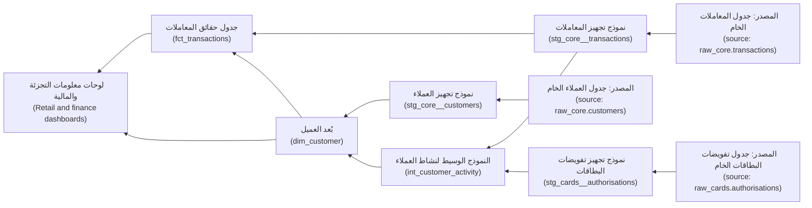
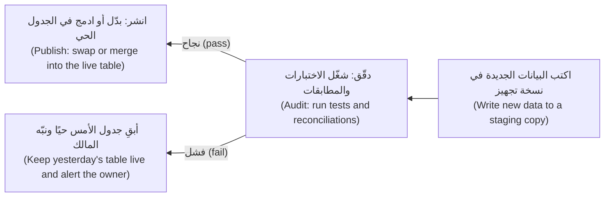
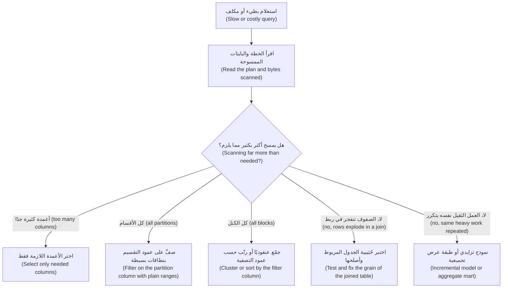

# الوحدة 3 — التحويل والجودة (Transformation and quality)

*إدخال البيانات إلى المنصة ليس إلا نصف المهمة. فالجداول الخام (raw tables) القادمة من قاعدة بيانات الأنظمة المصرفية الأساسية (core banking database) ومن تدفق البطاقات (card stream) ومن تطبيق نجم للهاتف (Najm Mobile) ليست إجابات بعد: يجب تنظيفها (cleaned) وربطها (joined) وإعادة تشكيلها (reshaped) واختبارها (tested) قبل أن يبني أحدٌ عليها لوحة معلومات (dashboard) أو نموذجًا (model). تتعامل هذه الوحدة مع ذلك العمل بوصفه برمجيات (software). تبدأ بـالتحويلات بوصفها شيفرة (transformations as code): نماذج dbt (dbt models) في طبقات واضحة (clear layers)، واختبارات تعمل مع كل تغيير، والتحكم في الإصدارات مع المراجعة. ثم تتسع لتشمل جودة البيانات (data quality) بوصفها انضباطًا تشغيليًا (operating discipline): ما الذي تعنيه البيانات "الجيدة" (good)، والعقود (contracts) مع الفرق التي تنتجها، وقابلية الملاحظة (observability) التي تخبرك بتعطّل مصدر بيانات (broken feed) قبل أن يخبرك به رئيس المخاطر (Chief Risk Officer). وتنتهي بالأداء والتكلفة: التقسيم (partitioning)، والتجميع العنقودي (clustering)، والنماذج التزايدية (incremental models)، وقراءة خطط الاستعلام (query plans)، حتى تبقى المنصة سريعة وميسورة التكلفة مع نمو بيانات نجم. ستتابع فريق منصة البيانات والتحليلات في بنك نجم (Najm Bank) بينما تنقل لينا كومةً متشابكة من استعلامات SQL المحفوظة إلى مشروع dbt مُختبَر، وتتعلم هدى لماذا قد يُخرج خط بيانات أخضر (green pipeline) أرقامًا خاطئة رغم ذلك، ويسأل فيصل لماذا تضاعفت فاتورة مستودع البيانات (warehouse bill) خلال ربع سنة واحد.*

> **المراحل (Stages):** Transform, Operate, Store — تحويل البيانات الخام (raw data) إلى جداول مُختبَرة وموثوقة وميسورة التكلفة، والحفاظ عليها كذلك.

---

# 3.1 — التحويلات بوصفها شيفرة: dbt، والطبقات (layers)، والاختبارات (tests)، والتحكم في الإصدارات (version control)
*المستوى (Level): 🟡 متوسط (Intermediate)* · *المتطلبات (Prerequisites): 1.1، 1.2، 2.1، 2.2* · *المرحلة (Stage): Transform*

## ⚡ الدرس في دقيقة (In 60 seconds)
- **التحويل (transformation)** يحوّل البيانات الخام المحمّلة إلى جداول منظّفة ومربوطة وجاهزة للأعمال. وفي نهج ELT (2.1) يجري داخل مستودع البيانات (warehouse)، بلغة SQL.
- **التحويلات بوصفها شيفرة (Transformations as code)** تعني أن كل خطوة من خطوات SQL تلك تعيش في ملف (file)، ضمن التحكم في الإصدارات، وتُراجَع وتُختبَر مثل شيفرة التطبيقات (application code)، لا في استعلامات محفوظة (saved queries) على حاسوب أحدهم المحمول.
- **dbt** إطار عمل مفتوح المصدر (open-source framework) واسع الاستخدام لهذا الغرض: كل نموذج هو عبارة `SELECT`، و`ref()` تربط النماذج في رسم بياني للاعتماديات (dependency graph)، والاختبارات والتوثيق (tests and documentation) تعيش بجوار الشيفرة.
- نظّم النماذج في **طبقات (layers)**: المصادر (sources) ← التجهيز (staging) ← الطبقة الوسيطة (منطق قابل لإعادة الاستخدام، reusable logic) ← طبقة العرض (marts).
- إشارة القرار (Decision cue): إذا وصل رقمٌ إلى لوحة معلومات أو جهة تنظيمية (regulator) أو نموذج، فيجب أن تكون شيفرة SQL التي أنتجته في المستودع (repository) مع اختبارات أساسية على الأقل لحُبَيبيته.
- الفخ الأكبر (Biggest trap): منطق الأعمال المنسوخ في أماكن كثيرة. عندما يعيش تعريف "العميل النشط" (active customer) في خمسة استعلامات، ستحصل على خمس إجابات.

## 🧭 لماذا يهم
يرسل كريم، محلّل البيانات (data analyst) في قطاع التجزئة (retail)، رقم "العملاء النشطين" (active customers) الشهري إلى مجلس التجزئة (retail board). وترسل لينا الرقم نفسه إلى المالية (finance) لتقرير التكلفة لكل عميل (cost-per-customer report). يختلف الرقمان بعدة آلاف. وكلاهما "صحيح" (right): استعلام كريم المحفوظ (saved query) يعدّ العملاء الذين لديهم أي معاملة خلال آخر 90 يومًا، بينما يعدّ استعلام لينا العملاء الذين لديهم تفويض بطاقة (card authorisation) *أو* تسجيل دخول (login) إلى تطبيق نجم للهاتف خلال آخر 30 يومًا. كُتب كل استعلام بفارق سنوات، ثم نُسخ وعُدّل ولُصق في لوحة معلومات. ولا يستطيع أحد أن يقول أي نسخة رآها المجلس في الربع الماضي، لأن الاستعلامات لم تكن قط في التحكم في الإصدارات.

يطلب فيصل أمرًا واحدًا: "كل رقم ننشره يأتي من شيفرة يمكننا قراءتها ومراجعتها واختبارها والتراجع عنها." لا تقرّر التحويلات بوصفها شيفرة أي تعريف لـ"النشط" (active) هو الصحيح (فتلك مسألة مقاييس، a metrics question، 4.1)، لكنها تضمن أن التعريف المختار موجود في مكان واحد (one place)، وأن التغييرات تُراجَع، وأن اختبارًا يفشل عندما تخالف البيانات افتراضاته.

## 📐 كيف يعمل

### 🟢 الأساسيات

**ما التحويل (What a transformation is).** بعد الاستيعاب (ingestion) (2.1)، يحتفظ مستودع البيانات بنُسخ خام (raw copies) من جداول المصادر (source tables): `raw_core.transactions`، `raw_core.customers`، `raw_cards.authorisations`. تحمل هذه الجداول أسماء النظام المصدر، وأنواعًا غير متسقة (inconsistent types)، ومكرّرات (duplicates) ناتجة عن إعادة محاولات التحميل (retried loads)، ورموزًا (codes) لا يفهمها إلا فريق الأنظمة المصرفية الأساسية (core banking team). التحويل خطوة تقرأ جداول وتكتب جدولًا جديدًا أفضل: فهي تعيد التسمية (renames)، وتحوّل الأنواع (casts)، وتزيل التكرار (deduplicates)، وتربط (joins)، وتجمّع (aggregates).

**لماذا الشيفرة لا النقرات (Why code, not clicks).** معاملة SQL كبرمجيات تمنحك أربعة أشياء لا يستطيع مجلّد من الاستعلامات المحفوظة أن يمنحك إياها:

| الممارسة (Practice) | ما الذي تمنحك إياه |
|---|---|
| التحكم في الإصدارات (git) | سجلّ كل تغيير، ومن أجراه ولماذا؛ والتراجع عن تغيير سيئ |
| مراجعة الشيفرة (Code review) (طلبات السحب، pull requests) | شخص ثانٍ يتحقق من المنطق (checks logic) قبل أن يصل إلى المجلس |
| الاختبارات الآلية (Automated tests) | يفشل البناء عندما تخالف البيانات افتراضًا، مثل المفاتيح المكرّرة (duplicate keys) |
| رسم بياني واحد للاعتماديات | كل نموذج يُعرَّف مرة واحدة ويُعاد استخدامه، فلا يُنسخ المنطق |

**dbt في فقرة واحدة (dbt in one paragraph).** تقوم dbt بتصريف وتشغيل عبارات SQL من نوع `SELECT` على مستودع بياناتك. لا تكتب `CREATE TABLE`؛ بل تكتب `SELECT`، وتغلّفها dbt بلغة تعريف البيانات المناسبة وفق **طريقة التجسيد (materialisation)** الخاصة بها (أي كيف تُخزَّن النتيجة، how the result is stored: `view`، أو `table`، أو `incremental`، أو `ephemeral`). بدلًا من كتابة أسماء الجداول بشكل ثابت، تستدعي `{{ ref('model_name') }}` لنموذج آخر و`{{ source('source_name', 'table') }}` لجدول خام (raw table). ومن تلك الاستدعاءات تبني dbt **رسمًا بيانيًا موجّهًا غير دوري (DAG)** للاعتماديات (dependencies)، وتشغّل النماذج بالترتيب الصحيح. وتصل المحوّلات (adapters) بين dbt وPostgreSQL وDuckDB (عبر المحوّل المجتمعي `dbt-duckdb`، the community adapter) وSnowflake وBigQuery وDatabricks وAmazon Redshift وغيرها.

**الطبقات (The layers).** يتّبع بنك نجم البنية التي توصي بها dbt Labs في دليل بنية المشاريع (project-structure guide). لكل طبقة (layer) مهمة واحدة (one job):



| الطبقة | البادئة (Prefix) | المهمة (Job) | القاعدة (Rule) |
|---|---|---|---|
| المصادر | مُعرَّفة في YAML | تشير إلى الجداول الخام التي حمّلها الاستيعاب | لا تعدّلها dbt أبدًا |
| التجهيز | `stg_<source>__<table>` | إعادة التسمية (rename)، وتحويل الأنواع (cast)، وتوحيد الرموز (standardise codes)، وإزالة التكرار (deduplicate) | نموذج تجهيز واحد لكل جدول مصدر؛ لا ربط بين المصادر |
| الوسيطة | `int_` | منطق أعمال قابل لإعادة الاستخدام: الربط، وعلامات النشاط (activity flags)، والتقسيم إلى جلسات (sessionising) | لا تُعرَض على المستخدمين النهائيين |
| العرض | `fct_` و`dim_` | جداول الحقائق والأبعاد عند حُبَيبية مُعلَنة (1.2)، مثل طبقة عرض العميل الشاملة (customer 360 mart) | ما تقرؤه لوحات المعلومات والمحلّلون والنماذج |

هذه هي نفسها طبقات الخام ← التجهيز ← العرض (raw → staging → marts) من الدرس 0.2؛ وتسمّي Databricks تقسيمًا مشابهًا بالبرونزي والفضي والذهبي.

**نموذج تجهيز (A staging model).** يقوم بأشياء صغيرة ومملّة وأساسية:

```sql
-- models/staging/core/stg_core__transactions.sql
with source as (
    select * from {{ source('core_banking', 'transactions') }}
),

deduplicated as (
    select *,
           row_number() over (partition by txn_ref order by _loaded_at desc) as rn
    from source
)

select
    txn_ref                         as transaction_id,
    acct_no                         as account_id,
    cast(txn_ts as timestamp)       as transacted_at,
    cast(amt as numeric(18, 2))     as amount,
    upper(trim(ccy))                as currency_code,
    case txn_typ when 'D' then 'debit' when 'C' then 'credit' end as direction,
    _loaded_at
from deduplicated
where rn = 1
```

**الاختبارات بجوار الشيفرة (Tests next to the code).** في ملف YAML بجانب النموذج، تُعلن **اختبارات البيانات العامة (generic data tests)**. تأتي dbt بأربعة منها: `unique`، و`not_null`، و`accepted_values`، و`relationships`. منذ الإصدار dbt 1.8 أصبح المفتاح `data_tests:`؛ وما زال المفتاح الأقدم `tests:` يعمل. ومن الإصدار 1.10، يُفضَّل أن تُدرَج المعاملات (parameters) مثل `values` تحت `arguments:`.

```yaml
# models/staging/core/_core__models.yml
models:
  - name: stg_core__transactions
    description: One row per core banking transaction, deduplicated on transaction_id.
    columns:
      - name: transaction_id
        data_tests: [unique, not_null]
      - name: direction
        data_tests:
          - accepted_values:
              values: ['debit', 'credit']
      - name: account_id
        data_tests:
          - not_null
          - relationships:
              to: ref('stg_core__accounts')
              field: account_id
```

يُصرَّف كل اختبار إلى استعلام يعيد الصفوف الفاشلة؛ وصفر صفوف يعني النجاح. يشغّل الأمر `dbt build` النماذج والاختبارات واللقطات والبذور بترتيب الرسم البياني الموجّه غير الدوري، ويتخطى النماذج الواقعة بعد اختبار فاشل، فلا يغذّي جدول تجهيز سيئ تقرير المجلس بصمت أبدًا.

### 🟡 التعمق أكثر (Going deeper)

**الطريقة الخاطئة والطريقة الصحيحة (The wrong way and the right way).** إليك كيف ينتشر تعريف "العميل النشط" عندما يُنسخ المنطق:

```sql
-- Wrong: the definition is pasted into each dashboard query
select count(distinct c.cust_id)
from raw_core.customers c
join raw_core.transactions t on t.acct_no in (
    select acct_no from raw_core.accounts a where a.cust_id = c.cust_id)
where t.txn_ts >= current_date - 90;
```

```sql
-- Right: defined once, in an intermediate model, then referenced everywhere
-- models/intermediate/int_customer_activity.sql
select
    a.customer_id,
    max(t.transacted_at)                                        as last_transaction_at,
    max(t.transacted_at) >= current_date - interval '90 days'   as is_active_90d
from {{ ref('stg_core__transactions') }} t
join {{ ref('stg_core__accounts') }} a using (account_id)
group by a.customer_id
```

الآن يقرأ كلٌّ من `dim_customer` ولوحة معلومات التجزئة (retail dashboard) والتقرير المالي (finance report) العمود `is_active_90d`. وإذا تغيّر التعريف، فإن طلب سحب واحدًا مُراجَعًا يغيّره في كل مكان (everywhere).

**المصادر والحداثة (Sources and freshness).** إعلان المصادر في YAML يفعل أكثر من تسمية الجداول. يمكنك إضافة فحص للحداثة (freshness check)، بحيث يحذّر الأمر `dbt source freshness` عندما يتوقف الاستيعاب:

```yaml
# models/staging/core/_core__sources.yml
sources:
  - name: core_banking
    schema: raw_core
    loaded_at_field: _loaded_at
    freshness:
      warn_after: {count: 6, period: hour}
      error_after: {count: 24, period: hour}
    tables:
      - name: transactions
      - name: customers
      - name: accounts
```

تفضّل إصدارات dbt الأحدث وضع هذه المفاتيح تحت `config:`؛ راجع توثيق إصدارك.

**اللقطات من أجل السجلّ التاريخي (Snapshots for history).** جدول `customers` في الأنظمة المصرفية الأساسية (core banking) يُستبدَل في مكانه: عندما ينتقل عميل من الدوحة إلى دبي، تختفي المدينة القديمة. تسجّل **لقطة dbt (dbt snapshot)** كل تغيير بوصفه صفًا جديدًا مع تواريخ صلاحية، وهذا هو البُعد المتغيّر ببطء من النوع الثاني (slowly changing dimension Type 2) (1.2):

```sql
-- snapshots/customers_snapshot.sql

{{ config(
    target_schema='snapshots',
    unique_key='customer_id',
    strategy='timestamp',
    updated_at='updated_at'
) }}
select customer_id, segment, city, risk_rating, updated_at
from {{ source('core_banking', 'customers') }}

```

تضيف dbt العمودين `dbt_valid_from` و`dbt_valid_to`؛ والصف الحالي تكون فيه قيمة `dbt_valid_to` فارغة (null). استخدم استراتيجية `check` عندما لا يملك المصدر عمود `updated_at` موثوقًا. وتتيح الإصدارات الحديثة (recent versions) (من 1.9 فصاعدًا) أيضًا تعريف اللقطات في YAML. ويجب أن تعمل اللقطات وفق جدول زمني: فالتغيير الذي يحدث ثم يُعكَس بين تشغيلين لا يُرى أبدًا.

**اختبارات الوحدة للمنطق (Unit tests for logic).** اختبارات البيانات (data tests) تفحص البيانات التي لديك. أما **اختبارات الوحدة (unit tests)** (المضافة في dbt 1.8) فتفحص المنطق مقابل مدخلات صغيرة مكتوبة يدويًا، قبل وصول أي بيانات حقيقية. وهي مثالية لعبارات `case` المعقّدة (tricky) وحدود التواريخ (date boundaries):

```yaml
unit_tests:
  - name: active_flag_uses_90_day_boundary
    model: int_customer_activity
    given:
      - input: ref('stg_core__transactions')
        rows:
          - {account_id: 'A1', transacted_at: '2026-01-01'}
      - input: ref('stg_core__accounts')
        rows:
          - {account_id: 'A1', customer_id: 'C1'}
    expect:
      rows:
        - {customer_id: 'C1', is_active_90d: false}
```

(النسخة الحقيقية ستمرّر "اليوم" (today) بوصفه متغيرًا بدلًا من استخدام `current_date`؛ فالمنطق الذي يعتمد على الساعة يصعب اختباره.)

**التوثيق والنسب (Documentation and lineage).** يحوّل الأمر `dbt docs generate` كل `description:` والرسم البياني الموجّه غير الدوري إلى موقع قابل للتصفح (browsable site). ويتيح لك ذلك النسب (lineage) أن تجيب عن سؤال "إذا تعطّل مصدر بيانات البطاقات، فأي لوحات المعلومات تصبح خاطئة؟" ⁦⁩ في دقائق (6.1).

**سير العمل (The workflow).** الحلقة اليومية في نجم:

1. تنشئ لينا فرعًا في git (git branch) وتعدّل نموذجًا.
2. تشغّل `dbt build --select int_customer_activity+` على مخطط التطوير الخاص بها (علامة `+` تعني النموذج وكل ما يقع بعده، the model and everything downstream).
3. تفتح طلب سحب (pull request). يشغّل التكامل المستمر (continuous integration, CI) الأمر `dbt build` على النماذج المتغيّرة وأبنائها في مخطط مؤقت (temporary schema).
4. يفحص مراجعٌ (reviewer) شيفرة SQL والاختبارات وفروق أعداد الصفوف (row-count differences).
5. بعد الدمج (after merge)، يشغّل المنسّق (orchestrator) (2.2) بناء الإنتاج (production build) وفق الجدول الزمني.

في التكامل المستمر (CI)، يبني **الاختيار حسب الحالة (state selection)** ما تغيّر فقط: `dbt build --select state:modified+ --defer --state prod-artifacts/`، حيث يقرأ `--defer` الآباء غير المتغيّرين من الإنتاج. ويُغطّى تصميم التكامل المستمر العام في [*السحابة وDevOps: من الصفر إلى الاحتراف (Cloud & DevOps: Zero to Hero)*، الدرس 4.1 — التكامل المستمر: خطوط التنفيذ والاختبارات والمخرجات والتغذية الراجعة السريعة](../cloud/index.ar.html#/4.1).

### 🔴 نظرة الخبير (Expert view)

**العقود على طبقة العرض (Contracts on marts).** طبقة العرض (mart) التي تعتمد عليها فرق أخرى هي واجهة عامة (public interface). تتيح لك **عقود النماذج (model contracts)** في dbt (منذ dbt 1.5) أن تُعلن أسماء الأعمدة وأنواع البيانات، وأن تجعل dbt ترفض بناء النموذج إذا أنتجت شيفرة SQL شكلًا مختلفًا:

```yaml
models:
  - name: dim_customer
    config:
      contract: {enforced: true}
    columns:
      - name: customer_id
        data_type: varchar
        constraints: [{type: not_null}]
      - name: is_active_90d
        data_type: boolean
      # ...abridged: an enforced contract must list every column the model returns
```

العقد يحمي الشكل لا المعنى. أما الاتفاقات حول الدلالات والتوقيت مع المنتجين (producers) فمكانها عقد البيانات (data contract) (3.2). وللتغييرات الكاسرة (breaking changes)، تتيح لك **إصدارات النماذج (model versions)** في dbt نشر `dim_customer` بالإصدار v2 بجانب v1 ومنح المستهلكين (consumers) وقتًا للانتقال.

**استراتيجية الاختبار لا عدد الاختبارات (Test strategy, not test count).** المشروع الذي فيه 2,000 اختبار يتجاهلها الجميع أسوأ من مشروع فيه 200 اختبار لها معنى دائمًا. قواعد نجم (Najm's rules): لكل نموذج **مفتاح أساسي (primary key)** مُختبَر (`unique` + `not_null`، أو `dbt_utils.unique_combination_of_columns` للمفاتيح المركّبة، composite keys)، لأن الحُبَيبية المكسورة تضاعف بصمت كل مجموع في المراحل اللاحقة؛ ونماذج التجهيز (staging models) تختبر ما يَعِد به المصدر؛ وطبقات العرض تختبر قواعد الأعمال (business rules)؛ وكل حادثة (incident) تنتهي باختبار جديد. استخدم `severity: warn` للفحوص التي يجب أن تنبّه دون أن توقف البناء، و`store_failures: true` للاحتفاظ بالصفوف الفاشلة للتحقيق.

**أين يوضع المنطق (Where logic belongs).** أبقِ طبقة التجهيز رفيعة وآلية؛ وضع منطق الأعمال (business logic) في النماذج الوسيطة ونماذج العرض. تجنّب وحدات الماكرو (macros) التي تخفي كميات كبيرة من SQL: إذا لم تستطع قراءة شيفرة SQL المُصرَّفة (compiled SQL) في `target/compiled/` وفهمها، فبسّطها (simplify).

**ما بعد dbt (Beyond dbt).** SQLMesh بديل مفتوح المصدر (open-source alternative)؛ ويمكن لـDagster أن يعامل نماذج dbt بوصفها أصولًا (assets)؛ وتناسب مهام Spark أو Polars التحويلاتِ التي تعبّر عنها SQL بشكل سيئ. المبادئ (principles) تنطبق أيًّا كانت الأداة.

## 🧰 الأدوات
| الأداة أو النمط أو المعيار (Tool, pattern or standard) | ما هو وماذا يفعل | متى تلجأ إليه |
|---|---|---|
| **dbt** | إطار عمل مفتوح المصدر يشغّل نماذج SQL من نوع `SELECT` بترتيب الاعتماديات، مع الاختبارات والتوثيق والنسب | أي تحويل SQL (SQL transformation) يغذّي رقمًا يعتمد عليه الناس |
| **Staging, intermediate and mart layers** — طبقات التجهيز والوسيطة والعرض | اصطلاح (convention) يمنح كل نموذج مهمة واحدة: التنظيف، والدمج، والتقديم | هيكلة أي مشروع تحويل (transformation project) بحيث يجد الناس ما يبحثون عنه |
| **dbt generic data tests** — اختبارات البيانات العامة في dbt | فحوص تصريحية (declarative checks) تُصرَّف إلى استعلامات تعيد الصفوف الفاشلة | على كل مفتاح أساسي وكل افتراض (assumption) تعتمد عليه شيفرة SQL |
| **dbt snapshots** — لقطات dbt | تسجّل التغييرات في صفوف المصدر القابلة للتعديل بوصفها سجلًّا تاريخيًا من نوع SCD Type 2 (SCD Type 2 history) | سمات العميل أو الحساب أو المنتج التي تتغير في مكانها |
| **dbt unit tests** (dbt 1.8+) — اختبارات الوحدة في dbt | تختبر منطق النموذج (model logic) على مدخلات صغيرة مكتوبة يدويًا | منطق `case` المعقّد، وحدود التواريخ، والحسابات المالية (financial calculations) |
| **dbt model contracts** — عقود النماذج في dbt | تفرض أسماء أعمدة النموذج وأنواعها وقت البناء | طبقات العرض التي تعتمد عليها فرق أو أدوات أخرى |
| **dbt_utils** (حزمة، package) | اختبارات ووحدات ماكرو إضافية، مثل تفرّد المفتاح المركّب (composite-key uniqueness) | عندما لا تكفي الاختبارات الأربعة المدمجة |
| **SQLMesh** | إطار تحويل بديل مفتوح المصدر | مقارنة المقاربات (comparing approaches)؛ الفرق التي تريد نموذج البيئات الخاص به |

## 🏛️ عمليًا في بنك نجم
تكتب لينا **معيار مشروع dbt في نجم، الإصدار الأول (Najm dbt Project Standard v1)** وأول نموذج مُختبَر، `dim_customer`، الذي يغذّي طبقة عرض العميل الشاملة (customer 360 mart).

**الجزء أ: اصطلاحات المشروع (Part A: project conventions)**

| الموضوع (Topic) | القاعدة |
|---|---|
| المستودع | مستودع واحد `najm-analytics`؛ والفرع `main` هو الإنتاج (production)؛ وكل التغييرات عبر طلب سحب بمراجع واحد (اثنان لطبقات العرض التنظيمية، regulatory marts) |
| الطبقات | `staging/<source>/`، `intermediate/<domain>/`، `marts/<domain>/` |
| التسمية (Naming) | `stg_<source>__<table>`، `int_<verb or noun>`، `fct_<event>`، `dim_<entity>`؛ أعمدة بنمط snake_case؛ `_at` للطوابع الزمنية (timestamps)، و`_date` للتواريخ (dates)، و`is_`/`has_` للقيم المنطقية (booleans) |
| التجسيد | التجهيز: عرض (view). الوسيطة: عابر (ephemeral) أو عرض. العرض: جدول (table)، أو تزايدي (incremental) عندما يكون كبيرًا (3.3) |
| الحد الأدنى من الاختبارات (Minimum tests) | كل نموذج: المفتاح الأساسي `unique` + `not_null`. التجهيز: `accepted_values` على الرموز، و`relationships` على المفاتيح الأجنبية (foreign keys). العرض: اختبار واحد على الأقل لقاعدة أعمال (business-rule test) |
| التوثيق (Documentation) | لكل طبقة عرض ولكل عمود فيها وصفٌ (description)؛ والحُبَيبية (grain) مذكورة في وصف النموذج (model description) |
| التكامل المستمر | `dbt build --select state:modified+ --defer --state <prod artefacts>` على كل طلب سحب؛ ويُمنع الدمج (merge blocked) عند أي خطأ |
| الملكية (Ownership) | لكل مجلّد عرض (mart folder) مالكٌ مُسمّى (named owner) في YAML ‏`meta: {owner: ...}` |

**الجزء ب: بطاقة النموذج لـ`dim_customer` (Part B: the model card)**

| الحقل (Field) | القيمة (Value) |
|---|---|
| الحُبَيبية | صف واحد لكل عميل معروف حاليًا للأنظمة المصرفية الأساسية |
| المفتاح الأساسي | `customer_id` |
| مبني من (Built from) | `stg_core__customers`، `int_customer_activity`، `customers_snapshot` (من أجل `segment_changed_at`) |
| الأعمدة الرئيسية (Key columns) | `customer_id`، `segment`، `home_country`، `is_active_90d`، `last_transaction_at`، `segment_changed_at` |
| اختبارات قواعد الأعمال (Business-rule tests) | `segment` ضمن؛ `home_country` ضمن؛ `last_transaction_at` ليس في المستقبل |
| العقد (Contract) | مفروض (Enforced): الأسماء والأنواع ثابتة؛ والتغييرات الكاسرة تحتاج إلى إصدار نموذج جديد |
| المالك (Owner) | لينا (هندسة التحليلات، analytics engineering)؛ مالك الأعمال (business owner): تحليلات التجزئة (retail analytics) (كريم) |
| المستهلكون | طبقة عرض العميل الشاملة (Customer 360 mart)، ولوحة معلومات التجزئة، وتقرير المالية للتكلفة لكل عميل |

صار كريم والمالية يقرآن العمود نفسه `is_active_90d`. وينتقل الخلاف حول أي تعريف هو الصحيح إلى مكانه الصحيح: بطاقة تعريف المقياس (4.1).

## 🛠️ التمارين (Exercises)
استخدم بيانات اصطناعية فقط (synthetic data only). ولّد عملاء وحسابات ومعاملات وهمية باستخدام Python (مثلًا مكتبة `Faker`) أو اكتب بذور CSV صغيرة.

- 🟢 ثبّت dbt Core مع المحوّل `dbt-duckdb` (adapter)، وأنشئ مشروعًا، وحمّل ثلاث بذور CSV (`customers`، `accounts`، `transactions`) باستخدام `dbt seed`، واكتب نموذج تجهيز واحدًا لكل بذرة بأعمدة معاد تسميتها ومحوّلة الأنواع. *يكتمل عندما (Done when):* ينجح `dbt build` ويكون لكل نموذج تجهيز اختبارا `unique` و`not_null` على مفتاحه الأساسي.
- 🟡 أضف `int_customer_activity` و`dim_customer` كما في هذا الدرس. أدرج عمدًا معاملة مكرّرة ومعاملة بحساب غير معروف في بيانات البذور. *يكتمل عندما:* يفشل `dbt build` على الاختبارات الصحيحة، وتُتخطّى النماذج اللاحقة، وبعد أن تصلح إزالة التكرار في التجهيز (staging deduplication) ينجح البناء مجددًا.
- 🔴 ضع المشروع في git، وأضف لقطة (snapshot) على العملاء، وغيّر شريحة عميل في البذرة وأعد التشغيل، واكتب اختبار وحدة (unit test) لحدّ الـ90 يومًا (90-day boundary) لا يعتمد على `current_date`. أضف سير عمل للتكامل المستمر (CI workflow) يشغّل `dbt build` على طلبات السحب (pull requests). *يكتمل عندما:* تُظهر اللقطة صفّين للعميل المتغيّر بتواريخ صلاحية صحيحة، وينجح اختبار الوحدة، ويظهر طلب السحب الذي يكسر اختبار المفتاح الأساسي (primary-key test) على أنه فاشل (failing).

## ⚠️ أخطاء وفخاخ (Mistakes and traps)
- **نسخ منطق الأعمال في استعلامات كثيرة (Copying business logic into many queries).** خمس نسخ من "العميل النشط" تصبح خمسة أرقام. عرّفه مرة واحدة في نموذج وسيط أو نموذج عرض واستدعه بـ`ref()`.
- **كتابة أسماء الجداول بشكل ثابت (Hard-coding table names).** العبارة `from analytics.dim_customer` تكسر البيئات (environments) والنسب. استخدم دائمًا `ref()` و`source()`.
- **لا اختبار على الحُبَيبية (No test on the grain).** المفتاح المكرّر يضاعف كل مجموع لاحق دون أي خطأ. اختبر المفتاح الأساسي لكل نموذج، أولًا.
- **اختبارات لا يقرؤها أحد (Tests nobody reads).** مئات التحذيرات التي لا تفشل أبدًا (never-failing warnings) تدرّب الناس على تجاهلها؛ لا تحذّر إلا عندما سيتصرف أحدٌ.
- **البناء في الإنتاج يدويًا (Building in production by hand).** تشغيل النماذج من حاسوب محمول على الإنتاج يتجاوز المراجعة (bypasses review). طوّر في مخططك الخاص؛ ولا يعمل الإنتاج إلا من `main` عبر المنسّق.

## 🧾 الخلاصة (Recap)
- التحويلات بوصفها شيفرة تضع كل خطوة SQL في git، خلف المراجعة والاختبارات والتكامل المستمر.
- نماذج dbt هي عبارات `SELECT`؛ و`ref()` و`source()` تبنيان رسم الاعتماديات والنسب.
- الطبقات تمنح كل نموذج مهمة واحدة: التجهيز ينظّف (staging cleans)، والوسيطة تدمج (intermediate combines)، والعرض يقدّم (marts serve).
- اختبر حُبَيبية كل نموذج أولًا؛ وأضف القيم المقبولة والعلاقات وقواعد الأعمال؛ واستخدم اختبارات الوحدة للمنطق.
- اللقطات (snapshots) تلتقط سجلّ الصفوف القابلة للتعديل؛ والعقود والإصدارات تحمي طبقات العرض التي يعتمد عليها الآخرون.

## ✍️ اختبر نفسك (Check yourself)

**1. يختلف عدّا "العميل النشط" (active customer) لدى كريم ولينا لأن كلًّا منهما نسخ التعريف وعدّله في استعلامه الخاص. ما أفضل إصلاح بنيوي (best structural fix)؟**

- A. اطلب من المحلّلَين أن يبنيا تقاريرهما في أداة لوحات المعلومات نفسها من الآن فصاعدًا
- B. أضف اختبار `not_null` على `customer_id` في كلا الاستعلامين المحفوظين (saved queries)
- C. عرّف منطق النشاط مرة واحدة في نموذج وسيط (intermediate model) واجعل كل تقرير يستدعيه بـ`ref()`
- D. أرسل إلى فريق المالية (finance team) رقم التجزئة بالبريد الإلكتروني كل شهر (monthly)

<details><summary>الإجابة</summary>

**C.** تعريف واحد في نموذج واحد، يُعاد استخدامه عبر `ref()`، هو ما توفّره التحويلات بوصفها شيفرة (transformations as code). الخيار B يختبر البيانات لكنه لا يفعل شيئًا حيال المنطق المكرّر (duplicated logic)؛ والخيار A يغيّر الأداة لا المنطق. (🟡 التعمق أكثر، Going deeper).

</details>

**2. ماذا يفعل اختبار عام (generic test) في dbt مثل `unique` عند تشغيله؟**

- A. يُصرَّف إلى استعلام يعيد الصفوف المخالفة للقاعدة (rule-breaking rows)؛ وصفر صفوف يعني النجاح
- B. يضيف قيد تفرّد (unique constraint) إلى جدول المستودع بحيث تُرفض عمليات الإدراج المكرّرة مستقبلًا
- C. يحذف الصفوف المكرّرة (duplicate rows) من النموذج قبل تجسيده (materialised)
- D. يفحص صياغة SQL (SQL syntax) للنموذج

<details><summary>الإجابة</summary>

**A.** اختبارات البيانات في dbt استعلامات للبحث عن الصفوف الفاشلة (failing rows). فهي لا تغيّر البيانات (C) ولا تنشئ قيودًا في قاعدة البيانات (database constraints) (B)؛ يمكن لعقود النماذج (model contracts) أن تضيف بعض القيود، لكنها ميزة مختلفة..

</details>

**3. تريد هدى الاحتفاظ بسجلّ تصنيف المخاطر (risk rating) لكل عميل، لكن جدول `customers` في الأنظمة المصرفية الأساسية يستبدل التصنيف في مكانه (overwrites in place). أي ميزة في dbt تناسب ذلك؟**

- A. نموذج عابر (ephemeral model)
- B. اختبار `relationships`
- C. عقد نموذج (model contract)
- D. لقطة (snapshot)

<details><summary>الإجابة</summary>

**D.** تسجّل اللقطات (snapshots) كل تغيير بوصفه صفًا جديدًا مع `dbt_valid_from` و`dbt_valid_to`، وهذا هو SCD من النوع الثاني (SCD Type 2). العقد (contract) (C) يثبّت شكل النموذج، لا سجلّه التاريخي (history). (🟡 التعمق أكثر، Going deeper).

</details>

**4. نموذج التجهيز (staging model) ‏`stg_core__transactions` عليه اختبار `unique` على `transaction_id` يفشل أثناء `dbt build`. ماذا يحدث لـ`fct_transactions` الذي يعتمد عليه؟**

- A. يُبنى بشكل طبيعي، ويُسجَّل الفشل لوقت لاحق
- B. يُتخطّى (skipped)، فلا تتدفق البيانات السيئة إلى المراحل اللاحقة (downstream)
- C. يُحذف من مستودع البيانات
- D. تزيل dbt المكرّرات تلقائيًا وتعيد بناءه

<details><summary>الإجابة</summary>

**B.** يشغّل `dbt build` الاختبارات بترتيب الرسم البياني الموجّه غير الدوري ويتخطى العُقد اللاحقة (downstream nodes) عندما يُخطئ اختبار. ولهذا بالتحديد يحمي الاختبار في طبقة التجهيز طبقاتِ العرض. ولا تُصلح dbt البيانات بنفسها أبدًا (D)..

</details>

**5. يستغرق التكامل المستمر لطلبات السحب (pull-request CI) في نجم 90 دقيقة لأنه يعيد بناء المشروع كله مع كل تغيير. ما الطريقة القياسية في dbt لتسريعه (standard dbt way to speed it up)؟**

- A. أزل الاختبارات من التكامل المستمر (CI) وشغّلها فقط في الإنتاج (production) بعد كل دمج في `main`
- B. حوّل كل نموذج إلى عرض (view) حتى لا يلزم تجسيد (materialise) أي شيء في مخطط التكامل المستمر (CI schema)
- C. استخدم الاختيار حسب الحالة (state selection): ابنِ النماذج المعدّلة وأبناءها فقط، وأجّل الآباء غير المتغيّرين
- D. شغّل التكامل المستمر مرة في الأسبوع بدلًا من كل طلب سحب (pull request)

<details><summary>الإجابة</summary>

**C.** الأمر `dbt build --select state:modified+ --defer --state ...` هو نمط "التكامل المستمر النحيل" (slim CI). الخياران A وD يزيلان شبكة الأمان (safety net)؛ والخيار B قد لا يجعله أسرع أصلًا ويغيّر سلوك الإنتاج (production behaviour). (🟡 التعمق أكثر، Going deeper).

</details>

## 📚 المراجع (References)
- توثيق dbt (dbt documentation) — https://docs.getdbt.com
- dbt Labs، "كيف نهيكل مشاريع dbt" — https://docs.getdbt.com/best-practices
- اختبارات البيانات واختبارات الوحدة واللقطات وعقود النماذج في dbt — https://docs.getdbt.com/docs/build/data-tests
- محوّل dbt-duckdb (dbt-duckdb adapter) — https://github.com/duckdb/dbt-duckdb
- توثيق DuckDB (DuckDB documentation) — https://duckdb.org/docs/
- توثيق PostgreSQL (PostgreSQL documentation) — https://www.postgresql.org/docs/
- SQLMesh — https://github.com/TobikoData/sqlmesh
- رالف كيمبول ومارجي روس (Ralph Kimball and Margy Ross)، *The Data Warehouse Toolkit* (الطبعة الثالثة، 3rd edition، Wiley)

---

# 3.2 — جودة البيانات: الاختبارات، والعقود، وقابلية الملاحظة
*المستوى: 🟡 متوسط* · *المتطلبات: 2.2، 3.1* · *المرحلة: Transform, Operate*

## ⚡ الدرس في دقيقة (In 60 seconds)
- **جودة البيانات (Data quality)** تعني أن البيانات صالحة للقرار الذي تدعمه: مكتملة (complete)، وصحيحة (valid)، وفريدة (unique)، ومتّسقة (consistent)، ودقيقة (accurate)، وفي وقتها.
- ثلاث طبقات دفاع: **الاختبارات (tests)** تفحص الافتراضات المعروفة (known assumptions) في خط بياناتك (pipeline)؛ و**عقود البيانات (data contracts)** تتّفق على المخطط والمعنى والتوقيت مع الفرق التي تنتج البيانات؛ و**قابلية ملاحظة البيانات (data observability)** تراقب الحداثة والحجم والمخطط والتوزيع بحثًا عن مشكلات لم يكتب لها أحدٌ اختبارًا.
- ضع الفحوص (checks) حيث يمكنها إيقاف الضرر (stop damage): عند الاستيعاب، وبين الطبقات (between layers)، وقبل النشر (before publishing). استخدم **الكتابة ثم التدقيق ثم النشر (write-audit-publish)** حتى لا تصل البيانات السيئة إلى المستهلكين أبدًا.
- إشارة القرار: لكل جدول حرج (critical table)، أجب عن: "من يملكه، وكيف يبدو الجيد، وبأي سرعة سنعرف عندما لا يكون كذلك، وماذا يحدث حينها؟"
- الفخ الأكبر: خط البيانات الأخضر ليس بيانات صحيحة. فالمهام تنجح بسعادة وهي تحمّل نصف ملف، أو عمودًا معاد تسميته مليئًا بالقيم الفارغة، أو بيانات الأمس مرتين.

## 🧭 لماذا يهم
عند الساعة 07:40 صباح يوم اثنين، تُظهر لوحة معلومات رئيس المخاطر أن متأخرات قروض المنشآت الصغيرة والمتوسطة انخفضت بمقدار الثلث بين ليلة وضحاها (overnight). يبدأ فريق المخاطر (risk team) صياغة مذكرة إلى المجلس. تتحقق هدى من Airflow: كل مهمة (task) خضراء. ويستغرق الأمر حتى وقت الغداء لإيجاد السبب. خلال عطلة نهاية الأسبوع، غيّر فريق الأنظمة المصرفية الأساسية الحقل `days_past_due` من عدد صحيح (integer) إلى رمز نصي (text code) ("0-30"، "31-60") ضمن إصدار (release). حمّلته مهمة الاستيعاب (ingestion job) دون خطأ، وحوّل تحويل الأنواع في طبقة التجهيز (staging cast) كل قيمة لم يستطع تحليلها (parse) إلى قيمة فارغة، وعدّ نموذج المتأخرات (arrears model) القيم الفارغة على أنها "غير متأخرة". لم يفشل شيء. كانت الأرقام خاطئة ببساطة (simply wrong).

تُظهر الحالات العامة (public cases) النمط نفسه. في أكتوبر 2020، أُفيد على نطاق واسع بأن نحو 16,000 نتيجة إيجابية لاختبار COVID-19 في إنجلترا قد أُسقطت من الأرقام اليومية الرسمية. وكان السبب خط بيانات (data pipeline) يستخدم تنسيق ملفات Excel القديم XLS، الذي يتسع على الأكثر لـ65,536 صفًا لكل ورقة؛ وأُسقطت السجلات التي تجاوزت الحد بصمت (silently dropped). ومرة أخرى، لم يتعطّل شيء (nothing crashed).

خلاصة فيصل للفريق (Faisal's conclusion): "خطوط البيانات تفشل بصوت عالٍ؛ والبيانات تفشل بصمت. نحتاج إلى فحوص تجعل إخفاقات البيانات مسموعة، واتفاقات (agreements) تجعلها تحدث أقل، ومراقبة (monitoring) لتلك التي لم نتخيّلها."

## 📐 كيف يعمل

### 🟢 الأساسيات

**ما الذي تعنيه "الجودة" (What "quality" means).** جودة البيانات هي الصلاحية للاستخدام: فالجدول نفسه قد يكون جيدًا بما يكفي لمخطط اتجاه (trend chart) وغير جيد بما يكفي لتقرير تنظيمي (regulatory return). والأبعاد الأكثر ذكرًا تمنحك مفردات (vocabulary) لكتابة الفحوص:

| البُعد (Dimension) | السؤال (Question) | مثال فحص في نجم |
|---|---|---|
| الاكتمال (Completeness) | هل كل ما يجب أن يكون موجودًا موجود؟ ⁦⁩ | لكل حساب نشط (active account) صفّ رصيد (balance row) ليوم أمس |
| الصحة (Validity) | هل تتبع القيم القواعد والتنسيقات؟ | `currency_code` رمز معروف وفق ISO 4217 (a known ISO 4217 code) |
| التفرّد (Uniqueness) | هل يُسجَّل كل شيء مرة واحدة (recorded once)؟ | `transaction_id` فريد |
| الاتّساق (Consistency) | هل تتّفق البيانات المترابطة (related data)؟ | مجموع المعاملات لكل حساب يطابق الحركة في الرصيد |
| الدقة (Accuracy) | هل تطابق البيانات الواقع (match reality)؟ | عيّنة من القروض تُطابَق مع العقود الموقّعة فصليًا (quarterly) |
| الآنية (Timeliness) | هل هي موجودة عند الحاجة؟ | تصل تفويضات البطاقات (card authorisations) خلال 15 دقيقة |

**الاختبارات: فحوص تعرف أن تكتبها (Tests: checks you know to write).** في الدرس 3.1 تعرّفت على الاختبارات العامة في dbt. إنها تلتقط الافتراضات المكسورة (broken assumptions) التي تستطيع تسميتها. وكانت حادثة المتأخرات (arrears incident) تحتاج إلى أيٍّ من اثنين: `not_null` على `days_past_due` بعد تحويل الأنواع في التجهيز، أو فحص للمخطط (schema check) عند الاستيعاب يتأكد أن الحقل ما زال عددًا صحيحًا. وكان أيٌّ منهما سيُفشل البناء (fail the build) عند الساعة 03:00 بدلًا من أن يكتشف رئيس المخاطر (CRO) الأمر عند 07:40.

**أين توضع الفحوص (Where checks go).** كل فحص مكانه حيث يمكنه إيقاف الضرر بأقل تكلفة:

| نقطة الفحص (Checkpoint) | ما الذي يُفحص | عند الفشل |
|---|---|---|
| الاستيعاب | وصول الملف (file arrived)، وعدد الصفوف مقابل المصدر، وعدم تغيّر المخطط (schema unchanged)، وقراءة الملف كاملًا | أوقف التحميل، ونبّه مالك خط البيانات (pipeline owner) |
| التجهيز | الأنواع (types)، والقيم الفارغة (nulls)، والرموز، والمفاتيح (keys)، والمكرّرات | أفشِل البناء؛ وتُتخطّى المراحل اللاحقة (downstream skipped) |
| العرض | قواعد الأعمال، والمطابقات (reconciliations)، والمجاميع مقابل اليوم السابق | امنع النشر (block publish)، ونبّه مالك طبقة العرض (mart owner) |
| المستهلكون | الحداثة (freshness) على لوحة المعلومات نفسها | اعرض "البيانات حتى تاريخ" وشريطًا يُنبّه إلى التقادم (stale banner) |

**أفشِل أو حذّر أو اعزل (Fail, warn or quarantine).** ليس كل فشل يجب أن يوقف كل شيء. ثلاث استجابات (three responses):
- **الإفشال (Fail)** (المنع، block): استخدمه للمفاتيح، والحقول الحرجة (critical fields)، وكل ما يغذّي الجهات التنظيمية (regulators) أو قرارات المال (money decisions).
- **التحذير (Warn)**: نبّه شخصًا مُسمّى لكن انشر؛ استخدمه للفحوص التي تكون فيها البيانات الجزئية (partial data) أفضل من لا شيء.
- **العزل (Quarantine)**: انقل الصفوف السيئة (bad rows) إلى جدول جانبي (side table)، وانشر الباقي، وأبلغ عن العدد. استخدمه عندما يُتوقَّع وجود بضعة صفوف سيئة يمكن إصلاح كلٍّ منها على حدة (individually fixable).

الفحص الفاشل لا يكون مفيدًا إلا إذا تلقّى شخص مُسمّى التنبيه وعرف ماذا يفعل.

### 🟡 التعمق أكثر

**عقود البيانات: منع الفشل عند المنبع (Data contracts: preventing the failure upstream).** تغيّر حقل المتأخرات (arrears field) لأن فريق الأنظمة المصرفية الأساسية لم يكن يعلم أن أحدًا يعتمد على نوعه. **عقد البيانات (data contract)** اتفاق بين منتج البيانات (data producer) ومستهلكيه يجعل الاعتمادية صريحة. ويغطي:
- **المخطط (Schema)**: الحقول (fields)، والأنواع، وقابلية الفراغ (nullability)، والمفاتيح.
- **الدلالات (Semantics)**: ما يعنيه كل حقل، والوحدات (units)، والقيم المسموح بها (allowed values) (هل `amount` بالفلس أم بالريال؟ وهل يعدّ `days_past_due` الأيام التقويمية أم أيام العمل؟).
- **مستويات الخدمة (Service levels)**: الحداثة، والاكتمال، وبأي سرعة تُصلَح المشكلات.
- **عملية التغيير (Change process)**: كيف يُعلَن عن التغييرات الكاسرة، وتُعطى إصدارات (versioned)، وتُمنح فترة انتقال (migration period).
- **الملكية (Ownership)**: مالك مُسمّى من جهة المنتج وجهة اتصال مُسمّاة من جهة المستهلك.

تعمل العقود على أفضل وجه عندما تكون ملفات في التحكم في الإصدارات تفحصها الآلات، لا ملفات PDF. يمكن التحقق من عقد مكتوب بـYAML في التكامل المستمر لدى المنتج (هل ما زال الإصدار الجديد ينتج هذا المخطط؟) وفي الاستيعاب لدى المستهلك (هل طابقت بيانات اليوم؟). وتوجد مواصفة مفتوحة لهذا الغرض، هي **معيار عقود البيانات المفتوح (Open Data Contract Standard, ODCS)**، التي يصونها وقت كتابة هذا النص (2026) مشروع Bitol تحت مظلة Linux Foundation؛ ويمكنك أيضًا البدء بتنسيق داخلي بسيط. وفي dbt، يفرض عقد النموذج (model contract) (3.1) جزء المخطط للنماذج التي تنتجها بنفسك.

**فحوص العقد في الشيفرة (Contract checks in code).** فحص Python بسيط عند الاستيعاب، يقارن ملفًا واردًا (incoming file) بالمخطط المتعاقد عليه (contracted schema):

```python
import duckdb

CONTRACT = {
    "loan_id": "VARCHAR",
    "customer_id": "VARCHAR",
    "outstanding_amount": "DECIMAL(18,2)",
    "days_past_due": "INTEGER",
}

con = duckdb.connect()
rel = con.sql("select * from read_parquet('landing/loans_2026-10-01.parquet')")
actual = dict(zip(rel.columns, [str(t) for t in rel.types]))

problems = [f"{col}: expected {typ}, got {actual.get(col, 'MISSING')}"
            for col, typ in CONTRACT.items() if actual.get(col) != typ]
if problems:
    raise ValueError("Contract breach, load stopped: " + "; ".join(problems))
```

في يوم الاثنين الذي وقعت فيه الحادثة، كان هذا سيتوقف برسالة `days_past_due: expected INTEGER, got VARCHAR`.

**اختبارات المطابقة (Reconciliation tests).** بعض أثمن الفحوص يقارن بين نظامين. يجب أن تتّفق طبقة عرض مخاطر الائتمان (credit-risk mart) في نجم مع دفتر الأستاذ العام (general ledger): فإجمالي القروض القائمة في طبقة العرض يجب أن يطابق المجموع الرقابي لدفتر الأستاذ للتاريخ نفسه، ضمن هامش تسامح (tolerance) متّفق عليه مع المالية.

```sql
-- tests/assert_loan_book_reconciles_to_ledger.sql  (a dbt singular test)
with mart as (
    select as_of_date, sum(outstanding_amount) as mart_total
    from {{ ref('fct_loan_balances_daily') }}
    group by as_of_date
),
ledger as (
    select as_of_date, control_total as ledger_total
    from {{ ref('stg_finance__gl_loan_control') }}
)
select m.as_of_date, m.mart_total, l.ledger_total
from mart m
left join ledger l using (as_of_date)
where l.ledger_total is null                      -- no control total: cannot reconcile
   or abs(m.mart_total - l.ledger_total) > 1.00   -- tolerance agreed with finance
```

**الاختبار المفرد (singular test)** ملف SQL في `tests/` يعيد الصفوف الفاشلة، للفحوص الأكثر تحديدًا من أن يغطيها اختبار عام. لاحظ `left join`: مع الربط الداخلي (inner join)، سيمرّ بصمت (silently pass) يومٌ لا يوجد له صف في دفتر الأستاذ.

**الكتابة ثم التدقيق ثم النشر (Write-audit-publish).** أكثر الأنماط أمانًا للجداول المهمة هو ألا تدع المستهلكين يرون أبدًا بيانات غير مفحوصة (unchecked data):



في مستودع البيانات يمكنك الكتابة إلى جدول `_staging` ثم تبديله بإعادة تسمية داخل معاملة؛ وتدعم تنسيقات الجداول المفتوحة (open table formats) مثل Apache Iceberg الفروع (branches) التي تجعل هذا أصيلًا (native). ومع dbt، فإن تشغيل الاختبارات قبل بناء طبقة العرض يمنح كثيرًا من الحماية نفسها: إذا فشل التجهيز، تحتفظ طبقة العرض ببيانات الأمس بدلًا من إعادة بنائها من مُدخل سيئ (bad input). لكن الاختبارات على طبقة العرض نفسها تعمل بعد استبدالها، لذا ما زالت القواعد على مستوى طبقة العرض (mart-level rules) تحتاج إلى خطوة تدقيق حقيقية.

### 🔴 نظرة الخبير

**قابلية ملاحظة البيانات: التقاط ما لم يكتب له أحدٌ اختبارًا (Data observability: catching what nobody wrote a test for).** لا تجد الاختبارات إلا المشكلات التي توقّعتها. أما **قابلية ملاحظة البيانات (data observability)** فتراقب الجداول باستمرار بحثًا عن علامات تدل على أن شيئًا قد تغيّر، باستخدام أربع إشارات (four signals):

| الإشارة (Signal) | السؤال | مثال تنبيه (Example alert) |
|---|---|---|
| الحداثة | متى تغيّر هذا الجدول آخر مرة (last change)؟ | لم يُحدَّث `raw_cards.authorisations` منذ 45 دقيقة في يوم عمل (weekday) |
| الحجم (Volume) | هل عدد الصفوف طبيعي؟ | أحداث تطبيق نجم للهاتف (Najm Mobile events) أمس أقل بنسبة 40% من متوسط يوم الأسبوع نفسه |
| المخطط | هل ظهرت أعمدة أو اختفت أو تغيّر نوعها (change type)؟ | تغيّر `days_past_due` من عدد صحيح إلى نص |
| التوزيع (Distribution) | هل تبدو القيم طبيعية؟ | قفزت نسبة القيم الفارغة في `merchant_category` من قرابة الصفر إلى 12% |

كثيرًا ما يُضاف النسب (3.1، 6.1) بوصفه إشارة خامسة: فهو يخبرك بلوحات المعلومات اللاحقة المتأثرة. تقوم منصات قابلية الملاحظة التجارية بذلك عبر خطوط أساس متعلَّمة (learned baselines)؛ ويمكنك أن تبدأ بـSQL. مراقب حجم بسيط:

```sql
-- Flag days whose row count is far from the trailing 28-day average for the same table
with daily as (
    select cast(event_ts as date) as d, count(*) as n
    from raw_mobile.app_events
    where event_ts >= current_date - interval '35 days'
    group by 1
),
scored as (
    select d, n,
           avg(n)    over (order by d rows between 28 preceding and 1 preceding) as avg_n,
           stddev(n) over (order by d rows between 28 preceding and 1 preceding) as sd_n
    from daily
)
select d, n, avg_n
from scored
where d = current_date - 1
  and sd_n > 0
  and abs(n - avg_n) > 3 * sd_n;
```

ثلاثة انحرافات معيارية نقطة بداية شائعة، لا قاعدة. فالموسمية الأسبوعية (weekly seasonality) (أيام الجمعة في الخليج تبدو مختلفة عن أيام الاثنين)، ونهاية الشهر (month-end)، ورمضان (Ramadan) ستُنتج إنذارات كاذبة (false alarms) ما لم تقارن الشيء بمثيله، مثلًا يوم الأسبوع نفسه، وتضبط العتبات لكل جدول.

**إرهاق التنبيهات هو العدو الحقيقي (Alert fatigue is the real enemy).** مراقب على كل عمود في كل جدول يولّد مئات التنبيهات في الأسبوع، فيتوقف الناس عن قراءتها. راقب الجداول المهمة، ووجّه كل تنبيه إلى مالك مُسمّى، وراجع المراقبين المزعجين (noisy monitors) شهريًا. وهذا هو الانضباط نفسه المتّبع في تنبيهات الخدمات (service alerting)، المغطّى في [*السحابة وDevOps: من الصفر إلى الاحتراف*، الدرس 5.2 — أهداف مستوى الخدمة وميزانيات الأخطاء والتنبيه والمناوبة التي يمكن للناس تحمّلها](../cloud/index.ar.html#/5.2).

**أهداف مستوى الخدمة للبيانات والحوادث (Data SLOs and incidents).** عامل مجموعات البيانات الحرجة (critical datasets) كالخدمات (like services). قد يكون **هدف مستوى الخدمة للبيانات (data SLO)** على النحو التالي: "طبقة عرض مخاطر الائتمان مكتملة ومُطابَقة ليوم العمل السابق بحلول 07:00 في 99% من أيام العمل." قِسه (measure it)، وانشره (publish it)، وأدِر **حوادث البيانات (data incidents)** كأي حوادث أخرى: أعلنها (declare)، وتواصل مع المستهلكين ("رقم المتأخرات على لوحة معلومات رئيس المخاطر خاطئ؛ لا تستخدموه حتى إشعار آخر")، وأصلح (fix)، وأعد التعبئة (backfill) (2.2)، واكتب مراجعة خالية من اللوم (blameless review) تنتهي باختبار جديد أو مراقب أو بند في عقد.

**الجودة للنماذج والذكاء الاصطناعي (Quality for models and AI).** البيانات التي تغذّي التنبيهات الذكية (Smart Alerts) أو مساعد مذكرات الائتمان (Credit Memo Copilot) تحتاج إلى الفحوص نفسها إضافةً إلى فحوص خاصة بها: جودة التسميات (label quality)، والتمثيلية (representativeness)، والانجراف (drift) (5.2). وتُغطّى متطلبات الحوكمة لبيانات التدريب والاختبار في [*حوكمة الذكاء الاصطناعي: من الصفر إلى الاحتراف (AI Governance: Zero to Hero)*، الدرس 9.2 — الجودة والتمثيلية والتحيّز (Quality, representativeness and bias)](../aigp/index.ar.html#/9.2).

## 🧰 الأدوات
| الأداة أو النمط أو المعيار | ما هو وماذا يفعل | متى تلجأ إليه |
|---|---|---|
| **dbt generic data tests** — اختبارات البيانات العامة في dbt | فحوص تصريحية على الأعمدة والعلاقات | كل مفتاح (key) وحقل حرج (critical field) في طبقتي التجهيز والعرض |
| **dbt singular tests** — الاختبارات المفردة في dbt | ملفات SQL مخصّصة تعيد الصفوف الفاشلة (failing rows) | المطابقات وقواعد الأعمال الخاصة بنموذج واحد |
| **Great Expectations** | إطار Python مفتوح المصدر لإعلان التوقعات حول البيانات والتحقق منها | الفحوص في خطوط بيانات Python (Python pipelines)، أو خارج dbt |
| **Soda** | أداة لجودة البيانات بلغة فحوص قائمة على YAML (نواة مفتوحة المصدر، open-source core) | الفرق التي تريد فحوصًا معرَّفة خارج شيفرة التحويل |
| **Data contract** — عقد البيانات | اتفاق مقروء آليًا (machine-readable agreement) على المخطط والمعنى ومستويات الخدمة وعملية التغيير | كل مصدر بيانات حرج (critical feed) من فريق منتِج (producer team) |
| **Write-audit-publish** — الكتابة ثم التدقيق ثم النشر | اكتب في نسخة مخفية (hidden copy)، واختبرها، ثم انشر | المستخرجات التنظيمية (regulatory extracts) ولوحات معلومات الإدارة التنفيذية (executive dashboards) |
| **Data observability** — قابلية ملاحظة البيانات | مراقبة مستمرة (continuous monitoring) للتغييرات غير المتوقعة (unexpected changes) في الجداول | الجداول الحرجة (critical tables)، لالتقاط الإخفاقات التي لم يكتب لها أحدٌ اختبارًا |

## 🏛️ عمليًا في بنك نجم
بعد حادثة المتأخرات، يكتب فيصل وهدى أول **عقد بيانات في نجم (Najm data contract)** مع فريق الأنظمة المصرفية الأساسية، وخطة جودة (quality plan) لطبقة عرض مخاطر الائتمان.

**الجزء أ: عقد البيانات (Part A: data contract) — ملخّص ملف YAML في المستودع (summary of the YAML in the repo)**

| القسم (Section) | المحتوى المتّفق عليه (Agreed content) |
|---|---|
| مجموعة البيانات (Dataset) | `core_banking.loans_daily`، يُسلَّم بصيغة Parquet إلى منطقة الهبوط (landing zone) |
| مالك جهة المنتج (Producer owner) | فريق منصة الأنظمة المصرفية الأساسية (بقائد مُسمّى، named lead)؛ جهة اتصال المستهلك (consumer contact): هدى (منصة البيانات، data platform) |
| المخطط | `loan_id` من نوع VARCHAR غير فارغ، فريد لكل `as_of_date`؛ `customer_id` من نوع VARCHAR غير فارغ؛ `outstanding_amount` من نوع DECIMAL(18,2) بالريال القطري، غير فارغ، ≥ 0؛ `days_past_due` من نوع INTEGER غير فارغ، ≥ 0، بالأيام التقويمية (calendar days)؛ `product_code` من قائمة المنتجات المنشورة |
| الدلالات | صف واحد لكل قرض لكل يوم عمل، كما هو عند إقفال نهاية اليوم (end-of-day close)؛ وتُستبعَد القروض المشطوبة |
| مستوى الخدمة (Service level) | يكتمل الملف بحلول 02:00 بتوقيت الدوحة (Doha time) في أيام العمل؛ وعدد الصفوف ضمن 2% من العدد الرقابي الخاص بالأنظمة المصرفية الأساسية (control count)، المُرسَل في ملف بيان (manifest file) |
| عملية التغيير | يُعلَن عن التغييرات الكاسرة قبل 30 يومًا مع إصدار جديد (new version)؛ ويُسلَّم الإصداران بالتوازي لمدة شهر |
| الفحوص | يتحقق التكامل المستمر لدى المنتج (producer CI) من المخطط قبل الإصدار؛ ويتحقق الاستيعاب في نجم (Najm ingestion) من المخطط وعدد ملف البيان والحداثة عند الوصول، ويوقف التحميل عند الإخلال |

**الجزء ب: خطة الجودة لـ`fct_loan_balances_daily` (Part B: quality plan)**

| الفحص (Check) | النوع (Type) | الشدّة (Severity) | المالك |
|---|---|---|---|
| `loan_id` + `as_of_date` فريدان وغير فارغين | اختبار المفتاح المركّب (composite-key test) من `dbt_utils` + `not_null` | إفشال | هدى |
| `days_past_due` ≥ 0 وغير فارغ | `not_null` + `dbt_utils.accepted_range` | إفشال | هدى |
| إجمالي القائم (total outstanding) يطابق دفتر الأستاذ ضمن 1 ريال قطري (QAR 1) | اختبار dbt مفرد (dbt singular) | إفشال؛ مع إبقاء اليوم السابق حيًا | لينا |
| عدد الصفوف ضمن 2% من بيان المنتج (producer manifest) | فحص عند الاستيعاب (ingestion check) | إفشال | هدى |
| تغيّر معدل المتأخرات مقارنة باليوم السابق بأكثر من 5 نقاط | قابلية الملاحظة | تحذير؛ مراجعة بشرية قبل 07:00 (Warn; human review before 07:00) | محلّل المخاطر المناوب |
| طبقة العرض غير مكتملة بحلول 06:30 (قبل هدف مستوى الخدمة عند 07:00، ahead of the 07:00 SLO) | الحداثة | استدعاء مناوب منصة البيانات | فريق فيصل |

عتبتا الـ2% والـ5 نقاط (thresholds) هما اختيارات بداية خاصة بنجم، وستُضبطان (tuned) بعد ثلاثة أشهر من البيانات.

## 🛠️ التمارين
استخدم بيانات اصطناعية فقط.

- 🟢 خذ مشروع `dim_customer` من الدرس 3.1 واذكر، لطبقة عرض واحدة (one mart)، فحصًا واحدًا لكل بُعد من أبعاد الجودة (quality dimension). نفّذ أربعة منها على الأقل بوصفها اختبارات dbt (dbt tests). *يكتمل عندما:* يسمّي كل فحص بُعده، وشدّته ومالكه، ويشغّلها `dbt build`.
- 🟡 اكتب عقد بيانات بصيغة YAML لملف Parquet اصطناعي باسم `loans_daily`، وسكربت Python (Python script) يتحقق من ملفٍ مقابله. ولّد ملفًا جيدًا واحدًا وثلاثة سيئة (نوع خاطئ، wrong type؛ عمود مفقود، missing column؛ إسقاط 10% من الصفوف، 10% of rows dropped). *يكتمل عندما:* يُحمَّل الملف الجيد ويُرفض كل ملف سيئ برسالة واضحة تسمّي الإخلال.
- 🔴 ابنِ مراقبًا للحجم والحداثة بـSQL لجدول أحداث يومي اصطناعي يغطي 90 يومًا، مع موسمية أسبوعية ويوم انقطاع مُدرَج. قارن عتبة متوسط متحرك بسيطة بمقارنة يوم الأسبوع نفسه (same-weekday comparison). *يكتمل عندما:* يرصد مراقبك يوم الانقطاع، وتستطيع أن تبيّن كم إنذارًا كاذبًا أطلقته كل طريقة على مدى الأيام الـ90.

## ⚠️ أخطاء وفخاخ
- **الثقة بخطوط البيانات الخضراء (Trusting green pipelines).** المهمة الناجحة تعني فقط أن الشيفرة عملت. أضف فحوصًا على البيانات نفسها: المفاتيح، والقيم الفارغة، والأحجام، والمطابقات.
- **تحويل إخفاقات تحويل الأنواع إلى قيم فارغة (Casting failures to null).** `try_cast` أو التحليل المتساهل (lenient parsing) يحوّل تغيّر المخطط (schema change) إلى قيم فارغة صامتة (silent nulls). اختبر `not_null` بعد تحويلات الأنواع (after casts)، أو أفشِل التحميل عند القيم غير القابلة للتحليل (unparseable values).
- **العقود بوصفها وثائق لا يفحصها أحد (Contracts as documents nobody checks).** اتفاق بصيغة PDF لا يوقف إصدارًا. ضع العقد في التحكم في الإصدارات وتحقق منه في كلٍّ من التكامل المستمر لدى المنتج (producer's CI) والاستيعاب لديك.
- **تنبيهات بلا مالكين (Alerts without owners).** التنبيه المرسَل إلى قناة مشتركة (shared channel) تنبيهٌ لا يعالجه أحد. كل فحص يسمّي مالكًا وإجراءً.
- **مراقبة كل شيء بالتساوي (Monitoring everything equally).** مئات المراقبين المزعجين تدفن المراقب المهم. ابدأ بالجداول التي تغذّي الجهات التنظيمية والإدارة التنفيذية والنماذج.
- **إصلاح البيانات يدويًا في طبقة العرض (Fixing data by hand in the mart).** عبارة `UPDATE` يدوية تخفي السبب وتُستبدَل غدًا (overwritten tomorrow). أصلح عند المصدر أو في الشيفرة، ثم أعد التعبئة.

## 🧾 الخلاصة
- جودة البيانات هي الصلاحية للاستخدام، وتوصف بأبعاد (dimensions) مثل الاكتمال والصحة والتفرّد والاتّساق والدقة والآنية.
- الاختبارات تلتقط الإخفاقات المعروفة (known failures)؛ والعقود تمنعها عند المنبع (upstream)؛ وقابلية الملاحظة تلتقط الإخفاقات غير المعروفة (unknown ones).
- ضع الفحوص حيث توقف الضرر بأقل تكلفة، واختر الإفشال أو التحذير أو العزل عن قصد (deliberately).
- الكتابة ثم التدقيق ثم النشر تُبقي البيانات غير المفحوصة بعيدًا عن المستهلكين.
- عامل مجموعات البيانات الحرجة كالخدمات: مالكون (owners)، وأهداف مستوى الخدمة (SLOs)، وحوادث (incidents)، وفحص جديد بعد كل فشل.

## ✍️ اختبر نفسك

**1. كل مهمة في Airflow خضراء (every Airflow task is green)، لكن لوحة معلومات رئيس المخاطر (CRO dashboard) تُظهر انخفاض المتأخرات (arrears) بمقدار الثلث بين ليلة وضحاها لأن حقلًا في المصدر (source field) تغيّر نوعه وحُوّل إلى قيمة فارغة (cast to null). أي فحص كان سيلتقط ذلك في أبكر وقت (earliest)؟**

- A. فحص يتأكد من أن لوحة معلومات رئيس المخاطر قد تحدّثت بنجاح (refreshed successfully) قبل 07:00
- B. فحص للمخطط عند الاستيعاب (schema check)، أو `not_null` على `days_past_due` بعد تحويل الأنواع
- C. سياسة إعادة محاولة (retry policy) أطول في Airflow مع محاولات أكثر لكل مهمة فاشلة
- D. تدقيق دقة فصلي للقروض مقابل العقود الموقّعة (signed contracts)

<details><summary>الإجابة</summary>

**B.** كان الفشل تغيّرًا في المخطط (schema change) تحوّل إلى قيم فارغة (nulls)؛ وكان فحص للمخطط أو فحص `not_null` مباشرة بعد الاستيعاب سيُفشل البناء (fail the build) قبل إعادة بناء طبقة العرض. إعادة المحاولات (retries) (C) تعيد تشغيل البيانات السيئة نفسها؛ والتدقيق الفصلي (quarterly audit) (D) متأخر جدًا..

</details>

**2. أيٌّ مما يلي مكانه في عقد البيانات (data contract) لكن عقد نموذج dbt (dbt model contract) لا يفرضه؟**

- A. أسماء الأعمدة التي يعيدها النموذج
- B. نوع البيانات المُعلَن لكل عمود
- C. قيود عدم الفراغ (not-null constraints) على أعمدة المفاتيح في النموذج
- D. معنى الحقل والموعد النهائي لوصول البيانات (arrival deadline)

<details><summary>الإجابة</summary>

**D.** تفرض عقود نماذج dbt الشكل (shape): الأسماء، والأنواع، وبعض القيود. أما الدلالات (semantics)، ومستويات الخدمة (service levels)، وعملية التغيير (change process) فهي جزء من عقد البيانات المتّفق عليه مع المنتج. (🟡 التعمق أكثر، Going deeper).

</details>

**3. تغذّي طبقة عرض مخاطر الائتمان (credit-risk mart) تقريرًا تنظيميًا (regulatory return). يريد الفريق التأكد من أنه إذا فشلت بيانات الليلة في اختباراتها، فستظل مستخرجات الجهات التنظيمية (regulators' extracts) تستخدم بيانات الأمس المُتحقَّق منها (yesterday's validated data). أي نمط يناسب؟**

- A. الكتابة ثم التدقيق ثم النشر (Write-audit-publish)
- B. عزل الصفوف السيئة ونشر الباقي
- C. اختبارات تحذير فقط (warn-only tests)
- D. مراقبو الحجم في قابلية الملاحظة

<details><summary>الإجابة</summary>

**A.** الكتابة ثم التدقيق ثم النشر (write-audit-publish) تكتب في نسخة مخفية (hidden copy)، وتدقّقها، ثم تنشر بعدها فقط، فيترك الفشل آخر نسخة جيدة حيّة. أما العزل (quarantine) (B) فينشر بيانات جزئية (partial data)، وهذا خاطئ لتقرير تنظيمي. (🟡 التعمق أكثر، Going deeper).

</details>

**4. مراقب حجم (volume monitor) على أحداث تطبيق نجم للهاتف (Najm Mobile events) يطلق تنبيهًا كل يوم جمعة. ما الإصلاح الأرجح (most likely fix)؟**

- A. احذف المراقب، لأن تنبيهات الجمعة ضجيج متوقَّع (expected noise)
- B. اخفض العتبة من ثلاثة انحرافات معيارية إلى واحد
- C. قارن كل يوم بسجلّ يوم الأسبوع نفسه
- D. شغّل المراقب شهريًا بدلًا من يوميًا حتى ينبّه بوتيرة أقل

<details><summary>الإجابة</summary>

**C.** عطلات نهاية الأسبوع في الخليج (Gulf weekends) تجعل أيام الجمعة تبدو مختلفة عن أيام العمل؛ ومقارنة الشيء بمثيله تزيل الإنذارات الكاذبة (false alarms) مع الإبقاء على المراقب. الخيار B يجعله أكثر إزعاجًا (noisier)؛ والخياران A وD يُفقدان الحماية. (🔴 نظرة الخبير، Expert view).

</details>

**5. أي عبارة تصف على أفضل وجه الفرق بين اختبارات البيانات (data tests) وقابلية ملاحظة البيانات (data observability)؟**

- A. الاختبارات تعمل فقط في خطوط بيانات الإنتاج (production pipelines)، بينما تعمل قابلية الملاحظة فقط في بيئات التطوير والتكامل المستمر
- B. الاختبارات تفحص الافتراضات التي دوّنتها؛ وقابلية الملاحظة تراقب التغييرات التي لم يتوقعها أحد
- C. قابلية الملاحظة تتعلم خطوط الأساس تلقائيًا، لذا تُغني عن الاختبارات على المفاتيح الأساسية (primary keys)
- D. الاختبارات للبيانات المتدفقة (streaming data)؛ وقابلية الملاحظة للبيانات الدفعية (batch data)

<details><summary>الإجابة</summary>

**B.** إنهما متكاملتان (complementary): الاختبارات ترمّز القواعد المعروفة، وقابلية الملاحظة تلتقط غير المتوقَّع. ولا تُغني إحداهما عن الأخرى (C). (🔴 نظرة الخبير، Expert view).

</details>

## 📚 المراجع
- توثيق dbt: اختبارات البيانات والاختبارات المفردة — https://docs.getdbt.com/docs/build/data-tests
- DAMA International، *DAMA-DMBOK: Data Management Body of Knowledge* (الطبعة الثانية، 2nd edition)
- معيار عقود البيانات المفتوح — https://bitol.io
- Great Expectations — https://greatexpectations.io
- Soda — https://www.soda.io
- توثيق Apache Iceberg — https://iceberg.apache.org/docs/latest/
- توثيق DuckDB: Parquet — https://duckdb.org/docs/
- تغطية البرلمان البريطاني والصحافة الوطنية لخطأ الإبلاغ عن الحالات لدى هيئة الصحة العامة في إنجلترا في أكتوبر 2020 (ابحث عن "PHE Excel error October 2020")
- [*اختبار البرمجيات من الصفر إلى الاحتراف في عصر الذكاء الاصطناعي*، الدرس 4.3 — اختبار الموثوقية والبيانات](../testing/index.ar.html#/4.3) — منظور الاختبار (testing) لهذا الموضوع

---

# 3.3 — الأداء والتكلفة: التقسيم، والتجميع العنقودي، والنماذج التزايدية، وخطط الاستعلام
*المستوى: 🟡 متوسط* · *المتطلبات: 1.3، 3.1* · *المرحلة: Store, Operate*

## ⚡ الدرس في دقيقة (In 60 seconds)
- في الأنظمة التحليلية (analytical systems)، **تتعلق التكلفة والسرعة في الغالب بكمية البيانات التي يقرؤها الاستعلام (cost and speed are mostly about how much data a query reads)**. اقرأ أقل تدفع أقل وتنتظر أقل.
- **التقسيم (Partitioning)** يجزّئ الجدول إلى أجزاء منفصلة حسب عمود (عادةً تاريخ) حتى تتمكن الاستعلامات من تخطّي أجزاء كاملة؛ و**التجميع العنقودي (clustering)** يرتّب البيانات داخل التخزين بحيث تتيح إحصاءات الحد الأدنى والأقصى (min/max statistics) للمحرّكات تخطّي الكتل (skip blocks).
- **النماذج التزايدية (Incremental models)** تعالج البيانات الجديدة أو المتغيّرة فقط بدلًا من إعادة بناء كل شيء، لكنها تحتاج إلى استراتيجية للبيانات المتأخرة الوصول (late-arriving data) وإلى إعادة بناء كاملة من حين لآخر.
- **خطط الاستعلام (Query plans)** (`EXPLAIN`، `EXPLAIN ANALYZE`) تُظهر ما يفعله المحرّك فعلًا. اقرأها قبل التخمين (before guessing).
- إشارة القرار: قسّم حسب العمود الذي تُصفّي عليه معظم الاستعلامات، وهو عادةً تاريخ الحدث (event date)؛ ولا تقسّم إلا الجداول الكبيرة بما يكفي لتستفيد.
- الفخ الأكبر: كتابة مرشّحات (filters) لا يستطيع المحرّك استخدامها، مثل تغليف عمود التقسيم بدالة، فيظل كل استعلام يمسح كل شيء (scans everything).

## 🧭 لماذا يهم
يفتح فيصل الفاتورة السحابية الفصلية فيجد أن تكلفة مستودع البيانات (warehouse cost) لمنصة البيانات قد تضاعفت تقريبًا، بينما نما حجم البيانات (data volume) بقدر أقل بكثير. لم يُطلق أحدٌ شيئًا كبيرًا. تبحث لينا وهدى في سجلّ الاستعلامات (query history). ثلاثة أسباب تفسّر معظم الزيادة. النموذج `fct_card_authorisations` يُعاد بناؤه من الصفر كل ساعة، فيعيد قراءة سنوات من السجلّ التاريخي ليضيف آخر ستين دقيقة. ولوحة معلومات التجزئة تشغّل `select *` على جدول حقائق المعاملات في كل مرة يفتحها أحد. واستعلام شائع لأحد المحلّلين يُصفّي بـ`where to_char(transacted_at, 'YYYY-MM') = '2026-09'`، مما يُبطل التقسيم حسب التاريخ (date partitioning) في الجدول، فيقرأ كل تشغيل كل الأقسام (every partition).

لم يكن أيٌّ من هذا أخطاءً برمجية (bugs): فكل استعلام أعاد الإجابة الصحيحة. كانت ببساطة مكلفة (expensive)، بالمال وبالوقت (فقد استغرق تحميل لوحة معلومات رئيس المخاطر، CRO dashboard، دقائق). يمنحك هذا الدرس التقنيات (techniques) وعادة التحقق من كمية ما يقرؤه الاستعلام قبل أن تطلقه.

## 📐 كيف يعمل

### 🟢 الأساسيات

**لماذا البيانات الممسوحة هي الرقم الأهم (Why scanned data is the key number).** تخزّن المحرّكات التحليلية (analytical engines) (1.3) البيانات بشكل **عمودي (columnar)**: تُخزَّن قيم كل عمود معًا، غالبًا في ملفات مثل Parquet. والاستعلام الذي يحتاج إلى ثلاثة أعمدة من أربعين لا يقرأ إلا تلك الثلاثة. ويهيمن على العمل الذي يقوم به المحرّك عددُ البايتات والصفوف التي يقرؤها، وكذلك على الفاتورة. تفرض مستودعات البيانات المُدارة (managed warehouses) الرسوم بطرق مختلفة، لكن في كلا النموذجين، القراءة الأقل تعني دفعًا أقل. راجع صفحات التسعير الحالية؛ فهي تتغيّر.

ثلاث طرق لقراءة أقل:
1. **اقرأ أعمدة أقل (Read fewer columns).** لا تستخدم `select *` أبدًا في نماذج الإنتاج (production models) أو لوحات المعلومات.
2. **اقرأ أقسامًا أقل (Read fewer partitions).** قسّم الجداول الكبيرة وصفِّ على عمود التقسيم (partition column).
3. **اقرأ كتلًا أقل داخل الأقسام (Read fewer blocks inside partitions).** جمّع البيانات عنقوديًا أو رتّبها حتى تتمكن المحرّكات من تخطّي الكتل باستخدام الإحصاءات.

**التقسيم (Partitioning).** **الجدول المقسَّم (partitioned table)** يُخزَّن على شكل قطع منفصلة (separate pieces)، تحمل كلٌّ منها صفوف قيمة واحدة أو نطاق واحد من عمود. والاستعلام الذي يحتوي مرشّحًا على ذلك العمود لا يقرأ إلا القطع المطابقة: وهذا **تقليم الأقسام (partition pruning)**. في PostgreSQL (التقسيم التصريحي، declarative partitioning، منذ الإصدار 10):

```sql
create table fct_transactions (
    transaction_id  varchar      not null,
    account_id      varchar      not null,
    transacted_at   timestamp    not null,
    amount          numeric(18,2) not null
) partition by range (transacted_at);

create table fct_transactions_2026_09 partition of fct_transactions
    for values from ('2026-09-01') to ('2026-10-01');
create table fct_transactions_2026_10 partition of fct_transactions
    for values from ('2026-10-01') to ('2026-11-01');
```

في بحيرة البيانات (lake)، يعني التقسيم عادةً مجلّدًا لكل قيمة. يكتب DuckDB ويقرأ ملفات Parquet **المقسَّمة على طريقة Hive (Hive-style partitioned)** مباشرةً:

```sql
-- DuckDB: write one folder per month
copy (
    select *, year(transacted_at) as yr, month(transacted_at) as mo
    from fct_transactions
) to 'lake/fct_transactions' (format parquet, partition_by (yr, mo));

-- Read with pruning: only lake/fct_transactions/yr=2026/mo=9/ is opened
select sum(amount)
from read_parquet('lake/fct_transactions/*/*/*.parquet', hive_partitioning = true)
where yr = 2026 and mo = 9;
```

**اكتب مرشّحات يستطيع المحرّك استخدامها (Write filters the engine can use).** لا يعمل التقليم (pruning) إلا عندما يستطيع المحرّك مطابقة مرشّحك مع حدود الأقسام (partition boundaries). وتغليف العمود بدالة يخفيه عادةً:

```sql
-- Wrong: the function on the column prevents pruning in many engines
select sum(amount) from fct_transactions
where to_char(transacted_at, 'YYYY-MM') = '2026-09';

-- Right: a plain range on the partition column
select sum(amount) from fct_transactions
where transacted_at >= '2026-09-01' and transacted_at < '2026-10-01';
```

النطاق نصف المفتوح (half-open range) (`>=` للبداية، و`<` للبداية التالية) يتجنّب أيضًا خطأً كلاسيكيًا: فالعبارة `between '2026-09-01' and '2026-09-30'` على طابع زمني (timestamp) تفوّت كل ما بعد الساعة 00:00 من يوم 30 سبتمبر.

**اختيار عمود التقسيم (Choosing a partition column).** اختر العمود الذي تُصفّي عليه معظم الاستعلامات والذي يوزّع البيانات بشكل متوازن إلى حدٍّ ما. وبالنسبة لبيانات الأحداث والمعاملات، يكون ذلك دائمًا تقريبًا تاريخ الحدث. تجنّب الأعمدة عالية التعدّد (high-cardinality columns) مثل `customer_id`: فملايين الأقسام الصغيرة جدًا (tiny partitions) تُنشئ **مشكلة الملفات الصغيرة (small files problem)**، حيث يفوق عبءُ فتح الملفات وتتبّع البيانات الوصفية ما يتحقق من وفر. لا تقسّم الجداول الصغيرة إطلاقًا؛ فالجدول الذي يضم بضعة ملايين من الصفوف يكون عادةً على ما يرام دون تقسيم.

### 🟡 التعمق أكثر

**التجميع العنقودي وتخطّي البيانات (Clustering and data skipping).** داخل القسم، تُقسَّم الملفات العمودية (columnar files) إلى كتل (blocks) (تسمّيها Parquet **مجموعات الصفوف (row groups)**) وتخزّن **القيمة الدنيا والقيمة القصوى (minimum and maximum)** لكل عمود في كل كتلة. فإذا صفّى استعلام على `account_id = 'A123'` ولم يتضمّن نطاقُ كتلةٍ هذه القيمة، يتخطى المحرّك تلك الكتلة. ولا يفيد هذا إلا إذا خُزّنت القيم المتشابهة معًا. و**التجميع العنقودي (Clustering)** (أو الترتيب، sorting) للبيانات حسب عمود يُصفّى عليه كثيرًا يجعل النطاقات ضيّقة (ranges narrow) والتخطّي فعّالًا (skipping effective).

| المنصة (Platform) | ماذا تسمّيه |
|---|---|
| PostgreSQL | الفهارس (Indexes)؛ والأمر `CLUSTER` يعيد ترتيب الجدول مرة واحدة |
| DuckDB وملفات Parquet | رتّب البيانات عند الكتابة (`order by`) حتى تكون إحصاءات الحد الأدنى والأقصى لمجموعات الصفوف انتقائية (selective) |
| Snowflake | أقسام دقيقة (micro-partitions) مع تقليم تلقائي (automatic pruning)؛ ومفاتيح تجميع عنقودي اختيارية |
| BigQuery | جداول مقسَّمة (partitioned tables) إضافةً إلى جداول مجمّعة عنقوديًا (clustered tables) |
| Delta Lake وApache Iceberg | التقسيم إضافةً إلى إحصاءات على مستوى الملف (file-level statistics)؛ والترتيب Z (Z-ordering) والتجميع العنقودي السائل (liquid clustering) (في Delta)، وترتيبات الفرز (sort orders) (في Iceberg) |

افتراض جيد لجداول حقائق المعاملات (transaction facts) في نجم: التقسيم حسب تاريخ المعاملة (transaction date)، والتجميع العنقودي أو الترتيب حسب `account_id`. فمرشّحات التاريخ تقلّم الأقسام (prune partitions)؛ وعمليات البحث عن الحسابات (account lookups) تتخطى الكتل.

يضيف Apache Iceberg **التقسيم المخفي (hidden partitioning)**: تُعلن تحويلًا (transform) مثل `days(transacted_at)` فيربط التنسيق المرشّحات العادية على `transacted_at` بالأقسام نيابةً عنك، فلا يحتاج المستخدمون إلى معرفة أعمدة التقسيم. ويدعم أيضًا **تطوّر التقسيم (partition evolution)**، أي تغيير المخطط (مثلًا من شهري إلى يومي) دون إعادة كتابة البيانات القديمة.

**النماذج التزايدية (Incremental models).** **التحديث الكامل (full refresh)** يعيد بناء الجدول من كل مدخلاته في كل تشغيل. وهذا بسيط وصحيح دائمًا، لكنه بالنسبة لـ`fct_card_authorisations` يعني إعادة قراءة سنوات من السجلّ التاريخي كل ساعة. أما **النموذج التزايدي (incremental model)** فيعالج الصفوف الجديدة أو المتغيّرة فقط ويدمجها في الجدول القائم. في dbt:

```sql
-- models/marts/cards/fct_card_authorisations.sql
{{ config(
    materialized='incremental',
    unique_key='authorisation_id',
    incremental_strategy='delete+insert',
    on_schema_change='fail'
) }}

select
    authorisation_id, card_id, merchant_category, amount, authorised_at, _loaded_at
from {{ ref('stg_cards__authorisations') }}


  -- Reprocess a 3-day window of event time so late-arriving events are picked up
  where authorised_at > (select max(authorised_at) - interval '3 days' from {{ this }})

```

كيف يعمل: في التشغيل الأول، تكون `is_incremental()` خاطئة (false) وتبني dbt الجدول كله. وفي التشغيلات اللاحقة تختار فقط الصفوف التي يقع وقت حدثها (event time) ضمن النافذة (window)، ومع `delete+insert` و`unique_key`، تستبدل أي صفوف مطابقة، فلا تُنشئ إعادةُ معالجة التداخل مكرّرات. وهذا يجعل النموذج **متساوي الأثر (idempotent)** (2.2): تشغيله مرتين يعطي النتيجة نفسها. وتوجد استراتيجيات أخرى (other strategies) (`append`، و`merge`، و`insert_overwrite`، و`microbatch` منذ dbt 1.9)؛ ويعتمد المتاح منها على المحوّل.

ثلاث قواعد للنماذج التزايدية:
- **عالج البيانات المتأخرة بنافذة رجوع (Handle late data with a lookback window).** كثيرًا ما تصل الأحداث متأخرة: تفويضات بطاقات أعاد الجهاز الطرفي (terminal) محاولتها، وأحداث هاتف كان غير متصل (offline). وهي تحمل وقت حدث قديمًا، لذا فإن التصفية على "وقت حدث أحدث من آخر صف" تُسقطها بصمت. أعد معالجة نافذة يُحدَّد حجمها من التأخر المقيس لبياناتك، أو صفِّ بدلًا من ذلك على وقت التحميل (load time) (`_loaded_at`)، وهو جديد دائمًا للصفوف الواصلة حديثًا.
- **استخدم مفتاحًا فريدًا (Use a unique key)** حتى تكون إعادة المعالجة آمنة. فبدونه، تكرّر `append` الصفوف عند كل تداخل.
- **جدوِل التحديثات الكاملة (Schedule full refreshes).** تغييرات المنطق (logic changes) والتصحيحات المتأخرة النادرة تُبعد الجدول عن الحقيقة. شغّل `dbt build --full-refresh` وفق جدول زمني (مثلًا شهريًا) أو كلما تغيّر منطق النموذج، وقارن أعداد الصفوف والمجاميع.

### 🔴 نظرة الخبير

**قراءة خطط الاستعلام (Reading query plans).** خطة الاستعلام (query plan) هي وصفة المحرّك: أي الجداول يمسح (scans)، وأي المرشّحات يدفعها إلى الأسفل (pushes down)، وكيف يربط، وكم صفًا يتدفق بين الخطوات. يُظهر `EXPLAIN` الخطة؛ ويشغّل `EXPLAIN ANALYZE` الاستعلام ويُظهر الصفوف والوقت الفعليين. وفي PostgreSQL، أضف `BUFFERS` لترى كمية البيانات المقروءة:

```sql
explain (analyze, buffers)
select account_id, sum(amount)
from fct_transactions
where transacted_at >= '2026-09-01' and transacted_at < '2026-10-01'
group by account_id;
```

ما الذي تبحث عنه:
- **أي الأقسام مُسحت (Which partitions were scanned).** مع المرشّح الصحيح يجب ألا ترى إلا `fct_transactions_2026_09`. ومع مرشّح `to_char` سترى كل الأقسام.
- **الصفوف المقدَّرة مقابل الفعلية (Estimated versus actual rows).** الفجوات الكبيرة (large gaps) تعني إحصاءات متقادمة (stale statistics) (شغّل `ANALYZE`) أو مرشّحًا لا يستطيع المخطِّط (planner) تقديره، وتؤدي إلى اختيارات ربط سيئة.
- **العقدة الأعلى تكلفة (The most expensive node).** عادةً مسح لجدول كبير، أو ترتيب يفيض إلى القرص، أو ربط ينتج صفوفًا أكثر بكثير من المتوقع.

يطبع الأمر `explain analyze` في DuckDB شجرة مشابهة مع توقيتات وأعداد صفوف لكل مُشغِّل، ويُظهر المرشّحات المدفوعة إلى مسح Parquet. وتُظهر مستودعات البيانات المُدارة الخطط والبايتات الممسوحة (bytes scanned) في ملفات تعريف الاستعلام (query profiles) الخاصة بها؛ افحصها عند مراجعة استعلامات لوحات المعلومات الجديدة.

**انفجارات الربط (Join explosions).** الربط على مفتاح غير فريد يضاعف الصفوف. فربط المعاملات ببُعد العملاء (customer dimension) الذي يحتوي عن طريق الخطأ صفّين لكل عميل (مرشّح SCD2 مكسور، a broken SCD2 filter، 1.2) يضاعف كل مبلغ ويضاعف العمل. ويظهر هذا في الخطة على شكل ربط يكون عدد صفوف مخرجه أكبر بكثير من أيٍّ من مدخليه. والإصلاح هو اختبار للحُبَيبية (grain test) على البُعد (3.1)، لا `distinct` في النهاية، الذي يخفي الخطأ ويضيف عمل إزالة تكرار مكلفًا.

**احسب مسبقًا ما يسأل عنه كثيرون (Precompute what many people ask).** إذا كانت خمسون بطاقة في لوحات المعلومات (dashboard tiles) تجمّع جدول الحقائق نفسه ذا المليار صف حسب اليوم والفرع، فابنِ طبقة عرض تجميعية (aggregate mart) (`agg_transactions_daily_branch`) مرة واحدة لكل تحميل ووجّه لوحات المعلومات إليها. وتقوم العروض المجسَّدة (materialised views) بعمل مشابه داخل قاعدة بيانات واحدة. والمقايضة (trade-off) هي الحداثة ونموذج إضافي يجب اختباره؛ وعادةً يستحق ذلك العناء للوحات معلومات الإدارة التنفيذية.

**حواجز التكلفة (Cost guardrails).** ضبط التكلفة (cost control) ممارسة تشغيلية (operating practice)، لا عملية تنظيف لمرة واحدة (one-off clean-up):
- **انسب التكلفة (Attribute cost).** ضع وسومًا (tag) على الاستعلامات والمهام بالفريق والنموذج حتى تعرف من ينفق ماذا.
- **ضع حدودًا (Set limits).** تقدّم المنصات المُدارة (managed platforms) ضوابط (controls) مثل الإيقاف التلقائي للحوسبة الخاملة (Snowflake)، ومراقبي الموارد (resource monitors)، وحدٍّ أقصى للبايتات المفوترة لكل استعلام (BigQuery). استخدمها، خاصةً لأعباء عمل المحلّلين المخصّصة.
- **راجع أعلى الاستعلامات شهريًا (Review the top queries monthly).** حفنة من الاستعلامات تهيمن عادةً على التكلفة؛ أصلح تلك أولًا.
- **ادمج الملفات الصغيرة (Compact small files)** في بحيرات البيانات (lakes) حتى تفتح عمليات المسح ملفات أقل وأكبر.

تُغطّى ممارسة التكلفة السحابية الأوسع في [*السحابة وDevOps: من الصفر إلى الاحتراف*، الدرس 6.2 — FinOps: فهم التكلفة السحابية وتوزيعها وخفضها](../cloud/index.ar.html#/6.2)، وضبط قواعد البيانات للتطبيقات في [*تصميم الأنظمة لمبرمجي الحدس (System Design for Vibe Coders)*، الدرس 2.5 — الفهارس والاستعلامات ومجموعة العمل](../vibe/index.ar.html#l2-5).



## 🧰 الأدوات
| الأداة أو النمط أو المعيار | ما هو وماذا يفعل | متى تلجأ إليه |
|---|---|---|
| **Partitioning** — التقسيم | يجزّئ الجدول إلى أجزاء حتى تتخطى الاستعلامات الأجزاء التي لا تحتاجها | جداول الأحداث والمعاملات الكبيرة التي يُصفّى عليها حسب التاريخ |
| **Clustering and sort order** — التجميع العنقودي وترتيب الفرز | يخزّن القيم المتشابهة معًا حتى تتخطى إحصاءات الحد الأدنى والأقصى الكتل | مرشّحات متكرّرة (frequent filters) على عمود ثانٍ مثل `account_id` |
| **Incremental models** (dbt) — النماذج التزايدية | تعالج الصفوف الجديدة أو المتغيّرة فقط، وتُدمَج بمفتاح فريد | جداول الحقائق الكبيرة التي يُعاد بناؤها كثيرًا؛ مع نافذة رجوع (lookback window) للبيانات المتأخرة |
| **EXPLAIN and EXPLAIN ANALYZE** | تُظهر خطة المحرّك، ومع ANALYZE، الصفوف والوقت الفعليين | قبل إطلاق أي استعلام ثقيل (heavy query)؛ وكلما كان شيء ما بطيئًا |
| **Apache Parquet** | تنسيق ملفات عمودي بمجموعات صفوف وإحصاءات أعمدة | تخزين بحيرة البيانات (lake storage) الذي تستطيع المحرّكات مسحه انتقائيًا (scan selectively) |
| **Apache Iceberg** | تنسيق جداول مفتوح (open table format) يربط المرشّحات بالأقسام ويتيح تغيير المخطط | جداول المستودع البحيري (lakehouse tables) التي ستتغيّر احتياجات تقسيمها |
| **Aggregate marts** — طبقات العرض التجميعية | ملخّصات محسوبة مسبقًا (precomputed summaries) عند حُبَيبية أخشن | لوحات معلومات كثيرة تطرح السؤال الثقيل نفسه |
| **Cost guardrails** — حواجز التكلفة | ضوابط في المنصة تحدّ من الإنفاق وتنسبه | كل مستودع بيانات مُدار (managed warehouse)، منذ اليوم الأول |

## 🏛️ عمليًا في بنك نجم
تكتب هدى ولينا **مراجعة للأداء والتكلفة (performance and cost review)** لأعباء العمل الثلاثة المكلفة، إضافةً إلى قائمة تحقق (checklist) يجب أن تجتازها كل طبقة عرض جديدة.

**الجزء أ: النتائج والتغييرات (Part A: findings and changes)**

| عبء العمل (Workload) | النتيجة (Finding) — من سجلّ الاستعلامات والخطط | التغيير (Change) | كيف نتحقق |
|---|---|---|---|
| البناء كل ساعة لـ`fct_card_authorisations` (hourly build) | التحديث الكامل يعيد قراءة كل السجلّ التاريخي كل ساعة | تزايدي، `delete+insert` على `authorisation_id`، ونافذة رجوع 3 أيام (3-day lookback)؛ والتقسيم حسب تاريخ `authorised_at`؛ وتحديث كامل شهري | البايتات الممسوحة لكل تشغيل قبل وبعد؛ ومجاميع التحديث الكامل الشهري تطابق الجدول التزايدي |
| لوحة معلومات التجزئة | `select *` على `fct_transactions` لكل بطاقة (per tile)؛ والتجميع نفسه يتكرر | طبقة عرض جديدة `agg_transactions_daily_branch`؛ والبطاقات تقرأ الأعمدة اللازمة فقط | زمن تحميل لوحة المعلومات والبايتات الممسوحة لكل تحديث |
| مرشّح الشهر لدى المحلّل | `to_char(transacted_at, ...)` يمنع التقليم (prevents pruning) | إعادة كتابته كنطاق تاريخ نصف مفتوح؛ وإضافة النمط إلى دليل أسلوب SQL وقائمة تحقق المراجعة (review checklist) | الخطة تُظهر قسمًا واحدًا ممسوحًا |

**الجزء ب: قائمة تحقق الأداء لطبقات العرض الجديدة (Part B: the new-mart performance checklist)**

| الفحص | شرط الاجتياز (Pass condition) |
|---|---|
| تقدير الحجم (Size estimate) | الصفوف المتوقعة والنمو الشهري مسجّلة في وصف النموذج |
| التقسيم | مقسَّم حسب تاريخ الحدث إذا كان متوقعًا أن ينمو فوق عتبة الحجم المتّفق عليها في الفريق؛ وإلا فغير مقسَّم |
| التجميع العنقودي | مفتاح الترتيب أو التجميع العنقودي يُختار من أعلى عمودي تصفية في الاستعلامات المتوقعة |
| التجسيد | تزايدي فقط مع مفتاح فريد (unique key)، ونافذة رجوع مقيسة، وتحديث كامل مجدول |
| الاستعلامات (Queries) | أعلى ثلاثة استعلامات للمستهلكين تُشغَّل مع `EXPLAIN ANALYZE` أو ملف تعريف المستودع (warehouse profile)؛ ولا مسوحات كاملة للجداول المقسَّمة الكبيرة |
| الأعمدة (Columns) | لا `select *` في النماذج أو لوحات المعلومات |
| وسوم التكلفة (Cost tags) | المهام موسومة بالفريق والنموذج؛ والمالك مُسمّى (owner named) |

العتبات ونوافذ الرجوع اختيارات خاصة بنجم، تُحدَّد من بيانات مقيسة (measured data).

## 🛠️ التمارين
استخدم بيانات اصطناعية فقط: ولّد، مثلًا، عشرات الملايين من المعاملات الوهمية (fake transactions) على مدى سنتين باستخدام دالّتي `range()` و`random()` في DuckDB.

- 🟢 في DuckDB، أنشئ جدول معاملات اصطناعيًا واكتبه إلى Parquet مرتين: مرة دون تقسيم (unpartitioned) ومرة مقسَّمًا حسب السنة والشهر. شغّل مجموع الشهر الواحد نفسه على كليهما مع `explain analyze`. *يكتمل عندما:* تستطيع أن تبيّن من الخطط والتوقيتات أن النسخة المقسَّمة لا تقرأ إلا ملفات شهر واحد.
- 🟡 في PostgreSQL، أنشئ `fct_transactions` مقسَّمًا بالنطاق حسب الشهر، وحمّل بيانات اصطناعية، وقارن `explain (analyze, buffers)` لمرشّح شهر يستخدم `to_char` ومرشّح نطاق نصف مفتوح. *يكتمل عندما:* تستطيع أن تشير إلى السطر في كل خطة الذي يُظهر عدد الأقسام الممسوحة، وأن تشرح الفرق في المخازن المؤقتة المقروءة (buffers read).
- 🔴 ابنِ `fct_card_authorisations` بوصفه نموذج dbt تزايديًا مع نافذة رجوع. ولّد بيانات يصل فيها 2% من الأحداث متأخرة يومًا أو يومين. شغّله يوميًا لعشرة أيام محاكاة، ثم قارنه بتحديث كامل. *يكتمل عندما:* مع نافذة الرجوع يتطابق الجدولان التزايدي والكامل تمامًا (match exactly)؛ ومن دونها تستطيع أن تبيّن أي الأحداث المتأخرة فُقدت.

## ⚠️ أخطاء وفخاخ
- **الدوال على عمود التقسيم (Functions on the partition column).** `to_char` أو `date_trunc` أو تحويلات الأنواع في المرشّح كثيرًا ما تعطّل التقليم (disable pruning). صفِّ بنطاقات بسيطة على العمود نفسه.
- **التقسيم حسب العمود الخاطئ، أو بدقة مفرطة (Partitioning by the wrong column, or too finely).** التقسيم حسب العميل، أو حسب الساعة لجدول متواضع، يُنشئ مشكلة الملفات الصغيرة. قسّم حسب التاريخ، بحجم يترك كل قسم كبيرًا بشكل معقول (reasonably large).
- **تزايدي دون معالجة البيانات المتأخرة (Incremental without late data handling).** "أحدث من الطابع الزمني الأقصى" يُسقط الأحداث المتأخرة بصمت. أضف نافذة رجوع، ومفتاحًا فريدًا، وتحديثات كاملة مجدولة.
- **`distinct` لإصلاح المكرّرات (to fix duplicates).** إنه يخفي حُبَيبية مكسورة ويضيف عمل إزالة تكرار مكلفًا. اعثر على الربط أو البُعد الذي يضاعف الصفوف وأصلحه.
- **التخمين بدلًا من قراءة الخطة (Guessing instead of reading the plan).** إضافة فهارس أو حوسبة دون النظر تهدر المال. اقرأ `EXPLAIN ANALYZE` أو ملف تعريف الاستعلام (query profile) أولًا.
- **لا مالك للتكلفة (No cost owner).** الإنفاق الذي لا يُسأل عنه أحد لا يفعل إلا أن ينمو. ضع وسومًا على أعباء العمل (tag workloads)، وضع حدودًا، وراجع أعلى الاستعلامات شهريًا.

## 🧾 الخلاصة
- السرعة والتكلفة في التحليلات تعتمدان في الغالب على كمية البيانات التي يقرؤها الاستعلام.
- اقرأ أعمدة أقل وأقسامًا أقل وكتلًا أقل: تجنّب `select *`، وقسّم حسب التاريخ، وجمّع عنقوديًا حسب المرشّحات الشائعة.
- اكتب مرشّحات يستطيع المحرّك استخدامها: نطاقات نصف مفتوحة بسيطة على عمود التقسيم.
- النماذج التزايدية توفّر العمل لكنها تحتاج إلى مفتاح فريد، ونافذة رجوع، وتحديثات كاملة مجدولة.
- اقرأ خطط الاستعلام قبل الضبط (before tuning)، وأدِر التكلفة بوصفها ممارسة: النسبة (attribution)، والحدود (limits)، والمراجعات الشهرية (monthly reviews).

## ✍️ اختبر نفسك

**1. استعلام أحد المحلّلين على الجدول المقسَّم `fct_transactions` يستخدم `where to_char(transacted_at, 'YYYY-MM') = '2026-09'` ويمسح كل الأقسام (scans every partition). ما أفضل إصلاح (best fix)؟**

- A. أضف مزيدًا من الحوسبة (more compute) إلى المستودع حتى ينتهي المسح الكامل (full scan) أسرع للمحلّلين
- B. أعد تقسيم الجدول (repartition) حسب `account_id` حتى تكون الأقسام أصغر
- C. أضف `distinct` إلى الاستعلام
- D. صفِّ باستخدام `transacted_at >= '2026-09-01' and transacted_at < '2026-10-01'`

<details><summary>الإجابة</summary>

**D.** النطاق نصف المفتوح البسيط على عمود التقسيم يتيح للمحرّك التقليم إلى قسم واحد. الحوسبة الإضافية تدفع أكثر لقراءة البيانات نفسها؛ والخيار B يجعل مرشّحات التاريخ أسوأ ويُنشئ أقسامًا صغيرة كثيرة..

</details>

**2. يُبنى `fct_card_authorisations` تزايديًا (incrementally) باستخدام `where authorised_at > (select max(authorised_at) from {{ this }})`. تصل بعض إعادات المحاولة من الأجهزة الطرفية (terminal retries) متأخرة يومين، حاملةً `authorised_at` الأصلي. ما الذي يحدث خطأً، وما الإصلاح؟**

- A. لا شيء؛ فـdbt تتتبّع أي صفوف المصدر عالجها كل تشغيل تزايدي (incremental run) بالفعل
- B. تُتخطّى الأحداث المتأخرة (late events)؛ أعد معالجة نافذة رجوع (lookback) مربوطة بمفتاح فريد فيُستبدَل التداخل
- C. سيكرّر النموذج كل صف متأخر في التشغيل التالي؛ غيّر الاستراتيجية إلى `append` لتجنّب ذلك
- D. يجب تحويل النموذج إلى عرض (view) بدل جدول تزايدي (incremental table)

<details><summary>الإجابة</summary>

**B.** التصفية على "وقت حدث أحدث من الأحدث" تفوّت الأحداث التي تصل متأخرة. ونافذة الرجوع مع مفتاح فريد تعيد معالجة التداخل دون مكرّرات (without duplicates). أما `append` (C) فسيُنشئ مكرّرات في التداخل. (🟡 التعمق أكثر، Going deeper).

</details>

**3. أي اختيار لعمود التقسيم (partition column) هو الأفضل عادةً لجدول حقائق كبير لمعاملات البطاقات (card transactions fact table) تُصفّي معظم استعلاماته حسب نطاق تاريخ (date range)؟**

- A. `card_id` معرّف البطاقة (card identifier)
- B. `merchant_category` فئة التاجر (merchant category)
- C. تاريخ المعاملة نفسه
- D. `transaction_id` معرّف المعاملة (transaction identifier)

<details><summary>الإجابة</summary>

**C.** قسّم حسب العمود الذي تُصفّي عليه معظم الاستعلامات والذي يوزّع البيانات بالتساوي؛ وبالنسبة للأحداث فهو التاريخ. والمفاتيح عالية التعدّد (high-cardinality keys) مثل `card_id` أو `transaction_id` تُنشئ أعدادًا هائلة من الأقسام الصغيرة جدًا (tiny partitions)..

</details>

**4. بعد تغييرٍ ما، تضاعفت المجاميع على لوحة معلومات التجزئة (retail dashboard). وتُظهر خطة الاستعلام (query plan) ربطًا ينتج نحو ضعف عدد صفوف جدول المعاملات. ماذا يجب أن تفعل لينا؟**

- A. اختبار حُبَيبية البُعد المربوط وإصلاح مكرّراته
- B. إضافة `distinct` إلى استعلام لوحة المعلومات حتى تُعدّ كل معاملة مرة واحدة
- C. زيادة حجم المستودع (warehouse size) حتى ينتهي الربط الأكبر في الوقت المحدد
- D. تحويل جدول حقائق المعاملات إلى نموذج تزايدي بمفتاح فريد

<details><summary>الإجابة</summary>

**A.** الربط على مفتاح غير فريد (non-unique key) يضاعف الصفوف؛ والسبب حُبَيبية مكسورة في البُعد. أما `distinct` (B) فيخفي الخطأ ويضيف عملًا إضافيًا مكلفًا. (🔴 نظرة الخبير، Expert view).

</details>

**5. يريد فيصل أن تتوقف تكاليف المستودع (warehouse costs) عن النمو دون أن يلاحظها أحد. أي مجموعة من الإجراءات تناسب أكثر؟**

- A. امنع لوحات المعلومات من الاستعلام من المستودع مباشرةً وأرسل مستخرجات أسبوعية (weekly extracts) بدلًا من ذلك
- B. أعد بناء كل نموذج بتحديث كامل (full refresh) كل ساعة حتى تبقى كل الجداول متّسقة
- C. انقل كل البيانات إلى جداول البيانات (spreadsheets)
- D. ضع وسومًا على أعباء العمل (tag workloads)، وضع حدودًا لكل استعلام أو للخمول، وراجع أعلى الاستعلامات شهريًا

<details><summary>الإجابة</summary>

**D.** ضبط التكلفة ممارسة: النسبة (attribution)، والحواجز (guardrails)، والمراجعة المنتظمة (regular review) للاستعلامات التي تهيمن على الإنفاق. والخيار B هو ما سبّب المشكلة أصلًا. (🔴 نظرة الخبير، Expert view).

</details>

## 📚 المراجع
- توثيق PostgreSQL: تقسيم الجداول — https://www.postgresql.org/docs/current/ddl-partitioning.html
- توثيق PostgreSQL: استخدام EXPLAIN — https://www.postgresql.org/docs/current/using-explain.html
- توثيق DuckDB: تقسيم Hive وParquet وEXPLAIN ANALYZE — https://duckdb.org/docs/
- توثيق Apache Parquet — https://parquet.apache.org/docs/
- توثيق Apache Iceberg: التقسيم — https://iceberg.apache.org/docs/latest/
- توثيق Delta Lake — https://docs.delta.io
- توثيق dbt: النماذج التزايدية — https://docs.getdbt.com/docs/build/incremental-models
- توثيق Snowflake (Snowflake documentation) — https://docs.snowflake.com ؛ توثيق BigQuery (BigQuery documentation) — https://cloud.google.com/bigquery/docs
