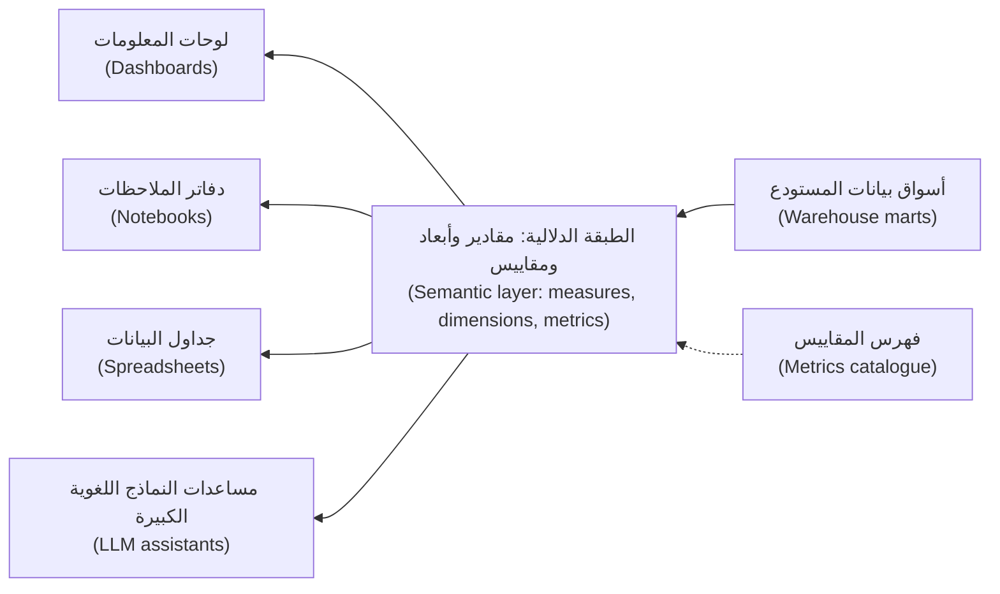
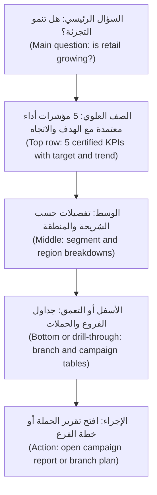
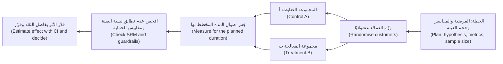

# الوحدة 4 — تحليلات يثق بها الناس

*توجد خطوط البيانات (pipelines) والنماذج (models) والاختبارات (tests) كي يتخذ أحدٌ قرارًا أفضل (better decision). تتناول هذه الوحدة الأمتار الأخيرة، حيث تلتقي البيانات بالناس، وحيث تُكسب معظم الثقة (trust) بفريق البيانات أو تُخسر. تبدأ بالمقاييس (metrics): كيف تنتهي كلمة واحدة مثل "العميل النشط" (active customer) بثلاثة أرقام، وكيف يحسم ذلك نهائيًا تعريفٌ مكتوب واحد وطبقةٌ دلالية (semantic layer) وفهرسُ مقاييس (metrics catalogue). ثم تنتقل إلى لوحات المعلومات (dashboards) وسرد القصص بالبيانات (data storytelling): التصميم من أجل قرار لا من أجل العرض (display)، واختيار مخططات لا تضلّل، وكتابة الفقرة الواحدة التي تخبر مسؤولًا تنفيذيًا مشغولًا (busy executive) بما تغيّر وما ينبغي فعله. وتنتهي بالتجارب (experiments) والإحصاء (statistics) الذي يحتاجه كل محلّل: اختبارات A/B (A/B tests)، وحجم العينة (sample size)، وقيم p (p-values) وفواصل الثقة (confidence intervals)، والفخاخ (traps) التي تخدع الأذكياء: التلصّص المبكر (peeking)، والمقارنات المتعددة (multiple comparisons)، وعدم تطابق نسبة العينة (sample ratio mismatch)، ومفارقة سيمبسون (Simpson's paradox). ستتابع فريق منصة البيانات والتحليلات (Data Platform & Analytics) في بنك نجم (Najm Bank) بينما تفكّ لينا ثلاث نسخ من "العملاء النشطين" (active customers)، ويعيد كريم بناء لوحة معلومات للتجزئة (retail dashboard) من 40 مخططًا لا يفتحها أحد، وتوقف دانة تجربةً في تطبيق نجم للهاتف (Najm Mobile) أُعلن فائزها في اليوم الثالث.*

> **المراحل (Stages):** Serve, Analyse — تحويل الجداول النظيفة (clean tables) إلى أرقام وصور ونتائج اختبارات يفهمها الناس ويتفقون عليها ويتصرفون بناءً عليها.

---

# 4.1 — تعريف المقاييس: تعريف واحد، وطبقة دلالية، وفهرس مقاييس
*المستوى (Level): 🟡 متوسط (Intermediate)* · *المتطلبات (Prerequisites): 1.2، 3.1* · *المرحلة (Stage): Model, Serve*

## ⚡ الدرس في دقيقة (In 60 seconds)
- **المقياس (metric)** رقمٌ تتابعه المؤسسة عبر الزمن، مثل العملاء النشطين شهريًا أو إنفاق البطاقات (card spend). ولا يكون المقياس مفيدًا إلا إذا حسبه الجميع بالطريقة نفسها.
- القاعدة الأهم: **مقياس واحد، وتعريف مكتوب واحد، ومالك واحد، ومكان واحد يُحسب فيه (one metric, one written definition, one owner, one place where it is computed).** وكل لوحة معلومات (dashboard) ودفتر ملاحظات (notebook) وتقرير (report) يقرؤه من هناك.
- **الطبقة الدلالية (semantic layer)** هي الشيفرة (code) التي تحمل تلك التعريفات (المقادير (measures)، والأبعاد (dimensions)، والربط (joins)، والمرشّحات) بين مستودع البيانات (warehouse) والأدوات التي تطرح الأسئلة. ومن أمثلتها الطبقة الدلالية في dbt المدعومة بـ MetricFlow، وCube، ولغة LookML من Looker.
- **فهرس المقاييس (metrics catalogue)** هو الجانب المقروء للبشر (human-readable side): بطاقة لكل مقياس تتضمن سؤاله التجاري (business question)، والصيغة (formula)، والحُبَيبية (grain)، والمالك (owner)، والتحفّظات (caveats)، وحالة الاعتماد (certification status).
- مؤشر القرار (Decision cue): حين يأتي فريقان إلى اجتماع برقمين مختلفين لمقياس "واحد"، توقّف عن الجدال حول أيّهما الصحيح واكتب التعريف.
- أكبر فخ (Biggest trap): حساب متوسط النسب (averaging ratios)، أو جمع الأرصدة عبر الأيام، أو جمع أعداد القيم المميّزة. اعرف هل كل مقدار قابل للجمع (additive) أو شبه قابل للجمع (semi-additive) أو غير قابل للجمع (non-additive) قبل أن تجمّعه (aggregate).

## 🧭 لماذا يهم
إنها المراجعة الفصلية للأعمال في بنك نجم. تقول شريحة فريق التجزئة (retail team) إن لدى نجم **412,000 عميل نشط (active customers)**. وتقول شريحة المالية (Finance) **365,000**. ويستخدم تقرير رأس المال (capital report) لدى المخاطر (Risk)، المبني من سوق بيانات مخاطر الائتمان (credit-risk mart)، رقمًا ثالثًا. (هذه أرقام افتراضية (hypothetical numbers) لبنكنا الخيالي.) يطرح الرئيس التنفيذي (CEO) سؤالًا بسيطًا: "كم عميلًا نشطًا لدينا؟" ولا يستطيع أحد في القاعة أن يجيب دون حاشية (footnote).

تقضي لينا، مهندسة التحليلات (analytics engineer) في نجم، أسبوعًا في معرفة السبب. فالتجزئة (Retail) تعدّ كل من سجّل الدخول (logged in) إلى تطبيق نجم للهاتف **أو** أجرى أي معاملة في آخر 90 يومًا. والمالية تعدّ العملاء الذين أجروا معاملة واحدة على الأقل **يبادر بها العميل (customer-initiated)** في الشهر التقويمي (calendar month)، باستثناء إيداعات الرواتب (salary credits) والرسوم (fees). والمخاطر تعدّ العملاء الذين لديهم حساب مفتوح غير خامل. كل تعريف يناسب غرضه؛ ولا شيء منها مكتوب؛ وكلٌّ منها يعيش في استعلام SQL مختلف كثير النسخ، واثنان منها يُدخلان حسابات الموظفين (staff accounts) بصمت.

هذه أكثر الطرق شيوعًا التي تفقد بها فرق البيانات الثقة (lose trust): ليست البيانات الخاطئة (wrong data)، بل **الكلمة نفسها تعني أشياء مختلفة (the same word meaning different things)**. والعلاج تقني جزئيًا (partly technical) (حساب كل مقياس في مكان واحد) واجتماعي جزئيًا (partly social) (الاتفاق على تعريف، وتعيين مالك له، ونشره). ولجانب لوحات المعلومات من المشكلة نفسها في سياق شركة ناشئة (startup setting)، انظر [*تصميم الأنظمة لمبرمجي الحدس (System Design for Vibe Coders)*، الدرس 7.1 — لوحة المعلومات التي تكذب والمقياس الذي لا يكذب](../vibe/index.ar.html#l7-1).

## 📐 كيف يعمل

### 🟢 الأساسيات

**المقياس، والمقدار، والبُعد (Metric, measure, dimension).** ثلاث كلمات ستقابلها في كل طبقة دلالية:
- **المقدار (measure)** تجميعٌ على عمود: `SUM(amount_qar)`، `COUNT(DISTINCT customer_id)`.
- **البُعد (dimension)** شيءٌ تُقسّم البيانات بحسبه (slice by): التاريخ (date)، والقناة (channel)، والشريحة (segment)، والفرع (branch)، والبلد (country).
- **المقياس (metric)** هو الرقم الموجّه للأعمال (business-facing number) المبني من مقدار واحد أو أكثر، مع أي مرشّحات مدمجة فيه: "إنفاق البطاقات" هو مجموع مبالغ المشتريات المعتمدة، باستثناء العكوس (reversals).

**للتعريف أجزاء أكثر من الصيغة (A definition has more parts than a formula).** إن "العملاء النشطون = عدد العملاء الذين لديهم معاملة" يترك سبعة أسئلة على الأقل مفتوحة (open). والتعريف الكامل (complete definition) يجيب عنها جميعًا:

| الجزء (Part) | السؤال الذي يجيب عنه (Question it answers) | "العملاء النشطون" في نجم (النسخة المتفق عليها) |
|---|---|---|
| السؤال التجاري | لماذا ينظر أي أحد إلى هذا؟ | كم عميلًا يستخدم نجم فعليًا بنكًا؟ |
| الصيغة | ما الذي يُعدّ أو يُجمع بالضبط؟ | العملاء المميّزون (distinct customers) الذين لديهم حدث مؤهِّل واحد على الأقل |
| الأحداث المؤهِّلة (Qualifying events) | ما الذي يُحتسب؟ | معاملة يبادر بها العميل (customer-initiated transaction)، أو تسجيل دخول إلى تطبيق نجم للهاتف أو الخدمات المصرفية عبر الإنترنت (online banking) |
| الاستثناءات (Exclusions) | ما الذي لا يُحتسب أبدًا؟ | حسابات الموظفين والاختبار (staff and test accounts)، وإيداعات الرواتب، والرسوم، وقيود الفوائد (interest postings)، والعكوس |
| النافذة والمنطقة الزمنية | على أي فترة (period)، وبأي ساعة؟ | آخر 30 يومًا متحركة (trailing 30 days) تنتهي في تاريخ التقرير (reporting date)، بتوقيت Asia/Qatar |
| الحُبَيبية | صفٌّ واحد لكل ماذا؟ | رقم واحد لكل يوم لكل شريحة (التجزئة، والمنشآت الصغيرة والمتوسطة (SME))؛ لا يُجمع عبر الأيام أبدًا |
| المالك | من يقرر التغييرات؟ | رئيس تحليلات التجزئة؛ وتصون لينا الشيفرة |

**لماذا يحدث الانجراف (Why the drift happens).** كل محلّل يحتاج الرقم يكتب استعلامًا، وينسخ مرشّحًا من استعلام أقدم، وينسى استثناءً واحدًا. ومع عشر لوحات معلومات يصبح لديك عشرة تعريفات. والعلاج هو نقل التعريف **إلى المنبع (upstream)**: احسبه مرة واحدة في مستودع البيانات، واختبره (test it) (3.1، 3.2)، واجعل كل أداة تقرأ النتيجة.

**القابل للجمع، وشبه القابل للجمع، وغير القابل للجمع (Additive, semi-additive and non-additive).** قبل أن تجمّع أي مقدار، اسأل كيف يجوز جمعه:

| النوع (Type) | المعنى (Meaning) | مثال من نجم (Najm example) | آمن للجمع عبر |
|---|---|---|---|
| قابل للجمع | يمكن جمعه عبر كل بُعد | إنفاق البطاقات بالريال القطري | الأيام، والفروع، والشرائح |
| شبه قابل للجمع | يمكن جمعه عبر بعض الأبعاد لكن ليس عبر الزمن | رصيد الحساب في نهاية اليوم | الحسابات والفروع، لا الأيام: خذ قيمة نهاية الفترة (end-of-period value) أو المتوسط (average) |
| غير قابل للجمع | لا يمكن جمعه إطلاقًا | العملاء النشطون المميّزون، والنسب (ratios)، والنسب المئوية (percentages) | لا شيء: أعد الحساب من الصفوف الأساسية |

تعلّمت هدى هذا بالطريقة الصعبة. فحين طُلب منها "العملاء النشطون هذا الشهر"، جمعت الأعداد اليومية للعملاء النشطين وأبلغت عن رقم أكبر من قاعدة عملاء نجم بأكملها: فكل من كان نشطًا في 20 يومًا عُدّ 20 مرة.

```sql
-- Wrong: daily distinct counts are non-additive
SELECT SUM(daily_active) AS monthly_active
FROM daily_active_customers
WHERE activity_date >= DATE '2026-09-01' AND activity_date < DATE '2026-10-01';

-- Right: recompute the distinct count over the whole period
SELECT COUNT(DISTINCT customer_id) AS monthly_active
FROM fct_customer_activity
WHERE activity_date >= DATE '2026-09-01' AND activity_date < DATE '2026-10-01'
  AND is_staff = FALSE
  AND is_qualifying_event = TRUE;
```

**النسب: اقسم المجاميع، ولا تحسب متوسط النسب (Ratios: divide sums, do not average ratios).** قد يكون التبنّي الرقمي (digital adoption) بحسب الفرع 80% في فرع فيه 100 عميل و40% في فرع فيه 10,000. ومتوسط النسبتين هو 60%. أما المعدّل المجمّع الحقيقي فهو (80 + 4,000) ÷ 10,100، أي نحو 40.4%. عرّف مقياس النسبة (ratio metric) على أنه **مقدار البسط ÷ مقدار المقام (numerator measure ÷ denominator measure)**، وكلٌّ منهما مجموعٌ على المستوى الذي تُبلغ عنه.

```sql
-- Wrong: average of branch-level percentages
SELECT AVG(digital_customers * 1.0 / customers) AS adoption FROM branch_summary;

-- Right: ratio of sums
SELECT SUM(digital_customers) * 1.0 / SUM(customers) AS adoption FROM branch_summary;
```

### 🟡 التعمق أكثر (Going deeper)

**ما الذي تفعله الطبقة الدلالية (What a semantic layer does).** الطبقة الدلالية مجموعة من التعريفات المخزّنة على شكل شيفرة، تخبر محرّك الاستعلام (query engine) بأي الجداول تحمل أي المقادير، وكيف تُربط الجداول (عبر **الكيانات (entities)**، أي المفاتيح مثل `customer_id`)، وما الأبعاد الموجودة، وكيف يُبنى كل مقياس. تطلب أداةٌ "العملاء النشطين حسب الشريحة، حسب الشهر" فتكتب الطبقة الدلالية شيفرة SQL. ولأن كل أداة تسأل الطبقة نفسها، تحصل كل أداة على الإجابة نفسها.



ثلاثة خيارات واسعة الاستخدام، موصوفة بحياد (described neutrally):
- **الطبقة الدلالية في dbt مع MetricFlow (dbt Semantic Layer with MetricFlow).** تُعلن **النماذج الدلالية (semantic models)** (نموذج dbt مع كياناته وأبعاده ومقاديره) و**المقاييس (metrics)** بصيغة YAML بجوار مشروع dbt الخاص بك. ويولّد MetricFlow شيفرة SQL، بما فيها عمليات الربط. وتشمل أنواع المقاييس (metric types): البسيطة (simple)، والنسبة (ratio)، والتراكمية (cumulative)، والمشتقة (derived)، ومقاييس التحويل (conversion metrics).
- **Cube.** طبقة دلالية مفتوحة المصدر لها ملفات نموذج بيانات خاصة بها، وطبقة واجهة برمجية (API layer)، وتخزين مؤقت (caching)، وتُستخدم غالبًا لتقديم المقاييس إلى التطبيقات (applications) وكذلك إلى أدوات ذكاء الأعمال (BI tools).
- **LookML.** لغة النمذجة (modelling language) في Looker. تعيش التعريفات في Looker وتخدم الاستكشاف (exploration) ولوحات المعلومات الخاصة بـ Looker، وكذلك، عبر موصّلات Google (Google's connectors)، بعض الأدوات الأخرى.

إليك بداية النموذج الدلالي (semantic model) لدى نجم لمعاملات البطاقات (card transactions) بصيغة YAML في dbt. تتبع الصياغة (syntax) توثيق dbt (dbt documentation) وقت كتابة هذا (2026)؛ والمواصفة (spec) تتطور باستمرار، فراجع التوثيق الحالي (current docs) قبل أن تنسخها.

```yaml
semantic_models:
  - name: card_transactions
    model: ref('fct_card_transactions')
    defaults:
      agg_time_dimension: transaction_date
    entities:
      - name: transaction
        type: primary
        expr: transaction_id
      - name: customer
        type: foreign
        expr: customer_id
    dimensions:
      - name: transaction_date
        type: time
        type_params:
          time_granularity: day
      - name: channel
        type: categorical
    measures:
      - name: card_spend_qar
        agg: sum
        expr: amount_qar
      - name: card_spenders
        agg: count_distinct
        expr: customer_id

metrics:
  - name: card_spend
    label: Card spend (QAR)
    description: Approved card purchases in QAR, excluding reversals and refunds.
    type: simple
    type_params:
      measure: card_spend_qar
```

لاحظ أين يعيش المرشّح. فالعكوس والمبالغ المستردة (refunds) مستثناة في `fct_card_transactions` نفسه، وهو نموذج dbt مختبَر (tested dbt model)، فلا يمكن حساب المقدار دون استثنائها. ضع قواعد العمل (business rules) في أبكر موضع ممكن، ومرة واحدة (once).

**لا تحتاج إلى منتج طبقة دلالية كي تبدأ (You do not need a semantic layer product to start).** النسخة الدنيا (minimum version) هي **سوق بيانات المقاييس (metrics mart)**: نموذج dbt مختبَر لكل عائلة مقاييس بحُبَيبية معلنة (declared grain)، مثل `mart_active_customers_daily` (صف واحد لكل تاريخ لكل شريحة)، تقرؤه كل لوحة معلومات مباشرة. بدأت نجم من هناك وأضافت MetricFlow حين احتاج المحلّلون إلى تقسيم المقاييس بطرق كثيرة دون جدول جديد لكل تركيبة.

**فهرس المقاييس (The metrics catalogue).** الشيفرة وحدها لا تحسم الجدالات، لأن المسؤولين التنفيذيين (executives) لا يقرؤون YAML. الفهرس صفحةٌ لكل مقياس يستطيع غير المهندس (non-engineer) قراءتها، وتُولَّد من المصدر نفسه حيثما أمكن (أوصاف dbt (dbt descriptions)، وفهرس (catalogue) مثل OpenMetadata أو DataHub، انظر 6.1). ويحمل كل مُدخل **حالة اعتماد (certification status)**:
- **معتمد (Certified)**: تعريف وافق عليه المالك، ويُحسب في الطبقة الدلالية أو سوق بيانات المقاييس، ومختبَر (tested)، ومراقَب من حيث الحداثة.
- **مؤقت (Provisional)**: قيد الاستخدام ريثما يُتفق على التعريف.
- **متقادم (Deprecated)**: يُحتفظ به للتاريخ، مع إشارة إلى البديل وتاريخ للإزالة (removal date).

تعرض لوحات المعلومات الحالة بجانب كل رقم، فيعرف القارئ هل هو الرقم الرسمي للبنك.

**تغيير التعريف (Changing a definition).** عامل تغيير التعريف كتغيير في واجهة برمجية (API change): أعطِ كل مقياس **إصدارًا (version)**، وسجّل ما تغيّر ولماذا، وأعلن عنه (announce it)، وإذا وجب أن يبقى التاريخ قابلًا للمقارنة، فقم بإعادة التعبئة (backfill) (2.2) وفق التعريف الجديد وعلّق على المخطط (annotate the chart). فتغيير صامت في مرشّح يحرّك مخططًا بنسبة 8% بين ليلة وضحاها يبدو تمامًا كحدث تجاري حقيقي.

### 🔴 نظرة الخبير (Expert view)

**أشجار المقاييس (Metric trees).** تنظّم الفرق الناضجة (mature teams) المقاييس في شجرة: **مقياس نجم الشمال (north-star metric)** في القمة (لتجزئة نجم، ربما "عملاء البنك الرئيسي" (primary-bank customers)، أي الذين تُودَع رواتبهم في نجم)، و**مقاييس المُدخلات (input metrics)** التي تستطيع الفرق تحريكها تحته (إكمال فتح الحساب (onboarding completion)، وتفعيل البطاقة)، و**مقاييس الحماية (guardrail metrics)** التي تراقب الضرر (الشكاوى (complaints)، وخسائر الاحتيال). تخبر الشجرة كل فريق بالرقم الذي يملكه وتمنع فريقين من تحسين مقاييس تتجاذب في اتجاهين متعاكسين.

**قانون غودهارت (Goodhart's law).** يُعاد صوغه كثيرًا هكذا: "حين يصبح المقياس هدفًا، يكفّ عن أن يكون مقياسًا جيدًا". فإذا كوفئ موظفو الفروع (branch staff) على "العملاء النشطين" وكان تسجيل الدخول (login) يُحتسب نشاطًا، فتوقّع حملات تدفع العملاء إلى تسجيل الدخول دون فعل أي شيء. اقرن كل مقياس مستهدف (target metric) بمقياس حماية (guardrail) وبنسخة جودة منه (مثلًا "العملاء النشطون الذين لديهم حدثان مؤهِّلان أو أكثر").

**الصحة الزمنية (Point-in-time correctness).** تعتمد مقاييس مصرفية كثيرة على سمات تتغيّر: الشريحة، ودرجة المخاطر (risk grade)، والفرع. ينبغي أن يستخدم "عملاء المنشآت الصغيرة والمتوسطة في مارس" الشريحةَ التي كانت لكل عميل *في مارس*، لا شريحة اليوم. وهذا يتطلب أبعادًا متغيّرة ببطء (slowly changing dimensions) (1.2) تُربط على تواريخ السريان (effective dates)، وتعريفًا يذكر أيّهما يستخدم: **كما كان (as-was)** (السمة وقت الحدث) أو **كما هو (as-is)** (سمة اليوم مطبّقة على كل التاريخ). وتحتاج التقارير التنظيمية (regulatory reports) عادةً إلى "كما كان". اكتب هذا الاختيار على بطاقة المقياس (metric card).

**المطابقة (Reconciliation).** يجب أن يرتبط المقياس المالي المعتمد بنظام السجل (system of record). فينبغي أن يتطابق "إنفاق البطاقات" لدى المالية مع إجماليات التسوية (settlement totals) لدى معالج البطاقات (card processor) ضمن هامش تسامح معروف (known tolerance)، وأن يُفسَّر الفرق (التوقيت (timing)، والعكوس، وتحويل العملة). ابنِ هذا الفحص اختبارَ بيانات مجدولًا (3.2) واعرض حالة المطابقة (reconciliation status) على بطاقة المقياس. فالرقم الذي لم يُطابَق قط ليس معتمدًا، مهما كان ملف YAML الخاص به أنيقًا.

**مقاييس للآلات (Metrics for machines).** يكون مساعد النموذج اللغوي الكبير (LLM assistant) الذي يجيب عن أسئلة البيانات أكثر موثوقية عمومًا حين يستعلم طبقة دلالية منه حين يكتب SQL خامًا (raw SQL) على مئات الجداول، لأن عمليات الربط والمرشّحات (filters) والاستثناءات محسومة مسبقًا. عامل الطبقة الدلالية على أنها العقد (contract) بين الناس ولوحات المعلومات والذكاء الاصطناعي (AI).

## 🧰 الأدوات
| الأداة أو النمط أو المعيار (Tool, pattern or standard) | ما هو وماذا يفعل | متى تلجأ إليه |
|---|---|---|
| **Metric definition card** — بطاقة تعريف المقياس | تعريف مكتوب في صفحة واحدة: السؤال، والصيغة، والاستثناءات، والنافذة (window)، والحُبَيبية، والمالك، والإصدار، والحالة (status) | قبل ظهور أي مقياس على لوحة معلومات؛ وكلما اختلف رقمان |
| **Semantic layer** — الطبقة الدلالية | شيفرة تحمل المقادير والأبعاد وعمليات الربط والمقاييس بين مستودع البيانات ومستهلكيه (consumers) | حين تُقسَّم المقاييس نفسها بطرق كثيرة في عدة أدوات |
| **dbt Semantic Layer** (MetricFlow) — الطبقة الدلالية في dbt | نماذج دلالية ومقاييس معلنة بصيغة YAML في مشروع dbt؛ ويولّد MetricFlow شيفرة SQL | الفرق التي تجري التحويل (transforming) بـ dbt أصلًا |
| **Cube** | طبقة دلالية مفتوحة المصدر مع واجهة برمجية (API) وتخزين مؤقت | تقديم المقاييس إلى أدوات ذكاء الأعمال وإلى التطبيقات |
| **LookML** (Looker) | لغة النمذجة في Looker للأبعاد والمقادير وعمليات الربط | المؤسسات التي توحّدت على Looker |
| **Metrics mart** — سوق بيانات المقاييس | نموذج dbt مختبَر لكل عائلة مقاييس بحُبَيبية معلنة | أبسط بداية (simplest start)، قبل اعتماد منتج طبقة دلالية |
| **Metric tree** — شجرة المقاييس | مقياس نجم الشمال ومقاييس المُدخلات ومقاييس الحماية (guardrails) مرتبطة بسببية مفترضة (assumed cause) | مواءمة أهداف الفرق ورصد المقاييس التي تتجاذب في اتجاهين متعاكسين |

## 🏛️ عمليًا في بنك نجم
تنشر لينا أول مُدخل معتمد في **فهرس مقاييس نجم (Najm Metrics Catalogue)**. توقّع عليه التجزئة والمالية والمخاطر؛ وتُحال استعلامات "العملاء النشطين" القديمة إلى التقاعد (retired)، وصارت لوحات المعلومات الثلاث تقرأ سوق البيانات نفسه.

| الحقل (Field) | القيمة (Value) |
|---|---|
| المقياس | `active_customers_30d` — العملاء النشطون (30 يومًا) (Active customers (30-day)) |
| الإصدار والحالة | v1.0 · **معتمد (Certified)** · ساري المفعول (effective) من 1 أكتوبر 2026 |
| السؤال التجاري | كم عميلًا يستخدم نجم فعليًا بنكًا؟ |
| الصيغة | عدد `customer_id` المميّزة (distinct) التي لديها حدث مؤهِّل واحد على الأقل في الثلاثين يومًا المنتهية في تاريخ التقرير |
| الأحداث المؤهِّلة | معاملة خصم أو إيداع يبادر بها العميل؛ تسجيل دخول إلى تطبيق نجم للهاتف أو الخدمات المصرفية عبر الإنترنت |
| الاستثناءات | حسابات الموظفين والاختبار؛ إيداعات الرواتب؛ الرسوم والفوائد وقيود النظام؛ المعاملات المعكوسة (reversed transactions) |
| المنطقة الزمنية ووقت القطع | Asia/Qatar؛ الأحداث حتى 23:59:59 في تاريخ التقرير |
| الحُبَيبية | صف واحد لكل تاريخ تقرير × شريحة (التجزئة، والمنشآت الصغيرة والمتوسطة)؛ غير قابل للجمع: لا يُجمع أبدًا عبر التواريخ أو الشرائح؛ استخدم صف "الكل" |
| تاريخ السمات (Attribute history) | الشريحة كما كانت في تاريخ التقرير (ربط من النوع الثاني للبُعد المتغيّر ببطء (SCD Type 2 join)) |
| المصدر (Source) | `mart_active_customers_daily` (dbt)، مبني من `fct_customer_activity` |
| الاختبارات | فريد على التاريخ × الشريحة؛ غير فارغ؛ "الكل" ≥ كل شريحة؛ تغيّر يومي ضمن ±5% (day-on-day change within ±5%) وإلا تنبيه إلى لينا |
| الحداثة (Freshness) | متاح بحلول 07:00 يوميًا؛ تعرض لوحة المعلومات وقت البيانات (as-of time) |
| المالك والقيّم | المالك: رئيس تحليلات التجزئة · القيّم (Steward): لينا (هندسة التحليلات) |
| التحفّظات المعروفة (Known caveats) | النشاط المقتصر على تسجيل الدخول (login-only activity) نحو ثلث الإجمالي (افتراضي)؛ انظر `active_customers_transacting_30d` للحصول على رؤية أكثر صرامة (stricter view) |
| سجل التغييرات (Change log) | v1.0: يحل محل التعريفات المحلية (local definitions) للتجزئة والمالية والمخاطر؛ أُعيدت تعبئة التاريخ (history backfilled) حتى يناير 2024 |

## 🛠️ التمارين (Exercises)
استخدم DuckDB أو PostgreSQL مع جدول اصطناعي (synthetic table) من 1,000 عميل و50,000 حدث تولّده بنفسك (أدرج بضعة حسابات موظفين وإيداعات رواتب وعكوس).

- 🟢 اكتب ثلاثة استعلامات مختلفة لـ "العملاء النشطين"، تطابق تعريفات التجزئة والمالية والمخاطر في قسم 🧭، وشغّلها على البيانات نفسها. ثم اكتب بطاقة المقياس التي تحسم الخلاف بينها. *يكتمل عندما (Done when):* تعطي الاستعلامات الثلاثة ثلاثة أرقام مختلفة، وتستطيع تفسير كل فرق صفًّا بصف، وتجيب بطاقتك عن كل حقل في الجدول أعلاه.
- 🟡 ابنِ نموذج dbt باسم `mart_active_customers_daily` بحُبَيبية التاريخ × الشريحة (date × segment) مع صف "الكل"، إضافةً إلى اختبارات (تركيبة فريدة (unique combination)، وغير فارغ، واختبار مخصّص (custom test) يتحقق من أن "الكل" لا يقل أبدًا عن أي شريحة). وبيّن في استعلام لماذا يكون جمع الصفوف اليومية للحصول على رقم شهري خاطئًا. *يكتمل عندما:* ينجح `dbt build` ويُنتج زوج استعلاميك الخاطئ مقابل الصحيح أرقامًا مختلفة بوضوح.
- 🔴 أضف نموذجًا دلاليًا ومقياسين (أحدهما بسيط، والآخر نسبة مثل التبنّي الرقمي) إلى مشروع dbt الخاص بك باستخدام مواصفة الطبقة الدلالية في dbt، واستعلمهما حسب الشهر والشريحة باستخدام MetricFlow محليًا (locally). *يكتمل عندما:* يعطي مقياس النسبة نسبةَ المجاميع لا متوسطَ النسب، وتكون قد تحققت منه مقابل استعلام SQL مكتوب يدويًا.

## ⚠️ أخطاء وفخاخ (Mistakes and traps)
- **تعريفات تعيش في استعلامات لوحات المعلومات (Definitions living in dashboard queries).** عشر لوحات معلومات تصبح عشرة تعريفات. احسب كل مقياس مرة واحدة، في المنبع، واجعل كل أداة تقرؤه.
- **جمع ما لا يقبل الجمع (Summing what is not additive).** لا يمكن جمع أعداد القيم المميّزة (distinct counts) والنسب والأرصدة (balances) عبر الأيام. صنّف قابلية الجمع (additivity) لكل مقدار وأعد الحساب من الصفوف.
- **حساب متوسط النسب (Averaging ratios).** تنال المجموعات الصغيرة الوزن نفسه (same weight) الذي تناله الكبيرة. اقسم مجموع البسوط على مجموع المقامات.
- **تغييرات صامتة في التعريف (Silent definition changes).** يبدو تغيير المرشّح (filter change) كحدث تجاري (business event). ضع إصدارًا للتعريف، وعلّق على المخطط، وأعد التعبئة حين يجب أن يبقى التاريخ قابلًا للمقارنة.
- **تعريف بلا مالك (A definition without an owner).** بدونه، يذهب كل خلاف إلى اجتماع ويبقى هناك. سمِّ مالكًا يقرر وقيّمًا يصون الشيفرة.
- **أهداف بلا مقاييس حماية (Targets without guardrails).** المقياس الذي يُكافأ عليه يُتلاعب به (gets gamed). اقرنه بمقياس حماية وبنسخة جودة أكثر صرامة.

## 🧾 الخلاصة (Recap)
- لا يكون المقياس جديرًا بالثقة (trustworthy) إلا حين يكون له تعريف مكتوب واحد، ومالك واحد (one owner)، ومكان واحد يُحسب فيه.
- يغطي التعريف الكامل (full definition) الصيغة، والأحداث المؤهِّلة، والاستثناءات، والنافذة، والمنطقة الزمنية (time zone)، والحُبَيبية، وتاريخ السمات، والمالك.
- اعرف قابلية الجمع لكل مقدار؛ وأعد حساب أعداد القيم المميّزة والنسب بدل جمعها أو حساب متوسطها.
- تجعل الطبقة الدلالية (الطبقة الدلالية في dbt مع MetricFlow، أو Cube، أو LookML، أو ببساطة سوق بيانات مقاييس مختبَر) كل أداة تسأل عن التعريفات نفسها.
- يجعل فهرس المقاييس التعريفات مقروءة ومعتمدة ومُصدَرة؛ وتُبقي أشجار المقاييس ومقاييس الحماية الأهداف نزيهة.

## ✍️ اختبر نفسك (Check yourself)

**1. تُبلغ التجزئة (Retail) عن 412,000 عميل نشط (active customers) وتُبلغ المالية (finance) عن 365,000. وكلا الاستعلامين يعمل دون أخطاء على مستودع البيانات (warehouse) نفسه. ما أفضل خطوة أولى (best first step)؟**

- A. الاتفاق على تعريف مكتوب واحد مع مالك مسمّى، ثم حسابه في مكان واحد
- B. استخدام الرقم الأعلى (higher number)، لأنه يلتقط أنواعًا أكثر من النشاط
- C. حساب متوسط الرقمين كي لا يُفضَّل رقم أي فريق
- D. إعادة بناء مستودع البيانات، لأن وجود رقمين يعني أن البيانات تالفة

<details><summary>الإجابة</summary>

**A.** البيانات على الأرجح سليمة (probably fine)؛ التعريفات هي التي تختلف. الاتفاق على تعريف واحد مع مالك، ثم حسابه مرة واحدة، ينهي الجدال. أما D فتطارد مشكلة ليست في البيانات؛ وB وC تكتفيان باختيار رقم. (🧭 لماذا يهم؛ 🟢 الأساسيات.)

</details>

**2. تجمع هدى 30 عددًا يوميًا للعملاء النشطين (daily active-customer counts) لتُبلغ عن الرقم الشهري (monthly figure). ما الخطأ؟**

- A. لا خطأ، ما دامت حسابات الموظفين والاختبار (staff and test accounts) قد استُثنيت كل يوم (every day)
- B. كان عليها أن تحسب متوسط الأعداد اليومية بدل جمعها معًا (summing)
- C. أعداد القيم المميّزة غير قابلة للجمع (non-additive)؛ أعد حساب العدد المميّز على مدى الشهر
- D. كان عليها أن تأخذ وسيط الأعداد اليومية لإزالة القيم الشاذة (outliers)

<details><summary>الإجابة</summary>

**C.** العميل النشط في 20 يومًا يُعدّ 20 مرة. أما B وD فتعطيان "يومًا نموذجيًا" (typical day)، لا عدد العملاء المميّزين النشطين في الشهر. (🟢 الأساسيات.)

</details>

**3. في الفرع X يستخدم 80 من أصل 100 عميل الخدمات المصرفية الرقمية (digital banking)؛ وفي الفرع Y يستخدمها 4,000 من أصل 10,000. ما معدّل التبنّي الرقمي المجمّع (combined digital adoption rate)؟**

- A. 60%، أي المتوسط البسيط (simple average) لمعدّلي الفرعين معًا
- B. لا يمكن حسابه دون بيانات على مستوى العميل (customer-level data) أبدًا
- C. 80%، أي معدّل الفرع الأفضل أداءً (best-performing branch) وحده
- D. نحو 40.4%: إجمالي الرقميين على إجمالي العملاء

<details><summary>الإجابة</summary>

**D.** 4,080 ÷ 10,100 ≈ 40.4%. إن حساب متوسط المعدّلات يعطي الفرع الصغير الوزن نفسه الذي يعطيه للكبير. (🟢 الأساسيات.)

</details>

**4. أي عبارة تصف الطبقة الدلالية (semantic layer) على أفضل وجه؟**

- A. سمة ألوان وقالب تخطيط تتشاركهما لوحات معلومات أداة ذكاء أعمال (BI tool)
- B. شيفرة مشتركة (shared code) تعرّف المقادير والأبعاد وعمليات الربط والمقاييس لكل أداة
- C. الطبقة الخام (raw layer) في مستودع البيانات، حيث تصل بيانات المصدر قبل التنظيف (before cleaning)
- D. نسخة من مستودع البيانات محفوظة في منطقة أخرى للتعافي من الكوارث (disaster recovery)

<details><summary>الإجابة</summary>

**B.** تقع بين مستودع البيانات ومستهلكيه وتولّد شيفرة SQL من تعريفات مشتركة (shared definitions). أما C فهي الطبقة الخام (raw layer)؛ وA وD لا علاقة لهما. (🟡 التعمق أكثر (Going deeper).)

</details>

**5. تكافئ نجم الفروع على "العملاء النشطين" (active customers)، حيث يُحتسب تسجيل الدخول (login) نشاطًا. ترتفع عمليات تسجيل الدخول بحدّة لكن المعاملات (transactions) لا ترتفع. بماذا ينبغي أن توصي لينا؟**

- A. إزالة تسجيلات الدخول من التعريف بهدوء (quietly)، كي يتوقف التلاعب (gaming) بحلول الأسبوع القادم (next week) تمامًا
- B. التوقف عن قياس العملاء النشطين، لأن أي مقياس يُكافأ عليه سيُتلاعب به
- C. إضافة مقياس حماية (guardrail) ومقياس جودة أكثر صرامة، ووضع إصدار لأي تغيير في التعريف (versioning)
- D. رفع الهدف بحيث يتعيّن على الفروع أن تدفع المعاملات أيضًا للوصول إليه

<details><summary>الإجابة</summary>

**C.** هذا هو قانون غودهارت (Goodhart's law): المقياس الذي يُكافأ عليه يُتلاعب به. تكشف مقاييس الحماية (guardrails) ونسخة الجودة (quality version) هذا التلاعب، ويجب وضع إصدار لتغييرات التعريف والإعلان عنها. أما A فتغيير صامت في التعريف. (🔴 نظرة الخبير (Expert view)؛ 🟡 التعمق أكثر (Going deeper).)

</details>

## 📚 المراجع (References)
- توثيق dbt، الطبقة الدلالية في dbt وMetricFlow — https://docs.getdbt.com/docs/use-dbt-semantic-layer/dbt-sl
- توثيق dbt، النماذج الدلالية والمقاييس — https://docs.getdbt.com/docs/build/semantic-models
- توثيق Cube (Cube documentation) — https://cube.dev/docs
- توثيق Looker (Looker documentation)، LookML — https://cloud.google.com/looker/docs
- رالف كيمبول ومارجي روس (Ralph Kimball and Margy Ross)، *The Data Warehouse Toolkit* (الطبعة الثالثة (3rd edition)، Wiley، 2013): الحقائق القابلة للجمع وشبه القابلة للجمع وغير القابلة للجمع
- توثيق DuckDB (DuckDB documentation)، دوال التجميع (aggregate functions) — https://duckdb.org/docs/
- OpenMetadata — https://open-metadata.org/ · DataHub — https://datahubproject.io/

---

# 4.2 — لوحات معلومات وسرد قصص بالبيانات يقودان إلى قرارات
*المستوى: 🟡 متوسط* · *المتطلبات: 4.1* · *المرحلة: Serve, Analyse*

## ⚡ الدرس في دقيقة (In 60 seconds)
- توجد لوحة المعلومات لتدعم **قرارًا (decision)** أو **إجراءً (action)**. ابدأ من سؤال "من يقرر ماذا، وكم مرة، وباستخدام أي أرقام؟" وصمّم بشكل عكسي (design backwards). إذا لم تستطع تسمية القرار، فأنت تبني عرضًا لا لوحة معلومات.
- ثلاثة أنواع تخدم احتياجات مختلفة: **الاستراتيجية (strategic)** (بضعة مقاييس معتمدة (certified metrics)، شهريًا أو أسبوعيًا، للقادة)، و**التشغيلية (operational)** (شبه آنية، لمن يتصرفون اليوم)، و**التحليلية (analytical)** (الاستكشاف، للمحلّلين).
- اختر المخطط بحسب المقارنة التي تريد أن يجريها القارئ. فالموضع على مقياس مشترك (المخططات الشريطية والخطية) يُقرأ بأعلى دقة؛ أما الزوايا والمساحات (المخططات الدائرية (pies)، والفقاعية) فبدقة أقل.
- **سرد القصص (storytelling)** هو الفقرة المرافقة للمخطط: ما الذي تغيّر، ولماذا نظن أنه تغيّر، وما مدى يقيننا، وبماذا نوصي.
- مؤشر القرار: يجب أن يجيب كل مخطط عن سؤال تستطيع كتابته في عنوانه. وإن لم يفعل، فاحذفه.
- أكبر فخ: لوحة المعلومات ذات الأربعين مخططًا التي لا يفتحها أحد (the 40-chart dashboard nobody opens). فمزيد من المخططات يعني انتباهًا أقل لكل مخطط، وتحميلًا أبطأ (slower loading)، ومواضع أكثر لانجراف التعريفات.

## 🧭 لماذا يهم
كريم، محلّل بيانات التجزئة (retail data analyst) في نجم، يصون لوحة معلومات "أداء التجزئة" (Retail Performance). فيها 40 مخططًا موزّعة على ستة تبويبات (six tabs)، بُنيت على مدى ثلاث سنوات مع كل طلب يضيف "مخططًا واحدًا آخر فقط". تُظهر سجلات الاستخدام (usage logs) من أداة ذكاء الأعمال (BI tool) أنها فُتحت 11 مرة الشهر الماضي، معظمها من كريم نفسه. وفي الأثناء تحصل مديرة التجزئة (retail director) على أرقامها من جدول بيانات (spreadsheet) يحدّثه مساعدها يدويًا كل يوم اثنين، ناسخًا الأرقام من لوحة المعلومات. وفي جدول البيانات رقم خاطئ لإنفاق البطاقات لشهر أغسطس، لأن خلية منسوخة واحدة جاءت من التبويب الخطأ (wrong tab).

حين يسأل كريم المديرة عمّا تحتاجه، يكون الجواب قصيرًا: "كل يوم اثنين أقرر أين أضع فرق مبيعات الفروع وأيّ الحملات (campaigns) أُبقي. أحتاج أن أعرف أيّ الشرائح تنمو (growing)، وأيّها تتراجع (slipping)، وهل نجحت حملات الأسبوع الماضي." ثلاثة أسئلة. لا 40 مخططًا.

يتناول هذا الدرس البناءَ من أجل تلك المحادثة. لوحة المعلومات التي تقود إلى قرارات أصغر، وأسرع، ومبنية على مقاييس معتمدة (4.1)، ومصمّمة حول سؤال، ومصحوبة بجملة تقول ما تعنيه الأرقام. وبناؤها جيدًا هندسةٌ (engineering) بقدر ما هو تصميم (design): فهي تحتاج إلى أسواق بيانات مجمّعة مسبقًا (pre-aggregated marts)، وملصقات حداثة (freshness labels)، وضبط وصول (access control)، وخطة لإحالة ما لا يستخدمه أحد إلى التقاعد.

## 📐 كيف يعمل

### 🟢 الأساسيات

**ابدأ بالقرار لا بالبيانات (Start with the decision, not the data).** قبل فتح أداة ذكاء الأعمال، اكتب **مواصفة لوحة معلومات (dashboard spec)** قصيرة:
1. **الجمهور (Audience)**: من يستخدمها؟ (مديرة التجزئة وأربعة رؤساء إقليميين (regional heads).)
2. **القرار (Decision)**: ماذا يقررون بها، وكم مرة؟ (أسبوعيًا (Weekly): توزيع فرق المبيعات واستمرار الحملات (campaign continuation).)
3. **الأسئلة (Questions)**: الأسئلة الثلاثة إلى الخمسة التي يجب أن تجيب عنها. ("أيّ الشرائح نمت أو تقلّصت هذا الأسبوع مقارنةً بالأسابيع الأربعة الماضية؟")
4. **المقاييس (Metrics)**: مقاييس معتمدة فقط، بأسمائها من الفهرس (4.1).
5. **الحداثة (Freshness)**: ما مدى حداثتها المطلوبة؟ (الاثنين 07:00، والبيانات حتى منتصف ليل الأحد (Sunday midnight).)
6. **الإجراء (Action)**: ماذا يفعل القارئ حين يكون رقمٌ سيئًا؟ (التعمّق إلى جدول الفروع؛ فتح تقرير الحملة (campaign report).)

**ثلاثة أنواع من لوحات المعلومات (Three kinds of dashboard).**

| النوع (Kind) | الجمهور | التحديث (Refresh) | المحتوى (Content) | مثال من نجم |
|---|---|---|---|---|
| استراتيجية | المسؤولون التنفيذيون، ومجلس الإدارة (Executives, board) | أسبوعيًا أو شهريًا | خمسة إلى ثمانية مقاييس معتمدة مع الأهداف والاتجاهات | العرض الأسبوعي لمديرة التجزئة |
| تشغيلية | من يتصرفون الآن | من دقائق إلى ساعات | طوابير (queues)، وتنبيهات (alerts)، وعتبات (thresholds)، وقوائم بنود للعمل عليها | عمليات الاحتيال (Fraud operations): طابور التنبيهات الذكية (Smart Alerts) ومعدّل الإيجابيات الكاذبة (false-positive rate) |
| تحليلية | المحلّلون (Analysts) | عند الطلب | مرشّحات، وتعمّق (drill-downs)، وأبعاد كثيرة (many dimensions) | مصنّف استكشاف الشرائح لدى كريم |

خلط هذه الأنواع هو السبب المعتاد للوحة المعلومات ذات الأربعين مخططًا: عرض تنفيذي (executive view) نمت فيه تبويبات تحليلية (analytical tabs).

**اختر المخطط بحسب المقارنة (Choose the chart by the comparison).** في دراسة شهيرة عام 1984، رتّب ويليام كليفلاند وروبرت ماكغيل مدى دقة قراءة الناس للكميات من ترميزات بصرية مختلفة (visual encodings). جاء الموضع على مقياس مشترك أولًا؛ وتلاه الطول والاتجاه والزاوية؛ وجاءت المساحة والحجم وتظليل اللون أخيرًا. وفي تجاربهما، حكم الناس على زوايا المخطط الدائري (pie-chart angles) بدقة أقل من مواضع الأشرطة (bar positions). عمليًا:

| تريد أن يقارن القارئ | استخدم (Use) | تجنّب (Avoid) |
|---|---|---|
| القيم عبر الفئات | مخطط شريطي أفقي مرتّب | مخطط دائري (pie chart) بأكثر من شريحتين أو ثلاث؛ أشرطة ثلاثية الأبعاد (3D bars) |
| التغيّر عبر الزمن | مخطط خطي (Line chart) | مخطط شريطي بفترات كثيرة؛ مخططات مساحية مكدّسة بطبقات كثيرة |
| جزء من كل، بأجزاء قليلة | شريط مكدّس (Stacked bar)، أو شريط واحد بقسمين | مخططات حلقية (donut charts) بشرائح كثيرة |
| علاقة مقدارين | مخطط انتشار (Scatter plot) | خطّان على محورين صاديين مزدوجين |
| رقم واحد مقابل هدف | رقم كبير (big number) مع الهدف والاتجاه بجانبه | مقياس دائري أو عدّاد سرعة |
| فئات كثيرة × فترات كثيرة | مضاعفات صغيرة (small multiples) أو خريطة حرارية (heatmap) | مخطط خطي واحد بخمسة عشر خطًا (one line chart with 15 lines) |

**محاور نزيهة (Honest axes).** يرمّز طول الشريط قيمته، لذا **يجب أن تبدأ المخططات الشريطية من الصفر (bar charts must start at zero)**. فمخطط شريطي يبدأ من 95% يجعل الانتقال من 96% إلى 98% يبدو كأنه تضاعف. يجوز للمخططات الخطية (line charts) أن تستخدم خط أساس غير صفري (non-zero baseline) لأنها ترمّز التغيّر بالميل، لكن اوسم المحور بوضوح. ولا تستخدم أبدًا محورين صاديين بمقياسين مختلفين على مخطط واحد: فباختيارك للمقياسين تستطيع أن تجعل أي سلسلتين تبدوان كأنهما تتحركان معًا.

**العنوان يحمل الرسالة (The title carries the message).** استبدل "إنفاق البطاقات حسب الشريحة" بـ "انخفض إنفاق بطاقات المنشآت الصغيرة والمتوسطة 6% هذا الأسبوع؛ والتجزئة ثابتة" (SME card spend fell 6% this week; retail flat). فيصل القارئ إلى الفكرة قبل قراءة المحور. وضع وقت البيانات على كل لوحة معلومات ("البيانات حتى الأحد 28 سبتمبر، 23:59 بتوقيت Asia/Qatar؛ حُدّثت الاثنين 06:42").

### 🟡 التعمق أكثر

**التخطيط يتبع ترتيب القراءة (Layout follows reading order).** يمسح القرّاء الصفحة بدءًا من أعلى اليسار (top left) (في اللغات التي تُكتب من اليسار إلى اليمين (left-to-right languages)؛ اعكس التخطيط للوحات المعلومات العربية). ضع إجابة السؤال الرئيسي (main question) في الأعلى: صفًّا من أربعة إلى ستة أرقام رئيسية (key numbers)، كلٌّ منها مع مقارنته وخط اتجاه صغير. وضع التفصيلات الداعمة (supporting breakdowns) تحتها. وضع جداول التفاصيل (detail tables) أخيرًا أو خلف تعمّق (drill-through).



**المقارنات تجعل الأرقام ذات معنى (Comparisons make numbers meaningful).** "إنفاق البطاقات: 84.2 مليون ريال قطري" (Card spend: QAR 84.2 million) لا يعني شيئًا وحده. اعرض دائمًا مقارنة واحدة على الأقل: الفترة السابقة (previous period)، أو الفترة نفسها من العام الماضي (وهي مهمة في الخليج، حيث يحرّك رمضان والعطلات الصيفية الإنفاق بحدّة، ويتقدّم رمضان نحو 11 يومًا كل عام ميلادي)، أو الهدف (target) أو التوقّع (forecast). قارن المثيل بالمثيل: فأسبوع فيه عيد مقابل أسبوع عادي ليس مقارنة عادلة (fair comparison)، فعلّق عليه (annotate it) أو قارنه بالأسبوع المكافئ من العام الماضي.

**اللون لغرض (Colour with a purpose).** استخدم الرمادي للسياق ولونًا قويًا واحدًا لما يهم. واستخدم اللون لترميز المعنى باتساق: الشريحة نفسها باللون نفسه في كل مخطط. ولا تعتمد على الأحمر مقابل الأخضر وحده، إذ لدى نسبة معتبرة من الناس (وخاصة الرجال) قصور ما في رؤية الألوان (colour-vision deficiency)؛ أضف أسهم اتجاه (direction arrows) أو ملصقات (labels) أو لوحة ألوان أزرق–برتقالي. وتحقّق من التباين (contrast) للقرّاء على الهواتف في الضوء الساطع.

**الأداء جزء من الثقة (Performance is part of trust).** لوحة المعلومات التي تستغرق 40 ثانية لتحميلها لا تُفتح. ابنِ لوحات المعلومات على **أسواق بيانات مجمّعة مسبقًا (pre-aggregated marts)** بالحُبَيبية التي تحتاجها المخططات (مثلًا `mart_retail_weekly` بحُبَيبية الأسبوع × الشريحة × المنطقة)، لا على جداول المعاملات الخام. قسّمها وجمّعها عنقوديًا (3.3)، وخزّن مؤقتًا (cache) حيث تسمح أداة ذكاء الأعمال، وحدّد ميزانية لزمن التحميل (load-time budget) (مثلًا أقل من خمس ثوانٍ للعرض الأول).

**هندسة لوحة المعلومات (Engineering the dashboard).** عامل لوحات المعلومات على أنها منتجات لها دورة حياة:
- **التحكم في الإصدارات (Version control)**: يستطيع Superset تصدير لوحات المعلومات واستيرادها ملفاتِ YAML؛ ويقدّم Metabase التسلسل (serialisation) في إصداراته المدفوعة (paid editions) وواجهة برمجية في كل الإصدارات؛ ولمعظم أدوات ذكاء الأعمال التجارية ميزات مشابهة. احفظ عمليات التصدير أو "لوحات المعلومات كشيفرة" في git حيث تدعم الأداة ذلك.
- **الاعتماد (Certification)**: علّم لوحات المعلومات المبنية على مقاييس معتمدة فقط، واعرض ذلك في شريط العنوان (title bar).
- **الوصول (Access)**: ترث لوحات المعلومات حساسية البيانات. فمديرو الفروع (branch managers) يرون فرعهم فقط؛ ومكان أمن مستوى الصف (row-level security) هو مستودع البيانات أو الطبقة الدلالية، لا مرشّح لوحة معلومات (dashboard filter) يستطيع المستخدم إزالته (6.3).
- **الاستخدام والإحالة إلى التقاعد (Usage and retirement)**: راجع الاستخدام كل ربع سنة (every quarter). وأرشف لوحات المعلومات التي لم يفتحها أحد منذ 90 يومًا (archive dashboards nobody has opened in 90 days)، بعد إخبار مالكيها. وتصبح مخططات كريم الأربعون لوحة معلومات استراتيجية واحدة ومصنّفًا تحليليًا واحدًا.

**سرد القصص بالبيانات (Data storytelling).** يُظهر المخطط *ماذا*؛ وتقول القصة *فماذا إذن* و*ماذا الآن* (now what). وهذه بنية مفيدة (useful structure) لملاحظة أسبوعية (weekly note) أو شريحة عرض (slide):
1. **العنوان الرئيسي (Headline)**: الشيء الوحيد الذي يهم. "انخفض إنفاق بطاقات المنشآت الصغيرة والمتوسطة 6% أسبوعًا على أسبوع، وهو ثاني انخفاض أسبوعي على التوالي."
2. **السياق (Context)**: هل هذا غير معتاد (unusual)؟ "على مدى آخر 52 أسبوعًا، تراوحت التغيّرات الأسبوعية بين −4% و+5%، باستثناء أسابيع رمضان والعيد."
3. **السبب، مع درجة اليقين (Cause, with confidence)**: "يأتي ثلثا الانخفاض من 120 عميلًا من المنشآت الصغيرة والمتوسطة في قطاع البناء (construction)؛ نقل ثلاثة عملاء كبار مدفوعات مورّديهم (supplier payments) إلى حساب جديد في بنك آخر (أكّد ذلك مديرو العلاقات). يقين منخفض (Low confidence) بشأن الباقي."
4. **التوصية (Recommendation)**: "على مديري العلاقات الاتصال بأكثر 20 عميلًا متأثرًا (top 20 affected customers) هذا الأسبوع؛ وسنُبلغ عن الأثر يوم الاثنين القادم."

يقدّم كتاب باربرا مينتو (Barbara Minto) *The Pyramid Principle* (مبدأ الهرم) النصيحة نفسها للكتابة: ابدأ بالخلاصة، ثم الحجج الداعمة (supporting arguments)، ثم التفاصيل (detail).

**افصل ما تعرفه عمّا تظنه (Separate what you know from what you think).** اكتب "انخفض 6%" (fell 6%) (مقيس)، و"معظمه من قطاع البناء" (تفصيل مقيس)، و"بسبب انتقال المدفوعات إلى بنك آخر" (تفسير (explanation)، مؤكَّد لثلاثة عملاء فقط). يستطيع القرّاء التصرف بناءً على ادعاء واثق (confident claim) والتحقق من ادعاء ضعيف (weak one)، ولكن فقط إذا أخبرتهم أيّهما أيّ.

### 🔴 نظرة الخبير

**قد تكذب المجاميع بالإغفال (Aggregates can lie by omission).** قد يُخفي الإجمالي (total) تحركات متعاكسة في أجزائه. فقد ترتفع معدّلات الموافقة الإجمالية على القروض الشخصية (personal loans) في نجم بينما ينخفض المعدّل في كل شريحة منفردة، إذا تحوّل مزيج المتقدّمين نحو شرائح ذات معدّلات موافقة مرتفعة. هذه مفارقة سيمبسون، المشروحة بالمثال الكلاسيكي في 4.3. والدفاع عنها على لوحة المعلومات هو تفصيلٌ حسب متغيّر المزيج الرئيسي (الشريحة، والقناة، والمنتج) مباشرةً تحت أي نسبة رئيسية (headline ratio).

**انحياز البقاء في لوحات المعلومات (Survivorship in dashboards).** لوحات المعلومات المبنية من "العملاء الحاليين" (current customers) تستبعد بهدوء كل من غادر. فعبارة "متوسط رصيد عملائنا يرتفع" قد لا تعني سوى أن العملاء ذوي الأرصدة المنخفضة (low-balance customers) يغلقون حساباتهم. وحين يُحسب مقياس على مجتمع يتغيّر، اعرض حجم المجتمع (population size) بجانبه، وفكّر في **عرض الأفواج (cohort view)** (العملاء مجمّعين حسب الشهر الذي انضموا فيه) بدل لقطة (snapshot).

**لا تطارد الضجيج (Do not chase noise).** كل رقم أسبوعي يتحرك. قبل أن تكتب "انخفض 6%"، اعرف النطاق الطبيعي (normal range) للتحرك من أسبوع لآخر لذلك المقياس. أدوات بسيطة تساعد: اعرض نطاق آخر 52 أسبوعًا شريطًا مظلّلًا (shaded band)، أو استخدم مخطط ضبط (control chart) (ضبط العمليات الإحصائي، بحدود مُستمدّة من التباين السابق) للمقاييس التشغيلية (operational metrics). تحرَّ التحركات خارج النطاق؛ ودوّن الباقي دون قصة. فالمحلّلون الذين يفسّرون كل تذبذب يعلّمون المسؤولين التنفيذيين أن يتجاهلوهم.

**التنبيهات تتفوّق على لوحات المعلومات في العمل التشغيلي (Alerts beat dashboards for operational work).** إذا كان على شخص ما أن يتصرف حين يتجاوز رقمٌ عتبةً، فلا تعتمد على أن ينظر إلى لوحة معلومات. أرسل تنبيهًا فيه الرقم، والعتبة، ورابط إلى التعمّق (drill-down)، ومالك. فعمليات الاحتيال لا تراقب مخطط التنبيهات الذكية؛ بل تعمل من طابور (queue) ويُستدعى أفرادها (get paged) حين يخرج معدّل الإيجابيات الكاذبة عن نطاقه.

**للخدمة الذاتية حدود (Self-service has limits).** تتيح الخدمة الذاتية في ذكاء الأعمال (self-service BI) لمستخدمي الأعمال بناء مخططاتهم بأنفسهم، مما يوسّع قدرة الفريق. ولكن دون مقاييس معتمدة وطبقة دلالية فإنها توسّع أيضًا مشكلة "التعريفات الثلاثة" (three definitions) من 4.1. وقاعدة نجم (Najm's rule): يجوز لأي أحد أن يستكشف؛ لكن لوحات المعلومات المبنية على مقاييس معتمدة وحدها هي التي يجوز عرضها على اللجان التنفيذية (executive committees) أو استخدامها في القرارات التنظيمية أو المالية.

## 🧰 الأدوات
| الأداة أو النمط أو المعيار | ما هو وماذا يفعل | متى تلجأ إليه |
|---|---|---|
| **Dashboard spec** — مواصفة لوحة المعلومات | صفحة واحدة: الجمهور، والقرار، والأسئلة، والمقاييس المعتمدة، والحداثة، والإجراء | قبل بناء أي لوحة معلومات أو إعادة بنائها |
| **Metabase** | أداة ذكاء أعمال مفتوحة المصدر للأسئلة ولوحات المعلومات والخدمة الذاتية البسيطة (simple self-service) | الفرق الصغيرة؛ وتشغيل ذكاء الأعمال محليًا باستخدام Docker للتعلّم |
| **Apache Superset** | منصة مفتوحة المصدر لذكاء الأعمال واستكشاف البيانات بأنواع مخططات كثيرة وSQL Lab | عمليات النشر الأكبر المستضافة ذاتيًا (self-hosted deployments) التي تحتاج إلى مخططات غنية واستكشاف بـ SQL |
| **Small multiples** (Tufte) — المضاعفات الصغيرة | المخطط الصغير نفسه مكرّرًا لكل فئة على محاور مشتركة (shared axes) | مقارنة شرائح أو مناطق كثيرة عبر الزمن |
| **Control chart** — مخطط الضبط | سلسلة زمنية (time series) بحدود مُستمدّة من التباين التاريخي (historical variation) | فصل التغيّرات الحقيقية (real changes) عن الضجيج الطبيعي (normal noise) في المقاييس التشغيلية |
| **Pyramid Principle** (Minto) — مبدأ الهرم | ابدأ بالخلاصة (conclusion)، ثم الحجج الداعمة، ثم التفاصيل | الملاحظات الأسبوعية (weekly notes)، والملخّصات التنفيذية (executive summaries)، والشرائح (slides) |
| **Cohort view** — عرض الأفواج | مقاييس مجمّعة حسب شهر البدء (start month) أو قناة الاستقطاب (acquisition channel)، تُتابَع عبر الزمن | حين يتغيّر المجتمع خلف المقياس، كما في الاحتفاظ بالعملاء (retention) والأرصدة |

## 🏛️ عمليًا في بنك نجم
يستبدل كريم "أداء التجزئة" بلوحة معلومات **التجزئة الأسبوعية (Retail Weekly)** القائمة على المواصفة أولًا (spec-first). تراجعها لينا مقابل فهرس المقاييس؛ ويوافق فيصل على خطة إحالة اللوحة القديمة إلى التقاعد (retirement plan).

**مواصفة لوحة المعلومات: التجزئة الأسبوعية الإصدار 1 (Dashboard spec: Retail Weekly v1)**

| الحقل | القيمة |
|---|---|
| الجمهور | مديرة التجزئة؛ أربعة رؤساء إقليميين |
| القرار | توزيع فرق المبيعات أسبوعيًا حسب المنطقة؛ استمرار كل حملة جارية أو إيقافها |
| الأسئلة | 1. أيّ الشرائح نمت أو تقلّصت هذا الأسبوع؟ 2. هل ذلك خارج التباين الطبيعي؟ 3. أيّ المناطق تقوده؟ 4. هل حرّكت حملات الأسبوع الماضي مقياسها المستهدف؟ |
| المقاييس المعتمدة | `active_customers_30d`، `card_spend`، `new_accounts_opened`، `digital_adoption_rate`، `complaints_per_10k_customers` (مقياس حماية) |
| المقارنات (Comparisons) | الأسبوع السابق (previous week)؛ متوسط آخر أربعة أسابيع؛ الأسبوع نفسه من العام الماضي (مع التعليق على أسابيع رمضان والعيد) |
| التخطيط (Layout) | الأعلى: خمس بطاقات مؤشرات أداء (KPI tiles) مع المقارنة وخط اتجاه مصغّر لثلاثة عشر أسبوعًا (13-week sparkline). الوسط: مضاعفات صغيرة للشريحة × المنطقة. الأسفل: جدول الحملات (campaign table) مع روابط إلى تجربة كل حملة أو تقريرها |
| مصدر البيانات (Data source) | `mart_retail_weekly` (الأسبوع × الشريحة × المنطقة)، مقسّم حسب الأسبوع |
| الحداثة | البيانات حتى الأحد 23:59 بتوقيت Asia/Qatar، متاحة الاثنين 07:00؛ ووقت البيانات معروض في الترويسة (header) |
| ميزانية الأداء (Performance budget) | العرض الأول (first view) أقل من خمس ثوانٍ |
| الوصول | يرى الرؤساء الإقليميون منطقتهم فقط، عبر أمن مستوى الصف في مستودع البيانات |
| السرد (Narrative) | يضيف كريم ملاحظة من أربعة أسطر كل يوم اثنين: العنوان الرئيسي، والسياق، والسبب مع درجة اليقين، والتوصية |
| الاعتماد | معتمدة (كل المقاييس معتمدة)؛ معروضة في شريط العنوان |
| المراجعة (Review) | يُراجَع الاستخدام كل ربع سنة (quarterly)؛ ويُحذف أي مخطط لم يُستشهد به في قرار طوال ربعين (two quarters) |
| المُحال إلى التقاعد | أُرشفت "أداء التجزئة" (40 مخططًا) بعد إشعار مدته 30 يومًا (30-day notice)؛ وتوقّف جدول البيانات اليدوي (manual spreadsheet) لدى المديرة |

## 🛠️ التمارين
شغّل Metabase أو Apache Superset محليًا في Docker على DuckDB أو PostgreSQL مع بيانات اصطناعية (synthetic data) تولّدها بنفسك (52 أسبوعًا على الأقل من الأرقام الأسبوعية لأربع شرائح وأربع مناطق).

- 🟢 خذ لوحة معلومات تعرفها (أو لوحة عامة) واكتب مواصفتها باستخدام الحقول الستة أعلاه. واذكر كل مخطط لا يجيب عن أحد أسئلتها. *يكتمل عندما:* تسمّي مواصفتك قرارًا وإيقاعًا زمنيًا (cadence)، ويرتبط كل مخطط متبقٍّ بسؤال واحد.
- 🟡 ابنِ تخطيط التجزئة الأسبوعية من المواصفة ببياناتك الاصطناعية: خمس بطاقات مؤشرات أداء مع المقارنات، ومضاعفات صغيرة حسب الشريحة والمنطقة، وجدول للحملات. وأعد كتابة كل عنوان مخطط على شكل رسالة. *يكتمل عندما:* يستطيع زميل في الدراسة الإجابة عن الأسئلة الأربعة في أقل من دقيقتين دون مساعدتك، ولا يكون لأي مخطط شريطي خط أساس غير صفري.
- 🔴 أضف نطاقًا طبيعيًا لاثنين وخمسين أسبوعًا (52-week normal-range band) (أو حدود مخطط ضبط) إلى `card_spend` واكتب ملاحظة الاثنين من أربعة أسطر لأسبوع حقنتَ فيه تغيّرًا حقيقيًا ولأسبوع لم تفعل فيه. *يكتمل عندما:* تنبّه ملاحظتك إلى التغيّر المحقون، وتلتزم الصمت بشأن الأسبوع العادي، وتفصل الحقائق المقيسة (measured facts) عن التفسيرات (explanations).

## ⚠️ أخطاء وفخاخ
- **البناء قبل السؤال عن القرار (Building before asking about the decision).** تحصل على عرض لا يستخدمه أحد. اكتب المواصفة أولًا وصمّم بشكل عكسي من القرار.
- **لوحة معلومات واحدة لكل جمهور (One dashboard for every audience).** تتعارض الاحتياجات الاستراتيجية والتشغيلية والتحليلية. ابنِ عروضًا منفصلة واربط بينها.
- **ترميزات مضلّلة (Misleading encodings).** المحاور الشريطية المبتورة، والمحاور الصادية المزدوجة (dual y-axes)، والتأثيرات ثلاثية الأبعاد (3D effects)، والمخططات الدائرية بشرائح كثيرة كلها تشوّه المقارنات. استخدم أشرطة تبدأ من الصفر، وخطوطًا للزمن، ومقياسًا واحدًا لكل مخطط.
- **أرقام بلا مقارنة أو حداثة (Numbers without comparison or freshness).** الرقم المنفرد يدعو إلى سوء القراءة (invites misreading). اعرض مقارنة ووقت البيانات في كل عرض.
- **تفسير كل تذبذب (Explaining every wiggle).** القصص عن الضجيج تقوّض الثقة. اعرف النطاق الطبيعي لكل مقياس وعلّق على التحركات الحقيقية فقط (real moves).
- **المرشّحات بوصفها أمنًا (Filters as security).** مرشّح لوحة المعلومات ليس ضبطًا للوصول. طبّق أمن مستوى الصف في مستودع البيانات أو الطبقة الدلالية.

## 🧾 الخلاصة
- صمّم بشكل عكسي من قرار: الجمهور، والأسئلة، والمقاييس المعتمدة، والحداثة، والإجراء، مكتوبة في مواصفة.
- أبقِ لوحات المعلومات الاستراتيجية والتشغيلية والتحليلية منفصلة (separate).
- اختر المخططات بحسب المقارنة التي تريدها؛ فالموضع على مقياس مشترك هو الأفضل قراءةً؛ والمخططات الشريطية تبدأ من الصفر؛ وتجنّب المحاور المزدوجة (dual axes).
- أضف قصة: العنوان الرئيسي، والسياق، والسبب مع درجة يقين معلنة، والتوصية.
- أدِر لوحات المعلومات بوصفها منتجات (products): أسواق بيانات سريعة (fast marts)، والتحكم في الإصدارات، وضبط الوصول، ومراجعة الاستخدام (usage review)، والإحالة إلى التقاعد (retirement).

## ✍️ اختبر نفسك

**1. فُتحت لوحة معلومات مديرة التجزئة (retail director) ذات الأربعين مخططًا 11 مرة الشهر الماضي. ماذا ينبغي أن يفعل كريم أولًا؟**

- A. إضافة مزيد من المخططات كي تغطي كل سؤال قد يطرحه أي أحد
- B. إرسال رابط لوحة المعلومات بالبريد الإلكتروني إلى فريق التجزئة كله كل يوم اثنين
- C. نقلها إلى أداة ذكاء أعمال أسرع وأحدث كي يستمتع الناس بفتحها
- D. سؤالها عمّا تقرره وكم مرة، وكتابة مواصفة، وإعادة البناء حولها

<details><summary>الإجابة</summary>

**D.** يعني الاستخدام المنخفض (low usage) عادةً أن لوحة المعلومات لا تخدم قرارًا. أما A فتجعل المشكلة أسوأ؛ وC تغيّر الأداة لا التصميم. (🟢 الأساسيات.)

</details>

**2. أيّ مخطط يتيح للقرّاء على أفضل وجه مقارنة إنفاق البطاقات (card spend) عبر 12 منطقة في أسبوع واحد؟**

- A. مخطط شريطي أفقي مرتّب يبدأ من الصفر
- B. مخطط دائري (pie chart) من 12 شريحة، موسوم بالنسب المئوية (percent labels)
- C. مخطط أعمدة ثلاثي الأبعاد (3D column chart) بلون مختلف لكل منطقة
- D. مخطط حلقي (donut chart) مع مفتاح ألوان (colour legend) للمناطق

<details><summary>الإجابة</summary>

**A.** يُقرأ الموضع والطول على مقياس مشترك بأعلى دقة، والترتيب (sorting) يجعل الترتيب التفاضلي (ranking) واضحًا. أما الزوايا والمساحات (B، D) فتُقرأ بشكل ضعيف، والأبعاد الثلاثة (3D) (C) تشوّه الأطوال. (🟢 الأساسيات.)

</details>

**3. مخطط شريطي للتبنّي الرقمي الشهري (monthly digital adoption) له محور صادي (y-axis) يمتد من 95% إلى 100%. ما المشكلة؟**

- A. لا مشكلة؛ فالمحور الضيّق (narrow axis) يجعل التغيّرات الصغيرة (small changes) أسهل رؤيةً، وهذا يساعد القارئ
- B. طول الشريط يرمّز القيمة، لذا يبالغ المحور المبتور في الفروق
- C. ينبغي أن يمتد المحور من 0% إلى 200% لترك مساحة للملصقات (labels) عليه
- D. ينبغي عرض النسب المئوية في جدول (table)، وعدم رسمها في مخطط أبدًا

<details><summary>الإجابة</summary>

**B.** سيبدو الانتقال من 96% إلى 98% كأنه تضاعف (doubling). ابدأ الأشرطة من الصفر، أو استخدم مخططًا خطيًا (line chart) بمحور موسوم بوضوح: إذ يجوز للمخطط الخطي أن يستخدم خط أساس غير صفري (non-zero baseline) لأنه يرمّز التغيّر بالميل. (🟢 الأساسيات.)

</details>

**4. انخفض إنفاق بطاقات المنشآت الصغيرة والمتوسطة (SME card spend) 6% هذا الأسبوع. وخلال العام الماضي، تراوحت التغيّرات الأسبوعية خارج رمضان والعيد بين −4% و+5%. ماذا ينبغي أن تفعل ملاحظة الاثنين (Monday note)؟**

- A. تجاهله، لأن كل رقم أسبوعي يتحرك والقصص عن الضجيج تقوّض الثقة بالتقرير كله وبمن أعدّه
- B. الإبلاغ عن الرقم وحده، دون سياق (without context)، كي لا يتحيّز القارئ إلى تفسير
- C. التنبيه إليه بوصفه غير معتاد، مع التفصيل والسبب المرجّح ودرجة اليقين
- D. انتظار ثلاثة أسابيع أخرى من البيانات قبل ذكره، للتأكد من أنه اتجاه (trend)

<details><summary>الإجابة</summary>

**C.** الانخفاض خارج التباين الطبيعي، فهو يستحق قصة: العنوان الرئيسي (headline)، والسياق (context)، والسبب مع درجة اليقين، والتوصية (recommendation). أما A وD فتتجاهلان إشارة حقيقية (real signal)؛ وB تترك القارئ عاجزًا عن الحكم عليه. (🟡 التعمق أكثر (Going deeper)؛ 🔴 نظرة الخبير (Expert view).)

</details>

**5. ينبغي أن يرى الرؤساء الإقليميون (regional heads) منطقتهم فقط في التجزئة الأسبوعية (Retail Weekly). أين ينبغي فرض ذلك (enforced)؟**

- A. في مرشّح لوحة معلومات (dashboard filter) مضبوط مسبقًا على منطقة كل رئيس إقليمي (regional head)
- B. بأن يُطلب من الرؤساء الإقليميين كتابيًا ألّا يغيّروا مرشّح المنطقة
- C. بأمن مستوى الصف (row-level security) في مستودع البيانات، مرتبطًا بهوية المشاهد
- D. في نسخة منفصلة من لوحة المعلومات لكل منطقة، لكلٍّ منها استعلاماتها المنسوخة (copied queries)

<details><summary>الإجابة</summary>

**C.** يستطيع المستخدم إزالة المرشّح، لذا فهو ليس ضبطًا للوصول؛ والطبقة الدلالية (semantic layer) مكان مقبول أيضًا. أما D فتكرّر المنطق (duplicates logic) أيضًا وتدعو التعريفات إلى الانجراف. (🟡 التعمق أكثر (Going deeper)؛ ⚠️ أخطاء وفخاخ (Mistakes and traps).)

</details>

## 📚 المراجع
- ويليام س. كليفلاند وروبرت ماكغيل، "Graphical Perception: Theory, Experimentation, and Application to the Development of Graphical Methods" (الإدراك البصري للرسوم)، *Journal of the American Statistical Association*، 1984
- إدوارد ر. تافتي، *The Visual Display of Quantitative Information* (Graphics Press)
- ستيفن فيو (Stephen Few)، *Information Dashboard Design* (Analytics Press)
- كول نوسباومر نافليك، *Storytelling with Data* (Wiley، 2015)
- باربرا مينتو، *The Pyramid Principle* (Pearson)
- توثيق Metabase (Metabase documentation) — https://www.metabase.com/docs/latest/
- توثيق Apache Superset — https://superset.apache.org/docs/intro

---

# 4.3 — التجارب والإحصاء للمحلّلين: اختبارات A/B والفخاخ التي تخدع الأذكياء
*المستوى: 🟡 متوسط* · *المتطلبات: 1.1، 4.1* · *المرحلة: Analyse*

## ⚡ الدرس في دقيقة (In 60 seconds)
- **اختبار A/B (A/B test)** (تجربة عشوائية مضبوطة) يقسم المستخدمين عشوائيًا إلى مجموعة ضابطة (control group) ومجموعة معالجة (treatment group) أو أكثر، بحيث يكون الفرق المنهجي الوحيد بين المجموعات هو التغيير المختبَر. وهو أكثر الطرق موثوقية لمعرفة هل *تسبّب* (caused) تغييرٌ ما في أثر.
- قرّر قبل أن تبدأ: الفرضية (hypothesis)، و**المقياس الأساسي (primary metric)**، و**مقاييس الحماية (guardrail metrics)**، وأدنى أثر يستحق الكشف (minimum effect worth detecting)، و**حجم العينة (sample size)**، وتاريخ الانتهاء (end date). اكتبها في خطة تجربة (experiment plan).
- **قيمة p (p-value)** هي احتمال رؤية فرق بهذا الحجم على الأقل لو لم يكن للتغيير أثر حقيقي. وهي ليست احتمال أن التغيير ينجح. أبلغ عن **فاصل ثقة (confidence interval)** لحجم الأثر، لا عن "دالّ إحصائيًا" (significant) فحسب.
- الفخاخ: **التلصّص المبكر (peeking)** والتوقف المبكر (stopping early)، واختبار مقاييس أو شرائح كثيرة والإبلاغ عن الذي "فاز" (won)، و**عدم تطابق نسبة العينة (sample ratio mismatch)**، وآثار الجِدّة (novelty effects)، و**مفارقة سيمبسون (Simpson's paradox)** في البيانات الرصدية (observational data).
- مؤشر القرار: إذا لم تستطع التوزيع العشوائي (randomise)، فأنت تُجري تحليلًا رصديًا (observational analysis)؛ فقل ذلك، وكن أكثر حذرًا بكثير بشأن السببية (cause).
- للجانب المتعلق بالمنتج من التجريب، انظر [*إدارة منتجات الذكاء الاصطناعي (AI Product Management)*، الدرس 6.3 — التقييم المباشر: التجارب واختبارات A/B والإطلاق المرحلي](../aipm/index.ar.html#/6.3).

## 🧭 لماذا يهم
يختبر فريق تطبيق نجم للهاتف شاشة تفعيل بطاقة معاد تصميمها. في اليوم الثالث، ينشر مدير المنتج (product manager) نتيجة أداة التجارب (experiment tool): التفعيل أعلى بنسبة 22% بالقيمة النسبية، "دالّ إحصائيًا، p = 0.03" (statistically significant). ويريد الفريق الإطلاق (ship).

تطرح دانة، كبيرة علماء البيانات (lead data scientist) في نجم، أربعة أسئلة. ما حجم العينة الذي تطلّبته الخطة؟ (نحو 15,000 مستخدم لكل مجموعة؛ ولديهم نحو 2,000 لكل مجموعة.) كم مقياسًا على الشاشة؟ (أربعة عشر.) هل كان التقسيم 50/50 كما صُمّم (split 50/50 as designed)؟ (لا: 52.4% في مجموعة المعالجة.) وهل نظر أحدٌ قبل اليوم الثالث؟ (نعم، كل يوم.) كل إجابة تشير إلى فخ معروف (known trap). أُوقف الاختبار، وأُصلح خلل التعيين (assignment bug) (كان المستخدمون الذين أعادوا تثبيت التطبيق يُعاد تعيينهم إلى مجموعة المعالجة)، وأُعيد تشغيل الاختبار بخطة ثابتة (fixed plan). ووجدت الإعادة أثرًا حقيقيًا لكنه أصغر بنحو نقطة مئوية واحدة.

التجارب هي الموضع الذي يخدع فيه الأذكياء أنفسهم بأسهل ما يكون: فالأداة تُنتج دائمًا رقمًا يبدو دقيقًا (precise-looking number). وفي البنك، تمسّ التجارب أيضًا الرسوم، وعروض الائتمان (credit offers)، ومراسلات العملاء (customer communications)، لذا تحتاج إلى حوكمة (governance) أيضًا. ولهندسة التعيين وأعلام الميزات، انظر [*لبنات بناء البرمجيات كخدمة (SaaS Building Blocks)*، الدرس 6.3 — أعلام الميزات والتجارب](../saas/index.ar.html#/6.3).

## 📐 كيف يعمل

### 🟢 الأساسيات

**لماذا التوزيع العشوائي (Why randomise).** العملاء الذين اختاروا استخدام ميزة يختلفون عمّن لم يختاروها (أكثر تفاعلًا (more engaged)، وأصغر سنًّا، وأكثر ثراءً). هذه **المتغيّرات المُربِكة (confounders)**، أي المتغيّرات التي تؤثّر في من يحصل على المعالجة وفي النتيجة معًا، تجعل المقارنة غير عادلة (unfair). والتعيين العشوائي (random assignment) يجعل المجموعات متشابهة في المتوسط من كل النواحي، المقيسة وغير المقيسة، فيمكن نسبة الفرق في النتيجة إلى التغيير.

**المصطلحات (The vocabulary).**
- **وحدة التوزيع العشوائي (Unit of randomisation)**: ما تعيّنه، وهو عادةً العميل (customer) (لا الجلسة (session) ولا مشاهدة الصفحة)، بحيث يرى الشخص الواحد النسخة نفسها دائمًا.
- **الضابطة (Control)** و**المعالجة (treatment)** (B): التجربة الحالية (current experience) والتغيير.
- **المقياس الأساسي (Primary metric)**: المقياس الوحيد الذي يحسم الاختبار، ويُختار مسبقًا. هنا: تفعيل البطاقة خلال 7 أيام من إصدارها (card activation within 7 days of card issue).
- **مقاييس الحماية (Guardrail metrics)**: مقاييس يجب ألّا تسوء، مثل الشكاوى، ومكالمات الدعم (support calls)، وتنبيهات الاحتيال (fraud alerts).
- **فرضية العدم (Null hypothesis)**: الافتراض أن التغيير لا أثر له. ويسأل الاختبار هل البيانات مفاجئة (surprising) في ظل ذلك الافتراض.



**قيم p، مقروءةً قراءة صحيحة (p-values, read correctly).** لو لم يكن للتغيير أثر فعلًا، فكم مرة سيُنتج التعيين العشوائي وحده فرقًا بحجم الفرق المرصود على الأقل؟ ذلك التكرار هو قيمة p. وقيمة p الصغيرة (عُرفًا أقل من 0.05، وهو **مستوى الدلالة (significance level)**، ألفا) تعني أن النتيجة ستكون غير معتادة لو لم يكن هناك أثر. وهي **لا** تعني "هناك احتمال 97% أن التصميم الجديد أفضل" (there is a 97% chance the new design is better)، ولا تقول شيئًا عمّا إذا كان الأثر كبيرًا بما يكفي ليهم.

**فواصل الثقة تقول كم يبلغ الحجم (Confidence intervals say how big).** يأتي فاصل الثقة 95% (95% confidence interval) من طريقة (method) تحتوي، على مدى تجارب متكررة كثيرة، على الأثر الحقيقي (true effect) في 95% من المرات. أبلغ عن الأثر وفاصله: "ارتفع التفعيل بنقطة مئوية واحدة (1.0 percentage point)، وفاصل الثقة 95% من 0.3 إلى 1.7 نقطة". أما "دالّ إحصائيًا" وحدها فتُخفي هل الأثر يستحق التكلفة.

```python
# Two-proportion test with statsmodels (Python 3.11+)
from statsmodels.stats.proportion import proportions_ztest, confint_proportions_2indep

activated = [1800, 1650]     # treatment, control
users     = [15000, 15000]

z, p = proportions_ztest(activated, users)
low, high = confint_proportions_2indep(1800, 15000, 1650, 15000)
print(f"difference = {1800/15000 - 1650/15000:.3%}, p = {p:.4f}, 95% CI = [{low:.3%}, {high:.3%}]")
# difference = 1.000%, p = 0.0066, 95% CI = [0.278%, 1.722%]
```

**حجم العينة والقوة الإحصائية (Sample size and power).** **القوة (Power)** هي احتمال أن يكشف الاختبار أثرًا بحجم معيّن حين يكون موجودًا فعلًا؛ و80% عُرفٌ شائع (common convention). و**أدنى أثر قابل للكشف (minimum detectable effect)** (MDE) هو أصغر أثر يهمّك كشفه. والآثار الأصغر تحتاج إلى مستخدمين أكثر بكثير: فالعينة المطلوبة (required sample) تنمو مع مربع 1 ÷ MDE (with the square of 1 ÷ MDE)، لذا فإن تنصيف أدنى أثر قابل للكشف يضاعف العينة أربع مرات تقريبًا. احسبه قبل أن تبدأ.

```python
from statsmodels.stats.power import NormalIndPower
from statsmodels.stats.proportion import proportion_effectsize

baseline, target = 0.10, 0.11                # hoping to detect 10% -> 11%
effect = proportion_effectsize(target, baseline)
n = NormalIndPower().solve_power(effect_size=effect, alpha=0.05, power=0.8, ratio=1)
print(round(n))   # about 14,744 users per group
```

إذا كانت نجم تُصدر بضعة آلاف من البطاقات فقط أسبوعيًا، فإن كشف نقطة مئوية واحدة يستغرق أسابيع، لا أيامًا.

### 🟡 التعمق أكثر

**الفخ 1: التلصّص المبكر والتوقف الاختياري (Trap 1: peeking and optional stopping).** تفترض اختبارات الأفق الثابت (fixed-horizon tests) أنك تنظر مرة واحدة، عند حجم العينة المخطط له. فإذا فحصت يوميًا وتوقفت أول مرة تنزل فيها p تحت 0.05، فإن معدّل الإيجابيات الكاذبة الحقيقي يتجاوز 5% بكثير، لأن التقلّبات العشوائية (random fluctuations) كثيرًا ما تعبر الخط في لحظة ما. والحلول:
- ثبّت حجم العينة وتاريخ الانتهاء في الخطة وانظر إلى مقياس القرار (decision metric) عند النهاية فقط (ومن الحكمة فحص مقاييس الحماية وجودة البيانات يوميًا).
- أو استخدم طريقة مصمّمة للمراقبة المستمرة (continuous monitoring): **التصاميم التتابعية الجماعية (group sequential designs)** بنظرات مرحلية مخطط لها مسبقًا وعتبات معدّلة (adjusted thresholds)، أو الاختبارات التتابعية "الصالحة دائمًا" التي تقدّمها بعض منصات التجريب (experimentation platforms).

**الفخ 2: المقارنات المتعددة (Trap 2: multiple comparisons).** اختبر عددًا كافيًا من المقاييس وسـ"يفوز" أحدها بالحظ: فمع 20 اختبارًا مستقلًا (independent tests) عند alpha = 0.05 ودون تغيير حقيقي، تبلغ فرصة الحصول على p < 0.05 مرة واحدة على الأقل نحو 64%. والتقسيم حسب الشريحة والجهاز والأسبوع يزيد الأمر سوءًا. مقياس أساسي واحد يحسم؛ والمقاييس الثانوية تدعم؛ ونتائج الشرائح تصبح فرضيات للاختبار التالي. وللاختبار المتعدد الرسمي، عدّل باستخدام **بونفيروني (Bonferroni)** (اقسم alpha على عدد الاختبارات؛ صارم) أو **بنياميني–هوخبرغ (Benjamini–Hochberg)** (يضبط معدّل الاكتشافات الكاذبة).

**الفخ 3: عدم تطابق نسبة العينة (Trap 3: sample ratio mismatch, SRM).** إذا كان التصميم 50/50 ورأيت 50,600 مقابل 49,400 مستخدم، فهل هذه مجرد صدفة (just chance)؟ يجيب عن ذلك اختبار كاي تربيع لجودة المطابقة:

```python
from scipy.stats import chisquare
stat, p = chisquare([50600, 49400])   # expected 50/50 by default
print(round(stat, 1), p)              # 14.4, p about 0.00015
```

قيمة p بهذا الصغر تعني أن التعيين أو التسجيل معطوب: المستخدمون يُعاد تعيينهم (reassigned)، أو إعادة توجيه (redirect) تُسقط بعض المستخدمين، أو روبوتات (bots) تهبط في مجموعة واحدة. **التجربة التي فيها عدم تطابق في نسبة العينة ليست جديرة بالثقة، مهما كانت نتيجتها (An experiment with SRM is not trustworthy, whatever its result).** جد السبب قبل قراءة أي شيء آخر. وفي حالة دانة كان السبب إعادة تعيين من أعادوا التثبيت إلى مجموعة المعالجة.

**الفخ 4: آثار الجِدّة والأسبقية (Trap 4: novelty and primacy effects).** ينقر المستخدمون على تصميم جديد لأنه جديد (الجِدّة) أو يقاومونه لأنه غير مألوف (الأسبقية)؛ وكلا الأثرين يتلاشى (fade). شغّل التجربة لدورات أسبوعية كاملة، وانظر إلى الأثر عبر الزمن، وتجنّب أن تمتد عبر رمضان أو العيد.

**الفخ 5: الوحدة الخطأ (Trap 5: the wrong unit).** إذا وزّعت عشوائيًا حسب الجلسة لكنك قِست لكل عميل، فقد يرى العميل الواحد كلتا النسختين. وزّع عشوائيًا على المستوى الذي تحلّله، وهو عادةً العميل؛ وحين يؤثّر العملاء بعضهم في بعض (حساب مشترك (joint account)، أو موظفو منشأة صغيرة ومتوسطة)، وزّع عشوائيًا حسب الأسرة أو الشركة.

**تقليل التباين (Variance reduction, CUPED).** **CUPED** (التجربة المضبوطة باستخدام بيانات ما قبل التجربة؛ دينغ وشو وكوهافي ووكر، 2013) تعدّل نتيجة كل عميل باستخدام قيمته في فترة ما قبل التجربة (pre-experiment value) للمقياس نفسه. وحين تتنبّأ فترة ما قبل التجربة (pre-period) بالنتيجة جيدًا، تضيق الفواصل (intervals shrink)، فتحتاج الاختبارات إلى مستخدمين أقل (fewer users).

### 🔴 نظرة الخبير

**مفارقة سيمبسون: حين يختلف المجموع عن الأجزاء (Simpson's paradox: when the aggregate and the parts disagree).** في عام 1973، بدا أن بيانات القبول في الدراسات العليا في جامعة كاليفورنيا، بيركلي تُظهر أن الرجال قُبلوا بمعدّل أعلى بشكل ملحوظ من النساء إجمالًا (overall). وحين حلّل بيكل وهاميل وأوكونيل البيانات حسب القسم (ونُشر ذلك في *Science* عام 1975)، قبلت معظم الأقسام النساء بمعدّل مماثل أو أعلى قليلًا من الرجال. وجاءت الفجوة الإجمالية (overall gap) من أن النساء تقدّمن أكثر إلى أقسام تقبل حصة صغيرة من كل المتقدّمين. فالتجميع عبر مجموعات ذات أحجام ومعدّلات أساس مختلفة قلب الصورة.

ويمكن أن يحدث الأمر نفسه في نجم. فقد تُظهر رحلة جديدة للموافقة المسبقة على القروض معدّل موافقة إجماليًا أقل من القديمة لكنه أعلى في كل شريحة، لأنها اجتذبت متقدّمين أكثر بكثير من شريحة ذات معدّل موافقة منخفض بطبيعته. والتوزيع العشوائي (randomisation) يمنح المجموعتين المزيج نفسه في المتوسط، فتكون المقارنة الرئيسية (headline comparison) في اختبار A/B سليم محميّة. أما في التحليل **الرصدي (observational)**، حيث تشكّلت المجموعات من تلقاء نفسها، ففصّل النتائج دائمًا حسب متغيّرات المزيج الرئيسية قبل استخلاص النتائج.

**انحياز البقاء (Survivorship bias).** تحليل الوحدات التي نجت من عملية اختيار فقط مضلِّل. والقصة الكلاسيكية (classic story)، المنسوبة إلى الإحصائي أبراهام والد (Abraham Wald)، هي أن دروع طائرات زمن الحرب كان مكانها حيث *لا* توجد ثقوب رصاص (bullet holes) في الطائرات العائدة، لأن الطائرات التي أُصيبت هناك لم تعد. وفي نجم، فإن عبارة "العملاء الذين أكملوا فتح الحساب راضون" لا تقول شيئًا عن فتح الحساب إذا كان العملاء غير الراضين قد تخلّوا عنه (abandoned it). وفي التجربة، عرّف المجتمع عند **التعيين (assignment)**، لا عند الإكمال (completion)، كي يبقى المنسحبون (dropouts) ضمنه.

**الانحدار نحو المتوسط (Regression to the mean).** الفروع المختارة لأن شهرها كان الأسوأ ستبدو، في المتوسط، أفضل في الشهر التالي دون أي تدخّل، لأن جزءًا من الشهر السيئ كان سوء حظ (bad luck). و"برنامج التحوّل" (turnaround programme) الذي يُحكم عليه دون مجموعة ضابطة سيبدو ناجحًا.

**قانون تويمان (Twyman's law)**، الذي شاع في مجال التجريب على يد روني كوهافي وزملائه: أي رقم يبدو مثيرًا للاهتمام أو مختلفًا هو في الغالب خاطئ (usually wrong). تحقّق من البيانات والتعيين والتعريفات قبل أن تحتفل بارتفاع مفاجئ (surprising lift).

**حين لا تستطيع التوزيع العشوائي (When you cannot randomise)** (لائحة تنظيمية جديدة (new regulation)، أو إغلاق فرع)، يمكن للطرق شبه التجريبية (quasi-experimental methods) مثل الفرق في الفروق (difference-in-differences) أن تقدّر الآثار في ظل افتراضات معلنة (stated assumptions). سمِّ تلك الافتراضات وقدّم النتيجة بوصفها دليلًا أضعف (weaker evidence) من اختبار عشوائي.

**التجارب في البنك تحتاج إلى حوكمة (Experiments at a bank need governance).** تخطيط الشاشة منخفض المخاطر (low risk). أما التوزيع العشوائي لأسعار الفائدة (interest rates) أو الرسوم أو حدود الائتمان (credit limits) أو رسائل التحصيل (collection messages) فيثير أسئلة حول الإنصاف (fairness) وحماية المستهلك (consumer-protection) والجوانب التنظيمية (regulatory)، وقد لا يكون مقبولًا إطلاقًا. وقاعدة نجم: التجارب التي تمسّ السعر أو الائتمان أو الأهلية أو المراسلات المطلوبة قانونًا تحتاج إلى موافقة الامتثال (compliance approval) (وموافقة مخاطر النماذج (model-risk approval) حيث تُستخدم نماذج)، ولا تستهدف أبدًا على أساس الخصائص المحمية (protected characteristics)، وتتبع قواعد حماية البيانات (data-protection rules) (6.2)، مع استشارة سارة، مسؤولة حماية البيانات (DPO). وتختلف القواعد من بلد لآخر؛ فاسأل الامتثال (ask compliance) بدل الافتراض.

## 🧰 الأدوات
| الأداة أو النمط أو المعيار | ما هو وماذا يفعل | متى تلجأ إليه |
|---|---|---|
| **A/B test** (randomised controlled experiment) — اختبار A/B | تعيين عشوائي للوحدات إلى مجموعة ضابطة ومجموعة معالجة لتقدير أثر سببي (causal effect) | أي تغيير يمكنك أن تعرّض له بأمان مجموعة فرعية عشوائية من المستخدمين |
| **Experiment plan** — خطة التجربة | فرضية مسجّلة مسبقًا (pre-registered hypothesis)، والوحدة، والمقاييس الأساسية ومقاييس الحماية، وأدنى أثر قابل للكشف، وحجم العينة، والمدة، وقاعدة القرار (decision rule) | قبل كل اختبار؛ ويُوقَّع عليها قبل الإطلاق |
| **Power analysis** (statsmodels) — تحليل القوة | يحسب حجم العينة من خط الأساس (baseline) وأدنى أثر قابل للكشف وalpha والقوة | وقت التخطيط، لتحديد المدة بنزاهة |
| **Sample ratio mismatch (SRM) check** — فحص عدم تطابق نسبة العينة | اختبار كاي تربيع (chi-square test) لأحجام المجموعات المرصودة مقابل المصمّمة | يوميًا خلال الاختبار وقبل قراءة أي نتيجة |
| **Group sequential design** — التصميم التتابعي الجماعي | تحليلات مرحلية مخطط لها مسبقًا بعتبات معدّلة | حين تحتاج إلى النظر قبل النهاية، لدواعي السلامة أو السرعة |
| **Benjamini–Hochberg procedure** — إجراء بنياميني–هوخبرغ | يضبط معدّل الاكتشافات الكاذبة عبر اختبارات كثيرة | الإبلاغ الرسمي عن مقاييس أو شرائح كثيرة |
| **CUPED** (Deng et al., 2013) | تقليل التباين (variance reduction) باستخدام بيانات ما قبل التجربة لكل وحدة (pre-experiment data) | المقاييس كثيرة الضجيج (noisy metrics) التي لها متنبّئ قوي من فترة ما قبل التجربة، مثل الإنفاق (spend) |

## 🏛️ عمليًا في بنك نجم
يعتمد فريق دانة **خطة تجربة (Experiment Plan)** من صفحة واحدة يجب الموافقة عليها قبل بدء أي اختبار في تطبيق نجم للهاتف أو في مراسلات العملاء (customer-communication test). وإليك إعادة تشغيل اختبار التفعيل.

| الحقل | القيمة |
|---|---|
| التجربة (Experiment) | EXP-2026-031 — شاشة تفعيل البطاقة، الإصدار 2 (Card activation screen v2) |
| المالك والمحلّل | مالك المنتج (Product owner): فريق البطاقات في تطبيق نجم للهاتف · المحلّل (Analyst): دانة (التصميم)، وكريم (عرض النتائج) |
| الفرضية | شاشة تفعيل من خطوة واحدة مع تعيين الرقم السري داخل التطبيق تزيد تفعيل البطاقة خلال 7 أيام (7-day card activation) |
| الوحدة والتقسيم | العميل الذي يتسلّم بطاقة خصم أو ائتمان جديدة؛ 50/50؛ التعيين مخزّن على الخادم (stored server-side) وثابت عبر عمليات إعادة التثبيت |
| المجتمع (Population) | كل البطاقات الجديدة الصادرة في قطر خلال الاختبار؛ باستثناء حسابات الموظفين والاختبار؛ ويُحلَّل كما وُزّع عشوائيًا (نية المعالجة) |
| المقياس الأساسي | معدّل التفعيل خلال 7 أيام (7-day activation rate) (المقياس المعتمد `card_activation_7d`، الإصدار v1.2) |
| مقاييس الحماية | مكالمات الدعم المتعلقة بالتفعيل لكل 1,000 بطاقة (activation-related support calls per 1,000 cards)؛ تنبيهات الاحتيال على البطاقات الجديدة في أول 14 يومًا؛ معدّل تعطّل التطبيق على الشاشة |
| خط الأساس وأدنى أثر قابل للكشف | خط الأساس نحو 10% (افتراضي)؛ أدنى أثر قابل للكشف نقطة مئوية واحدة مطلقة (1 percentage point absolute) |
| حجم العينة | نحو 15,000 لكل مجموعة (alpha 0.05 ثنائي الطرف (two-sided)، والقوة 80%)؛ نحو 30,000 إجمالًا |
| المدة (Duration) | ثابتة (Fixed): أربعة أسابيع كاملة أو حتى 30,000 بطاقة، أيّهما أبعد؛ ولا تنتهي داخل أسبوع العيد (Eid week) |
| النظرات المرحلية (Interim looks) | لا شيء على المقياس الأساسي؛ ويُفحص عدم تطابق نسبة العينة ومقاييس الحماية يوميًا |
| قاعدة القرار | أطلِق إذا كان فاصل الثقة 95% للأثر الأساسي فوق الصفر (above zero) ولم يتجاوز أي مقياس حماية عتبته |
| المقاييس والشرائح الثانوية | التفعيل حسب القناة ونوع البطاقة: يُبلَّغ عنه بوصفه استكشافيًا (exploratory)، لا حاسمًا للقرار |
| الحوكمة | مخاطر منخفضة (واجهة المستخدم فقط (UI only)، دون تغيير في التسعير أو الائتمان)؛ أُخطر الامتثال (compliance notified)؛ ولم تُستخدم أي خصائص محمية |
| عرض النتائج (Readout) | الأثر مع فاصل الثقة 95% (effect with 95% CI)، ونتيجة فحص عدم تطابق نسبة العينة، ومقاييس الحماية، والأثر حسب الأسبوع (فحص الجِدّة)، وتوصية بلغة بسيطة (plain-language recommendation) |

## 🛠️ التمارين
استخدم Python مع statsmodels وscipy، وبيانات محاكاة فقط.

- 🟢 احسب حجم العينة لكل مجموعة لخط أساس 10% وأدنى أثر قابل للكشف قدره 2 و1 و0.5 نقطة مئوية، واشرح لمدير منتج في خمسة أسطر لماذا لا يمكن أن ينتهي الاختبار في ثلاثة أيام. *يكتمل عندما:* يُظهر جدولك أن العينة تتضاعف أربع مرات تقريبًا (roughly quadrupling) كلما تنصّف أدنى أثر قابل للكشف، وتعرّف ملاحظتك كل مصطلح تستخدمه.
- 🟡 حاكِ 1,000 اختبار A/A (A/A tests) (دون فرق حقيقي، والمجموعتان عند 10%) بخمسة عشر ألف مستخدم (15,000 users) لكل مجموعة. وفي كل منها، افحص p كل يوم لمدة 30 يومًا وتوقّف عند أول p < 0.05. *يكتمل عندما:* تُبلغ عن معدّل الإيجابيات الكاذبة مع التلصّص المبكر مقابل نحو 5% حين تنظر مرة واحدة فقط عند النهاية، وتشرح الفجوة في جملتين.
- 🔴 ابنِ مجموعة بيانات اصطناعية لطلبات القروض في DuckDB تكون فيها للرحلة الجديدة (new journey) معدّل موافقة أعلى من القديمة في كل شريحة لكن معدّلًا إجماليًا أقل (مفارقة سيمبسون). واكتب شيفرة SQL التي تُظهر الرؤيتين، وفحصًا لعدم تطابق نسبة العينة (SRM check) لتقسيم معطوب محاكى. *يكتمل عندما:* تُظهر الاستعلامات الإجمالية واستعلامات كل شريحة (per-segment) الانقلاب (reversal)، وتستطيع تفسيره من مزيج الشرائح (segment mix)، وينبّه فحصك إلى التقسيم المعطوب بقيمة p أقل من 0.001.

## ⚠️ أخطاء وفخاخ
- **التلصّص المبكر والتوقف عند أول نتيجة دالّة (Peeking and stopping on the first significant result).** يضخّم الإيجابيات الكاذبة. ثبّت حجم العينة وتاريخ الانتهاء، أو استخدم تصميمًا تتابعيًا (sequential design) مبنيًا للنظرات المرحلية.
- **اختيار المقياس الفائز بعد الحدث (Picking the winning metric afterwards).** أربعة عشر مقياسًا ستعطيك "فائزًا" بالحظ. اختر مقياسًا أساسيًا واحدًا مسبقًا؛ وعامل كل ما عداه على أنه استكشافي.
- **تجاهل عدم تطابق نسبة العينة (Ignoring sample ratio mismatch).** التقسيم المعطوب (broken split) يُبطل النتيجة. شغّل فحص عدم تطابق نسبة العينة قبل قراءة أي نتيجة.
- **قراءة p على أنها "احتمال أنه ينجح" (Reading p as "probability it works").** أبلغ عن حجم الأثر (effect size) مع فاصل ثقته، وقرّر بناءً على الدلالة العملية (practical significance).
- **تحليل الناجين أو المكمِلين فقط (Analysing only survivors or completers).** عرّف المجتمع عند التعيين وأبقِ المنسحبين ضمنه.
- **اختبار السعر أو الائتمان أو الأهلية دون حوكمة (Testing price, credit or eligibility without governance).** يمكن للتجارب في البنك أن تضرّ العملاء وتخرق القواعد. احصل أولًا على موافقة الامتثال ومخاطر النماذج.

## 🧾 الخلاصة
- التوزيع العشوائي يزيل المتغيّرات المُربِكة؛ ولهذا تستطيع اختبارات A/B أن تُظهر السببية (show cause).
- خطّط أولًا (plan first): الفرضية، والوحدة (unit)، والمقاييس الأساسية ومقاييس الحماية، وأدنى أثر قابل للكشف، وحجم العينة، والمدة، وقاعدة القرار.
- تقيس قيمة p المفاجأة (surprise) في ظل "لا أثر"؛ ويُظهر فاصل الثقة كم قد يكون الأثر كبيرًا. أبلغ عن كليهما.
- احترس من التلصّص المبكر، والمقارنات المتعددة، وعدم تطابق نسبة العينة، وآثار الجِدّة، والوحدة الخطأ (wrong unit)؛ ويمكن لـ CUPED أن يجعل الاختبارات أسرع.
- في البيانات الرصدية، احذر مفارقة سيمبسون، وانحياز البقاء، والانحدار نحو المتوسط؛ وفي البنك، تحتاج التجارب على السعر أو الائتمان أو الأهلية إلى حوكمة.

## ✍️ اختبر نفسك

**1. في اليوم الثالث من اختبار مخطط له لأربعة أسابيع، يُظهر ارتفاع التفعيل (activation lift) قيمة p = 0.03. وقد فحص الفريق النتائج كل يوم. بماذا ينبغي أن تنصح دانة؟**

- A. إبقاؤه قيد التشغيل حتى حجم العينة وتاريخ الانتهاء المخطط لهما
- B. الإطلاق الآن (ship now)، لأن p أقل من 0.05 والنتيجة دالّة إحصائيًا (significant)
- C. إعادة بدء الاختبار بعينة أصغر (smaller sample) كي ينتهي أسرع وبكلفة أقل
- D. خفض alpha إلى 0.01 وإيقاف الاختبار إذا نزلت p تحتها غدًا (tomorrow)

<details><summary>الإجابة</summary>

**A.** النظرات المتكررة (repeated looks) في اختبار أفق ثابت (fixed-horizon test)، مع التوقف عند أول نتيجة دالّة، تجعل "الفوز" الكاذب (false "win") أرجح بكثير. أما D فما زالت تلصّصًا غير مخطط له (unplanned peeking)؛ ووحده التصميم التتابعي المخطط له مسبقًا يعدّل العتبات تعديلًا صحيحًا. (🟡 التعمق أكثر (Going deeper)، الفخ 1 (Trap 1).)

</details>

**2. في اختبار صُمّم بتقسيم 50/50 يوجد 50,600 مستخدم في المجموعة الضابطة (control) و49,400 في مجموعة المعالجة (treatment). ويعطي اختبار كاي تربيع (chi-square test) قيمة p ≈ 0.00015. ماذا يعني هذا؟**

- A. أداء مجموعة المعالجة أسوأ (performing worse)، لأن فيها مستخدمين أقل
- B. لا شيء مهم: 1,200 مستخدم من أصل 100,000 أمر لا يُذكر (negligible)
- C. يحتاج الاختبار إلى أدنى أثر قابل للكشف أكبر كي يكون موثوقًا
- D. عدم تطابق نسبة العينة (sample ratio mismatch): التعيين أو التسجيل معطوب على الأرجح (probably broken)

<details><summary>الإجابة</summary>

**D.** مثل هذا الاختلال (imbalance) مستبعد جدًا بالصدفة مع تقسيم 50/50 صحيح، لذا لا يمكن الوثوق بأي نتيجة بعد. جد الخلل أولًا (هنا، إعادة تعيين من أعادوا التثبيت). (🟡 التعمق أكثر (Going deeper)، الفخ 3 (Trap 3).)

</details>

**3. أيّ عبارة عن قيمة p قدرها 0.03 صحيحة؟**

- A. هناك احتمال 97% أن المعالجة أفضل من الضابطة
- B. في ظل غياب الأثر، تنشأ فجوة بهذا الحجم أو أكبر في نحو 3% من المرات
- C. الأثر كبير بما يكفي ليهمّ الأعمال وينبغي إطلاقه
- D. هناك احتمال 3% أن النتيجة سببها خلل برمجي

<details><summary>الإجابة</summary>

**B.** تُحسب قيمة p بافتراض عدم وجود أثر. وهي ليست احتمال أن الفرضية صحيحة، ولا تقول شيئًا عن الحجم العملي (practical size) (C). (🟢 الأساسيات.)

</details>

**4. يُظهر تحليل رصدي (observational analysis) أن لرحلة قروض جديدة (new loan journey) معدّل موافقة إجماليًا أقل من القديمة، لكنه أعلى في كل شريحة عملاء (every customer segment). ما التفسير الأرجح؟**

- A. لا بد أن البيانات تحتوي على خطأ، لأن مثل هذا الانقلاب (reversal) مستحيل
- B. الانحدار نحو المتوسط (regression to the mean): الشرائح الضعيفة تتعافى من تلقاء نفسها
- C. مفارقة سيمبسون (Simpson's paradox): اجتذبت الرحلة الجديدة متقدّمين أكثر من ذوي الموافقة المنخفضة (low-approval applicants)
- D. أثر الجِدّة (novelty effect): اختار المتقدّمون الرحلة الجديدة لأنها جديدة

<details><summary>الإجابة</summary>

**C.** تحوّل مزيج المتقدّمين (applicant mix) نحو شريحة منخفضة الموافقة. فالتجميع عبر مجموعات ذات أحجام ومعدّلات أساس مختلفة يمكن أن يقلب المقارنة، كما في بيانات القبول في بيركلي عام 1973 (1973 Berkeley admissions data). وهو ممكن تمامًا. فصّل حسب متغيّر المزيج قبل استخلاص النتائج. (🔴 نظرة الخبير (Expert view).)

</details>

**5. يريد فريق البطاقات (cards team) اختبار رسمين سنويين مختلفين (two different annual fees) على عملاء جدد عشوائيين لمعرفة أيّهما يحقق دخلًا أكبر. ماذا ينبغي أن يحدث أولًا؟**

- A. تشغيله فورًا، لأن الاختبارات العشوائية هي أقوى دليل (strongest evidence)
- B. تشغيله على حسابات الموظفين فقط، لتجنّب التأثير في العملاء الحقيقيين
- C. تشغيله دون إخبار العملاء، كي لا يتأثر سلوكهم
- D. الحصول على موافقة الامتثال (compliance approval) أولًا وتسجيلها في خطة التجربة (experiment plan)

<details><summary>الإجابة</summary>

**D.** تجارب السعر والائتمان والأهلية تثير أسئلة حول الإنصاف والجوانب التنظيمية، لذا تحتاج إلى موافقة الامتثال (compliance approval) (وكذلك موافقة مخاطر النماذج (model-risk) حيث تُستخدم نماذج). أما A فتتجاهل ضرر العملاء والقواعد؛ وB لن تجيب عن السؤال؛ وC تثير مخاوف تتعلق بالشفافية وحماية المستهلك. (🔴 نظرة الخبير (Expert view).)

</details>

## 📚 المراجع
- رون كوهافي وديان تانغ ويا شو، *Trustworthy Online Controlled Experiments: A Practical Guide to A/B Testing* (Cambridge University Press، 2020)
- أليكس دينغ ويا شو ورون كوهافي وتوبي ووكر، "Improving the Sensitivity of Online Controlled Experiments by Utilizing Pre-Experiment Data" (تحسين حساسية التجارب المضبوطة عبر الإنترنت) (WSDM 2013)
- ب. ج. بيكل وإ. أ. هاميل وج. و. أوكونيل، "Sex Bias in Graduate Admissions: Data from Berkeley" (التحيّز الجنسي في القبول بالدراسات العليا)، *Science*، 1975
- يوآف بنياميني ويوسف هوخبرغ، "Controlling the False Discovery Rate: A Practical and Powerful Approach to Multiple Testing" (ضبط معدّل الاكتشافات الكاذبة)، *Journal of the Royal Statistical Society, Series B*، 1995
- رونالد ل. واسرستين ونيكول أ. لازار، "The ASA's Statement on p-Values: Context, Process, and Purpose" (بيان الجمعية الأمريكية للإحصاء بشأن قيم p)، *The American Statistician*، 2016 — https://www.amstat.org/
- توثيق statsmodels (statsmodels documentation)، اختبارات القوة والنسب — https://www.statsmodels.org/stable/
- توثيق SciPy (SciPy documentation)، `scipy.stats.chisquare` — https://docs.scipy.org/doc/scipy/
