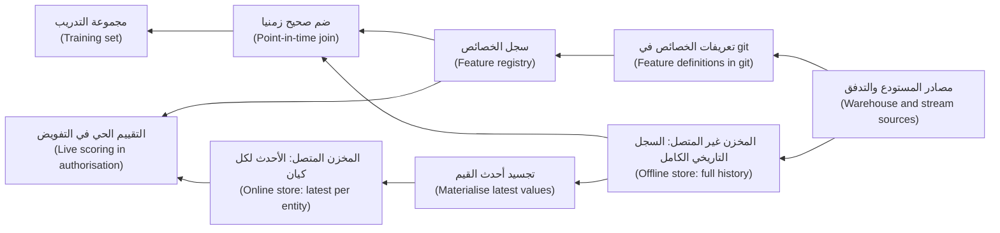
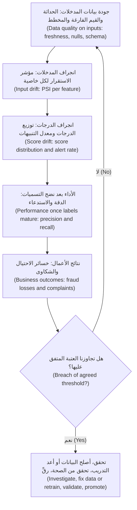
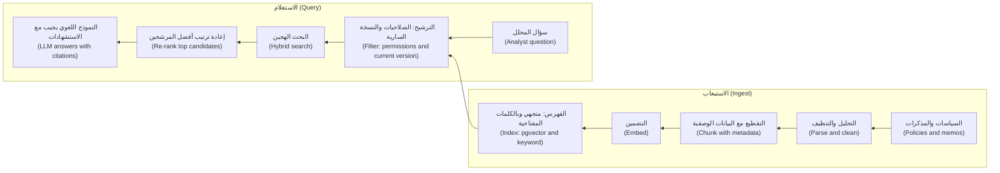

# الوحدة 5 — علم البيانات وتعلّم الآلة في بيئة الإنتاج

*لا يكون النموذج أفضل من خط البيانات الذي يغذّيه، ومعظم إخفاقات تعلّم الآلة في الإنتاج هي في حقيقتها إخفاقات بيانات متنكّرة: خاصية (feature) اختلست النظر إلى المستقبل بصمت، ومجموعة تدريب (training set) لا يستطيع أحد إعادة بنائها، ومُدخل تغيّر معناه في المنبع (upstream)، وفهرس مستندات لا يزال يقدّم سياسة العام الماضي. تتعامل هذه الوحدة مع علم البيانات (data science) وتعلّم الآلة (machine learning) بوصفهما مشكلات هندسة بيانات. تبدأ بالطريق من دفتر ملاحظات (notebook) واعد إلى خط تدريب قابل للتكرار: خصائص صحيحة زمنيًا (point-in-time-correct features)، وتقسيمات نزيهة، وتشغيلات قابلة لإعادة الإنتاج، ومخازن الخصائص (feature stores). ثم تتناول كيف تحكم على النموذج قبل الإطلاق وكيف تراقبه بعد الإطلاق، من الدقة (precision) والاستدعاء (recall) إلى إحصاءات الانجراف والتسميات المتأخرة. وتنتهي بجانب البيانات في تطبيقات النماذج اللغوية الكبيرة (LLM applications): تحويل المستندات إلى مقاطع (chunks) وتضمينات (embeddings) وفهرس قابل للبحث، وإثبات أن الاسترجاع (retrieval) يعمل بالأرقام. ستتابع فريق منصة البيانات في بنك نجم (Najm Bank) بينما ينهار دفتر هدى البارع لكشف الاحتيال في الإنتاج، وينجرف نموذج التنبيهات الذكية (Smart Alerts) الذي تعمل عليه دانة بينما تبدو دقته الإجمالية (accuracy) مثالية، ويقتبس مساعد مذكرات الائتمان (Credit Memo Copilot) سياسةً استُبدلت قبل أشهر.*

> **المراحل:** Transform, Serve, Operate — بناء البيانات التي تقف خلف النماذج وتطبيقات النماذج اللغوية الكبيرة بحيث تكون صحيحة وقت التنبؤ، وقابلة لإعادة الإنتاج عند الطلب، ومراقَبة بعد الإطلاق.

---

# 5.1 — من دفتر الملاحظات إلى خط البيانات: الخصائص والتدريب وقابلية إعادة الإنتاج ومخازن الخصائص
*المستوى: 🟡 متوسط* · *المتطلبات: 1.2، 2.2، 3.1* · *المرحلة: Transform, Serve*

**بعد هذا الدرس تستطيع** تبني خاصية صحيحة عند نقطة زمنية تتجنّب تسرّب التسمية، ونصًا برمجيًا للتدريب يسجّل تشغيلان له من الإيداع والبيانات نفسيهما مقاييس متطابقة. *مدة الدراسة: نحو 120 دقيقة (تقدير).*

## ⚡ الدرس في دقيقة
- يتعلّم النموذج من **أمثلة التدريب (training examples)**: صفوف تقرن **الخصائص (features)** (مُدخلات معروفة وقت التنبؤ) مع **التسمية** (النتيجة المطلوب التنبؤ بها). وبناء هذه الصفوف هو هندسة بيانات (data engineering).
- القاعدة الأهم هي **الصحة الزمنية (point-in-time correctness)**: يجب أن تستخدم كل خاصية البيانات التي كانت موجودة لحظة إجراء التنبؤ فقط. اخرقها فتحصل على **تسرّب البيانات (data leakage)**، أي نموذج يبدو بارعًا دون اتصال (offline) ويفشل في الإنتاج.
- للنماذج التي تتنبأ بالمستقبل، مثل الاحتيال والائتمان، قسّم البيانات حسب **الزمن**، لا عشوائيًا.
- يكون التشغيل **قابلًا لإعادة الإنتاج (reproducible)** عندما تُسجَّل نسخة الشيفرة ولقطة البيانات (data snapshot) والإعدادات والبيئة، في **MLflow** مثلًا.
- **مخزن الخصائص (feature store)** (وFeast هو المثال مفتوح المصدر) يعرّف كل خاصية مرة واحدة ويقدّم السجل التاريخي للتدريب والقيم الحديثة للتقييم الحي، فيعالج **انحراف التدريب عن التقديم (training-serving skew)**. اعتمده عندما تكون الخصائص مشتركة أو مطلوبة بشكل حي.
- أكبر فخ: خصائص محسوبة من جداول اليوم، مثل الرصيد الحالي للعميل أو إجمالي الاعتراضات على المعاملات، ثم تُضمّ إلى معاملات العام الماضي.

## 🧭 لماذا يهم
أول مشروع كبير لهدى هو نسخة جديدة من **التنبيهات الذكية (Smart Alerts)**، نموذج كشف احتيال البطاقات في بنك نجم. يحقق دفترها نتائج أفضل بكثير دون اتصال من نموذج الإنتاج، وتبتهج دانة، كبيرة علماء البيانات، إلى أن تقرأ قائمة الخصائص. فالخاصية `customer_chargeback_count` محسوبة من جدول `chargebacks` بكامله، والاعتراض على المعاملة (chargeback) يُقدَّم *بعد* وقوع الاحتيال، وغالبًا بعد أسابيع، فالخاصية "تعرف" الإجابة مسبقًا. أما `account_age_days` فمقيسة حتى اليوم، لا حتى تاريخ المعاملة. لقد تعلّم النموذج قراءة المستقبل، وهو ما لا يتيحه الإنتاج.

بعد شهر، تطلب جهة التحقق من النماذج إعادة بناء نموذج التنبيهات الذكية للعام الماضي. لا أحد يستطيع: فقد عُدِّل الدفتر، وتُستبدل جداول التهيئة (staging tables) كل ليلة، وحُدِّثت المكتبات. ويلخّص فيصل، رئيس منصة البيانات، الأمر: "النموذج الذي لا نستطيع إعادة بنائه هو نموذج لا نستطيع الدفاع عنه. ونقله من الدفتر إلى خط البيانات مهمتنا نحن أيضًا."

## 📐 كيف يعمل

### 🟢 الأساسيات

**المفردات (The vocabulary).** **النموذج** دالة متعلَّمة من الأمثلة. يصف كل **مثال تدريب (training example)** **كيانًا (entity)** واحدًا (معاملة بطاقة، أو عميل، أو طلب قرض) عند **وقت تنبؤ** واحد (اللحظة التي سيُسأل فيها النموذج)، مع **الخصائص (features)** مُدخلاتٍ و**التسمية** إجابةً. وهذه هي **حُبَيبية (grain)** مجموعة التدريب (1.2)، مثل صف واحد لكل معاملة وقت التفويض. اكتبها قبل كتابة SQL.

**مجموعات التدريب والتحقق والاختبار (Train, validation and test sets).** يتعلّم النموذج من **مجموعة التدريب (training set)**؛ وتقارن النماذج وتضبطها على **مجموعة التحقق (validation set)**؛ أما **مجموعة الاختبار (test set)** فتُستخدم مرة واحدة، في النهاية، لتقدير الأداء على بيانات جديدة. إن فحصتها أثناء الضبط لم تعد منصفة.

لكل ما يتنبأ بالمستقبل، قسّم حسب الزمن: درّب على الفترة من يناير إلى سبتمبر، وتحقق (validate) على أكتوبر ونوفمبر، واختبر على ديسمبر. أما التقسيم العشوائي (random split) فيسمح للنموذج بالتعلّم من معاملات جرت *بعد* المعاملات التي يُختبر عليها، مما يجمّل النتائج.

**تسرّب البيانات (Data leakage)** يعني دخول معلومات إلى التدريب لن تكون متاحة عندما يُجري النموذج تنبؤات حقيقية. ثلاثة أشكال شائعة:
- **تسرّب الهدف (Target leakage):** خاصية هي نتيجة للتسمية. فالخاصية `customer_chargeback_count` على امتداد الزمن كله، أو علامة "أُغلقت الحالة بوصفها احتيالًا"، تسرّبان التسمية.
- **التسرّب الزمني (Temporal leakage):** خاصية محسوبة ببيانات من بعد وقت التنبؤ، مثل رصيد اليوم أو `account_age_days` المقيسة حتى اليوم.
- **التلوّث بين التقسيمات:** معالجة مسبقة (preprocessing) مُوائَمة على كل البيانات (التحجيم (scaling)، وملء القيم المفقودة، وترميز الفئات) قبل التقسيم، أو وجود صفوف شبه متطابقة للعميل نفسه في مجموعتي التدريب والاختبار معًا.

العلامة الكاشفة هي نتيجة أفضل من أن تُصدَّق.

**الصحة الزمنية في SQL (Point-in-time correctness in SQL).** يجب حساب كل خاصية "اعتبارًا من" وقت التنبؤ لصفّها. إليك الطريقة الخاطئة والطريقة الصحيحة لعدّ معاملات البطاقة في الساعات الأربع والعشرين الماضية، في DuckDB أو PostgreSQL:

```sql
-- WRONG: counts the card's transactions on the whole day,
-- including ones that happened AFTER this transaction
SELECT t.txn_id,
       COUNT(*) OVER (PARTITION BY t.card_id, CAST(t.txn_ts AS DATE)) AS txns_today
FROM card_txn t;

-- RIGHT: only transactions strictly before this one, in the past 24 hours
SELECT t.txn_id,
       COUNT(*) OVER (
         PARTITION BY t.card_id
         ORDER BY t.txn_ts
         RANGE BETWEEN INTERVAL '24 hours' PRECEDING
                   AND INTERVAL '1 microsecond' PRECEDING  -- ends just before this row
       ) AS txns_prev_24h
FROM card_txn t;
```

الانتهاء عند `CURRENT ROW` ثم طرح 1 يبدو مكافئًا لكنه لا يزال يعدّ المعاملات ذات الطابع الزمني نفسه.

للخصائص المأخوذة من جداول تتغيّر ببطء، مثل شريحة المخاطر للعميل، استخدم النسخة التي كانت سارية وقت التنبؤ. وهذا بالضبط ما يمنحك إياه البُعد المتغيّر ببطء من النوع 2 (Type 2 slowly changing dimension) (1.2):

```sql
SELECT t.txn_id, c.risk_segment
FROM card_txn t
JOIN dim_customer_scd2 c
  ON  c.customer_id = t.customer_id
  AND t.txn_ts >= c.valid_from
  AND t.txn_ts <  COALESCE(c.valid_to, TIMESTAMP '9999-12-31');
```

أما الضمّ إلى جدول العملاء *الحالي* فسيمنح كل معاملة من 2024 شريحة مخاطر العميل في 2026؛ والفرق التي لا تملك إلا جداول الحالة الراهنة لا تستطيع بناء مجموعات تدريب نزيهة.

**التسميات تحتاج إلى تعريف ونافذة نضج.** في نجم، "الاحتيال" يعني اعتراضًا على معاملة برمز سبب احتيال، أو حالة أكّدها قسم التحقيقات. وكلاهما يصل بعد أسابيع، لذا فالبيانات الحديثة تسمياتها ناقصة. اتفق مع الجهة المعنية في العمل على **نافذة نضج التسمية** (يستخدم نجم 60 يومًا؛ للتوضيح) واستبعد الأسابيع غير الناضجة.

### 🟡 التعمق أكثر

**من دفتر الملاحظات إلى خط البيانات.** الدفتر مناسب للاستكشاف وضعيف لنموذج يعتمد عليه البنك: تُشغَّل الخلايا بغير ترتيب، والبيانات هي كل ما يحويه الجدول اليوم، والنتائج تعيش على حاسوب محمول واحد. والانتقال إلى خط البيانات (pipeline) هو في معظمه إعادة هيكلة (refactoring):

1. انقل SQL الخاص بالخصائص إلى نماذج dbt مختبَرة (3.1)، تُراجَع كأي جدول عرض (mart) آخر.
2. حوّل خطوات الدفتر إلى دوال: `build_training_set` و`train` و`evaluate` و`register`.
3. شغّلها بوصفها مهام منسِّق (2.2) في Airflow أو Dagster، مع نافذة البيانات معاملًا.
4. اجعل كل خطوة متساوية الأثر (idempotent): المُدخلات نفسها، المُخرج نفسه، يُكتب فوقه (overwritten) بدلًا من أن يتكرر (duplicated).
5. سجّل كل تشغيل في متتبّع التجارب وسجّل النماذج المعتمدة.

**قابلية إعادة الإنتاج أربعة أشياء تُسجَّل معًا**: **نسخة الشيفرة** (إيداع git)، و**لقطة البيانات (data snapshot)** (الصفوف المستخدمة بالضبط)، و**الإعدادات** (المعاملات الفائقة (hyperparameters)، وقائمة الخصائص، وتواريخ التقسيم (split dates)، والبذرة العشوائية)، و**البيئة** (نسخ المكتبات (library versions)، ويُفضَّل صورة حاوية). تنسى الفرق البيانات، مع أن الجداول تتغيّر كل ليلة. ثبّتها بمعرّف لقطة من خاصية السفر عبر الزمن (time travel) في Apache Iceberg أو Delta Lake (1.3)، أو بملف Parquet مؤرَّخ غير قابل للتغيير، أو بأداة مثل DVC. واتفق مع سارة، مسؤولة حماية البيانات (DPO)، على مدة الاحتفاظ بمجموعات التدريب، لأنها تحتوي على بيانات شخصية (personal data) (6.2).

**تتبّع التجارب باستخدام MLflow (Experiment tracking with MLflow).** يسجّل MLflow Tracking **التشغيلات**: المعاملات، والمقاييس (metrics)، والوسوم، والملفات المسمّاة **المُخرَجات (artefacts)**، مثل النموذج المدرَّب أو رسم بياني. خطوة تدريب دنيا:

```python
import mlflow
import mlflow.sklearn
from sklearn.pipeline import Pipeline
from sklearn.preprocessing import StandardScaler
from sklearn.linear_model import LogisticRegression
from sklearn.metrics import average_precision_score

def train(train_df, valid_df, features, cfg, snapshot_id, git_sha):
    mlflow.set_experiment("smart-alerts")
    with mlflow.start_run():
        mlflow.log_params(cfg)
        mlflow.set_tags({"data_snapshot": snapshot_id, "git_sha": git_sha,
                         "train_window": cfg["train_window"]})
        # Scaler and model in ONE pipeline: the scaler is fitted on training data only
        model = Pipeline([("scale", StandardScaler()),
                          ("clf", LogisticRegression(C=cfg["C"], max_iter=1000))])
        model.fit(train_df[features], train_df["is_fraud"])
        scores = model.predict_proba(valid_df[features])[:, 1]
        mlflow.log_metric("valid_pr_auc", average_precision_score(valid_df["is_fraud"], scores))
        mlflow.sklearn.log_model(model, "model")
```

المعالجة المسبقة داخل `Pipeline` من scikit-learn تُوائَم على صفوف التدريب فقط، فتسدّ تسرّب التلوّث، وتُشحن مع النموذج.

**سجلّ النماذج (model registry)** (ولدى MLflow واحد) يحفظ نماذج مسمّاة ومرقّمة النسخ مع نسبها (lineage) رجوعًا إلى التشغيل ولقطة البيانات والإيداع. فتصبح الترقية من "مرشّح " إلى "إنتاج " قرارًا مسجَّلًا بمعتمِد، لا ملفًا يُنسخ يدويًا. تستخدم إصدارات MLflow الحديثة لذلك أسماء مستعارة (aliases) مثل `champion`؛ أما القديمة فاستخدمت مراحل ثابتة، فراجع توثيق نسختك.

**انحراف التدريب عن التقديم (Training-serving skew)** يحدث عندما تُحسب خصائص الإنتاج بطريقة مختلفة عن خصائص التدريب. والسبب الكلاسيكي هو وجود تنفيذين، SQL في المستودع للتدريب ودالة في خدمة التفويض للتقديم، يتباعدان: أحدهما يعدّ المعاملات المرفوضة، والآخر لا يفعل. والعلاج تعريف واحد للاثنين.

**مخازن الخصائص (Feature stores).** مخزن الخصائص نظام يدير ذلك التعريف الواحد. مكوّناته:
- **سجلّ (registry)** لتعريفات الخصائص: الاسم، والكيان، والمصدر، والمالك، والوصف؛
- **مخزن غير متصل (offline store)** (المستودع أو ملفات Parquet) يحفظ السجل التاريخي، ويُستخدم لبناء مجموعات التدريب بـ**عمليات ضمّ صحيحة زمنيًا (point-in-time joins)**؛
- **مخزن متصل** (قاعدة بيانات سريعة من نوع مفتاح-قيمة مثل Redis، أو SQLite على حاسوب محمول) يحفظ أحدث قيمة لكل كيان، ويُستخدم للتنبؤات الحية خلال أجزاء من الثانية؛
- مهام **التجسيد (materialisation)** التي تنسخ القيم الحديثة من المخزن غير المتصل إلى المتصل.



في Feast تعلن الكيانات (entities) وعروض الخصائص (feature views) بلغة Python ثم تشغّل `feast apply`. يستدعي التدريب `store.get_historical_features(entity_df=..., features=[...])`، حيث يحمل `entity_df` مفاتيح الكيانات والطوابع الزمنية للأحداث (event timestamps)، فيحصل على القيم السارية عند كلٍّ منها. ويستدعي التقديم `store.get_online_features(...)` بالأسماء نفسها.

**هل تحتاج إلى واحد؟** فقط عندما تتشارك عدة نماذج الخصائص، أو يقيّم نموذجٌ بشكل حي ويحتاج إلى قيم حديثة، أو عندما يكون الانحراف (skew) قد لدغك بالفعل. أما لنموذج دفعي ليلي واحد، فجداول خصائص dbt مختبَرة وصحيحة زمنيًا كافية. التنبيهات الذكية تقيّم بشكل حي، فالمخزن يستحق كلفته؛ أما نموذج التسرّب من العملاء (churn model) في نجم فلا يحتاج إلى واحد بعد.

### 🔴 نظرة الخبير

**الخصائص المتدفقة (Streaming features).** خصائص "السرعة (velocity)" للاحتيال، مثل المعاملات على هذه البطاقة في الدقائق العشر الماضية، تأتي من تجميعات نافذية (windowed aggregations) على تدفق البطاقات (2.3). ويجب أن تطبّق إعادة البناء التاريخية قواعد وقت الحدث (event-time) والعلامة المائية (watermark) نفسها، وإلا عاد الانحراف.

**جودة التسميات رافعة أكبر من الخوارزميات.** تسميات الاحتيال متأخرة، وناقصة (الاحتيال غير المكتشف يُسمّى "سليمًا (genuine)")، ومتشكّلة بالنموذج الحالي، لأن المعاملات المحجوبة لا تصبح اعتراضات أبدًا (يعود الدرس 5.2 إلى هذا). اتفق على تعريف التسمية كتابةً مع عمليات الاحتيال (fraud operations) وعامِله بوصفه عقد بيانات (data contract) (3.2): إذا تغيّرت رموز الأسباب (reason codes)، تغيّرت التسمية.

**عدم توازن الفئات وأخذ العينات (Class imbalance and sampling).** تقليل عينات (Down-sampling) المعاملات السليمة يسرّع التدريب لكنه يُزيح الاحتمالات المتنبأ بها: سجّل النسبة وأعد المعايرة (re-calibrate). ولا تقلّل عينات مجموعة الاختبار أبدًا.

**إدارة مخاطر النماذج.** تعامل البنوك النماذج بوصفها خطرًا يجب حوكمته. والمرجع الكلاسيكي هو الإرشاد الإشرافي الأمريكي بشأن إدارة مخاطر النماذج، SR 11-7 (Federal Reserve, 2011)، الذي يصف التطوير والتوثيق السليمين، والتحقق المستقل والمراقبة المستمرة، إضافة إلى جرد للنماذج. كما تتوقع البنوك المركزية الخليجية من البنوك حوكمة نماذجها؛ اقرأ القواعد الحالية لجهتك الرقابية بدلًا من الاعتماد على الملخصات. بالنسبة إلى مهندس البيانات (data engineer): كل نموذج في الإنتاج يمكن إعادة بنائه، وبياناته قابلة للتتبّع عبر النسب (6.1)، ولتغييراته اعتماد مسجَّل. وللجانب الحوكمي، انظر [*حوكمة الذكاء الاصطناعي من الصفر إلى الاحتراف*، الدرس 9.1 — مصادر البيانات ونسبها وحقوق استخدامها](../aigp/index.ar.html#/9.1)، وبشأن التمثيلية (representativeness) والتحيّز (bias) في بيانات التدريب، [*حوكمة الذكاء الاصطناعي من الصفر إلى الاحتراف*، الدرس 9.2 — الجودة والتمثيلية والتحيّز ](../aigp/index.ar.html#/9.2).

**الخصائص بيانات شخصية.** خاصية "متوسط الإنفاق في الصيدليات" قد تكشف حقائق حساسة. صنّف الخصائص كأي عمود (6.2)، واستبعد السمات المحمية ما لم يوجد سبب موثّق وأساس قانوني، وافحص البدائل غير المباشرة (proxies).

## 🧰 الأدوات
| الأداة أو النمط أو المعيار | ما هو وماذا يفعل | متى تلجأ إليه |
|---|---|---|
| **Point-in-time join** — الضمّ الصحيح زمنيًا | يضمّ كل صف تدريب (training row) إلى قيم الخصائص السارية وقت تنبؤه | كل مجموعة تدريب لنموذج يتنبأ بالمستقبل |
| **Time-based split** — التقسيم الزمني | مجموعات التدريب والتحقق والاختبار مقطوعة حسب التاريخ، بهذا الترتيب | الاحتيال والائتمان والتسرّب (churn) وأي نموذج شبيه بالتوقّع |
| **scikit-learn Pipeline** — خط scikit-learn | يجمع المعالجة المسبقة والنموذج بحيث يُوائَم كلاهما على بيانات التدريب ويُشحنان معًا | كل نموذج scikit-learn؛ يمنع تسرّبات التلوّث |
| **MLflow** | تتبّع تجارب مفتوح المصدر، وتغليف النماذج وسجلّ النماذج | تسجيل كل تشغيل تدريب (training run) وترقية النماذج بسجلّ |
| **Model registry** — سجلّ النماذج | مخزن مرقّم النسخ للنماذج المعتمدة مرتبط بالتشغيل والبيانات والشيفرة | أي نموذج يخدم العملاء أو القرارات |
| **Feast** | مخزن خصائص مفتوح المصدر: سجلّ، ومخزن غير متصل، ومخزن متصل، واسترجاع صحيح زمنيًا (point-in-time retrieval) | عدة نماذج تتشارك الخصائص، أو التقييم الحي يحتاج إلى قيم حديثة |
| **Apache Iceberg** | صيغة جداول مفتوحة (open table format) مع لقطات (snapshots) وسفر عبر الزمن | تثبيت لقطة البيانات بالضبط خلف تشغيل تدريب |

## 🏛️ عمليًا في بنك نجم
تعيد هدى ودانة بناء التنبيهات الذكية الإصدار 4 (Smart Alerts v4) بوصفه خط بيانات في Dagster. ويجعل فيصل مُخرَجًا واحدًا إلزاميًا لكل نموذج: **بطاقة قابلية إعادة إنتاج النموذج**، المحفوظة في git بجانب خط البيانات والمرتبطة من مُدخل السجلّ.

**التنبيهات الذكية الإصدار 4: بطاقة قابلية إعادة إنتاج النموذج (Smart Alerts v4: model reproducibility card) (للتوضيح (illustrative))**

| الحقل | القيمة |
|---|---|
| النموذج والغرض | التنبيهات الذكية الإصدار 4 (Smart Alerts v4): تقييم تفويضات البطاقات من حيث خطر الاحتيال؛ والدرجات فوق العتبة المتفق عليها تذهب إلى طابور عمليات الاحتيال |
| الكيان والحُبَيبية ووقت التنبؤ | صف واحد لكل تفويض بطاقة، وقت التفويض |
| تعريف التسمية | اعتراض برمز سبب احتيال، أو حالة أكّدها قسم التحقيقات بوصفها احتيالًا؛ وإلا فهي سليمة |
| نضج التسمية | 60 يومًا بعد المعاملة؛ تُستبعد الصفوف الأحدث |
| التقسيم | التدريب: 12 شهرًا؛ التحقق (validation): الشهران التاليان؛ الاختبار: الشهر التالي؛ بلا خلط |
| الخصائص | 38 خاصية في عروض الخصائص `card_velocity` و`customer_profile` و`merchant_risk`؛ لكلٍّ منها مالك ونافذة (window) ومصدر في سجلّ Feast |
| مراجعة التسرّب | فُحصت كل خاصية: "هل هي معروفة وقت التفويض؟"؛ المراجِعة دانة، مع التاريخ (dated) |
| أخذ العينات (Sampling) | قُلّلت عينات المعاملات السليمة إلى 10% للتدريب؛ وأُعيدت معايرة الدرجات على مجموعة التحقق غير الممسوسة |
| لقطة البيانات | معرّفات لقطات Iceberg للجدولين `fct_card_txn` و`fct_fraud_label`، مسجَّلة وسومًا للتشغيل |
| الشيفرة والبيئة | إيداع git؛ بصمة صورة الحاوية |
| التشغيل والسجلّ | معرّف تشغيل MLflow؛ النموذج المسجَّل (registered model) `smart_alerts`، النسخة والاسم المستعار |
| البيانات الشخصية | رُوجع تصنيف الخصائص مع سارة (مسؤولة حماية البيانات)؛ لا سمات محمية؛ مدة الاحتفاظ بمجموعات التدريب متفق عليها |
| اختبار إعادة البناء | إعادة تشغيل خط البيانات من البطاقة تعيد إنتاج مقاييس التحقق ضمن تفاوت محدد؛ تاريخ آخر فحص |

يُبقي اختبار إعادة البناء البطاقة صادقة: كل ربع سنة تعيد هدى تشغيل خط البيانات من الإيداع واللقطة والصورة المسجَّلة. فإن فشل، فهذا يعني أن شيئًا لم يُسجَّل، ويكتشفون ذلك قبل أن تكتشفه مراجعة التحقق.

## 🛠️ التمارين
استخدم بيانات اصطناعية فقط: نصًا برمجيًا قصيرًا بلغة Python بمعرّفات بطاقات عشوائية وطوابع زمنية (timestamps) ونسبة احتيال صغيرة.

- 🟢 في DuckDB، ولّد 100,000 معاملة بطاقة اصطناعية على مدى ستة أشهر وجدول `chargebacks` مؤرَّخًا بعد كل احتيال بمدة من 5 إلى 50 يومًا. ابنِ خاصية متسرّبة واحدة (الاعتراضات لكل عميل على امتداد الزمن كله) وخاصية صحيحة زمنيًا واحدة (الاعتراضات المقدَّمة قبل المعاملة). *يكتمل عندما:* يُظهر استعلامٌ (query) صفَّ احتيال تكون فيه الخاصية المتسرّبة غير صفرية والصحيحة زمنيًا صفرًا، وتستطيع أن تشرح لماذا لا تصلح للاستخدام إلا الثانية.
- 🟡 حوّل دفترًا يدرّب نموذج scikit-learn على تلك البيانات إلى نص برمجي فيه الدوال `build_training_set` و`train` و`evaluate`، وتقسيم زمني (time-based split)، و`Pipeline`، وتسجيل MLflow للمعاملات والمقاييس وإيداع git وبصمة ملف البيانات. *يكتمل عندما:* يعطي تشغيلان من الإيداع نفسه والبيانات نفسها مقاييس متطابقة في واجهة MLflow.
- 🔴 شغّل Feast محليًا بمخزن غير متصل من ملفات ومخزن متصل SQLite. عرّف كيان `card` وعرض خصائص بخاصيتي سرعة؛ استرجع مجموعة تدريب، وجسّد (materialise)، واجلب الخصائص المتصلة. *يكتمل عندما:* تتطابق القيم المتصلة والتاريخية لبطاقة واحدة عند أحدث طابع زمني، ويعيد طابع زمني أقدم قيمًا أقدم.

## ⚠️ أخطاء وفخاخ
- **ضمّ حالة اليوم إلى السجل التاريخي.** الأرصدة الحالية والشرائح والأعداد على امتداد الزمن كله تسرّب المستقبل. استخدم أبعاد SCD2 (SCD2 dimensions) أو اللقطات أو النوافذ المحدودة زمنيًا (time-bounded windows).
- **التقسيمات العشوائية للمشكلات المعتمدة على الزمن.** تسمح للنموذج بالتدريب على المستقبل. قسّم حسب الزمن واترك فجوة للتسميات غير الناضجة.
- **مواءمة المعالجة المسبقة قبل التقسيم.** أدوات التحجيم (scalers) والمرمِّزات (encoders) المُوائَمة على كل البيانات تسرّب معلومات الاختبار. ضعها داخل خط النموذج.
- **"قابل لإعادة الإنتاج" من دون البيانات.** إيداع git وحده لا يستطيع إعادة بناء نموذج حين تكون الجداول قد تغيّرت. سجّل معرّف لقطة أو ملف تدريب غير قابل للتغيير.
- **تنفيذان للخاصية نفسها.** يتباعد SQL التدريب وشيفرة التقديم. عرّف كل خاصية مرة واحدة وقدّمها بالطريقتين.

## 🧾 الخلاصة
- تحتاج أمثلة التدريب إلى حُبَيبية مكتوبة، ووقت تنبؤ، وتعريف للتسمية مع نافذة نضج.
- يجب أن تكون كل خاصية صحيحة زمنيًا (point-in-time correct)؛ ويظهر التسرّب (leakage) في صورة نتائج أفضل من أن تُصدَّق.
- قسّم حسب الزمن لكل ما يتنبأ بالمستقبل، وأبقِ مجموعة الاختبار دون مساس حتى النهاية.
- قابلية إعادة الإنتاج (Reproducibility) هي الشيفرة ولقطة البيانات والإعدادات والبيئة، مسجَّلة معًا ومُثبَتة بإعادة البناء.
- تمنح مخازن الخصائص تعريفًا واحدًا بمساري وصول غير متصل ومتصل؛ اعتمد واحدًا حين تبرّره الخصائص المشتركة أو الحية.

## ✍️ اختبر نفسك

**1. يحقق نموذج الاحتيال الجديد لهدى نتائج أفضل بكثير دون اتصال (offline) من نموذج الإنتاج. إحدى الخصائص هي إجمالي عدد اعتراضات الاحتيال للعميل، محسوبًا على جدول الاعتراضات بكامله. ما التفسير الأرجح؟**

- A. الخوارزمية الجديدة تلتقط تفاعلات بين الخصائص فاتت النموذج القديم
- B. التسرّب: الاعتراضات تلي الاحتيال، لذا تحمل الخاصية التسمية نفسها
- C. مجموعة الاختبار صغيرة جدًا، فعيّنة محظوظة ضخّمت النتيجة
- D. النموذج يعاني من نقص المواءمة لبيانات التدريب

<details><summary>الإجابة</summary>

**B.** الاعتراضات (Chargebacks) نتائج للاحتيال وتصل لاحقًا، لذا فالعدّ على امتداد الزمن كله يكشف الإجابة: تسرّب الهدف والتسرّب الزمني معًا. الخيار A هو القراءة المغرية لنتيجة رائعة، لكن قفزة بهذا الحجم إشارة للبحث عن التسرّب أولًا. (🟢 الأساسيات.)

</details>

**2. يتنبأ نموذج التسرّب من العملاء (churn model) في نجم بالعملاء الذين سيغلقون حساباتهم في الربع القادم. كيف ينبغي للفريق تقسيم البيانات؟**

- A. عشوائيًا، بنسبة 70/15/15، مع الخلط بحيث تُمثَّل كل فترة في كل مجموعة من المجموعات
- B. حسب معرّف العميل، بحيث لا يظهر أي عميل في مجموعتين
- C. عشوائيًا، خمس مرات ببذور مختلفة، مع حساب متوسط النتائج
- D. حسب الزمن: درّب على الأقدم واختبر على الأحدث، دون التسميات غير الناضجة

<details><summary>الإجابة</summary>

**D.** النموذج يتنبأ بالمستقبل، لذا يجب أن يعكس التقسيم ذلك. التقسيمات العشوائية (Random splits)، كما في A وC، تسمح له بالتعلّم من فترات لاحقة. أما B فيمنع نوعًا واحدًا من التلوّث لكنه لا يزال يخلط الزمن. (🟢 الأساسيات.)

</details>

**3. تطلب جهة التحقق من النماذج من الفريق إعادة بناء نموذج التنبيهات الذكية للعام الماضي. إيداع git معروف، لكن جداول التهيئة (staging tables) استُبدلت مرات عديدة منذ ذلك الحين. ما الذي كان ناقصًا في سجلّ التشغيل؟**

- A. لقطة بيانات مثبّتة، مثل معرّف لقطة Iceberg في الكتالوج
- B. حجم العنقود ونوع المثيل المستخدمان في التدريب
- C. تصدير PDF للدفتر مع مُخرَجات خلاياه
- D. المعاملات الفائقة والبذرة العشوائية، ولا شيء غيرهما

<details><summary>الإجابة</summary>

**A.** تحتاج قابلية إعادة الإنتاج (Reproducibility) إلى الشيفرة والبيانات والإعدادات والبيئة؛ ومن دون البيانات بالضبط، تنتج الشيفرة نفسها نموذجًا مختلفًا. الخيار D جزء من الإعدادات، لكنه وحده لا يعيد بناء شيء. (🟡 التعمق أكثر.)

</details>

**4. أدّى نموذج الاحتيال أداءً جيدًا دون اتصال (offline)، لكن درجاته تبدو غريبة في الإنتاج. يجد الفريق أن SQL المستودع يعدّ المعاملات المرفوضة في خاصية سرعة بينما لا تفعل خدمة التفويض ذلك. ما اسم هذا، وما العلاج البنيوي؟**

- A. انجراف المفهوم؛ أعد التدريب كل شهر على أحدث المعاملات المسمّاة
- B. نقص المواءمة؛ أضف مزيدًا من الخصائص واستخدم نموذجًا أكثر مرونة
- C. انحراف التدريب عن التقديم؛ تعريف واحد مشترك للخاصية، في مخزن خصائص مثلًا
- D. عدم توازن الفئات؛ قلّل عينات المعاملات السليمة وأعد المعايرة

<details><summary>الإجابة</summary>

**C.** تباعد تنفيذان لخاصية واحدة. وإعادة التدريب (Retraining)، كما في A، لن تفيد، لأن مساري الشيفرة لا يزالان مختلفين. (🟡 التعمق أكثر.)

</details>

**5. يريد فريق كريم نموذج ميل يقيّم جميع العملاء في تشغيل دفعي ليلي واحد من المستودع. تقترح هدى نشر مخزن خصائص (feature store) أولًا. ماذا ينبغي أن يقول فيصل؟**

- A. نعم: المخزن من اليوم الأول يتجنّب ترحيلًا مؤلمًا لاحقًا
- B. ليس بعد: جداول dbt الصحيحة زمنيًا تكفي حتى تصبح الخصائص مشتركة أو حية
- C. لا، لأن مخازن الخصائص لا تعمل إلا مع البيانات المتدفقة
- D. نعم، لأن مخزن الخصائص يدير تعريف التسمية نيابة عنك أيضًا

<details><summary>الإجابة</summary>

**B.** النموذج الدفعي الواحد تخدمه جيدًا جداول dbt مختبَرة وصحيحة زمنيًا؛ والمخزن يستحق كلفته مع الخصائص المشتركة (shared features) أو التقديم الحي (live serving) أو الانحراف المُثبَت (proven skew). C خاطئ: المخازن تخدم التدريب الدفعي (batch training) أيضًا. D خاطئ: لا أداة تعرّف تسمياتك. (🟡 التعمق أكثر.)

</details>

## 📚 المراجع
- توثيق MLflow — https://mlflow.org/docs/latest/index.html
- توثيق Feast — https://docs.feast.dev/
- دليل مستخدم scikit-learn: الخطوط والمقدِّرات المركّبة؛ المزالق الشائعة والممارسات الموصى بها — https://scikit-learn.org/stable/user_guide.html
- توثيق Apache Iceberg — https://iceberg.apache.org/docs/latest/
- توثيق DVC — https://dvc.org/doc
- توثيق DuckDB: دوال النوافذ — https://duckdb.org/docs/
- مجلس محافظي نظام الاحتياطي الفيدرالي، SR 11-7: الإرشاد الإشرافي بشأن إدارة مخاطر النماذج (2011) — https://www.federalreserve.gov/supervisionreg.htm
- D. Sculley وآخرون، "Hidden Technical Debt in Machine Learning Systems" (الدَّين التقني الخفي في أنظمة تعلّم الآلة)، NeurIPS 2015
- Ralph Kimball وMargy Ross، *The Data Warehouse Toolkit* (الأبعاد المتغيّرة ببطء)

---

# 5.2 — تقييم النماذج ومراقبة الانجراف (أساسيات MLOps)
*المستوى: 🟡 متوسط* · *المتطلبات: 4.3، 5.1* · *المرحلة: Operate, Analyse*

**بعد هذا الدرس تستطيع** تختار عتبة لنموذج احتيال وتبرّرها من الدقة والاستدعاء وطاقة المراجعة، وتبني تقرير PSI يَسِم خاصية منزاحة وأخرى معطوبة، وتقول أيهما انجراف حقيقي وأيهما عطل بيانات في المنبع. *مدة الدراسة: نحو 120 دقيقة (تقدير).*

## ⚡ الدرس في دقيقة
- احكم على النموذج بالقرار الذي يقوده. في الأحداث النادرة مثل الاحتيال، تضلّل **الدقة الإجمالية (accuracy)**؛ استخدم **الدقة (precision)** (كم من التنبيهات حقيقي)، و**الاستدعاء (recall)** (كم من الاحتيال يُلتقط)، و**منحنى الدقة والاستدعاء**.
- يُخرج النموذج درجة؛ والجهة المعنية في العمل تختار **العتبة**. اخترها من كلفة الإخفاقات والإنذارات الكاذبة ومن طاقة فريق المراجعة، لا من القيمة الافتراضية 0.5.
- قيّم على مجموعة اختبار خارج الفترة الزمنية، ثم حسب **الشريحة** (القناة (channel)، والدولة، وشريحة العملاء)، ثم بشكل حي في **وضع الظل (shadow mode)** أو بمقارنة **البطل والمنافس (champion–challenger)** قبل أن يقرّر أي شيء.
- بعد الإطلاق، تتدهور النماذج. **انجراف البيانات (Data drift)** تغيّر في المُدخلات؛ و**انجراف المفهوم (concept drift)** تغيّر في العلاقة بين المُدخلات والنتيجة. راقب جودة البيانات (data quality)، وانجراف المُدخلات، وانجراف الدرجات، والأداء الحقيقي حين تصل التسميات، ونتائج الأعمال.
- **مؤشر استقرار المجتمع (Population Stability Index, PSI)** إحصاء انجراف شائع في القطاع المصرفي. وعتباته أعراف لا قوانين.
- أكبر فخ: مراقبة المقاييس التي تستطيع حسابها اليوم فقط، بينما التسميات التي تكشف الحقيقة تصل بعد أسابيع.

## 🧭 لماذا يهم
تعرض هدى نموذج التنبيهات الذكية الإصدار 4 المعاد بناؤه (rebuilt Smart Alerts v4) على لجنة المخاطر بعنوان رئيسي واحد: "دقة إجمالية 99.9% (99.9% accuracy)". توقفها دانة قبل الشريحة الثانية. الاحتيال نادر. فإن كانت، لنقل، معاملة واحدة من كل ألف احتيالية، فإن "نموذجًا" يصف كل شيء بأنه سليم يحقق دقة إجمالية 99.9% ولا يلتقط شيئًا. اللجنة لا تحتاج إلى الدقة الإجمالية؛ بل تحتاج إلى معرفة كم من الاحتيال يلتقط النموذج، وكم من العملاء السليمين يُزعَجون، وهل يستطيع فريق عمليات الاحتيال التعامل مع حجم التنبيهات.

بعد ستة أشهر من التشغيل، يلاحظ كريم أن حجم التنبيهات مستقر لكن نسبة التنبيهات المؤكَّدة احتيالًا انخفضت. تغيّر أمران. بدأ إصدار من تطبيق نجم للهاتف (Najm Mobile) يرسل حقل الجهاز بصيغة جديدة، فصارت الخاصية `new_device` صحيحة دائمًا تقريبًا: تغيّر بيانات في المنبع. وانتقل المحتالون إلى نمط احتيال جديد لم يره النموذج في التدريب قط: تغيّر معنى المُدخلات. لم يتعطل شيء، ومع ذلك كانت المشكلتان ظاهرتين في البيانات قبل أسابيع من ظهور خسائر الاحتيال.

## 📐 كيف يعمل

### 🟢 الأساسيات

**مصفوفة الالتباس (The confusion matrix).** في نموذج نعم/لا بعتبة مختارة، يقع كل تنبؤ في إحدى أربع خانات:

| | احتيال فعلًا | سليم فعلًا |
|---|---|---|
| **صدر تنبيه (Alerted)** | إيجابي صحيح | إيجابي كاذب: عميل سليم أُزعِج |
| **لم يصدر تنبيه (Not alerted)** | سلبي كاذب: احتيال فائت | سلبي صحيح |

ومنها تأتي المقاييس المهمة للأحداث النادرة:
- **الدقة (Precision)** = TP /: من بين التنبيهات، كم كان احتيالًا. الدقة المنخفضة تهدر وقت المحللين وتزعج العملاء.
- **الاستدعاء (Recall)** = TP /: من بين الاحتيال، كم التُقط. الاستدعاء المنخفض يعني خسائر.
- **F1** هو الوسط التوافقي (harmonic mean) للاثنين، مفيد بوصفه رقمًا واحدًا لكنه أعمى عن أيّ الخطأين أكثر كلفة.

**الدرجات والعتبات والمنحنيات.** تُخرج معظم النماذج درجة بين 0 و1. رفع العتبة يعطي تنبيهات أقل، ودقة أعلى، واستدعاءً أدنى. يُظهر **منحنى الدقة والاستدعاء** هذه المقايضة عبر جميع العتبات؛ والمساحة تحته (**PR-AUC**، أو متوسط الدقة) تلخّصها. أما **ROC-AUC** فشائع لكنه قد يبدو ممتازًا على بيانات شديدة عدم التوازن بينما الدقة ضعيفة، لأن العدد الهائل من السلبيات الصحيحة (true negatives) يهيمن على معدل الإيجابيات الكاذبة (false-positive rate) فيه. في الاحتيال، اقرأ PR-AUC والدقة والاستدعاء عند عتبة التشغيل الفعلية.

```python
import numpy as np
from sklearn.metrics import precision_recall_curve, average_precision_score

y, scores = np.asarray(y_test, dtype=bool), np.asarray(scores)
print("PR-AUC:", average_precision_score(y, scores))
precision, recall, thresholds = precision_recall_curve(y, scores)   # for the chart

# Choose the threshold from costs (illustrative numbers agreed with fraud operations)
COST_MISSED_FRAUD, COST_REVIEW = 1500, 25
def total_cost(t):
    alerted = scores >= t
    missed = np.sum(y & ~alerted)                 # false negatives
    return missed * COST_MISSED_FRAUD + alerted.sum() * COST_REVIEW

grid = np.linspace(0.01, 0.99, 99)                # a grid is enough, and fast
best = min(grid, key=total_cost)
```

ثم افحص الطاقة الاستيعابية: إذا أنتجت العتبة الأرخص تنبيهات يومية أكثر مما يستطيع فريق الاحتيال مراجعته، فالخيار بين التوظيف، أو عتبة أعلى، أو قاعدة مرحلة ثانية. هذا قرار أعمال؛ ومهمتك أن تعرض المنحنى وكلفة كل خيار.

**قارن بخط أساس (Compare against a baseline).** يجب أن يتفوّق النموذج الجديد على نموذج الإنتاج الحالي، أو على القواعد التي استخدمها نجم من قبل. عبارة "PR-AUC قيمته X" لا تعني شيئًا وحدها؛ أما "يلتقط احتيالًا أكثر من الإصدار 3 عند حجم التنبيهات نفسه " فتعني.

**قسّم النتائج إلى شرائح.** قد يخفي رقم إجمالي شريحة يفشل فيها النموذج، كما تخفي المتوسطات مفارقة سيمبسون (Simpson's paradox) (4.3). أبلغ عن الدقة والاستدعاء حسب القناة (داخل المتجر (in-store)، وعبر الإنترنت)، وحسب الدولة (قطر، والإمارات، والاتحاد الأوروبي)، وحسب شريحة العملاء. يجب أن يُعرف النموذج الذي يعمل لعملاء التجزئة لكنه يفوّت معظم احتيال بطاقات المنشآت الصغيرة والمتوسطة قبل الإطلاق، لا بعده.

### 🟡 التعمق أكثر

**المعايرة (Calibration).** يكون النموذج **معايَرًا (calibrated)** حين تكون نحو 20% من المعاملات التي حصلت على الدرجة 0.2 احتيالًا. ويهمّ ذلك حين يقرأ الناس الدرجات بوصفها احتمالات أو حين تغذّي الدرجات حسابات أخرى، مثل الخسارة المتوقعة في مخاطر الائتمان. افحصها بمنحنى الموثوقية (reliability curve) (المعدلات المتنبأ بها مقابل المرصودة حسب نطاق الدرجات) وبدرجة Brier (Brier score)؛ وأصلحها بـ `CalibratedClassifierCV` من scikit-learn أو بإعادة المواءمة على مجموعة التحقق. تقليل العينات في التدريب (5.1) يُفسد المعايرة ما لم تصحّحه.

**التقييم الحي قبل الثقة.** الاختبارات دون اتصال تستخدم الماضي. قبل أن يقرّر النموذج أي شيء، اختبره على حركة حية:
- **وضع الظل (Shadow mode)**: يقيّم النموذج الجديد معاملات حقيقية إلى جانب نموذج الإنتاج، لكن درجاته تذهب إلى السجلات فقط. تقارن أحجام التنبيهات، والتداخلات، والأداء حين تنضج التسميات. لا يتأثر أي عميل.
- **البطل والمنافس (Champion–challenger)**: يتولى النموذج الحالي (البطل) معظم الحركة ويتولى المنافس (challenger) حصة مضبوطة؛ ولا ترقّي المنافس إلا إذا فاز على المقاييس المتفق عليها. هذه تجربة، فتنطبق قواعد الدرس 4.3: وزّع عشوائيًا بشكل سليم، وثبّت حجم العينة ومقياس النجاح مسبقًا، وأضف مقاييس حماية (guardrail metrics) مثل شكاوى العملاء، ولا تتوقف مبكرًا لأن الأسبوع الأول يبدو جيدًا.

للتقييم الحي على مستوى المنتج، انظر [*إدارة منتجات الذكاء الاصطناعي من الصفر إلى الاحتراف*، الدرس 6.3 — التقييم الحي: التجارب واختبارات A/B والإطلاقات المرحلية](../aipm/index.ar.html#/6.3).

**لماذا تتدهور النماذج: أنواع الانجراف.**
- **انجراف البيانات (Data drift)** (ويُسمّى أيضًا إزاحة المتغيرات المصاحبة): يتغيّر توزيع المُدخلات. مزيد من المعاملات عبر الإنترنت، أو فئة تجار جديدة، أو موسم عطلات.
- **انجراف التسمية أو الانجراف المسبق**: تتغيّر نسبة الحالات الإيجابية، مثل موجة احتيال.
- **انجراف المفهوم (Concept drift)**: تتغيّر العلاقة بين المُدخلات والنتيجة. احتيال جديد يجعل معاملات كانت تبدو آمنة خطرةً الآن.
- **أعطال البيانات في المنبع**: ليست تغيّرًا في العالم الحقيقي على الإطلاق، بل تغيير في خط البيانات أو المخطط، مثل صيغة حقل الجهاز. وهي متكررة عمليًا وأسهل ما يُلتقط، بفحوص جودة البيانات من الدرس 3.2 على مُدخلات النموذج.

**ما الذي تراقبه، على طبقات.**



الطبقات العليا متاحة يوميًا؛ أما الدنيا فتصل لاحقًا لكنها تقول الحقيقة. راقبها جميعًا.

**مؤشر استقرار المجتمع (The Population Stability Index).** يقارن PSI توزيع خاصية (أو درجة) الآن بخط أساس، هو عادةً بيانات التدريب. قسّم خط الأساس إلى صناديق (bins)، غالبًا عشرة حسب العُشيرات، وقارن في كل صندوق بين الحصة المتوقعة *e* والحصة الفعلية *a*:

PSI = Σ × ln

```python
import numpy as np

def psi(baseline, current, bins=10, eps=1e-6):
    edges = np.unique(np.quantile(baseline, np.linspace(0, 1, bins + 1)))
    e = np.histogram(baseline, edges)[0] / len(baseline)
    # values outside the baseline range go into the end bins
    a = np.histogram(np.clip(current, edges[0], edges[-1]), edges)[0] / len(current)
    e, a = np.clip(e, eps, None), np.clip(a, eps, None)
    return float(np.sum((a - e) * np.log(a / e)))
```

هذه النسخة للخصائص الرقمية والدرجات. أما للخاصية الفئوية مثل `merchant_category`، فكل فئة صندوق، مع صندوق إضافي للفئات غير المرئية في خط الأساس.

القواعد التقريبية الشائعة الاستخدام في مخاطر الائتمان تقرأ PSI دون 0.1 بوصفه تغيّرًا طفيفًا، ومن 0.1 إلى 0.25 تغيّرًا معتدلًا يستحق نظرة، وفوق 0.25 إزاحة كبيرة. إنها أعراف لا معايير: اتفق على عتباتك الخاصة لكل نموذج وخاصية، وعايرها على السجل التاريخي. والاختبارات الإحصائية (Statistical tests) مثل كولموغوروف–سميرنوف (Kolmogorov–Smirnov) بديل، لكنها مع ملايين المعاملات تَسِم إزاحات ضئيلة وغير ضارة بأنها "دالّة (significant)"، فانظر إلى حجم التغيّر، لا إلى القيمة الاحتمالية (p-value) وحدها.

### 🔴 نظرة الخبير

**التسميات المتأخرة والمحجوبة.** تنضج تسميات الاحتيال على مدى أسابيع، لذا تبقى الدقة والاستدعاء الحقيقيان لهذا الأسبوع مجهولين حتى وقت لاحق. تتبّع في الأثناء **مقاييس بديلة (proxy metrics)**، مثل نسبة التنبيهات التي يؤكدها المحللون في اليوم نفسه، واملأ الأداء الحقيقي بأثر رجعي حسب أسبوع المعاملة مع نضج التسميات. وهناك مشكلة أسوأ: النموذج يغيّر تسمياته بنفسه. فالمعاملات التي يحجبها لا تصبح اعتراضات أبدًا، فلا تعرف أبدًا إن كانت احتيالًا. ومع الوقت، تعكس بيانات التدريب قرارات النموذج القديم. والعلاج الشائع عينة صغيرة مختارة عشوائيًا من المعاملات ذات الدرجات الأدنى تُرسل للمراجعة اليدوية، بالاتفاق مع عمليات الاحتيال والمخاطر، لتحتفظ برؤية غير متحيزة لما يفوّته النموذج.

**إعادة التدريب ليست علاجًا لكل شيء.** إعادة التدريب المجدولة (ربع سنوية مثلًا) بسيطة ومتوقعة؛ وإعادة التدريب المُطلَقة بحدث (حين يتجاوز الانجراف أو الأداء عتبة) تستجيب أسرع. وفي الحالتين، أعد التدريب عبر خط البيانات القابل لإعادة الإنتاج نفسه (5.1)، وتحقق منه مقابل البطل، ورقِّه عبر السجلّ باعتماد. ولا تُعِد التدريب تلقائيًا أبدًا على بيانات قد تكون هي نفسها معطوبة: إذا كان الانجراف ناجمًا عن خلل حقل الجهاز، فإعادة التدريب تعلّم النموذج الخلل. شخّص أولًا.

**إدارة مخاطر النماذج.** تشمل التوقعات الإشرافية للبنوك، وSR 11-7 هو المرجع الأمريكي الكلاسيكي، المراقبةَ المستمرة للنماذج قيد الاستخدام، وتحليل النتائج والتحقق المستقل قبل التغييرات الجوهرية. وتتوقع الجهات الرقابية الخليجية أيضًا حوكمة النماذج؛ راجع المتطلبات الحالية لجهتك الرقابية. عمليًا، يعني هذا أن لكل نموذج في الإنتاج خطة مراقبة مكتوبة بمالكين وعتبات، ومُدخلًا في الجرد، و**بطاقة نموذج (model card)**: وثيقة قصيرة عن الاستخدام المقصود، والبيانات، ونتائج التقييم حسب الشريحة، والحدود المعروفة. وأدلة المراقبة هي ما يعرضه البنك على جهته الإشرافية. وللمنظور الحوكمي، انظر [*حوكمة الذكاء الاصطناعي من الصفر إلى الاحتراف*، الدرس 10.2 — المراقبة والانجراف والحوادث](../aigp/index.ar.html#/10.2)؛ ولمنظور المنتج، [*إدارة منتجات الذكاء الاصطناعي من الصفر إلى الاحتراف*، الدرس 8.3 — المراقبة والانجراف وحلقة التحسين بعد الإطلاق](../aipm/index.ar.html#/8.3).

**فحوص الإنصاف شرائح ذات عواقب.** تحتاج نماذج الائتمان خصوصًا إلى فحوص لمعدلات الخطأ غير المتساوية بين المجموعات، ضمن البيانات التي يجوز للبنك استخدامها قانونًا؛ ويقرّر فريق حوكمة الذكاء الاصطناعي بقيادة ليلى ما هو مقبول.

## 🧰 الأدوات
| الأداة أو النمط أو المعيار | ما هو وماذا يفعل | متى تلجأ إليه |
|---|---|---|
| **Precision-recall curve** — منحنى الدقة والاستدعاء | الدقة والاستدعاء عبر جميع العتبات؛ ويُلخَّص بـ PR-AUC | تقييم أي نموذج لحدث نادر |
| **Cost-based threshold** — العتبة القائمة على الكلفة | عتبة تُختار لتقليل الكلفة المتوقعة، وتُفحص مقابل طاقة الفريق | تحويل الدرجة إلى قرار أعمال |
| **Shadow deployment** — النشر في وضع الظل | يقيّم النموذج الجديد الحركة الحية من دون التأثير في القرارات | قبل أن يُطلق أي نموذج أو يحلّ محل آخر |
| **Champion–challenger** — البطل والمنافس | مقارنة حية مضبوطة بين النموذج الحالي والمرشّح | ترقية نسخة نموذج جديدة بالأدلة |
| **Population Stability Index (PSI)** — مؤشر استقرار المجتمع | يقيس مدى ابتعاد التوزيع عن خط الأساس | فحوص يومية أو أسبوعية لانجراف المُدخلات والدرجات |
| **Evidently** (مفتوح المصدر) | مكتبة Python لتقارير انجراف البيانات وجودتها وأداء النموذج | بناء تقارير الانجراف وفحوصه من دون كتابة كل إحصاء بنفسك |
| **MLflow** | تتبّع تجارب مفتوح المصدر، وتغليف النماذج وسجلّ النماذج | تسجيل التقييمات وترقية النماذج بأثر اعتماد |
| **Model card** ⁦(Mitchell et al.)⁩ — بطاقة النموذج | وثيقة قياسية قصيرة عن استخدام النموذج وبياناته وتقييمه وحدوده | كل نموذج في الإنتاج؛ مراجعات التحقق والحوكمة |

## 🏛️ عمليًا في بنك نجم
تكتب دانة وهدى **خطة مراقبة التنبيهات الذكية (Smart Alerts monitoring plan)**، المعتمدة من جهة التحقق من النماذج والتي يراجعها فريق حوكمة الذكاء الاصطناعي بقيادة ليلى. العتبات خيارات داخلية لنجم، للتوضيح.

| الطبقة | الإشارة | التكرار | التنبيه عندما | المالك | الإجراء الأول |
|---|---|---|---|---|---|
| جودة البيانات | الحداثة (Freshness)، ونسبة القيم الفارغة، ومخطط (schema) الخصائص الـ38 المُدخلة | مع كل تحميل | فشل أي اختبار عقد | هدى | أوقف التقييم على بيانات قديمة؛ عُد إلى القواعد |
| انجراف المُدخلات | PSI لكل خاصية مقابل خط أساس التدريب (training baseline) | يوميًا | أي خاصية فوق 0.25، أو خمس فوق 0.1 | هدى | ابحث عن تغيير في المنبع قبل أي شيء آخر |
| انجراف الدرجات | PSI لتوزيع الدرجات؛ عدد التنبيهات اليومي | يوميًا | عدد التنبيهات خارج النطاق المتفق عليه لمدة يومين | دانة | قارن برؤية عمليات الاحتيال |
| الأداء البديل | نسبة التنبيهات التي يؤكدها المحللون خلال 48 ساعة | يوميًا | ينخفض دون الحد الأدنى المتفق عليه لمدة أسبوع | دانة | تحليل الأخطاء على الإيجابيات الكاذبة الأخيرة |
| الأداء الحقيقي | الدقة والاستدعاء حسب أسبوع المعاملة، وحسب الشريحة | أسبوعيًا، مع نضج التسميات | دون مستوى التحقق بالهامش المتفق عليه | دانة | مقترح إعادة تدريب إلى جهة التحقق من النماذج |
| العينة غير المتحيزة | عينة عشوائية من المعاملات منخفضة الدرجة تُراجَع | أسبوعيًا | ارتفاع معدل الاحتيال الفائت | عمليات الاحتيال | تغذيتها في مجموعة التدريب التالية |
| الأعمال | خسائر الاحتيال، وشكاوى العملاء من الحجب | شهريًا | خرق للاتجاه | كريم | الإبلاغ إلى لجنة المخاطر |
| العمليات | زمن استجابة التقييم ومعدل الأخطاء (error rate) | في الوقت الفعلي | زمن الاستجابة فوق ميزانية التفويض | فريق المنصة بقيادة سالم | استدعاء المناوب |

**قاعدة إعادة التدريب (Retraining rule):** أعد التدريب فقط عبر خط البيانات المسجَّل، بعد فهم سبب الانجراف، مع فترة ظل لا تقل عن أسبوعين وموافقة جهة التحقق من النماذج. يُسجَّل كل خرق وحلّه؛ والسجلّ جزء من المراجعة السنوية للنموذج. صف العمليات هو موثوقية خدمة عادية؛ ولأهداف زمن الاستجابة (latency objectives) والتنبيه، انظر [*الحوسبة السحابية وDevOps من الصفر إلى الاحتراف*، الدرس 5.2 — أهداف مستوى الخدمة وميزانيات الأخطاء والتنبيه والمناوبة التي يستطيع الناس تحمّلها](../cloud/index.ar.html#/5.2).

## 🛠️ التمارين
استخدم بيانات اصطناعية فقط؛ ولا تستخدم بيانات عملاء حقيقية أبدًا.

- 🟢 ولّد 200,000 معاملة اصطناعية بنسبة احتيال نحو 0.2% ودرجة مشوّشة. احسب الدقة الإجمالية، والدقة، والاستدعاء، وROC-AUC وPR-AUC، ثم اختر عتبة باستخدام كلفتين توضيحيتين وطاقة مراجعة يومية. *يكتمل عندما:* تستطيع أن تُظهر أن "نموذجًا" يصف كل شيء بالسليم يحقق دقة إجمالية أعلى من نموذجك، وتبرّر عتبتك في ثلاث جمل.
- 🟡 نفّذ دالة PSI أعلاه، ثم أنشئ "شهرًا حاليًا " تزيح فيه توزيع خاصية وتكسر أخرى بتغيير في الصيغة، مثل أن تصبح كل القيم ثابتة. *يكتمل عندما:* يَسِم تقريرك كلتيهما، وتستطيع أن تشرح أيهما انجراف في العالم الحقيقي وأيهما عطل بيانات في المنبع.
- 🔴 ابنِ مهمة مراقبة يومية في Airflow أو Dagster تحسب PSI لكل خاصية وتوزيع الدرجات، وتكتب النتائج إلى جدول PostgreSQL، وتغذّي لوحة معلومات في Metabase أو Superset مع تنبيه. حاكِ تسميات تصل متأخرة 30 يومًا وأضف ملئًا أسبوعيًا بأثر رجعي للدقة والاستدعاء الحقيقيين. *يكتمل عندما:* ينتج ملء بأثر رجعي لـ 60 يومًا محاكى لوحةَ معلومات يظهر فيها الانجراف المحقون في PSI قبل أسابيع من ظهوره في الأداء الحقيقي.

## ⚠️ أخطاء وفخاخ
- **الإبلاغ عن الدقة الإجمالية في الأحداث النادرة.** إنها تكافئ عدم فعل شيء. أبلغ عن الدقة والاستدعاء وPR-AUC عند عتبة التشغيل.
- **الإبقاء على العتبة الافتراضية 0.5.** اخترها من الكلفة والطاقة، وأعد النظر فيها حين يتغيّر أيٌّ منهما.
- **رقم إجمالي واحد.** المتوسطات تخفي الشرائح الفاشلة. قسّم دائمًا حسب القناة والدولة والشريحة.
- **معاملة قواعد PSI التقريبية بوصفها قانونًا.** اتفق على العتبات لكل نموذج وخاصية، وانظر إلى ما تحرّك.
- **إعادة التدريب العمياء عند الانجراف.** إن كان الانجراف خللًا في البيانات، فإعادة التدريب تتعلّم الخلل. شخّص (Diagnose)، ثم أعد التدريب عبر خط البيانات.
- **تجاهل حلقة التغذية الراجعة للتسميات.** المعاملات المحجوبة لا تحصل على تسميات أبدًا؛ احتفظ بعينة مراجعة عشوائية.

## 🧾 الخلاصة
- في الأحداث النادرة، قيّم بالدقة والاستدعاء ومنحنى الدقة والاستدعاء، مقابل خط أساس وحسب الشريحة.
- العتبة قرار أعمال قائم على الكلفة والطاقة؛ والمعايرة مهمة حين تُقرأ الدرجات بوصفها احتمالات.
- اختبر بشكل حي في وضع الظل أو بالبطل والمنافس قبل أن يقرّر النموذج أي شيء.
- راقب على طبقات: جودة البيانات، وانجراف المُدخلات، وانجراف الدرجات، والأداء الحقيقي مع نضج التسميات، ونتائج الأعمال.
- PSI مقياس انجراف شائع؛ وعتباته أعراف. شخّص قبل إعادة التدريب، واحتفظ بالأدلة لإدارة مخاطر النماذج.

## ✍️ اختبر نفسك

**1. يُظهر نموذج التنبيهات الذكية الإصدار 4 دقة إجمالية 99.9% (99.9% accuracy) على مجموعة اختبار (test set) نحو 0.1% من معاملاتها احتيال. ما الذي ينبغي أن تطلبه دانة بدلًا من ذلك؟**

- A. الدقة الإجمالية على مجموعة التدريب أيضًا، للتأكد من أن النموذج لم يفرط في المواءمة
- B. ROC-AUC وحده، لأنه لا يعتمد على العتبة المختارة
- C. الدقة والاستدعاء عند العتبة المقترحة، وPR-AUC، ومقارنة بالإصدار 3
- D. عدد الخصائص، للحكم على ما إذا كان النموذج معقدًا أكثر من اللازم

<details><summary>الإجابة</summary>

**C.** عند نسبة احتيال 0.1%، يحقق وصف كل شيء بالسليم دقة إجمالية 99.9%. الخيار B مغرٍ، لكن ROC-AUC قد يبدو ممتازًا على البيانات غير المتوازنة (imbalanced data) بينما الدقة ضعيفة. (🟢 الأساسيات.)

</details>

**2. حجم التنبيهات مستقر، لكن المحللين يؤكدون عددًا أقل من التنبيهات بوصفها احتيالًا. يجد الفريق أن الخاصية `new_device` صارت صحيحة دائمًا تقريبًا منذ إصدار من تطبيق نجم للهاتف (Najm Mobile release). ما نوع هذه المشكلة، وما الذي يجب أن يحدث أولًا؟**

- A. عطل بيانات في المنبع؛ أصلح المُدخل مع فريق التطبيق قبل أي إعادة تدريب
- B. انجراف المفهوم؛ أعد التدريب فورًا على أحدث شهر ليتعلّم النموذج النمط الجديد
- C. انجراف التسمية؛ اخفض العتبة حتى تتعافى نسبة الاحتيال المؤكَّد
- D. موسمية عادية؛ انتظر شهرًا وقارن بالشهر نفسه من العام الماضي

<details><summary>الإجابة</summary>

**A.** العالم لم يتغيّر؛ صيغة البيانات هي التي تغيّرت. الخيار B سيعلّم النموذج الخلل. وكان ينبغي أن يلتقطه فحص جودة بيانات على مُدخلات النموذج من أول تحميل. (🟡 التعمق أكثر.)

</details>

**3. ماذا تخبر الفريقَ قيمةُ PSI البالغة 0.3 على الخاصية `merchant_category`، مقيسةً مقابل خط أساس التدريب (measured against the training baseline)؟**

- A. انخفضت دقة النموذج على المعاملات ذات تلك الخاصية بنحو 30%
- B. سيكون النموذج أقل دقة بنحو 30% حتى يُعاد تدريبه
- C. لا شيء، لأن PSI لا معنى له إلا لدرجات النموذج، ولا يصلح للمُدخلات الفردية
- D. إزاحة كبيرة عن خط الأساس وفق القواعد التقريبية الشائعة؛ ابحث عمّا تحرّك

<details><summary>الإجابة</summary>

**D.** يقيس PSI إزاحة التوزيع (distribution shift)، لا الأداء؛ والخياران A وB يخلطان بين الاثنين. والعتبات مثل 0.25 أعراف، لذا فالخطوة التالية هي النظر إلى ما تحرّك. (🟡 التعمق أكثر.)

</details>

**4. تريد دانة استبدال نموذج الاحتيال في الإنتاج بنسخة جديدة من دون تعريض العملاء للخطر خلال الأسابيع الأولى. ما أفضل خطوة أولى؟**

- A. حوّل كل الحركة إلى النموذج الجديد يوم الاثنين وراقب خسائر الاحتيال عن كثب
- B. وضع الظل على الحركة الحية، ثم اختبار البطل والمنافس
- C. أعد تدريب النموذج القديم على بيانات حديثة بدلًا من إدخال نموذج جديد
- D. قارن النموذجين بعناية على مجموعة اختبار العام الماضي خارج الفترة الزمنية فقط

<details><summary>الإجابة</summary>

**B.** يستخدم وضع الظل (Shadow mode) حركة حقيقية من دون التأثير في القرارات. والخيار D ضروري لكنه غير كافٍ، لأن الاختبارات دون اتصال (offline tests) تستخدم الماضي. (🟡 التعمق أكثر.)

</details>

**5. تلاحظ هدى أن المعاملات التي يحجبها النموذج لا تنتج اعتراضات أبدًا، فلا تحصل أبدًا على تسمية احتيال. لماذا يهم هذا، وما العلاج الشائع؟**

- A. لا يهم، لأن المعاملات التي يحجبها النموذج احتيال دائمًا
- B. يهم فقط لرقم الدقة الإجمالية، الذي لا ينبغي لأحد الإبلاغ عنه أصلًا
- C. تنجرف بيانات التدريب نحو قرارات النموذج نفسه؛ راجع عينة عشوائية
- D. احذف المعاملات المحجوبة من المستودع حتى لا تحيّز التدريب

<details><summary>الإجابة</summary>

**C.** يحجب النموذج تسمياته بنفسه، مما يحيّز التدريب والمراقبة المستقبليين؛ وعينة المراجعة العشوائية، المتفق عليها مع عمليات الاحتيال، تحتفظ برؤية غير متحيزة لما يفوّته. الخيار A خاطئ: بعض المعاملات المحجوبة لعملاء سليمين. (🔴 نظرة الخبير.)

</details>

## 📚 المراجع
- دليل مستخدم scikit-learn: المقاييس والتقييم؛ معايرة الاحتمالات — https://scikit-learn.org/stable/user_guide.html
- توثيق MLflow: التتبّع وسجلّ النماذج — https://mlflow.org/docs/latest/index.html
- Evidently (مفتوح المصدر) — https://github.com/evidentlyai/evidently
- Margaret Mitchell وآخرون ⁦(et al.)⁩، "Model Cards for Model Reporting" (بطاقات النماذج للإبلاغ عن النماذج) (2019) — https://arxiv.org/abs/1810.03993
- مجلس محافظي نظام الاحتياطي الفيدرالي، SR 11-7: الإرشاد الإشرافي بشأن إدارة مخاطر النماذج (2011) — https://www.federalreserve.gov/supervisionreg.htm
- Takaya Saito وMarc Rehmsmeier، "The Precision-Recall Plot Is More Informative than the ROC Plot When Evaluating Binary Classifiers on Imbalanced Datasets" (مخطط الدقة والاستدعاء أكثر إفادة من مخطط ROC عند تقييم المصنِّفات الثنائية على مجموعات البيانات غير المتوازنة)، PLOS ONE (2015)
- D. Sculley وآخرون، "Hidden Technical Debt in Machine Learning Systems" (الدَّين التقني الخفي في أنظمة تعلّم الآلة)، NeurIPS 2015

---

# 5.3 — بيانات تطبيقات النماذج اللغوية الكبيرة: المستندات والتقطيع والتضمينات والبحث المتّجهي والتقييم
*المستوى: 🟡 متوسط* · *المتطلبات: 1.3، 3.2، 5.2* · *المرحلة: Store, Serve*

**بعد هذا الدرس تستطيع** تبني استرجاعًا هجينًا متّجهيًا وبالكلمات المفتاحية فوق مستندات مقطّعة، وتقيسه بمقياسي recall@5 وMRR على مجموعة أسئلة ذهبية، وتبرّر أي إعداد ستطلقه. *مدة الدراسة: نحو 125 دقيقة (تقدير).*

## ⚡ الدرس في دقيقة
- **التوليد المعزَّز بالاسترجاع (Retrieval-augmented generation, RAG)** يجد المقاطع ذات الصلة في مستنداتك، ثم يجعل نموذجًا لغويًا كبيرًا (LLM) يجيب منها. ونصف الاسترجاع خط بيانات.
- **المقاطع (Chunks)** هي المقتطفات التي تخزّنها وتسترجعها. قسّم على امتداد بنية المستند (الأقسام (sections)، والبنود (clauses)، والجداول كاملةً)، واحتفظ بمسار العناوين لكل مقطع، وأرفق البيانات الوصفية (metadata): المصدر، والنسخة، وتاريخ السريان (effective date)، والتصنيف (classification)، ومن يحق له رؤيته.
- **التضمين (embedding)** قائمة أرقام تضع النصوص المتشابهة في المعنى قريبة من بعضها. و**الفهرس المتّجهي (vector index)** مثل **HNSW** يجد أقرب المقاطع بسرعة؛ و**pgvector** يضيف هذا إلى PostgreSQL.
- **البحث الهجين (Hybrid search)** (الكلمات المفتاحية مع المتّجهات) مع **إعادة الترتيب (re-ranking)** يتفوّق عادةً على أيٍّ من البحثين منفردًا، خصوصًا مع الرموز والأسماء والأرقام.
- رشّح حسب **الصلاحيات والسريان قبل الترتيب**: لا مقطع لا يستطيع المستخدم فتحه، ولا سياسة مُستبدَلة تُقدَّم بوصفها سارية.
- قِس الاسترجاع بـ **مجموعة ذهبية (golden set)** والإجابات بفحوص الاستناد؛ ومن دون أرقام، كل تغيير تخمين.

## 🧭 لماذا يهم
يساعد **مساعد مذكرات الائتمان (Credit Memo Copilot)** محللي الائتمان في نجم على صياغة المذكرات باسترجاع سياسات الائتمان في البنك والمذكرات السابقة. في مرحلته التجريبية، تصل حادثتان إلى مكتب فيصل في الأسبوع نفسه. أولًا، يسأل محلّل عن الحد الأقصى لنسبة القرض إلى القيمة في إقراض العقارات للمنشآت الصغيرة والمتوسطة، فيجيب المساعد بثقة من سياسة استُبدلت قبل أشهر. كانت النسختان كلتاهما مفهرستين (indexed) من دون ما يميّز النسخة السارية، وكانت القديمة تطابق الصياغة أفضل. ثانيًا، تتلقى محلّلة في التجزئة ملخصًا يقتبس مذكرة ائتمان مؤسسية لا تستطيع فتحها في نظام المستندات: لقد تجاهل الفهرس الصلاحيات.

هدى هي من بنت الفهرس: قطع من 500 حرف (500-character pieces) تشطر الجداول نصفين، حُكم عليها بتجربة بضعة أسئلة بنفسها. ليلى، رئيسة حوكمة الذكاء الاصطناعي، توقف التجربة مؤقتًا؛ وتسأل سارة، مسؤولة حماية البيانات، لماذا نُسخت مذكرات فيها بيانات عملاء إلى مخزن جديد من دون سجلّ. وحكم فيصل: "بنينا خط بيانات وتخطّينا كل ما نعرفه عن خطوط البيانات."

## 📐 كيف يعمل

### 🟢 الأساسيات

**مساران.** **مسار الاستيعاب (ingestion path)** يعمل بوصفه خط بيانات؛ و**مسار الاستعلام (query path)** يعمل لكل سؤال:



**التحليل والتنظيف.** استخرج النص من PDF وWord وHTML مع بنيته: العناوين، والبنود المرقّمة، والجداول. أزل الترويسات والتذييلات المتكررة؛ واحتفظ بمعرّف المستند، والنسخة، وتاريخ السريان، والمالك، والتصنيف بوصفها بيانات وصفية. وافحص عيّنات من مُخرَجات OCR (التعرّف الضوئي على الحروف) لملفات PDF الممسوحة ضوئيًا.

**التقطيع (Chunking).** الحجم مقايضة: المقاطع الصغيرة تطابق بدقة لكنها تفقد السياق؛ والكبيرة تحفظ السياق لكنها تخفّف المطابقة وتملأ نافذة سياق النموذج اللغوي.

| النهج | كيف يعمل | الفخ |
|---|---|---|
| الحجم الثابت (Fixed-size) | كل N من الرموز (tokens)، مع شيء من التداخل | يشطر البنود والجداول والجمل نصفين |
| المراعي للبنية (Structure-aware) | قسّم حسب القسم والبند؛ احتفظ بالجداول كاملةً؛ ولا تلجأ إلى حدود الحجم إلا للأقسام الطويلة جدًا | يحتاج إلى محلّل (parser) يفهم الصيغة |

اسبق كل مقطع بـ **مسار عناوينه** حتى تحتفظ عبارة مجرّدة مثل "maximum ratio is 70%" بمعناها. وفي **التقطيع الأبوي-البنوي (parent-child chunking)** تبحث في المقاطع الصغيرة وتسلّم النموذج اللغوي القسم الأكبر الذي تنتمي إليه.

**التضمينات (Embeddings).** **نموذج التضمين (embedding model)** يحوّل النص إلى متّجه (vector)، أي قائمة أرقام ثابتة الطول (غالبًا من المئات إلى الآلاف). المعاني المتشابهة تشير إلى اتجاهات متشابهة، ويُقاس ذلك بـ **تشابه جيب التمام (cosine similarity)**. فيصبح البحث: ضمّن السؤال، وجد أقرب متّجهات المقاطع. استخدم النموذج *نفسه* للأسئلة والمقاطع وسجّله مع كل متّجه: النماذج المختلفة تعيش في فضاءات مختلفة، لذا فتغيير النموذج يعني إعادة تضمين المدوّنة كاملةً.

**تخزينها في PostgreSQL باستخدام pgvector.** pgvector امتداد مفتوح المصدر لـ PostgreSQL يضيف نوع `vector`، ومعاملات المسافة، والفهارس (indexes). تجلس المتّجهات بجانب البيانات الوصفية، وتُرشَّح بـ SQL عادي:

```sql
CREATE EXTENSION IF NOT EXISTS vector;

CREATE TABLE policy_chunk (
  chunk_id        bigserial PRIMARY KEY,
  doc_id          text        NOT NULL,
  doc_version     int         NOT NULL,
  is_current      boolean     NOT NULL,   -- false once superseded
  effective_from  date        NOT NULL,
  heading_path    text        NOT NULL,
  body            text        NOT NULL,
  classification  text        NOT NULL,   -- e.g. internal, confidential
  allowed_groups  text[]      NOT NULL,   -- copied from the source system's permissions
  embed_model     text        NOT NULL,
  embedding       vector(384) NOT NULL,   -- dimension must match the embedding model
  body_tsv        tsvector GENERATED ALWAYS AS (to_tsvector('english', heading_path || ' ' || body)) STORED
);

-- Approximate nearest-neighbour index for cosine distance
CREATE INDEX ON policy_chunk USING hnsw (embedding vector_cosine_ops);
CREATE INDEX ON policy_chunk USING gin (body_tsv);
```

في pgvector، `<=>` هو مسافة جيب التمام (cosine distance) (الأصغر أقرب)، و`<->` المسافة الإقليدية، و`<#>` الجداء الداخلي السالب.

### 🟡 التعمق أكثر

**الفهارس المتّجهية (Vector indexes).** البحث الدقيق يقارن السؤال بكل متّجه: مقبول للآلاف، بطيء للملايين. فهارس **أقرب الجيران التقريبي (Approximate nearest-neighbour, ANN)** تقايض قليلًا من الاستدعاء بالسرعة. **HNSW** (العالم الصغير القابل للتنقّل الهرمي، Malkov وYashunin) يبني رسمًا بيانيًا متعدد الطبقات من المتّجهات ويسير فيه نحو الاستعلام. في pgvector، يقايض `m` و`ef_construction` (يُضبطان عند البناء) و`hnsw.ef_search` (يُضبط لكل استعلام) بين زمن البناء والذاكرة والسرعة من جهة والاستدعاء من جهة أخرى. ويوفّر pgvector أيضًا **IVFFlat**، الذي يجمّع المتّجهات في عناقيد ويبحث في أقرب العناقيد فقط؛ ابنِه بعد تحميل البيانات. قِس استدعاء الفهرس مقابل البحث الدقيق على بياناتك أنت.

**البحث الهجين (Hybrid search).** تلتقط التضمينات المعنى لكنها ضعيفة مع الرموز الحرفية الدقيقة: رموز السياسات مثل "CP-SME-07"، وأسماء المنتجات، وأرقام البنود، والمبالغ. والبحث بالكلمات المفتاحية قوي هناك. **BM25** هي دالة ترتيب الكلمات المفتاحية الكلاسيكية، وتستخدمها Elasticsearch وOpenSearch؛ أما البحث النصي الكامل المدمج في PostgreSQL فيرتّب بدالتيه `ts_rank` و`ts_rank_cd` بدلًا منها. شغّل البحثين ودمج القائمتين المرتبتين بـ **دمج الرتب التبادلي (reciprocal rank fusion, RRF)**: يحصل كل مقطع على مجموع 1 / على القوائم التي يظهر فيها، مع k = 60 في الورقة الأصلية. ومرشّحا الصلاحيات والسريان يقعان داخل البحثين *كليهما*:

```sql
-- :q_vec, :q_text and :user_groups are bind parameters from the application
WITH vec AS (
  SELECT chunk_id, row_number() OVER (ORDER BY dist) AS r
  FROM (SELECT chunk_id, embedding <=> :q_vec AS dist
        FROM policy_chunk
        WHERE is_current AND allowed_groups && :user_groups   -- && means "arrays overlap"
        ORDER BY embedding <=> :q_vec LIMIT 50) v
),
kw AS (
  SELECT chunk_id, row_number() OVER (ORDER BY score DESC) AS r
  FROM (SELECT chunk_id, ts_rank_cd(body_tsv, q) AS score
        FROM policy_chunk, websearch_to_tsquery('english', :q_text) AS q
        WHERE is_current AND allowed_groups && :user_groups AND body_tsv @@ q
        ORDER BY score DESC LIMIT 50) k
)
SELECT chunk_id, SUM(1.0 / (60 + r)) AS rrf
FROM (SELECT * FROM vec UNION ALL SELECT * FROM kw) u
GROUP BY chunk_id ORDER BY rrf DESC LIMIT 20;
```

كل بحث يرشّح ويحدّ النتائج داخل استعلامه الفرعي (subquery) الخاص، حتى يستطيع PostgreSQL استخدام فهرسي HNSW وGIN؛ أما تعبير جدول مشترك (CTE) واحد مرشَّح يُشار إليه مرتين فسيُجسَّد (materialised) ويُمسح بالكامل.

**إعادة الترتيب (Re-ranking).** **مُعيد الترتيب ثنائي الترميز (cross-encoder re-ranker)** يقرأ السؤال والمرشّح *معًا*: أدقّ، لكنه أبطأ من أن يُطبَّق على المدوّنة كلها. أعد ترتيب 20 إلى 50 مرشّحًا ومرّر أفضل بضعة منها إلى النموذج اللغوي.

**الحداثة والحذف مشكلات خط بيانات.** حادثة السياسة المُستبدَلة مشكلة بيانات متغيّرة ببطء (1.2): يَسِم الاستيعاب (ingestion) المقاطع القديمة بـ `is_current = false` في المعاملة نفسها التي تُدرج النسخة الجديدة. حمّل تزايديًا وبتساوي الأثر (2.2): إعادة استيعاب مستند تستبدل مقاطعه. وحين يُحذف مستند أو يجب محو بيانات عميل (6.2)، تذهب مقاطعه ومتّجهاته أيضًا؛ فالمتّجهات المشتقة من بيانات شخصية لا تزال بيانات شخصية. أضف اختبارات جودة البيانات (3.2): لا مقطع بلا `allowed_groups`، ولا مستند بنسختين ساريتين.

**الاسترجاع المراعي للصلاحيات (Permission-aware retrieval).** انسخ قواعد الوصول في النظام المصدر إلى البيانات الوصفية للمقاطع عند الاستيعاب، وحدّثها حين تتغيّر الصلاحيات، ورشّح عليها في الاستعلام باستخدام هوية *المستخدم*، لا هوية التطبيق. لترشيح الفهرس التقريبي مأخذ: مع مرشّح انتقائي جدًا، قد يعيد مسح HNSW نتائج أقل مما ينبغي، لأنه يجد أقرب المتّجهات أولًا ثم يستبعد ما لا يحق للمستخدم رؤيته. تضيف إصدارات pgvector الحديثة مسوحًا تكرارية للفهرس لهذا الغرض؛ وإلا فقسّم الفهرس حسب مجموعة الوصول. لنموذج التهديدات والضوابط، انظر [*أمن الذكاء الاصطناعي وأمن التطبيقات*، الدرس 9.3 — تأمين الاسترجاع (RAG): حدود البيانات والتحكم في الوصول ](../secai/index.ar.html#/9.3). وقد تحمل المستندات أيضًا تعليمات مخفية موجّهة إلى النموذج اللغوي؛ انظر [*أمن الذكاء الاصطناعي وأمن التطبيقات*، الدرس 8.2 — حقن الأوامر وكسر القيود، المباشر وغير المباشر](../secai/index.ar.html#/8.2).

### 🔴 نظرة الخبير

**قيّم الاسترجاع بمعزل عن التوليد.** حين تكون الإجابة خاطئة، تحتاج إلى معرفة ما إذا كان الاسترجاع قد فشل في إيجاد المقطع الصحيح أم أن النموذج اللغوي أساء استخدامه. ابنِ **مجموعة استرجاع ذهبية**: أسئلة حقيقية من المحللين، كلٌّ منها موسوم بالمقطع أو البند الذي يجيب عنه، يراجعها خبير سياسات ائتمان. ثم قِس:
- **recall@k** (ويُسمّى في هذه الصيغة البسيطة أيضًا معدل الإصابة): نسبة الأسئلة التي يظهر مقطعها ذو الصلة في أعلى k نتيجة. إن لم يكن المقطع الصحيح في أعلى k، فلا موجّه (prompt) يستطيع إنقاذ الإجابة.
- **precision@k**: نسبة النتائج ذات الصلة بين أعلى k نتيجة؛ والدقة المنخفضة تملأ السياق بالضجيج.
- **MRR** (متوسط الرتبة التبادلية): متوسط 1 / rank لأول نتيجة ذات صلة؛ ويكافئ وضع المقطع الصحيح أولًا.

```python
# results: question -> ranked list of chunk ids; golden: question -> set of relevant chunk ids
def recall_at_k(results, golden, k=5):
    hits = sum(1 for q, rel in golden.items() if rel & set(results[q][:k]))
    return hits / len(golden)

def mrr(results, golden):
    total = 0.0
    for q, rel in golden.items():
        rank = next((i + 1 for i, c in enumerate(results[q]) if c in rel), None)
        total += 1 / rank if rank else 0
    return total / len(golden)
```

**قيّم الإجابات.** افحص **الاستناد (groundedness)** (ويُسمّى أيضًا الأمانة): كل ادعاء في الإجابة تدعمه المقاطع المسترجعة. وافحص **صحة الإجابة (answer correctness)** مقابل مرجع خبير، و**دقة الاستشهاد (citation accuracy)** (البند المستشهد به يقول ذلك فعلًا)، و**الرفض المناسب** (قول "لم يُعثر عليه" بدلًا من الاختلاق). أساليب النموذج اللغوي حَكَمًا توسّع نطاق هذه الفحوص، لكن عاير الحَكَم مقابل تسميات بشرية على عيّنة أولًا. وللمجموعات الذهبية والحكّام بعمق، انظر [*إدارة منتجات الذكاء الاصطناعي من الصفر إلى الاحتراف*، الدرس 6.1 — جودة يمكنك قياسها: المقاييس والمجموعات الذهبية وتحليل الأخطاء](../aipm/index.ar.html#/6.1) و[*إدارة منتجات الذكاء الاصطناعي من الصفر إلى الاحتراف*، الدرس 6.2 — النموذج اللغوي حَكَمًا والمراجعة البشرية والاختبار الهجومي ](../aipm/index.ar.html#/6.2).

**اجعل التقييم مجموعة اختبارات انحدار.** كل تغيير في المحلّل، أو حجم المقطع، أو نموذج التضمين، أو إعدادات الفهرس، أو مُعيد الترتيب (re-ranker)، أو الموجّه يشغّل المجموعة الذهبية مقابل آخر إصدار، مثل اختبارات dbt عند تغيير نموذج (3.1). رقّم نسخ المجموعة الذهبية، وأضف إليها كل إخفاق في الإنتاج، وضمّنها فخاخًا: سياسات مُستبدَلة، ومحتوى مقيّد، وأسئلة لا إجابة لها.

**راقب في الإنتاج.** كما في الدرس 5.2، راقب نسبة الأسئلة التي لا نتيجة لها فوق حدّ أدنى للتشابه، وتوزيعات درجات الاسترجاع، والإجابات الموسومة بأنها غير مفيدة. والانخفاض المفاجئ في الدرجات يعني غالبًا عطلًا في الاستيعاب.

**لا تلجأ إلى الضبط الدقيق لإصلاح الاسترجاع.** للإجابات القديمة أو الخاطئة أسباب بيانات في العادة (data causes): مستندات مفقودة، أو تقطيع رديء، أو غياب مرشّح السريان. أصلح خط البيانات أولًا؛ انظر [*إدارة منتجات الذكاء الاصطناعي من الصفر إلى الاحتراف*، الدرس 1.3 — طيف البناء: الموجّه، أو الاسترجاع، أو الضبط الدقيق، أو التدريب، أو الشراء ](../aipm/index.ar.html#/1.3).

## 🧰 الأدوات
| الأداة أو النمط أو المعيار | ما هو وماذا يفعل | متى تلجأ إليه |
|---|---|---|
| **pgvector** | امتداد PostgreSQL مفتوح المصدر: نوع متّجه (vector type)، ومعاملات مسافة، وفهارس HNSW وIVFFlat | البحث المتّجهي (vector search) بجانب البيانات الوصفية العلائقية وقواعد الوصول |
| **HNSW** (Malkov وYashunin) | فهرس أقرب جيران تقريبي قائم على الرسم البياني | بحث متّجهي سريع على نطاق واسع؛ اضبطه مقابل الاستدعاء المقيس |
| **Structure-aware chunking** — التقطيع المراعي للبنية | يقسّم حسب العناوين والبنود والجداول الكاملة، مع مسارات العناوين | السياسات والعقود وأي مستند منظَّم |
| **Hybrid search** — البحث الهجين | يجمع نتائج البحث بالكلمات المفتاحية والبحث المتّجهي | مدوّنات مليئة بالرموز والأسماء والأرقام والمصطلحات الدقيقة |
| **Reciprocal rank fusion (RRF)** — دمج الرتب التبادلي | يدمج القوائم المرتبة بجمع 1 / | دمج نتائج الكلمات المفتاحية والمتّجهات من دون ضبط مقاييس الدرجات |
| **Cross-encoder re-ranker** — مُعيد الترتيب ثنائي الترميز | يقيّم السؤال والمقطع معًا من حيث الصلة (relevance) | إعادة ترتيب أفضل 20 إلى 50 مرشّحًا قبل النموذج اللغوي |
| **Retrieval golden set** — مجموعة الاسترجاع الذهبية | أسئلة موسومة بالمقاطع التي تجيب عنها | قياس recall@k وMRR عند كل تغيير |

## 🏛️ عمليًا في بنك نجم
يعيد هدى ولينا وفيصل بناء الفهرس ويكتبون **بطاقة المدوّنة والاسترجاع لمساعد مذكرات الائتمان (Credit Memo Copilot corpus and retrieval card)**، التي تراجعها سارة (مسؤولة حماية البيانات)، وليلى (حوكمة الذكاء الاصطناعي)، وطارق (قائد الهندسة). الأهداف خيارات داخلية توضيحية لنجم.

**الجزء A: مواصفات المدوّنة والفهرس**

| البند | القرار |
|---|---|
| المصادر | مكتبة سياسات الائتمان (النسخ السارية والمُستبدَلة)؛ ومذكرات الائتمان المعتمدة من نظام المستندات |
| المالك لكل مصدر | فريق سياسات الائتمان للسياسات؛ والائتمان المؤسسي للمذكرات |
| البيانات الشخصية | تحتوي المذكرات على بيانات عملاء: مصنّفة سرية؛ مسجّلة في سجلّ المعالجة؛ ومدة الاحتفاظ (retention) تتبع المستند المصدر |
| التقطيع | حسب البند، مع مسار العناوين؛ والأقسام التي تتجاوز حدّ الحجم تُقسَّم مع تداخل؛ ويُعاد القسم الأب إلى النموذج اللغوي |
| البيانات الوصفية | doc_id، وversion، وis_current، وeffective_from، وclassification، وallowed_groups، وembed_model، ورابط المصدر |
| التضمينات | نموذج واحد مسمّى ومرقّم النسخ؛ وتغيير النموذج يعني إعادة تضمين كاملة وتقييمًا كاملًا |
| الفهرس (Index) | pgvector HNSW للمتّجهات؛ والبحث النصي الكامل في PostgreSQL للكلمات المفتاحية؛ ودمج RRF؛ ومُعيد ترتيب ثنائي الترميز (cross-encoder) يعيد ترتيب أفضل 30 |
| التحديث | تحميل تزايدي كل ساعة من تواريخ التعديل في نظام المستندات؛ وتُحدَّث الصلاحيات في كل تشغيل؛ وتُنشر عمليات الحذف |
| اختبارات البيانات | نسخة سارية واحدة لكل doc_id؛ لا مقطع بلا allowed_groups؛ وأعداد المقاطع تتطابق مع المصدر |

**الجزء B: بطاقة التقييم**

| الفحص | المقياس | بوابة الإصدار |
|---|---|---|
| الاسترجاع | recall@5 وMRR على المجموعة الذهبية ذات الـ200 سؤال | لا انخفاض عن آخر إصدار يتجاوز الهامش المتفق عليه |
| السريان | أسئلة تغيّرت إجابتها بين نسخ السياسة | كل إجابة تأتي من النسخة السارية |
| الصلاحيات | أسئلة تُطرح بوصفها مستخدمين لا يملكون وصولًا إلى المذكرة ذات الصلة | صفر مقاطع مقيّدة مسترجعة |
| الاستناد | مقيَّم بالحَكَم (Judge-scored)، معايَر على 50 إجابة موسومة بشريًا | عند الحدّ الأدنى المتفق عليه أو فوقه |
| غياب الإجابة (No-answer) | أسئلة لا إجابة لها في المدوّنة | يقول المساعد ذلك بدلًا من الإجابة |

اختبارات الصلاحيات والسريان بوابات صارمة: إخفاق واحد يمنع الإصدار.

## 🛠️ التمارين
استخدم مستندات عامة فقط، مثل نص اللائحة العامة لحماية البيانات من EUR-Lex.

- 🟢 قطّع نص GDPR بطريقتين: قطع ثابتة من 500 حرف، ومقطع واحد لكل مادة أو فقرة مع مسار عناوين. اطبع عشرة من كلٍّ منهما. *يكتمل عندما:* تستطيع أن تشير إلى ثلاثة مقاطع ثابتة الحجم تشطر جملة أو تفصل رقم فقرة عن نصها، ولا شيء من ذلك في المجموعة المراعية للبنية.
- 🟡 شغّل PostgreSQL مع pgvector في Docker. ضمّن مقاطعك المراعية للبنية بنموذج sentence-transformers صغير، وخزّنها في جدول مثل `policy_chunk`، وابنِ فهرس HNSW وفهرسًا نصيًا كاملًا، ونفّذ استعلام RRF الهجين. *يكتمل عندما:* يجد استعلامٌ يحتوي رقم مادة دقيقًا المادةَ الصحيحة بالبحث الهجين، وتستطيع أن تُظهر حالة يرتّبها فيها البحث المتّجهي وحده في مرتبة أدنى.
- 🔴 اكتب مجموعة ذهبية من 30 سؤالًا مع المواد التي تجيب عنها، منها خمسة بلا إجابة وخمسة "مقيّدة " (أعطِ بضعة مقاطع قيمة `allowed_groups` لا يملكها مستخدم الاختبار). قِس recall@5 وMRR للبحث المتّجهي وحده (vector-only)، والبحث بالكلمات المفتاحية وحده (keyword-only)، والهجين (hybrid). *يكتمل عندما:* يكون لديك جدول بالإعدادات الثلاثة، ولا تصل المقاطع المقيّدة أبدًا إلى مستخدم الاختبار، وتستطيع أن تقول أيها ستطلقه ولماذا.

## ⚠️ أخطاء وفخاخ
- **التقطيع الأعمى (Chunking blind).** القطع ثابتة الحجم تشطر البنود والجداول. قسّم حسب البنية واحتفظ بمسارات العناوين.
- **فهرسة كل النسخ بوصفها متساوية.** تتفوّق السياسات القديمة على الجديدة في الترتيب مصادفةً. خزّن النسخة والسريان، ورشّح عليهما.
- **الوثوق بأن النموذج اللغوي سيحترم الصلاحيات.** كل ما يُسترجع قد يتسرّب. رشّح حسب حقوق المستخدم قبل الترتيب.
- **خلط نماذج تضمين في فهرس واحد.** متّجهاتها غير قابلة للمقارنة. سجّل النموذج وأعد تضمين كل شيء عند التغيير.
- **"بدا جيدًا حين جرّبته"** الأسئلة المنتقاة يدويًا لا تُثبت شيئًا. قِس recall@k وMRR والاستناد على مجموعة ذهبية عند كل تغيير.

## 🧾 الخلاصة
- استرجاع RAG خط بيانات: حلّل، قطّع، ضمّن، فهرس، حدّث، اختبر.
- قطّع على امتداد البنية مع مسارات العناوين والبيانات الوصفية؛ وسجّل نموذج تضمين واحدًا.
- يُبقي pgvector مع HNSW المتّجهات بجانب المرشّحات العلائقية؛ ويتعامل البحث الهجين وRRF وإعادة الترتيب مع المصطلحات الدقيقة والمعنى معًا.
- رشّح حسب الصلاحيات والنسخة السارية داخل الاسترجاع، وانشر التحديثات وعمليات الحذف.
- قِس الاسترجاع بمعزل عن الإجابات (الاستناد، والصحة (correctness)، والاستشهادات (citations)، وحالات الرفض)، وشغّله بوصفه مجموعة اختبارات انحدار (regression suite).

## ✍️ اختبر نفسك

**1. أجاب مساعد مذكرات الائتمان (Credit Memo Copilot) من سياسة مُستبدَلة للمنشآت الصغيرة والمتوسطة لأن النسختين كلتيهما كانتا مفهرستين. ما الإصلاح الأكثر موثوقية؟**

- A. أخبر النموذج اللغوي في الموجّه بأن يفضّل أحدث مستند يُعطى له
- B. استرجع مقاطع أكثر، حتى تكون النسخة السارية في مكان ما من السياق
- C. انتقل إلى نموذج تضمين أكبر يفهم النسخ بشكل أفضل
- D. وسِم المقاطع المُستبدَلة بأنها غير سارية عند الاستيعاب ورشّح على تلك العلامة

<details><summary>الإجابة</summary>

**D.** السريان مشكلة بيانات، تُحل في خط البيانات وفي الاستعلام، مع اختبار يضمن أن نسخة واحدة فقط لكل مستند سارية. الخيار A يعتمد على أن يلاحظ النموذج تواريخ قد لا يراها أبدًا؛ والخيار B يضيف مزيدًا من المقاطع القديمة (stale chunks). (🟡 التعمق أكثر.)

</details>

**2. تلقّت محلّلة في التجزئة محتوى من مذكرة مؤسسية لا تستطيع فتحها في نظام المستندات. أين ينبغي أن يقع الضابط؟**

- A. في موجّه النظام: "لا تكشف أبدًا محتوى لا يحق للمستخدم رؤيته"
- B. في الاسترجاع: رشّح المقاطع على صلاحيات المستخدم في النظام المصدر
- C. في واجهة المستخدم: أخفِ الإجابات التي تقتبس مستندات فرق أخرى
- D. في مراجعات شهرية لسجلات المساعد يجريها مديرو الفريق

<details><summary>الإجابة</summary>

**B.** كل ما يتلقاه النموذج اللغوي قد يظهر في إجابته، لذا يجب فرض حقوق المستخدم، المنسوخة من النظام المصدر إلى البيانات الوصفية للمقاطع، قبل الترتيب (before ranking)، فلا تصل المقاطع المقيّدة (restricted chunks) إلى النموذج اللغوي أبدًا. الخيار A هو الخيار المغري، لكن التعليمات الموجّهة إلى النموذج ليست تحكمًا في الوصول. (🟡 التعمق أكثر.)

</details>

**3. يبحث المحللون كثيرًا عن رموز السياسات مثل "CP-SME-07"، ويظل البحث المتّجهي (vector search) يرتّب البند الصحيح في مرتبة متدنية. ما الذي ينبغي أن تجرّبه هدى أولًا؟**

- A. البحث الهجين: أضف البحث بالكلمات المفتاحية وادمج الترتيبين
- B. مقاطع أكبر، حتى يجلس كل رمز بجانب مزيد من النص التوضيحي
- C. أزل الرموز من المستندات، لأنها تضيف ضجيجًا إلى المتّجهات
- D. اضبط النموذج اللغوي ضبطًا دقيقًا على مكتبة السياسات ليتعلّم الرموز

<details><summary>الإجابة</summary>

**A.** تلتقط التضمينات (Embeddings) المعنى لكنها ضعيفة مع الرموز الحرفية الدقيقة (exact tokens)؛ والبحث بالكلمات المفتاحية قوي هناك، ودمج الرتب التبادلي (reciprocal rank fusion) يدمج القائمتين. الخيار D يغيّر التوليد لا الاسترجاع. (🟡 التعمق أكثر.)

</details>

**4. تغيّر لينا حجم المقطع ونموذج التضمين (embedding model) في إصدار واحد. بعض الإجابات تبدو أفضل، وبعضها أسوأ. ما الذي كان ينبغي أن يكون لدى الفريق؟**

- A. مزيد من الاختبار اليدوي من المطوّر قبل كل إصدار، بأسئلة أكثر
- B. قاعدة تمنع تغيير نموذج التضمين أبدًا بعد أن يصبح الفهرس حيًا
- C. مجموعة ذهبية مرقّمة النسخ، تُقيَّم عند كل تغيير مقابل آخر إصدار
- D. فهرس متّجهي أكبر بإعدادات HNSW أعلى، حتى لا ينخفض الاستدعاء

<details><summary>الإجابة</summary>

**C.** مجموعة اختبارات الانحدار التي تبلغ عن recall@k وMRR والاستناد (groundedness) تحوّل "يبدو أفضل " إلى أرقام وتفصل إخفاقات الاسترجاع عن إخفاقات التوليد. الخيار A هو ما سبّب المشكلة: الأسئلة المنتقاة يدويًا لا تُثبت إلا القليل. (🔴 نظرة الخبير.)

</details>

**5. ينتقل الفريق إلى نموذج تضمين جديد للمستندات الجديدة فقط ويحتفظ بالمتّجهات القديمة. ماذا يحدث؟**

- A. المتّجهات القديمة والجديدة غير قابلة للمقارنة؛ أعد تضمين المدوّنة كاملةً
- B. لا شيء، لأن جميع نماذج التضمين تقيس المعنى على مقياس مشترك واحد
- C. تتغيّر سرعة البحث فقط، لأن النموذج الجديد قد يكون أكبر
- D. يحوّل pgvector المتّجهات القديمة إلى فضاء النموذج الجديد عند إعادة بناء الفهرس

<details><summary>الإجابة</summary>

**A.** كل نموذج يعرّف فضاءه المتّجهي الخاص، لذا فالمقارنة عبر النماذج بلا معنى. سجّل النموذج لكل متّجه وأعد تضمين كل شيء عند التغيير، ثم أعد تشغيل التقييم. (🟢 الأساسيات.)

</details>

## 📚 المراجع
- pgvector — https://github.com/pgvector/pgvector
- توثيق PostgreSQL: البحث النصي الكامل — https://www.postgresql.org/docs/current/textsearch.html
- Patrick Lewis وآخرون ⁦⁩، "Retrieval-Augmented Generation for Knowledge-Intensive NLP Tasks" (التوليد المعزَّز بالاسترجاع لمهام معالجة اللغة الطبيعية كثيفة المعرفة) (2020) — https://arxiv.org/abs/2005.11401
- Yu. A. Malkov وD. A. Yashunin، "Efficient and robust approximate nearest neighbor search using Hierarchical Navigable Small World graphs" (بحث فعّال ومتين عن أقرب الجيران التقريبي باستخدام رسوم العالم الصغير القابل للتنقّل الهرمي) — https://arxiv.org/abs/1603.09320
- Gordon V. Cormack وCharles L. A. Clarke وStefan Büttcher، "Reciprocal Rank Fusion outperforms Condorcet and individual Rank Learning Methods" (دمج الرتب التبادلي يتفوّق على طريقة كوندورسيه وأساليب تعلّم الترتيب الفردية)، SIGIR 2009
- Stephen Robertson وHugo Zaragoza، "The Probabilistic Relevance Framework: BM25 and Beyond" (إطار الصلة الاحتمالي: BM25 وما بعده)، Foundations and Trends in Information Retrieval (2009)
- توثيق Sentence Transformers — https://www.sbert.net/
- اللائحة (الاتحاد الأوروبي) 2016/679 (Regulation (EU) 2016/679) (اللائحة العامة لحماية البيانات (GDPR))، EUR-Lex — https://eur-lex.europa.eu/eli/reg/2016/679/oj
- [*بناء تطبيقات الذكاء الاصطناعي والوكلاء من الصفر إلى الاحتراف*، الدرس 4.1 — التوليد المعزَّز بالاسترجاع: التضمينات والتقطيع والبحث الهجين ولماذا يفشل](../aiapps/index.ar.html#/4.1) — منظور البناء والتسليم (build and ship) لهذا الموضوع
