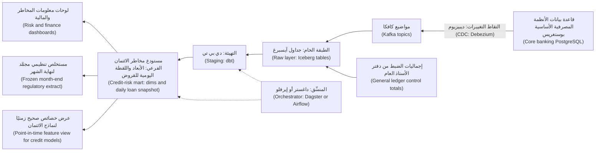

# الوحدة 7 — الاحتراف: المشروع الختامي والامتحان التدريبي

*تعلّمتَ دورة حياة البيانات مرحلةً مرحلة: استعلامًا، ونموذجًا، وخط بيانات، واختبارًا، ومقياسًا، وخاصية، وسياسة. تعيد هذه الوحدة تجميعها كلها في منتج بيانات واحد لا يستطيع البنك العمل من دونه. في المشروع الختامي تبني المستودع الفرعي لمخاطر الائتمان لدى بنك نجم (Najm Bank) من طرف إلى طرف: بدءًا من التقاط تغيّر البيانات (change data capture) على قاعدة بيانات الأنظمة المصرفية الأساسية، مرورًا بلقطة يومية للقروض مع أيام التأخر في السداد، والاختبارات، والمطابقة مع دفتر الأستاذ العام، ووصولًا إلى لوحة معلومات المخاطر، ومستخلص تنظيمي، وعرض خصائص لنماذج الائتمان، وكل ذلك مع مالكين، وقواعد وصول، ودليل تشغيل للمناوبة. تعيد استخدام مُنتَج عمل (artefact) من كل وحدة سابقة، وتربطها في ملف قضية واحد يستطيع فيصل أن يحمله إلى الرئيس التنفيذي للمخاطر. ثم ننتقل إليك أنت: أدوار البيانات، وما تختبره مقابلاتها فعلًا، وكيف تبني ملف أعمال يثبت أنك تستطيع أداء العمل، وكيف تواصل النمو بعد أن تُوظَّف. وتُختتم الوحدة بامتحان تدريبي من 60 سؤالًا يغطي المراحل الثماني كلها.*

> **المراحل:** Ingest through Govern — دورة حياة البيانات كاملةً، من طرف إلى طرف، على منتج بيانات واحد ثم في امتحان واحد.

---

# 7.1 — المشروع الختامي: ابنِ المستودع الفرعي لمخاطر الائتمان لدى نجم من طرف إلى طرف
*المستوى: 🔴 متقدم* · *المتطلبات: الوحدات 0–6 (Modules 0–6)* · *المرحلة: Model, Operate*

**بعد هذا الدرس تستطيع** تبني مستودعًا فرعيًا لمخاطر الائتمان مُختبَرًا ومطابَقًا، وتوثّقه بما يكفي ليتتبّع زميل رقمًا واحدًا لنسبة القروض غير العاملة حتى صفوف مصدره. *مدة الدراسة: نحو 125 دقيقة (تقدير).*

## ⚡ الدرس في دقيقة
- يبني المشروع الختامي **المستودع الفرعي لمخاطر الائتمان (credit-risk mart)**: سجلًّا يوميًا مختبرًا ومطابَقًا لرصيد كل قرض وأيام تأخره في السداد، للوحات المعلومات والجهات التنظيمية والنماذج (models).
- عامِله بوصفه **منتج بيانات (data product)**: مستهلكون مسمَّون، وبيان للحُبَيبية، وعقد مع المصدر، وتعريفات للمقاييس، ومالك، ووعد بالحداثة، وسياسة وصول.
- العمود الفقري هو **قابلية التتبّع (traceability)**: كل رقم يُتتبَّع إلى تعريف مقياس، ونموذج مختبر، ومصدر متعاقَد عليه، ويتطابق مع دفتر الأستاذ العام.
- الجدول المركزي هو **جدول حقائق اللقطة الدورية (periodic snapshot fact)**: صف واحد لكل قرض في كل تاريخ تقويمي. اضبط هذه الحُبَيبية (grain) جيدًا، وستصبح معظم أسئلة المخاطر استعلامات SQL بسيطة.
- إشارة القرار: لكل عمود، اسأل: «مَن يملك تعريفه، وكيف سنعرف غدًا إن كان خاطئًا؟ ⁦⁩»
- الفخ الأكبر: مستودع فرعي يختلف مع المالية ولا يستطيع أحد أن يقول لماذا. طابِق منذ اليوم الأول.

## 🧭 لماذا يهم
في كل شهر، يُصدر كلٌّ من فريق مخاطر الائتمان في نجم، والمالية، وقطاع التجزئة نسبةً للقروض غير العاملة، ولا تتطابق الأرقام أبدًا تمامًا. كل فريق ينظّف مستخلصه الخاص في جدول بيانات، ويطبّق قراءته الخاصة لعبارة «90 يومًا من التأخر في السداد» (90 days past due). وحين تسأل مراجعة رقابية كيف تُنتَج أرقام مخاطر الائتمان، من المصدر إلى التقرير، لا يستطيع أحد رسم ذلك الخط.

يتلقّى فيصل تكليفًا من الرئيس التنفيذي للمخاطر: مستودع فرعي واحد لمخاطر الائتمان، يملكه فريقه، مع تعريفات تملكها مخاطر الائتمان والمالية، وتستخدمه كل التقارير. يسنده إلى هدى (مهندسة بيانات خرّيجة) ولينا (مهندسة التحليلات)، مع دانة (عالمة البيانات الرئيسية) بوصفها أول مستهلك من النماذج، وسارة (مسؤولة حماية البيانات (DPO)) وليلى (رئيسة حوكمة الذكاء الاصطناعي) بوصفهما مراجِعتين.

أظهرت الأزمة المالية في 2007–2009 أن كثيرًا من البنوك لم تستطع تجميع تعرّضات المخاطر بسرعة ودقة. وفي يناير 2013 نشرت لجنة بازل للرقابة المصرفية (Basel Committee on Banking Supervision) المعيار **BCBS 239**، *مبادئ التجميع الفعّال لبيانات المخاطر وإعداد تقارير المخاطر*: يجب أن تكون بيانات المخاطر دقيقة وكاملة وفي وقتها وقابلة للتكيّف. وفي إنجلترا عام 2020، سقطت آلاف حالات COVID-19 من التقارير اليومية بسبب حدّ عدد الصفوف في صيغة جدول بيانات قديمة: بيانات لم تصل أبدًا، ولم يلاحظ أحد.

## 📐 كيف يعمل

### 🟢 الأساسيات

**ما منتج البيانات (What a data product is).** **منتج البيانات (data product)** مجموعة بيانات (dataset) تُشغَّل لمستهلكين مسمَّين بوعود المنتج البرمجي: واجهة موثّقة، ومالك، ومعيار جودة، وهدف للحداثة (freshness target). للمستودع الفرعي لمخاطر الائتمان ثلاثة مستهلكين:

| المستهلك (Consumer) | ما يحتاجه من المستودع الفرعي |
|---|---|
| لوحات معلومات مخاطر الائتمان والمالية | الأرصدة اليومية حسب فئة أيام التأخر والشريحة والمنتج؛ والاتجاهات ومعدلات الانتقال (roll rates) |
| التقارير التنظيمية | مستخلص مجمَّد لنهاية الشهر يتطابق مع دفتر الأستاذ ولا يتغيّر أبدًا بعد الاعتماد |
| نماذج الائتمان (فريق دانة) | خصائص صحيحة زمنيًا (point-in-time features): ما كان البنك يعرفه في تاريخ التقييم، ولا شيء بعده |

**مصطلحات الأعمال.** عرِّفها، واحصل على توقيع مالكيها عليها، قبل كتابة أي SQL. تتبع هذه التعريفات الاستخدام المصرفي الشائع وهي للتوضيح؛ فمخاطر الائتمان والمالية تملكان القواعد الدقيقة، والتقارير التنظيمية (regulatory reports) تستخدم تعريفات المصرف المركزي.
- **أيام التأخر في السداد (Days past due, DPD):** عدد الأيام التي مضت على استحقاق أقدم قسط غير مدفوع في تاريخ معيّن.
- **التعثّر:** تأخر يزيد على 90 يومًا (more than 90 days past due) في مبلغ جوهري، أو وسمٌ من مخاطر الائتمان بأن العميل **غير مرجَّح أن يسدّد**، على غرار تعريف بازل (Basel definition).
- **نسبة القروض غير العاملة (Non-performing loan (NPL) ratio):** أصل القروض المتعثّرة القائم ÷ إجمالي القروض القائمة، في تاريخ معيّن.
- **مراحل IFRS 9 (IFRS 9 stages):** يجمّع المعيار المحاسبي IFRS 9 القروضَ في المرحلة 1 (عاملة)، والمرحلة 2 (زيادة جوهرية في مخاطر الائتمان)، والمرحلة 3 (منخفضة القيمة ائتمانيًا). تملك المالية التصنيف المرحلي (staging)؛ ويوفّر المستودع الفرعي تاريخ أيام التأخر الذي تحتاجه.
- **معدل الانتقال (Roll rate):** حصة الأرصدة التي تنتقل من فئة أيام تأخر إلى فئة أسوأ خلال فترة، مثل الانتقال من 1–30 إلى 31–60 يومًا خلال شهر: إنذار مبكر.

**الخطة: قرار واحد لكل مرحلة**، وكلٌّ منها يعيد استخدام عمل سابق.

| المرحلة | القرار | يعيد استخدام (Reuses) |
|---|---|---|
| Ingest | القروض والأقساط والسدادات عبر التقاط تغيّر البيانات (CDC)، لا عبر تفريغات كاملة ليلية | 2.1، 2.2 |
| Store | التاريخ الخام (raw history) في صيغة جداول مفتوحة (open table format)؛ والمستودعات الفرعية (marts) في مستودع البيانات (warehouse) | 1.3، 3.3 |
| Model | مخطط النجمة (star schema) حول لقطة يومية للقروض؛ والعملاء بوصفهم بُعدًا متغيّرًا ببطء من النوع 2 (SCD Type 2) | 1.2 |
| Transform | طبقات dbt؛ وتحميلات تزايدية (incremental loads) مع نافذة رجوع (lookback window) | 3.1، 3.3 |
| Serve | لوحة معلومات، ومستخلص تنظيمي مجمَّد، وعرض خصائص | 4.1، 5.1 |
| Analyse | معدلات الانتقال واتجاه نسبة القروض غير العاملة بصورة تستطيع مخاطر الائتمان شرحها | 4.2 |
| Operate | الحداثة بحلول 07:00، وبوابة المطابقة، والمناوبة (on-call) | 2.2، 3.2 |
| Govern | التصنيف (classification)، والإخفاء (masking)، والوصول على مستوى الصف (row-level access)، والنسب (lineage) | 6.1–6.3 |

**البنية.** لا تختلف نسخة الإنتاج عن نسخة الحاسوب المحمول إلا في المحرّكات (engines).



على الحاسوب المحمول: جداول أنظمة مصرفية أساسية اصطناعية في PostgreSQL داخل Docker، وتحميل تزايدي بلغة Python إلى DuckDB، وdbt Core مع محوّل DuckDB، وDagster أو Airflow، وMetabase أو Superset. لا تستخدم أبدًا بيانات عملاء حقيقية، حتى «للاختبار فقط».

### 🟡 التعمق أكثر

**النموذج وحُبَيبيته.** أول مسودّة رسمتها هدى، وهي صف واحد لكل قرض مع رصيد اليوم وأيام التأخر، لم تُجب إلا عن سؤال «ما المتأخر الآن؟ ⁦⁩». أسئلة المخاطر تدور حول التغيّر، لذا فالمركز هو **جدول حقائق اللقطة الدورية (periodic snapshot fact table)** (1.2). تكتب لينا بيانات الحُبَيبية أولًا:

| الجدول | النوع | الحُبَيبية: صف واحد لكل… |
|---|---|---|
| `fct_loan_daily` | جدول حقائق لقطة دورية | قرض لكل تاريخ تقويمي، بحالة نهاية اليوم |
| `dim_customer` | بُعد متغيّر ببطء من النوع 2 (SCD Type 2 dimension) | نسخة العميل: الشريحة، والفرع، ودرجة المخاطر الداخلية |
| `dim_loan` | جدول أبعاد ثابت في معظمه | القرض: المنتج، والعملة، وتاريخ المنح، والمبلغ الأصلي |
| `dim_date` | بُعد تاريخ موحَّد | التاريخ التقويمي، مع مؤشرات يوم العمل ونهاية الشهر |

`dim_customer` من النوع 2 (Type 2) حتى تُظهر حزمة المخاطر الشريحة التي كان فيها العميل *في ذلك التاريخ*. و`dim_date` موحَّد (conformed): تستخدمه أيضًا المستودعات الفرعية للبطاقات والهاتف، فتعني «نهاية الشهر» الشيء نفسه في كل مكان.

**حساب أيام التأخر في السداد (Computing days past due).** يقرأ نموذج dbt أدناه لقطة dbt لجدول القروض (تاريخ من النوع 2 (Type 2 history)، 3.1) وجدول الأقساط:

```sql
-- models/marts/credit_risk/fct_loan_daily.sql
{{ config(
    materialized = 'incremental',
    unique_key = ['loan_id', 'snapshot_date'],
    incremental_strategy = 'delete+insert'
) }}

with dates as (
    select date_day as snapshot_date
    from {{ ref('dim_date') }}
    where date_day <= current_date - 1
    
      -- lookback: late repayments correct recent days
      and date_day > (select max(snapshot_date) from {{ this }}) - 3
    
),

loans_as_of as (
    -- end-of-day version; the snapshot uses the timestamp strategy
    -- on the source's updated_at, so validity follows business time
    select d.snapshot_date, l.loan_id, l.customer_id, l.currency,
           l.outstanding_principal
    from dates d
    join {{ ref('snap_core__loans') }} l
      on d.snapshot_date >= cast(l.dbt_valid_from as date)
     and (l.dbt_valid_to is null or d.snapshot_date < cast(l.dbt_valid_to as date))
    where l.status <> 'closed'
),

oldest_unpaid as (
    select d.snapshot_date, i.loan_id, min(i.due_date) as oldest_unpaid_due
    from dates d
    join {{ ref('stg_core__instalments') }} i
      on i.due_date <= d.snapshot_date
     and (i.paid_in_full_value_date is null
          or i.paid_in_full_value_date > d.snapshot_date)
    group by 1, 2
),

with_dpd as (
    select la.*,
           coalesce(la.snapshot_date - ou.oldest_unpaid_due, 0) as days_past_due
    from loans_as_of la
    left join oldest_unpaid ou
      on ou.loan_id = la.loan_id and ou.snapshot_date = la.snapshot_date
)

select *,
       case when days_past_due = 0  then 'current'
            when days_past_due <= 30 then '1-30'
            when days_past_due <= 60 then '31-60'
            when days_past_due <= 90 then '61-90'
            else '90+' end as dpd_bucket
from with_dpd
```

تختبئ هنا ثلاثة قرارات؛ كلٌّ منها يحتاج إلى اعتماد من المالك، لا مجرد مراجعة للشيفرة:
- **«مدفوع بالكامل» هو المعيار.** الدفعة الجزئية لا تُعيد ضبط أيام التأخر. وأي حدّ للأهمية النسبية للمبالغ المتبقية الضئيلة هو قاعدة لمخاطر الائتمان تُدرَج في بطاقة المقياس (metric card).
- **حالة نهاية اليوم.** إذا كان النظام الأساسي يرحّل بعض الدفعات في صباح اليوم التالي بتاريخ قيمة الأمس، فاستخدم تاريخ القيمة، لا وقت الترحيل. وهذا مدوَّن الآن في عقد البيانات (data contract).
- **نافذة الرجوع ذات الأيام الثلاثة.** السدادات المتأخرة تصحّح الأيام الثلاثة الأخيرة في كل تشغيل. وأي شيء أقدم يحتاج إلى إعادة تعبئة مسجَّلة (2.2).

**اختبارات ترمِّز القواعد.** اختبارات dbt العامة (3.1) تكشف السباكة المعطوبة: `unique_combination_of_columns` على `loan_id` و`snapshot_date` (dbt-utils)، و`not_null` و`relationships` على `loan_id`، ونطاق غير سالب على `days_past_due`، و`accepted_values` على `dpd_bucket`. أما قواعد الأعمال فتحتاج إلى اختبارات وحدة بقروض مبنية يدويًا (اختبارات وحدة dbt، الإصدار 1.8 وما بعده): القسط المستحق في اليوم الأول وغير المدفوع في اليوم الحادي والثلاثين يجب أن يعطي أيام تأخر 30 (DPD 30) والفئة `1-30`.

**المطابقة: الاختبار الذي يكسب الثقة.** قد يجتاز المستودع الفرعي كل اختبار للمخطط ومع ذلك يُغفل عملة أو منتجًا لم يُحمَّل أبدًا. تحتفظ المالية بـ**إجماليات الضبط** من دفتر الأستاذ العام (general ledger): أصل القروض القائم حسب العملة لكل يوم. ويُرجع اختبار dbt مفرد صفوفًا عندما يختلف الطرفان:

```sql
-- tests/assert_credit_mart_reconciles_to_ledger.sql
select coalesce(m.snapshot_date, g.snapshot_date) as snapshot_date,
       coalesce(m.currency, g.currency) as currency,
       m.mart_total, g.ledger_total
from (
    select snapshot_date, currency, sum(outstanding_principal) as mart_total
    from {{ ref('fct_loan_daily') }}
    group by 1, 2
) m
full outer join (
    -- only dates the mart has built
    select * from {{ ref('stg_finance__loan_control_totals') }}
    where snapshot_date between (select min(snapshot_date) from {{ ref('fct_loan_daily') }})
                            and (select max(snapshot_date) from {{ ref('fct_loan_daily') }})
) g
  on g.snapshot_date = m.snapshot_date
 and g.currency = m.currency
where m.mart_total is null
   or g.ledger_total is null
   or abs(m.mart_total - g.ledger_total) > {{ var('recon_tolerance', 0) }}
```

الربط الخارجي الكامل (full outer join) مهم: فالعملة الموجودة في دفتر الأستاذ والمفقودة من المستودع الفرعي هي الخطأ الذي تحتاج أكثر ما تحتاج إلى رؤيته. تحدّد المالية هامش التسامح (tolerance). والمطابقة الفاشلة تُظهر تحذيرًا على لوحة المعلومات اليومية و**تحجب** المستخلص التنظيمي لنهاية الشهر.

**العقد مع المصدر.** تعطّل أول خط بيانات بنته هدى حين أعاد فريق الأنظمة المصرفية الأساسية تسمية عمود. أما الآن فهناك عقد بيانات (6.1) مع مالكي الأنظمة المصرفية الأساسية يغطي المخطط (schema)، ومعنى `paid_in_full_value_date`، وتسليم التقاط تغيّر البيانات، وكيفية الإعلان عن التغييرات الكاسرة (breaking changes). والتقاط تغيّر البيانات باستخدام Debezium (2.1) يقرأ سجل قاعدة البيانات، فلا يوجد مستخلص كامل ليلي يُثقل قاعدة بيانات الإنتاج.

### 🔴 نظرة الخبير

**كما أُبلغ مقابل كما صُحِّح (As-reported versus as-corrected).** مع نافذة الرجوع (lookback)، يتغيّر التاريخ: قد تُصحَّح أيام التأخر ليوم الثلاثاء يوم الخميس. هذا صحيح للوحة المعلومات، وخاطئ لمستهلكَين اثنين. المستخلص التنظيمي يجب ألا يتغيّر أبدًا بعد الاعتماد، لذا تُنشر نهاية الشهر بوصفها جدولًا مجمَّدًا ذا إصدارات، وتصبح التصحيحات اللاحقة إعادات بيان موثّقة (documented restatements). ونماذج دانة تحتاج إلى بيانات **صحيحة زمنيًا (point-in-time)**: ما كان البنك *يعرفه* في تاريخ التقييم (5.1). والتدريب على تاريخ مصحَّح تسرّب زمني (temporal leakage). الخيارات: التصفية على وقت تحميل كل سجل، أو التدريب من إصدارات نهاية الشهر المجمَّدة، أو استخدام السفر عبر الزمن (time travel) في Apache Iceberg أو Delta Lake (1.3). اختر واحدًا، ووثّقه، واختبره.

**BCBS 239 بوصفه قائمة تحقق للتصميم.** تطلب المبادئ نتائج؛ فاقرأها بوصفها أسئلة هندسية. *الدقة (Accuracy):* هل المستودع الفرعي مطابَق ومختبر؟ *الاكتمال (Completeness):* هل تستطيع إثبات أن كل قرض وعملة وكيان موجود؟ *التوقيت (Timeliness):* هل تستطيع إنتاج الأرقام بسرعة في حدث ضغط، لا في نهاية الشهر فقط؟ *القابلية للتكيّف (Adaptability):* هل تستطيع الإجابة عن سؤال جديد، مثل التعرّض لقطاع واحد، من دون مشروع جديد؟ *الحوكمة (Governance):* هل يوجد مالك، وقاموس (dictionary)، ونسب من التقرير إلى المصدر (6.1)؟ إن النسب على مستوى النموذج (model-level lineage) من dbt، مع النسب على مستوى العمود (column-level lineage) في الفهرس (catalogue)، دليلٌ يستطيع المراقب (supervisor) أن يتتبّعه.

**التكلفة.** ربط أيام التأخر رخيص لثلاثة أيام، ومؤلم لإعادة بناء سبع سنوات: قسّم (partition) حسب شهر `snapshot_date`، وأعد البناء على دفعات سنوية، واقرأ خطة الاستعلام (query plan) أولًا (3.3).

**الوصول والخصوصية بالتصميم.** لا يحتاج أي سؤال لدى المستهلكين إلى الأسماء أو أرقام الهوية الوطنية أو أرقام الهواتف، لذا لا يحصل عليها المستودع الفرعي (6.2). يظهر العملاء بمفتاح بديل (surrogate) هو `customer_key`، مربوط في جدول مقيَّد ومدقَّق. و**أمن مستوى الصف (Row-level security)** يقصر تعرّضات الشركات على فريق ائتمان الشركات (6.3).

## 🧰 الأدوات
| الأداة أو النمط أو المعيار | ما هو وماذا يفعل | متى تلجأ إليه |
|---|---|---|
| **Periodic snapshot fact table** (Kimball) — جدول حقائق اللقطة الدورية | صف واحد لكل كيان في كل فترة، بالحالة في نهاية الفترة | الأرصدة والحالات المتتبَّعة عبر الزمن |
| **Change data capture (CDC)** — التقاط تغيّر البيانات | يبثّ عمليات الإدراج والتحديث والحذف من سجل قاعدة البيانات؛ وDebezium مثال مفتوح المصدر (open-source example) | تحميل الجداول التشغيلية من دون مستخلصات كاملة (full extracts) أو عمليات حذف فائتة |
| **dbt** | نماذج SQL، واختبارات، ولقطات، وتوثيق، ونسب بوصفها شيفرة | كل تحويل من التهيئة إلى المستودع الفرعي (mart) |
| **Reconciliation test** — اختبار المطابقة | يقارن المستودع الفرعي بإجمالي ضبط مستقل؛ ويفشل عند أي فجوة | أي رقم سيقارنه أحدهم بدفتر الأستاذ |
| **Row-level security** — أمن مستوى الصف | سياسة في قاعدة البيانات تصفّي الصفوف حسب هوية السائل | صفوف لا يجوز أن يراها إلا بعض القرّاء |
| **BCBS 239** (Basel Committee, 2013) — لجنة بازل | مبادئ لتجميع بيانات المخاطر وإعداد تقاريرها | تصميم منصات بيانات المخاطر المصرفية وتقديم الأدلة عليها |

## 🏛️ عمليًا في بنك نجم
المُخرَج هو **ملف قضية المستودع الفرعي لمخاطر الائتمان**: ملخّص من صفحة واحدة، ثم مُنتَجات عمل مرتبطة، يعتمدها الرئيس التنفيذي للمخاطر.

**ملخّص منتج البيانات (Data product summary)**

| الحقل | المستودع الفرعي لمخاطر الائتمان لدى نجم |
|---|---|
| المالك | فيصل (منصة البيانات)؛ وجدول المناوبة في دليل التشغيل (runbook) |
| مالكو التعريفات | مخاطر الائتمان: أيام التأخر (DPD)، والتعثّر، وغير المرجَّح أن يسدّد. المالية: إجماليات الضبط، والتصنيف المرحلي وفق IFRS 9 (IFRS 9 staging) |
| وعد الحداثة | يوم العمل السابق جاهز بحلول 07:00 بتوقيت الدوحة (للتوضيح) |
| بوابات الجودة (Quality gates) | اختبارات في كل تشغيل؛ والمطابقة تحذّر يوميًا وتحجب نهاية الشهر |
| البيانات الشخصية (Personal data) | مفاتيح بديلة فقط؛ وصفوف الشركات خلف أمن مستوى الصف |

**خريطة مُنتَجات العمل (Artefact map)**

| مُنتَج العمل | من | دليل على أنه يعمل | يعتمده |
|---|---|---|---|
| مصفوفة الناقل وبيانات الحُبَيبية | 1.2 | اختبارات التفرّد على كل حُبَيبية | لينا |
| مذكرة تصميم خط البيانات وإعدادات التقاط التغيّر | 2.1، 2.2 | إعادة التشغيل تعطي صفوفًا متطابقة | هدى |
| عقد البيانات مع الأنظمة المصرفية الأساسية | 3.2، 6.1 | فحوص العقد في التكامل المستمر (CI) لدى فريق المصدر | مالك الأنظمة المصرفية الأساسية |
| مشروع dbt مع الاختبارات والتوثيق | 3.1 | بناء ناجح؛ واختبارات وحدة على الحالات الحدّية لأيام التأخر | لينا |
| بطاقات المقاييس: نسبة القروض غير العاملة، ومعدل الانتقال، وفئات أيام التأخر | 4.1 | الرقم نفسه في لوحة المعلومات والمستخلص والحزمة | مخاطر الائتمان |
| مواصفات لوحة المعلومات وحزمة المخاطر الشهرية | 4.2 | حزمة مجلس الإدارة مبنية من دون جدول بيانات | كريم |
| عرض خصائص صحيح زمنيًا | 5.1، 5.2 | اختبار تسرّب على أوقات التحميل | دانة |
| جدول التصنيف وسياسة الوصول | 6.2، 6.3 | مراجعة الوصول؛ واختبارات أمن مستوى الصف | سارة، فيصل |
| دليل التشغيل وقواعد التنبيه | 2.2، 3.2 | تمرين (drill): معالجة مطابقة فاشلة من طرف إلى طرف | فيصل |

**قاعدة الجاهزية.** لا يحلّ المستودع الفرعي محلّ جداول البيانات إلا بعد ثلاث نهايات شهر متتالية تتطابق من دون أي تعديل يدوي، وبعد أن تحصل مخاطر الائتمان والمالية منه على نسبة القروض غير العاملة نفسها، وبعد أن يُجرى التمرين مرة واحدة.

## 🛠️ التمارين
- 🟢 **ابنِ الشريحة.** ولّد بضعة آلاف من القروض الاصطناعية، بعضها متأخر في السداد، مع أقساط وسدادات، في PostgreSQL داخل Docker. حمّلها إلى DuckDB وابنِ `dim_date` و`dim_loan` ولقطة (snapshot) من `loans` و`fct_loan_daily` باستخدام dbt Core والاختبارات العامة (generic tests). *يكتمل عندما:* يكون `dbt build` ناجحًا، ويُرجع استعلامٌ الرصيدَ في كل فئة أيام تأخر لأي تاريخ تختاره.
- 🟡 **اجعله جديرًا بالثقة.** أضف نافذة الرجوع، ولقطة من النوع 2 (Type 2 snapshot) لـ`customers`، وإجماليات ضبط اصطناعية من دفتر الأستاذ، واختبار المطابقة، مجدولةً في Dagster أو Airflow. أدرِج سدادًا متأخرًا خمسة أيام وقرضًا بعملة مفقودة من دفتر الأستاذ. *يكتمل عندما:* تكشف المطابقة فجوة العملة، وتعطي إعادة تشغيل يوم صفوفًا متطابقة، وتستطيع أن تشرح لماذا يحتاج السداد المتأخر إلى إعادة تعبئة (backfill).
- 🔴 **اشحن ملف القضية.** اكتب ملف قضيتك: الملخّص، وبيانات الحُبَيبية، وبطاقات المقاييس لنسبة القروض غير العاملة ومعدل الانتقال، وجدول تصنيف (classification table)، وقاعدة أمن مستوى الصف مختبرة في PostgreSQL، وعرض خصائص صحيحًا زمنيًا مع اختبار تسرّب، ودليل تشغيل. ثم نفّذ تمرينًا: أعد تسمية عمود في المصدر من دون إنذار. *يكتمل عندما:* يستطيع زميل تتبّع رقم واحد لنسبة القروض غير العاملة إلى صفوف المصدر باستخدام توثيقك وحده، ويذكر تقرير التمرين ما الذي فشل، ومن نُبِّه، وما الذي تغيّر.

## ⚠️ أخطاء وفخاخ
- **بناء جدول «الحالة الحالية» العريض أولًا.** لا يستطيع الإجابة عن أسئلة الاتجاه أو الأسئلة الزمنية (point-in-time questions). ابدأ من اللقطة اليومية.
- **كتابة التعريفات بلغة SQL قبل أن يتفق عليها المالكون.** عبارة «90 يومًا من التأخر» (90 days past due) تُخفي خيارات تتعلق بالدفعات الجزئية، وتواريخ القيمة، والأهمية النسبية (materiality). احصل على توقيع البطاقة أولًا.
- **ترك التصحيحات تعيد كتابة التاريخ.** جمّد نهايات الشهر المُبلَّغ عنها؛ وأعطِ النماذج بيانات صحيحة زمنيًا (point-in-time data).
- **نسخ المعرّفات «احتياطًا».** إن لم يحتج أي مستهلك إلى اسم أو رقم هوية، فاتركه خارجًا.

## 🧾 الخلاصة
- المستودع الفرعي لمخاطر الائتمان منتج بيانات؛ وجدول حقائق لقطة لكل قرض في كل يوم مع أبعاد موحَّدة ومن النوع 2 (conformed and Type 2 dimensions) يجيب عن معظم أسئلة المخاطر.
- منطق أيام التأخر يخفي قواعد أعمال؛ يعتمدها المالكون، وتثبّت اختبارات الوحدة الحالات الحدّية.
- المطابقة اليومية مع إجماليات الضبط في دفتر الأستاذ، بربط خارجي كامل، تكسب ثقة لا تستطيع اختبارات المخطط وحدها أن تكسبها.
- جمّد ما يُبلَّغ عنه، وأعطِ النماذج عروضًا صحيحة زمنيًا (point-in-time views)، واستخدم BCBS 239 قائمةَ تحقق للنتائج.

## ✍️ اختبر نفسك

**1. أول تصميم لهدى فيه صف واحد لكل قرض مع رصيد اليوم وأيام التأخر. أيّ متطلّب لا يستطيع تلبيته؟**

- A. عرض رصيد كل قرض وفئة أيام تأخره كما هي هذا الصباح
- B. ربط كل قرض بمنتجه وعملته وتاريخ منحه
- C. عرض اتجاهات فئات أيام التأخر شهرًا بشهر ومعدلات الانتقال
- D. عدّ القروض المفتوحة حسب العملة وحسب شريحة العملاء اليوم

<details><summary>الإجابة</summary>

**C.** الاتجاهات ومعدلات الانتقال تحتاج إلى الحالة في كل تاريخ، وهو ما توفّره اللقطة الدورية (periodic snapshot). أما A وB وD فتعمل على جدول الحالة الحالية (current-state table)، ولهذا يبدو كافيًا. (🟡 التعمق أكثر.)

</details>

**2. كل اختبارات المخطط تنجح، لكن دفتر الأستاذ (ledger) يُظهر قروضًا بالدرهم الإماراتي بينما لا يحتوي المستودع الفرعي (mart) على أي صف بالدرهم. أيّ فحص مصمَّم لكشف ذلك؟**

- A. مطابقة بربط خارجي كامل مع إجماليات الضبط في دفتر الأستاذ حسب العملة والتاريخ
- B. اختبار not_null على `currency` في `fct_loan_daily` وفي نموذج التهيئة الذي يغذّيه
- C. اختبار accepted_values على `dpd_bucket` يسرد الفئات الخمس التي تعرّفها بطاقة المقياس
- D. اختبار تفرّد على تركيبة `loan_id` و`snapshot_date`، من dbt-utils

<details><summary>الإجابة</summary>

**A.** وحده إجمالي الضبط المستقل يكشف البيانات التي لم تصل أبدًا؛ والربط الخارجي الكامل (full outer join) يُبرز عملةً مفقودة في أيٍّ من الجانبين. أما B وC وD فتختبر الصفوف الموجودة فقط. (🟡 التعمق أكثر.)

</details>

**3. سدادٌ رُحِّل يوم الخميس بتاريخ قيمة يوم الثلاثاء. للمستودع الفرعي نافذة رجوع من ثلاثة أيام. ماذا يحدث، وماذا ينبغي أن يفعل الفريق بشأن نهاية الشهر؟**

- A. لا يتغيّر شيء، لأن النماذج التزايدية تُلحق التواريخ الجديدة فقط ولا تمسّ الصفوف المحمَّلة مسبقًا
- B. يُعاد بناء تاريخ القرض كله منذ المنح تلقائيًا في التشغيل التالي
- C. تتجاهله لوحة المعلومات حتى تحديث كامل، يعيد بدوره كتابة المستخلص المقدَّم لنهاية الشهر أيضًا
- D. يصحّح التشغيل التالي صفّ يوم الثلاثاء؛ وتبقى نهاية الشهر مجمَّدة، وتصبح التصحيحات اللاحقة إعادات بيان موثّقة

<details><summary>الإجابة</summary>

**D.** نافذة الرجوع (lookback) تصحّح الأيام الأخيرة؛ والأرقام المُبلَّغ عنها يجب ألا تتغيّر بصمت، لذا تُجمَّد نهاية الشهر. وA هي الخرافة المغرية عن النماذج التزايدية (incremental models). (🔴 نظرة الخبير.)

</details>

**4. تدرّب دانة نموذجًا لاحتمال التعثّر على `fct_loan_daily` بعد تطبيق التصحيحات على التاريخ. لماذا يمثّل هذا مشكلة؟**

- A. البيانات المصحَّحة دائمًا أقل دقة من الأرقام المُبلَّغ عنها أصلًا في حينها
- B. يتعلّم من معلومات لم تكن معروفة في تاريخ التقييم: تسرّب زمني
- C. لا يستطيع dbt قراءة الصفوف التي حذفها تشغيل تزايدي لاحق ثم أعاد إدراجها
- D. تمنع الجهات التنظيمية نماذج الائتمان من استخدام بيانات المتأخرات أو أيام التأخر خصائصَ

<details><summary>الإجابة</summary>

**B.** في الإنتاج لا يرى النموذج إلا ما كان البنك يعرفه في حينه؛ والتدريب على التصحيحات اللاحقة يسرّب المستقبل ويضخّم النتائج غير المتصلة. استخدم عرضًا صحيحًا زمنيًا (point-in-time view). (🔴 نظرة الخبير.)

</details>

**5. يطلب كريم أسماء العملاء وأرقام هوياتهم الوطنية في المستودع الفرعي «لتسهيل التعمّق في التفاصيل». لا يحتاج إليها أي سؤال لدى المستهلكين. ماذا ينبغي أن يقرّر فيصل؟**

- A. إضافتها، لأن المحلّلين يحتاجون إلى السياق، والمستودع الفرعي داخلي في البنك على أي حال
- B. إضافتها إلى المستودع الفرعي مع إخفاء العمودين في كل عرض للوحات المعلومات
- C. الإبقاء على المفاتيح البديلة؛ والسماح بعمليات بحث مدقَّقة عبر جدول الربط المقيَّد للاحتياجات الموثّقة
- D. إزالة مفاتيح العملاء أيضًا، حتى لا يمكن ربط أي صف بأي شخص أبدًا

<details><summary>الإجابة</summary>

**C.** تقليل البيانات (Minimisation): لا يحتفظ المستودع الفرعي إلا بما يحتاجه المستهلكون؛ وإعادة التعريف (re-identification) تمرّ عبر مسار مدقَّق (audited path). أما B فما زالت تنسخ البيانات إلى كل من لديه صلاحية الوصول إلى الجدول (table access)؛ وD تكسر الربط. (🔴 نظرة الخبير.)

</details>

## 📚 المراجع
- لجنة بازل للرقابة المصرفية، *مبادئ التجميع الفعّال لبيانات المخاطر وإعداد تقارير المخاطر* (BCBS 239)، يناير 2013 — https://www.bis.org/publ/bcbs239.htm
- مؤسسة IFRS (IFRS Foundation)، المعيار IFRS 9 الأدوات المالية (IFRS 9 Financial Instruments) — https://www.ifrs.org
- رالف كيمبول ومارجي روس (Ralph Kimball and Margy Ross)، *The Data Warehouse Toolkit*، الطبعة الثالثة (3rd edition) (Wiley, 2013)
- توثيق dbt (dbt documentation) — https://docs.getdbt.com
- توثيق Debezium — https://debezium.io/documentation/
- توثيق DuckDB (DuckDB documentation) — https://duckdb.org/docs/
- توثيق PostgreSQL: سياسات أمن الصفوف — https://www.postgresql.org/docs/current/ddl-rowsecurity.html
- توثيق Apache Iceberg — https://iceberg.apache.org

---

# 7.2 — المسيرة المهنية في البيانات: الأدوار والمقابلات وملف الأعمال والنمو
*المستوى: 🔴 متقدم* · *المتطلبات: 0.1، 7.1* · *المرحلة: Govern*

**بعد هذا الدرس تستطيع** تقابل في صفحة واحدة متطلبات دور بيانات تستهدفه بأدلتك الخاصة، وتنشر مشروع ملف أعمال يستطيع صديق استنساخه وتشغيله من ملف README. *مدة الدراسة: نحو 175 دقيقة (تقدير).*

## ⚡ الدرس في دقيقة
- «البيانات» عدة وظائف: **مهندس البيانات (data engineer)**، و**مهندس التحليلات (analytics engineer)**، و**محلّل البيانات (data analyst)**، و**عالم البيانات (data scientist)**، و**مهندس تعلّم الآلة (ML engineer)**، إضافةً إلى أدوار المنصة والحوكمة. تختلف المسمّيات من صاحب عمل لآخر، فاقرأ الوصف الوظيفي لا المسمّى.
- تختبر المقابلات أشياء قليلة بأزياء مختلفة: **SQL تحت الضغط**، و**النمذجة والحُبَيبية**، و**التفكير في خطوط البيانات (pipeline reasoning)** (تساوي الأثر (idempotency)، والبيانات المتأخرة (late data)، وإعادة التعبئة)، و**الحكم على المقاييس والإحصاء**، والتواصل.
- **ملف أعمال من مشروعين أو ثلاثة مكتملة ومختبرة** على بيانات مفتوحة، مع ملف README واضح وتقرير صادق، يتفوّق على قائمة أدوات.
- تكتب مساعدات الذكاء الاصطناعي الآن مسوّدات لكثير من شيفرة SQL وPython. لكن أصحاب العمل ما زالوا يدفعون مقابل معرفة ما إذا كانت الإجابة صحيحة: الحُبَيبية، والتعريفات، والاختبارات، والمطابقة (reconciliation).
- إشارة القرار: اختر خطوتك التعليمية التالية حسب الدور الذي تريده بعد سنتين وما يطلبه سوقك، لا حسب الصيحات.
- الفخ الأكبر: جمع الأدوات والشهادات دون شحن أي شيء يستطيع أحد تشغيله أو قراءته أو مساءلته.

## 🧭 لماذا يهم
بعد عام من انضمامها، تطرح هدى على فيصل سؤالًا يسمعه كثيرًا: «هل ينبغي أن أتجه نحو علم البيانات (data science) أم أبقى في الهندسة؟ كلٌّ على الإنترنت يقول شيئًا مختلفًا.» يسألها فيصل عن الأجزاء التي استمتعت بها من العام. تتحمّس وهي تتحدّث عن خلل أيام التأخر الذي تتبّعته حتى وصلت إلى قاعدة تاريخ القيمة، وعن اختبار المطابقة الذي جعل المالية تثق بالمستودع الفرعي؛ أما ضبط خصائص النماذج فيثير حماسها أقل. يقول: «يبدو هذا هندسةً بنزعة تحليلية قوية. لنخطّط لذلك، مع الحفاظ على الإلمام بتعلّم الآلة.»

أما كريم، محلّل بيانات التجزئة، فلديه السؤال المعاكس. يكتب SQL جيدًا، ولوحات معلوماته مستخدَمة، لكنه يقضي أيام الاثنين في إعادة بناء المستخلصات نفسها يدويًا. يريد الانتقال إلى هندسة التحليلات (analytics engineering)، ويحتاج إلى أدلة تقنع مدير التوظيف.

وفيصل يوظّف مهندس بيانات مبتدئًا. معظم السِّيَر الذاتية (CVs) تسرد نحو اثنتي عشرة أداة؛ وقليل منها يُظهر شيئًا يستطيع فتحه. أحد المرشحين يضع رابطًا لمستودع صغير: مشروع dbt على بيانات النقل العام، مع اختبارات، وملف README يذكر حُبَيبية كل جدول، وتقرير قصير عن خلل في البيانات المتأخرة الوصول أصلحه. يدعو فيصل ذلك المرشح أولًا. يغطي هذا الدرس جانبَي تلك الطاولة.

## 📐 كيف يعمل

### 🟢 الأساسيات

**خريطة الأدوار.** تتداخل المسمّيات، وكل مؤسسة ترسم الحدود بطريقة مختلفة. وقت كتابة هذا الدرس (2026)، تبدو الأشكال الشائعة هكذا:

| الدور | العمل اليومي | الوحدات الأساسية في هذا المقرر |
|---|---|---|
| **مهندس البيانات (Data engineer)** | يبني الاستيعاب (ingestion) والتخزين وخطوط البيانات (pipelines) ويشغّلها؛ ويملك الموثوقية (reliability) والتكلفة وأدوات المنصة | 1.3، الوحدات 2–3 (Modules 2–3)، 6.3 |
| **مهندس التحليلات (Analytics engineer)** | يحوّل البيانات الخام (raw data) إلى نماذج مختبرة وموثّقة وتعريفات للمقاييس؛ dbt والطبقة الدلالية (semantic layer) | 1.2، الوحدة 3، 4.1 |
| **محلّل البيانات (Data analyst)** | يجيب عن أسئلة الأعمال، ويبني لوحات المعلومات، ويشرح ما الذي تغيّر ولماذا | 1.1، الوحدة 4 |
| **عالم البيانات (Data scientist)** | النماذج، والتجارب (experiments)، والاستدلال الإحصائي (statistical inference)؛ يحوّل الأسئلة إلى تنبؤات أو قرارات | 4.3، الوحدة 5 |
| **مهندس تعلّم الآلة (ML engineer)** | ينقل النماذج إلى الإنتاج: الخصائص (features)، والتقديم (serving)، والمراقبة (monitoring)، وإعادة التدريب (retraining) | الوحدة 5، 2.2، 3.2 |
| **أدوار حوكمة البيانات والمنصة** | أمناء البيانات (data stewards)، ومالكو الفهرس، وهندسة الخصوصية، ومالكو منتج منصة البيانات | الوحدة 6 |

في نجم تتداخل الحدود: هدى تبني خطوط البيانات لكنها تكتب بطاقات المقاييس؛ وعلماء البيانات في فريق دانة يشحنون الخصائص إلى الإنتاج. والشركات الصغيرة كثيرًا ما توظّف «شخص بيانات» واحدًا لكل ذلك.

لمعرفة كل مسار وأيّ مقررات في المكتبة تأخذ، راجع [*من الخرّيج إلى الموظّف*، الدرس 2.3 — مهندس البيانات والمحلّل وعالم البيانات](../career/index.ar.html#/2.3).

**ما تشترك فيه كل أدوار البيانات.** أربع مهارات تظهر في كل جولة مقابلات وفي كل سنة أولى:
- **الطلاقة في SQL (SQL fluency):** الربط، والتجميع (aggregation)، وتعابير الجداول المشتركة (CTEs)، ودوال النوافذ (window functions) دون البحث عنها (1.1).
- **التفكير بالحُبَيبية:** معرفة ما يعنيه الصف الواحد قبل أن تربط أو تجمع (1.2). معظم الأرقام الخاطئة أخطاء في الحُبَيبية.
- **الاختبار والتحقق:** ألّا تثق برقم حتى يُختبر أو يُطابَق أو يُفسَّر (3.2).
- **التدوين:** مذكرة تصميم، أو بطاقة مقياس، أو ملف README. القرارات التي يستطيع الآخرون قراءتها تكسبك الثقة.

**جولة المقابلات.** تختلف الجولات من صاحب عمل لآخر، لكن الجولة النموذجية لدور بيانات مبتدئ تجمع عدة من هذه المراحل:

| المرحلة | ما تختبره | أين يُعدّك هذا المقرر |
|---|---|---|
| فرز مسؤول التوظيف أو مدير التوظيف | الدافع، والتواصل، والملاءمة للدور | ملف قضيتك وقصة ملف أعمالك |
| SQL مباشر | الربط، والتجميع، ودوال النوافذ، والحالات الحدّية مثل القيم الفارغة (NULLs) والمكرَّرات | 1.1 |
| حالة نمذجة البيانات | الحُبَيبية، والحقائق والأبعاد، والتاريخ، والمفاضلات | 1.2، 7.1 |
| تصميم خط البيانات أو النظام | التحميلات التزايدية، وتساوي الأثر، وإعادة المحاولة (retries)، والبيانات المتأخرة، وإعادة التعبئة (backfills)، وخيارات التدفق | الوحدة 2، 3.3 |
| المقاييس والحسّ المنتجي (للمحلّلين) | تعريف مقياس، وتشخيص انخفاض، واختيار مخطط | 4.1، 4.2 |
| الإحصاء والتجارب | تصميم اختبار A/B (A/B design)، وقيم p (p-values)، والاختلاس المبكر للنتائج (peeking)، وعدم تطابق نسبة العيّنة (sample ratio mismatch) | 4.3 |
| حالة تعلّم الآلة (علم البيانات، هندسة تعلّم الآلة) | صياغة المشكلة، والتسرّب (leakage)، والتقييم (evaluation)، والانجراف (drift) | 5.1، 5.2 |
| المهمة المنزلية (Take-home) | مجموعة بيانات صغيرة وسؤال؛ يُحكم عليها بالصحة (correctness) والاختبارات والتقرير | كل شيء، إضافةً إلى 🏛️ أدناه |
| السلوكية (Behavioural) | العمل السابق، والخلاف، والأخطاء، والملكية | قصص STAR من مشاريعك |

كثير من أصحاب العمل يسمحون الآن بمساعدات الذكاء الاصطناعي في بعض المراحل ويحظرونها في أخرى. اسأل مسؤول التوظيف (recruiter) عمّا ينطبق؛ ولا تفترض أبدًا. ولمعرفة كيف تجري هذه المراحل وكيف تستعد لها، راجع [*من الخرّيج إلى الموظّف*، الدرس 5.3 — مقابلات تصميم الأنظمة والبيانات وتعلّم الآلة للمبتدئين](../career/index.ar.html#/5.3).

### 🟡 التعمق أكثر

**كيف تبدو الإجابات الجيدة.** يريد المحاورون أن يشاهدوك وأنت تفكّر. أربعة أمثلة:

*SQL مباشر: «لكل عميل، أرجِع أحدث معاملة له.» ⁦⁩* المرشحون الأقوياء يسألون عن التعادلات والقيم الفارغة قبل الكتابة، ثم يستخدمون دالة نافذة (window function):

```sql
-- Wrong: the latest date and the largest amount may come from different rows
select customer_id, max(txn_ts) as last_ts, max(amount) as amount
from transactions
group by customer_id;

-- Right: rank rows per customer and keep the first; ties broken explicitly
select customer_id, txn_id, txn_ts, amount
from (
    select t.*,
           row_number() over (
               partition by customer_id
               order by txn_ts desc, txn_id desc
           ) as rn
    from transactions t
) ranked
where rn = 1;
```

أن تقول بصوت عالٍ «الاستعلام الأول يخلط قيمًا من صفوف مختلفة» يساوي قيمةَ الاستعلام الصحيح نفسه.

*النمذجة (Modelling): «صمّم جداول لتفويضات البطاقات حتى يستطيع فريق الاحتيال تحليل حالات الرفض.» ⁦⁩* ابدأ بالحُبَيبية: «صف واحد لكل محاولة تفويض». ثم سمِّ الأبعاد (البطاقة، والتاجر، والتاريخ، والقناة)، وقل أيّ السمات تتغيّر عبر الزمن وتحتاج إلى تاريخ من النوع 2 (Type 2 history)، وسمِّ ما *لن* تخزّنه، مثل أرقام البطاقات الكاملة (6.2). معظم المرشحين يقفزون مباشرة إلى الأعمدة؛ وذكر الحُبَيبية أولًا يميّزك.

*خط البيانات (Pipeline): «جرى تحميلك اليومي مرتين بالخطأ. ماذا يحدث؟» ⁦⁩* الإجابة التي يريدها المحاور هي تساوي الأثر (2.2): مع MERGE على مفتاح أو استبدال قسم (partition overwrite)، يعطي التشغيل مرتين النتيجة نفسها؛ ومع INSERT عادي، تعدّ مرتين (double-count). ثم أضف كيف ستكشف ذلك: اختبار تفرّد (uniqueness test) وفحص حجم (3.2).

*المقاييس (Metrics): «انخفض عدد المستخدمين النشطين يوميًا للتطبيق 15% بين ليلة وضحاها. اشرح لي كيف ستتعامل مع ذلك.»* المحلّلون الأقوياء يفحصون البيانات قبل الأعمال: هل اكتمل تشغيل خط البيانات، هل تغيّر تتبّع الأحداث في إصدار جديد من التطبيق، هل تغيّر التعريف أو المنطقة الزمنية؟ وبعد ذلك فقط يقسّمون حسب المنصة والمنطقة وإصدار التطبيق (4.1، 4.2).

**STAR للمرحلة السلوكية.** استخدم **STAR**: الموقف، والمهمة، والإجراء، والنتيجة. جهّز أربع أو خمس قصص مدة كلٍّ منها دقيقتان: خلل في بياناتك أنت، وتعريف اتفقت عليه مع شخص ما، ومرة كنت فيها مخطئًا، ومفاضلة تحت الضغط. اجعل النتيجة ملموسة: «كشف اختبار المطابقة عملةً مفقودة قبل نهاية الشهر».

**ملف الأعمال.** مشروعان أو ثلاثة مكتملة تتفوّق على عشرة دفاتر نصف مبنية. مشروع ملف أعمال البيانات القوي فيه:
- **سؤال حقيقي** على بيانات عامة بترخيص مفتوح: رحلات النقل في المدن، وإفصاحات الشركات العامة، والطقس، ومجموعات البيانات الحكومية المفتوحة. تحقّق من ترخيص كل مجموعة بيانات، ولا تستخدم أبدًا بيانات شخصية لا يحقّ لك استخدامها.
- **بناء من طرف إلى طرف** يستطيع شخص آخر تشغيله على حاسوب محمول: سكربت استيعاب، وDuckDB أو PostgreSQL، ونماذج dbt مع اختبارات، وتشغيل مُنسَّق، ولوحة معلومات واحدة.
- **ملف README** يذكر السؤال، وحُبَيبية كل جدول، وكيفية تشغيله ببضعة أوامر، وما الذي تفحصه الاختبارات.
- **تقرير عن مشكلة واحدة**: خلل في البيانات المتأخرة، أو مفتاح مكرَّر (duplicate key)، أو مقياس بدا خاطئًا. شرح كيف وجدته وأصلحته يُظهر الحكم السليم (judgement) الذي يبحث عنه المحاورون.

طابِق المشاريع مع الدور: إعادة التعبئة والتقاط تغيّر البيانات لهندسة البيانات (data engineering)؛ ونماذج dbt مختبرة مع تعريفات المقاييس لهندسة التحليلات؛ وتحليل ينتهي بقرار للمحلّلين؛ وتقييم صادق وفحص للتسرّب لعلم البيانات. والمشروع الختامي في 7.1، بعد إعادة بنائه على بيانات عامة، يناسب أيًّا منها.

**الشهادات (Certifications).** يقدّم مزوّدو الخدمات السحابية، وDatabricks، وSnowflake، وdbt Labs شهادات في البيانات (data certifications)؛ وتتغيّر أسماؤها ومحتواها، فتحقّق من موقع كل مزوّد. تساعد في عمليات الفرز الأولى في بعض الأسواق، ولا سيّما المؤسسات الكبيرة والقطاع العام، لكنها لا تحلّ محلّ الدليل على أنك تستطيع البناء والتحقق.

### 🔴 نظرة الخبير

**ما الذي تغيّره مساعدات الذكاء الاصطناعي، وما الذي لا تغيّره.** وقت كتابة هذا الدرس (2026)، تكتب مساعدات الذكاء الاصطناعي وأدوات تحويل النص إلى SQL مسوّدات الاستعلامات ونماذج dbt وشيفرة خطوط البيانات بسرعة. تنتقل الوظيفة المبتدئة من كتابة SQL إلى **التحقق منه**: فحص الحُبَيبية والربط والمرشّحات والتعريفات، واختبار النتيجة مقابل شيء مستقل. استعلام نسبة القروض غير العاملة المولَّد والمعقول ظاهريًا لا يعرف أن تعريف نجم يستبعد منتجًا ما أو أن تاريخ القيمة مهم. الأشخاص الذين يعرفون التعريفات، ويكتبون الاختبارات، ويطابقون الأرقام يصبحون أكثر قيمة لا أقل.

**من المبتدئ إلى الخبير.** السلّم الوظيفي يدور في معظمه حول النطاق والحكم السليم، لا الأدوات:

| المستوى | النطاق | الدليل النموذجي |
|---|---|---|
| مبتدئ | مهام ضمن تصميم محدَّد | نماذج نظيفة ومختبرة؛ يطرح أسئلة جيدة؛ يدوّن الأمور |
| متوسط المستوى | خط بيانات أو منتج بيانات من طرف إلى طرف | يملك المناوبة له؛ يتخذ قرارات التصميم ويوثّقها |
| خبير | عدة منتجات، أو منتج صعب | يضع المعايير مثل العقود أو الاختبار؛ يرشد الآخرين؛ يقلّل الحوادث |
| مهندس أول أو رئيسي | منصة أو مجال عبر الفرق | يشكّل البنية والحوكمة؛ يوفّق بين مالكي الأعمال حول التعريفات |

**المعرفة بالمجال تتراكم.** لم تكن أثمن مهارة لدى هدى في سنتها الأولى هي Kafka؛ بل كانت معرفة ما هو تاريخ القيمة. خصّص وقتًا مقصودًا مع فرق الأعمال التي تخدمها. وللتغذية الراجعة (feedback) والملكية والانتقال إلى المستوى المتوسط، راجع [*من الخرّيج إلى الموظّف*، الدرس 6.3 — النمو من المبتدئ إلى المستوى المتوسط: التغذية الراجعة والملكية والتعلّم المستمر](../career/index.ar.html#/6.3).

**سوق دول الخليج.** تدير بنوك الخليج، والجهات الحكومية، وشركات الطاقة، وشركات الاتصالات (telecoms) برامج بيانات كبيرة وبرامج للخرّيجين. وتشكّل برامج توطين القوى العاملة، مثل التقطير (Qatarization) والتوطين الإماراتي (Emiratisation) والسعودة (Saudization)، عمليات التوظيف. ويقدّر أصحاب العمل الخاضعون للتنظيم الوعي بقانون حماية البيانات، مثل قانون PDPPL في قطر (القانون رقم 13 لسنة 2016 (Law No. 13 of 2016))، وإقامة البيانات والحوكمة، والتواصل الواضح بالعربية والإنجليزية. تتغيّر البرامج، فتحقّق من التفاصيل الحالية لدى أصحاب العمل والمصادر الرسمية.

**عادة تعلّم تستطيع الحفاظ عليها.** اختر مهارة عميقة واحدة كل ربع سنة وابنِ بها شيئًا. اقرأ ملاحظات الإصدار لأدواتك اليومية، وتقارير ما بعد الحوادث المنشورة. احتفظ بـ«وثيقة إنجازات» لما شحنته وما غيّره. وإن اتجهت اهتماماتك نحو منتجات الذكاء الاصطناعي أو الأمن، فراجع [*إدارة منتجات الذكاء الاصطناعي: من الصفر إلى الاحتراف*، الدرس 10.2 — المسيرة المهنية لمدير منتجات الذكاء الاصطناعي: المقابلات وملف الأعمال والنمو](../aipm/index.ar.html#/10.2) و[*أمن الذكاء الاصطناعي وأمن التطبيقات*، الدرس 12.2 — المسيرة المهنية في الأمن: الأدوار والشهادات وملف الأعمال](../secai/index.ar.html#/12.2).

## 🧰 الأدوات
| الأداة أو النمط أو المعيار | ما هو وماذا يفعل | متى تلجأ إليه |
|---|---|---|
| **STAR** — الموقف، والمهمة، والإجراء، والنتيجة | بنية للإجابات السلوكية تنتهي بنتيجة ملموسة | تجهيز القصص قبل أي جولة مقابلات |
| **Portfolio repository** — مستودع ملف الأعمال | مشروع قابل للتشغيل مع README، واختبارات، وتوثيق dbt، وتقرير عن مشكلة | إثبات أنك تستطيع البناء والتحقق |
| **Public open data** — البيانات العامة المفتوحة | مجموعات بيانات بترخيص مفتوح من الحكومات والمدن والهيئات العامة | التدرّب من دون بيانات شخصية |
| **DuckDB** | قاعدة بيانات تحليلية تعمل داخل العملية (in-process analytical database) وتعمل في أي مكان | مشاريع ملف أعمال بحجم الحاسوب المحمول |
| **Mock interview** — المقابلة التجريبية | مرحلة تدريبية موقوتة مع زميل في دور المحاور | قبل جولة المقابلات الحقيقية |
| **Brag document** — وثيقة الإنجازات | سجلّ متجدد لما شحنته وما غيّرته | المراجعات والترقيات والسِّيَر الذاتية |
| **Cloud data certifications** — شهادات البيانات السحابية | اختبارات المورّدين على منصات بياناتهم؛ والأسماء تتغيّر، فتحقّق | اجتياز عمليات الفرز الأولى في الأسواق التي تطلبها |

## 🏛️ عمليًا في بنك نجم
يحوّل فيصل كومة طلبات التوظيف لديه وسؤال هدى إلى مُنتَجَي عمل قابلين لإعادة الاستخدام.

**بطاقة تقييم مقابلة مهندس البيانات المبتدئ في نجم (Najm's junior data engineer interview scorecard)**

| المرحلة | إشارة قوية | إشارة ضعيفة |
|---|---|---|
| SQL مباشر (45 دقيقة (45 min)) | يسأل عن التعادلات والقيم الفارغة والمكرَّرات؛ يستخدم دوال النوافذ؛ يختبر بمثال صغير | استعلام يبدو صحيحًا لكنه يخلط الصفوف؛ لا يفحص النتيجة أبدًا |
| حالة النمذجة | يذكر الحُبَيبية أولًا؛ يفصل الحقائق عن الأبعاد؛ يختار التاريخ عن قصد؛ يستبعد المعرّفات | يسرد الأعمدة دون أن يقول ما هو الصف |
| حالة خط البيانات | تحميلات متساوية الأثر (idempotent loads)، والبيانات المتأخرة، وإعادة التعبئة، واختبار تفرّد وتنبيه | «المجدوِل يعيد المحاولة» دون أي تفكير في المكرَّرات |
| مراجعة المهمة المنزلية | اختبارات، وملف README، ومطابقة أو فحص معقولية؛ وقيود معلنة بصدق | مخطط مصقول، بلا اختبارات، وبلا شرح للافتراضات |
| السلوكية | قصص ملموسة بنتائج، منها خطأ وما الذي تغيّر بعده | إجابات عامة؛ يلوم الآخرين |
| استخدام أدوات الذكاء الاصطناعي (حيث يُسمح) | يراجع SQL المولَّد ويصحّحه؛ ويشرح السبب | يلصق المخرجات دون قراءتها |

**قالب خطة التطوير الشخصي (خطة هدى، السنة الثانية (Huda's, year two))**

| الحقل | خطة هدى |
|---|---|
| الدور المستهدف بعد سنتين | مهندسة بيانات متوسطة المستوى تملك منتج بيانات من طرف إلى طرف |
| نقاط القوة مع الأدلة | اختبار المطابقة وإصلاح أيام التأخر في المستودع الفرعي لمخاطر الائتمان؛ ومؤلّفة دليل التشغيل |
| الفجوات | التدفق في الإنتاج؛ وضبط التكلفة؛ والعرض أمام كبار مالكي الأعمال |
| هذا الربع | بناء خط بيانات تدفق تفويضات البطاقات مع فريق دانة (2.3)؛ وعرض تقرير صحة المستودع الفرعي الشهري على مخاطر الائتمان |
| الإثبات بحلول المراجعة التالية | تدفق يعمل مع توثيق تحفّظات المعالجة لمرة واحدة بالضبط؛ وتقديم عرضين |
| المرشد ومواعيد المتابعة | فيصل شهريًا؛ ولينا لمراجعات النمذجة |

خطة كريم تستهدف هندسة التحليلات: وإثباته ثلاثة مستخلصات من مستخلصات الاثنين أُعيد بناؤها نماذجَ dbt مختبرة مع بطاقات مقاييس.

## 🛠️ التمارين
- 🟢 **ارسم خريطتك.** اختر دورًا مستهدفًا. جد ثلاثة إعلانات حقيقية له في سوقك، واسرد المتطلبات المشتركة، واربطها بدروس هذا المقرر، وعلّم ما تستطيع إثباته بالفعل. *يكتمل عندما:* يكون لديك جدول من صفحة واحدة فيه الدور، والمتطلبات الشائعة، ودليلك على كلٍّ منها، وأكبر ثلاث فجوات لديك.
- 🟡 **ابنِ مشروعًا لملف الأعمال.** اختر مجموعة بيانات عامة بترخيص مفتوح وابنِ مشروعًا من طرف إلى طرف على حاسوبك المحمول: الاستيعاب، وDuckDB أو PostgreSQL، ونماذج dbt مع اختبارات، وتشغيلًا مُنسَّقًا واحدًا، ولوحة معلومات واحدة. اكتب ملف README فيه حُبَيبية كل جدول، وتقريرًا عن مشكلة واحدة وجدتها. *يكتمل عندما:* يستطيع صديق استنساخ المستودع وتشغيله بالأوامر الموجودة في README، ويشرح تقريرك خللًا واحدًا، وكيف وجدته، والاختبار الذي يمنعه الآن.
- 🔴 **أجرِ جولة مقابلات تجريبية.** مع زميل، أجرِ أربع مراحل موقوتة: SQL مباشر (30 دقيقة)، وحالة نمذجة (30)، وحالة خط بيانات (30)، ومرحلة سلوكية (20)، باستخدام بطاقة تقييم نجم (Najm scorecard). تبادلا الأدوار. *يكتمل عندما:* يقيّم كلٌّ منكما الآخر بأدلة مكتوبة، وتعيد كتابة أضعف إجابتين لديك وتتدرّب عليهما من جديد (re-practised).

## ⚠️ أخطاء وفخاخ
- **الاختيار حسب المسمّى أو الضجة.** «عالم البيانات» يعني وظائف مختلفة لدى أصحاب عمل مختلفين. اقرأ المسؤوليات.
- **السيرة الذاتية المليئة بقائمة الأدوات.** عشرون شعارًا لا تثبت شيئًا. ضع رابطًا لمشروع واحد قابل للتشغيل وقل ماذا يفعل وكيف اختبرته.
- **القفز إلى الشيفرة في مرحلة التصميم.** اذكر الحُبَيبية، والمستهلكين، وحالات الفشل أولًا.
- **استخدام بيانات شخصية أو بيانات صاحب العمل في ملف الأعمال.** استخدم بيانات عامة بترخيص مفتوح أو بيانات اصطناعية (synthetic data)؛ ولا تستخدم أبدًا سجلّات عملاء حقيقية.
- **لصق مخرجات الذكاء الاصطناعي دون مراجعة.** في المقابلات وفي العمل، أظهِر أنك تفحص SQL المولَّد مقابل الحُبَيبية والتعريفات والاختبارات.

## 🧾 الخلاصة
- العمل في البيانات عدة أدوار بحدود ضبابية؛ اختر هدفًا واقرأ الأوصاف الوظيفية بعناية.
- تختبر المقابلات SQL، والحُبَيبية، والتفكير في خطوط البيانات، والحكم على المقاييس والإحصاء، والتواصل؛ وهذا المقرر يغطي كلًّا منها.
- مشروعان أو ثلاثة قابلة للتشغيل ومختبرة مع تقارير صادقة تصنع أقوى ملف أعمال.
- تنقل مساعدات الذكاء الاصطناعي العمل المبتدئ نحو التحقق، وهذا يرفع قيمة التعريفات والاختبارات والمطابقة.
- يأتي النمو من توسيع النطاق، وتعلّم مجال الأعمال، وتدوين ما تشحنه.

## ✍️ اختبر نفسك

**1. إعلان وظيفة بعنوان «عالم بيانات» (Data Scientist) يطلب بناء نماذج dbt، وامتلاك لوحات المعلومات، وتعريف مؤشرات الأداء الرئيسية، دون أي ذكر للنمذجة أو التجارب. ما أفضل قراءة له؟**

- A. إنه دور في علم البيانات؛ والإعلان أغفل ببساطة مهام النمذجة والتجارب
- B. إنه أقرب إلى هندسة التحليلات؛ فاستعدّ لحالات SQL والنمذجة والمقاييس
- C. تجاهله، لأن الإعلان الذي لا يطابق عنوانُه مهامَّه ليس جادًّا
- D. استعدّ أساسًا لنظرية تعلّم الآلة، لأن هذا ما يعد به العنوان

<details><summary>الإجابة</summary>

**B.** المسمّيات تختلف؛ والمسؤوليات تخبرك بطبيعة الوظيفة وبما ستختبره المقابلات. أما A فتثق بالعنوان على حساب المحتوى. (🟢 الأساسيات.)

</details>

**2. في مرحلة SQL مباشر، يكتب مرشح `select customer_id, max(txn_ts), max(amount) from transactions group by customer_id` للحصول على أحدث معاملة لكل عميل. ما الخطأ؟**

- A. لا شيء؛ التجميع حسب العميل وأخذ القيم القصوى هو الإجابة المعيارية لهذا السؤال
- B. لا يمكن الجمع بين GROUP BY والتجميعات على أعمدة الطوابع الزمنية في SQL القياسية
- C. إنه بطيء جدًا على الجداول الكبيرة، لذا يحتاج أولًا إلى فهرس على `customer_id`
- D. قد تأتي القيمتان القصويان من صفوف مختلفة؛ احتفظ بصف حقيقي واحد باستخدام `row_number()`

<details><summary>الإجابة</summary>

**D.** تُحسب التجميعات (aggregates) بشكل مستقل، فتخلط النتيجة قيمًا من صفوف مختلفة. و`row_number()` على قسم يحتفظ بصف حقيقي، مع كسر صريح للتعادل. قد تكون C صحيحة لكنها تُغفل خلل الصحة. (🟡 التعمق أكثر.)

</details>

**3. في مقابلة خطوط بيانات لدى شركة محايدة، يسأل المحاور ماذا يحدث إذا جرى التحميل اليومي مرتين. أيّ إجابة تحصل على أعلى تقييم؟**

- A. MERGE أو استبدال القسم يجعل إعادة التشغيل بلا أثر؛ والاختبارات تكشف المكرَّرات إذا تراجع ذلك
- B. المجدوِل مُعَدّ لمنع التشغيلات المتزامنة، لذا لا يمكن أن يحدث تشغيل مزدوج عمليًا
- C. سنلاحظ الإجماليات المتضخّمة في لوحة المعلومات ونحذف الصفوف المكرَّرة يدويًا
- D. المكرَّرات لا تهمّ كثيرًا في التحليلات، لأن الاتجاهات تبقى على حالها تقريبًا عبر الزمن

<details><summary>الإجابة</summary>

**A.** إنها تسمّي تساوي الأثر (idempotency) وتضيف الكشف (اختبار تفرّد (uniqueness test) وفحص حجم). أما B فتعتمد على شيء يفشل فعلًا؛ وC وD تقبلان أرقامًا خاطئة. (🟡 التعمق أكثر.)

</details>

**4. يريد كريم الانتقال من محلّل إلى مهندس تحليلات (analytics engineer). أيّ دليل في ملف الأعمال سيقنع فيصل أكثر من غيره؟**

- A. خمس شهادات في منصات البيانات السحابية، مدرجة مع تواريخ الاختبارات ودرجاتها
- B. سيرة ذاتية تسرد كل أداة استخدمها، من Excel وSQL إلى dbt وAirflow وPython
- C. ثلاثة مستخلصات من مستخلصات الاثنين أُعيد بناؤها نماذجَ dbt مختبرة مع بطاقات مقاييس وتقرير
- D. دفتر فيه نموذج معقّد للتسرّب من العملاء لا يعمل إلا على حاسوبه المحمول

<details><summary>الإجابة</summary>

**C.** يُظهر العمل الأساسي لهندسة التحليلات: نماذج مختبرة (tested models)، وتعريفات متفقًا عليها مع المالكين، وأثرًا حقيقيًا. أما A وB فإشارات في أحسن الأحوال؛ وD تُظهر عكس قابلية إعادة الإنتاج. (🏛️ عمليًا في بنك نجم.)

</details>

**5. يكتب مساعد ذكاء اصطناعي مسوّدة استعلام لنسبة القروض غير العاملة لهدى في ثوانٍ. بحسب هذا الدرس، ما الجزء الأثمن الآن من عملها في هذه المهمة؟**

- A. كتابة الاستعلام أسرع من المساعد حتى لا تحتاج إلى الاعتماد عليه
- B. حفظ كل دوال SQL حتى تكتشف أخطاء الصياغة في المسوّدة بالعين المجرّدة
- C. رفض استخدام أدوات الذكاء الاصطناعي تمامًا للأرقام التي تذهب إلى الجهات التنظيمية أو مجلس الإدارة
- D. فحص الاستعلام مقابل تعريف المقياس، وحُبَيبية الجدول، ومطابقة مستقلة

<details><summary>الإجابة</summary>

**D.** المساعدات تكتب المسوّدات؛ والمحترف يتحقق من أن الرقم صحيح. أما C فترمي أداة مفيدة؛ وA وB تنافسان على الجزء الذي تُتقنه الآلات. (🔴 نظرة الخبير.)

</details>

## 📚 المراجع
- مارتن كليبمان (Martin Kleppmann)، *Designing Data-Intensive Applications* (O'Reilly, 2017)
- رالف كيمبول ومارجي روس، *The Data Warehouse Toolkit*، الطبعة الثالثة (3rd edition) (Wiley, 2013)
- جو ريس ومات هاوسلي، *Fundamentals of Data Engineering* (O'Reilly, 2022)
- توثيق dbt — https://docs.getdbt.com
- توثيق DuckDB — https://duckdb.org/docs/
- القانون القطري رقم 13 لسنة 2016 بشأن حماية خصوصية البيانات الشخصية (Qatar Law No. 13 of 2016 on Personal Data Privacy Protection, PDPPL) — راجع بوابة الميزان القانونية الرسمية، https://www.almeezan.qa

---

# 7.3 — الامتحان التدريبي: ستون سؤالًا قائمًا على السيناريوهات
*المستوى: 🔴 متقدم* · *المتطلبات: 7.1، 7.2* · *المرحلة: Analyse*

**بعد هذا الدرس تستطيع** تجلس لامتحان تدريبي موقوت من 60 سؤالًا مع علامة ثقة لكل إجابة، وتحوّل النتيجة إلى ورقة مراجعة تسمّي أضعف مرحلة لديك والخطوة التالية لها. *مدة الدراسة: نحو 120 دقيقة (تقدير).*

> **قيد المراجعة، نوفمبر 2026.** في كثير من أسئلة هذا الامتحان التدريبي يمكن تمييز الخيار الصحيح من طوله أو صياغته، لذا فالدرجة العالية هنا لا تدل على الجاهزية لأي امتحان حقيقي. استخدمه للتدرّب على التفكير: أجب عن كل سؤال بكلماتك قبل أن تقرأ الخيارات، ثم قارن.

## ⚡ الدرس في دقيقة
- ستون سؤالًا متعدد الخيارات تغطي كل الوحدات والمراحل الثماني جميعها: Ingest وStore وModel وTransform وServe وAnalyse وOperate وGovern. ومعظمها سيناريوهات قصيرة في بنك نجم.
- أدِّه في **جلسة واحدة مدتها نحو 90 دقيقة**، بلا ملاحظات ولا بحث ولا مساعد ذكاء اصطناعي. دوِّن إجابتك ومدى ثقتك بها: متأكد، غير متأكد، تخمين، قبل أن تفتح أي إجابة.
- تنتهي كل إجابة بمرحلة ودرس، مثل *(Model · 1.2)*. هذا الوسم هو جوهر الامتحان: فهو يخبرك بالضبط إلى أين تعود.
- اقرأ كل شرح، بما في ذلك شروح الأسئلة التي أجبت عنها صحيحًا. فالتخمين المحظوظ يُحسب إخفاقًا.
- إشارة القرار: تعامَل مع نتيجتك على أنها **خريطة للثغرات**، لا درجة. إخفاقان في مرحلة واحدة أهم من مجموعك الكلي.
- أكبر فخ: قراءة الإجابات أولًا وتسمية ذلك مراجعة. فالتعرّف على الإجابة أسهل بكثير من إنتاجها.

## 🧭 لماذا يهم
في نهاية سنتها الأولى، تسأل هدى فيصلًا كيف ستعرف أنها مستعدة لامتلاك منتج بيانات بمفردها. فيناولها ستين سؤالًا مكتوبة من الحوادث الحقيقية للفريق: إعادة المحاولة المحسوبة مرتين، ورمز الحالة الخامل، والسياسة المُستبدَلة في المساعد، وحساب المستخدم الخارق المشترك. ويقول: «كل واحد من هذه حدث هنا، أو كاد يحدث. لا تهمّني درجتك. يهمّني أي مرحلة تُخفقين فيها، لأن حادثتك القادمة ستأتي من هناك».

تُحرز هدى نتيجة جيدة في النمذجة وخطوط البيانات، وضعيفة في الحوكمة والتجارب. فتكتب خطتها للربع القادم نفسها بنفسها: إعادة قراءة 4.3 و6.2، وإعادة تمارينهما، وأداء الامتحان مرة أخرى بعد شهر. والامتحان نفسه يصلح لك. فالمُقابِلون يطرحون هذه الأسئلة في ثياب مختلفة (7.2)، وعادة تتبّع الإجابة الخاطئة رجوعًا إلى مرحلة ودرس هي العادة نفسها التي تكتشف الأخطاء في العمل.

## 📐 كيف يعمل

### 🟢 الأساسيات
**قبل أن تبدأ.** أنهِ الدرسين 7.1 و7.2 أولًا. اضبط مؤقّتًا على 90 دقيقة، أي نحو دقيقة ونصف لكل سؤال. واحتفظ بورقة من أربعة أعمدة: رقم السؤال، وحرفك، ودرجة ثقتك: متأكد أو غير متأكد أو تخمين، ثم لاحقًا: صحيح أو خطأ.

**أثناء الإجابة.** اقرأ السيناريو كاملًا قبل الخيارات. سمِّ المرحلة التي يدور حولها السؤال فعلًا، ثم اسأل ما كان فيصل سيسأله: ما الحُبَيبية، ومن يملكها، وماذا يحدث إذا عمل مرتين، وماذا يقول القانون؟ استبعِد الخيارات الخاطئة من حيث المبدأ، ثم اختر بين ما تبقّى. لا تختر خيارًا لأنه الأطول أو الأكثر تفصيلًا؛ بل اختره لأنك تستطيع أن تشرح لماذا هو صحيح.

**بعد انتهاء المؤقّت.** افتح كل إجابة بالترتيب وصحِّح ورقتك. ولا تغيّر أي حرف.

### 🟡 التعمق أكثر
**راجِع حسب المرحلة لا حسب الدرجة.** انسخ وسم المرحلة والدرس لكل إخفاق وكل «تخمين» إلى جدول ثانٍ، مجمّعًا حسب المرحلة. فالتكتّل يكشف ثغرة؛ أما الإخفاق المنفرد فقد لا يكون إلا زلّة.

| نتيجتك في مرحلة ما | ما الذي تفعله |
|---|---|
| لا إخفاقات، ومعظمها «متأكد» | انتقل إلى ما بعدها؛ ولا تُعِد زيارة إلا أقسام 🔴 نظرة الخبير |
| إخفاق واحد أو عدة تخمينات | أعِد قراءة قسم 📐 في الدرس الموسوم وفخاخه ⚠️ |
| إخفاقان أو أكثر | أعِد تمرين 🟡 في الدرس الموسوم على حاسوبك المحمول، ثم أعِد اختباره ذا الأسئلة الخمسة |

هذه الشرائح (bands) اقتراح من هذه الدورة، لا معيار. عدِّلها حسب هدفك: ينبغي أن يكون المرشّح لهندسة التحليلات في أقوى حالاته في Model وTransform وServe؛ وعالم البيانات في Analyse ودروس الوحدة 5.

**اشرح كل مُشتِّت.** لكل سؤال أخفقت فيه، اكتب جملة واحدة تقول لماذا كان اختيارك خاطئًا. فكل مُشتِّت (distractor) في هذا الامتحان خطأ حقيقي: إلحاق يتضاعف عند إعادة المحاولة، وتجزئة تُسمّى «مجهولة الهوية»، ومرشِّح في لوحة المعلومات بدلًا من مستودع البيانات. وإذا استطعت أن تقول لماذا يفشل، فستتعرّف عليه في طلب السحب (pull request).

### 🔴 نظرة الخبير
**أعِد الاختبار بعد الثغرة.** أدِّ الامتحان مرة أخرى بعد أسبوعين إلى أربعة أسابيع، دون أن تنظر إلى ورقتك الأولى. فالأسئلة التي تجيب عنها صحيحًا مرتين، متأكدًا في المرتين، قد تعلّمتها؛ وكل ما عدا ذلك يعود إلى القائمة.

**حوِّل الإخفاقات إلى أدلة عمل.** لأضعف مرحلة لديك، ابنِ أو حسِّن دليل العمل المطابق في ملف أعمالك من تلك الوحدة: بيان حُبَيبية، أو مراجعة لرسم بياني موجّه غير دوري، أو عقد بيانات، أو بطاقة مقياس، أو خطة مراقبة، أو سياسة وصول. فالثغرة المُصلَحة مع دليل تساوي في المقابلة أكثر من درجة عالية.

**اكتب أسئلتك الخاصة.** أقوى اختبار للفهم هو كتابة مُشتِّت جيد. اكتب ثلاثة أسئلة سيناريو جديدة لأضعف مرحلة لديك، لكل منها إجابة صحيحة واحدة وثلاث إجابات خاطئة مغرية، واطلب من زميل أن يجيب عنها.

## 🧰 الأدوات
| الأداة أو النمط أو المعيار | ما هو وماذا يفعل | متى تلجأ إليه |
|---|---|---|
| **Answer sheet with confidence** — ورقة الإجابات مع درجة الثقة | تسجّل حرفك ومدى ثقتك قبل أن ترى الإجابة | في كل جلسة؛ تفصل المعرفة عن التخمينات المحظوظة |
| **Stage-and-lesson tag** — وسم المرحلة والدرس | عبارة *(Stage · lesson)* في نهاية كل إجابة، تشير إلى حيث تُدرَّس الفكرة | تجميع الإخفاقات والتخطيط لما ستعيد قراءته |
| **Spaced retest** — إعادة الاختبار المتباعدة | أداء الامتحان نفسه مرة أخرى بعد أسبوعين إلى أربعة أسابيع، دون ورقتك القديمة | التحقق من أن الإصلاح قد ثبت |

## 🏛️ عمليًا في بنك نجم
يطلب فيصل من كل منضمّ جديد أن يملأ **ورقة مراجعة الامتحان** بعد الامتحان التدريبي، وأن يُحضرها إلى لقائه الفردي التالي. وهذه أولى أوراق هدى:

| المرحلة | الإخفاقات والتخمينات | الدروس الموسومة | الإجراء التالي | الدليل بحلول المراجعة التالية |
|---|---|---|---|---|
| Analyse | 3 إخفاقات، وتخمين واحد | 4.3، 4.2 | إعادة محاكاة التلصّص في اختبار A/A؛ وإعادة قراءة الفخاخ | دفتر المحاكاة وخطة تجربة من صفحة واحدة |
| Govern | إخفاقان | 6.2، 6.1 | إعادة تمرين التجزئة بالمفتاح؛ وكتابة جدول تصنيف | جدول تصنيف راجعته سارة |
| Operate | تخمين واحد | 2.2 | إعادة قراءة تساوي الأثر وإعادة المحاولات | لا شيء؛ إعادة الاختبار فقط |
| كل المراحل الأخرى | 0 | — | لا شيء | إعادة الاختبار بعد أربعة أسابيع |

وتغذّي هذه الورقة خطة تطويرها من الدرس 7.2.

## 🛠️ التمارين
- 🟢 **أدِّ الامتحان.** أجِب عن الأسئلة الستين كلها في جلسة واحدة مدتها 90 دقيقة بلا ملاحظات، مسجّلًا الحرف ودرجة الثقة. *يكتمل عندما:* تحتوي ورقتك على 60 إجابة، لكل منها علامة ثقة (confidence mark)، وكلها مكتوبة قبل أن تفتح أي إجابة.
- 🟡 **ارسم خريطة ثغراتك.** صحِّح ورقتك، وجمِّع الإخفاقات والتخمينات حسب المرحلة والدرس، واكتب جملة واحدة لكل إخفاق تشرح لماذا كان اختيارك خاطئًا. *يكتمل عندما:* تكون لديك ورقة مراجعة امتحان مثل ورقة هدى، فيها إجراء تالٍ ودليل لكل مرحلة فيها إخفاق.
- 🔴 **أغلِق ثغرة واحدة وأعِد الاختبار.** أعِد تمرين 🟡 في أضعف دروسك، واكتب ثلاثة أسئلة سيناريو جديدة لتلك المرحلة، وأدِّ الامتحان كاملًا مرة أخرى بعد أسبوعين إلى أربعة أسابيع. *يكتمل عندما:* لا يكون في أضعف مراحلك أي إخفاق في إعادة الاختبار، ويكون زميل قد أجاب عن أسئلتك الثلاثة واتفق على أن لكل منها إجابة واحدة بالضبط يمكن الدفاع عنها.

## ⚠️ أخطاء وفخاخ
- **قراءة الإجابات بدلًا من الإجابة.** يبدو التعرّف (recognition) كأنه معرفة. التزم بحرف أولًا.
- **احتساب التخمينات المحظوظة صحيحة.** ضع علامة الثقة، وراجِع كل تخمين كأنه إخفاق.
- **مطاردة المجموع الكلي.** يمكن أن تُخفي درجة إجمالية جيدة مرحلة كاملة لم تتعلّمها قط. راجِع حسب المرحلة.
- **حفظ الحروف.** في إعادة الاختبار، ينبغي أن تكون قادرًا على شرح الإجابة، لا على تذكّر موضعها. غطِّ الخيارات وقُل الإجابة بكلماتك أولًا.

## ✍️ الامتحان التدريبي

**1. يطلب مدير التجزئة من كريم «لوحة معلومات لتسرّب العملاء» بحلول الأسبوع القادم. ما الذي ينبغي أن يفعله أولًا؟**

- A. أن يبني مسودة سريعة للوحة المعلومات من متجر الرؤية الشاملة للعميل لتتفاعل معها
- B. أن يطلب من دانة البدء بنموذج للتسرّب، لأن التسرّب سؤال تنبّئي لعلم البيانات
- C. أن يسأل أيّ قرار ستغيّره لوحة المعلومات وكيف تعرّف التجزئة «التسرّب» قبل البناء فعلًا
- D. أن يصدّر كل أعمدة العملاء إلى جدول بيانات لتستكشف التجزئة التسرّب بنفسها

<details><summary>الإجابة</summary>

**C.** طلب لوحة المعلومات حلٌّ لا سؤال؛ والقرار والتعريف يحدّدان كل ما عداهما. الخيار A مغرٍ لأنه يبدو سريعًا، لكنه يبني على كلمة غير معرّفة. *(Analyse · 0.1)*

</details>

**2. بعض هواتف تطبيق نجم للهاتف (Najm Mobile) تبقى غير متصلة طوال الليل وترسل نقرات الأمس في الصباح. ومتجر بيانات استخدام الخصائص اليومي يُبنى مرة واحدة عند 07:00 ولا يُعاد بناؤه أبدًا، فلا تظهر تلك النقرات قط. ما الذي يصلح هذا؟**

- A. إعادة بناء نافذة قصيرة من الأيام الأخيرة في كل تشغيل، بحسب وقت الحدث لا وصوله
- B. نقل بناء المتجر إلى 23:00 لكي تكون أحداث اليوم كله قد وصلت قبل أن يبدأ البناء فعلًا
- C. الطلب من فريق الهاتف أن يتخلّص من أي حدث أقدم من ساعة واحدة قبل أن يرسله
- D. تجميع لوحة المعلومات حسب وقت الوصول بدلًا من ذلك، لكي يقع كل حدث في يوم ما من الأيام

<details><summary>الإجابة</summary>

**A.** إعادة معالجة بضعة أيام أخيرة، بالاعتماد على وقت وقوع الحدث، تلتقط الوصولات المتأخرة (late arrivals). الخيار B ما زال يفوّت الأحداث التي تصل في صباح اليوم التالي؛ والخيار C يرمي بيانات حقيقية؛ والخيار D يضع النقرات في اليوم الخطأ. *(Ingest · 0.2)*

</details>

**3. تأخّرت لوحة معلومات التجزئة ثلاثة صباحات متتالية. ولكل قفزة في ورقة تدفق بياناتها ميزانية حداثة مكتوبة. أين ينبغي أن تنظر هدى أولًا؟**

- A. في ذاكرة التخزين المؤقت وإعدادات التحديث في أداة ذكاء الأعمال، حيث يلاحظ المستخدمون التأخير
- B. في استعلام لوحة المعلومات، بإعادة كتابته ليعمل أسرع على متجر البيانات
- C. في فاتورة مستودع البيانات، لترى هل سيفيد الدفع مقابل قدرة حوسبة أكبر
- D. في ميزانيات القفزات المكتوبة، لتجد أي خطوة سابقة انتهت بعد موعد ميزانيتها المحدد

<details><summary>الإجابة</summary>

**D.** الحداثة (freshness) وعدٌ مقسّم إلى ميزانيات لكل قفزة؛ ولوحة المعلومات المتأخرة عادةً ما تكون خطوة سابقة متأخرة. الخيار A مغرٍ لأن هناك يلاحظ الناس، لكن لوحة المعلومات لا تعرض إلا ما وصل. *(Serve · 0.2)*

</details>

**4. تريد هدى أن تتدرّب على dbt باستخدام نسخة من بيانات عملاء حقيقية من تدريبها السابق، «لأنها واقعية». بماذا تنصح هذه الدورة؟**

- A. لا بأس بمجرد أن تزيل الأسماء، لأن الأعمدة المتبقية ليست بيانات شخصية في ذاتها
- B. استخدام بيانات اصطناعية أو مفتوحة؛ فالبيانات الحقيقية تحتاج إلى غرض وأساس قانوني
- C. لا بأس ما دام المستودع يبقى خاصًا على حاسوبها المحمول ولا يُدفع أبدًا
- D. أن تطلب من فريق تقنية المعلومات لدى صاحب العمل السابق أن يرسل لها مستخرَجًا حديثًا

<details><summary>الإجابة</summary>

**B.** تدرّب فقط على بيانات اصطناعية أو مفتوحة؛ فبيانات العملاء الحقيقية تحتاج إلى غرض وأساس قانوني. الخيار A خاطئ لأن أرقام الحسابات وتواريخ الميلاد والحقول المشابهة ما تزال بيانات شخصية. *(Govern · 0.3)*

</details>

**5. يطلب كريم إجمالي خصومات سبتمبر لكل عميل. تُرشِّح هدى باستخدام `WHERE txn_ts BETWEEN '2026-09-01' AND '2026-09-30'` على عمود من نوع `timestamptz`. ما الخطأ؟**

- A. إنه يُسقط كل ما بعد منتصف ليل 30 ولا يحدد أي منطقة زمنية معيّنة
- B. إن BETWEEN يستثني الطرفين كليهما، فيضيع يوما 1 و30 سبتمبر بالكامل
- C. لا يمكن استخدام BETWEEN على أعمدة timestamptz، بل على التواريخ البسيطة فقط
- D. لا خطأ، ما دام هناك فهرس على `txn_ts` يساعد المسح على أن يكون سريعًا

<details><summary>الإجابة</summary>

**A.** الحد الأعلى (upper bound) هو منتصف الليل في بداية يوم 30، و«سبتمبر» يبدأ في الدوحة في لحظة مختلفة عنها في التوقيت العالمي المنسّق (UTC). استخدم نطاقًا نصف مفتوح (half-open range) مع منطقة زمنية مسمّاة. والخيار B خاطئ: BETWEEN شامل للطرفين. *(Analyse · 1.1)*

</details>

**6. تُبلغ لينا عن `AVG(credit_score)` بوصفه «متوسط درجة العملاء» على 1,000 عميل. 200 منهم ليست لديهم درجة (`NULL`). ما الذي ينبغي أن تعرفه؟**

- A. إن AVG يعامل NULL على أنه صفر، فيسحب الـ200 غير المُقيَّمين المتوسط إلى الأسفل
- B. إن AVG يفشل بخطأ كلما كانت أي قيمة في العمود NULL
- C. إن AVG يتخطّى قيم NULL، فيحسب متوسط الـ800 عميل المُقيَّمين؛ فلتقل ذلك صراحة
- D. إن AVG يعدّ صفوف NULL مرتين ما لم يُطبَّق COALESCE أولًا

<details><summary>الإجابة</summary>

**C.** إن `AVG` (مثل `SUM`) يتخطّى القيم الفارغة (skips nulls)، لذا يجب أن تقول التسمية «من العملاء المُقيَّمين»، أو أن يُعالَج غير المُقيَّمين عن قصد. والخيار A هو سوء القراءة المغري. *(Model · 1.1)*

</details>

**7. تبني هدى إنفاقًا متحرّكًا لسبعة أيام باستخدام `ROWS BETWEEN 6 PRECEDING AND CURRENT ROW` على جدول لا يحتوي صفًّا إلا للأيام التي فيها إنفاق. ما المشكلة؟**

- A. لا مشكلة، لأن إطارات ROWS تعدّ أيامًا تقويمية في PostgreSQL افتراضيًا
- B. إنه يمتد على سبعة صفوف لا سبعة أيام، فالأيام الناقصة تمدّه إلى الوراء
- C. إنه يعدّ اليوم الحالي مرتين لأن CURRENT ROW مُدرَج مرتين
- D. إنه يفشل، لأن إطار النافذة يحتاج إلى GROUP BY على ذلك العمود

<details><summary>الإجابة</summary>

**B.** إن ROWS يعدّ الصفوف. ففي الأيام التي لا إنفاق فيها يمتد الإطار أبعد من أسبوع إلى الوراء. املأ الأيام الناقصة من جدول تقويم (calendar table) أو استخدم إطار RANGE على تاريخ. *(Analyse · 1.1)*

</details>

**8. يتضمّن جدول مقترح باسم `fact_card_transaction` (صف واحد لكل معاملة مُعتمَدة (one row per authorised transaction)) عمودًا بعنوان «إجمالي إنفاق العميل هذا الشهر». ترفضه لينا. لماذا؟**

- A. لأن الإجماليات الشهرية يجب أن تُخزَّن دائمًا كسِمة من النوع 3 على العميل
- B. لأن جداول الحقائق لا يجوز أن تحتوي إلا مفاتيح خارجية ولا مقاييس رقمية على الإطلاق
- C. لأنه سيجعل الجدول أعرض من أن يمسحه محرّك عمودي
- D. لأنه ليس صحيحًا عند حُبَيبية المعاملة، فمكانه جدول آخر

<details><summary>الإجابة</summary>

**D.** يجب أن يكون كل عمود صحيحًا عند الحُبَيبية؛ وإجمالي العميل الشهري حُبَيبية مختلفة ومكانه جدول آخر. والخيار B خاطئ: فالمقاييس هي ما وُجدت جداول الحقائق من أجله. *(Model · 1.2)*

</details>

**9. يخزّن متجر بيانات مخاطر الائتمان (credit-risk mart) قيمة `npl_ratio` محسوبة مسبقًا (precomputed) لكل فرع لكل يوم. وتريد إدارة المخاطر الآن النسبة لكل منطقة. ما الذي ينبغي أن يوفّره النموذج؟**

- A. حساب متوسط نسب الفروع، مع إعطاء كل فرع وزنًا متساويًا
- B. جمع نسب الفروع، لأن النسب تُجمَع عبر الفروع
- C. أخذ أعلى نسبة فرع، من باب الحيطة في تقارير المخاطر الإقليمية
- D. تخزين البسط والمقام، وجمع كل منهما، ثم القسمة بعد التجميع

<details><summary>الإجابة</summary>

**D.** النسب غير جمعية. احتفظ بالأصل المتعثّر وإجمالي الأصل كمقياسين، واقسم بعد التجميع. والخيار A يعطي الفرع الصغير الوزن نفسه الذي يعطيه للفرع الكبير. *(Model · 1.2)*

</details>

**10. يعيد نظام الخدمات المصرفية الأساسية (core banking) استخدام أرقام العملاء بعد إغلاق الحساب بعشر سنوات. لماذا يحمل `dim_customer` مفتاحه البديل الخاص (its own surrogate key)؟**

- A. لأنه يبقى ثابتًا حين تتغيّر مفاتيح الأعمال أو يُعاد استخدامها، ويتيح إصدارات للصف
- B. لأن المفاتيح البديلة تُخفي الهوية، فيصير البُعد مجهول الهوية بموجب اللائحة العامة لحماية البيانات
- C. لأن المفاتيح الطبيعية لا يمكن فهرستها، فتبقى عمليات الربط عليها بطيئة دائمًا عند النطاق الكبير
- D. لأنه يتيح لجدول الحقائق تخطّي بُعد التاريخ والربط مباشرة على العميل وحده

<details><summary>الإجابة</summary>

**A.** المفتاح عديم المعنى يصمد أمام إعادة الاستخدام ويعطي كل إصدار من النوع 2 (Type 2 version) صفّه الخاص. والخيار B خاطئ: فالمفتاح البديل (surrogate key) لا يجعل البيانات مجهولة الهوية (anonymous). *(Model · 1.2)*

</details>

**11. تقسّم هدى جدول البطاقات الخام حسب الساعة وحسب التاجر. فتصبح الاستعلامات أبطأ لا أسرع. ما الذي حدث؟**

- A. التقسيم يُبطئ الاستعلامات دائمًا، لذا لا يُقسَّم أي جدول في البحيرة
- B. لا يمكن تقسيم ملفات Parquet حسب أكثر من عمود واحد في المرة الواحدة
- C. ملفات صغيرة كثيرة جدًا؛ قسِّم حسب التاريخ بدلًا من ذلك وادمجها بانتظام
- D. يجب تخزين الأقسام بصيغة CSV لكي تفتحها المحرّكات أسرع

<details><summary>الإجابة</summary>

**C.** التقسيم المفرط في الدقة (over-fine partitioning) يُنشئ مشكلة الملفات الصغيرة (small files problem): فتح الملفات يكلّف أكثر من قراءتها. قسِّم حسب ما تُرشِّح عليه الاستعلامات، وهو التاريخ عادةً. *(Store · 1.3)*

</details>

**12. يعرض طارق على كريم نسخة قراءة متماثلة من قاعدة بيانات الأنظمة المصرفية الأساسية لتحليل اتجاه للمعاملات على ثلاث سنوات. ماذا ينبغي أن يقول فيصل؟**

- A. مثالية، لأن النسخة المتماثلة نسخة عمودية مبنية للمسوح التحليلية
- B. لا بأس بها للتقارير الصغيرة، لكن المخزن الصفّي غير مناسب للمسوح متعددة السنوات
- C. غير مقبولة أبدًا، لأن النسخ المتماثلة تتأخّر عن النسخة الأساسية بعدة أيام
- D. مثالية، لأن النسخة المتماثلة تقبل أيضًا كتابات المحلّلين والجداول المؤقتة

<details><summary>الإجابة</summary>

**B.** النسخة المتماثلة تحمي النسخة الأساسية، لكنها تبقى مخزنًا صفّيًا (row store) بمخطط معالجة المعاملات الفورية (OLTP schema). والمسوح التحليلية الطويلة مكانها مخزن تحليلي عمودي. والخيار A هو سوء الفهم المغري. *(Store · 1.3)*

</details>

**13. تحتاج مهام تدريب Spark لدى دانة ومتاجر SQL لدى لينا كلتاهما إلى سجلّ البطاقات الخام نفسه، ولا يريد فيصل أي نسخ إضافية. ما المناسب؟**

- A. تصديرات CSV ليلية للسجل، مجلّد لكل محرّك
- B. صيغة جداول مفتوحة مثل Apache Iceberg فوق نسخة Parquet واحدة مشتركة
- C. الاحتفاظ بالسجل الخام في قاعدة البيانات الرئيسية للخدمات المصرفية الأساسية فقط
- D. نسخة مستودع بيانات لمستخدمي Spark ونسخة ثانية منفصلة لمستخدمي SQL

<details><summary>الإجابة</summary>

**B.** تتيح صيغ الجداول المفتوحة (open table formats) لعدة محرّكات قراءة الجداول نفسها مع إيداعات ذرّية (atomic commits) والسفر عبر الزمن (time travel). الخياران A وD هما النسخ التي يريد فيصل تجنّبها؛ والخيار C يضع التحليلات على نظام معالجة المعاملات الفورية (OLTP system). *(Store · 1.3)*

</details>

**14. يحتوي جدول رموز الفروع على نحو 40 صفًّا ويتغيّر بضع مرات في السنة. أي نمط تحميل يناسبه؟**

- A. التقاط تغيّر البيانات المعتمد على السجل باستخدام Debezium، لأنه يلتقط كل تغيير بالترتيب
- B. تحميل تزايدي على `updated_at` مع نافذة تداخل مدتها 30 دقيقة
- C. مستهلك متدفق مع وجهة متساوية الأثر مفتاحها رمز الفرع
- D. تحميل كامل في كل تشغيل، يستبدل النسخة السابقة بالكامل ويلتقط عمليات الحذف من المصدر

<details><summary>الإجابة</summary>

**D.** الجداول المرجعية الصغيرة أبسط وأكثر أمانًا كتحميلات كاملة (full loads)، وهي تلتقط عمليات الحذف مجانًا أيضًا. والخياران A وC يضيفان عبئًا تشغيليًا (operational weight) بلا فائدة. *(Ingest · 2.1)*

</details>

**15. تلاحظ هدى رمز عملة خاطئًا في بعض صفوف `raw.core_transactions`. وتريد تشغيل `UPDATE` على الطبقة الخام (raw) لإصلاحها. ما الذي ينبغي أن تفعله بدلًا من ذلك؟**

- A. أن تترك الطبقة الخام دليلًا كما استُلم وتصحّح رمز العملة في طبقة التهيئة
- B. أن تحدّث الطبقة الخام، لأن كل طبقة لاحقة سترث التصحيح
- C. أن تحذف الصفوف السيئة من الطبقة الخام وتعيد استخراج الجدول من المصدر
- D. أن تحدّث الطبقة الخام، مع الاحتفاظ بلقطة شاشة للقيم القديمة كدليل

<details><summary>الإجابة</summary>

**A.** الطبقة الخام دليل للإلحاق فقط (append-only evidence) يتيح لك إعادة البناء؛ والتنظيف يحدث في التهيئة (staging). الخيار B مغرٍ لأن إصلاحًا واحدًا يصل إلى كل شيء، لكنه يدمّر سجلّ ما وصل. *(Ingest · 2.1)*

</details>

**16. يريد كريم سحب بيانات إدارة علاقات العملاء بموصّل مفتوح المصدر (open-source connector) يقول توثيقه «المزامنة التزايدية مدعومة». ما الذي ينبغي أن يطلبه فيصل؟**

- A. لا شيء، لأن المشرفين يختبرون الأنماط التزايدية على كل مصدر
- B. كتابة كل مستخرِج يدويًا بلغة Python بدلًا من استخدام الموصّلات الجاهزة
- C. اختبارًا يثبت أنه يلتقط فعلًا التحديثات والحذف
- D. التحميلات الكاملة فقط، لأن الموصّلات لا تستطيع المزامنة التزايدية

<details><summary>الإجابة</summary>

**C.** تعامَل مع وصف الموصّل بأنه «تزايدي» على أنه ادّعاء يجب اختباره. واسأل أيضًا من يُشرف عليه وأين يمكن تشغيله. الخيار A يأخذ الادّعاء على الثقة؛ والخيار B يرمي أداة مفيدة؛ والخيار D خاطئ. *(Ingest · 2.1)*

</details>

**17. يفشل اختبار dbt (dbt test) داخل رسم بياني موجّه غير دوري (DAG) في Airflow. وتُعاد المهمة ثلاث مرات بتأخير تراجعي (backoff) مدته خمس دقائق، فيصل التنبيه متأخرًا عشرين دقيقة. ما الذي ينبغي تغييره؟**

- A. إعادة المحاولة للأخطاء العابرة فقط والفشل السريع
- B. زيادة إعادات المحاولة إلى خمس، ليحظى اختبار البيانات بفرص أكثر للنجاح
- C. إزالة الاختبارات من الرسم البياني الموجّه لكي تتوقف الإخفاقات عن تأخير التشغيل
- D. خفض التأخير التراجعي إلى عشر ثوانٍ لكي تنتهي إعادات المحاولة الثلاث أسرع

<details><summary>الإجابة</summary>

**A.** اختبار البيانات الفاشل حتمي (deterministic) وسيفشل مرة أخرى؛ وإعادات المحاولة لا تفعل إلا تأخير التنبيه. أعِد المحاولة عند الاتصالات المنقطعة وانتهاء مهلة الأقفال (lock timeouts)، لا عند البيانات السيئة. والخيار D يقصّر التأخير لكنه ما زال يعيد محاولة إخفاق لا يمكن أن ينجح. *(Operate · 2.2)*

</details>

**18. ترسل مهمة في رسم بياني موجّه غير دوري (DAG) مستخرَج المخاطر اليومي بالبريد الإلكتروني إلى المالية. فأرسلته إعادة محاولة بعد انتهاء مهلة مرتين. ما الإصلاح؟**

- A. إيقاف إعادات المحاولة للرسم البياني كله لكي لا يعمل أي شيء مرتين أبدًا في أي خطوة
- B. تسجيل مفتاح تساوي أثر لكل تقرير وتاريخ؛ وتخطّيه إن وُجد
- C. وضع خطوة البريد الإلكتروني داخل معاملة قاعدة البيانات نفسها التي فيها التحميل
- D. الطلب من المالية تجاهل البريد الإلكتروني الثاني كلما وصل بريدان في يوم واحد

<details><summary>الإجابة</summary>

**B.** الآثار الجانبية خارج مستودع البيانات لا تغطيها المعاملة (C)، لذا أعطِ كلًّا منها مفتاحًا وسجّله عند النجاح. والخيار A يستبدل التكرارات بتشغيلات مفقودة. *(Operate · 2.2)*

</details>

**19. تستغرق إعادة بناء `customer_360` في مكانه 25 دقيقة، ولوحات المعلومات التي تُفتح أثناء إعادة البناء تعرض أرقامًا نصف مبنية. ما الذي ينبغي أن تفعله لينا؟**

- A. إعادة البناء ليلًا والاكتفاء بالأمل ألّا يفتح أحد لوحة معلومات حينها
- B. إضافة المزيد من إعادات المحاولة لكي تنتهي إعادة البناء في دقائق أقل
- C. بناء جدول جديد واختباره، ثم تبديله ذرّيًا
- D. الطلب من المستخدمين التحديث مرتين كلما بدت لهم الأرقام غريبة

<details><summary>الإجابة</summary>

**C.** النشر الذرّي (atomic publishing) يعني أن القرّاء يرون النسخة القديمة أو الجديدة، لا نسخة نصف مكتوبة أبدًا، وأن الاختبار الفاشل يُبقي جدول الأمس قائمًا. والخيار A لا يفعل إلا تضييق النافذة. *(Operate · 2.2)*

</details>

**20. في Airflow، لتشغيل يومي فترة بيانات (data interval) هي 14 سبتمبر. متى يعمل عادةً، ولأي بيانات؟**

- A. عند 00:00 من 14 سبتمبر، محمّلًا بيانات 13 سبتمبر
- B. كلما شُغِّل، محمّلًا كل ما وصل منذ التشغيل السابق إلى لحظة بدء التشغيل
- C. أثناء 14 سبتمبر، محمّلًا البيانات حتى لحظة بدئه
- D. بعد انتهاء الفترة، في 15 سبتمبر، لبيانات 14 سبتمبر

<details><summary>الإجابة</summary>

**D.** يبدأ التشغيل بعد إغلاق فترته ويكون مسؤولًا عن تلك الفترة فقط، وهذا ما يجعل إعادات التشغيل (re-runs) وإعادة التعبئة (backfills) تحمّل اليوم الصحيح. والخيار C هو تفكير «اليوم» الذي يسبّب تحميلات اليوم الخطأ. *(Ingest · 2.2)*

</details>

**21. لموضوع تفويضات البطاقات ستة أقسام ومجموعة مستهلكين (consumer group) من ستة أعضاء. ولتقليص التأخّر، يضيف الفريق أربعة مستهلكين آخرين إلى المجموعة. ماذا يحدث؟**

- A. ينخفض التأخّر، لأن عشرة مستهلكين يقرؤون أسرع من ستة على أي موضوع
- B. يبقى المستهلكون الأربعة الإضافيون خاملين؛ أضِف أقسامًا أو سرِّع المعالجة
- C. يرفض Kafka المستهلكين الإضافيين ويوقف المجموعة حتى يتدخّل مسؤول
- D. يُعالَج كل حدث الآن مرتين، مرة بمستهلك قديم ومرة بمستهلك جديد

<details><summary>الإجابة</summary>

**B.** داخل المجموعة الواحدة يقرأ كلَّ قسم مستهلكٌ واحد، لذا يكون الأعضاء الزائدون عن عدد الأقسام خاملين. والخيار A هو الافتراض المغري. *(Ingest · 2.3)*

</details>

**22. كان مستهلك خصائص التنبيهات الذكية (Smart Alerts feature consumer) متوقفًا تسعة أيام. ومدة الاحتفاظ (retention) في الموضوع سبعة أيام. ما الوضع؟**

- A. لم يضِع شيء، لأن Kafka يحتفظ بالأحداث حتى تقرأها كل مجموعة منها
- B. يستأنف المستهلك من الإزاحة المُودَعة وكل الأحداث سليمة
- C. يوقف Kafka كل المنتجين على الموضوع مؤقتًا ما دامت أي مجموعة مستهلكين متوقفة عن العمل
- D. حُذفت الأحداث التي تجاوزت مدة الاحتفاظ؛ أعِد البناء من الأرشيف الخام

<details><summary>الإجابة</summary>

**D.** يحذف الاحتفاظ الأحداثَ حسب الوقت أو الحجم سواء قرأها أحد أم لا، لذا يفقد المستهلك المتأخّر إلى ما بعد مدة الاحتفاظ بياناتٍ (loses data). أطلِق تنبيهًا على التأخّر قبل ذلك بوقت طويل. والخيار A هو الخرافة الشائعة. *(Ingest · 2.3)*

</details>

**23. يريد فريق تطبيق نجم للهاتف (Najm Mobile) «زيارات» التطبيق: أحداث العميل مجمّعة معًا حتى تمرّ 30 دقيقة بلا نشاط. أي نافذة (window) تناسب؟**

- A. نوافذ الجلسات التي تُغلق بعد فجوة من 30 دقيقة
- B. النوافذ المتعاقبة، كلٌّ منها بطول ثابت قدره 30 دقيقة
- C. النوافذ المنزلقة بطول 30 دقيقة، تتقدّم خطوة كل دقيقة واحدة
- D. نوافذ وقت المعالجة بحجم زيارة نموذجية

<details><summary>الإجابة</summary>

**A.** تُغلق نافذة الجلسة (session window) بعد فجوة من عدم النشاط، لذا يتفاوت طولها حسب السلوك. أما الخياران B وC فأحجامهما ثابتة وسيقسّمان الزيارات أو يدمجانها. *(Transform · 2.3)*

</details>

**24. يقرأ نموذج لينا باستخدام `from analytics.stg_core__accounts`. وهو يعمل في بيئة الإنتاج، لكن بناءات التكامل المستمر تفشل والنموذج مفقود من النسب. ما الإصلاح؟**

- A. منح مستخدم التكامل المستمر صلاحية القراءة على مخطط التحليلات في الإنتاج
- B. إعادة تسمية مخطط التكامل المستمر ليطابق مخطط الإنتاج تمامًا، كي يتطابق الاسمان
- C. استخدام `ref('stg_core__accounts')` لكي يحلّ dbt البيئة المناسبة تلقائيًا في كل مرة
- D. تجسيد النموذج كعرض لكي يتوقف الاسم المكتوب حرفيًا عن أن يكون مهمًا

<details><summary>الإجابة</summary>

**C.** تتيح `ref()` لـ dbt اختيار المخطط الصحيح لكل بيئة وتسجّل الاعتمادية للرسم البياني الموجّه غير الدوري (DAG) والنسب (lineage). والخيار A يجعل التكامل المستمر يقرأ من الإنتاج، وهذا عكس العزل. *(Transform · 3.1)*

</details>

**25. يربط نموذج التهيئة (staging model) لدى هدى الحسابات الأساسية بجهات اتصال إدارة علاقات العملاء ويحسب علامة «عميل نشط». ماذا ينبغي أن تقول لينا في المراجعة؟**

- A. لا بأس، لأن التهيئة هي أول مكان يمكن فيه دمج المصادر بعد تنظيفها كما هي
- B. انقلي كل شيء إلى متجر البيانات لكي يمكن تخطّي طبقة التهيئة بالكامل
- C. أبقي التهيئة واحدًا لواحد؛ وانقلي عمليات الربط ومنطق الأعمال إلى نماذج لاحقة
- D. لا بأس، ما دام للنموذج اختبارا unique وnot_null على مفتاحه

<details><summary>الإجابة</summary>

**C.** التهيئة تنظّف جدول مصدر واحدًا لكل نموذج؛ وعمليات الربط بين المصادر ومنطق الأعمال مكانها النماذج الوسيطة أو نماذج متاجر البيانات (mart models). والخيار D مغرٍ، لكن الاختبارات لا تصلح طبقة تؤدي المهمة الخطأ. *(Transform · 3.1)*

</details>

**26. تريد لينا التحقق من حدود شرائح أيام التأخّر عن السداد (0 و30 و31 و90 و91 يومًا) قبل وجود أي بيانات قروض حقيقية. ماذا ينبغي أن تكتب؟**

- A. اختبار وحدة في dbt بصفوف مُدخلات مبنية يدويًا عند كل حد
- B. اختبار بيانات not_null على عمود الشريحة في بيئة الإنتاج نفسها
- C. فحص حداثة على بيانات المصدر الذي يغذّي جدول الأقساط نفسه
- D. عقد نموذج في dbt يثبّت نوع بيانات عمود الشريحة في الجدول

<details><summary>الإجابة</summary>

**A.** تتحقق اختبارات الوحدة من المنطق مقابل مُدخلات صغيرة مكتوبة يدويًا، وهي مثالية للحدود. أما اختبارات البيانات (B) فتتحقق من البيانات التي لديك؛ والعقد (contract) يتحقق من الشكل لا من المنطق. *(Transform · 3.1)*

</details>

**27. كل يوم تصل بضع مئات من بين ملايين أحداث تطبيق نجم للهاتف (Najm Mobile) بقيمة `app_version` مشوّهة. وهي تغذّي لوحة معلومات استخدام المنتج. كيف ينبغي أن يستجيب فحص الجودة؟**

- A. إفشال التحميل كله كل يوم حتى يصلح فريق الهاتف كل حدث
- B. تجاهل الصفوف السيئة بصمت، لأن بضع مئات لن تحرّك الإجماليات
- C. منع النشر واستدعاء المناوب لكل حدث مشوّه منفرد
- D. عزل الصفوف السيئة ونشر البقية والإبلاغ عن عددها

<details><summary>الإجابة</summary>

**D.** حين تكون بضعة صفوف سيئة متوقعة وقابلة للإصلاح، يُبقي العزل (quarantine) لوحة المعلومات مفيدة والمشكلة مرئية. والخيار A صحيح للبيانات التنظيمية (regulatory data)، لا هنا؛ والخيار B يُخفي المشكلة. *(Operate · 3.2)*

</details>

**28. يربط اختبار المطابقة لدى هدى إجماليات متجر البيانات اليومية بإجماليات التحكم في دفتر الأستاذ ربطًا داخليًا (inner-joins). وفي يوم فشلت فيه تغذية دفتر الأستاذ، نجح الاختبار. لماذا، وما الإصلاح؟**

- A. سلوك صحيح، لأن الأيام التي لا توجد فيها بيانات من دفتر الأستاذ لا يمكن مطابقتها
- B. اختفى الطرف المفقود في الربط؛ استخدم ربطًا خارجيًا يساريًا أو كاملًا
- C. إضافة اختبار not_null على إجمالي متجر البيانات لالتقاط الأيام المفقودة
- D. رفع حدّ التسامح لكي لا تُفشل الفجوات في تلك الأيام الاختبارَ بعد الآن

<details><summary>الإجابة</summary>

**B.** يُسقط الربط الداخلي (inner join) الأيام المفقودة من أي من الطرفين، فينجح الفحص بصمت. أما الربط الخارجي (outer join) فيحوّل اليوم المفقود إلى صف فاشل. والخيار A هو الفخ: اليوم الذي لا يمكنك مطابقته يجب أن يفشل. *(Transform · 3.2)*

</details>

**29. ترسل أداة قابلية رصد البيانات (data observability tool) لدى نجم نحو 300 تنبيه أسبوعيًا إلى قناة مشتركة. ومرّ خرق حداثة حقيقي في متجر بيانات مخاطر الائتمان (credit-risk mart) دون أن يلاحظه أحد. ما الذي ينبغي تغييره؟**

- A. إضافة مراقِبات على كل عمود في كل جدول لكي تبرز الخروق الحقيقية
- B. إيقاف كل المراقِبات والاعتماد على اختبارات dbt وحدها من الآن فصاعدًا
- C. إرسال كل تنبيه بالبريد الإلكتروني إلى فريق البيانات كله إضافة إلى القناة
- D. مراقبة الجداول الحرجة، وإعطاء كل تنبيه مالكًا، وضبط المراقِبات المزعجة

<details><summary>الإجابة</summary>

**D.** إرهاق التنبيهات (alert fatigue) هو العدو الحقيقي: راقِب ما يهم، ووجِّه التنبيه إلى مالك، وراجِع المراقِبات المزعجة (noisy monitors). الخيار A يضيف ضجيجًا؛ والخيار B يفقد الحماية من الإخفاقات غير المعروفة. *(Operate · 3.2)*

</details>

**30. الجدول `fct_transactions` مقسّم حسب التاريخ. ومعظم الاستعلامات تُرشِّح شهرًا واحدًا و`account_id` واحدًا، ومع ذلك يقرأ كل منها كل كتلة في ذلك الشهر. ما الذي يفيد أكثر؟**

- A. إعادة تقسيم الجدول كله حسب `account_id` بدلًا من التاريخ
- B. الفرز أو التجميع العنقودي حسب `account_id` لتتخطّى إحصاءات الكتل البيانات
- C. إضافة `distinct` إلى الاستعلامات لكي يقرأ المحرّكُ صفوفًا مكرّرة أقل من المعتاد
- D. تحويل الجدول إلى CSV، الذي تستطيع المحرّكات مسحه كتلة كتلة

<details><summary>الإجابة</summary>

**B.** يضيّق التجميع العنقودي (clustering) القيمتين الدنيا والعليا لـ `account_id` في كل كتلة، فتتخطّى المحرّكات الكتل داخل الشهر. والخيار A يُنشئ ملايين الأقسام الصغيرة جدًا. *(Store · 3.3)*

</details>

**31. خمسون مربّعًا في لوحة المعلومات التنفيذية يجمّع كلٌّ منها جدول حقائق المعاملات ذا المليار صف حسب اليوم والفرع. ولوحة المعلومات بطيئة ومكلفة. ما الذي ينبغي أن تفعله لينا؟**

- A. إعطاء أداة ذكاء الأعمال مستودع بيانات أكبر بكثير لكي يُحمَّل كل مربّع أسرع
- B. تخزين كل مربّع مؤقتًا لمدة شهر لكي نادرًا ما يُستعلَم مستودع البيانات
- C. بناء متجر تجميعي بحُبَيبية اليوم × الفرع وتوجيه المربّعات إليه
- D. تحويل كل مربّع إلى `select *` لكي تجمّع أداة ذكاء الأعمال البيانات محليًا

<details><summary>الإجابة</summary>

**C.** احسب مسبقًا مرة واحدة لكل تحميل ما يسأل عنه كثيرون. الخيار A يدفع أكثر مقابل العمل المتكرر نفسه؛ والخيار B يقدّم أرقامًا قديمة. *(Operate · 3.3)*

</details>

**32. نموذج dbt تزايدي بنافذة استرجاع (lookback) مدتها ثلاثة أيام يعمل منذ ثمانية أشهر. تغيّر منطقه الشهر الماضي، والآن تختلف إجمالياته عن إعادة البناء الكاملة. ما الذي ينبغي أن يفعله الفريق؟**

- A. تشغيل تحديث كامل كلما تغيّر المنطق، وعلى جدول زمني منتظم
- B. توسيع نافذة الاسترجاع إلى ثمانية أشهر لكي يعيد كل تشغيل بناء السجل كله
- C. تحويل الاستراتيجية إلى الإلحاق لكي لا تُمسّ الصفوف القديمة أبدًا
- D. إزالة المفتاح الفريد لكي تُحفظ الصفوف المُعاد معالجتها كإصدارات جديدة

<details><summary>الإجابة</summary>

**A.** لا تمسّ التشغيلات التزايدية (incremental runs) إلا النافذة، لذا يترك تغيير المنطق الصفوفَ الأقدم على المنطق القديم؛ والتحديثات الكاملة المجدولة، مع مقارنة الإجماليات، تُبقي الجدول صحيحًا. والخيار B يُضيّع الغاية من النموذج التزايدي. *(Operate · 3.3)*

</details>

**33. في يونيو، أُعيد تصنيف كثير من العملاء (reclassified) من التجزئة إلى المنشآت الصغيرة والمتوسطة (SME). وتسأل جهة تنظيمية كم عميلًا من المنشآت الصغيرة والمتوسطة كان لدى نجم في مارس. أي نهج صحيح؟**

- A. شريحة كل عميل كما كانت في مارس، عبر البُعد من النوع 2
- B. شريحة اليوم لكل السجل، لكي يعرض كل تقرير منظورًا واحدًا
- C. إسقاط العملاء المُعاد تصنيفهم، لكي لا يمكن الطعن في عدد مارس
- D. متوسط عددَي المنشآت الصغيرة والمتوسطة في مارس ويونيو، لتقسيم الفرق

<details><summary>الإجابة</summary>

**A.** تحتاج التقارير التنظيمية (regulatory reports) عادةً إلى السمات كما كانت (as-was attributes)، مربوطة على تواريخ السريان (effective dates)؛ وينبغي أن تنصّ بطاقة المقياس (metric card) على ذلك. والخيار B هو «كما هو الآن» (as-is)، الذي يعيد كتابة مارس. *(Model · 4.1)*

</details>

**34. يظهر مقياس كريم الجديد «التبنّي الرقمي» بالفعل على لوحة معلومات، لكن التجزئة والمالية ما زالتا مختلفتين على تعريفه. ما الحالة التي ينبغي أن يحملها في فهرس المقاييس (metrics catalogue)؟**

- A. معتمَد، لأنه مستخدم بالفعل على لوحة معلومات يفتحها الناس
- B. مُهمَل، لأن المقياس المتنازع عليه لا ينبغي أن يُعرض على أي مستخدم
- C. مؤقّت، مع وسمه بذلك حتى يعتمد المالك تعريفًا
- D. غير مُدرَج، لكي لا يحتوي الفهرس إلا التعريفات المتفق عليها

<details><summary>الإجابة</summary>

**C.** تخبر حالة «مؤقّت» (Provisional) القرّاءَ بأن الرقم مستخدم لكنه ليس رسميًا بعد. والخيار A هو الفخ: الاستخدام ليس اعتمادًا. *(Serve · 4.1)*

</details>

**35. تقرّر المالية أن «إنفاق البطاقات» يجب أن يستثني عمليات العكس (reversals). وسيخفض التغيير الرسم البياني بنحو 3% بين ليلة وضحاها. ما الذي ينبغي أن تفعله لينا؟**

- A. تغيير المرشِّح بهدوء دون إعلان، لأن الرقم الجديد أصحّ
- B. إصداره بنسخة، والإعلان عنه، والتعليق على الرسم، وإعادة التعبئة إن لزم
- C. الإبقاء على التعريف القديم إلى الأبد، لأن السجل التاريخي يجب ألّا يتغيّر أبدًا
- D. نشر مقياس ثانٍ تحت الاسم نفسه وترك كل فريق يختار ما يناسبه

<details><summary>الإجابة</summary>

**B.** يبدو تغيير التعريف الصامت تمامًا كحدث أعمال حقيقي. تعامَل معه كتغيير في واجهة برمجة التطبيقات. والخيار D يعيد خلق مشكلة «الكلمة نفسها، أرقام مختلفة». *(Model · 4.1)*

</details>

**36. يريد كريم عرض إنفاق البطاقات الأسبوعي والشكاوى الأسبوعية على مدى 52 أسبوعًا، لمناقشة هل يتحرّكان معًا. أي رسم بياني هو الأكثر أمانة؟**

- A. رسم بياني واحد بمحورين صاديّين، بمقياس يجعل الخطّين يتطابقان بوضوح
- B. رسم دائري لكل ربع سنة يعرض حصّتي الإنفاق والشكاوى
- C. رسم مساحي ثلاثي الأبعاد يكدّس الإنفاق الأسبوعي فوق الشكاوى
- D. رسمان خطّيان متحاذيان، أو رسم انتشار للمتغيّرين

<details><summary>الإجابة</summary>

**D.** تتيح المحاور المزدوجة (dual axes) للمؤلف اختيار مقاييس تجعل أي سلسلتين تبدوان مترابطتين. أما الخطوط المتحاذية أو رسم الانتشار فتُظهر العلاقة دون تلك الحيلة. *(Serve · 4.2)*

</details>

**37. ارتفع متوسط رصيد عملاء نجم الحاليين ستة أشهر. وفي الفترة نفسها، أغلق كثير من العملاء ذوي الأرصدة المنخفضة حساباتهم. كيف ينبغي أن يقرأ كريم ذلك؟**

- A. العملاء يدّخرون أكثر، لذا ينبغي أن يحتفي فريق التجزئة بالاتجاه
- B. ربما هو انحياز البقاء؛ اعرض حجم المجتمع ومنظور الأفواج
- C. الأرصدة شبه جمعية، لذا لا يمكن حساب متوسطها أبدًا
- D. إنها مفارقة سيمبسون، التي لا يحلّها إلا اختبار عشوائي

<details><summary>الإجابة</summary>

**B.** يمكن أن يرتفع مقياس محسوب على مجتمع متغيّر لمجرد أن بعض أفراده غادروا. اعرض المجتمع الذي وراءه وتتبّع الأفواج (follow cohorts). والخيار C يخلط بين الجمع عبر الزمن وحساب المتوسط عبر العملاء. *(Analyse · 4.2)*

</details>

**38. لا يُظهر المقياس الأساسي (primary metric) في اختبار A/B (A/B test) أي أثر دال. ومن بين اثنتي عشرة شريحة، يُظهر عملاء المنشآت الصغيرة والمتوسطة على Android ارتفاعًا بقيمة p = 0.02. بماذا ينبغي أن تنصح دانة؟**

- A. معاملة نتيجة الشريحة كفرضية لاختبار جديد مخطّط له
- B. إطلاق التغيير لمستخدمي Android من المنشآت الصغيرة والمتوسطة فقط، لأن p أقل من 0.05
- C. الإبلاغ عن فوز الشريحة كالنتيجة الرئيسية للتجربة
- D. خفض ألفا للشرائح الإحدى عشرة الأخرى وإعادة التحليل

<details><summary>الإجابة</summary>

**A.** مع اثنتي عشرة شريحة، يُرجَّح أن يقع «فوز» واحد بالصدفة؛ ونتائج الشرائح تصبح فرضيات للاختبار المخطّط التالي. والخياران B وC يُبلغان عن أثر جانبي للمقارنات المتعددة (multiple-comparisons artefact) على أنه نتيجة. *(Analyse · 4.3)*

</details>

**39. يخفض فريق البطاقات أدنى أثر قابل للرصد (minimum detectable effect) في اختبار مخطّط له إلى النصف، من نقطتين إلى نقطة واحدة. كيف يتغيّر حجم العيّنة المطلوب تقريبًا؟**

- A. يبقى نفسه تقريبًا، لأن المعدّل الأساسي لم يتغيّر في شيء
- B. يتضاعف تقريبًا، لأن الأثر صار الآن نصف حجمه فقط من قبل ذلك
- C. ينخفض إلى النصف تقريبًا، لأن الأثر الأصغر أسهل في القياس عادة وبشكل عام
- D. أربعة أضعاف تقريبًا، لأن n ينمو مع تربيعًا

<details><summary>الإجابة</summary>

**D.** ينمو حجم العيّنة المطلوب مع مربّع 1 ÷ MDE، لذا فإن خفض الأثر إلى النصف يضاعفه أربع مرات تقريبًا. والخيار B هو التخمين الخطّي المغري. *(Analyse · 4.3)*

</details>

**40. يختار نجم أسوأ عشرة فروع أداءً في الشهر الماضي لبرنامج توجيه. وفي الشهر التالي، تتحسّن الفروع العشرة كلها. ما الذي يمكن أن يستنتجه كريم؟**

- A. نجح البرنامج، لأن كل فرع خضع للتوجيه تحسّن في الشهر التالي
- B. فشل البرنامج، لأن التحسّن كان أصغر من أن يُعتدّ به عمليًا
- C. قد يكون بعضه ارتدادًا نحو المتوسط؛ قارِن بمجموعة ضابطة
- D. إنه أثر الجِدّة الذي سيتلاشى بعد شهر آخر من الآن

<details><summary>الإجابة</summary>

**C.** الوحدات المختارة بسبب شهر متطرّف تميل إلى العودة نحو المتوسط من تلقاء نفسها. ومن دون مجموعة مقارنة، يكون الخيار A بلا سند. *(Analyse · 4.3)*

</details>

**41. تُوائم هدى `StandardScaler` على مجموعة البيانات كاملة، ثم تقسّمها إلى مجموعات تدريب وتحقّق واختبار (train, validation and test sets). ما المشكلة؟**

- A. لا مشكلة، لأن التحجيم لا يغيّر ترتيب القيم نفسها
- B. لا مشكلة، ما دام التقسيم زمنيًا لا عشوائيًا
- C. مشكلة فقط لنماذج الأشجار، التي لا تحتاج أصلًا إلى التحجيم ولا إلى المعايرة
- D. تتسرّب معلومات الاختبار؛ وائِم داخل خط معالجة على صفوف التدريب

<details><summary>الإجابة</summary>

**D.** المعالجة المسبقة (preprocessing) المُوائَمة على كل البيانات تلوّث التقسيم. أما `Pipeline` في scikit-learn فيوائمها على صفوف التدريب فقط ويشحنها مع النموذج. والخيار B يصلح تسرّبًا مختلفًا. *(Transform · 5.1)*

</details>

**42. تتضمّن مجموعة تدريب الاحتيال لدى دانة آخر ثلاثة أسابيع من المعاملات، وكلها موسومة «حقيقية» لأنه لم يصل أي استرداد مدفوعات (chargeback) بعد. ما الذي ينبغي أن تفعله؟**

- A. الإبقاء عليها، لأن البيانات الحديثة تعكس أنماط الاحتيال الحالية على أفضل وجه
- B. وسمها كلها احتيالًا لموازنة الفئات في مجموعة التدريب
- C. استبعاد الصفوف الأحدث من نافذة نضج الاسترداد المتفق عليها
- D. الإبقاء عليها بوزن مضاعف للتأكيد على السلوك الحديث

<details><summary>الإجابة</summary>

**C.** تصل وسوم الاحتيال (fraud labels) بعد أسابيع، لذا لم تُوسَم الصفوف الحديثة بصدق بعد. والخيار A مغرٍ، لكنه يعلّم النموذج أن الاحتيال الحديث حقيقي. *(Transform · 5.1)*

</details>

**43. تُحسَب الخاصية (feature) `account_age_days` بوصفها تاريخ اليوم ناقص تاريخ فتح الحساب، ثم تُربط بمعاملات 2024 للتدريب. ما الخطأ؟**

- A. لا شيء، لأن عمر الحساب يزداد فقط ولا يمكن أن يسرّب شيئًا
- B. تسرّب زمني؛ احسب العمر كما كان في تاريخ كل معاملة
- C. لا شيء، ما دامت مجموعة الاختبار مقسّمة عشوائيًا حسب الصف
- D. يسبّب انحرافًا بين التدريب والتقديم، سيستوعبه نموذج أكبر

<details><summary>الإجابة</summary>

**B.** حين تُقاس الخاصية حتى اليوم، فإنها تستخدم معلومات من بعد وقت التنبّؤ. ويجب أن تُحسب كل خاصية كما كانت في اللحظة التي كان النموذج سيقيّم فيها. *(Transform · 5.1)*

</details>

**44. في التنبيهات الذكية (Smart Alerts)، تُنتج العتبة التي تقلّل التكلفة إلى الحد الأدنى نحو 4,000 تنبيه يوميًا. وتستطيع عمليات الاحتيال (fraud operations) مراجعة نحو 1,500. ما الذي ينبغي أن تعرضه دانة على الأعمال؟**

- A. الخيارات والتكاليف: رفع العتبة أو إضافة موظفين أو قاعدة ثانية
- B. العتبة التي تقلّل التكلفة الكلية على أي حال، لأنها المثلى رياضيًا
- C. العتبة الافتراضية 0.5، التي توازن بين نوعي الخطأ معًا
- D. التحوّل إلى الدقة كمقياس، لكي تُنتَج تنبيهات أقل في اليوم

<details><summary>الإجابة</summary>

**A.** العتبة قرار أعمال يجب أن يحترم القدرة الاستيعابية؛ وفريق البيانات يعرض المنحنى وتكلفة كل خيار. والخيار B يُنتج تنبيهات لا يراجعها أحد. *(Analyse · 5.2)*

</details>

**45. تريد إدارة مخاطر الائتمان استخدام درجة النموذج مباشرةً كاحتمال تعثّر (probability of default) في حساب الخسارة المتوقعة. وقد دُرِّب النموذج على بيانات مخفّضة العيّنات. ما المطلوب؟**

- A. لا شيء، لأن النموذج الذي يرتّب جيدًا يعطي دائمًا احتمالات جيدة
- B. استبدال النموذج بقواعد، لأن درجات تعلّم الآلة ليست احتمالات أبدًا
- C. التحقق من المعايرة بمنحنى الموثوقية، وإعادة معايرة الدرجات
- D. ضرب كل درجة في معدّل تخفيض العيّنات، ثم الإطلاق دون فحوص

<details><summary>الإجابة</summary>

**C.** حين تُقرأ الدرجات كاحتمالات، تهمّ المعايرة (calibration matters)، وتخفيض العيّنات يُفسدها ما لم يُصحَّح. والخيار A يخلط بين الترتيب والمعايرة (calibration). *(Analyse · 5.2)*

</details>

**46. تجعل عملية احتيال جديدة معاملاتٍ كانت تبدو آمنة تتّضح أنها احتيال. ولم يتغيّر توزيع مُدخلات النموذج إلا قليلًا. أي نوع من الانجراف (drift) هذا؟**

- A. انجراف البيانات: ابتعدت المُدخلات عن بيانات التدريب
- B. عطل في البيانات السابقة سببه تغيير في المخطط بالتغذية
- C. انجراف الوسوم فقط، الذي يصحّحه تغيير العتبة بالكامل
- D. انجراف المفهوم: المُدخلات نفسها بنتيجة مختلفة

<details><summary>الإجابة</summary>

**D.** تبدو المُدخلات كما هي لكنها تعني شيئًا مختلفًا بالنسبة إلى النتيجة. ولن يُظهره مؤشر استقرار المجتمع للمُدخلات (input PSI)؛ بل سيُظهره الأداء الحقيقي مع نضج الوسوم. *(Operate · 5.2)*

</details>

**47. مُحيت البيانات الشخصية (personal data) لأحد العملاء من الأنظمة المصرفية الأساسية (core banking). وبعض مذكرات الائتمان (credit memos) الخاصة به موجودة كمقاطع مع تضميناتها في فهرس pgvector لدى مساعد مذكرات الائتمان (Credit Memo Copilot). ما الذي ينبغي أن يحدث؟**

- A. حذف مقاطعه ومتّجهاته أيضًا؛ فالمتّجهات المشتقّة بيانات شخصية
- B. ترك المتّجهات؛ فالتضمينات مجرد أرقام لا بيانات شخصية فيها أصلًا
- C. إعادة تضمين المجموعة كلها بنموذج جديد لكي تختفي المتّجهات القديمة نفسها
- D. وسم مقاطعه بأنها غير سارية لكي تُرتَّب أدنى في نتائج البحث

<details><summary>الإجابة</summary>

**A.** يجب أن تنتشر عمليات الحذف إلى كل نسخة، بما في ذلك المقاطع والمتّجهات المشتقّة من الوثائق. والخيار B هو الخرافة المغرية. *(Store · 5.3)*

</details>

**48. تقسم المقاطع الثابتة ذات الـ500 حرف جدول نسبة القرض إلى القيمة في سياسة المنشآت الصغيرة والمتوسطة، فتنفصل الصفوف عن عناوينها وتخلط الإجابات بين الحدود. ما الذي ينبغي أن تغيّره هدى؟**

- A. زيادة التداخل بين المقاطع ثابتة الحجم إلى 400 حرف
- B. التقطيع حسب البنية، مع إبقاء كل جدول كاملًا
- C. التحوّل إلى نموذج تضمين أكبر يستطيع فهم الجداول المكسورة
- D. نزع كل الجداول من وثائق السياسات قبل الفهرسة

<details><summary>الإجابة</summary>

**B.** التقطيع الواعي بالبنية (structure-aware chunking) يُبقي الجداول والبنود سليمة ويضيف مسار العناوين في البداية، فيحتفظ كل مقطع بمعناه. والخيار A ما زال يقطع الجدول، لكن في مواضع أكثر. *(Store · 5.3)*

</details>

**49. بعد تغيير في الاسترجاع (retrieval) لدى المساعد، يبقى recall@5 على المجموعة الذهبية (golden set) عند 0.95 لكن متوسط الرتبة العكسية (MRR) ينخفض من 0.8 إلى 0.4. ماذا يخبر هذا الفريق؟**

- A. ما زال المقطع الصحيح موجودًا لكنه مرتّب أدنى؛ افحص مُعيد الترتيب
- B. خرج المقطع الصحيح من الخمسة الأوائل لمعظم الأسئلة المختبَرة
- C. لا شيء يؤثّر في المستخدمين، لأن مقياس MRR لا يغيّر الإجابات نفسها أبدًا
- D. المجموعة الذهبية أصغر من اللازم، لذا ينبغي تجاهل الرقمين معًا

<details><summary>الإجابة</summary>

**A.** يقول recall@5 إن المقطع ضمن الخمسة الأوائل؛ ويقول MRR إنه لم يعد الأول. انظر في مُعيد الترتيب (re-ranker) أو خطوة الدمج. والخيار B يناقض ثبات الاستدعاء. *(Serve · 5.3)*

</details>

**50. يريد فريق التسويق استخدام بيانات الرؤية الشاملة للعميل لحملة جديدة. وفق حوكمة نجم (Najm's governance)، من المساءَل (accountable) عن اعتماد هذا الاستخدام الجديد؟**

- A. القيّم على البيانات، كريم، الذي يجيب عن الأسئلة اليومية حول معنى البيانات وتعريفها
- B. مالك البيانات، رئيس الخدمات المصرفية للأفراد، مع استشارة سارة (مسؤولة حماية البيانات (DPO))
- C. المالك التقني، لينا، التي تشغّل خط البيانات واختباراته كلها
- D. أيًّا كان من فريق البيانات بنى أحدث نسخة من متجر البيانات

<details><summary>الإجابة</summary>

**B.** يعتمد مالك البيانات التعريفَ والاستخدامَ والوصولَ، والغرض الجديد يحتاج إلى رأي مسؤول حماية البيانات (DPO) بموجب مبدأ تحديد الغرض (purpose limitation). والخياران A وC يتولّيان المعنى وخطوط البيانات، لا قرارات الاستخدام. *(Govern · 6.1)*

</details>

**51. تتلقّى المالية مستخرَجًا أسبوعيًا ينتجه سكربت Python خارج dbt. ولا يظهر في رسم النسب (lineage graph) لدى نجم. كيف ينبغي سدّ هذه الفجوة؟**

- A. لا يمكن سدّها؛ فالنسب لا يغطّي إلا النماذج المبنية في dbt
- B. رسمه على مخطط البنية في جلسة المراجعة السنوية التالية
- C. الطلب من المالية التوقف عن استخدام المستخرَجات التي لا يُظهرها النسب
- D. التصريح به كنقطة استهلاك أو إطلاق أحداث OpenLineage من السكربت

<details><summary>الإجابة</summary>

**D.** التصريحات وأحداث النسب وقت التشغيل تسدّ الفجوات التي لا يستطيع تحليل SQL (SQL parsing) رؤيتها. والخيار B يتقادم؛ والخيار C لا يعكس الطريقة التي يعمل بها البنك فعلًا. *(Govern · 6.1)*

</details>

**52. تنصّ سياسة نجم على أن كل نموذج من المستوى الأول (tier-1 model) يحتاج إلى مالك بيانات مسمّى، لكن المراجعين يفوّتون ذلك باستمرار في طلبات السحب (pull requests). ما الذي يفرض القاعدة على أفضل وجه؟**

- A. بريد تذكير شهري يُرسل إلى كل مهندس تحليلات في الفريق
- B. إضافة القاعدة نفسها إلى وثيقة سياسة الحوكمة مرة أخرى
- C. فحص تكامل مستمر على `manifest.json` يفشل دون `meta.data_owner`
- D. الطلب من فريق الفهرس ملء أسماء المالكين المفقودين بعد كل إصدار جديد

<details><summary>الإجابة</summary>

**C.** بوّابات لا مذكّرات: فحص التكامل المستمر يسري على كل تغيير، لا على التغييرات التي يلاحظها المراجع فقط. والخياران A وB أعمال ورقية؛ والخيار D يرقّع الفجوات فقط بعد أن تكون قد شُحنت. *(Govern · 6.1)*

</details>

**53. يخطّط كريم لإصدار مجموعة بيانات فيها الفئة العمرية والجنسية والفرع لدراسة جامعية. وبعض التوليفات لا تحتوي إلا عميلًا أو عميلين. هل هذا آمن؟**

- A. نعم، لأن الملف المُصدَر لا يتضمّن أسماء ولا أرقام هويات وطنية
- B. نعم، لأن مفتاح العميل استُبدل بتجزئة بمفتاح
- C. لا؛ فالمجموعات الصغيرة تكشف الهويات، لذا عمِّمها أو احجبها
- D. غير آمن فقط إذا تضمّن الإصدار أيضًا بيانات من الفئات الخاصة

<details><summary>الإجابة</summary>

**C.** المعرّفات شبه الهويّاتية (quasi-identifiers) مجتمعةً تكشف هوية الأشخاص؛ وفحص إخفاء الهوية من الرتبة k (k-anonymity check) يجد المجموعات الصغيرة. والخيار B خاطئ مرتين: التجزئات بمفتاح مستعارة الهوية (pseudonymous)، والمعرّفات شبه الهويّاتية وحدها يمكن أن تكشف الهوية. *(Govern · 6.2)*

</details>

**54. يجب حذف أحداث تطبيق نجم للهاتف (Najm Mobile) الخام بعد 13 شهرًا. وتشغيل `DELETE` على مليارات الصفوف كل شهر بطيء ويقفل الجدول. ما التصميم الأفضل؟**

- A. التقسيم حسب تاريخ الحدث لكي يصبح انتهاء الصلاحية مجرد إسقاط للأقسام القديمة
- B. الاحتفاظ بكل شيء، لأن حذف السجل يكسر قابلية إعادة الإنتاج
- C. تشغيل `DELETE` مرة في السنة بدلًا من كل شهر، لتوفير الحوسبة
- D. نقل الصفوف المنتهية الصلاحية إلى مخطط تجريبي بدلًا من حذفها كلها

<details><summary>الإجابة</summary>

**A.** التقسيم حسب ساعة الاحتفاظ يحوّل الحذف إلى إسقاط رخيص. والخياران B وD يكسران وعد الاحتفاظ؛ والخيار C يُبقي البيانات بعد انقضاء مدتها. *(Store · 6.2)*

</details>

**55. تُحمَّل سجلّات محادثات نجم أسيست (Najm Assist conversation logs) إلى مستودع البيانات لتحليل الشكاوى. وكثيرًا ما يكتب العملاء أرقام هوياتهم وأرقام هواتفهم في المحادثة. ما الذي ينبغي أن يفعله خط البيانات (pipeline)؟**

- A. لا شيء، لأن النص الحر ليس بيانات شخصية منظّمة بموجب القانون
- B. تجزئة نص الرسالة كله لكي يظل المحلّلون قادرين على تجميع المحادثات
- C. تحميل السجلّات دون تغيير والاعتماد على تدريب المحلّلين كي لا يقرؤوا المحادثات الفردية أبدًا
- D. اكتشاف معلومات التعريف الشخصية وتنقيحها قبل التحميل؛ وتقييد الوصول والاحتفاظ بالخام

<details><summary>الإجابة</summary>

**D.** تختبئ البيانات الشخصية في النص الحر؛ فاكتشفها ونقّحها (Presidio أداة من الأدوات)، وأضِف التحكم في الوصول (access control) والاحتفاظ القصير (short retention) لأن الاكتشاف غير كامل. والخيار B يجعل النص عديم الفائدة. *(Govern · 6.2)*

</details>

**56. عرضٌ فوق `marts.loan_book` يملكه حساب خدمة dbt، الذي يملك أيضًا الجدول الأساسي ولا يخضع لسياسته. للجدول الأساسي أمان على مستوى الصفوف (row-level security) حسب الدولة، لكن المحلّلين الذين يستعلمون العرض يرون كل الدول. لماذا؟**

- A. لا ينطبق الأمان على مستوى الصفوف أبدًا على الجداول التي بناها dbt في مخطط متاجر البيانات
- B. يعمل العرض بصلاحيات مالكه؛ استخدم `security_invoker` أو رشِّح داخله
- C. تنسخ العروض بيانات الجدول الأساسي، فتضيع سياسات صفوفه في الطريق
- D. لا ينطبق RLS إلا على أول استعلام في كل جلسة، لا على الاستعلامات اللاحقة

<details><summary>الإجابة</summary>

**B.** افتراضيًا، يتحقق العرض في PostgreSQL من سياسات الجدول الأساسي مقابل مالك العرض، لا المستدعي. والإعداد `security_invoker = true` (في PostgreSQL 15 وما بعده) يطبّق سياسات المستدعي. *(Govern · 6.3)*

</details>

**57. ما زالت هدى تحمل الدور `pii_reader` من مشروع انتهى قبل 18 شهرًا. ما الضابط الذي كان سيزيله؟**

- A. لا حاجة لأي ضابط، فهي ما زالت في فريق البيانات وقد تحتاج إليه مرة أخرى
- B. منح محدودة المدة لـ `pii_reader` وإعادة تصديق ربع سنوية للوصول
- C. إخراجها من فريق البيانات لكي تُسحب كل الأدوار دفعة واحدة
- D. إعادة تسمية الدور كل عام لكي لا يعود حاملوه يعرفون ما يمنحه

<details><summary>الإجابة</summary>

**B.** المنح في الوقت المناسب (just-in-time grants) تنتهي من تلقاء نفسها، وإعادة تصديق المالكين للوصول كل ربع سنة تلتقط ما يتبقّى. والخيار A هو الطريقة التي يتراكم بها الوصول. *(Operate · 6.3)*

</details>

**58. في ديسمبر، تطلب جهة تنظيمية من نجم إعادة إرسال مستخرَج مخاطر الائتمان لشهر يونيو تمامًا كما قُدِّم. وقد صُحِّحت صفوف يونيو في متجر البيانات منذ ذلك الحين بسبب سدادات متأخرة. ما الذي ينبغي أن يرسله فيصل؟**

- A. إعادة تشغيل يونيو من متجر بيانات اليوم، لأنه الآن الأدق بين كل النسخ
- B. إعادة بناء يونيو من الطبقة الخام بشيفرة اليوم، وإرساله كأنه الأصل
- C. تفسيرًا بأن يونيو لم يعد ممكنًا إعادة إنتاجه بعد التصحيحات التي طرأت
- D. مستخرَج يونيو المُجمَّد ذا الإصدار، مع التصحيحات كإعادات بيان لاحقة

<details><summary>الإجابة</summary>

**D.** الأرقام المُبلَغ عنها مُجمَّدة وذات إصدارات؛ والتصحيحات تصبح إعادات بيان موثّقة (documented restatements). والخياران A وB يغيّران بصمت رقمًا مُقدَّمًا. *(Operate · 7.1)*

</details>

**59. يصل سداد بتاريخ قيمة قبل ستة أيام. ولمتجر بيانات مخاطر الائتمان نافذة استرجاع (lookback window) مدتها ثلاثة أيام، ونهاية الشهر بعد يومين. ما الذي ينبغي أن يفعله الفريق؟**

- A. لا شيء؛ فالتشغيل التزايدي التالي يصحّحه مثل أي سداد متأخر
- B. تجاهله، لأن بضعة أيام من فرق أيام التأخّر عن السداد لا تغيّر أرقام المخاطر أبدًا
- C. تشغيل إعادة تعبئة مُسجَّلة للأيام المتأثرة قبل تجميد نهاية الشهر
- D. توسيع نافذة الاسترجاع دائمًا إلى أطول تأخير شوهد في البيانات

<details><summary>الإجابة</summary>

**C.** التغييرات الأقدم من نافذة الاسترجاع تحتاج إلى إعادة تعبئة متعمّدة، تُنفَّذ قبل تجميد نهاية الشهر. والخيار A هو الافتراض المغري، لكن التشغيل التزايدي لا يصل أبدًا إلى ستة أيام إلى الوراء. *(Operate · 7.1)*

</details>

**60. يحصل مرشّح على مهمة منزلية مدتها 48 ساعة (48-hour take-home): مجموعة بيانات صغيرة وسؤال أعمال واحد. أي تسليم (submission) يحصل على أعلى درجة في بطاقة تقييم المقابلات لدى نجم؟**

- A. نماذج مُختبَرة، وملف README بالافتراضات، وفحص مطابقة للمصدر والنتيجة
- B. لوحة معلومات مصقولة فيها رسوم كثيرة لكن بلا أي شرح مكتوب للأرقام
- C. نموذج تعلّم آلة معقّد يحقق أعلى دقة على البيانات المعطاة كلها
- D. قائمة طويلة بكل أداة مستخدمة في إنجاز العمل، بلا اختبارات وبلا README

<details><summary>الإجابة</summary>

**A.** تكافئ بطاقة التقييم الاختبارات، وملف README، وفحص مطابقة أو فحص معقولية، والحدود الصادقة. والخيار B هو الإشارة الضعيفة التي تسمّيها بطاقة التقييم: صقل بلا اختبارات ولا افتراضات. *(Govern · 7.2)*

</details>

## 🧾 الخلاصة
- يضم الامتحان 60 سؤالًا قائمًا على السيناريوهات عبر كل الوحدات والمراحل الثماني جميعها؛ وكل إجابة موسومة بمرحلة ودرس.
- أدِّه في جلسة واحدة مؤقّتة، بلا ملاحظات ولا أدوات، وسجِّل درجة ثقتك قبل أن تفتح أي إجابة.
- راجِع حسب المرحلة: تكتّل الإخفاقات ثغرة؛ والتخمين يُحسب إخفاقًا.
- اشرح لماذا كل خيار خاطئ هو خاطئ؛ فكل مُشتِّت خطأ حقيقي ستقابله في العمل.
- أغلِق أضعف ثغراتك بتمرين الدرس ودليل عمل، ثم أعِد الاختبار بعد أسبوعين إلى أربعة أسابيع.

## 📚 المراجع
- Ralph Kimball and Margy Ross, *The Data Warehouse Toolkit*, 3rd edition (Wiley, 2013) — رالف كيمبول ومارجي روس، «مجموعة أدوات مستودع البيانات»، الطبعة الثالثة
- Martin Kleppmann, *Designing Data-Intensive Applications* (O'Reilly, 2017) — مارتن كليبمان، «تصميم التطبيقات كثيفة البيانات»
- Joe Reis and Matt Housley, *Fundamentals of Data Engineering* (O'Reilly, 2022) — جو ريس ومات هاوسلي، «أساسيات هندسة البيانات»
- Ron Kohavi, Diane Tang and Ya Xu, *Trustworthy Online Controlled Experiments* (Cambridge University Press, 2020) — رون كوهافي وديان تانغ ويا شو، «تجارب مضبوطة موثوقة عبر الإنترنت»
- DAMA International, *DAMA-DMBOK: Data Management Body of Knowledge*, 2nd edition (2017) — https://www.dama.org/ — المرجع المعرفي لإدارة البيانات، الطبعة الثانية
- توثيق dbt — https://docs.getdbt.com
- توثيق Apache Kafka (Apache Kafka documentation) — https://kafka.apache.org/documentation/
- توثيق PostgreSQL (PostgreSQL documentation) — https://www.postgresql.org/docs/
- اللائحة (الاتحاد الأوروبي) 2016/679 (Regulation (EU) 2016/679)، اللائحة العامة لحماية البيانات (GDPR)، EUR-Lex — https://eur-lex.europa.eu/eli/reg/2016/679/oj
- لجنة بازل للرقابة المصرفية، *Principles for effective risk data aggregation and risk reporting* «مبادئ التجميع الفعّال لبيانات المخاطر وإعداد تقارير المخاطر» (BCBS 239)، 2013 — https://www.bis.org/publ/bcbs239.htm
