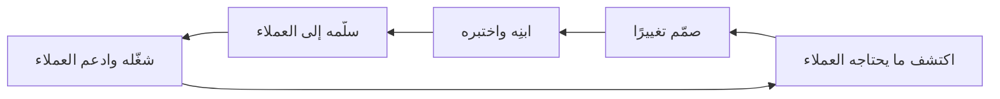
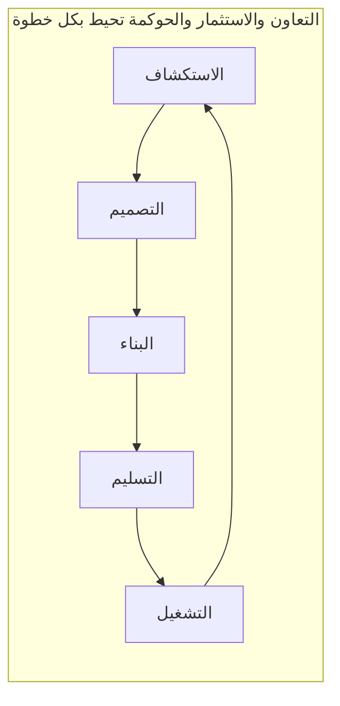
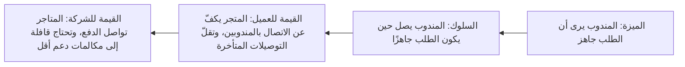
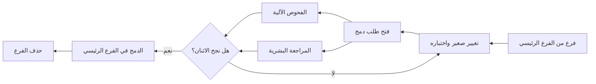
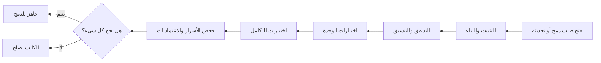
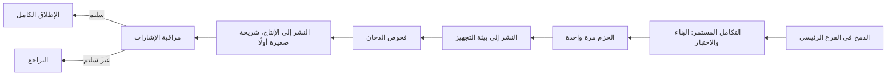
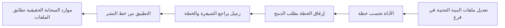
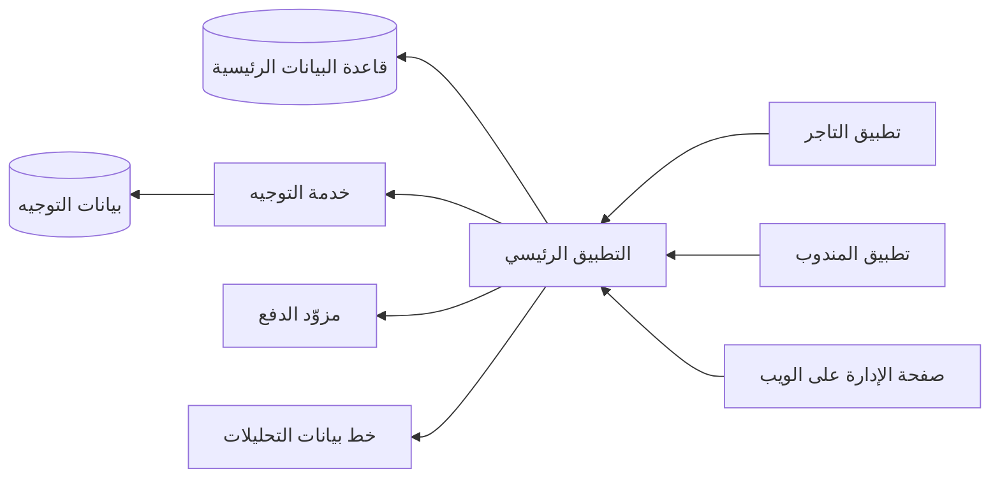

<!-- Generated by scripts/build-dprac.mjs from dprac/README.ar.md and dprac/modules/*.ar.md. Do not edit by hand. -->
<!-- dprac-source: 548e558540c66b98 -->

<div dir="rtl">

# الممارسة الرقمية — الدورة كاملة

*14 وحدة · 41 درسًا · 193 قالبًا وأداة · من الاستكشاف إلى الحوكمة*

**كيف تُكتشف المنتجات الرقمية وتُصمَّم وتُبنى وتُسلَّم وتُشغَّل وتُموَّل وتُحكم، وما الذي يتغيّر حين تنمو الشركة من شخصين إلى أربعمئة. دورة مجانية ثنائية اللغة لمن هم في بداية مسار مهني رقمي.**

<!-- study-time -->
**مدة دراسة الدورة كاملةً: نحو 78 ساعةً** (تقدير: القراءة مع العمل التطبيقي، مجموعًا على كل الدروس). بمعدل 6 ساعات أسبوعيًا تقريبًا، يعني ذلك نحو 13 أسبوعًا. يبيّن كل درس تقسيمه الخاص، وستحلّ محلّ هذه التقديرات قياساتٌ من تجربة مع متعلمين حقيقيين.
<!-- /study-time -->

## ما هذه الدورة

تضعك سنواتك الأولى في العمل الرقمي عادةً في ركن واحد من المهمة: قاعدة شيفرة، أو قائمة أعمال، أو طابور دعم، أو جدول بيانات. تُريك هذه الدورة الصورة كاملة: كيف يصنع المنتج الرقمي القيمة، وكيف تُختبر نسخته الأولى، وكيف تُبنى البرمجيات وتُصدَر وتُشغَّل بأمان، وكيف يعمل الفريق ثم الفرق الكثيرة معًا، وكيف يُعتنى بالبنية والبيانات، وكيف يُموَّل العمل، وأين تقع المخاطر والأمن والامتثال دون أن توقف العمل.

تتابع الدورة شركة خيالية واحدة عبر خمس مراحل من النمو. تعود الأسئلة نفسها في كل مرحلة بإجابات مختلفة: ما نجح مع شخصين ينهار عند أربعين، وما يحتاجه أربعون شخصًا يخنق شخصين. والمهارة الأساسية أن تعرف في أي مرحلة أنت، وما الذي تتطلبه.

كُتبت الدورة للخرّيجين، والمهندسين المبتدئين، والمحللين، والمصممين، وموظفي الدعم والعمليات، ولكل من انضم إلى فريق رقمي ويريد الصورة كاملة. لا تحتاج إلى أن تكون مبرمجًا، وإن كانت بعض الدروس أسهل إن سبق لك أن رأيت شيفرة. وحين يحتاج الدرس إلى عمق أكبر يحيلك إلى الدورات المرافقة، مثل [*من التخرّج إلى التوظيف*](../career/index.ar.html) و[*السحابة وDevOps: من الصفر إلى الاحتراف*](../cloud/index.ar.html) و[*اختبار البرمجيات: من الصفر إلى الاحتراف في عصر الذكاء الاصطناعي*](../testing/index.ar.html) و[*إدارة تقنية المعلومات كعمل تجاري*](../itbiz/index.ar.html)، بدل أن يعيد تدريسها.

## ما الذي لا تقدّمه هذه الدورة

- **ليست دورة في إطار عمل ولا تحضيرًا لامتحان.** الدورة أصيلة: لا تشرح أي إطار أو معيار أو مجموعة معارف مملوكة ولا تلخّصها ولا تتبع بنيتها، وليست تحضيرًا لأي امتحان شهادة. يذكر الدرس 12.3 الأطر ومجموعات المعارف الرئيسية في المجال مع الجهات المالكة لها، ويشرح كيف تستفيد منها في تعلّمك.
- **ليست وعدًا.** لا تَعِد الدورة بشهادة أو وظيفة أو ترقية أو راتب.
- **ليست معتمدة ولا مراجَعة.** أُعدّت المادة بمساعدة الذكاء الاصطناعي ولم يراجعها خبير في الموضوع. تُذكر الأدوات والمورّدون والأطر أمثلةً لا توصياتٍ، والدورة غير تابعة لأي منها.
- **ليست استشارة مهنية.** حين يقترب الدرس من القانون أو المال أو التنظيم يذكر نوع السؤال الذي تحمله إلى شخص مؤهَّل.

## كيف يعمل كل درس

لكل درس الأجزاء العشرة نفسها، لتعرف دائمًا أين أنت:

| الجزء | ما تحصل عليه |
|---|---|
| ⚡ **الدرس في دقيقة** | الدرس في بضع نقاط: الفكرة، والقاعدة الأهم، وأكبر فخّ. |
| 🧭 **لماذا يهم** | لحظة في قافلة تجعل الموضوع أمرًا لا مفرّ منه. |
| 📐 **كيف يعمل** | الأفكار متدرّجة كالسلّم: 🟢 *الأساسيات* ← 🟡 *التعمق أكثر* ← 🔴 *نظرة الخبير*. |
| 🧰 **الأدوات** | النماذج وقوائم التحقق والمقاييس والأدوات ذات الصلة: ما يفعله كلٌّ منها ومتى تلجأ إليه. |
| 🏛️ **عمليًا في قافلة** | المُخرَج الذي ينتجه الدرس، كما استخدمه أحد أفراد الفريق. |
| 🛠️ **التمارين** | ثلاثة تمارين متدرّجة (🟢 🟡 🔴)، لكلٍّ منها معايير «يكتمل عندما» وإجابة نموذجية تتحقق بها من عملك. |
| ⚠️ **أخطاء وفخاخ** | ما يسوء في الممارسة، وما يجب فعله بدلًا منه. |
| 🧾 **الخلاصة** | الخلاصات الجديرة بالتذكّر. |
| ✍️ **اختبر نفسك** | خمسة أسئلة، معظمها سيناريوهات، مع إجابات مخفية وشروح. |
| 📚 **المراجع** | أبحاث وإرشادات ومصادر موثوقة، وروابط إلى بقية المكتبة. |

كل درس موسوم بـ**خطوته** في الممارسة الرقمية: Discover أو Design أو Build أو Deliver أو Operate أو Collaborate أو Invest أو Govern. ويجمع [فهرس الأدوات](#appendix-the-repo-catalog) كل نموذج وقائمة تحقق في مكان واحد.

## الحالة المستمرة: قافلة (خيالية)

**قافلة** شركة خليجية ناشئة خيالية، لها تطبيق لتنسيق التوصيل للأعمال الصغيرة: تطلب المتاجر التوصيل، ويستلم المندوبون الطلبات، ويرى الجميع أين وصل كل طلب. تتابعها الدورة عبر خمس مراحل. الشركة وأفرادها وكل أرقامها مختلَقة لأغراض التعليم، والأرقام توضيحية لا معايير مرجعية.

| المرحلة | الوحدات | قافلة في تلك المرحلة |
|---|---|---|
| الانطلاق | 0–2 | شخصان ثم أربعة؛ 15 متجرًا في التجربة؛ نحو 150 توصيلة يوميًا. |
| الجذب | 3–5 | نحو 12 شخصًا في فريق واحد؛ نحو 300 تاجر. |
| النمو | 6–7 | نحو 40 شخصًا في 4 فرق؛ نحو 2,000 تاجر. |
| التوسّع | 8–9 | نحو 120 شخصًا في 12 فريقًا؛ نحو 9,000 تاجر. |
| الرسوخ | 10–13 | نحو 400 شخص في 35 فريقًا؛ نحو 30,000 تاجر في 4 دول. |

- **مها**، المؤسِّسة والرئيسة التنفيذية.
- **فيصل**، المهندس الأول، ثم رئيس الهندسة.
- **عائشة**، مديرة المنتج، منذ مرحلة الجذب.
- **كريم**، المصمم.
- **سلمى**، الدعم والعمليات، ثم قائدة الخدمة.
- **حمد**، البيانات.
- **دانة**، الأمن والمخاطر، منذ مرحلة التوسّع.
- **بلال**، المالية.
- **ياسمين**، مهندسة حديثة التخرّج تنضم في مرحلة النمو، وهي تمثّل القارئ.

## الخطة: 41 درسًا في 14 وحدة

| الوحدة | الدروس |
|---|---|
| 0 التوجيه | 0.1 ما الممارسة الرقمية: المنتجات والخدمات والعمل الذي يقف وراءها · 0.2 تعرّف على قافلة والخطوات الثماني · 0.3 كيف تستخدم هذه الدورة، وما الذي ليست عليه |
| 1 القيمة الرقمية والعميل | 1.1 ما الذي يجعل المنتج رقميًا، وكيف يصنع القيمة · 1.2 فهم العملاء: المشكلات والمهام والأدلة · 1.3 نماذج العمل والتكاليف ووحدة القيمة |
| 2 من الفكرة إلى المنتج الأول | 2.1 الاستكشاف: صياغة المشكلة واختبار الافتراضات · 2.2 أصغر منتج مفيد: النطاق والنماذج الأولية والتعلّم · 2.3 اختيار التقنيات: البناء والشراء والسحابة وSaaS |
| 3 بناء البرمجيات بإتقان | 3.1 التحكم في الإصدارات ومراجعة الشيفرة واتفاقات العمل · 3.2 الاختبار الآلي والتكامل المستمر · 3.3 التسليم المستمر والنشر الآمن |
| 4 تشغيل ما بنيته | 4.1 البنية التحتية بوصفها شيفرة وأساسيات السحابة للممارسين · 4.2 المراقبة والتنبيهات والمناوبة · 4.3 الحوادث ومراجعات ما بعد الحادثة وأهداف الموثوقية |
| 5 العمل كفريق | 5.1 الأدوار والتعاون والأمان النفسي · 5.2 طرق العمل الرشيقة: قوائم الأعمال والتكرارات والتدفّق · 5.3 إظهار العمل وتقييد العمل الجاري |
| 6 إدارة المنتج داخل الفريق | 6.1 خرائط الطريق وترتيب الأولويات · 6.2 المتطلبات وقصص المستخدم ومعايير القبول · 6.3 قياس النتائج: تحليلات المنتج والتجارب |
| 7 الخدمة والدعم | 7.1 تصميم الخدمة حول المنتج: نموذج الدعم والمعرفة · 7.2 الطلبات والتغييرات ومكتب الخدمة في شركة تنمو · 7.3 مستويات الخدمة والتحدث إلى العملاء حين تسوء الأمور |
| 8 فرق كثيرة | 8.1 هياكل الفرق وحدودها: فرق المنتج والمنصة والتمكين · 8.2 الاعتماديات والتخطيط والتنسيق بين الفرق · 8.3 المنصات الداخلية وتجربة المطوّر |
| 9 البنية والبيانات | 9.1 القرارات المعمارية والمفاضلات · 9.2 البيانات أصلًا: الجودة والملكية والخصوصية · 9.3 الدَّين التقني والتحديث |
| 10 المال والمورّدون | 10.1 تمويل العمل الرقمي: الميزانيات ودراسات الجدوى وتمويل المنتجات · 10.2 تكلفة تشغيل المنتجات الرقمية: تكاليف السحابة واقتصاديات الوحدة · 10.3 المورّدون والعقود والإسناد الخارجي |
| 11 الحوكمة والمخاطر والأمن | 11.1 حوكمة تُعين: صلاحيات القرار والضوابط الوقائية · 11.2 الأمن والمخاطر في الممارسة اليومية · 11.3 الامتثال والتدقيق دون شلل |
| 12 الصورة الأكبر ومسارك | 12.1 البنية المؤسسية والمحفظة كما يراهما الفريق · 12.2 الذكاء الاصطناعي في العمل الرقمي: استعماله جيدًا مع الضوابط · 12.3 الأطر ومجموعات المعارف ومسار تعلّمك |
| 13 المشروع الختامي والتدريب | 13.1 المشروع الختامي: دليل الممارسة الرقمية في قافلة · 13.2 الامتحان التدريبي: 40 سؤالًا عن مواقف عملية |

## المسار من الصفر إلى الاحتراف

| المرحلة | الوحدات | ستتمكن من… |
|---|---|---|
| 🟢 **الأساسيات** | 0–3 | أن تشرح كيف يصنع المنتج الرقمي القيمة، وتختبر الفكرة بأدلة حقيقية قبل بنائها، وتختار التقنيات بحكمة، وتبني البرمجيات بالتحكم في الإصدارات والمراجعة والاختبارات الآلية والإصدار الآمن. |
| 🟡 **الممارس** | 4–9 | أن تشغّل ما بنيته بالمراقبة والمناوبة ومراجعات الحوادث، وتعمل جيدًا في فريق وبين فرق كثيرة، وتدير قائمة أعمال المنتج وتقيس النتائج، وتصمّم الدعم حول المنتج، وتتخذ قرارات في البنية والبيانات تستطيع الدفاع عنها. |
| 🔴 **المتقدم** | 10–13 | أن تفهم كيف يُموَّل العمل الرقمي وكم يكلّف تشغيله، وتعمل مع المورّدين، وتطبّق الحوكمة والأمن والامتثال دون أن يتعطّل التسليم، وتستخدم الذكاء الاصطناعي مع الضوابط، وتخطّط لمسار تعلّمك، وتختم بدليل قافلة وامتحان تدريبي من 40 سؤالًا. |

## لغتان

كل درس متاح بالإنجليزية والعربية. في النسخة العربية يحمل المصطلح التقني اسمه الإنجليزي بين قوسين أول مرة يظهر فيها في الدرس، مثل «التكامل المستمر (continuous integration)».

## إلى أين بعد ذلك

افتح خريطة الدورة، أو ابدأ بالدرس 0.1.

<a id="contents"></a>

## المحتويات

- **[الوحدة 0 — التوجيه](#m0)**
  - [0.1 — ما الممارسة الرقمية: المنتجات والخدمات والعمل الذي يقف وراءها](#l0-1) · 🟢 مبتدئ
  - [0.2 — تعرّف على قافلة والخطوات الثماني](#l0-2) · 🟢 مبتدئ
  - [0.3 — كيف تستخدم هذه الدورة، وما الذي ليست عليه](#l0-3) · 🟢 مبتدئ
- **[الوحدة 1 — القيمة الرقمية والعميل](#m1)**
  - [1.1 — ما الذي يجعل المنتج رقميًا، وكيف يصنع القيمة](#l1-1) · 🟢 مبتدئ
  - [1.2 — فهم العملاء: المشكلات والمهام والأدلة](#l1-2) · 🟢 مبتدئ
  - [1.3 — نماذج العمل والتكاليف ووحدة القيمة](#l1-3) · 🟢 مبتدئ
- **[الوحدة 2 — من الفكرة إلى المنتج الأول](#m2)**
  - [2.1 — الاستكشاف: صياغة المشكلة واختبار الافتراضات](#l2-1) · 🟢 مبتدئ
  - [2.2 — أصغر منتج مفيد: النطاق والنماذج الأولية والتعلّم](#l2-2) · 🟢 مبتدئ
  - [2.3 — اختيار التقنيات: البناء والشراء والسحابة وSaaS](#l2-3) · 🟢 مبتدئ
- **[الوحدة 3 — بناء البرمجيات بإتقان](#m3)**
  - [3.1 — التحكم في الإصدارات ومراجعة الشيفرة واتفاقات العمل](#l3-1) · 🟢 مبتدئ
  - [3.2 — الاختبار الآلي والتكامل المستمر](#l3-2) · 🟢 مبتدئ
  - [3.3 — التسليم المستمر والنشر الآمن](#l3-3) · 🟢 مبتدئ
- **[الوحدة 4 — تشغيل ما بنيته](#m4)**
  - [4.1 — البنية التحتية بوصفها شيفرة وأساسيات السحابة للممارسين](#l4-1) · 🟡 متوسط
  - [4.2 — المراقبة والتنبيهات والمناوبة](#l4-2) · 🟡 متوسط
  - [4.3 — الحوادث ومراجعات ما بعد الحادثة وأهداف الموثوقية](#l4-3) · 🟡 متوسط
- **[الوحدة 5 — العمل كفريق](#m5)**
  - [5.1 — الأدوار والتعاون والأمان النفسي](#l5-1) · 🟡 متوسط
  - [5.2 — طرق العمل الرشيقة: قوائم الأعمال والتكرارات والتدفّق](#l5-2) · 🟡 متوسط
  - [5.3 — إظهار العمل وتقييد العمل الجاري](#l5-3) · 🟡 متوسط
- **[الوحدة 6 — إدارة المنتج داخل الفريق](#m6)**
  - [6.1 — خرائط الطريق وترتيب الأولويات](#l6-1) · 🟡 متوسط
  - [6.2 — المتطلبات وقصص المستخدم ومعايير القبول](#l6-2) · 🟡 متوسط
  - [6.3 — قياس النتائج: تحليلات المنتج والتجارب](#l6-3) · 🟡 متوسط
- **[الوحدة 7 — الخدمة والدعم](#m7)**
  - [7.1 — تصميم الخدمة حول المنتج: نموذج الدعم والمعرفة](#l7-1) · 🟡 متوسط
  - [7.2 — الطلبات والتغييرات ومكتب الخدمة في شركة تنمو](#l7-2) · 🟡 متوسط
  - [7.3 — مستويات الخدمة والتحدث إلى العملاء حين تسوء الأمور](#l7-3) · 🟡 متوسط
- **[الوحدة 8 — فرق كثيرة](#m8)**
  - [8.1 — هياكل الفرق وحدودها: فرق المنتج والمنصة والتمكين](#l8-1) · 🟡 متوسط
  - [8.2 — الاعتماديات والتخطيط والتنسيق بين الفرق](#l8-2) · 🟡 متوسط
  - [8.3 — المنصات الداخلية وتجربة المطوّر](#l8-3) · 🟡 متوسط
- **[الوحدة 9 — البنية والبيانات](#m9)**
  - [9.1 — القرارات المعمارية والمفاضلات](#l9-1) · 🟡 متوسط
  - [9.2 — البيانات أصلًا: الجودة والملكية والخصوصية](#l9-2) · 🟡 متوسط
  - [9.3 — الدَّين التقني والتحديث](#l9-3) · 🟡 متوسط
- **[الوحدة 10 — المال والمورّدون](#m10)**
  - [10.1 — تمويل العمل الرقمي: الميزانيات ودراسات الجدوى وتمويل المنتجات](#l10-1) · 🔴 متقدم
  - [10.2 — تكلفة تشغيل المنتجات الرقمية: تكاليف السحابة واقتصاديات الوحدة](#l10-2) · 🔴 متقدم
  - [10.3 — المورّدون والعقود والإسناد الخارجي](#l10-3) · 🔴 متقدم
- **[الوحدة 11 — الحوكمة والمخاطر والأمن](#m11)**
  - [11.1 — حوكمة تُعين: صلاحيات القرار والضوابط الوقائية](#l11-1) · 🔴 متقدم
  - [11.2 — الأمن والمخاطر في الممارسة اليومية](#l11-2) · 🔴 متقدم
  - [11.3 — الامتثال والتدقيق دون شلل](#l11-3) · 🔴 متقدم
- **[الوحدة 12 — الصورة الأكبر ومسارك](#m12)**
  - [12.1 — البنية المؤسسية والمحفظة كما يراهما الفريق](#l12-1) · 🔴 متقدم
  - [12.2 — الذكاء الاصطناعي في العمل الرقمي: استعماله جيدًا مع الضوابط](#l12-2) · 🔴 متقدم
  - [12.3 — الأطر ومجموعات المعارف ومسار تعلّمك](#l12-3) · 🔴 متقدم
- **[الوحدة 13 — المشروع الختامي والتدريب](#m13)**
  - [13.1 — المشروع الختامي: دليل الممارسة الرقمية في قافلة](#l13-1) · 🔴 متقدم
  - [13.2 — الامتحان التدريبي: 40 سؤالًا عن مواقف عملية](#l13-2) · 🔴 متقدم
- **[الملحق — دليل الأدوات (Toolkit)](#appendix-the-repo-catalog)**

---

<a id="m0"></a>

# الوحدة 0 — التوجيه

*كل منتج رقمي استخدمته، من تطبيق توصيل الطعام إلى الموقع الإلكتروني لأحد البنوك، يبقى حيًّا بفضل أشخاص يؤدّون أنواعًا كثيرة من العمل: يكتشفون ما يحتاجه العملاء، ويصمّمون، ويكتبون الشيفرة ويختبرونها، ويُصدرونها، ويُبقونها تعمل، ويجيبون العملاء، ويدفعون الفواتير، ويتأكدون من احترام القواعد. تضع هذه الوحدة الأساس للدورة كلها. فهي تشرح معنى «الممارسة الرقمية»، ولماذا يكون المنتج دائمًا منتجًا وخدمةً والعملَ الذي يقف وراءهما معًا؛ وتعرّفك بقافلة، وهي شركة ناشئة خيالية لتنسيق التوصيل في مرحلة الانطلاق، حين تبني مها وفيصل النسخة الأولى بأيديهما، ومعها الشخصيات والخطوات الثماني للعمل الرقمي التي يعتمد عليها كل درس لاحق؛ وتقول بوضوح كيف تستخدم الدورة وما ليست عليه. ويخرج كل درس بوثيقة من صفحة واحدة: مخطط للمنتج والخدمة، وخريطة خطوات لأسبوع عمل واحد، وخطة تعلّمك الخاصة.*

> **الخطوات:** Discover — انظر إلى العمل الرقمي كله، وإلى موقعك منه، قبل أن تتعلّم أي جزء منه.

<a id="l0-1"></a>

## 0.1 — ما الممارسة الرقمية: المنتجات والخدمات والعمل الذي يقف وراءها

*المستوى: 🟢 مبتدئ* · *المتطلبات: لا يوجد* · *الخطوة (Step): Discover*

**بعد هذا الدرس تستطيع** أن ترسم مخططًا من صفحة واحدة للمنتج والخدمة لمنتج رقمي واحد: من يستخدمه ولأي غرض، والخدمة التي تحيط بالبرمجيات، وأنواع العمل التي تُبقي الاثنين قائمين، ومن يؤدّي كل نوع منها اليوم. *مدة الدراسة: قراءة نحو 15 دقيقةً، وعمل تطبيقي نحو 70 دقيقةً (تقدير).*

### ⚡ الدرس في دقيقة (In 60 seconds)
- **المنتج الرقمي (digital product)** شيء يستخدمه الناس عبر البرمجيات: تطبيق، أو موقع إلكتروني، أو أداة على الإنترنت. أما **الخدمة** فهي المساعدة والوعود المحيطة به: الدعم، والموثوقية، والفوترة، وتهيئة المستخدمين الجدد. ويعيش العملاء الاثنين شيئًا واحدًا.
- **الممارسة الرقمية (digital practice)** هي مجموعة المهارات اليومية التي تُستخدم لاكتشاف المنتجات الرقمية وتصميمها وبنائها وتسليمها وتشغيلها وتحسينها، ولتمويل هذا العمل وتنسيقه وحوكمته.
- القاعدة الأهم: **المنتج برمجيات، ومعها الخدمة المحيطة بها، ومعهما الأشخاص الذين يُبقون الاثنين قائمين.** إن لم ترَ إلا الشيفرة، فأنت لا ترى إلا جزءًا من العمل.
- إشارة القرار: قبل أن تبدأ أي مهمة، اسأل: «أيّ عميل تساعده هذه المهمة، وماذا يحدث له إن ساءت الأمور؟»
- أكبر فخ: أن تظن أن مسمّاك الوظيفي هو كل عملك. فالمطوّر يجيب الأسئلة أيضًا، والمختبِر يكتشف الاحتياجات أيضًا، وموظف الدعم يحسّن المنتج أيضًا.

### 🧭 لماذا يهم (Why it matters)
قافلة وكل من فيها شخصيات خيالية، ويقدّمهم الدرس 0.2 كما ينبغي. وكل الأرقام عن قافلة في هذا الدرس أرقام توضيحية، لا معايير مرجعية.

نحن في الشهر الرابع من التجربة التشغيلية في مرحلة الانطلاق. بنت مها وفيصل النسخة الأولى من قافلة: تطبيق للتجّار يطلب فيه المتجر توصيلة، وتطبيق للمندوبين يقبل فيه المندوب التوصيلة، وصفحة إدارة على الويب تتابع منها مها كل شيء. يستخدمه خمسة عشر متجرًا في التجربة، بنحو 150 توصيلة في اليوم، والفريق على وشك أن يكبر من شخصين إلى أربعة. الشيفرة تعمل، وهما فخوران بها.

في السادسة وعشر دقائق من أحد الصباحات يرنّ هاتف مها. مخبز مشارك في التجربة جهّز أربعين صندوق خبز لفندق في السادسة، ولم يأتِ أي مندوب. كان التطبيق يقول «تم تعيين المندوب»، لكن المندوب حذف التطبيق في الليلة السابقة، ولم يستطع أحد أن يرى ذلك. لا تهتم الخبّازة بمكان الخلل. يهمّها أن الخبز تأخر، وأن مها وحدها تجيب، وأن أحدًا لم يخبرها بما سيحدث بعد ذلك.

ردّ فيصل الأول: «الشيفرة فعلت تمامًا ما صُمّمت لتفعله». وهو محق، لكن ذلك لا يفيد. ما فشل هو الترتيب المحيط بالشيفرة: لا وسيلة لرؤية مندوب انقطع، ولا وعد للخبّازة، ولا رقم سوى رقم مها، ولا سجل للمشكلة. يدور هذا الدرس حول رؤية ذلك الترتيب كله.

### 📐 كيف يعمل (How it works)

#### 🟢 الأساسيات (The essentials)

**المنتج والخدمة والمشروع.** ثلاث كلمات يستخدمها الناس دون تدقيق. افصل بينها.

| المصطلح | المعنى ببساطة | مثال من قافلة |
|---|---|---|
| **المنتج** | الشيء الذي يستخدمه الناس، ومعظمه برمجيات وبيانات | تطبيق التجّار، وتطبيق المندوبين، وصفحة الإدارة على الويب |
| **الخدمة** | المساعدة والوعود والتشغيل اليومي المحيطة بالمنتج | شخص تتصل به حين تتأخر توصيلة، ومندوبون تجري تهيئتهم ويُدفع لهم، وتطبيق يبقى متاحًا ويعمل |
| **المشروع** | عمل له بداية ونهاية وميزانية | «إضافة الدفع إلى تطبيق التجّار بحلول مارس» |

قد يغيّر المشروع المنتج، لكن المنتج وخدمته يستمران بعد انتهاء المشروع. وينشأ كثير من الالتباس في العمل من معاملة منتج حيّ كأنه مشروع «ينتهي». تجد نظرة المدير إلى هذه الفكرة في [*إدارة تقنية المعلومات كعمل تجاري*، الدرس 2.1 — المنتجات الرقمية والخدمات والمشاريع: ما كل منها ومن يملكه](../itbiz/index.ar.html#/2.1).

**ما الذي يجعل الشيء رقميًا.** في هذه الدورة، يكون المنتج رقميًا حين تصل معظم قيمته إلى العميل عبر البرمجيات والبيانات: تنقر الخبّازة على شاشة بدل أن تتصل بمندوب. لذلك يتغير كثيرًا (وكل تغيير قد يكسر شيئًا)، ويعمل طوال الوقت (فلا بد أن يراقبه أحد)، ويسجّل استخدامه بنفسه (فتستطيع أن تتعلّم بدل أن تخمّن)، وتخدم نسخة واحدة منه الجميع (فيصل الخطأ إلى الجميع). وتتعمق الوحدة 1 في ذلك.

**ما الممارسة الرقمية.** «الممارسة» هنا تعني ما يفعله الممارسون كل يوم، كما نقول ممارسة الطبيب، لا نظرية. والممارسة الرقمية هي مجموعة المهارات التي يستخدمها الناس لرعاية منتج رقمي طوال حياته:

- اكتشاف ما يحتاجه العملاء، وهل تستحق الفكرة أن تُبنى؛
- تصميم الطريقة التي يعمل بها وشكله؛
- بناؤه: كتابة الشيفرة واختبارها ومراجعتها؛
- تسليمه: إيصال التغييرات إلى العملاء بأمان؛
- تشغيله: مراقبته وإصلاحه ودعم العملاء؛
- العمل معًا: الفرق والأدوار والاتفاقات؛
- تمويله: معرفة تكلفته وهل يستحقها؛
- حوكمته: إبقاؤه آمنًا وقانونيًا وجديرًا بالثقة.

ويحوّل الدرس 0.2 هذه القائمة إلى الخطوات الثماني التي تستخدمها الدورة.

**العمل الذي يقف وراء المنتج.** من التمارين المفيدة أن تسرد كل نوع من العمل يلزم لإبقاء المنتج حيًّا. في قافلة، في مرحلة الانطلاق، يؤدّي شخصان معظم هذا العمل:

| نوع العمل | من يؤدّيه في قافلة اليوم | ماذا يحدث إن لم يؤدّه أحد |
|---|---|---|
| التحدث مع المتاجر والمندوبين عن مشكلاتهم | مها، حين يتّسع وقتها | يحلّ التطبيق مشكلات لا يعانيها أحد |
| تقرير ما يُبنى بعد ذلك | مها وفيصل، على فنجان قهوة | يفوز صاحب الصوت الأعلى |
| كتابة الشيفرة واختبارها | فيصل في الغالب | لا يصدر شيء جديد، أو يصدر معطوبًا |
| إصدار التغييرات، أي النشر (deployment): وضع نسخة جديدة في الخدمة | فيصل، يدويًا، مرة في الأسبوع | تتراكم التغييرات وتزداد خطورتها |
| مراقبة أنه يعمل (monitoring) | لا أحد حتى الآن | يكتشف المخبز المشكلة قبلك |
| إجابة المتاجر والمندوبين | هاتف مها الشخصي | يشعر العملاء بالإهمال ويرحلون |
| دفع فاتورة السحابة ومتابعة التكاليف | بطاقة مها الخاصة | مفاجآت؛ ولا أحد يعرف تكلفة التوصيلة الواحدة |
| حماية بيانات المتاجر والعملاء | لم يفكر فيها أحد | تسرّب، وغرامة، وثقة مفقودة |

العمود الأخير هو المقصود. كل صف عملٌ، سواء كُلّف به أحد أم لا. وإن لم يؤدّه أحد عن قصد، أُدّي مصادفةً، وبشكل سيئ، في أسوأ لحظة.

#### 🟡 التعمق أكثر (Going deeper)

**حياة المنتج حلقة لا خط.** كثيرًا ما يتصوّر الممارسون الجدد العمل خطًّا مستقيمًا: فكرة، ثم شيفرة، ثم اختبار، ثم إصدار (release)، ثم انتهى. أما في الواقع فهو يدور في حلقة: يُنتج الإصدار بيانات وردود فعل من العملاء، تقود إلى أسئلة جديدة وإلى التغيير التالي. وصباح المخبز هو الحلقة وهي تعمل: فشلٌ في تشغيل المنتج يتحول إلى اكتشاف لما يفعله المندوبون بهواتفهم، ثم إلى تغيير في التصميم (التنبيه حين ينقطع مندوب)، ثم إلى شيفرة، ثم إلى إصدار، ثم يجب أن يُراقَب.



**كيف يتغير العمل حين تكبر الشركة.** في مرحلة الانطلاق، يؤدّي شخصان كل أنواع العمل. وحين تكبر قافلة، يصبح لكل نوع من العمل أشخاصه، ثم فرقه، ثم قواعده: مهارة أكبر، لكن معها تناقل للعمل بين الأشخاص وانتظار. تتابع الدورة قافلة عبر خمس مراحل نمو (الدرس 0.2). والطريقة الصحيحة لأداء مهمة ما تتوقف على المرحلة: إجراء موافقة يستغرق أسبوعين حكيمٌ في شركة من 400 شخص تتعامل مع المدفوعات، وعبثيٌّ في شركة من أربعة أشخاص معها 15 متجرًا في التجربة.

**أين موقعك.** كل دور في بداية المسار المهني يعمل في الغالب في جزء أو جزأين من الحلقة، ويمتد إلى غيرهما: موظفو الدعم مثلًا يغذّون الاستكشاف (discovery)، لأن كل تذكرة دعم دليل على حاجة. ولترى كيف تبدو هذه الوظائف يومًا بيوم، راجع [*من التخرّج إلى التوظيف*، الدرس 0.2 — خريطة الأدوار: ماذا يفعل المبتدئون في البرمجيات والذكاء الاصطناعي والبيانات والمنصّات والأمن طوال اليوم فعلًا](../career/index.ar.html#/0.2).

#### 🔴 نظرة الخبير (Expert view)

**قِس السرعة والاستقرار معًا.** إن عددت السرعة وحدها شجّعت على الأعطال، وإن عددت الانقطاعات وحدها شجّعت على الجمود. يجمع برنامج DORA (DevOps Research and Assessment، وهو برنامج بحثي طويل الأمد أصبح الآن جزءًا من Google Cloud) مقاييسه لأداء تسليم البرمجيات في عاملين: معدّل الإنجاز (throughput)، أي مدى سرعة وصول التغييرات إلى بيئة الإنتاج وتكرارها، وسرعة التعافي من نشر فاشل؛ وعدم الاستقرار (instability)، أي عدد مرات فشل التغييرات أو حاجتها إلى إعادة عمل غير مخطط لها. ويقول إن العاملين معًا يعطيان صورة عامة عن أداء التسليم (دليل مقاييس DORA، المحدَّث في يناير 2026). والعادة التي تبنيها الآن: حين يصف أحدهم فريقًا بأنه «سريع»، اسأل كم مرة تفشل تغييراته، والعكس صحيح.

**الخدمة جزء من التصميم.** كان يمكن حل مشكلة المخبز بالشيفرة (اكتشاف المندوب المنقطع)، أو بوعد خدمة (إن لم يتأكد وجود مندوب قبل الاستلام بعشر دقائق، يتلقى المتجر اتصالًا)، أو بالاثنين معًا. وتتناول الوحدة 7 خيار الخدمة.

**القاعدة التي تُحفظ.** المنتج برمجيات، ومعها الخدمة المحيطة بها، ومعهما الأشخاص الذين يُبقون الاثنين قائمين.

### 🧰 الأدوات (The toolkit)
| المصدر أو الأداة أو القالب (Resource, tool or template) | ما هو وماذا يفعل (What it is and does) | متى تلجأ إليه (When to reach for it) |
|---|---|---|
| **Product and service sketch** — مخطط المنتج والخدمة | صفحة واحدة: المنتج، والمستخدمون ومهمتهم، والخدمة المحيطة به، وأنواع العمل، ومن يؤدّي كلًّا منها، والفجوات | حين تنضم إلى فريق أو تبدأ العمل على منتج |
| **Work inventory** — جرد العمل | جدول بكل نوع من العمل يحتاجه المنتج، مع مالك وعمود «ماذا يحدث إن لم يؤدّه أحد» | حين تظل الأمور تسقط من بين الأيدي |
| **Loop check** — فحص الحلقة | أربعة أسئلة بعد كل إصدار: ماذا فعل العملاء، وما الذي تعطّل، وماذا تعلّمنا، وما التالي | بعد كل إصدار، مهما صغر |

### 🏛️ عمليًا في قافلة (In practice at Qafila)
بعد صباح المخبز، جلست مها مع فيصل ورسما أول مخطط للمنتج والخدمة في قافلة. توضيحي وخيالي.

> **مخطط المنتج والخدمة في قافلة (مرحلة الانطلاق، المسودة الأولى)**
>
> **المنتج:** تطبيق التجّار (تطلب المتاجر التوصيلات)، وتطبيق المندوبين (يقبل المندوبون التوصيلات وينجزونها)، وصفحة الإدارة على الويب (تتابع مها كل الطلبات). يعمل على الخدمات المُدارة (managed services) لمزوّد سحابي واحد، أي قواعد بيانات وخوادم جاهزة يشغّلها المزوّد نيابةً عنهما؛ والشيفرة كلها في مستودع (repository) واحد، أي المخزن المشترك للشيفرة وتاريخها.
>
> **المستخدمون ومهمتهم:** تريد المتاجر الصغيرة أن يصل الطلب في وقته دون توظيف سائق؛ ويريد المندوبون أعمالًا منتظمة وعادلة الأجر قريبة منهم؛ وتحتاج مها إلى أن ترى الطلبات تتدفق.
>
> **الخدمة المحيطة به:** تهيئة متجر جديد (تزوره مها بنفسها)؛ وتهيئة المندوبين (يثبّت فيصل التطبيق على هواتفهم)؛ والمساعدة حين تتأخر توصيلة (هاتف مها)؛ والدفع للمندوبين (جدول بيانات، أسبوعيًا)؛ وإبقاء النظام يعمل (لا أحد يراقبه).
>
> **أنواع العمل ومن يؤدّيها:** الاستكشاف (مها)، والتصميم (مها وفيصل، على الورق)، والبناء والاختبار (فيصل)، والإصدار (فيصل، أسبوعيًا، يدويًا)، والتشغيل (لا أحد)، والدعم (مها)، والتكاليف (بطاقة مها)، وحماية البيانات (لا أحد).
>
> **فجوات تؤلم الآن:** لا أحد يرى المندوب المنقطع؛ والدعم يعتمد على هاتف واحد؛ ولا سجل للمشكلات.
>
> **تغيير واحد هذا الأسبوع:** رقم دعم مشترك يرنّ على الهاتفين، وقائمة بسيطة بكل مشكلة يُبلَّغ عنها، مع التاريخ وما تم فعله.

أغفلت مسودة فيصل الأولى قسم الخدمة: «هذا ليس من المنتج». فنبّهته مها إلى أن المخبز لم يشتكِ من شاشة واحدة. ثم أراد فيصل أن يصلح كل شيء دفعة واحدة؛ فقصرت مها الأسبوع على تغيير واحد رخيص وقائمة للمشكلات.

### 🛠️ التمارين (Exercises)
**🟢 ارسم مخططًا لمنتج تستخدمه.** اختر منتجًا رقميًا تستخدمه كثيرًا (تطبيق نقل، أو تطبيق توصيل طعام، أو بوابة جامعتك). اكتب مخطط المنتج والخدمة الخاص به: أجزاء المنتج، والمستخدمون ومهمتهم، والخدمة المحيطة به، وثلاثة أنواع من العمل تعتقد أنها تجري وراءه.
*يكتمل عندما (Done when):* يسمّي المخطط مجموعتين من المستخدمين على الأقل، وثلاثة عناصر خدمة على الأقل ليست شاشات، وثلاثة أنواع من العمل مع تخمين لمن يؤدّي كلًّا منها.

<details><summary>الإجابة النموذجية والتحقق الذاتي</summary>

**الإجابة النموذجية.** بوابة جامعية. المنتج: صفحات التسجيل، والجدول الدراسي، والدرجات، وتطبيق الجوال. المستخدمون: الطلاب، والمحاضرون، وموظفو شؤون التسجيل. الخدمة: مكتب مساعدة لتسجيل الدخول، وفتح التسجيل في الموعد المعلن، وإتاحة النظام في أسبوع التسجيل. العمل: مراقبته في أسبوع التسجيل (التشغيل)، واختيار الميزات (المنتج)، والتحقق من أن الطلاب لا يرون درجات بعضهم (الحوكمة).

**التحقق الذاتي.**
- هل أدرجت مستخدمًا واحدًا على الأقل ليس العميل الرئيسي (موظفين أو مندوبين مثلًا)؟
- هل عناصر الخدمة عندك أشياء يشعر بها العميل (مساعدة، ووعود، وإتاحة)، لا شاشات؟
- هل فصلت ما تعرفه عمّا تخمّنه؟

</details>

**🟡 ابنِ جردًا للعمل في قافلة.** باستخدام مخطط قافلة أعلاه، أضف ثلاثة أنواع من العمل فاتت مها وفيصل. واكتب لكل منها من ينبغي أن يؤدّيه الآن، وماذا يحدث إن لم يؤدّه أحد.
*يكتمل عندما (Done when):* يكون كل صف من صفوفك الثلاثة نوعًا مختلفًا من العمل، وله مالك واقعي في مرحلة الانطلاق (مها أو فيصل)، وعاقبة ملموسة تمسّ متجرًا أو مندوبًا.

<details><summary>الإجابة النموذجية والتحقق الذاتي</summary>

**الإجابة النموذجية.** (1) النسخ الاحتياطي لقاعدة بيانات الطلبات: فيصل، يفعّل النسخ الاحتياطية لدى المزوّد ويختبر استعادة واحدة؛ وإلا فقد يُضيّع خطأ واحد كل الطلبات. (2) إبلاغ المتاجر بالتغييرات: مها، برسالة قصيرة قبل كل إصدار؛ وإلا فوجئ متجر بشاشة متغيرة في وقت الذروة. (3) تجديد النطاق وحسابات المطوّرين في متاجر التطبيقات: فيصل، يضع مواعيد التجديد في تقويم مشترك؛ وإلا فقد يُسحب تطبيق المندوبين من المتجر إذا انتهى الحساب، فلا يستطيع المندوبون الجدد تثبيته.

**التحقق الذاتي.**
- هل كل مالك شخص موجود في مرحلة الانطلاق، لا فريق لم تنشئه قافلة بعد؟
- هل كل عاقبة شيء سيلاحظه العميل، لا مجرد قلق داخلي؟
- هل تجنّبت تكرار صفوف موجودة في المخطط أصلًا؟

</details>

**🔴 اعثر على الحلقة في قصة علنية.** اختر منتجًا تستخدمه تغيّر مؤخرًا (إعادة تصميم، أو ميزة جديدة، أو ميزة أُزيلت). اربط ما تستطيع رؤيته من الخارج بالمراحل الخمس في مخطط الحلقة (الاكتشاف، والتصميم، والبناء والاختبار، والتسليم، والتشغيل والدعم): مثلًا، ماذا كان العملاء يفعلون قبل ذلك، وما الذي تغيّر، وكيف تفاعل العملاء، وماذا فعلت الشركة بعد ذلك. وميّز بوضوح ما شاهدته مما استنتجته.
*يكتمل عندما (Done when):* يغطي ما كتبته مراحل الحلقة الخمس، مع حقيقة مشاهَدة واحدة على الأقل لكل مرحلة تستطيع رؤيتها، وسطر يذكر المراحل التي لا تستطيع رؤيتها من الخارج والدليل الذي قد يكشفها.

<details><summary>الإجابة النموذجية والتحقق الذاتي</summary>

**الإجابة النموذجية.** نقل تطبيق مراسلة زرًّا كثير الاستخدام إلى داخل قائمة. الاكتشاف: كان الناس يستخدمونه يوميًا (مشاهَد). التسليم: انتقل في تحديث واحد (مشاهَد). التشغيل والدعم: اشتكت مراجعات متجر التطبيقات؛ وبعد إصدارين عاد الزر إلى مكانه (مشاهَد). مستنتَج: راقبت الشركة المراجعات وتراجعت. لا يمكن رؤيته: التصميم، والبناء والاختبار، ومن اتخذ القرار؛ وملاحظات الإصدار قد تكشفها.

**التحقق الذاتي.**
- هل فصلت المشاهَد عن المستنتَج؟
- هل شملت حلقتك التشغيل والدعم، لا التصميم والإصدار فقط؟
- هل تجنّبت ذكر أسباب لا تستطيع إثباتها؟

</details>

### ⚠️ أخطاء وفخاخ (Mistakes and traps)
- **ألّا ترى إلا الشيفرة.** «الشيفرة فعلت ما صُمّمت لتفعله» ليست مثل «حصل العميل على الخدمة». انظر إلى الخدمة المحيطة بها أيضًا.
- **معاملة المنتج كأنه مشروع.** المنتجات لا تنتهي. خطّط لمن سيرعاه بعد الإصدار.
- **ترك عمل بلا مالك لأنه ليس في مسمّى أحد.** مراقبة النظام والنسخ الاحتياطي وحماية البيانات تحتاج إلى اسم بجانبها، حتى في فريق من شخصين.
- **نسخ إجراءات شركة كبيرة إلى شركة صغيرة.** اجعل الممارسة على قدر المرحلة. ويشرح الدرس 0.2 المراحل.

### 🧾 الخلاصة (Recap)
- المنتج الرقمي برمجيات وبيانات في معظمه؛ والخدمة هي المساعدة والوعود المحيطة به؛ والمشروع عمل مؤقت يغيّرهما.
- الممارسة الرقمية هي العمل اليومي لاكتشاف المنتجات الرقمية وتصميمها وبنائها وتسليمها وتشغيلها وتمويلها وتنسيقها وحوكمتها.
- العمل حلقة لا خط: تشغيل المنتج يغذّي الاستكشاف التالي.
- كل نوع من العمل يحتاج إلى مالك، حتى حين تكون الشركة صغيرة جدًا.
- القاعدة: المنتج برمجيات، ومعها الخدمة المحيطة بها، ومعهما الأشخاص الذين يُبقون الاثنين قائمين.

### ✍️ اختبر نفسك (Check yourself)
**1. بعد صباح المخبز، يقول فيصل: «الشيفرة فعلت تمامًا ما صُمّمت لتفعله». ما أفضل رد؟**

- A. توافقه وتغلق المسألة، لأن العطل خارج الشيفرة مشكلة العميل وعليه أن يحلّها بنفسه.
- B. توافقه، وتضيف اختبارات آلية أكثر لتثبت صحة الشيفرة في الإصدارات المقبلة.
- C. توافقه على أن الشيفرة عملت، وتنظر إلى الخدمة المحيطة بها، فهناك وقع الفشل.
- D. تخالفه، لأن تطبيق المندوبين لا بد أن فيه خللًا ما دامت توصيلة قد ضاعت.

<details><summary>الإجابة</summary>

**C.** وقع الفشل في الترتيب المحيط بالشيفرة. يلوم A العميل، ويضيف B اختبارات لشيفرة أدّت عملها، ويفترض D وجود خلل دون دليل. راجع «لماذا يهم» و«العمل الذي يقف وراء المنتج».

</details>

**2. أيّ مما يلي عنصر من عناصر الخدمة في قافلة لا جزء من المنتج؟**

- A. رقم دعم مشترك تتصل به المتاجر حين تتأخر توصيلة.
- B. الشاشة في تطبيق التجّار التي يطلب منها المتجر توصيلة جديدة.
- C. صفحة الإدارة على الويب التي تعرض لمها كل طلب جارٍ اليوم.
- D. المنطق في تطبيق المندوبين الذي يسند التوصيلة إلى مندوب.

<details><summary>الإجابة</summary>

**A.** خط الدعم مساعدة ووعد حول البرمجيات. أما B وC وD فكلها أجزاء من المنتج البرمجي نفسه. راجع «المنتج والخدمة والمشروع».

</details>

**3. يقول فيصل إن «المنتج سيكتمل» بعد إضافة الدفع. ما التصحيح الأدق؟**

- A. صحيح، بشرط أن يُدار عمل الدفع مشروعًا بنطاق ثابت.
- B. صحيح، لأن المنتج يكتمل حين تصبح فيه كل الأجزاء التي طلبها العملاء.
- C. ليس بعد، لأن المنتج لا يكتمل إلا بعد عام كامل من العمل دون أي أعطال على الإطلاق.
- D. ليس تمامًا: ينتهي مشروع الدفع، لكن المنتج يحتاج إلى رعاية ما دام يُستخدم.

<details><summary>الإجابة</summary>

**D.** المشاريع تنتهي؛ أما المنتجات وخدماتها فتستمر. يخلط A وB بين نهاية المشروع ونهاية المنتج، ويخترع C نقطة اكتمال. راجع «المنتج والخدمة والمشروع».

</details>

**4. تسأل مها من ينبغي أن يراقب أن قافلة تعمل، ولا أحد يفعل ذلك. ماذا يقترح الدرس؟**

- A. تأجيل الأمر حتى تستطيع قافلة توظيف فريق تشغيل، لأن المراقبة عمل متخصص.
- B. تسمية شخص يملكه الآن، حتى في فريق من شخصين، كي يُؤدّى عن قصد.
- C. الطلب من متاجر التجربة الإبلاغ عن المشكلات، لأنها تلاحظ الأعطال أولًا.
- D. تجاوزه ما دام في التجربة 15 متجرًا فقط، لأن الخطر أصغر من أن يُحسب.

<details><summary>الإجابة</summary>

**B.** كل نوع من العمل يحتاج إلى مالك، حتى في فريق من شخصين. يؤجّل A الأمر، ويجعل C العملاءَ نظامَ المراقبة (كما حدث في المخبز)، ويتجاهل D أن كل عطل يصيب متجرًا حقيقيًا. راجع «العمل الذي يقف وراء المنتج».

</details>

**5. يمتدح صديق فريقًا لأنه «ينشر عشر مرات في اليوم» (يضع نسخة جديدة في الخدمة عشر مرات). أيّ سؤال يعبّر أفضل تعبير عن نظرة الخبير في هذا الدرس؟**

- A. ما نسبة تلك الإصدارات التي تكسر شيئًا لدى العملاء وتحتاج إلى إصلاح؟
- B. كم اختبارًا آليًا يُشغَّل على كل تغيير قبل أن يُسمح له بدخول الخدمة؟
- C. ما سرعة انتهاء كل عملية نشر من تلك بعد أن يبدأ أحدهم تشغيلها؟
- D. كم من تلك التغييرات راجعها مهندس ثانٍ قبل إصدارها؟

<details><summary>الإجابة</summary>

**A.** يجب أن تُقرأ السرعة مع الاستقرار؛ ويجمع DORA مقاييسه في عاملَي معدّل الإنجاز وعدم الاستقرار. يتناول B وD احتياطات تُتخذ قبل الإصدار، ويعود C إلى السرعة؛ ولا يُظهر أيٌّ منها كم مرة تفشل التغييرات فعلًا لدى العملاء. راجع «قِس السرعة والاستقرار معًا».

</details>

### 📚 المراجع (References)
- DORA، «DORA's software delivery performance metrics» (دليل على موقع dora.dev): https://dora.dev/guides/dora-metrics/ — خمسة مقاييس في عاملين: معدّل الإنجاز وعدم الاستقرار (آخر تحديث للصفحة 5 يناير 2026؛ فُتحت في 22 نوفمبر 2026).
- دورة من المكتبة: [*إدارة تقنية المعلومات كعمل تجاري*، الدرس 2.1 — المنتجات الرقمية والخدمات والمشاريع: ما كل منها ومن يملكه](../itbiz/index.ar.html#/2.1) (نظرة المدير إلى المنتجات والمشاريع).
- دورة من المكتبة: [*من التخرّج إلى التوظيف*، الدرس 0.2 — خريطة الأدوار: ماذا يفعل المبتدئون في البرمجيات والذكاء الاصطناعي والبيانات والمنصّات والأمن طوال اليوم فعلًا](../career/index.ar.html#/0.2) (ما تفعله أدوار بداية المسار المهني يومًا بيوم).

<a id="l0-2"></a>

## 0.2 — تعرّف على قافلة والخطوات الثماني

*المستوى: 🟢 مبتدئ* · *المتطلبات: 0.1* · *الخطوة (Step): Discover*

**بعد هذا الدرس تستطيع** أن تأخذ أسبوع عمل واحدًا على منتج رقمي وتفرز كل مهمة فيه تحت الخطوات الثماني: الاستكشاف (Discover)، والتصميم (Design)، والبناء (Build)، والتسليم (Deliver)، والتشغيل (Operate)، والتعاون (Collaborate)، والاستثمار (Invest)، والحوكمة (Govern)؛ وأن تسمّي من أدّاها وما الدليل الذي تركته، وأن تكتشف الخطوات التي لا يغطيها أحد. *مدة الدراسة: قراءة نحو 15 دقيقةً، وعمل تطبيقي نحو 75 دقيقةً (تقدير).*

### ⚡ الدرس في دقيقة (In 60 seconds)
- **قافلة** شركة ناشئة خليجية **خيالية** تبني تطبيقًا لتنسيق التوصيل للأعمال الصغيرة ومندوبيها، وتتابعها الدورة عبر خمس مراحل نمو.
- تفرز الدورة كل العمل الرقمي في **ثماني خطوات**: الاستكشاف، والتصميم، والبناء، والتسليم، والتشغيل، والتعاون، والاستثمار، والحوكمة. وهي كلمات هذه الدورة البسيطة الخاصة، لا مصطلحات أي إطار عمل.
- الخطوات الخمس الأولى تشكّل **حلقة** حول المنتج. والثلاث الأخيرة **تحيط** بالحلقة: فهي تتعلق بالناس والمال والقواعد.
- القاعدة الأهم: **كل خطوة تحدث، سواء خطّط لها أحد أم لا.** والخيار الوحيد هو هل تُؤدّى عن قصد.
- أكبر فخ: أن تظن أن البناء والتسليم وحدهما «العمل الحقيقي». ففي مرحلة الانطلاق، الخطوات التي يتجاهلها مها وفيصل هي التي تؤذيهما.

### 🧭 لماذا يهم (Why it matters)
قافلة وكل من فيها شخصيات خيالية. وكل الأرقام عن قافلة أرقام توضيحية، لا معايير مرجعية.

في الشهر الرابع من التجربة التشغيلية في مرحلة الانطلاق، كان لدى قافلة 15 متجرًا في التجربة ونحو 150 توصيلة في اليوم. احتفظ فيصل بقائمة لما أنجزه كل أسبوع، وكانت كلها شيفرة: شاشات جديدة، وإصلاح لخريطة المندوبين، وقائمة طلبات أسرع. وبحسابه كان أسبوعًا منتجًا.

أما أسبوع مها فبدا مختلفًا. زارت متجرين لتفهم لماذا ما زالا يتصلان بالمندوبين هاتفيًا (الاستكشاف)، ورسمت شاشة طلب أبسط (التصميم)، ودفعت فاتورة السحابة ببطاقتها الخاصة (الاستثمار)، وأرسلت جدول بيانات بأرقام هواتف أصحاب المتاجر إلى صديق يساعد في المبيعات (الحوكمة، وإن لم ترَ الأمر كذلك)، وتجادلت مع فيصل حول إصدار ليلة الخميس (التسليم والتعاون). وقال فيصل نصف مازح إن مها «لم تفعل الكثير هذا الأسبوع».

كان الاثنان يؤدّيان عملًا رقميًا، لكن لم تكن لديهما كلمات مشتركة لوصفه، فبقي عمل مها غير مرئي، ومرّ جدول البيانات دون أن يسأل عنه أحد. يمنحك هذا الدرس تلك الكلمات.

### 📐 كيف يعمل (How it works)

#### 🟢 الأساسيات (The essentials)

**تعرّف على قافلة.** قافلة شركة ناشئة خليجية خيالية تبني تطبيقًا لتنسيق التوصيل للأعمال الصغيرة (المتاجر والمخابز والصيدليات) ومندوبيها. يطلب المتجر توصيلة في تطبيق التجّار؛ ويقبلها مندوب في تطبيق المندوبين؛ وتتيح صفحة الإدارة على الويب لموظفي قافلة رؤية كل شيء وإصلاحه. وأي شبه بشركة حقيقية محض مصادفة.

**مراحل النمو الخمس.** تتابع الدورة قافلة من شخصين إلى نحو أربعمئة شخص. وهذه المراحل خاصة بهذه الدورة، وليست مأخوذة من أي إطار عمل. وكل الأرقام توضيحية.

| المرحلة | الأشخاص | التجّار | التوصيلات في اليوم | الفرق | النشر إلى بيئة الإنتاج | الوحدات |
|---|---|---|---|---|---|---|
| **الانطلاق (Launch)** | 2 (مها وفيصل)، ثم 4 | 15 متجرًا في التجربة | نحو 150 | لا يوجد | يدويًا، أسبوعيًا | 0–2 |
| **الجذب (Traction)** | 12 | 300 | نحو 4,000 | 1 | يوميًا عبر CI | 3–5 |
| **النمو (Growth)** | 40 | 2,000 | نحو 25,000 | 4 | عدة مرات في اليوم | 6–7 |
| **التوسّع (Scale-up)** | 120 | 9,000 | نحو 120,000 | 12 (منها فريق منصة) | مرات كثيرة في اليوم | 8–9 |
| **الرسوخ (Established)** | 400 | 30,000 في 4 دول | نحو 400,000 | 35 | مرات كثيرة في اليوم | 10–13 |

«النشر (deployment) إلى بيئة الإنتاج» يضع نسخة جديدة في الخدمة للعملاء. و«CI»، أي التكامل المستمر، يعني أن كل تغيير في الشيفرة يُبنى ويُختبر آليًا؛ وتشرحه الوحدة 3. والمنتج يكبر أيضًا: الدفع في مرحلة الجذب، ومكتب الدعم والتحليلات في مرحلة النمو، وخدمة لتوجيه المسارات (تخطط مسارات المندوبين) ومنصة داخلية (أدوات مشتركة لبقية الفرق) في مرحلة التوسّع، وشريك مدفوعات ومنصة بيانات في مرحلة الرسوخ. وتشرح الوحدات اللاحقة كلًّا منها حين يظهر.

**الشخصيات.** يرتكب كل شخص أخطاء واقعية تتعلّم منها.

| الشخص | الدور | ينضم في |
|---|---|---|
| **مها** | المؤسِّسة والرئيسة التنفيذية؛ كانت مطوّرة؛ تكتب الشيفرة الأولى، ثم تتعلّم أن تفوّض وتتخلّى عن السيطرة على كل شيء | الانطلاق |
| **فيصل** | أول مهندس، ثم رئيس الهندسة؛ سريع، ويميل إلى تجاوز الاختبارات والتوثيق | الانطلاق |
| **سلمى** | الدعم والعمليات؛ ثم قائدة الخدمة والموثوقية | الانطلاق |
| **عائشة** | أول مديرة منتج | الجذب |
| **كريم** | مصمّم وباحث في تجربة المستخدم | لاحقًا (انظر الوحدة التي يظهر فيها أولًا) |
| **حمد** | محلل بيانات، ثم رئيس البيانات | لاحقًا (انظر الوحدة التي يظهر فيها أولًا) |
| **ياسمين** | مهندسة حديثة التخرج؛ تمثّلك أنت، وتتابع دروس كثيرة عامها الأول | النمو |
| **بلال** | قائد الشؤون المالية، ثم المدير المالي | لاحقًا (انظر الوحدة التي يظهر فيها أولًا) |
| **دانة** | قائدة الأمن والمخاطر، عُيّنت بعد حادث أمني مقلق | التوسّع |

**الخطوات الثماني.** كل مهمة في العمل الرقمي تندرج تحت واحدة منها على الأقل:

| الخطوة | معناها | مثال من قافلة في مرحلة الانطلاق | ما تتركه وراءها (الدليل) |
|---|---|---|---|
| **Discover** — الاستكشاف | معرفة ما يحتاجه العملاء، وهل تستحق الفكرة التنفيذ | تزور مها مخبزًا لترى كيف يطلب الزبائن اليوم | ملاحظات المقابلات، وبيان المشكلة |
| **Design** — التصميم | تقرير طريقة عمل الشيء وشكله قبل بنائه | ترسم مها شاشة طلب أبسط | رسم، أو نموذج أولي (prototype)، أو قرار |
| **Build** — البناء | كتابة الشيفرة واختبارها ومراجعتها | يضيف فيصل خريطة المندوبين | الشيفرة، والاختبارات، والمراجعة، والإيداعات (commits)، أي التغييرات المحفوظة في المستودع (repository) |
| **Deliver** — التسليم | إيصال التغييرات إلى العملاء بأمان | يُصدر فيصل يدويًا ليلة الخميس | ملاحظة إصدار، وسجل نشر |
| **Operate** — التشغيل | إبقاء المنتج يعمل ودعم من يستخدمونه | تجيب مها المخبز في السادسة وعشر دقائق | قائمة مشكلات، وإصلاح، وسجل دعم |
| **Collaborate** — التعاون | العمل معًا: الأدوار والاتفاقات والتواصل | يتفق مها وفيصل على مواعيد الإصدار | اتفاق عمل (working agreement)، ولوحة مهام |
| **Invest** — الاستثمار | تقرير أين يذهب المال والوقت، ومعرفة تكلفة الأشياء | تراجع مها فاتورة السحابة | جدول تكاليف، وميزانية، وقرار |
| **Govern** — الحوكمة | إبقاء العمل آمنًا وقانونيًا وجديرًا بالثقة | تقرير من يحق له رؤية أرقام هواتف أصحاب المتاجر | قائمة صلاحيات الوصول، وسياسة، وقيد في سجل المخاطر |

#### 🟡 التعمق أكثر (Going deeper)

**حلقة يحيط بها إطار.** تتبع الخطوات الخمس الأولى حلقة حياة المنتج من الدرس 0.1: تكتشف حاجة، وتصمّم تغييرًا، وتبنيه، وتسلّمه، وتشغّله، والتشغيل يريك ما تكتشفه بعد ذلك. أما الثلاث الأخرى فليست مراحل في تلك الحلقة؛ بل تحيط بها: التعاون يتعلق بالناس، والاستثمار بالمال والوقت، والحوكمة بقواعد كل خطوة ومخاطرها.



خطوات الإطار هي التي تنساها الشركات الصغيرة، لأنها لا ترد في أي مسمّى وظيفي.

**كيف تتغير الخطوات مع المراحل.** الخطوة نفسها تبدو مختلفة جدًا باختلاف الحجم.

| الخطوة | في الانطلاق (2–4 أشخاص) | في الرسوخ (نحو 400 شخص) |
|---|---|---|
| التسليم | مهندس واحد يُصدر يدويًا، أسبوعيًا | خطوط نشر (pipelines) آلية، أي أدوات تختبر كل تغيير وتُصدره دون خطوات يدوية، تُصدر مرات كثيرة في اليوم |
| التشغيل | هاتف المؤسِّسة | مكتب دعم، وجداول مناوبة (on-call)، أي من يجيب التنبيهات خارج أوقات العمل، ومستويات خدمة، أي معايير موعودة مثل نسبة الإتاحة |
| الاستثمار | بطاقة المؤسِّسة | ميزانيات، ودراسات جدوى (business cases)، وتقارير تكلفة لكل منتج |
| الحوكمة | لم يُفكَّر فيها بعد | وظائف للأمن والمخاطر والتدقيق؛ وفحوص يجريها شريك المدفوعات قبل أن يوقّع |

كل عمود يناسب مرحلته. ومهارتك أن تلاحظ متى تتوقف الطريقة القديمة عن المناسبة. ويُظهر رأس كل درس وسم خطوته، مثل *الخطوة (Step): Build, Deliver*.

#### 🔴 نظرة الخبير (Expert view)

**الدليل هو ما تُرى به الخطوة.** الخطوة التي لا تترك دليلًا يصعب تحسينها. فشيفرة فيصل تترك إيداعات في المستودع؛ أما زيارة مها للمتجر فلا تترك شيئًا ما لم تكتب ملاحظات. بعد كل مهمة، اسأل: «أيّ سجل يُثبت أن هذا حدث، وهل يستطيع غيري أن يستفيد منه؟»

**الفجوات أنفع من المجاميع.** نادرًا ما تكون النتيجة المفيدة لخريطة الخطوات «قضينا معظم الوقت في البناء». النتيجة المفيدة هي الصف الفارغ. انظر إليه أولًا.

**مهمة واحدة، خطوتان.** كتابة اختبار آلي بناءٌ وتسليمٌ معًا (لأنها تجعل الإصدار أكثر أمانًا)؛ وتقرير من يستطيع رؤية صفحة الإدارة حوكمةٌ وتعاونٌ معًا. صنّف المهمة بحسب السؤال الذي تجيب عنه أساسًا، ودوّن الخطوة الثانية حيث يفيد ذلك.

**القاعدة التي تُحفظ.** كل خطوة تحدث، سواء خطّط لها أحد أم لا. والخيار الوحيد هو هل تُؤدّى عن قصد.

### 🧰 الأدوات (The toolkit)
| المصدر أو الأداة أو القالب (Resource, tool or template) | ما هو وماذا يفعل (What it is and does) | متى تلجأ إليه (When to reach for it) |
|---|---|---|
| **Step map** — خريطة الخطوات | جدول بمهام أسبوع واحد، لكل منها خطوة وشخص والدليل الذي تركته | مرة في الأسبوع في مرحلة الانطلاق؛ ومرة في الشهر بعد ذلك |
| **Step-gap check** — فحص فجوات الخطوات | لكل خطوة من الخطوات الثماني: من غطّاها، وما الدليل الموجود، وما الناقص | حين يظل شيء يسوء ولا يعرف أحد السبب |
| **Stage check** — فحص المرحلة | خمسة أسئلة لتحديد مرحلة الشركة: الأشخاص، والعملاء، والفرق، وعادة الإصدار، وأجزاء المنتج | حين تنضم إلى شركة أو فريق |

### 🏛️ عمليًا في قافلة (In practice at Qafila)
بعد الجدال حول من «فعل الكثير هذا الأسبوع»، رسمت مها على سبّورة المكتب خريطة خطوات لأسبوعهما المشترك. توضيحي وخيالي.

> **خريطة خطوات قافلة: الأسبوع 16 (مرحلة الانطلاق)**
>
> | المهمة | الخطوة | من | الدليل |
> |---|---|---|---|
> | زيارة متجرين بشأن الطلبات الهاتفية المباشرة | الاستكشاف | مها | لا شيء (ملاحظات في رأسها) ← *تُكتب* |
> | رسم شاشة طلب أبسط | التصميم | مها | رسم على الورق، مصوَّر |
> | خريطة المندوبين، وقائمة طلبات أسرع، وإصلاحان | البناء | فيصل | إيداعات في المستودع |
> | إصدار ليلة الخميس | التسليم | فيصل | رسالة إلى مها؛ لا ملاحظة إصدار ← *تُضاف واحدة* |
> | اتصال المخبز في السادسة وعشر دقائق؛ مندوب مفقود | التشغيل | مها | لا شيء ← *تُبدأ قائمة مشكلات* |
> | الاتفاق على أن تكون الإصدارات يوم الخميس قبل 20:00 | التعاون | كلاهما | سلسلة رسائل |
> | دفع فاتورة السحابة؛ قلق من نمو التكلفة | الاستثمار | مها | كشف حساب البطاقة فقط ← *يُبدأ جدول تكاليف* |
> | إرسال أرقام هواتف أصحاب المتاجر إلى صديق يساعد في المبيعات | الحوكمة | مها | لا شيء ← *يُقرَّر من يحق له رؤية بيانات المتاجر* |
>
> **الفجوات:** التشغيل والحوكمة بلا مالك ولا سجل؛ والاستثمار على بطاقة شخصية.
>
> **الإجراءات:** قائمة مشكلات (مها، الآن)؛ وملاحظة إصدار من سطر واحد لكل إصدار (فيصل)؛ وجدول تكاليف بسيط (مها)؛ والطلب من الصديق حذف جدول البيانات والاتفاق على من يحق له رؤية بيانات المتاجر (مها).

اعترض فيصل بأن «ملاحظة الإصدار لأربعة أشخاص بيروقراطية». فوافقته مها على أن تكون سطرًا واحدًا: كان تشخيص اتصال المخبز سيصبح أسهل لو عرفا ما الذي تغيّر يوم الخميس. أما صف الحوكمة فأزعجها؛ لم تكن ترى جدول البيانات خطرًا حتى وضعته بجانب خانة دليل فارغة.

### 🛠️ التمارين (Exercises)
**🟢 صنّف المهام.** صنّف كل مهمة من مهام قافلة هذه تحت خطوتها الرئيسية: (a) سؤال خمسة مندوبين لماذا يرفضون الرحلات الطويلة؛ (b) اختيار خطة قاعدة البيانات السحابية؛ (c) كتابة اختبار لحساب رسوم التوصيل؛ (d) تقرير من يحق له تسجيل الدخول إلى صفحة الإدارة على الويب؛ (e) الاتفاق على اجتماع تخطيط أسبوعي؛ (f) تفعيل شاشة الطلب الجديدة لكل المتاجر؛ (g) رسم ثلاث نسخ من شاشة تسجيل المندوبين؛ (h) إعادة تشغيل خادم تطبيق المندوبين بعد أن توقّف عن الاستجابة. كل خطوة تناسب مهمة واحدة بالضبط.
*يكتمل عندما (Done when):* يكون لكل تصنيف سبب من سطر واحد يسمّي السؤال الرئيسي الذي تجيب عنه المهمة، وتكون قد دوّنت خطوة ثانية لأي مهمة تناسب خطوتين.

<details><summary>الإجابة النموذجية والتحقق الذاتي</summary>

**الإجابة النموذجية.** (a) الاستكشاف: ماذا يحتاج المندوبون؟ (b) الاستثمار: أي خطة تستحق تكلفتها؟ الخطوة الثانية: التصميم، لأن الخطة تحدد طريقة عمل النظام. (c) البناء: هل تعمل شيفرة الرسوم؟ الخطوة الثانية: التسليم، لأن الاختبار يجعل الإصدار أكثر أمانًا. (d) الحوكمة: من يحق له الدخول، بأمان؟ الخطوة الثانية: التعاون، لأنها تحدد أدوار الناس. (e) التعاون: كيف نعمل معًا؟ (f) التسليم: كيف يصل التغيير إلى العملاء بأمان؟ (g) التصميم: كيف ينبغي أن يعمل ويبدو؟ (h) التشغيل: كيف نبقيه يعمل؟ حالة صعبة: (b) تبدو تقنية، لكن سؤالها الرئيسي عن المال والقيمة.

**التحقق الذاتي.**
- هل صنّفت كل مهمة بحسب السؤال الذي تجيب عنه أساسًا؟
- حين تناسب مهمة خطوتين، هل دوّنت الثانية دون أن تحسبها مرتين؟
- هل استند تعليلك إلى التعريفات في جدول الخطوات؟

</details>

**🟡 ارسم خريطة لأسبوع من عملك.** خذ أسبوعًا واحدًا من عملك أو من مشروع دراستك (واجب في مقرر، أو مشروع جانبي، أو مساهمة في مشروع مفتوح المصدر). اسرد ثماني مهام على الأقل واملأ خريطة خطوات: المهمة، والخطوة، ومن، والدليل.
*يكتمل عندما (Done when):* تضم الخريطة ثماني مهام على الأقل، وتظهر فيها خمس خطوات على الأقل، وتقول كل خانة دليل «لا شيء» أو تسمّي سجلًا حقيقيًا، وتكون قد كتبت إجراءً واحدًا للخطوة الأكثر فراغًا.

<details><summary>الإجابة النموذجية والتحقق الذاتي</summary>

**الإجابة النموذجية.** تطبيق لفريق من الطلاب: شاشة تسجيل الدخول (البناء، أنا، إيداعات)؛ سؤال ثلاثة من زملاء الدراسة عمّا يحتاجونه (الاستكشاف، أنا، ملف ملاحظات)؛ اجتماع حول الموعد النهائي (التعاون، سارة، محادثة)؛ النشر على استضافة مجانية (التسليم، عمر، سجل النشر لدى الاستضافة)؛ إصلاح انهيار في التطبيق (التشغيل، أنا، محادثة)؛ اختيار خطة الاستضافة (الاستثمار، عمر، مقارنة أسعار في المحادثة)؛ رسم التخطيطات (التصميم، سارة، صورة)؛ عناوين البريد الإلكتروني لمستخدمي الاختبار في جدول مشترك (الحوكمة، أنا، لا شيء). الأكثر فراغًا: الحوكمة، فهي الخطوة الوحيدة بلا سجل، وفيها بيانات شخصية؛ الإجراء: تقييد من يرى الجدول، وحذفه بعد الاختبار.

**التحقق الذاتي.**
- هل أدرجت مهام ليست شيفرة؟
- هل كل «من» شخص محدد، لا «الفريق»؟
- هل إجراؤك صغير بما يكفي لتنفيذه هذا الأسبوع؟

</details>

**🔴 حدّد مرحلة شركة.** اختر شركة تعرفها من الخارج (جهة عمل، أو شركة ناشئة في الأخبار، أو تطبيق معروف). باستخدام جدول المراحل، اكتب أيّ مرحلة تشبهها أكثر ولماذا، مع الدليل الذي استخدمته لكل سؤال من أسئلة فحص المرحلة الخمسة: الأشخاص، والعملاء، والفرق، وعادة الإصدار، وأجزاء المنتج. ثم سمِّ ممارسة واحدة تكون صائبة في مرحلتها وخاطئة في مرحلة الانطلاق.
*يكتمل عندما (Done when):* يكون لكل سؤال من الأسئلة الخمسة دليل أو «غير معروف»، ويأتي الدليل من مصدر عام تستطيع تسميته (موقع الشركة، أو إعلانات الوظائف، أو التقرير السنوي)، وتُشرح الممارسة في جملتين أو ثلاث.

<details><summary>الإجابة النموذجية والتحقق الذاتي</summary>

**الإجابة النموذجية.** تطبيق إقليمي لتوصيل الطعام. الأشخاص: تعرض إعلانات الوظائف عشرات الأدوار. العملاء: يذكر موقعه عدة مدن؛ والأعداد غير معروفة. الفرق: تذكر إعلانات الوظائف «فريق منصة». عادة الإصدار: غير معروفة. أجزاء المنتج: تطبيقات للعملاء والمطاعم والمندوبين، والدفع. الأقرب: التوسّع. الممارسة: فريق منصة يبني أدوات مشتركة؛ صائبة حين تكرر فرق كثيرة العمل نفسه، وخاطئة في الانطلاق، حيث سيبني شخصان أدوات بدل المنتج.

**التحقق الذاتي.**
- هل وسمت المجهول بدل أن تخمّن؟
- هل سمّيت مصدر كل دليل؟
- هل ربطت الممارسة بحجم المرحلة، لا بشهرة الشركة؟

</details>

### ⚠️ أخطاء وفخاخ (Mistakes and traps)
- **عدّ البناء والتسليم وحدهما عملًا.** الاستكشاف والتشغيل وخطوات الإطار عمل أيضًا. اجعل لها مالكًا.
- **معاملة الخطوات الثماني تسلسلًا صارمًا.** خطوات الحلقة الخمس تتكرر؛ وخطوات الإطار الثلاث تنطبق طوال الوقت.
- **نسخ الممارسات بين المراحل.** ممارسة تناسب 400 شخص قد تسحق أربعة؛ وممارسة تناسب أربعة قد تعرّض 400 للخطر. تحقق من المرحلة أولًا.
- **أداء مهمة دون ترك سجل.** إن لم تترك الخطوة دليلًا، فلن يستطيع أحد رؤيتها أو تحسينها. اكتب سطرًا واحدًا يقول أيّ سجل يُثبت أنها حدثت.

### 🧾 الخلاصة (Recap)
- قافلة شركة ناشئة خيالية لتنسيق التوصيل، تتابعها الدورة عبر خمس مراحل نمو، من شخصين إلى نحو 400.
- الخطوات الثماني هي الاستكشاف والتصميم والبناء والتسليم والتشغيل (حلقة حول المنتج)، والتعاون والاستثمار والحوكمة (إطار حول الحلقة).
- تُظهر خريطة الخطوات من فعل ماذا، وتحت أيّ خطوة، وبأيّ دليل؛ والصفوف الفارغة هي الأهم.
- القاعدة: كل خطوة تحدث، سواء خطّط لها أحد أم لا.

### ✍️ اختبر نفسك (Check yourself)
**1. ترسل مها جدول بيانات بأرقام هواتف أصحاب المتاجر إلى صديق يساعد في المبيعات. تحت أيّ خطوة يندرج أساسًا تقرير ما إذا كان ينبغي لها أن تفعل ذلك؟**

- A. التعاون، لأن الأمر يشمل شخصًا من خارج فريق الشركة الصغير نفسه.
- B. الحوكمة، لأن الأمر يتعلق بحماية البيانات وبجعل استخدامها جديرًا بالثقة.
- C. الاستثمار، لأن مساعدة الصديق في المبيعات قد تجلب إلى الشركة متاجر أكثر تدفع.
- D. التشغيل، لأنه جزء من إدارة العمل اليومي للشركة ومتابعة شؤونها.

<details><summary>الإجابة</summary>

**B.** من يحق له رؤية بيانات العملاء مسألة قواعد ومخاطر وثقة. أما A وC وD فتصف آثارًا جانبية، لا السؤال الرئيسي. راجع «الخطوات الثماني» و«عمليًا في قافلة».

</details>

**2. يقول فيصل إن ملاحظة الإصدار من سطر واحد «بيروقراطية لأربعة أشخاص». ما أقوى حجة للإبقاء عليها؟**

- A. يتوقع المستثمرون ملاحظات الإصدار من أي شركة ناشئة تأمل في جمع تمويل لاحقًا.
- B. تشترط كل أطر العمل الخاصة بتسليم البرمجيات وجود ملاحظات الإصدار.
- C. من دونها لا يستطيع الفريق أن يُصدر بأمان أكثر من مرة في الأسبوع.
- D. تسجّل ما تغيّر، فيصبح تتبّع المشكلة التالية التي يبلّغ عنها متجر أسرع.

<details><summary>الإجابة</summary>

**D.** الخطوة التي لا تترك دليلًا يصعب تحسينها؛ وكان سجل تغيير الخميس سيساعد في مشكلة المخبز. يخترع A وB متطلبات، ويخلط C بين الملاحظة وتكرار الإصدار. راجع «الدليل هو ما تُرى به الخطوة».

</details>

**3. يقول فيصل إن الحوكمة يمكن أن تنتظر حتى مرحلة النمو «لأنها الخطوة الأخيرة». أيّ تصحيح هو الأفضل؟**

- A. توافقه، ما دامت الحوكمة ستُعالج أولًا حين تصل قافلة إلى مرحلة النمو.
- B. توافقه، لأن الحوكمة من أطر العمل التي لا تتبعها إلا الشركات الأكبر.
- C. تخالفه: الحوكمة تؤطّر كل خطوة الآن، كما أظهرت أرقام هواتف المتاجر.
- D. تخالفه: يجب أن تأتي الحوكمة أولًا، قبل بدء الاستكشاف، في كل شركة جديدة.

<details><summary>الإجابة</summary>

**C.** الحوكمة جزء من الإطار المحيط بكل خطوة، لا نهاية خط؛ وقد أثار جدول بيانات مها سؤالًا في الحوكمة في مرحلة الانطلاق. يترك A وB الخطر بلا مالك، ويحوّل D الإطار إلى مرحلة أولى. راجع «حلقة يحيط بها إطار».

</details>

**4. تنضم صديقة إلى شركة من خمسة أشخاص وتقترح مجلس تغيير (change board) أسبوعيًا، أي مجموعة يجب أن توافق على كل إصدار، لكل الإصدارات. ما الذي ينبغي أن تتحقق منه أولًا؟**

- A. في أيّ مرحلة الشركة، لأن الممارسة يجب أن تناسب حجمها ومخاطرها.
- B. هل مجلس التغيير جزء من أطر العمل التي تقول الشركة إنها تتبعها.
- C. هل تستطيع أداة الإصدار فرض كل موافقة آليًا نيابةً عنهم.
- D. هل تستخدم الشركات الأكبر في السوق نفسها مجلس تغيير أسبوعيًا.

<details><summary>الإجابة</summary>

**A.** الممارسة الصائبة لـ400 شخص قد تسحق خمسة. ينظر B وC وD إلى أطر العمل أو الأدوات أو الشركات الأخرى، لا إلى مرحلة هذه الشركة. راجع «كيف تتغير الخطوات مع المراحل».

</details>

**5. تُظهر خريطة خطوات مها مهام بناء كثيرة، وصف الحوكمة فارغ بلا دليل. إلى ماذا يقترح الدرس أن تنظر أولًا؟**

- A. صف البناء، لأنه يستهلك أكثر الوقت وفيه أوسع مجال للتحسين.
- B. مجموع الساعات لكل خطوة، لتوزيع الأسبوع بالتساوي على الخطوات الثماني.
- C. صف التسليم، لأن إصدار الخميس هو أوضح خطر على المتاجر.
- D. صف الحوكمة، لأن خطوة بلا مالك ولا سجل تُخفي أكبر الخطر.

<details><summary>الإجابة</summary>

**D.** النتيجة المفيدة هي الصف الفارغ، وهنا خطر على البيانات لم يملكه أحد. يركّز A وB على المجاميع والتوازن، ويختار C صفًّا له مالك على الأقل. راجع «الفجوات أنفع من المجاميع».

</details>

### 📚 المراجع (References)
- دورة من المكتبة: [*دليل المؤسس للبناة بالذكاء الاصطناعي*، الدرس 0.2 — خريطة المؤسِّس: ثماني خطوات وشخصيات تيك](../founder/index.ar.html#/0.2) (قائمة خطوات مختلفة لشركة من شخص واحد).
- دورة من المكتبة: [*إدارة تقنية المعلومات كعمل تجاري*، الدرس 0.1 — ما معنى إدارة تقنية المعلومات كعمل تجاري، وما الذي تغيّره المنتجات الرقمية والذكاء الاصطناعي](../itbiz/index.ar.html#/0.1) (نظرة نموذج التشغيل إلى العمل نفسه، للمديرين).
- دورة من المكتبة: [*السحابة وDevOps: من الصفر إلى الاحتراف*، الدرس 0.1 — ما هي السحابة وDevOps وهندسة المنصات وهندسة موثوقية المواقع (SRE)](../cloud/index.ar.html#/0.1) (الجانب الهندسي من التسليم والتشغيل).

<a id="l0-3"></a>

## 0.3 — كيف تستخدم هذه الدورة، وما الذي ليست عليه

*المستوى: 🟢 مبتدئ* · *المتطلبات: 0.1، 0.2* · *الخطوة (Step): Discover*

**بعد هذا الدرس تستطيع** أن تكتب خطة تعلّم من صفحة واحدة تحدد مسارك عبر الوحدات بحسب دورك، ووتيرتك، ومشروعك التطبيقي ومجلد وثائقك، ودورات المكتبة التي ستستخدمها للتعمق، وثلاثة حدود ستلتزم بها. *مدة الدراسة: قراءة نحو 15 دقيقةً، وعمل تطبيقي نحو 60 دقيقةً (تقدير).*

### ⚡ الدرس في دقيقة (In 60 seconds)
- تعلّم الدورة **أساسيات كل جزء من العمل الرقمي** بما يكفي لتشارك فيه وتتخذ قرارات يومية سليمة، ثم **تحيلك إلى الدورات المتخصصة في المكتبة** للتعمق.
- إنها **أصيلة**: مكتوبة من الممارسة العامة بكلماتها وبنيتها الخاصة، و**ليست مبنية على أي معيار مملوك أو مجموعة معارف (body of knowledge) أو شهادة، ولا مشتقة منها، ولا متوافقة معها**، و**ليست تدريبًا لأي امتحان**.
- إنها **ليست نصيحة مهنية**، ولا **تعد بوظيفة أو دخل أو ترقية أو شهادة**. وكل رقم عن قافلة توضيحي.
- القاعدة الأهم: **كل درس ينتهي بوثيقة.** احفظها في مجلد واحد؛ فهي تصبح دليل عملك في الوحدة 13.
- أكبر فخ: القراءة دون تطبيق. فالتمارين هي حيث تُبنى المهارة.

### 🧭 لماذا يهم (Why it matters)
قافلة وكل من فيها شخصيات خيالية.

ما زالت قافلة في مرحلة الانطلاق حين تنضم إليها سلمى لترعى المتاجر والمندوبين. ولأنها تريد أن تتعلّم بسرعة، تشترك في دورة عامة على الإنترنت عن تسليم البرمجيات. في أسبوعها الأول تتصفّح خمسة عشر درسًا منها في عطلة نهاية أسبوع واحدة، فتتذكر القليل من كل درس، ولا تستطيع يوم الاثنين أن تكتب قائمة المشكلات البسيطة التي طلبتها مها. وبعد أسبوع تفعل العكس: تعامل مثال درس واحد كأنه قانون. ففي محادثة تخطيط تعلن أن «الدورة تقول» إن على قافلة أن تُصدر يوميًا عبر خط نشر (pipeline) آلي، أي أدوات تختبر كل تغيير وتُصدره دون خطوات يدوية. فيجيبها فيصل بأن هذه الممارسة تناسب فرقًا أكبر، وأن الإصدار الأسبوعي الحذر يناسب الآن، مع 15 متجرًا في التجربة ومهندس واحد. مثال الدورة يناسب حالة تلك الدورة، لا حالتك تلقائيًا.

الخطآن كلاهما ينشآن من عدم معرفة الغرض من الدورة، وقد تقع فيهما مع هذه الدورة أيضًا. يقول هذا الدرس ما هذه الدورة وما ليست عليه، وكيف يُبنى الدرس، وكيف تخطط طريقك عبر الدروس الثمانية والثلاثين التالية.

### 📐 كيف يعمل (How it works)

#### 🟢 الأساسيات (The essentials)

**ما هي الدورة.** *الممارسة الرقمية: بناء المنتجات الرقمية وتشغيلها، من شخص واحد إلى شركة كاملة* دورة مجانية ثنائية اللغة (بالإنجليزية والعربية) للممارسين في بداية مسارهم المهني: مهندسو البرمجيات الجدد، والمحللون، والمختبِرون، والمصممون، وموظفو المنتج والعمليات، والخريجون، والمنتقلون من مهن أخرى. لا تفترض أي خبرة في تقنية المعلومات؛ وكل مصطلح يُعرَّف عند أول استخدام له. تضم 14 وحدة و41 درسًا، وتتابع قافلة عبر مراحل النمو الخمس والخطوات الثماني في الدرس 0.2.

**ما ليست عليه الدورة.**

| ليست | ماذا يعني ذلك لك (ولا وعد بوظيفة أو دخل أو ترقية أو شهادة) |
|---|---|
| **مبنية على أي إطار عمل مملوك أو مجموعة معارف** | مكتوبة من الممارسة العامة (استكشاف المنتجات، وهندسة البرمجيات، وأبحاث التسليم، وإدارة الخدمات، وأساليب العمل الرشيقة (agile) والمرنة (lean)، والمعمارية، والشؤون المالية لتقنية المعلومات، والحوكمة) بكلماتها وبنيتها الخاصة. ومراحلها وخطواتها خاصة بها. ويسمّي الدرس 12.3 أطر العمل ومجموعات المعارف المعروفة ويحيل إلى مالكيها |
| **تدريبًا لامتحان أو شهادة** | لا تُعدّك لأي امتحان. وأسئلتها التدريبية تختبر هذه الدورة فقط |
| **نصيحة مهنية** | القانون والمحاسبة والمشتريات والتنظيم تختلف باختلاف الدولة والمؤسسة. تسمّي الدورة نوع القاعدة والسؤال الذي يُطرح؛ أما الجواب فيقدّمه المختصون والنصوص الرسمية |
| **مراجَعة من خبراء** | صاغها الذكاء الاصطناعي ولم يراجعها خبراء في المجال. تعامل مع كل عبارة فيها نقطةَ بداية تتحقق منها |
| **معيارًا مرجعيًا** | أرقام قافلة توضيحية، وليست أهدافًا أبدًا |
| **تزكية لأي منتج** | تُذكر الأدوات بحسب فئتها، مع مثال أو مثالين على الأكثر، للتوضيح |

**كيف يُبنى الدرس.** لكل درس الترتيب نفسه: رأس فيه النتيجة المتوقعة وتقدير للوقت؛ وملخص ولحظة من قافلة؛ والأساسيات، ثم التعمق أكثر، ثم نظرة الخبير؛ والأدوات ووثيقة الدرس كما صنعتها إحدى الشخصيات؛ وثلاثة تمارين متدرجة (🟢، 🟡، 🔴) مع إجابات نموذجية؛ ثم الأخطاء، والخلاصة، وخمسة أسئلة، والمصادر.

**المستويات.** الوحدات من 0 إلى 3 🟢 مبتدئ، ومن 4 إلى 9 🟡 متوسط، ومن 10 إلى 13 🔴 متقدم. وفي القراءة الأولى تستطيع تجاوز «التعمق أكثر» و«نظرة الخبير» والعودة إليهما لاحقًا.

#### 🟡 التعمق أكثر (Going deeper)

**اختر مسارًا يناسب دورك.** القراءة بالترتيب هي الأفضل في المرة الأولى، لأن قصة قافلة تكبر مع الوحدات. وإن كنت مستعجلًا، فاقرأ الوحدات 0 و1 و3 أولًا (فمعظم الدروس اللاحقة تفترضها)، ثم اتبع دورك.

| إن كنت… | بعد 0 و1 و3، ابدأ بـ | ثم | الوثيقة التي يُرجّح أن تحتاجها أولًا |
|---|---|---|---|
| مهندس برمجيات جديد | 4، 5 | 9 | قائمة تحقق طلب الدمج (pull request)، ودليل التشغيل (runbook) |
| مختبِر أو مهندس جودة | 6، 4 | 7 | خطة الاختبار، ومعايير القبول (acceptance criteria) |
| محلل بيانات أو أعمال | 6، 9 | 10 | جرد البيانات، ومقاييس النتائج |
| مصمم أو باحث | 2، 6 | 5 | بيان المشكلة، وخريطة الافتراضات |
| موظف منتج أو مشاريع | 2، 6 | 8 | خارطة الطريق (roadmap)، وقصص المستخدم (user stories) |
| موظف دعم أو عمليات | 7، 4 | 5 | صفحة الخدمة، ومراجعة ما بعد الحادثة (post-incident review) |
| منتقل من مهنة أخرى ولم يدخل دورًا بعد | 2، 5 | ثم بالترتيب | بيان المشكلة، واتفاق عمل الفريق (working agreement) |

يجمع المشروع الختامي في الوحدة 13 دليلًا للممارسة الرقمية في قافلة من وثائق كل الوحدات، فاحتفظ بكل ما تنتجه.

**مشروعك التطبيقي ومجلد وثائقك.** كل تمرين يعمل على مادة من قافلة؛ لكنه يعلّمك أكثر إن كان لديك أيضًا مشروع خاص بك (تطبيق شخصي، أو مشروع دراسي، أو مساهمة في مشروع مفتوح المصدر). احتفظ بمجلد واحد فيه صفحة مؤرخة لكل درس، وافصل نسخ قافلة عن مشروعك الخاص أو عن مادة عملك.

**أبقِ البيانات السرية خارجًا.** قبل أن تستخدم مادة من عملك، أو تلصق أي شيء في مساعد ذكاء اصطناعي، أزل بيانات العملاء والبيانات الشخصية، وتفاصيل الأمن، وشروط العقود، والأرقام غير المعلنة، وتحقق من سياسة مؤسستك بشأن أدوات الذكاء الاصطناعي. وإن ساورك الشك، فاستخدم قافلة.

**كيف تُعامَل الحقائق.** لكل رقم عن أداء التسليم أو التكاليف أو معدلات الفشل أو الاعتماد مصدرٌ في مراجع الدرس، مع ذكر من توصّل إليه، وعمّن، ومتى. والحقائق التي تأكدت من ملخصات ثانوية فقط توسم بأنها «منقولة». وحين تعيد استخدام حقيقة في العمل، استشهد بالمصدر الأصلي، لا بالدورة.

**أين تتعمق المكتبة.** هذه الدورة هي الخريطة؛ والدورات المتخصصة في المكتبة هي الأرض نفسها. ومن الخطوات التالية المعتادة:

| حين تريد التعمق في… | اذهب إلى |
|---|---|
| تأسيس شركة والتسعير | [*دليل المؤسس للبناة بالذكاء الاصطناعي*، الدرس 3.2 — التسعير: اختر السعر واختبره وغيّره](../founder/index.ar.html#/3.2) |
| خطوط النشر والبنية التحتية والعمليات | [*السحابة وDevOps: من الصفر إلى الاحتراف*، الدرس 0.2 — المسار إلى الإنتاج: من الإيداع إلى العميل، وكل ما قد ينكسر في الطريق](../cloud/index.ar.html#/0.2) |
| الاختبار | [*اختبار البرمجيات: من الصفر إلى الاحتراف في عصر الذكاء الاصطناعي*، الدرس 0.1 — ما هو اختبار البرمجيات، وما ليس هو: الجودة والمخاطر وتحوّل عصر الذكاء الاصطناعي](../testing/index.ar.html#/0.1) |
| البناء بأدوات الذكاء الاصطناعي يومًا بيوم | [*دليل عملي لتصبح مهندسًا أصيلًا في الذكاء الاصطناعي*، الدرس 0.1 — ما المهندس الأصيل في الذكاء الاصطناعي وما ليس هو: التحوّل والعادات الخمس والأدلة](../ainative/index.ar.html#/0.1) |
| الحصول على أول دور لك | [*من التخرّج إلى التوظيف*، الدرس 0.3 — تعرّف على الدفعة، وكيف تستخدم هذه الدورة والمكتبة](../career/index.ar.html#/0.3) |

#### 🔴 نظرة الخبير (Expert view)

**أسئلة للمختصين، لا استنتاجات.** تمسّ بعض الدروس مجالات يقرر فيها المختصون: حماية البيانات، وقواعد المدفوعات، والتوظيف، والمحاسبة، والعقود. تساعدك الدورة على أن تصل بسؤال دقيق وبالدليل اللازم للإجابة عنه، لا بالجواب.

| الموضوع | سؤال جيد تحمله معك | من يجيب عنه |
|---|---|---|
| تخزين عناوين العملاء | «ما قواعد حماية البيانات التي تنطبق على العناوين التي نحتفظ بها، وإلى متى يجوز لنا الاحتفاظ بها؟» | مسؤول حماية البيانات أو الفريق القانوني |
| ميزة دفع جديدة | «هل يُدخلنا تحصيل المدفوعات بهذه الطريقة تحت أيّ قواعد للمدفوعات، وماذا يشترط مزوّدنا؟» | الفريق القانوني، والامتثال، والمزوّد |
| الدفع للمندوبين عن كل توصيلة | «ما قواعد التوظيف أو التعاقد التي تنطبق على طريقة دفعنا للمندوبين؟» | الفريق القانوني، والموارد البشرية |

**أطر العمل مراجع، لا وصفات.** تستخدم بيئات العمل أطر عمل معروفة لإدارة الخدمات والتسليم الرشيق والمعمارية والحوكمة، يملكها ناشروها. تعلّم هذه الدورة الأفكار الكامنة وراءها بكلماتها الخاصة؛ ويقول الدرس 12.3 ما الغرض من أهمها. وفي العمل، استخدم مفردات مؤسستك.

**الوتيرة والتطبيق.** درس أو درسان في الأسبوع، مع أداء التمارين في الأسبوع نفسه، وتيرة واقعية إلى جانب عمل أو دراسة. وبعد كل وحدة، استخدم وثيقة واحدة استخدامًا حقيقيًا خلال أسبوعين.

**القاعدة التي تُحفظ.** كل درس ينتهي بوثيقة. احتفظ بها؛ فهي ما ستستخدمه.

### 🧰 الأدوات (The toolkit)
| المصدر أو الأداة أو القالب (Resource, tool or template) | ما هو وماذا يفعل (What it is and does) | متى تلجأ إليه (When to reach for it) |
|---|---|---|
| **Learning plan** — خطة التعلّم | صفحة واحدة: مسار الدور، والوتيرة، والمشروع التطبيقي، ومجلد الوثائق، ودورات التعمق، وثلاثة حدود | الآن؛ وراجعها في نهاية كل وحدة |
| **Artefact folder** — مجلد الوثائق | مجلد واحد مؤرخ لكل صفحة تنتجها الدروس، يتراكم حتى المشروع الختامي في الوحدة 13 | من الدرس 0.1 إلى 13.1 |
| **Specialist question list** — قائمة أسئلة المختصين | قائمة متجددة بأسئلة للفريق القانوني أو المالي أو الأمني أو لحماية البيانات، كل منها مرتبط بقرار | حين يمسّ درس مجالًا لا تملك فيه صلاحية |
| **Source note** — بطاقة المصدر | لكل رقم تعيد استخدامه: المصدر، والسنة، ومن يصفه، وهل هو مؤكَّد أم منقول | قبل أن يدخل رقم في تقرير أو عرض تقديمي |
| **Confidentiality checklist** — قائمة تحقق السرية | ما يجب إزالته قبل مشاركة تمرين أو لصقه في مساعد ذكاء اصطناعي | قبل استخدام مادة من العمل |

### 🏛️ عمليًا في قافلة (In practice at Qafila)
بعد واقعة محادثة الإصدار، طلبت مها من سلمى أن تكتب خطة تعلّم من صفحة واحدة. توضيحي وخيالي.

> **خطة التعلّم: سلمى، دعم المتاجر والمندوبين (مرحلة الانطلاق)**
>
> - **المسار:** الوحدات 0 و1 و3 أولًا؛ ثم 7 و4 (الدعم وتشغيل المنتج من صميم عملي)؛ ثم 5، كما يقترح صف الدعم في جدول المسارات. والبقية بالترتيب.
> - **الوتيرة:** درسان في الأسبوع؛ والتمارين في الأسبوع نفسه؛ مساء الأحد والأربعاء.
> - **المشروع التطبيقي:** قائمة مشكلات قافلة نفسها، بعد إزالة تفاصيل المتاجر والمندوبين.
> - **مجلد الوثائق:** «دليل الممارسة الرقمية – سلمى»، صفحة مؤرخة لكل درس؛ وكل ما فيه بيانات متاجر حقيقية يبقى في المساحة المشتركة لقافلة، لا في مجلدي الشخصي.
> - **دورات التعمق:** دروس *السحابة وDevOps* عن الحوادث؛ ودروس *دليل المؤسس* عن الدعم على نطاق صغير.
> - **ثلاثة حدود سألتزم بها:**
>   1. لا يصبح أي مثال من دورة (من هذه الدورة أو غيرها) «القاعدة» في نقاش الفريق؛ بل أذكر من أين جاءت الممارسة ولماذا قد تناسبنا الآن.
>   2. لا تدخل أي تفاصيل عن المتاجر أو المندوبين في مساعد ذكاء اصطناعي؛ وسنكتب أنا ومها هذا الشهر قاعدة من سطر واحد عن أدوات الذكاء الاصطناعي، لأن قافلة ليس لديها قاعدة بعد.
>   3. أي سؤال عن القانون أو المال يذهب إلى الشخص المناسب في صورة سؤال، لا في صورة استنتاج من دورة.

أدرجت مسودتها الأولى الوحدات الثلاث عشرة المتبقية كلها «هذا الشهر». فسألتها مها كم تمرينًا يعني ذلك؛ فعدّت سلمى أكثر من مئة، وخفّضت الخطة إلى درسين في الأسبوع.

### 🛠️ التمارين (Exercises)
**🟢 اختر مسارك.** باستخدام جدول الأدوار، اكتب مسارك عبر الوحدات وأول وثيقة تتوقع أن تحتاجها، مع جملتين عن السبب.
*يكتمل عندما (Done when):* يسرد المسار خمس وحدات على الأقل بالترتيب، ويسمّي وثيقة واحدة، ويقدّم سببًا مرتبطًا بدورك الحالي أو المستهدف.

<details><summary>الإجابة النموذجية والتحقق الذاتي</summary>

**الإجابة النموذجية.** منتقل من قطاع التجزئة اختار الدعم أو العمليات هدفًا، فيتبع صف الدعم لا صف المنتقلين من مهن أخرى: الوحدات 0 و1 و3، ثم 7 و4، ثم 5. أول وثيقة: مراجعة ما بعد الحادثة، لأن أدوار العمليات تواجه الأعطال مبكرًا. السبب: التعامل مع شكاوى التجزئة قريب جدًا من الوحدة 7.

**التحقق الذاتي.**
- هل يبدأ المسار بوحدات الأساس المشتركة (0 و1 و3)؟
- هل السبب مرتبط بدور حقيقي، لا بالوحدات التي تبدو أكثر إثارة؟
- هل الوثيقة الأولى شيء تستطيع استخدامه فعلًا في الأشهر الثلاثة القادمة؟

</details>

**🟡 اكتب خطة تعلّمك.** اكتب خطة تعلّم من صفحة واحدة من ستة أجزاء: المسار، والوتيرة، والمشروع التطبيقي، ومجلد الوثائق، ودورات التعمق، وثلاثة حدود.
*يكتمل عندما (Done when):* تُذكر الوتيرة بعدد الدروس في الأسبوع مع أوقات محددة، ويكون المشروع التطبيقي حقيقيًا أو تقول الخطة «قافلة فقط»، ويكون كل حد شيئًا قد تخرقه دون قصد، وتتسع الخطة في صفحة واحدة.

<details><summary>الإجابة النموذجية والتحقق الذاتي</summary>

**الإجابة النموذجية.** مختبِر مبتدئ. المسار: 0، 1، 3، ثم 6 و4، ثم 7. الوتيرة: درس واحد في الأسبوع، صباح السبت. المشروع: تطبيق جامعي لحجز القاعات. المجلد: «دليل العمل»، ومادة التدريب الميداني منفصلة. التعمق: الوحدتان 1 و5 من *اختبار البرمجيات*. الحدود: لا شيفرة ولا بيانات من التدريب الميداني في مساعد ذكاء اصطناعي؛ وأرقام قافلة موسومة بأنها توضيحية؛ وأسأل مشرف التدريب قبل استخدام مثال من العمل.

**التحقق الذاتي.**
- هل الوتيرة واقعية في ضوء تقديرات العمل التطبيقي في رأس كل درس؟
- هل يحمي كل حد شيئًا حقيقيًا (البيانات، أو الثقة، أو الدقة)؟
- هل حددت أين ستفصل مادة العمل عن المادة الشخصية؟

</details>

**🔴 حوّل الادعاء إلى سؤال.** اختر عبارة سمعتها في العمل أو في دراستك تبدو استنتاجًا قانونيًا أو ماليًا أو تنظيميًا (مثل «يمكننا الاحتفاظ ببيانات العملاء إلى الأبد لأنهم وافقوا على شروطنا»). أعد كتابتها سؤالًا للمختص: القرار الذي تؤثر فيه، والسؤال، ومن ينبغي أن يجيب، والدليل الذي ستحمله.
*يكتمل عندما (Done when):* لا تتضمن إعادة الكتابة أي استنتاج خاص بها، وتسمّي دورًا (لا موقعًا إلكترونيًا) جهةً للإجابة، وتسرد دليلين على الأقل تستطيع جمعهما فعلًا.

<details><summary>الإجابة النموذجية والتحقق الذاتي</summary>

**الإجابة النموذجية.** الادعاء: «وافقت المتاجر على شروطنا، فيمكننا مشاركة بيانات مبيعاتها مع الشركاء». القرار: هل نرسل بيانات مبيعات التجّار إلى شريك تسويق. السؤال: «هل تسمح شروطنا وقواعد حماية البيانات التي تنطبق علينا بهذه المشاركة، لهذا الغرض، أم نحتاج إلى موافقة جديدة؟» الجهة المجيبة: الفريق القانوني أو مسؤول حماية البيانات. الدليل: الشروط التي رأتها المتاجر عند التسجيل؛ والحقول بالضبط؛ والغرض المعلن للشريك.

**التحقق الذاتي.**
- هل أزلت كل «يمكننا» و«يجب علينا» من كلماتك أنت؟
- هل يسمّي السؤال الغرض، لا البيانات فقط؟
- هل الدليل شيء تستطيع جمعه دون مساعدة المختص؟

</details>

### ⚠️ أخطاء وفخاخ (Mistakes and traps)
- **قراءة كل شيء وعدم تطبيق شيء.** المهارات تأتي من التمارين. أدّها في أسبوع القراءة نفسه.
- **معاملة الأمثلة قواعد.** أرقام قافلة وخياراتها توضيحية؛ اذكر من أين جاء الرقم ومن اختاره.
- **معاملة الدورة نصيحة قانونية أو مالية.** احمل إلى المختص سؤالًا، لا استنتاجًا من دورة.
- **لصق بيانات العمل في أدوات الذكاء الاصطناعي لأداء التمارين.** أزل المادة السرية أولًا، وتحقق من سياسة مؤسستك.

### 🧾 الخلاصة (Recap)
- تغطي الدورة أساسيات العمل الرقمي كله للممارسين في بداية مسارهم، وتحيل إلى الدورات المتخصصة للتعمق.
- إنها أصيلة، غير مبنية على أي إطار عمل مملوك أو مجموعة معارف، وليست تدريبًا لامتحان ولا نصيحة مهنية؛ وأرقام قافلة توضيحية.
- لكل درس الترتيب نفسه، وينتهي بوثيقة وثلاثة تمارين متدرجة وخمسة أسئلة.
- اختر مسارًا لدورك، ووتيرة، ومشروعًا تطبيقيًا، ومجلدًا للوثائق، والتزم بثلاثة حدود.
- القاعدة: كل درس ينتهي بوثيقة. احتفظ بها.

### ✍️ اختبر نفسك (Check yourself)
**1. في محادثة تخطيط في مرحلة الانطلاق، تقول سلمى: «الدورة على الإنترنت تقول إن علينا أن نُصدر يوميًا عبر خط نشر آلي». ما أفضل تصحيح؟**

- A. نتحقق من مرحلتنا أولًا؛ فمثال الدورة يناسب حالتها هي، لا حالتنا تلقائيًا.
- B. ينبغي دائمًا الاستشهاد بالدورة برقم الدرس كي يستطيع الجميع التحقق من الادعاء.
- C. الإصدار اليومي أبطأ مما يلزم لتطبيق توصيل؛ وعلى الفريق أن يستهدف الإصدار كل ساعة.
- D. تكرار الإصدار تحدده الجهات التنظيمية، فلا تستطيع أي دورة أن توصي بتكرار بعينه.

<details><summary>الإجابة</summary>

**A.** مثال الدورة يناسب حالتها هي؛ وهل يناسب قافلة يتوقف على مرحلتها (15 متجرًا في التجربة، ومهندس واحد). يظل B يعامل المثال قاعدة، وC حكم بلا سند، وD ادعاء بلا سند عن الجهات التنظيمية. راجع «لماذا يهم» و«ما ليست عليه الدورة».

</details>

**2. تقول زميلة إن إنهاء هذه الدورة يستوفي شرط التدريب لامتحان شهادة مهنية في تقنية المعلومات أو العمل الرقمي. ما الصحيح؟**

- A. تُحتسب، بشرط أن تكون قد أكملت أيضًا الامتحان التدريبي في الوحدة 13.
- B. تُحتسب جزئيًا، لأنها تغطي معظم الموضوعات التي تتضمنها الشهادات المعتادة.
- C. لا تُحتسب: فهي ليست تدريبًا لامتحان، وأسئلتها تختبر هذه الدورة فقط.
- D. تُحتسب فقط إن قرأت أقسام نظرة الخبير، لأنها تتجاوز الأساسيات.

<details><summary>الإجابة</summary>

**C.** الدورة أصيلة، غير مبنية على أي شهادة، ولا تُعدّ لأي امتحان. يوحي كلٌّ من A وB وD بصلة بامتحان ترفضها الدورة صراحةً. راجع «ما ليست عليه الدورة».

</details>

**3. يريد فيصل إضافة طريقة جديدة للدفع للمندوبين، ويسأل سلمى هل هي قانونية. ماذا ينبغي أن تفعل، وفق هذا الدرس؟**

- A. تبحث عن القاعدة بنفسها وتعطي فيصل جوابًا قاطعًا بنعم أو لا في اليوم نفسه.
- B. تكتب سؤالًا دقيقًا للفريق القانوني أو للموارد البشرية، مع تفاصيل طريقة الدفع الجديدة.
- C. تجيب من الدورة، لأن وحدة لاحقة تتناول المدفوعات والتوظيف.
- D. تقول لفيصل إن الأمر سليم إن كانت شركات ناشئة أخرى في المنطقة تدفع لمندوبيها بهذه الطريقة.

<details><summary>الإجابة</summary>

**B.** احمل سؤالًا دقيقًا ودليلًا إلى المختص، ولا تحمل استنتاجًا قانونيًا أبدًا. يجعل A وC موظفة جديدة أو دورة هي المرجع؛ ويعتمد D على ما يفعله الآخرون. راجع «أسئلة للمختصين، لا استنتاجات».

</details>

**4. تريد سلمى استخدام قائمة المشكلات الحقيقية في قافلة، بأسماء أصحاب المتاجر، في تمرين، ولصقها في مساعد ذكاء اصطناعي لتحصل على مساعدة. ماذا ينبغي أن تفعل أولًا؟**

- A. تلصقها كما هي، لأن المساعد منتج معروف تستخدمه شركات كثيرة.
- B. تلصقها، ثم تحذف المحادثة كلها بعد ذلك كي لا تبقى أي نسخة.
- C. تطلب من زميل أن يلصقها بدلًا منها، كي تتوزع المسؤولية بينهما.
- D. تزيل الأسماء والتفاصيل السرية الأخرى، أو تستخدم بيانات وهمية.

<details><summary>الإجابة</summary>

**D.** المادة السرية تُزال أولًا، والمؤسسة هي التي تقرر ما يجوز إدخاله في أداة ذكاء اصطناعي. يفترض A وB أن الأداة أو الحذف يجعل الأمر آمنًا؛ ولا يفعل C سوى نقل الخطر. راجع «أبقِ البيانات السرية خارجًا».

</details>

**5. تدرج خطة سلمى الأولى الوحدات الثلاث عشرة المتبقية كلها «هذا الشهر». ماذا يقترح الدرس بدلًا من ذلك؟**

- A. تُبقي الخطة، لأن الزخم المبكر أهم من أداء التمارين.
- B. تقرأ أقسام «الدرس في دقيقة» فقط الآن، وتؤجل الباقي.
- C. درس أو درسان في الأسبوع، مع أداء التمارين في الأسبوع نفسه.
- D. تقرأ وحدات دورها فقط، وتتجاوز وحدات الأساس المشتركة كلها.

<details><summary>الإجابة</summary>

**C.** الوتيرة الواقعية مع أداء التمارين في الأسبوع نفسه هي التي تبني المهارة. يفضّل A وB القراءة على التطبيق، ويتجاوز D الأساس الذي تفترضه الدروس اللاحقة. راجع «الوتيرة والتطبيق» و«اختر مسارًا يناسب دورك».

</details>

### 📚 المراجع (References)
- دورة من المكتبة: [*من التخرّج إلى التوظيف*، الدرس 0.3 — تعرّف على الدفعة، وكيف تستخدم هذه الدورة والمكتبة](../career/index.ar.html#/0.3) (تخطيط مسار عبر المكتبة للحصول على أول دور).
- دورة من المكتبة: [*دليل المؤسس للبناة بالذكاء الاصطناعي*، الدرس 0.3 — كيف تستخدم هذه الدورة، وما الذي ليست عليه (ليست نصيحة قانونية ولا ضريبية ولا استثمارية)](../founder/index.ar.html#/0.3) (نهج «أسئلة لا استنتاجات» نفسه للمؤسسين).
- دورة من المكتبة: [*هندسة البيانات والتحليلات: من الصفر إلى الاحتراف*، الدرس 0.1 — ما هندسة البيانات والتحليلات وعلم البيانات، وكيف تتكامل معًا](../data/index.ar.html#/0.1).
- دورة من المكتبة: [*إدارة تقنية المعلومات كعمل تجاري*، الدرس 0.1 — ما معنى إدارة تقنية المعلومات كعمل تجاري، وما الذي تغيّره المنتجات الرقمية والذكاء الاصطناعي](../itbiz/index.ar.html#/0.1).

---

<a id="m1"></a>

# الوحدة 1 — القيمة الرقمية والعميل

*قبل أن يكتب أحد سطرًا واحدًا من الشيفرة، تحسم ثلاثة أسئلة هل يستحق العمل العناء: ما الذي يجعل هذا المنتج رقميًا، وكيف يمكن أن يصنع قيمة؟ ومن العميل، وما الدليل على أنه يعاني المشكلة فعلًا؟ وكيف ستدفع الشركة ثمن كل وحدة قيمة تقدّمها؟ تجيب هذه الوحدة عن الأسئلة الثلاثة في مرحلة الانطلاق في قافلة، حين تبني مها وفيصل النسخة الأولى لخمسة عشر متجرًا في التجربة التشغيلية، ولا يزالان ينسّقان معظم التوصيلات يدويًا. ويخرج كل درس بوثيقة عملية تنفعك في أي وظيفة: ورقة قيمة لفئة عملاء واحدة، وبيان مشكلة مع سجل أدلة، وورقة من صفحة واحدة لاقتصاديات الوحدة.*

> **الخطوات:** Discover — اكتشف لمن المنتج، وما التغيير الذي يُحدثه في يوم صاحبه، وما الدليل الذي يسنده، وهل تقدر الشركة على تقديمه.

<a id="l1-1"></a>

## 1.1 — ما الذي يجعل المنتج رقميًا، وكيف يصنع القيمة

*المستوى: 🟢 مبتدئ* · *المتطلبات: 0.1، 0.2* · *الخطوة (Step): Discover*

**بعد هذا الدرس تستطيع** أن تصف منتجًا رقميًا واحدًا من حيث من يخدم، وما الذي يغيّره في يومهم، وكيف يتحوّل هذا التغيير إلى قيمة للعميل وللشركة، وأن تكتب ورقة قيمة من صفحة واحدة لفئة عملاء واحدة مع مقياس تستطيع التحقق منه. *مدة الدراسة: قراءة نحو 15 دقيقةً، وعمل تطبيقي نحو 80 دقيقةً (تقدير).*

### ⚡ الدرس في دقيقة (In 60 seconds)
- **المنتج الرقمي (digital product)** يُستخدم عبر البرمجيات (تطبيق، أو موقع، أو واجهة تستدعيها برمجيات أخرى): يُبنى مرة، ويُنسخ بتكلفة زهيدة، ويتغيّر كثيرًا، ويعمل كل يوم.
- لا يصنع المنتج **قيمة** إلا حين يتصرّف أحدٌ بطريقة مختلفة بسببه. الميزات وسيلة، لا القيمة نفسها.
- تخدم معظم المنتجات الرقمية أكثر من فئة. فقافلة تخدم أصحاب المتاجر والمندوبين، ولكل فئة سببها الخاص لاستخدامها.
- القاعدة الأهم: **القيمة تُحسب في يوم العميل، لا في قائمة ميزاتك.**
- إشارة القرار: اسأل «ما الذي سيفعله هذا الشخص بشكل مختلف الأسبوع القادم، وكيف سنرى ذلك؟».
- أكبر فخ: أن تخلط بين «أعجب الناسَ العرضُ التوضيحي» و«غيّر الناس طريقة عملهم».

### 🧭 لماذا يهم (Why it matters)
قافلة وكل من فيها شخصيات خيالية. وكل الأرقام عن قافلة في هذا الدرس أرقام توضيحية، لا معايير مرجعية.

نحن في مرحلة الانطلاق. لدى مها وفيصل نسخة أولى تعمل على **الخدمات المُدارة (managed services)** لدى مزوّد سحابي واحد (يشغّل المزوّد عنهما الخوادم وقاعدة البيانات): تطبيق للتاجر يسجّل فيه المتجر التوصيل، وتطبيق للمندوب يعرض الاستلام التالي، وصفحة ويب إدارية تراقب منها مها كل شيء. يستخدمها خمسة عشر متجرًا في التجربة التشغيلية، بنحو 150 توصيلة في اليوم. وينشر فيصل النسخة يدويًا مرة في الأسبوع.

خطة فيصل للشهر القادم: نقاط ولاء، ووضع داكن، ولوحة رسوم بيانية. يقول: «المتاجر التجريبية تحب التطبيق. لنعطها المزيد.»

أمضت مها فترة العصر في مخبز. أدخلت صاحبة المخبز طلبًا هاتفيًا في قافلة، ثم اتصلت بالمندوب مع ذلك «لتتأكد أنه رآه». ووصل مندوب فوجد الطلب غير جاهز، فانصرف. قبل أن ينفقا شهرًا كاملًا، يحتاج مها وفيصل إلى وصف مشترك للقيمة التي تصنعها قافلة، ولمن تصنعها.

### 📐 كيف يعمل (How it works)

#### 🟢 الأساسيات (The essentials)

**ما الذي يجعل المنتج رقميًا.** **المنتج** شيء تقدّمه مؤسسة مرة بعد مرة لتلبّي حاجة فئة من الناس. ويكون **رقميًا** حين يستخدمه الناس أساسًا عبر البرمجيات. وأربع خصائص تميّزه عن، مثلًا، جدول مواعيد مطبوع:

| الخاصية | معناها ببساطة | في قافلة |
|---|---|---|
| **رخيص النسخ، لكن تشغيله ليس مجانيًا** | النسخة الأولى مكلفة البناء؛ وخدمة مستخدم إضافي تكلّف قليلًا، لكنها لا تكلّف صفرًا أبدًا | إضافة المتجر السادس عشر لا تحتاج شيفرة جديدة، لكنها تضيف رسائل وتخزينًا ومكالمات دعم |
| **يتغيّر طوال الوقت** | المنتج لا «يكتمل» أبدًا؛ يُحدَّث كل أسبوع أو كل يوم أو أكثر | ينشر فيصل نسخة جديدة كل أسبوع |
| **ينتج بيانات أثناء استخدامه** | كل فعل يترك أثرًا مسجّلًا يُظهر ما يفعله الناس فعلًا | لكل توصيلة وقت إنشاء ووقت استلام ووقت تسليم |
| **يربط الناس والأنظمة** | كثيرًا ما يقع بين فئات، أو بين برمجيات أخرى | يربط المتاجر والمندوبين، ولاحقًا مزوّد مدفوعات |

يُنقل على نطاق واسع عن الاقتصادي Hal Varian وصفه المعلومات بأنها «مكلفة الإنتاج لكنها رخيصة إعادة الإنتاج»، في ورقة له عام 1998. ولهذا ينظر الدرس 1.3 بعناية إلى التكاليف التي *تنمو* فعلًا مع الاستخدام.

**المنتج والخدمة والمشروع.** **المنتج** هو الشيء المعروض (تطبيق قافلة)؛ و**الخدمة** هي الوعد المستمر بأنه يعمل وبأن أحدًا يجيب حين لا يعمل (الوحدة 7)؛ و**المشروع** عمل مؤقت، مثل «بناء تطبيق المندوب». والقيمة تأتي من الاستخدام على مدى الزمن. ولمنظور المدير، انظر [*إدارة تقنية المعلومات كعمل تجاري*، الدرس 2.1 — المنتجات الرقمية والخدمات والمشاريع: ما كل منها ومن يملكه](../itbiz/index.ar.html#/2.1).

**ما معنى القيمة.** **القيمة** هي المنفعة التي يحصل عليها شخص، بحكمه هو، مطروحًا منها ما يكلّفه الحصول عليها (مالًا ووقتًا وجهدًا ومخاطرة). ولها وجهان:

- **القيمة للعميل:** توفير الوقت أو المال، أو كسب أكثر، أو تجنّب الأخطاء، أو الإحساس بالسيطرة.
- **القيمة للشركة:** ما تكسبه المؤسسة حين يحصل العملاء على قيمتهم: إيراد، أو تكلفة أقل، أو مخاطر أقل، أو تعلّم.

القيمة للشركة تتبع القيمة للعميل: إن لم يكسب أصحاب المتاجر شيئًا، توقفوا عن استخدام التطبيق.

**من الميزة إلى القيمة.** سلسلة مفيدة تُقرأ من اليمين إلى اليسار:



يقفز الناس فوق المربع الأوسط. والميزة التي لا تغيّر سلوك أحد لا تصنع قيمة.

#### 🟡 التعمق أكثر (Going deeper)

**أكثر من عميل واحد.** لكثير من المنتجات الرقمية فئتان أو أكثر، ويجب أن تجد كل فئة سببًا للمشاركة. ولقافلة ثلاث فئات على الأقل:

| الفئة | ما تريده من قافلة | ما الذي يدفعها إلى المغادرة |
|---|---|---|
| **أصحاب المتاجر** | أن تصل الطلبات إلى زبائنهم في موعدها دون ملاحقة | عمل أكثر من مكالمة هاتفية؛ طلبات متأخرة أو ضائعة |
| **المندوبون** | عمل منتظم، وانتظار قصير، وتفاصيل استلام واضحة | الانتظار في المتاجر؛ عناوين غير واضحة؛ تأخّر الأجر |
| **زبائن المتاجر** | أن يصل طلبهم في الموعد الموعود | توصيلات متأخرة؛ لا يعرفون أين الطلب |

زبائن المتاجر لا يفتحون التطبيق أبدًا، لكن تجربتهم هي التي تقرّر هل يبقى المتجر. فاذكر كل من يشعر بأثر المنتج.

**عرض القيمة في جملة واحدة.** **عرض القيمة (value proposition)** يذكر لمن المنتج، وأي مشكلة يحلّها، ولماذا يتفوّق على ما يفعلونه اليوم:

> لـ**[الفئة]** التي **[الموقف أو المشكلة]**، يساعدها **[المنتج]** على **[التغيير في يومها]**، بخلاف **[البديل الحالي]**، الذي **[نقطة ضعفه]**.

لأصحاب المتاجر في قافلة: «للمتاجر الصغيرة التي توصّل إلى زبائن محليين، تساعدها قافلة على إيصال كل طلب إلى الزبون في موعده دون الاتصال بأحد، بخلاف مجموعات المحادثة والمكالمات مع المندوبين، التي تحتاج ملاحقة دائمة وتضيّع الطلبات في أوقات الذروة.»

لكل عميل بديل قائم، ولو كان دفترًا وهاتفًا. وتُقاس القيمة بالمقارنة معه.

**المخاطر الأربع للمنتج الجديد.** يحدّد Marty Cagan، مؤلف في إدارة المنتجات لدى Silicon Valley Product Group، أربع مخاطر يحملها كل منتج أو ميزة جديدة؛ ويعرضها كتابه *Inspired* (الطبعة الثانية، 2018):

| الخطر | السؤال | مثال من قافلة |
|---|---|---|
| **القيمة** | هل سيختار الناس استخدامه؟ | هل ستسجّل المخابز الطلبات في التطبيق بدل الاتصال بالمندوبين؟ |
| **سهولة الاستخدام (usability)** | هل يستطيعون فهم طريقة استخدامه؟ | هل يستطيع عامل متجر مشغول تسجيل طلب في أقل من دقيقة؟ |
| **قابلية التنفيذ (feasibility)** | هل نستطيع بناءه وتشغيله بما لدينا؟ | هل يستطيع شخصان دعم تتبّع المندوبين على هواتف قديمة؟ |
| **الجدوى التجارية (viability)** | هل ينجح بالنسبة للشركة: التكاليف والقانون والشركاء والسمعة؟ | هل ستكسب كل توصيلة أكثر مما يكلّف تنسيقها؟ |

#### 🔴 نظرة الخبير (Expert view)

**القيمة تخمين حتى يُظهرها السلوك.** كل بيان قيمة مبكر هو **فرضية**: تخمين ينتظر الاختبار. الثناء دليل ضعيف؛ والسلوك المتكرر دليل قوي (الدرس 1.2). استخدم نوعين من المقاييس. **المقياس الاستباقي (leading measure)** يتحرك مبكرًا وكل أسبوع (المتاجر تسجّل كل طلب في التطبيق)؛ و**المقياس اللاحق (lagging measure)** يُظهر النتيجة النهائية لاحقًا (المتاجر لا تزال تدفع بعد ثلاثة أشهر). راقب المقياس الاستباقي لتغيّر الاتجاه مبكرًا. وسجّل **خط الأساس (baseline)** (رقم اليوم، لتقارن به) قبل أن تغيّر أي شيء.

**العمل اليدوي الخفي.** كثيرًا ما تخفي المنتجات المبكرة جهدًا بشريًا خلف الشاشة: تتصل مها بالمندوبين حين يبدو إسناد ما خاطئًا. وهذا حكيم في الغالب؛ فمقال Paul Graham «Do Things that Don't Scale» (يوليو 2013) يرى أن على المؤسسين أداء العمل اليدوي مبكرًا ليتعلّموا ويكسبوا أول المستخدمين. لكن اكتب الخطوات: فهي جزء مما يشتريه العملاء، ولها تكلفة، وتخفي المسافة التي لا تزال تفصل البرمجيات عن العمل وحدها.

**القاعدة التي تُحفظ.** القيمة تُحسب في يوم العميل، لا في قائمة ميزاتك.

### 🧰 الأدوات (The toolkit)
| المصدر أو الأداة أو القالب (Resource, tool or template) | ما هو وماذا يفعل (What it is and does) | متى تلجأ إليه (When to reach for it) |
|---|---|---|
| **Value sheet** — ورقة القيمة | صفحة واحدة لكل فئة عملاء: من هي، والبديل الحالي، والتغيير في يومها، ومقياس، والأدلة حتى الآن | قبل التخطيط لمنتج جديد أو ميزة كبيرة |
| **Value proposition sentence** — جملة عرض القيمة | «لـ[الفئة] التي [المشكلة]، يساعدها [المنتج] على [التغيير]، بخلاف [البديل]، الذي [نقطة ضعفه]» | حين يصف الناس المنتج بطرق مختلفة |
| **Feature-to-value chain** — سلسلة الميزة إلى القيمة | الميزة، وتغيّر السلوك، والقيمة للعميل، والقيمة للشركة، في أربعة مربعات | حين تسرد خطةٌ ميزاتٍ دون «حتى يتمكّن» |
| **Four-risks check** — فحص المخاطر الأربع | القيمة وسهولة الاستخدام وقابلية التنفيذ والجدوى التجارية، سطر لكل منها مع السؤال المفتوح | قبل الالتزام بأسابيع من البناء |

### 🏛️ عمليًا في قافلة (In practice at Qafila)
يعيد مها وفيصل كتابة الخطة في صورة ورقة قيمة لأصحاب المتاجر. المثال توضيحي وخيالي.

> **ورقة القيمة في قافلة: أصحاب المتاجر (الانطلاق، المسودة 1)**
>
> | الحقل | المحتوى |
> |---|---|
> | الفئة | أصحاب المتاجر الصغيرة المشاركة في التجربة والعاملون فيها (15 متجرًا: مخابز، وصيدلية، وبقالات) |
> | البديل الحالي | مكالمة أو رسالة محادثة إلى مندوب يعرفونه؛ ويلاحقه صاحب المتجر إن تأخر |
> | عرض القيمة | للمتاجر الصغيرة التي توصّل محليًا، توصل قافلة كل طلب إلى الزبون في موعده دون أن يتصل أحد، بخلاف المحادثات والمكالمات، التي تحتاج ملاحقة وتضيّع الطلبات في أوقات الذروة |
> | التغيير في يومهم | يسجّل المتجر الطلب مرة واحدة ولا يتصل بالمندوب |
> | المقياس الاستباقي | نسبة طلبات التجربة التي لم يتصل فيها المتجر بالمندوب (يُسأل عنها في متابعة أسبوعية؛ خط الأساس غير معروف) |
> | المقياس اللاحق | المتاجر التجريبية التي لا تزال تستخدم قافلة بعد انتهاء الفترة المجانية |
> | الأدلة حتى الآن | ملاحظة فترة عصر واحدة في مخبز واحد: اتصلت صاحبة المخبز بالمندوب بعد تسجيل الطلب في 4 من 6 طلبات شوهدت |
> | المخاطر الأربع | القيمة: غير مثبتة. سهولة الاستخدام: التسجيل يستغرق نحو دقيقتين، وهذا طويل في الذروة. قابلية التنفيذ: لا مشكلة عند 150 توصيلة في اليوم. الجدوى التجارية: غير معروفة، انظر الدرس 1.3 |
> | العمل اليدوي | تراجع مها إسناد المندوبين كل صباح وتتصل حين يبدو أحدها خاطئًا (نحو 45 دقيقة في اليوم) |
>
> **القرار:** تأجيل نقاط الولاء والوضع الداكن الآن. في الشهر القادم: زر «الطلب جاهز» للمتاجر وتنبيه استلام للمندوبين، موجّهان إلى المكالمة الهاتفية.

اعترض فيصل بأن المندوبين طلبوا الوضع الداكن؛ فسجّلته مها طلبًا. وأبقت أيضًا عبارة «خط الأساس غير معروف»: الفجوة الصادقة خير من رقم مختلَق.

### 🛠️ التمارين (Exercises)
**🟢 صِف منتجًا رقميًا تستخدمه.** اختر تطبيقًا أو موقعًا تستخدمه كل أسبوع (تطبيق تنقّل، أو طعام، أو بنك، أو تعلّم، أو مراسلة). اكتب: من يخدم (كل الفئات، لا أنت وحدك)، وما الذي كنت تفعله قبل وجوده، وما الذي غيّره في يومك، وطريقة واحدة تستطيع بها الشركة رؤية هذا التغيير في بياناتها.
*يكتمل عندما (Done when):* تذكر فئتين على الأقل، وتسمّي بديلًا حقيقيًا، وتصف تغيّرًا في السلوك لا ميزة.

<details><summary>الإجابة النموذجية والتحقق الذاتي</summary>

**الإجابة النموذجية.** تطبيق لطلب الطعام يخدم الزبائن والمطاعم وسائقي التوصيل. قبله كنت أتصل بالمطاعم وأنتظر دون أن أعرف متى يصل الطعام. الآن لم أعد أتصل لأسأل. وتستطيع الشركة أن ترى انخفاض اتصالات «أين طلبي» لكل طلب، وتكرار الطلبات.

**التحقق الذاتي.**
- هل ذكرت فئتين على الأقل، منهما فئة ليست أنت؟
- هل البديل الذي ذكرته شيء كنت تفعله فعلًا من قبل؟
- هل «التغيير» الذي ذكرته شيء يفعله شخص، لا شيء يحتويه التطبيق؟
- هل تستطيع الشركة رؤية التغيير في سجلاتها هي؟

</details>

**🟡 اكتب ورقة قيمة لمندوبي قافلة.** مستعينًا بالحقائق الواردة في هذا الدرس، اكتب ورقة قيمة من صفحة واحدة للمندوبين بالحقول نفسها التي في ورقة أصحاب المتاجر: الفئة، والبديل الحالي، وجملة عرض القيمة، والتغيير في يومهم، والمقياس الاستباقي واللاحق، والأدلة حتى الآن، والمخاطر الأربع، والعمل اليدوي.
*يكتمل عندما (Done when):* يمتلئ كل حقل، ويُكتب كل رقم لا تملكه «غير معروف»، وتتبع جملة عرض القيمة القالب.

<details><summary>الإجابة النموذجية والتحقق الذاتي</summary>

**الإجابة النموذجية.** الفئة: المندوبون العاملون مع المتاجر التجريبية. البديل: مكالمات ومحادثات من عدة متاجر؛ والوصول مبكرًا للانتظار. العرض: «للمندوبين الذين يأخذون طلبات من عدة متاجر صغيرة، تُظهر قافلة أي طلب جاهز وإلى أين يتجهون بعده، بخلاف المكالمات والمحادثات، التي تتركهم منتظرين عند الكاونتر.» التغيير: انتظار أقل، وتوصيلات أكثر في الوردية. المقياس الاستباقي: متوسط الوقت من إنشاء الطلب إلى استلامه، وهو موجود أصلًا في سجلات قافلة (خط الأساس غير معروف). أما الانتظار عند الكاونتر نفسه فلا يُسجَّل بعد، ويحتاج إلى تسجيل حضور من المندوب. اللاحق: المندوبون الذين لا يزالون نشطين بعد شهرين. الأدلة: مندوب شوهد يغادر المخبز دون الطلب. المخاطر: القيمة مرجّحة، وسهولة الاستخدام غير معروفة على الهواتف القديمة، وقابلية التنفيذ لا مشكلة فيها، والجدوى التجارية تتوقف على أجر المندوبين. العمل اليدوي: مراجعة مها الصباحية.

**التحقق الذاتي.**
- هل تجنّبت اختلاق أرقام لا يذكرها الدرس؟
- هل مقياسك الاستباقي شيء تستطيع سجلات قافلة إنتاجه، أو هل ذكرت السجل الجديد الذي يحتاجه؟
- هل تُظهر ورقتك أن المندوبين يريدون شيئًا مختلفًا عمّا يريده أصحاب المتاجر؟
- هل تسمّي جملة العرض البديلَ ونقطة ضعفه؟

</details>

**🔴 حوّل قائمة ميزات إلى سلاسل قيمة.** خذ خطة فيصل الأصلية (نقاط الولاء، والوضع الداكن، ولوحة الرسوم البيانية) واقتراح مها (زر «الطلب جاهز»). اكتب لكل واحد من الأربعة سلسلة الميزة إلى القيمة (الميزة، وتغيّر السلوك، والقيمة للعميل، والقيمة للشركة) وسطر المخاطر الأربع. ثم رتّبها واشرح الترتيب في ثلاث جمل.
*يكتمل عندما (Done when):* تسمّي كل سلسلة تغيّرًا محددًا في السلوك أو تُعلَّم بعبارة «لا تغيّر واضح في السلوك» (وينبغي أن تكون واحدة على الأقل كذلك)، ويُبرَّر الترتيب بالأدلة أو بحجم الخطر، لا بالذوق.

<details><summary>الإجابة النموذجية والتحقق الذاتي</summary>

**الإجابة النموذجية.**
- زر «الطلب جاهز»: يصل المندوبون حين يكون الطلب جاهزًا؛ تكفّ المتاجر عن الاتصال؛ تقلّ التوصيلات المتأخرة؛ تبقى المتاجر. المخاطر: القيمة مرجّحة (دليل المخبز)؛ سهولة الاستخدام غير معروفة في الذروة؛ قابلية التنفيذ لا مشكلة فيها؛ الجدوى التجارية جيدة إن خفّض مكالمات مها.
- لوحة الرسوم البيانية: لا تغيّر واضح في السلوك. المخاطر: خطر القيمة مرتفع (لم يطلبها أي صاحب متجر)؛ سهولة الاستخدام غير معروفة؛ قابلية التنفيذ لا مشكلة فيها؛ الجدوى التجارية لا تضيف إيرادًا.
- نقاط الولاء: قد يطلب زبائن المتاجر أكثر، لكن قافلة لا تخدمهم مباشرة. المخاطر: القيمة غير معروفة؛ سهولة الاستخدام تضيف خطوة عند الكاونتر؛ قابلية التنفيذ تحتاج بيانات جديدة؛ الجدوى التجارية غير معروفة.
- الوضع الداكن: استخدام أسهل ليلًا للمندوبين. المخاطر: القيمة منخفضة بالنسبة للألم الرئيسي؛ سهولة الاستخدام تتحسن؛ قابلية التنفيذ رخيصة؛ الجدوى التجارية محايدة.

الترتيب: الزر أولًا (ألم مُلاحَظ)؛ والوضع الداكن ثانيًا، إن أكّد المندوبون أنهم يريدونه وأنه رخيص؛ والباقي ينتظر دليلًا على تغيّر السلوك.

**التحقق الذاتي.**
- هل رتّبت بحسب الدليل على تغيّر السلوك، لا بحسب الاهتمام؟
- هل سمّيت الفئة التي تخدمها كل ميزة؟
- هل لكل ميزة المخاطر الأربع كلها، حتى لو كان أحدها «غير معروف»؟

</details>

### ⚠️ أخطاء وفخاخ (Mistakes and traps)
- **سرد الميزات على أنها قيمة.** «فيه لوحة رسوم بيانية» ليست منفعة. اسأل «حتى يفعل مَن ماذا بشكل مختلف؟».
- **نسيان البديل.** يقارنك العملاء بما يفعلونه اليوم، وغالبًا مكالمة هاتفية. اكتب البديل وتحقّق من أنك تتفوّق عليه.
- **خدمة المستخدم الذي يسجّل الدخول وحده.** زبائن المتاجر والمندوبون يقرّرون هل تبقى المتاجر. اذكر كل فئة متأثرة.
- **الثقة بالعرض التوضيحي.** الثناء في عرض توضيحي ليس تغيّرًا في السلوك. تحقّق مما يفعله الناس في الأسبوع التالي.
- **إخفاء العمل اليدوي.** الخطوات اليدوية غير المكتوبة تجعل المنتج يبدو أرخص وأكثر اكتمالًا مما هو. اكتب كل خطوة مع وقتها.

### 🧾 الخلاصة (Recap)
- المنتج الرقمي يُستخدم عبر البرمجيات، مكلف البناء، رخيص النسخ لكن تشغيله ليس مجانيًا، دائم التغيّر، وغني ببيانات الاستخدام.
- القيمة هي المنفعة التي يحصل عليها الشخص، بحكمه هو، مطروحًا منها كلفة حصوله عليها؛ والقيمة للشركة تتبع القيمة للعميل.
- لا تصنع الميزة قيمة إلا عبر تغيّر في السلوك؛ فاكتب السلسلة كاملة.
- تخدم المنتجات عدة فئات؛ وكل فئة تقارنك بالبديل الحالي.
- افحص المخاطر الأربع (القيمة، وسهولة الاستخدام، وقابلية التنفيذ، والجدوى التجارية) قبل الالتزام بوقت البناء.
- القاعدة: القيمة تُحسب في يوم العميل، لا في قائمة ميزاتك.

### ✍️ اختبر نفسك (Check yourself)
**1. يقول فيصل إن المتاجر التجريبية «تحب التطبيق»، ولذلك فالخطوة التالية إضافة ميزات أكثر. ما نقطة الضعف الرئيسية في استدلاله؟**

- A. المتاجر التجريبية أقل من أن تعطي أي معلومة مفيدة عن المنتج حتى الآن.
- B. الثناء دليل ضعيف؛ ولم يُثبت أن المتاجر غيّرت عاداتها فعلًا.
- C. يجب أن تنتظر الميزات الجديدة حتى تنتهي التجربة المجانية وتبدأ المتاجر بالدفع.
- D. أصحاب المتاجر ليسوا الفئة المناسبة للحكم على فائدة المنتج.

<details><summary>الإجابة</summary>

**B.** الثناء لا يُظهر تغيّرًا في السلوك؛ وزيارة مها أظهرت أن المتجر لا يزال يتصل بالمندوبين. الخيار A مبالغ فيه، وC قاعدة لا يضعها الدرس، وD خاطئ لأن أصحاب المتاجر فئة أساسية. انظر «القيمة تخمين حتى يُظهرها السلوك».

</details>

**2. ينضم متجر سادس عشر إلى التجربة الأسبوع القادم. ما الذي ينبغي أن تتوقع مها تغيّره في تكاليف قافلة؟**

- A. لا شيء، لأن البرمجيات مبنية أصلًا ونسخها لا يكلّف شيئًا.
- B. بناء جديد كامل، لأن كل متجر يحتاج نسخة خاصة به من التطبيقات.
- C. فاتورة السحابة فقط، لأن المتاجر لا تضيف أي دعم أو عمل يدوي.
- D. زيادة صغيرة في الرسائل والتخزين والدعم، دون شيفرة جديدة تُكتب.

<details><summary>الإجابة</summary>

**D.** المنتجات الرقمية رخيصة النسخ لكن تشغيلها ليس مجانيًا. الخيار A يعامل «رخيص النسخ» كأنه «مجاني»، وB يصف بناءً مخصصًا، وC يتجاهل الدعم والمراجعات اليدوية. انظر «ما الذي يجعل المنتج رقميًا».

</details>

**3. كتب فيصل مسودة: «للمندوبين الذين يخدمون عدة متاجر، تُظهر قافلة أي طلب جاهز وإلى أين يتجهون بعده.» ما أكثر ما تحتاجه لتطابق قالب الدرس؟**

- A. البديل الحالي ونقطة ضعفه، مثل المكالمات التي تترك المندوبين منتظرين.
- B. قائمة بشاشات تطبيق المندوب، ليعرف المندوبون بالضبط ما سيحصلون عليه.
- C. هدف لعدد المندوبين الذين تخطط قافلة لتسجيلهم بحلول نهاية العام.
- D. فئة أوسع، مثل كل سائقي التوصيل في المنطقة، لتبدو أكبر حجمًا.

<details><summary>الإجابة</summary>

**A.** ينقص المسودة «بخلاف [البديل]، الذي [نقطة ضعفه]»، والقيمة تُقاس بالمقارنة مع البديل. الخيار B يسرد ميزات، وC هدف تجاري، وD يجعل الفئة أكثر غموضًا. انظر «عرض القيمة في جملة واحدة».

</details>

**4. تتساءل مها هل ستكسب كل توصيلة أكثر مما يكلّف تنسيقها. أي المخاطر الأربع تفكّر فيه؟**

- A. خطر القيمة، لأنه يتعلق بهل ستختار المتاجر استخدام التطبيق.
- B. خطر سهولة الاستخدام، لأنه يتعلق بمقدار الجهد الذي تتطلبه كل توصيلة.
- C. خطر الجدوى التجارية، لأنه يتعلق بهل ينجح نموذج العمل.
- D. خطر قابلية التنفيذ، لأنه يتعلق بما يستطيع الفريق بناءه.

<details><summary>الإجابة</summary>

**C.** قدرة الشركة على تحمّل كلفة تقديم كل وحدة هي الجدوى التجارية. الخيار A مغرٍ، لكن خطر القيمة يتعلق بهل يختار العملاء المنتج. أما B وD فيتعلقان بسهولة الاستخدام والقدرة على البناء. انظر «المخاطر الأربع للمنتج الجديد».

</details>

**5. تراجع مها إسناد المندوبين يدويًا كل صباح. ماذا ينبغي أن تفعل قافلة بشأن ذلك في مرحلة الانطلاق؟**

- A. أن تتوقف عنه، لأن العمل اليدوي يعني أن المنتج ليس رقميًا حقًا بعد.
- B. أن تستمر فيه، وأن تكتب كل خطوة والوقت الذي تستغرقه كل يوم.
- C. أن تستمر فيه بصمت، لتحكم المتاجر على البرمجيات بمزاياها وحدها.
- D. أن تؤتمته قبل انضمام المتجر التالي، لتعمل التجربة بالبرمجيات وحدها.

<details><summary>الإجابة</summary>

**B.** العمل اليدوي المبكر حكيم في الغالب، لكن يجب أن يكون ظاهرًا: فهو جزء مما يحصل عليه العملاء ومن كلفته. الخياران A وD ردّ فعل مبالغ فيه؛ وC يخفي الكلفة الحقيقية. انظر «العمل اليدوي الخفي».

</details>

### 📚 المراجع (References)
- Varian, H. R., "Markets for Information Goods", 1998 paper, University of California, Berkeley: https://people.ischool.berkeley.edu/~hal/Papers/japan/japan.html
- Cagan, M., "Product Risk Taxonomy", Silicon Valley Product Group, 10 July 2023: https://www.svpg.com/product-risk-taxonomies/
- Cagan, M., *Inspired: How to Create Tech Products Customers Love*, 2nd edition (Wiley, 2018).
- Graham, P., "Do Things that Don't Scale", July 2013: https://paulgraham.com/ds.html
- من المكتبة: [*إدارة تقنية المعلومات كعمل تجاري*، الدرس 2.1 — المنتجات الرقمية والخدمات والمشاريع: ما كل منها ومن يملكه](../itbiz/index.ar.html#/2.1).
- من المكتبة: [*إدارة تقنية المعلومات كعمل تجاري*، الدرس 1.1 — من المشاريع إلى القيمة: النتائج ومسارات القيمة والتدفّق](../itbiz/index.ar.html#/1.1) (النتائج والقيمة من منظور المدير).

<a id="l1-2"></a>

## 1.2 — فهم العملاء: المشكلات والمهام والأدلة

*المستوى: 🟢 مبتدئ* · *المتطلبات: 1.1* · *الخطوة (Step): Discover*

**بعد هذا الدرس تستطيع** أن تكتب بيان مشكلة لفئة عملاء واحدة، وأن تجري مقابلة قصيرة عن السلوك الماضي لا عن الآراء، وأن تحتفظ بسجل أدلة يصنّف درجة كل نتيجة. *مدة الدراسة: قراءة نحو 15 دقيقةً، وعمل تطبيقي نحو 110 دقائق (تقدير).*

### ⚡ الدرس في دقيقة (In 60 seconds)
- **بيان المشكلة (problem statement)** يذكر من يعاني المشكلة، وفي أي موقف، وما كلفتها عليه، وكيف يتدبّر أمره اليوم. ولا يقول شيئًا عن الحل.
- **المهمة المطلوب إنجازها (job to be done)** هي التقدّم الذي يسعى إليه شخص في موقف معيّن («أوصل هذا الطلب إلى زبوني قبل أن يبرد»)، لا المنتج الذي يستخدمه لتحقيقه.
- محادثات العملاء الجيدة تسأل عن **أشياء محددة حدثت فعلًا**، لا عن الآراء أو التوقعات. ولا تعرض فكرتك وأنت تستمع.
- للأدلة درجات: الآراء أضعفها، والسلوك الماضي أقوى، والالتزام (بالوقت أو المال أو البيانات) أقوى منهما.
- القاعدة الأهم: **صدّق ما فعله الناس، لا ما يقولون إنهم سيفعلونه.**
- أكبر فخ: أن تسأل «هل ستستخدم تطبيقًا…؟». يكاد الجميع يقولون نعم.

### 🧭 لماذا يهم (Why it matters)
قافلة وكل من فيها شخصيات خيالية. وكل الأرقام عن قافلة في هذا الدرس أرقام توضيحية، لا معايير مرجعية.

يتفق مها وفيصل على أن مكالمة المتجر للمندوب هي الألم الذي يجب معالجته. يرسل فيصل استبيانًا إلى المتاجر الخمسة عشر المشاركة في التجربة التشغيلية: «هل ستستخدم زر "الطلب جاهز" لو بنيناه؟» يردّ أربعة عشر متجرًا؛ ويقول ثلاثة عشر منها نعم.

مها غير مرتاحة. فالمتاجر نفسها قالت نعم للتطبيق الأصلي ولا تزال تتصل بالمندوبين، والسؤال يلمّح إلى الجواب الذي تتمناه قافلة. قال لها صاحب صيدلية: «طبعًا سأستخدمه.» وقد سجّل ثلاثة طلبات في أسبوعين.

أعطى الاستبيان ثقة، لا دليلًا. يحتاجان إلى أن يريا ما يحدث في المتجر وقت الذروة.

### 📐 كيف يعمل (How it works)

#### 🟢 الأساسيات (The essentials)

**المشكلة أولًا، ثم الحل.** من الأسباب الشائعة لفشل المنتجات الجديدة أنها تحلّ أمرًا لم يحتجه أحد بما يكفي ليغيّر عاداته. لذلك صِف المشكلة أولًا، في **بيان مشكلة** من خمسة أجزاء:

1. **من:** فئة محددة («موظفو الكاونتر في المخابز الصغيرة المشاركة في التجربة»)، لا «الشركات».
2. **الموقف:** متى يحدث ذلك («في ذروة الغداء»).
3. **المشكلة:** ما الذي يسوء، بكلماتهم إن أمكن.
4. **ما تكلّفهم:** وقت، أو مال، أو أخطاء، أو ضغط، أو خسارة زبائن.
5. **كيف يتدبّرون أمرهم اليوم:** مكالمات هاتفية، أو دفتر، أو قريب يقود السيارة.

| ضعيف | قوي |
|---|---|
| «المتاجر تحتاج برمجيات توصيل أفضل.» | «موظفو الكاونتر في المخابز الصغيرة، في ذروة الغداء، لا يعرفون هل رأى المندوب الطلب، فيتصلون به في معظم الطلبات. كل مكالمة تستغرق دقيقة أو دقيقتين في أشد الأوقات ازدحامًا، ويبرد الطلب حين يتأخر المندوب.» |

يمكن التحقق من الصيغة القوية بمراقبة ذروة غداء واحدة، وهي تترك مجالًا لحلول غير التطبيق.

**المهام المطلوب إنجازها.** **المهمة المطلوب إنجازها** هي التقدّم الذي يسعى إليه شخص في موقف معيّن. تُنسب الفكرة عادةً إلى Clayton Christensen، ويُذكَر أنه نشرها في كتاب *The Innovator's Solution* (2003، مع Michael Raynor)، ثم أعاد صياغتها مع مؤلفين مشاركين في مقال «Know Your Customers' Jobs to Be Done» (*Harvard Business Review*، سبتمبر 2016)؛ وطوّر آخرون، أبرزهم Anthony Ulwick، مناهج قريبة منها. فالناس «يستأجرون» منتجًا ليتقدّموا، و«يفصلونه» حين يؤدي شيء آخر المهمة أفضل منه.

صاحبة مخبز معها طلب هاتفي وطابور من الزبائن لا تريد «برمجيات تنسيق التوصيل»؛ مهمتها «أن يصل هذا الطلب إلى الزبون دافئًا وفي موعده، دون أن أترك الكاونتر». وقافلة، وابن أخ يملك دراجة نارية، ومندوب تعرفه صاحبة المخبز، كلهم يستطيعون أداء هذه المهمة: فكلهم منافسون.

لبيان المهمة ثلاثة أجزاء: **حين** (الموقف)، و**أريد أن** (التقدّم)، و**حتى أستطيع** (السبب الأعمق).

> حين يصل طلب هاتفي وقت الذروة، أريد أن يُستلم بمجرد أن يجهز، حتى أستطيع مواصلة خدمة الطابور ويحصل الزبون على خبز دافئ.

**التحدث مع العملاء.** كتاب *The Mom Test* (2013) لـ Rob Fitzpatrick دليل واسع الاستخدام، وتُلخَّص قواعده الثلاث عادة هكذا:

- تحدّث عن حياتهم، لا عن فكرتك.
- اسأل عن تفاصيل محددة في الماضي، لا عن آراء أو عن المستقبل.
- تكلّم أقل واستمع أكثر.

| سؤال سيئ (يستدعي رأيًا أو مجاملة) | سؤال أفضل (يسأل عمّا حدث) |
|---|---|
| «هل ستستخدم زر "الطلب جاهز"؟» | «حدّثني عن آخر توصيلة ساءت. ماذا حدث؟» |
| «هل تنسيق المندوبين مشكلة كبيرة لديك؟» | «كم مرة اتصلت بمندوب أمس؟ ولماذا في كل مرة؟» |

#### 🟡 التعمق أكثر (Going deeper)

**درجات الأدلة.** من الأضعف إلى الأقوى:

| الدرجة | ما هي | مثال من قافلة | مقدار الثقة بها |
|---|---|---|---|
| 1. **رأي أو توقّع** | ما يقول الناس إنهم يظنونه أو سيفعلونه | «سأستخدمه بالتأكيد» | منخفض: الناس مهذبون وسيئون في توقّع سلوكهم |
| 2. **قصة عن الماضي** | رواية محددة لما حدث | «أمس اتصلت بالمندوب أربع مرات من أجل طلب واحد» | متوسط: حقيقية، لكن الذاكرة تتشوّش |
| 3. **سلوك مُلاحَظ** | ما رأيتهم يفعلونه، أو ما تُظهره السجلات | ثلاثة طلبات مسجّلة في أسبوعين؛ أربع مكالمات شوهدت في فترة عصر | مرتفع لما شوهد؛ تحقّق من أنه نمطي |
| 4. **التزام** | يتخلّون عن شيء: وقت، أو مال، أو بيانات، أو سمعة | متجر يوافق على تجربة مدفوعة، أو يعرّفك بمتجرين آخرين | الأعلى: الإشارات المكلفة نادرًا ما تُعطى مجاملةً |

استبيان فيصل من الدرجة 1؛ وعصر مها في المخبز من الدرجة 3.

**إجراء مقابلة.** هيكل عملي لعشرين إلى ثلاثين دقيقة:

1. **التمهيد.** من أنت، ولماذا تسأل، وكم تستغرق؛ واستأذن في تدوين الملاحظات.
2. **السياق.** دورهم ويوم عمل نمطي.
3. **آخر مرة.** «اشرح لي آخر طلب وصّلته.» ثم «ماذا حدث بعد ذلك؟» و«لماذا؟».
4. **الحلول المؤقتة والتكاليف.** ما يفعلونه اليوم، وكم يكلّفهم، وما الذي جرّبوه.
5. **الختام.** «مع من غيري ينبغي أن أتحدث؟»، وإن كان مناسبًا، التزام صغير («هل يمكنني مراقبة ذروة غداء واحدة؟»).

اكتب ملاحظاتك في اليوم نفسه في ثلاثة أعمدة: **ما قالوه**، و**ما فعلوه أو أروك إياه**، و**ما تظن أنه يعنيه**.

**الملاحظة والأعداد.** مراقبة الناس وهم يعملون (المرافقة) تكشف عادات لا يذكرونها: صاحبة المخبز لم تتحدث عن المكالمات قط؛ كانت تجريها فحسب. توقّف عن المقابلات حين تكرّر المحادثات الجديدة ما سمعته، وغطِّ أنواعًا مختلفة (مخبز وصيدلية، صاحب متجر وعامل).

**الافتراضات.** **الافتراض (assumption)** أمر يُعامَل على أنه صحيح دون دليل كافٍ. اكتب كل افتراض بصيغة يمكن إثبات خطئها، وعلّم أهميته ودليله، واختبر أولًا الافتراضات المهمة ضعيفة الدليل (الدرس 2.1).

#### 🔴 نظرة الخبير (Expert view)

**التحيّز في رأسك أنت.** **التحيّز التأكيدي (confirmation bias)** هو أن تلاحظ ما يدعم ما تؤمن به أصلًا. اكتب توقّعك أولًا وابحث عن دليل يثبت خطأك. والمتاجر التجريبية اختارت الانضمام، فهي على الأرجح أكثر حماسًا من المتوسط.

**أخلاقيات البحث والبيانات الشخصية.** اطلب الموافقة، وقل ما الذي تحتفظ به وإلى متى، واحفظ الملاحظات بأمان، واحذف الأسماء التي لا تحتاجها. وقد يحتاج التسجيل إلى إذن صريح، وقواعد حماية البيانات في دول كثيرة تشمل الملاحظات عن أشخاص يمكن التعرّف عليهم.

**أدوات الذكاء الاصطناعي، بحذر.** يستطيع المساعد أن يصوغ مسودة دليل مقابلة أو يجمّع الملاحظات في مجموعات، لكنه لا يحلّ محل العملاء؛ ولصق ملاحظات شخصية فيه مسألة تخص حماية البيانات.

**القاعدة التي تُحفظ.** صدّق ما فعله الناس، لا ما يقولون إنهم سيفعلونه.

### 🧰 الأدوات (The toolkit)
| المصدر أو الأداة أو القالب (Resource, tool or template) | ما هو وماذا يفعل (What it is and does) | متى تلجأ إليه (When to reach for it) |
|---|---|---|
| **Problem statement** — بيان المشكلة | من، والموقف، والمشكلة، وكلفتها عليهم، وكيف يتدبّرون أمرهم اليوم؛ دون حل | قبل مناقشة أي ميزة أو منتج |
| **Job statement** — بيان المهمة | «حين [الموقف]، أريد أن [التقدّم]، حتى أستطيع [السبب الأعمق]» | لترى المنافسة الحقيقية، ومنها ما ليس برمجيات |
| **Interview guide** — دليل المقابلة | خمسة أجزاء: التمهيد، والسياق، وآخر مرة، والحلول المؤقتة والتكاليف، والختام | قبل كل محادثة مع عميل |
| **Evidence log** — سجل الأدلة | صف لكل نتيجة: المصدر، والتاريخ، والدرجة (رأي، قصة، مُلاحَظ، التزام)، وما الذي تدعمه | بعد كل محادثة أو ملاحظة أو سحب بيانات |

### 🏛️ عمليًا في قافلة (In practice at Qafila)
يتفق مها وفيصل على أربع مقابلات وملاحظتين ميدانيتين قبل بناء أي شيء. المثال توضيحي وخيالي.

> **بيان المشكلة (المتاجر، المسودة 1).** موظفو الكاونتر في متاجر الطعام الصغيرة، وقت الذروة، لا يعرفون هل رأى المندوب الطلب، فيتصلون في معظم الطلبات.
>
> **بيان المشكلة (المتاجر، المسودة 2، بعد الأدلة أدناه).** موظفو الكاونتر في متاجر الطعام الصغيرة المشاركة في التجربة، في ذروة الغداء والمساء، لا يستطيعون إبلاغ المندوبين متى سيجهز الطلب، فيصل المندوبون مبكرًا وينتظرون أو يصلون متأخرين، ويتصل الموظفون بهم في معظم الطلبات. كل مكالمة تقطع الخدمة في أشد الأوقات ازدحامًا، وتبرد الطلبات. ويتدبّرون أمرهم اليوم بالمكالمات ورسائل المحادثة ومندوبين يعرفونهم.
>
> **بيان المهمة.** حين يصل طلب هاتفي وقت الذروة، أريد أن يُستلم بمجرد أن يجهز، حتى أستطيع مواصلة خدمة الطابور ويحصل زبوني على الطعام دافئًا.
>
> **سجل الأدلة (مقتطف)**
>
> | # | النتيجة | المصدر والتاريخ | الدرجة | تدعم أو تُضعف |
> |---|---|---|---|---|
> | 1 | 13 من 14 متجرًا «سيستخدمون» زر الطلب جاهز | استبيان، الأسبوع 6 | رأي | تدعم دعمًا ضعيفًا |
> | 2 | اتصلت صاحبة المتجر بالمندوب بعد تسجيل الطلب في 4 من 6 طلبات | مها، ملاحظة في مخبز، الأسبوع 5 | مُلاحَظ | تدعم: المشكلة حقيقية في هذا المتجر |
> | 3 | سجّلت الصيدلية 3 طلبات في أسبوعين؛ يقول صاحبها إن معظم التوصيلات وصفات طبية يوصلها بنفسه | سجلات التطبيق + مقابلة، الأسبوع 7 | مُلاحَظ + قصة | مهمة الصيدلية مختلفة: الخصوصية، لا السرعة |
> | 4 | موظف الكاونتر في البقالة: «أتصل لأن المندوب لا يعرف أبدًا متى يجهز الطلب» | مقابلة، الأسبوع 7 | قصة | المشكلة توقيت «الجاهزية»، لا «هل رأى المندوب الطلب» |
> | 5 | وافق مخبز ثانٍ على أن يراقب فيصل ذروتَي غداء | ختام مقابلة، الأسبوع 7 | التزام | تدعم: المتاجر مستعدة لبذل الوقت |
>
> **ما الذي تغيّر.** نقلت النتيجة 4 المشكلة من «هل رأى المندوب الطلب؟» (المسودة 1) إلى «هل يعرف المندوب متى سيجهز الطلب؟» (المسودة 2). وتشير النتيجة 3 إلى أن للصيدليات مهمة مختلفة؛ فتُركت جانبًا، ولم تُحشر في حل المخابز.

احتجّ فيصل بأن الاستبيان فيه «بيانات أكثر». فأشارت مها إلى عمود الدرجة: أربعة عشر رأيًا تبقى آراء.

### 🛠️ التمارين (Exercises)
**🟢 أصلح الأسئلة.** أعد كتابة كل سؤال من أسئلة المقابلة هذه بحيث يسأل عن سلوك ماضٍ محدد، لا عن رأي أو توقّع: (a) «هل ستستخدم تطبيقًا لتتبّع توصيلاتك؟» (b) «هل انتظار المندوبين مزعج؟» (c) «كم ستدفع مقابل استلام أسرع؟» (d) «ما الميزات التي ينبغي أن نضيفها؟»
*يكتمل عندما (Done when):* يسأل كل سؤال أعدت كتابته عن شيء حدث فعلًا، ولا يذكر أيٌّ منها منتجك أو فكرتك.

<details><summary>الإجابة النموذجية والتحقق الذاتي</summary>

**الإجابة النموذجية.** (a) «حدّثني عن آخر توصيلة لك. كيف عرفت أين هي؟» (b) «أمس، كم انتظر المندوبون عند الكاونتر لديك؟» (c) «كم أنفقت على التوصيل الشهر الماضي، وكيف اخترت هذا الترتيب؟» (d) «متى آخر مرة تعثّرت فيها توصيلة لديك؟ ماذا فعلت؟»

**التحقق الذاتي.**
- هل يشير كل سؤال إلى لحظة ماضية محددة («أمس»، «آخر مرة»، «الشهر الماضي»)؟
- هل حذفت كل ذكر لمنتجك أو تطبيقك أو فكرتك؟
- هل سيصعب على شخص مهذب أن يعطي إجابة مجامِلة لكنها فارغة؟

</details>

**🟡 قابل شخصًا عن مشكلة حقيقية.** اختر مشكلة يومية صغيرة في حياة شخص آخر (كيف يخطط صديق أو قريب وجباته، أو يذهب إلى العمل، أو يتقاسم الأعمال المنزلية). بإذنه، أجرِ محادثة من عشرين دقيقة مستخدمًا الدليل ذا الأجزاء الخمسة. ثم اكتب بيان مشكلة وبيان مهمة من ملاحظاتك.
*يكتمل عندما (Done when):* تفصل ملاحظاتك بين «ما قاله» و«ما فعله أو أراك إياه» و«تفسيري»؛ ويضم بيان المشكلة أجزاءه الخمسة؛ ويتبع بيان المهمة صيغة «حين… أريد أن… حتى أستطيع…».

<details><summary>الإجابة النموذجية والتحقق الذاتي</summary>

**الإجابة النموذجية.** الموضوع: مشتريات البقالة الأسبوعية لقريبة. ما قالته: «دائمًا أنسى شيئًا.» ما أرتني إياه: قائمة على ظرف ملصق بالثلاجة؛ وثلاث رحلات إضافية إلى المتجر الأسبوع الماضي. التفسير: المشكلة هي التذكّر خلال الأسبوع. بيان المشكلة: «أم عاملة لثلاثة أطفال لا تنتبه إلى الأغراض الناقصة إلا أثناء الطبخ في أيام الأسبوع، فتقوم برحلتين أو ثلاث رحلات إضافية مدة كل منها 30 دقيقة. وتتدبّر أمرها بقائمة على ظرف ملصق بالثلاجة، لا يحدّثها أحد غيرها.» المهمة: «حين ألاحظ أن شيئًا نفد، أريد أن يُسجَّل حيث تراه الأسرة كلها، حتى أستطيع التسوّق مرة واحدة في الأسبوع.»

**التحقق الذاتي.**
- هل «ما قاله» و«ما أراك إياه» وتفسيرك في أعمدة منفصلة؟
- هل يسمّي بيان المشكلة من، والموقف، والمشكلة، والكلفة، والحل المؤقت الحالي؟
- هل يتبع بيان المهمة صيغة «حين… أريد أن… حتى أستطيع…»؟
- هل يخلو البيانان من أي حل؟
- هل سألت عن حدث ماضٍ محدد، لا عن عادة عامة؟

</details>

**🔴 صنّف الأدلة واختر ما تتعلّمه بعد ذلك.** مستعينًا بسجل أدلة قافلة، أضف صفين: نتيجة واحدة *تُضعف* حجة زر «الطلب جاهز»، ونتيجة واحدة بدرجة الالتزام تريدها قبل أن يبنيه فيصل. ثم اكتب ثلاثة افتراضات يقوم عليها الزر، وعلّم كلًّا منها بحسب الأهمية (عالية، متوسطة، منخفضة) والدليل (قوي، جزئي، معدوم)، وقل أيها ستختبره أولًا وكيف.
*يكتمل عندما (Done when):* يكون لكل صف جديد مصدر ودرجة وما الذي يدعمه أو يُضعفه؛ ويمكن إثبات خطأ كل افتراض؛ ويستهدف اختبارك الأول الافتراض الأهم ذا الدليل الأقل.

<details><summary>الإجابة النموذجية والتحقق الذاتي</summary>

**الإجابة النموذجية.**

| # | النتيجة | المصدر والتاريخ | الدرجة | تدعم أو تُضعف |
|---|---|---|---|---|
| 6 | مندوبو البقالة ينتظرون في الداخل ويتسامرون؛ ولا يمانع صاحبها | فيصل، ملاحظة في البقالة، الأسبوع 8 | مُلاحَظ | تُضعف «الانتظار مكلف» في البقالات |
| 7 | ثلاثة متاجر تضغط «جاهز» في كل طلب لمدة أسبوع وتشارك سجلات مكالماتها | مخطط له، الأسبوع 9 | التزام | ستدعم: المتاجر ستغيّر عاداتها |

الافتراضات: (1) سيتذكّر موظفو الكاونتر الضغط على «جاهز» وقت الذروة (أهمية عالية، دليل معدوم)؛ (2) سيتحقق المندوبون من التطبيق بدل انتظار مكالمة (عالية، دليل جزئي)؛ (3) معرفة موعد جاهزية الطلب تخفّض المكالمات كثيرًا (عالية، دليل جزئي). اختبر الافتراض 1 أولًا، على الورق: يرسل مخبزان رسالة كلما جهز طلب خلال ذروة غداء واحدة؛ وعُدّ كم مرة يفعلان ذلك.

**التحقق الذاتي.**
- هل لكل صف جديد مصدر وتاريخ، ودرجة، وما الذي يدعمه أو يُضعفه؟
- هل اختبارك الأول رخيص وسريع ويُجرى قبل أي شيفرة؟
- هل أدرجت دليلًا يمكن أن يثبت أن قافلة مخطئة؟

</details>

### ⚠️ أخطاء وفخاخ (Mistakes and traps)
- **العرض بدل الاستماع.** بمجرد أن تصف فكرتك، يتفاعل الناس معها بتهذيب. أبقِها خارج الحديث حتى النهاية، إن ذكرتها أصلًا.
- **عدّ الآراء بيانات.** مئة «نعم» على سؤال «هل ستستخدمه؟» تبقى آراء. صنّف كل نتيجة.
- **التحدث مع المتاجر التجريبية المتحمسة وحدها.** المتاجر التي انضمت أكثر ودًّا من معظم المتاجر. تحدّث أيضًا مع المتاجر التي رفضت، واسألها لماذا.
- **طرح أسئلة موجِّهة في الاستبيانات.** «هل ستستخدم زرنا؟» يلمّح إلى الجواب الذي تتمناه. اسأل عمّا فعلوه الأسبوع الماضي.
- **جمع البيانات الشخصية بإهمال.** اطلب الموافقة، واحتفظ بما تحتاجه فقط، وتحقّق من القواعد المحلية.

### 🧾 الخلاصة (Recap)
- بيان المشكلة يسمّي من، والموقف، والمشكلة، وكلفتها، والحل المؤقت الحالي، دون أي حل.
- المهمة المطلوب إنجازها هي التقدّم الذي يريده شخص في موقف ما؛ وكل ما يحقق هذا التقدّم منافس.
- اسأل عن أحداث ماضية محددة، ولا تعرض فكرتك، واستمع أكثر مما تتكلم.
- صنّف الأدلة: رأي، قصة، سلوك مُلاحَظ، التزام؛ واختبر أولًا الافتراضات المهمة ضعيفة الدليل.
- القاعدة: صدّق ما فعله الناس، لا ما يقولون إنهم سيفعلونه.

### ✍️ اختبر نفسك (Check yourself)
**1. وجد استبيان فيصل أن 13 من 14 متجرًا تجريبيًا «سيستخدمون» زر الطلب جاهز. كيف ينبغي تسجيل ذلك في سجل الأدلة؟**

- A. سلوكًا مُلاحَظًا، لأن الإجابات جاءت مباشرة من المتاجر نفسها.
- B. التزامًا، لأن المتاجر اقتطعت وقتًا من يومها للإجابة عن الاستبيان.
- C. رأيًا أو توقّعًا، لأن «سيستخدمون» تخمين عن مستقبلهم.
- D. دليلًا على أن المشكلة حُلّت، لأن كل المتاجر تقريبًا أجابت بنعم.

<details><summary>الإجابة</summary>

**C.** «سيستخدمون» توقّع، وهو أدنى درجة، مهما كثر من يقوله. الخيار A يخلط بين الإجابة والسلوك، وB يبالغ في جهد صغير، وD يعامل النوايا كأنها نتائج. انظر «درجات الأدلة».

</details>

**2. أي سؤال يُرجَّح أن ينتج دليلًا موثوقًا في مقابلة مع صاحبة مخبز؟**

- A. «اشرحي لي آخر طلب وصل متأخرًا. ماذا حدث، خطوة بخطوة؟»
- B. «لو بنينا زرًا يُبلغ المندوبين أن الطلب جاهز، فكم مرة ستستخدمينه؟»
- C. «على مقياس من واحد إلى عشرة، كم يزعجك تنسيق المندوبين عمومًا؟»
- D. «ما الميزات التي تجعل تطبيقنا أفضل أداة توصيل لمخبزك؟»

<details><summary>الإجابة</summary>

**A.** يسأل عن حدث ماضٍ محدد دون ذكر المنتج. الخيار B يطلب توقّعًا، وC يطلب رأيًا عامًا، وD يطلب من العميل أن يصمّم المنتج. انظر «التحدث مع العملاء».

</details>

**3. كتبت مها بيان المهمة هذا للمتاجر: «حين يصل طلب، أريد أن أضغط زر الجاهزية في قافلة، حتى يعرف المندوبون أن عليهم المجيء.» ما الخطأ فيه؟**

- A. ينبغي أن يبدأ باسم المتجر، ليعرف الفريق بالضبط من قاله.
- B. قصير جدًا، لأن بيان المهمة ينبغي أن يسرد كل خطوة في الطلب.
- C. ينبغي أن يصف موقف المندوب، لأن المندوبين هم من يقومون بالرحلة.
- D. يسمّي حلًا (زر قافلة) بدل التقدّم الذي يريده المتجر.

<details><summary>الإجابة</summary>

**D.** بيان المهمة يصف التقدّم، ولا يذكر أي منتج؛ و«أضغط زر الجاهزية في قافلة» حل. أما «أريد أن يُستلم بمجرد أن يجهز، حتى أستطيع مواصلة الخدمة» فيصلح. والخيارات A وB وC تخطئ العيب الحقيقي. انظر «المهام المطلوب إنجازها».

</details>

**4. سجّلت الصيدلية ثلاثة طلبات فقط في أسبوعين؛ ويقول صاحبها إنه يوصل معظم الوصفات الطبية بنفسه. ما أفضل استنتاج حتى الآن؟**

- A. الصيدلية لا تناسب التجربة، وينبغي أن تغادرها قبل أن تشوّه البيانات.
- B. يبدو أن للصيدلية مهمة مختلفة، كالخصوصية، تستحق الاستكشاف وحدها.
- C. تحتاج الصيدلية شرحًا أفضل، فقلة الاستخدام تدل على مشكلة في سهولة الاستخدام.
- D. للصيدلية مشكلة المخابز نفسها، وتحتاج تذكيرات أكثر لتسجيل الطلبات.

<details><summary>الإجابة</summary>

**B.** سلوكه وقصته يشيران إلى مهمة مختلفة. الخيار A يهدر فرصة تعلّم؛ وC وD يفترضان سببًا لا يدعمه الدليل. انظر «عمليًا في قافلة».

</details>

**5. تريد مها تسجيل المقابلات على هاتفها لتوفّر وقت تدوين الملاحظات. ماذا ينبغي أن تفعل أولًا؟**

- A. أن تستأذن كل شخص، وتقول ما الذي تحتفظ به ولماذا، وتتحقق من القواعد المحلية.
- B. أن تسجّل دون أن تسأل، لأن المقابلات أحاديث ودية غير رسمية مع متاجر متعاونة.
- C. أن تتخلّى عن الملاحظات والتسجيلات كليًا، لأن الاحتفاظ ببيانات البحث يخلق مخاطر.
- D. أن تسجّل كل شيء وتلصق النصوص المفرغة في أداة ذكاء اصطناعي لتلخّصها لاحقًا.

<details><summary>الإجابة</summary>

**A.** الموافقة، والغرض الواضح، والتحقق من القواعد المحلية تأتي أولًا. الخيار B يتجاهل الموافقة، وC خاطئ لأن الملاحظات يمكن حفظها بطريقة سليمة، وD يضيف مسألة جديدة تخص حماية البيانات. انظر «أخلاقيات البحث والبيانات الشخصية».

</details>

### 📚 المراجع (References)
- Christensen, C. M. and Raynor, M. E., *The Innovator's Solution: Creating and Sustaining Successful Growth* (Harvard Business School Press, 2003).
- Christensen, C. M., Hall, T., Dillon, K. and Duncan, D. S., "Know Your Customers' 'Jobs to Be Done'", *Harvard Business Review*, September 2016: https://hbr.org/2016/09/know-your-customers-jobs-to-be-done
- Ulwick, A. W., *What Customers Want: Using Outcome-Driven Innovation to Create Breakthrough Products and Services* (McGraw-Hill, 2005).
- Fitzpatrick, R., *The Mom Test: How to talk to customers and learn if your business is a good idea when everyone is lying to you* (self-published, 2013): https://www.momtestbook.com/
- من المكتبة: [*دليل المؤسس للبناة بالذكاء الاصطناعي*، الدرس 1.2 — مقابلات العملاء التي تكشف الحقيقة](../founder/index.ar.html#/1.2).
- من المكتبة: [*دليل المؤسس للبناة بالذكاء الاصطناعي*، الدرس 1.3 — البحث بمساعدة الذكاء الاصطناعي دون أن تخدع نفسك](../founder/index.ar.html#/1.3).
- من المكتبة: [*إدارة منتجات الذكاء الاصطناعي*، الدرس 2.1 — الاكتشاف للذكاء الاصطناعي: المهام وسير العمل وأين يلائم الذكاء الاصطناعي](../aipm/index.ar.html#/2.1).

<a id="l1-3"></a>

## 1.3 — نماذج العمل والتكاليف ووحدة القيمة

*المستوى: 🟢 مبتدئ* · *المتطلبات: 1.1، 1.2* · *الخطوة (Step): Discover*

**بعد هذا الدرس تستطيع** أن تصف نموذج عمل منتج رقمي بكلمات بسيطة، وأن تختار وحدة القيمة التي يُدفع مقابلها، وأن تبني ورقة من صفحة واحدة تقارن الإيراد بتكلفة الخدمة لوحدة واحدة، فاصلًا التكاليف الثابتة عن المتغيرة ومُظهرًا العمل اليدوي. *مدة الدراسة: قراءة نحو 15 دقيقةً، وعمل تطبيقي نحو 90 دقيقةً (تقدير).*

### ⚡ الدرس في دقيقة (In 60 seconds)
- **نموذج العمل (business model)** يجيب عن أربعة أسئلة: من يدفع، ومقابل ماذا، وكيف يصل المنتج إليه، وكم يكلّف تقديمه.
- **وحدة القيمة (unit of value)** هي الشيء الواحد الذي يحصل عليه العميل وتتقاضى الشركة مقابله: توصيلة، أو مستخدم في الشهر، أو مستند معالَج. اختر واحدة وقِس كل شيء بها.
- **التكاليف الثابتة (fixed costs)** تبقى كما هي سواء خدمت 10 وحدات أو 1,000. و**التكاليف المتغيرة (variable costs)** تنمو مع كل وحدة. و**تكلفة الخدمة (cost to serve)** هي التكلفة المتغيرة لوحدة واحدة، ومنها وقت الناس.
- **المساهمة (contribution)** هي الإيراد لكل وحدة ناقص التكلفة المتغيرة لكل وحدة. فإن كانت سالبة، جعل النمو الأمور أسوأ.
- القاعدة الأهم: **اعرف كم تكسب الوحدة الواحدة وكم تكلّف قبل أن تحاول بيع المزيد منها.**
- أكبر فخ: نسيان الوقت البشري خلف كل وحدة، وهو غالبًا أكبر تكلفة متغيرة في البداية.

### 🧭 لماذا يهم (Why it matters)
قافلة وكل من فيها شخصيات خيالية. وكل الأرقام عن قافلة في هذا الدرس أرقام توضيحية، لا معايير مرجعية، والمبالغ المالية بوحدة عملة توضيحية («وحدات»).

التجربة التشغيلية مجانية لمتاجرها الخمسة عشر. وبعد ثلاثة أشهر تنتهي، وعلى مها أن تخبر المتاجر كم ستكلّفها قافلة. يقترح فيصل رسمًا شهريًا ثابتًا «كما تفعل كل شركات البرمجيات». ويفضّل صديق يملك بقالة أن يدفع عن كل توصيلة: «في بعض الأسابيع أرسل عشرة، وفي بعضها مئة».

تنظر مها إلى أسبوعها: نحو 45 دقيقة كل صباح في مراجعة إسناد المندوبين، ومعظم فترات العصر في الرد على مكالمات المتاجر (وسلمى، التي انضمت لرعاية المتاجر والمندوبين، تتولى بعضها الآن)، ورسائل وبحث في الخريطة لكل توصيلة. لا يظهر شيء من ذلك حين يقول فيصل إن «تشغيل البرمجيات لا يكاد يكلّف شيئًا». وقبل اختيار السعر، يحتاجان إلى معرفة كلفة الوحدة الواحدة، وأي التكاليف تنمو حين يزيد عدد المتاجر من 15 نحو 300.

### 📐 كيف يعمل (How it works)

#### 🟢 الأساسيات (The essentials)

**ما نموذج العمل.** **نموذج العمل** يصف كيف تصنع المؤسسة قيمة للعملاء وتتقاضى ما يكفي لتواصل ذلك. وتغطيه أربعة أسئلة:

| السؤال | قافلة في مرحلة الانطلاق |
|---|---|
| **من يدفع؟** | المتاجر (لا المندوبون، ولا زبائن المتاجر، على الأقل الآن) |
| **مقابل ماذا؟** | إيصال الطلبات المحلية إلى الزبائن في موعدها دون ملاحقة |
| **كيف يصل إليهم؟** | تزور مها المتاجر بنفسها؛ وتطبيقا التاجر والمندوب؛ وصفحة الويب الإدارية |
| **كم يكلّف تقديمه؟** | الخدمات السحابية، والرسائل، والخرائط، ووقت الفريق، وتنسيق المندوبين |

ومن القوالب واسعة الاستخدام في صفحة واحدة **لوحة نموذج العمل (Business Model Canvas)**، التي ابتكرها Alexander Osterwalder (مؤلف كتاب *Business Model Generation* مع Yves Pigneur) وتنشرها Strategyzer: تسع لبنات من شرائح العملاء إلى هيكل التكاليف. وتقول Strategyzer إن اللوحة صدرت بترخيص Creative Commons، وتطلب من كل من يستخدمها ذكر مصدرها. مفيدة في ورش العمل، وليست إلزامية.

**طرق شائعة لتسعير المنتجات الرقمية.** أنماط لا قواعد؛ وكثير من المنتجات يمزج بينها:

| النمط | كيف يعمل | يناسب حين |
|---|---|---|
| **الاشتراك (subscription)** | رسم ثابت في الشهر أو السنة، لكل حساب أو مستخدم | يكون الاستخدام منتظمًا ويمكن توقّعه |
| **لكل معاملة** | رسم عن كل وحدة (كل توصيلة، كل دفعة) | يتفاوت الاستخدام كثيرًا؛ وتُحَسّ القيمة لكل وحدة |
| **العمولة (commission)** | نسبة مئوية من القيمة التي تمر عبره | يقع المنتج في وسط عملية بيع |
| **المجاني المحدود أو الشرائح (freemium or tiers)** | شريحة مجانية أو صغيرة، وحزم مدفوعة أكبر | يختلف العملاء كثيرًا في الحجم أو الاحتياجات |

**وحدة القيمة.** **وحدة القيمة** هي الشيء الذي يتلقاه العميل وتتقاضى الشركة مقابله، معدودًا واحدًا واحدًا. والاختيار الجيد يطابق السعر مع ما يقدّره العملاء، ويعطي الفريق رقمًا واحدًا يراقبه. والمرشّحات في قافلة:

- **متجر في الشهر.** سهل الفوترة، لكن المخبز المزدحم والصيدلية الهادئة يدفعان المبلغ نفسه.
- **توصيلة منسَّقة.** تطابق ما تقدّره المتاجر («هذا الطلب وصل»)، ومعظم التكاليف تنمو لكل توصيلة أيضًا.
- **نسبة مئوية من قيمة الطلب.** تربط قافلة بمبيعات المتاجر، لكن الطلب الرخيص والطلب الغالي يكلّفان التنسيق نفسه.

يقيس مها وفيصل كل شيء بـ**التوصيلة المنسَّقة**، أيًّا كان التسعير النهائي.

**التكاليف الثابتة والمتغيرة.** **التكلفة الثابتة** لا تتغيّر بعدد الوحدات على المدى القصير: الإعداد السحابي الأساسي، والرواتب. و**التكلفة المتغيرة** تنمو مع كل وحدة: الرسائل، وعمليات البحث في الخرائط، ورسوم الدفع لاحقًا، ووقت الدعم. وكثير من التكاليف التي تبدو ثابتة لها جزء متغيّر: لقاعدة البيانات المُدارة سعر أساسي، لكن التخزين ينمو مع الاستخدام.

#### 🟡 التعمق أكثر (Going deeper)

**تكلفة خدمة وحدة واحدة.** **تكلفة الخدمة** هي ما يتطلبه تقديم وحدة إضافية واحدة، فوق التكاليف الثابتة. اذكر كل بند بمبلغه لكل وحدة ومصدره. ويُحسب وقت الناس بـ**سعر داخلي (internal rate)**: ما يعدّه الفريق كلفةً لساعة واحدة من وقت شخص ما، حتى لو لم يتقاضَ أحد أجرًا بعد. المحاولة الأولى في قافلة (توضيحية، بالوحدات):

| بند التكلفة، لكل توصيلة | المبلغ | الأساس |
|---|---|---|
| الرسائل النصية إلى المندوب وزبون المتجر | 0.10 | فاتورة المزوّد للشهر الماضي مقسومة على التوصيلات |
| عمليات البحث في الخرائط والمسارات | 0.05 | لوحة تحكم المزوّد مقسومة على التوصيلات |
| الاستخدام السحابي الذي ينمو مع التوصيلات | 0.05 | فاتورة السحابة فوق الإعداد الأساسي، مقسومة على التوصيلات |
| المراجعات اليدوية ومكالمات المتاجر (مها، وسلمى تتولى بعض المكالمات) | 0.60 | نحو 3 ساعات في اليوم بالسعر الداخلي، على نحو 150 توصيلة |
| **إجمالي تكلفة الخدمة** | **0.80** | |

الوقت البشري ثلاثة أضعاف بنود البرمجيات مجتمعة. وهذا طبيعي في مرحلة الانطلاق، ويُظهر أين تؤتي البرمجيات ثمارها: كل ما يخفّض المكالمات يخفّض كلفة كل توصيلة.

**المساهمة.** **المساهمة لكل وحدة** هي الإيراد لكل وحدة ناقص تكلفة الخدمة: ما تساهم به كل وحدة في تغطية التكاليف الثابتة، ثم في الربح لاحقًا. بسعر 1.00 وتكلفة 0.80، تساهم كل توصيلة بـ 0.20؛ وبنحو 150 توصيلة في اليوم يصبح ذلك نحو 900 في شهر من 30 يومًا. فإن كانت التكاليف الثابتة أعلى (وستكون)، فلا بد أن ينمو الحجم، أو تنخفض تكلفة الخدمة، أو يرتفع السعر. وإن كانت المساهمة **سالبة**، فالبيع أكثر يعني الخسارة أسرع: وهذا أهم ما يمكن أن تُظهره الورقة.

السعر الثابت يخفي ذلك على مستوى العميل الواحد: فالمتجر المزدحم برسم ثابت قد يكلّف خدمته أكثر مما يدفع.

**ما الذي يتغيّر مع الحجم.** بعض التكاليف لكل وحدة تنخفض مع الحجم (أسعار رسائل أفضل)؛ وبعضها يرتفع (دعم متاجر أكثر تنوّعًا؛ ونزاعات الدفع). اكتب البنود التي تتوقع أن تتحرك، ولماذا. في مرحلة الجذب، تذكر صحيفة الحقائق نحو 4,000 توصيلة في اليوم. ولو نمت المراجعات اليدوية بالنسبة نفسها (3 ساعات لكل 150 توصيلة)، لاستغرقت نحو 80 ساعة في اليوم: أي نحو عشرة أشخاص بدوام كامل (رقم توضيحي).

#### 🔴 نظرة الخبير (Expert view)

**السعر ليس التكلفة زائد هامش.** **الهامش (margin)** هو الحصة المتبقية من السعر بعد التكاليف، و«التكلفة زائد هامش» تتجاهل العميل. تكلفة الخدمة هي الحد الأدنى الذي يخسر تحته كل بيع؛ أما ما سيدفعه العملاء فيتوقف على القيمة التي يحصلون عليها وعلى بدائلهم: فالمندوب الذي يعرفه صاحب المتجر أصلًا يضع سقفًا منخفضًا. انظر [*دليل المؤسس للبناة بالذكاء الاصطناعي*، الدرس 3.2 — التسعير: اختر السعر واختبره وغيّره](../founder/index.ar.html#/3.2).

**تكاليف خفية يسهل إغفالها.**

- **وقت الناس لكل وحدة:** مكالمات الدعم، والمراجعات اليدوية، وزيارات التهيئة.
- **ميزات الذكاء الاصطناعي:** لكل استدعاء لنموذج ذكاء اصطناعي كلفة في الغالب عن كل استخدام.
- **رسوم الدفع:** من مرحلة الجذب، تمر المدفوعات عبر مزوّد مدفوعات ولكل منها رسم؛ ولا تفترض أبدًا أن سعر اليوم سيدوم.
- **الوحدات الفاشلة:** التوصيلة الفاشلة تكلّف رحلة ثانية أو استردادًا أو مكالمة؛ فأدرج متوسط كلفة الإخفاقات.
- **الالتزامات:** قواعد حماية البيانات وحماية المستهلك والضرائب قد تضيف عملًا لكل عميل؛ فتحقّق من القواعد المحلية.

**قِس من السجلات، لا من الذاكرة.** ينبغي أن يشير كل بند إلى فاتورة، أو لوحة تحكم، أو سجل وقت، أو عدد مكالمات. ضع علامة على التقديرات واستبدلها حين تصل السجلات.

**القاعدة التي تُحفظ.** اعرف كم تكسب الوحدة الواحدة وكم تكلّف قبل أن تحاول بيع المزيد منها.

### 🧰 الأدوات (The toolkit)
| المصدر أو الأداة أو القالب (Resource, tool or template) | ما هو وماذا يفعل (What it is and does) | متى تلجأ إليه (When to reach for it) |
|---|---|---|
| **Business model in four questions** — نموذج العمل في أربعة أسئلة | من يدفع، ومقابل ماذا، وكيف يصل إليه، وكم يكلّف تقديمه | عند بدء منتج، أو حين يصفه الناس بطرق مختلفة |
| **Business Model Canvas** — لوحة نموذج العمل | قالب من صفحة واحدة وتسعة مربعات ابتكره Alexander Osterwalder، وتنشره Strategyzer | في ورش العمل حين تفيد صورة مشتركة؛ ليس إلزاميًا |
| **Unit-economics sheet** — ورقة اقتصاديات الوحدة | الإيراد لكل وحدة، وكل تكلفة متغيرة مع مصدرها ودرجة الثقة بها، والمساهمة | قبل التسعير، ثم كل شهر بعده |

### 🏛️ عمليًا في قافلة (In practice at Qafila)
تبني مها ورقة من صفحة واحدة لنهاية التجربة. المثال توضيحي وخيالي.

> **ورقة اقتصاديات الوحدة في قافلة (الانطلاق، الشهر 3، مسودة)**
>
> **وحدة القيمة:** توصيلة واحدة منسَّقة، من تسجيل الطلب إلى تأكيد التسليم.
>
> | البند | لكل توصيلة (وحدات) | المصدر | الثقة |
> |---|---|---|---|
> | الإيراد (السعر المقترح) | 1.00 | اقتراح؛ يُختبر مع 3 متاجر | منخفضة |
> | الرسائل | 0.10 | فاتورة المزوّد، الشهر 2 | عالية |
> | الخرائط | 0.05 | لوحة تحكم المزوّد، الشهر 2 | عالية |
> | الاستخدام السحابي فوق الأساسي | 0.05 | فاتورة السحابة، الشهر 2 | متوسطة |
> | المراجعات اليدوية والمكالمات | 0.60 | سجل وقت مها وسلمى، أسبوعان | متوسطة |
> | التوصيلات الفاشلة (رحلات ثانية، تعويضات حسن نية) | 0.05 | نحو توصيلة من كل 50، من ملاحظات الإدارة | منخفضة |
> | **تكلفة الخدمة** | **0.85** | | |
> | **المساهمة** | **0.15** | | |
>
> **التكاليف الثابتة الشهرية (خارج هذه الورقة):** الإعداد السحابي الأساسي، واسم النطاق والأدوات، وأجر المؤسسَين (لم يُصرف بعد).
>
> **ما الذي قد يغيّر الصورة:** زر «الطلب جاهز»، إن خفّض مكالمات المتاجر؛ وحد أدنى شهري للمتاجر المزدحمة؛ واختبارات أسعار مع ثلاثة متاجر.

اعترض فيصل على احتساب وقت الفريق: «نحن لا ندفع لأنفسنا بعد.» فأبقته مها: سيتقاضى أحدٌ أجرًا عن هذا العمل حين يصل العدد إلى 300 متجر.

### 🛠️ التمارين (Exercises)
**🟢 صِف نموذج عمل في أربعة أسئلة.** اختر منتجًا رقميًا تستخدمه (تطبيق موسيقى، أو تنقّل، أو تعلّم، أو بريد إلكتروني مجاني). أجب عن الأسئلة الأربعة: من يدفع، ومقابل ماذا، وكيف يصل إليه، وكم يكلّف تقديمه. ثم سمِّ وحدة القيمة فيه.
*يكتمل عندما (Done when):* تسمّي من يدفع (وقد لا يكون المستخدم)، وتكون وحدة القيمة شيئًا واحدًا يمكن عدّه، وتذكر تكلفتين على الأقل تنموان مع الاستخدام.

<details><summary>الإجابة النموذجية والتحقق الذاتي</summary>

**الإجابة النموذجية.** خدمة بث موسيقى. من يدفع: المشتركون، والمعلنون مقابل وصولهم إلى المستمعين المجانيين. مقابل ماذا: أي أغنية عند الطلب. كيف تصل إليهم: متاجر التطبيقات، والهواتف، ومكبرات الصوت. تكاليف تنمو مع الاستخدام: مدفوعات أصحاب الحقوق (شركات التسجيل وكتّاب الأغاني الذين يملكون الموسيقى) عن كل تشغيل، وعرض النطاق الشبكي (البيانات المرسلة لتشغيل كل أغنية)، والدعم. الوحدة: مشترك واحد يدفع في الشهر (للإيراد)، أو تشغيل واحد (للتكاليف).

**التحقق الذاتي.**
- هل انتبهت حين يكون المستخدم والدافع شخصين مختلفين؟
- هل وحدتك قابلة للعدّ، بحيث تستطيع أن تضع رقمًا مقابلها؟
- هل ذكرت تكلفتين على الأقل تنموان مع الاستخدام، لا تكاليف ثابتة فقط؟

</details>

**🟡 ابنِ ورقة تكلفة الخدمة.** لقافلة في مرحلة الجذب، استخدم رقم صحيفة الحقائق: نحو 4,000 توصيلة في اليوم. افترض أن تكاليف الرسائل والخرائط والسحابة لكل توصيلة تبقى كما في ورقة مها، وأن العمل اليدوي ينخفض إلى 0.20 لكل توصيلة لأن زر «الطلب جاهز» نجح وعُيِّن منسّق بدوام جزئي (توضيحي). أعد حساب تكلفة الخدمة والمساهمة بسعر 1.00، واحسب المساهمة الشهرية لشهر من 30 يومًا.
*يكتمل عندما (Done when):* يظهر كل بند برقمه لكل توصيلة، وتعرض خطوات حسابك، وتذكر افتراضًا واحدًا قد يجعل النتيجة خاطئة.

<details><summary>الإجابة النموذجية والتحقق الذاتي</summary>

**الإجابة النموذجية.** 0.10 + 0.05 + 0.05 + 0.20 + 0.05 (الإخفاقات) = 0.45 تكلفة الخدمة. المساهمة = 1.00 − 0.45 = 0.55. شهريًا: 0.55 × 4,000 × 30 = 66,000 وحدة (توضيحي). الافتراض الضعيف: رسوم الدفع غائبة، مع أن المدفوعات في مرحلة الجذب تمر عبر مزوّد؛ وقد لا تبقى الإخفاقات عند واحدة من كل 50.

**التحقق الذاتي.**
- هل أبقيت كل بند من الورقة الأصلية وغيّرت فقط ما طلبته المهمة؟
- هل عرضت الحساب لتكلفة الخدمة والمساهمة والإجمالي الشهري؟
- هل انتبهت إلى أن تكلفة متغيرة جديدة (رسوم الدفع) تظهر في مرحلة الجذب؟

</details>

**🔴 قارن ثلاثة خيارات للتسعير.** لمجموعة من خمسة متاجر توضيحية ترسل 5 و10 و10 و20 و60 توصيلة في اليوم، قارن بين (a) اشتراك بـ 300 وحدة لكل متجر في الشهر، و(b) 1.00 لكل توصيلة، و(c) خطة شرائح تصمّمها أنت. احسب لكل خيار الإيراد الشهري من المتاجر الخمسة والمساهمة بعد تكلفة خدمة قدرها 0.85 لكل توصيلة. ثم قل أي خيار ستختبره أولًا، وما دليل العملاء (الدرس 1.2) الذي ستحتاجه.
*يكتمل عندما (Done when):* يكون للخيارات الثلاثة أرقام إيراد ومساهمة، وتحدّد أي متجر يُخسِر قافلة مالًا في أي خيار، وتسمّي توصيتك اختبارًا، لا مجرد تفضيل.

<details><summary>الإجابة النموذجية والتحقق الذاتي</summary>

**الإجابة النموذجية.** التوصيلات في الشهر (30 يومًا): 150، 300، 300، 600، 1,800؛ والمجموع 3,150. تكلفة الخدمة: 3,150 × 0.85 = 2,677.50.

- (a) الاشتراك: 5 × 300 = 1,500 إيرادًا؛ المساهمة = 1,500 − 2,677.50 = −1,177.50. والمتجران صاحبا 600 و1,800 توصيلة يكلّف كلٌّ منهما أكثر مما يدفع (510 و1,530 مقابل 300).
- (b) لكل توصيلة: 3,150 إيرادًا؛ المساهمة 472.50؛ وكل متجر يساهم بـ 0.15 لكل توصيلة.
- (c) الشرائح: حتى 200 توصيلة في الشهر بـ 180؛ ومن 201 إلى 600 بـ 540؛ وفوق 600، 0.95 عن كل توصيلة في ذلك الشهر. الإيراد 180 + 540 + 540 + 540 + 1,710 = 3,510؛ والمساهمة 832.50. نقطة الضعف: قفزة حادة. فالمتجر عند 201 توصيلة يدفع ثلاثة أضعاف المتجر عند 200؛ والدرجات الأنعم أعدل.

اختبر التسعير لكل توصيلة أولًا، مع ثلاثة متاجر بأحجام مختلفة: فهو الأسهل شرحًا، ويطابق وحدة القيمة، ولا يُخسِر أي متجر قافلة مالًا. ثم اختبر شرائح منعّمة. وراقب هل تتوقف المتاجر عن تسجيل التوصيلات لتوفّر المال، واعرف كم تنفق على التوصيل اليوم.

**التحقق الذاتي.**
- هل وجدت أن الاشتراك الثابت يخسر مالًا في المتجر الأكثر ازدحامًا؟
- هل فحصت تصميم الشرائح بحثًا عن القفزات الحادة؟
- هل تعطي توصيتك سببًا وطريقة للتعلّم من السلوك الحقيقي، لا مجرد حساب؟

</details>

### ⚠️ أخطاء وفخاخ (Mistakes and traps)
- **«تشغيل البرمجيات مجاني».** الرسائل والخرائط والاستخدام السحابي، وفوق كل ذلك وقت الناس، تنمو مع كل وحدة. اذكرها كلها.
- **التسعير من التكلفة وحدها.** التكلفة تضع الحد الأدنى؛ والقيمة والبدائل تحدّد ما سيدفعه الناس. اختبر مع متاجر حقيقية.
- **سعر ثابت واحد لعملاء مختلفين جدًا.** قد يُخسِرك العميل الأكثر ازدحامًا مالًا بصمت. تحقّق من المساهمة لأكبر عملائك.
- **تخمينات بلا علامات.** علّم كل بند بمصدره ودرجة الثقة به، واستبدل التقديرات بالسجلات في أقرب وقت.

### 🧾 الخلاصة (Recap)
- يجيب نموذج العمل عن: من يدفع، ومقابل ماذا، وكيف يصل إليه، وكم يكلّف تقديمه.
- اختر وحدة قيمة واحدة تطابق ما يقدّره العميل وما يحرّك تكاليفك.
- افصل التكاليف الثابتة عن المتغيرة؛ وتكلفة الخدمة هي التكلفة المتغيرة لوحدة واحدة، ومنها وقت الناس.
- المساهمة لكل وحدة هي الإيراد ناقص تكلفة الخدمة؛ فإن كانت سالبة، جعل النمو الأمور أسوأ.
- يقع السعر بين أرضية التكلفة وسقف القيمة؛ فاختبره مع عملاء حقيقيين.
- القاعدة: اعرف كم تكسب الوحدة الواحدة وكم تكلّف قبل أن تحاول بيع المزيد منها.

### ✍️ اختبر نفسك (Check yourself)
**1. يقول فيصل: «تشغيل برمجياتنا لا يكاد يكلّف شيئًا، فأي سعر ربح». ماذا تُظهر ورقة مها؟**

- A. أنه محق، لأن تكاليف الرسائل والخرائط والسحابة لكل توصيلة صغيرة جدًا كلها.
- B. أنه مخطئ في تكاليف السحابة فقط، التي تبيّن أنها أكبر بند تكلفة منفرد.
- C. أنه محق حاليًا، لأن وقت المؤسسَين غير المدفوع لا يُعَد تكلفة حقيقية.
- D. أنه مخطئ، لأن الوقت البشري لكل توصيلة أكبر بكثير من تكاليف البرمجيات.

<details><summary>الإجابة</summary>

**D.** المراجعات اليدوية والمكالمات تكلّف أكثر من كل بنود البرمجيات مجتمعة. الخيار A ينظر إلى بنود البرمجيات وحدها، وB يسيء قراءة الورقة، وC يتجاهل أن العمل سيحتاج إلى أشخاص بأجر لاحقًا. انظر «تكلفة خدمة وحدة واحدة».

</details>

**2. ما أفضل وحدة قيمة تقيس بها قافلة اقتصادياتها؟**

- A. متجر واحد في الشهر، لأن الاشتراكات هي ما تستخدمه معظم شركات البرمجيات.
- B. توصيلة واحدة منسَّقة، لأن المتاجر تقدّرها ومعظم التكاليف تنمو معها.
- C. تنزيل واحد للتطبيق، لأن التنزيلات تُظهر عدد من جرّبوا المنتج.
- D. نقطة مئوية واحدة من مبيعات المتاجر، لأنها تربط قافلة بإيراد المتاجر.

<details><summary>الإجابة</summary>

**B.** التوصيلة هي ما تقدّره المتاجر وما يحرّك معظم التكاليف المتغيرة. الخيار A اختيار للفوترة؛ وC يقيس الاهتمام لا القيمة؛ وD يربط قافلة بقيمة الطلب، مع أن الطلب الرخيص والغالي يكلّفان التنسيق نفسه. انظر «وحدة القيمة».

</details>

**3. بسعر 1.00 وتكلفة خدمة 0.85 لكل توصيلة، ماذا يحدث إن ضاعفت قافلة توصيلاتها ولم يتغيّر شيء آخر؟**

- A. تنخفض المساهمة الإجمالية، لأن التوصيلات الإضافية تضيف تكلفة أكثر من الإيراد.
- B. تبقى المساهمة الإجمالية كما هي، لأن التكاليف الثابتة تستوعب الحجم الإضافي.
- C. تتضاعف المساهمة الإجمالية؛ أما تغطية التكاليف الثابتة فمسألة منفصلة.
- D. لا يمكن معرفة المساهمة الإجمالية دون لوحة نموذج عمل كاملة.

<details><summary>الإجابة</summary>

**C.** المساهمة لكل وحدة موجبة (0.15)، فمضاعفة الوحدات تضاعف المساهمة الإجمالية. الخيار A يصف مساهمة سالبة، وB يخلط بين المساهمة والتكاليف الثابتة، وD يعامل قالبًا كأنه شرط للحساب. انظر «المساهمة».

</details>

**4. باشتراك ثابت قدره 300 وحدة في الشهر، يرسل متجر 1,800 توصيلة في الشهر بتكلفة خدمة 0.85 لكل منها. ماذا ينبغي أن تستنتج مها؟**

- A. هذا المتجر يكلّف قافلة أكثر مما يدفع، فالتسعير يحتاج عنصر استخدام أيضًا.
- B. هذا المتجر هو الأعلى قيمة، لأنه يستخدم المنتج أكثر من غيره.
- C. المتاجر الأهدأ تغطي تكاليف هذا المتجر، فلا شيء يحتاج إلى تغيير.
- D. ينبغي أن يُطلب من هذا المتجر مغادرة التجربة، لأنه غير مربح.

<details><summary>الإجابة</summary>

**A.** تكلفة خدمته (1,800 × 0.85 = 1,530) أعلى بكثير من رسمه (300)، وهذا يدعو إلى شريحة أو عنصر لكل توصيلة. الخيار B يخلط بين الاستخدام والقيمة للشركة، وC يخفي خسارة متنامية، وD يتخلّى عن عميل والمشكلة في السعر. انظر «المساهمة» و«السعر ليس التكلفة زائد هامش».

</details>

**5. يسأل بلال (مسؤول المالية لاحقًا) لماذا يظهر بند «التوصيلات الفاشلة» في ورقة تكلفة الخدمة. ما أفضل إجابة؟**

- A. يسجّل الاستردادات لأغراض ضريبية، ويجب أن تُظهرها الورقة بحكم القانون.
- B. هو تكلفة ثابتة لتطبيق المندوب، فمكانه في كل ورقة نعدّها.
- C. هو بند مؤقت يمكن حذفه بمجرد أن تنتهي التجربة نهائيًا.
- D. يغطي الرحلات الثانية والاستردادات والمكالمات، فمتوسط كلفتها مكانه هنا.

<details><summary>الإجابة</summary>

**D.** متوسط كلفة الإخفاقات جزء من تكلفة خدمة كل توصيلة. الخيار A يقرّر استنتاجًا قانونيًا، وB يخلط بين تكلفة متغيرة وتكلفة ثابتة، وC يفترض أن الإخفاقات تتوقف بعد التجربة. انظر «تكاليف خفية يسهل إغفالها».

</details>

### 📚 المراجع (References)
- Strategyzer, "What is a business model?": https://www.strategyzer.com/library/what-is-a-business-model — المربعات التسعة التي تتكوّن منها لوحة نموذج العمل.
- Strategyzer, "Usage of our tools": https://www.strategyzer.com/legal/usage-of-our-tools — شروط ترخيص لوحة نموذج العمل.
- Osterwalder, A. and Pigneur, Y., *Business Model Generation* (Wiley, 2010).
- من المكتبة: [*دليل المؤسس للبناة بالذكاء الاصطناعي*، الدرس 3.1 — الاقتصاديات الوحدوية بكلمات بسيطة، وفيها كلفة الذكاء الاصطناعي والنماذج](../founder/index.ar.html#/3.1).
- من المكتبة: [*دليل المؤسس للبناة بالذكاء الاصطناعي*، الدرس 3.2 — التسعير: اختر السعر واختبره وغيّره](../founder/index.ar.html#/3.2).
- من المكتبة: [*إدارة منتجات الذكاء الاصطناعي*، الدرس 8.2 — اقتصاديات الوحدة: تكلفة الخدمة ونماذج التسعير والهوامش](../aipm/index.ar.html#/8.2).

---

<a id="m2"></a>

# الوحدة 2 — من الفكرة إلى المنتج الأول

*سألت الوحدة 1 هل يستحق منتج قافلة أن يُبنى: من يخدم، وما الدليل على أن الناس يعانون المشكلة، وهل تغطي كل توصيلة تكلفتها. أما هذه الوحدة فتحوّل هذا الفهم إلى شيء يستخدمه أناس حقيقيون، دون أن تضيّع الأسابيع القليلة والمال القليل المتاحَين لشركة ناشئة. وتبقى في مرحلة الانطلاق في قافلة: أربعة أشخاص، و15 متجرًا تجريبيًا، ونحو 150 توصيلة في اليوم، ونسخة أولى ينشرها فيصل يدويًا مرة في الأسبوع. تتعلّم أولًا أن تصوغ الفكرة التالية مجموعةً من الافتراضات، وأن تختبر أخطرها بتكلفة زهيدة قبل أن يكتب أحد أي شيفرة. ثم تتعلّم أن تقلّص المنتج إلى أصغر نسخة لا تزال مفيدة وتعلّمك شيئًا، وأن تختار النوع المناسب من النماذج الأولية لكل سؤال. وأخيرًا تتعلّم كيف يختار فريق صغير تقنياته: ما الذي يبنيه، وما الذي يشتريه أو يستأجره، وما الذي يتولّاه المزوّد السحابي وما الذي لا يتولّاه، وكيف يدوّن القرار حتى يفهمه من يأتي بعده. ويخرج كل درس بوثيقة عملية: خريطة افتراضات مع خطة اختبار، وخريطة قصص مع قائمة نطاق، وسجل قرارات تقنية.*

> **الخطوات:** Discover, Design — اختبر ما يجب أن يكون صحيحًا قبل البناء، وشكّل أصغر منتج يؤدي المهمة ويعلّمك شيئًا، واختر تقنيات تستطيع تشغيلها وتحمّل كلفتها والخروج منها.

<a id="l2-1"></a>

## 2.1 — الاستكشاف: صياغة المشكلة واختبار الافتراضات

*المستوى: 🟢 مبتدئ* · *المتطلبات: 1.2* · *الخطوة (Step): Discover*

**بعد هذا الدرس تستطيع** أن تحوّل فكرة منتج إلى خريطة افتراضات (assumption map) من عشرة افتراضات أو أكثر مرتّبة حسب الأهمية والأدلة، وأن تختار أول ما تختبره، وأن تكتب خطة اختبار (test plan) بخط نجاح (pass line) محدّد قبل تشغيل الاختبار. *مدة الدراسة: قراءة نحو 20 دقيقةً، وعمل تطبيقي نحو 95 دقيقةً (تقدير).*

### ⚡ الدرس في دقيقة (In 60 seconds)
- **الاستكشاف (discovery)** هو العمل الذي تعرف به ما ينبغي بناؤه قبل أن تبنيه: أي مشكلة تهم، وأي حل قد يحلّها، وما الذي يجب أن يكون صحيحًا كي ينجح هذا الحل.
- **الافتراض** شيء يعامله الفريق على أنه صحيح دون أدلة كافية. وكل فكرة تقوم على افتراضات كثيرة. أخطرها ما كان مهمًا وضعيف السند.
- **خريطة الافتراضات** ترتّبها على مقياسين: مدى اعتماد الفكرة على كل افتراض، ومقدار ما لديك من أدلة عليه. فتختبر الأخطر أولًا.
- القاعدة الأهم: **حدّد النتيجة التي تثبت خطأك قبل أن تشغّل الاختبار.**
- إشارة القرار: إن كلّف الاختبار أكثر من يوم أو يومين في مرحلة الانطلاق، فابحث عن اختبار أرخص: محادثة، أو سجلات موجودة، أو أداء المهمة يدويًا أسبوعًا.
- أكبر فخ: أن «تختبر» ببناء الميزة كلها، ثم تقرأ أي نتيجة على أنها نجاح.

### 🧭 لماذا يهم (Why it matters)
قافلة وكل من فيها شخصيات خيالية. وكل الأرقام عن قافلة في هذا الدرس أرقام توضيحية، لا معايير مرجعية.

نحن في الشهر الرابع من تجربة الانطلاق: أربعة أشخاص (مها، وفيصل، وسلمى التي ترعى المتاجر والمندوبين، ومساعد بدوام جزئي)، و15 متجرًا تجريبيًا، ونحو 150 توصيلة في اليوم. وقد أظهر الدرس 1.2 أن المتاجر تتصل بالمندوبين لأن المندوب لا يعرف *متى سيجهز الطلب*.

يأتي فيصل بخطة: زر «الطلب جاهز»، وتنبيه استلام للمندوبين، وخريطة حيّة للمندوبين تراها المتاجر، وتوقّع أوقات الجاهزية، وكل ذلك في أربعة أسابيع. فتسأله مها: «ما الذي يجب أن يكون صحيحًا كي ينجح هذا، وأيّه نعرفه فعلًا؟» يكتبان أربع عشرة ورقة لاصقة. ولديهما أدلة حقيقية على اثنتين منها فقط.

إن لم تضغط المتاجر الزر وقت الزحام، ضاعت أربعة أسابيع. والاستكشاف ينفق بضعة أيام ليحميها.

### 📐 كيف يعمل (How it works)

#### 🟢 الأساسيات (The essentials)

**فضاء المشكلة وفضاء الحل.** **فضاء المشكلة (problem space)** يدور حول الناس: من هم، وما الذي يسوء، وكم يكلّفهم (الدرس 1.2). أما **فضاء الحل (solution space)** فيدور حول ما قد تبنيه. اكتب كل فكرة زوجًا: *المشكلة التي تعالجها* و*الحل المقترح*. وإن كان نصف المشكلة غامضًا، فعُد إلى الدرس 1.2.

**استخراج الافتراضات.** خذ فكرة واحدة واسأل: «كي ينجح هذا، ما الذي يجب أن يكون صحيحًا؟» اكتب كل جواب عبارةً قصيرة قد يتبيّن أنها خاطئة. قدّم الدرس 1.1 مخاطر المنتج الأربع (المخاطر الأربع عند Marty Cagan)؛ استعملها محفّزات حتى لا تقتصر على المخاوف التقنية:

| الخطر | السؤال | مثال افتراض لزر «الطلب جاهز» |
|---|---|---|
| **القيمة (Value)** | هل سيريده الناس بما يكفي لتغيير ما يفعلونه؟ | «سيعلّم موظفو الكاونتر الطلبات بأنها جاهزة بدل الاتصال بالمندوب.» |
| **قابلية الاستخدام (Usability)** | هل يستطيعون استعماله في وضعهم الحقيقي؟ | «يستطيع الموظف تعليم الطلب بأنه جاهز في أقل من خمس ثوانٍ بيد واحدة، وقت الزحام.» |
| **الجدوى التقنية (Feasibility)** | هل نستطيع بناءه وتشغيله بما لدينا؟ | «يستطيع تطبيق المندوب عرض وقت الجاهزية خلال ثوانٍ من ضغط المتجر للزر.» |
| **الجدوى التجارية (Viability)** | هل ينفع العمل التجاري؟ | «قلّة المكالمات ستُبقي المتاجر تدفع بعد انتهاء التجربة المجانية.» |

وأضف محفّزًا خامسًا: **هل يمكن أن يؤذي هذا أحدًا؟** مثلًا: «لن يشعر المندوبون بضغط للقيادة بسرعة أكبر بسبب العدّ التنازلي».

**خريطة الافتراضات.** ارسم مربعًا بمحورين:

- **الأهمية** (على الجانب، صعودًا): إن كان هذا الافتراض خاطئًا، هل تسقط الفكرة؟ «عالية» تعني أن الفكرة تنهار، و«منخفضة» تعني أننا سنعدّل تفصيلًا.
- **الأدلة** (على القاعدة، من لا شيء يسارًا إلى قوية يمينًا): كم لدينا من أدلة الآن؟ استعمل درجات الدرس 1.2: لا شيء، رأي، قصة، سلوك ملاحَظ، التزام.

ضع كل ورقة في مكانها. **الزاوية العليا اليسرى** (مهم، وأدلته قليلة) تضم **أخطر افتراضاتك**: اختبرها أولًا. أما المهمة المدعومة بأدلة جيدة فيمكن قبولها الآن، وغير المهمة تنتظر. هذه ممارسة شائعة (يصف مقال Strategyzer في المراجع إحدى صيغها). وبعض الصيغ، ومنها تلك، تعكس محور الأدلة فتصير الزاوية الأخطر على اليمين؛ المهم هو *أهمية عالية مع أدلة قليلة*.

**من الافتراض إلى الاختبار.** لأخطر افتراض أو افتراضين، اكتب **خطة اختبار** من ستة أجزاء قصيرة، بتنسيق هذه الدورة الخاص:

- **الافتراض:** الاعتقاد موضع الاختبار، مكتوبًا بحيث يمكن أن يتبيّن خطؤه.
- **أرخص اختبار:** أقل الأفعال كلفة مما ينتج دليلًا حقيقيًا.
- **الأدلة التي سنسجّلها:** ما الذي يُعدّ أو يُلاحَظ، وأين يُدوَّن.
- **خط النجاح (يُحدَّد الآن):** الرقم أو الملاحظة التي تُعدّ دعمًا للافتراض.
- **موعد القرار وصاحبه:** متى تتوقف، ومن يحسم.
- **إن فشل:** ما الذي ستغيّره أو تتخلّى عنه.

**خط النجاح** هو قلب الخطة. من دونه تُقرأ كل نتيجة نجاحًا: «لم يستعمله إلا 4 من 10، لكنهم أحبّوه».

#### 🟡 التعمق أكثر (Going deeper)

**سلّم الاختبارات، الأرخص أولًا.** ليس كل سؤال يحتاج إلى برمجيات. لا تصعد أعلى مما يلزم.

| الاختبار | ما تفعله | الكلفة التقريبية في مرحلة الانطلاق |
|---|---|---|
| **مراجعة السجلات** | تستخرج الطلبات وسجلات المكالمات والرسائل الموجودة لديك | ساعات |
| **السؤال عن الماضي** | مقابلات قصيرة عن آخر مرة حدث فيها الأمر (الدرس 1.2) | ساعات |
| **الملاحظة** | تشاهد الموقف الحقيقي حين يحدث | صباح أو اثنان |
| **اختبار الكونسيرج (concierge test)** | تؤدي المهمة يدويًا لعدد قليل من العملاء، علنًا | أيام |
| **اختبار ساحر أوز (Wizard of Oz test)** | يبدو الأمر آليًا؛ وأشخاص يؤدّون العمل خلفه | أيام |
| **اختبار الدخان (smoke test)** | تعرض شيئًا قبل أن يوجد؛ وترى من يلتزم | أيام |
| **اختبار النموذج الأولي** | رسم أو نموذج قابل للنقر أمام المستخدمين (الدرس 2.2) | ساعات إلى أيام |
| **شريحة مبرمجة** | أرفع نسخة عاملة لعدد قليل من العملاء | أسابيع |

في **اختبار الكونسيرج** يعرف العميل أن شخصًا يؤدي العمل؛ أما **اختبار ساحر أوز** فيخفي الأشخاص خلف الشاشة. وبحجم قافلة الحالي تكفي صيغة الكونسيرج عادةً. ولاختبارات الدخان، انظر [*دليل المؤسس للبناة بالذكاء الاصطناعي*، الدرس 1.4 — اختبارات الدخان: صفحة هبوط وبيع مسبق قبل أن تبني](../founder/index.ar.html#/1.4).

**خطوط النجاح الجيدة.** ينبغي أن يكون خط النجاح:

- **محدّدًا:** «تعليم 8 من كل 10 طلبات غداء على الأقل بأنها جاهزة دون تذكير»، لا «الموظفون يستعملونه». ولأوقات الانتظار تستعمل الفرق غالبًا **الوسيط (median)** (القيمة الوسطى حين تُرتَّب كل أوقات الانتظار)، لأن انتظارًا طويلًا جدًا واحدًا لا يشوّهه.
- **مرتبطًا بالسلوك،** لا بالرأي («أعجب الموظفين»).
- **موضوعًا حيث يغيّر الفشل خطتك.** إن كنت ستبنيه مهما حدث، فالاختبار مسرحية.
- **صادقًا بشأن حجم العينة.** متجران لأسبوع يعطيان إشارة، لا برهانًا.

**ثلاث نتائج ممكنة.** **النجاح:** انقل الافتراض إلى جانب الأدلة. **الفشل:** غيّر الفكرة أو تخلَّ عنها؛ وهذا هو الاستكشاف حين يعمل. **نتيجة غير واضحة:** يحسمها صاحب القرار المسمّى في الخطة. والاستكشاف مستمر: اختبار أو اثنان كل أسبوع.

#### 🔴 نظرة الخبير (Expert view)

**ابقَ مع المشكلة، لا مع أول حل خطر لك.** لمشكلة «لا يعرف المندوبون متى سيجهز الطلب» خيارات منها: زر جاهزية، أو وقت تحضير ثابت لكل متجر، أو مندوب ينتظر داخل المتجر. اكتب ثلاثة خيارات على الأقل قبل أن تختبر واحدًا، وإلا فأنت تختبر خيارك المفضّل فقط.

**كثيرًا ما تختبئ أخطر الاعتقادات في الجدوى التجارية.** يسمّي Eric Ries الاعتقادات التي يقوم عليها المشروع كله «افتراضات القفزة الإيمانية (leap-of-faith assumptions)» (*The Lean Startup*). وما يقتل الشركة الناشئة في الغالب هو «سيدفعون» أو «ستبقى كلفة تشغيله منخفضة»، أكثر من قابلية الاستخدام. ضع واحدًا منها على كل خريطة.

**انحياز التأكيد (confirmation bias) في تصميم الاختبار.** المتاجر التجريبية أكثر حماسة من المتوسط (الدرس 1.2)؛ فأدخل متجرًا فاتر الحماسة.

**الأخلاقيات والبيانات الشخصية.** أخبر الناس بأنهم جزء من اختبار، واحتفظ بما تحتاج إليه فقط، واحذفه بعد ذلك، واسأل من يعرف قواعد حماية البيانات المحلية عمّا يجوز لك الاحتفاظ به.

**الاستكشاف بالذكاء الاصطناعي.** قد يقترح عليك المساعد افتراضات فاتتك، لكنه لا يقدّم أي دليل عن عملائك: امنح ملاحظاته درجة «لا شيء». وللاستكشاف الخاص بميزات الذكاء الاصطناعي، انظر [*إدارة منتجات الذكاء الاصطناعي*، الدرس 2.1 — الاستكشاف للذكاء الاصطناعي: المهام وسير العمل وأين يلائم الذكاء الاصطناعي](../aipm/index.ar.html#/2.1).

**القاعدة التي تُحفَظ.** حدّد النتيجة التي تثبت خطأك قبل أن تشغّل الاختبار.

### 🧰 الأدوات (The toolkit)
| المصدر أو الأداة أو القالب (Resource, tool or template) | ما هو وماذا يفعل (What it is and does) | متى تلجأ إليه (When to reach for it) |
|---|---|---|
| **Problem–solution pair** — زوج المشكلة والحل | المشكلة التي تعالجها الفكرة والحل المقترح، في سطر لكل منهما | كلما اقترح أحدهم ميزة |
| **Assumption list** — قائمة الافتراضات | عبارات «كي ينجح هذا، يجب أن يكون صحيحًا أن…» عبر المحفّزات الخمسة | لأي فكرة تتجاوز عمل يوم واحد |
| **Assumption map** — خريطة الافتراضات | الأهمية على الجانب والأدلة على القاعدة؛ اختبر الزاوية العليا اليسرى أولًا | لاختيار ما تختبره |
| **Test plan** — خطة الاختبار | الافتراض، وأرخص اختبار، والأدلة المسجّلة، وخط النجاح، وموعد القرار وصاحبه، وما يحدث إن فشل | قبل كل اختبار |
| **Test ladder** — سلّم الاختبارات | اختبارات من مراجعة السجلات إلى الشريحة المبرمجة، الأرخص أولًا | لاختيار أرخص دليل حقيقي |

### 🏛️ عمليًا في قافلة (In practice at Qafila)
ترسم مها وفيصل وسلمى خريطة افتراضات فكرة «الطلب جاهز» في ساعة واحدة. مثال توضيحي وخيالي.

> **خريطة الافتراضات: زر «الطلب جاهز» وتنبيه الاستلام (الانطلاق، الشهر 4)**
>
> | # | الافتراض | الخطر | الأهمية | الأدلة الآن |
> |---|---|---|---|---|
> | 1 | سيقول موظفو الكاونتر متى سيجهز الطلب، وقت الزحام، دون تذكير | القيمة / قابلية الاستخدام | عالية | لا شيء |
> | 2 | معرفة وقت الجاهزية ستجعل المندوبين يصلون أقرب إليه | القيمة | عالية | قصة (قالها مندوبان) |
> | 3 | إن وصل المندوبون في الوقت، ستكفّ المتاجر عن الاتصال بهم | القيمة | عالية | قصة (مساعد البقّال، الدرس 1.2) |
> | 4 | يستطيع تطبيق المندوب عرض وقت الجاهزية خلال ثوانٍ | الجدوى التقنية | متوسطة | ملاحَظ (تجربة فيصل السريعة: تجربة برمجية تُرمى بعدها) |
> | 5 | قلّة المكالمات ستُبقي المتاجر تدفع بعد التجربة | الجدوى التجارية | عالية | لا شيء |
> | 6 | العدّ التنازلي لن يدفع المندوبين إلى القيادة بشكل غير آمن | الأذى | عالية | لا شيء |
> | 7 | تريد المتاجر خريطة حيّة خاصة بها للمندوبين (الخريطة اليوم في الصفحة الإدارية فقط) | القيمة | منخفضة | رأي (طلبها صاحبا متجرين) |
>
> **الأخطر:** رقم 1. ورقم 6 أيضًا مهم وبلا سند؛ ستسأل سلمى أربعة مندوبين هذا الأسبوع. ورقم 5 لا يقلّ خطرًا، لكنه يعتمد على رقم 1 ولا يمكن اختباره قبل وجود سعر لما بعد التجربة؛ ستطلب مها من ثلاثة متاجر التزامًا مسبقًا مكتوبًا في الشهر 5.
>
> **خطة الاختبار 1**
> - **الافتراض:** سيخبرنا موظفو الكاونتر بوقت الجاهزية لمعظم طلبات الزحام، دون تذكير.
> - **أرخص اختبار:** اختبار كونسيرج لأسبوع في مخبزين، وكلاهما يعلم أن العمل يدوي: يرسل الموظفون إلى سلمى رسالة دردشة («الطلب 12، جاهز بعد 10»)، فتحوّلها إلى المندوب.
> - **الأدلة التي سنسجّلها:** نسبة طلبات الزحام التي وصلت عنها رسالة، ونسبة التي جرى فيها اتصال من المتجر بالمندوب (سجل سلمى، وورقة عدّ عند الكاونتر).
> - **خط النجاح (يُحدَّد الآن):** يرسل كل مخبز رسالة عن 8 من كل 10 طلبات زحام على الأقل، وتنخفض المكالمات إلى أقل من طلب واحد من كل 4.
> - **موعد القرار وصاحبه:** الخميس القادم؛ مها وسلمى. متجران لأسبوع إشارة، لا برهان.
> - **إن فشل:** نبحث عن طريقة أرخص يبلّغ بها الموظفون، قبل أي شيفرة.
>
> **النتيجة.** المخبز (أ): 9 من 10 برسالة، ومكالمات في طلب واحد من كل 8: نجاح. المخبز (ب): 5 من 10؛ نسي الموظفون حين طال الطابور: فشل. **ما تعلّمناه:** لا ينجح الأمر إلا إذا كان تعليم الطلب بأنه جاهز لا يكلّف شيئًا تقريبًا؛ والكتابة أكثر مما يلزم. التالي: نسخة بلمسة واحدة على الورق (الدرس 2.2).

أراد فيصل احتساب المخبز (ب) ناجحًا لأن «صاحبته أحبّت الفكرة». فأشارت مها إلى خط النجاح، وسُجّل رأي صاحبة المخبز على أنه رأي.

### 🛠️ التمارين (Exercises)
**🟢 اكتب الافتراضات ورتّبها.** اختر فكرة لمنتج أو ميزة تستخدمها (أو خذ فكرة قافلة: «سيدفع العملاء إكراميات للمندوبين عبر التطبيق»). اكتب عشرة افتراضات على الأقل، اثنين على الأقل لكل من القيمة وقابلية الاستخدام والجدوى التقنية والجدوى التجارية، وواحدًا عن أذى محتمل. ثم أعطِ كل افتراض أهمية عالية أو متوسطة أو منخفضة، وقدّر درجة أدلته (لا شيء، رأي، قصة، ملاحَظ، التزام).
*يكتمل عندما (Done when):* يكون لديك عشر عبارات أو أكثر قابلة لإثبات الخطأ، لكل منها علامة أهمية ودرجة أدلة، مع وضع دائرة حول أخطر اثنتين.

<details><summary>الإجابة النموذجية والتحقق الذاتي</summary>

**الإجابة النموذجية.** فكرة الإكراميات، والعشرة كلها: «سيدفع العملاء الإكرامية في التطبيق بدل النقد» (القيمة، عالية، لا شيء)؛ «لن تعترض المتاجر على طلب الإكرامية» (القيمة، متوسطة، لا شيء)؛ «دفع الإكرامية يستغرق أقل من عشر ثوانٍ» (قابلية الاستخدام، متوسطة، لا شيء)؛ «يثق العملاء بالتطبيق في دفعة إضافية صغيرة» (قابلية الاستخدام، عالية، لا شيء)؛ «نستطيع إيصال الإكراميات دون أن نتعامل مع بيانات البطاقات بأنفسنا» (الجدوى التقنية، عالية، قصة)؛ «يرى المندوبون الإكراميات في اليوم نفسه» (الجدوى التقنية، منخفضة، لا شيء)؛ «رسوم المزوّد تترك للمندوب معظم الإكرامية» (الجدوى التجارية، عالية، لا شيء)؛ «الإكراميات تزيد احتمال بقاء المندوبين مع قافلة» (الجدوى التجارية، متوسطة، رأي)؛ «لن يفضّل المندوبون طلبات المتاجر التي تدفع إكراميات» (الأذى، عالية، لا شيء)؛ «لن يشعر العملاء بضغط لدفع الإكرامية» (الأذى، متوسطة، لا شيء). الافتراضان المحاطان بدائرة: الدفع في التطبيق بدل النقد، والرسوم.

**التحقق الذاتي.**
- هل كل عبارة قابلة لإثبات الخطأ («سيفعل العملاء…»)، لا أمنية غامضة («الإكراميات أمر جيد»)؟
- هل أدرجت الجدوى التجارية والأذى، لا قابلية الاستخدام والميزات فقط؟

</details>

**🟡 اكتب خطة اختبار بخط نجاح.** خذ أخطر افتراض من التمرين الأول. اكتب خطة الاختبار ذات الأجزاء الستة مستعملًا أرخص اختبار في السلّم ينتج سلوكًا لا رأيًا.
*يكتمل عندما (Done when):* لا يكلّف الاختبار أكثر من ثلاثة أيام، وتضم الخطة أدلة في سجل مسمّى، وخط نجاح رقميًا، وموعدًا، وصاحب قرار، وما ستفعله إن فشل.

<details><summary>الإجابة النموذجية والتحقق الذاتي</summary>

**الإجابة النموذجية.** *الافتراض:* سيدفع العملاء الإكرامية في التطبيق بدل النقد. *أرخص اختبار:* لمدة أسبوع، تحمل توصيلات ثلاثة متاجر بطاقة مطبوعة فيها رابط إلى صفحة إكرامية بسيطة يشغّلها مزوّد مدفوعات؛ ويُبلَّغ المندوبون أنه اختبار. *الأدلة التي سنسجّلها:* إكراميات الرابط مقابل الإكراميات النقدية التي يبلّغ عنها المندوبون (ورقة عدّ، ولوحة المزوّد). *خط النجاح:* توصيلة واحدة من كل 10 على الأقل تحصل على إكرامية عبر الرابط، وتفوق إكراميات الرابط الإكراميات النقدية. *موعد القرار وصاحبه:* الخميس القادم؛ مها. *إن فشل:* نتخلّى عن الإكراميات في التطبيق خلال التجربة. مثال توضيحي.

**التحقق الذاتي.**
- هل سيغيّر الفشل خطتك فعلًا؟
- هل يعدّ المقياس شيئًا فعله الناس، لا شيئًا قالوه؟

</details>

**🔴 ارسم الخريطة واختبر وقرّر في فكرة حقيقية.** اختر تغييرًا صغيرًا في حياتك أو في مشروع شخصي (تطبيق عادات، أو طريقة التسجيل في نادٍ، أو طلب ميزة في أداة مفتوحة المصدر). ارسم خريطة افتراضات، وشغّل اختبارًا حقيقيًا واحدًا من الدرجات الثلاث السفلى في السلّم (السجلات، أو المقابلات، أو الملاحظة) خلال أسبوع، ثم اكتب القرار.
*يكتمل عندما (Done when):* تكون ثمانية افتراضات أو أكثر على الخريطة، وقد شغّلت اختبارًا واحدًا بعد كتابة خط نجاحه، وتقول مذكرة القرار: نجاح أو فشل أو غير واضح، وما الذي سيحدث بعد ذلك.

<details><summary>الإجابة النموذجية والتحقق الذاتي</summary>

**الإجابة النموذجية (مقتطف: الافتراض المختبَر وحده؛ والخريطة الكاملة فيها ثمانية).** ورقة تسجيل لمجموعة كرة قدم أسبوعية بدل سلسلة الدردشة. الافتراض المختبَر: «الدردشة لا تُظهر من سيحضر»، بقراءة ثمانية أسابيع من السلسلة. خط النجاح: سأل أحدهم «من سيحضر؟» بعد التأكيدات في أكثر من نصف الأسابيع. النتيجة: 6 من 8؛ نجاح. التالي: تجربة الورقة ثلاثة أسابيع.

**التحقق الذاتي.**
- هل كتبت خط النجاح قبل أن تنظر في البيانات؟
- هل حرّكت النتيجة افتراضًا واحدًا على الأقل على الخريطة؟

</details>

### ⚠️ أخطاء وفخاخ (Mistakes and traps)
- **البناء من أجل الاختبار.** أسابيع من الشيفرة لتعرف ما يكشفه اختبار كونسيرج في أسبوع. اصعد السلّم من أسفله.
- **خط نجاح يُكتب بعد النتائج.** عندها تبدو أي نتيجة نجاحًا. اكتبه أولًا.
- **اختبار الافتراضات المريحة.** اختبر الزاوية العليا اليسرى، حتى لو كانت فيها الجدوى التجارية أو الأذى.
- **مشاركون ودودون فقط.** أدخل متجرًا فاتر الحماسة حيثما استطعت.
- **تجاهل الموافقة لأنه «مجرد اختبار».** أخبر الناس، واحتفظ بأقل قدر من البيانات ثم احذفه.

### 🧾 الخلاصة (Recap)
- الاستكشاف يحدّد ما ينبغي بناؤه قبل بنائه؛ أبقِ المشكلة منفصلة عن الحل.
- اكتب الافتراضات مستعملًا القيمة وقابلية الاستخدام والجدوى التقنية والجدوى التجارية والأذى محفّزات.
- رتّبها حسب الأهمية والأدلة؛ واختبر أولًا المهمة الضعيفة السند.
- استعمل أرخص اختبار يكشف السلوك، مع خط نجاح مكتوب أولًا.
- القاعدة: حدّد النتيجة التي تثبت خطأك قبل أن تشغّل الاختبار.

### ✍️ اختبر نفسك (Check yourself)
**1. يقترح فيصل بناء زر الجاهزية، وتنبيه الاستلام، وخريطة للمندوبين تراها المتاجر، وتوقّع أوقات الجاهزية، في أربعة أسابيع. ماذا ينبغي أن يفعل الفريق أولًا؟**

- A. يبني الزر أولًا لأنه أبسط جزء، ثم يقرّر بقية الأجزاء بناءً على الاستخدام.
- B. يدوّن ما تعتمد عليه الخطة، ثم يفحص أولًا أكثر الاعتقادات ضرورةً وأضعفها سندًا.
- C. يستطلع المتاجر التجريبية الـ 15 عن أكثر الميزات الأربع التي تريدها هذا الشهر.
- D. يتّفق على خطة أربعة أسابيع بعروض أسبوعية، كي تعلّق المتاجر على كل ميزة أثناء بنائها.

<details><summary>الإجابة</summary>

**B.** اختبار أخطر الافتراضات أولًا يحمي أربعة أسابيع من العمل. أما A فيبني قبل اختبار أي شيء، وC يجمع آراء، وD يلتزم بالأسابيع الأربعة كلها قبل معرفة هل يصمد الافتراض الأساسي. انظر «خريطة الافتراضات».

</details>

**2. أدناه أربع ورقات من خريطة قافلة، لكل منها أهميتها وأدلتها. أيّها ينبغي أن يختبره الفريق أولًا؟**

- A. «سيفهم الموظفون كلمة "جاهز" على الزر»: أهمية منخفضة، ولا أدلة حتى الآن.
- B. «يستطيع تطبيق المندوب عرض وقت الجاهزية خلال ثوانٍ»: أهمية متوسطة، ملاحَظ في تجربة سريعة.
- C. «إن وصل المندوبون في الوقت، ستكفّ المتاجر عن الاتصال بهم»: أهمية عالية، وقصة واحدة.
- D. «سيبلّغ موظفو الكاونتر عن أوقات الجاهزية وقت الزحام دون تذكير»: أهمية عالية، ولا أدلة.

<details><summary>الإجابة</summary>

**D.** هو مهم وبلا سند معًا، أي في الزاوية الأخطر. وC مهم أيضًا، لكن لديه بعض الأدلة، ولا قيمة له إلا إن أبلغ الموظفون عن أوقات الجاهزية أصلًا. أما A فلن يُسقط الفكرة، وB ملاحَظ جزئيًا من قبل. انظر «خريطة الافتراضات».

</details>

**3. أرسل المخبز (ب) رسائل الجاهزية عن 5 من 10 طلبات زحام، دون خط النجاح البالغ 8 من 10، لكن صاحبته قالت إنها أحبّت الفكرة. كيف يسجّل الفريق النتيجة؟**

- A. فشلًا وفق خط النجاح، مع تسجيل رأي صاحبة المخبز منفصلًا على أنه رأي.
- B. نجاحًا، لأن حماسة صاحبة المخبز تُظهر أن للفكرة قيمة لدى ذلك المتجر.
- C. نتيجة غير واضحة، وإعادة الاختبار حتى يبلغ المخبز خط النجاح المحدّد سابقًا.
- D. نجاحًا للمخبز (ب)، لأن متوسط المخبزين معًا كان قريبًا بما يكفي من الخط.

<details><summary>الإجابة</summary>

**A.** لم يبلغ السلوك خط نجاح محدّدًا مسبقًا؛ ورأي صاحبة المخبز دليل أضعف. أما B فيجعل الرأي يتغلّب على السلوك، وC يعيد الاختبار أملًا في جواب مختلف، وD يغيّر القاعدة بعد النتائج. انظر «خطوط النجاح الجيدة».

</details>

**4. تريد سلمى أن تعرف هل ستبلّغ المتاجر عن أوقات الجاهزية دون بناء أي شيء. أي اختبار هو الأنسب؟**

- A. نسخة مبرمجة من الزر لكل المتاجر التجريبية، تُقاس على شهر من الطلبات الحقيقية.
- B. استطلاع يسأل المتاجر كم مرة ستستعمل زر الجاهزية في زحام الغداء.
- C. اختبار كونسيرج: ترسل المتاجر أوقات الجاهزية إلى سلمى، فتنقلها هي يدويًا.
- D. اختبار دخان يعرض خطة مدفوعة مميزة تضم زر الجاهزية في الشهر القادم.

<details><summary>الإجابة</summary>

**C.** اختبار الكونسيرج يكشف سلوكًا حقيقيًا خلال أيام، دون شيفرة. أما A فيبني أولًا، وB يجمع توقّعات، وD يختبر الاستعداد للدفع، وهو افتراض مختلف. انظر «سلّم الاختبارات».

</details>

**5. أي خط نجاح هو الأفضل لتجربة «سيصل المندوبون أقرب إلى وقت الجاهزية إن عرفوه»؟**

- A. يقيّم 8 من 10 مندوبين على الأقل أوقات الجاهزية بدرجة 4 من 5 أو أعلى في استطلاع بعد أسبوعين.
- B. ينخفض وسيط انتظار المندوب عند الكاونتر من نحو 9 دقائق إلى أقل من 4 خلال أسبوعين.
- C. يكون انتظار المندوب عند الكاونتر أقل من 9 دقائق في يوم واحد على الأقل من أسبوعي الاختبار.
- D. يصل المندوبون في الوقت أكثر من ذي قبل، بحسب حكم أصحاب المتاجر في النهاية.

<details><summary>الإجابة</summary>

**B.** يقيس سلوكًا، مقارنةً بخط أساس، وعند مستوى يمكن أن يفشل. أما A ففيه أرقام لكنه يقيس رأيًا، وC فيه أرقام لكنه ضعيف إلى حد أنه يكاد لا يفشل، وD حكم غامض بعد الوقائع. انظر «خطوط النجاح الجيدة».

</details>

### 📚 المراجع (References)
- Strategyzer, "How assumptions mapping can focus your teams on running experiments that matter" (David J. Bland): https://www.strategyzer.com/library/how-assumptions-mapping-can-focus-your-teams-on-running-experiments-that-matter (4 أغسطس 2020؛ مقتطف من كتاب *Testing Business Ideas*) — ترتيب فرضيات الرغبة والجدوى التقنية والجدوى التجارية حسب الأهمية والأدلة؛ ويمتد محور الأدلة فيه من «لدينا أدلة» إلى «لا أدلة»، فتقع المنطقة الأخطر في الأعلى يمينًا. وتنشر Strategyzer أيضًا «بطاقة اختبار» (Test Card) مشابهة (Alex Osterwalder، 5 مارس 2015: https://www.strategyzer.com/library/validate-your-ideas-with-the-test-card)؛ أما خطة الاختبار في هذا الدرس فتنسيق هذه الدورة الخاص.
- Bland, D. J. and Osterwalder, A., *Testing Business Ideas: A Field Guide for Rapid Experimentation* (Wiley، 2019)؛ سجل Open Library: https://openlibrary.org/books/OL28004111M (الطبعة الورقية، 12 نوفمبر 2019).
- Ries, E., *The Lean Startup* (Crown Business, 2011)؛ وتستعمل صفحة الكتاب https://theleanstartup.com/book مصطلح «افتراضات القفزة الإيمانية».
- Torres, T., *Continuous Discovery Habits* (Product Talk, 2021): https://www.producttalk.org/continuous-discovery-habits/ — مقابلة العملاء واختبار الافتراضات عادةً أسبوعية.
- دورة من المكتبة: [*دليل المؤسس للبناة بالذكاء الاصطناعي*، الدرس 1.4 — اختبارات الدخان: صفحة هبوط وبيع مسبق قبل أن تبني](../founder/index.ar.html#/1.4).
- دورة من المكتبة: [*إدارة منتجات الذكاء الاصطناعي*، الدرس 2.1 — الاستكشاف للذكاء الاصطناعي: المهام وسير العمل وأين يلائم الذكاء الاصطناعي](../aipm/index.ar.html#/2.1).

<a id="l2-2"></a>

## 2.2 — أصغر منتج مفيد: النطاق والنماذج الأولية والتعلّم

*المستوى: 🟢 مبتدئ* · *المتطلبات: 2.1* · *الخطوة (Step): Discover, Design*

**بعد هذا الدرس تستطيع** أن ترسم خريطة قصص (story map) لمنتج أو ميزة واحدة، وأن تقتطع شريحة أولى تؤدي المهمة من أولها إلى آخرها لفئة واحدة، وأن تكتب قائمة نطاق بما يدخل الآن وما يأتي لاحقًا وما يُستبعد، وأن تختار النوع المناسب من النماذج الأولية (prototypes) لكل سؤال مفتوح. *مدة الدراسة: قراءة نحو 20 دقيقةً، وعمل تطبيقي نحو 115 دقيقةً (تقدير).*

### ⚡ الدرس في دقيقة (In 60 seconds)
- ينبغي أن يكون المنتج الأول **أصغر منتج مفيد (smallest useful product)**: أقل ما يؤدي مهمة المستخدمين الحقيقيين من أولها إلى آخرها، ويعلّمك أهم ما تحتاج إلى تعلّمه بعد ذلك.
- **المنتج الأدنى القابل للتجربة (MVP)** هو الاسم الشائع لفكرة مشابهة، وكثيرًا ما يُفهم خطأً على أنه «نسخة أولى رخيصة مليئة بالأعطال». الصغر لا يعني الإهمال.
- **خريطة القصص** تعرض خطوات المستخدم من اليسار إلى اليمين وتحتها التفاصيل، فتقتطع شرائح رقيقة عبر الرحلة كلها.
- **النموذج الأولي** يتيح لك التعلّم قبل بناء الشيء الحقيقي: رسم، أو نموذج قابل للنقر، أو شخص يؤدي المهمة، أو شريحة مبرمجة رقيقة. اختره بحسب السؤال.
- القاعدة الأهم: **اقطع عرضيًا عبر الرحلة كلها، لا عموديًا في خطوة واحدة.**
- أكبر فخ: حذف ما لا يراه المستخدمون لكنهم يعتمدون عليه: حماية البيانات، وطريقة للتراجع، وشخص يلاحظ حين يتعطّل الشيء.

### 🧭 لماذا يهم (Why it matters)
قافلة وكل من فيها شخصيات خيالية. وكل الأرقام عن قافلة في هذا الدرس أرقام توضيحية، لا معايير مرجعية.

أظهر اختبار الدرس 2.1 أن المتاجر لن تبلّغ عن أوقات الجاهزية إلا إذا لم يكلّفها ذلك شيئًا تقريبًا. والآن يريد فيصل أن يبني «كما ينبغي»: زر جاهزية، وتوقّع أوقات الجاهزية، وخريطة حيّة للمتاجر، وتنبيهات، وشاشة سجل للمتجر، وتقريرًا أسبوعيًا. خمسة أسابيع.

تتذكّر مها النسخة الأولى: أمضى فيصل قرابة ثلاثة أسابيع على شاشة تقييم المندوبين وسجل طلبات مصقول، ولم يكد أحد يفتحهما منذ ذلك الحين. فالسؤال ليس «ماذا نستطيع أن نبني؟» بل «ما أقل ما يؤدي مهمة المتجر من أولها إلى آخرها، وماذا سيعلّمنا؟».

### 📐 كيف يعمل (How it works)

#### 🟢 الأساسيات (The essentials)

**ما معنى «المنتج الأدنى القابل للتجربة».** نشر هذا المصطلح Eric Ries وحركة «الشركة الناشئة الرشيقة» (lean startup) التي نشأت من كتابه (طريقة لبناء منتجات جديدة عبر دورات قصيرة من البناء والقياس والتعلّم). وقد عرّف الـ MVP في تدوينة عام 2009 بأنه النسخة من المنتج الجديد التي تتيح للفريق جمع أكبر قدر من **التعلّم المُثبَت (validated learning)** (ما تتعلّمه من أدلة على سلوك حقيقي) عن العملاء بأقل جهد. والكلمة المفتاحية هي *التعلّم*. وكثيرًا ما يُساء استعماله بطريقتين متعاكستين:

| سوء الاستعمال | ما يحدث | الأفضل |
|---|---|---|
| الـ MVP يعني نسخة أولى رديئة | تتعلّم أن البرمجيات المعطوبة تزعج الناس، وهذا تعرفه | صغير في النطاق، متين فيما يفعله |
| الـ MVP يكبر حتى يشمل كل ما تخيّلناه | تمرّ أشهر ولا شيء في أيدي المستخدمين | اقطع حتى يؤلمك القطع، ثم تحقّق أنه لا يزال يؤدي المهمة |

ورسمة Henrik Kniberg المتداولة على نطاق واسع، التي تتدرّج من لوح تزلّج إلى سكوتر فدراجة هوائية فدراجة نارية ثم سيارة، توضّح الفكرة: كل نسخة مبكرة ينبغي أن توصل الشخص إلى مكان ما، لا أن تكون عجلة واحدة من سيارة. واقترح في تدوينته عنها عام 2016 أسماء أخرى، مثل «أبكر منتج قابل للاختبار». أما هذه الدورة فتقول **أصغر منتج مفيد**، لتبقى الكلمتان أمام عينيك.

**ثلاثة اختبارات للمنتج الأول.** أصغر منتج مفيد:

1. **يؤدي مهمة واحدة من أولها إلى آخرها لفئة واحدة،** في موقف واحد: «موظفو الكاونتر، وقت الزحام، يضمنون استلام الطلب حين يجهز».
2. **يعلّمك أهم شيء تالٍ:** تستطيع أن تسمّي الافتراض الذي يختبره (الدرس 2.1).
3. **آمن الاستعمال:** يحفظ البيانات، ويمكن التراجع عنه، ويعرف أحدٌ متى يتعطّل.

**خرائط القصص.** وصف Jeff Patton هذه الممارسة في مقالات عامَي 2005 و2008، ثم عرضها بالتفصيل في كتابه *User Story Mapping* (O'Reilly, 2014). في الأعلى، من اليسار إلى اليمين، اكتب **أنشطة** المستخدم بالترتيب: هذا هو **العمود الفقري (backbone)**. وتحت كل نشاط اكتب **مهامّ** أصغر، الأهم أولًا. ثم ارسم خطوطًا أفقية تقتطع **شرائح**: الشريحة الأولى تأخذ أهم عنصر تحت *كل* نشاط، فتغطّي الرحلة كلها بشكل رقيق.

وتُسمّى الشريحة الأولى أحيانًا **الهيكل الماشي (walking skeleton)** (مصطلح ينسبه Patton نفسه إلى Alistair Cockburn): قبيح وبطيء ويدوي جزئيًا، لكنه يعمل من أوله إلى آخره.

**قائمة النطاق.** بعد التقطيع، اكتب **الآن** (هذا الإصدار)، و**التالي** (إن سار التعلّم جيدًا)، و**مستبعد** (ليس الآن، مع سطر عن السبب). وقائمة المستبعد أثمنها: تُنهي إعادة فتح الجدل نفسه كل أسبوع، وتُري أصحاب الطلبات أن طلبهم سُمع. ولنسخة المؤسس من هذه العادة نفسها، انظر [*دليل المؤسس للبناة بالذكاء الاصطناعي*، الدرس 2.1 — مهمة واحدة وعميل واحد: النطاق وقائمة الاستبعاد](../founder/index.ar.html#/2.1).

#### 🟡 التعمق أكثر (Going deeper)

**اختيار النموذج الأولي.** كتابة شيفرة للإجابة عن سؤال يجيب عنه رسم تضييع للوقت؛ ورسم للإجابة عن سؤال عن سلوك حقيقي يمنح طمأنينة زائفة.

| النموذج الأولي | يجيب عن أسئلة حول | لا يستطيع أن يخبرك |
|---|---|---|
| **رسم ورقي** (شاشات مرسومة باليد) | هل يفهم الناس التسلسل ويجدون الفعل الأساسي | السلوك الحقيقي عبر الزمن |
| **نموذج قابل للنقر** (صور شاشات مترابطة) | التخطيط والصياغة وترتيب الخطوات | كيف يعمل تحت زحام حقيقي |
| **كونسيرج** (شخص يؤدي المهمة علنًا) | هل يقدّر الناس الخدمة ويستعملونها | هل تستطيع البرمجيات أداءها على نطاق واسع |
| **ساحر أوز** (يبدو آليًا؛ وأشخاص خلفه) | القيمة حين تهم الأتمتة المستخدم | إمكانية تنفيذ الأتمتة تقنيًا |
| **شريحة مبرمجة** (أرفع برمجيات حقيقية، لمستخدمين قلّة) | السلوك الحقيقي، والجدوى التقنية، وما الذي يتعطّل | هل يريده السوق الأوسع |

**درجة المحاكاة (fidelity)** هي مدى قرب النموذج الأولي من المنتج النهائي. الورق يستدعي نقدًا صادقًا؛ والنموذج الأولي المصقول يستدعي تعليقات على الألوان. ابدأ بدرجة محاكاة منخفضة.

**اختبار النموذج الأولي مع المستخدمين.** في **اختبار قابلية الاستخدام (usability test)** يحاول شخص أداء مهمة حقيقية بينما تراقبه بصمت. أعطِه مهمة لا جولة تعريفية («طلب زبون للتو كعكتين. أبلغ المندوب»). اختبر في المكان الحقيقي؛ ودوّن التردّد والأخطاء؛ ولا تشرح.

كم شخصًا؟ رأى Jakob Nielsen في مقاله "Why You Only Need to Test with 5 Users" (Nielsen Norman Group, 2000) أن جولة من نحو خمسة مستخدمين تكشف معظم مشكلات قابلية الاستخدام (نحو 85% في نموذجه)، وأن عدة جولات صغيرة بينها إصلاحات أفضل من اختبار واحد كبير. ويقول المقال نفسه إن ذلك لا يصح إلا مع مستخدمين متشابهين؛ فكل مجموعة مستخدمين مختلفة تحتاج إلى مختبِرين منها. فاعتبره عادة لا قانونًا.

**أدِّ الأشياء يدويًا خلف المنتج.** في مرحلة الانطلاق، كثير مما يبدو برمجيات قد يكون أشخاصًا، مثل فحوص مها الصباحية للمندوبين (الدرس 1.1). دوّن العمل اليدوي، واعرف كلفته (الدرس 1.3)، وأتمِته حين يستحق ذلك.

**أهداف التعلّم ومعايير الخروج.** ينبغي أن يحمل كل إصدار من أصغر منتج مفيد سطرين:

- **هدف التعلّم:** «سنعرف هل…» (الافتراض موضع الاختبار).
- **نقطة القرار:** «بعد [مدة]، سنستمر أو نغيّر أو نتوقف، بناءً على [مقياس].»

#### 🔴 نظرة الخبير (Expert view)

**ما لا تحذفه.** النطاق يُقتطع من الميزات، لا من العناية. وحتى أصغر منتج ينبغي أن:

- **يحمي البيانات.** نسخ احتياطية جرت استعادتها مرة واحدة على الأقل؛ وبيانات شخصية تقتصر على ما يلزم.
- **يكون قابلًا للتراجع.** طريقة لإيقاف ميزة أو التراجع عن إصدار. انظر [*دليل المؤسس للبناة بالذكاء الاصطناعي*، الدرس 5.1 — إطلاق تستطيع التراجع عنه](../founder/index.ar.html#/5.1)، وللجانب الهندسي [*لبنات بناء SaaS*، الدرس 6.3 — أعلام الميزات والتجارب](../saas/index.ar.html#/6.3).
- **يكون له مالك حين يتعطّل.** شخص سيلاحظ ويستجيب، حتى لو كان ذلك هاتف شخص واحد.

**يُرمى أم يُحتفظ به؟** الشريحة المبرمجة التي تعمل تميل إلى البقاء، لأن الناس يعتمدون عليها. قرّر قبل أن تبني. إن احتفظت بها، فاكتب الاختصارات التي سلكتها، فهي **الدَّين التقني (technical debt)**: عمل مؤجّل لا بد من إنجازه لاحقًا (الدرس 9.3). وإن لم تحتفظ بها، فحدّد موعدًا للتخلّص منها.

**النطاق بحسب السؤال، لا بحسب الميزة.** صِف الإصدار بالأسئلة التي يجيب عنها («هل سيلمس الموظفون زرًا واحدًا أثناء أخذ الطلب؟»). والميزة التي لا تجيب عن أي سؤال تذهب إلى التالي أو المستبعد.

**النمذجة الأولية بالذكاء الاصطناعي.** يجعل المساعدون الذكيون إنتاج النماذج والشرائح سريعًا، فتزداد أهمية قائمة النطاق وهدف التعلّم: صار بإمكانك الآن أن تبني الشيء الخطأ أسرع. انظر [*إدارة منتجات الذكاء الاصطناعي*، الدرس 5.2 — بناء النماذج الأولية بسرعة والعمل مع مهندسي تعلّم الآلة والذكاء الاصطناعي](../aipm/index.ar.html#/5.2).

**القاعدة التي تُحفَظ.** اقطع عرضيًا عبر الرحلة كلها، لا عموديًا في خطوة واحدة.

### 🧰 الأدوات (The toolkit)
| المصدر أو الأداة أو القالب (Resource, tool or template) | ما هو وماذا يفعل (What it is and does) | متى تلجأ إليه (When to reach for it) |
|---|---|---|
| **Story map** — خريطة القصص | الأنشطة من اليسار إلى اليمين، والمهامّ تحت كل منها، وشرائح أفقية | قبل تحديد نطاق منتج أو ميزة كبيرة |
| **Scope list** — قائمة النطاق | الآن والتالي والمستبعد، لكل منها سبب | بعد التقطيع؛ وفي كل جلسة تخطيط |
| **Prototype chooser** — دليل اختيار النموذج الأولي | النموذج الأولي المناسب لكل سؤال | قبل بناء أي شيء «لنرى هل يعمل» |
| **Usability test script** — نص اختبار قابلية الاستخدام | مهمة، ومراقب صامت، وملاحظات، ونحو خمسة أشخاص في كل جولة | حين يجب أن يعثر الناس على شيء جديد |
| **Release goal note** — مذكرة هدف الإصدار | هدف التعلّم ونقطة القرار | مع كل إصدار |

### 🏛️ عمليًا في قافلة (In practice at Qafila)
ترسم مها وفيصل وسلمى خريطة قصص على جدار. مثال توضيحي وخيالي.

> **خريطة القصص: استلام طلب المتجر حين يجهز (الانطلاق، الشهر 4)**
>
> | المتجر يأخذ الطلب | المتجر يحدّد متى سيجهز | المندوب يرى وقت الجاهزية | المندوب يصل | التسليم والاستلام | تمّ التوصيل |
> |---|---|---|---|---|---|
> | *الشريحة 1:* تسجيل الطلب (موجود) | *الشريحة 1:* لمس «جاهز بعد 5 / 10 / 15» على سطر الطلب | *الشريحة 1:* وقت الجاهزية ظاهر على الاستلام التالي (بلا تنبيه) | *الشريحة 1:* المندوب يقرّر متى ينطلق | *الشريحة 1:* المندوب يلمس «تم الاستلام» (موجود) | *الشريحة 1:* «تم التوصيل» (موجود) |
> | *مستبعد:* توقّع أوقات التحضير | *مستبعد:* أوقات تحضير لكل صنف | *مستبعد:* خريطة حيّة للمندوبين للمتاجر | *مستبعد:* تحسين المسارات | *مستبعد:* صورة إثبات | *مستبعد:* تقييم المتاجر للمندوبين |
>
> **الآن:** الشريحة 1. **التالي:** تنبيه للمندوب قبل وقت الجاهزية، وإشعار «المندوب في الطريق» للمتاجر. **مستبعد (حاليًا):** التوقّع، وخريطة للمتاجر، وتقييم المتاجر للمندوبين، والتقرير الأسبوعي: لا شيء منها يختبر أخطر افتراض، والخريطة والتوقّع سيستهلكان معظم الأسابيع الخمسة.
>
> **الاختبار الورقي.** اختبرت سلمى رسمًا مع خمسة من موظفي الكاونتر وقت الغداء: 3 من 5 بحثوا عن الأزرار في شاشة أخرى. التغيير: أزرار أكبر على سطر الطلب نفسه. الجولة الثانية، خمسة موظفين آخرين: وجدوها كلهم خلال ثوانٍ. ثم شريحة مبرمجة لثلاثة متاجر لمدة أسبوعين.
>
> **مذكرة هدف الإصدار.** هدف التعلّم: هل سيلمس موظفو الكاونتر وقت جاهزية لمعظم طلبات الزحام، وهل سينخفض انتظار المندوبين عند الكاونتر؟ نقطة القرار: بعد أسبوعين في ثلاثة متاجر؛ نستمر إن حصلت 8 من كل 10 طلبات زحام على الأقل على وقت جاهزية، وانخفض وسيط الانتظار عند الكاونتر (القيمة الوسطى حين تُرتَّب كل أوقات الانتظار) بمقدار الثلث مقارنةً بأسبوع أساس. ولا تُسجَّل أوقات الانتظار عند الكاونتر اليوم، لذا يحتفظ كل كاونتر بورقة عدّ لأوقات وصول المندوبين واستلامهم في أسبوع الأساس وأسبوعي الاختبار.
>
> **ما بقي رغم صغر النطاق:** النسخة الاحتياطية الليلية الموجودة (استُعيدت مرة الشهر الماضي اختبارًا)، ومفتاح لإخفاء الأزرار إن حدث خطأ، وهاتف سلمى رقمًا تتصل به المتاجر.

سمّى فيصل التوقّع بوقت الجاهزية «الجزء الذكي». فذهب إلى قائمة المستبعد مع ملاحظة: «يحتاج إلى بيانات أوقات الجاهزية؛ والشريحة 1 تبدأ جمعها». وقُدّرت الشريحة 1 بثمانية أيام عمل واستغرقت أحد عشر، بما فيها الاختبارات الورقية.

### 🛠️ التمارين (Exercises)
**🟢 ارسم خريطة قصص.** لخدمة يومية (حجز ملعب رياضي، أو طلب غداء للمكتب)، اكتب عمودًا فقريًا من خمسة إلى سبعة أنشطة، وثلاث مهامّ على الأقل تحت كل نشاط، الأهم أولًا.
*يكتمل عندما (Done when):* يمتد العمود الفقري من أول حاجة حتى إنجاز المهمة، ويضم كل عمود ثلاث مهامّ على الأقل مرتّبة حسب الأهمية.

<details><summary>الإجابة النموذجية والتحقق الذاتي</summary>

**الإجابة النموذجية (مقتطف: عمودان من الأعمدة السبعة).** حجز ملعب رياضي. العمود الفقري: إيجاد ملعب ← التحقق من التوافر ← حجز موعد ← الدفع ← تلقّي تذكير ← اللعب ← الإلغاء أو إعادة الحجز. تحت «التحقق من التوافر»: المواعيد الشاغرة اليوم (في الأعلى)؛ التصفية حسب الوقت؛ سعر كل موعد. تحت «الدفع»: في المكان (في الأعلى)؛ عبر الإنترنت؛ التقسيم مع الأصدقاء.

**التحقق الذاتي.**
- هل يبدأ العمود الفقري بحاجة المستخدم وينتهي بإنجاز المهمة؟
- هل رتّبت المهامّ تحت كل نشاط بحسب ما يهم المستخدم أكثر، لا بحسب ما هو أسهل في البناء؟

</details>

**🟡 اقتطع شريحة أولى واكتب قائمة النطاق.** باستعمال خريطة القصص التي رسمتها (أو خريطة قافلة أعلاه)، ارسم الشريحة الأولى: عنصر واحد تحت كل نشاط، بحيث تعمل الرحلة من أولها إلى آخرها. اكتب قوائم الآن والتالي والمستبعد مع سبب لكل عنصر مستبعد، ومذكرة هدف الإصدار.
*يكتمل عندما (Done when):* تمسّ الشريحة كل نشاط، وتضم قائمة المستبعد ثلاثة عناصر أو أكثر بأسبابها، وتسمّي مذكرة الهدف افتراضًا ونقطة قرار بمقياس وموعد.

<details><summary>الإجابة النموذجية والتحقق الذاتي</summary>

**الإجابة النموذجية.** الشريحة الأولى: صفحة لمكان واحد، برابط من دردشة النادي ← المواعيد الشاغرة اليوم ← الحجز بالاسم والهاتف ← الدفع في المكان ← رسالة قبل يوم ← اللعب ← الإلغاء بالرد. التالي: الدفع عبر الإنترنت. المستبعد: تقسيم الدفع (معقّد، وقلّة طلبوه)، ونقاط الولاء (لا أدلة)، وجداول الدوري (مهمة مختلفة). مذكرة الهدف: «هل سيحجز اللاعبون عبر الإنترنت بدل الاتصال؟ بعد أربعة أسابيع، نستمر إن جاء نصف الحجوزات عبر الإنترنت.»

**التحقق الذاتي.**
- هل يستطيع مستخدم حقيقي إنجاز المهمة كلها بالشريحة الأولى وحدها، حتى لو كانت أجزاء منها يدوية؟
- هل لكل عنصر مستبعد سبب تستطيع شرحه لمن طلبه؟

</details>

**🔴 شغّل اختبار نموذج أولي ورقي مع خمسة أشخاص.** ارسم شاشات الفعل الأساسي في شريحتك الأولى، واكتب مهمة واقعية واحدة. اختبرها مع خمسة أشخاص أقرب ما تجد إلى مستخدميك، دون أن تقول شيئًا أثناء محاولتهم. سجّل التردّد والإخفاقات، وعدّل الرسم، واختبر مع ثلاثة آخرين على الأقل.
*يكتمل عندما (Done when):* تكون لديك ملاحظات من ثماني جلسات على الأقل عبر جولتين، وقائمة بالمشكلات التي ظهرت في الجولة الأولى، والتغيير الذي أجريته لكل منها، وهل أظهرت الجولة الثانية أن التغيير نجح.

<details><summary>الإجابة النموذجية والتحقق الذاتي</summary>

**الإجابة النموذجية.** المهمة: «احجز الملعب يوم الخميس الساعة 7 مساءً.» الجولة الأولى (خمسة أشخاص): ثلاثة لم يروا محدّد الأيام؛ واثنان لم يلاحظا أن الساعة 7 محجوزة (لون باهت)؛ وواحد سأل هل يدفع الآن. التغييرات: الأيام أزرار كبيرة، والمواعيد المحجوزة موسومة «محجوز»، و«الدفع في المكان» تحت زر الحجز. الجولة الثانية (ثلاثة أشخاص): حجزوا كلهم في أقل من دقيقة.

**التحقق الذاتي.**
- هل أعطيت مهمة بدل أن تشرح الشاشات؟
- هل التزمت الصمت وسجّلت التردّد، لا النجاح أو الفشل فقط؟

</details>

### ⚠️ أخطاء وفخاخ (Mistakes and traps)
- **إتقان خطوة واحدة.** شاشة طلبات جميلة لا يراها المندوب لا تعلّمك شيئًا. اقطع عرضيًا عبر الرحلة.
- **حذف العناية بدل الميزات.** أبقِ حماية البيانات وقابلية التراجع والمالك.
- **نماذج عالية المحاكاة في وقت مبكر.** يناقش الناس الألوان لا التسلسل. ابدأ بالورق.
- **لا قائمة مستبعد.** يُعاد الجدل حول الميزات نفسها كل أسبوع. دوّنها مع أسبابها.
- **نماذج أولية تتحوّل بصمت إلى المنتج.** قرّر: تُرمى أم يُحتفظ بها؛ وإن احتفظت بها، فاكتب الاختصارات.

### 🧾 الخلاصة (Recap)
- أصغر منتج مفيد يؤدي مهمة واحدة من أولها إلى آخرها لفئة واحدة، ويعلّمك شيئًا مهمًا، وهو آمن الاستعمال.
- الـ MVP يعني التعلّم بأقل جهد، لا برمجيات مهملة ولا كل شيء دفعة واحدة.
- خريطة القصص تعرض الرحلة كلها؛ والشريحة الأولى أرفع نسخة تعمل من أولها إلى آخرها.
- اختر النموذج الأولي بحسب السؤال؛ واختبر في جولات صغيرة وأصلح بينها.
- القاعدة: اقطع عرضيًا عبر الرحلة كلها، لا عموديًا في خطوة واحدة.

### ✍️ اختبر نفسك (Check yourself)
**1. تضم خطة فيصل ذات الأسابيع الخمسة زر الجاهزية، وتوقّع أوقات الجاهزية، وخريطة حيّة للمتاجر، وتنبيهات، وشاشة سجل للمتجر، وتقريرًا أسبوعيًا. أي شريحة أولى تتبع هذا الدرس أفضل من غيرها؟**

- A. زر وقت الجاهزية على سطر الطلب، والوقت ظاهر على الاستلام التالي للمندوب.
- B. خريطة حيّة للمندوبين للمتاجر أولًا، لأن صاحبي متجرين طلباها من قبل.
- C. توقّع أوقات الجاهزية أولًا، لأنه أصعب جزء ويحمل معظم المخاطر.
- D. شاشة سجل المتجر والتقرير الأسبوعي، كي ترى المتاجر القيمة التي تقدّمها قافلة.

<details><summary>الإجابة</summary>

**A.** هي أرفع شريحة عبر الرحلة كلها، وتختبر أخطر افتراض. أما B فتقوم على رأيين، وC تبني عميقًا في خطوة واحدة أولًا، وD تضيف التقارير قبل أن تعمل المهمة الأساسية. انظر «خرائط القصص».

</details>

**2. تريد سلمى أن تعرف هل يستطيع موظفو الكاونتر إيجاد أزرار الجاهزية ولمسها بسرعة وقت الزحام. أي نموذج أولي يناسب هذا السؤال أكثر؟**

- A. اختبار ساحر أوز تحدّد فيه سلمى أوقات الجاهزية بنفسها خلف شاشة عاملة.
- B. اختبار كونسيرج ترسل فيه المتاجر أوقات الجاهزية إلى سلمى برسائل دردشة طوال الأسبوع.
- C. رسم ورقي لسطر الطلب، يختبره خمسة موظفين عند الكاونتر وقت الغداء.
- D. شريحة مبرمجة تُطلق للمتاجر التجريبية الـ 15 كلها وتُراقب شهرًا قبل القرار.

<details><summary>الإجابة</summary>

**C.** الرسم الورقي في المكان الحقيقي يجيب عن سؤال سهولة العثور بسرعة وبكلفة زهيدة. أما A وB فيختبران القيمة، وD يكلّف أكثر بكثير مما يحتاج إليه السؤال. انظر «اختيار النموذج الأولي».

</details>

**3. لتوفير الوقت في الشريحة 1، يقترح فيصل الاستغناء عن المفتاح الذي يخفي الأزرار، وإيقاف النسخة الاحتياطية الليلية مؤقتًا. ماذا يقول هذا الدرس؟**

- A. اقبل الاثنين، لأن أصغر منتج مفيد يقلّص النطاق إلى ما يراه المستخدمون فعلًا.
- B. أبقِ الاثنين؛ قد تكون الشريحة صغيرة، لكن النسخة الاحتياطية والمفتاح جزء من الاستعمال الآمن.
- C. أبقِ النسخة الاحتياطية واحذف المفتاح، لأن الإصدار الأسبوعي التالي هو وسيلة الفريق للتراجع.
- D. احذف النسخة الاحتياطية وأبقِ المفتاح، لأن بيانات طلبات المتاجر التجريبية يمكن إدخالها من جديد.

<details><summary>الإجابة</summary>

**B.** لا يجوز حذف حماية البيانات ولا قابلية التراجع. أما A فيخلط بين الصغر والإهمال، وC لا يترك وسيلة تراجع سريعة قبل الإصدار الأسبوعي التالي، وD يعرّض بيانات المتاجر للضياع. انظر «ما لا تحذفه».

</details>

**4. بعد الاختبار الورقي الأول، بحث 3 من 5 موظفين عن الأزرار في شاشة أخرى. ما أفضل خطوة تالية؟**

- A. تشغيل الرسم نفسه مع عشرة موظفين آخرين، للتأكد من أن المشكلة حقيقية قبل التغيير.
- B. بناء الشريحة المبرمجة كما رُسمت، لأن 2 من 5 موظفين وجدوا الأزرار دون مساعدة.
- C. إضافة ملاحظة تدريب قصيرة للمتاجر، تشرح مكان الأزرار في شاشة الطلب.
- D. تعديل الرسم لوضع الأزرار على سطر الطلب، ثم الاختبار مع بضعة موظفين آخرين.

<details><summary>الإجابة</summary>

**D.** الجولات الصغيرة مع إصلاح بينها هي جوهر الاختبار السريع للنماذج الأولية. أما A فيكرّر مشكلة معروفة، وB يطلق شيئًا لم يجده معظم الناس، وC يطلب من موظفين مشغولين أن يتعلّموا الالتفاف على مشكلة في التصميم بدل إصلاحها. انظر «اختبار النموذج الأولي مع المستخدمين».

</details>

**5. يقول فيصل إن الشريحة 1 تُعدّ MVP من الآن «لأنها رخيصة ولا تزال فيها بعض الأعطال». أي رد يوافق معنى الـ MVP في هذا الدرس؟**

- A. «موافق: النسخة الأولى يُفترض أن تكون خشنة، وسنصقلها حين تبدأ المتاجر بالدفع.»
- B. «ليس بعد: لا تصير MVP إلا حين تضم كل ميزة في الخطة، كي ترى المتاجر كل شيء.»
- C. «هي كذلك إن اختبرت أخطر اعتقاداتنا بجهد قليل؛ والأعطال تُصلَح على حدة.»
- D. «هي كذلك فقط حين تكون المتاجر مستعدة للدفع الآن؛ وحتى ذلك الحين هي نموذج أولي للتجربة.»

<details><summary>الإجابة</summary>

**C.** بحسب تعريف Eric Ries، يدور الـ MVP حول أكبر تعلّم بأقل جهد؛ وصغر النطاق لا يبرّر العمل المهمل أبدًا. أما A فيجعل «الخشونة» هي الغاية، وB يصف سوء الاستعمال الذي يكبر فيه الـ MVP حتى يشمل كل شيء، وD يجعل الإيراد هو الاختبار بدل التعلّم. انظر «ما معنى المنتج الأدنى القابل للتجربة».

</details>

### 📚 المراجع (References)
- Ries, E., *The Lean Startup* (Crown Business, 2011)؛ صفحة الكتاب: https://theleanstartup.com/book — تعريف الـ MVP من تدوينته "Minimum Viable Product: a guide"، مدوّنة Startup Lessons Learned، 3 أغسطس 2009: http://www.startuplessonslearned.com/2009/08/minimum-viable-product-guide.html
- Kniberg, H., "Making sense of MVP (Minimum Viable Product)", Crisp blog، 25 يناير 2016: https://blog.crisp.se/2016/01/25/henrikkniberg/making-sense-of-mvp — رسمة لوح التزلّج والسكوتر والدراجة الهوائية والدراجة النارية والسيارة، والأسماء "Earliest Testable/Usable/Lovable Product".
- Patton, J., *User Story Mapping: Discover the Whole Story, Build the Right Product* (O'Reilly, 2014؛ بالاشتراك مع Peter Economy). وتدوينة Patton الأسبق "The new user story backlog is a map" (8 أكتوبر 2008): https://jpattonassociates.com/the-new-backlog/ — العمود الفقري وشرائح الإصدار، و«الهيكل الماشي» منسوبًا إلى Alistair Cockburn.
- Nielsen, J., "Why You Only Need to Test with 5 Users", Nielsen Norman Group، 18 مارس 2000: https://www.nngroup.com/articles/why-you-only-need-to-test-with-5-users/ — خمسة مستخدمين يكشفون نحو 85% من المشكلات؛ والمعادلة لا تصح إلا مع مستخدمين متشابهين.
- دورة من المكتبة: [*دليل المؤسس للبناة بالذكاء الاصطناعي*، الدرس 2.1 — مهمة واحدة وعميل واحد: النطاق وقائمة الاستبعاد](../founder/index.ar.html#/2.1).
- دورة من المكتبة: [*دليل المؤسس للبناة بالذكاء الاصطناعي*، الدرس 5.1 — إطلاق تستطيع التراجع عنه](../founder/index.ar.html#/5.1).
- دورة من المكتبة: [*لبنات بناء SaaS*، الدرس 6.3 — أعلام الميزات والتجارب](../saas/index.ar.html#/6.3).
- دورة من المكتبة: [*إدارة منتجات الذكاء الاصطناعي*، الدرس 5.2 — بناء النماذج الأولية بسرعة والعمل مع مهندسي تعلّم الآلة والذكاء الاصطناعي](../aipm/index.ar.html#/5.2).

<a id="l2-3"></a>

## 2.3 — اختيار التقنيات: البناء والشراء والسحابة وSaaS

*المستوى: 🟢 مبتدئ* · *المتطلبات: 2.2* · *الخطوة (Step): Design*

**بعد هذا الدرس تستطيع** أن تصنّف أجزاء المنتج إلى ما يُبنى وما يُشترى وما يُستأجر وما يُؤدّى يدويًا، وأن تشرح ما يتولّاه المزوّد السحابي وما يبقى من مسؤوليتك، وأن تزن الخيار بكلفته الإجمالية وصعوبة الخروج منه، وأن تدوّن الاختيار في سجل قرار (ADR) قصير. *مدة الدراسة: قراءة نحو 20 دقيقةً، وعمل تطبيقي نحو 90 دقيقةً (تقدير).*

### ⚡ الدرس في دقيقة (In 60 seconds)
- يجمع المنتج أجزاءً **تبنيها**، وأجزاءً **تشتريها أو تستأجرها** (خدمات سحابية، وSaaS، وواجهات API خارجية)، وأجزاءً **مفتوحة المصدر (open source)** (برمجيات منشورة الشيفرة يستعملها أي أحد ويعدّلها وفق ترخيص)، وأجزاءً تُؤدّى **يدويًا** حاليًا.
- **ابنِ ما يميّزك؛ واشترِ أو استأجر الباقي.** تسجيل الدخول والخرائط والرسائل والمدفوعات نادرًا ما تميّز منتجًا ناشئًا.
- **السحابة (cloud)** تعني استئجار قدرة حوسبة عبر الشبكة والدفع بحسب الاستخدام. ومع **الخدمات المُدارة (managed services)** يشغّل المزوّد مكوّنات مثل قاعدة البيانات. ويبقى الأمن مشتركًا: بياناتك والوصول والإعدادات من مسؤوليتك.
- احكم على الخيار **بكلفته الإجمالية** (وقت تعلّمه وتشغيله والخروج منه)، لا بسعره المعلن.
- القاعدة الأهم: **اختر ما تستطيع تشغيله وتحمّل كلفته والخروج منه، ودوّن السبب.**
- أكبر فخ: تقنيات جديدة مثيرة لأجزاء لا تحتاج إليها.

### 🧭 لماذا يهم (Why it matters)
قافلة وكل من فيها شخصيات خيالية. وكل الأرقام عن قافلة في هذا الدرس أرقام توضيحية، لا معايير مرجعية.

حين يتوقف تحديث موقع أحد المندوبين، تسأل سلمى فيصل لماذا تُحفظ المواقع في قاعدة بيانات منفصلة. في البداية اختار فيصل قاعدة بيانات جديدة رائجة «مبنية لبيانات المواقع». تحتاج إلى نسخها الاحتياطية ومراقبتها وإصلاحاتها الخاصة، ولا يفهمها غيره، وقد كلّفت نحو أسبوعين.

ثم تسأل سلمى: «أين قائمة أسباب اختيارنا لكل شيء؟» لا توجد قائمة؛ كل الاختيارات في رأس فيصل. وقد طلب متجران أن يدفعا للمندوبين عبر التطبيق، وهو اختيار أكبر. فتقرّر مها تدوين كل قرار تقني مهم، ما مضى منها وما سيأتي، في مكان واحد.

### 📐 كيف يعمل (How it works)

#### 🟢 الأساسيات (The essentials)

**خمس طرق للحصول على أي جزء من المنتج.**

| الخيار | مثال من قافلة | المفاضلة |
|---|---|---|
| **البناء**: برمجياتك الخاصة | مطابقة الطلبات وأوقات الجاهزية والمندوبين | تحكّم كامل؛ وتصونه إلى الأبد |
| **التجميع من المصادر المفتوحة** وتشغيلها | مكتبة لأرقام الهواتف (شيفرة جاهزة تضمّها إلى شيفرتك) | مجانية الاستعمال؛ وعليك ترقيعها (تثبيت الإصلاحات) وتحديثها |
| **استعمال خدمة سحابية مُدارة** | قاعدة البيانات الرئيسية | تشغيل قليل؛ وارتباط بذلك المزوّد |
| **استئجار منتج SaaS أو API خارجية** | الخرائط، والرسائل النصية | الأسرع؛ وتعتمد على أسعارهم ونسبة تشغيلهم (uptime)، أي نسبة الوقت الذي تعمل فيه الخدمة |
| **الأداء اليدوي** حاليًا | فحوص مها الصباحية للمندوبين | الأرخص للبدء؛ ولا يكبر مع الحجم |

**البرمجيات كخدمة (SaaS)** برمجيات تستعملها عبر الإنترنت باشتراك، ويشغّلها مزوّدها. و**واجهة برمجة التطبيقات (API)** طريقة محدّدة يطلب بها برنامج من برنامج آخر أن يفعل شيئًا، مثل «أرسل هذه الرسالة النصية».

**ابنِ ما يميّزك.** اسأل عن كل جزء: «هل سيختارنا عميل بسبب طريقتنا في هذا؟» في قافلة، قد يستحق ذلك تنسيقُ المتاجر والمندوبين حول أوقات الجاهزية؛ أما إرسال رسالة نصية أو رسم خريطة أو تخزين كلمة مرور فلا. وبناء هذه يأخذ الوقت من الجزء المهم، وغالبًا يعطي نتيجة أسوأ. ولنسخة المؤسس الفرد من هذا الاختيار، انظر [*دليل المؤسس للبناة بالذكاء الاصطناعي*، الدرس 2.2 — ابنِ أم اشترِ أم استعر](../founder/index.ar.html#/2.2).

**ما معنى «السحابة».** تعريف واسع الاستعمال، نشره المعهد الوطني الأمريكي للمعايير والتقنية (NIST) عام 2011 بوصفه المنشور الخاص 800-145، يسمّي خمس خصائص أساسية (الخدمة الذاتية عند الطلب، والوصول الواسع عبر الشبكة، وتجميع الموارد، والمرونة السريعة، والخدمة المقيسة) وثلاثة نماذج خدمة:

| نموذج الخدمة | ما تستأجره | ما لا تزال ترعاه |
|---|---|---|
| **البنية التحتية كخدمة (IaaS)** | أجهزة افتراضية (حواسيب برمجية تتشارك جهازًا فعليًا)، وتخزين، وشبكات | نظام التشغيل (البرمجيات الأساسية، مثل Linux)، والبرمجيات، والبيانات، والإعدادات |
| **المنصة كخدمة (PaaS)** | منصة لشيفرتك أو بياناتك، مثل قاعدة بيانات مُدارة | شيفرتك وبياناتك وإعداداتك |
| **البرمجيات كخدمة (SaaS)** | تطبيق جاهز | بياناتك ومن يملك حق الوصول |

كلما نزلت في الجدول، شغّلت أقل واستطعت أن تغيّر أقل. و**الخدمات المُدارة** (غالبًا صف PaaS) تناسب الفرق الصغيرة: يتولّى المزوّد العمل الروتيني مثل الترقيع والنسخ الاحتياطي المجدول.

**المسؤولية المشتركة.** يصف المزوّدون السحابيون **نموذج المسؤولية المشتركة (shared responsibility model)**. وتصوغه صفحة أحد المزوّدين الكبار على أنه أمن «السحابة نفسها» (مرافقه وبنيته التحتية، وهي مهمة المزوّد) وأمن «ما في السحابة» (البيانات والوصول والإعدادات، وهي مهمة العميل)، ويتوقف التقسيم على الخدمات المختارة. وبعبارة بسيطة: **المزوّد يحمي المبنى؛ وأنت تقرّر من يحمل المفاتيح.** وللتفاصيل الهندسية، انظر [*السحابة وDevOps: من الصفر إلى الاحتراف*، الدرس 1.2 — أساسيات السحابة: المناطق ومناطق التوافر والحوسبة والتخزين والخدمات المُدارة والمسؤولية المشتركة](../cloud/index.ar.html#/1.2).

#### 🟡 التعمق أكثر (Going deeper)

**الكلفة الإجمالية، لا السعر.** الخدمة المستأجرة تُظهر سعرًا؛ والجزء الذي تبنيه بنفسك يبدو مجانيًا. احسب:

| بند الكلفة | السؤال |
|---|---|
| **المال** | كيف يكبر السعر مع الحجم؟ |
| **وقت الإعداد** | كم يومًا، بما فيها التعلّم؟ |
| **وقت التشغيل** | من يرقّعه ويراقبه ويصلحه؟ |
| **خطر المعرفة** | كم شخصًا يفهمه؟ |
| **كلفة الخروج** | كم يطول الانتقال وكم هو مؤلم؟ |

في مرحلة الانطلاق، وقت الناس أندر الموارد: رسم شهري صغير يوفّر على فيصل يومًا في الأسبوع رخيص.

**التقنيات المملّة.** رأى Dan McKinley في مقاله عام 2015 "Choose Boring Technology" أن الفريق لا يقدر إلا على عدد قليل من التقنيات الجديدة غير المألوفة في آن واحد؛ ووصفها بميزانية صغيرة من «رموز الابتكار (innovation tokens)» («نحو ثلاثة»، في روايته). والتقنيات المعروفة أنماط أعطالها معروفة، ويفهمها كثيرون. وقد أنفقت قاعدة بيانات المواقع التي اختارها فيصل رمزًا على جزء لا يحتاج إليه.

**تطبيق واحد ومستودع واحد في البداية.** **المستودع (repository)** يحفظ الشيفرة وتاريخها (الدرس 3.1). ولاحظ Martin Fowler في مقاله عام 2015 "MonolithFirst" أن كل الأنظمة الناجحة تقريبًا المبنية من خدمات منفصلة كثيرة، أي **الخدمات المصغّرة (microservices)**، في الحالات التي سمع بها، بدأت تطبيقًا واحدًا، أي **تطبيقًا متجانسًا (monolith)**، كبر أكثر من اللازم ثم قُسّم، وأوصى بالبدء بتطبيق واحد. وتُبقي قافلة مستودعًا واحدًا حتى مرحلة التوسّع (الوحدة 8).

**الارتباط بالمزوّد وسؤال الخروج.** **الارتباط بالمزوّد (lock-in)** هو مدى صعوبة ترك مزوّد ما؛ وبعضه ثمن السرعة. اسأل: هل تستطيع **تصدير بياناتك**، وهل جرّبت ذلك؟ هل يُستدعى المزوّد من **مكان واحد في شيفرتك**؟ هل يستطيع تغيير **الأسعار أو الشروط** في مهلة قصيرة؟ أين **تُخزَّن البيانات وتُعالَج**، وهل لذلك أهمية بموجب قواعد حماية البيانات حيث تعمل (سؤال لمن يعرفها)؟

ولمزيد عن تكاليف المورّدين والارتباط بهم، انظر [*دليل المؤسس للبناة بالذكاء الاصطناعي*، الدرس 7.2 — التكاليف والمورّدون والارتباط بمورّد واحد](../founder/index.ar.html#/7.2).

**فحص سريع للمورّد.** قبل الاعتماد على خدمة خارجية، أنفق نصف ساعة على رسومها، وتاريخ تشغيلها، والدعم، وتصدير البيانات، واستعمالها لبيانات عملائك (المزيد في الوحدة 10).

#### 🔴 نظرة الخبير (Expert view)

**سهل التراجع عنه أم صعب؟** مزوّد رسائل نصية يُستدعى من وحدة برمجية واحدة (جزء مستقل من الشيفرة) سهل التراجع عنه: قرّر بسرعة. أما مكان حفظ بيانات العملاء، أو قاعدة البيانات التي يعتمد عليها كل شيء، فصعب التراجع عنه، لأن نقله يعني **ترحيلًا (migration)** (نقل بيانات أو أنظمة من مكان إلى آخر): تمهّل، واسأل أشخاصًا أكثر، واختبر أولًا.

**لا تتعامل مع ما لست مضطرًا إليه.** مدفوعات البطاقات تحمل قواعد ومخاطر تتجاوز صعوبتها التقنية بكثير؛ ومزوّدو المدفوعات موجودون حتى لا تخزّن الشركة الصغيرة بيانات البطاقات بنفسها أبدًا. وحين تضيف قافلة المدفوعات في مرحلة الجذب ستستعمل مزوّدًا، وستسأل شخصًا مؤهلًا: «أي قواعد المدفوعات وحماية البيانات تنطبق علينا، وأيّها يتحمّله المزوّد؟»

**الأسرار مكانها خارج الشيفرة.** المفاتيح وكلمات المرور تُحفظ في مخزن أسرار، ولكل منها أقل وصول يحتاج إليه. وستتعلّم قافلة هذا بالطريقة الصعبة في مرحلة التوسّع (الوحدة 8).

**سجلات القرار.** **سجل القرار المعماري** مذكرة قصيرة عن قرار واحد مهم. اقترح Michael Nygard تنسيقًا خفيفًا في مقال عام 2011 بعنوان "Documenting Architecture Decisions": **العنوان**، و**السياق**، و**القرار**، و**الحالة** (مقترح، مقبول، متقادم أو مُستبدَل)، و**العواقب**، الحسنة والسيئة. وتُحفظ السجلات مع الشيفرة؛ وإن تغيّر الرأي كُتب سجل جديد يحلّ محل القديم. ويضيف هذا الدرس **الخيارات التي دُرست** و**كيفية التراجع**. ولتتدرّب على كتابة واحد مع ناقد بالذكاء الاصطناعي، انظر [*دليل عملي لتصبح مهندسًا أصيلًا في الذكاء الاصطناعي*، الدرس 11.2 — المختبر: سجل قرار معماري مع ناقد، وتوثيق مفحوص مقابل الشيفرة، ومراجعة ما بعد الحادثة الملتزمة بالوقائع](../ainative/index.ar.html#/11.2).

**الذكاء الاصطناعي في الاختيارات التقنية.** قد تكون معرفة المساعد بالأسعار والشروط خاطئة أو قديمة: راجع صفحات المزوّد، ولا تلصق فيه أسرارًا أبدًا.

**القاعدة التي تُحفَظ.** اختر ما تستطيع تشغيله وتحمّل كلفته والخروج منه، ودوّن السبب.

### 🧰 الأدوات (The toolkit)
| المصدر أو الأداة أو القالب (Resource, tool or template) | ما هو وماذا يفعل (What it is and does) | متى تلجأ إليه (When to reach for it) |
|---|---|---|
| **Parts sheet** — ورقة الأجزاء | كل جزء من المنتج مع خياره وسببه | عند البدء، ولكل جزء جديد |
| **Total-cost table** — جدول الكلفة الإجمالية | المال، والإعداد، والتشغيل، وخطر المعرفة، وكلفة الخروج | عند مقارنة خيارات لجزء واحد |
| **Supplier check** — فحص المورّد | نصف ساعة على الأسعار، والتشغيل، والدعم، والتصدير، واستعمال البيانات | قبل الاعتماد على خدمة خارجية |
| **Decision record (ADR)** — سجل القرار | العنوان، والسياق، والخيارات، والقرار، والحالة، والعواقب، وكيفية التراجع | للقرارات الصعبة التراجع أو التي يكثر السؤال عنها |
| **Secret store** — مخزن الأسرار | مكان المزوّد للمفاتيح وكلمات المرور، خارج الشيفرة | من أول يوم يوجد فيه أي مفتاح |

### 🏛️ عمليًا في قافلة (In practice at Qafila)
تمضي مها وفيصل فترة بعد الظهر في كتابة ورقة الأجزاء وسجل القرارات، بدءًا بالقرارات الماضية. مثال توضيحي وخيالي.

> **ورقة الأجزاء (الانطلاق، الشهر 5)**
>
> | الجزء | الخيار | السبب |
> |---|---|---|
> | مطابقة الطلبات وأوقات الجاهزية والمندوبين | **البناء** | ما يميّز قافلة |
> | تطبيق التاجر، وتطبيق المندوب، وصفحة الويب الإدارية | **البناء**، مستودع واحد وتطبيق واحد | شيء واحد يُنشر أسبوعيًا |
> | قاعدة البيانات الرئيسية | **خدمة مُدارة** من المزوّد السحابي الوحيد | النسخ الاحتياطي والترقيع يتولّاهما المزوّد |
> | مواقع المندوبين | **خدمة مُدارة** | القرار 004 |
> | الخرائط؛ والرسائل النصية للمندوبين | **استئجار واجهات API** | مهامّ متخصصة |
> | دخول الموظفين إلى الصفحة الإدارية | **خدمة مُدارة** | لا تبنِ معالجة كلمات المرور أبدًا |
> | فحوص تعيين المندوبين | **يدويًا** (مها، صباحًا) | رخيصة عند 150 توصيلة في اليوم |
> | دفع المتاجر للمندوبين | **ليس بعد** | القرار 006 |
>
> **سجل القرارات (مقتطف)**
>
> **004 — نقل مواقع المندوبين إلى قاعدة البيانات الرئيسية.** *الحالة:* مقبول (يحلّ محل 002). *السياق:* قاعدة البيانات المنفصلة تحتاج إلى نسخ احتياطي ومراقبة خاصين بها، ولا يفهمها إلا فيصل، وكلّفت نحو أسبوعين؛ وعند نحو 150 توصيلة في اليوم تستوعب قاعدة البيانات الرئيسية المواقع بسهولة في اختبار فيصل. *الخيارات التي دُرست:* الإبقاء عليها وتوثيقها؛ نقلها؛ استئجار خدمة تتبّع. *القرار:* نقلها. *العواقب:* نظام واحد أقل؛ مراجعة في مرحلة الجذب. *كيفية التراجع:* تبقى قاعدة البيانات القديمة للقراءة فقط شهرًا.
>
> **006 — دفع المتاجر للمندوبين عبر التطبيق.** *الحالة:* مقترح، لا قبل مرحلة الجذب. *السياق:* طلبه متجران؛ لا مدفوعات اليوم. *الخيارات التي دُرست:* بناء معالجة البطاقات (مرفوض: قواعد ومخاطر تفوق أربعة أشخاص بكثير)؛ مزوّد مدفوعات؛ النقد حاليًا. *القرار:* النقد خلال التجربة؛ وفي مرحلة الجذب مزوّد مدفوعات، بعد فحص المورّد وطلب المشورة حول القواعد المنطبقة. *العواقب:* تنتظر المتاجر؛ ولا تحتفظ قافلة ببيانات البطاقات أبدًا.

تحرّج فيصل وهو يكتب القرار 004 عن اختياره هو؛ فذكّرته مها بأن السجل يدور حول النظام، لا حول اللوم. وقرأته سلمى في عشرين دقيقة، وفهمت أخيرًا كيف تتركّب قافلة.

### 🛠️ التمارين (Exercises)
**🟢 اكتب ورقة أجزاء.** لتطبيق تعرفه جيدًا أو لمشروع خاص بك، اكتب ثمانية أجزاء على الأقل (تسجيل الدخول، والمدفوعات، والرسائل، والبحث، وتخزين البيانات، والميزة الأساسية، والدعم…). اختر خيارًا لكل جزء، مع سطر واحد للسبب.
*يكتمل عندما (Done when):* يكون لكل جزء خيار وسبب، ولا يُوسم بـ«البناء» إلا الجزء أو الجزءان اللذان يميّزان المنتج.

<details><summary>الإجابة النموذجية والتحقق الذاتي</summary>

**الإجابة النموذجية.** تطبيق لحجز مجموعات الدراسة. مطابقة الطلاب بالقاعات بحسب المقرّر والوقت: البناء (ما يميّزه). تسجيل الدخول: خدمة مُدارة. البيانات: قاعدة بيانات مُدارة. دعوات التقويم والرسائل: استئجار واجهات API. توافر القاعات: يدويًا (يحدّث أمين المكتبة جدولًا كل يوم). البحث: البحث المدمج في قاعدة البيانات. الدعم: صندوق بريد مشترك (SaaS). تقارير الاستخدام: أداة تحليلات مستأجرة.

**التحقق الذاتي.**
- هل بنيت فقط الأجزاء التي تميّز المنتج؟
- هل وسمت شيئًا بـ«يدويًا»، وهل هذا معقول بحجم المنتج الحالي؟

</details>

**🟡 قارن خيارين بالكلفة الإجمالية.** لجزء واحد من ورقتك، قارن خيارين واقعيين (مثل محرّك بحث مفتوح المصدر تشغّله بنفسك مقابل البحث المدمج في قاعدة البيانات). املأ جدول الكلفة الإجمالية للاثنين دون اختلاق أسعار: استعمل منخفض أو متوسط أو مرتفع، وقل ما الذي ستتحقّق منه.
*يكتمل عندما (Done when):* يكون لكل خيار البنود الخمسة كلها، وتذكر اختيارك لفريق من أربعة أشخاص وما الذي قد يغيّر رأيك.

<details><summary>الإجابة النموذجية والتحقق الذاتي</summary>

**الإجابة النموذجية.** محرّك بحث مفتوح المصدر تشغّله بنفسك: المال منخفض (مع خادم)؛ الإعداد متوسط؛ التشغيل متوسط؛ خطر المعرفة مرتفع؛ الخروج سهل. البحث المدمج في قاعدة البيانات: كل البنود منخفضة إلا كلفة الخروج (متوسطة). الاختيار: البحث المدمج، حتى تكثر الشكاوى من الجودة أو تتجاوزه البيانات (يُتحقّق منه في وثائق المزوّد).

**التحقق الذاتي.**
- هل تجنّبت اختلاق الأسعار أو الحدود، وذكرت أين ستتحقّق منها؟
- هل حسبت وقت التشغيل وخطر المعرفة بقدر ما حسبت المال؟

</details>

**🔴 اكتب سجلي قرار.** اكتب سجلًا لاختيار سهل التراجع عنه وآخر لاختيار صعب التراجع عنه، مستعملًا الأسطر السبعة (العنوان، والسياق، والخيارات التي دُرست، والقرار، والحالة، والعواقب، وكيفية التراجع). استعمل مشروعك، أو اختيارات قافلة لمزوّد الرسائل النصية ولمكان حفظ بيانات العملاء.
*يكتمل عندما (Done when):* يتّسع كل سجل في نصف صفحة، بخيارين أو أكثر وعاقبة سلبية واحدة، ويسمّي السجل الصعب التراجع من استُشير، وسؤالًا واحدًا لخبير.

<details><summary>الإجابة النموذجية والتحقق الذاتي</summary>

**الإجابة النموذجية.** السهل: «007 — استئجار API رسائل نصية لتنبيهات المندوبين.» السياق: يحتاج المندوبون إلى تنبيهات، ولا نرسل رسائل نصية اليوم. الخيارات: API أ، وAPI ب، وبوابة نستضيفها بأنفسنا. القرار: API أ، يُستدعى من وحدة برمجية واحدة. الحالة: مقبول. العواقب: سريع؛ وكلفة الرسالة تكبر؛ ومورّد إضافي. التراجع: تغيير وحدة واحدة، نحو يوم. الصعب: «008 — حفظ البيانات في المنطقة السحابية الأقرب إلى عملائنا.» السياق: يجب أن تُحفظ بيانات العملاء في مكان ما، وقد تقيّد القواعد مكانها. الخيارات: المنطقة الأقرب؛ ومنطقة بعيدة أرخص. القرار: الأقرب، بانتظار المشورة. الحالة: مقترح، بانتظار المشورة. من استُشير: مها، وفيصل، ومستشار خارجي. سؤال الخبير: «هل تقيّد القواعد حيث نعمل مكان تخزين هذه البيانات أو معالجتها؟» العواقب: كلفة أعلى محتملة. التراجع: ترحيل مخطّط، أسابيع من العمل.

**التحقق الذاتي.**
- هل أوليت القرار الصعب التراجع عناية أكبر بوضوح؟
- هل يقول كل سجل كيف يُتراجع عنه، بصدق؟

</details>

### ⚠️ أخطاء وفخاخ (Mistakes and traps)
- **بناء الأجزاء السلعية.** تسجيل الدخول أو الخرائط أو المدفوعات المبنية داخليًا تستغرق أسابيع، ونادرًا ما تكون أفضل.
- **إنفاق رموز الابتكار على الأجزاء الروتينية في البنية.** استعمل تقنيات معروفة للمهامّ الروتينية.
- **«السحابة تتولّى الأمن».** بياناتك والوصول والإعدادات من مسؤوليتك. تعلّم التقسيم.
- **مقارنة الأسعار المعلنة فقط.** وقت التشغيل وكلفة الخروج كثيرًا ما يفوقان الفاتورة.
- **قرارات تعيش في رأس واحد.** اكتب سجلات قرار قصيرة.
- **تخمين الإجابات القانونية.** دوّن السؤال واسأل شخصًا مؤهلًا.

### 🧾 الخلاصة (Recap)
- كل جزء يمكن بناؤه، أو تجميعه من المصادر المفتوحة، أو تشغيله خدمةً مُدارة، أو استئجاره، أو أداؤه يدويًا حاليًا.
- ابنِ ما يميّزك؛ واشترِ أو استأجر الباقي، مستعملًا تقنيات معروفة للأجزاء الروتينية.
- الخدمات المُدارة تناسب الفرق الصغيرة؛ والأمن مشترك، والبيانات والوصول والإعدادات من مسؤوليتك.
- احكم على الخيارات بكلفتها الإجمالية، بما فيها الوقت وكلفة الخروج؛ وتمهّل في القرارات الصعبة التراجع.
- القاعدة: اختر ما تستطيع تشغيله وتحمّل كلفته والخروج منه، ودوّن السبب.

### ✍️ اختبر نفسك (Check yourself)
**1. يريد فيصل أن يبني نظام رسائل نصية خاصًا بقافلة لأن الـ API المستأجرة «تكلّف مالًا كل شهر». ما أقوى رد؟**

- A. الموافقة، لأن امتلاك النظام يزيل كلفة شهرية ومورّدًا من العمل.
- B. الموافقة، إن استطاع فيصل إنهاءه خلال أسبوعين وكتابة توثيق للآخرين.
- C. الرفض، لأن أحدًا من العملاء لا يختار قافلة لرسائلها، ووقت فيصل أنفع في مكان آخر.
- D. الرفض، لأن الخدمة المستأجرة أكثر موثوقية دائمًا مما يبنيه فريق صغير.

<details><summary>الإجابة</summary>

**C.** الرسائل جزء سلعي، ووقت فيصل ينبغي أن يذهب إلى ما يميّز قافلة. أما A وB فيتجاهلان كلفة تشغيله إلى الأبد، وD يبالغ بكلمة «دائمًا». انظر «ابنِ ما يميّزك».

</details>

**2. قاعدة البيانات الرئيسية لقافلة خدمة مُدارة من مزوّدها السحابي. أي مهمة لا تزال من مسؤولية قافلة؟**

- A. الأمن المادي لمباني مراكز البيانات التي توجد فيها خوادم قاعدة البيانات.
- B. تحديد من يصل إلى قاعدة البيانات، وإبقاء مفاتيح الوصول خارج الشيفرة.
- C. إصلاح الخوادم والبرمجيات التي يشغّل عليها المزوّد قاعدة البيانات المُدارة.
- D. استبدال الأقراص المعطوبة في التخزين الذي يحمل ملفات قاعدة البيانات ونسخها.

<details><summary>الإجابة</summary>

**B.** الوصول والإعدادات والبيانات تبقى على العميل. أما A وC وD فهي بنية المزوّد التحتية، أي أمن «السحابة نفسها». انظر «المسؤولية المشتركة».

</details>

**3. قاعدة بيانات المواقع التي اختارها فيصل تحتاج إلى نسخ احتياطي ومراقبة خاصين بها، ولا يفهمها غيره. أي فكرة تفسّر المشكلة أفضل من غيرها؟**

- A. أنفقت أحد رموز الابتكار القليلة لدى الفريق على جزء لا يحتاج إليه.
- B. خالفت قاعدة التطبيق المتجانس، لأن كل قاعدة بيانات يجب أن تكون داخل التطبيق الرئيسي.
- C. كانت منتج SaaS، فلم يكن لقافلة أي تحكّم في أسعارها أو شروط استعمالها.
- D. كانت مفتوحة المصدر، فلا يمكن الوثوق بها في منتج له عملاء يدفعون.

<details><summary>الإجابة</summary>

**A.** التقنيات غير المألوفة تضيف التعلّم والتشغيل وخطر المعرفة. أما B فيحرّف فكرة التطبيق المتجانس، وC خطأ لأن فيصل كان يشغّلها بنفسه، وD يعامل المصادر المفتوحة خطأً على أنها غير جديرة بالثقة. انظر «التقنيات المملّة».

</details>

**4. يطلب متجران أن يدفعا للمندوبين بالبطاقة عبر تطبيق قافلة خلال التجربة. ماذا يقترح هذا الدرس؟**

- A. بناء استمارة بطاقة بسيطة في التطبيق الرئيسي الآن، كي لا ينتظر المتجران.
- B. حفظ أرقام البطاقات في قاعدة البيانات المُدارة، المنسوخة احتياطيًا والمضبوطة الوصول.
- C. التسجيل هذا الأسبوع لدى أرخص مزوّد مدفوعات، لأن حجم التجربة صغير.
- D. الإبقاء على النقد حاليًا؛ ثم مزوّد مدفوعات لاحقًا، وسؤال خبير عن القواعد المنطبقة.

<details><summary>الإجابة</summary>

**D.** مزوّد المدفوعات يعني ألا تحتفظ قافلة ببيانات البطاقات أبدًا، والقواعد سؤال لشخص مؤهل. أما A وB فيعنيان أن تتعامل قافلة مع بيانات البطاقات بنفسها (وB أيضًا يعوّل على المزوّد في خطر يبقى على قافلة)، وC يتخطّى فحص المورّد وسؤال القواعد المنطبقة. انظر «لا تتعامل مع ما لست مضطرًا إليه».

</details>

**5. أي زوج من القرارات يستحق أكبر عناية قبل اتخاذه، بحسب هذا الدرس؟**

- A. API الخرائط ومزوّد الرسائل النصية، لأن المندوبين يعتمدون عليهما في كل توصيلة.
- B. مكان حفظ بيانات العملاء وقاعدة البيانات الرئيسية، لأن المنتج كله يقوم عليهما.
- C. خدمة دخول الموظفين ومكتبة أرقام الهواتف، لأن كلتيهما تتعامل مع بيانات شخصية.
- D. أداة التحليلات وصندوق بريد الدعم، لأن كليهما يجمع معلومات عن المتاجر.

<details><summary>الإجابة</summary>

**B.** كلاهما صعب التراجع عنه: نقل أيّ منهما يعني ترحيل كل بيانات المنتج. أما A وC فيمكن وضع كل منهما خلف وحدة برمجية واحدة واستبداله في أيام، وD أدوات مستأجرة يمكن تصدير بياناتها ونقلها. انظر «سهل التراجع عنه أم صعب؟».

</details>

### 📚 المراجع (References)
- Mell, P. and Grance, T., *The NIST Definition of Cloud Computing*, NIST Special Publication 800-145، سبتمبر 2011: https://nvlpubs.nist.gov/nistpubs/Legacy/SP/nistspecialpublication800-145.pdf — خمس خصائص أساسية، وثلاثة نماذج خدمة، وأربعة نماذج نشر.
- Amazon Web Services, "Shared Responsibility Model": https://aws.amazon.com/compliance/shared-responsibility-model/ — أمن «السحابة نفسها» مقابل أمن «ما في السحابة»؛ وتختلف المسؤوليات بحسب الخدمات المستعملة. مذكور بوصفه وصف أحد المزوّدين، لا تزكيةً له.
- McKinley, D., "Choose Boring Technology"، 30 مارس 2015: https://mcfunley.com/choose-boring-technology — «لنقل إن كل شركة تحصل على نحو ثلاثة رموز ابتكار».
- Fowler, M., "MonolithFirst"، 3 يونيو 2015: https://martinfowler.com/bliki/MonolithFirst.html — «كل قصص الخدمات المصغّرة الناجحة تقريبًا بدأت بتطبيق متجانس كبر أكثر من اللازم ثم قُسّم».
- Nygard, M., "Documenting Architecture Decisions", Cognitect blog، 15 نوفمبر 2011: https://cognitect.com/blog/2011/11/15/documenting-architecture-decisions — العنوان والسياق والقرار والحالة والعواقب؛ وتُحفظ السجلات في مستودع المشروع.
- دورة من المكتبة: [*دليل المؤسس للبناة بالذكاء الاصطناعي*، الدرس 2.2 — ابنِ أم اشترِ أم استعر](../founder/index.ar.html#/2.2).
- دورة من المكتبة: [*دليل المؤسس للبناة بالذكاء الاصطناعي*، الدرس 7.2 — التكاليف والمورّدون والارتباط بمورّد واحد](../founder/index.ar.html#/7.2).
- دورة من المكتبة: [*السحابة وDevOps: من الصفر إلى الاحتراف*، الدرس 1.2 — أساسيات السحابة: المناطق ومناطق التوافر والحوسبة والتخزين والخدمات المُدارة والمسؤولية المشتركة](../cloud/index.ar.html#/1.2).
- دورة من المكتبة: [*إدارة تقنية المعلومات كعمل تجاري*، الدرس 5.3 — مكوّنات الأطراف الثالثة وSaaS والمصادر المفتوحة داخل المنتج](../itbiz/index.ar.html#/5.3) (منظور المدير للاختيارات نفسها).
- دورة من المكتبة: [*دليل عملي لتصبح مهندسًا أصيلًا في الذكاء الاصطناعي*، الدرس 11.2 — المختبر: سجل قرار معماري مع ناقد، وتوثيق مفحوص مقابل الشيفرة، ومراجعة ما بعد الحادثة الملتزمة بالوقائع](../ainative/index.ar.html#/11.2).

---

<a id="m3"></a>

# الوحدة 3 — بناء البرمجيات بإتقان

*بلغت قافلة مرحلة الجذب. يعمل فيها الآن نحو اثني عشر شخصًا، ويستخدم التطبيقَ 300 تاجر لنحو 4,000 توصيلة في اليوم، وتمرّ المدفوعات عبر مزوّد مدفوعات، ويعدّل فريق واحد من المهندسين قاعدة الشيفرة نفسها كل يوم. العادات التي نفعت حين كانت مها وفيصل وحدهما (الدفع مباشرة إلى النسخة الرئيسية، والاختبار بالنقر هنا وهناك، والنشر يدويًا في مساء هادئ) بدأت تكلّف مالًا وساعات نوم. تتناول هذه الوحدة ثلاث ممارسات يومية تتيح لفريق صغير أن يغيّر البرمجيات كثيرًا دون أن يكسرها: التحكم في الإصدارات مع مراجعة الشيفرة واتفاق عمل مكتوب، والاختبارات الآلية التي تعمل مع كل تغيير عبر التكامل المستمر، والتسليم المستمر بعمليات نشر صغيرة يمكن مراقبتها والتراجع عنها بسهولة. ويخرج كل درس بوثيقة تنفعك في أي فريق: اتفاق عمل مع قائمة تحقق لطلب الدمج، وخطة اختبار ومخطط لخط النشر لتغيير واحد، وخطة إصدار فيها خطوة للتراجع.*

> **الخطوات:** Build — حوّل الأفكار إلى برمجيات تعمل، عبر تغييرات صغيرة مراجَعة ومختبَرة يفهمها أي زميل، وأوصِلها إلى العملاء بأمان وبكثرة.

<a id="l3-1"></a>

## 3.1 — التحكم في الإصدارات ومراجعة الشيفرة واتفاقات العمل

*المستوى: 🟢 مبتدئ* · *المتطلبات: 0.2، 2.3* · *الخطوة (Step): Build*

**بعد هذا الدرس تستطيع** أن تشرح كيف يستخدم الفريق التحكم في الإصدارات والفروع وطلبات الدمج ليغيّر شيفرة مشتركة بأمان، وأن تراجع طلب دمج صغيرًا وفق قائمة تحقق، وأن تكتب اتفاق عمل للفريق من صفحة واحدة يحدد كيف تنتقل الشيفرة من الحاسوب المحمول إلى الفرع الرئيسي. *مدة الدراسة: قراءة نحو 15 دقيقةً، وعمل تطبيقي نحو 90 دقيقةً (تقدير).*

### ⚡ الدرس في دقيقة (In 60 seconds)
- **التحكم في الإصدارات (version control)** يحفظ كل تغيير في الشيفرة سجلًا مسمّى ومؤرّخًا يمكن عكسه، ومعه سبب التغيير. إنه الذاكرة المشتركة للفريق.
- **طلب الدمج (pull request)**، ويُسمّى أيضًا merge request، يقترح تغييرًا على الفرع الرئيسي، فيقرؤه شخص آخر، وتعمل عليه الفحوص الآلية، ويُسجَّل النقاش حوله.
- **مراجعة الشيفرة (code review)** ليست بوابة لاصطياد أخطاء الكاتب. إنها تنشر المعرفة وتلتقط الأخطاء وهي ما زالت رخيصة.
- القاعدة الأهم: **تغييرات صغيرة، تُدمج كثيرًا، وكل واحد منها مراجَع ومشروح.**
- إشارة القرار: إن لم يستطع المراجع فهم تغييرك في وقت فنجان قهوة واحد، فقسّمه.
- أكبر فخ: قواعد لم يتفق عليها أحد. اتفاق العمل (working agreement) يكتبه الفريق *بنفسه*، ويبقى قصيرًا.

### 🧭 لماذا يهم (Why it matters)
قافلة وكل من فيها شخصيات خيالية. وكل الأرقام عن قافلة في هذا الدرس أرقام توضيحية، لا معايير مرجعية.

في مرحلة الانطلاق، كانت مها وفيصل يدفعان تغييراتهما إلى مستودع واحد، ويحلّان أي تعارض بينهما عبر المكتب. أما الآن فنحن في مرحلة الجذب: ستة مهندسين يعملون في المستودع نفسه، و300 تاجر يعتمدون على التطبيق، والمدفوعات تمرّ عبر مزوّد المدفوعات.

في ليلة ثلاثاء، عدّل مهندسان شيفرة رسوم التوصيل في الوقت نفسه: أحدهما يضيف رسمًا إضافيًا في عطلة نهاية الأسبوع، والآخر يصلح التقريب. يحلّ فيصل التعارض متعبًا في الحادية عشرة ليلًا، فيُبقي النصف الخطأ، ويدفع مباشرة إلى الفرع الرئيسي، ثم ينشر التغيير يدويًا قبل أن ينام ليصبح الرسم الإضافي فعّالًا، أي يضعه على الخوادم الحيّة التي يستخدمها التجّار، وتُسمّى **بيئة الإنتاج (production)** (الدرس 3.3). لم يرَ التغييرَ أحدٌ غيره. وصباح الأربعاء يتصل مخبز بخط الدعم الذي تديره سلمى: كل طلب منذ الصباح يحمل رسوم الشهر الماضي. يحتاج فيصل ساعتين ليعثر على التغيير، فالسجل لا يقول إلا «إصلاح الرسوم».

لقد كبر الفريق على طريقة عمل صُمّمت لشخصين. تطلب مها من فيصل ومن عائشة، مديرة المنتج الجديدة، صفحة واحدة عن «كيف نغيّر الشيفرة هنا» قبل يوم الجمعة.

### 📐 كيف يعمل (How it works)

#### 🟢 الأساسيات (The essentials)

**التحكم في الإصدارات بكلمات بسيطة.** **المستودع (repository)**، ويُختصر repo، مجلد يُتتبَّع تاريخه كاملًا. وكل تغيير محفوظ هو **إيداع (commit)**: لقطة لما تغيّر، ومن غيّره، ومتى، مع رسالة قصيرة تقول لماذا. الأداة الأوسع استخدامًا هي Git؛ و**منصة استضافة التحكم في الإصدارات** (مثل GitHub أو GitLab، نذكرهما للتوضيح فقط) تحفظ النسخة المشتركة على الإنترنت، وتضيف فوقها طلبات الدمج والمراجعات والصلاحيات.

| المصطلح | معناه ببساطة | في قافلة |
|---|---|---|
| **الإيداع** | تغيير واحد مسجَّل، ومعه رسالة | «إضافة رسم عطلة نهاية الأسبوع إلى رسوم التوصيل (الجمعة والسبت، 2 ريال)» |
| **الفرع الرئيسي** | النسخة الحالية المتفق عليها التي يبني عليها الجميع؛ واسمه غالبًا `main` | النسخة التي تذهب إلى الإنتاج |
| **الفرع (branch)** | خط عمل منفصل يبدأ من الفرع الرئيسي ويُدمج فيه لاحقًا | `fee-weekend-surcharge` |
| **الدمج (merge)** | ضمّ تغييرات فرع إلى الفرع الرئيسي | بعد نجاح المراجعة والفحوص |
| **تعارض الدمج (merge conflict)** | تغييران يمسّان الأسطر نفسها؛ ويجب أن يقرر شخص أيهما الصحيح | ليلة الثلاثاء التي عاشها فيصل |
| **العكس (revert)** | إيداع جديد يلغي إيداعًا سابقًا، مع الإبقاء على التاريخ | الطريقة التي أصلح بها فيصل الرسوم في النهاية |

**رسالة الإيداع الجيدة** تجيب عن «لماذا»، لأن الشيفرة نفسها تُظهر «ماذا». الشكل المعتاد سطر ملخّص قصير (نحو 50 حرفًا)، ثم سطر فارغ، ثم بضعة أسطر عن السبب. قارن:

| ضعيفة | قوية |
|---|---|
| «إصلاح الرسوم» | «تقريب رسوم التوصيل إلى أقرب 0.25 ريال» + سطر فارغ + «اتفقنا على ذلك مع التجّار في مذكرة التسعير 4؛ التقريب القديم سبّب فروقًا بمقدار 0.01 في الإيصالات.» |
| «تحديثات» | «عرض ساعات عمل المتجر للمندوبين» + سطر فارغ + «ظل المندوبون يصلون إلى متاجر مغلقة (تذاكر الدعم).» |

**طلبات الدمج.** **طلب الدمج** (PR) طلبٌ لضمّ فرع إلى الفرع الرئيسي. يعرض الأسطر التي تغيّرت، ويشغّل الفحوص الآلية (الدرس 3.2)، ويحفظ النقاش. والوصف المفيد لطلب الدمج له أربعة أجزاء:

1. **ماذا ولماذا:** جملة أو جملتان، مع رابط إلى التذكرة (سجلّ الفريق للمهمة أو الطلب).
2. **كيف تتحقق منه:** ما الذي ينبغي أن يجرّبه المراجع أو ينظر فيه.
3. **المخاطرة:** ما الذي قد ينكسر، ومن سيلاحظ (التجّار، المندوبون، المدفوعات).
4. **التراجع:** كيف يُعكس التغيير إن ساءت الأمور (غالبًا «اعكس طلب الدمج هذا»؛ وأحيانًا أكثر من ذلك، انظر الدرس 3.3).

**مراجعة الشيفرة.** يقرأ مهندس آخر التغيير قبل دمجه. ويسأل المراجع، بهذا الترتيب تقريبًا:

- **هل يفعل ما يقوله الوصف، وهل هذا هو الشيء الصحيح أصلًا؟**
- **هل يمكن أن يكسر شيئًا؟** الحالات الحدّية، والأخطاء، والمدفوعات، والبيانات الشخصية، والشيفرة التي تستدعي هذه الشيفرة.
- **هل هو مختبَر؟** هل يوجد اختبار سيفشل لو كان هذا التغيير معطوبًا (الدرس 3.2)؟
- **هل سيفهمه الشخص التالي؟** الأسماء، والبنية، والتعليقات حيث لا يكون «السبب» واضحًا.
- **هل فيه سرّ أو بيانات شخصية؟** مفاتيح، أو كلمات مرور، أو بيانات عملاء حقيقية.

اترك الأسلوب للأدوات: **المنسّق (formatter)** يعيد ترتيب شكل الشيفرة آليًا، و**أداة التدقيق (linter)** تنبّه إلى الشيفرة المريبة أو غير المعيارية.

#### 🟡 التعمق أكثر (Going deeper)

**أبقِ التغييرات صغيرة.** تنصح ممارسات مراجعة الشيفرة التي نشرتها Google بتغييرات صغيرة مركّزة، وتلاحظ أن المراجعين نادرًا ما يشتكون من أن تغييرًا ما صغير أكثر من اللازم، وتقول إن التغيير قد يُرفض لمجرد أنه كبير جدًا (صفحة «Small CLs»؛ وCL يقابل تقريبًا طلب الدمج). التغييرات الصغيرة أسرع في المراجعة، وأقل تعارضًا، وأسهل في التراجع. ويمكن عادة تقسيم الميزة الكبيرة، مثلًا بإخفاء الشيفرة الجديدة خلف مفتاح تشغيل (الدرس 3.3).

**فرّع لفترة قصيرة، وادمج كثيرًا.** الفروع طويلة العمر تبتعد عن الفرع الرئيسي وتجعل الدمج مؤلمًا. ويصف DORA، وهو برنامج بحثي طويل الأمد عن تسليم البرمجيات صار الآن جزءًا من Google Cloud، **التطوير على الجذع (trunk-based development)** بأنه أن يدمج كل مطوّر دفعات صغيرة في الفرع الرئيسي («الجذع») مرة واحدة على الأقل يوميًا، ويربطه بأداء تسليم أفضل (دليل القدرات لدى DORA).



**احمِ الفرع الرئيسي.** تتيح منصات الاستضافة وضع قواعد على الفرع الرئيسي: لا دفع مباشر، ومراجعة موافِقة، وفحوص إلزامية، وموافقة من مالكين محددين على المجلدات الحساسة (تصف صفحة «About protected branches» لدى GitHub خيارات من هذا النوع). هذه الإعدادات هي اتفاق العمل وقد صار حقيقة، وهي تحميك من نفسك في الحادية عشرة ليلًا. راجع وثائق الخطة لدى منصتك: فبعض الخطط المجانية قد لا تقدّمها إلا للمستودعات العامة.

**المراجعة بلطف وفائدة.** علّق على الشيفرة لا على الشخص («هذه الدالة تُرجع null حين يكون المتجر مغلقًا»، لا «نسيتَ المتاجر المغلقة»). ميّز ما يمنع الدمج مما هو اختياري (البادئة "nit:" تعني ملاحظة صغيرة). وافق حين يجعل التغييرُ الشيفرةَ أفضل، حتى لو كنت ستكتبه بطريقة أخرى. وردّ بسرعة: طلب دمج ينتظر يومين عملٌ منجز لم يُسلَّم، فاتفقوا على زمن للرد (مثلًا يوم عمل واحد).

#### 🔴 نظرة الخبير (Expert view)

**اتفاق العمل.** **اتفاق العمل** مجموعة قصيرة مكتوبة من القواعد يختارها الفريق لنفسه عن طريقة عمله معًا. وفي ما يخص الشيفرة، يغطي عادة:

| الموضوع | السؤال الذي يجيب عنه |
|---|---|
| الفروع | كم يمكن أن يعيش الفرع؟ ومن يحق له الدفع إلى الفرع الرئيسي؟ |
| طلبات الدمج | ماذا يجب أن يتضمن الوصف؟ ومتى يكون التغيير أكبر من اللازم؟ |
| المراجعة | كم موافقة نحتاج؟ ومن يراجع شيفرة المدفوعات أو الأمن؟ وبأي سرعة؟ |
| الفحوص | أي الفحوص الآلية يجب أن تنجح قبل الدمج؟ |
| الطوارئ | ماذا يحدث حين يكون الإصلاح عاجلًا ليلًا؟ من يحق له تجاوز خطوة، وماذا عليه أن يفعل بعدها؟ |
| مراجعة الاتفاق | متى ننظر في هذه القواعد من جديد؟ |

اكتبه مع الفريق لا نيابة عنه، في صفحة واحدة. وضمّنه مسارًا صادقًا للطوارئ: فإن لم يوجد مسار سريع مشروع، اخترع الناس مسارًا لا يترك أثرًا.

**المراجعة طريقة لنشر المعرفة أيضًا.** إن كان فيصل وحده يراجع شيفرة المدفوعات، صار عنق زجاجة، ولم يتعلّمها أحد غيره. بدّلوا المراجعين.

**الشيفرة التي يكتبها الذكاء الاصطناعي تبقى شيفرتك.** راجع طلبات الدمج التي صاغتها مساعدات البرمجة بقائمة التحقق نفسها وبشكّ أكبر: فالشيفرة السلسة قد تكون خاطئة بثقة تامة. انظر [*دليل عملي لتصبح مهندسًا أصيلًا في الذكاء الاصطناعي*، الدرس 5.2 — المختبر: راجع طلب دمج كتبه وكيل](../ainative/index.ar.html#/5.2).

**الأسرار لا تدخل المستودع أبدًا.** حذف مفتاح أُودع في إيداع لاحق لا يزيله من التاريخ. احفظ الأسرار في مدير أسرار (secrets manager)، وافحص المستودع بحثًا عنها آليًا. انظر [*أمن الذكاء الاصطناعي وأمن التطبيقات: من الصفر إلى الاحتراف*، الدرس 5.2 — إدارة الأسرار: المفاتيح والرموز المميزة وأين تتسرّب](../secai/index.ar.html#/5.2).


### 🧰 الأدوات (The toolkit)
| المصدر أو الأداة أو القالب (Resource, tool or template) | ما هو وماذا يفعل (What it is and does) | متى تلجأ إليه (When to reach for it) |
|---|---|---|
| **Team working agreement** — اتفاق عمل الفريق | صفحة واحدة يكتبها الفريق: الفروع، وطلبات الدمج، والمراجعة، والفحوص، والطوارئ، وموعد المراجعة | حين يغيّر أكثر من شخصين الشيفرة نفسها |
| **Pull request template** — قالب طلب الدمج | أربعة عناوين في كل طلب دمج: ماذا ولماذا، وكيف تتحقق، والمخاطرة، والتراجع | يُضبط مرة واحدة على المستودع، ويُستخدم في كل طلب دمج |
| **Reviewer checklist** — قائمة تحقق المراجع | خمسة أسئلة: الشيء الصحيح، وهل قد يكسر شيئًا، والاختبار، والوضوح، والأسرار أو البيانات الشخصية | في كل مراجعة، حتى تصبح عادة |
| **Branch protection rules** — قواعد حماية الفرع | إعدادات في منصة الاستضافة: لا دفع مباشر إلى الفرع الرئيسي، ومراجعة إلزامية، وفحوص إلزامية، ومالكو الشيفرة | فور أن يتفق الفريق على قواعده |
| **Secret scanner** — ماسح الأسرار | فحص يمنع طلبات الدمج التي تحتوي على مفاتيح وكلمات مرور | منذ أول بيانات اعتماد حقيقية |

### 🏛️ عمليًا في قافلة (In practice at Qafila)
تكتب عائشة وفيصل المسودة، ويعدّلها المهندسون يوم الجمعة. المثال توضيحي وخيالي.

> **اتفاق العمل الهندسي في قافلة (الجذب، النسخة 1)**
>
> | الموضوع | نتفق على |
> |---|---|
> | الفرع الرئيسي | لا يدفع أحد مباشرة إلى `main`، بمن فيهم فيصل ومها. ويبقى `main` جاهزًا للنشر دائمًا |
> | الفروع | قصيرة العمر: تُدمج أو تُغلق خلال يومَي عمل |
> | طلبات الدمج | استخدم القالب (ماذا ولماذا، وكيف تتحقق، والمخاطرة، والتراجع). استهدف تغييرًا يقرؤه المراجع في نحو 20 دقيقة، وقسّم ما هو أكبر |
> | المراجعة | موافقة واحدة. والتغييرات على `payments/` أو `auth/` تحتاج أيضًا موافقة فيصل أو أحد المهندسَين اللذين يدرّبهما |
> | زمن الرد | المراجعة الأولى خلال يوم عمل واحد؛ والمراجعات تسبق بدء عمل جديد |
> | الفحوص | يجب أن ينجح البناء والاختبارات قبل الدمج (الدرس 3.2) |
> | الطوارئ | الإصلاح العاجل: مراجع واحد في مكالمة، ثم الدمج، ثم مراجعة عادية في يوم العمل التالي. ويُكتب في قناة الفريق ما الذي تم تجاوزه |
> | رسائل الإيداع | قل لماذا، لا ماذا فقط. واربط التذكرة |
> | الأسرار | لا تدخل المستودع أبدًا. وماسح الأسرار يمنع أي طلب دمج يحتوي على سرّ |
> | المراجعة التالية | بعد ستة أسابيع، في الاجتماع الاستعادي للفريق |
>
> **متابعة حادثة الرسوم:** صار لإيداع العكس ولإيداع الرسوم المصحَّح رسالتان كاملتان تشرحان قاعدة التقريب الصحيحة، ولشيفرة الرسوم مالكان محدّدان بالاسم.

أراد فيصل «موافقتين على كل شيء»؛ فقال الآخرون إن ذلك سيعطّل معظم العمل مع ستة مهندسين فقط، فصارت الموافقة الثانية مطلوبة فقط حيث يتعلق الأمر بالمال أو بصلاحيات الوصول.

### 🛠️ التمارين (Exercises)
**🟢 اكتب ثلاثة إيداعات جيدة.** في أي مشروع شخصي، أو في مستودع تدريبي جديد على منصة استضافة مجانية، أجرِ ثلاثة تغييرات صغيرة (قسم في ملف README، ودالة، وإصلاح). اكتب رسالة كل إيداع بحيث يفهم الغريب *السبب*. ليس لديك Git على حاسوبك؟ معظم المنصات تتيح لك تعديل ملف وإيداعه من المتصفح؛ ودليل البداية لديها يشرح كيف.
*يكتمل عندما (Done when):* يغيّر كل إيداع شيئًا واحدًا، وتحتوي كل رسالة على سطر ملخّص قصير وسبب، ولا تقول أي رسالة «تحديث» أو «إصلاح» فقط.

<details><summary>الإجابة النموذجية والتحقق الذاتي</summary>

**الإجابة النموذجية.** «إضافة خطوات الإعداد المحلي إلى README» / سطر فارغ / «لم يستطع صديقان تشغيل التطبيق.» «التحقق من أرقام هواتف المتاجر عند الحفظ» / سطر فارغ / «لم يستطع المندوبون الاتصال بمتاجر أرقامها مكتوبة خطأ.» «إصلاح إجمالي الإيصال مع الخصومات» / سطر فارغ / «كانت الضريبة تُضاف مرتين عند تطبيق خصم.»

**التحقق الذاتي.**
- هل يستطيع من يقرأ التاريخ وحده أن يشرح سبب كل تغيير؟
- هل يفعل كل إيداع شيئًا واحدًا، بحيث يمكن عكسه وحده؟
- هل تجنّبت إيداع كلمات مرور أو مفاتيح أو بيانات شخصية؟

</details>

**🟡 راجع طلب دمج بقائمة التحقق.** افتح طلب دمج صغيرًا وحديثًا ومدموجًا (أقل من نحو 100 سطر متغيّر) في مشروع مفتوح المصدر عام. راجعه كأنه لم يُدمج بعد، مستخدمًا أسئلة المراجع الخمسة. اكتب ثلاثة تعليقات: ملاحظة أو سؤالًا يمنع الدمج، واقتراحًا معلَّمًا بأنه اختياري، وشيئًا أُنجز جيدًا.
*يكتمل عندما (Done when):* يشير كل تعليق إلى أسطر محددة، ويتحدث عن الشيفرة لا عن الشخص، ويُعلَّم بوضوح بأنه مانع أو اختياري.

<details><summary>الإجابة النموذجية والتحقق الذاتي</summary>

**الإجابة النموذجية.** لطلب دمج يضيف خيارًا لتحليل التواريخ: مانع، «السطر 42 يُرجع نصًا فارغًا حين لا توجد منطقة زمنية؛ هل هذا مقصود، وهل هو مختبَر؟»؛ اختياري، «nit: يمكن أن يصبح `parseOpt` اسمه `parseOptions`»؛ إيجابي، «اختبار السنة الكبيسة واضح، وكان سيلتقط الخطأ القديم».

**التحقق الذاتي.**
- هل تحققت من أنه يفعل الشيء الصحيح، لا من أنه مرتّب فقط؟
- هل سيشعر الكاتب بأنك ساعدته لا بأنك حكمت عليه؟

</details>

**🔴 اكتب اتفاق عمل لفريق من ستة.** تخيّل أنك انضممت إلى فريق قافلة في اليوم التالي لحادثة الرسوم (أو استخدم فريقًا حقيقيًا أو مجموعة دراسية تنتمي إليها). اكتب اتفاق عمل من صفحة واحدة يغطي المواضيع الستة في نظرة الخبير، ومنها مسار صادق للطوارئ، ثم حوّل ثلاثًا من قواعدك إلى إعدادات لحماية الفرع في مستودعك التدريبي. في الخطط المجانية لبعض المنصات لا تعمل هذه الإعدادات إلا على المستودعات العامة؛ فإن كان الأمر كذلك، فاجعل المستودع التدريبي عامًا، ولا تضع فيه أسرارًا أو بيانات شخصية.
*يكتمل عندما (Done when):* يتّسع الاتفاق لصفحة واحدة، وله موعد مراجعة، وفيه مسار للطوارئ مع خطوة متابعة، وتُفرض ثلاث قواعد على الأقل بالإعدادات لا بالذاكرة.

<details><summary>الإجابة النموذجية والتحقق الذاتي</summary>

**الإجابة النموذجية.** قواعد قريبة من النسخة 1 في قافلة، مع الإعدادات: (1) اشتراط طلب دمج قبل الدمج في `main`؛ (2) اشتراط مراجعة موافِقة واحدة؛ (3) اشتراط نجاح فحص الاختبارات. مسار الطوارئ: «شخصان في مكالمة، ثم الدمج، ثم مراجعة كاملة في يوم العمل التالي، وملاحظة في القناة». موعد المراجعة: بعد ستة أسابيع.

**التحقق الذاتي.**
- هل يستطيع الفريق اتباع كل قاعدة بحجمه الحالي؟
- هل يترك مسار الطوارئ أثرًا؟

</details>

### ⚠️ أخطاء وفخاخ (Mistakes and traps)
- **الدفع مباشرة إلى الفرع الرئيسي «هذه المرة فقط».** احمِ الفرع، وامنح الإصلاحات العاجلة مسارًا سريعًا حقيقيًا بدلًا من ذلك.
- **طلبات الدمج العملاقة.** تحصل على موافقة شكلية، لا على مراجعة. قسّمها.
- **المراجعة بوصفها حراسة للبوابة.** المراجعات القاسية أو البطيئة تعلّم الناس إخفاء عملهم. كن محددًا ولطيفًا وسريعًا.
- **قواعد مكتوبة للفريق لا بيده.** يلتفّ الناس عليها. اكتبوها معًا.
- **إيداع سرّ ثم «حذفه» لاحقًا.** يبقى في التاريخ. غيّر السرّ فورًا وأضف ماسحًا.

### 🧾 الخلاصة (Recap)
- التحكم في الإصدارات ذاكرة الفريق المشتركة القابلة للعكس؛ ورسائل الإيداع الجيدة تسجّل السبب.
- طلبات الدمج تجمع التغيير وفحوصه ونقاشه قبل أن يصل إلى الفرع الرئيسي.
- راجع الصحة والمخاطرة والاختبارات والوضوح، بلطف وبسرعة؛ واترك الأسلوب للأدوات.
- أبقِ الفروع قصيرة العمر والتغييرات صغيرة؛ واحمِ الفرع الرئيسي بإعدادات تطابق الاتفاق.
- اتفاق العمل صفحة واحدة يكتبها الفريق، فيها مسار صادق للطوارئ وموعد للمراجعة.

### ✍️ اختبر نفسك (Check yourself)
**1. بعد حادثة الرسوم، ما الذي كان سيختصر أكثر من غيره الساعتين اللتين أمضاهما فيصل في البحث عن السبب؟**

- A. قاعدة تقصر حلّ تعارضات الدمج على فيصل وحده، لأنه يعرف شيفرة الرسوم.
- B. اجتماع أسبوعي يصف فيه المهندسون التغييرات التي ينوون إجراءها على شيفرة الرسوم.
- C. طلب دمج مراجَع يُثبت وصفُه في السجل التغييرَ نفسه وسببَه معًا.
- D. جدول بيانات يسجّل فيه المهندسون كل تغيير على شيفرة الرسوم في نهاية كل يوم.

<details><summary>الإجابة</summary>

**C.** طلب الدمج المراجَع يسجّل ما تغيّر ولماذا، وربما التقط قارئ ثانٍ النصف الخطأ. الخيار A يجعل فيصل عنق زجاجة، وB يغطي الخطط لا التغييرات، وD يكرّر عمل التحكم في الإصدارات يدويًا. انظر «طلبات الدمج» و«لماذا يهم».

</details>

**2. يفتح مهندس جديد طلب دمج فيه 1,800 سطر متغيّر، يشمل شاشة جديدة للمندوب، وإعادة هيكلة لنموذج الطلب، وترقية لمكتبة. ما الذي ينبغي أن يقترحه المراجع أولًا؟**

- A. أن يقسّمه إلى طلبات دمج منفصلة وأصغر، لكل منها معنى ويمكن مراجعته وحده.
- B. أن يوافق عليه بسرعة، لأن إبقاء تغيير كبير مفتوحًا مدة أطول يزيد تعارضات الدمج سوءًا.
- C. أن يطلب مراجعَين آخرين يتقاسمان الأسطر، كي يُفحص التغيير كله سطرًا سطرًا.
- D. أن يدمجه في فرع إصدار طويل العمر، ليُختبر هناك بضعة أسابيع قبل الفرع الرئيسي.

<details><summary>الإجابة</summary>

**A.** التغييرات الصغيرة المركّزة أسرع وأكثر أمانًا في المراجعة والتراجع. الخيار B يختمه دون مراجعة، وC يشتّت مراجعة ضخمة بين عدة أشخاص فلا يرى أحدٌ الصورة كاملة، وD يصنع فرعًا طويل العمر يبتعد عن الأصل. انظر «أبقِ التغييرات صغيرة».

</details>

**3. أي تعليق مراجعة هو الأكثر فائدة؟**

- A. «السطر 58: غيّر اسم `s` إلى `shop` وضع القوس المفتوح على السطر نفسه.»
- B. «السطر 58 مرة أخرى: ما زلت تُغفل حالات كهذه، فانتبه أكثر من ذلك من فضلك.»
- C. «nit: غيّر اسم هذا المتغيّر، وربما يكون المنطق هنا فيه خلل بسيط أيضًا؟»
- D. «السطر 58 يتخطّى المتاجر المغلقة، ولا يغطي ذلك أي اختبار؛ هل تضيف واحدًا؟»

<details><summary>الإجابة</summary>

**D.** يشير إلى سطر، ويسمّي خطرًا محددًا، ويطلب فعلًا محددًا. الخيار A محدد لكنه عن الأسلوب فقط، وهذا عمل المنسّق؛ وB عن الشخص لا الشيفرة؛ وC يخلط ملاحظة اختيارية بخلل محتمل مبهم، فلا يعرف الكاتب ما الذي يمنع الدمج. انظر «مراجعة الشيفرة» و«المراجعة بلطف وفائدة».

</details>

**4. تسأل عائشة لماذا يتضمن الاتفاق مسارًا للطوارئ أصلًا. ما أفضل سبب؟**

- A. تتوقع الجهات التنظيمية من كل شركة أن توثّق إجراء طوارئ لكل تغييرات شيفرتها.
- B. من دون مسار سريع مشروع، يخترع الناس تحت الضغط مسارًا لا يترك أثرًا.
- C. الطوارئ هي الوقت الوحيد الذي تبطئ فيه المراجعات العمل بقدر يهمّ التجّار.
- D. يتيح لكبار المهندسين تخطّي المراجعة كلما رأوا أن التغيير منخفض المخاطر.

<details><summary>الإجابة</summary>

**B.** المسار السريع الصادق مع خطوة متابعة يُبقي الإصلاحات العاجلة مرئية. الخيار A يقرر استنتاجًا قانونيًا، وC يسيء فهم سبب وجود المراجعات، وD يحوّل الاستثناء إلى طريق التفاف. انظر «اتفاق العمل».

</details>

**5. يلاحظ مهندس أن مفتاحًا لمزوّد المدفوعات أُودع في المستودع الأسبوع الماضي، ثم أُزيل في إيداع لاحق. ما الذي ينبغي أن يحدث؟**

- A. لا شيء آخر، لأن الإيداع اللاحق أزال المفتاح، والشيفرة الحالية أصبحت نظيفة تمامًا.
- B. جعل المستودع خاصًا، وبذلك يختفي المفتاح من رؤية أي شخص آخر لتاريخ المستودع.
- C. معاملة المفتاح على أنه مكشوف: تغييره الآن، وإضافة ماسح أسرار يمنع تكراره.
- D. إعادة كتابة رسالة الإيداع الأسبق، كي لا تعود تذكر المفتاح بعد الآن على الإطلاق.

<details><summary>الإجابة</summary>

**C.** التاريخ يحتفظ بالمفتاح، فيجب استبداله. الخيار A يتجاهل التاريخ، وB لا يلغي النسخ التي صُنعت سابقًا، وD يغيّر رسالة لا المحتوى. انظر «الأسرار لا تدخل المستودع أبدًا».

</details>

### 📚 المراجع (References)
- Google, "Small CLs", Google Engineering Practices Documentation (CC BY 3.0): https://google.github.io/eng-practices/review/developer/small-cls.html — أبقِ التغييرات صغيرة؛ «نادرًا ما يشتكي المراجعون من تغييرات صغيرة أكثر من اللازم»؛ ويجوز للمراجع رفض التغيير «لمجرد أنه كبير جدًا».
- DORA, "Trunk-based development" capability guide: https://dora.dev/capabilities/trunk-based-development/ — دمج دفعات صغيرة في الجذع مرة واحدة على الأقل يوميًا.
- GitHub Docs, "About protected branches": https://docs.github.com/en/repositories/configuring-branches-and-merges-in-your-repository/managing-protected-branches/about-protected-branches — مراجعات موافِقة إلزامية، ومراجعة مالكي الشيفرة، وفحوص حالة إلزامية. وثائق منصة واحدة، تُذكر للتوضيح لا للتزكية.
- من المكتبة: [*دليل عملي لتصبح مهندسًا أصيلًا في الذكاء الاصطناعي*، الدرس 5.2 — المختبر: راجع طلب دمج كتبه وكيل](../ainative/index.ar.html#/5.2).
- من المكتبة: [*أمن الذكاء الاصطناعي وأمن التطبيقات: من الصفر إلى الاحتراف*، الدرس 5.2 — إدارة الأسرار: المفاتيح والرموز المميزة وأين تتسرّب](../secai/index.ar.html#/5.2).

<a id="l3-2"></a>

## 3.2 — الاختبار الآلي والتكامل المستمر

*المستوى: 🟢 مبتدئ* · *المتطلبات: 3.1* · *الخطوة (Step): Build*

**بعد هذا الدرس تستطيع** أن تشرح الأنواع الرئيسية للاختبارات الآلية والغرض من كل منها، وأن تكتب خطة اختبار قصيرة قائمة على المخاطر لتغيير واحد، وأن ترسم مخططًا لخط نشر للتكامل المستمر يبني كل طلب دمج ويختبره ويخبر الفريق بسرعة حين ينكسر شيء. *مدة الدراسة: قراءة نحو 15 دقيقةً، وعمل تطبيقي نحو 100 دقيقة (تقدير).*

### ⚡ الدرس في دقيقة (In 60 seconds)
- **الاختبار الآلي (automated test)** شيفرة تفحص شيفرة أخرى وتعلن النجاح أو الفشل، بالطريقة نفسها كل مرة، وفي ثوانٍ.
- استخدم **كثيرًا من الاختبارات الصغيرة السريعة** (اختبارات الوحدة) و**قليلًا من الاختبارات الواسعة البطيئة** (الاختبارات من طرف إلى طرف). وضع الجهد حيث يكون الفشل أشدّ ضررًا.
- **التكامل المستمر (CI)** يعني أن يدمج الجميع تغييرات صغيرة في الفرع الرئيسي كثيرًا، وأن يُبنى كل تغيير ويُختبر آليًا.
- القاعدة الأهم: **البناء الأحمر أولوية الفريق الأولى؛ أصلحه أو اعكسه قبل أي شيء آخر.**
- إشارة القرار: اسأل مع كل تغيير «أي اختبار سيفشل لو كان هذا معطوبًا؟». إن كان الجواب «لا شيء»، فاكتب اختبارًا.
- أكبر فخ: اختبارات تفشل عشوائيًا. فيتعلّم الناس تجاهل اللون الأحمر.

### 🧭 لماذا يهم (Why it matters)
قافلة وكل من فيها شخصيات خيالية. وكل الأرقام عن قافلة في هذا الدرس أرقام توضيحية، لا معايير مرجعية.

في مرحلة الانطلاق، كان فيصل يختبر يدويًا: ينقر في التطبيقات، ثم ينشر مساء الخميس. ومع 15 متجرًا ونحو 150 توصيلة في اليوم، كانت الأخطاء نادرة ورخيصة. أما الآن فلدى قافلة 300 تاجر ونحو 4,000 توصيلة في اليوم، وستة مهندسين يدمجون يوميًا، وقد اتفق الفريق (الدرس 3.1) على أن الاختبارات يجب أن تنجح قبل الدمج. لكن الاختبارات شبه معدومة.

بعد أسبوع، يجتاز تغيير في توزيع الطلبات على المندوبين مراجعة دقيقة. ولا يلاحظ أحد أن طلبات المتاجر ذات الفرعين لم تعد تُعرض على أي مندوب. فتقضي سلمى يوم السبت تتصل بالمندوبين واحدًا واحدًا؛ وهي تدير الدعم وجدول **المناوبة (on-call)** الجديد (جدول يحدد من يجيب التنبيهات خارج ساعات العمل؛ الوحدة 4). الإصلاح سطر واحد، واختبار فيه متجر بفرعين كان سيلتقط الخطأ في ثوانٍ.

يعترف فيصل بأنه تخطّى الاختبارات في مرحلة الانطلاق «ليسرع». وتطلب مها خطة.

### 📐 كيف يعمل (How it works)

#### 🟢 الأساسيات (The essentials)

**ما الاختبار الآلي.** يجهّز الاختبار شيئًا، ثم يفعل شيئًا واحدًا، ثم يتحقق من النتيجة. ويُسمّى هذا النمط غالبًا **التجهيز والتنفيذ والتأكيد (arrange, act, assert)**:

```
Arrange: a shop with two branches, one courier near branch B
Act:     create an order at branch B
Assert:  the courier near branch B is offered the order
```

ولأنه شيفرة، فهو يعمل بالطريقة نفسها مع كل تغيير، دون أن يحتاج أحد إلى تذكّره.

**الأنواع الرئيسية للاختبار.** تختلف الأسماء من فريق إلى آخر، أما الأفكار فثابتة.

| النوع | ما الذي يفحصه | السرعة | في قافلة |
|---|---|---|---|
| **اختبار الوحدة (unit test)** | قطعة منطق صغيرة واحدة بمعزل عن غيرها | أجزاء من الألف من الثانية | حساب رسوم التوصيل؛ قواعد توزيع الطلبات على المندوبين |
| **اختبار التكامل (integration test)** | قطع تعمل معًا، مثل الشيفرة مع قاعدة بيانات حقيقية | ثوانٍ | حفظ طلب ثم قراءته من جديد |
| **اختبار العقد (contract test)** | أن جزأين متفقان على شكل الرسائل التي يتبادلانها | ثوانٍ | تطبيق التاجر والخادم متفقان على شكل «الطلب» |
| **الاختبار من طرف إلى طرف (end-to-end test)** | رحلة مستخدم كاملة عبر الواجهات الحقيقية | دقائق | المتجر ينشئ طلبًا، والمندوب يقبله، والطلب يُعلَّم بأنه سُلّم |
| **الاختبار الاستكشافي اليدوي (exploratory testing)** | شخص يحاول كسر الأشياء بطرق لم يكتبها أحد مسبقًا | ساعات | عائشة تجرّب أسماء متاجر عربية على هاتف بطيء |

**هرم الاختبار (test pyramid).** قاعدة تقريبية شائعة تُرسم غالبًا هرمًا: كثير من اختبارات الوحدة في القاعدة، وأقل منها من اختبارات التكامل في الوسط، وعدد قليل من الاختبارات من طرف إلى طرف في القمة. ينطلق مقال Ham Vocke «The Practical Test Pyramid» (2018، على موقع Martin Fowler) من طبقات Mike Cohn الثلاث، ويصف النموذج بأنه قاعدة تقريبية مفيدة لكنه أبسط من أن يُتّبع حرفيًا. والسبب هو التكلفة: الاختبارات الواسعة بطيئة ويصعب تشخيص فشلها، فاحتفظ منها بما يكفي لإثبات الرحلات الرئيسية فقط.

**ما معنى اختبار «كافٍ».** اختبر حيث يكون الفشل أشدّ ضررًا وحيث يُرجَّح وقوع الأخطاء:

- **المال:** الرسوم، والمبالغ المستردّة، واستدعاءات مزوّد المدفوعات.
- **الرحلات الأساسية:** إنشاء التوصيلة وإسنادها وإتمامها.
- **المنطق المعقّد:** القواعد ذات الحالات الكثيرة، مثل ساعات عمل المتاجر، والفروع، والمناطق الزمنية.
- **ما انكسر من قبل:** كل خطأ يُصلَح يحصل على اختبار كان سيلتقطه.

**التكامل المستمر.** يصفه مقال Martin Fowler «Continuous Integration» (كُتب أول مرة عام 2001 وأُعيدت كتابته عام 2023) بأن يدمج كل أعضاء الفريق عملهم في الخط الرئيسي كثيرًا (يوميًا على الأقل)، وأن يُفحص كل دمج ببناء آلي يتضمن الاختبارات. و**نظام CI** (مثل GitHub Actions أو GitLab CI، نذكرهما للتوضيح فقط) يراقب المستودع، ومع كل طلب دمج وكل دمج يشغّل **خط النشر (pipeline)**: قائمة ثابتة من الخطوات.



تبحث خطوة الفحص عن الأسرار المودَعة وعن مكتبات الأطراف الخارجية التي فيها ثغرات معروفة، وهذا ما يُسمّى **فحص الاعتماديات (dependency scan)**. وتظهر النتيجة على طلب الدمج علامة خضراء أو علامة حمراء. وقواعد حماية الفرع من الدرس 3.1 تجعل العلامة الخضراء شرطًا للدمج.

#### 🟡 التعمق أكثر (Going deeper)

**أبقِ خط النشر سريعًا.** البناء الذي يستغرق نحو عشر دقائق إرشاد قديم من البرمجة القصوى (Extreme Programming)، وهي المنهجية الرشيقة التي طوّر فيها Kent Beck التكامل المستمر في تسعينيات القرن الماضي؛ ويرى Fowler أنه «معقول تمامًا» لمعظم المشاريع. ولتبقى سريعًا، شغّل اختبارات الوحدة أولًا، وشغّل الخطوات المستقلة بالتوازي، وأبقِ الاختبارات من طرف إلى طرف قليلة.

**البناء الأحمر مشكلة الفريق كله.** حين يكون الفرع الرئيسي أحمر، يتراكم كل تغيير جديد على أساس معطوب. ومن كسره يصلحه فورًا، أو يعكس تغييره ثم يصلحه بهدوء على فرع. العكس ليس هزيمة.

**الاختبارات المتذبذبة.** **الاختبار المتذبذب (flaky test)** ينجح ويفشل على الشيفرة نفسها، مثلًا لأنه يعتمد على التوقيت، أو على ترتيب تشغيل الاختبارات، أو على الساعة الحقيقية، أو على خدمة خارجية. والاختبارات المتذبذبة تعلّم الناس أن الأحمر لا يعني شيئًا. حين يتذبذب اختبار، سجّله، وأخرجه من الفحوص الإلزامية خلال يوم، وأصلح السبب، ثم أعده. وتتعمق المكتبة في هذا في [*اختبار البرمجيات: من الصفر إلى الاحتراف في عصر الذكاء الاصطناعي*، الدرس 2.3 — هل اختباراتك جيدة؟ التغطية واختبار الطفرات والاختبار القائم على الخصائص والاختبارات غير المستقرة](../testing/index.ar.html#/2.3).

**التغطية دليل، لا هدف.** **تغطية الشيفرة (code coverage)** هي نسبة الأسطر التي نُفّذت أثناء الاختبارات. والتغطية العالية لا تثبت شيئًا: فالاختبار الذي لا يتحقق من أي شيء «يغطي» الشيفرة أيضًا. اسأل: «هل سيفشل اختبار لو كان هذا خطأ؟».

**اختبار للخطأ قبل إصلاحه.** اكتب اختبارًا يعيد إنتاج الخطأ وشاهده يفشل؛ ثم أصلح الشيفرة وشاهده ينجح. هكذا لا يعود الخطأ خلسة.

**كتابة الاختبارات أولًا.** **التطوير الموجَّه بالاختبار (TDD)** يكتب اختبارًا فاشلًا للسلوك الصغير التالي، ثم ما يكفي من الشيفرة لينجح، ثم يرتّب الشيفرة. جرّبه حيث تكون الحالات واضحة، كالرسوم. انظر [*اختبار البرمجيات: من الصفر إلى الاحتراف في عصر الذكاء الاصطناعي*، الدرس 2.1 — اختبار الوحدة والتطوير الموجَّه بالاختبار: التجهيز والتنفيذ والتأكيد، والبدائل الاختبارية، والتغذية الراجعة السريعة](../testing/index.ar.html#/2.1).

#### 🔴 نظرة الخبير (Expert view)

**خطة اختبار لتغيير واحد.** تكفي بضعة أسطر:

| الحقل | السؤال |
|---|---|
| التغيير | ما الذي يتغيّر، في جملة واحدة؟ |
| المخاطر | ما الذي قد يسوء، ولمن؟ |
| الاختبارات الآلية | أي الاختبارات الجديدة أو المعدّلة تغطي كل خطر، وعلى أي مستوى؟ |
| الفحوص اليدوية | ما الذي سيجرّبه شخص ولا تغطيه الأتمتة؟ |
| ما لم يُختبر، ولماذا | أي خطر نقبله عن وعي؟ |
| الإشارة بعد الإصدار | ما الذي سيخبرنا في الإنتاج أن التغيير يعمل (الدرس 3.3 والوحدة 4)؟ |

سطر «ما لم يُختبر، ولماذا» يحوّل مقامرة خفية إلى قرار يستطيع أحدٌ أن يسائله.

**بيانات الاختبار والبيانات الشخصية.** لا تنسخ أبدًا بيانات عملاء حقيقيين إلى ملفات الاختبار؛ اخترع بيانات بالشكل نفسه (متاجر بفرعين، وأسماء عربية، وعناوين طويلة).

**ما لا يفعله التكامل المستمر.** يخبرك التكامل المستمر بأن اختباراتك تنجح، لا بأنها الاختبارات الصحيحة، ولا بأن النظام يتحمّل حركة الاستخدام الحقيقية. فالاختبار الاستكشافي والمراقبة (الوحدة 4) يبقيان مهمّين.

**اختبار الشيفرة التي يكتبها الذكاء الاصطناعي.** حين يكتب مساعد برمجة الشيفرة، تصبح الاختبارات هي المواصفة التي يجب أن يلبّيها. انظر [*اختبار البرمجيات: من الصفر إلى الاحتراف في عصر الذكاء الاصطناعي*، الدرس 6.2 — الاختبارات بوصفها المواصفة لوكلاء البرمجة: سير العمل الذي يبدأ بالاختبار والحواجز الواقية واختبار الطفرات حَكَمًا](../testing/index.ar.html#/6.2). ولمعرفة كيف تُبنى خطوط CI عمليًا، انظر [*السحابة وDevOps: من الصفر إلى الاحتراف*، الدرس 4.1 — التكامل المستمر: خطوط التسليم والاختبارات والآثار البرمجية والتغذية الراجعة السريعة](../cloud/index.ar.html#/4.1).


### 🧰 الأدوات (The toolkit)
| المصدر أو الأداة أو القالب (Resource, tool or template) | ما هو وماذا يفعل (What it is and does) | متى تلجأ إليه (When to reach for it) |
|---|---|---|
| **Test plan (one change)** — خطة اختبار لتغيير واحد | التغيير، والمخاطر، والاختبارات الآلية، والفحوص اليدوية، وما لم يُختبر ولماذا، والإشارة بعد الإصدار | قبل بدء أي تغيير يمسّ المال أو رحلة أساسية |
| **Test pyramid sketch** — مخطط هرم الاختبار | عدد الاختبارات في كل مستوى، مع الشكل المستهدف | حين تصبح مجموعة الاختبارات بطيئة أو متذبذبة |
| **CI pipeline** — خط نشر التكامل المستمر | الخطوات التي يشغّلها نظام CI مع كل طلب دمج وكل دمج: البناء، والتدقيق، واختبارات الوحدة، واختبارات التكامل، والفحوص | منذ اللحظة التي يدمج فيها أكثر من شخص شيفرة |
| **Bug-first test** — اختبار الخطأ أولًا | اختبار يعيد إنتاج خطأ مُبلَّغ عنه قبل إصلاحه | مع كل إصلاح لخطأ |
| **Flaky test log** — سجل الاختبارات المتذبذبة | الاختبارات التي تذبذبت، ومالكوها، وموعد عودتها إلى الفحوص الإلزامية | أول مرة يضغط فيها أحد «إعادة التشغيل» مرتين |

### 🏛️ عمليًا في قافلة (In practice at Qafila)
يكتب فيصل الخطة لإصلاح توزيع الطلبات على المندوبين، وتضيف عائشة الفحوص اليدوية. المثال توضيحي وخيالي.

> **خطة اختبار: توزيع الطلبات على المندوبين للمتاجر متعددة الفروع (الجذب)**
>
> | الحقل | المحتوى |
> |---|---|
> | التغيير | توزيع الطلبات على المندوبين بحسب الفرع الذي أُنشئ فيه الطلب، لا بحسب الفرع الأول للمتجر |
> | المخاطر | طلبات المتاجر متعددة الفروع لا تُعرض على أحد (كما حدث السبت الماضي)؛ تأثّر المتاجر ذات الفرع الواحد خطأً؛ عرض طلبات بعيدة على المندوبين |
> | الاختبارات الآلية | وحدة: متجر بفرعين، وطلب في الفرع B، فيُعرض على المندوب القريب من B. وحدة: متجر بفرع واحد، دون تغيير. وحدة: لا مندوب في النطاق، فيذهب الطلب إلى الطابور اليدوي. تكامل: حفظ الطلب مع معرّف الفرع ثم قراءته |
> | الفحوص اليدوية | تنشئ عائشة طلبات في فرعَي متجر تجريبي على هاتف باتصال بطيء |
> | ما لم يُختبر، ولماذا | المتاجر التي لها أكثر من خمسة فروع: لا يوجد منها شيء بعد؛ سُجّلت للمستقبل |
> | الإشارة بعد الإصدار | عدد الطلبات التي تنتظر أكثر من 10 دقائق دون عرض على مندوب، تراقبه سلمى يومين |
>
> **خط النشر (النسخة الأولى):** مع كل طلب دمج: التثبيت، والبناء، وفحص التنسيق والأسلوب، واختبارات الوحدة، واختبارات التكامل على قاعدة بيانات مؤقتة، وفحص الأسرار. الهدف: أقل من 10 دقائق. إذا صار `main` أحمر: يصلح من دمج أو يعكس خلال ساعة.

لم يكن في خطة فيصل الأولى سطر «ما لم يُختبر»؛ فسألته عائشة عمّا يتركه، فوجد حالة الفروع الكثيرة. وبدأ الفريق بثلاث رحلات من طرف إلى طرف (الإنشاء، والقبول، والتسليم)، لا برحلة لكل شاشة.

### 🛠️ التمارين (Exercises)
**🟢 اكتب ثلاثة اختبارات وحدة.** خذ دالة صغيرة `delivery_fee(distance_km, is_weekend)` بهذه القواعد التوضيحية: 5 ريالات لأول 3 كم، وريال واحد لكل كيلومتر إضافي بدأ، وريالان إضافيان في عطلة نهاية الأسبوع. إن كنت تبرمج، فاكتبها بأي لغة وأضف ثلاثة اختبارات بنمط التجهيز والتنفيذ والتأكيد. وإن لم تكن تبرمج بعد، فاكتب الاختبارات الثلاثة جدولًا (التجهيز، والتنفيذ، والنتيجة المتوقعة)، واحسب كل قيمة متوقعة بيدك.
*يكتمل عندما (Done when):* يكون لديك ثلاثة اختبارات، يقع واحد منها على الأقل على حدّ (3 كم بالضبط، أو أكثر بقليل)، ويفشل واحد منها لو كانت قاعدة عطلة نهاية الأسبوع خاطئة (إن كتبت الشيفرة، فاكسر القاعدة وشاهده يفشل).

<details><summary>الإجابة النموذجية والتحقق الذاتي</summary>

**الإجابة النموذجية.** الاختبارات: 3 كم في يوم عمل تساوي 5؛ و3.1 كم في يوم عمل تساوي 6 (كيلومتر إضافي بدأ)؛ و2 كم في عطلة نهاية الأسبوع تساوي 7. وفي Python مع pytest (أداة اختبار شائعة في Python)، كل اختبار ثلاثة أسطر: جهّز المدخلات، واستدعِ الدالة، وتأكّد من النتيجة.

**التحقق الذاتي.**
- هل اختبرت الحدّ، حيث تعيش معظم الأخطاء؟
- أي اختبار سيصبح أحمر لو انكسرت قاعدة عطلة نهاية الأسبوع؟

</details>

**🟡 اكتب خطة اختبار لتغيير واحد.** اختر تغييرًا: إما «يستطيع المندوبون تعليم الطلب بأن "المتجر مغلق" وإعادته» في قافلة، وإما تغييرًا حقيقيًا في مشروع لك. املأ الحقول الستة لخطة الاختبار.
*يكتمل عندما (Done when):* يقابل كلَّ خطر اختبارٌ واحد على الأقل أو فحص يدوي، ويحتوي حقل «ما لم يُختبر، ولماذا» على مدخل صادق واحد على الأقل، وتكون الإشارة بعد الإصدار شيئًا تستطيع عدّه.

<details><summary>الإجابة النموذجية والتحقق الذاتي</summary>

**الإجابة النموذجية.** المخاطر: ضياع الطلب بعد إعادته؛ عدم إبلاغ التاجر؛ دفع أجر خطأ للمندوب؛ إساءة الاستخدام. آليًا: اختبارات وحدة لتغيّر الحالة «مقبول ← مُعاد» ولقاعدة الرسوم عند الإعادة؛ واختبار تكامل يتحقق من وضع إشعار التاجر في الطابور. يدويًا: تجرّبه سلمى مع متجر تجريبي. ما لم يُختبر: أنماط إساءة الاستخدام، تُراقب في البيانات. الإشارة: عدد الإعادات يوميًا لكل مندوب.

**التحقق الذاتي.**
- هل بجانب كل خطر اختبار أو فحص؟
- هل الخطر المقبول مكتوب؟

</details>

**🔴 ابنِ خط نشر للتكامل المستمر.** ضع شيفرة التمرين الأول في مستودع تدريبي على منصة استضافة مجانية، وأضف سير عمل CI يثبّت الاعتماديات، ويشغّل أداة التدقيق، ويشغّل اختباراتك مع كل طلب دمج؛ ابدأ من قوالب سير العمل الجاهزة لدى المنصة، وانظر [*السحابة وDevOps: من الصفر إلى الاحتراف*، الدرس 4.1](../cloud/index.ar.html#/4.1). احمِ الفرع الرئيسي بحيث يجب أن ينجح الفحص (في الخطط المجانية لبعض المنصات لا يعمل هذا إلا على المستودعات العامة؛ فإن كان الأمر كذلك، فاجعل المستودع عامًا ولا تضع فيه أسرارًا أو بيانات شخصية). ثم افتح طلب دمج يكسر اختبارًا. لا تبرمج بعد؟ ارسم خط النشر على الورق بدلًا من ذلك: المُطلِق، وكل خطوة بالترتيب، وما الذي يوقف التشغيل، وقاعدة الدمج.
*يكتمل عندما (Done when):* يُظهر طلب الدمج المعطوب فحصًا أحمر ولا يمكن دمجه، وتُظهر النسخة المُصلَحة فحصًا أخضر؛ أو، على الورق، تُسمّى كل خطوة من المُطلِق حتى «جاهز للدمج»، مع ما يحدث حين تفشل خطوة.

<details><summary>الإجابة النموذجية والتحقق الذاتي</summary>

**الإجابة النموذجية.** ملف سير عمل بثلاث خطوات (التثبيت، والتدقيق، والاختبار)، يُطلَق مع `pull_request` ومع الدفع إلى `main`. وحماية الفرع تشترط هذا الفحص. يفشل طلب الدمج المعطوب في خطوة الاختبار في أقل من دقيقة، ويحوّله الإصلاح إلى الأخضر.

**التحقق الذاتي.**
- هل الدمج ممنوع فعلًا، لا معلَّم بعلامة حمراء فقط؟
- هل أبقيت الأسرار خارج ملف سير العمل؟

</details>

### ⚠️ أخطاء وفخاخ (Mistakes and traps)
- **الضغط على «إعادة التشغيل» حتى يصبح أخضر.** سجّل الاختبارات المتذبذبة وأصلحها.
- **مطاردة رقم التغطية.** اسأل ما الذي سيلتقطه كل اختبار.
- **كثرة الاختبارات من طرف إلى طرف.** انقل الفحوص إلى مستوى الوحدة والتكامل.
- **ترك الفرع الرئيسي أحمر.** كل تغيير لاحق يُبنى على أساس معطوب. أصلح أو اعكس فورًا.

### 🧾 الخلاصة (Recap)
- الاختبارات الآلية تفحص السلوك بالطريقة نفسها كل مرة، وفي ثوانٍ؛ بنمط التجهيز والتنفيذ والتأكيد.
- كثير من اختبارات الوحدة السريعة، وأقل منها من اختبارات التكامل، وقليل من الاختبارات من طرف إلى طرف: ضع الجهد حيث يؤلم الفشل.
- التكامل المستمر يبني كل تغيير ويختبره آليًا، ويجعل النتيجة الخضراء شرطًا للدمج.
- أبقِ خط النشر سريعًا، والاختبارات موثوقة، وعامِل الفرع الرئيسي الأحمر على أنه أولوية الفريق الأولى.
- خطة الاختبار القصيرة تسمّي المخاطر، والاختبارات، والفحوص اليدوية، وما تُرك دون اختبار عن وعي، والإشارة بعد الإصدار.

### ✍️ اختبر نفسك (Check yourself)
**1. اجتاز تغيير توزيع الطلبات على المندوبين مراجعة دقيقة، ومع ذلك فاته خطأ الفرعين. ما الذي كان سيلتقطه قبل الدمج بأكبر قدر من الموثوقية؟**

- A. اختبار وحدة فيه متجر بفرعين، يشغّله التكامل المستمر آليًا على طلب الدمج.
- B. مراجع ثالث له خبرة أكبر في شيفرة توزيع الطلبات على المندوبين في التطبيق.
- C. فترة مراجعة أطول، ليحصل المراجعون على يوم كامل لقراءة التغيير على مهل.
- D. جلسة اختبار يدوي أسبوعية يجرّب فيها الفريق التطبيق قبل كل إصدار.

<details><summary>الإجابة</summary>

**A.** الاختبار يعمل مع كل تغيير دون أن يتذكره أحد. الخياران B وC ما زالا يعتمدان على أن ينتبه الناس إلى حالة لم يفكر فيها أحد، وD يكتشف المشكلة بعد أيام. انظر «ما الاختبار الآلي» و«التكامل المستمر».

</details>

**2. تستغرق مجموعة الاختبارات من طرف إلى طرف في قافلة 50 دقيقة، وتفشل نحو مرة في اليوم دون سبب واضح. ما أفضل خطوة أولى؟**

- A. تشغيل الاختبارات من طرف إلى طرف ليلًا فقط، وإعادة تشغيل أي فشل حتى ينجح.
- B. حذف كل الاختبارات من طرف إلى طرف، والاعتماد على المراجعات وحدها لرحلات المستخدم.
- C. السماح بالدمج حين تفشل الاختبارات من طرف إلى طرف وحدها، لأن فشلها ضجيج غالبًا.
- D. نقل معظم الفحوص إلى اختبارات الوحدة والتكامل، وتسجيل المتذبذبة منها ثم إصلاحها.

<details><summary>الإجابة</summary>

**D.** نقل الفحوص إلى مستويات أدنى يسرّع خط النشر، ومعالجة الاختبارات المتذبذبة تعيد الثقة في الأحمر. الخيار A يؤخّر التغذية الراجعة ويعوّد الناس تجاهل الأحمر، وB يُسقط فحوص الرحلات الرئيسية، وC يعلّم الناس تجاهل الأحمر. انظر «أبقِ خط النشر سريعًا» و«الاختبارات المتذبذبة».

</details>

**3. يعلن مدير بفخر أن تغطية الشيفرة بلغت 95%. ما الذي ينبغي أن تسأله أولًا؟**

- A. أي أداة حسبت هذا الرقم، كي نقارنه بأرقام الفرق الأخرى؟
- B. هل ستفشل الاختبارات فعلًا لو كان المنطق المهم، كالرسوم، خاطئًا؟
- C. ما أسرع طريقة يرفع بها الفريق الرقم إلى 100% في كامل الشيفرة؟
- D. هل تُقاس التغطية مع كل طلب دمج، أم مرة واحدة في الشهر فقط؟

<details><summary>الإجابة</summary>

**B.** التغطية تُظهر أي شيفرة نُفّذت، لا هل جرى التحقق من شيء. الخياران A وD تفاصيل قياس، وC يطارد الرقم. انظر «التغطية دليل، لا هدف».

</details>

**4. صباح الاثنين، الفرع الرئيسي أحمر بعد دمج ليلة الأحد. ثلاثة مهندسين يريدون بدء عمل جديد. ماذا يقول اتفاق العمل على الأرجح؟**

- A. من دمج يصلح الخلل فورًا أو يعكس تغييره؛ والعمل الجديد ينتظر.
- B. يبدأ كل مهندس عمله الجديد على فرع، ثم يتفقد الفرع الرئيسي بعد الغداء.
- C. يعطّل المهندسون الاختبار الفاشل مؤقتًا كي تستمر عمليات الدمج الجديدة.
- D. يقرر فيصل في الاجتماع الأسبوعي هل يحتاج الفشل إلى إصلاح هذا الأسبوع.

<details><summary>الإجابة</summary>

**A.** الإصلاح أو العكس أسرع طريق للعودة إلى فرع رئيسي موثوق. الخيار B يبني على أساس معطوب، وC يخفي فشلًا، وD يترك الفرع الرئيسي معطوبًا أيامًا. انظر «البناء الأحمر مشكلة الفريق كله».

</details>

**5. أي سطر في خطة اختبار يُظهر بأفضل صورة قرارًا صادقًا ومقصودًا؟**

- A. «ستُغطّى كل الشيفرة التي تغيّرت تغطية كاملة باختبارات الوحدة والتكامل والاختبارات من طرف إلى طرف.»
- B. «سيتولى فريق ضمان الجودة الاختبار بعد أن يُدمج التغيير في الفرع الرئيسي.»
- C. «لم يُختبر: طرازات الهواتف القديمة جدًا؛ قلّة من المندوبين تستخدمها، وفُحصت يدويًا مرة.»
- D. «التغيير صغير، ولذلك لا حاجة إلى أي اختبارات محددة غير مجموعة الاختبارات الحالية.»

<details><summary>الإجابة</summary>

**C.** يسمّي خطرًا، ويقول لماذا قُبل وما الذي فُعل بدلًا منه، فيستطيع أحدٌ أن يسائله. الخيار A وعد غير واقعي، وB يلقي المسؤولية على غيره بعد فوات الأوان، وD لا يقدّم أي تفكير في المخاطر. انظر «خطة اختبار لتغيير واحد».

</details>

### 📚 المراجع (References)
- Fowler, M., "Continuous Integration", martinfowler.com: https://martinfowler.com/articles/continuousIntegration.html — الدمج يوميًا على الأقل مع بناء يختبر نفسه؛ وبناء العشر دقائق في البرمجة القصوى (أُعيدت كتابته عام 2023).
- Vocke, H., "The Practical Test Pyramid", martinfowler.com, 26 February 2018: https://martinfowler.com/articles/practical-test-pyramid.html — طبقات Cohn الثلاث؛ والهرم «قاعدة تقريبية جيدة» لكنه «مفرط في التبسيط».
- من المكتبة: [*اختبار البرمجيات: من الصفر إلى الاحتراف في عصر الذكاء الاصطناعي*، الدرس 2.1 — اختبار الوحدة والتطوير الموجَّه بالاختبار: التجهيز والتنفيذ والتأكيد، والبدائل الاختبارية، والتغذية الراجعة السريعة](../testing/index.ar.html#/2.1).
- من المكتبة: [*اختبار البرمجيات: من الصفر إلى الاحتراف في عصر الذكاء الاصطناعي*، الدرس 2.3 — هل اختباراتك جيدة؟ التغطية واختبار الطفرات والاختبار القائم على الخصائص والاختبارات غير المستقرة](../testing/index.ar.html#/2.3).
- من المكتبة: [*اختبار البرمجيات: من الصفر إلى الاحتراف في عصر الذكاء الاصطناعي*، الدرس 5.1 — استراتيجية الاختبار والتخطيط: الاختبار القائم على المخاطر وهرم الاختبار ومقاييس الجودة](../testing/index.ar.html#/5.1).
- من المكتبة: [*اختبار البرمجيات: من الصفر إلى الاحتراف في عصر الذكاء الاصطناعي*، الدرس 6.2 — الاختبارات بوصفها المواصفة لوكلاء البرمجة: سير العمل الذي يبدأ بالاختبار والحواجز الواقية واختبار الطفرات حَكَمًا](../testing/index.ar.html#/6.2).
- من المكتبة: [*السحابة وDevOps: من الصفر إلى الاحتراف*، الدرس 4.1 — التكامل المستمر: خطوط التسليم والاختبارات والآثار البرمجية والتغذية الراجعة السريعة](../cloud/index.ar.html#/4.1).

<a id="l3-3"></a>

## 3.3 — التسليم المستمر والنشر الآمن

*المستوى: 🟢 مبتدئ* · *المتطلبات: 3.1، 3.2* · *الخطوة (Step): Build, Deliver*

**بعد هذا الدرس تستطيع** أن تشرح الفرق بين النشر والإصدار، وأن تصف كيف تجعل التسليمُ المستمر وأعلامُ الميزات والإطلاقُ التدريجي والتراجعُ التغييراتِ المتكررة آمنة، وأن تكتب خطة إصدار لتغيير واحد فيها فحص بعد الإصدار وطريق للتراجع، مع بيان هل جُرّب هذا الطريق. *مدة الدراسة: قراءة نحو 15 دقيقةً، وعمل تطبيقي نحو 90 دقيقةً (تقدير).*

### ⚡ الدرس في دقيقة (In 60 seconds)
- **التسليم المستمر (continuous delivery)** يعني أن كل تغيير يجتاز خط النشر يبقى في حالة تسمح بإرساله إلى الإنتاج بأمان، في أي وقت، بإجراء روتيني واحد.
- **النشر (deployment)** يضع الشيفرة الجديدة على الخوادم. و**الإصدار (release)** يُفعّل الميزة للمستخدمين. أبقِ الاثنين منفصلين.
- اجعل كل عملية نشر صغيرة، وراقب إشارات حقيقية، واملك طريقًا لـ**التراجع (rollback)**، أي عودة سريعة إلى آخر نسخة سليمة، سبق أن جرّبته.
- القاعدة الأهم: **انشر صغيرًا وكثيرًا، ولا تنشر أبدًا شيئًا لا تستطيع التراجع عنه أو إطفاءه.**
- إشارة القرار: اسأل «كيف سنعرف أنه معطوب، وماذا نفعل في الدقائق الخمس الأولى؟».
- أكبر فخ: تغييرات قاعدة البيانات. الشيفرة يمكن التراجع عنها في دقيقة؛ أما البيانات المحذوفة فكثيرًا ما لا يمكن استعادتها.

### 🧭 لماذا يهم (Why it matters)
قافلة وكل من فيها شخصيات خيالية. وكل الأرقام عن قافلة في هذا الدرس أرقام توضيحية، لا معايير مرجعية.

بفضل طلبات الدمج المراجَعة (الدرس 3.1) والاختبارات مع كل تغيير (الدرس 3.2)، صارت قافلة تنشر يوميًا عبر التكامل المستمر بدلًا من النشر اليدوي الأسبوعي. وتصل التغييرات الصغيرة إلى التجّار في يوم دمجها.

تريد عائشة الآن «التوصيلات المجدولة»، فتحجز المتاجر مواعيد استلام لاحقة في اليوم نفسه: عمل أسبوعين. ويريد فيصل أن يدمجه على قطع يومية لا يراها التجّار حتى تعمل. وتسأل سلمى، التي تحمل هاتف المناوبة: «حين يفشل نشر يومي وقت الغداء، ماذا أفعل بالضبط؟». لا أحد يملك جوابًا مكتوبًا. وإحدى القطع تغيّر جدول الطلبات في قاعدة البيانات (**الجدول** يحفظ صفوفًا من السجلات لها حقول مسمّاة تُسمّى **الأعمدة**، كجدول بيانات).

### 📐 كيف يعمل (How it works)

#### 🟢 الأساسيات (The essentials)

**من التكامل إلى التسليم.** التكامل المستمر (الدرس 3.2) يُبقي الفرع الرئيسي مختبَرًا. و**التسليم المستمر** يذهب أبعد: كل تغيير ناجح يُحزَم ويبقى جاهزًا للنشر، ويصبح النشر أمرًا روتينيًا لا حدثًا. ويعرّفه موقع continuousdelivery.com، الموقع الذي يديره Jez Humble (مؤلف كتاب *Continuous Delivery* الصادر عام 2010 مع Dave Farley)، بأنه إيصال التغييرات بكل أنواعها إلى الإنتاج بأمان وسرعة وبطريقة مستدامة. و**النشر المستمر (continuous deployment)** يذهب أبعد من ذلك: كل تغيير ناجح يذهب إلى الإنتاج دون أن يضغط إنسان أي زر.



| المصطلح | معناه ببساطة |
|---|---|
| **البيئة (environment)** | المكان الذي تعمل فيه البرمجيات: حاسوب محمول، أو نسخة مشتركة لـ**التجهيز (staging)** تُستخدم للفحوص، أو **الإنتاج** حيث العملاء |
| **الأثر البرمجي (artefact)** | البرمجيات بعد بنائها وحزمها (مثلًا صورة حاوية: حزمة قياسية تضم البرمجيات وما تحتاجه لتعمل)؛ ابنِه مرة واحدة وأرسل النسخة نفسها إلى كل مكان |
| **فحص الدخان (smoke check)** | فحص سريع بعد النشر للتأكد من أن الأساسيات تعمل |
| **التراجع / المضيّ بإصلاح (roll forward)** | العودة إلى الأثر البرمجي السابق / الإصلاح بتغيير جديد بدلًا من ذلك |

**لماذا الصغير المتكرر أكثر أمانًا.** النشر الذي يحمل تغييرًا واحدًا سهل الفحص وسهل التراجع، وإن انكسر شيء عرفت أي تغيير كسره. أما ثلاثة أسابيع من التغييرات في نشر واحد فتفشل بطرق لا يستطيع أحد تتبّعها. والنشر المتكرر يُبقي العملية مألوفة ومملّة أيضًا.

**قياس السرعة والاستقرار معًا.** يجمع DORA مقاييسه لتسليم البرمجيات في مجموعتين: **معدل الإنجاز (throughput)** وعدم الاستقرار. ومنها **زمن تنفيذ التغيير (change lead time)** (من الإيداع إلى الإنتاج)، و**تكرار النشر (deployment frequency)**، و**زمن التعافي من النشر الفاشل (failed deployment recovery time)**، و**معدل فشل التغييرات (change fail rate)** (عمليات النشر التي تحتاج إلى تدخل فوري)، ومنذ 2024 **معدل إعادة العمل في النشر (deployment rework rate)** (دليل مقاييس DORA وصفحته عن تاريخ المقاييس). قدّم الدرس 0.1 قراءتها معًا؛ وفي قافلة، ينبغي أن يقصّر النشر اليومي عبر التكامل المستمر زمن التنفيذ دون أن يرفع معدل فشل التغييرات.

#### 🟡 التعمق أكثر (Going deeper)

**افصل النشر عن الإصدار بأعلام الميزات.** **علم الميزة (feature flag)**، ويُسمّى أيضًا feature toggle، مفتاح في الشيفرة يُقرأ وقت التشغيل، ويقرر هل يعمل سلوك ما، ولمن. يمكن نشر العمل غير المكتمل «في الظلام»: على الخوادم، وغير مرئي للمستخدمين. ثم يُفعَّل لاحقًا لبضعة متاجر، ثم لعدد أكبر، ويُطفأ في ثوانٍ إن أساء التصرف.

يقسم مقال Pete Hodgson «Feature Toggles (aka Feature Flags)» (2016) الأعلام إلى أربعة أنواع (الإصدار، والتجربة، والتشغيل، والصلاحيات)، ويقارن بينها بحسب مدة بقائها ومدى تغيّر قرار التشغيل والإيقاف: فأعلام الإصدار التي تخفي العمل غير المكتمل لا ينبغي عمومًا أن تبقى أكثر من أسبوع أو أسبوعين، وأعلام الصلاحيات قد تبقى سنوات، وقد يبقى عدد قليل من «مفاتيح الإيقاف» التشغيلية (kill switches) إلى أجل غير محدد تقريبًا. أعطِ كل علم إصدار مالكًا وموعدًا لإزالته، وإلا امتلأت الشيفرة بمفاتيح ميتة.

**الإطلاق التدريجي.** **الإطلاق التدريجي (gradual rollout)** يحدّ من عدد المستخدمين الذين يلقون النسخة الجديدة أول الأمر:

| الأسلوب | كيف يعمل | يناسب |
|---|---|---|
| **النشر المتدرّج (rolling deployment)** | استبدال الخوادم بضعة بعد بضعة | التغييرات الروتينية |
| **النشر الأزرق والأخضر (blue-green deployment)** | تشغيل الجديد بجوار القديم، ثم تحويل كل الحركة إليه، والعودة عند الحاجة | تراجع سريع ونظيف |
| **إصدار الكناري (canary release)** | إرسال حصة صغيرة من الحركة (لنقل 5%، رقم توضيحي) إلى النسخة الجديدة، والمقارنة، ثم التوسيع | حين تكون الحركة الحقيقية هي الاختبار الحقيقي |
| **الإطلاق بالأعلام** | النشر للجميع، وتفعيل الميزة لمجموعة تكبر تدريجيًا | الميزات الجديدة |

ويصف الفصل 16 من كتاب Google *Site Reliability Workbook*، «Canarying Releases»، اختبار كل تغيير على جزء صغير من حركة المرور قبل الطرح الكامل.

**راقب الإشارات الصحيحة.** اختر إشارتين أو ثلاثًا تُظهر أن التجّار والمندوبين بخير (أخطاء إنشاء الطلبات، والزمن حتى عرض الطلب على مندوب)، وقرّر مسبقًا أي مستوى يعني «تراجع». وتتناول الوحدة 4 المراقبة.

**التراجع أولًا، ثم التحقيق.** حين يبدو النشر خاطئًا، عُد إلى آخر نسخة سليمة، ثم ابحث في السبب. وتدرّب عليه حين لا يكون شيء معطوبًا، ليصير إجراءً معروفًا يستغرق دقيقتين. انظر [*تصميم الأنظمة لمبرمجي الفايب*، الدرس 4.4 — التراجع والتجهيز وبوّابات الإصدار](../vibe/index.ar.html#l4-4).

#### 🔴 نظرة الخبير (Expert view)

**تغييرات قاعدة البيانات تحتاج عناية خاصة.** إن حذف النشرُ عمودًا أو أعاد كتابة صفوف، فإن التراجع عن الشيفرة لا يعيد البيانات. والنمط الآمن المعتاد يُسمّى **التوسيع ثم التقليص (expand and contract)**، ويُسمّى أيضًا «التغيير المتوازي» (parallel change)، ويصفه Danilo Sato على موقع Martin Fowler عام 2014 بثلاث مراحل: التوسيع، ثم الترحيل، ثم التقليص:

1. **التوسيع:** أضف العمود أو الجدول الجديد دون حذف أي شيء؛ والأعمدة الجديدة عادة **تقبل القيمة الفارغة (nullable)**. والشيفرة القديمة تتجاهلها.
2. **الترحيل:** انشر شيفرة تكتب في القديم والجديد معًا، وانسخ البيانات الموجودة، ثم حوّل القراءة إلى الجديد.
3. **التقليص:** فقط حين لا يستخدم شيء العمود القديم، احذفه، في نشر لاحق ومنفصل.

يمكن التراجع عن كل خطوة وحدها. وقبل ترحيل بيانات مهمة، تأكّد من أن نسخة احتياطية حديثة قد استُعيدت فعلًا في مكان ما. ويروي الدرس 4.3 ما حدث في قافلة حين فشل ترحيل؛ ويُظهر [*اختبار البرمجيات: من الصفر إلى الاحتراف في عصر الذكاء الاصطناعي*، الدرس 4.3 — اختبار الموثوقية والبيانات: تجارب المرونة والنسخ الاحتياطية والترحيلات وجودة البيانات](../testing/index.ar.html#/4.3) كيف تُختبر الترحيلات.

**أشياء لا يمكن التراجع عنها.** بعض الآثار تغادر النظام: دفعة مالية، أو رسالة نصية إلى عميل. ضعها خلف علم، وأطلقها ببطء، واجعلها **متساوية الأثر (idempotent)** (تنفيذها مرتين له أثر تنفيذها مرة واحدة)، كي لا تؤدي إعادة المحاولة أبدًا إلى خصم المبلغ من التاجر مرتين.

**خطة إصدار بقدر المخاطرة.** كل ما يمسّ المدفوعات أو البيانات أو رحلة أساسية يحصل على بضعة أسطر:

| الحقل | السؤال |
|---|---|
| التغيير والمخاطرة | ما الذي يتغيّر، وما أسوأ نتيجة واقعية؟ |
| كيف يصل إلى المستخدمين | علم، أم كناري، أم نشر متدرّج، أم للجميع مباشرة؟ وعلى أي خطوات؟ |
| الإشارات والعتبات | ماذا نراقب، وأي مستوى يعني «توقّف»؟ |
| طريق التراجع | العودة إلى الأثر البرمجي السابق، أم إطفاء العلم، أم مضيّ بإصلاح؟ وهل جُرّب؟ |
| البيانات | هل يوجد تغيير في قاعدة البيانات؟ هل يتبع التوسيع ثم التقليص؟ هل تحققنا من نسخة احتياطية؟ |
| من ومتى | من ينشر، ومن يراقب، ومتى (لا قبل عطلة نهاية أسبوع بلا مناوبين)؟ |


### 🧰 الأدوات (The toolkit)
| المصدر أو الأداة أو القالب (Resource, tool or template) | ما هو وماذا يفعل (What it is and does) | متى تلجأ إليه (When to reach for it) |
|---|---|---|
| **Release plan** — خطة الإصدار | التغيير والمخاطرة، والطريق إلى المستخدمين، والإشارات والعتبات، وطريق التراجع، والبيانات، ومن ومتى | أي تغيير يمسّ المدفوعات أو البيانات أو رحلة أساسية |
| **Feature flag** — علم الميزة | مفتاح يُقرأ وقت التشغيل ويفعّل سلوكًا أو يطفئه لمستخدمين مختارين | دمج عمل غير مكتمل؛ التفعيل التدريجي؛ الإطفاء السريع |
| **Flag register** — سجل الأعلام | كل علم مع مالكه وغرضه وموعد إزالته | منذ أول علم |
| **Rollback runbook** — دليل تشغيل التراجع | خطوات مكتوبة ومجرَّبة للعودة إلى آخر نسخة سليمة | قبل أول نشر يومي |

### 🏛️ عمليًا في قافلة (In practice at Qafila)
يكتب فيصل وسلمى خطة إصدار التوصيلات المجدولة، وتملك عائشة العلم. المثال توضيحي وخيالي.

> **خطة الإصدار: التوصيلات المجدولة (الجذب)**
>
> | الحقل | المحتوى |
> |---|---|
> | التغيير والمخاطرة | تستطيع المتاجر حجز موعد استلام لاحق في اليوم نفسه. أسوأ حالة واقعية: الطلبات المحجوزة لا تصل إلى أي مندوب أبدًا، أو تصل في الوقت الخطأ |
> | كيف يصل إلى المستخدمين | تُدمج الشيفرة يوميًا خلف العلم `scheduled_pickups` (مطفأ). ثم: يُفعَّل لـ 3 متاجر تجريبية يديرها موظفون ← 10 تجّار متطوعين لمدة أسبوع ← كل التجّار الـ 300 |
> | الإشارات والعتبات | الطلبات المحجوزة التي لم تُعرض على مندوب بعد 10 دقائق من موعدها (توقّف إن زادت على 2 في اليوم)؛ معدل أخطاء إنشاء الطلبات (توقّف إن تجاوز مستوى الأمس)؛ تذاكر الدعم التي تذكر «مجدول» |
> | طريق التراجع | إطفاء العلم (جُرّب في بيئة التجهيز: أقل من دقيقة). والتراجع عن الشيفرة عبر الأثر البرمجي السابق (جُرّب الأسبوع الماضي: نحو ثلاث دقائق) |
> | البيانات | أُضيف العمود الجديد `pickup_at` في نشر سابق ومنفصل (التوسيع)؛ والشيفرة القديمة تتجاهله؛ ولم يُحذف شيء. جرّب فيصل استعادة نسخة احتياطية في بيئة التجهيز هذا الشهر، ببيانات اختبار صغيرة فقط |
> | من ومتى | قبل الواحدة ظهرًا في أيام العمل؛ وتُبلَّغ سلمى (المناوِبة) في قناة الفريق قبل كل خطوة |
> | إزالة العلم | المالكة: عائشة. يُزال العلم بعد أسبوعين من الإطلاق الكامل |
>
> **دليل تشغيل التراجع (بطاقة واحدة):** 1. اكتب في قناة الفريق «نتراجع الآن» والسبب. 2. أطفئ أي علم جديد. 3. إن بقي الوضع غير سليم، أعد نشر الأثر البرمجي السابق من خط النشر. 4. افحص الإشارات الثلاث. 5. اكتب سطرين عمّا حدث لاجتماع الفريق التالي.

انتقلت مسودة فيصل الأولى من ثلاثة متاجر تجريبية إلى الـ 300 كلها مباشرة؛ فطلبت سلمى، التي سترد على الهاتف، خطوة وسطى. وهذا أول تغيير في قاعدة البيانات يخطط له الفريق بهذه العناية؛ ولم يصبح بعد عادته في كل ترحيل، ويُظهر الدرس 4.3 ما حدث حين استُعجل أحدها.

### 🛠️ التمارين (Exercises)
**🟢 نشر أم إصدار؟** قل عن كل مما يلي هل هو نشر، أم إصدار، أم كلاهما، أم لا هذا ولا ذاك، ولماذا: (a) وُضعت شيفرة جديدة على الخوادم والعلم مطفأ؛ (b) فُعّل العلم لـ 10 تجّار؛ (c) دُمج طلب دمج في الفرع الرئيسي؛ (d) أُعيد نشر النسخة السابقة بعد ارتفاع الأخطاء؛ (e) حُذف علم ميزة من الشيفرة بعد أسبوعين من الإطلاق الكامل.
*يكتمل عندما (Done when):* يكون لكل من الحالات الخمس جواب وسبب في سطر واحد يستخدم تعريفات الدرس.

<details><summary>الإجابة النموذجية والتحقق الذاتي</summary>

**الإجابة النموذجية.** (a) نشر فقط: المستخدمون لا يرون شيئًا. (b) إصدار فقط: لا شيفرة جديدة، لكن السلوك يتغيّر. (c) لا هذا ولا ذاك بعد: الشيفرة في الفرع الرئيسي، لا على الخوادم (النشر المستمر كان سيُطلق نشرًا). (d) نشر لأثر برمجي أقدم؛ وقد يلغي أيضًا إصدار بعض الميزات. (e) لا هذا ولا ذاك بحد ذاته: إنه تغيير في الشيفرة. وحين يُنشر، يكون نشرًا بلا إصدار؛ فالمستخدمون لا يلاحظون شيئًا.

**التحقق الذاتي.**
- هل فصلت بين «شيفرة على الخوادم» و«سلوك يراه المستخدمون»؟

</details>

**🟡 اكتب خطة إصدار.** اكتب خطة إصدار لتغيير واحد، مستخدمًا الحقول الستة. استخدم إما تغيير قافلة «يستطيع المندوبون رؤية ملاحظة التسليم التي يفضّلها العميل» (وهو يمسّ البيانات الشخصية وتطبيق المندوب)، وإما تغييرًا في مشروع لك.
*يكتمل عندما (Done when):* تصل الخطة إلى المستخدمين على خطوتين على الأقل، وتسمّي إشارتين على الأقل لكل منهما مستوى توقّف، وفيها طريق للتراجع يقول هل جُرّب، وتقول هل يوجد تغيير في قاعدة البيانات.

<details><summary>الإجابة النموذجية والتحقق الذاتي</summary>

**الإجابة النموذجية.** المخاطرة: ظهور الملاحظات لمندوب غير معنيّ بها، أو بقاؤها مرئية أطول من اللازم. الطريق: العلم مفعّل لمندوبين من الموظفين، ثم لحيّ واحد، ثم للجميع. الإشارات: أخطاء تطبيق المندوب في شاشة الطلب (توقّف إن تجاوزت مستوى الأمس)؛ وتذاكر الدعم التي تذكر الملاحظات (توقّف عند 3 في اليوم). التراجع: إطفاء العلم (يُجرَّب في بيئة التجهيز أولًا). البيانات: يُضاف أولًا عمود جديد `dropoff_note` يقبل القيمة الفارغة؛ وتُخفى الملاحظات بعد التسليم. من ومتى: صباح أيام العمل، مع إبلاغ المناوب.

**التحقق الذاتي.**
- هل توجد خطوة أصغر من «الجميع»؟
- هل لكل إشارة مستوى توقّف قُرّر مسبقًا؟
- هل فكّرت في البيانات الشخصية؟

</details>

**🔴 خطّط لتغيير في قاعدة البيانات بالتوسيع ثم التقليص.** تحفظ قافلة حقلًا نصيًا واحدًا `address` لكل طلب. ويريد الفريق حقولًا منفصلة `street` و`building` و`area`. اكتب تسلسل عمليات النشر بأسلوب التوسيع ثم التقليص، مبيّنًا ما يفعله كل نشر بالشيفرة والبيانات، وكيف يمكن التراجع عن كل منها، وأين تتحقق من النسخة الاحتياطية.
*يكتمل عندما (Done when):* توجد ثلاث عمليات نشر منفصلة على الأقل، ولا يحذف أي نشر بيانات لا تزال النسخة السابقة من الشيفرة تقرؤها، ولكل خطوة طريقها الخاص للتراجع.

<details><summary>الإجابة النموذجية والتحقق الذاتي</summary>

**الإجابة النموذجية.** النشر 1 (التوسيع): أضف ثلاثة أعمدة تقبل القيمة الفارغة. التراجع: احذف الأعمدة الفارغة. النشر 2: الشيفرة تكتب في `address` وفي الحقول الجديدة معًا؛ ومهمة تملأ الطلبات الموجودة حيث تستطيع وتعلّم الباقي. التراجع: تراجع عن الشيفرة؛ ويبقى `address` كاملًا. النشر 3: تتحوّل القراءة إلى الحقول الجديدة خلف علم. التراجع: إطفاء العلم. النشر 4 (التقليص)، بعد أسابيع: أزل العلم وكل عمليات القراءة والكتابة على `address`. التراجع: تراجع عن الشيفرة، وهو ينجح لأن `address` لا يزال موجودًا (املأ أي فجوة من الحقول الجديدة). النشر 5، بعد التحقق من نسخة احتياطية: احذف العمود `address`. لا يلغيه إلا الاستعادة من النسخة الاحتياطية، ولهذا يأتي أخيرًا ووحده.

**التحقق الذاتي.**
- هل تستطيع التراجع عن أي خطوة وحدها دون فقدان بيانات؟
- هل الخطوة المدمّرة أخيرة ووحدها وبعد التحقق من نسخة احتياطية؟

</details>

### ⚠️ أخطاء وفخاخ (Mistakes and traps)
- **الإصدارات الضخمة دفعة واحدة.** أسابيع من التغييرات في نشر واحد يصعب تشخيصها والتراجع عنها. انشر صغيرًا وكثيرًا.
- **تراجع لم يُجرَّب قط.** التراجع غير المجرَّب أمنية، لا خطة.
- **تغييرات مدمّرة في قاعدة البيانات في النشر نفسه مع الشيفرة.** إن فشلت الشيفرة، تكون البيانات قد ضاعت. استخدم التوسيع ثم التقليص.
- **أعلام لا تموت.** أعطِ كل علم مالكًا وموعدًا لإزالته.

### 🧾 الخلاصة (Recap)
- التسليم المستمر يُبقي كل تغيير ناجح جاهزًا للنشر بإجراء روتيني؛ والنشر المستمر يُكمل الطريق آليًا.
- النشر يضع الشيفرة على الخوادم؛ والإصدار يفعّل السلوك للمستخدمين. وأعلام الميزات تُبقيهما منفصلين.
- عمليات النشر الصغيرة المتكررة أسهل في الفحص والتراجع؛ راقب إشارات حقيقية وقرّر مستويات التوقّف مسبقًا.
- التراجع أولًا، ثم التحقيق، وتدرّب على التراجع حين لا يكون شيء معطوبًا.
- تغييرات قاعدة البيانات والآثار التي تغادر النظام (المدفوعات، الرسائل) تحتاج إلى التوسيع ثم التقليص، وإلى الأعلام، وإلى عمليات متساوية الأثر.

### ✍️ اختبر نفسك (Check yourself)
**1. يريد فيصل أن يدمج أجزاء التوصيلات المجدولة يوميًا، لكن يجب ألا يراها التجّار قبل اكتمالها. ما الذي يتيح له الأمرين معًا؟**

- A. فرع ميزة طويل العمر يُدمج في الفرع الرئيسي بعد انتهاء عمل الأسبوعين كله.
- B. علم ميزة مطفأ افتراضيًا، فتُنشر الشيفرة دون أن تُصدر الميزة بعد.
- C. بيئة إنتاج منفصلة للميزة وحدها، لا يستخدمها التجّار إلا حين تجهز.
- D. إيقاف النشر اليومي أسبوعين، كي لا يصل العمل نصف المنجز إلى الإنتاج.

<details><summary>الإجابة</summary>

**B.** العلم يفصل النشر عن الإصدار. الخيار A يعيد الفروع طويلة العمر، وC يكرّر الإنتاج، وD يتخلى عن التسليم اليومي. انظر «افصل النشر عن الإصدار بأعلام الميزات».

</details>

**2. وقت الغداء، بعد عشر دقائق من نشر يومي، يتضاعف معدل أخطاء إنشاء الطلبات. سلمى في المناوبة. ماذا ينبغي أن تفعل أولًا؟**

- A. تبدأ بقراءة تغييرات الشيفرة في النشر لتجد السطر الذي سبّب الأخطاء.
- B. تنتظر نصف ساعة أخرى لترى هل يعود معدل الأخطاء وحده بعد الذروة.
- C. تتراجع إلى آخر نسخة سليمة (أو تطفئ العلم الجديد)، ثم تحقق بهدوء.
- D. تطلب من المهندس الذي كتب التغيير أن يجهّز إصلاحًا ويختبره وينشره عصرًا.

<details><summary>الإجابة</summary>

**C.** التراجع يعيد الخدمة في دقائق. الخياران A وD يُبقيان التجّار منتظرين بينما يبحث الناس عن الخلل، وB يترك الضرر يستمر. انظر «التراجع أولًا، ثم التحقيق».

</details>

**3. يريد الفريق إعادة تسمية عمود في جدول الطلبات. أي خطة هي الأكثر أمانًا؟**

- A. إضافة العمود الجديد، والكتابة في الاثنين، ونقل القراءة، وحذف القديم في نشر لاحق.
- B. إضافة العمود الجديد، ونسخ البيانات، وحذف القديم، كل ذلك في نشر واحد في ساعة هادئة.
- C. إعادة تسمية العمود ليلًا حين تقلّ الطلبات، كي تتأثر بالأخطاء طلبات أقل.
- D. إعادة تسمية العمود في بيئة التجهيز أولًا، فإن نجحت، أُعيدت تسميته في الإنتاج في اليوم نفسه.

<details><summary>الإجابة</summary>

**A.** التوسيع ثم التقليص يُبقي الخطوات قابلة للعكس. الخيار B فيه الخطوات الصحيحة لكنه يضعها في نشر واحد، فيختفي العمود القديم قبل أن يعرف أحد هل تعمل الشيفرة الجديدة، ولا يستطيع التراجع عن الشيفرة إعادته؛ وC يقلّل الضحايا فقط؛ وD يُجري تغييرًا لا رجعة فيه مع الشيفرة في الوقت نفسه. انظر «تغييرات قاعدة البيانات تحتاج عناية خاصة».

</details>

**4. أي زوج من المقاييس يخبر مها على أفضل وجه هل جعل النشر اليومي قافلة أسرع دون أن يجعلها أقل استقرارًا؟**

- A. عدد طلبات الدمج المدموجة، وعدد مهندسي الفريق، في كل شهر.
- B. عدد أسطر الشيفرة المتغيّرة أسبوعيًا، وتغطية الشيفرة التي يعلنها خط النشر.
- C. تكرار النشر، مع عدد أسطر الشيفرة المتغيّرة في كل نشر.
- D. زمن تنفيذ التغيير مع معدل فشل التغييرات، يُقرآن جنبًا إلى جنب بمرور الوقت.

<details><summary>الإجابة</summary>

**D.** مقاييس DORA تقرن معدل الإنجاز (زمن التنفيذ) بعدم الاستقرار (معدل فشل التغييرات). الخياران A وB يقيسان النشاط، لا التسليم ولا الاستقرار؛ وC يقرن مقياسًا حقيقيًا لمعدل الإنجاز بعدٍّ للحجم، فلا شيء يُظهر هل تفشل التغييرات. انظر «قياس السرعة والاستقرار معًا».

</details>

**5. تغيير يرسل رسالة نصية للتأكيد إلى عميل المتجر حين يُحجز طلب. لماذا يحتاج إلى عناية أكبر من تغيير في تخطيط شاشة؟**

- A. الرسائل النصية أغلى من تغييرات الشاشة، فيجب أن يوافق عليها مسؤول المالية أولًا.
- B. الرسالة المرسَلة لا يمكن التراجع عنها، فتحتاج إلى علم وإطلاق بطيء وإعادة محاولة آمنة.
- C. قد تخضع الرسائل النصية لقواعد خاصة، فيجب أن ينتظر التغيير مراجعة قانونية كاملة.
- D. تغيير الشاشة يمكن اختباره في التكامل المستمر، أما الرسائل فتحتاج اختبارًا يدويًا على هاتف حقيقي.

<details><summary>الإجابة</summary>

**B.** الآثار التي تغادر النظام لا يمكن التراجع عنها. الخياران A وD ادعاءان بلا سند، وC يحوّل «اسأل أي القواعد تنطبق» إلى انتظار شامل لا يجعل التغيير أكثر أمانًا. انظر «أشياء لا يمكن التراجع عنها».

</details>

### 📚 المراجع (References)
- Humble, J., "What is Continuous Delivery?", continuousdelivery.com: https://continuousdelivery.com/ — القدرة على إيصال التغييرات بكل أنواعها إلى الإنتاج أو إلى أيدي المستخدمين بأمان وسرعة وبطريقة مستدامة.
- Humble, J. and Farley, D., *Continuous Delivery: Reliable Software Releases through Build, Test, and Deployment Automation* (Addison-Wesley, 2010)؛ سجل Open Library: https://openlibrary.org/books/OL25154801M
- DORA, "DORA's software delivery performance metrics" (dora.dev guide): https://dora.dev/guides/dora-metrics/ — معدل الإنجاز وعدم الاستقرار؛ وتاريخ المقاييس، ومنه إضافة معدل إعادة العمل في النشر عام 2024: https://dora.dev/insights/dora-metrics-history/
- Hodgson, P., "Feature Toggles (aka Feature Flags)", martinfowler.com, 2016: https://martinfowler.com/articles/feature-toggles.html — أعلام الإصدار والتجربة والتشغيل والصلاحيات.
- Sato, D., "Parallel Change", martinfowler.com bliki، 13 مايو 2014: https://martinfowler.com/bliki/ParallelChange.html — التوسيع ثم الترحيل ثم التقليص.
- Google, *The Site Reliability Workbook*, chapter 16, "Canarying Releases": https://sre.google/workbook/canarying-releases/ (Alec Warner وŠtěpán Davidovič).
- من المكتبة: [*تصميم الأنظمة لمبرمجي الفايب*، الدرس 4.4 — التراجع والتجهيز وبوّابات الإصدار](../vibe/index.ar.html#l4-4).
- من المكتبة: [*السحابة وDevOps: من الصفر إلى الاحتراف*، الدرس 4.2 — استراتيجيات الإطلاق: المتدرّج والأزرق والأخضر والكناري وأعلام الميزات والتراجع](../cloud/index.ar.html#/4.2).
- من المكتبة: [*السحابة وDevOps: من الصفر إلى الاحتراف*، الدرس 4.3 — تأمين خط التسليم: الأسرار والآثار البرمجية الموقّعة وعمليات النشر بأقل الصلاحيات](../cloud/index.ar.html#/4.3).
- من المكتبة: [*اختبار البرمجيات: من الصفر إلى الاحتراف في عصر الذكاء الاصطناعي*، الدرس 4.3 — اختبار الموثوقية والبيانات: تجارب المرونة والنسخ الاحتياطية والترحيلات وجودة البيانات](../testing/index.ar.html#/4.3).

---

<a id="m4"></a>

# الوحدة 4 — تشغيل ما بنيته

*ما زالت قافلة في مرحلة الجذب. يعمل فيها نحو اثني عشر شخصًا، ويستخدم التطبيقَ 300 تاجر لنحو 4,000 توصيلة في اليوم، وتمرّ المدفوعات عبر مزوّد مدفوعات، وينشر فريق واحد إلى الإنتاج كل يوم عبر التكامل المستمر. عرضت الوحدة 3 كيف يغيّر الفريق البرمجيات بأمان. أما هذه الوحدة فتتناول ما يحدث بعد أن يصبح التغيير حيًّا، حين يجب أن يبقى المنتج عاملًا في السابعة صباحًا يوم عطلة وفي منتصف ليل الجمعة. وتغطي ثلاث ممارسات. الأولى: وصف الإعداد السحابي في شيفرة مراجَعة بدل النقر في واجهة الويب، كي يمكن إعادة بناء البيئات ومقارنتها، وكي يفهمها أكثر من شخص واحد. الثانية: مراقبة ترصد ما يعيشه التجّار والمندوبون فعلًا، وتنبيهات لا توقظ أحدًا إلا حين يلزم، وجدول مناوبة يستطيع الناس تحمّله. الثالثة: التعامل مع الحوادث بهدوء، والتعلّم منها دون لوم، والاتفاق بالأرقام على مدى الموثوقية التي يحتاجها المنتج. وتروي الوحدة أيضًا قصة أول انقطاع جدّي في قافلة. ويخرج كل درس بوثيقة: جرد للبيئات مع أول تغيير بالبنية التحتية بوصفها شيفرة، وفهرس للتنبيهات مع دليل تشغيل وجدول مناوبة، ومراجعة لما بعد الحادثة مع مسودة لهدف موثوقية.*

> **الخطوات:** Operate — أبقِ المنتج عاملًا لمن يعتمدون عليه: التقط المشكلة مبكرًا، واستجب بهدوء، واستعِد الخدمة أولًا، وتعلّم من كل إخفاق كي يقلّ احتمال تكراره.

<a id="l4-1"></a>

## 4.1 — البنية التحتية بوصفها شيفرة وأساسيات السحابة للممارسين

*المستوى: 🟡 متوسط* · *المتطلبات: 2.3، 3.3* · *الخطوة (Step): Operate*

**بعد هذا الدرس تستطيع** أن تسرد مكوّنات الإعداد السحابي لمنتج صغير في جرد للبيئات، وأن تشرح ما البنية التحتية بوصفها شيفرة (infrastructure as code) وكيف تعمل دورتها (خطّط، راجع، طبّق)، وأن تقرأ خطة قصيرة فتلتقط تغييرًا قد يدمّر شيئًا مهمًا أو يستبدله قبل أن يطبّقه أحد. *مدة الدراسة: قراءة نحو 15 دقيقةً، وعمل تطبيقي نحو 85 دقيقةً (تقدير).*

### ⚡ الدرس في دقيقة (In 60 seconds)
- **البنية التحتية (infrastructure)** هي كل ما تعمل عليه شيفرتك: الخوادم، وقاعدة البيانات، وتخزين الملفات، والشبكات، وأسماء النطاقات، وقواعد الوصول، والأسرار. وفي السحابة يُنشأ كل ذلك عبر واجهة المزوّد.
- **البنية التحتية بوصفها شيفرة**، وتُختصر IaC، تعني أن تصف هذا الإعداد في ملفات نصية محفوظة في نظام للتحكم في الإصدارات (version control)، ثم تترك لأداة أن تنشئ الموارد الحقيقية أو تغيّرها لتطابق الملفات.
- الدورة هي **اكتب، خطّط، راجع، طبّق**: تعرض الأداة بالضبط ما ستضيفه أو تغيّره أو تدمّره، ويراجع زميلٌ هذه الخطة كما يراجع طلب الدمج (pull request)، ثم تُطبَّق بعد ذلك فقط.
- القاعدة الأهم: **ما ليس في الشيفرة لا وجود موثوقًا له: لا يستطيع أحد أن يراجعه أو يعيد بناءه أو يشرحه.**
- إشارة القرار: قبل أن تنقر أي شيء في لوحة التحكم السحابية، اسأل: «هل أستطيع إعادة إنشاء هذا غدًا، وهل سيعرف زميلي أنني فعلته؟»
- أكبر فخ: تطبيق خطة لم تقرأها. سطر واحد يقول إن قاعدة البيانات «ستُستبدل» قد يعني «ستُحذف وتُنشأ فارغة».

### 🧭 لماذا يهم (Why it matters)
قافلة وكل من فيها شخصيات خيالية. وكل الأرقام عن قافلة في هذا الدرس أرقام توضيحية، لا معايير مرجعية.

في مرحلة الانطلاق، أعدّ فيصل حساب قافلة السحابي في عصر يوم واحد، بالنقر في واجهة الويب لدى المزوّد: قاعدة بيانات مُدارة، ومكان لتشغيل الأنظمة الخلفية للتجّار والمندوبين، و**سلة تخزين (bucket)**، أي تخزين ملفات على الإنترنت، للإيصالات وصور إثبات التسليم، واسم نطاق. ومع 15 متجرًا تجريبيًا لم يحتج أحد إلى أكثر من ذلك. ثم أنشأ نسخة اختبار، وهي **بيئة ما قبل الإنتاج (staging)**، يدويًا أيضًا ومن الذاكرة.

أما الآن، في مرحلة الجذب، فلا أحد يعرف الإعداد إلا فيصل. في الشهر الماضي اجتاز تغييرٌ كل الفحوص في بيئة ما قبل الإنتاج، ثم فشل في الإنتاج: كانت لسلة الصور في الإنتاج قاعدة وصول أشدّ، أضافها فيصل أثناء إصلاح في وقت متأخر من الليل ولم يكتبها في أي مكان. فلم يستطع المندوبون رفع صور التسليم مدة أربعين دقيقة. وهذا الأسبوع كان فيصل في إجازة حين انطلق تحذير عن مساحة تخزين قاعدة البيانات، ولم يعرف المهندسون المناوبون أي الإعدادات يمكن لمسها بأمان. سألت سلمى: «أين قائمة ما نشغّله فعلًا، ومن غيّره آخر مرة؟» ولم يجب أحد.

### 📐 كيف يعمل (How it works)

#### 🟢 الأساسيات (The essentials)

**تذكير سريع بأساسيات السحابة.** شرح الدرس 2.3 استئجار الحوسبة من مزوّد سحابي، والخدمات المُدارة، والمسؤولية المشتركة. وحين تشغّل منتجًا كل يوم، تهمّك أربع أفكار أخرى.

| المصطلح | معناه ببساطة | لماذا يهمّ الممارس |
|---|---|---|
| **المنطقة (region)** | منطقة جغرافية فيها مراكز بيانات للمزوّد | أين تُخزَّن بيانات العملاء؛ والكمون (latency)، أي التأخير الذي يشعر به المستخدم؛ وبعض القواعد تسأل أين تقيم البيانات |
| **منطقة التوافر (availability zone)** | مركز بيانات منفصل (أو مجموعة مراكز) داخل المنطقة، له كهرباؤه وشبكته | قاعدة البيانات الموزّعة على منطقتين تصمد إذا تعطّل مبنى واحد |
| **البيئة** | نسخة عاملة كاملة من المنتج لغرض واحد: التطوير، أو ما قبل الإنتاج، أو الإنتاج | بيئة ما قبل الإنتاج لا تحميك إلا إذا بُنيت بالطريقة نفسها التي بُني بها الإنتاج |
| **إدارة الهوية والوصول (IAM)** | نظام المزوّد للمستخدمين والأدوار والصلاحيات | تحدد من وما الذي يستطيع قراءة البيانات أو تغيير الإعدادات أو حذف الأشياء |

**ما البنية التحتية بوصفها شيفرة.** بدل النقر، تكتب ملفًا يصف ما ينبغي أن يوجد:

```
database "orders" {
  engine         = "postgres"
  size           = "medium"
  zones          = 2
  backup_days    = 14
  deletion_guard = true
}
```

هذه شيفرة زائفة توضيحية: تُظهر الفكرة، لا الصيغة الدقيقة لأي أداة حقيقية. تقارن أداة IaC الملفات بما هو موجود فعلًا، وتستخرج الخطوات اللازمة لجعل الواقع يطابقها. ومعظم هذه الأدوات **تصريحية (declarative)**: تصف الحالة النهائية، لا النقرات. ومن الأمثلة المعروفة Terraform، ونسخة مفتوحة المصدر متفرّعة عنه اسمها OpenTofu، وخدمة القوالب الخاصة بكل مزوّد سحابي كبير. إنها أمثلة، لا توصيات.

**الدورة: اكتب، خطّط، راجع، طبّق.**



**الخطة (plan)** هي الخطوة المفتاحية. تسرد كل مورد ستقوم الأداة **بإضافته**، أو **تغييره في مكانه**، أو **استبداله** (تدميره ثم إعادة إنشائه)، أو **تدميره**، وتنتهي بسطر ملخّص فيه المجاميع. ومراجعة الخطة، لا الشيفرة وحدها، هي الطريقة التي تلتقط بها العاقبة المفاجئة لتعديل صغير.

#### 🟡 التعمق أكثر (Going deeper)

**الشيفرة نفسها بإعدادات مختلفة.** استخدم مجموعة واحدة من ملفات IaC، ومعها ملف إعدادات صغير لكل بيئة: يحصل الإنتاج على منطقتي توافر ونسخ احتياطية لمدة 14 يومًا، وبيئة ما قبل الإنتاج على منطقة واحدة و3 أيام. الشكل واحد، فيصبح للاختبار في بيئة ما قبل الإنتاج معنى، ويُكتب كل اختلاف مقصود حيث يراه المراجع.

**الحالة: ذاكرة الأداة.** تحتفظ معظم أدوات IaC بـ**ملف حالة (state file)** يسجّل أي مورد حقيقي يقابل أي كتلة من الشيفرة. احفظه في مخزن مشترك محكوم الوصول وله نسخ احتياطية، لا على حاسوب محمول أبدًا؛ واقفله أثناء التطبيق كي لا يطبّق شخصان في الوقت نفسه؛ وافترض أنه يحمل قيمًا حساسة.

**الانحراف.** **الانحراف (drift)** هو أن يكفّ الإعداد الحقيقي عن مطابقة الشيفرة، وغالبًا بعد تغيير من لوحة التحكم؛ وهو سبب مشكلة قافلة التي ينجح فيها التغيير في ما قبل الإنتاج ويفشل في الإنتاج. تشغيل خطة دون أي تغيير في الشيفرة فحصٌ رخيص: إن أرادت الخطة تغيير شيء، فقد تحرّك الواقع. حينها أدخِل تغيير لوحة التحكم في الشيفرة، أو دع الأداة تتراجع عنه.

**الأسرار لا توضع في الملفات.** كلمات المرور، ومفاتيح مزوّد المدفوعات، والرموز المميزة لا تدخل ملفات IaC أبدًا. احفظها في **مدير أسرار (secrets manager)**، وأشِر إليها بأسمائها، وأعطِ كل خدمة الأسرار التي تحتاجها فقط. وللتعمق، انظر [*أمن الذكاء الاصطناعي وأمن التطبيقات: من الصفر إلى الاحتراف*، الدرس 5.2 — إدارة الأسرار: المفاتيح والرموز المميزة وأين تتسرّب](../secai/index.ar.html#/5.2).

**أقل الصلاحيات.** قواعد IAM مكانها الشيفرة أيضًا. بداية معقولة: معظم المهندسين بصلاحية القراءة فقط في الإنتاج؛ وخط النشر (pipeline) لا يغيّر إلا ما ينشره، عبر دور خاص به؛ وشخصان محدّدان بالاسم يحملان دور طوارئ يُسمّى «كسر الزجاج» (break-glass)، ويُسجَّل كل استخدام له.

**الوسوم.** ضع على كل مورد وسومًا بالبيئة والمالك والغرض (`env=production`، `owner=delivery-team`). فالوسوم تجيب لاحقًا عن سؤال «لأي شيء هذا، وكم يكلّف؟» (الوحدة 10).

#### 🔴 نظرة الخبير (Expert view)

**اقرأ كل خطة بحثًا عن الكلمتين الخطرتين.** *الإضافة* و*التغيير في المكان* آمنان في العادة. أما **الاستبدال** و**التدمير** لأي شيء يحمل بيانات (قاعدة بيانات، أو سلة تخزين، أو طابور رسائل منتظرة) فيستوجبان التوقف والسؤال. وهناك حالتان تتشابهان وهما مختلفتان:

- **إعادة تسمية المعرّف في شيفرتك** (أي الاسم الذي تطلقه الشيفرة على المورد) لا تحتاج إلى لمس قاعدة البيانات الحقيقية. تقدّم معظم الأدوات خطوة «نقل» (moved) أو نقل للحالة تقول للأداة: «هذه الكتلة هي المورد نفسه تحت اسم جديد». ودونها قد تظن الأداة أن القديم يجب أن يزول وأن يُنشأ جديد.
- **تغيير الاسم الحقيقي، أو إعداد لا يستطيع المزوّد تغييره في قاعدة بيانات عاملة،** يفرض استبدالًا مهما فعلت في الشيفرة. والجواب الآمن ألا تُجري هذا التغيير، أو أن تخطط لترحيل بيانات سليم.

تتيح لك أدوات كثيرة أن تعلّم موردًا بأنه محمي فترفض الأداة تدميره؛ استخدم ذلك على كل مخزن بيانات. وسطر خطة كهذا يستحق نقاشًا، لا موافقة:

```
-/+ database "orders" must be replaced
      name: "orders" -> "orders-main"   (forces replacement)
```

**إدخال إعداد قائم مبني يدويًا إلى الشيفرة.** معظم الفرق التي ستنضم إليها لن تبدأ من الصفر. ابدأ بـ**جرد للبيئات (environment inventory)**: ما الموجود، وأين، ومن يملكه، وكيف أُنشئ. ثم استورد الموارد إلى الشيفرة مجموعة بعد مجموعة، مبتدئًا بما يؤلم فقده أكثر. وبعد كل استيراد، تثبت خطةٌ بلا تغييرات أن الشيفرة والواقع متطابقان.

**البنية التحتية بوصفها شيفرة لا تنسخ بياناتك احتياطيًا.** تستطيع الشيفرة أن تعيد إنشاء قاعدة بيانات فارغة في دقائق، لكنها لا تعيد طلبات الثلاثاء الماضي. النسخ الاحتياطية وعمليات الاستعادة المختبَرة عمل منفصل (الدرس 4.3؛ وللتعمق، [*تصميم الأنظمة لمبرمجي الفايب*، الدرس 2.3 — النسخ الاحتياطية: ماذا، لا هل فقط](../vibe/index.ar.html#l2-3)). ولفحوص السياسات والوحدات القابلة لإعادة الاستخدام، انظر [*السحابة وDevOps: من الصفر إلى الاحتراف*، الدرس 3.1 — البنية التحتية بوصفها شيفرة باستخدام Terraform/OpenTofu: الحالة والوحدات والخطط](../cloud/index.ar.html#/3.1) و[الدرس 3.3 — السياسة بوصفها شيفرة والانحراف والحواجز الواقية](../cloud/index.ar.html#/3.3).

### 🧰 الأدوات (The toolkit)
| المصدر أو الأداة أو القالب (Resource, tool or template) | ما هو وماذا يفعل (What it is and does) | متى تلجأ إليه (When to reach for it) |
|---|---|---|
| **Environment inventory** — جرد البيئات | جدول بكل مورد: البيئة، والغرض، والمالك، وطريقة الإنشاء، والنسخ الاحتياطي والحماية | قبل اعتماد IaC؛ وحين تنضم إلى فريق |
| **IaC tool** — أداة البنية التحتية بوصفها شيفرة | تجعل السحابة تطابق الملفات التي تصفها (مثل Terraform أو OpenTofu) | لكل ما يوجد في أكثر من بيئة واحدة |
| **Plan review checklist** — قائمة تحقق مراجعة الخطة | هل يُستبدل شيء أو يُدمَّر؟ هل يُمسّ مخزن بيانات؟ هل يتّسع الوصول؟ هل تطابق الخطة وصف طلب الدمج؟ | في كل طلب دمج للبنية التحتية |
| **Secrets manager** — مدير الأسرار | خدمة لدى المزوّد تحفظ الأسرار وتسلّمها للخدمات وقت التشغيل | لكل كلمة مرور ومفتاح ورمز مميز |
| **Drift check** — فحص الانحراف | خطة مجدولة دون أي تغيير في الشيفرة؛ وأي تغيير تقترحه يعني أن الواقع تحرّك | أسبوعيًا، وبعد أي تغيير طارئ من لوحة التحكم |

### 🏛️ عمليًا في قافلة (In practice at Qafila)
يعود فيصل من إجازته فيعمل مع أحد المهندسين الأحدث على الجرد، وتراجعه سلمى لأنها الأرجح أن تحتاجه في الليل. المثال توضيحي وخيالي. و«حفظ الإصدارات» أدناه إعداد في سلة التخزين يحتفظ بنسخ قديمة من كل ملف، فيمكن استعادة صورة حُذفت أو كُتب فوقها.

> **جرد بيئات قافلة (مرحلة الجذب، النسخة الأولى)**
>
> | المورد | البيئة | الغرض | المالك | أُنشئ عبر | النسخ الاحتياطي / الحماية |
> |---|---|---|---|---|---|
> | قاعدة بيانات الطلبات (مُدارة) | الإنتاج | الطلبات والتجّار والمندوبون | فيصل | لوحة التحكم | نسخة احتياطية يومية، 7 أيام؛ الحماية من الحذف **معطّلة** |
> | قاعدة بيانات الطلبات (مُدارة) | ما قبل الإنتاج | الاختبار | فيصل | لوحة التحكم | نسخة احتياطية يومية، يوم واحد |
> | سلة الصور | الإنتاج | صور إثبات التسليم والإيصالات | فيصل | لوحة التحكم | حفظ الإصدارات **معطّل**؛ قاعدة وصول أشدّ أُضيفت يدويًا (غير موثّقة) |
> | سلة الصور | ما قبل الإنتاج | الاختبار | فيصل | لوحة التحكم | لا شيء |
> | بيئة تشغيل التطبيق (حاويات (containers) مُدارة: نسخ محزومة من شيفرة النظام الخلفي يشغّلها المزوّد) | الإنتاج، ما قبل الإنتاج | الأنظمة الخلفية للتجّار والمندوبين | فيصل | خط النشر | لا ينطبق |
> | مفاتيح مزوّد المدفوعات | الإنتاج | قبول الدفع بالبطاقات | فيصل | مدير الأسرار | لا ينطبق |
> | النطاق والشهادة | الإنتاج | عنوان قافلة على الويب | مها | لوحة التحكم | التجديد التلقائي مفعّل |
>
> **أول تغيير بالبنية التحتية بوصفها شيفرة (طلب الدمج «إدخال سلة الصور إلى الشيفرة»):** استيراد سلتي الصور كلتيهما؛ والتعبير عن قاعدة الوصول في الإنتاج بالشيفرة وتطبيقها على بيئة ما قبل الإنتاج؛ وتفعيل حفظ الإصدارات في الإنتاج؛ وإضافة الوسوم `env` و`owner` و`purpose`. الخطة المرفقة: استيرادان، و4 تغييرات في المكان، و0 استبدال، و0 تدمير.
>
> **التالي:** الحماية من الحذف على قاعدة بيانات الإنتاج (اليوم)؛ استيراد قاعدتي البيانات؛ إدخال أدوار IAM إلى الشيفرة.

أراد فيصل أن «يعيد كتابة كل شيء بالشيفرة في عطلة نهاية أسبوع». فسألته سلمى ماذا ستفعل لو ساءت الأمور ليلة الأحد؛ واتفقا على مجموعة موارد واحدة كل أسبوع، مع مراجع ثانٍ لتغييرات البنية التحتية.

### 🛠️ التمارين (Exercises)
**🟢 آمن أم توقّف واسأل؟** صنّف كل سطر من أسطر الخطة «آمن» أو «توقّف واسأل»، مع سبب في سطر واحد: (a) `+ bucket "invoices-staging"`؛ (b) `~ database "orders" backup_days: 7 -> 14`؛ (c) `-/+ database "orders" engine_version forces replacement`؛ (d) `- bucket "photos-prod"`؛ (e) `~ tags added on bucket "photos-staging"`؛ (f) `- database "orders-test-old"` (نسخة اختبار غير مستخدمة).
*يكتمل عندما (Done when):* يحمل كل سطر تصنيفًا وسببًا يسمّي الإجراء (إضافة، أو تغيير، أو استبدال، أو تدمير) ويقول هل يحمل المورد بيانات مهمة.

<details><summary>الإجابة النموذجية والتحقق الذاتي</summary>

**الإجابة النموذجية.** (a) آمن: يضيف موردًا جديدًا فارغًا في بيئة ما قبل الإنتاج. (b) آمن: تغيير في المكان يحسّن الحماية فقط. (c) توقّف واسأل: استبدال قاعدة بيانات الطلبات في الإنتاج يعني تدميرها. (d) توقّف واسأل: يدمّر صور الإنتاج. (e) آمن: الوسوم لا تغيّر شيئًا للمستخدمين. (f) توقّف واسأل باختصار: الأرجح أنه لا بأس، لكن تأكد مع مالكه أن لا شيء ما زال يستخدمه وأن لا حاجة إلى شيء فيه.

**التحقق الذاتي.**
- هل أوقفتَ كل «استبدال» أو «تدمير» على مخزن بيانات؟
- في (f)، هل طرحتَ سؤالًا بدل أن تفترض أن كلمة «اختبار» تعني أنه غير مهم؟
- هل قرأتَ رمز الإجراء، لا اسم المورد وحده؟

</details>

**🟡 اكتب جردًا للبيئات.** استخدم مشروعك الصغير (موقعًا شخصيًا، أو مشروعًا دراسيًا، أو مشروعًا مفتوح المصدر تستطيع قراءته) أو هذا الوصف: «يعمل تطبيق لحجز المتاجر على مزوّد سحابي واحد. له قاعدة بيانات مُدارة (للإنتاج ونسخة اختبار)، وسلة تخزين ملفات لصور القوائم، وخدمة حاويات للنظام الخلفي، ونطاق مع شهادة، ومفتاح لخدمة إرسال البريد الإلكتروني محفوظ في صفحة إعدادات داخل لوحة تحكم الاستضافة.» ابنِ جدول الجرد بالأعمدة الواردة في الأدوات.
*يكتمل عندما (Done when):* يكون لكل مورد مالك وبيئة وطريقة إنشاء وحالة نسخ احتياطي وحماية، وتكون قد علّمت الصفّين اللذين ستدخلهما إلى الشيفرة أولًا، مع السبب.

<details><summary>الإجابة النموذجية والتحقق الذاتي</summary>

**الإجابة النموذجية.** قاعدة بيانات الإنتاج (قائد النظام الخلفي؛ لوحة التحكم؛ نسخ احتياطية يومية لمدة 7 أيام؛ الحماية من الحذف غير معروفة، للتحقق)، وقاعدة بيانات الاختبار (لوحة التحكم؛ يوم واحد)، وسلة الصور (لوحة التحكم؛ حفظ الإصدارات غير معروف)، وخدمة الحاويات (خط النشر)، والنطاق والشهادة (لوحة التحكم؛ التجديد التلقائي للتحقق)، ومفتاح البريد (صفحة إعدادات في لوحة التحكم؛ ينبغي نقله إلى مدير أسرار). أولًا إلى الشيفرة: إعدادات قاعدة بيانات الإنتاج والحماية من الحذف (أكبر خسارة)، ثم مفتاح البريد (سرّ في المكان الخطأ).

**التحقق الذاتي.**
- هل كتبتَ «غير معروف، للتحقق» بدل أن تخمّن؟
- هل ذُكر كل سرّ باسمه ومكانه، لا بقيمته أبدًا؟
- هل اخترتَ أولًا ما يؤلم فقده أكثر، لا الأسهل؟

</details>

**🔴 اقرأ خطة قبل أن يطبّقها أحد.** يقول طلب دمج لزميل: «إعادة تسمية قاعدة بيانات الإنتاج للاتساق؛ تفعيل نسخ احتياطية لمدة 14 يومًا في ما قبل الإنتاج؛ حفظ الإصدارات للصور؛ وسوم المالك». والخطة المرفقة تقول:

```
~ database "orders-staging"   backup_days: 1 -> 14
-/+ database "orders"         name: "orders" -> "orders-prod" (forces replacement)
~ bucket "photos-prod"        versioning: off -> on
~ tags "owner" added on 3 resources
Plan: 1 to add, 5 to change, 1 to destroy.
```

اكتب تعليقك في المراجعة: ما الآمن، وما الخطِر، وما الذي تطلبه، وهل توافق.
*يكتمل عندما (Done when):* يسمّي تعليقك استبدال قاعدة بيانات الإنتاج بوصفه المشكلة المانعة، ويشرح ما يعنيه «يفرض الاستبدال» بالنسبة إلى البيانات، ويقترح بديلًا آمنًا، ويقول بوضوح إنك لا توافق على هذه النسخة.

<details><summary>الإجابة النموذجية والتحقق الذاتي</summary>

**الإجابة النموذجية.** «النسخ الاحتياطية في ما قبل الإنتاج، وحفظ إصدارات الصور، والوسوم، كلها تبدو سليمة. المانع: تغيير الاسم الحقيقي لقاعدة البيانات يفرض تدمير `orders` وإعادة إنشائها (وهذا معنى "1 to add, 1 to destroy" في الملخّص): قاعدة بيانات إنتاج فارغة، يضيع منها كل سجل للطلبات والتجّار والمندوبين ما لم يُستعَد، إضافة إلى توقّف الخدمة. والوصف لا يذكر أن قاعدة بيانات ستُدمَّر. أرجو حذف إعادة التسمية (فهي شكلية) وعرض خطة جديدة فيها 0 تدمير. وهل نضيف الحماية من الحذف لـ`orders` هنا أيضًا؟ لا أوافق على هذه النسخة.»

**التحقق الذاتي.**
- هل تحققتَ من أن سطر الملخّص يطابق الأسطر التي فوقه (استبدال واحد = إضافة واحدة + تدمير واحد؛ وثلاثة أسطر في المكان، أحدها على 3 موارد = 1 + 1 + 3 = 5 تغييرات)؟
- هل طلبتَ خطة جديدة دليلًا، بدل أن تقبل «سأكون حذرًا»؟
- هل كان تعليقك عن التغيير لا عن الشخص؟

</details>

### ⚠️ أخطاء وفخاخ (Mistakes and traps)
- **الموافقة على الشيفرة دون الخطة.** قد يبدو فرق الشيفرة بريئًا بينما تدمّر الخطة قاعدة بيانات. اقرأ سطر الملخّص في الخطة أولًا.
- **تغييرات طارئة من لوحة التحكم تبقى إلى الأبد.** انشرها في قناة الفريق فورًا، وأدخلها إلى الشيفرة في يوم العمل التالي.
- **أسرار في ملفات IaC، أو حالة على حاسوب محمول.** أشِر إلى الأسرار من مدير الأسرار، واحفظ الحالة في مخزن مشترك مقفل.
- **الظن أن البنية التحتية بوصفها شيفرة نسخة احتياطية.** الشيفرة تعيد بناء موارد فارغة. والبيانات لا تعود إلا من نسخ احتياطية اختبرتها.

### 🧾 الخلاصة (Recap)
- البنية التحتية هي كل ما تعمل عليه شيفرتك؛ وفي السحابة تُنشأ عبر البرمجيات، فيسهل إنشاؤها ويسهل نسيانها.
- تصف IaC الإعداد في ملفات مراجَعة؛ وتجعل الأداة الواقع يطابقها عبر: اكتب، خطّط، راجع، طبّق.
- الخطة هي خطوة الأمان: ابحث عن *الاستبدال* و*التدمير* على كل ما يحمل بيانات، واحمِ مخازن البيانات من الحذف.
- ابنِ البيئات من الشيفرة نفسها؛ وافحص الانحراف؛ وابدأ بجرد، واستورد مجموعة واحدة في كل مرة.
- القاعدة: ما ليس في الشيفرة لا وجود موثوقًا له.

### ✍️ اختبر نفسك (Check yourself)
**1. اجتاز تغييرٌ كل الفحوص في بيئة ما قبل الإنتاج لدى قافلة، لكنه فشل في الإنتاج لأن للإنتاج قاعدة تخزين أُضيفت يدويًا. ما أفضل إصلاح دائم؟**

- A. اختبار كل تغيير في الإنتاج أولًا، لأن بيئة ما قبل الإنتاج أثبتت أنها لا تستحق الثقة.
- B. نسخ إعدادات الإنتاج إلى ما قبل الإنتاج يدويًا قبل عمليات النشر المخطط لها كل أسبوع.
- C. بناء البيئتين من ملفات IaC نفسها، وكتابة الاختلافات المقصودة بينهما.
- D. إزالة القاعدة الأشدّ من الإنتاج، كي تتصرف البيئتان بالطريقة نفسها.

<details><summary>الإجابة</summary>

**C.** مجموعة شيفرة واحدة، مع كتابة الاختلافات، توقف الانحراف الصامت. الخيار B يعتمد على الذاكرة وسينحرف من جديد؛ وA يتخلى عن بيئة ما قبل الإنتاج، وD يُضعف أمن الإنتاج. انظر «الشيفرة نفسها بإعدادات مختلفة» و«الانحراف».

</details>

**2. وافق مراجع على طلب دمج للبنية التحتية بعد أن قرأ فرق الشيفرة وحده، وكان يبدو إعادة تسمية صغيرة. ما الذي فاته على الأرجح؟**

- A. تقدير المدة التي سيستغرقها التطبيق، وهو لازم لاختيار ساعة هادئة.
- B. الخطة، التي تُظهر ما سيُضاف أو يُغيَّر أو يُستبدل أو يُدمَّر فعلًا.
- C. فحص صياغة الملفات، وهو ما وُجدت الخطة لتقدّمه قبل المراجعة.
- D. النسخة الاحتياطية التي تأخذها الخطة لكل مورد قبل أن تغيّر الأداة أي شيء.

<details><summary>الإجابة</summary>

**B.** الخطة تُظهر الأثر الملموس على الموارد الحقيقية؛ وإعادة تسمية صغيرة في الشيفرة قد تفرض استبدالًا. الخياران A وC ليسا ما وُجدت الخطة له، وD خطأ: البنية التحتية بوصفها شيفرة لا تنسخ البيانات احتياطيًا. انظر «الدورة: اكتب، خطّط، راجع، طبّق» و«اقرأ كل خطة بحثًا عن الكلمتين الخطرتين».

</details>

**3. فيصل غائب، ويريد المهندس المناوب أن يغيّر إعدادًا لقاعدة البيانات من لوحة التحكم السحابية ليلًا كي يمنع تضرّر العملاء. ماذا ينبغي أن يفعل المهندس؟**

- A. ألا يلمس لوحة التحكم السحابية أبدًا، وأن ينتظر حتى يعود فيصل ويقرّر.
- B. أن يُجري التغيير بنفسه، ثم يكتم التحذير كي لا ينطلق مرة أخرى.
- C. أن يكتب التغيير بالشيفرة، وينتظر مراجعة البنية التحتية الأسبوع القادم.
- D. أن يُجري أصغر تغيير آمن، ويعلنه، ويدخله إلى الشيفرة في اليوم التالي.

<details><summary>الإجابة</summary>

**D.** التغييرات الطارئة لازمة أحيانًا؛ والفخ أن تبقى غير موثّقة. الخيار A يترك العملاء متضرّرين، وB يُخفي الإشارة، وC يؤخّر إصلاحًا عاجلًا. انظر «أخطاء وفخاخ» و«الانحراف».

</details>

**4. يقول سطر في الخطة `-/+ database "orders" must be replaced (forces replacement)`. ماذا يعني هذا لقافلة على الأرجح؟**

- A. تُدمَّر قاعدة البيانات وتُنشأ أخرى فارغة ما لم تُتخذ خطوات لمنع ذلك.
- B. تتغيّر إعدادات قاعدة البيانات في مكانها، مع توقف قصير ودون مساس بالبيانات.
- C. تنسخ الأداة كل البيانات إلى قاعدة بيانات جديدة قبل أن تحذف القديمة.
- D. تنتقل قاعدة البيانات إلى منطقة توافر أخرى، محتفظةً ببياناتها واسمها.

<details><summary>الإجابة</summary>

**A.** «الاستبدال» يعني التدمير ثم إعادة الإنشاء؛ والبنية التحتية بوصفها شيفرة تعيد إنشاء الإعدادات لا البيانات. الخيار B يصف تغييرًا في المكان، وC يفترض نسخًا للبيانات لا تقوم به الأداة، وD يخترع نقلًا بين مناطق التوافر. انظر «اقرأ كل خطة بحثًا عن الكلمتين الخطرتين».

</details>

**5. تسأل سلمى من أين تبدأ قافلة في إدخال إعدادها السحابي المبني يدويًا إلى الشيفرة. أي خطة هي الأفضل؟**

- A. استيراد أسهل الموارد أولًا، مثل سلال التخزين في ما قبل الإنتاج، لبناء الثقة.
- B. سرد كل ما يعمل، ثم استيراد مجموعة واحدة في كل مرة، الأشدّ خسارةً أولًا.
- C. إعادة بناء بيئة ما قبل الإنتاج كلها بالشيفرة في عطلة واحدة، ثم الإنتاج في الأسبوع التالي.
- D. الانتظار حتى يوجد فريق منصة (platform team)، كي يتولى الخبراء البنية التحتية بوصفها شيفرة.

<details><summary>الإجابة</summary>

**B.** معرفة ما هو موجود تأتي أولًا، وكل استيراد حذر تثبته خطة فارغة. الخيار A مغرٍ، لكنه يترك الأجزاء الأخطر المبنية يدويًا (قاعدة بيانات الإنتاج) دون حماية أطول مدة؛ وC إعادة كتابة شاملة دفعة واحدة، وD يُبقي مشكلة الشخص الواحد سنوات. انظر «إدخال إعداد قائم مبني يدويًا إلى الشيفرة».

</details>

### 📚 المراجع (References)
- من المكتبة: [*السحابة وDevOps: من الصفر إلى الاحتراف*، الدرس 1.2 — أساسيات السحابة: المناطق ومناطق التوافر والحوسبة والتخزين والخدمات المُدارة والمسؤولية المشتركة](../cloud/index.ar.html#/1.2).
- من المكتبة: [*السحابة وDevOps: من الصفر إلى الاحتراف*، الدرس 3.1 — البنية التحتية بوصفها شيفرة باستخدام Terraform/OpenTofu: الحالة والوحدات والخطط](../cloud/index.ar.html#/3.1).

<a id="l4-2"></a>

## 4.2 — المراقبة والتنبيهات والمناوبة

*المستوى: 🟡 متوسط* · *المتطلبات: 3.3، 4.1* · *الخطوة (Step): Operate*

**بعد هذا الدرس تستطيع** أن تختار بضع إشارات تُظهر هل يُخدَم العملاء، وأن تفرز التنبيهات (alerts) إلى «أيقِظ أحدًا» و«افتح تذكرة» و«احذف»، وأن تكتب مواصفة تنبيه مع دليل تشغيل (runbook) قصير، وأن تصمّم جدول مناوبة (on-call) صغيرًا فيه تسليم النوبة (handover) ومراجعة دورية لضجيج التنبيهات. *مدة الدراسة: قراءة نحو 15 دقيقةً، وعمل تطبيقي نحو 95 دقيقةً (تقدير).*

### ⚡ الدرس في دقيقة (In 60 seconds)
- **المراقبة (monitoring)** هي جمع الإشارات عن نظام عامل ومتابعتها. أما **قابلية الرصد (observability)** فهي مدى قدرة هذه الإشارات على أن تجيب عن أسئلة جديدة عمّا يجري في الداخل.
- راقب أولًا **الأعراض التي يشعر بها العملاء** (طلبات تفشل، وصفحات بطيئة، ومندوبون لا تصلهم عروض)؛ وراقب **الأسباب** (المعالج، والذاكرة، والقرص) أساسًا لتفسير الأعراض.
- **التنبيه** الذي يوقظ شخصًا، ويُسمّى **النداء (page)**، يجب أن يكون عاجلًا وحقيقيًا وقابلًا للتصرّف. وكل ما عداه يصبح تذكرة، أو لوحة متابعة، أو لا شيء.
- القاعدة الأهم: **كل نداء يجب أن يشير إلى ألم يعيشه العميل وإلى أول إجراء؛ وإن لم يفعل أيًّا منهما فهو ضجيج.**
- إشارة القرار: بعد أي تنبيه، اسأل: «هل احتاج هذا إلى إنسان، الآن؟» إن لم يحتج، فغيّر التنبيه أو احذفه في الأسبوع نفسه.
- أكبر فخ: إضافة تنبيه بعد كل مشكلة وعدم حذف أي تنبيه، حتى يتعلّم المناوبون تجاهل الهاتف.

### 🧭 لماذا يهم (Why it matters)
قافلة وكل من فيها شخصيات خيالية. وكل الأرقام عن قافلة في هذا الدرس أرقام توضيحية، لا معايير مرجعية.

حين انتقلت قافلة إلى النشر اليومي، بدأت **جدول مناوبة**: مهندس واحد وسلمى يتشاركان هاتفًا تصله التنبيهات خارج ساعات العمل. وأضاف الفريق تنبيهًا كلما ساء شيء: استخدام معالج قاعدة البيانات فوق 70%، والذاكرة فوق 80%، وأي خطأ في السجلات، و**الشهادة (certificate)**، أي الملف الذي يجعل المتصفحات تثق بالموقع عبر HTTPS، تنتهي صلاحيتها «قريبًا».

في إحدى ليالي الخميس رنّ الهاتف تسع مرات، ومعظمها تنبيهات للمعالج والذاكرة زالت من تلقاء نفسها. فتوقفت سلمى عن النظر. وفي السادسة وأربعين دقيقة من صباح اليوم التالي اتصلت بها صاحبة مخبز: منذ نحو أربعين دقيقة لم يتلقَّ أي مندوب عرض توصيل جديدًا. كانت المهمة الخلفية التي ترسل العروض قد توقفت بعد تغيير روتيني. ولم يغطِّ ذلك أي تنبيه: لم ينهَر شيء، وبدا المعالج سليمًا. كان الفريق يقيس الآلة، لا الخدمة.

### 📐 كيف يعمل (How it works)

#### 🟢 الأساسيات (The essentials)

**القياس عن بُعد: الإشارات الخام.** **القياس عن بُعد (telemetry)** بيانات يرسلها نظام عامل عن نفسه. ويذكر OpenTelemetry، وهو مشروع مفتوح المصدر لجمعها، أن الإشارات التي يدعمها هي التتبّعات والمقاييس والسجلات والسياق المرافق (baggage)، أي معلومات سياقية تنتقل بين الإشارات، وأن أنواعًا أخرى مثل ملفات تعريف الأداء (profiles) ما زالت قيد التطوير. ويستخدم هذا الدرس الثلاثة الأولى:

| الإشارة | معناها ببساطة | مثال من قافلة | تنفع في |
|---|---|---|---|
| **المقياس (metric)** | رقم يُقاس عبر الزمن | الطلبيات المُنشأة في الدقيقة | الاتجاهات، والعتبات، ولوحات المتابعة، والتنبيهات |
| **السجل (log)** | قيد مؤرّخ بالوقت لحدث واحد | «الطلبية 8812 أنشأها التاجر 214 الساعة 09:14:03» | ما حدث لطلب HTTP واحد |
| **التتبّع (trace)** | مسار طلب HTTP واحد عبر عدة أجزاء من النظام، مع التوقيتات | «اطلب مندوبًا» ← API (الواجهة التي يستدعيها التطبيق) ← خدمة الطلبات ← مهمة العروض ← تطبيق المندوب | أين علق طلب بطيء أو فاشل |

ابدأ بمقاييس الرحلة وبسجلات منظّمة (فيها حقول مسمّاة قابلة للبحث مثل `order_id`)؛ وأضف التتبّعات حيث تعبر الطلبات عدة خدمات.

**الأعراض أولًا.** يقترح كتاب Google *Site Reliability Engineering* أربع «إشارات ذهبية» لأي نظام يواجه المستخدمين: **زمن الاستجابة (latency)**، أي كم تستغرق الطلبات؛ و**الحركة (traffic)**، أي حجم الطلب على النظام؛ و**الأخطاء (errors)**، أي كم طلبًا يفشل؛ و**التشبّع (saturation)**، أي مدى امتلاء النظام. ترجِمها إلى لغة منتجك:

| الإشارة العامة | نسختها في قافلة |
|---|---|
| الحركة | الطلبيات المُنشأة في الدقيقة، مقارنةً بالوقت نفسه في الأسبوع الماضي |
| الأخطاء | نسبة طلبات API لإنشاء الطلبيات التي تفشل؛ ونسبة استدعاءات الدفع التي تفشل |
| زمن الاستجابة | الوسيط (median) للزمن من «اطلب مندوبًا» حتى أول عرض لمندوب، والوسيط هو القيمة الوسطى: نصف القيم أسرع منها ونصفها أبطأ |
| التشبّع | اتصالات قاعدة البيانات المستخدمة؛ والعروض المنتظرة في الطابور، أي قائمة العروض التي لم تُرسل بعد |

كانت مشكلة ليلة الخميس ستظهر في اثنتين من هذه: في **زمن الاستجابة**، لأن الزمن حتى أول عرض انتقل من نحو دقيقة إلى «أبدًا»؛ وفي **التشبّع**، لأن العروض تكدّست في الطابور. أما الحركة فبدت طبيعية، لأن الطلبيات ظلت تصل.

**النداءات والتذاكر ولوحات المتابعة.**

| النوع | متى |
|---|---|
| **النداء** (الهاتف، في أي ساعة) | العملاء متضرّرون الآن أو قريبًا جدًا، ويجب أن يتصرّف إنسان |
| **التذكرة (ticket)** | يحتاج إلى انتباه خلال يوم أو أسبوع (شهادة تنتهي صلاحيتها بعد 20 يومًا) |
| **لوحة المتابعة (dashboard) فقط** | سياق مفيد، لا يستدعي إجراءً وحده (المعالج، والذاكرة) |

#### 🟡 التعمق أكثر (Going deeper)

**ما الذي يصنع نداءً جيدًا.** أربعة أسئلة: هل هو **عَرَض** يشعر به العملاء؟ هل هو **عاجل** (هل سيكون الصباح أسوأ بشكل ملموس)؟ هل هو **قابل للتصرّف** الآن؟ هل هو **حقيقي** (نادرًا ما ينطلق حين لا يكون هناك خلل)؟ إن كان أي جواب «لا»، فلا ينبغي أن يكون نداءً؛ وقد يبقى تذكرة أو لوحة متابعة.

**العتبات والنوافذ الزمنية.** «معدل الأخطاء فوق 0%» ينادي على طلب HTTP سيئ واحد. والأفضل: «فشل أكثر من 2% من طلبات API لإنشاء الطلبيات خلال 10 دقائق» (مثال توضيحي).

**افحص الرحلة من الخارج.** **الفحص الاصطناعي (synthetic check)** روبوت يؤدي إجراءً أساسيًا للمستخدم وفق جدول، كأن يُنشئ طلبًا تجريبيًا لمتجر تجريبي كل خمس دقائق، ويتأكد أن مندوبًا تجريبيًا يتلقى عرضًا. إنه يلتقط إخفاقات تترك المقاييس الداخلية تبدو سليمة. علّم الطلبات التجريبية كي لا تصل أبدًا إلى مندوبين حقيقيين أو إلى التقارير.

**لكل نداء دليل تشغيل.** **دليل التشغيل** مجموعة قصيرة مكتوبة من الخطوات الأولى لتنبيه واحد: ماذا يعني، وكيف تتأكد منه، وما أول ما تجرّبه، ومتى تصعّد وإلى من. فالإنسان نصف المستيقظ يتبع الخطوات المكتوبة أفضل مما يتذكّر. اربط الدليل بالتنبيه.

**مناوبة يستطيع الناس تحمّلها.** **المناوبة** تعني أن تكون متاحًا ومستعدًا للاستجابة خارج ساعات العمل المعتادة مدةً محددة.

| الممارسة | كيف تبدو |
|---|---|
| **الجدول** | جدول منشور، يكون عادةً أسبوعًا بأسبوع، فيه مناوب أساسي ومناوب احتياطي |
| **تسليم النوبة** | ملاحظة قصيرة مكتوبة في نهاية كل نوبة: ما الذي انطلق، وما الذي ما زال مفتوحًا، وما الذي يجب ترقّبه |
| **التصعيد (escalation)** | شخص محدّد بالاسم يُتصل به إن لم يستطع المناوب الأساسي الإصلاح خلال وقت محدد |
| **التعافي** | وقت راحة أو بدء متأخر بعد ليلة سيئة؛ أما الأجر والساعات فيحكمها قانون العمل والعقود، فاسأل الموارد البشرية أو الإدارة بدل أن تفترض |
| **مراجعة الضجيج** | كل أسبوع، انظر في كل نداء: هل كان لازمًا؟ هل كان قابلًا للتصرّف؟ أصلح ما لم يكن كذلك أو احذفه |

يصف كتاب SRE لدى Google أهدافه الخاصة: ألا يقضي مهندسو SRE أكثر من 25% من وقتهم في المناوبة، وألا تزيد الحوادث على حادثتين على الأكثر لكل نوبة مناوبة من 12 ساعة، كي تُعالَج كل حادثة وتُتابَع كما يجب. إنها أرقام شركة واحدة، لا معيار، لكن الفكرة تصلح في كل مكان: إن كانت كل نوبة مزدحمة، فأصلح النظام أو التنبيهات.

#### 🔴 نظرة الخبير (Expert view)

**نبّه على الرحلة، وتحقّق بكل ما عداها.** نادِ على عدد قليل من إشارات مستوى الرحلة؛ واترك مقاييس مستوى الأسباب في لوحات المتابعة. وحين ينطلق نداء، انتقل من العَرَض إلى السبب: أي خطوة بطيئة (التتبّع)، وأي مكوّن (المقاييس)، وأي طلبات (السجلات). وإن وجدت نفسك تكتب نداءً على سبب، فنادِ بدلًا من ذلك على العَرَض الذي يتنبأ به.

**العمل الخلفي هو النقطة العمياء.** المهام التي تعمل في الخلفية (إرسال العروض، وتسوية المدفوعات) تفشل بصمت، لأن أي طلب من المستخدم لا يُرجع خطأ. أعطِ كل مهمة خلفية مهمّة مقياس **نبض (heartbeat)**، أي آخر تشغيل ناجح وعدد العناصر المعالَجة، ونبّه حين يتوقف. انظر [*تصميم الأنظمة لمبرمجي الفايب*، الدرس 7.4 — المهام الخلفية: الشيفرة التي لا يراقبها أحد](../vibe/index.ar.html#l7-4).

**لمحة مسبقة: التنبيه على الأهداف.** حين يصبح لرحلة ما هدف موثوقية (الدرس 4.3)، يُسمّى القدر الصغير من الإخفاق الذي يسمح به الهدف **ميزانية الخطأ (error budget)**. ويستطيع الفريق حينها أن ينبّه على سرعة استهلاك هذه الميزانية، أي **معدل الاستهلاك (burn rate)**؛ ويصف ذلك كتاب Google *Site Reliability Workbook* في فصله "Alerting on SLOs". وهذه خطوة قافلة التالية حين توجد الأهداف.

### 🧰 الأدوات (The toolkit)
| المصدر أو الأداة أو القالب (Resource, tool or template) | ما هو وماذا يفعل (What it is and does) | متى تلجأ إليه (When to reach for it) |
|---|---|---|
| **Alert catalogue** — فهرس التنبيهات | كل تنبيه: الإشارة، والعتبة، والنافذة الزمنية، والنوع (نداء، أو تذكرة، أو لوحة متابعة)، والمالك، ورابط دليل التشغيل | حين تبدو المناوبة صاخبة؛ ويُراجَع أسبوعيًا |
| **Alert specification card** — بطاقة مواصفة التنبيه | لتنبيه واحد: ما يشعر به العملاء، والاستعلام، والعتبة والنافذة، ولماذا هو عاجل، وأول إجراء | قبل إضافة أي تنبيه من نوع النداء |
| **Runbook** — دليل التشغيل | خطوات أولى قصيرة لتنبيه واحد: المعنى، والتأكد، والتصرّف، والتصعيد | مربوط بكل نداء |
| **Synthetic check** — الفحص الاصطناعي | روبوت مجدول يشغّل رحلة أساسية من أولها إلى آخرها ببيانات تجريبية | للرحلتين أو الثلاث الأهم |
| **Observability platform** — منصة قابلية الرصد | تجمع المقاييس والسجلات والتتبّعات وتعرضها، وترسل التنبيهات (مفتوحة المصدر أو مستضافة؛ أمثلة لا تزكيات) | منذ أول عميل في الإنتاج |
| **On-call handover note** — ملاحظة تسليم النوبة | ما الذي انطلق، وما الذي ما زال مفتوحًا، وما الذي يجب ترقّبه، وما الذي تغيّر | في نهاية كل نوبة مناوبة |

### 🏛️ عمليًا في قافلة (In practice at Qafila)
بعد ليلة الخميس، تقضي سلمى وفيصل عصرًا مع المهندسين على فهرس التنبيهات. المثال توضيحي وخيالي.

> **فهرس تنبيهات قافلة (مرحلة الجذب، بعد المراجعة)**
>
> | التنبيه | النوع | العتبة والنافذة | دليل التشغيل |
> |---|---|---|---|
> | تأخّر عروض المندوبين: الوسيط للزمن من «اطلب مندوبًا» حتى أول عرض | **نداء** | فوق 5 دقائق مدة 10 دقائق، من 6 صباحًا حتى منتصف الليل | RB-01 |
> | طلب اصطناعي: الطلب التجريبي لا يتلقى عرضًا | **نداء** | إخفاقان متتاليان (الفحص كل 5 دقائق) | RB-01 |
> | فشل طلبات API لإنشاء الطلبيات | **نداء** | فوق 2% خلال 10 دقائق | RB-02 |
> | فشل استدعاءات الدفع | **نداء** | فوق 5% خلال 10 دقائق | RB-03 |
> | نبض مهمة العروض: لا تشغيل ناجح | **نداء** | لا شيء خلال 10 دقائق | RB-01 |
> | انتهاء صلاحية الشهادة | تذكرة | قبل الانتهاء بـ 21 يومًا | — |
> | قرص قاعدة البيانات | تذكرة | فوق 70% | — |
> | المعالج، والذاكرة | لوحة متابعة فقط | — | — |
> | «أي خطأ في السجلات» | **محذوف** | — | — |
>
> **RB-01 — المندوبون لا تصلهم عروض:** 1) افتح لوحة «من الطلبات إلى العروض»؛ هل التأخّر حقيقي، أم في مدينة واحدة فقط؟ 2) افحص نبض مهمة العروض وآخر أسطر سجلها. 3) إن جرى نشر في آخر ساعتين، فتراجع عنه (الدرس 3.3). 4) إن لم يُصلَح خلال 15 دقيقة، فاتصل بالمناوب الاحتياطي واكتب في قناة الحوادث. 5) أبلغ سلمى (أو الدعم المناوب) كي تراسل التجّار.
>
> **جدول المناوبة:** خمسة مهندسين، أسبوع لكل منهم مناوبًا أساسيًا، ومناوب الأسبوع السابق الأساسي احتياطيًا، فتتكرر الدورة كل خمسة أسابيع. لم تعد سلمى تتلقى نداءات الليل؛ فهي تتولى التواصل مع التجّار في ساعات عملها. ملاحظة تسليم النوبة كل يوم اثنين الساعة 10:00. ومراجعة الضجيج يوم الاثنين: كل نداء من الأسبوع الماضي يُعلَّم «لازم» أو «يُصلَح».

أخرجت المراجعة سلمى من هاتف الليل: لم تكن تستطيع التصرّف في معظم النداءات، وقوّتها في التحدث إلى التجّار. وكانت المسودة الأولى تعدّ البطاقات المرفوضة إخفاقات دفع، وهذا كان سيطلق نداءً كل ليلة. وأراد فيصل أن يُبقي نداء المعالج «احتياطًا»؛ ولم يستطع أحد أن يسمّي الإجراء الذي يقود إليه.

### 🛠️ التمارين (Exercises)
**🟢 نداء أم تذكرة أم لوحة متابعة أم حذف؟** صنّف كل تنبيه واذكر سببًا في سطر واحد: (a) «معالج قاعدة البيانات فوق 70% مدة 5 دقائق»؛ (b) «لم يُنشأ أي طلب على الإطلاق في آخر 15 دقيقة بين 8 صباحًا و10 مساءً»؛ (c) «شهادة النطاق تنتهي صلاحيتها بعد 30 يومًا»؛ (d) «ظهور أي سطر WARNING في أي سجل»؛ (e) «نسبة استدعاءات الدفع الفاشلة فوق 5% مدة 10 دقائق»؛ (f) «ما زال 12 مندوبًا يستخدمون الإصدار 2.3 من تطبيق المندوب».
*يكتمل عندما (Done when):* يحمل كل تنبيه أحد التصنيفات الأربعة وسببًا يستخدم الأسئلة الأربعة (عَرَض، عاجل، قابل للتصرّف، حقيقي).

<details><summary>الإجابة النموذجية والتحقق الذاتي</summary>

**الإجابة النموذجية.** (a) لوحة متابعة: سبب، لا يستدعي تصرّفًا وحده. (b) نداء: العملاء متضرّرون في وقت مزدحم. (c) تذكرة: ليس الليلة. (d) حذف: ليس عَرَضًا، وينطلق باستمرار. (e) نداء: التجّار لا يستطيعون الدفع؛ عاجل وقابل للتصرّف. (f) تذكرة أو لوحة متابعة: غير عاجل.

**التحقق الذاتي.**
- هل جعلتَ النداء فقط لما يشعر به العملاء الآن؟
- هل قاومتَ إبقاء (a) «احتياطًا»؟
- في (b)، هل لاحظتَ النافذة الزمنية التي تمنع النداء في الثالثة فجرًا حين لا يكون أي متجر مفتوحًا؟

</details>

**🟡 اكتب مواصفة تنبيه ودليل تشغيل.** اختر رحلة أساسية واحدة في مشروعك أو في تطبيق مفتوح المصدر تستخدمه (أو استخدم رحلة قافلة «التاجر يدفع رسوم التوصيل بالبطاقة»). اكتب بطاقة مواصفة تنبيه (ما يشعر به العملاء، والإشارة، والعتبة والنافذة، ولماذا هو عاجل، وأول إجراء) ودليل تشغيل من خمس خطوات أو أقل.
*يكتمل عندما (Done when):* يكون التنبيه عَرَضًا له عتبة ونافذة، ويتّسع دليل التشغيل لشاشة واحدة، ويتضمن طريقة للتأكد من أن المشكلة حقيقية، وأول إجراء آمن، ونقطة تصعيد بحدّ زمني، وخطوة تُبلغ من يتحدثون إلى العملاء.

<details><summary>الإجابة النموذجية والتحقق الذاتي</summary>

**الإجابة النموذجية.** التنبيه: «التجّار لا يستطيعون دفع رسوم التوصيل». الإشارة: مدفوعات الرسوم التي تنتهي بخطأ تقني (لا البطاقات المرفوضة)، فوق 5% خلال 10 دقائق، من 6 صباحًا حتى منتصف الليل. لماذا هو عاجل: لا دفع، لا مندوب. دليل التشغيل: 1) تأكّد من لوحة المدفوعات ومن سجل طلب فاشل واحد. 2) إن كانت صفحة حالة المزوّد تُبلغ عن حادثة، فاستخدم بديلًا إن وُجد (مثل مفتاح «ادفع لاحقًا»، إن كان الفريق قد بناه). 3) إن جرى نشر في آخر ساعتين، فتراجع عنه. 4) اكتب في قناة الحوادث؛ وأبلغ الدعم. 5) إن لم يُحلّ خلال 20 دقيقة: اتصل بالمناوب الاحتياطي وبفيصل.

**التحقق الذاتي.**
- هل فصلتَ البطاقات المرفوضة عن الإخفاق التقني؟
- هل يستطيع شخص لم يكتبه أن يتبعه في الثالثة فجرًا؟

</details>

**🔴 صمّم جدول مناوبة يمكن تحمّله.** لدى قافلة خمسة مهندسين يمكنهم المناوبة (من A إلى E)، وسلمى للتواصل مع التجّار في ساعات العمل، وفيصل نقطةً للتصعيد. صمّم دورة كاملة من خمسة أسابيع بمناوب أساسي واحتياطي، واكتب قالب ملاحظة تسليم النوبة، وحدّد ما يحدث بعد ليلة سيئة، وصِف مراجعة الضجيج الأسبوعية، بما فيها مقياس واحد ستتابعه عبر الزمن.
*يكتمل عندما (Done when):* لا يكون أحد مناوبًا أساسيًا أسبوعين متتاليين، ولكل أسبوع احتياطي محدّد بالاسم، ويكون كل مهندس أساسيًا مرة واحتياطيًا مرة في كل دورة، ولا يزيد قالب تسليم النوبة على خمسة حقول، وتُصاغ قاعدة التعافي بعبارة «يُتفق عليها مع الإدارة وفق عقودنا»، ولمراجعة الضجيج مقياس له اتجاه مستهدف.

<details><summary>الإجابة النموذجية والتحقق الذاتي</summary>

**الإجابة النموذجية.** المناوبون الأساسيون A وB وC وD وE في الأسابيع 1–5؛ والاحتياطيون E وA وB وC وD: احتياطي كل أسبوع هو أساسي الأسبوع السابق، واحتياطي الأسبوع 1 هو E، منقولًا من الأسبوع 5 في الدورة السابقة. يتولى كل مهندس أسبوعًا أساسيًا وأسبوعًا احتياطيًا في كل دورة، فيتوزّع العبء بالتساوي. فيصل للتصعيد؛ وليس مناوبًا أساسيًا في العادة. تسليم النوبة: النداءات، وما زال مفتوحًا، وتغييرات يجب ترقّبها، وأدلة تشغيل خاطئة، وغير ذلك. بعد نداء بعد منتصف الليل: بدء متأخر في اليوم التالي، والقاعدة الدقيقة يُتفق عليها مع الإدارة وفق عقودنا. مراجعة الضجيج يوم الاثنين، 20 دقيقة: كل نداء غير لازم يحصل على تذكرة إصلاح. المقياس: نسبة النداءات غير اللازمة (في انخفاض).

**التحقق الذاتي.**
- هل العبء متساوٍ عبر الدورة كاملة، بما في ذلك المناوبة الاحتياطية؟
- هل تجنّبتَ ذكر قاعدة قانونية عن الأجر أو الراحة؟
- هل يدفع مقياسك نحو نداءات أقل وأفضل، لا نحو إسكات التنبيهات؟

</details>

### ⚠️ أخطاء وفخاخ (Mistakes and traps)
- **مراقبة الآلة لا الخدمة.** قد يكون المعالج سليمًا بينما لا يصل المندوبين شيء. ابدأ بالأعراض على مستوى الرحلة.
- **نداءات بلا أدلة تشغيل.** النداء الذي يقول «معدل الأخطاء مرتفع» فقط يترك شخصًا متعبًا يخمّن. اربط به خطوات أولى قصيرة.
- **نسيان المهام الخلفية.** أعطِ كل مهمة خلفية مهمّة نبضًا، ونبّه حين يتوقف.

### 🧾 الخلاصة (Recap)
- راقب الأعراض التي يشعر بها العملاء (الحركة، والأخطاء، وزمن الاستجابة، والتشبّع بلغة منتجك)، واستخدم الأسباب مثل المعالج لتفسيرها.
- اجعل النداء فقط للأعراض العاجلة الحقيقية القابلة للتصرّف؛ واجعل كل ما عداها تذكرة أو لوحة متابعة.
- لكل نداء دليل تشغيل؛ والفحوص الاصطناعية ونبض المهام يلتقطان الإخفاقات الصامتة.
- تنجح المناوبة بجدول منشور، ومناوب احتياطي، وتسليم النوبة، وتصعيد، ووقت للتعافي، ومراجعة أسبوعية للضجيج.
- القاعدة: كل نداء يجب أن يشير إلى ألم يعيشه العميل وإلى أول إجراء.

### ✍️ اختبر نفسك (Check yourself)
**1. في ليلة الخميس بدا المعالج والذاكرة طبيعيين، بينما لم يتلقَّ أي مندوب عرضًا مدة أربعين دقيقة. أي إشارة كانت ستلتقط ذلك على الأرجح؟**

- A. عتبة أضيق لمعالج خادم قاعدة البيانات، تُخفَّض من 70% إلى 50%.
- B. الوسيط للزمن من «اطلب مندوبًا» حتى أول عرض، مع عتبة ونافذة زمنية.
- C. تنبيه على كل سطر خطأ تكتبه أي خدمة في سجلاتها، في أي ساعة كانت.
- D. تقرير يومي بتوصيلات اليوم السابق، يُرسل إلى الفريق بالبريد كل صباح.

<details><summary>الإجابة</summary>

**B.** إنها تقيس العَرَض الذي شعر به التجّار. الخيار A يراقب سببًا كان سليمًا، وC صاخب ويفوته توقف مهمة بصمت، وD يأتي متأخرًا يومًا. انظر «الأعراض أولًا».

</details>

**2. أيّ مما يلي ينبغي أن يطلق نداءً للمهندس المناوب ليلًا؟**

- A. شهادة النطاق تنتهي صلاحيتها بعد 25 يومًا، ولم تتجدد تلقائيًا حتى الآن.
- B. استخدام معالج قاعدة البيانات فوق 70% منذ خمس دقائق، أثناء مهمة التقرير الليلية.
- C. مندوب واحد ما زال يستخدم إصدارًا قديمًا من تطبيق المندوب ينوي الفريق إيقافه.
- D. فشل أكثر من 2% من طلبات API لإنشاء الطلبيات في آخر عشر دقائق أثناء عمل المتاجر.

<details><summary>الإجابة</summary>

**D.** إنه عَرَض يشعر به العملاء الآن، عاجل وقابل للتصرّف. الخيار A يحتاج إلى تصرّف لكن ليس الليلة (تذكرة)، وB سبب لا يقود إلى إجراء، وC تذكرة في أقصى الأحوال. انظر «النداءات والتذاكر ولوحات المتابعة».

</details>

**3. تلاحظ سلمى أنها بدأت تتجاهل هاتف المناوبة لأن معظم التنبيهات تزول من تلقاء نفسها. ما أفضل استجابة؟**

- A. مراجعة النداءات الأخيرة معًا، وإصلاح غير اللازم منها أو حذفه.
- B. إضافة هاتف ثانٍ، كي يراقب شخص التنبيهات الصاخبة وآخر الحقيقية.
- C. رفع كل عتبة بمقدار النصف كي تقلّ التنبيهات، دون فحص ما كان مهمًا.
- D. مطالبة المهندسين بمزيد من الانضباط في الرد على كل تنبيه يصلهم.

<details><summary>الإجابة</summary>

**A.** الضجيج صفة في التنبيهات، لا في الناس. الخيار B يضاعف العبء، وC قد يُسكت مشكلات حقيقية، وD يلوم الناس على مشكلة في التصميم. انظر «مناوبة يستطيع الناس تحمّلها».

</details>

**4. في الثالثة فجرًا يتلقى مهندس نداءً لا يقول إلا «معدل الأخطاء مرتفع»، فيقضي عشرين دقيقة في فهم معناه. ما الذي كان سيساعد أكثر؟**

- A. رسالة تنبيه أطول تسرد كل مقياس في لوحة متابعة خدمة الطلبات.
- B. نداء لمهندس ثانٍ في الوقت نفسه، كي يخمّن شخصان معًا بدل واحد.
- C. دليل تشغيل مربوط: ماذا يعني، وكيف تتأكد، وأول خطوة، ومن تتصل به.
- D. قاعدة تجعل المناوبة لكبار المهندسين فقط، لأنهم يحفظون النظام عن ظهر قلب.

<details><summary>الإجابة</summary>

**C.** الخطوات الأولى المكتوبة تتفوّق على الذاكرة تحت الضغط. الخيار A يضيف بيانات بلا توجيه، وB يضاعف الكلفة، وD يحصر المعرفة في عدد أقل من الناس. انظر «لكل نداء دليل تشغيل».

</details>

**5. يصف كتاب SRE لدى Google هدفًا هو حادثتان على الأكثر لكل نوبة مناوبة من 12 ساعة. كيف ينبغي أن تستخدم قافلة هذا الرقم؟**

- A. حدًّا أقصى قانونيًا يجب أن تلتزم به قافلة وفق قواعد العمل للمناوبين.
- B. معيارًا مرجعيًا عامًا: عبء المناوبة في قافلة صحي ما دام عدد الحوادث أقل من اثنتين.
- C. دليلًا من شركة واحدة: النوبات المزدحمة تعني أن النظام أو التنبيهات تحتاج إصلاحًا.
- D. سببًا لإيقاف النداءات ليلًا، لأن Google تحدّ الحوادث وكذلك ينبغي لقافلة.

<details><summary>الإجابة</summary>

**C.** إنه هدف Google الخاص؛ والعبء الثقيل إشارة إلى مشكلة يجب إصلاحها. الخيار A يخترع قاعدة قانونية، وB يعامل رقم شركة واحدة كأنه عام، وD يسيء فهمه. انظر «مناوبة يستطيع الناس تحمّلها».

</details>

### 📚 المراجع (References)
- Beyer, B., Jones, C., Petoff, J. and Murphy, N. R. (eds.), *Site Reliability Engineering: How Google Runs Production Systems* (O'Reilly, 2016), chapter 6, "Monitoring Distributed Systems": https://sre.google/sre-book/monitoring-distributed-systems/.
- الكتاب نفسه، chapter 11, "Being On-Call": https://sre.google/sre-book/being-on-call/.
- Beyer, B. et al. (eds.), *The Site Reliability Workbook* (O'Reilly, 2018), chapter 5, "Alerting on SLOs": https://sre.google/workbook/alerting-on-slos/.
- OpenTelemetry, "Signals": https://opentelemetry.io/docs/concepts/signals/.
- من المكتبة: [*السحابة وDevOps: من الصفر إلى الاحتراف*، الدرس 5.1 — القياس عن بُعد: السجلات والمقاييس والتتبّعات وOpenTelemetry](../cloud/index.ar.html#/5.1).
- من المكتبة: [*السحابة وDevOps: من الصفر إلى الاحتراف*، الدرس 5.2 — أهداف مستوى الخدمة وميزانيات الأخطاء والتنبيه ومناوبةٌ يستطيع الناس تحمّلها](../cloud/index.ar.html#/5.2).
- من المكتبة: [*إدارة تقنية المعلومات كعمل تجاري*، الدرس 8.1 — المراقبة والأحداث وإدارة الحوادث](../itbiz/index.ar.html#/8.1) (منظور المدير).

<a id="l4-3"></a>

## 4.3 — الحوادث ومراجعات ما بعد الحادثة وأهداف الموثوقية

*المستوى: 🟡 متوسط* · *المتطلبات: 3.3، 4.1، 4.2* · *الخطوة (Step): Operate*

**بعد هذا الدرس تستطيع** أن تدير الساعة الأولى من حادثة بأدوار واضحة (استعادة الخدمة أولًا، والتواصل، وتدوين خط زمني)، وأن تكتب مراجعة لما بعد الحادثة خالية من اللوم فيها عوامل مساهمة وإجراءات لها مالكون، وأن تصوغ مسودة هدف موثوقية لرحلة مستخدم واحدة مع حساب ميزانية الخطأ بالدقائق. *مدة الدراسة: قراءة نحو 15 دقيقةً، وعمل تطبيقي نحو 110 دقائق (تقدير).*

### ⚡ الدرس في دقيقة (In 60 seconds)
- **الحادثة (incident)** حدث غير مخطط له يضرّ بالخدمة التي يعتمد عليها العملاء، أو يهدد بالإضرار بها.
- **استعِد الخدمة أولًا، وابحث عن السبب لاحقًا.** سمِّ شخصًا للتنسيق وآخر للتواصل، ودوّن خطًا زمنيًا.
- **مراجعة ما بعد الحادثة (post-incident review)**، وتُسمّى أيضًا postmortem، تسأل كيف سمح النظام بالإخفاق، لا من يُلام، وتنتهي ببضعة إجراءات لها مالكون ومواعيد.
- **هدف الموثوقية**، وهو **هدف مستوى الخدمة (SLO)**، يقول بالأرقام كم يجب أن تكون رحلة ما موثوقة. والفارق بين الهدف و100% هو **ميزانية الخطأ (error budget)**.
- القاعدة الأهم: **أصلح النظام، لا الشخص؛ فالناس جزء من النظام الذي تصلحه.**
- إشارة القرار: إن كان العملاء متضرّرين ولم يُسمَّ أحد قائدًا، فسمِّ واحدًا الآن، ثم اسأل: «ما الذي يوقف الضرر أسرع؟»
- أكبر فخ: مراجعة تنتهي بعبارة «كونوا أكثر حذرًا». إنها لا تغيّر شيئًا.

### 🧭 لماذا يهم (Why it matters)
قافلة وكل من فيها شخصيات خيالية. وكل الأرقام عن قافلة في هذا الدرس أرقام توضيحية، لا معايير مرجعية.

يوم ثلاثاء، الساعة 11:50، تضمّن نشرٌ **ترحيلًا لقاعدة البيانات (database migration)**، أي نصًا برمجيًا يغيّر بنية قاعدة البيانات أو محتواها، ينقل الطلبات إلى جدول جديد. وكان قد نجح في بيئة ما قبل الإنتاج، التي لم تحمل إلا بضع مئات من الطلبات التجريبية. أما في الإنتاج فقد فشل في منتصف الطريق: ترك جزءًا من سجل الطلبات (الطلبات المكتملة من الأيام السابقة) غير قابل للقراءة، وصارت الطلبات الجديدة تذهب إلى الجدول الجديد الذي لم يكن التطبيق يقرأ منه بعد. رأى التجّار طلباتهم الجديدة تختفي؛ وتلقى المندوبون العروض، ثم تلاشت الطلبات.

نحو ساعتين ظلّت الطلبات مفقودة من النظام الحي. والتراجع عن الشيفرة لم يُلغِ الترحيل (الدرس 3.3). تجادل فيصل ومها في القناة حول الاستعادة من النسخة الاحتياطية؛ لم يكن أحد يتولى القيادة، ولم يُبلَّغ التجّار بشيء في الساعة الأولى. وفي النهاية استعاد الفريق السجل التالف من نسخة الساعة 04:00 الاحتياطية في ذلك الصباح، وأعاد نسخ الطلبات الجديدة من الجدول الجديد إلى الجدول الأصلي. وفي ذلك المساء كانت أول رسالة من مها: «من شغّل هذا الترحيل؟»

### 📐 كيف يعمل (How it works)

#### 🟢 الأساسيات (The essentials)

**درجة الخطورة.** إعلان الحادثة مبكرًا رخيص؛ وإعلانها متأخرًا مكلف. اكتب سُلّمًا لـ**درجة الخطورة (severity)** قبل أن تحتاج إليه:

| الدرجة | المعنى ومثال من قافلة | الاستجابة |
|---|---|---|
| **SEV1** | رحلة أساسية متوقفة، أو بيانات تضيع (طلبات تختفي) | كل الأدوار؛ إبلاغ التجّار خلال 30 دقيقة (مثال توضيحي) |
| **SEV2** | رحلة أساسية متدهورة، أو فئة واحدة متضرّرة بشدة (العروض بطيئة في مدينة واحدة) | المناوب والاحتياطي؛ إبلاغ التجّار إن استمرت أكثر من 30 دقيقة |
| **SEV3** | بسيطة، أو لها حل بديل (الإيصالات تُرسل بالبريد متأخرة) | تذكرة؛ إصلاح في ساعات العمل |

**الأدوار في الساعة الأولى.** حتى مع خمسة أشخاص، افصل المهام:

| الدور | المهمة |
|---|---|
| **قائد الحادثة** (ويُسمّى غالبًا incident commander) | ينسّق: يحدد الأولويات، ويوزّع العمل، ويطلب المساعدة؛ ولا يكتب الإصلاح بنفسه |
| **التواصل** | يُطلع التجّار والمندوبين والزملاء في أوقات محددة، بكلمات بسيطة |
| **المُصلحون** | يتحرّون ويغيّرون الأشياء، ويقولون ما سيفعلونه قبل أن يفعلوه |
| **المدوِّن** (قد يكون القائد نفسه في فريق صغير) | يحتفظ بخط زمني مؤرّخ بالوقت لما رُئي وما تقرّر وما نُفّذ |

يقول دليل الاستجابة للحوادث العلني لدى PagerDuty إن مهمة قائد الحادثة هي «تنسيق الاستجابة، لا إجراء تغييرات تقنية».

**استعِد الخدمة أولًا، واشرح لاحقًا.** أوقف الضرر: تراجَع عن النشر، أو أطفئ علم ميزة، أو استخدم حلًا بديلًا، أو أوقف الكتابة على البيانات التالفة. أما سبب ما حدث فمكانه المراجعة.

**تواصل مبكرًا وبإيقاع ثابت.** يغفر التجّار الانقطاع أسهل مما يغفرون الصمت: رسالة أولى خلال الوقت المتفق عليه، ثم تحديثات بإيقاع ثابت، حتى لو لم يكن هناك جديد. وللصياغة، انظر [*دليل المؤسس للبناة بالذكاء الاصطناعي*، الدرس 5.3 — حين يتعطل شيء: إبلاغ العملاء وملاحظة ما بعد الحادثة](../founder/index.ar.html#/5.3).

#### 🟡 التعمق أكثر (Going deeper)

**حوادث البيانات تحتاج عناية إضافية.** أوقف أولًا مزيدًا من الضرر (أوقف المهمة مؤقتًا، أو اجعل النظام للقراءة فقط، أو أوقف الترحيل). ثم خطّط للاستعادة بمصطلحين من مسرد NIST: **هدف نقطة الاستعادة (RPO)**، وهو النقطة الزمنية التي يجب استعادة البيانات إليها، فيحدد كم من البيانات الحديثة تستطيع تحمّل فقده؛ و**هدف زمن الاستعادة (RTO)**، أي المدة التي يمكن أن تستغرقها الاستعادة قبل أن يصبح الضرر غير مقبول. النسخة الاحتياطية اليومية تعني أنك قد تفقد ما يصل إلى يوم من التغييرات: أي RPO مقداره 24 ساعة، سواء اخترته أم لا.

النسخ الاحتياطية جيدة بقدر آخر استعادة ناجحة فقط. فمراجعة ما بعد الحادثة التي نشرتها GitLab عن انقطاعها في 31 يناير 2017 تُفيد بحذف بيانات خطأً أثناء العمل على **النسخ المتماثل (replication)**، أي إبقاء نسخة حية من قاعدة البيانات متزامنة معها، وبأن عدة طرق للنسخ الاحتياطي لم تكن تعمل، وبضياع نحو ست ساعات من تغييرات قاعدة البيانات.

**مراجعة ما بعد الحادثة.** يصف كتاب SRE لدى Google ثقافةً لمراجعات ما بعد الحادثة تبحث عن الأسباب المساهمة دون لوم أي فرد أو فريق، مع محفّزات يُتفق عليها مسبقًا، مثل توقف يراه المستخدمون يتجاوز حدًّا معينًا، أو أي فقد للبيانات. وهذا قالب بسيط (يتبع سؤالا «ما الذي سار جيدًا» و«أين حالفنا الحظ» نموذجَ مراجعة ما بعد الحادثة في الملحق D من الكتاب نفسه):

| القسم | ما يدخل فيه |
|---|---|
| **الملخّص** | جملتان أو ثلاث يفهمها التاجر |
| **الأثر** | من تضرّر، وكيف، وكم من الوقت، وأي بيانات فُقدت |
| **الخط الزمني** | وقائع مؤرّخة بالوقت: الاكتشاف، والإعلان، والإجراءات، والاستعادة |
| **العوامل المساهمة** | الظروف التي سمحت معًا بالحادثة: تقنية، وإجرائية، وما كان لدى الناس من معلومات وضغوط |
| **ما سار جيدًا** | أشياء نستمر في فعلها |
| **أين حالفنا الحظ** | أشياء كان يمكن أن تسوء بسهولة أكثر |
| **الإجراءات** | بضعة تغييرات، لكل منها مالك وموعد |

**عوامل مساهمة، لا سبب جذري واحد.** اسأل: «كيف بدا هذا منطقيًا في وقته؟» و«ما الذي جعل هذا ممكنًا؟» فتجد مجموعة من الظروف (بيانات اختبار أصغر من اللازم، واستعادة لم تُتمرَّن قط) تستطيع إصلاحها.

| إجراء ضعيف | إجراء قوي |
|---|---|
| «كونوا أكثر حذرًا مع الترحيلات» | «ترحيلات جدول الطلبات تستخدم التوسيع ثم التقليص (الدرس 3.3: أضِف البنية الجديدة أولًا، واحذف القديمة في نشر لاحق) وتحتاج مراجعًا ثانيًا (فيصل، بحلول يوم 15)» |
| «تواصلوا بشكل أفضل» | «بطاقة الأدوار وقالب رسالة التجّار في دليل التشغيل؛ أول رسالة خلال 30 دقيقة (سلمى، الجمعة)» |

#### 🔴 نظرة الخبير (Expert view)

**أهداف الموثوقية: SLI وSLO وSLA.** ثلاثة مصطلحات مترابطة، يعرّفها كتاب SRE لدى Google (في فصله عن أهداف مستوى الخدمة):

| المصطلح | معناه ببساطة | مثال من قافلة |
|---|---|---|
| **مؤشر مستوى الخدمة (SLI)** | مقياس للخدمة، يكون عادةً «الأحداث الجيدة ÷ كل الأحداث» | نسبة الدقائق التي يستطيع فيها التجّار رؤية الحالة الحالية لطلباتهم |
| **هدف مستوى الخدمة (SLO)** | الهدف لهذا المقياس خلال فترة | 99.9% من الدقائق في الشهر التقويمي |
| **اتفاقية مستوى الخدمة (SLA)** | وعد في عقد، غالبًا بعواقب إن لم يتحقق | لا شيء بعد: لا وعد تعاقدي للتجّار بمدة التشغيل |

ينبغي أن يكون SLO أشدّ من أي SLA، كي تظهر المشكلة قبل أن ينكسر الوعد. و100% هدف خاطئ: يصفه كتاب SRE لدى Google بأنه «على الأرجح ليس أبدًا هدف الموثوقية الصحيح»، لأن المستخدمين لا يلاحظون الفرق عادةً بعد حدّ معيّن، ولأن السعي إليه يبطئ وصول التغييرات إليهم.

**ميزانية الخطأ بالدقائق.** ميزانية الخطأ هي 100% ناقص الهدف. والشهر ذو الثلاثين يومًا فيه 30 × 24 × 60 = 43,200 دقيقة:

| الهدف | الدقائق «السيئة» المسموح بها في شهر من 30 يومًا |
|---|---|
| 99% | 432 (نحو 7 ساعات و12 دقيقة) |
| 99.5% | 216 (3 ساعات و36 دقيقة) |
| 99.9% | 43.2 (نحو 43 دقيقة) |
| 99.99% | 4.32 (نحو 4 دقائق) |

كان انقطاع قافلة الذي دام ساعتين سيستهلك ميزانية هدف 99.9% نحو ثلاث مرات. وما دامت الميزانية باقية، يُصدر الفريق كالمعتاد؛ ويتفق المنتج والهندسة مسبقًا على ما يحدث حين تنفد (مثلًا: إصلاحات الموثوقية فقط حتى العودة إلى الهدف).

**إلى أين تتجه قافلة.** في مرحلة الجذب تبدأ سلمى بقياس توافر تتبّع الطلبات كل دقيقة؛ ومن مرحلة النمو فصاعدًا يكون الهدف **99.9% شهريًا لتتبّع الطلبات** (الدرس 7.3). وللتعمق، انظر [*السحابة وDevOps: من الصفر إلى الاحتراف*، الدرس 5.2 — أهداف مستوى الخدمة وميزانيات الأخطاء والتنبيه ومناوبةٌ يستطيع الناس تحمّلها](../cloud/index.ar.html#/5.2) و[*إدارة تقنية المعلومات كعمل تجاري*، الدرس 8.3 — مستويات الخدمة وأهداف مستوى الخدمة وميزانيات الخطأ أداةً للإدارة](../itbiz/index.ar.html#/8.3).

### 🧰 الأدوات (The toolkit)
| المصدر أو الأداة أو القالب (Resource, tool or template) | ما هو وماذا يفعل (What it is and does) | متى تلجأ إليه (When to reach for it) |
|---|---|---|
| **Severity scale** — سُلّم درجات الخطورة | ثلاث أو أربع درجات مكتوبة، مع أمثلة والاستجابة المتوقعة | يُكتب قبل أول حادثة |
| **Incident roles card** — بطاقة أدوار الحادثة | القائد، والتواصل، والمُصلحون، والمدوِّن | في كل حادثة SEV1 وSEV2 |
| **Post-incident review template** — قالب مراجعة ما بعد الحادثة | الملخّص، والأثر، والخط الزمني، والعوامل، وما سار جيدًا، وأين حالفنا الحظ، والإجراءات | خلال أسبوع من كل حادثة SEV1 أو فقد للبيانات |
| **SLO sheet** — ورقة هدف مستوى الخدمة | رحلة واحدة: SLI، والهدف، وميزانية الخطأ بالدقائق، وسياسة الميزانية | حين تحتاج رحلة إلى وعد |

### 🏛️ عمليًا في قافلة (In practice at Qafila)
تيسّر سلمى المراجعة بعد ثلاثة أيام. وتفتتحها مها بسحب رسالتها «من شغّل هذا؟». المثال توضيحي وخيالي.

> **مراجعة ما بعد الحادثة: طلبات مفقودة أثناء الترحيل (مرحلة الجذب، SEV1)**
>
> **الملخّص.** فشل تغيير في قاعدة البيانات، شُحن مع نشر يومي، في منتصف الطريق. ونحو ساعتين لم تكن الطلبات ظاهرة للتجّار أو المندوبين. واستُعيدت كل الطلبات في اليوم نفسه.
>
> **الأثر.** رأى التجّار طلبات تختفي؛ وتأخرت بعض التوصيلات. ولم تصل أي رسالة إلى التجّار في الساعة الأولى.
>
> **الخط الزمني (مختصر).** 11:50 نشر مع ترحيل · 11:58 أول رسالة من تاجر إلى الدعم · 12:20 التراجع عن الشيفرة، والمشكلة مستمرة · 12:45 جدال حول الاستعادة · 13:10 تسمية فيصل قائدًا للحادثة؛ إيقاف الكتابة · 13:15 أول رسالة إلى التجّار · نحو 14:00 استعادة السجل من نسخة 04:00 الاحتياطية، وإعادة نسخ الطلبات الجديدة ومطابقتها مع قائمة الدعم · 14:30 إغلاق.
>
> **العوامل المساهمة.** غيّر الترحيل جدول الطلبات في خطوة واحدة. حملت بيئة ما قبل الإنتاج بضع مئات من الطلبات فقط، فلم يكن الإخفاق ليظهر فيها. لم يغطِّ أي تنبيه حالة «طلبات أُنشئت لكنها غير ظاهرة». لا قائد للحادثة أكثر من ساعة. لم تُتمرَّن الاستعادة قط على بيانات بحجم الإنتاج. جاء النشر في أكثر الساعات ازدحامًا.
>
> **ما سار جيدًا.** استُعيدت النسخة الاحتياطية بسلاسة؛ واحتفظ الدعم بقائمة التجّار المتضرّرين. **أين حالفنا الحظ:** لم يُتلف الترحيل إلا الطلبات الأقدم، التي كانت في نسخة 04:00 الاحتياطية، وترك الطلبات الجديدة في الجدول الجديد. ولو أتلف طلبات ذلك الصباح لما أفادت النسخة الاحتياطية: فمع النسخ الاحتياطية اليومية يصل RPO لدينا إلى 24 ساعة، وكان يمكن أن تضيع طلبات نحو ثماني ساعات.
>
> **الإجراءات.** (1) ترحيلات جدول الطلبات تستخدم التوسيع ثم التقليص مع مراجع ثانٍ — فيصل، أسبوعان. (2) تفعيل الاستعادة إلى نقطة زمنية في قاعدة البيانات؛ وتمرين شهري على الاستعادة ببيانات بحجم الإنتاج مجهولة الهوية — مهندس، نهاية الشهر. (3) تنبيه على «الطلبات المُنشأة مقابل الطلبات الظاهرة» — مناوب الأسبوع، الأسبوع القادم. (4) سُلّم درجات الخطورة، وبطاقة الأدوار، وقالب رسالة التجّار — سلمى، الجمعة. (5) قياس توافر تتبّع الطلبات كل دقيقة — سلمى وفيصل، هذا الشهر.

كانت المسودة الأولى تقول «لم يختبر المهندس الترحيل كما يجب». فسألت سلمى كيف كان لأحد أن يعرف ببيانات اختبار صغيرة كهذه؛ فأُعيدت كتابة السطر.

### 🛠️ التمارين (Exercises)
**🟢 حدّد درجة الخطورة.** باستخدام سُلّم درجات الخطورة في هذا الدرس، صنّف كل حدث وقل من ينبغي أن يشارك: (a) الإيصالات تُرسل بالبريد متأخرة ساعتين، والطلبات والتوصيلات سليمة؛ (b) الدفع بالبطاقات يفشل لكل التجّار في التاسعة صباحًا؛ (c) عروض المندوبين تستغرق نحو 6 دقائق في مدينة واحدة مدة 20 دقيقة؛ (d) اكتُشفت مهمة تحذف صورًا قديمة لإثبات التسليم كان يجب الاحتفاظ بها.
*يكتمل عندما (Done when):* يكون لكل حدث درجة خطورة، وسبب مرتبط بأثره على العملاء أو البيانات، والاستجابة المتوقعة من الجدول.

<details><summary>الإجابة النموذجية والتحقق الذاتي</summary>

**الإجابة النموذجية.** (a) SEV3: تذكرة. (b) SEV1: رحلة أساسية متوقفة للجميع؛ كل الأدوار، ورسالة للتجّار خلال 30 دقيقة. (c) SEV2: تدهور في منطقة واحدة؛ المناوب والاحتياطي. (d) SEV1: بيانات تضيع، والجدول يضع ذلك في SEV1؛ أوقف المهمة أولًا. ويمكن للفريق أن يخفض الدرجة حين يتأكد أن النسخ الاحتياطية تغطي الصور المحذوفة.

**التحقق الذاتي.**
- هل رفع فقدُ البيانات درجةَ الخطورة، رغم أن أي عميل لم يشتكِ بعد؟
- هل سمّيتَ أول إجراء يوقف الضرر، لا إجراءً يتحرّى؟

</details>

**🟡 اكتب مراجعة خالية من اللوم انطلاقًا من خط زمني.** استخدم هذا الخط الزمني الخيالي: «08:05 نشر يغيّر تسجيل الدخول في تطبيق المندوب. 08:20 المندوبون يُبلغون أنهم لا يستطيعون تسجيل الدخول؛ والدعم ينصحهم بإعادة التثبيت. 08:50 المناوب يرى أخطاء تسجيل الدخول في لوحة المتابعة. 09:00 تراجع؛ تسجيل الدخول يعمل بعد أن يعيد المندوبون تشغيل التطبيق. 09:30 الدعم يراسل المندوبين. السبب: إعداد لتسجيل الدخول كان موجودًا في ما قبل الإنتاج لا في الإنتاج؛ ولم تذكره خطة الإصدار.» اكتب المراجعة باستخدام القالب.
*يكتمل عندما (Done when):* تحضر كل أقسام القالب، مع ثلاثة عوامل مساهمة على الأقل (ليس أيٌّ منها اسم شخص أو «إهمالًا»)، وبند واحد على الأقل في «ما سار جيدًا»، وأربعة إجراءات على الأكثر، لكل منها دور مالك وموعد.

<details><summary>الإجابة النموذجية والتحقق الذاتي</summary>

**الإجابة النموذجية.** الملخّص: احتاج تغيير في تطبيق المندوب إلى إعداد لم يكن موجودًا إلا في ما قبل الإنتاج؛ فلم يستطع المندوبون تسجيل الدخول نحو ساعة. الأثر: تأخّر الاستلام في بداية النوبة. العوامل: البيئات غير مبنية من الشيفرة نفسها (الدرس 4.1)؛ ولا تنبيه على إخفاقات تسجيل الدخول؛ ونصيحة الدعم بـ«إعادة التثبيت»؛ ولا سطر للإعدادات في خطة الإصدار. ما سار جيدًا: استغرق التراجع عشر دقائق. أين حالفنا الحظ: لم تتأثر المدفوعات. الإجراءات: إدخال إعدادات تسجيل الدخول إلى IaC (مهندس، أسبوعان)؛ ونداء على أخطاء تسجيل الدخول (المناوب، الأسبوع القادم)؛ ونص للدعم «أبلِغ، ولا تُعِد التثبيت» (قائدة الدعم، الجمعة)؛ وسطر «تغييرات الإعدادات» في خطة الإصدار (رئيس الهندسة، الجمعة).

**التحقق الذاتي.**
- هل قال أي سطر «كان ينبغي أن يكون أكثر حذرًا»؟ أعد كتابته بوصفه ظرفًا.
- هل كل إجراء تغيير في نظام أو أداة أو عملية؟

</details>

**🔴 صُغ مسودة SLO لرحلة واحدة.** استخدم مشروعك أو رحلة قافلة «التاجر يرى الحالة الحالية لطلبه». اكتب SLI (ما الذي يُعدّ دقيقة جيدة، وكيف يُقاس)، وهدفًا شهريًا مع سببه، وميزانية الخطأ بالدقائق لشهر من 30 يومًا، وسياسة للميزانية (ما الذي يتغيّر حين تُستهلك، ومن يتفق على ذلك).
*يكتمل عندما (Done when):* يكون SLI قابلًا للقياس من مصدر بيانات مسمّى، والدقائق صحيحة، والسبب يشير إلى ما يحتاجه المستخدمون، والسياسة تسمّي من يقرر وما الذي يتغيّر.

<details><summary>الإجابة النموذجية والتحقق الذاتي</summary>

**الإجابة النموذجية.** SLI: نسبة الدقائق التي يحمّل فيها فحص اصطناعي لتاجر الحالة الصحيحة للطلب في أقل من 3 ثوانٍ. الهدف: 99.9% شهريًا، لأن التجّار يعتمدون على الحالة طوال ساعات العمل؛ والأشدّ سيمنع تغييرات لازمة. الميزانية: 0.1% من 43,200 = نحو 43 دقيقة. السياسة (عائشة وفيصل): إصدارات عادية ما دامت الميزانية باقية؛ وحين تنفد، إصلاحات الموثوقية والتغييرات منخفضة المخاطر فقط حتى العودة إلى الهدف، مع مراجعة.

**التحقق الذاتي.**
- هل سيلاحظ المستخدمون ما يقيسه SLI لديك؟
- هل أظهرتَ الحساب؟
- هل تقول السياسة من يقرر وما الذي يتغيّر بشكل ملموس؟

</details>

### ⚠️ أخطاء وفخاخ (Mistakes and traps)
- **الجميع يُصلح، ولا أحد يقود.** سمِّ قائدًا للحادثة في الدقائق الأولى، حتى في فريق صغير.
- **الصمت تجاه العملاء.** أرسل رسالة أولى مبكرًا، وحدّث بإيقاع ثابت.
- **«الخطأ البشري» سببًا جذريًا.** إنه ينهي التعلّم. اسأل ما الذي جعل الفعل معقولًا في وقته.
- **هدف 100%، أو هدف بلا سياسة.** اختر ما يحتاجه المستخدمون، واحسب الدقائق، واتفق مسبقًا على ما يحدث حين تنفد الميزانية.

### 🧾 الخلاصة (Recap)
- أعلن الحادثة مبكرًا. الساعة الأولى: قائد، وتواصل، ومُصلحون يقولون ما يفعلون، وخط زمني. استعِد الخدمة أولًا.
- حوادث البيانات: أوقف الضرر؛ ويؤطّر RPO وRTO كم من البيانات والوقت تستطيع تحمّل فقده. تمرّن على الاستعادة.
- المراجعات الخالية من اللوم تجد العوامل المساهمة، وتنتج بضعة إجراءات لها مالكون ومواعيد.
- يضع SLO هدفًا لـ SLI؛ و99.9% شهريًا تسمح بنحو 43 دقيقة.
- القاعدة: أصلح النظام، لا الشخص.

### ✍️ اختبر نفسك (Check yourself)
**1. لو سمّت قافلة قائدًا للحادثة الساعة 12:10 أثناء الانقطاع، فماذا كان ينبغي أن يقرر القائد حين أراد مهندسان أن يعرفا سبب فشل النص البرمجي قبل فعل أي شيء آخر؟**

- A. وقف مزيد من الضرر واستعادة الخدمة أولًا، ثم البحث عن السبب في المراجعة.
- B. تركهما يتحرّيان حتى النهاية، لأن إصلاح الشيء الخطأ قد يجعل الانقطاع أسوأ.
- C. الطلب من مها أن تقرر، لأن المؤسِّسة يجب أن تملك كل قرار أثناء الانقطاع.
- D. انتظار بلاغات من مزيد من التجّار كي يتضح حجم الأثر قبل القيام بأي تصرّف.

<details><summary>الإجابة</summary>

**A.** إيقاف الضرر يأتي أولًا. الخيار B يطيله، وC يخلط بين الأقدمية ودور القائد، وD يؤخّر تصرّفًا لازمًا. انظر «استعِد الخدمة أولًا، واشرح لاحقًا».

</details>

**2. تقول المسودة الأولى لمراجعة قافلة: «لم يختبر المهندس الترحيل كما يجب». ما أفضل إعادة صياغة؟**

- A. «سيحضر المهندس دورة تدريبية في الاختبار قبل أن يغيّر قاعدة البيانات مرة أخرى.»
- B. «لم تحمل بيئة ما قبل الإنتاج إلا بضع مئات من الطلبات، فلم يظهر الإخفاق فيها.»
- C. «يجب أن يكون المهندسون أكثر حذرًا حين يكتبون ترحيلات لبيانات الإنتاج.»
- D. «كان السبب خطأً بشريًا، يقبله الفريق جزءًا من حياة الشركات الناشئة.»

<details><summary>الإجابة</summary>

**B.** إنها تسمّي ظرفًا يستطيع الفريق تغييره. الخياران A وC ما زالا يعاملان الناس على أنهم المشكلة، وD يوقف التعلّم. انظر «عوامل مساهمة، لا سبب جذري واحد».

</details>

**3. تسأل عائشة كم دقيقة من عدم التوافر يسمح بها هدف 99.9% شهريًا في شهر من 30 يومًا. ما الجواب الصحيح؟**

- A. نحو 4 دقائق، لأن 0.1% من دقائق الشهر البالغة 4,320 هي نحو 4.
- B. نحو 7 ساعات، لأن هذا الهدف يترك 1% من دقائق الشهر للإخفاقات.
- C. نحو 432 دقيقة، لأن 0.1% من 432,000 دقيقة في الشهر هي 432.
- D. نحو 43 دقيقة، لأن 0.1% من 43,200 دقيقة في الشهر هي 43.2.

<details><summary>الإجابة</summary>

**D.** 30 × 24 × 60 = 43,200؛ و0.1% منها 43.2. الخيار A يستخدم مجموعًا خاطئًا، وB هو ميزانية هدف 99%، وC يضرب دقائق الشهر في عشرة. انظر «ميزانية الخطأ بالدقائق».

</details>

**4. يقترح بلال أن تَعِد قافلة التجّار في العقود بتوافر 99.9%، وهو الهدف الداخلي نفسه لتتبّع الطلبات. ما المشكلة الأساسية؟**

- A. لا يجوز للعقود أن تذكر الأهداف إلا أزمنةَ استجابة، لا توافرًا أبدًا.
- B. أي وعد تعاقدي يجب أن يكون أشدّ من الهدف الداخلي للفريق نفسه.
- C. حين يتساوى الوعد والهدف، فإن تفويت الهدف يكسر الوعد أيضًا.
- D. الوعد للعملاء يُغني عن الحاجة إلى قياس الرحلة داخليًا.

<details><summary>الإجابة</summary>

**C.** ينبغي أن يكون SLO أشدّ من SLA كي تظهر المشكلة قبل أن ينكسر الوعد. الخيار A يخترع قاعدة، وB يعكس العلاقة، وD يُسقط القياس الذي يعتمد عليه الوعد. انظر «أهداف الموثوقية: SLI وSLO وSLA».

</details>

**5. نجحت الاستعادة في قافلة، لكنها لم تُتمرَّن قط على بيانات بحجم الإنتاج، وكانت النسخ الاحتياطية يومية فقط. أي إجراء يناسب هذا الدرس أكثر؟**

- A. الاحتفاظ بنسخة احتياطية ثانية في منطقة أخرى، كي توجد نسخة بديلة إن فُقدت واحدة.
- B. كتابة سياسة تنص على أخذ النسخ الاحتياطية يوميًا، يوقّعها رئيس الهندسة.
- C. الانتقال إلى قاعدة بيانات مُدارة، كي يتحمّل المزوّد المسؤولية الكاملة عن البيانات.
- D. التمرّن على الاستعادة بانتظام ببيانات واقعية، وتضييق نافذة فقد البيانات.

<details><summary>الإجابة</summary>

**D.** النسخة الاحتياطية جيدة بقدر آخر استعادة تمرّنتَ عليها، والنسخ الاحتياطية اليومية تعني أن ما يصل إلى يوم من البيانات قد يضيع (RPO). الخياران A وB لا يختبران شيئًا، وC يسيء فهم المسؤولية المشتركة (فقافلة تستخدم قاعدة بيانات مُدارة أصلًا). انظر «حوادث البيانات تحتاج عناية إضافية».

</details>

### 📚 المراجع (References)
- Beyer, B., Jones, C., Petoff, J. and Murphy, N. R. (eds.), *Site Reliability Engineering: How Google Runs Production Systems* (O'Reilly, 2016), chapter 4, "Service Level Objectives": https://sre.google/sre-book/service-level-objectives/.
- الكتاب نفسه، chapter 3, "Embracing Risk": https://sre.google/sre-book/embracing-risk/.
- الكتاب نفسه، chapter 15, "Postmortem Culture: Learning from Failure": https://sre.google/sre-book/postmortem-culture/؛ والملحق D، "Example Postmortem": https://sre.google/sre-book/example-postmortem/.
- PagerDuty, Incident Response documentation, "Incident Commander" training: https://docs.pagerduty.com/ops-guides/incident-response-guide/incident-commander.
- NIST CSRC glossary, "Recovery Point Objective": https://csrc.nist.gov/glossary/term/recovery_point_objective و"Recovery Time Objective": https://csrc.nist.gov/glossary/term/rto (كلاهما من NIST SP 800-34 Rev. 1).
- GitLab, "Postmortem of database outage of January 31", 10 February 2017: https://about.gitlab.com/blog/postmortem-of-database-outage-of-january-31/.
- من المكتبة: [*السحابة وDevOps: من الصفر إلى الاحتراف*، الدرس 5.3 — الحوادث ومراجعات ما بعد الحادثة الخالية من اللوم](../cloud/index.ar.html#/5.3).

---

<a id="m5"></a>

# الوحدة 5 — العمل كفريق

*ما زالت قافلة في مرحلة الجذب: نحو اثني عشر شخصًا، وفريق واحد، و300 تاجر، ونحو 4,000 توصيلة في اليوم (أرقام توضيحية). منحت الوحدتان 3 و4 الفريقَ العاداتِ التقنية التي يغيّر بها البرمجيات ويشغّلها بأمان؛ أما هذه الوحدة فعن الناس الذين ينجزون هذا العمل معًا. حين كانوا شخصين، كان أي سؤال يُحسم وجهًا لوجه. أما مع اثني عشر شخصًا، فلا أحد متأكد من صاحب القرار، ويعيش العمل في سلاسل المحادثات، والجميع مشغول ومع ذلك لا يكتمل إلا القليل، والأقرب إلى المشكلة لا يقولون دائمًا ما يرونه. تتناول الدروس الثلاثة أدوارًا واضحة وفريقًا يأمن فيه المرء أن يتكلم، وإيقاعًا بسيطًا لطرق العمل الرشيقة مبنيًا على قائمة أعمال مرتّبة، ولوحة مرئية تضع حدودًا للعمل الجاري. ويخرج كل درس بوثيقة تنفعك في أي فريق.*

> **الخطوات:** Collaborate — اتفقوا على من يفعل ماذا، واجعلوا إثارة المشكلات مبكرًا أمرًا آمنًا، وخطّطوا للعمل بخطوات صغيرة، وأبقوا عمل الجميع مرئيًا ليُنهي الفريق ما يهمّ أكثر.

<a id="l5-1"></a>

## 5.1 — الأدوار والتعاون والأمان النفسي

*المستوى: 🟡 متوسط* · *المتطلبات: 3.1، 4.3* · *الخطوة (Step): Collaborate*

**بعد هذا الدرس تستطيع** أن تميّز الدور (role) من المسمّى الوظيفي (job title)، وأن تكتب جدول قرارات للقرارات المتكررة في الفريق، وأن تشرح ما الأمان النفسي وما ليس هو، وأن تصوغ اتفاق عمل (working agreement) للفريق يجعل الكلام بصراحة وطلب المساعدة أمرًا عاديًا. *مدة الدراسة: قراءة نحو 20 دقيقةً، وعمل تطبيقي نحو 90 دقيقةً (تقدير).*

### ⚡ الدرس في دقيقة (In 60 seconds)
- **الدور** مجموعة من المسؤوليات، أما **المسمّى الوظيفي** فتسمية في عقد العمل. في الفريق الصغير يحمل الشخص الواحد عدة أدوار.
- كثير من الاحتكاك سببه قرارات غير واضحة: شخصان يظن كل منهما أنه صاحب القرار، أو لا أحد. **خريطة الأدوار (role map)** و**جدول القرارات (decision table)** يعالجان ذلك.
- **الأمان النفسي (psychological safety)** اعتقاد مشترك في الفريق بأن المخاطرة في التعامل مع الآخرين آمنة: أن تطرح سؤالًا «ساذجًا»، أو تعترف بخطأ، أو تقول «أظن أن هذا خطأ».
- لا يعني ذلك خفض المعايير. ومن دونه تبقى المشكلات مخفية حتى تصبح مكلفة.
- القاعدة الأهم: **من يرى المشكلة أولًا يجب أن يستطيع قولها فورًا، وأن يُشكر عليها.**
- أكبر فخ: أن تظن الأمان ملصقًا على الجدار. إنه يُبنى بطريقة تفاعل الناس مع الخبر السيئ التالي.

### 🧭 لماذا يهم (Why it matters)
قافلة وكل من فيها شخصيات خيالية. وكل الأرقام عن قافلة في هذا الدرس أرقام توضيحية، لا معايير مرجعية.

يعمل في قافلة الآن نحو اثني عشر شخصًا: مها وفيصل وخمسة مهندسين آخرين، وعائشة (المنتج)، وكريم (التصميم)، وسلمى (الدعم والعمليات)، وحمد (البيانات)، وبلال (المالية). قبل بضعة أسابيع فشل ترحيل لقاعدة البيانات وضاعت الطلبات نحو ساعتين (الدرس 4.3). سردت المراجعة المكتوبة أسبابًا تقنية وأسبابًا في الإجراءات، لكن حقيقتين أكثر إحراجًا ظهرتا في الأحاديث التي تلتها. فأحد المهندسين الأحدث شعر بالقلق لأن الترحيل غيّر جدول الطلبات في خطوة واحدة كبيرة، لكنه سكت: فقد قال فيصل «انشره، فعلنا مئة ترحيل مثله». ووصلت أول رسالة من تاجر عن طلبات مفقودة إلى سلمى في الساعة 11:58، لكنها انتظرت نحو خمس عشرة دقيقة قبل أن تخبر المهندسين، لأنها حين نقلت شكوى تاجر في المرة السابقة قيل لها إنها «على الأرجح مشكلة في شبكة الواي فاي عند التاجر».

لم يطلب أحد من أحد أن يسكت؛ لقد تعلّم الفريق ذلك من ردود فعل صغيرة. وفي الوقت نفسه كانت عائشة وفيصل يظن كل منهما أنه يقرر ما يعمل عليه المهندسون بعد ذلك، ولم يكن بلال يعرف من يملك الموافقة على أداة مدفوعة جديدة. تطلب مها من عائشة خريطة لمن يقرر ماذا، واتفاقًا على طريقة عمل الفريق معًا.

### 📐 كيف يعمل (How it works)

#### 🟢 الأساسيات (The essentials)

**الأدوار والمسمّيات والأشخاص.** الدور حزمة مسؤوليات يجب أن تُؤدّى: تقرير ما يُبنى تاليًا، ومراجعة شيفرة المدفوعات، والرد على التجّار، والمناوبة (on-call) (في قافلة يوجد **جدول مناوبة (rota)**، وهو جدول منشور يحدد من يرد على التنبيهات خارج ساعات العمل؛ الدرس 4.2). أما المسمّى الوظيفي («مهندس برمجيات») فتسمية في التوظيف. وفي فريق من اثني عشر شخصًا، يحمل كل واحد تقريبًا عدة أدوار. تسرد خريطة الأدوار الأدوارَ ومن يحمل كلًّا منها. وتكشف الفجوات (لا أحد يملك س)، والتداخل (شخصان يظن كل منهما أنه يملك ص)، والحمل الزائد (شخص واحد يحمل ثمانية أدوار، وكثيرًا ما يكون المؤسس).

**من يقرر، ومن ينفّذ، ومن يُستشار، ومن يُبلَّغ.** لكل قرار متكرر، يسمّي جدول القرارات من **يقرر** (شخص واحد بالضبط أو هيئة محددة، وهو المسؤول عن القرار)، ومن **ينفّذ** العمل، ومن يجب أن **يُستشار** قبله (قلة، لكل منهم سبب حقيقي)، ومن **يُبلَّغ** بعده (كل من يتأثر به). هذا مخطط مسؤوليات مبسّط (يُسمّى أحد أشكاله الشائعة RACI). والعادة أهم من الأداة: صاحب قرار واحد لكل قرار، مكتوب. وإذا كان صاحب القرار يتغير بحسب حدّ معين (مبلغ أو مستوى مخاطرة)، فاكتب صفّين، لكل منهما صاحب قرار واحد.

**الأمان النفسي.** عرّفت الباحثة في السلوك التنظيمي Amy Edmondson الأمانَ النفسي في الفريق، في دراسة نشرتها عام 1999 عن 51 فريق عمل في شركة صناعية، بأنه اعتقاد مشترك بأن الفريق مكان آمن للمخاطرة في العلاقات بين أفراده. ووجدت أنه مرتبط بسلوك التعلّم (طلب المساعدة، والسعي إلى الملاحظات، ومناقشة الأخطاء)، وأن هذا السلوك بدوره مرتبط بأداء الفريق (بحسب ملخص الورقة). وبلغة الحياة اليومية: يستطيع الناس أن يطرحوا سؤالًا أساسيًا، أو يقولوا «أخطأت»، أو يقولوا لمن هو أعلى منهم «أظن أن هذا سينكسر»، دون خوف من الإهانة أو العقاب.

#### 🟡 التعمق أكثر (Going deeper)

**ما تقوله الأبحاث، وما لا تقوله.** لدى DORA، وهو برنامج بحثي طويل الأمد عن تسليم البرمجيات، دليلٌ عن الثقافة يستند إلى تصنيف عالم الاجتماع Ron Westrum للمنظمات بحسب طريقة تعاملها مع المعلومات، ويذكر أن ثقافة الثقة العالية التي تُعلي تدفّق المعلومات تتنبأ بأداء تسليم البرمجيات وأداء المنظمة. اقرأ هذه النتائج على أنها نتائج عن عيّنات بعينها، لا قوانين. ويقدّم تصنيف Westrum اختبارًا: هل يُعاقَب حامل الخبر السيئ، أم يُهمَل، أم يُدرَّب (بحسب جدول DORA لتصنيف Westrum)؟ وقراءة هذه الدورة اليومية لكلمة «يُدرَّب»: يُشكر حامل الخبر ويُساعَد ليأتي بالتحذير التالي أسرع. لقد علّم ردُّ «على الأرجح الواي فاي عند التاجر» سلمى أن الخبر السيئ المبكر غير المؤكد ليس مرحّبًا به.

**الأمان ليس راحة.** لا يعني الأمان النفسي أن يتفق الجميع أو أن يُقبل العمل الضعيف. فالأمان مع معايير منخفضة ينجرف، والمعايير العالية دون أمان تدفع الناس إلى إخفاء أخطائهم. ويحدث التعلّم حيث تكون المعايير عالية *و*يكون قول «هذا ليس جيدًا بما يكفي بعد» آمنًا.

**ما الذي يبنيه، في السلوك.** يأتي الأمان من ردود فعل صغيرة متكررة، خصوصًا ممن يملكون سلطة أكبر:

| الموقف | ردّ فعل يهدم الأمان | ردّ فعل يبنيه |
|---|---|---|
| شخص يبلّغ عن مشكلة محتملة ليلًا | «على الأرجح لا شيء، اذهب إلى النوم» | «شكرًا لأنك أثرتها. لنتحقق معًا خمس دقائق» |
| شخص يعترف بخطأ في مراجعة | «كيف فاتك هذا؟» | «شكرًا لأنك قلتها. ما الذي جعل تفويتها سهلًا؟» |
| لا أحد يتكلم في اجتماع | اعتبار الصمت موافقة | سؤال كل شخص مباشرة، أو طلب تعليقات مكتوبة |

**القادة يبدؤون.** حين يقول فيصل للفريق لاحقًا في الاجتماع اليومي «أنا من دفع بالترحيل وتجاهل علامات التحذير؛ هذه مسؤوليتي»، يتعلّم الآخرون أن الاعتراف بالأخطاء مسموح. والمراجعات الخالية من اللوم (الدرس 4.3) تعتمد على هذا.

#### 🔴 نظرة الخبير (Expert view)

**اتفاق عمل الفريق.** كتب الدرس 3.1 اتفاقًا للشيفرة. لكن الفريق يحتاج أيضًا إلى اتفاق على *طريقة عمله معًا*: صفحة واحدة يكتبها الفريق، تغطي سبعة موضوعات: القرارات (مع رابط إلى جدول القرارات)، والتواصل (أي قناة لأي غرض)، والاجتماعات (ما الموجود منها ولماذا)، والكلام بصراحة (كيف، وبماذا نتعهد في المقابل)، وطلب المساعدة، والخلاف، وموعد للمراجعة.

**اختلف، ثم التزم.** لكل شخص أن يجادل قبل القرار؛ ثم يقرر صاحب القرار ويشرح السبب؛ ثم يعمل الجميع به، ويجوز أن يعيد دليل جديد فتحه. وما يستبعده هذا المبدأ هو أن يفعل أحدهم شيئًا آخر بصمت.

**اجعل الكلام بصراحة رخيصًا ومحددًا.** عبارة «نحن نقدّر الانفتاح» لا تغيّر شيئًا. أما القواعد المحددة فتغيّر: «لأي شخص أن يوقف إصدارًا (release) بكتابة "hold" في قناة الإصدارات» (قناة محادثة مخصّصة لإعلان الإصدارات فقط، وهي جديدة في هذا الاتفاق)؛ «للدعم أن يستدعي المهندس المناوب عند أي اشتباه في فقدان طلبات، ولا يُلام أبدًا على إنذار كاذب»؛ «علقت نحو ساعتين؟ اسأل». وللزملاء الأهدأ والعاملين عن بُعد، أضف طريقًا مكتوبًا إلى جانب الطريق الشفهي.

**الصلاحيات الدائمة ليست قرارات بأصحاب قرار كثيرين.** بعض الأمور تُمنح عمدًا *لأي شخص*: إيقاف إصدار، وإيقاظ المهندس المناوب. اكتبها قواعدَ في اتفاق العمل، لا صفوفًا في الجدول صاحبُ القرار فيها «أي شخص»، ليبقى في كل صف صاحب قرار واحد.

**القادمون الجدد اختبار.** طريقة تعامل الفريق مع أسئلة أحدث أفراده تكشف ثقافته الحقيقية؛ انظر [*من التخرّج إلى التوظيف*، الدرس 6.2 — أيامك التسعون الأولى: التهيئة الوظيفية، وأول طلب دمج، وطرح الأسئلة الجيدة](../career/index.ar.html#/6.2).

**الأدوار تتغير مع النمو.** تنقسم الأدوار إلى فرق منفصلة مع نمو الشركة (الوحدة 8؛ ونظرة المدير في *إدارة تقنية المعلومات كعمل تجاري*، الدرس 2.2، المذكور في المراجع أدناه)، لذا ضع تاريخًا على خريطة الأدوار.

**القاعدة التي تُحفظ.** من يرى المشكلة أولًا يجب أن يستطيع قولها فورًا، وأن يُشكر عليها.

### 🧰 الأدوات (The toolkit)
| المصدر أو الأداة أو القالب (Resource, tool or template) | ما هو وماذا يفعل (What it is and does) | متى تلجأ إليه (When to reach for it) |
|---|---|---|
| **Role map** — خريطة الأدوار | جدول بالأدوار المتكررة في الفريق ومن يحمل كلًّا منها | حين يسأل الناس «من يتولى هذا؟» أكثر من مرة في الأسبوع |
| **Decision table** — جدول القرارات | لكل قرار متكرر: من يقرر، ومن ينفّذ، ومن يُستشار، ومن يُبلَّغ | حين يظن شخصان أنهما صاحبا القرار، أو لا يظن ذلك أحد |
| **Team working agreement** — اتفاق عمل الفريق | صفحة واحدة عن طريقة عمل الفريق معًا، ومنها الكلام بصراحة | حين يتكوّن الفريق، أو يكبر، أو يمرّ بسوء فهم مؤلم |
| **Speak-up rule** — قاعدة الكلام بصراحة | تعهّد محدد: لأي شخص أن يثير قلقًا أو يوقف إصدارًا، ويُشكر على ذلك | بعد أن رأى أحدهم مشكلة وسكت |

### 🏛️ عمليًا في قافلة (In practice at Qafila)
تصوغ عائشة خريطة الأدوار والاتفاق مع سلمى ومهندسَين، ثم يعدّلهما الفريق كله في جلسة مدتها ساعة. المثال توضيحي وخيالي.

> **جدول قرارات قافلة (مرحلة الجذب، الإصدار 1)**
>
> | القرار | يقرر | ينفّذ | يُستشار | يُبلَّغ |
> |---|---|---|---|---|
> | ما يعمل عليه الفريق تاليًا | عائشة | الفريق | مها، فيصل، سلمى | الجميع |
> | طريقة بناء ميزة | المهندس الذي يقودها | المهندسون | فيصل في المدفوعات أو البيانات أو الترحيلات | عائشة |
> | هل يخرج الإصدار | المهندس الذي يُصدر | المهندس | مراجع ثانٍ، في ترحيلات جدول الطلبات (الدرس 4.3) | سلمى (الدعم)، والمهندس المناوب، وقناة الإصدارات |
> | شراء أداة مدفوعة حتى المبلغ الشهري المتفق عليه | فيصل | صاحب الطلب | بلال | الفريق |
> | شراء أداة مدفوعة فوق ذلك المبلغ | بلال | صاحب الطلب | فيصل | الفريق |
>
> **اتفاق عمل فريق قافلة (مرحلة الجذب، الإصدار 1)**
>
> | الموضوع | نتفق على |
> |---|---|
> | القرارات | انظر جدول القرارات؛ يُراجَع مع هذا الاتفاق |
> | الكلام بصراحة | لأي شخص أن يثير قلقًا بشأن إصدار أو ترحيل أو بلاغ من عميل في أي ساعة. والجواب دائمًا «شكرًا»، حتى لو تبيّن أنه لا شيء |
> | الإيقاف | لأي شخص أن يكتب "hold" في قناة الإصدارات؛ فينتظر الإصدار حتى يتحدث المهندس الذي يُصدر مع ذلك الشخص |
> | إيقاظ المناوب | لكل من يشتبه في فقدان طلبات أن يستدعي المهندس المناوب؛ ويُبلَّغ فيصل صباح اليوم التالي |
> | المساعدة | علقت نحو ساعتين؟ اسأل في قناة الفريق |
> | الخلاف | نجادل قبل القرار؛ يقرر صاحب القرار ويكتب السبب؛ ثم نعمل به جميعًا. والدليل الجديد يعيد فتحه |
> | القنوات | قناة الفريق للعمل؛ وقناة الإصدارات للإصدارات؛ والهاتف لكل ما يؤثر في التجّار الآن. وتُكتب القرارات في التذكرة أو طلب الدمج (pull request) |
> | الاجتماعات | اجتماع يومي قصير 15 دقيقة؛ والتخطيط والمراجعة والاجتماع الاستعادي (retrospective) كل أسبوعين (الدرس 5.2). ولا اجتماع متكرر آخر دون غرض مكتوب |
> | المراجعة التالية | بعد ستة أسابيع |

في الجلسة، اقترح فيصل أن يكون وحده من يستطيع إيقاف إصدار. فسألت سلمى: هل كان ذلك سيفيد في الحادثة (incident) التي وقعت عند الترحيل، حين لم يكن صاحب الشك فيصل؟ فوافق فيصل على أن يكون ذلك لأي شخص.

### 🛠️ التمارين (Exercises)
**🟢 ارسم خريطة الأدوار في فريق تعرفه.** اختر فريقًا تنتمي إليه أو انتميت إليه (مشروع دراسي، أو نادٍ، أو عمل بدوام جزئي)، أو استخدم قافلة. اكتب ثمانية أدوار متكررة على الأقل (أشياء يجب أن تُؤدّى) ومن يحمل كلًّا منها.
*يكتمل عندما (Done when):* يكون لكل دور صاحب محدد بالاسم أو يكون معلَّمًا بأنه فجوة، وتكون قد علّمت فجوة واحدة وتداخلًا واحدًا وشخصًا واحدًا محمّلًا فوق طاقته (أو كتبت لماذا لا يوجد شيء منها).

<details><summary>الإجابة النموذجية والتحقق الذاتي</summary>

**الإجابة النموذجية.** مشروع دراسي من أربعة أشخاص (سارة وعمر ولينا ويوسف): تحديد النطاق (لا أحد: فجوة)، وتحديد مواعيد الاجتماعات (سارة وعمر: تداخل)، وكتابة الشيفرة (عمر ولينا ويوسف)، والاختبار (لا أحد: فجوة)، والعرض (لينا)، والتواصل مع المحاضر (سارة، وهي تحمل أربعة أدوار أخرى: حمل زائد)، وإدارة المستودع (يوسف)، وكتابة التقرير («الجميع»، أي لا أحد: فجوة). الإصلاح: يقرّر عمر النطاق، وتملك لينا الاختبار، ويملك يوسف التقرير، وينتقل دوران عن سارة.

**التحقق الذاتي.**
- هل كتبت الأدوار بوصفها أشياء يجب أن تُؤدّى، لا مسمّيات وظيفية؟
- هل يحمل كلَّ دور شخصٌ محدد بالاسم، أو عُلّم بأنه فجوة؟

</details>

**🟡 ابنِ جدول قرارات.** للفريق الذي اخترته، أو لقافلة، اختر ستة قرارات متكررة واملأ جدول قرارات: من يقرر، ومن ينفّذ، ومن يُستشار، ومن يُبلَّغ.
*يكتمل عندما (Done when):* يكون في كل صف صاحب قرار واحد بالضبط، ولا يضم عمود «يُستشار» إلا من يُستشارون قبل القرار ولكل منهم سبب واضح، وتُنقل صلاحيات «أي شخص» إلى اتفاق العمل، وتكتب جملة واحدة عن الصف الذي كان أقل وضوحًا من قبل ولماذا.

<details><summary>الإجابة النموذجية والتحقق الذاتي</summary>

**الإجابة النموذجية.** ستة صفوف لقافلة، إضافةً إلى جدولها في الإصدار 1:

| القرار | يقرر | ينفّذ | يُستشار | يُبلَّغ |
|---|---|---|---|---|
| تغيير رسوم التوصيل | مها | أحد المهندسين | عائشة، بلال، سلمى | التجّار، الفريق |
| إضافة حقل إلى بيانات الطلب | المهندس الذي يقود العمل | المهندس | حمد، فيصل | سلمى |
| تغيير جدول المناوبة | سلمى | سلمى | المهندسون المدرجون فيه | الفريق |
| تفعيل علم ميزة (feature flag) لكل التجّار | عائشة | المهندس الذي يُصدر | سلمى | التجّار، الفريق |
| قبول تاجر جديد له احتياجات غير معتادة | مها | سلمى | عائشة، فيصل | الفريق |
| إيقاف صفحة إدارة قديمة | فيصل | أحد المهندسين | سلمى، حمد | الفريق |

الأقل وضوحًا من قبل: رسوم التوصيل، لأن بلال وعائشة ومها غيّرها كل منهم مرة.

**التحقق الذاتي.**
- هل في كل صف صاحب قرار واحد بالضبط؟
- هل يستطيع قادم جديد أن يستخدم الجدول ليعرف من يسأل؟
- هل أبقيت عمود «يُستشار» قصيرًا، كي لا تتعطل القرارات انتظارًا للجميع؟

</details>

**🔴 صُغ اتفاق عمل للفريق فيه قاعدة للكلام بصراحة.** اكتب اتفاق عمل من صفحة واحدة لفريق من خمسة إلى اثني عشر شخصًا يغطي الموضوعات السبعة الواردة في نظرة الخبير، وفيه قاعدة واحدة للكلام بصراحة كانت ستغيّر حادثة الترحيل في قافلة، وقاعدة واحدة للعمل عن بُعد.
*يكتمل عندما (Done when):* يتسع الاتفاق لصفحة واحدة، وتكون كل قاعدة محددة بما يكفي لتعرف هل التزم بها أحدهم أم لا، ويتضمن موعدًا للمراجعة، ولا يحتوي على شعارات («نحن نقدّر الانفتاح») دون سلوك ملموس مرتبط بها.

<details><summary>الإجابة النموذجية والتحقق الذاتي</summary>

**الإجابة النموذجية.** لفريق من ثمانية أشخاص:

| الموضوع | نتفق على |
|---|---|
| القرارات | جدول قراراتنا، يُراجَع مع هذا الاتفاق |
| التواصل | قناة الفريق للعمل؛ والهاتف إن كان العملاء يتضررون الآن |
| الاجتماعات | اجتماع يومي قصير 15 دقيقة؛ والتخطيط والمراجعة والاجتماع الاستعادي كل أسبوعين |
| الكلام بصراحة | قبل أي ترحيل لجدول الطلبات، توضع الخطة في قناة الإصدارات؛ ومن لديه شك يكتب "hold" فينتظر الترحيل حتى يتحدثا. والرد «شكرًا» |
| المساعدة | علقت نحو ساعتين؟ اسأل في قناة الفريق |
| الخلاف | نجادل قبل القرار؛ يقرر صاحب القرار ويكتب السبب؛ نعمل به جميعًا؛ والدليل الجديد يعيد فتحه |
| العمل عن بُعد | كل قرار يُتخذ في مكالمة يُكتب في التذكرة في اليوم نفسه |
| المراجعة | بعد ستة أسابيع |

**التحقق الذاتي.**
- هل سيشعر أحدث شخص في الفريق بأنه قادر على استخدام قاعدة الكلام بصراحة؟
- هل تصف كل قاعدة سلوكًا يمكنك ملاحظته؟
- هل تستطيع أن تشرح في جملتين كيف تُبقي قاعدتك المعايير عالية وتجعل الكلام آمنًا في الوقت نفسه؟

</details>

### ⚠️ أخطاء وفخاخ (Mistakes and traps)
- **معاملة المسمّيات الوظيفية على أنها أدوار.** عبارة «هي مديرة المنتج» لا تقول من يقرر موعد الإصدار. اكتب القرارات.
- **أكثر من صاحب قرار.** صاحبا قرار يعنيان لا أحد. سمِّ شخصًا واحدًا أو هيئة واحدة، وأعطِ صلاحيات «أي شخص» قاعدة خاصة بها.
- **الخلط بين الأمان والراحة.** تجنّب الملاحظات الصعبة ليس أمانًا. أبقِ المعايير عالية واجعل قول «هذا ليس جيدًا بما يكفي بعد» آمنًا.
- **معاقبة حامل الخبر دون قصد.** تنهيدة أو عبارة مستخفّة مثل «على الأرجح لا شيء» تعلّم الصمت. اشكر الناس على التحذيرات المبكرة غير المؤكدة، خصوصًا الإنذارات الكاذبة.

### 🧾 الخلاصة (Recap)
- الدور مسؤولية، والمسمّى تسمية. ارسم خريطة الأدوار لتكشف الفجوات والتداخل والحمل الزائد.
- كل قرار متكرر يحتاج إلى صاحب قرار واحد بالضبط، ومعه من ينفّذ ومن يُستشار ومن يُبلَّغ.
- الأمان النفسي اعتقاد مشترك بأن المخاطرة في العلاقات بين أفراد الفريق آمنة؛ وتربطه الدراسات بتعلّم الفريق.
- الأمان والمعايير العالية يسيران معًا؛ واتفاق عمل الفريق يحوّل النوايا إلى قواعد محددة للكلام بصراحة ولإنهاء الخلافات.
- القاعدة: من يرى المشكلة أولًا يجب أن يستطيع قولها فورًا، وأن يُشكر عليها.

### ✍️ اختبر نفسك (Check yourself)
**1. خلال حادثة الترحيل، انتظرت سلمى نحو خمس عشرة دقيقة قبل أن تنقل بلاغ تاجر عن طلبات مفقودة، لأن بلاغًا سابقًا قوبل بالاستخفاف. ما الذي يُظهره هذا بأوضح صورة؟**

- A. لم تكن لدى سلمى المعرفة التقنية اللازمة لتحكم هل البلاغ خطير بما يكفي.
- B. كان الفريق يحتاج إلى أداة مراقبة تكتشف الطلبات المفقودة من تلقاء نفسها.
- C. ردّ فعل مستخفّ سابق علّمها أن الخبر السيئ غير المؤكد ليس مرحّبًا به هنا.
- D. ينبغي للدعم أن يجمع بلاغين أو ثلاثة متشابهة قبل أن ينبّه المهندسين.

<details><summary>الإجابة</summary>

**C.** ردّ «على الأرجح الواي فاي» علّم الصمت. الخيار A يلوم الشخص، وB لا يفسّر لماذا احتُبست إشارة بشرية، وD يبدو حذرًا لكنه يطيل التأخير. انظر «ما الذي يبنيه، في السلوك».

</details>

**2. تظن عائشة وفيصل كلاهما أنه يقرر ما يعمل عليه المهندسون تاليًا. ما الذي ينبغي أن يفعله الفريق أولًا؟**

- A. أن يكتب جدول قرارات فيه صاحب قرار واحد لترتيب العمل، وفيصل ممن يُستشارون.
- B. أن يترك المهندسين يختارون بأنفسهم، كي لا يضطر أيٌّ من عائشة أو فيصل إلى التنازل.
- C. أن يطلب من عائشة وفيصل تقسيم قائمة الأعمال المتراكمة (backlog)، فيرتّب كلٌّ نصفها.
- D. أن يطلب من مها أن تقرر ترتيب العمل بنفسها، لأنها المؤسِّسة والرئيسة التنفيذية.

<details><summary>الإجابة</summary>

**A.** صاحب قرار واحد محدد بالاسم، مع استشارة فيصل، يزيل التداخل. الخيار B يتهرّب من السؤال، وC يُبقي صاحبَي قرار وقائمتين، وD يحمّل مها فوق طاقتها. انظر «من يقرر، ومن ينفّذ، ومن يُستشار، ومن يُبلَّغ».

</details>

**3. يقول فريق آخر في شركة شريكة إنه آمن نفسيًا لأن أحدًا لا ينتقد عمل أحد في المراجعات أبدًا، والاجتماعات لطيفة دائمًا. ما أفضل قراءة لهذا؟**

- A. علامة جيدة: غياب النقد في المراجعات يدل على أن الناس يثقون بعضهم ببعض.
- B. علامة جيدة، بشرط أن يجري مديرو الفريق استبيانًا مجهول الهوية أيضًا.
- C. يدل على فريق ناضج تجاوز الحاجة إلى الاتفاقات المكتوبة والقواعد الصريحة.
- D. قد تكون راحة لا أمانًا: يجب أن يُقال بحرية «ليس جيدًا بما يكفي بعد».

<details><summary>الإجابة</summary>

**D.** يشمل الأمان القدرة على الاختلاف؛ ومن دون أي تحدٍّ يصبح راحة، وينجرف. الخياران A وC يقرآن الصمت على أنه ثقة، وB يضيف استبيانًا دون أن يختبر قدرة الناس على تحدّي بعضهم. انظر «الأمان ليس راحة».

</details>

**4. في اجتماع تخطيط، لا يقول مهندسان جديدان شيئًا بينما يشرح فيصل خطته. ماذا ينبغي أن تفعل عائشة التي تدير الاجتماع؟**

- A. أن تعدّ صمتهما موافقة على الخطة، كي ينتهي الاجتماع في موعده المحدد.
- B. أن تسأل كلًّا منهما مباشرة عمّا يراه، أو تدعو إلى تعليقات مكتوبة بعده.
- C. أن تقول لهما بعد الاجتماع إن الصمت في الاجتماعات يسيء إلى صورتهما.
- D. أن تطلب من فيصل عرض خططه بالبريد الإلكتروني فقط، كي لا يشعر أحد بضغط.

<details><summary>الإجابة</summary>

**B.** الصمت ليس موافقة؛ والسؤال المباشر أو الطريق المكتوب يفتحان بابًا للأهدأ. الخيار A يسيء قراءة الصمت، وC يعاقبه، وD يلغي النقاش. انظر «ما الذي يبنيه، في السلوك».

</details>

**5. يتفق الفريق على أن لأي شخص أن يكتب "hold" ليوقف إصدارًا. توقف مختبِرة إصدارًا، ثم يتبيّن أنه إنذار كاذب. أي ردّ يناسب الاتفاق أكثر؟**

- A. شكر المختبِرة، ونظرة سريعة إلى ما جعل الأمر يبدو خطأ، ثم المتابعة.
- B. تذكير المختبِرة بأن الإيقاف يكلّف وقتًا ولا يُستخدم إلا عند اليقين.
- C. طلب أن يُرفق بكل إيقاف دليل واضح، كي تقلّ الإنذارات الكاذبة لاحقًا.
- D. الإصدار دون أي تعليق على ما حدث، كي لا تُحرج المختبِرة بسبب الخطأ.

<details><summary>الإجابة</summary>

**A.** يعِد الاتفاق بالشكر؛ والإنذارات الكاذبة ثمن التحذيرات المبكرة. الخياران B وC يرفعان كلفة الكلام، وهكذا ضاع التحذير من الترحيل، وD يضيّع فرصة للتعلّم. انظر «اجعل الكلام بصراحة رخيصًا ومحددًا».

</details>

### 📚 المراجع (References)
- Edmondson, A. (1999). "Psychological Safety and Learning Behavior in Work Teams". *Administrative Science Quarterly*, 44(2), 350–383. https://doi.org/10.2307/2666999 — التعريف؛ 51 فريقًا؛ الارتباط بسلوك التعلّم والأداء (من ملخص الناشر في سجل الورقة على Crossref).
- DORA, "Capabilities: Generative organizational culture": https://dora.dev/capabilities/generative-organizational-culture/ — تصنيف Westrum (كيف يُعامَل حامل الخبر: يُعاقَب أو يُهمَل أو يُدرَّب)؛ ثقافة الثقة العالية وتدفّق المعلومات تتنبأ بالأداء.
- Westrum, R. (2004). "A typology of organisational cultures". *Quality and Safety in Health Care*, 13(suppl 2), ii22–ii27. https://doi.org/10.1136/qshc.2003.009522 — أنواع الثقافة الثلاثة (مذكور عبر ملخص DORA؛ وقُرئ ملخص الورقة على PubMed Central).
- من المكتبة: [*السحابة وDevOps: من الصفر إلى الاحتراف*، الدرس 5.3 — الحوادث ومراجعات ما بعد الحادثة الخالية من اللوم](../cloud/index.ar.html#/5.3).
- من المكتبة: [*من التخرّج إلى التوظيف*، الدرس 6.2 — أيامك التسعون الأولى: التهيئة الوظيفية، وأول طلب دمج، وطرح الأسئلة الجيدة](../career/index.ar.html#/6.2).
- من المكتبة: [*إدارة تقنية المعلومات كعمل تجاري*، الدرس 2.2 — تصميم نموذج تشغيل محاذٍ للمنتجات: فرق المنتجات والمنصات والتمكين](../itbiz/index.ar.html#/2.2).

<a id="l5-2"></a>

## 5.2 — طرق العمل الرشيقة: قوائم الأعمال والتكرارات والتدفّق

*المستوى: 🟡 متوسط* · *المتطلبات: 2.2، 5.1* · *الخطوة (Step): Collaborate*

**بعد هذا الدرس تستطيع** أن تشرح الأفكار التي تقوم عليها طرق العمل الرشيقة (agile)، وأن تحوّل كومة من الطلبات إلى قائمة أعمال متراكمة (backlog) واحدة مرتّبة، وأن تكتب تعريفًا للإنجاز (definition of done)، وأن تخطط لتكرار (iteration) قصير بهدف واضح، وأن تختار بين التكرارات والتدفّق (flow) المستمر لفريق ما. *مدة الدراسة: قراءة نحو 20 دقيقةً، وعمل تطبيقي نحو 100 دقيقة (تقدير).*

### ⚡ الدرس في دقيقة (In 60 seconds)
- **طرق العمل الرشيقة** تسلّم العمل بخطوات صغيرة متكررة، وتتعلّم من ملاحظات حقيقية، وتعدّل الخطة.
- **قائمة الأعمال المتراكمة** قائمة واحدة مرتّبة بالعمل الذي قد ينجزه الفريق تاليًا: بند أول، وبند ثانٍ، لا عشر «أولويات قصوى».
- **التكرار** (ويُسمّى في Scrum ‏Sprint) فترة قصيرة ثابتة، غالبًا أسبوع أو أسبوعان، لها هدف ومراجعة واجتماع استعادي (retrospective).
- نهج **التدفّق** يستغني عن الفترات الثابتة: يسحب الفريق البند التالي متى توفّرت لديه سعة.
- القاعدة الأهم: **قائمة واحدة مرتّبة، وبنود صغيرة، و«منجز» يعني أن العميل يستطيع استخدامه.**
- أكبر فخ: نسخ الاجتماعات دون غايتها، وهي أن نتعلّم أسرع وننهي ما يهمّ.

### 🧭 لماذا يهم (Why it matters)
قافلة وكل من فيها شخصيات خيالية. وكل الأرقام عن قافلة في هذا الدرس أرقام توضيحية، لا معايير مرجعية.

انضمت عائشة إلى قافلة أولَ مديرة منتج قبيل اتفاق الشيفرة في الدرس 3.1، فذهبت أشهرها الأولى في الإصدارات وفي انقطاع الترحيل. وبعد الانقطاع ببضعة أسابيع، تسأل أخيرًا: أين قائمة العمل المخطط له؟ والجواب الصادق: «في كل مكان». في محادثة الفريق، وفي جدول بيانات من مرحلة الانطلاق، وفي أوراق لاصقة على شاشة فيصل، وفي رسائل بريد من مزوّد المدفوعات، وفي نحو أربعين تذكرة دعم وسمتها سلمى «للهندسة»، وفي أفكار في رأس مها.

يعمل المهندسون على ما ذُكر آخر مرة أو بأعلى صوت. صدر حجز الاستلام في اليوم نفسه (الدرس 3.3)، وتريد الآن سلسلة مخابز تملك نحو عُشر حسابات التجّار في قافلة أن تحجز للغد ولأيام لاحقة. طلبت ذلك قبل شهرين؛ ولم يبدأ أحد، لأن أحدًا لم يوازنه بالعمل الآخر. وفي الأثناء، أمضى مهندسان يومين في بدء وضع داكن لصفحة الإدارة على الويب طلبه شخص واحد مرة واحدة، ثم ركناه نصف منجز.

لا أحد كسول. لكن الفريق لا يملك رؤية مشتركة مرتّبة لما يهمّ، ولا لحظة منتظمة للاختيار والتعديل. تقترح عائشة إيقاعًا بسيطًا يُجرَّب ستة أسابيع.

### 📐 كيف يعمل (How it works)

#### 🟢 الأساسيات (The essentials)

**من أين جاءت طرق العمل الرشيقة.** في عام 2001 نشرت مجموعة من ممارسي البرمجيات *بيان تطوير البرمجيات الرشيق* (Manifesto for Agile Software Development)، وفيه أربعة تفضيلات في القيم: الأفراد والتفاعلات فوق العمليات والأدوات؛ والبرمجيات العاملة فوق التوثيق الشامل؛ والتعاون مع العميل فوق التفاوض على العقد؛ والاستجابة للتغيير فوق اتباع خطة. ويقول البيان إن البند الثاني في كل تفضيل (العمليات والأدوات، والتوثيق الشامل، والتفاوض على العقد، واتباع الخطة) ما زالت له قيمة: إنها تفضيلات، لا منع للخطط.

تشترك طرق العمل الرشيقة في أفكار قليلة: **الدفعات الصغيرة (small batches)**، كي تظهر التخمينات الخاطئة وإصلاحها ما زال رخيصًا؛ و**حلقات الملاحظات القصيرة**؛ و**قائمة واحدة مرتّبة**، كي يعمل الفريق على الأعلى قيمة لا على الأعلى صوتًا؛ و**التأمل المنتظم**؛ و**الفريق متعدد التخصصات (cross-functional team)** الذي يستطيع إنهاء العمل دون تسليمه من يد إلى يد.

**قائمة الأعمال المتراكمة.** قائمة الأعمال قائمة واحدة مرتّبة بما قد يعمل عليه الفريق. ويملك ترتيبها شخص واحد (في قافلة: عائشة)، بعد أن يستمع إلى الآخرين. البنود القريبة من الأعلى صغيرة وواضحة وجاهزة؛ أما البنود الأدنى فقد تكون أفكارًا أولية.

يحمل بند القائمة عادةً **عنوانًا** يقول ما الذي يتغير ولمن («يرى المندوبون مواعيد عمل المتجر»)، و**سبب** أهميته (المشكلة، والدليل، ومن طلبه)، و**كيف سنعرف أنه أُنجز** (معايير القبول (acceptance criteria)؛ الدرس 6.2)، و**حجمًا** تقريبيًا (صغير، متوسط، كبير). أما **التهذيب (refinement)** فجلسة قصيرة منتظمة لتجهيز البنود العليا.

**تعريف الإنجاز.** **تعريف الإنجاز** قائمة تحقق قصيرة يجب أن يستوفيها كل بند قبل أن يُعدّ منجزًا، كي لا يعني «منجز» أبدًا «مكتوب لكنه غير مختبَر وغير مُصدَر».

| تعريف الإنجاز في قافلة (الإصدار 1) |
|---|
| الشيفرة مراجَعة ومدموجة (الدرس 3.1) |
| أُضيفت اختبارات آلية وهي تنجح (الدرس 3.2) |
| منشور في بيئة الإنتاج، خلف علم ميزة (feature flag) عند الحاجة (مفتاح يخفي الشيفرة الجديدة حتى يُفعَّل؛ الدرس 3.3) |
| تغطي المراقبة أو تنبيهٌ السلوكَ الجديد إن كان قد يفشل (الدرس 4.2) |
| لدى فريق سلمى ملاحظة قصيرة عمّا تغيّر للتجّار أو المندوبين |
| تحقّق صاحب الطلب، أو عائشة، من معايير القبول |

**التكرار، خطوة خطوة.** يكرّر الفريق دورة قصيرة من أربعة أحداث:

| الحدث | الغرض | المدة المعتادة في تكرار من أسبوعين |
|---|---|---|
| **التخطيط** | الاتفاق على هدف للتكرار واختيار البنود التي تخدمه | 1–2 ساعة |
| **الاجتماع اليومي القصير** | التنسيق: ما الذي يتحرك، وما العالق، ومن يحتاج إلى مساعدة | 15 دقيقة |
| **المراجعة** | عرض العمل المنجز على من طلبوه؛ وتعديل قائمة الأعمال | 45–60 دقيقة |
| **الاجتماع الاستعادي** | النظر في طريقة عمل الفريق؛ والاتفاق على تغيير أو اثنين | 45–60 دقيقة |

هذه المدد ممارسة شائعة، لا قواعد. و**هدف التكرار (iteration goal)** جملة واحدة تقول ما سيكون صحيحًا في النهاية («يستطيع التجّار حجز توصيلات للغد»)، كي يستطيع الفريق أن يفاضل بين الأمور حين يطول شيء ما.

#### 🟡 التعمق أكثر (Going deeper)

**Scrum باختصار.** Scrum إطار عمل واسع الاستخدام للعمل القائم على التكرارات، يصفه *دليل Scrum* (The Scrum Guide™) المرخّص ترخيصًا حرًّا (Ken Schwaber وJeff Sutherland، نوفمبر 2020). وفيه يعمل فريق من عشرة أشخاص أو أقل عادةً في Sprints ثابتة المدة، شهرًا أو أقل، ومعه مالك منتج (Product Owner) يرتّب قائمة الأعمال، ومطوّرون (Developers)، وScrum Master يساعد الفريق على استخدام Scrum جيدًا. إن كان فريقك يستخدم Scrum، فاقرأ الدليل القصير نفسه.

**Kanban والتدفّق باختصار.** لا يعتمد Kanban على تكرارات ثابتة. ويصفه *دليل Kanban* (The Kanban Guide)، في طبعة مايو 2025، بأنه تعريف سير العمل وإظهاره مرئيًا، وإدارة العناصر فيه إدارةً فاعلة (ومنها ضبط العمل الجاري)، وتحسينه؛ ويعلّم الدرس 5.3 ممارسته.

**تكرارات أم تدفّق؟** كلاهما ينجح. اختر بحسب حال الفريق:

| إن كان الفريق… | فمِل إلى | لأن |
|---|---|---|
| جديدًا على العمل معًا ويحتاج إلى إيقاع | تكرارات من أسبوع أو أسبوعين | التخطيط والمراجعة المنتظمان يصنعان عادات مشتركة |
| كثير المقاطعات غير المخططة (الدعم، الحوادث) | التدفّق، أو تكرارات مع حصة محجوزة للمقاطعات | الخطط الثابتة تنكسر حين يكون ثلث العمل غير مخطط |
| يُصدر مرات كثيرة في اليوم وبنوده صغيرة | التدفّق مع إيقاع أسبوعي للتخطيط والمراجعة | حدود التكرار لا تضيف إلا القليل |

كثير من الفرق، ومنها قافلة، تمزج الاثنين: تخطيط ومراجعة كل أسبوعين، مع سحب العمل باستمرار والإصدار متى اكتمل بند.

**ترتيب قائمة الأعمال.** اسأل عن كل بند: كم يجلب من قيمة أو تعلّم، ولكم عميل، وما مدى إلحاحه (موعد نهائي أو كلفة تأخير تتزايد)، وما حجمه، وأي مخاطرة يقلّل. يتناول الدرس 6.1 الطرق؛ والعادة الأساسية أن يملك شخص واحد الترتيب ويشرحه.

**اجعل البنود صغيرة.** البنود التي تستغرق أكثر من بضعة أيام يصعب إنهاؤها. قسّمها بحسب القيمة للعميل، لا بحسب الطبقة التقنية: «الحجز للغد» ثم «لأي يوم هذا الأسبوع» أفضل من «الواجهة الخلفية للحجز» ثم «شاشات الحجز»، لأن كل شريحة قابلة للاستخدام وحدها.

**التقدير، بخفّة.** تساعد التقديرات على اكتشاف البنود التي ينبغي تقسيمها، وتُظهر الخلاف («قلتَ يومًا وقلتُ أسبوعًا: ما الذي تعرفه؟»). إنها تخمينات، لا وعود. تعطي بعض الفرق البنود **نقاطًا (points)**، وهي درجة حجم نسبية؛ لكن مجموع النقاط لا يقيس القيمة ولا الإنتاجية. وكثيرًا ما يكفي عدّ البنود المنجزة (الدرس 5.3).

**الاجتماع الاستعادي.** هنا يحسّن الفريق طريقة عمله، وهذا يحتاج إلى أمان الدرس 5.1. صيغة بسيطة: ما الذي ساعدنا، وما الذي أعاقنا، وما الذي سنجرّبه في المرة القادمة (تغيير أو اثنان، لكل منهما مالك)، ويُتحقّق منه في الاجتماع التالي.

#### 🔴 نظرة الخبير (Expert view)

**الرشاقة تعلّم لا سرعة.** الدورات القصيرة موجودة لتعرف أسرع هل تبني الشيء الصحيح. والفريق الذي يُصدر بسرعة ولا ينظر أبدًا إلى ما يفعله العملاء بالنتيجة فريق مشغول، لا رشيق. أحضِر الأدلة إلى المراجعات (التذاكر، وبيانات الاستخدام؛ الدرس 6.3).

**المقاطعات عمل حقيقي.** يتعامل مهندسو قافلة أيضًا مع تنبيهات المناوبة والدعم العاجل وتغييرات مزوّد المدفوعات؛ والخطط التي تتجاهل ذلك تفشل. احجز حصة من كل تكرار للعمل غير المخطط، تقدّرها من التكرارات الأخيرة، أو اجعل مهندسًا واحدًا كل أسبوع بالتناوب «متولّي المقاطعات».

**الطقوس ليست الغاية.** أحيانًا تُبقي الفرق كل اجتماع وتفقد الغاية منه: يصير الاجتماع اليومي تقرير حالة، وتُلغى المراجعة لأن «لا شيء منجز». غيّر أو أوقف أي اجتماع ليس له غرض واضح.

**الرشاقة والشركة الأوسع.** حين يريد آخرون مواعيد ثابتة، شاركهم توقعًا في صورة مدى («على الأرجح خلال التكرارين القادمين») وحدّثه. ونظرة المدير ونظرة المختبِر في دروس المكتبة المذكورة أدناه؛ ويقارن الدرس 12.3 بين الأطر.

**القاعدة التي تُحفظ.** قائمة واحدة مرتّبة، وبنود صغيرة، و«منجز» يعني أن العميل يستطيع استخدامه.

### 🧰 الأدوات (The toolkit)
| المصدر أو الأداة أو القالب (Resource, tool or template) | ما هو وماذا يفعل (What it is and does) | متى تلجأ إليه (When to reach for it) |
|---|---|---|
| **Ordered backlog** — قائمة الأعمال المرتّبة | قائمة واحدة بالعمل الممكن، مرتّبة، يملكها شخص واحد | فور أن تأتي الطلبات من أكثر من مكان |
| **Backlog item template** — قالب بند قائمة الأعمال | العنوان (ما الذي يتغير ولمن)، والسبب، وكيف نعرف أنه أُنجز، والحجم التقريبي | لكل بند يصل إلى الثلث الأعلى من القائمة |
| **Definition of done** — تعريف الإنجاز | قائمة تحقق قصيرة يستوفيها كل بند قبل أن يُعدّ منجزًا | منذ التكرار الأول؛ وراجِعه في الاجتماعات الاستعادية |
| **Iteration plan** — خطة التكرار | هدف من جملة واحدة والبنود التي تخدمه، مع حصة محجوزة للمقاطعات | في كل جلسة تخطيط |
| **Retrospective format** — صيغة الاجتماع الاستعادي | ما ساعدنا، وما أعاقنا، وما نجرّبه في المرة القادمة (مع مالكين) | في نهاية كل تكرار أو كل أسبوعين |
| **Work tracking tool** — أداة تتبّع العمل | لوحة أو أداة تذاكر تحفظ قائمة الأعمال (مثل Jira، يُذكر للتوضيح فقط) | حين لا يعود جدول البيانات أو الجدار قابلًا للمشاركة |

### 🏛️ عمليًا في قافلة (In practice at Qafila)
تجمع عائشة كل الطلبات في قائمة أعمال واحدة خلال أسبوع، بمساعدة سلمى. المثال توضيحي وخيالي.

> **قائمة أعمال قافلة، البنود الثمانية الأولى (مرحلة الجذب، الأسبوع 1)**
>
> | # | البند | السبب | الحجم |
> |---|---|---|---|
> | 1 | يستطيع التجّار حجز توصيلة للغد | الحجز في اليوم نفسه يعمل (الدرس 3.3)؛ وسلسلة المخابز و12 تذكرة دعم تطلبه | متوسط |
> | 2 | ترحيلات جدول الطلبات تتم بخطوات آمنة مراجَعة | إجراء من مراجعة ما بعد حادثة انقطاع الترحيل (الدرس 4.3) | صغير |
> | 3 | يرى المندوبون مواعيد عمل المتجر | تذاكر دعم عن مندوبين يصلون إلى متاجر مغلقة | صغير |
> | 4 | يتلقى التجّار إيصالًا برسالة نصية | مقابلات التجّار: يحتاجونه لسجلاتهم | متوسط |
> | 5 | يستطيع التجّار حجز توصيلة لأي يوم هذا الأسبوع | يتبع البند 1 | متوسط |
> | 6 | الصيغة الجديدة لـ webhook مزوّد المدفوعات (رسالة يرسلها نظامهم إلى نظامنا حين يحدث شيء) | تغيير معلَن؛ الموعد النهائي بعد شهرين | متوسط |
> | 7 | تحميل أسرع لصفحة الإدارة عند البحث عن الطلبات | ينتظر فريق سلمى عدة ثوانٍ في كل بحث | صغير |
> | 8 | وضع داكن لصفحة الإدارة على الويب (مركون، نصف منجز) | طلب واحد | صغير |
>
> **خطة التكرار 1 (أسبوعان).** الهدف: *«يستطيع التجّار حجز توصيلات للغد، ولا تجري ترحيلات جدول الطلبات إلا بخطوات آمنة مراجَعة.»* البندان 1 و2. البند 3 لا يخدم الهدف، فلا يُسحب إلا بعد أن يصبح الهدف مضمونًا. ويُحجز نحو ربع وقت الفريق للمناوبة والدعم العاجل، استنادًا إلى الشهر الماضي.

في المراجعة الأولى، تجرّب مديرة العمليات في سلسلة المخابز الحجز للغد عبر مكالمة فيديو، وتنبّه إلى أن المخابز تريد *نافذة زمنية* («بين 6 و8 صباحًا»)، لا وقتًا محددًا؛ فتُعاد كتابة البند 5 قبل أن يبنيه أحد. وفي الاجتماع الاستعادي الأول، يلاحظ الفريق أن الاجتماع اليومي صار كل مهندس فيه يقدّم تقريرًا لعائشة (ويتناول الدرس 5.3 هذا).

### 🛠️ التمارين (Exercises)
**🟢 حوّل كومة من الطلبات إلى قائمة أعمال واحدة مرتّبة.** خذ الطلبات العشرة أدناه (أو عشرة من مشروعك) وضعها في قائمة واحدة مرتّبة، مع سبب من سطر واحد لكل موقع.

طلبات قافلة (كل الأرقام توضيحية):

| الطلب | الانتشار أو المصدر | الحجم التقريبي |
|---|---|---|
| تطبيق المندوب يتعطل على طراز هاتف قديم واحد | نحو 5% من المندوبين لا يستطيعون العمل | صغير |
| فاتورة شهرية للتجّار | طلبها 20 تاجرًا | متوسط |
| حجز التوصيلات للغد ولأيام لاحقة | سلسلة المخابز، 12 تذكرة | كبير |
| بحث الدعم برقم هاتف العميل | فريق سلمى، نحو 30 مرة في اليوم | صغير |
| تغيير webhook مزوّد المدفوعات | إلزامي؛ الموعد النهائي بعد شهرين | متوسط |
| شعار جديد | فكرة مها؛ لا طلب من العملاء | متوسط |
| يرى المندوبون إكرامياتهم | طلبها 15 مندوبًا | صغير |
| بحث أسرع في صفحة الإدارة | ينتظر فريق سلمى عدة ثوانٍ في كل بحث | صغير |
| يضيف التجّار متجرًا ثانيًا | طلبها 8 تجّار | كبير |
| تقرير أسبوعي بالبريد لمها | مها | صغير |

*يكتمل عندما (Done when):* لا يتشارك بندان الموقع نفسه، ويذكر كل سبب القيمة أو الإلحاح أو الحجم أو المخاطرة، وتكون البنود الثلاثة الأولى صغيرة بما يكفي لتنتهي في أسبوعين (قسّمها إن لم تكن كذلك).

<details><summary>الإجابة النموذجية والتحقق الذاتي</summary>

**الإجابة النموذجية.** ترتيب واحد يمكن الدفاع عنه: (1) تعطّل تطبيق المندوب، لأن المندوبين العاجزين عن العمل يوقفون التوصيلات؛ (2) الحجز المسبق، مقسّمًا بحيث تأتي شريحة «الغد» أولًا؛ (3) بحث الدعم برقم الهاتف، صغير ويُستخدم يوميًا؛ (4) تغيير webhook، موعد نهائي ثابت؛ (5) بحث أسرع في صفحة الإدارة، صغير ويوفّر وقت الدعم في كل بحث؛ (6) الفاتورة الشهرية، طلبها 20 تاجرًا وحجمها متوسط؛ (7) المتجر الثاني، كبير وطلبه 8 تجّار، فيُقسَّم لاحقًا؛ (8) يرى المندوبون إكرامياتهم، صغير لكن قلّة طلبوه؛ (9) البريد الأسبوعي لمها، قارئة داخلية واحدة؛ (10) الشعار الجديد، لا طلب من العملاء. وترتيبات أخرى مقبولة إن كانت أسبابها صريحة.

**التحقق الذاتي.**
- هل أخذت المواعيد النهائية (webhook) في الحسبان إلى جانب القيمة؟
- هل قسّمت أي بند كبير إلى شريحة أولى قابلة للاستخدام؟

</details>

**🟡 اكتب تعريفًا للإنجاز وخطة تكرار.** لمشروعك (أو لقافلة)، اكتب تعريفًا للإنجاز من خمسة إلى ثمانية أسطر، ثم خطّط لتكرار من أسبوعين: هدف من جملة واحدة، والبنود التي تخدمه، وحصة من الوقت محجوزة للعمل غير المخطط، مع سببها.
*يكتمل عندما (Done when):* يمكن الإجابة عن كل سطر في تعريف الإنجاز بنعم أو لا، ويخدم كل بند مخطط الهدف، وتستند الحصة غير المخططة إلى دليل (مقاطعات سابقة، جدول مناوبة).

<details><summary>الإجابة النموذجية والتحقق الذاتي</summary>

**الإجابة النموذجية.** تعريف للإنجاز مقتبس من تعريف قافلة. الهدف: «لا يصل المندوبون أبدًا إلى متجر مغلق، ويستطيع الدعم إيجاد طلب برقم الهاتف.» البنود: مواعيد العمل في تطبيق المندوب؛ والبحث برقم الهاتف؛ وتنبيه حين يُسند طلب خارج مواعيد العمل. الحصة غير المخططة: نحو الربع، لأن نحو يوم من كل أربعة أيام ذهب في الأسابيع الأربعة الأخيرة إلى المناوبة والدعم (توضيحي).

**التحقق الذاتي.**
- هل يمكن أن يختلف شخصان على استيفاء سطر ما؟
- هل أضفت بنودًا لا علاقة لها بالهدف «ما دمنا هنا»؟
- هل تستند الحصة غير المخططة إلى دليل؟

</details>

**🔴 اختر بين التكرارات والتدفّق، وصمّم الإيقاع.** صِف فريقًا تعرفه (أو اخترع فريقًا: حجمه، ونوع عمله، وحصة العمل غير المخطط). اختر التكرارات أو التدفّق أو مزيجًا منهما، وصمّم اجتماعاته المتكررة: الغرض والمدة والحضور، مع مجموع الساعات لكل شخص في كل أسبوعين.
*يكتمل عندما (Done when):* يستند الاختيار إلى حقيقتين على الأقل عن الفريق، ويكون لكل اجتماع غرض من سطر واحد، ويُذكر مجموع وقت الاجتماعات لكل شخص ويكون أقل من نحو 10% من وقت العمل، أو تشرح لماذا لا.

<details><summary>الإجابة النموذجية والتحقق الذاتي</summary>

**الإجابة النموذجية.** فريق من ستة أشخاص فيه نحو 40% من العمل غير مخطط: تدفّق مع إيقاع كل أسبوعين. تخطيط وتهذيب أسبوعي مدته 45 دقيقة (مدير المنتج، والمصمم، ومهندسان)؛ ومرور يومي على اللوحة مدته 15 دقيقة؛ ومراجعة كل أسبوعين مدتها 45 دقيقة مع أصحاب الطلبات، واجتماع استعادي مدته 45 دقيقة. لكل شخص نحو 4 إلى 5.5 ساعات في الأسبوعين، أي نحو 5 إلى 7% من أسبوعين عمل مجموعهما 80 ساعة.

**التحقق الذاتي.**
- هل كان حجم العمل غير المخطط هو ما قاد اختيارك؟
- هل يُنتج كل اجتماع قرارًا أو ترتيبًا أو تغييرًا متفقًا عليه؟

</details>

### ⚠️ أخطاء وفخاخ (Mistakes and traps)
- **عدة «أولويات قصوى».** إن كان كل شيء أولوية أولى، فاز الطلب الأعلى صوتًا. أبقِ قائمة واحدة مرتّبة واشرح ترتيبها.
- **«منجز» ليس منجزًا.** الشيفرة المدموجة غير المختبَرة، أو غير المُصدَرة، أو التي لا يعرف بها الدعم، ليست منجزة. استخدم تعريفًا مكتوبًا للإنجاز.
- **التخطيط للعمل المخطط وحده.** المقاطعات تأتي دائمًا. احجز لها حصة مبنية على أدلة حديثة، أو عيّن متولّيًا للمقاطعات بالتناوب.
- **استخدام التقديرات وعودًا أو درجات إنتاجية.** التقديرات تخمينات للتخطيط؛ ومجموع النقاط لا يقيس القيمة. عُدّ العمل المنجز والمستخدَم بدلًا منها.

### 🧾 الخلاصة (Recap)
- تسلّم طرق العمل الرشيقة العمل بخطوات صغيرة، وتتعلّم من ملاحظات حقيقية، وتعدّل الخطة.
- قائمة الأعمال قائمة واحدة مرتّبة يملكها شخص واحد؛ وبنودها العليا صغيرة وواضحة وجاهزة.
- تعريف الإنجاز يُبقي «منجز» صادقًا؛ وللتكرار هدف من جملة واحدة. ويناسب التدفّق الفرق الكثيرة المقاطعات؛ وكثير من الفرق تمزج الاثنين.
- القاعدة: قائمة واحدة مرتّبة، وبنود صغيرة، و«منجز» يعني أن العميل يستطيع استخدامه.

### ✍️ اختبر نفسك (Check yourself)
**1. قبل أن تجمع عائشة قائمة الأعمال، كان مهندسو قافلة يعملون على ما ذُكر آخر مرة أو بأعلى صوت. أي تغيير يعالج السبب بأكثر الطرق مباشرة؟**

- A. أن يُطلب من كل مهندس أن يحتفظ بقائمة مهام شخصية ويشاركها في نهاية كل أسبوع.
- B. أن تُجمع كل الطلبات في قائمة أعمال واحدة مرتّبة يملكها شخص محدد بالاسم ويشرحها.
- C. أن يُعقد اجتماع أسبوعي أطول يدافع فيه كل شخص عن الطلبات التي تهمّه أكثر.
- D. أن يُنقل كل شيء إلى أداة لتتبّع العمل ويُوسم كل بند بعالٍ أو متوسط أو منخفض.

<details><summary>الإجابة</summary>

**B.** كان السبب غياب رؤية مشتركة مرتّبة وغياب مالك للترتيب. الخيار A يُبقي قوائم كثيرة، وC يكافئ الصوت الأعلى، وD يفرز في فئات تمتلئ فيها البنود «العالية»، فيظل الأعلى صوتًا هو الفائز. انظر «قائمة الأعمال المتراكمة».

</details>

**2. يقول مهندس إن ميزة مواعيد العمل «منجزة»: الشيفرة مدموجة، لكنها غير مُصدَرة والدعم لا يعرف بها. بحسب تعريف الإنجاز في قافلة، ما الصحيح؟**

- A. منجزة، لأن دمج الشيفرة في الفرع الرئيسي هو مقياس التقدم في الفريق.
- B. منجزة من جهة الهندسة، أما الإصدار وملاحظات الدعم فتنتمي إلى مرحلة منفصلة.
- C. شبه منجزة، فيمكن عدّها في مراجعة التكرار بندًا مكتملًا مع الباقي.
- D. غير منجزة، لأنها ليست في بيئة الإنتاج وليس لدى الدعم ملاحظة عنها.

<details><summary>الإجابة</summary>

**D.** يتضمن تعريف الإنجاز في قافلة بيئة الإنتاج وملاحظة لفريق سلمى. الخياران A وB يضيّقان «منجز» إلى العمل الهندسي، وC يعدّ العمل غير المكتمل مكتملًا. انظر «تعريف الإنجاز».

</details>

**3. يذهب نحو ثلث وقت فريق قافلة إلى تنبيهات المناوبة والدعم العاجل، وتفشل خطط تكراراته في كل مرة. ما أفضل تعديل أول؟**

- A. أن يُطلب من الدعم تأجيل كل الطلبات غير العاجلة حتى جلسة التخطيط التالية.
- B. أن تُطال التكرارات، كي تتوزع المقاطعات على أيام عمل أكثر.
- C. أن تُحجز حصة من كل تكرار للعمل غير المخطط، تُقدَّر من الأسابيع الأخيرة.
- D. أن يستمر التخطيط كما هو، وتُرحَّل البنود غير المنتهية إلى التكرار التالي.

<details><summary>الإجابة</summary>

**C.** التخطيط لمقاطعات تأتي بانتظام يجعل الخطة واقعية. الخيار A يؤخّر مشكلات عملاء حقيقية ولا يمسّ المناوبة، وB يبطئ الملاحظات، وD يكرّر الفشل كل مرة. انظر «المقاطعات عمل حقيقي».

</details>

**4. ما أفضل طريقة لتقسيم البند الكبير «حجز التوصيلات مسبقًا»؟**

- A. أولًا «الحجز للغد»، ثم «الحجز لأي يوم هذا الأسبوع»، كلٌّ قابل للاستخدام وحده.
- B. أولًا تغييرات قاعدة البيانات، ثم منطق الواجهة الخلفية، ثم شاشات تطبيق التاجر.
- C. أولًا وثيقة تصميم للميزة كلها، ثم البناء الكامل في خطوة واحدة كبيرة.
- D. إسناد الواجهة الخلفية إلى مهندس والتطبيق إلى آخر، يعملان عليهما بالتوازي.

<details><summary>الإجابة</summary>

**A.** التقسيم بحسب القيمة للعميل يعطي شيئًا قابلًا للاستخدام بعد كل خطوة. الخياران B وD يقسّمان بحسب الطبقة التقنية، فلا شيء قابل للاستخدام حتى تكتمل الأجزاء كلها، وC يؤخّر الملاحظات حتى النهاية. انظر «اجعل البنود صغيرة».

</details>

**5. بعد ثلاثة تكرارات، تكرّر الاجتماعات الاستعادية في قافلة الشكوى نفسها من بطء المراجعات، ولا يتغير شيء. ماذا ينبغي أن يفعل الفريق؟**

- A. أن يجرّب صيغة مختلفة للاجتماع الاستعادي كل مرة، ليبقى النقاش متجددًا.
- B. أن يتفق على تغيير واحد محدد له مالك، ويتحقق منه في الاجتماع التالي.
- C. أن يطلب من مها حضور الاجتماعات الاستعادية لتصل الشكاوى إلى صاحب سلطة.
- D. أن ينقل الشكوى إلى قائمة الأعمال بندًا منخفض الأولوية يُراجَع لاحقًا.

<details><summary>الإجابة</summary>

**B.** ينجح الاجتماع الاستعادي حين ينتهي بتغيير صغير له مالك ويُتحقَّق منه في المرة التالية. الخيار A يغيّر الصيغة لا النتيجة؛ وC قد يقلّل الأمان ولا يُنتج تغييرًا مع ذلك؛ وD يركن المشكلة. انظر «الاجتماع الاستعادي».

</details>

### 📚 المراجع (References)
- *Manifesto for Agile Software Development* (2001): https://agilemanifesto.org/ — عبارات القيم الأربع.
- Schwaber, K. and Sutherland, J. (November 2020). *The Scrum Guide™*. https://scrumguides.org/scrum-guide.html — فريق Scrum من عشرة أشخاص أو أقل عادةً؛ مالك المنتج وScrum Master والمطوّرون؛ وSprints مدتها شهر أو أقل. مرخّص بموجب Creative Commons Attribution-ShareAlike.
- Coleman, J. and Vacanti, D. (May 2025). *The Kanban Guide*. https://kanbanguides.org/the-kanban-guide/ — تعريف سير العمل، والإظهار المرئي، وضبط العمل الجاري.
- من المكتبة: [*إدارة تقنية المعلومات كعمل تجاري*، الدرس 4.2 — من المتطلب إلى قائمة الأعمال، مع التتبّع](../itbiz/index.ar.html#/4.2).
- من المكتبة: [*اختبار البرمجيات: من الصفر إلى الاحتراف في عصر الذكاء الاصطناعي*، الدرس 5.3 — الاختبار الاستكشافي وفرق أجايل والتطوير الموجَّه بالسلوك: العمل مع المطورين ومالكي المنتج والمستخدمين](../testing/index.ar.html#/5.3).

<a id="l5-3"></a>

## 5.3 — إظهار العمل وتقييد العمل الجاري

*المستوى: 🟡 متوسط* · *المتطلبات: 5.2* · *الخطوة (Step): Collaborate*

**بعد هذا الدرس تستطيع** أن تصمّم لوحة (board) للفريق تطابق الطريقة التي يتدفق بها العمل فعلًا، وأن تضع حدودًا للعمل الجاري (WIP limit) وتستخدمها، وأن تشرح بقانون ليتل (Little's Law) لماذا يعني عملٌ جارٍ أقل تسليمًا أسرع، وأن تجري فحصًا أسبوعيًا للتدفّق بأربعة مقاييس بسيطة. *مدة الدراسة: قراءة نحو 20 دقيقةً، وعمل تطبيقي نحو 95 دقيقةً (تقدير).*

### ⚡ الدرس في دقيقة (In 60 seconds)
- **العمل الجاري (WIP)** هو كل ما بدأ ولم ينتهِ بعد. وكثرته سبب شائع، لا يكاد يُرى، لشعور الفرق بأنها مشغولة بينما لا تنهي إلا القليل.
- **اللوحة** تُظهر كل بند وموقعه. والعمل الذي ليس على اللوحة عمل مخفي.
- **حدّ العمل الجاري** سقف لعدد البنود التي يتسع لها عمود. وحين يمتلئ العمود، ساعد في إنهاء شيء بدلًا من بدء شيء جديد.
- **قانون ليتل**: متوسط الوقت لكل بند = العمل الجاري ÷ عدد البنود المنتهية في الأسبوع. اخفض العمل الجاري إلى النصف بالوتيرة نفسها، فتنتهي البنود في نحو نصف الوقت.
- القاعدة الأهم: **توقّف عن البدء، وابدأ بالإنهاء.**
- أكبر فخ: لوحة لا تُظهر إلا العمل المخطط. الدعم والمناوبة والمراجعات و«الطلبات الجانبية السريعة» يجب أن تكون عليها أيضًا.

### 🧭 لماذا يهم (Why it matters)
قافلة وكل من فيها شخصيات خيالية. وكل الأرقام عن قافلة في هذا الدرس أرقام توضيحية، لا معايير مرجعية.

بعد بضعة أسابيع من الإيقاع الجديد، يذكر ستة مهندسين في الاجتماع اليومي أربعة عشر بندًا قيد التنفيذ، كلها تقريبًا «شبه منجزة»: ثلاثة تنتظر المراجعة، واثنان ينتظران مزوّد المدفوعات، وواحد ينتظر تصميم كريم، وعدة بنود مضى عليها أكثر من أسبوعين.

الجميع مشغول طوال اليوم، ومع ذلك فالحجز للغد، وهو هدف التكرار، لم يعمل بعد: فقد سُحب مهندسه أيضًا إلى مشكلتَي دعم، ومراجعة، وتغيير عاجل لمها لم يعلم به أحد غيره. وتسأل سلمى لماذا لم ينتهِ بعد تغيير «صغير» طلبته قبل شهر.

المشكلة ليست في الجهد، بل في كثرة العمل الذي بدأ في وقت واحد، وكثير منه غير مرئي. تقرر عائشة وفيصل وضع كل العمل على لوحة واحدة، مع حدود.

### 📐 كيف يعمل (How it works)

#### 🟢 الأساسيات (The essentials)

**لماذا تضرّ كثرة العمل الجاري.** البنود التي بدأت ولم تنتهِ تبقى **منتظرة** في طوابير (للمراجعة، أو لجواب) دون أن يعمل عليها أحد؛ ويفقد الناس تركيزهم وهم **يتنقلون** بينها؛ وتصل **الملاحظات** متأخرة لأن شيئًا لا يصل إلى العملاء؛ وتبتعد الفروع (branch) المفتوحة طويلًا عن الأصل وتتعارض (الدرس 3.1)؛ ولا يستطيع أحد أن **يتوقع** متى سينتهي أي شيء.

**اللوحة.** للوحة (حقيقية أو في أداة) **أعمدة** للخطوات الحقيقية في العمل (كما يتدفق فعلًا، لا كما في عملية مثالية)، و**بطاقة** لكل بند لها مالك، و**علامات** للبنود العالقة ولأنواع العمل (مخطط، وغير مخطط، وخلل)، و**سياسات** لكل عمود تقول ما الذي يجب أن يتحقق لتدخل البطاقة إليه أو تخرج منه. لوحة بسيطة:

| جاهز | قيد التنفيذ | قيد المراجعة | قيد الإصدار | منجز (هذا الأسبوع) |
|---|---|---|---|---|
| البنود العليا من قائمة الأعمال، واضحة وصغيرة | شخص يعمل عليه فعلًا | طلب دمج (pull request) مفتوح، ينتظر المراجعة أو تحتها | مدموج؛ يُنشر، أو خلف علم ميزة، أو قيد التحقق | في بيئة الإنتاج ويستوفي تعريف الإنجاز |

**أظهِر العمل كله.** إن لم تكن مشكلات الدعم ومتابعات المناوبة وطلب جانبي للرئيس التنفيذي على اللوحة، فاللوحة تكذب. ضع عليها كل مهمة تزيد على نحو نصف ساعة، معلَّمة بنوعها.

**حدّ العمل الجاري.** حدّ العمل الجاري هو أقصى عدد من البطاقات يُسمح به في عمود (أو في عدة أعمدة معًا). وحين يبلغ عمود حدّه، لا يسحب أحد بطاقة جديدة إليه؛ بل ينظر الناس نحو جهة «منجز» في اللوحة بحثًا عن شيء يساعدون في إنهائه: مراجعة، أو بند عالق، أو اختبار. هذا هو **سحب (pull)** العمل: لا تأخذ عملًا جديدًا إلا حين يتسع الحدّ، وعادةً لأن شيئًا انتهى للتو. نقطة بداية: حدّ قريب من عدد الأشخاص لعمود «قيد التنفيذ»، وحدّ صغير لعمود «قيد المراجعة».

**توقّف عن البدء، وابدأ بالإنهاء.** قبل أن تأخذ بطاقة جديدة من «جاهز»، اسأل: هل أستطيع مساعدة شيء موجود على اللوحة في التقدم نحو «منجز»؟

#### 🟡 التعمق أكثر (Going deeper)

**قانون ليتل.** في عام 1961 نشر John Little في مجلة *Operations Research* برهانًا على علاقة في نظرية الطوابير تُعرف اليوم بقانون ليتل: في نظام مستقر، يساوي متوسط عدد البنود في النظام متوسط معدل وصولها مضروبًا في متوسط الوقت الذي يمضيه كل منها فيه (L = λW). وبإعادة ترتيبها لتناسب فريقًا:

> **متوسط الوقت الذي يستغرقه البند = متوسط العمل الجاري ÷ متوسط معدل الإنجاز (throughput)**

في النظام المستقر يصل العمل بسرعة قريبة من سرعة انتهائه، فيمكن أن يحلّ معدل الإنجاز محلّ معدل الوصول.

**معدل الإنجاز** هو عدد البنود التي تنتهي في الأسبوع. و**زمن الدورة (cycle time)** هو الوقت الذي يستغرقه بند واحد من البدء (دخوله «قيد التنفيذ») إلى الانتهاء (وصوله إلى «منجز»).

مثال محسوب (توضيحي): 14 بندًا قيد التنفيذ، وينتهي نحو 7 في الأسبوع، فيستغرق البند في المتوسط 14 ÷ 7 = أسبوعين. اخفض العمل الجاري إلى 7 بالوتيرة نفسها فيستغرق نحو أسبوع. لم يعمل أحد بجهد أكبر؛ لقد أمضت البنود وقتًا أقل في الانتظار. ويصحّ القانون في المتوسطات على المدى الطويل في نظام مستقر إلى حد معقول، فتوقّع أن يكون الاتجاه صحيحًا وأن تتذبذب الأرقام.

**أربعة مقاييس للتدفّق.** لا يحتاج الفريق إلا إلى أرقام قليلة، تُجمع من اللوحة، ليرى تدفّقه. ويسمّي *دليل Kanban* هذه الأربعة الحدَّ الأدنى من مقاييس التدفّق التي يجب أن يتتبّعها نظام Kanban:

| المقياس | ما هو | ماذا يخبرك |
|---|---|---|
| **العمل الجاري** | البنود التي بدأت ولم تنتهِ، الآن | هل الفريق محمّل فوق طاقته |
| **معدل الإنجاز** | البنود المنتهية في الأسبوع | الوتيرة الفعلية للفريق، دون تقديرات |
| **زمن الدورة** | الأيام من البدء إلى الإنجاز، لكل بند | كم يستغرق البند المعتاد؛ استخدم المدى و**الوسيط (median)** (القيمة الوسطى بعد الترتيب)، لا المتوسط وحده |
| **عمر عنصر العمل (work item age)** | الأيام التي أمضاها بند ما زال قيد التنفيذ | أي البنود عالقة *الآن*، قبل أن تشيخ |

البند الذي يبقى قيد التنفيذ ضعف زمن الدورة المعتاد يستحق حديثًا في الاجتماع اليومي ذلك اليوم.

**امشِ على اللوحة من منجز إلى جاهز.** في الاجتماع اليومي، بدلًا من المرور على الأشخاص («ماذا فعلت أمس؟»)، مُرّ على اللوحة بدءًا من جهة «منجز»: ما الأقرب إلى الإنجاز، وما الذي يعيقه، ومن يستطيع المساعدة؟ هذا يُبقي الانتباه على الإنهاء (وهو علاج الفخ الذي وجدته قافلة في الدرس 5.2).

**ما تذكره الأبحاث.** يصف DORA، برنامج أبحاث تسليم البرمجيات الذي التقيناه في الدرس 5.1، حدودَ العمل الجاري بأنها تساعد على تحسين أداء تسليم البرمجيات، ولا سيما حين تقترن بعروض مرئية للعمل وبملاحظات من مراقبة بيئة الإنتاج. وينصح بحدود تعكس السعة الحقيقية، بما فيها الدعم والاجتماعات، وبمعالجة سبب التأخير بدلًا من رفع الحدّ. وهذه الممارسات في صميم Kanban كما يصفه *دليل Kanban*.

#### 🔴 نظرة الخبير (Expert view)

**العالق معلومة.** البطاقة العالقة ليست فشلًا شخصيًا. علّمها، واكتب السبب، وعُدّ كل نوع من العوائق. فإن كان ثلث البنود العالقة ينتظر الشيء نفسه، فذلك هو التحسين التالي.

**التكاتف (swarming).** حين يعلق بند مهم، يعمل عليه عدة أشخاص معًا؛ وهذا أبطأ لكل فرد، لكنه كثيرًا ما يكون أسرع للفريق.

**الحدود تصنع ألمًا مفيدًا.** سيترك حدّ العمل الجاري أحيانًا شخصًا بلا شيء يبدؤه. وهذا يكشف **عنق الزجاجة (bottleneck)**: الخطوة الوحيدة التي يتكدّس فيها العمل لأن سعتها هي الأقل. في قافلة يمتلئ عمود المراجعة لأن كل شيفرة المدفوعات تقريبًا تنتظر فيصل (الدرس 3.1). رفع الحدّ يخفي هذا؛ أما تدريب مراجعين أكثر فيعالجه.

**المقاييس للفريق، لا لترتيب الأشخاص.** معدل الإنجاز وزمن الدورة يصفان *النظام*: اللوحة، والسياسات، والاعتماديات (dependency). وترتيب الأفراد بها يدعو إلى التلاعب (تقسيم البطاقات، وتجنّب البنود الصعبة) ويهدم أمان الدرس 5.1. ناقشها في الاجتماع الاستعادي وغيّر النظام.

**مرئي خارج الفريق أيضًا.** اللوحة الجيدة تجيب عن الأسئلة دون اجتماع: ترى سلمى أين وصل تغييرها؛ وترى مها ما الذي يزيحه طلبها «العاجل». ونظرة المدير إلى التدفّق في دروس المكتبة المذكورة أدناه.

**ابدأ بسيطًا، ثم طوّر.** ابدأ بالأعمدة الموجودة لديك فعلًا وبحدّ سخيّ، وغيّر شيئًا واحدًا في كل اجتماع استعادي.

**القاعدة التي تُحفظ.** توقّف عن البدء، وابدأ بالإنهاء.

### 🧰 الأدوات (The toolkit)
| المصدر أو الأداة أو القالب (Resource, tool or template) | ما هو وماذا يفعل (What it is and does) | متى تلجأ إليه (When to reach for it) |
|---|---|---|
| **Team board** — لوحة الفريق | أعمدة للخطوات الحقيقية في العمل، وبطاقة لكل بند، وعلامات للبنود العالقة ولنوع العمل | منذ اليوم الذي يتشارك فيه أكثر من شخصين العمل |
| **Column policies** — سياسات الأعمدة | سطر لكل عمود يقول ما الذي يجب أن يتحقق للدخول إليه والخروج منه | حين يختلف الناس على مكان البطاقة |
| **WIP limits** — حدود العمل الجاري | أقصى عدد من البطاقات لكل عمود أو لعدة أعمدة معًا | حين تكون بنود كثيرة «شبه منجزة» وقليل منها منجز |
| **Blocker log** — سجل العوائق | عدّ بسيط لما كانت البنود العالقة تنتظره | حين تتكرر الأنواع نفسها من الانتظار |
| **Weekly flow check** — فحص التدفّق الأسبوعي | العمل الجاري، ومعدل الإنجاز، ومدى زمن الدورة، وأقدم البنود، من اللوحة، يُراجَع في 10 دقائق | مرة في الأسبوع، وفي كل اجتماع استعادي |
| **Board tool** — أداة اللوحة | جدار، أو لوحة في أداة لتتبّع العمل (مثل Trello، يُذكر للتوضيح فقط) | أداة فور أن يعمل أي شخص عن بُعد |

### 🏛️ عمليًا في قافلة (In practice at Qafila)
تدير عائشة وفيصل جلسة مدتها ساعة لبناء اللوحة مع الفريق. المثال توضيحي وخيالي.

> **لوحة فريق قافلة (مرحلة الجذب، الإصدار 1)**
>
> | العمود | حدّ العمل الجاري | سياسة الدخول | سياسة الخروج |
> |---|---|---|---|
> | جاهز | 8 | رتّبته عائشة؛ له معايير قبول وحجم تقريبي | يبدأ أحدهم العمل عليه |
> | قيد التنفيذ | 6 | يسحبه مهندس ليس لديه بطاقة أخرى قيد التنفيذ (باستثناء مقاطعة) | فُتح طلب الدمج بالقالب (الدرس 3.1) |
> | قيد المراجعة | 3 | طلب الدمج مفتوح، والفحوص خضراء | تمت الموافقة والدمج |
> | قيد الإصدار | 2 | مدموج | في بيئة الإنتاج؛ وتم التحقق منه بعد الإصدار (الدرس 3.3) |
> | منجز (هذا الأسبوع) | لا يوجد | يستوفي تعريف الإنجاز (الدرس 5.2) | يُفرَّغ في فحص التدفّق الأسبوعي |
>
> أنواع البطاقات: مخطط (أبيض)، ودعم أو مناوبة غير مخططين (برتقالي)، وخلل (أحمر). وتحصل البطاقات العالقة على وسم «عالق» وسطر يقول ما الذي تنتظره.
>
> **أول فحص أسبوعي للتدفّق (الأسبوع 1 من اللوحة):** العمل الجاري 14، ثم 11 بعد التنظيف (7 قيد التنفيذ، و3 قيد المراجعة، و1 قيد الإصدار: عند الحدود إجمالًا، لكن عمود «قيد التنفيذ» فوق حدّه البالغ 6، فلا يبدأ أحد بطاقة جديدة حتى ينخفض)؛ معدل الإنجاز 7 بنود؛ زمن الدورة من 2 إلى 15 يومًا؛ أقدم بند 19 يومًا (سؤال لمزوّد المدفوعات لم يتابعه أحد). عوائق هذا الأسبوع: 3 تنتظر مراجعة شيفرة المدفوعات، و2 تنتظر المزوّد، و1 ينتظر التصميم.

ثلاث من البطاقات الأربع عشرة لم يكن أحد يعمل عليها: أُلغيت واحدة، وعادت اثنتان إلى «جاهز». وفاجأت البطاقاتُ البرتقالية الجميعَ: فنحو ثلث العمل الجاري كان غير مخطط، وهذا ما فسّر انزلاق الخطط. الإجراءات الأولى: يراجع فيصل مع مهندسَين جنبًا إلى جنب شيفرة المدفوعات، وتتابع عائشة المزوّد بنفسها، وتوافق مها على أن تذهب طلباتها العاجلة إلى اللوحة بطاقاتٍ، كي يستطيع الفريق أن يقول ما الذي تزيحه.

بعد أربعة أسابيع (توضيحي): يستقر العمل الجاري عند نحو 6 إلى 7، ويبقى معدل الإنجاز نحو 7 بنود في الأسبوع، وتستغرق معظم البنود أقل من أسبوع. وقد بدأ الحجز للغد يعمل في الأسبوع الثاني من اللوحة.

### 🛠️ التمارين (Exercises)
**🟢 أظهِر عملك أنت.** طوال أسبوع، ضع كل ما تعمل عليه (الدراسة، والمشاريع، والعمل) على لوحة من ثلاثة أعمدة: مطلوب، وقيد العمل، ومنجز، مستخدمًا أداة لوحات مجانية أو مستندًا أو أوراقًا لاصقة. أضف كل مهمة تزيد على نحو نصف ساعة، والمهام غير المخططة بلون مختلف.
*يكتمل عندما (Done when):* تحمل اللوحة عشر بطاقات على الأقل، وتكون البنود غير المخططة معلَّمة، وتكتب جملتين عمّا فاجأك.

<details><summary>الإجابة النموذجية والتحقق الذاتي</summary>

**الإجابة النموذجية.** أسبوع متعلّم: 14 بطاقة، منها 4 غير مخططة (مشكلة في حاسوب صديق، ونوبة عمل إضافية، ورسالتا بريد عاجلتان). يوم الأربعاء كانت 6 بنود في «قيد العمل» في وقت واحد ولم ينتهِ أي منها ذلك اليوم. المفاجأة: «أبدأ أشياء جديدة كلما شعرت بأنني عالق، فتكثر الأشياء المفتوحة ويقلّ ما ينتهي.»

**التحقق الذاتي.**
- هل وضعت العمل غير المخطط على اللوحة أيضًا؟
- أي بند بقي أطول مدة في «قيد العمل»، ولماذا؟

</details>

**🟡 صمّم لوحة بحدود للعمل الجاري وسياسات.** لقافلة أو لفريق أو مشروع تعرفه، صمّم لوحة: أعمدة تطابق طريقة تدفّق العمل فعلًا، وحدودًا للعمل الجاري، وسياسة للدخول إلى كل عمود والخروج منه.
*يكتمل عندما (Done when):* يمكن الإجابة عن كل سياسة بنعم أو لا، ويكون حدّ «قيد التنفيذ» مساويًا لعدد الأشخاص أو أقل، ويكون لكل عمود انتظار (مثل المراجعة) حدّ، وتكون البنود العالقة وغير المخططة معلَّمة.

<details><summary>الإجابة النموذجية والتحقق الذاتي</summary>

**الإجابة النموذجية.** لمشروع دراسي من أربعة أشخاص: جاهز (الحدّ 5؛ له «يكتمل عندما» واضح)، وقيد العمل (الحدّ 4؛ بطاقة واحدة لكل شخص)، وبانتظار الملاحظات (الحدّ 2؛ أُرسل إلى المحاضر أو إلى زميل)، ومنجز (يستوفي قائمة تحقق المجموعة). العالق: علامة حمراء وملاحظة. غير المخطط: بطاقة برتقالية.

**التحقق الذاتي.**
- هل تطابق أعمدتك ما يحدث فعلًا، أم عملية مثالية؟
- هل هناك حدّ على الانتظار، لا على العمل وحده؟
- هل يستطيع قادم جديد أن يعرف من السياسات أين مكان البطاقة؟

</details>

**🔴 أجرِ فحصًا للتدفّق بقانون ليتل.** باستخدام البيانات أدناه، اكتب فحصًا أسبوعيًا للتدفّق من أربعة أسطر (العمل الجاري، ومعدل الإنجاز، ومدى زمن الدورة، وأقدم البنود)، واحسب متوسط زمن الدورة الذي يتوقعه قانون ليتل، وقارنه بالوسيط المقيس، واقترح تغييرًا واحدًا مع أثره المتوقع.

البيانات (توضيحية): على مدى أربعة أسابيع، كان العمل الجاري 12 و13 و11 و12 بندًا في نهاية كل أسبوع؛ وكان معدل الإنجاز 5 و6 و6 و5 بنود في الأسبوع؛ وتراوحت أزمنة الدورة المقيسة للبنود المنتهية بين 2 و21 يومًا، بوسيط 9 أيام. البنود قيد التنفيذ الآن: A (3 أيام)، وB (18 يومًا، ينتظر قرارًا)، وC (6 أيام)، وD (25 يومًا، ينتظر المراجعة)، ومن E إلى L (من 1 إلى 8 أيام).

*يكتمل عندما (Done when):* يحتوي فحص التدفّق على الأسطر الأربعة، وتحسب المتوسطات والوقت المتوقع وتقارنه بالوسيط، وتسمّي أقدم البنود مع أسبابها، ويكون للتغيير أثر متوقع قابل للقياس.

<details><summary>الإجابة النموذجية والتحقق الذاتي</summary>

**الإجابة النموذجية.** فحص التدفّق، أربعة أسطر: العمل الجاري 12 (المتوسط (12 + 13 + 11 + 12) ÷ 4 = 12)؛ ومعدل الإنجاز (5 + 6 + 6 + 5) ÷ 4 = 5.5 بنود في الأسبوع؛ وزمن الدورة من 2 إلى 21 يومًا، والوسيط 9؛ وأقدم البنود D (25 يومًا، ينتظر المراجعة) وB (18 يومًا، ينتظر قرارًا). الوقت المتوسط المتوقع = 12 ÷ 5.5 ≈ 2.2 أسبوع، أي نحو 15 يومًا تقويميًا، وهو فوق الوسيط البالغ 9 لأن بضعة بنود قديمة جدًا ترفع المتوسط. البندان B وD ينتظران، ولا يعمل عليهما أحد. التغيير: حدّ للعمل الجاري قدره 2 على «قيد المراجعة»، مع قاعدة «راجِع قبل أن تبدأ عملًا جديدًا»، وموعد نهائي للقرار في البنود العالقة. الأثر المتوقع: انخفاض العمل الجاري إلى نحو 8، وإذا بقي معدل الإنجاز عند نحو 5.5، يقترب الوقت المتوسط من 1.5 أسبوع؛ يُتحقّق منه بعد أربعة أسابيع.

**التحقق الذاتي.**
- هل حسبت المتوسط على عدة أسابيع؟
- هل لاحظت أن الانتظار، لا العمل، هو ما جعل B وD قديمين؟
- هل أثرك المتوقع رقم تستطيع التحقق منه لاحقًا؟

</details>

### ⚠️ أخطاء وفخاخ (Mistakes and traps)
- **العمل المخفي.** الدعم والمناوبة والطلبات الجانبية المتروكة خارج اللوحة تجعل العمل المخطط يبدو بطيئًا بلا تفسير. ضع العمل كله على اللوحة، معلَّمًا بنوعه.
- **رفع الحدّ حين يؤلم.** العمود الممتلئ إشارة. عالج السبب (مراجعون أكثر، قرار أسرع) بدلًا من السماح بعمل جارٍ أكثر.
- **المرور على الأشخاص في الاجتماع اليومي.** تقارير الحالة لكل شخص تخفي البنود العالقة. امشِ على اللوحة من «منجز» إلى «جاهز».
- **استخدام مقاييس التدفّق لترتيب الأفراد.** هذا يدعو إلى التلاعب ويقتل الأمان. استخدمها لتحسين النظام، مع الفريق.

### 🧾 الخلاصة (Recap)
- كثرة العمل الجاري تسبب الانتظار، والتنقل بين المهام، وتأخر الملاحظات، وتسليمًا لا يمكن توقعه؛ واللوحة تُظهره كله، في أعمدة تطابق التدفّق الحقيقي.
- حدود العمل الجاري تجعل الفريق لا يسحب عملًا جديدًا إلا حين يتسع المكان؛ والأعمدة الممتلئة تكشف أعناق الزجاجة.
- قانون ليتل: متوسط الوقت = متوسط العمل الجاري ÷ متوسط معدل الإنجاز، فعملٌ جارٍ أقل بالوتيرة نفسها يعني تسليمًا أسرع.
- راقب أربعة مقاييس أسبوعيًا: العمل الجاري، ومعدل الإنجاز، وزمن الدورة، وعمر عنصر العمل؛ واستخدمها لتحسين النظام، لا للحكم على الناس.
- القاعدة: توقّف عن البدء، وابدأ بالإنهاء.

### ✍️ اختبر نفسك (Check yourself)
**1. لدى مهندسي قافلة الستة أربعة عشر بندًا قيد التنفيذ، معظمها «شبه منجز»، وهدف التكرار متأخر. ما الخطوة الأولى الأكثر فاعلية؟**

- A. أن يُطلب من كل مهندس العمل ساعات أطول حتى تنتهي البنود الأربعة عشر كلها.
- B. أن يُضاف مهندسان آخران إلى الفريق كي يمكن العمل على بنود أكثر في الوقت نفسه.
- C. أن يُطلب من المهندسين تقدير الجهد المتبقي في كل بند وإنهاء الأصغر أولًا.
- D. أن يوضع العمل كله على اللوحة، ويتوقف البدء، ويُساعَد في إنهاء المفتوح.

<details><summary>الإجابة</summary>

**D.** السبب كثرة العمل الجاري، وكثير منه مخفي. الخياران A وB يضيفان جهدًا أو أشخاصًا إلى نظام محمّل فوق طاقته، وC يُبقي العمل المخفي مخفيًا ويترك البنود الجديدة تبدأ. انظر «توقّف عن البدء، وابدأ بالإنهاء».

</details>

**2. لدى فريق في المتوسط 20 بندًا قيد التنفيذ، وينهي نحو 5 بنود في الأسبوع. بحسب قانون ليتل، كم يستغرق البند في المتوسط تقريبًا؟**

- A. نحو أسبوع واحد من البدء إلى الانتهاء.
- B. نحو أربعة أسابيع من البدء إلى الانتهاء.
- C. نحو خمسة أسابيع من البدء إلى الانتهاء.
- D. نحو عشرين أسبوعًا من البدء إلى الانتهاء.

<details><summary>الإجابة</summary>

**B.** متوسط الوقت = العمل الجاري ÷ معدل الإنجاز = 20 ÷ 5 = 4 أسابيع. الخيار C يستخدم معدل الإنجاز على أنه الوقت، وA وD يطبّقان الصيغة خطأً. انظر «قانون ليتل».

</details>

**3. يبلغ عمود «قيد المراجعة» في قافلة حدّه باستمرار لأن كل شيفرة المدفوعات تقريبًا تنتظر مراجعة فيصل. ماذا ينبغي أن يفعل الفريق؟**

- A. أن يعامل العمود الممتلئ عنقَ زجاجة ويدرّب مراجعين أكثر لشيفرة المدفوعات.
- B. أن يرفع حدّ المراجعة كي يستطيع المهندسون مواصلة نقل بطاقاتهم نحو «منجز».
- C. أن يلغي عمود المراجعة ويترك المهندسين يدمجون تغييرات المدفوعات بأنفسهم.
- D. أن يخصص فيصل ساعتين يوميًا للمراجعات وحدها، كي يُفرَّغ الطابور بسرعة.

<details><summary>الإجابة</summary>

**A.** العمود الممتلئ يكشف عنق الزجاجة؛ ونشر المهارة يزيله. الخيار B يخفي المشكلة، وC يزيل ضمانة عن شيفرة متعلقة بالمال، وD يساعد مدةً لكنه يُبقي كل مراجعة للمدفوعات معتمدة على شخص واحد. انظر «الحدود تصنع ألمًا مفيدًا».

</details>

**4. تريد مها أن ترى معدل الإنجاز وزمن الدورة لكل مهندس على لوحة مؤشرات لتقرر من الأفضل أداءً. ما المشكلة الرئيسية في هذا؟**

- A. معدل الإنجاز وزمن الدورة أصعب من أن يُقاسا بدقة من لوحة الفريق.
- B. هذه المقاييس لا معنى لها إلا للفرق التي تستخدم تكرارات ثابتة المدة.
- C. إنها تصف النظام، فترتيب الأشخاص بها يدعو إلى التلاعب ويضرّ بالأمان.
- D. ينبغي أن تبقى المقاييس الفردية خاصة ولا تُشارك إلا مع كل مهندس.

<details><summary>الإجابة</summary>

**C.** مقاييس التدفّق تعكس اللوحة والسياسات والاعتماديات؛ وترتيب الأفراد بها يقود إلى التلاعب ويضرّ بالأمان النفسي. الخيار A خطأ (فهي تأتي مباشرة من اللوحة)، وB خطأ (فهي تناسب فرق التدفّق أيضًا)، وD ما زال يحكم على الأفراد. انظر «المقاييس للفريق، لا لترتيب الأشخاص».

</details>

**5. صار الاجتماع اليومي في قافلة كل مهندس فيه يقدّم تقريرًا لعائشة، ولا تُلاحَظ البنود العالقة إلا متأخرةً. إلى أي صيغة ينبغي أن ينتقل الفريق؟**

- A. أن يُبقي المرور على الأشخاص، مع تحديد تحديث كل شخص بدقيقة واحدة فقط.
- B. أن تسأل مديرة المنتج كل مهندس عن نسبة الإنجاز المئوية في كل بند لديه.
- C. أن يناقش الفريق البنود الجديدة في «جاهز» وحدها، ومن سيبدأ كلًّا منها.
- D. أن يمشي الفريق على اللوحة من «منجز» إلى «جاهز»، سائلًا عمّا يعيق كل بند.

<details><summary>الإجابة</summary>

**D.** المشي على اللوحة بدءًا من «منجز» يركّز على الإنهاء ويُظهر البنود العالقة. الخيار A يقصّر تقرير الحالة لكنه ما زال يسير بحسب الأشخاص، وB يُبقيه تقريرًا لشخص واحد، وكلاهما يخفي العوائق، وC يركّز على البدء لا على الإنهاء. انظر «امشِ على اللوحة من منجز إلى جاهز».

</details>

### 📚 المراجع (References)
- Little, J. D. C. (1961). "A Proof for the Queuing Formula: L = λW". *Operations Research*, 9(3), 383–387. https://doi.org/10.1287/opre.9.3.383 — برهان قانون ليتل (من ملخص الناشر في سجل الورقة على Crossref).
- DORA, "Capabilities: Work in process limits": https://dora.dev/capabilities/wip-limits/ — حدود تعكس السعة الحقيقية بما فيها الدعم والاجتماعات؛ ومعالجة أسباب التأخير بدلًا من رفع الحدود.
- DORA, "Capabilities: Visual management": https://dora.dev/capabilities/visual-management/ — العروض المرئية مقرونة بحدود العمل الجاري والملاحظات من بيئة الإنتاج قد تسهم في أداء تسليم أعلى؛ وإشراك الفريق في اختيار المقاييس.
- Coleman, J. and Vacanti, D. (May 2025). *The Kanban Guide*. https://kanbanguides.org/the-kanban-guide/ — تعريف سير العمل، ولوحة Kanban، وضبط العمل الجاري؛ ومقاييس التدفّق الأربعة (العمل الجاري، ومعدل الإنجاز، وعمر عنصر العمل، وزمن الدورة).
- من المكتبة: [*إدارة تقنية المعلومات كعمل تجاري*، الدرس 1.3 — مقاييس التدفّق والتسليم التي تهم، والمقاييس التي تضلّل](../itbiz/index.ar.html#/1.3).
- من المكتبة: [*إدارة تقنية المعلومات كعمل تجاري*، الدرس 1.1 — من المشاريع إلى القيمة: النتائج ومسارات القيمة والتدفّق](../itbiz/index.ar.html#/1.1).

---

<a id="m6"></a>

# الوحدة 6 — إدارة المنتج داخل الفريق

*بلغت قافلة مرحلة النمو: نحو أربعين شخصًا في أربعة فرق، و2,000 تاجر، ونحو 25,000 توصيلة في اليوم، وعدة عمليات نشر إلى بيئة الإنتاج كل يوم. صار المنتج يضم الآن مكتبًا للدعم وتحليلات للمنتج، ولتتبّع الطلبات هدف موثوقية قدره 99.9% في الشهر. حين كانوا اثني عشر شخصًا، كانت عائشة تستطيع أن تدير قائمة أعمال واحدة مرتّبة وأن تتحدث مع كل مهندس يوميًا. أما مع أربعين، فالفرق الأربعة تشدّ في اتجاهات مختلفة، وأحاديث المبيعات تتحول إلى مواعيد قُطعت بها وعود، ولا أحد يستطيع أن يقول هل غيّرت ميزات الربع الماضي شيئًا للتجّار. تتناول هذه الوحدة ثلاث ممارسات يومية تُبقي المنتج النامي موجّهًا نحو المشكلات الصحيحة: خارطة طريق وطريقة لترتيب الأولويات يثق بهما الناس، ومتطلبات تقول بوضوح كيف يبدو «المُنجَز»، وقياسًا يُظهر هل أحدث العمل فرقًا. وترى ياسمين، المهندسة حديثة التخرّج التي تنضم إلى قافلة في هذه المرحلة، كل ممارسة من الداخل. ويخرج كل درس بوثيقة: خارطة طريق «الآن/التالي/لاحقًا» مع قائمة مختصرة مقيّمة بالنقاط، وقصص مستخدم مع معايير القبول، وخطة قياس مع موجز تجربة.*

> **الخطوات:** Discover, Design — اختر المشكلات التي تستحق الحل تاليًا، وصِف الحل بدقة تكفي لبنائه والتحقق منه، وقِس هل غيّر ما يفعله العملاء.

<a id="l6-1"></a>

## 6.1 — خرائط الطريق وترتيب الأولويات

*المستوى: 🟡 متوسط* · *المتطلبات: 1.3، 5.2* · *الخطوة (Step): Discover, Design*

**بعد هذا الدرس تستطيع** أن تشرح الغرض من خارطة الطريق، وأن تحوّل قائمة ميزات بتواريخها إلى خارطة «الآن/التالي/لاحقًا» من المشكلات والنتائج، وأن تقيّم قائمة مختصرة بطريقة RICE وتقول ما يفوت التقييم، وأن تستخدم كلفة التأخير لترتيب العمل العاجل. *مدة الدراسة: قراءة نحو 15 دقيقةً، وعمل تطبيقي نحو 85 دقيقةً (تقدير).*

### ⚡ الدرس في دقيقة (In 60 seconds)
- **خارطة الطريق (roadmap)** بيان قصير مشترك بالمشكلات التي ستعمل عليها الفرق الآن وتاليًا ولاحقًا، ولماذا. إنها أداة تواصل، لا جدول إصدارات.
- طرق التقييم مثل **RICE** و**كلفة التأخير (cost of delay)** تجعل المفاضلات مرئية وقابلة للنقاش. إنها تدعم القرار ولا تتخذه.
- القاعدة الأهم: **خارطة الطريق وعدٌ بالمشكلات، لا بالميزات.**
- إشارة القرار: قبل أن تضع تاريخًا على خارطة الطريق، اسأل: «هل هناك موعد نهائي خارجي حقيقي، وماذا يحدث إن فاتنا؟»
- أكبر فخ: قائمة طويلة من الميزات بجانبها أشهر، يقرؤها كل من هو خارج الفريق على أنها وعود.

### 🧭 لماذا يهم (Why it matters)
قافلة وكل من فيها شخصيات خيالية. وكل الأرقام عن قافلة في هذا الدرس أرقام توضيحية، لا معايير مرجعية.

صار لدى قافلة الآن أربعة فرق: **التجّار** (تطبيق التاجر والجدولة)، و**المندوبون** (تطبيق المندوب)، و**المدفوعات** (الفوترة ومزوّد الدفع)، و**أدوات الدعم** (مكتب الدعم الجديد وصفحة الإدارة على الويب). في أسبوعها الثاني، تسأل ياسمين، المهندسة حديثة التخرّج في فريق المندوبين، في اجتماع التخطيط: «لماذا نبني هذا الشهر مسارًا جديدًا لتسجيل المندوبين؟» ولا يملك أحد جوابًا غير: «إنه على خارطة الطريق».

خارطة الطريق جدول بيانات من إحدى وأربعين ميزة، لكل منها شهر، أضافها من طلبها: مها بعد زياراتها للتجّار، والمبيعات بعد اجتماعاتها (ومنها «رفع الطلبات دفعةً واحدة لسلسلة الصيدليات، بحلول مارس»، الذي وافقت عليه مها على مائدة عشاء)، وفيصل لأعمال قاعدة البيانات. ويختار كل فريق الصفوف التي تعجبه.

ترى عائشة، التي تقود المنتج الآن عبر الفرق الأربعة، مشكلتين: الخارطة تسرد حلولًا لا مشكلات، فلا يستطيع أحد أن يتحقق هل ما زال صفٌّ ما منطقيًا؛ وفي غياب طريقة مشتركة للاختيار، يفوز الصوت الأعلى.

### 📐 كيف يعمل (How it works)

#### 🟢 الأساسيات (The essentials)

**الغرض من خارطة الطريق.** تقع خارطة الطريق بين الاتجاه البعيد المدى وقائمة الأعمال المتراكمة (backlog) اليومية:

| الطبقة | السؤال الذي تجيب عنه | المدى الزمني | صاحبها في قافلة |
|---|---|---|---|
| **الرؤية** | لماذا يوجد المنتج ولمن | سنوات | مها |
| **الأهداف** | النتائج القليلة المهمة هذا العام | سنة | مها مع قادة الفرق |
| **خارطة الطريق** | أي المشكلات نعالج الآن وتاليًا ولاحقًا، ولماذا | من ربع سنة إلى ثلاثة أرباع | عائشة مع كل فريق |
| **قائمة الأعمال المتراكمة** | القائمة المرتّبة لبنود العمل المحددة (الدرس 5.2) | أسابيع | مدير المنتج في كل فريق |

**النتيجة (outcome)** تغيّرٌ في ما يفعله العملاء أو الزملاء تستطيع أن تلاحظه وتعدّه؛ أما **المُخرَج (output)** فشيء يطلقه الفريق. «يجدول التجّار الطلبات المتكررة دون أن يتصلوا بنا» نتيجة؛ و«شاشة التوصيل المتكرر» مُخرَج. وخارطة الطريق الجيدة تعرض المشكلات والنتائج، وتترك للفريق مساحة ليجد أفضل حل.

**ثلاثة أشكال شائعة.**

| الشكل | ما يعرضه | يصلح لـ | الخطر |
|---|---|---|---|
| **الخط الزمني** | ميزات مقابل تواريخ | عمل له تواريخ ثابتة حقيقية | كل صف يُقرأ على أنه وعد |
| **الآن / التالي / لاحقًا** | مشكلات أو نتائج في ثلاثة أعمدة بحسب القرب ودرجة اليقين | معظم فرق المنتجات | يظل الناس يسألون: «متى التالي؟» |
| **قائم على المحاور أو الأهداف** | نتائج مجمّعة بحسب الهدف السنوي، دون تواريخ | الحديث مع الإدارة العليا | أعمّ من أن يخطط منه فريق |

يُنسب شكل «الآن/التالي/لاحقًا» على نطاق واسع إلى Janna Bastow، إحدى مؤسسي شركة ProdPad المتخصصة في أدوات خرائط الطريق، بديلًا عن خرائط الطريق الزمنية (بحسب ما تنقله ProdPad). فكرته: **اليقين يقلّ كلما ابتعد الأفق**. «الآن» مفهوم؛ و«التالي» تشكّلت ملامحه ولم يبدأ؛ و«لاحقًا» مشكلة نعتقد أنها مهمة لكنها لم تُستكشف.

**الأسئلة وراء أي ترتيب للأولويات.** اسأل عن كل بند: **القيمة** (ما الذي يتغير، ولكم شخصًا؟)، و**الإلحاح** (ماذا نخسر كل أسبوع ننتظره؟)، و**الثقة** (ما الدليل؟)، و**الجهد** (كم من وقت الفريق؟)، و**الالتزام أو الخطر** (هل هو مطلوب، أو هل يقلّل خطرًا جسيمًا؟).

#### 🟡 التعمق أكثر (Going deeper)

**التقييم بطريقة RICE.** طُوّرت RICE في Intercom، وهي شركة برمجيات لمراسلة العملاء، ووصفها Sean McBride في تدوينة على مدوّنة Intercom (2018):

> **درجة RICE = الوصول × الأثر × الثقة ÷ الجهد**

- **الوصول (Reach):** عدد الأشخاص أو الحسابات المتأثرة في فترة محددة، مثل عدد التجّار في الربع.
- **الأثر (Impact):** الأثر على كل واحد منهم، على مقياس صغير ثابت؛ واستخدمت نسخة Intercom القيم 3 (هائل)، و2 (كبير)، و1 (متوسط)، و0.5 (منخفض)، و0.25 (ضئيل).
- **الثقة (Confidence):** مدى يقينك من الأرقام الأخرى، بنسبة مئوية.
- **الجهد (Effort):** مجموع العمل بالشخص-شهر (الشخص-شهر هو عمل شخص واحد مدة شهر).

تجعل RICE الوصول والثقة صريحين: ميزة لعميل واحد عالي الصوت تصل إلى عميل واحد، وفكرة بلا دليل تحصل على درجة أقل. ونقطة ضعفها الدقة الزائفة: أربعة تقديرات مضروبة تبدو أدق مما هي. استخدم الدرجات لفرز القائمة إلى «مرتفع بوضوح» و«منخفض بوضوح» و«يحتاج إلى نقاش».

**كلفة التأخير.** تسأل **كلفة التأخير** عن مقدار القيمة التي تخسرها عن كل أسبوع لا يُنجز فيه البند. ويُذكر أن كتاب Don Reinertsen *The Principles of Product Development Flow* (2009) جعلها محورَ نظرة اقتصادية إلى عمل المنتجات. وحين تختلف البنود في الإلحاح والحجم، اقسم كلفة التأخير على المدة وابدأ بالأعلى؛ ويُسمّى هذا كثيرًا **CD3** (كلفة التأخير مقسومة على المدة). والبند الصغير العاجل يتقدّم عادةً على الكبير: فإنجازه يوقف الخسارة أسرع، ولا يؤخّر البند الكبير إلا قليلًا. CD3 تقرر الترتيب، لا القيمة.

**طريقة MoSCoW** (Must, Should, Could, Won't have this time: يجب، وينبغي، ويمكن، ولن يكون هذه المرة)، المأخوذة من نهج DSDM الرشيق الذي يتولاه الآن Agile Business Consortium، تناسب **صندوقًا زمنيًا (time box)** واحدًا (فترة ثابتة، مثل تكرار مدته أسبوعان)؛ أما على المدى الطويل فينزلق كل شيء إلى «يجب».

**السعة قبل البنود.** قبل ترتيب الميزات، اتفقوا تقريبًا على طريقة توزيع وقت كل فريق (أرقام توضيحية):

| نوع العمل | الحصة | مثال في قافلة |
|---|---|---|
| نتائج خارطة الطريق | نحو 60% | تواصل أقل من نوع «أين توصيلتي؟» |
| الموثوقية والصحة التقنية | نحو 20% | تتبّع الطلبات يحقق 99.9% في الشهر؛ ترحيلات أسرع |
| الدعم والمقاطعات والالتزامات | نحو 20% | المناوبة؛ التغييرات المعلنة من مزوّد الدفع |

عدّلوا التوزيع بحسب ما حدث في الربع الماضي (الدرس 5.3). فهو يمنع أن يتنافس عمل الموثوقية مع الميزات بندًا ببند، وهي منافسة يخسرها في العادة.

#### 🔴 نظرة الخبير (Expert view)

**الدرجات أدوات للحوار.** اللحظة المفيدة حين يعطي شخصان البند نفسه أرقامًا متباعدة جدًا: «قلتَ الوصول 2,000 وقلتُ 200: ماذا تعرف أنت؟» اكتب التعليل بجانب الرقم.

**التزم بالتواريخ نادرًا، وعن قصد.** يستحق التاريخ مكانًا على خارطة الطريق حين يكون له سبب خارجي حقيقي. اجعله **تاريخًا ثابتًا بنطاق مرن**: «بحلول 1 مارس تستطيع سلسلة الصيدليات رفع الطلبات من جدول بيانات؛ والمزيد يأتي لاحقًا». وكل ما عدا ذلك يأخذ توقعًا بمدى (الدرس 5.2). والعمل الذي تكون درجته في RICE غريبة (الأدوات الداخلية، وإصلاحات الأمن، والواجبات القانونية) يُموَّل عبر توزيع السعة.

**قل «لا» كتابةً.** **قائمة ما لن نفعله (not-doing list)** تسجّل ما قررتم ألا تفعلوه في هذه الفترة، ولماذا. وحين يتخطى طلبُ مؤسس الطابور، قولوا علنًا ما الذي يزيحه.

**القاعدة التي تُحفظ.** خارطة الطريق وعدٌ بالمشكلات، لا بالميزات.

ولنظرة المدير إلى دراسات الجدوى وكلفة التأخير، انظر [*إدارة تقنية المعلومات كعمل تجاري*، الدرس 3.2 — ترتيب أولويات العمل وتمويله: دراسات الجدوى وكلفة التأخير وتمويل المنتجات لا المشاريع](../itbiz/index.ar.html#/3.2).

### 🧰 الأدوات (The toolkit)
| المصدر أو الأداة أو القالب (Resource, tool or template) | ما هو وماذا يفعل (What it is and does) | متى تلجأ إليه (When to reach for it) |
|---|---|---|
| **Now/next/later roadmap** — خارطة طريق «الآن/التالي/لاحقًا» | ثلاثة أعمدة من المشكلات أو النتائج، لكل منها مقياس | حين تُقرأ قائمة الميزات والتواريخ على أنها وعود |
| **RICE sheet** — جدول RICE | الوصول والأثر والثقة والجهد والدرجة، مع عمود للتعليل | لفرز قائمة مختصرة من البنود الموجهة إلى العملاء |
| **Capacity split** — توزيع السعة | حصص متفق عليها من وقت الفريق لخارطة الطريق والموثوقية والمقاطعات | في بداية كل ربع، قبل الترتيب |
| **Not-doing list** — قائمة ما لن نفعله | بنود تُركت عمدًا، مع السبب وتاريخ المراجعة | بعد كل جلسة لترتيب الأولويات |

### 🏛️ عمليًا في قافلة (In practice at Qafila)
عقدت عائشة جلسة مدتها نصف يوم مع قادة الفرق الأربعة، وسلمى (الدعم)، وحمد (البيانات). المثال توضيحي وخيالي. اتفقوا على توزيع السعة المذكور أعلاه، ودمجوا الصفوف الإحدى والأربعين في مشكلات، وقيّموا الموجّه منها إلى العملاء:

> **قائمة RICE المختصرة (النمو، الربع الأول).** الوصول هو عدد التجّار المتأثرين في الربع، من أصل 2,000.
>
> | المشكلة | الوصول | الأثر | الثقة | الجهد | RICE | التعليل |
> |---|---|---|---|---|---|---|
> | لا يرى التجّار إلى أين وصلت التوصيلة دون الاتصال بالدعم (تتبّع الطلبات يعرض الحالة فقط، لا موقع المندوب) | 2,000 | 2 | 50% | 3 | 667 | أكثر أسباب التواصل مع الدعم؛ غير متأكدين أن رابط التتبّع يحلّها |
> | يعيد التجّار بناء الفواتير الشهرية يدويًا | 1,200 | 0.5 | 100% | 0.5 | 1,200 | رخيص؛ ألم معروف |
> | تحتاج المخابز إلى نوافذ زمنية في أي يوم، لا الغد فقط | 900 | 1 | 80% | 2 | 360 | يوسّع عمل الجدولة من مرحلة الجذب |
> | لا تستطيع سلسلة الصيدليات رفع الطلبات دفعةً واحدة | 60 | 3 | 80% | 2 | 72 | سلسلة واحدة، نحو 60 فرعًا (3% من التجّار)؛ وقد وُعدت بموعد |
>
> يُموَّل من توزيع السعة، دون تقييم: سرعة البحث في مكتب الدعم، وترحيلات أسرع لقاعدة البيانات، وتغيير مزوّد الدفع لـ webhook الخاص به (الرسالة التي يرسلها نظامه إلى نظام قافلة حين ينجح الدفع أو يفشل).

حصل إصلاح الفواتير الرخيص على أعلى درجة، فنفّذوه فورًا. وحصلت سلسلة الصيدليات على أدنى درجة لكنها تحمل وعد مها، فطرحت عائشة سؤال كلفة التأخير: قال بلال إن السلسلة لن تدفع إلا حين يعمل الرفع دفعةً واحدة، وقد تغادر بعد مارس. فأبقوها بتاريخ ثابت ونطاق مرن، ووافقت مها على أن تمرّ الوعود المقبلة عبر عائشة.

> **خارطة طريق قافلة (النمو، الربع الأول)**
>
> | الآن | التالي | لاحقًا |
> |---|---|---|
> | يرى التجّار تقدّم التوصيلة دون اتصال (المقياس: عدد مرات التواصل من نوع «أين توصيلتي؟» لكل 1,000 توصيلة) | تجدول المخابز نوافذ زمنية في أي يوم (المقياس: حصة طلبات المخابز المجدولة مسبقًا) | يخطط المندوبون مناوباتهم بأنفسهم (لم يُستكشف) |
> | ترفع سلسلة الصيدليات الطلبات دفعةً واحدة بحلول 1 مارس، من جدول بيانات فقط (المقياس: حصة طلبات السلسلة المرفوعة دفعةً واحدة) | تسجيل المندوب في زيارة واحدة بدل ثلاث (المقياس: الأيام من الطلب إلى أول توصيلة) | يدير التجّار ذوو المتاجر المتعددة حسابًا واحدًا |
> | يتوقف التجّار عن إعادة بناء الفواتير الشهرية يدويًا (المقياس: مرات التواصل مع الدعم بشأن الفواتير) | | |
>
> **لن نفعله هذا الربع:** الوضع الداكن لصفحة الإدارة (طلب واحد)؛ أنماط خرائط مخصصة (لا دليل). المراجعة في أبريل.

صار لسؤال ياسمين جواب: تسجيل المندوبين في عمود «التالي»، ومعه مشكلة ومقياس.

### 🛠️ التمارين (Exercises)
**🟢 من الميزات والتواريخ إلى «الآن/التالي/لاحقًا».** أعد كتابة هذه القائمة (أو قائمة من منتج تستخدمه) على شكل خارطة «الآن/التالي/لاحقًا» من المشكلات أو النتائج، لكلٍّ منها مقياس واحد: «شاشة أرباح المندوب (فبراير)؛ شعار جديد (فبراير)؛ محادثة بين التاجر والمندوب (مارس)؛ حسابات المتاجر المتعددة (أبريل)؛ بحث أسرع في صفحة الإدارة (أبريل)؛ نقاط ولاء للعملاء النهائيين (يونيو)».
*يكتمل عندما (Done when):* يكون كل بند مشكلةً أو نتيجةً لها مقياس، ولا يحمل أي بند شهرًا دون سبب خارجي مذكور، ويكون بند واحد على الأقل في قائمة ما لن نفعله مع سببه.

<details><summary>الإجابة النموذجية والتحقق الذاتي</summary>

**الإجابة النموذجية.** الآن: لا يستطيع المندوبون معرفة أرباحهم دون سؤال المكتب (أسئلة الأرباح في الأسبوع)؛ ينتظر موظفو الدعم البحث عن الطلبات (وسيط زمن البحث). التالي: لا يستطيع التجّار والمندوبون التواصل حين يكون العنوان غير واضح (المحاولات الأولى الفاشلة)؛ يتنقّل التجّار ذوو المتاجر المتعددة بين حسابات دخول كثيرة (استخدامهم النشط الأسبوعي). لاحقًا: ليس لدى العملاء النهائيين سبب لتفضيل المتاجر التي توصّل لها قافلة (لم يُستكشف). لن نفعله: شعار جديد، فلا دليل على أنه يغيّر السلوك.

**التحقق الذاتي.**
- هل يستطيع أحدهم التحقق من كل مقياس من سجلّ موجود أو يمكن أن يوجد؟
- هل بقي «لاحقًا» مشكلةً لا ميزة؟
- هل قاومت إعطاء أشهر لبنود ليس لها موعد نهائي خارجي؟

</details>

**🟡 قيّم قائمة مختصرة واكتشف ما يفوت التقييم.** قيّم بطريقة RICE، واختر الأثر والثقة بنفسك، مع سطر تعليل لكل بند. الوصول بآلاف التوصيلات المتأثرة في الربع، من أصل نحو 2,250 (أرقام توضيحية): (a) يرى المندوبون رقم هاتف المتجر في التطبيق (الوصول 200، الجهد 0.25)؛ (b) يتلقى التجّار رسالة نصية حين تتأخر توصيلة (الوصول 300، الجهد 1)؛ (c) إعادة بناء تطبيق المندوب بإطار عمل جديد (الجهد 6)؛ (d) يقيّم العملاء النهائيون مندوبهم (الوصول 2,250، الجهد 2). ثم اكتب ثلاث جمل عمّا تفوته الدرجات.
*يكتمل عندما (Done when):* يكون لكل بند مقيَّم أربعة مدخلات ودرجة وسبب؛ ويُعلَّم بند واحد على الأقل بعبارة «لا يناسب RICE؛ يُموَّل بطريقة أخرى»؛ وتسمّي جملك كلفةً أو خطرًا أو إلحاحًا واحدًا على الأقل تتجاهله الدرجات.

<details><summary>الإجابة النموذجية والتحقق الذاتي</summary>

**الإجابة النموذجية.** تصلح التوصيلات وحدةً واحدة للوصول لأن كل بند يمسّ التوصيلات، سواء خدم المندوبين أو التجّار أو العملاء النهائيين. (a) 200 × 0.5 × 80% ÷ 0.25 = 320: رخيص، ودليله واضح من الدعم. (b) 300 × 1 × 50% ÷ 1 = 150: غير متأكدين أن التجّار يريدون رسائل أكثر. (c) لا يناسب: لا وصول مباشر إلى العملاء؛ دافِع عنه من توزيع السعة بالخطر الذي يزيله (إصدارات بطيئة، وأعطال على الهواتف الأقدم). (d) 2,250 × 0.5 × 50% ÷ 2 ≈ 281: واسع لكنه غير مثبت. ما فات: (b) يرفع كلفة الرسائل النصية لكل توصيلة؛ و(d) يثير أسئلة عدالة وخصوصية للمندوبين؛ ولا تُظهر أي درجة موعدًا نهائيًا.

**التحقق الذاتي.**
- هل استخدمت وحدة الوصول نفسها لكل بند مقيَّم، وهل تستطيع أن تقول لماذا تناسب؟
- هل خفّضت الثقة حيث لم يكن لديك دليل؟
- هل تجنّبت تقييم إعادة بناء تقنية كأنها ميزة للعملاء؟

</details>

**🔴 رتّب العمل العاجل بكلفة التأخير، ثم قل «لا».** ثلاثة بنود تتنافس على فريق المدفوعات. كلفة التأخير مقيسة بـ«وحدات قيمة»، وهي مقياس مشترك مصطنع للمقارنة بين البنود. A: تغيير webhook لدى المزوّد؛ تبدأ المدفوعات بالفشل بعد أسبوعين (كلفة التأخير 10 وحدات في الأسبوع، والمدة أسبوعان). B: زر استرداد لفريق الدعم (4 في الأسبوع، أسبوع واحد). C: خطة فوترة للتجّار الكبار (20 في الأسبوع، 8 أسابيع). رتّبها بطريقة CD3، واكتب مسودة رسالة إلى قائد المبيعات الذي أراد C أولًا.
*يكتمل عندما (Done when):* تعرض قيمة CD3 لكل بند وترتيبك، وتقدّم رسالتك (خمس جمل أو أقل) السبب، وتوقعًا بمدى لـ C، وما الذي قد يغيّر القرار.

<details><summary>الإجابة النموذجية والتحقق الذاتي</summary>

**الإجابة النموذجية.** CD3: A = 5، وB = 4، وC = 2.5، فالترتيب A ثم B ثم C. لو بدأنا بـ C لانتظر A ثمانية أسابيع ولفشلت المدفوعات من الأسبوع الثاني. الرسالة: «نبدأ خطة فوترة التجّار الكبار بعد ثلاثة أسابيع، بعد تغيير المزوّد الذي يُبقي المدفوعات تعمل وإصلاح الاسترداد الذي يستغرق أسبوعًا. البدء بها أولًا سيترك المدفوعات تفشل أسابيع. توقعنا نحو أحد عشر أسبوعًا من الآن، بزيادة أو نقص أسبوعين. إن احتاجها عميل موقّع قبل ذلك، فأخبرني هذا الأسبوع وسننظر في نسخة أولى أصغر.»

**التحقق الذاتي.**
- هل عاملت الموعد النهائي لـ A على أنه خطر حقيقي، لا مجرد رقم؟
- هل تعطي رسالتك مدى لا وعدًا؟
- هل عرضت طريقة لتغيير القرار؟

</details>

### ⚠️ أخطاء وفخاخ (Mistakes and traps)
- **ميزات بجانبها أشهر تُقرأ على أنها وعود.** ضع المشكلات والنتائج على خارطة الطريق؛ واحتفظ بالتواريخ للمواعيد النهائية الحقيقية، بنطاق مرن.
- **معاملة الدرجة على أنها الجواب.** استخدم الدرجات للفرز ولكشف الخلاف؛ ثم قرّر واكتب السبب.
- **صيغة واحدة لكل أنواع العمل.** اتفقوا على توزيع السعة أولًا؛ ثم رتّبوا بنود العملاء داخل الباقي.
- **«لا» صامتة.** احتفظوا بقائمة ما لن نفعله مع الأسباب، وراجعوها كل ربع.

### 🧾 الخلاصة (Recap)
- تُظهر خارطة الطريق المشكلات التي تعالجها الفرق الآن وتاليًا ولاحقًا، ولماذا؛ وهي ليست جدول إصدارات.
- تجعل RICE الوصول والثقة مرئيين؛ وترتّب كلفة التأخير وCD3 العمل حين يختلف الإلحاح. وكلاهما يدعم الحكم ولا يحلّ محلّه.
- اتفقوا على توزيع السعة قبل الترتيب، حتى لا تُقايَض الموثوقية والالتزامات بندًا ببند.
- القاعدة: خارطة الطريق وعدٌ بالمشكلات، لا بالميزات.

### ✍️ اختبر نفسك (Check yourself)
**1. تسأل ياسمين لماذا يبني فريقها مسارًا جديدًا لتسجيل المندوبين، والجواب الوحيد «إنه على خارطة الطريق». ما التغيير الأنفع في خارطة الطريق؟**

- A. إضافة الشهر الذي ستُطلق فيه كل ميزة.
- B. إضافة مزيد من التفاصيل إلى صف كل ميزة.
- C. إعادة كتابة كل صف مشكلةً لها مقياس.
- D. ترك كل فريق يرتّب صفوفه بنفسه.

<details><summary>الإجابة</summary>

**C.** خارطة الطريق المبنية على المشكلات والنتائج تحمل «لماذا» في داخلها. A يضيف تواريخ تتحول إلى وعود، وB يضيف تفاصيل دون السبب، وD يعطي كل فريق قائمته الخاصة. انظر «الغرض من خارطة الطريق».

</details>

**2. بند وصوله 1,000 تاجر في الربع، وأثره 2، وثقته 50%، وجهده 2 شخص-شهر. ما درجته في RICE؟**

- A. 500
- B. 1,000
- C. 2,000
- D. 250

<details><summary>الإجابة</summary>

**A.** RICE هي الوصول × الأثر × الثقة ÷ الجهد: 1,000 × 2 × 0.5 ÷ 2 = 500. B يُسقط الجهد (وإسقاط الثقة بدلًا منه يعطي 1,000 أيضًا)، وC يُسقط الثقة والجهد معًا (الوصول × الأثر فقط)، وD يقسم على الجهد مرتين. انظر «التقييم بطريقة RICE».

</details>

**3. الرفع دفعةً واحدة لسلسلة الصيدليات يحصل على أدنى درجة في RICE، لكن مها وعدت به في مارس، وقد تغادر السلسلة إن تأخر. ماذا ينبغي أن تفعل عائشة؟**

- A. تُسقطه، لأن درجته هي الأدنى.
- B. تضعه أولًا بنطاقه الكامل، لأن المؤسِّسة وعدت.
- C. ترفع درجة أثره حتى تتطابق الأرقام.
- D. تُبقي التاريخ، وتقلّص النطاق، وتبرّره بكلفة التأخير.

<details><summary>الإجابة</summary>

**D.** RICE لا ترى الإلحاح؛ وكلفة التأخير تراه. والتاريخ الثابت بنطاق مرن يفي بالموعد النهائي دون أن يستولي على الربع كله. A يتجاهل الموعد النهائي، وB يقبل الوعد دون مفاضلات، وC يلوي الأرقام. انظر «التزم بالتواريخ نادرًا، وعن قصد».

</details>

**4. يشتكي فيصل من أن أعمال قاعدة البيانات لا تدخل خارطة الطريق أبدًا لأن درجتها دائمًا أقل من الميزات. ما أفضل حل؟**

- A. إعطاء البنود التقنية أثرًا قدره 3، لتتنافس بعدل مع ميزات العملاء.
- B. الاتفاق على توزيع للسعة في كل فريق يحجز حصة للموثوقية والصحة.
- C. نقل كل العمل التقني إلى فريق منصة منفصل لتبقى فرق الميزات مركّزة.
- D. انتظار الانقطاع التالي، فالحادثة ستقنع أكثر من أي درجة.

<details><summary>الإجابة</summary>

**B.** نادرًا ما يفوز عمل الموثوقية في منافسة بندًا ببند مع الميزات، فموّلوه من حصة متفق عليها. A يتلاعب بالدرجة، وC تغيير هيكلي لمرحلة لاحقة (الوحدة 8)، وD يقبل الإضرار بالعملاء. انظر «السعة قبل البنود».

</details>

**5. أربعة بنود تتنافس على فريق واحد. أيها ينبغي أن يأتي أولًا عادةً بحسب CD3؟**

- A. كلفة التأخير 20 في الأسبوع، والمدة 8 أسابيع.
- B. كلفة التأخير 6 في الأسبوع، والمدة 6 أسابيع.
- C. كلفة التأخير 9 في الأسبوع، والمدة أسبوع واحد.
- D. كلفة التأخير 2 في الأسبوع، والمدة أسبوع واحد.

<details><summary>الإجابة</summary>

**C.** تقسم CD3 كلفة التأخير على المدة: C تعطي 9، وA تعطي 2.5، وB تعطي 1، وD تعطي 2. لـ A أكبر خسارة أسبوعية، لكنها طويلة؛ وD قصيرة لكن تأخيرها رخيص. انظر «كلفة التأخير».

</details>

### 📚 المراجع (References)
*فُتحت صفحات الويب أدناه وقُرئت في 2026-11-22. أما الكتاب فلم يُفتح، فما يقوله الدرس عنه منقول.*

- Intercom blog, "RICE: Simple prioritization for product managers" (Sean McBride): https://www.intercom.com/blog/rice-simple-prioritization-for-product-managers/ — أصل RICE وصيغتها ومقاييسها.
- ProdPad, "Why I invented the Now-Next-Later roadmap" (Janna Bastow): https://www.prodpad.com/blog/invented-now-next-later-roadmap/ — أصل هذا الشكل.
- Reinertsen, D. G., *The Principles of Product Development Flow: Second Generation Lean Product Development* (Celeritas Publishing, 2009): كلفة التأخير والجدولة بقسمة كلفة التأخير على المدة (إسناد كامل؛ لم يُفتح الكتاب).
- Agile Business Consortium, "What is MoSCoW Prioritization?": https://www.agilebusiness.org/resource/what-is-moscow-prioritization/ — الفئات الأربع واستخدامها داخل صندوق زمني.
- من المكتبة: [*إدارة تقنية المعلومات كعمل تجاري*، الدرس 3.2 — ترتيب أولويات العمل وتمويله: دراسات الجدوى وكلفة التأخير وتمويل المنتجات لا المشاريع](../itbiz/index.ar.html#/3.2).

<a id="l6-2"></a>

## 6.2 — المتطلبات وقصص المستخدم ومعايير القبول

*المستوى: 🟡 متوسط* · *المتطلبات: 5.2، 6.1* · *الخطوة (Step): Discover, Design*

**بعد هذا الدرس تستطيع** أن تميّز المتطلبات الوظيفية من متطلبات الجودة والقيود، وأن تكتب قصة مستخدم تسمّي شخصًا وحاجةً وسببًا، وأن تضيف معايير قبول في صورة قواعد وأمثلة بصيغة «بافتراض… عندما… فإن…» تشمل المسارات غير السعيدة، وأن تقسم بندًا كبيرًا إلى قصص صغيرة يمكن استخدام كل منها. *مدة الدراسة: قراءة نحو 15 دقيقةً، وعمل تطبيقي نحو 95 دقيقةً (تقدير).*

### ⚡ الدرس في دقيقة (In 60 seconds)
- **المتطلب (requirement)** يقول ما يجب أن يفعله المنتج أو يكونه. **المتطلبات الوظيفية (functional requirements)** تصف السلوك؛ و**متطلبات الجودة (quality requirements)**، أو المتطلبات غير الوظيفية، تصف مدى جودة الأداء: السرعة والموثوقية والأمن والخصوصية وسهولة الوصول (accessibility). أما **القيود (constraints)** فتحدّ من طريقة البناء المسموح بها.
- **قصة المستخدم (user story)** تصف حاجة من وجهة نظر المستخدم. إنها تذكير بحوار، لا مواصفات كاملة.
- **معايير القبول (acceptance criteria)** تقول كيف ستعرف أن القصة اكتملت. والأمثلة الملموسة بصيغة «بافتراض… عندما… فإن…» تكشف سوء الفهم قبل كتابة الشيفرة.
- القاعدة الأهم: **إن لم تستطع أن تقول كيف ستتحقق منه، فأنت لا تعرف بعدُ ما تريد.**
- إشارة القرار: قبل أن تدخل قصة إلى تكرار، اسأل: «ماذا يحدث حين يسوء الأمر؟»
- أكبر فخ: تذكرة من سطر واحد («أضف رفع الصور») يملؤها كل قارئ بطريقته.

### 🧭 لماذا يهم (Why it matters)
قافلة وكل من فيها شخصيات خيالية. وكل الأرقام عن قافلة في هذا الدرس أرقام توضيحية، لا معايير مرجعية.

أول مهمة حقيقية لياسمين في فريق المندوبين تذكرة نصّها: «إثبات التسليم: يلتقط المندوب صورة عند التسليم». في أربعة أيام تجعل الضغط على «تم التسليم» يفتح الكاميرا ويرفع الصورة ويُكمل الطلب. تجتاز المراجعة وتُطلق خلف علم ميزة (feature flag)، كما في الدرس 3.3، لعشرين مندوبًا.

في غضون أسبوع تخيب آمال ثلاث مجموعات. موظفو الدعم لدى سلمى، الذين طلبوا الصور لحسم نزاعات «طلبي لم يصل أبدًا»، لا يستطيعون رؤيتها في مكتب الدعم. والتجّار توقعوا أن تصلهم الصورة. والمندوبون في بيوت الدرج التي لا إشارة فيها لا يستطيعون إكمال التوصيلات، لأن الرفع يجب أن ينتهي أولًا؛ فيبدأ اثنان منهم بتعليم الطلبات «تم التسليم» قبل الصعود. ثم يلاحظ كريم صورًا تُظهر وجوه العملاء وداخل البيوت، ويسأل: من قرّر ما الذي يجوز تصويره، وكم تُحفظ الصور؟

نفّذت ياسمين ما قالته التذكرة بالضبط. لكن التذكرة لم تقل من يحتاج الصورة، ولماذا، وماذا يحدث دون إشارة، وما الذي يجب ألا يُلتقط.

### 📐 كيف يعمل (How it works)

#### 🟢 الأساسيات (The essentials)

**ثلاثة أنواع من المتطلبات.**

| النوع | ما يقوله | مثال من إثبات التسليم |
|---|---|---|
| **وظيفي** | ما يفعله المنتج | يستطيع المندوب إرفاق صورة حين يعلّم الطلب مسلَّمًا |
| **جودة** | مدى جودة أدائه، بما في ذلك الأمن والخصوصية | يعمل التسليم دون شبكة، وتُرفع الصورة لاحقًا؛ ولا يرى الصورة إلا الدعم وتاجر الطلب |
| **قيد** | حدّ على طريقة البناء المسموح بها | يجب أن يعمل على هواتف Android الأقدم التي يستخدمها المندوبون فعلًا |

متطلبات الجودة هي الأكثر نسيانًا. تحقّق على الأقل من: الأداء، والموثوقية (ماذا يحدث عند الفشل)، والأمن، والخصوصية (أي بيانات شخصية، ومن يراها، وإلى متى)، وسهولة الوصول، وقابلية التشغيل (operability) (هل يستطيع الدعم والمناوب رؤية ما يحدث). يصف معيار ISO/IEC 25010، المنقَّح عام 2023، نموذجًا مرجعيًا لخصائص جودة المنتج (بحسب ما تنقله صفحة ISO). وفي سهولة الوصول، المرجع الشائع هو إرشادات W3C لسهولة الوصول إلى محتوى الويب WCAG 2.2، وهي توصية من W3C منذ أكتوبر 2023.

**قصص المستخدم.** أشهر قالب لها:

> **بصفتي** (نوع المستخدم)، **أريد** (شيئًا ما)، **حتى** (السبب).

يذكر Mike Cohn من Mountain Goat Software أنه نشأ على يد المدرّبة في المنهجيات الرشيقة Rachel Davies في Connextra، وهي شركة بريطانية، في أوائل الألفية الثالثة. «بصفتي» تسمّي صاحب المشكلة؛ و«أريد» تذكر الحاجة، ويُفضَّل ألا تكون في صورة شاشة؛ و«حتى» تعطي السبب الذي يتيح للفريق أن يجد حلًا أفضل.

| ضعيفة | أفضل |
|---|---|
| «صورة إثبات التسليم.» | «بصفتي موظف دعم، أريد أن أرى صورة للمكان الذي تُرك فيه الطلب، حتى أحسم نزاعات "لم يصل أبدًا" دون الاتصال بالمندوب.» |

عبارة «بصفتي مستخدمًا» تُخفي أهم سؤال: مشكلةُ من هذه؟

**البطاقة والحوار والتأكيد.** وصف Ron Jeffries، أحد مؤلفي كتاب *Extreme Programming Installed*، القصةَ في مقال عام 2001 بأنها ثلاثة أجزاء: **البطاقة (card)** (تذكير قصير)، و**الحوار (conversation)** (حيث تُحسم التفاصيل)، و**التأكيد (confirmation)** (اختبارات القبول).

**معايير القبول.** **معايير القبول** شروط يجب أن تستوفيها قصة واحدة. وهي تختلف عن **تعريف الإنجاز (definition of done)** (الدرس 5.2)، الذي ينطبق على كل بند. ولها شكلان:

- **القواعد:** عبارات يجب أن تكون صحيحة. «لا يستطيع رؤية الصورة إلا تاجر الطلب وموظفو الدعم.»
- **الأمثلة** بصيغة «بافتراض… عندما… فإن…» (given-when-then):

> **بافتراض** أن مندوبًا عند نقطة التسليم ولا إشارة لديه،
> **عندما** يلتقط المندوب صورة ويضغط «تم التسليم»،
> **فإن** الطلب يظهر مسلَّمًا على الهاتف فورًا،
> **و**تُرفع الصورة حين تعود الإشارة،
> **و**يرى الدعم «الصورة قيد الانتظار» حتى تصل.

طوّر Dan North وChris Matts صيغة «بافتراض… عندما… فإن…» ضمن التطوير الموجَّه بالسلوك (BDD)، حيث تتفق الفرق على أمثلة للسلوك قبل البناء (بحسب ما ينقله موقع Martin Fowler). والأمثلة تُخرج إلى السطح خلافاتٍ تُخفيها القواعد.

#### 🟡 التعمق أكثر (Going deeper)

**هل القصة جاهزة؟ INVEST.** اقترح Bill Wake عام 2003 أن القصص الجيدة مستقلة، وقابلة للتفاوض، وذات قيمة، وقابلة للتقدير، وصغيرة، وقابلة للاختبار (بحسب ما ينقله مسرد Agile Alliance):

| الحرف | السؤال | تفشل حين |
|---|---|---|
| مستقلة (Independent) | هل يمكن إطلاقها دون انتظار قصة أخرى؟ | «الجزء 2 من 5، يحتاج إلى 1 و3 و4» |
| قابلة للتفاوض (Negotiable) | هل ما زال «الكيف» مفتوحًا؟ | تصميم مكتمل لا مجال لتغييره |
| ذات قيمة (Valuable) | هل يستفيد منها وحدها أحد خارج الفريق؟ | «أنشئ جدول قاعدة البيانات للصور» |
| قابلة للتقدير (Estimable) | هل نفهمها بما يكفي لتقدير حجمها؟ | لا أحد يعرف كيف يعمل التخزين دون اتصال على هواتف المندوبين |
| صغيرة (Small) | هل يمكن إنجازها في بضعة أيام؟ | «إثبات التسليم، كل شيء» |
| قابلة للاختبار (Testable) | هل نستطيع كتابة معايير القبول اليوم؟ | «حسّن إثبات التسليم» |

إن كان مجهولٌ ما يمنع التقدير، فيأتي أولًا استقصاء قصير محدد بوقت (**spike**).

**تقسيم القصص.** قسّم بحسب ما يعيشه المستخدمون، لا بحسب الطبقة التقنية (الدرس 5.2):

| التقسيم بحسب | مثال |
|---|---|
| **خطوات سير العمل** | يلتقط المندوب الصورة ← يراها الدعم ← تصل إلى التاجر |
| **المسار السعيد ثم غير السعيد** | مع إشارة ← دون إشارة ← رُفض إذن الكاميرا |
| **قواعد العمل** | كل الطلبات ← طلبات «اتركه عند الباب» فقط |
| **البسيط أولًا** | صورة فقط ← صورة مع ختم زمني |

و**خرائط القصص (story maps)** (الدرس 2.2) تصلح لميزة واحدة أيضًا: الرحلة من اليمين إلى اليسار، والقصص مكدّسة تحت كل خطوة من الأساسي إلى الاختياري، وخط يحدد إصدارًا أول رفيعًا يغطي الرحلة كلها.

**متطلبات الجودة معاييرَ قبول.** اجعلها قابلة للتحقق: «سريع» تصبح «يعيد البحث عن الطلبات نتائجه في أقل من ثانيتين في 95% من عمليات البحث» (رقم توضيحي). ما ينطبق منها على كل العمل يدخل في تعريف الإنجاز؛ وما يخص قصة واحدة يدخل في معاييرها.

#### 🔴 نظرة الخبير (Expert view)

**ثلاث وجهات نظر قبل البناء.** اعقد حوارًا قصيرًا لكل قصة يجمع المنتج (لماذا، ولمن)، والهندسة (كيف، وما الصعب)، والاختبار (ما الذي قد يسوء). والاختبار يجد في العادة المسارات غير السعيدة التي فاتت الآخرين. انظر [*اختبار البرمجيات: من الصفر إلى الاحتراف في عصر الذكاء الاصطناعي*، الدرس 5.3 — الاختبار الاستكشافي وفرق أجايل والتطوير الموجَّه بالسلوك: العمل مع المطورين ومالكي المنتج والمستخدمين](../testing/index.ar.html#/5.3).

**البيانات الشخصية متطلَّب.** حين تجمع قصةٌ بيانات شخصية أو تعرضها (صور البيوت، وأرقام الهواتف، والمواقع)، ينبغي أن تجيب معاييرها: ما الذي يُجمع، ولماذا، ومن يراه، وكم يُحفظ، وكيف يُحذف. وقواعد حماية البيانات تختلف من بلد إلى آخر؛ ومهمة الفريق أن يسأل مبكرًا ويُشرك من يقدّم المشورة للشركة، لا أن يقرر الجواب القانوني. وتعود الوحدة 9 إلى هذا الموضوع.

**أدوات الذكاء الاصطناعي تكتب المسودة، والناس يقررون.** يستطيع مساعد ذكاء اصطناعي أن يكتب مسودات القصص، لكنه لا يعرف مباني مندوبيك وقد يختلق قواعد؛ فتحقّق من كل معيار مع أصحاب المشكلة.

**القاعدة التي تُحفظ.** إن لم تستطع أن تقول كيف ستتحقق منه، فأنت لا تعرف بعدُ ما تريد.

### 🧰 الأدوات (The toolkit)
| المصدر أو الأداة أو القالب (Resource, tool or template) | ما هو وماذا يفعل (What it is and does) | متى تلجأ إليه (When to reach for it) |
|---|---|---|
| **User story card** — بطاقة قصة المستخدم | بصفتي / أريد / حتى، مع روابط إلى الدليل | لكل بند قريب من رأس قائمة الأعمال المتراكمة |
| **Acceptance criteria** — معايير القبول | قواعد وأمثلة بصيغة «بافتراض… عندما… فإن…»، تشمل المسارات غير السعيدة | قبل أن تدخل القصة إلى تكرار |
| **Quality requirements prompt** — موجّه متطلبات الجودة | سؤال واحد لكل من الأداء والموثوقية والأمن والخصوصية وسهولة الوصول وقابلية التشغيل | عند تنقيح أي قصة يراها المستخدم |
| **Story map** — خريطة القصص | الرحلة من اليمين إلى اليسار، والقصص بحسب الأهمية، وخط للإصدار الأول | حين تكون الميزة أكبر من أن تتسع لها قائمة واحدة |

### 🏛️ عمليًا في قافلة (In practice at Qafila)
أعادت ياسمين وعائشة وسلمى وكريم ومختبِر كتابة إثبات التسليم في صورة خريطة صغيرة وقصص. المثال توضيحي وخيالي.

> **إثبات التسليم: خريطة القصص**
>
> | المندوب يلتقط | الدعم يستخدم | التاجر يرى |
> |---|---|---|
> | التقاط صورة عند «تم التسليم»، ويعمل دون اتصال | عرض الصورة على الطلب في مكتب الدعم | — |
> | رُفض إذن الكاميرا: التسليم دون صورة، مع علامة | البحث عن «سُلّم دون صورة» | — |
> | ———— خط الإصدار الأول ———— | | |
> | إرشاد: «صوِّر الباب، لا الناس» | | تظهر الصورة على طلب التاجر |

خطوة التاجر فارغة عمدًا فوق الخط: رحلة هذا الإصدار من المندوب إلى الدعم، لأن النزاعات هي المشكلة المطلوب حلّها، ويأتي دور التجّار بعد أن تُحسم أسئلة الخصوصية.

> **القصة 1.** بصفتي مندوبًا، أريد أن ألتقط صورة حين أعلّم الطلب مسلَّمًا، ولو دون إشارة، حتى أُنهي التسليم وأمضي.
>
> *القواعد:* الصورة مطلوبة فقط لطلبات «اتركه عند الباب»؛ يظهر الطلب مسلَّمًا على الهاتف فورًا؛ ومدة حفظ الصور سؤال مفتوح (المسؤولة: عائشة، مع مستشار الشركة).
>
> *الأمثلة:*
> - **بافتراض** طلب «اتركه عند الباب» ولا إشارة، **عندما** يلتقط المندوب صورة ويضغط «تم التسليم»، **فإن** الطلب يظهر مسلَّمًا على الهاتف، وتُرفع الصورة خلال دقيقة من عودة الإشارة.
> - **بافتراض** أن الوصول إلى الكاميرا مرفوض، **عندما** يضغط المندوب «تم التسليم»، **فإن** التطبيق يشرح لماذا تلزم الصورة، ويعرض الإعدادات، ويسمح بالتسليم دونها مع علامة للدعم.
> - **بافتراض** أن الهاتف أُعيد تشغيله قبل الرفع، **عندما** يُفتح التطبيق مجددًا، **فإن** الصورة المنتظرة في الطابور تُرفع رغم ذلك.
>
> **القصة 2** (الدعم يعرض الصورة) تتبع النمط نفسه: لا يفتح الصورة إلا موظفو الدعم، وتاجر الطلب لاحقًا، ويُسجَّل كل عرض.

غيّر حوارٌ دام أربعين دقيقة طبيعةَ العمل. نبّهت سلمى إلى أن معظم التوصيلات تُسلَّم يدًا بيد، حيث لا تضيف الصورة شيئًا، فصارت الصور مطلوبة فقط لـ«اتركه عند الباب». وصار سؤال المختبِر عن إعادة التشغيل المثال الثالث؛ وصار سؤال كريم عن الوجوه قصة إرشاد وسؤالًا مفتوحًا له مسؤول. وبقيت شيفرة الالتقاط التي كتبتها ياسمين؛ واستغرق طابور الرفع دون اتصال نحو ثلاثة أيام.

### 🛠️ التمارين (Exercises)
**🟢 أصلِح ثلاث قصص ضعيفة.** أعد كتابة كل منها بمستخدم محدد وحاجة وسبب: (a) «أضف زر تصدير»؛ (b) «بصفتي مستخدمًا أريد إشعارات»؛ (c) «حسّن خريطة المندوب».
*يكتمل عندما (Done when):* تسمّي كل قصة نوعًا محددًا من المستخدمين، ويكون جزء «أريد» حاجةً لا عنصرَ تحكم في شاشة، ويعطي جزء «حتى» سببًا يمكن أن يخالفه أحد.

<details><summary>الإجابة النموذجية والتحقق الذاتي</summary>

**الإجابة النموذجية.** (a) «بصفتي تاجرًا، أريد توصيلات الشهر في ملف يفتحه محاسبي، حتى أتوقف عن إعادة كتابتها.» (b) «بصفتي صاحب مخبز، أريد أن أعرف حين يتأخر مندوب أكثر من خمس عشرة دقيقة عن استلام مجدول، حتى أُبقي الطلب دافئًا أو أتصل بعميلي.» (c) «بصفتي مندوبًا جديدًا في منطقة، أريد أن تُظهر الخريطة مدخل المتجر، حتى لا أدور حول المبنى.»

**التحقق الذاتي.**
- هل سيتخيل مهندسان الشيء نفسه من قصتك؟
- هل يترك كل «حتى» مجالًا لحل مختلف؟
- هل تجنّبت تسمية عنصر في الشاشة في جزء «أريد»؟

</details>

**🟡 اكتب معايير قبول تشمل المسارات غير السعيدة.** للقصة «بصفتي تاجرًا، أريد أن ألغي توصيلة قبل أن يستلمها مندوب، حتى لا أدفع ثمن طلبات ألغاها عميلي»، اكتب قواعد وأربعة أمثلة على الأقل بصيغة «بافتراض… عندما… فإن…»: مسارًا سعيدًا واحدًا، ومسارين غير سعيدين، ومتطلب جودة واحدًا.
*يكتمل عندما (Done when):* تقول القواعد ما المسموح وما غير المسموح؛ وتغطي الأمثلة حالتي «المندوب في الطريق» و«استلم المندوب الطلب»؛ ويكون أحد الأمثلة متطلب جودة قابلًا للتحقق.

<details><summary>الإجابة النموذجية والتحقق الذاتي</summary>

**الإجابة النموذجية.** القواعد: يمكن إلغاء أي طلب لم يُستلم بعد؛ لا رسوم قبل تعيين مندوب؛ وأي رسوم بعد ذلك سؤال مفتوح لعائشة وبلال. الأمثلة: (1) **بافتراض** أنه لم يُعيَّن مندوب، **عندما** يلغي التاجر، **فإنه** لا رسوم، ويخرج الطلب من طابور المندوبين. (2) **بافتراض** أن مندوبًا في الطريق، **عندما** يلغي التاجر، **فإن** التاجر يرى أي رسوم قبل التأكيد، ويُظهر تطبيق المندوب «أُلغي، لا تذهب». (3) **بافتراض** أن الطلب استُلم، **عندما** يحاول التاجر الإلغاء، **فإن** التطبيق يقول إنه في الطريق ويعرض التواصل مع الدعم. (4) **بافتراض** حِمل عادي، **عندما** يلغي التاجر، **فإن** المندوب يُبلَّغ خلال عشر ثوانٍ في 99% من الحالات (رقم توضيحي؛ تحقّق من أنه قابل للقياس).

**التحقق الذاتي.**
- هل كتبت جانب المندوب إلى جانب جانب التاجر؟
- هل كل «فإن» شيء يستطيع المختبِر أن يلاحظه؟
- هل سمّيت مسؤولًا عن أي قاعدة لم تستطع حسمها؟

</details>

**🔴 قسّم ملحمة وارسم إصدارًا أول رفيعًا.** **الملحمة (epic)** بند كبير يُقسَّم إلى قصص. «التوصيلات المتكررة» تتيح للتاجر إعداد توصيلة تتكرر (مثلًا كل صباح في السادسة). قسّمها إلى ست قصص على الأقل، ورتّبها في خريطة قصص من ثلاث أو أربع خطوات في الرحلة، وارسم خط الإصدار الأول، وطبّق INVEST على أخطر قصتين فوق الخط.
*يكتمل عندما (Done when):* تكون كل قصة قابلة للاستخدام وحدها من مستخدم مسمّى، ويغطي الإصدار الأول الرحلة كلها بشريحة رفيعة، وتسمّي ملاحظاتك عن INVEST مشكلة واحدة على الأقل وحلّها.

<details><summary>الإجابة النموذجية والتحقق الذاتي</summary>

**الإجابة النموذجية.** الخطوات: الإعداد ← التشغيل ← التغيير أو الإيقاف المؤقت ← رؤية ما حدث. فوق الخط، كلٌّ منها «بصفتي صاحب مخبز، أريد…»: أن يتكرر طلبي يوميًا في النافذة الزمنية نفسها، حتى أتوقف عن إدخاله من جديد؛ أن يظهر كل تكرار في قائمة طلباتي في الليلة السابقة، حتى أتحقق منه؛ أن أتخطى يومًا واحدًا، حتى لا تكلّفني العطل شيئًا؛ أن أرى التكرارات القادمة، حتى أعرف ما المحجوز. تحت الخط: أنماط أسبوعية؛ عناوين مختلفة لكل يوم؛ تقويم للعطل؛ ملخص شهري. INVEST: «يظهر في الليلة السابقة» غير قابلة للتقدير حتى يتحقق أحدهم من طريقة عمل المهام المجدولة (مهام ينفّذها النظام تلقائيًا في أوقات محددة) على المنصة (استقصاء قصير ليوم واحد). و«تخطّي يوم واحد» تعتمد على قائمة التكرارات القادمة؛ لا بأس إن أُطلقتا معًا، وإلا فادمجهما.

**التحقق الذاتي.**
- هل توجد قصة فوق الخط لا تقدّم شيئًا وحدها (جدول، أو واجهة API)؟
- هل يستطيع التاجر أن ينتقل من الإعداد إلى رؤية النتيجة في الإصدار الأول؟
- هل دفعت الحالات النادرة إلى ما تحت الخط؟

</details>

### ⚠️ أخطاء وفخاخ (Mistakes and traps)
- **تذاكر من سطر واحد.** سمِّ المستخدم والحاجة والسبب، وأضف المعايير.
- **المسار السعيد وحده.** اسأل ماذا يحدث دون إشارة، أو دون إذن، أو بعد إعادة التشغيل.
- **نسيان متطلبات الجودة.** طبّق موجّه الجودة على كل قصة يراها المستخدم.
- **التقسيم بحسب الطبقة التقنية.** قصص «الواجهة الخلفية» (الخادم وقاعدة البيانات) و«الواجهة الأمامية» (الشاشات) لا تقدّم شيئًا وحدها؛ قسّم بحسب الخطوة أو القاعدة أو المسار.

### 🧾 الخلاصة (Recap)
- المتطلبات وظيفية (ماذا)، وجودة (بأي مستوى)، وقيود (حدود على الكيفية)؛ ومتطلبات الجودة هي الأكثر إغفالًا.
- قصة المستخدم تسمّي من يحتاج ماذا ولماذا؛ وهي تذكير بحوار تؤكده معايير القبول.
- يتحقق INVEST من الجاهزية؛ قسّم بحسب سير العمل أو المسار أو القاعدة؛ وتُبقي خريطة القصص الرحلة كلها مرئية.
- القاعدة: إن لم تستطع أن تقول كيف ستتحقق منه، فأنت لا تعرف بعدُ ما تريد.

### ✍️ اختبر نفسك (Check yourself)
**1. يسرد فريق التجّار أربعة متطلبات لشاشة طلبات جديدة للمخابز. أيها متطلب جودة (غير وظيفي)؟**

- A. يستطيع التاجر اختيار نافذة زمنية لأي يوم في الأسبوع القادم.
- B. تُحمَّل الشاشة في ثانيتين على اتصال بطيء، في 95% من المرات.
- C. يستطيع التاجر نسخ طلب الأمس إلى اليوم بضغطة واحدة.
- D. يستطيع التاجر إضافة ملاحظة قصيرة للمندوب على كل طلب.

<details><summary>الإجابة</summary>

**B.** يقول بأي جودة يجب أن تعمل الشاشة (السرعة في ظروف سيئة)، وهو قابل للتحقق. أما A وC وD فتصف ما يفعله المنتج للتاجر، فهي وظيفية. انظر «ثلاثة أنواع من المتطلبات».

</details>

**2. نفّذت ياسمين بالضبط ما قالته التذكرة «إثبات التسليم: يلتقط المندوب صورة عند التسليم»، ومع ذلك خابت آمال ثلاث مجموعات. ما الذي كان ينقص أساسًا؟**

- A. تصميم مفصّل للشاشة في خطوة الصورة.
- B. تقدير أكبر يمنح ياسمين وقتًا أطول.
- C. تذكرة منفصلة تكتبها كل مجموعة.
- D. المستخدم والسبب ومعايير القبول.

<details><summary>الإجابة</summary>

**D.** سمّت التذكرة حلًّا، لكنها لم تسمِّ من يحتاجه، ولا لماذا، ولا ماذا يحدث حين يسوء الأمر. A يضيف تفاصيل دون «لماذا»، وB يعطي وقتًا أطول للشيء الخطأ، وC يضاعف التذاكر ذات السطر الواحد. انظر «قصص المستخدم».

</details>

**3. تجتاز قصة ياسمين كل أمثلتها بصيغة «بافتراض… عندما… فإن…». ويطلب تعريف الإنجاز لدى الفريق أيضًا ملاحظة دعم محدّثة، ولم يكتبها أحد. هل اكتملت القصة؟**

- A. لا: فتعريف الإنجاز ينطبق على كل بند أيضًا.
- B. نعم: فمعاييرها هي الاختبار الوحيد للقصة.
- C. نعم: فملاحظة الدعم مهمة سلمى، لا الفريق.
- D. لا: فيجب إعادة كتابة أمثلتها لتفحص الملاحظة.

<details><summary>الإجابة</summary>

**A.** معايير القبول تخص قصة واحدة؛ وتعريف الإنجاز هو المستوى المشترك لكل العمل، فيجب استيفاء الاثنين. B يتجاهل تعريف الإنجاز، وC يدفع عملًا مشتركًا خارج الفريق، وD يخلط بينهما بنسخ قاعدة عامة إلى قصة واحدة. انظر «معايير القبول».

</details>

**4. يقسم فريق التجّار «التوصيلات المتكررة» إلى «قاعدة بيانات للتكرارات» و«واجهة API للتكرارات» و«شاشات للتكرارات». ما المشكلة الأساسية؟**

- A. القصص أصغر من أن تُقدَّر.
- B. القصص لا تبدأ بعبارة «بصفتي تاجرًا».
- C. لا تعطي أي قصة وحدها التاجرَ شيئًا يستخدمه.
- D. القصص أكثر استقلالًا من أن تُرتَّب.

<details><summary>الإجابة</summary>

**C.** التقسيم بحسب الطبقة التقنية يفشل في اختبار «ذات قيمة»: لا جزء يساعد التاجر وحده. A يسيء فهم المشكلة، وB يصلح الصياغة لا التقسيم، وD خطأ لأن الطبقات يعتمد بعضها على بعض. انظر «تقسيم القصص».

</details>

**5. يلاحظ كريم أن صور التسليم تُظهر أحيانًا وجوه العملاء. ماذا ينبغي أن يفعل الفريق بهذا في القصة؟**

- A. يضيف أسئلة الخصوصية ومسؤولًا عنها، ويُشرك المستشار.
- B. يتركه خارجها، فالخصوصية تُعالج خارج الفريق.
- C. يقرر في الحوار أي قانون لحماية البيانات ينطبق.
- D. يُسقط الميزة، فصور الناس تجعلها غير مشروعة.

<details><summary>الإجابة</summary>

**A.** أسئلة البيانات الشخصية مكانها المعايير مع مسؤول مسمّى؛ والأجوبة القانونية تأتي ممن يقدّم المشورة للشركة. B يُخفي السؤال، وC يطلب من الفريق استنتاجًا قانونيًا، وD يقفز إلى استنتاج لم يُتحقق منه. انظر «البيانات الشخصية متطلَّب».

</details>

### 📚 المراجع (References)
*فُتحت صفحات الويب أدناه وقُرئت في 2026-11-22، باستثناء صفحة ISO التي رفضت الوصول الآلي، فما يقوله الدرس عن ISO/IEC 25010 منقول.*

- Mountain Goat Software, "Why the three-part user story template works so well" (Mike Cohn): https://www.mountaingoatsoftware.com/blog/why-the-three-part-user-story-template-works-so-well — القالب وأصله في Connextra.
- Jeffries, R., "Essential XP: Card, Conversation, Confirmation" (2001): https://ronjeffries.com/xprog/articles/expcardconversationconfirmation/.
- Agile Alliance glossary, "INVEST": https://agilealliance.org/glossary/invest — منسوب إلى مقال Bill Wake عام 2003 "INVEST in Good Stories, and SMART Tasks".
- Fowler, M., "GivenWhenThen": https://martinfowler.com/bliki/GivenWhenThen.html — أصلها في التطوير الموجَّه بالسلوك مع Dan North وChris Matts.
- ISO, "ISO/IEC 25010:2023 — Product quality model": https://www.iso.org/standard/78176.html.
- W3C, "Web Content Accessibility Guidelines (WCAG) 2.2": https://www.w3.org/TR/WCAG22/ وإعلان أكتوبر 2023: https://www.w3.org/news/2023/web-content-accessibility-guidelines-wcag-2-2-is-a-w3c-recommendation.
- من المكتبة: [*اختبار البرمجيات: من الصفر إلى الاحتراف في عصر الذكاء الاصطناعي*، الدرس 1.3 — المتطلبات وحالات الاختبار وتقارير العيوب: من معايير القبول إلى عيب يستطيع أحدهم إصلاحه](../testing/index.ar.html#/1.3).

<a id="l6-3"></a>

## 6.3 — قياس النتائج: تحليلات المنتج والتجارب

*المستوى: 🟡 متوسط* · *المتطلبات: 3.3، 6.1* · *الخطوة (Step): Discover, Design*

**بعد هذا الدرس تستطيع** أن تختار مقياس نتيجة أساسيًا مع مقاييس المُدخلات ومقاييس وقائية، وأن تكتب خطة تتبّع من أحداث مسمّاة لكل منها غرض وملاحظة خصوصية، وأن تميّز المقياس القابل للتنفيذ من مقياس الزهو، وأن تصمم تجربة مضبوطة بسيطة لها فرضية ووحدة توزيع عشوائي ومدة ثابتة وقاعدة قرار. *مدة الدراسة: قراءة نحو 15 دقيقةً، وعمل تطبيقي نحو 100 دقيقة (تقدير).*

### ⚡ الدرس في دقيقة (In 60 seconds)
- **تحليلات المنتج (product analytics)** جمعُ سجلات ما يفعله الناس في المنتج (الأحداث) ودراستها، لمعرفة هل غيّر عمل الفريق السلوك.
- اختر **مقياسًا أساسيًا (primary metric)** واحدًا لكل هدف، وبضعة **مقاييس المُدخلات (input metrics)** يستطيع الفريق التأثير فيها مباشرة، و**مقاييس وقائية (guardrail metrics)** يجب ألا تسوء.
- **التجربة** (اختبار A/B) تقارن مجموعة مختارة عشوائيًا تتلقى تغييرًا بمجموعة لا تتلقاه، في الوقت نفسه. والعشوائية هي ما يتيح لك القول إن التغيير سبّب الفرق.
- القاعدة الأهم: **قرّر ما الذي سيغيّر رأيك قبل أن تنظر إلى البيانات.**
- إشارة القرار: إن لم تستطع أن تكتب «نُطلق إن تحرّك هذا بنحو هذا المقدار، ونتوقف إن ساء ذاك»، فأنت لست جاهزًا للقياس.
- أكبر فخ: عدّ ما هو سهل (النقرات، والمشاهدات) بدل ما هو مهم، ثم إيقاف الاختبار ما إن يبدو الرسم البياني جيدًا.

### 🧭 لماذا يهم (Why it matters)
قافلة وكل من فيها شخصيات خيالية. وكل الأرقام عن قافلة في هذا الدرس أرقام توضيحية، لا معايير مرجعية.

البند الأول على خارطة الطريق من الدرس 6.1 هو «يرى التجّار تقدّم التوصيلة دون اتصال». كان تتبّع الطلبات حتى الآن يعرض الحالة فقط، فيبني فريق التجّار صفحة تتبّع مباشر: حين يستلم المندوب طلبًا، يتلقى التاجر والعميل النهائي رابطًا يُظهر المندوب على الخريطة. تُطلق الصفحة لكل التجّار يوم اثنين. ويوم الجمعة ينشر مدير المنتج في الفريق رسمًا بيانيًا: «مشاهدات صفحة التتبّع: 31,000 هذا الأسبوع!»

يسأل حمد، محلّل البيانات، سؤالًا مختلفًا: هل انخفض التواصل مع مكتب الدعم من نوع «أين توصيلتي؟»؟ لا أحد يعرف. يصنّف الدعم مرات التواصل بحسب السبب، لكن أحدًا لم يربط التصنيفات بالإصدار، وكان أسبوع الإصدار أيضًا الأسبوع الذي يسبق عطلة رسمية، حين ترتفع التوصيلات دائمًا. واشتكى تاجران من أن الرابط يُظهر موقع المندوب لعملائهما بينما المندوب في استراحة.

مشاهدات الصفحة تقول إن الناس فتحوا الرابط، لا إن السلوك تغيّر، ولا ما الضرر الذي سببته الميزة.

### 📐 كيف يعمل (How it works)

#### 🟢 الأساسيات (The essentials)

**الأحداث وخطة التتبّع.** **الحدث (event)** سجلّ بأن شيئًا وقع: من (معرّف)، وماذا (اسم)، ومتى (ختم زمني)، والتفاصيل (خصائص). مثل `delivery_tracking_viewed` مع `order_id` و`viewer_type` (تاجر أو عميل نهائي). و**خطة التتبّع (tracking plan)** هي القائمة المتفق عليها للأحداث وخصائصها ومعناها وغرضها. ومن دونها تنحرف الأسماء ولا يثق أحد بالأرقام. راجِع التغييرات عليها كما تراجع الشيفرة، واختبر أن الأحداث تُسجَّل فعلًا.

**اختر المقاييس انطلاقًا من النتيجة.** انزل من الهدف:

| الطبقة | ما هي | مثال التتبّع المباشر |
|---|---|---|
| **المقياس الأساسي** | النتيجة التي يجب أن يحرّكها العمل | مرات التواصل من نوع «أين توصيلتي؟» لكل 1,000 توصيلة |
| **مقاييس المُدخلات** | سلوكيات تقود إليها، يؤثر فيها الفريق مباشرة | حصة التوصيلات التي فُتح فيها الرابط؛ نجاح إيصال الرابط |
| **المقاييس الوقائية** | ما يجب ألا يسوء | معدل أعطال تطبيق المندوب؛ كلفة الرسائل النصية لكل توصيلة؛ شكاوى خصوصية المندوبين؛ توافر تتبّع الطلبات (99.9% في الشهر) |

استخدم **المعدلات لا الأعداد الخام**: «مرات التواصل لكل 1,000 توصيلة» تقارن بعدل بين الأسابيع المزدحمة والهادئة.

**الزهو مقابل القابلية للتنفيذ.** **مقياس الزهو (vanity metric)** يرتفع ويبعث على الرضا لكنه لا يخبرك بما تفعل: مجموع مشاهدات الصفحات، والتسجيلات منذ الإطلاق، والتنزيلات. أما **المقياس القابل للتنفيذ (actionable metric)** فمرتبط بقرار. اختبر أي مقياس بالسؤال: «لو تضاعف هذا أو انخفض إلى النصف، فما الذي سنفعله بطريقة مختلفة؟»

**القُمع والأفواج.** **القُمع (funnel)** يُظهر كم شخصًا يُكمل كل خطوة في رحلة (أُرسل الرابط ← فُتح ← حُمّلت الخريطة)؛ انظر أولًا إلى أكبر انخفاض. و**الفوج (cohort)** يجمع الناس بحسب وقت بدايتهم ويتابعهم عبر الزمن، فيُظهر **الاحتفاظ (retention)**: هل يواصل الناس استخدام شيء ما، وهذا أهم من قفزة في الأسبوع الأول.

#### 🟡 التعمق أكثر (Going deeper)

**لماذا تضلّل المقارنة بين قبل وبعد.** مقارنة الأسبوع الذي يسبق الإصدار بالأسبوع الذي يليه تخلط تغييرك بكل شيء آخر: عطلة، أو حملة، أو انقطاع. عامِل المقارنة بين قبل وبعد على أنها تلميح، لا دليل.

**التجارب المضبوطة.** في **التجربة**، توزّع الوحدات عشوائيًا على مجموعة **ضابطة (control)** (دون تغيير) ومجموعة **معالَجة (treatment)** (مع التغيير)، وتشغّل الاثنتين في الوقت نفسه، ثم تقارن. العطل والطقس يصيبان المجموعتين بالتساوي، فالفرق الباقي سببه على الأرجح التغيير. في قافلة، يشغّل علم الميزة (الدرس 3.3) الميزة لمجموعة واحدة فقط. وقبل البدء، اكتب ستة أشياء: **الفرضية** (ما الذي سيتغير، ولمن، ولماذا)، و**الوحدة** التي توزَّع على كل مجموعة، و**المقياس الأساسي** الواحد الذي يحسم، و**المقاييس الوقائية**، و**المدة** (مثبّتة مسبقًا)، و**قاعدة القرار** (أي نتيجة تقود إلى أي إجراء). ويُظهر الموجز في «عمليًا في قافلة» الأشياء الستة كلها.

**اختيار الوحدة.** وزّع عشوائيًا حيث يُعاش التغيير، وحيث لا تؤثر المجموعات بعضها في بعض. التوزيع بحسب العميل النهائي سيُري المتجرَ الواحد النسختين معًا، وقد يواصل التاجر الاتصال عن كل طلب. وإن كان المندوبون يخدمون متاجر في المجموعتين، فقد يتسرّب تغيير في تطبيق المندوب إلى المجموعة الضابطة. ناقش الوحدة مع محلّل؛ فهي في العادة أصعب قرار.

**ثبّت المدة، ولا تختلس النظر ثم تتوقف.** تفترض الاختبارات الإحصائية المعتادة أنك تنظر مرة واحدة، في نهاية مخطط لها. وتكون النتيجة **ذات دلالة إحصائية (statistically significant)** حين يكون من غير المرجح أن تكون صدفة وحدها؛ و**الضجيج (noise)** هو الصعود والهبوط العشوائي الذي يُظهره أي مقياس. فإن تفقّدت النتيجة يوميًا وتوقفت حين تبدو ذات دلالة، ارتفع احتمال إعلان فوز هو في الحقيقة ضجيج كثيرًا فوق ما يذكره الاختبار. ومقال Evan Miller عام 2010 "How Not To Run an A/B Test" شرح معروف لهذا. شغّل أسابيع كاملة، واسأل محلّلًا أو استخدم حاسبة لحجم العيّنة لتتحقق من أن لديك وحدات تكفي لرؤية الفرق الذي يهمك.

#### 🔴 نظرة الخبير (Expert view)

**افحص التجربة قبل أن تثق بالنتيجة.** إن وزّعت الوحدات مناصفةً، فيجب أن تكون المجموعتان قريبتين من المناصفة. وإلا فالتوزيع أو التسجيل معطوب. وفي كتاب Kohavi وTang وXu *Trustworthy Online Controlled Experiments* (Cambridge University Press، 2020) فصل عن **عدم تطابق نسبة العيّنة (sample ratio mismatch)** هذا وعن فحوص ثقة أخرى، ويقول إن هذا الفحص ينبغي أن يُدرج في كل تجربة. وتحقّق أيضًا من أن الأحداث والمقاييس تعمل بالطريقة نفسها في المجموعتين.

**معظم الأفكار لا تنجح كما يُؤمَل.** أفادت شرائح من درس تعليمي قدّمه Ron Kohavi وزملاؤه عام 2009 بأن نحو ثلثي الأفكار التي اختُبرت في Microsoft لم تحسّن المقياس الذي صُممت لتحسينه (وهي نتيجة تخص Microsoft في ذلك الوقت، لا قانونًا عامًا).

**حين تستحيل تجربة نظيفة.** بعض التغييرات تصل إلى وحدات قليلة جدًا، أو لا يمكن تقسيمها بعدل (سعر يراه الجميع)، أو ستُطلق في كل الأحوال. ومن الأقوى إلى الأضعف: **طرح تدريجي (staged rollout)** مع مجموعة محجوبة بضعة أسابيع؛ ومجموعة مشابهة تُختار قبل النظر إلى النتائج؛ ومقارنة قبل وبعد مع سرد كل ما تغيّر غير ذلك؛ والدليل النوعي (نصوص محادثات الدعم، والمقابلات)، وهو في الغالب أفضل طريق لمعرفة *لماذا* تحرّك رقم.

**التحليلات تجمع بيانات شخصية.** لا تجمع إلا ما يحتاجه غرض معلن، ولا تحتفظ به أطول من اللازم، وقيّد الوصول إليه، وتحقّق من واجبات الموافقة والإشعار مع من يقدّم المشورة للشركة.

**القاعدة التي تُحفظ.** قرّر ما الذي سيغيّر رأيك قبل أن تنظر إلى البيانات.

وللتعمق، انظر [*هندسة البيانات والتحليلات: من الصفر إلى الاحتراف*، الدرس 4.3 — التجارب والإحصاء للمحلّلين: اختبارات A/B والفخاخ التي تخدع الأذكياء](../data/index.ar.html#/4.3) و[*لبنات بناء SaaS*، الدرس 6.2 — التحليلات: تحليلات المنتج والويب وخط الأحداث](../saas/index.ar.html#/6.2).

### 🧰 الأدوات (The toolkit)
| المصدر أو الأداة أو القالب (Resource, tool or template) | ما هو وماذا يفعل (What it is and does) | متى تلجأ إليه (When to reach for it) |
|---|---|---|
| **Metric tree** — شجرة المقاييس | الهدف، والمقياس الأساسي، ومقاييس المُدخلات والمقاييس الوقائية، لكل منها تعريف ومصدر | قبل بناء أي شيء يُراد به تغيير السلوك |
| **Tracking plan** — خطة التتبّع | أسماء الأحداث وخصائصها ومعناها وغرضها ومالكها ومدة الاحتفاظ بها | قبل إضافة الأحداث؛ وتُراجَع كما تُراجَع الشيفرة |
| **Experiment brief** — موجز التجربة | الفرضية والوحدة والمقاييس والمدة وقاعدة القرار، مكتوبة قبل البدء | كلما أمكن تقسيم التغيير بين مجموعات |
| **Trust checks** — فحوص الثقة | نسبة العيّنة، وتسجيل الأحداث في المجموعتين، وطريقة حساب واحدة للمقياس | قبل قراءة أي نتيجة |
| **Results note** — مذكرة النتائج | ما اختبرناه، وما حدث، وما قررناه وتعلّمناه | بعد كل تجربة، بما فيها الفاشلة |

الأدوات أمثلة: خدمة لتحليلات المنتج، أو جدول بيانات لمرات التواصل مع الدعم مربوط بالتوصيلات، يكفي للبدء.

### 🏛️ عمليًا في قافلة (In practice at Qafila)
حوّل حمد ومدير المنتج في فريق التجّار الإصدارَ إلى اختبار حقيقي. المثال توضيحي وخيالي. أطفآ علم الميزة، وأصلحا مشكلة الخصوصية أولًا (صارت الخريطة تُظهر المندوب فقط بين الاستلام والتسليم لذلك الطلب)، وكتبا الموجز:

> **موجز التجربة: رابط التتبّع المباشر (النمو، الربع الأول)**
>
> - **الفرضية:** إن استطاع التجّار والعملاء النهائيون رؤية المندوب في الطريق، فسيقلّ من يتواصل مع الدعم ليسأل أين التوصيلة.
> - **الوحدة:** حساب التاجر؛ يُقسم كل التجّار النشطين عشوائيًا، نصفًا ونصفًا.
> - **المقياس الأساسي:** مرات التواصل من نوع «أين توصيلتي؟» لكل 1,000 توصيلة (تصنيف سبب التواصل في الدعم مربوطًا بالتوصيلات عبر التاجر).
> - **المقاييس الوقائية:** شكاوى خصوصية المندوبين؛ كلفة الرسائل النصية لكل توصيلة؛ معدل أعطال تطبيق المندوب؛ توافر تتبّع الطلبات.
> - **المدة:** أربعة أسابيع كاملة، مقررة مسبقًا؛ لا قرار مبكر إلا إن انكسر أحد المقاييس الوقائية.
> - **قاعدة القرار:** يُطلق للجميع إن كانت مرات التواصل لكل 1,000 توصيلة أقل في مجموعة المعالجة منها في المجموعة الضابطة بمقدار 3 على الأقل (من نحو 17)، مع تأكيد فحص الدلالة لدى حمد، وبقاء كل مقياس وقائي ضمن حدّه: ارتفاع كلفة الرسائل النصية لكل توصيلة بما لا يزيد على 25%، وشكويان للخصوصية على الأكثر، وألّا يسوء معدل الأعطال ولا توافر التتبّع. وإلا يُراجَع التصميم.
> - **فحوص الثقة:** تقسيم قريب من 50/50؛ تسجيل الأحداث في المجموعتين؛ يصنّف الموظفون الأسباب دون أن يعرفوا إلى أي مجموعة ينتمي التاجر.

> **مذكرة النتائج (بعد أربعة أسابيع)**
>
> | المقياس | الضابطة | المعالجة |
> |---|---|---|
> | التجّار | 1,003 | 997 |
> | مرات التواصل لكل 1,000 توصيلة | 17 | 11 |
> | فتح الرابط (حصة التوصيلات) | — | 58% |
> | كلفة الرسائل النصية لكل توصيلة | خط الأساس | ارتفعت نحو الخُمس |
> | شكاوى الخصوصية | 0 | 1 |
>
> **القرار:** يُطلق للجميع، كما تقول القاعدة: انخفضت مرات التواصل بمقدار 6، ونجح فحص الدلالة، وبقيت كلفة الرسائل النصية والشكاوى ضمن حدودها. ولإبقاء كلفة الرسائل دون حدّها بفارق مريح، يُرسل الرابط فقط حين يُتوقع أن يستغرق الطلب أكثر من 20 دقيقة؛ وتُتابَع الشكوى. **ما تعلّمناه:** جاءت معظم مرات الفتح من العملاء النهائيين، لا من التجّار.

اجتاز تقسيم 1,003 إلى 997 فحص نسبة العيّنة. وفي الأسبوع الثاني أراد مدير المنتج أن يتوقف مبكرًا؛ فأشار حمد إلى الموجز، وضاق الفرق قليلًا لكنه صمد. وحلّت مرات التواصل لكل 1,000 توصيلة محل رسم مشاهدات الصفحة في المراجعة الأسبوعية. وتعلّمت ياسمين، التي أضافت الأحداث من جهة المندوب، أن الحدث الذي لا غرض له لا يُضاف.

### 🛠️ التمارين (Exercises)
**🟢 استبدل مقاييس الزهو.** قل لماذا كل مما يلي مقياس زهو، واقترح مقياسًا قابلًا للتنفيذ للهدف نفسه: (a) مجموع تنزيلات التطبيق منذ الإطلاق؛ (b) الميزات التي أُطلقت هذا الربع؛ (c) مشاهدات صفحات مركز المساعدة؛ (d) مجموع المندوبين المسجّلين.
*يكتمل عندما (Done when):* يكون كل بديل معدلًا أو حصةً مرتبطة بسلوك، وتستطيع تسمية السجل الذي يأتي منه، وتستطيع أن تقول ماذا ستفعل لو تحرّك.

<details><summary>الإجابة النموذجية والتحقق الذاتي</summary>

**الإجابة النموذجية.** (a) التنزيلات لا تفعل إلا أن تزيد؛ استخدم «حصة التجّار الجدد الذين يُكملون أول توصيلة خلال 7 أيام» (الطلبات). (b) عدد مُخرَجات؛ استخدم «حصة نتائج خارطة الطريق التي تحرّك مقياسها الأساسي كما أُريد» (مذكرات النتائج). (c) المشاهدات الأكثر قد تعني ارتباكًا أكثر؛ استخدم «حصة زيارات مركز المساعدة التي لا يتبعها تواصل مع الدعم خلال يوم». (d) المسجَّل ليس نشطًا؛ استخدم «المندوبون الذين يُكملون توصيلة واحدة على الأقل في الأسبوع».

**التحقق الذاتي.**
- هل يمكن لكل مقياس جديد أن ينخفض كما يرتفع؟
- هل كل منها معدل أو حصة؟
- هل تستطيع أن تقول أي قرار سيترتب على التغيّر؟

</details>

**🟡 اكتب خطة تتبّع.** لإثبات التسليم (الدرس 6.2) أو لميزة من عندك، اكتب من أربعة إلى ستة أحداث: الاسم، ومتى يُطلَق، والخصائص، والغرض (أي مقياس يغذّيه)، وملاحظة خصوصية.
*يكتمل عندما (Done when):* يغذّي كل حدث مقياسًا مسمّى، وتتبع الأسماء نمطًا واحدًا (مثل `object_action` بأحرف صغيرة)، وتُترك خاصية واحدة على الأقل عمدًا مع ذكر السبب، وتُذكر أي بيانات شخصية.

<details><summary>الإجابة النموذجية والتحقق الذاتي</summary>

**الإجابة النموذجية.** `delivery_photo_taken` (order_id، ودون اتصال نعم/لا؛ حصة طلبات «اتركه عند الباب» التي لها صورة). `delivery_photo_uploaded` (order_id، ودقائق الانتظار في الطابور؛ تأخر الرفع). `delivery_photo_skipped` (order_id، والسبب؛ معدل التخطي). `delivery_photo_viewed` (order_id، وviewer_type؛ حصة النزاعات التي فتح فيها الدعم الصورة). المتروك: إحداثيات GPS، لأن الطلب يحمل العنوان أصلًا، والموقع الدقيق يضيف خطرًا دون غرض معلن. ملاحظة الخصوصية: الصورة نفسها لا تدخل التحليلات أبدًا؛ والأحداث تحمل معرّفات فقط. وسجل الوصول الأمني الذي يتطلبه الدرس 6.2 سجل منفصل يحفظه النظام، لا حدث تحليلات.

**التحقق الذاتي.**
- هل يجيب كل حدث عن سؤال طرحه أحدهم فعلًا؟
- هل أبقيت الصور والموقع الدقيق خارج التحليلات؟
- هل سيسمّي مهندسان الحدث التالي بالطريقة نفسها؟

</details>

**🔴 صمّم تجربة، ثم اكتشف عيوب تجربة سيئة.** الجزء 1: اكتب موجزًا (الفرضية، والوحدة، والمقياس الأساسي، ومقياسان وقائيان، والمدة، وقاعدة قرار بمقدار محدد، وفحوص الثقة) للميزة «أظهِر للمندوبين مدخل مبنى العميل وملاحظة الطابق»، بهدف تقليل محاولات التسليم الأولى الفاشلة. الجزء 2: اسرد خمسة عيوب على الأقل في هذا التقرير: «شغّلنا الشاشة الرئيسية الجديدة للمندوب للمندوبين الذين اشتركوا في النسخة التجريبية. بعد ثلاثة أيام ارتفعت ضغطات "بدء المناوبة" 12% مقارنة بالشهر الماضي، فتوقفنا وأطلقناها. لم يُفحص معدل الأعطال.»
*يكتمل عندما (Done when):* يثبّت موجزك المدة وقاعدة قرار بمقدار محدد مسبقًا، بوحدة تمنع التسرّب، وتسمّي قائمة عيوبك الاختيار الذاتي، والمقارنة بفترة مختلفة، والإيقاف المبكر، ومقياسًا قد لا يعكس الهدف، ومقياسًا وقائيًا غائبًا.

<details><summary>الإجابة النموذجية والتحقق الذاتي</summary>

**الإجابة النموذجية.** الجزء 1: المندوبون الذين يرون المدخل وملاحظة الطابق يفشلون في محاولات أولى أقل؛ الوحدة: المندوب؛ المقياس الأساسي: محاولات التسليم الأولى الفاشلة لكل 1,000 توصيلة؛ المقياسان الوقائيان: الوقت لكل تسليم، ومعدل الأعطال؛ أربعة أسابيع كاملة؛ يُطلق إن انخفضت المحاولات الأولى الفاشلة بمقدار الربع على الأقل، مع تأكيد فحص الدلالة لدى محلّل، دون أن يسوء أي مقياس وقائي؛ الفحوص: تقسيم المندوبين 50/50، والأحداث في المجموعتين. الجزء 2: متطوعو النسخة التجريبية ليسوا عشوائيين؛ والشهر الماضي فترة مختلفة فيها تغييرات أخرى؛ وثلاثة أيام مع التوقف عند نتيجة جيدة يضخّمان الانتصارات الزائفة؛ وضغطات «بدء المناوبة» قد لا تعكس أي تحسّن حقيقي؛ ومعدل الأعطال لم يُفحص، فقد يختبئ الضرر.

**التحقق الذاتي.**
- هل كتبت قاعدة القرار قبل أن تتخيل النتيجة؟
- هل وحدتك حيث يُعاش التغيير؟
- هل لاحظت أن المقارنة كانت بزمن مختلف، لا بمجموعة عشوائية؟

</details>

### ⚠️ أخطاء وفخاخ (Mistakes and traps)
- **الاحتفاء بمقاييس الزهو.** اسأل: «لو تضاعف هذا، فما الذي سنفعله بطريقة مختلفة؟»
- **المقارنة بين قبل وبعد دليلًا.** استخدم مقارنة مضبوطة حيث تستطيع؛ وسمِّ المقارنة بين قبل وبعد تلميحًا.
- **اختلاس النظر والتوقف المبكر.** ثبّت المدة وقاعدة القرار مسبقًا؛ ولا تتوقف مبكرًا إلا إن انكسر مقياس وقائي.
- **جمع كل شيء «احتياطًا».** كل حدث يحتاج إلى غرض؛ والبيانات الشخصية بلا غرض خطر.

### 🧾 الخلاصة (Recap)
- الأحداث تسجّل ما وقع؛ وخطة التتبّع تُبقي أسماءها وخصائصها وأغراضها متسقة.
- انزل من الهدف: مقياس أساسي واحد، ومقاييس المُدخلات، ومقاييس وقائية؛ وفضّل المعدلات على الأعداد.
- التجارب العشوائية التي تجري في الوقت نفسه تفصل أثر التغيير عن كل شيء آخر؛ اختر الوحدة بعناية، وثبّت المدة، وافحص نسبة العيّنة.
- القاعدة: قرّر ما الذي سيغيّر رأيك قبل أن تنظر إلى البيانات.

### ✍️ اختبر نفسك (Check yourself)
**1. بعد إطلاق التتبّع المباشر، أبلغ الفريق عن 31,000 مشاهدة لصفحة التتبّع في أسبوع. ماذا يقول لهم هذا عن نتيجة خارطة الطريق؟**

- A. تحققت النتيجة: الاستخدام المرتفع يُظهر القيمة.
- B. تحققت النتيجة جزئيًا: بعض المشاهدين كانوا سيتصلون.
- C. فشلت الميزة: المشاهدات أقل من التوصيلات.
- D. القليل: المشاهدات لا تُظهر هل تغيّر التواصل.

<details><summary>الإجابة</summary>

**D.** النتيجة المطلوبة تواصل أقل؛ والمشاهدات تُظهر أن الرابط فُتح، لا أن السلوك تغيّر. A وB تستنتجان النتيجة من الاستخدام، وC تستخدم مقارنة لا تقيس النتيجة هي الأخرى. انظر «الزهو مقابل القابلية للتنفيذ».

</details>

**2. لماذا يوزّع حمد اختبار التتبّع المباشر عشوائيًا بحسب حساب التاجر لا بحسب العميل النهائي؟**

- A. الوحدات الأقل تجعل الاختبار ينتهي أسرع.
- B. ينبغي أن يرى كل تاجر نسخة واحدة متسقة.
- C. قواعد حماية البيانات تمنع توزيع العملاء عشوائيًا.
- D. مرات التواصل لا تُسجَّل أبدًا على الطلبات.

<details><summary>الإجابة</summary>

**B.** لو كان التوزيع بحسب العميل النهائي، لرأى المتجر الواحد النسختين معًا، وربما ظل يتصل عن كل طلب، فيضيع الفرق. A ليس السبب (الوحدات الأقل تجعل رصد الفرق الحقيقي أصعب)، وC يذكر استنتاجًا قانونيًا لا يقوله الدرس، وD افتراض لا سبب في التصميم. انظر «اختيار الوحدة».

</details>

**3. في الأسبوع الثاني تبدو مجموعة المعالجة أفضل بالفعل، ويريد مدير المنتج أن يتوقف ويُطلق. ماذا ينبغي أن يقول حمد؟**

- A. توقفوا الآن: الفرق الواضح المبكر دليل قوي.
- B. توقفوا الآن إن كانت نسبة العيّنة 50/50 بالضبط.
- C. أكملوا المدة المقررة: التوقف المبكر يضخّم الفوز الزائف.
- D. مدّدوا الاختبار حتى يقنع الفرق الجميع.

<details><summary>الإجابة</summary>

**C.** التفقّد المتكرر والتوقف حين تبدو النتيجة جيدة يرفعان احتمال الفوز الزائف. A هو الفخ نفسه، وB يخلط فحص ثقة بقاعدة توقف، وD يحرّك نقطة النهاية. انظر «ثبّت المدة، ولا تختلس النظر ثم تتوقف».

</details>

**4. وزّع اختبارٌ التجّار مناصفةً، لكن النتائج تُظهر 1,240 تاجرًا في المجموعة الضابطة و760 في مجموعة المعالجة. ماذا ينبغي أن يفعل الفريق أولًا؟**

- A. يرتاب في النتيجة حتى يعرف لماذا انحرف التقسيم.
- B. يعيد تحجيم مجموعة المعالجة إلى 1,000 تاجر، ثم يقارن.
- C. يقبلها: مجموعة المعالجة ما زالت كبيرة بما يكفي.
- D. يعيد التشغيل فورًا بشيفرة التوزيع نفسها.

<details><summary>الإجابة</summary>

**A.** التقسيم البعيد عن الخطة إشارة إلى توزيع أو تسجيل معطوب، فلا يمكن الوثوق بالنتيجة حتى يُفسَّر. B وC تتجاهلان التحذير، وD يكرر العطل دون أن يجده. انظر «افحص التجربة قبل أن تثق بالنتيجة».

</details>

**5. ستغيّر قافلة رسوم التوصيل لكل التجّار دفعةً واحدة، فالاختبار العشوائي النظيف مستحيل. ما الطريقة الأعقل لقياس الأثر؟**

- A. تخطّي القياس: لا دليل دون توزيع عشوائي.
- B. مجموعة مقارنة مشابهة، مع سرد التغييرات الأخرى ومقابلات.
- C. مقارنة مجموع الطلبات في الشهر السابق واللاحق، دليلًا.
- D. عرض رسوم مختلفة على العملاء سرًّا، اختبارًا خفيًا.

<details><summary>الإجابة</summary>

**B.** في غياب تجربة نظيفة، استخدم أقوى مقارنة متاحة، وكن صريحًا بشأن ما تغيّر غير ذلك، وأضف دليلًا نوعيًا. A يستسلم مبكرًا، وC يعامل المقارنة بين قبل وبعد على أنها دليل، وD يخلق مشكلة عدالة وثقة. انظر «حين تستحيل تجربة نظيفة».

</details>

### 📚 المراجع (References)
*فُتحت صفحات الويب أدناه وقُرئت في 2026-11-22.*

- Miller, E., "How Not To Run an A/B Test" (2010): https://www.evanmiller.org/how-not-to-run-an-ab-test.html — التفقّد المتكرر والإيقاف المبكر.
- Kohavi, R., Tang, D. and Xu, Y., *Trustworthy Online Controlled Experiments* (Cambridge University Press, 2020), ch. 21, "Sample Ratio Mismatch and Other Trust-Related Guardrail Metrics", pp. 219–225: https://doi.org/10.1017/9781108653985.027.
- Kohavi, R. and colleagues, KDD 2009 tutorial slides (part 1): https://ai.stanford.edu/~ronnyk/2009-06-28KDDTutorialT4part1.pdf — يفيد بأن نحو ثلثي الأفكار التي اختُبرت في Microsoft لم تحسّن المقياس الذي صُممت لتحسينه.
- من المكتبة: [*هندسة البيانات والتحليلات: من الصفر إلى الاحتراف*، الدرس 4.1 — تعريف المقاييس: تعريف واحد، وطبقة دلالية، وفهرس مقاييس](../data/index.ar.html#/4.1).
- من المكتبة: [*هندسة البيانات والتحليلات: من الصفر إلى الاحتراف*، الدرس 4.3 — التجارب والإحصاء للمحلّلين: اختبارات A/B والفخاخ التي تخدع الأذكياء](../data/index.ar.html#/4.3).
- من المكتبة: [*لبنات بناء SaaS*، الدرس 6.2 — التحليلات: تحليلات المنتج والويب وخط الأحداث](../saas/index.ar.html#/6.2) و[الدرس 6.3 — أعلام الميزات والتجارب](../saas/index.ar.html#/6.3).

---

<a id="m7"></a>

# الوحدة 7 — الخدمة والدعم

*بلغت قافلة مرحلة النمو. يعمل فيها نحو أربعين شخصًا في أربعة فرق، ويستخدم تطبيقها نحو 2,000 تاجر لنحو 25,000 توصيلة في اليوم، وتنشر الفرق إلى بيئة الإنتاج عدة مرات يوميًا، وقد أنشأت الشركة للتو مكتبًا للدعم وتحليلات للمنتج. في هذا الحجم لم يعد المنتج برمجيات فقط. فالتجّار والمندوبون يعيشون تجربة خدمة كاملة: تطبيقًا، ومعه الناس الذين يجيبون حين يلتبس عليهم أمر، والطريقة التي تُنجَز بها طلباتهم، والوعود التي تقطعها قافلة عن جودة ذلك كله. تتناول هذه الوحدة جانب الخدمة هذا، وتراه من الداخل بعيني ياسمين، المهندسة حديثة التخرّج في عامها الأول. أولًا: تصميم نموذج للدعم وقاعدة معرفة مشتركة، كي يصل كل سؤال إلى الشخص المناسب ويُكتب كل جواب مرة واحدة. ثانيًا: التمييز بين الأسئلة والطلبات والحوادث والتغييرات، ومعالجة كل منها عبر باب أمامي واحد دون إبطاء الفرق. ثالثًا: الاتفاق على مستويات الخدمة بالأرقام، وتحديد ما يُوعد به العملاء كتابةً، ومصارحتهم حين تسوء الأمور. ويخرج كل درس بوثيقة: نموذج دعم مع قائمة بأسباب التواصل وأول مقالة معرفية، وكتالوج طلبات مع قاعدة للتغيير، وورقة مستويات خدمة مع عُدّة رسائل للحوادث.*

> **الخطوات:** Operate — شغّل المنتج خدمةً يعتمد عليها الناس: أجبهم جيدًا، ونفّذ ما يطلبونه عبر مسار معروف، وغيّر النظام الحي بأمان، وأوفِ بالوعود التي تقطعها بالأرقام وبالكلام.

<a id="l7-1"></a>

## 7.1 — تصميم الخدمة حول المنتج: نموذج الدعم والمعرفة

*المستوى: 🟡 متوسط* · *المتطلبات: 4.2، 4.3* · *الخطوة (Step): Operate*

**بعد هذا الدرس تستطيع** أن تصف نموذج الدعم لمنتجٍ ما (من يتواصل معك، وعبر أي قنوات، ومن يجيب في كل مستوى، وكيف ينتقل السؤال بينها)، وأن تصنّف تواصلات أسبوع كامل حسب السبب، وأن تكتب مقالة معرفية يستطيع غيرك اتباعها دون أن يسألك. *مدة الدراسة: قراءة نحو 20 دقيقةً، وعمل تطبيقي نحو 85 دقيقةً (تقدير).*

### ⚡ الدرس في دقيقة (In 60 seconds)
- **المنتج** هو ما يستخدمه الناس؛ و**الخدمة** هي المنتج ومعه الناس والمسارات والوعود المحيطة به. والعملاء يحكمون على الخدمة، لا على الشيفرة.
- **نموذج الدعم (support model)** يحدد من يستطيع التواصل معك، وعبر أي **قنوات (channels)** (المحادثة داخل التطبيق، والبريد الإلكتروني، والهاتف)، ومن يجيب أولًا، ومتى وكيف ينتقل السؤال إلى شخص أعمق تخصصًا، وهو ما يُسمّى **التصعيد (escalation)**.
- **قاعدة المعرفة (knowledge base)** هي مجموعة الأجوبة المكتوبة المشتركة القابلة للبحث، وأفضل وقت لكتابتها هو أثناء حل المشكلة.
- القاعدة الأهم: **أجب عن كل سؤال جيدًا مرة واحدة، واكتبه، واجعل الجواب التالي أسرع.**
- إشارة القرار: السؤال الذي يتكرر عدة مرات في الأسبوع يحتاج إلى مقالة؛ وإن ظل يتكرر، فهو يحتاج إلى تغيير في المنتج.
- أكبر فخ: أن تعامل الدعم بوصفه كلفة ينبغي تقليصها، لا بوصفه أوضح إشارة إلى المواضع التي يربك فيها المنتجُ الناس.

### 🧭 لماذا يهم (Why it matters)
قافلة وكل من فيها شخصيات خيالية. وكل الأرقام عن قافلة في هذا الدرس أرقام توضيحية، لا معايير مرجعية.

حين كان لدى قافلة 300 تاجر، كان الدعم هو سلمى وصندوق بريد مشترك، ونجح ذلك لأن الجميع يعرف الجميع. أما الآن فنحو 2,000 تاجر ومندوبوهم ينجزون نحو 25,000 توصيلة في اليوم.

في أسبوع ياسمين الثاني، راسلتها صاحبة مخبز على هاتفها الشخصي (كانت صديقة قد أعطتها رقم ياسمين) تسأل لماذا يُظهر التطبيق المندوب «في الطريق» منذ أربعين دقيقة. سألت ياسمين في قناة الهندسة فتلقّت ثلاثة أجوبة مختلفة. أحدها، وهو تخمين عن إعدادات GPS، كان خاطئًا، فنصحت صاحبة المخبز تاجرَين آخرين بتغيير إعداد زاد الأمر سوءًا.

وفي الأسبوع نفسه أحصت سلمى أن مكتبها الجديد أجاب في الشهر الأخير عن سؤال «كيف أضيف فرعًا ثانيًا؟» أكثر من ستين مرة، وكان كل جواب يُكتب من الذاكرة ويختلف قليلًا عن سابقه. ولم يكن أحد في فريق المنتج يعلم بذلك.

كان المنتج يعمل؛ أما الخدمة المحيطة به فلا. يصمّم هذا الدرس تلك الخدمة: من يجيب عن ماذا، وكيف تنتقل الأسئلة الصعبة، وكيف تتحول الأجوبة إلى معرفة مشتركة وإلى تغييرات في المنتج.

### 📐 كيف يعمل (How it works)

#### 🟢 الأساسيات (The essentials)

**المنتج والخدمة.** التطبيق هو المنتج. والخدمة هي كل ما يلقاه التاجر: التطبيق، وشاشات المساعدة، والمحادثة مع الدعم، والشخص الذي يصحّح دفعة خاطئة، والرسالة التي تصله حين تتأخر التوصيلات. ولنظرة المدير، انظر [*إدارة تقنية المعلومات كعمل تجاري*، الدرس 2.1 — المنتجات الرقمية والخدمات والمشاريع: ما كل منها ومن يملكه](../itbiz/index.ar.html#/2.1).

**من يتواصل معك.** ابدأ بسرد الفئات التي تحتاج إلى مساعدة، لأن احتياجاتها مختلفة:

| الفئة | الاحتياجات المعتادة | مثال من قافلة |
|---|---|---|
| **التجّار** (العملاء الذين يدفعون) | الإعداد، والفوترة، وطريقة الاستخدام، و«أين توصيلتي؟» | صيدلية تضيف فرعًا ثانيًا |
| **المندوبون** (من يؤدّون العمل) | تسجيل الدخول، والمستحقات، ومشكلات المسارات، والسلامة | مندوب لم تُحدَّث أرباحه |
| **العملاء النهائيون** (عملاء التاجر) | يلجؤون عادةً إلى التاجر، وأحيانًا إليك | شخص يتتبّع طردًا من مخبز |

**أسباب التواصل.** **سبب التواصل (contact reason)** تسمية قصيرة متفق عليها لسبب تواصل الشخص معك («إضافة فرع»، «التتبّع عالق»). أعطِ كل تواصل سببًا واحدًا؛ وبعد بضعة أسابيع تُظهر الأعداد أين تتعثر الخدمة والمنتج أكثر.

**القنوات.** القناة طريق للدخول: المحادثة داخل التطبيق، أو البريد الإلكتروني، أو الهاتف، أو صفحة المساعدة. كثرة القنوات تشتّت معرفتك وطابورك. اختر بضع قنوات، وقل ما الغرض من كل منها (مشكلات التوصيل العاجلة بالهاتف، والفوترة بالبريد الإلكتروني)، وأعِد الرسائل الشاردة إليها بلطف. أرقام الهواتف الشخصية ليست قناة.

**مستويات الدعم.** ترتّب معظم نماذج الدعم الناسَ في مستويات، وتختلف التسميات بين الشركات:

| المستوى | من | ما يتولاه | قافلة في مرحلة النمو |
|---|---|---|---|
| **المساعدة الذاتية** | العميل نفسه، عبر صفحات المساعدة والتلميحات داخل التطبيق | الأسئلة التي لها جواب معروف ومكتوب | مركز مساعدة فيه نحو 30 مقالة |
| **الخط الأول** | مكتب الدعم | معظم التواصلات: طريقة الاستخدام، وإعداد الحسابات، والمشكلات المعروفة | مكتب سلمى: شخصان إضافة إلى سلمى |
| **الخط الثاني** | أشخاص لديهم معرفة أعمق بالمنتج أو بالعمليات | المشكلات التي تحتاج إلى تحقيق أو صلاحيات خاصة | أخصائي عمليات والمهندس المناوب (on-call) |
| **الخط الثالث** | الفريق الذي يملك الشيفرة أو النظام | الأخطاء البرمجية ومشكلات التصميم | فريق المنتج الذي يملك ذلك الجزء |

ليست الغاية من المستويات التراتبية؛ بل أن يجيب عن كل سؤال أقلُّ الأشخاص كلفةً ممن يستطيعون الإجابة عنه **إجابةً صحيحة**، وأن تصل الأسئلة الصعبة إلى الخبير المناسب بسرعة.

**تصعيد مع تسليم جيد.** **التصعيد** ينقل السؤال إلى المستوى التالي. والتصعيد الجيد يحمل معه: من المتأثر، وماذا رأى (لقطات شاشة، ورقم الطلب)، وما الذي جُرّب، ومدى الإلحاح، وسبب التواصل. أما التصعيد السيئ فيقول: «التاجر يقول إن التطبيق معطّل، يرجى التحقق».

#### 🟡 التعمق أكثر (Going deeper)

**قاعدة المعرفة.** **المقالة المعرفية (knowledge article)** جواب مكتوب قصير عن سؤال واحد، يستطيع أن يستخدمه شخص غير كاتبه. وللمقالات الجيدة شكل مشترك:

| الجزء | ما يوضع فيه | مثال (قافلة) |
|---|---|---|
| **عنوان بكلمات العميل** | ما سيكتبه العميل أو يقوله | «أريد إضافة فرع ثانٍ» |
| **البيئة** | أي تطبيق، وأي إصدار، وأي نوع مستخدم، وأي بلد | تطبيق التاجر، أي إصدار، حساب المالك |
| **الجواب أو الخطوات** | خطوات مرقّمة، بإجراء واحد في كل خطوة | 1. افتح الإعدادات ← الفروع … |
| **السبب** (إن كانت مشكلة) | لماذا يحدث ذلك، بكلمات بسيطة | إعداد الفروع لا يظهر إلا لحسابات المالكين |
| **متى تصعّد** | العلامة التي تدل على أن المقالة لا تكفي | إن لم يظهر خيار «الفروع»، صعّد إلى الخط الثاني |
| **الحالة والمالك** | مسودة أم معتمدة؛ ومن يُبقيها محدّثة | معتمدة؛ المالك: مكتب الدعم |

**المقالات الداخلية** لمكتب الدعم والمهندسين (وقد تذكر أدوات الإدارة). و**المقالات العامة** للتجّار والمندوبين (بكلمات بسيطة ودون تفاصيل داخلية).

**التقط المعرفة وأنت تحل المشكلة.** «لاحقًا» لا يأتي أبدًا، لذلك: حين تجيب عن سؤال لا مقالة له، اكتب مسودة جزءًا من الإجابة نفسها؛ وحين توجد مقالة، استخدمها وصحّح أي خطأ فيها في الحال. ومن الطرق الشائعة المبنية على هذه الفكرة **Knowledge-Centered Success (KCS®؛ وكان اسمها سابقًا Knowledge-Centered Service)**، التي يرعاها [Consortium for Service Innovation](https://www.serviceinnovation.org/kcs/). وللبدء لا تحتاج إلا إلى قالب واحد، ومكان واحد، وعادة الكتابة أثناء العمل.

**من التواصلات إلى تغييرات المنتج.** الدعم هو أول مكان تظهر فيه أجزاء المنتج المربكة. أحصِ كل أسبوع أكثر أسباب التواصل تكرارًا، وأرسل أعلاها إلى مدير المنتج مع الأعداد وأمثلة حقيقية. ويقرر فريق المنتج: إصلاح المنتج، أو تحسين مقالة، أو قبول الوضع. وحين يُطلق الإصلاح، تحقّق من أن العدد انخفض. أسباب التواصل مصدر ثانٍ للأدلة، إنساني جدًا، إلى جانب تحليلات المنتج (product analytics) في الدرس 6.3.

**البيانات الشخصية.** تحمل محادثات الدعم أسماء وأرقام هواتف وعناوين، وأحيانًا تلميحات صحية (توصيلة من صيدلية)، وتفرض قواعد حماية البيانات في معظم البلدان واجبات على مثل هذه البيانات. اسأل شركتك: أي الحقول يجوز أن تدخل في التذاكر، ومن يستطيع رؤيتها، وكم تُحفظ، وما الذي لا يجوز أن يدخل أداة ذكاء اصطناعي أبدًا.

#### 🔴 نظرة الخبير (Expert view)

**تواصلات يسببها المنتج.** بعض التواصلات قيمة (تاجر يسأل عن ميزة يريدها). وكثير منها سببه إخفاق المنتج: شاشة مربكة، أو مستحقات لم تُحدَّث، أو حالة تكذب. تتبّع هذه وحدها؛ فإزالتها أرخص في العادة من توظيف مزيد من موظفي الدعم.

**أدوات الدعم والوصول الآمن.** امنح موظفي الدعم واجهة دعم مصممة لهذا الغرض ومسجّلة لحساب العميل بدل الوصول إلى قاعدة البيانات، وقيّد ما يستطيعون تغييره. انظر [*لبنات بناء SaaS*، الدرس 7.1 — لوحة الإدارة: أدوات الدعم وانتحال الهوية](../saas/index.ar.html#/7.1).

**الذكاء الاصطناعي في الدعم.** الأداة التي تصوغ الردود بالذكاء الاصطناعي لا تفيد إلا إذا استندت إلى قاعدة معرفتك المراجَعة، وبقي شخص مسؤولًا، واستطاع العملاء الوصول إلى إنسان؛ أما على قاعدة معرفة ضعيفة فتعطي أجوبة خاطئة بسرعة أكبر. انظر [*دليل المؤسس للبناة بالذكاء الاصطناعي*، الدرس 5.2 — الدعم بحجم شخص واحد مع الذكاء الاصطناعي: الحدود والتصعيد والإفصاح](../founder/index.ar.html#/5.2).

**القاعدة التي تُحفظ.** أجب عن كل سؤال جيدًا مرة واحدة، واكتبه، واجعل الجواب التالي أسرع.

### 🧰 الأدوات (The toolkit)
| المصدر أو الأداة أو القالب (Resource, tool or template) | ما هو وماذا يفعل (What it is and does) | متى تلجأ إليه (When to reach for it) |
|---|---|---|
| **Support model sheet** — ورقة نموذج الدعم | الفئات المخدومة، والقنوات والغرض من كل منها، ومستويات الدعم، وساعات العمل، ومسارات التصعيد | حين يكفّ الدعم عن أن يكون «من يصادف وجوده» |
| **Contact reason list** — قائمة أسباب التواصل | من 15 إلى 30 تسمية متفقًا عليها، لكل منها معنى في سطر واحد | من الأسبوع الأول لمكتب الدعم، مع مراجعة شهرية |
| **Escalation hand-off template** — قالب تسليم التصعيد | من، وماذا رأى، وما الذي جُرّب، والإلحاح، والسبب، والروابط | في كل مرة ينتقل فيها سؤال إلى مستوى أعلى |
| **Knowledge article template** — قالب المقالة المعرفية | عنوان بكلمات العميل، والبيئة، والخطوات، والسبب، ومتى تصعّد، والحالة، والمالك | كلما لم يكن للجواب نص مكتوب بعد |
| **Help-desk or ticketing tool** — أداة مكتب المساعدة أو التذاكر | طابور مشترك فيه تسميات وسجل وقاعدة معرفة مرتبطة (يقدّمها كثير من الموردين) | حين لا يعود صندوق البريد المشترك يُظهر من يتولى ماذا |

### 🏛️ عمليًا في قافلة (In practice at Qafila)
تصوغ سلمى مع ياسمين أول نموذج دعم لقافلة. المثال توضيحي وخيالي.

> **نموذج الدعم في قافلة، الإصدار 1 (مرحلة النمو)**
>
> | البند | القرار |
> |---|---|
> | الفئات | التجّار والمندوبون؛ ويُحال العملاء النهائيون إلى التاجر إلا في مسائل السلامة |
> | القنوات | المحادثة داخل التطبيق (للتجّار والمندوبين، 07:00–23:00)؛ البريد الإلكتروني للفوترة؛ خط هاتفي لمشكلات التوصيل العاجلة فقط، يجيب عنه المكتب حتى 23:00 والمهندس المناوب بعد ذلك. الأرقام الشخصية: رد واحد برابط المحادثة |
> | الخط الأول | مكتب الدعم (سلمى وموظفا دعم)؛ الهدف: إغلاق معظم التواصلات هنا |
> | الخط الثاني | أخصائي العمليات (المستحقات وإعداد التجّار)؛ والمهندس المناوب عند الاشتباه في عطل |
> | الخط الثالث | الفريق المالك: تطبيق التاجر، أو تطبيق المندوب، أو المدفوعات، أو التحليلات |
> | التصعيد | قالب التسليم إلزامي؛ ويؤكد الخط الثاني الاستلام خلال ساعة عمل واحدة (توضيحي) |
> | المعرفة | مقالات داخلية وعامة في أداة مكتب المساعدة؛ وسلمى تملك القالب |
> | التغذية الراجعة | أعلى خمسة أسباب للتواصل إلى عائشة كل يوم اثنين مع الأعداد والأمثلة |
>
> **أول أسبوع من التواصلات المصنّفة (توضيحي، نحو 1,100 تواصل):** إضافة فرع · التتبّع عالق عند «في الطريق» · مستحقات المندوب مفقودة · تغيير ساعات العمل · نسخة من الفاتورة.

كتبت ياسمين مقالة «التتبّع عالق عند في الطريق». قالت مسودتها الأولى «مشكلة في GPS»؛ فسألتها سلمى: كيف سيعرف التاجر ذلك؟ وشرحت النسخة النهائية أن تطبيق المندوب يتوقف عن إرسال الموقع حين يكون وضع توفير البطارية في الهاتف مفعّلًا، وأعطت الخطوات، وقالت متى يجب التصعيد. ورأت عائشة «إضافة فرع» تتصدّر تقرير الاثنين أسبوعين متتاليين، فوضعت إعداد الفروع على خارطة الطريق (roadmap) للربع التالي.

### 🛠️ التمارين (Exercises)
**🟢 صنّف تواصلات أسبوع.** إليك عشرة تواصلات خيالية إلى مكتب قافلة: (1) «كيف أضيف متجري الجديد في الحي الجديد؟»؛ (2) «المندوب "في الطريق" منذ 35 دقيقة»؛ (3) «مستحقاتي عن الأسبوع الماضي مفقودة»؛ (4) «هل أستطيع الحصول على فاتورة الشهر الماضي مرة أخرى؟»؛ (5) «أين إعداد ساعات العمل؟»؛ (6) «التطبيق يقول في الطريق لكن المندوب ما زال في المتجر»؛ (7) «فتحت فرعًا ثانيًا، كيف أعدّه؟»؛ (8) «أرباح المندوب لم تُحدَّث بعد 12 توصيلة»؛ (9) «أحتاج نسخة من فاتورة ضريبية»؛ (10) «التتبّع متجمّد على "في الطريق"». أنشئ ستة أسباب تواصل على الأكثر، وأعطِ كلًّا منها معنى في سطر واحد، وصنّف كل تواصل، ثم أحصِها.
*يكتمل عندما (Done when):* يكون لكل تواصل سبب واحد بالضبط، ولكل سبب معنى في سطر واحد، وتستطيع أن تسمّي السبب الأعلى مع عدده.

<details><summary>الإجابة النموذجية والتحقق الذاتي</summary>

**الإجابة النموذجية.**
- *التتبّع عالق*: يُظهر التطبيق حالة لا تطابق مكان المندوب (2، 6، 10) = 3.
- *إضافة فرع*: تاجر يريد إعداد موقع متجر جديد (1، 7) = 2.
- *مستحقات المندوب مفقودة*: أرباح المندوب أو مستحقاته لم تصل أو لم تُحدَّث (3، 8) = 2.
- *نسخة من الفاتورة*: تاجر يحتاج نسخة من فاتورة سابقة (4، 9) = 2.
- *ساعات العمل*: تاجر يريد رؤية ساعات المتجر أو تغييرها (5) = 1.

السبب الأعلى: التتبّع عالق، 3. والمنتج هو الذي يسببه، لذا يذهب إلى فريق المنتج إضافة إلى كتابة مقالة له.

**التحقق الذاتي.**
- هل تصف تسمياتك حاجة العميل، لا سببًا مشتبهًا به («خلل في GPS»)؟
- هل يستطيع موظف دعم جديد تطبيقها بالطريقة نفسها مستعينًا بمعاني السطر الواحد فقط؟
- هل انتبهت إلى الأسباب التي يسببها المنتج؟

</details>

**🟡 اكتب مقالة معرفية واحدة.** اختر سؤالًا أجبت عنه أكثر من مرة (كيف تُعدّ بيئة تطوير، كيف تقدّم استمارة في كليتك) أو استخدم «تغيير ساعات العمل» في قافلة. واكتب مقالة بقالب هذا الدرس.
*يكتمل عندما (Done when):* يستخدم العنوان كلمات السائل، وتكون الخطوات مرقّمة بإجراء واحد لكل منها، ويوجد سطر «متى تصعّد»، وحالة ومالك، ويستطيع صديق اتباعها دون أن يسألك شيئًا.

<details><summary>الإجابة النموذجية والتحقق الذاتي</summary>

**الإجابة النموذجية.** العنوان: «أريد تغيير ساعات عمل متجري». البيئة: تطبيق التاجر، حساب مالك أو مدير. الخطوات: 1. افتح القائمة. 2. اضغط الإعدادات ← تفاصيل المتجر. 3. اضغط ساعات العمل. 4. غيّر اليوم الذي تريده واضغط حفظ. 5. تحقّق من ظهور الساعات الجديدة على صفحة متجرك. السبب (إن لم يظهر الخيار): حسابات الموظفين لا تستطيع تغيير الساعات. متى تصعّد: إن لم يرَ حساب المالك خيار «ساعات العمل»، أرسل التسليم إلى الخط الثاني مع لقطة شاشة. الحالة: مسودة. المالك: مكتب الدعم.

**التحقق الذاتي.**
- هل جرّبتها على شخص ما، وأصلحت الخطوة التي تردّد عندها؟
- هل في المقالة العامة شيء داخلي (أسماء أدوات الإدارة)؟
- هل تقول ماذا تفعل حين لا تنجح الخطوات؟

</details>

**🔴 صمّم نموذج دعم.** لمشروع مفتوح المصدر، أو نادٍ، أو عمل تجاري صغير، أو لقافلة في مرحلة الجذب (12 شخصًا، و300 تاجر)، اكتب ورقة نموذج دعم: الفئات، والقنوات والغرض منها، والمستويات مع أدوار مسمّاة، وقاعدة تصعيد بزمن محدد، ومكان حفظ المعرفة، وحلقة التغذية الراجعة إلى من يقرر تغييرات المنتج.
*يكتمل عندما (Done when):* يكون لكل قناة غرض، ويسمّي كل مستوى دورًا، وتتضمن قاعدة التصعيد قالب تسليم وزمنًا لتأكيد الاستلام، وتسمّي حلقة التغذية الراجعة من يتلقى التقرير وكم مرة.

<details><summary>الإجابة النموذجية والتحقق الذاتي</summary>

**الإجابة النموذجية (قافلة في مرحلة الجذب).** الفئات: التجّار والمندوبون. القنوات: المحادثة داخل التطبيق لكل شيء؛ والهاتف لمشكلات التوصيل العاجلة. الخط الأول: سلمى (في ساعات العمل)؛ وبعد ساعات العمل، الحالات العاجلة فقط إلى المهندس المناوب. الخط الثاني: المهندس المناوب. الخط الثالث: الفريق الوحيد، عبر قائمة الأعمال المتراكمة (backlog). التصعيد: قالب تسليم، وتأكيد الاستلام خلال ساعتي عمل (توضيحي). المعرفة: مجلد مشترك واحد للمقالات مع القالب؛ وسلمى تملكه. التغذية الراجعة: أعلى خمسة أسباب إلى عائشة كل أسبوعين.

**التحقق الذاتي.**
- هل حجم النموذج مناسب، أم نسخت مستويات شركة كبيرة على اثني عشر شخصًا؟
- هل أبقيت العمل بعد ساعات الدوام محدودًا كي تبقى المناوبة محتملة (الدرس 4.2)؟
- هل تستطيع أن تبيّن أين تُحفظ البيانات الشخصية القادمة من الدعم ومن يستطيع رؤيتها؟

</details>

### ⚠️ أخطاء وفخاخ (Mistakes and traps)
- **قنوات كثيرة جدًا.** كل قناة جديدة تشتّت المعرفة وتنشئ طابورًا لا يراقبه أحد. اختر بضع قنوات.
- **«سنوثّقه لاحقًا».** اكتب مسودة المقالة وأنت تحل المشكلة، وحسّنها في كل مرة تُستخدم فيها.
- **التصعيد دون معلومات.** عبارة «يرجى التحقق» تجبر الخبير على البدء من الصفر. استخدم قالب التسليم في كل مرة.
- **إحصاء التذاكر دون الأسباب.** الحجم يخبرك كم أنت مشغول، لا لماذا. صنّف كل تواصل وأرسل الأسباب الأعلى إلى فريق المنتج.

### 🧾 الخلاصة (Recap)
- العملاء يعيشون تجربة خدمة (منتج ومعه ناس ومسارات ووعود)، لا تطبيقًا فقط.
- نموذج الدعم يسمّي الفئات والقنوات والمستويات وكيف تُصعَّد الأسئلة مع تسليم سليم.
- للمقالات المعرفية شكل موحّد ومالك وحالة؛ اكتبها وأنت تحل المشكلة.
- أسباب التواصل، حين تُحصى أسبوعيًا، أدلة لقرارات المنتج.
- القاعدة: أجب عن كل سؤال جيدًا مرة واحدة، واكتبه، واجعل الجواب التالي أسرع.

### ✍️ اختبر نفسك (Check yourself)
**1. يراسل تاجرٌ ياسمين على هاتفها الشخصي بسؤال عن التتبّع. ماذا ينبغي أن تفعل؟**

- A. تجيب إجابة كاملة من معرفتها الخاصة، فهي مهندسة وتستطيع على الأرجح أن تكتشف السبب.
- B. تتجاهل الرسالة، لأن الأرقام الشخصية ليست جزءًا من مسارات الدعم الرسمية في قافلة.
- C. ترد مرة واحدة بلطف برابط المحادثة داخل التطبيق، وتُبلغ المكتب كي يتابع أحدٌ التاجر.
- D. تحوّل الرسالة إلى قناة الهندسة كي يجيب عنها أقدم مهندس في الفريق بنفسه.

<details><summary>الإجابة</summary>

**C.** إعادة التوجيه بلطف تُبقي الجواب متّسقًا ومسجّلًا، ويتأكد المكتب من ألا يُترك التاجر دون متابعة. أما A فتكرر خطأ المخبز، وB تترك عميلًا دون مساعدة، وD تسحب المهندسين إلى عمل الخط الأول دون تسليم. انظر «القنوات».

</details>

**2. يُخبر مندوبٌ المكتبَ أن مستحقاته عن الأسبوع الماضي مفقودة. والمقالة الخاصة بالمستحقات لا تغطي حالته. ماذا يحدث بعد ذلك؟**

- A. يصعّد موظف الدعم إلى أخصائي العمليات مع رقم المندوب والأسبوع والمبلغ وما جرى التحقق منه.
- B. يحوّل موظف الدعم المحادثة إلى مهندسي فريق المدفوعات ويطلب منهم النظر فيها حين يتفرغون.
- C. يطلب موظف الدعم من المندوب أن ينتظر أسبوعًا آخر، فأغلب المستحقات المفقودة تظهر وحدها.
- D. يطلب موظف الدعم من المندوب مراسلة المالية مباشرة، لأن المستحقات مسألة مالية لا دعم.

<details><summary>الإجابة</summary>

**A.** حين لا تكفي المقالة، ينتقل السؤال إلى الخط الثاني (أخصائي العمليات يتولى المستحقات) مع تسليم يستطيع الخبير البدء منه. أما B فتتخطى مستوى دون تفاصيل، وC تخمّن، وD ترسل المندوب إلى طريق ليس قناة دعم. انظر «مستويات الدعم» و«تصعيد مع تسليم جيد».

</details>

**3. أجاب مكتب سلمى في الشهر الأخير عن سؤال «كيف أضيف فرعًا ثانيًا؟» أكثر من ستين مرة. ما أفضل خطوة تالية؟**

- A. توظيف موظف دعم إضافي، لأن هذا الحجم يُظهر بوضوح أن المكتب يعاني نقصًا في الموظفين.
- B. أن يُطلب من موظفي الدعم الرد أسرع على هذا السؤال بكلماتهم الخاصة كي تبقى الأجوبة شخصية.
- C. إزالة إعداد الفروع من التطبيق حتى يجد فريق المنتج وقتًا لإعادة تصميمه تصميمًا سليمًا.
- D. كتابة مقالة معتمدة ونشرها، وإرسال العدد إلى فريق المنتج دليلًا يدعم إصلاح المنتج.

<details><summary>الإجابة</summary>

**D.** جواب مكتوب واحد يجعل كل رد متّسقًا، والعدد دليل على الحاجة إلى تغيير في المنتج. أما A فتضيف كلفة دون إزالة السبب، وB تُبقي الأجوبة غير متّسقة، وC تزيل شيئًا يحتاج إليه التجّار. انظر «من التواصلات إلى تغييرات المنتج».

</details>

**4. أي تسليم تصعيد أنفع للخط الثاني؟**

- A. «صيدلية، الطلب 4471: GPS في تطبيق المندوب معطّل، ويحتاج إلى إصدار عاجل قبل ذروة الليلة.»
- B. «صيدلية، الطلب 4471: التتبّع عالق عند "في الطريق" 40 دقيقة؛ جُرّبت إعادة التشغيل؛ اللقطات مرفقة.»
- C. «صيدلية، الطلب 4471: التاجر منزعج جدًا من التتبّع مرة أخرى، يرجى معاودة الاتصال به اليوم.»
- D. «صيدلية، الطلب 4471: خلل التتبّع نفسه الذي ظهر الأسبوع الماضي، غالبًا من الخريطة؛ أصلحوه سريعًا.»

<details><summary>الإجابة</summary>

**B.** يقول من المتأثر، وماذا رأى، وما الذي جُرّب، مع الدليل. أما A وD فتخمّنان سببًا بدل نقل ما رآه العميل، وC تنقل مزاجًا لا عَرَضًا. انظر «تصعيد مع تسليم جيد».

</details>

**5. يسأل مدير منتج لماذا يصنّف مكتب الدعم كل تواصل بسبب. أي جواب هو الأفضل؟**

- A. أعداد الأسباب عبر الزمن تُظهر أين يربك المنتج الناس، وهل نجحت الإصلاحات أم لا.
- B. التسميات تجعل عمل كل موظف دعم أسهل في التدقيق، فيرى المديرون من أجاب عن كل تواصل.
- C. التسميات تتيح للمكتب إغلاق التواصلات أسرع، لأن التواصل المصنّف يُحسب منجزًا في التقارير.
- D. التسميات لازمة لتحديد التواصلات التي يمكن حذفها بعد أسبوع لتقليل البيانات المحفوظة.

<details><summary>الإجابة</summary>

**A.** أسباب التواصل تحوّل الدعم إلى أدلة لقرارات المنتج. أما B وC فتتعلقان بإعداد التقارير عن الموظفين، وD تخلط بين التصنيف ومدة الاحتفاظ بالبيانات. انظر «أسباب التواصل».

</details>

### 📚 المراجع (References)
- Consortium for Service Innovation، «Knowledge-Centered Success (KCS®)»: https://www.serviceinnovation.org/kcs/ — الجهة التي ترعى الطريقة؛ وكان اسم الطريقة سابقًا Knowledge-Centered Service.
- من المكتبة: [*إدارة تقنية المعلومات كعمل تجاري*، الدرس 2.1 — المنتجات الرقمية والخدمات والمشاريع: ما كل منها ومن يملكه](../itbiz/index.ar.html#/2.1) (نظرة المدير إلى المنتجات والخدمات).
- من المكتبة: [*لبنات بناء SaaS*، الدرس 7.1 — لوحة الإدارة: أدوات الدعم وانتحال الهوية](../saas/index.ar.html#/7.1) (بناء أدوات دعم آمنة).
- من المكتبة: [*دليل المؤسس للبناة بالذكاء الاصطناعي*، الدرس 5.2 — الدعم بحجم شخص واحد مع الذكاء الاصطناعي: الحدود والتصعيد والإفصاح](../founder/index.ar.html#/5.2) (الذكاء الاصطناعي في الدعم على نطاق صغير).

<a id="l7-2"></a>

## 7.2 — الطلبات والتغييرات ومكتب الخدمة في شركة تنمو

*المستوى: 🟡 متوسط* · *المتطلبات: 3.3، 7.1* · *الخطوة (Step): Operate*

**بعد هذا الدرس تستطيع** أن تفرز العمل الوارد إلى أسئلة وطلبات خدمة وحوادث وتغييرات وأفكار، وأن تحدد الأولوية من الأثر والإلحاح، وأن تكتب بندًا في كتالوج الطلبات بخطواته وزمنه المستهدف، وأن تختار المسار الصحيح (روتيني أو مخطط أو عاجل) لتغيير في النظام الحي، بما في ذلك تصحيح بيانات لمرة واحدة. *مدة الدراسة: قراءة نحو 20 دقيقةً، وعمل تطبيقي نحو 85 دقيقةً (تقدير).*

### ⚡ الدرس في دقيقة (In 60 seconds)
- يصل العمل في خمسة أنواع، لكل منها مساره: **السؤال**، و**طلب الخدمة (service request)**، و**الحادثة (incident)**، و**التغيير (change)**، و**الفكرة**.
- **مكتب الخدمة (service desk)** هو الباب الأمامي الواحد الذي يصل إليه العمل، فيُسجَّل في **تذاكر (tickets)**، ويُفرز، ويُتابَع حتى يُنجز.
- **الأولوية** تأتي من **الأثر (impact)** (كم شخصًا تأثر، وبأي درجة) و**الإلحاح (urgency)** (مدى سرعة تفاقم الضرر)، لا ممن يصرخ أعلى.
- **كتالوج الطلبات (request catalogue)** يسرد الأشياء المعيارية التي يستطيع الناس طلبها، مع أي موافقة لازمة، والخطوات، والزمن المستهدف.
- القاعدة الأهم: **كل تغيير في النظام الحي، بما فيه البيانات، يمر عبر مسار معروف يترك سجلًّا.**
- أكبر فخ: تغيير بيئة الإنتاج يدويًا «على السريع» لأن عميلًا ينتظر.

### 🧭 لماذا يهم (Why it matters)
قافلة وكل من فيها شخصيات خيالية. وكل الأرقام عن قافلة في هذا الدرس أرقام توضيحية، لا معايير مرجعية.

بعد ظهر يوم أربعاء راسل زميلٌ من المبيعات ياسمين: وُعد تاجر كبير برسوم توصيل أقل ابتداءً من اليوم، فهل تستطيع «أن تحدّث الرقم في قاعدة البيانات فقط»؟ كان مهندس أقدم قد أراها أين تُخزَّن الرسوم. سيستغرق الأمر سطرًا واحدًا.

سألت سلمى أولًا. فأحالتها سلمى إلى حادثة وقعت قبل شهرين: صحّح فيصل منطقة أحد المندوبين مباشرة في قاعدة البيانات، مستخدمًا رمز منطقة خاطئًا. ظل ذلك المندوب ثلاثة أيام لا يتلقى أي عروض، ولم يربط أحد ذلك بالتغيير اليدوي لأنه لم يكن له أي سجل.

مع أربعين شخصًا يصل العمل من كل اتجاه: المحادثات، والبريد الإلكتروني، والمبيعات، ومزوّد الدفع، والممرات. وحين يُعامَل كله بالطريقة نفسها، تنتظر الأمور العاجلة، وتُبنى أفكار دون قرار، وتحدث تغييرات خطرة دون سجل. يفرز هذا الدرس العمل ويعطي كل نوع مساره.

### 📐 كيف يعمل (How it works)

#### 🟢 الأساسيات (The essentials)

**خمسة أنواع من العمل الوارد.**

| النوع | المعنى ببساطة | مثال من قافلة | المسار |
|---|---|---|---|
| **سؤال** | شخص يحتاج إلى معلومة | «كيف أصدّر توصيلاتي؟» | الإجابة من قاعدة المعرفة (الدرس 7.1) |
| **طلب خدمة** | طلب معياري متوقع بخطوات معروفة | «أضف حساب موظف»، «أعدّ فرعًا جديدًا»، «نسخة من الفاتورة» | بند في كتالوج الطلبات |
| **حادثة** | شيء معطّل أو على وشك التعطل | «لا عروض للمندوبين في إحدى المدن منذ 10:00» | إجراء الحوادث (الدرس 4.3) |
| **تغيير** | تعديل مقصود في النظام الحي: الشيفرة، أو الإعدادات، أو البنية التحتية، أو البيانات | «طبّق الرسوم المتفق عليها لتاجر واحد»، «ارفع حدّ المعدّل (rate limit) لأحد الشركاء» (الحد الأقصى لعدد الطلبات التي يجوز لنظام ذلك الشريك إرسالها في الدقيقة) | مسار التغيير (أدناه) |
| **فكرة** | رغبة في أن يفعل المنتج شيئًا جديدًا | «هل يستطيع التجّار جدولة التوصيلات قبل أسبوع؟» | قائمة الأعمال المتراكمة (backlog) للمنتج، ويقرر فيها مدير المنتج (الوحدة 6) |

قسّم الرسالة التي تخلط بين الأنواع إلى تذاكر منفصلة.

وكثير من هذه المفردات نشرها [**ITIL®**](https://www.peoplecert.org/ITIL-4)، وهو مجموعة إرشادات واسعة الاستخدام لتشغيل الخدمات المعتمدة على تقنية المعلومات، تملكها PeopleCert (التي استحوذت على المالك السابق AXELOS في 2021). يقدّم هذا المقرر الأفكار بكلماته الخاصة، ويقارن الدرس 12.3 بين الأطر.

**مكتب الخدمة والتذاكر.** **التذكرة** تسجّل مهمة واحدة: من طلب، وأي نوع، والسبب، والأولوية، ومن يملكها الآن، وما الذي أُنجز، ومتى أُغلقت. والباب الأمامي الواحد لا يعني قناة واحدة؛ بل يعني أن كل قناة تنتهي في الطابور نفسه. ولنظرة المدير، انظر [*إدارة تقنية المعلومات كعمل تجاري*، الدرس 4.1 — الاستقبال وإدارة الطلب: باب أمامي واحد للأفكار والطلبات](../itbiz/index.ar.html#/4.1).

**الأولوية من الأثر والإلحاح.** اتفقوا مسبقًا على مصفوفة صغيرة:

| | **إلحاح مرتفع** (الضرر يتفاقم كل ساعة) | **إلحاح منخفض** (يمكن أن ينتظر أيامًا) |
|---|---|---|
| **أثر مرتفع** (عملاء كثيرون، أو مال أو سلامة) | P1 | P2 |
| **أثر منخفض** (عميل واحد، أثر صغير) | P2 | P3 |

صراخ تاجر كبير ليس أثرًا مرتفعًا في حد ذاته؛ أما مئة تاجر صغير لا يحصلون على مندوبين فهو كذلك. تستخدم الحوادث مقياس الشدة من الدرس 4.3؛ والمصفوفة ترتّب كل ما عداها.

#### 🟡 التعمق أكثر (Going deeper)

**كتالوج الطلبات.** يسرد **كتالوج الطلبات** طلبات الخدمة التي يستطيع الناس تقديمها. ويذكر كل بند:

| الحقل | مثال: «إعداد فرع جديد لتاجر» |
|---|---|
| **من يحق له الطلب** | حساب مالك التاجر |
| **المعلومات المطلوبة** | اسم الفرع، والعنوان، وساعات العمل، ورقم التواصل |
| **الموافقة** | لا شيء (المالك مخوَّل) |
| **الخطوات** | التحقق من هوية المالك ← إنشاء الفرع في أداة الإدارة ← تعيين منطقة التوصيل ← التأكيد للتاجر |
| **من ينفّذه** | مكتب الدعم؛ وأخصائي العمليات إن كان العنوان خارج المناطق الحالية |
| **الزمن المستهدف** | خلال يوم عمل واحد (توضيحي) |
| **خدمة ذاتية؟** | مخطط لها: إعداد الفروع في تطبيق التاجر في الربع التالي |

يتبع موظفو الدعم الخطوات نفسها، ويعرف العملاء ماذا يتوقعون، ويرى الفريق أي الطلبات ينبغي تحويلها إلى **خدمة ذاتية (self-service)** (يؤدّيها العميل بنفسه في المنتج دون تذكرة): الطلبات المتكررة البسيطة المنخفضة المخاطر أولًا. ولنظرة المدير، انظر [*إدارة تقنية المعلومات كعمل تجاري*، الدرس 7.1 — تلبية الطلبات والخدمة الذاتية](../itbiz/index.ar.html#/7.1).

**طلبات الوصول طلبات أيضًا.** «أعطني صلاحية الوصول إلى بيئة الإنتاج» طلب خدمة يحتاج إلى موافقة مالك النظام، وسبب، ويُفضَّل أن يكون له تاريخ انتهاء. امنح أقل صلاحية تؤدي المهمة. وستشدّد دانة، التي تنضم في مرحلة التوسّع، هذا الأمر لاحقًا (الوحدة 11)، لكن العادة تبدأ هنا.

**ثلاثة مسارات للتغيير.** تتفاوت التغييرات كثيرًا في مخاطرها، لذا يستخدم هذا المقرر ثلاثة مسارات:

| المسار | متى تستخدمه | مثال من قافلة | ما يحتاج إليه |
|---|---|---|---|
| **المسار الروتيني** | تغيير صغير ومتكرر ومنخفض المخاطر، يُنفَّذ بالطريقة نفسها كل مرة | النشر اليومي للشيفرة عبر خط النشر (pipeline)؛ إضافة منطقة توصيل بأداة الإدارة | لا توقيع منفصل: الاختبارات ومراجعة طلب الدمج (pull request) وسجل خط النشر هي الفحص (الدرس 3.3) |
| **المسار المخطط** | تغيير غير روتيني، أو أعلى مخاطرة | ترحيل قاعدة بيانات على جدول الطلبات؛ تغيير إعدادات مزوّد الدفع | خطة مكتوبة، ومراجع ثانٍ من الفريق المالك، وخطة تراجع، ونافذة زمنية متفق عليها |
| **المسار العاجل** | مطلوب الآن لإيقاف حادثة أو منعها | إطفاء مفتاح ميزة (feature flag) معطّل أثناء حادثة | موافقة قائد الحادثة في حينها؛ ثم التسجيل والمراجعة بعدها |

يُذكر أن ITIL وكثيرًا من مكاتب الخدمة تسمّي هذه المسارات الثلاثة: التغييرات المعيارية والعادية والطارئة (standard, normal and emergency)؛ وستسمع هذه الكلمات في العمل.

ينبغي أن تسلك معظم تغييرات قافلة المسار الروتيني، الذي يترك سجلًّا تلقائيًا. اجعل المسار الآمن هو المسار السهل.

**تصحيحات البيانات تغييرات.** تغيير قيمة في قاعدة بيانات الإنتاج (رسوم، أو منطقة) تغييرٌ، حتى إن لم تُطلق أي شيفرة. والمسار الآمن: اكتب التغيير سكربتًا، واجعل شخصًا ثانيًا يراجعه، وشغّله عبر **مشغّل المهام (job runner)** (أداة تشغّل السكربتات وتسجّل من شغّل ماذا ومتى)، وتحقّق من النتيجة، واربطه بالتذكرة. وإن تكررت الحاجة إلى تصحيح بيانات معيّن، فأداة الإدارة تنقصها ميزة.

#### 🔴 نظرة الخبير (Expert view)

**موافقة تساعد، وموافقة لا تفعل إلا الإبطاء.** من المغري إضافة اجتماع يوافق فيه كبار الموظفين على كل تغيير، ويُسمّى غالبًا **المجلس الاستشاري للتغيير (change advisory board)** (اجتماع دوري يوافق على التغييرات). ويقول DORA (برنامج بحثي طويل الأمد عن تسليم البرمجيات، اسمه الكامل DevOps Research and Assessment) في صفحة القدرات الخاصة بتبسيط الموافقة على التغيير إن أبحاثه وجدت أن الموافقة من جهة خارجية، كمجلس استشاري للتغيير أو مدير أقدم، كان لها أثر سلبي في أداء تسليم البرمجيات، ولم تجد دليلًا على أن عملية موافقة أكثر رسمية تقترن بمعدلات أقل لإخفاق التغييرات. ويوصي بمراجعة الأقران أثناء التطوير، مدعومة بالاختبار الآلي والمراقبة (monitoring). والدرس ليس «لا موافقة»: ضع الفحص قريبًا من العمل، يؤديه من يفهمونه، ويُسجَّل تلقائيًا. ولمعرفة كيف توازن مؤسسة أكبر بين هذين الأمرين، انظر [*إدارة تقنية المعلومات كعمل تجاري*، الدرس 6.2 — ضبط التغيير الذي يحمي الاستقرار دون أن يوقف التدفّق](../itbiz/index.ar.html#/6.2).

**قياس المكتب.** تتبّع الحجم حسب النوع، وزمن الرد الأول، وزمن الحل حسب الأولوية، والتذاكر المعاد فتحها، وأقدم تذكرة مفتوحة. وإن حُكم على موظفي الدعم بسرعة الإغلاق وحدها، أغلقوا التذاكر قبل أوانها؛ فانظر إلى عدة مقاييس معًا.

**حين يرى المكتب الحادثة أولًا.** أعطِ المكتب قاعدة: ثلاثة تواصلات بالعَرَض نفسه خلال نافذة قصيرة (توضيحي) تعني «أبلغ المهندس المناوب الآن». المكتب جزء من مراقبتك.

**القاعدة التي تُحفظ.** كل تغيير في النظام الحي، بما فيه البيانات، يمر عبر مسار معروف يترك سجلًّا.

### 🧰 الأدوات (The toolkit)
| المصدر أو الأداة أو القالب (Resource, tool or template) | ما هو وماذا يفعل (What it is and does) | متى تلجأ إليه (When to reach for it) |
|---|---|---|
| **Work-kind guide** — دليل أنواع العمل | صفحة واحدة تعرّف أنواع العمل الخمسة، مع أمثلة ومسارات | لتدريب موظفي الدعم الجدد، ولفرز رسالة مختلطة |
| **Priority matrix** — مصفوفة الأولوية | الأثر × الإلحاح ← من P1 إلى P3، مع أمثلة مكتوبة | لكل تذكرة ليست حادثة |
| **Request catalogue** — كتالوج الطلبات | الطلبات المعيارية مع من يحق له الطلب، والمعلومات، والموافقة، والخطوات، والمالك، والزمن المستهدف، وخطة الخدمة الذاتية | حين يصل الطلب نفسه أكثر من بضع مرات |
| **Change route card** — بطاقة مسارات التغيير | المسارات الروتيني والمخطط والعاجل: متى يُستخدم كل منها وما يحتاج إليه | قبل أي تغيير في الشيفرة أو الإعدادات أو البنية التحتية أو البيانات |
| **Data-fix procedure** — إجراء تصحيح البيانات | سكربت، ومراجع ثانٍ، وتشغيل مسجّل، وتحقق من النتيجة، وربط بالتذكرة | لأي تغيير يدوي في بيانات الإنتاج |

### 🏛️ عمليًا في قافلة (In practice at Qafila)
بعد طلب الرسوم، كتبت سلمى وفيصل وياسمين أول كتالوج طلبات وأول قاعدة تغيير في قافلة. المثال توضيحي وخيالي.

> **كتالوج الطلبات في قافلة، الإصدار 1 (أعلى خمسة طلبات حجمًا)**
>
> | الطلب | الموافقة | المنفّذ | الهدف (توضيحي) | خطة الخدمة الذاتية |
> |---|---|---|---|---|
> | فرع جديد | لا شيء (المالك) | مكتب الدعم | يوم عمل واحد | تطبيق التاجر، الربع التالي |
> | حساب موظف لتاجر | يؤكده المالك في التطبيق | مكتب الدعم | 4 ساعات عمل | ممكن حاليًا؛ وحُدّثت المقالة |
> | نسخة من الفاتورة | لا شيء | مكتب الدعم | 4 ساعات عمل | التنزيل من صفحة الفوترة، هذا الشهر |
> | رسوم توصيل خاصة بتاجر | اتفاق موقّع من المبيعات، تتحقق منه المالية (بلال) | أخصائي العمليات عبر أداة الإدارة | يوما عمل | غير مخطط لها |
> | تغيير منطقة مندوب | طلب من المندوب مع تحقق من العمليات | أخصائي العمليات عبر أداة الإدارة | يوم عمل واحد | غير مخطط لها |
>
> **قاعدة التغيير، الإصدار 1.** الشيفرة والبنية التحتية: المسار الروتيني عبر طلب الدمج وخط النشر. تغييرات بنية جداول الطلبات والمدفوعات، أي **بنية قاعدة البيانات (schema)**: المسار المخطط، ومراجع ثانٍ من الفريق المالك، وخطة تراجع، وخارج الفترتين 11:00–14:00 و18:00–21:00. بيانات الإنتاج: لا تُغيَّر يدويًا أبدًا؛ بل بإجراء تصحيح البيانات، مربوطًا بتذكرة. الطوارئ: المسار العاجل؛ يقرر قائد الحادثة، ويُسجَّل التغيير في الخط الزمني للحادثة ويُراجَع بعدها.

مرّت الرسوم عبر بند الكتالوج الجديد، فوجد بلال أن الاتفاق الموقّع يحددها ابتداءً من أول الشهر القادم، لا من اليوم. وأضاف فيصل شاشة «الرسوم» إلى أداة الإدارة، وكتبت ياسمين اختبارات هذه الشاشة، وكان ذلك أول تغيير لها في جزء المدفوعات.

### 🛠️ التمارين (Exercises)
**🟢 افرز الطابور.** صنّف كل رسالة خيالية: سؤال، أو طلب خدمة، أو حادثة، أو تغيير، أو فكرة. وأعطِ كل سؤال وطلب وتغيير أولوية (من P1 إلى P3) مع سبب في سطر واحد، مستخدمًا المصفوفة؛ أما الأفكار فتذهب إلى قائمة الأعمال المتراكمة دون أولوية. الرسائل: (a) «هل أستطيع الحصول على نسخة من فاتورة مارس؟»؛ (b) «لم يتلقَّ أيٌّ من مندوبيّ في المنطقة الشمالية عروضًا منذ 20 دقيقة»؛ (c) «هل يمكن أن يتيح التطبيق تحديد فترات للتوصيل؟»؛ (d) «يرجى رفع حدّ المعدّل لنظام طلبات شريكنا ابتداءً من الغد»؛ (e) «كيف أغيّر شعار متجري؟»؛ (f) «أحتاج حساب موظف لأمينة الصندوق الجديدة اليوم، فهي تبدأ الساعة 4 عصرًا».
*يكتمل عندما (Done when):* يكون لكل رسالة نوع واحد، ولكل سؤال وطلب وتغيير أولوية مع سبب في سطر واحد، وتذهب الفكرة إلى قائمة الأعمال المتراكمة، وتُرسَل الحادثة إلى مسار الحوادث.

<details><summary>الإجابة النموذجية والتحقق الذاتي</summary>

**الإجابة النموذجية.**
- (a) طلب خدمة، P3: تاجر واحد، ولا يسوء شيء إن انتظر يومًا.
- (b) حادثة: مسار الحوادث ومقياس الشدة (على الأرجح SEV2، منطقة واحدة متدهورة).
- (c) فكرة: قائمة الأعمال المتراكمة للمنتج لدى مدير المنتج، دون أولوية تذكرة.
- (d) تغيير: المسار المخطط (إعدادات تمس شريكًا)؛ P2: شريك واحد (أثر منخفض) لكنه مطلوب غدًا (إلحاح مرتفع).
- (e) سؤال: مقالة معرفية؛ P3: تاجر واحد، ولا ضرر من الانتظار.
- (f) طلب خدمة، P2: تاجر واحد (أثر منخفض) لكنه مطلوب بعد الظهر (إلحاح مرتفع).

**التحقق الذاتي.**
- هل ذهبت الفكرة إلى مدير المنتج، لا إلى طابور المكتب؟
- هل حسم الإلحاحُ، لا نبرة الرسالة، أولوية (f)؟
- هل رأيت أن (d) تغيير مع أنها تبدو طلبًا؟

</details>

**🟡 اكتب بندًا في الكتالوج.** اختر طلبًا معياريًا من حياتك أو مشروعك (الوصول إلى مجلد مشترك، أو خطاب توصية) أو «حساب موظف لتاجر» في قافلة. واكتب بندًا في الكتالوج بكل حقول هذا الدرس، بما فيها قرار الخدمة الذاتية.
*يكتمل عندما (Done when):* يسمّي البند من يحق له الطلب، والمعلومات المطلوبة، والموافقة (أو «لا شيء» مع السبب)، وخطوات مرقّمة، ومن ينفّذه، وزمنًا مستهدفًا موسومًا بأنه توضيحي، وقرارًا بشأن الخدمة الذاتية.

<details><summary>الإجابة النموذجية والتحقق الذاتي</summary>

**الإجابة النموذجية.** «الانضمام إلى محادثة مشرفي المشروع». من يحق له الطلب: المساهمون الذين دُمج لهم طلب دمج واحد على الأقل. المعلومات: اسم المستخدم في المحادثة، ورابط طلب الدمج المدموج. الموافقة: مشرف حالي واحد. الخطوات: 1. تحقّق من أن طلب الدمج مدموج. 2. يوافق المشرف في سلسلة الطلب. 3. أرسل الدعوة. 4. أضف الاسم إلى قائمة الأعضاء. المنفّذ: أي مشرف. الهدف: خلال ثلاثة أيام (توضيحي). الخدمة الذاتية: ليس بعد؛ فالموافقة تحتاج إلى حكم على الشخص، لذا تبقى يدوية لكن يُؤتمت التحقق من طلب الدمج.

**التحقق الذاتي.**
- هل كل خطوة إجراءٌ، لا «عالج الطلب»؟
- هل تضيف أي موافقة حكمًا، لا انتظارًا فقط؟
- إن اقترحت خدمة ذاتية، هل أبقيت الفحوص المهمة؟

</details>

**🔴 حوّل عادة خطرة إلى مسار.** سبّب تغيير فيصل اليدوي للمنطقة مشكلة لمندوب دامت ثلاثة أيام. وهذه تصحيحات البيانات اليدوية في قافلة خلال الربع الماضي (توضيحي): تحرير حالة طلب عالقة، 22؛ تغيير منطقة مندوب، 14؛ تغيير رسوم تاجر، 9؛ دمج حساب مندوب مكرر، 3. اكتب (1) إجراءً لتصحيح البيانات تستطيع قافلة استخدامه من الغد، و(2) مقترحًا قصيرًا يزيل الحاجة إلى معظم تصحيحات البيانات. استخدم مسارات التغيير في هذا الدرس.
*يكتمل عندما (Done when):* يتضمن الإجراء سكربتًا، ومراجعًا ثانيًا، وتشغيلًا مسجّلًا، وتحققًا من النتيجة، وربطًا بتذكرة؛ ويختار المقترح أكثر التصحيحات تكرارًا من القائمة (الاثنين الأعلى على الأقل) ويسمّي ميزة أداة الإدارة أو تغيير المنتج الذي يحل محل كل منها.

<details><summary>الإجابة النموذجية والتحقق الذاتي</summary>

**الإجابة النموذجية.** (1) الإجراء: افتح تذكرة بالسبب؛ واكتب سكربتًا يطبع القيم قبل التغيير وبعده؛ ويراجعه مهندس ثانٍ من الفريق المالك؛ وشغّله عبر مشغّل المهام؛ وتحقّق من السجل ومن واجهة العميل؛ والصق المخرجات في التذكرة. (2) المقترح: الثلاثة الأعلى هي حالات الطلبات العالقة (22)، وتغييرات مناطق المندوبين (14)، ورسوم التجّار (9)، ومجموعها 45 من 48 تصحيحًا. استبدلها بإجراء «تحرير طلب عالق» مع حقل للسبب، وابحث عن سبب تعلّق الطلبات؛ وبشاشة للمناطق لا تعرض إلا الرموز الصحيحة؛ وبشاشة الرسوم مع تاريخ بدء. وكل منها مسجّل؛ أما الحسابات المكررة (3) فتبقى على الإجراء.

**التحقق الذاتي.**
- هل كان إجراؤك سيكشف رمز المنطقة الخاطئ؟
- هل يستطيع أحد أن يجد السجل بعد ثلاثة أيام؟
- هل يزيل مقترحك التصحيحات اليدوية، لا أن يضفي عليها طابعًا رسميًا فقط؟

</details>

### ⚠️ أخطاء وفخاخ (Mistakes and traps)
- **طابور واحد ومعاملة واحدة لكل شيء.** افرز حسب النوع أولًا؛ فالأسئلة والطلبات والحوادث والتغييرات والأفكار تحتاج إلى مسارات مختلفة.
- **«على السريع» في بيئة الإنتاج.** التغييرات اليدوية دون سجل أصعب المشكلات تتبّعًا. استخدم إجراء تصحيح البيانات، ثم ابنِ ميزة الإدارة.
- **الأولوية بحسب حجم الشكوى.** العميل الصاخب ليس عالي الأثر بالضرورة.
- **مجلس تغيير لكل شيء.** الموافقة الثقيلة على التغييرات الروتينية تبطئ التسليم دون أن تجعله أكثر أمانًا. ضع التغييرات الروتينية على المسار الروتيني، مع فحوص مبنية في خط النشر.

### 🧾 الخلاصة (Recap)
- يأتي العمل الوارد في خمسة أنواع: الأسئلة، وطلبات الخدمة، والحوادث، والتغييرات، والأفكار؛ ولكل منها مساره.
- مكتب الخدمة باب أمامي واحد بالتذاكر؛ والأولوية تأتي من الأثر والإلحاح، ويُتفق عليها مسبقًا.
- تسلك التغييرات مسارًا روتينيًا أو مخططًا أو عاجلًا (وتُسمّى غالبًا معيارية وعادية وطارئة)؛ وتصحيحات البيانات تغييرات أيضًا.
- القاعدة: كل تغيير في النظام الحي، بما فيه البيانات، يمر عبر مسار معروف يترك سجلًّا.

### ✍️ اختبر نفسك (Check yourself)
**1. يطلب زميل من المبيعات من ياسمين أن تحدّث رسوم تاجر مباشرة في قاعدة بيانات الإنتاج. ماذا ينبغي أن تفعل؟**

- A. تُجري التحديث الآن، فلديها صلاحية الوصول إلى قاعدة البيانات والرسوم موعودة لليوم.
- B. تمرّره عبر بند الطلب المتفق عليه، مع الاتفاق الموقّع وسجل محفوظ.
- C. ترفض، وتخبر المبيعات أن الرسوم لا تتغير إلا بعد المراجعة الفصلية التالية للأسعار.
- D. تطلب من المهندس الأقدم الذي أراها الجدول أن يُجري التغيير بنفسه توفيرًا للوقت.

<details><summary>الإجابة</summary>

**B.** تغيير الرسوم تغيير في بيانات حية ويحتاج إلى مسار معروف بدليل وسجل. أما A وD فهما التغيير غير المسجّل نفسه، وC تخترع قاعدة. انظر «تصحيحات البيانات تغييرات».

</details>

**2. «لم يتلقَّ أيٌّ من مندوبيّ في المنطقة الشمالية عروضًا منذ 20 دقيقة.» ما نوع هذا العمل؟**

- A. طلب خدمة، لأن التاجر يطلب من قافلة أن تنجز له أمرًا ما على وجه السرعة.
- B. سؤال، لأن التاجر يحتاج الآن إلى معلومة عن الحالة الراهنة لتوصيلاته.
- C. فكرة، لأنها توحي بأن عروض المنطقة الشمالية تحتاج إلى تصميم أفضل في الربع التالي.
- D. حادثة، لأن رحلة أساسية لا تعمل، والضرر يتفاقم ما دام العطل مستمرًا.

<details><summary>الإجابة</summary>

**D.** شيء معطّل الآن والضرر يزداد مع الوقت. أما A وB فتضعانه في طابور، وC تحوّل عطلًا حيًّا إلى خطة مستقبلية. انظر «خمسة أنواع من العمل الوارد».

</details>

**3. أي تغيير هو أفضل مرشح للمسار الروتيني؟**

- A. تغيير صغير في الشيفرة، مختبَر ومراجَع في طلب دمج، ويُنشر عبر خط النشر المعتاد.
- B. ترحيل لمرة واحدة يعيد تنظيم طريقة تخزين كل الطلبات في قاعدة بيانات الإنتاج.
- C. نقل كل التجّار إلى إعدادات جديدة لمزوّد الدفع في أثناء ذروة المساء.
- D. تعديل يدوي لرمز منطقة مندوب في قاعدة البيانات، لمساعدة تاجر بسرعة.

<details><summary>الإجابة</summary>

**A.** المسار الروتيني للتغييرات الصغيرة المتكررة المنخفضة المخاطر التي تكفيها الفحوص المبنية. أما B وC فتحتاجان إلى المسار المخطط، وD هي التغيير اليدوي غير المسجّل الذي يحذّر منه هذا الدرس. انظر «ثلاثة مسارات للتغيير».

</details>

**4. يقترح فيصل أن يوافق اجتماع أسبوعي لكبار الموظفين على كل تغيير. ماذا تقول صفحة DORA المذكورة في هذا الدرس؟**

- A. تفيد بأن الموافقة الخارجية تقترن بإخفاقات أقل في التغييرات، فينبغي أن يراجع الاجتماع كل تغيير.
- B. تفيد بوجوب إلغاء كل أشكال الموافقة، لأن أي نوع من المراجعة يبطئ تسليم البرمجيات.
- C. تفيد بأن الموافقة الخارجية تضر بأداء التسليم، وتنصح بمراجعة الأقران مدعومة بالأتمتة.
- D. تفيد بأن اجتماعات الموافقة تنجح ما دامت تُعقد كل يوم بدلًا من مرة واحدة في الأسبوع.

<details><summary>الإجابة</summary>

**C.** وجد DORA أن الموافقة الخارجية أضرّت بأداء التسليم، دون دليل على إخفاقات أقل في التغييرات، ويوصي بمراجعة الأقران مدعومة بالأتمتة. أما A فتقول العكس، وB تذهب بعيدًا، وD لا تغيّر إلا التكرار. انظر «موافقة تساعد، وموافقة لا تفعل إلا الإبطاء».

</details>

**5. تريد سلمى أن تختار طلبات الخدمة التي تؤتمتها أولًا. أي اختيار يناسب هذا الدرس؟**

- A. أندر الطلبات، لأنها الطلبات التي يقل تمرّس موظفي الدعم على معالجتها جيدًا.
- B. الطلبات ذات الموافقين الأعلى رتبة، لأن الأتمتة تزيل خطوة الموافقة.
- C. الطلبات التي يكثر فريق المبيعات من تقديمها، لأنها الأقرب إلى إيراد جديد.
- D. الطلبات المتكررة البسيطة المنخفضة المخاطر كنسخ الفواتير، لتصبح خدمة ذاتية.

<details><summary>الإجابة</summary>

**D.** الطلبات المتكررة البسيطة المنخفضة المخاطر تعطي أكبر مكسب بأقل مخاطرة. أما A فمكسبها قليل، وB تزيل الحكم البشري، وC تختار بحسب من يطلب. انظر «كتالوج الطلبات».

</details>

### 📚 المراجع (References)
- DORA، «Capabilities: Streamlining change approval»: https://dora.dev/capabilities/streamlining-change-approval/ — النتيجة المتعلقة بالموافقة الخارجية على التغيير، والنصيحة باستخدام مراجعة الأقران المدعومة بالأتمتة.
- PeopleCert، ITIL: https://www.peoplecert.org/ITIL-4 — صفحة المالك الخاصة بـ ITIL®.
- من المكتبة: [*إدارة تقنية المعلومات كعمل تجاري*، الدرس 4.1 — الاستقبال وإدارة الطلب: باب أمامي واحد للأفكار والطلبات](../itbiz/index.ar.html#/4.1).
- من المكتبة: [*إدارة تقنية المعلومات كعمل تجاري*، الدرس 7.1 — تلبية الطلبات والخدمة الذاتية](../itbiz/index.ar.html#/7.1).
- من المكتبة: [*إدارة تقنية المعلومات كعمل تجاري*، الدرس 6.2 — ضبط التغيير الذي يحمي الاستقرار دون أن يوقف التدفّق](../itbiz/index.ar.html#/6.2).

<a id="l7-3"></a>

## 7.3 — مستويات الخدمة والتحدث إلى العملاء حين تسوء الأمور

*المستوى: 🟡 متوسط* · *المتطلبات: 4.3، 7.1، 7.2* · *الخطوة (Step): Operate*

**بعد هذا الدرس تستطيع** أن تكتب ورقة مستويات خدمة لرحلة واحدة (المؤشر، والهدف الداخلي، وميزانية الخطأ (error budget) بالدقائق، وسياسة الميزانية)، وأن تشرح لماذا ينبغي أن يكون الوعد المكتوب للعملاء أرخى من الهدف الداخلي وما الأسئلة التي تطرحها قبل توقيعه، وأن تكتب الرسالة الأولى وتحديثًا وملاحظة ختامية لحادثة (incident) تمس العملاء. *مدة الدراسة: قراءة نحو 20 دقيقةً، وعمل تطبيقي نحو 100 دقيقة (تقدير).*

### ⚡ الدرس في دقيقة (In 60 seconds)
- **مستوى الخدمة** هو مدى جودة أداء الخدمة بالأرقام: مدى توافرها، وسرعتها، وسرعة إجابة الدعم.
- في الداخل، ضع **أهداف مستوى الخدمة (SLOs)** لما يشعر به العملاء. وهدف قافلة لتتبّع الطلبات من مرحلة النمو فصاعدًا هو **99.9% شهريًا**: نحو 43 دقيقة سيئة في شهر من 30 يومًا.
- في الخارج، **اتفاقية مستوى الخدمة (SLA)** وعد تعاقدي. عِد بأقل مما تطمح إليه.
- حين تسوء الأمور، أخبر العملاء مبكرًا، بكلمات بسيطة، وبإيقاع معروف، مع ما يفعلونه الآن.
- القاعدة الأهم: **لا تعِد كتابةً إلا بما تقيسه، وتتجاوزه في العادة، وتستطيع شرحه.**
- أكبر فخ: موظف مبيعات يعِد بـ«توافر 99.99%» في رسالة بريد إلكتروني لأنها تبدو مطمئنة.

### 🧭 لماذا يهم (Why it matters)
قافلة وكل من فيها شخصيات خيالية. وكل الأرقام عن قافلة في هذا الدرس أرقام توضيحية، لا معايير مرجعية.

في مرحلة النمو، وقّعت قافلة مع أكبر عملائها حتى الآن، وهو سلسلة صيدليات. طلبت مسودة عقدهم «توافرًا بنسبة 99.99%، واستجابة خلال 15 دقيقة لكل طلبات الدعم، على مدار 24 ساعة، واسترداد رسوم الشهر كاملة عند أي إخلال». وكان قائد المبيعات قد ردّ بالفعل: «لا مشكلة».

بعد أسبوعين، في مساء يوم خميس، جمّد إصدار معيب تتبّع الطلبات لدى تجّار المنطقة الوسطى، وأخّر عروض المندوبين لهم حتى خمسين دقيقة، من نحو 18:50 إلى 19:40. فتراجع المهندس المناوب عن الإصدار. لكن الرسالة الأولى إلى التجّار خرجت بعد نحو أربعين دقيقة من بدء المشكلة، وقالت «مشكلة تقنية، ونحن نحقق فيها»، ولم تحدد موعدًا للتحديث التالي. تلقّى الدعم مئات التواصلات، وسألت سلسلة الصيدليات: كيف يتفق هذا مع «99.99%»؟

أجرت سلمى، التي صارت الآن قائدة الخدمة والموثوقية، الحساب. في شهر من 30 يومًا، تسمح 99.99% بنحو أربع دقائق من الوقت السيئ. أما هدف قافلة نفسها، 99.9%، فيسمح بنحو 43 دقيقة، وقد استهلك ذلك المساء وحده أكثر منها. يتناول هذا الدرس مستويات الخدمة التي تستطيع الحفاظ عليها، والوعود التي تستطيع الوفاء بها، والتحدث إلى العملاء حين تسوء الأمور.

### 📐 كيف يعمل (How it works)

#### 🟢 الأساسيات (The essentials)

**ثلاثة مصطلحات باختصار.** قدّمها الدرس 4.3:

| المصطلح | المعنى ببساطة | من يراه |
|---|---|---|
| **مؤشر مستوى الخدمة (SLI)** | مقياس محدد لجزء واحد من الخدمة كما يشعر به العملاء؛ وشكله الشائع: الأحداث الجيدة ÷ كل الأحداث | الفريق، على لوحات المتابعة |
| **هدف مستوى الخدمة** | الهدف المحدد لمؤشر خلال فترة | الفريق والشركة؛ وهو أساس القرارات |
| **اتفاقية مستوى الخدمة** | وعد لعميل، يكون عادةً في عقد، وغالبًا مع تبعة إن لم يُوفَ به | العميل والمحامون والمالية |

**اختر مؤشرات يشعر بها العملاء.** التجّار لا يشعرون بأن «استخدام معالج الخادم أقل من 80%». اختر المؤشرات من رحلاتهم:

| الرحلة | المؤشر (تعريف توضيحي) |
|---|---|
| **تتبّع الطلبات** | نسبة الدقائق التي يستطيع فيها التجّار رؤية الحالة الحالية لطلباتهم |
| **عروض المندوبين** | نسبة الدقائق التي يحصل فيها 95% على الأقل من الطلبات الجديدة على عرض من مندوب خلال 3 دقائق |
| **الدعم** | نسبة تواصلات المحادثة التي تحصل على أول رد بشري خلال 10 دقائق، في ساعات العمل |

**ميزانية الخطأ مرة أخرى.** **ميزانية الخطأ** هي 100% ناقص الهدف. ولهدف قافلة لتتبّع الطلبات، 99.9% شهريًا:

| طول الشهر | عدد دقائق الشهر | الدقائق السيئة المسموح بها عند 99.9% |
|---|---|---|
| 30 يومًا | 43,200 | 43.2 (نحو 43) |
| 31 يومًا | 44,640 | 44.6 (نحو 45) |

استهلكت دقائق التتبّع المتجمّد الخمسون أكثر من ميزانية شهر كامل في مساء واحد. وهذا الرقم، لا مشاعر أحد، هو ما بدأ النقاش حول أمان الإصدارات.

**اتفاقية أرخى من الهدف.** إن كان الهدف الداخلي 99.9%، فعِد بأقل، 99.5% مثلًا، كي يتحرك الفريق قبل أن يستحق العميل أي شيء بوقت طويل. الوعد الأشد من هدفك أنت وعدٌ تخطط لنقضه.

#### 🟡 التعمق أكثر (Going deeper)

**ما يجب أن يحدده الوعد المكتوب.** اتفاقية مستوى الخدمة عقد، وقواعد العقود تختلف من بلد إلى آخر، لذا يجب أن يراجعها محامٍ؛ وهذه ليست مشورة قانونية. ومع ذلك ينبغي للممارسين أن يتحققوا من أن المسودة تجيب عن هذه الأسئلة:

| السؤال | لماذا يهم |
|---|---|
| **ما الذي يُقاس بالضبط؟** | «توافر» ماذا: التطبيق كله، أم تتبّع الطلبات، أم الـ API؟ |
| **كيف، ومن يقيس؟** | مراقبتك، أم مراقبة العميل، أم مصدر ثالث متفق عليه؟ |
| **على أي فترة؟** | الشهرية هي المعتادة؛ والأسبوعية أقسى؛ والسنوية تخفي الشهور السيئة |
| **ما المستثنى؟** | الصيانة المعلنة، وأنظمة العميل وشبكته |
| **ما التبعات؟** | **أرصدة الخدمة (service credits)** (خصم على فاتورة لاحقة) شائعة؛ والاسترداد أثقل |
| **هل نستطيع قياسه اليوم؟** | إن لم نستطع، فلن نعرف هل وفينا به |

**وعدك يعتمد على مورّديك.** تمر مدفوعات قافلة عبر مزوّد دفع. فإن كان إتمام الطلب يحتاج إلى خدمة قافلة وخدمة المزوّد معًا، وكانت كل منهما متاحة 99.9% من الوقت باستقلال عن الأخرى، فاحتمال عملهما معًا نحو 0.999 × 0.999 ≈ 0.998، أي 99.8%. والوعد الأعلى من ذلك لهذه الرحلة ليس وعدًا تتحكم فيه. اقرأ شروط مورّديك أولًا (الوحدة 10).

**سياسة ميزانية الخطأ.** **سياسة الميزانية (budget policy)** تحدد مسبقًا ما يحدث مع استهلاك الميزانية (سياسة قافلة في الورقة أدناه). وينشر كتاب Google *Site Reliability Workbook* مثالًا لسياسة ميزانية خطأ في ملحقه B. اتفقوا على سياستكم قبل أن تحتاجوا إليها.

**التحدث إلى العملاء حين تسوء الأمور.** الصمت أسوأ من الخبر السيئ. والرسالة الجيدة:

1. **تقول ما يحدث بلغة العميل.** «تتبّع الطلبات وعروض المندوبين في المنطقة الوسطى متأخرة»، لا «تدهور في أداء خدمة التوزيع».
2. **تقول من المتأثر،** كي يطمئن التجّار غير المتأثرين.
3. **تقول ما يفعلونه الآن** («الطلبات محفوظة؛ استخدم مندوبك الخاص للتوصيلات العاجلة»).
4. **تقول موعد التحديث التالي،** وتفي بهذا الوعد حتى إن لم يكن هناك جديد.
5. **لا تخمّن السبب** ولا تلوم مورّدًا علنًا.

أرسلها حيث ينظر العملاء أصلًا: شريط داخل التطبيق، و**صفحة الحالة (status page)** (صفحة تعرض صحة الخدمة الحالية وتحديثات الحوادث)، ورسالة مباشرة إلى العملاء الكبار. واكتب القوالب مسبقًا، بالعربية والإنجليزية.

**بعد الحادثة.** أرسل ملاحظة ختامية قصيرة: ما الذي حدث، وكم دام، ومن تأثر، وما الذي ستغيّره، وكيف يحصل المتأثر على مساعدة في أي أثر باقٍ. تغذّيها مراجعة ما بعد الحادثة (post-incident review)، كما في الدرس 4.3،، لكنها تُكتب للعملاء، دون لوم ولا مصطلحات تقنية. انظر [*دليل المؤسس للبناة بالذكاء الاصطناعي*، الدرس 5.3 — حين يتعطل شيء: إبلاغ العملاء وملاحظة ما بعد الحادثة](../founder/index.ar.html#/5.3).

#### 🔴 نظرة الخبير (Expert view)

**تقارير خضراء وعملاء غير راضين.** قد يُظهر تقرير أن كل بنود الاتفاقية تحققت بينما العملاء غير راضين، لأن المقياس ضيق جدًا («الـ API أجاب» بينما لم يتلقَّ المندوبون عروضًا)، أو لأن المتوسطات تخفي ساعة سيئة. قارن مستويات الخدمة بأسباب التواصل (الدرس 7.1) كل شهر؛ فإن تعارضتا، فالمؤشر على الأرجح خاطئ.

**مراجعات الخدمة والتعويض.** اعقد مراجعة شهرية مع أكبر التجّار: المستويات المحققة، والحوادث، وأعلى أسباب التواصل، والتغييرات القادمة. وحدّد مسبقًا من يحق له تقديم الأرصدة، وفي أي حدود، مع تسجيلها لدى المالية. ولنظرة الإدارة، انظر [*إدارة تقنية المعلومات كعمل تجاري*، الدرس 8.3 — مستويات الخدمة وأهداف مستوى الخدمة وميزانيات الخطأ أداةً للإدارة](../itbiz/index.ar.html#/8.3)؛ وللعمق الهندسي، [*السحابة وDevOps: من الصفر إلى الاحتراف*، الدرس 5.2 — أهداف مستوى الخدمة وميزانيات الأخطاء والتنبيه ومناوبةٌ يستطيع الناس تحمّلها](../cloud/index.ar.html#/5.2).

**القاعدة التي تُحفظ.** لا تعِد كتابةً إلا بما تقيسه، وتتجاوزه في العادة، وتستطيع شرحه.

### 🧰 الأدوات (The toolkit)
| المصدر أو الأداة أو القالب (Resource, tool or template) | ما هو وماذا يفعل (What it is and does) | متى تلجأ إليه (When to reach for it) |
|---|---|---|
| **Service-level sheet** — ورقة مستويات الخدمة | لكل رحلة: تعريف المؤشر، والهدف وفترته، وميزانية الخطأ بالدقائق، ومصدر البيانات، والمالك، وسياسة الميزانية | لكل رحلة يعتمد عليها العملاء |
| **SLA question list** — قائمة أسئلة اتفاقية مستوى الخدمة | ما الذي يُقاس، وكيف، والفترة، والاستثناءات، والتبعات، وهل نستطيع قياسه | قبل أن يذكر أي عقد مستويات الخدمة |
| **Incident message kit** — عُدّة رسائل الحوادث | قوالب الرسالة الأولى والتحديث والملاحظة الختامية بكل لغة، مع إيقاع التحديثات | تُكتب مسبقًا، وتُستخدم في كل حادثة تمس العملاء |
| **Status page** — صفحة الحالة | صفحة تعرض الصحة الحالية وتحديثات الحوادث (توجد منتجات مستضافة لذلك) | حين يكثر العملاء فلا يمكن مراسلتهم واحدًا واحدًا |

### 🏛️ عمليًا في قافلة (In practice at Qafila)
بعد مساء الخميس، أعدّت سلمى وياسمين الورقة وعُدّة الرسائل، وحملت مها إلى سلسلة الصيدليات ردًّا على الاتفاقية راجعه محامٍ. المثال توضيحي وخيالي.

> **ورقة مستويات الخدمة: تتبّع الطلبات (مرحلة النمو)**
>
> | البند | القيمة |
> |---|---|
> | SLI | الدقائق الجيدة ÷ كل الدقائق؛ والدقيقة جيدة حين تُحمِّل طلبات التجّار الحالة الحالية للطلب خلال ثانيتين |
> | SLO | 99.9% لكل شهر تقويمي |
> | ميزانية الخطأ | نحو 43 دقيقة (شهر من 30 يومًا)، ونحو 45 (شهر من 31 يومًا) |
> | مصدر البيانات | **فحص اصطناعي (synthetic check)** (الدرس 4.2: طلب اختبار آلي، يُرسَل هنا كل دقيقة كأنه من تاجر) إضافة إلى سجلات الطلبات |
> | المالك | سلمى (لوحة المتابعة)؛ وفريق التتبّع (الإصلاحات) |
> | سياسة الميزانية | عند استهلاك النصف: يراجع الفريق المالك تغييرات الشهر. عند استهلاكها كاملة: أعمال الموثوقية والتغييرات المنخفضة المخاطر فقط حتى العودة إلى داخل الهدف؛ وتعيد عائشة تخطيط خارطة الطريق (roadmap) |
>
> **العرض لسلسلة الصيدليات (مسودة للمراجعة القانونية).** تتبّع الطلبات 99.5% شهريًا، تقيسه مراقبة قافلة؛ وتُستثنى الصيانة المعلنة (خارج 07:00–23:00، بإشعار قبل 3 أيام)؛ وأرصدة خدمة عن كل شريحة لم يُوفَ بها. الدعم: أول رد خلال 15 دقيقة لأولوية P1 من 07:00 إلى 23:00؛ وساعتا عمل لـ P2؛ ويوم عمل واحد لـ P3. مراجعة خدمة شهرية.
>
> **قالب الرسالة الأولى (بالإنجليزية، والنسخة العربية إلى جانبها).** «نلاحظ [المشكلة بكلمات العميل] تؤثر في [من]. [ما يفعلونه الآن.] الطلبات التي تقدّمها [محفوظة / غير متأثرة]. التحديث التالي بحلول [الوقت].»

أراد فيصل أن يعرض 99.9% «لأن هذا هدفنا»؛ فأرته سلمى سلسلة المورّدين ومساء الدقائق الخمسين، فاقتنع بأن الهامش هو بيت القصيد. وحذفت سلمى أيضًا «P1 على مدار الساعة»: فبعد 23:00 لا يغطي P1 إلا الخط الهاتفي العاجل والمهندس المناوب، ولم يقس أحد مدى سرعة إجابتهما. وقبلت سلسلة الصيدليات 99.5% مع مراجعة شهرية.

### 🛠️ التمارين (Exercises)
**🟢 احسب الميزانيات، ثم اكتب ورقة.** (1) احسب الدقائق السيئة المسموح بها في شهر من 30 يومًا لكل من: (a) تتبّع الطلبات 99.9%، و(b) عروض المندوبين 99.5%، و(c) تقارير التجّار 99%. ولكل حادثة، قل ما النسبة التي استهلكتها من الميزانية المعنية وهل تستنفدها: الحادثة 1، خمسون دقيقة من تأخر العروض؛ الحادثة 2، ثلاث ساعات من تعذّر تحميل التقارير؛ الحادثة 3، عشرون دقيقة من توقف التتبّع. (2) لرحلة عروض المندوبين في قافلة، أو لخدمة تستخدمها، اكتب ورقة مستويات خدمة: المؤشر بصيغة الدقائق الجيدة ÷ كل الدقائق (كي تصحّ الميزانية بالدقائق)، والهدف وفترته، والميزانية بالدقائق، ومصدر البيانات، والمالك، وسياسة ميزانية من خطوتين.
*يكتمل عندما (Done when):* يُظهر كل هدف دقائقه وطريقة حسابها؛ ويكون لكل حادثة نسبتها وجواب «تستنفد أم لا»؛ وتتضمن الورقة الحقول الستة كلها، ويقول مؤشرها ما الذي يجعل الدقيقة جيدة، وتقول سياستها ما يحدث في كل خطوة ومن يقرر.

<details><summary>الإجابة النموذجية والتحقق الذاتي</summary>

**الإجابة النموذجية.** (1) في شهر من 30 يومًا 43,200 دقيقة. (a) 0.1% ← 43.2 دقيقة. (b) 0.5% ← 216 دقيقة. (c) 1% ← 432 دقيقة. الحادثة 1: 50 من 216 دقيقة، نحو 23%. الحادثة 2: 180 من 432 دقيقة، نحو 42%. الحادثة 3: 20 من 43.2 دقيقة، نحو 46%. لا تستنفد أي منها ميزانيتها؛ وأقصرها، الحادثة 3، استهلكت أكبر نسبة.

(2) *عروض المندوبين.* المؤشر: الدقائق الجيدة ÷ كل الدقائق؛ وتكون الدقيقة جيدة حين يحصل 95% على الأقل من الطلبات الجديدة على عرض من مندوب خلال 3 دقائق. الهدف: 99.5% لكل شهر تقويمي. الميزانية: نحو 216 دقيقة في شهر من 30 يومًا. مصدر البيانات: سجلات التوزيع. المالك: فريق التوزيع. السياسة: عند استهلاك النصف، يراجع المالك تغييرات الشهر مع عائشة؛ وعند استهلاكها كاملة، لا يُطلق إلا عمل الموثوقية والتغييرات المنخفضة المخاطر حتى العودة إلى داخل الهدف، وتقرر عائشة أي بنود خارطة الطريق تتأجل.

**التحقق الذاتي.**
- هل استخدمت دقائق الشهر، لا الساعات ولا السنة؟
- هل لاحظت أن الانقطاع نفسه يزن أكثر على هدف أشد؟
- هل يحسب مؤشرك شيئًا يلاحظه المستخدمون، من مصدر موجود فعلًا؟

</details>

**🟡 راجع مسودة اتفاقية.** خذ الطلب الأول لسلسلة الصيدليات من هذا الدرس. وباستخدام قائمة أسئلة الاتفاقية، اكتب الأسئلة التي ستطرحها وعرضًا مقابلًا مع أسبابه. لا تذكر أي استنتاج قانوني.
*يكتمل عندما (Done when):* تطرح خمسة أسئلة على الأقل من القائمة، ويحدد العرض المقابل توافرًا أقل من الهدف الداخلي لقافلة، ويحدد أزمنة الدعم حسب الأولوية ضمن الساعات التي توفر فيها قافلة موظفين، ويعلّم ما يحتاج إلى مراجعة قانونية ومالية.

<details><summary>الإجابة النموذجية والتحقق الذاتي</summary>

**الإجابة النموذجية.** الأسئلة: توافر ماذا؟ من يقيسه؟ على أي فترة؟ هل تُستثنى الصيانة وأعطال مزوّد الدفع؟ ما الذي يُعدّ «استجابة»؟ هل الاسترداد الكامل متناسب (للمحامي)؟ هل نستطيع قياس كل بند اليوم؟ العرض المقابل: تتبّع الطلبات 99.5% شهريًا (فـ 99.99% تسمح بنحو 4 دقائق في الشهر، ولا نستطيع أن نعِد بها بأمانة)؛ وP1 خلال 15 دقيقة من 07:00 إلى 23:00، مع هدف لما بعد ساعات العمل فقط حين يُقاس مسار الهاتف المناوب؛ وP2 ساعتا عمل؛ وP3 يوم عمل واحد؛ وأرصدة خدمة بدل الاسترداد، مع ترك المبالغ للمالية والقانونية؛ ومراجعة شهرية.

**التحقق الذاتي.**
- هل أظهرت حساب 99.99%؟
- هل أرسلت الأسئلة القانونية إلى محامٍ بدل أن تجيب عنها؟
- هل كل وعد شيء تقيسه قافلة اليوم؟

</details>

**🔴 اكتب عُدّة الرسائل وأعد تمثيل مساء الخميس.** اكتب الرسالة الأولى، وتحديثًا واحدًا، والملاحظة الختامية لحادثة الخميس (المنطقة الوسطى، من نحو 18:50 إلى 19:40، تتبّع متجمّد وعروض متأخرة حتى 50 دقيقة)، مستخدمًا النقاط الخمس في هذا الدرس. ثم قارنها في بضعة أسطر بالرسالة الأصلية، واقترح إيقاع التحديثات ومن يرسل ماذا.
*يكتمل عندما (Done when):* تتضمن الرسالة الأولى المشكلة بكلمات العميل، ومن المتأثر، وما يفعلونه الآن، وموعد التحديث التالي؛ وتقول الملاحظة الختامية ما الذي حدث، وكم دام، ومن تأثر، وما الذي سيتغير، وكيف يحصلون على مساعدة؛ ويسمّي الإيقاع أدوارًا لا أشخاصًا.

<details><summary>الإجابة النموذجية والتحقق الذاتي</summary>

**الإجابة النموذجية.** الرسالة الأولى (19:05، بما كان معروفًا حينها): «تتبّع الطلبات في المنطقة الوسطى لا يُحدَّث، وعروض المندوبين هناك متأخرة. المناطق الأخرى غير متأثرة. الطلبات التي تقدّمها محفوظة؛ وللتوصيلات العاجلة يمكنك استخدام مندوبك الخاص. التحديث التالي بحلول 19:35.» التحديث (19:35): «تراجعنا عن تغيير أُجري هذا المساء، والإصلاح قيد التطبيق الآن؛ ويُتوقع أن يعود التتبّع والعروض إلى وضعهما الطبيعي خلال دقائق. انتظرت بعض الطلبات حتى 50 دقيقة. التحديث التالي بحلول 20:05.» الملاحظة الختامية (في اليوم التالي): «بالأمس من نحو 18:50 إلى 19:40، أوقف تغيير في تطبيقنا تحديث تتبّع الطلبات وأخّر عروض المندوبين حتى 50 دقيقة لتجّار المنطقة الوسطى. تأثر نحو [n] تاجر. تراجعنا عن التغيير، وسنطلق مثل هذه التغييرات من الآن على نسبة صغيرة من الطلبات أولًا. إن تأخر أحد طلباتك، فردّ على هذه الرسالة وسيساعدك فريقنا.» المقارنة: لم تذكر الرسالة الأصلية الأثر ولا ما يُفعل ولا موعد التحديث التالي، فتواصل التجّار مع الدعم بدلًا من ذلك. الإيقاع: ينشر دور اتصالات الحادثة الشريط وصفحة الحالة خلال 15 دقيقة، ثم كل 30 دقيقة؛ ويراسل مدير الحساب العملاء الكبار؛ ويرسل قائد الدعم الملاحظة الختامية خلال يوم عمل واحد.

**التحقق الذاتي.**
- هل خرجت الرسالة الأولى بسرعة، حتى دون معرفة السبب؟
- هل لامت أي رسالة شخصًا أو مورّدًا؟
- هل تعِد الملاحظة الختامية بتغيير محدد؟

</details>

### ⚠️ أخطاء وفخاخ (Mistakes and traps)
- **الوعد بما تطمح إليه.** إن ساوت الاتفاقية الهدف أو تجاوزته، صار كل شهر سيئ إخلالًا. احتفظ بهامش.
- **مؤشرات لا يشعر بها العملاء.** قِس الرحلات، لا استخدام المعالج.
- **تجاهل المورّدين.** لا يمكن أن يكون وعدك أقوى من السلسلة التي يعتمد عليها. أجرِ عملية الضرب.
- **«مشكلة تقنية، نحقق فيها».** قل ما المتأثر، ومن، وماذا يفعلون، ومتى ستحدّثهم.
- **الوعد بساعات لا توفر لها موظفين.** طابِق كل زمن دعم في الاتفاقية مع ساعات نموذج الدعم لديك ومع من يغطي بقية الوقت.

### 🧾 الخلاصة (Recap)
- مستويات الخدمة تصف بالأرقام مدى جودة عمل الخدمة؛ فالمؤشرات تقيس، والأهداف تضع غايات داخلية، والاتفاقيات تقطع وعودًا للعملاء.
- عِد بأقل مما تطمح إليه، وحدّد ما يُقاس وما يُستثنى، وتحقّق من وعود مورّديك.
- في الحادثة، أخبر العملاء مبكرًا، بكلماتهم، مع ما يفعلونه الآن وموعد التحديث التالي.
- القاعدة: لا تعِد كتابةً إلا بما تقيسه، وتتجاوزه في العادة، وتستطيع شرحه.

### ✍️ اختبر نفسك (Check yourself)
**1. الهدف الداخلي لقافلة لتتبّع الطلبات 99.9% شهريًا. ماذا ينبغي أن يكون الوعد التعاقدي لسلسلة الصيدليات؟**

- A. 99.99%، لأن الوعد الأشد يطمئن العميل إلى أن قافلة تأخذ الموثوقية على محمل الجد.
- B. 99.9%، أي الهدف الداخلي نفسه، كي يتشارك الفريق والعميل رقمًا واحدًا بعينه.
- C. 100% مع استثناء الصيانة، لأن العملاء اليوم يتوقعون خدمة لا تتعطل أبدًا.
- D. رقم أقل، مثل 99.5%، كي يرى الفريق المتاعب مبكرًا ويتحرك قبل نقض أي وعد.

<details><summary>الإجابة</summary>

**D.** الاتفاقية الأرخى من الهدف تعطي هامش أمان. أما A فتسمح بنحو أربع دقائق في الشهر، وB تحوّل كل شهر سيئ إلى إخلال، وC وعد لا تستطيع أي خدمة الوفاء به. انظر «اتفاقية أرخى من الهدف».

</details>

**2. هدف عروض المندوبين 99.5% شهريًا. كم دقيقة سيئة يسمح به في شهر من 31 يومًا؟**

- A. نحو 216، لأن 0.5% من 43,200 دقيقة تساوي 216.
- B. نحو 223، لأن 0.5% من 44,640 دقيقة تساوي 223.2.
- C. نحو 22، لأن 0.05% من 44,640 دقيقة تساوي 22.3.
- D. نحو 2,628، لأن 0.5% من السنة تساوي 2,628 دقيقة.

<details><summary>الإجابة</summary>

**B.** 31 × 24 × 60 = 44,640 دقيقة، و0.5% منها 223.2. أما A فتستخدم شهرًا من 30 يومًا، وC تُزيح الفاصلة العشرية (0.05% بدل 0.5%)، وD تحسب ميزانية سنة لا شهر. انظر «ميزانية الخطأ مرة أخرى».

</details>

**3. يحتاج إتمام الطلب إلى خدمة قافلة وإلى مزوّد الدفع معًا، وكل منهما متاح 99.9% من الوقت باستقلال. ما التوافر التقريبي للرحلة؟**

- A. 99.9%، لأن أضعف الخدمتين هي التي تحدد مستوى الرحلة.
- B. 99.95%، لأن خدمتين مستقلتين تساند كل منهما الأخرى عند الأعطال.
- C. 99.8%، لأن الاثنتين يجب أن تعملا معًا: 0.999 × 0.999 نحو 0.998.
- D. 99.0%، لأن كل اعتمادية إضافية تُنقص نحو نقطة مئوية واحدة.

<details><summary>الإجابة</summary>

**C.** في السلسلة تُضرب نسب التوافر. أما A فتتجاهل أعطال الخدمة الثانية، وB تعامل السلسلة كأنها نسخة احتياطية، وD تخترع قاعدة. انظر «وعدك يعتمد على مورّديك».

</details>

**4. تتبّع الطلبات والعروض في المنطقة الوسطى متأخرة. أي رسالة أولى إلى التجّار هي الأفضل؟**

- A. «المنطقة الوسطى: تأخر التتبّع والعروض بسبب تغيير من فريق التوزيع؛ نعتذر، ونحن نصلحه الآن.»
- B. «المنطقة الوسطى: تأخر التتبّع والعروض؛ غيرها سليم؛ الطلبات محفوظة؛ التحديث التالي 19:35.»
- C. «المنطقة الوسطى: تأخر التتبّع والعروض بسبب انقطاع لدى مزوّد الدفع؛ يرجى انتظار إصلاحهم.»
- D. «المنطقة الوسطى: تأخر التتبّع والعروض؛ مهندسونا يحققون في الأمر؛ وسنوافيكم بالمستجدات.»

<details><summary>الإجابة</summary>

**B.** تسمّي المشكلة، ومن المتأثر، وما هو آمن، وموعد التحديث التالي. أما A فتلوم فريقًا، وC تخمّن سببًا وتلوم مورّدًا، وD لا تعطي موعدًا للتحديث ولا شيئًا يُفعل. انظر «التحدث إلى العملاء حين تسوء الأمور».

</details>

**5. كل تقرير شهري لسلسلة الصيدليات يُظهر أن الاتفاقية تحققت، لكن فروعها لا تكف عن الشكوى. بماذا ينصح هذا الدرس؟**

- A. يمكن تجاهل الشكاوى، لأن العقد هو الذي يحدد معنى الخدمة الجيدة.
- B. ينبغي تشديد الاتفاقية إلى 99.99%، كي يُظهر التقرير هدفًا أكثر صرامة.
- C. قارن المؤشر بأسباب التواصل؛ فقد يكون يقيس شيئًا أضيق مما ينبغي.
- D. أوقف إرسال التقارير، لأنها تسبب احتكاكًا مع مديري العميل.

<details><summary>الإجابة</summary>

**C.** التقارير الخضراء مع عملاء غير راضين تعني في العادة أن المؤشر يفوته ما يشعر به العملاء. أما A فتعامل العقد كأنه الحقيقة كلها، وB تغيّر الهدف لا المقياس، وD تخفي المشكلة. انظر «تقارير خضراء وعملاء غير راضين».

</details>

### 📚 المراجع (References)
- Google، *The Site Reliability Workbook*، الملحق B، «Example Error Budget Policy»: https://sre.google/workbook/error-budget-policy/
- Google، *The Site Reliability Workbook*، الفصل 2، «Implementing SLOs»: https://sre.google/workbook/implementing-slos/ — المؤشرات والأهداف وميزانيات الخطأ في التطبيق العملي.
- من المكتبة: [*دليل المؤسس للبناة بالذكاء الاصطناعي*، الدرس 5.3 — حين يتعطل شيء: إبلاغ العملاء وملاحظة ما بعد الحادثة](../founder/index.ar.html#/5.3).
- من المكتبة: [*إدارة تقنية المعلومات كعمل تجاري*، الدرس 8.3 — مستويات الخدمة وأهداف مستوى الخدمة وميزانيات الخطأ أداةً للإدارة](../itbiz/index.ar.html#/8.3).
- من المكتبة: [*السحابة وDevOps: من الصفر إلى الاحتراف*، الدرس 5.2 — أهداف مستوى الخدمة وميزانيات الأخطاء والتنبيه ومناوبةٌ يستطيع الناس تحمّلها](../cloud/index.ar.html#/5.2).

---

<a id="m8"></a>

# الوحدة 8 — فرق كثيرة

*وصلت قافلة الآن إلى مرحلة التوسّع. يعمل فيها نحو 120 شخصًا في اثني عشر فريقًا، أحدها فريق منصة جديد. ويستخدم التطبيقَ نحو 9,000 تاجر لنحو 120,000 توصيلة في اليوم، وتنشر الفرق إلى بيئة الإنتاج مرات كثيرة في اليوم، وصارت خدمة توجيه تقرر أي مندوب يأخذ أي طلب. في هذا الحجم لم تعد المشكلات الصعبة داخل الفريق الواحد، بل صارت بين الفرق. من يملك شاشة مستحقات المندوبين؟ لماذا يحتاج تغيير صغير إلى موافقة أربعة فرق؟ ولماذا تبدأ كل خدمة جديدة بأسبوعين من نسخ الإعدادات من خدمة أقدم؟ تتناول هذه الوحدة ممارسة العمل بفرق كثيرة، كما تراها من الداخل ياسمين، وهي الآن في سنتها الثانية مهندسةً. أولًا: رسم حدود الفرق عن قصد، مع ملكية واضحة وحِمل معقول لكل فريق. ثانيًا: اكتشاف الاعتماديات بين الفرق وتقليلها وإدارتها، والتخطيط المشترك دون آلة تخطيط ثقيلة. ثالثًا: بناء منصة داخلية يختار المهندسون الآخرون استخدامها، وقياس تجربتهم معها. ويخرج كل درس بوثيقة: خريطة فرق مع صفحة لفريق واحد، وسجل اعتماديات مع خطة مشتركة بين الفرق، وصفحة واحدة تعرّف المنصة مع قائمة تحقق للمسار الذهبي واستبيان قصير عن تجربة المطوّر.*

> **الخطوات:** Collaborate — شكّلوا الفرق حول العمل، وأبقوا الروابط بينها قليلة وواضحة، وامنحوا كل فريق طريقًا ممهّدًا لتتحرك فرق كثيرة بسرعة دون أن يتعثر بعضها ببعض.

<a id="l8-1"></a>

## 8.1 — هياكل الفرق وحدودها: فرق المنتج والمنصة والتمكين

*المستوى: 🟡 متوسط* · *المتطلبات: 5.1، 5.3* · *الخطوة (Step): Collaborate*

**بعد هذا الدرس تستطيع** أن ترسم خريطة فرق لمنتج ينمو (أي فريق يملك أي جزء، وما الدور الذي يؤديه كل فريق، وكيف يتصل كل فريقين ببعضهما)، وأن تكتب صفحة فريق موجزة في صفحة واحدة لأحد الفرق، وأن تكتشف أشيع مشكلتين في الحدود: تقسيم العمل بحسب الطبقة التقنية، وفريقًا يملك أكثر مما يستطيع فهمه. *مدة الدراسة: قراءة نحو 15 دقيقةً، وعمل تطبيقي نحو 90 دقيقةً (تقدير).*

### ⚡ الدرس في دقيقة (In 60 seconds)
- بعد الفريق الأول، **مكان رسم الحدود هو ما يحدد كيف يتدفق العمل.** التغيير الذي يعبر ثلاثة فرق ينتظر عند كل تسليم.
- ينبغي أن **يملك معظم الفرق جزءًا واحدًا من المنتج من أوله إلى آخره**. وقلة منها تؤدي أدوارًا مساندة: تقدّم أدوات مشتركة بالخدمة الذاتية، أو ترشد الآخرين مدةً، أو تحتفظ بخبرة نادرة خلف واجهة واضحة.
- **الملكية (ownership)** تعني أن فريقًا واحدًا يُسأل عن كل جزء: شيفرته وتغييراته وتنبيهاته (alerts) ومشكلات مستخدميه.
- القاعدة الأهم: **ارسم الحدود حول تدفّق التغيير، لا حول التقنية.**
- علامة القرار: إذا احتاج معظم التغييرات إلى فريقين أو أكثر، أو عجز فريق عن شرح كل ما يملكه، فالحد في غير موضعه.
- أكبر فخ: تقسيم الفرق بحسب الطبقة (فريق للتطبيق، وفريق للواجهة الخلفية، وفريق لقاعدة البيانات)، فيصبح كل تغيير يراه المستخدم سباق تتابع.

### 🧭 لماذا يهم (Why it matters)
قافلة وكل من فيها شخصيات خيالية. وكل الأرقام عن قافلة في هذا الدرس أرقام توضيحية، لا معايير مرجعية.

نمت قافلة إلى نحو 120 شخصًا. وكلما كبرت مجموعة أكثر من اللازم انقسمت بحسب المهارة: صار مطوّرو تطبيقات الجوال فريق «التطبيقات»، ومطوّرو الواجهة الخلفية (الذين يبنون الخدمات والبيانات خلف الشاشات) فريق «الواجهة البرمجية الأساسية»، واختصاصيّا قواعد البيانات فريق «بنية البيانات»، ومحلّلو حمد فريق «التحليلات».

ثم طلبت سلسلة متاجر شيئًا بسيطًا: أن يستطيع المتجر وسم الطلب بأنه «جاهز للاستلام»، فيكفّ المندوبون عن الوصول مبكرًا. تولّت ياسمين المهمة، وهي في سنتها الثانية. كان الزر في تطبيق التاجر (التطبيقات)، والحالة في خدمة الطلبات (الواجهة البرمجية الأساسية)، وهي تحتاج إلى عمود جديد (بنية البيانات)، وأراد حمد أن تظهر في التقارير (التحليلات). أربعة فرق وأربع قوائم أعمال متراكمة (backlog): عمل يستغرق نحو أسبوع احتاج سبعة أسابيع ليصل إلى التجّار.

لم يكن أحد بطيئًا. الهيكل نفسه جعل كل تغيير يراه المستخدم يعبر كل الفرق.

### 📐 كيف يعمل (How it works)

#### 🟢 الأساسيات (The essentials)

**لماذا يتوقف الفريق الكبير الواحد عن العمل.** في مجموعة من *n* شخص يوجد *n × (n − 1) / 2* مسار محادثة ممكن بين كل اثنين: 66 لاثني عشر شخصًا، و7,140 لـ120 شخصًا. لذلك ينقسم الناس إلى فرق. والسؤال هو *أين*: فكل حد يصبح مكانًا ينتظر فيه العمل.

**الهيكل يشكّل المنتج.** في ورقة نُشرت عام 1968 في مجلة *Datamation* بعنوان "How Do Committees Invent?"، رأى Melvin Conway أن المؤسسات التي تصمم الأنظمة مقيّدة بإنتاج تصاميم تنسخ هياكل التواصل فيها (وتُسمّى الفكرة اليوم **قانون Conway (Conway's law)**). والأجزاء التي تتغير مستقلةً تحتاج إلى فرق تستطيع أن تتغير مستقلةً.

**طريقتان للتقسيم.** هناك طريقتان أساسيتان لتقسيم العمل بين الفرق:

| التقسيم | ما يملكه الفريق | ما يحدث لتغيير معتاد | مثال في قافلة |
|---|---|---|---|
| **بحسب الطبقة أو التقنية** | طبقة تقنية واحدة للمنتج كله (الجوال، الواجهة الخلفية، قاعدة البيانات) | يعبر كل الطبقات، أي كل الفرق | التطبيقات، الواجهة البرمجية الأساسية، بنية البيانات |
| **بحسب تدفّق التغيير** | جزء واحد من المنتج من أوله إلى آخره، لفئة واحدة من المستخدمين أو رحلة واحدة | يبقى عادةً داخل فريق واحد | طلبات التجّار: شاشات طلبات التاجر، وخدمة الطلبات، وبياناتها |

يبدو التقسيم بحسب الطبقة طبيعيًا، لكن المستخدمين يعيشون رحلات (تقديم طلب، تلقّي المستحقات، تتبّع توصيلة)، لا طبقات.

**فرق المنتج.** **فريق المنتج (product team)** فريق طويل العمر يملك جزءًا واحدًا من المنتج والتغيير الذي يتدفق عبره. لديه المهارات اللازمة لبناء ذلك الجزء وإطلاقه وتشغيله دون انتظار غيره، ولديه حق النشر. ومعظم الفرق في شركة سليمة من 120 شخصًا فرق منتج.

**الملكية.** اكتب فريقًا مالكًا واحدًا لكل جزء. والملكية تعني:

- أن الفريق يقرر ما يتغير في ذلك الجزء، وبأي ترتيب؛
- أن الفريق يراجع التغييرات على شيفرته ويدمجها؛
- أن جدول المناوبة (on-call) لدى الفريق يرد على تنبيهات ذلك الجزء (الدرس 4.2)؛
- أن الفريق هو الجهة التي يرسل إليها الدعم مشكلات ذلك الجزء (الدرس 7.1).

الجزء الذي له مالكان، أو «يملكه الجميع»، لا مالك له.

#### 🟡 التعمق أكثر (Going deeper)

**الأدوار المساندة.** لكل عمل متبقٍّ، اسأل: *ما الذي يجعل فرق المنتج تكفّ عن انتظاره؟* الجواب يعطيك دورًا مساندًا. ويمكن للفريق الواحد أن يؤدي أكثر من دور.

| الدور | اختره حين | كيف تستخدمه فرق المنتج | علامة الخطر |
|---|---|---|---|
| **تقديم أدوات مشتركة بالخدمة الذاتية** | تحتاج فرق كثيرة إلى الشيء نفسه (خطوط النشر (pipelines)، والبيئات، ومخزن **الأسرار (secrets)**، أي المفاتيح وكلمات المرور) | دون تذكرة أو محادثة | فرق المنتج تصطف في طابور حتى يفعله أحد عنها |
| **الإرشاد مدةً محددة** | تفتقر الفرق إلى مهارة ستحتاجها دائمًا (الموثوقية، الأمن، الاختبار) | جنبًا إلى جنب، حتى تاريخ انتهاء | المرشدون ينتهي بهم الأمر إلى أداء العمل بأنفسهم دائمًا |
| **الاحتفاظ بخبرة نادرة** | جزء يحتاج إلى معرفة عميقة لا يتعلمها إلا قليلون (خوارزمية التوجيه) | عبر واجهة واضحة (**API**، وهي طريقة محددة تستدعي بها برمجيةٌ برمجيةً أخرى) | الجزء «نادر» فقط لأن أحدًا لم يدوّنه |

في الحديث اليومي، يُسمّى الفريق الذي دوره الأساسي الخدمة الذاتية **فريق المنصة (platform team)** (الدرس 8.3)، والفريق الذي دوره الأساسي الإرشاد **فريق التمكين (enabling team)**. ويصنّف كتّاب آخرون الفرق تصنيفًا مختلفًا: فكتاب *Team Topologies* لـMatthew Skelton وManuel Pais (IT Revolution، 2019) يقترح نموذجًا أوسع لأنواع الفرق وأنماط تفاعل مسمّاة. لا يعلّم هذا الدرس ذلك النموذج؛ ويبيّن الدرس 12.3 موضع مثل هذه الأطر.

**كيف تتصل الفرق.** لكل فريقين يجب أن يتفاعلا، اكتب كيف. الأصل هو **واجهة خدمة ذاتية موثّقة**: واجهة API أو أداة أو إجراء مكتوب يُستخدم دون اجتماع. أما **العمل المشترك اللصيق** فيناسب شيئًا جديدًا غير واضح، مثل تصميم واجهة؛ وهو مكلف، فضع له تاريخ انتهاء. وإذا احتاج فريقان إلى عمل مشترك طوال الوقت، فانقل الحد بينهما أو ادمجهما.

**فحص حِمل الفريق.** لا يستطيع الفريق أن يحمل إلا عددًا محدودًا من الخدمات والتقنيات ومهام المناوبة. وتفحص هذه الدورة الحِمل بأربعة أسئلة:

1. هل يستطيع الفريق أن يشرح، دون ملاحظات، ما يفعله كل شيء يملكه ولماذا؟
2. كم من وقته يذهب إلى إبقاء الأشياء تعمل بدل تحسينها؟
3. كم مرة ينتظر أحدًا من خارج الفريق لتغيير روتيني؟
4. هل يفهم العضو الجديد مجال الفريق في غضون أسابيع قليلة؟

إذا كانت الإجابات سيئة، فلا تكتفِ بإضافة أشخاص. ضيّق ما يملكه الفريق، أو انقل الاحتياجات الروتينية إلى الخدمة الذاتية، أو قسّم الفريق عند مفصل في تدفّق التغيير.

**صفحة الفريق.** يحتفظ كل فريق بصفحة عامة قصيرة ليتعامل معه الآخرون دون اجتماع. ولنسخة هذه الدورة خمسة أجزاء:

| الجزء | ما يوضع فيه |
|---|---|
| **الغرض** | جملة واحدة: أي مستخدمين، وأي جزء من المنتج، وأي نتيجة |
| **قائمة الملكية** | كل خدمة وتطبيق ومخزن بيانات ولوحة متابعة يملكها الفريق، مع رابط لكل منها |
| **اسألنا، أو افعلها بنفسك** | ما تستطيع الفرق الأخرى فعله بالخدمة الذاتية، وأين تسأل عن الباقي |
| **وعودنا** | أزمنة الاستجابة للتنبيهات وطلبات الدعم، ومدة الإشعار المسبق قبل تغيير أي واجهة (الدرس 8.2) |
| **آخر فحص للحِمل** | التاريخ، والإجابات الأربع، وأي تغيير متفق عليه |

#### 🔴 نظرة الخبير (Expert view)

**صمّم الفرق للمنتج الذي تريده.** لأن الهيكل يشكّل المنتج، تغيّر بعض المؤسسات حدود فرقها أولًا، عن قصد، لتحصل على البنية التي تريدها. وتصف DORA (اختصار DevOps Research and Assessment، وهو برنامج بحثي ممتد عن تسليم البرمجيات) ذلك باسم **مناورة Conway العكسية (Inverse Conway Maneuver)** في دليلها عن الفرق ضعيفة الاقتران. خطّط لتغيير الفرق وتغيير الشيفرة معًا (الدرس 9.1).

**لا في كل ربع سنة.** كل إعادة تنظيم تكلّف ثقة. راجع خريطة الفرق مرتين في السنة، وغيّرها حين يكون الدليل واضحًا (تغييرات تعبر الفرق، حِمل زائد، أجزاء يتيمة).

**القاعدة التي تُحفظ.** ارسم الحدود حول تدفّق التغيير، لا حول التقنية.

### 🧰 الأدوات (The toolkit)
| المصدر أو الأداة أو القالب (Resource, tool or template) | ما هو وماذا يفعل (What it is and does) | متى تلجأ إليه (When to reach for it) |
|---|---|---|
| **Team map** — خريطة الفرق | مخطط واحد: كل فريق، ودوره الأساسي، وما يملكه، وكيف يتصل كل فريقين | بعد ثلاثة فرق أو أربعة؛ ومرتين في السنة |
| **Ownership list** — قائمة الملكية | كل خدمة وتطبيق ومخزن بيانات ولوحة متابعة، مع فريق مالك واحد | قبل أن تكتشف حادثةٌ جزءًا يتيمًا |
| **Team page** — صفحة الفريق | صفحة عامة واحدة: الغرض، وقائمة الملكية، واسألنا أو افعلها بنفسك، ووعودنا، وآخر فحص للحِمل | لكل فريق |
| **Team load check** — فحص حِمل الفريق | أربعة أسئلة عن الفهم ووقت التشغيل والانتظار وتهيئة الأعضاء الجدد | كل ربع سنة، أو حين يقول فريق إنه يغرق |
| **Change trace** — تتبّع التغييرات | عدّ الفرق التي مسّها كل تغيير من خمسة تغييرات حديثة يراها المستخدم | لاختبار ما إذا كانت الحدود تتبع تدفّق التغيير |

### 🏛️ عمليًا في قافلة (In practice at Qafila)
بعد تغيير «جاهز للاستلام»، طلبت مها من فيصل (وهو الآن رئيس الهندسة) ومن عائشة إعادة رسم الفرق. وانضمت إليهما ياسمين لتجري تتبّع التغييرات. المثال توضيحي وخيالي.

> **تتبّع التغييرات (خمسة تغييرات حديثة يراها المستخدم)**
>
> | التغيير | الفرق التي مسّها | المدة الزمنية |
> |---|---|---|
> | حالة «جاهز للاستلام» | التطبيقات، الواجهة البرمجية الأساسية، بنية البيانات، التحليلات | 7 أسابيع |
> | إكرامية المندوب في التطبيق | التطبيقات، الواجهة البرمجية الأساسية، المدفوعات | 5 أسابيع |
> | ساعات العمل لكل فرع | التطبيقات، الواجهة البرمجية الأساسية، بنية البيانات | 4 أسابيع |
> | تقرير مستحقات جديد | الواجهة البرمجية الأساسية، التحليلات | 3 أسابيع |
> | إصلاح وقت الوصول المتوقع الخاطئ في شاشة التتبّع | التطبيقات، الواجهة البرمجية الأساسية | أسبوعان |
>
> **خريطة فرق قافلة، الإصدار 2 (التوسّع، اثنا عشر فريقًا)**
>
> | الفريق | الدور الأساسي | يملك |
> |---|---|---|
> | انضمام التجّار | يملك جزءًا | التسجيل، والفروع، وإعدادات المتجر |
> | طلبات التجّار | يملك جزءًا | إنشاء الطلبات وحالاتها، وشاشات طلبات التاجر |
> | تجربة المندوب | يملك جزءًا | شاشات تطبيق المندوب، وإدارة الورديات |
> | أرباح المندوبين | يملك جزءًا | الأرباح، والإكراميات، والمستحقات |
> | التتبّع المباشر | يملك جزءًا | شاشات التتبّع، وتحديثات الموقع، ووقت الوصول المتوقع |
> | التوزيع | يملك جزءًا | مطابقة الطلبات مع المندوبين باستخدام التوجيه |
> | التوجيه | يملك جزءًا؛ خبرة نادرة | خدمة التوجيه وخوارزميتها |
> | المدفوعات | يملك جزءًا | فوترة التجّار، والتكامل مع مزوّد الدفع |
> | أدوات الدعم | يملك جزءًا | التكامل مع مكتب المساعدة، وواجهة الدعم التي يُسجَّل كل وصول إليها |
> | البيانات والتحليلات | يملك جزءًا (لمستخدمين داخليين) | خط التحليلات، والتقارير، وتعريفات البيانات |
> | المنصة | الخدمة الذاتية | خط النشر، والبيئات، وإعدادات المراقبة (monitoring) الافتراضية، ومخزن الأسرار |
> | الممارسات | الإرشاد | الإرشاد في الموثوقية والأمن (خبراء سلمى ودانة) |
>
> **الروابط في نصف السنة هذا:** يعمل التوزيع والتوجيه معًا حتى تستقر واجهة التوجيه (حُدّد تاريخ الانتهاء)؛ وتستخدم فرق المنتج عروض الخدمة الذاتية من المنصة؛ ويرشد فريق الممارسات فريق التتبّع المباشر نحو هدف التتبّع البالغ 99.9% حتى نهاية نصف السنة، ثم ينتقل إلى المدفوعات.

أبقت مسودة فيصل الأولى فريق التطبيقات فريقًا واحدًا «لأن مهارات الجوال نادرة». فأجرت عائشة التتبّع عليها: أربعة من التغييرات الخمسة ما زالت تعبر فريق التطبيقات. فوزّعوا مطوّري الجوال على فرق المنتج، مع اجتماع أسبوعي لـ**نقابة (guild)**، أي مجموعة تجمع أصحاب مهارة واحدة عبر الفرق. وانتقلت ياسمين إلى فريق طلبات التجّار، الذي يملك «جاهز للاستلام» من أوله إلى آخره.

### 🛠️ التمارين (Exercises)
**🟢 أجرِ تتبّعًا للتغييرات.** استخدم تتبّع التغييرات في قافلة أعلاه، أو خمسة طلبات دمج (pull requests) مدموجة في مشروع مفتوح المصدر. لكل تغيير، اذكر الفرق (أو المجلدات والمشرفين عليها) التي مسّها، وقل هل بقي داخل حد واحد.
*يكتمل عندما (Done when):* تكون لديك خمسة صفوف مع عدد لكل منها، وجملة واحدة تسمّي الحد الذي تعبره معظم التغييرات.

<details><summary>الإجابة النموذجية والتحقق الذاتي</summary>

**الإجابة النموذجية (قافلة).** الفرق التي مُسَّت: 4، 3، 3، 2، 2؛ ولم يبقَ أي تغيير داخل فريق واحد. عبر معظمها فريقي التطبيقات والواجهة البرمجية الأساسية: قسّم بحسب رحلة المستخدم، لا بحسب الطبقة.

**التحقق الذاتي.**
- هل سمّيت حدًا واحدًا، لا «التواصل عمومًا»؟
- هل لاحظت أن المدة الزمنية تطول بازدياد عدد الفرق، حتى حين يكون العمل نفسه صغيرًا؟

</details>

**🟡 حدّث خريطة الفرق لعمل جديد.** ابدأ من خريطة قافلة (الإصدار 2) أعلاه. بعد سنة، تضيف قافلة شيئين معًا: ميزة ولاء للتجّار (تمنح المتاجر نقاطًا للعملاء المتكررين) ومدينة ثانية. حدّث الخريطة: قرّر أي فريق يملك ميزة الولاء (فريق قائم أو فريق جديد، مع سبب مأخوذ من فحص الحِمل)، وما الذي تغيّره المدينة الثانية، وكيف يتصل كل زوج جديد من الفرق.
*يكتمل عندما (Done when):* يكون لميزة الولاء فريق مالك واحد بالضبط ودور؛ ولا تنشئ المدينة الثانية فريقًا ينسخ كل الرحلات؛ وتكون كل صلة جديدة إما واجهة خدمة ذاتية وإما عملًا مشتركًا له تاريخ انتهاء؛ ولا يكون أي جزء «مشتركًا بين الجميع».

<details><summary>الإجابة النموذجية والتحقق الذاتي</summary>

**الإجابة النموذجية.** تبدأ ميزة الولاء صغيرة، فيملكها فريق طلبات التجّار (النقاط تُكسب على الطلبات)؛ ويقرر فحص الحِمل التالي هل تصبح الميزة فريقًا مستقلًا. ويعمل فريقا طلبات التجّار والمدفوعات معًا على حقل «الخصم عند التحصيل» حتى نهاية الربع؛ وبعدها تقدّمه المدفوعات واجهةً موثّقة. ولا تحصل المدينة الثانية على فريق جديد: ففريق لكل مدينة سينسخ كل الرحلات. يضيف فريق التوزيع مناطق التوصيل في المدينة إلى ما يملكه، وتضيف المنصة طريقة خدمة ذاتية لإعداد بيئات المدينة.

**التحقق الذاتي.**
- هل وضعت ميزة الولاء بناءً على فحص الحِمل، لا على «من لديه وقت»؟
- هل لزوج العمل المشترك عندك تاريخ يتحول فيه إلى واجهة خدمة ذاتية؟
- هل قاومت التقسيم الجغرافي حين تكون الرحلات هي نفسها؟

</details>

**🔴 اكتب صفحة فريق وأجرِ فحصًا للحِمل.** اختر فريقًا واحدًا من خريطتك (أو فريقك أنت، أو مجموعة دراستك، أو مشروعًا مفتوح المصدر). اكتب صفحة الفريق بأجزائها الخمسة، وأجب عن أسئلة فحص الحِمل الأربعة بصدق في الجزء الأخير، واقترح تغييرًا واحدًا إذا كان الحِمل مرتفعًا.
*يكتمل عندما (Done when):* تتسع الصفحة لشاشة واحدة، وتسرد كل عنصر مملوك برابط أو اسم، وتقول ما يستطيع الآخرون فعله بأنفسهم وأين يسألون عن الباقي، وتذكر وعدًا واحدًا على الأقل، وينتهي فحص الحِمل إما بعبارة «الحِمل مقبول لأن…» وإما بتغيير واحد محدد (تضييق النطاق، أو النقل إلى الخدمة الذاتية، أو التقسيم).

<details><summary>الإجابة النموذجية والتحقق الذاتي</summary>

**الإجابة النموذجية (طلبات التجّار).** الغرض: أن ينشئ التجّار الطلبات ويتابعوها دون الاتصال بنا. قائمة الملكية: خدمة الطلبات، والحالات، وشاشات طلبات التاجر، ولوحة متابعة الطلبات. اسألنا، أو افعلها بنفسك: اقرأ بيانات الطلبات عبر واجهة API للطلبات في بوابة المطوّرين؛ وبقية الطلبات في قناة فريقنا. وعودنا: الرد على تنبيهات الطلبات خلال 15 دقيقة؛ وإشعار قبل 30 يومًا من أي تغيير كاسر في الواجهة (أرقام توضيحية). آخر فحص للحِمل: يقضي الفريق نحو يوم في الأسبوع على تصدير قديم للطلبات لا يستخدمه أحد؛ التغيير: إيقافه بعد التحقق مع فريق البيانات والتحليلات.

**التحقق الذاتي.**
- هل أنتج فحص الحِمل عندك إجراءً، لا مجرد شعور؟
- هل تجنّبت ردّ الفعل التلقائي «أضف أشخاصًا»؟

</details>

### ⚠️ أخطاء وفخاخ (Mistakes and traps)
- **التقسيم بحسب الطبقة التقنية.** يجعل كل ميزة سباق تتابع. قسّم بحسب تدفّق التغيير: رحلة مستخدم أو جزء من المنتج، يُملك من أوله إلى آخره.
- **«الجميع يملكه».** سمِّ فريقًا واحدًا لكل جزء، حتى للخدمات المشتركة.
- **مرشدون لا يغادرون أبدًا.** ينبغي أن ينتهي الإرشاد والفريق الآخر قادر على أداء العمل. ضع تاريخ انتهاء.
- **علاج الحِمل الزائد بإضافة أشخاص.** الفرق الكبيرة تنقسم انقسامًا غير رسمي وتبطؤ. ضيّق النطاق أو انقل العمل إلى الخدمة الذاتية بدلًا من ذلك.

### 🧾 الخلاصة (Recap)
- ينبغي أن يملك معظم الفرق جزءًا من المنتج من أوله إلى آخره؛ والأدوار المساندة (الخدمة الذاتية، والإرشاد، والخبرة النادرة) موجودة لتسريعها.
- يحتاج كل جزء إلى فريق مالك واحد؛ ويحتاج كل فريق إلى صفحة فريق وحِمل يستطيع حمله.
- تتصل الفرق أصلًا عبر واجهات خدمة ذاتية موثّقة؛ وللعمل المشترك تاريخ انتهاء.
- القاعدة: ارسم الحدود حول تدفّق التغيير، لا حول التقنية.

### ✍️ اختبر نفسك (Check yourself)
**1. تغيير لإضافة «جاهز للاستلام» مسّ فرق التطبيقات والواجهة البرمجية الأساسية وبنية البيانات والتحليلات، واستغرق سبعة أسابيع. ما السبب الجذري الأرجح؟**

- A. كان مهندسو الفرق الأربعة يفتقرون إلى الخبرة اللازمة لإنجاز العمل بسرعة.
- B. كانت الفرق مقسّمة بحسب الطبقة التقنية، فعبرها كلها كل تغيير يراه المستخدم.
- C. كانت مواصفة التغيير رديئة وغامضة، فبنى كل فريق جزءه وفق فهم مختلف لها.
- D. لم يكن لدى الشركة مدير مشروع يلاحق كل فريق أسبوعيًا بشأن التغيير.

<details><summary>الإجابة</summary>

**B.** التقسيم بحسب الطبقة يجعل كل ميزة يراها المستخدم تحتاج إلى كل فرق الطبقات؛ والانتظار هو ما استغرق سبعة أسابيع. لا يفسّر C ولا D لماذا عبر كل تغيير حديث الفرق، ويلوم A الأشخاص على مشكلة في الهيكل. انظر «طريقتان للتقسيم».

</details>

**2. تضيف قافلة تقييمات المندوبين: يقيّم التجّار كل توصيلة، ويرى المندوبون متوسط تقييمهم. أي خيار يمنح الميزة مالكًا بالطريقة التي يوصي بها هذا الدرس؟**

- A. مجموعة مشروع من ثلاثة فرق لربع سنة واحد، تُحلّ بعد إطلاق التقييمات.
- B. يبني مطوّرو الجوال شاشات التقييم، وتبني مجموعة للواجهة الخلفية خدمة التقييم.
- C. يعتمد مجلس مراجعة تصميم التقييمات، ثم يبنيها أي فريق لديه وقت فائض.
- D. يملك فريق تجربة المندوب التقييمات كاملة: الشاشات والخدمة والبيانات والتنبيهات.

<details><summary>الإجابة</summary>

**D.** الفريق طويل العمر الذي يملك الجزء من أوله إلى آخره يبقي معظم تغييرات التقييم المستقبلية داخل فريق واحد. أما A فلا يترك أحدًا يملك النتيجة، وB تقسيم بحسب الطبقة، وC يضيف بوابة دون تسمية مالك. انظر «فرق المنتج» و«الملكية».

</details>

**3. تنتظر فرق المنتج في قافلة أيامًا في طابور حتى ينشئ لها فريق المنصة البيئات. ما الذي ينبغي أن يتغير؟**

- A. أن يجعل فريق المنصة إنشاء البيئات خدمة ذاتية لفرق المنتج.
- B. أن يوظّف كل فريق منتج مهندس منصة خاصًا به ليكفّ عن انتظار غيره.
- C. أن يضيف فريق المنصة موظفين ويتعهد بإنجاز كل طلب خلال يوم واحد.
- D. أن تخطط فرق المنتج لطلبات البيئات قبل شهر حتى يمكن جدولتها.

<details><summary>الإجابة</summary>

**A.** الطابور يعني أن فريق الخدمة الذاتية يتصرف كمكتب تذاكر. يقصّر C الطابور لكنه يبقيه، ويخفي D الانتظار في التخطيط، ويكرر B العمل في كل فريق منتج. انظر «الأدوار المساندة».

</details>

**4. بعد ستة أشهر من إعادة رسم خريطة الفرق، ما زال خبراء الموثوقية لدى سلمى يتولّون مناوبة فريق التتبّع المباشر «لأنهم أعرف به». ما المشكلة؟**

- A. لا ينبغي أبدًا أن يعمل خبراء الموثوقية مع فرق المنتج؛ فهذا يربك الملكية.
- B. ينبغي إعادة تصنيف التتبّع المباشر فريقَ خبرة نادرة، لأن الموثوقية نادرة.
- C. ينبغي أن يساعد المرشدون مدة محددة ثم يتنحّوا، لا أن يؤدوا العمل دائمًا.
- D. المناوبة أداة مشتركة، فينبغي أن يتولى فريق المنصة جدول التتبّع المباشر.

<details><summary>الإجابة</summary>

**C.** المرشدون يساعدون الآخرين على التعلّم ثم يغادرون؛ وإلا فلن يملك التتبّع المباشر موثوقيته أبدًا. يذهب A بعيدًا جدًا، ويسيء B تصنيف جزء عادي من المنتج، وينقل D المشكلة إلى مكان آخر. انظر «الأدوار المساندة» و«أخطاء وفخاخ».

</details>

**5. يقول فريق التوزيع إنه مثقل: يملك تسع خدمات، ويقضي معظم وقته في إبقائها تعمل، ويحتاج الأعضاء الجدد إلى أشهر ليصبحوا مفيدين. ما أفضل استجابة أولى؟**

- A. تضييق ما يملكه الفريق: نقل الروتيني إلى الخدمة الذاتية أو التقسيم عند مفصل.
- B. إضافة أربعة مهندسين آخرين ليكفي عدد الأشخاص لرعاية الخدمات التسع كلها.
- C. الطلب من الفريق العمل ساعات أطول لربع سنة واحد حتى يُنجَز عمل التشغيل المتراكم.
- D. دمج فريق التوزيع مع فريق التوجيه ليتقاسم فريق واحد أكبر الحِمل والمعرفة.

<details><summary>الإجابة</summary>

**A.** يُظهر فحص الحِمل أن الفريق يملك أكثر مما يستطيع فهمه؛ وتقليل ما يملكه يعالج السبب. يصنع B فريقًا كبيرًا ينقسم انقسامًا غير رسمي، وC غير قابل للاستمرار ولا يصلح شيئًا، وD يكبّر مشكلة الحِمل. انظر «فحص حِمل الفريق».

</details>

### 📚 المراجع (References)
- Conway, M. E., "How Do Committees Invent?", *Datamation* 14(4), April 1968؛ نسخة معاد نشرها على موقع المؤلف (فُتحت في 2026-11-22): https://www.melconway.com/Home/Committees_Paper.html
- DORA, "Capabilities: Loosely coupled teams" (قُرئ ملف المصدر على GitHub في 2026-11-22): https://dora.dev/capabilities/loosely-coupled-teams/
- Skelton, M. and Pais, M., *Team Topologies: Organizing Business and Technology Teams for Fast Flow* (IT Revolution, 2019)؛ الموقع https://teamtopologies.com.
- من المكتبة: [*إدارة تقنية المعلومات كعمل تجاري*، الدرس 2.2 — تصميم نموذج تشغيل محاذٍ للمنتجات: فرق المنتجات والمنصات والتمكين](../itbiz/index.ar.html#/2.2) (نظرة المدير).
- من المكتبة: [*السحابة وDevOps: من الصفر إلى الاحتراف*، الدرس 0.1 — ما هي السحابة وDevOps وهندسة المنصات وهندسة موثوقية المواقع (SRE)](../cloud/index.ar.html#/0.1) (مفردات الهندسة).

<a id="l8-2"></a>

## 8.2 — الاعتماديات والتخطيط والتنسيق بين الفرق

*المستوى: 🟡 متوسط* · *المتطلبات: 6.1، 8.1* · *الخطوة (Step): Collaborate*

**بعد هذا الدرس تستطيع** أن تسرد اعتماديات العمل الذي يعبر الفرق، وأن تصنّفها بحسب نوعها، وأن تقرر لكل منها هل تزيلها، أو تجعلها خدمة ذاتية، أو تضعها خلف عقد، أو تنسّقها، وأن تحتفظ بسجل اعتماديات وخطة خفيفة مشتركة بين الفرق تبيّنان من يحتاج ماذا ممن، ومتى. *مدة الدراسة: قراءة نحو 15 دقيقةً، وعمل تطبيقي نحو 95 دقيقةً (تقدير).*

### ⚡ الدرس في دقيقة (In 60 seconds)
- **الاعتمادية (dependency)** أي شيء يحتاجه الفريق من خارجه قبل أن يكتمل عمله أو يُستخدم. وكل اعتمادية مكان ينتظر فيه العمل.
- تعامل معها بالترتيب: **أزِلها**، ثم اجعلها **خدمة ذاتية**، ثم ضعها خلف **عقد (contract)** (واجهة موثّقة ذات إصدارات)، ولا **تنسّقها** بتواريخ ومالكين إلا بعد ذلك.
- القاعدة الأهم: **الاعتمادية التي لا تستطيع إزالتها تحصل على مالك وتاريخ وعقد.**
- علامة القرار: إذا احتاج عمل إلى أربعة فرق أو أكثر لتسلّم في وقت واحد، فقسّمه إلى شرائح حتى تقع كل شريحة في فريق أو فريقين.
- أكبر فخ: تغيير واجهة تستخدمها فرق أخرى دون إنذار، ثم تسمية الكسر «مشكلتهم».

### 🧭 لماذا يهم (Why it matters)
قافلة وكل من فيها شخصيات خيالية. وكل الأرقام عن قافلة في هذا الدرس أرقام توضيحية، لا معايير مرجعية.

في الشهر الذي تلا خريطة الفرق الجديدة (الدرس 8.1)، وقع أمران. الأول: رتّب فريق أرباح المندوبين واجهة API الخاصة بالأرباح، فغيّر اسم حقل من `total` إلى `total_amount`. وبحلول المساء كانت واجهة الدعم لدى فريق أدوات الدعم تُظهر أرباح كل مندوب صفرًا، وكان تقرير المستحقات لدى فريق البيانات والتحليلات فارغًا. واستقبل مكتب سلمى أكثر من مئتي تواصل من المندوبين. لم يكن أحد يعلم أن فريقين آخرين يقرآن ذلك الحقل.

والثاني: أعلنت عائشة ومها أكبر رهان في الربع: **التوصيلات المجدولة**، أي أن يحجز التاجر توصيلة لوقت لاحق. أومأ كل فريق موافقًا في اجتماع التخطيط. وبعد ستة أسابيع كانت ياسمين في فريق طلبات التجّار قد بنت شاشة الحجز، لكن لم يكن ممكنًا إطلاق شيء: كان فريق التوزيع ينتظر أن يدعم فريق التوجيه الفترات الزمنية المستقبلية، وكان التوجيه قد وضع ذلك في «الربع القادم» لأن أحدًا لم يطلبه منه مباشرة، ولم يُخبَر فريق المدفوعات بتغيّر وقت التحصيل. سألت ياسمين: «من كان يُفترض أن يعرف كل هذا؟» لا أحد بعينه.

### 📐 كيف يعمل (How it works)

#### 🟢 الأساسيات (The essentials)

**أنواع الاعتمادية.** لكل نوع علاجه:

| النوع | ما ينتظره الفريق | مثال من قافلة | العلاج المعتاد |
|---|---|---|---|
| **الشيفرة** | أن يغيّر فريق آخر شيفرته | يجب أن يقبل التوجيه فترات زمنية مستقبلية | واجهة واضحة؛ نقل الحد |
| **الواجهة (API)** | أن توجد واجهة API أو تبقى كما هي | أدوات الدعم تقرأ واجهة الأرباح | عقد ذو إصدارات، وإشعار بالتغيير |
| **البيانات** | بيانات يملكها غيره | التحليلات تحتاج إلى حالة «مجدول» | تعريفات بيانات لها مالكون (الدرس 9.2) |
| **الخبرة** | شخص لديه معرفة نادرة | شخصان فقط يفهمان خوارزمية التوجيه | التوثيق، والعمل الثنائي، والإرشاد |
| **الموافقة** | أن يوافق أحد من الخارج | مراجعة أمنية لتغييرات بيانات البطاقات | فحوص آلية متفق عليها مسبقًا |
| **المورد المشترك** | بيئة أو أداة مشتركة | بيئة تجهيز واحدة للجميع | الخدمة الذاتية (الدرس 8.3) |
| **التوقيت** | أن يُطلق فريق آخر أولًا | يجب أن تغيّر المدفوعات وقت التحصيل أولًا | خطّط للترتيب؛ وعلم الميزة (feature flag) يزيل انتظار الإطلاق |

**قلّل قبل أن تدير.** انزل هذا السلّم وتوقّف عند أول درجة تنجح:

1. **أزِلها.** قسّم العمل إلى شرائح بحيث لا يحتاج هذا الفريق إلى الآخر، أو انقل الحد (الدرس 8.1).
2. **اجعلها خدمة ذاتية.** دع الفريق المحتاج يفعلها بنفسه (بيئة لكل فريق؛ فحص آلي بدل موافقة يدوية).
3. **ضعها خلف عقد.** وثّق الواجهة، وأعطها إصدارات، وتعهّد بطريقة الإعلان عن التغييرات.
4. **نسّقها.** لما تبقّى، اتفقوا على مالك من كل جانب، وتاريخ، وتعريف للاكتمال، مكتوبة حيث يراها الفريقان.

**سجل الاعتماديات.** **سجل الاعتماديات (dependency register)** قائمة مشتركة بالاعتماديات التي تبقى بعد السلّم. يسمّي كل صف الفريق المحتاج والفريق المزوِّد مع مالك من كل جانب، وما المطلوب بالضبط، وموعده، ونوعه، وحالته (متفق عليه، قيد التنفيذ، مكتمل، في خطر)، و**إن تأخّر**: الخطة البديلة. وهذا العمود الأخير هو الأهم، لأنه يفرض خطة بديلة قبل الحاجة إليها. ويعرض المثال العملي أدناه سجلًا كهذا.

#### 🟡 التعمق أكثر (Going deeper)

**الواجهات عقود.** الواجهة التي تستدعيها فرق أخرى **عقد**: وعد بما يمكنك إرساله، وما تحصل عليه، وما يعنيه. وقد وقع انقطاع الأرباح لأن العقد كان ضمنيًا:

- **وثّقه** حيث يجده المستدعون (الدرس 8.3)، بما في ذلك من يستدعيه.
- **فضّل التغييرات المتوافقة مع الإصدارات السابقة (backward-compatible)**، وهي التي لا تكسر المستدعين الحاليين: إضافة حقل اختياري آمنة عادةً، أما إعادة تسمية حقل أو حذفه فلا. لإعادة التسمية: أضف الحقل الجديد، وأخبر المستدعين، وانتظر حتى ينتقلوا، ثم احذف القديم («وسّع ثم قلّص»، الدرس 3.3).
- **وسِم التغييرات الكاسرة.** تزيد مواصفة الإصدار الدلالي (SemVer)، وهي مواصفة مجانية، رقم الإصدار MAJOR عند تغييرات API غير المتوافقة، وMINOR عند إضافة وظائف جديدة متوافقة مع السابق، وPATCH عند إصلاح أخطاء بطريقة متوافقة مع السابق.
- **أعلِن وانتظر.** يحتاج التغيير الكاسر إلى إشعار مكتوب لكل مستدعٍ، ووقت ليخطط.
- **اختبر العقد.** **اختبار العقد (contract test)** يتحقق آليًا من أن المزوِّد ما زال يتصرف كما يتوقع مستدعوه. انظر [*اختبار البرمجيات: من الصفر إلى الاحتراف في عصر الذكاء الاصطناعي*، الدرس 2.2 — اختبار التكامل: قواعد البيانات والطوابير وبيانات الاختبار واختبارات العقد](../testing/index.ar.html#/2.2).

**من يراجع ماذا.** ما دام معظم شيفرة قافلة في مستودع (repository) واحد، فإن **ملف مالكي الشيفرة (code-owners file)** يربط المجلدات بالفرق المالكة لها؛ ففي GitHub مثلًا يُطلب من مالكي الشيفرة المراجعة تلقائيًا حين يعدّل طلب دمج (pull request) شيفرة يملكونها.

**التخطيط بين الفرق، بخفة.** يحتاج اثنا عشر فريقًا إلى قدر من التخطيط المشترك، لا إلى آلة تخطيط. إيقاع ربع سنوي خفيف:

1. **النتائج المشتركة أولًا:** بضع نتائج للشركة في الربع (الدرس 6.1).
2. **يكتب كل فريق مسودة خطته،** بما في ذلك ما يحتاجه من غيره.
3. **جلسة تخطيط مشتركة** تضع فيها الفرق **الاحتياجات** و**العروض** جنبًا إلى جنب. يجب أن يقابل كل احتياج عرضًا من فريق مسمّى؛ والاحتياجات التي لا تقابل عرضًا هي أثمن ما تخرج به الجلسة.
4. **احجز سعة** لطلبات الفرق الأخرى وللمفاجآت، واكتب الرقم.
5. **مراجعة أسبوعية قصيرة بين الفرق** على السجل وحده: ما الذي في خطر، أو متأخر، أو يحتاج إلى قرار.
6. **مالك واحد لكل مبادرة تعبر الفرق** (عادةً مدير منتج) يحتفظ بالصورة كاملة.

**تقسيم العمل بين الفرق إلى شرائح.** قسّم الرهانات الكبيرة إلى شرائح بحيث تكون كل شريحة مفيدة وحدها وتقع في أقل عدد ممكن من الفرق: يمكن أن تبدأ التوصيلات المجدولة بصيغة «لاحقًا اليوم، في مدينة واحدة»، دون أي تغيير في التوجيه.

**افصل الإطلاقات.** **علم الميزة** (مفتاح يشغّل الميزة أو يطفئها دون نشر، الدرس 3.3) يتيح لكل فريق أن يطلق جزءه حين يجهز، وهو مطفأ. وهو لا يزيل اعتمادية التوقيت؛ بل يزيل انتظار الإطلاق.

#### 🔴 نظرة الخبير (Expert view)

**إضافة الأشخاص نادرًا ما تنقذ عملًا متأخرًا.** في كتاب *The Mythical Man-Month* (1975)، يُنقل أن Fred Brooks لاحظ أن إضافة أشخاص إلى مشروع برمجي متأخر تزيده تأخرًا. وبالمثل، فإن إضافة فريق خامس إلى مبادرة متأخرة تضيف تنسيقًا أسرع مما تضيف تقدمًا. قسّم إلى شرائح بدلًا من ذلك.

**الاعتماديات الدائمة إشارة تصميم.** ظهور فريقين في السجل ربعًا بعد ربع يعني عادةً حدًا خاطئًا أو عرض خدمة ذاتية مفقودًا. ويصف دليل DORA عن **الفرق ضعيفة الاقتران (loosely coupled teams)** فرقًا تستطيع الاختبار والنشر عند الطلب، باستقلال عن الخدمات التي تعتمد عليها، ويقول إن أبحاث DORA تُظهر أن الهياكل التنظيمية والتقنية الفعالة تتنبأ بالتسليم المستمر. استخدم السجل دليلًا في مراجعة خريطة الفرق (الدرس 8.1).

**راقب المسار الحرج.** **المسار الحرج (critical path)** أطول سلسلة من الخطوات التي يجب أن تقع واحدة بعد أخرى؛ وأي تأخير فيها يؤخر النتيجة. ضع الخطط البديلة هناك، وصعّد مبكرًا ومعك خيارات (الانتظار، أو تصغير الشريحة، أو حل مؤقت). ولنظرة المدير، انظر [*إدارة تقنية المعلومات كعمل تجاري*، الدرس 3.2 — ترتيب أولويات العمل وتمويله: دراسات الجدوى وكلفة التأخير وتمويل المنتجات لا المشاريع](../itbiz/index.ar.html#/3.2).

**القاعدة التي تُحفظ.** الاعتمادية التي لا تستطيع إزالتها تحصل على مالك وتاريخ وعقد.

### 🧰 الأدوات (The toolkit)
| المصدر أو الأداة أو القالب (Resource, tool or template) | ما هو وماذا يفعل (What it is and does) | متى تلجأ إليه (When to reach for it) |
|---|---|---|
| **Dependency register** — سجل الاعتماديات | جدول مشترك: من يحتاج ماذا ممن، ومتى، والنوع، والحالة، و«إن تأخّر» | أي عمل يحتاج إلى أكثر من فريق |
| **Dependency ladder** — سلّم الاعتماديات | الإزالة، ثم الخدمة الذاتية، ثم العقد، ثم التنسيق، بهذا الترتيب | كل اعتمادية جديدة |
| **Needs and offers board** — لوحة الاحتياجات والعروض | احتياجات كل فريق وعروضه، مع مطابقة كل احتياج بعرض من فريق مسمّى | التخطيط المشترك كل ربع سنة |
| **API change notice** — إشعار تغيير الواجهة | ماذا، ولماذا، ومن المتأثر، وما المطلوب، وبحلول متى، ومن يُسأل | قبل أي تغيير كاسر في واجهة |
| **Contract test** — اختبار العقد | فحص آلي يتأكد أن المزوِّد ما زال يلبّي توقعات مستدعيه | كل واجهة يعتمد عليها فريق آخر |
| **Code-owners file** — ملف مالكي الشيفرة | يربط المجلدات بالفرق المالكة، التي يُطلب منها مراجعة التغييرات | ما دامت الفرق تتشارك مستودعًا واحدًا |

### 🏛️ عمليًا في قافلة (In practice at Qafila)
تولّت عائشة التوصيلات المجدولة بوصفها مبادرة تعبر الفرق، وبنت السجل مع ياسمين. المثال توضيحي وخيالي.

> **التوصيلات المجدولة — سجل الاعتماديات (إعادة التخطيط في الأسبوع 7؛ مقتطف: خمسة من الصفوف الاثني عشر المتبقية)**
>
> | المحتاج ← المزوِّد | المطلوب بالضبط | النوع | قرار السلّم | الموعد | إن تأخّر |
> |---|---|---|---|---|---|
> | التوزيع ← التوجيه | قبول وقت استلام مطلوب حتى 7 أيام مقدمًا | شيفرة، واجهة | أُزيلت للشريحة 1: يحتفظ التوزيع بالحجوزات حتى الوقت المحجوز | الشريحة 2 فقط | لا أثر على الشريحة 1 |
> | طلبات التجّار ← المدفوعات | التحصيل عند وقت الاستلام، لا عند الحجز | توقيت | عقد: حقل اختياري `charge_at` | الأسبوع 9 | الإطلاق بالتحصيل عند الحجز، مع الاسترداد عند الإلغاء |
> | طلبات التجّار ← البيانات والتحليلات | الإبلاغ عن الطلبات المجدولة منفصلة | بيانات | خدمة ذاتية: يضيف فريق طلبات التجّار الحالة إلى تعريفات البيانات المشتركة | الأسبوع 10 | التقرير بعد أسبوع |
> | تجربة المندوب ← طلبات التجّار | إظهار وسم «مجدول» على بطاقة مهمة المندوب | واجهة | تنسيق | الأسبوع 10 | يرى المندوبون مهمة عادية |
> | الجميع ← المنصة | بيئة اختبار لكل فريق لهذه الميزة | مورد مشترك | خدمة ذاتية (الدرس 8.3) | الأسبوع 8 | مشاركة بيئة التجهيز وحجز فترات |
>
> **الشريحة 1:** حجوزات لوقت لاحق اليوم، في مدينة واحدة، خلف علم ميزة. **المسار الحرج:** الحقل `charge_at` في المدفوعات ← اختبار شامل من الطرف إلى الطرف ← التشغيل.
>
> **إشعار تغيير الواجهة (أرباح المندوبين، بعد الانقطاع):** «سنضيف `total_amount` ونُبقي `total` حتى مرور 30 يومًا على انتقال آخر مستدعٍ معروف. المستدعون المعروفون: أدوات الدعم، والبيانات والتحليلات، واختبارات العقد الخاصة بهما تعمل الآن في خط النشر (pipeline) لدينا.»

كانت المسودة الأولى 23 صفًا؛ فأزال السلّم أحد عشر منها. أراد فيصل إدخال التوجيه «لأن الميزة الكاملة تحتاج إليه»؛ فنقلته عائشة إلى الشريحة 2. وبدل اجتماع مراجعة لدانة، أضاف فريق المدفوعات فحصًا في خط النشر كانت قد وافقت عليه مسبقًا. وانطلقت الشريحة 1 في الأسبوع 11 في مدينة واحدة.

### 🛠️ التمارين (Exercises)
**🟢 صنّف الاعتماديات.** ستة احتياجات خيالية في قافلة: (1) يحتاج التوزيع إلى أن يتيح التتبّع المباشر موقع المندوب لخدمة المطابقة لديه؛ (2) تقرأ أدوات الدعم واجهة API لحالة الطلب؛ (3) تحتاج المدفوعات إلى موافقة دانة على أي تغيير في التعامل مع البطاقات؛ (4) تتشارك كل الفرق بيئة تجهيز واحدة؛ (5) مهندس واحد فقط في التوجيه يفهم نموذج وقت الوصول المتوقع؛ (6) يجب أن يطلق فريق انضمام التجّار شاشة الفروع الجديدة قبل أن يستطيع فريق طلبات التجّار إظهار أسماء الفروع على الطلبات. أعطِ كلًّا منها نوعًا وأول درجة على السلّم.
*يكتمل عندما (Done when):* يكون للست كلها نوع ودرجة على السلّم، واثنتان على الأقل «إزالة» أو «خدمة ذاتية» لا «تنسيق».

<details><summary>الإجابة النموذجية والتحقق الذاتي</summary>

**الإجابة النموذجية.** (1) واجهة؛ عقد: ينشر التتبّع المباشر واجهة API موثّقة ذات إصدارات للموقع يستدعيها التوزيع، مع اختبار عقد. (2) واجهة؛ عقد مع اختبار عقد. (3) موافقة؛ خدمة ذاتية عبر فحوص آلية متفق عليها مسبقًا. (4) مورد مشترك؛ خدمة ذاتية، بيئة لكل فريق. (5) خبرة؛ التنسيق الآن، مع العمل الثنائي والتوثيق. (6) توقيت؛ نسّق الترتيب، واستخدم علم ميزة حتى لا ينتظر أي من الفريقين لكي يطلق.

**التحقق الذاتي.**
- هل جرّبت «الإزالة» و«الخدمة الذاتية» قبل «التنسيق»؟
- هل عاملت الخبير الوحيد على أنه خطر ينبغي تقليله، لا مجرد شخص تحجز وقته؟

</details>

**🟡 اكتب إشعار تغيير لواجهة.** استخدم إعادة التسمية لدى أرباح المندوبين، أو إصدار MAJOR في مكتبة مفتوحة المصدر تستخدمها (انظر سجل تغييراتها). اكتب إشعار تغيير بأجزائه الستة، وخطّط لخطوات «وسّع ثم قلّص».
*يكتمل عندما (Done when):* يسمّي الإشعار من المتأثر، وما عليه فعله، وبحلول متى؛ وتُبقي الخطوات السلوك القديم يعمل حتى ينتقل المستدعون؛ وتكون قد وسمت التغيير MAJOR أو MINOR أو PATCH بمصطلحات SemVer.

<details><summary>الإجابة النموذجية والتحقق الذاتي</summary>

**الإجابة النموذجية.** ماذا: سيُستبدل `total` بـ`total_amount`. لماذا: اتساق التسمية. من: أدوات الدعم، والبيانات والتحليلات (وعلى المستدعين الآخرين إبلاغنا). ما المطلوب: اقرأ `total_amount`، وهو متاح اليوم. بحلول متى: لا يُحذف `total` قبل مرور 30 يومًا على تأكيد آخر مستدعٍ معروف. من يُسأل: قناة أرباح المندوبين. الخطوات: أضف `total_amount` (MINOR)؛ ينتقل المستدعون؛ تُحدَّث اختبارات العقد؛ احذف `total` (MAJOR) بعد التأكيد.

**التحقق الذاتي.**
- هل توجد لحظة تنكسر فيها شيفرة أحد المستدعين؟ إن وُجدت، فأضف خطوة.
- هل الحذف مربوط بانتقال المستدعين، لا بتاريخ في التقويم فقط؟

</details>

**🔴 أعِد تخطيط مبادرة تعبر الفرق.** خذ التوصيلات المجدولة (أو أي ميزة تحتاج إلى أربعة فرق أو أكثر، مثل «نقاط ولاء التجّار»). ابنِ سجل اعتماديات، وطبّق السلّم على كل صف، وقسّم العمل إلى شرائح بحيث تحتاج الشريحة الأولى إلى أقل عدد ممكن من الفرق، وحدّد المسار الحرج، واكتب عمود «إن تأخّر». ثم اسرد كل صف متبقٍّ احتياجًا مع العرض المقابل من فريق مسمّى؛ وعلّم أي احتياج بلا عرض والقرار المتخذ بشأنه.
*يكتمل عندما (Done when):* تكون الشريحة الأولى مفيدة لمستخدمين حقيقيين وحدها ولا تحتاج إلى أكثر من فريقين أو ثلاثة؛ ويكون لكل صف متبقٍّ مالكون من الجانبين وتاريخ؛ ويكون لكل احتياج عرض من فريق مسمّى أو قرار مكتوب؛ ويكون المسار الحرج مسمّى.

<details><summary>الإجابة النموذجية والتحقق الذاتي</summary>

**الإجابة النموذجية (نقاط ولاء التجّار).** النسخة الكاملة تحتاج إلى أربعة فرق. الشريحة 1: يرى التجّار عدد العملاء المتكررين في لوحة المتابعة لديهم (استعلام من البيانات والتحليلات، وشاشة من طلبات التجّار): فريقان. الشريحة 2: نقاط لكل طلب (طلبات التجّار؛ وعقد مع المدفوعات لخصم عند التحصيل). الشريحة 3: واجهة الدعم (أدوات الدعم). الاحتياجات والعروض: يحتاج فريق طلبات التجّار إلى خصم عند التحصيل؛ وتعرضه المدفوعات للأسبوع 6. ويحتاج فريق طلبات التجّار إلى أعداد العملاء المتكررين؛ ويعرض فريق البيانات والتحليلات استعلامًا، في الأسبوع 2. وتحتاج أدوات الدعم إلى واجهة للنقاط: لا عرض هذا الربع؛ القرار: يقرأ الدعم لوحة متابعة التاجر حتى الشريحة 3. المسار الحرج للشريحة 2: حقل الخصم في المدفوعات ← اختبار شامل من الطرف إلى الطرف ← تشغيل العلم. إن تأخرت المدفوعات: أطلق كسب النقاط دون استبدالها.

**التحقق الذاتي.**
- هل أزال التقسيم إلى شرائح الاعتماديات، أم أجّلها كلها إلى الشريحة 2؟
- هل شريحتك الأولى شيء سيلاحظه التجّار ويستخدمونه؟

</details>

### ⚠️ أخطاء وفخاخ (Mistakes and traps)
- **إدارة الاعتماديات بدل إزالتها.** طبّق السلّم أولًا؛ ولا تنسّق إلا ما تبقّى.
- **تغييرات صامتة في الواجهات.** إعادة تسمية حقل أو حذفه تكسر مستدعين لا تعرفهم. وسّع، وأعلِن، وانتظر، ثم قلّص، مع اختبارات العقد.
- **الإيماء في اجتماع التخطيط.** الموافقة في اجتماع ليست التزامًا. يجب أن يقابل كل احتياج عرضًا مسمّى بتاريخ، مكتوبًا.
- **إطلاقات «كل شيء أو لا شيء».** قسّم الميزة إلى شرائح، واستخدم أعلام الميزات لفصل الإطلاقات.
- **اعتبار الاعتماديات المتكررة أمرًا عاديًا.** اعرض الزوج نفسه من الفرق، ربعًا بعد ربع، في مراجعة خريطة الفرق.

### 🧾 الخلاصة (Recap)
- الاعتمادية أي شيء ينتظره الفريق من خارجه؛ ولكل نوع علاجه.
- انزل السلّم: أزِل، ثم اجعلها خدمة ذاتية، ثم ضعها خلف عقد، ثم نسّق.
- الواجهات التي تستخدمها فرق أخرى عقود: وثّقها، وغيّرها بتوافق، وأعلِن التغييرات الكاسرة، واختبرها آليًا.
- خطّط بين الفرق بخفة: نتائج مشتركة، واحتياجات تقابلها عروض، وسعة محجوزة، ومراجعة أسبوعية قصيرة، ومالك واحد لكل مبادرة.
- القاعدة: الاعتمادية التي لا تستطيع إزالتها تحصل على مالك وتاريخ وعقد.

### ✍️ اختبر نفسك (Check yourself)
**1. غيّر فريق أرباح المندوبين اسم حقل في واجهة API الخاصة بالأرباح، فتعطلت ميزات فريقين آخرين في المساء نفسه. ما الذي كان سيمنع ذلك بأكثر الطرق مباشرة؟**

- A. قاعدة تقضي بأن يوافق رئيس الهندسة على كل تغيير في الواجهات قبل دمجه.
- B. اجتماع شهري تعرض فيه كل الفرق التغييرات التي تخطط لها في خدماتها.
- C. تغيير «وسّع ثم قلّص»: الحقل الجديد أولًا، ثم إشعار، واختبارات عقد للمستدعين.
- D. دمج أدوات الدعم والبيانات والتحليلات في أرباح المندوبين، مع قائمة أعمال متراكمة (backlog) واحدة.

<details><summary>الإجابة</summary>

**C.** «وسّع ثم قلّص» يُبقي المستدعين يعملون، واختبارات العقد تكتشف الكسر قبل الدمج. يضيف A وB خطوات يدوية بطيئة تعتمد على أن ينتبه أحد؛ ويدمج D الفرق لعلاج عقد مفقود. انظر «الواجهات عقود».

</details>

**2. لا يستطيع فريق التوزيع بدء التوصيلات المجدولة حتى يدعم التوجيه الفترات الزمنية المستقبلية، وقد جدول التوجيه ذلك للربع القادم. ما الذي ينبغي أن يجربه الفريق أولًا؟**

- A. تقسيم العمل كي لا تحتاج النسخة الأولى التوجيه، مع احتفاظ التوزيع بالحجوزات.
- B. التصعيد إلى مها وطلب أن تأمر فريق التوجيه بنقل العمل إلى هذا الربع.
- C. إعارة فريق التوجيه مهندسَين من فريق طلبات التجّار حتى ينجز العمل أسرع.
- D. وسم الاعتمادية «في خطر» وانتظار جلسة التخطيط التالية لفريق التوجيه.

<details><summary>الإجابة</summary>

**A.** يبدأ السلّم بإزالة الاعتمادية؛ والتقسيم إلى شرائح يتيح إطلاق الشريحة الأولى دون التوجيه. يلجأ B وD إلى التنسيق قبل محاولة الإزالة، ويضيف C أشخاصًا إلى فريق خبرة نادرة، وهو ما يبطئه أولًا في العادة. انظر «قلّل قبل أن تدير» و«تقسيم العمل بين الفرق إلى شرائح».

</details>

**3. في جلسة التخطيط المشتركة في قافلة، يسرد فريق طلبات التجّار احتياجًا هو «المدفوعات: التحصيل عند وقت الاستلام»، لكن ليس لدى المدفوعات عرض مقابل. ماذا يعني ذلك؟**

- A. الخطة سليمة: سمع فريق المدفوعات الاحتياج في القاعة ويمكنه إضافته لاحقًا.
- B. ينبغي أن يُجري فريق طلبات التجّار التغيير بنفسه في شيفرة المدفوعات.
- C. فشلت الجلسة وينبغي تكرارها الأسبوع القادم بحضور كل الفرق.
- D. فجوة تُحل الآن: اتفاق على مالك وتاريخ، أو تغيير الشريحة، أو خطة بديلة.

<details><summary>الإجابة</summary>

**D.** اكتشاف الاحتياجات التي لا عرض لها هو غاية التخطيط المشترك؛ وكل منها يحتاج إلى قرار الآن. يكرر A إخفاق «أومأ الجميع»، ويكسر B الملكية، ويعامل C اكتشافًا مفيدًا على أنه فشل. انظر «التخطيط بين الفرق، بخفة».

</details>

**4. أي تغيير في واجهة API تستدعيها فرق أخرى متوافق مع الإصدارات السابقة؟**

- A. إعادة تسمية الحقل `total` إلى `total_amount` لتتطابق الأسماء مع الواجهات الأخرى.
- B. إضافة حقل اختياري جديد `charge_at` يستطيع المستدعون الحاليون تجاهله.
- C. تغيير الحقل `amount` من وحدات العملة الكاملة إلى أجزاء من مئة، مع إبقاء اسمه.
- D. حذف الحقل `legacy_id`، لأن المزوِّد يعتقد أن أحدًا من المستدعين لم يعد يقرؤه.

<details><summary>الإجابة</summary>

**B.** يظل المستدعون يعملون حين يُضاف حقل اختياري. يكسر A وD مستدعي الحقل القديم؛ وC هو الأسوأ: الاسم نفسه بمعنى جديد، فيحسب المستدعون قيمًا خاطئة بصمت. انظر «الواجهات عقود».

</details>

**5. يظهر فريقا البيانات والتحليلات وطلبات التجّار معًا في سجل الاعتماديات للربع الثالث على التوالي. ما أفضل تفسير لذلك؟**

- A. يعمل الفريقان معًا جيدًا، وينبغي أن يواصلا التنسيق بالطريقة نفسها.
- B. فريق البيانات والتحليلات بطيء جدًا، وينبغي أن يحجز سعة أكبر لطلبات التجّار.
- C. السجل مفصّل أكثر مما ينبغي، ويجب أن يتتبع الاعتماديات التي في خطر فقط.
- D. الحد أو الواجهة بينهما يحتاج إلى تغيير؛ اطرح ذلك في مراجعة الخريطة.

<details><summary>الإجابة</summary>

**D.** الاعتماديات الدائمة إشارة تصميم: انقل الحد أو اجعل الجانب المزوِّد خدمة ذاتية. يقبل A كلفة دائمة، ويلوم B فريقًا واحدًا على مشكلة في الهيكل، ويخفي C الدليل. انظر «الاعتماديات الدائمة إشارة تصميم».

</details>

### 📚 المراجع (References)
- Semantic Versioning 2.0.0 specification، ملخص (نص المصدر على GitHub؛ فُتح في 2026-11-22): https://github.com/semver/semver/blob/master/semver.md — الموقع العام https://semver.org
- GitHub Docs, "About code owners" (قُرئ ملف المصدر على GitHub في 2026-11-22): https://docs.github.com/en/repositories/managing-your-repositorys-settings-and-features/customizing-your-repository/about-code-owners
- DORA, "Capabilities: Loosely coupled teams" (قُرئ ملف المصدر على GitHub في 2026-11-22): https://dora.dev/capabilities/loosely-coupled-teams/
- Brooks, F. P., *The Mythical Man-Month: Essays on Software Engineering* (Addison-Wesley, 1975؛ طبعة الذكرى السنوية 1995)؛ صفحة الناشر: https://www.informit.com/store/mythical-man-month-essays-on-software-engineering-anniversary-9780201835953 (قانون Brooks كما هو منقول؛ لم يُفتح نص الكتاب).
- من المكتبة: [*اختبار البرمجيات: من الصفر إلى الاحتراف في عصر الذكاء الاصطناعي*، الدرس 2.2 — اختبار التكامل: قواعد البيانات والطوابير وبيانات الاختبار واختبارات العقد](../testing/index.ar.html#/2.2).
- من المكتبة: [*تصميم الأنظمة لمبرمجي الفايب*، الدرس 6.6 — تصميم واجهة برمجة يصمد أمام عملائه](../vibe/index.ar.html#l6-6).
- من المكتبة: [*إدارة تقنية المعلومات كعمل تجاري*، الدرس 3.2 — ترتيب أولويات العمل وتمويله: دراسات الجدوى وكلفة التأخير وتمويل المنتجات لا المشاريع](../itbiz/index.ar.html#/3.2).

<a id="l8-3"></a>

## 8.3 — المنصات الداخلية وتجربة المطوّر

*المستوى: 🟡 متوسط* · *المتطلبات: 3.3، 4.1، 8.1* · *الخطوة (Step): Collaborate*

**بعد هذا الدرس تستطيع** أن تشرح ما المنصة الداخلية ولماذا ينبغي أن تُدار كمنتج، وأن تكتب قائمة تحقق للمسار الذهبي لمهمة شائعة واحدة، وأن تصف منصة في صفحة واحدة، وأن تجري استبيانًا قصيرًا عن تجربة المطوّر تشير نتائجه إلى تحسين واحد. *مدة الدراسة: قراءة نحو 15 دقيقةً، وعمل تطبيقي نحو 100 دقيقة (تقدير).*

### ⚡ الدرس في دقيقة (In 60 seconds)
- **المنصة الداخلية (internal platform)** هي الأدوات والقوالب والتوثيق المشتركة التي تستخدمها فرق المنتج لبناء البرمجيات وإطلاقها وتشغيلها، وتُقدَّم **خدمةً ذاتية**، دون انتظار أحد.
- **المسار الذهبي (golden path)** (أو الطريق الممهّد) هو الطريقة المدعومة الموصى بها لأداء مهمة شائعة، مع إعدادات افتراضية جيدة مدمجة فيها (الاختبارات، وخط النشر (pipeline)، والمراقبة (monitoring)، والأسرار: المفاتيح وكلمات المرور).
- **تجربة المطوّر (developer experience)** هي كيف يعيش المهندسون إنجاز عملهم: التغذية الراجعة، والعبء الذهني، والتركيز.
- القاعدة الأهم: **أدِر المنصة كمنتج، واجعل الطريقة الصحيحة هي الطريقة السهلة.**
- علامة القرار: إذا كانت فرق عدة تبني الشيء نفسه يدويًا، فهو مرشّح للمنصة؛ وإذا لم يطلبه أي فريق، فليس بعد.
- أكبر فخ: بناء منصة كبيرة لم يطلبها أحد، ثم إجبار الفرق على استخدامها.

### 🧭 لماذا يهم (Why it matters)
قافلة وكل من فيها شخصيات خيالية. وكل الأرقام عن قافلة في هذا الدرس أرقام توضيحية، لا معايير مرجعية.

طُلب من ياسمين إعداد خدمة جديدة صغيرة ترسل تنبيهات «جاهز للاستلام» إلى المندوبين. لم تكن هناك طريقة معيارية لبدء خدمة. فنسخت أحدث خدمة، وقضت أيامًا تحذف منها ما لا ينطبق، وسألت في أربع قنوات عن سبب فشل خط النشر، وانتظرت يومين للحصول على قاعدة بيانات. وصلت الخدمة إلى الإنتاج بعد أحد عشر يوم عمل؛ أما الشيفرة التي تؤدي العمل فاستغرقت يومين.

وكانت قد نسخت أيضًا مفتاح وصول سحابي موجودًا في ملف إعدادات. فقبل بضعة أشهر، دفع مهندس خدمة مشابهة إلى مستودع (repository) عام والمفتاح فيها؛ واستُغلّ المفتاح بضع ساعات قبل إلغائه. ذلك الإنذار هو سبب توظيف قافلة لدانة مسؤولةً عن الأمن والمخاطر. ووجدت دانة أن كل فريق ينسخ الإعدادات من أقرب خدمة، فيرث أخطاءها.

لم يكن لدى فريق المنصة الجديد في خريطة الفرق (الدرس 8.1)، وهو أربعة مهندسين كانوا يؤدون هذا العمل بصورة غير رسمية، أي عرض بعد. ولم يكن أول طلب لدانة منه قاعدة جديدة، بل: «اجعل الطريقة الآمنة أسرع طريقة لبدء خدمة».

### 📐 كيف يعمل (How it works)

#### 🟢 الأساسيات (The essentials)

**ما المنصة الداخلية.** **المنصة الداخلية** هي ما تقدّمه الشركة مرة واحدة، مركزيًا، حتى لا يبنيه كل فريق منتج من جديد. وفي شركة مثل قافلة تشمل عادةً:

| جزء المنصة | ما يعطيه لفريق المنتج | من دونه |
|---|---|---|
| **قالب الخدمة** | خدمة جديدة فيها الاختبارات وخط النشر والمراقبة جاهزة | نسخ خدمة قديمة وأخطائها |
| **خط النشر** | البناء والاختبار والفحوص والنشر عند كل دمج (الدرس 3.3) | كل فريق يحتفظ بنصوصه البرمجية الخاصة |
| **البيئات** | بيئة اختبار لكل فريق، تُنشأ عند الطلب | الوقوف في طابور على بيئة تجهيز مشتركة واحدة |
| **إدارة الأسرار** | مخزن آمن للمفاتيح وكلمات المرور، تقرؤه الخدمات وقت التشغيل | مفاتيح في ملفات الإعدادات ورسائل المحادثة |
| **إعدادات المراقبة الافتراضية** | السجلات والمقاييس ولوحات المتابعة والتنبيهات (alerts) المعيارية (الدرس 4.2) | كل فريق يخمّن ما يقيسه |
| **بوابة المطوّرين** | مكان واحد تجد فيه كل خدمة ومالكها وتوثيقها وواجهتها | السؤال هنا وهناك في المحادثات |

**المسارات الذهبية.** **المسار الذهبي** هو الطريق المدعوم الموصى به لمهمة شائعة: طريقة واحدة اتُّخذت فيها الخيارات مسبقًا. وفي أغسطس 2020 وصفت مدونة الهندسة في Spotify «المسارات الذهبية» لديها بأنها استجابة لتشتت أدوات المطوّرين فيها. وتهم فيه سمتان: أنه **الطريقة السهلة**، أسرع من العمل منفردًا لأن الإعدادات الافتراضية جاهزة؛ وأنه **مدعوم لا مفروض**: يجوز للفرق أن تغادره مع ذكر السبب، لكنها حينئذ تملك ما كان المسار سيتولاه.

**أدِر المنصة كمنتج، وبالخدمة الذاتية.** مستخدموها مهندسون آخرون: عاملهم كعملاء (الوحدة 1)، وتعلّم ما يبطئهم، وقِس مدى تبنّيهم لها. والمنصة التي تجيب الطلبات («أنشئوا لنا قاعدة بيانات من فضلكم») مكتب تذاكر باسم جديد. ابدأ بأصغر شيء يساعد، ولو كان صفحة ويكي يُعتنى بها جيدًا.

#### 🟡 التعمق أكثر (Going deeper)

**ما معنى تجربة المطوّر.** **تجربة المطوّر** (DevEx أو DX) هي كيف يعيش المهندسون بناء البرمجيات وإطلاقها. ويصف مقال في *ACM Queue* عام 2023 بعنوان "DevEx: What Actually Drives Productivity"، كتبه Abi Noda وMargaret-Anne Storey وNicole Forsgren وMichaela Greiler، ثلاثة أبعاد:

| البعد | معناه ببساطة | مثال في قافلة على تجربة سيئة | علاج المنصة |
|---|---|---|---|
| **حلقات التغذية الراجعة (feedback loops)** | ما مدى سرعة معرفتك بنجاح تغييرك | خط النشر يستغرق 40 دقيقة؛ والمراجعة تنتظر يومًا | خط نشر أسرع؛ بيئة اختبار لكل تغيير |
| **العبء المعرفي (cognitive load)** | كم يجب أن تحمل في ذهنك لتؤدي مهمة | بدء خدمة يعني معرفة تسع أدوات وأربعة فرق | قالب واحد، وصفحة واحدة في البوابة |
| **حالة التدفّق (flow state)** | كم مرة تستطيع العمل بتركيز دون مقاطعة | رسائل متواصلة في المحادثات تسأل من يملك ماذا | المالكون والتوثيق يُعثر عليهم دون سؤال |

**القياس دون رقم واحد.** يرى مقال في *ACM Queue* عام 2021 كتبته Nicole Forsgren وزملاؤها بعنوان "The SPACE of Developer Productivity" أن الإنتاجية لا يمكن اختزالها في مقياس واحد، ويصف خمسة أبعاد: الرضا والرفاه، والأداء، والنشاط، والتواصل والتعاون، والكفاءة والتدفّق. لذلك اجمع بين بضعة أنواع من القياس:

- **اسأل الناس:** استبيان قصير كل ربع سنة، مع سؤال «ما الذي أبطأك أكثر من غيره هذا الشهر؟»
- **قِس المسار:** الوقت من «خدمة جديدة» إلى الإنتاج؛ ومدة خط النشر؛ والوقت حتى أول تغيير يدفعه مهندس جديد إلى الإنتاج.
- **قِس التبنّي:** نسبة الخدمات المبنية من القالب أو التي تستخدم مخزن الأسرار.

لا تقِس الأفراد بعدد الإيداعات أو أسطر الشيفرة: فهي سهلة التلاعب، ولا تقول شيئًا عن سهولة العمل.

**ممارسات المنتج لدى فريق المنصة:** راقب المستخدمين وهم يعملون؛ ووثّق أولًا (الميزات غير الموثّقة غير موجودة في نظر المستخدمين)؛ وشغّل المنصة بموثوقية، مع مناوبة (on-call) خاصة بها (الدرس 4.2)، لأن الجميع يعتمد عليها.

#### 🔴 نظرة الخبير (Expert view)

**ما وجده البحث.** يسرد إعلان Google Cloud عن تقرير DORA لعام 2024 (وDORA اختصار DevOps Research and Assessment، وهو برنامج بحثي ممتد عن تسليم البرمجيات) نتائج عن هندسة المنصات، منها: أن منصات التطوير الداخلية زادت إنتاجية المطوّرين؛ وأن مبادرة المنصة «قد تؤدي إلى انخفاض مؤقت في الأداء قبل أن تظهر التحسينات مع نضج المنصة»؛ وأن جهود المنصة ينبغي، لأفضل النتائج، أن تقدّم التصميم المتمحور حول المستخدم واستقلالية المطوّرين والنهج الموجّه بالمنتج. هذه نتائج استبيان، لا ضمانات. توقّع انخفاضًا وقل ذلك مسبقًا.

**ضوابط وقائية، لا بوابات.** **البوابة (gate)** توقف العمل حتى يوافق عليه شخص. أما **الضابط الوقائي (guardrail)** ففحص آلي في المسار لا يمنع إلا ما هو غير آمن بوضوح، مثل ضابط دانة: يمنع خط النشر أي دمج يحتوي على مفتاح. وللتفاصيل الهندسية، انظر [*السحابة وDevOps: من الصفر إلى الاحتراف*، الدرس 3.3 — السياسة بوصفها شيفرة والانحراف والحواجز الواقية](../cloud/index.ar.html#/3.3).

**إلزامي أم اختياري؟** إلزام كل شيء يحقق التبنّي لكنه يُفقدك التغذية الراجعة عن جودة المنصة. والحل الوسط: بضعة ضوابط وقائية إلزامية (الأسرار، والصلاحيات، والمراقبة الأساسية)، لكل منها سبب معلن، والباقي اختياري لكنه مريح. ومغادرة الفرق للمسار بحث عن المستخدمين، لا عصيان.

**البناء أو الشراء أو التجميع.** يمكن بناء أجزاء المنصة، أو شراؤها، أو تجميعها من مصادر مفتوحة (Backstage مثلًا إطار مفتوح المصدر لبوابات المطوّرين؛ وذكره ليس توصية). لا تبنِ إلا ما يخصّك وحدك (الدرس 2.3). ولنظرة المدير، انظر [*إدارة تقنية المعلومات كعمل تجاري*، الدرس 5.1 — خطوط النشر بوصفها قدرة مُدارة](../itbiz/index.ar.html#/5.1).

**القاعدة التي تُحفظ.** أدِر المنصة كمنتج، واجعل الطريقة الصحيحة هي الطريقة السهلة.

### 🧰 الأدوات (The toolkit)
| المصدر أو الأداة أو القالب (Resource, tool or template) | ما هو وماذا يفعل (What it is and does) | متى تلجأ إليه (When to reach for it) |
|---|---|---|
| **Platform one-pager** — صفحة المنصة الواحدة | ثمانية صفوف: المستخدمون، والمشكلة، والعرض، والضوابط الوقائية الإلزامية وأسبابها، والمسار الذهبي الاختياري، والمساعدة، والمقاييس، والخطوة التالية | حين يتشكّل فريق منصة؛ وكل ربع سنة |
| **Golden-path checklist** — قائمة تحقق المسار الذهبي | خطوات مهمة شائعة واحدة وإعداداتها الافتراضية المدمجة | لكل مهمة تؤديها فرق عدة يدويًا |
| **Service template** — قالب الخدمة | مستودع بداية فيه الاختبارات وخط النشر والمراقبة والتعامل مع الأسرار | حين يبدأ فريقان خدماتهما بالطريقة نفسها |
| **Developer portal** — بوابة المطوّرين | كل خدمة مع مالكها وتوثيقها وواجهتها | حين يصبح «من يملك هذا؟» سؤالًا يوميًا |
| **DevEx survey** — استبيان تجربة المطوّر | خمسة أسئلة أو ستة عن التغذية الراجعة والعبء والتركيز، مع سؤال مفتوح | كل ربع سنة، مع مشاركة النتائج علنًا |
| **Path measures** — مقاييس المسار | الوقت حتى وصول خدمة جديدة إلى الإنتاج، ومدة خط النشر، ونسبة التبنّي | كل شهر |

### 🏛️ عمليًا في قافلة (In practice at Qafila)
الربع الأول لفريق المنصة، مع انتداب ياسمين لتكون «أول مستخدم» له. المثال توضيحي وخيالي.

> **منصة قافلة — صفحة واحدة (الإصدار 1)**
>
> | البند | المحتوى |
> |---|---|
> | المستخدمون | مهندسو الفرق الأحد عشر الأخرى |
> | المشكلة | بدء خدمة يستغرق نحو أحد عشر يوم عمل، وينسخ أخطاء قديمة، ويحتاج إلى أربعة فرق |
> | العرض (الإصدار 1) | قالب الخدمة؛ ومخزن الأسرار؛ ولوحات متابعة وتنبيهات معيارية؛ وبيئة اختبار واحدة لكل فريق، بالخدمة الذاتية |
> | الضوابط الوقائية الإلزامية | الأسرار من المخزن فقط، ويمنع خط النشر المفاتيح المودَعة في الشيفرة (فقد استُغلّ مفتاح مسرّب مرة من قبل)؛ وكل خدمة مدرجة مع مالكها في البوابة (الحوادث تحتاج إلى مالك خلال دقائق)؛ والتنبيهات المعيارية مفعّلة (هدف التتبّع البالغ 99.9% يعتمد على أن نعرف أولًا) |
> | المسار الذهبي الاختياري | كل ما تبقّى في القالب: تنظيم المجلدات، وإعداد الاختبارات، وخطوات النشر |
> | المساعدة | قناة المنصة، مع رد خلال نصف يوم عمل؛ وساعات مكتبية أيام الأربعاء |
> | المقاييس | الوقت من «خدمة جديدة» إلى الإنتاج؛ ونسبة الخدمات الجديدة المبنية من القالب؛ واستبيان تجربة المطوّر كل ربع سنة |
> | الخطوة التالية | خط نشر أسرع (يستغرق الآن 40 دقيقة)؛ وصفحة في البوابة لكل واجهة API (الدرس 8.2) |
>
> **المسار الذهبي: بدء خدمة جديدة (قائمة تحقق)**
> 1. شغّل مولّد القالب باسم الخدمة والفريق المالك.
> 2. ينشئ القالب المستودع، وسطر مالكي الشيفرة، وخط النشر، ولوحات المتابعة، والتنبيهات.
> 3. اطلب الأسرار عبر صفحة الخدمة الذاتية للمخزن؛ وتقرؤها الخدمة وقت التشغيل.
> 4. سجّل الخدمة في البوابة: المالك، والغرض، ورابط توثيق الواجهة.
> 5. ادمج التغيير الأول؛ فينشره خط النشر إلى بيئة الاختبار، ثم إلى الإنتاج خلف علم ميزة.
>
> **استبيان تجربة المطوّر، الجولة الأولى:** الأسهل: نشر خدمة قائمة. الأصعب: الحصول على بيئة اختبار، ومعرفة من يملك واجهة ما. الإجابة الأكثر تكرارًا عن «ما الذي أبطأك أكثر من غيره؟»: انتظار المراجعة من فريق آخر.

أعادت ياسمين بناء خدمة تنبيه الاستلام بالقالب الأول، مع توقيت كل خطوة: يومان بدل أحد عشر. أراد فيصل أن يكون القالب كله إلزاميًا؛ ودافعت دانة عن ثلاثة ضوابط وقائية ومسار اختياري، فاستخدمته ثماني خدمات من الخدمات التسع التالية على أي حال. وذهبت الشكوى الأولى في الاستبيان إلى مراجعة خريطة الفرق (الدرس 8.1). وكان الشهر الأول أبطأ بينما تتعلم الفرق، كما حذّر قائد المنصة.

### 🛠️ التمارين (Exercises)
**🟢 اكتشف المرشّحين للمنصة.** تؤدي فرق قافلة ما يلي: (1) إعداد خط نشر لخدمة جديدة؛ (2) تصميم شاشة الولاء؛ (3) إنشاء قاعدة بيانات للاختبار؛ (4) ضبط خوارزمية التوجيه؛ (5) إضافة التنبيهات المعيارية؛ (6) تخزين مفتاح API الخاص بمزوّد الدفع؛ (7) كتابة مقالة مساعدة؛ (8) معرفة مالك واجهة الأرباح. علّم كلًّا منها «مرشّح للمنصة» أو «عمل لفريق المنتج»، مع سبب في سطر واحد.
*يكتمل عندما (Done when):* يكون كل بند معلّمًا مع سببه، ويكون كل مرشّح للمنصة شيئًا تؤديه فرق عدة بالطريقة نفسها تقريبًا.

<details><summary>الإجابة النموذجية والتحقق الذاتي</summary>

**الإجابة النموذجية.** المرشّحون للمنصة: (1) و(3) و(5) و(6) و(8) (بوابة): كل فريق يؤديها بالطريقة نفسها. عمل لفريق المنتج: (2) و(4) و(7): كل منها خاص بمجال واحد من المنتج ويحتاج إلى معرفته.

**التحقق الذاتي.**
- هل تجنّبت وضع قرارات المنتج (الشاشات، والخوارزميات) على المنصة؟
- هل لاحظت أن (6) وسيلة راحة وضابط أمني وقائي في آن واحد؟

</details>

**🟡 اكتب قائمة تحقق لمسار ذهبي.** اختر مهمة شائعة في مشروع تعرفه (إعداد حاسوب محمول للتطوير، أو نشر حزمة برمجية) أو مهمة قافلة «أول تغيير يدفعه مهندس جديد إلى الإنتاج». اكتب قائمة تحقق من خمس خطوات إلى ثماني، وعلّم الإعدادات الافتراضية التي يوفرها المسار.
*يكتمل عندما (Done when):* لا تستخدم أي خطوة، حين يقرؤها غريب، اسمًا أو أداة أو شخصًا لم تعرّفه القائمة؛ وتكون كل خطوة إجراءً واحدًا؛ وتكون الإعدادات الافتراضية الآمنة (الاختبارات، والأسرار، والمراقبة أو ما يعادلها) مدمجة لا متروكة للمستخدم؛ وتكون قد وقّتّ المدة التي تستغرقها أو قدّرتها.

<details><summary>الإجابة النموذجية والتحقق الذاتي</summary>

**الإجابة النموذجية (أول تغيير لمهندس جديد في قافلة).** 1. شغّل النص البرمجي لإعداد الحاسوب المحمول. 2. اقرأ صفحة البوابة «أسبوعك الأول». 3. انسخ مستودع الفريق؛ وشغّل الاختبارات بأمر واحد. 4. اختر بندًا من نوع «التغيير الأول» من اللوحة. 5. افتح طلب دمج (pull request)؛ فيراجعه مالكو الشيفرة. 6. يختبره خط النشر وينشره إلى بيئة الاختبار، ثم إلى الإنتاج خلف علم. الإعدادات الافتراضية: إصدارات الأدوات، والصلاحيات، وفحوص خط النشر، والأسرار. الهدف: الأسبوع الأول (رقم توضيحي).

**التحقق الذاتي.**
- هل يجب على المنضم الجديد أن يسأل أحدًا سؤالًا في أي خطوة؟ وهل يستطيع المسار أن يجيب عنه بدلًا من ذلك؟
- هل أدمجت الخيار الآمن، بدل إضافة خطوة «تذكّر أن…»؟

</details>

**🔴 صمّم صفحة واحدة لمنصة واستبيانًا لتجربة المطوّر.** لفريق المنصة في قافلة (أو للأدوات المشتركة في مشروع دراسي)، اكتب صفحة واحدة بالصفوف الثمانية من هذا الدرس، واستبيانًا ربع سنوي من خمسة أسئلة أو ستة يغطي حلقات التغذية الراجعة والعبء المعرفي والتدفّق، مع سؤال مفتوح. وسمِّ المقياس الذي سيُظهر، بعد ثلاثة أشهر، هل ساعدت المنصة.
*يكتمل عندما (Done when):* تسمّي الصفحة مستخدميها ومشكلة واحدة بالأرقام، وتفصل الضوابط الوقائية الإلزامية عن المسار الاختياري مع سبب لكل ضابط، ويغطي الاستبيان أبعاد تجربة المطوّر الثلاثة، وتكون قد اخترت مقياسًا أو مقياسين مع قيمة بداية.

<details><summary>الإجابة النموذجية والتحقق الذاتي</summary>

**الإجابة النموذجية (الضوابط الوقائية).** الأسرار من المخزن فقط: فقد استُغلّ مفتاح مسرّب من قبل. لكل خدمة مالك في البوابة: فالحوادث تحتاج إلى من يُتصل به. التنبيهات المعيارية مفعّلة: فهدف التتبّع يعتمد على أن نعرف أولًا. **الاستبيان (مقاييس من 1 إلى 5).** (1) ما مدى سرعة معرفتك بنجاح تغييرك؟ (التغذية الراجعة) (2) ما مدى سهولة الحصول على بيئة اختبار؟ (التغذية الراجعة) (3) ما مدى سهولة العثور على مالك خدمة تعتمد عليها وتوثيقها؟ (العبء) (4) ما مدى سهولة بدء آخر عمل لك دون مساعدة؟ (العبء) (5) كم مرة تحصل على ساعتين متواصلتين دون مقاطعة في الأسبوع؟ (التدفّق) (6) ما الذي أبطأك أكثر من غيره هذا الشهر؟ المقاييس: الوقت من «خدمة جديدة» إلى الإنتاج (البداية: نحو أحد عشر يوم عمل، رقم توضيحي)؛ ونسبة الخدمات الجديدة المبنية من القالب (البداية: صفر).

**التحقق الذاتي.**
- هل يحمي كل ضابط وقائي إلزامي العملاءَ أو الشركة، بدل أن يكون تفضيلًا شخصيًا لأحد؟
- هل تقيس مقاييسك سهولة العمل، لا مدى انشغال الأفراد؟

</details>

### ⚠️ أخطاء وفخاخ (Mistakes and traps)
- **بناء منصة لم يطلبها أحد.** ابدأ مما تؤديه فرق عدة يدويًا اليوم وتجده مؤلمًا؛ وابنِ أصغر شيء يساعد.
- **منصة تستقبل التذاكر.** استهدف الخدمة الذاتية وقِس الانتظار.
- **جعل كل شيء إلزاميًا.** ألزِم ببضعة ضوابط وقائية؛ واجعل الباقي جذابًا.
- **قياس الأفراد.** قِس المسار والتبنّي وما يقوله الناس لك.
- **توقّع مكاسب فورية.** نبّه الناس إلى انخفاض مبكر، وواصل الإصغاء.

### 🧾 الخلاصة (Recap)
- تقدّم المنصة الداخلية أدوات وقوالب وتوثيقًا مشتركًا بالخدمة الذاتية.
- تجعل المسارات الذهبية الطريقة الموصى بها أسهل طريقة؛ بضعة ضوابط وقائية إلزامية، والباقي مدعوم واختياري.
- تشمل تجربة المطوّر حلقات التغذية الراجعة والعبء المعرفي والتدفّق؛ قِسها بالاستبيانات وتوقيت المسار والتبنّي، لا برقم واحد.
- أفادت أبحاث DORA لعام 2024 بمكاسب في الإنتاجية من المنصات الداخلية، وبانخفاض مبكر محتمل، وبأفضل النتائج حين تتمحور حول المستخدم.
- القاعدة: أدِر المنصة كمنتج، واجعل الطريقة الصحيحة هي الطريقة السهلة.

### ✍️ اختبر نفسك (Check yourself)
**1. استغرقت خدمة ياسمين الجديدة أحد عشر يوم عمل لتصل إلى الإنتاج، مع أن الشيفرة استغرقت يومين. ما أفضل استجابة أولى من المنصة؟**

- A. إلزام فريق المنصة بمراجعة كل خدمة جديدة قبل إنشائها.
- B. تقديم قالب خدمة وخطوات خدمة ذاتية تجعل بدء الخدمة سريعًا.
- C. الطلب من كل فريق منتج أن يحتفظ بمهندس متخصص في إعداد الخدمات.
- D. تقليل الخدمات الجديدة بالطلب من الفرق إضافة الميزات إلى الخدمات القائمة.

<details><summary>الإجابة</summary>

**B.** قالب الخدمة الذاتية يزيل أيام الإعداد التسعة ويدمج إعدادات افتراضية آمنة. يضيف A بوابة، ويكرر C العمل في كل فريق منتج، ويشوّه D البنية لتلائم المشكلة. انظر «المسارات الذهبية» و«أدِر المنصة كمنتج، وبالخدمة الذاتية».

</details>

**2. بعد حادثة مفتاح الوصول، تريد دانة أن تضمن ألا تحتوي أي خدمة على مفاتيح في شيفرتها. أي نهج يناسب هذا الدرس أكثر؟**

- A. بوابة: تراجع دانة كل طلب دمج يمسّ ملفات الإعدادات قبل دمجه.
- B. تذكير: رسالة شهرية إلى كل المهندسين عن المفاتيح، مع فيديو تدريبي قصير.
- C. ضابط وقائي: يقرأ القالب الأسرار من المخزن، ويمنع خط النشر أي دمج فيه مفتاح.
- D. نقل: كل الخدمات إلى مستودع واحد، ليراقب فريق الأمن كل تغيير.

<details><summary>الإجابة</summary>

**C.** الضابط الوقائي يجعل الفعل غير الآمن مستحيلًا دون أن يُجبر أحدًا على الانتظار. يحوّل A دانة إلى عنق زجاجة، ويعتمد B على الذاكرة، ويغيّر D التنظيم دون أن يوقف الخطأ. انظر «ضوابط وقائية، لا بوابات».

</details>

**3. أي مجموعة من المقاييس تُخبر فريق المنصة في قافلة على أفضل وجه هل تتحسن تجربة المطوّر؟**

- A. الوقت من «خدمة جديدة» إلى الإنتاج، وتبنّي القالب، واستبيان ربع سنوي.
- B. عدد عمليات النشر التي يجريها كل فريق في الأسبوع، مقارنةً بين كل الفرق.
- C. عدد التذاكر التي يغلقها فريق المنصة كل شهر، ومدى سرعته في ذلك.
- D. مدة خط النشر وحدها، تُتابَع أسبوعيًا وتُعرض على لوحة متابعة فريق المنصة.

<details><summary>الإجابة</summary>

**A.** توقيت المسار والتبنّي وما يقوله الناس تغطي التجربة من جوانب عدة. أما B فنشاط يُقارَن بين الفرق ويغري بالتلاعب، وC يكافئ منصة تعمل كمكتب تذاكر، وD رقم واحد لجزء واحد من المسار. انظر «القياس دون رقم واحد».

</details>

**4. في الشهر الأول للمنصة، صار التسليم في قافلة أبطأ قليلًا بينما كانت الفرق تتعلم القالب. ما أفضل قراءة لذلك؟**

- A. فشل القالب، وينبغي سحبه قبل أن تعتمد عليه فرق أكثر.
- B. ينبغي ألا يُقاس التسليم إلا بعد ستة أشهر، حتى لا تربك النتائج المبكرة أحدًا.
- C. فرق المنتج تقاوم، وينبغي إلزامها باستخدام القالب كله.
- D. قد يحدث انخفاض مبكر بينما تتعلم الفرق؛ واصل الإصغاء للمستخدمين وتتبّعه.

<details><summary>الإجابة</summary>

**D.** تذكر نتائج DORA لعام 2024 انخفاضًا مؤقتًا محتملًا؛ فنبّه الناس وواصل التحسين بناءً على التغذية الراجعة. يبالغ A في رد الفعل، ويخفي B الدليل، ويعامل C كلفة التعلّم على أنها عصيان. انظر «ما وجده البحث».

</details>

**5. تغادر فرق عدة المسار الذهبي لتستخدم نصوص النشر البرمجية الخاصة بها. ما الذي ينبغي أن يفعله فريق المنصة أولًا؟**

- A. جعل المسار الذهبي إلزاميًا وإلغاء الوصول إلى طرق النشر الأخرى.
- B. قبول ذلك، لأن المسارات الذهبية اختيارية ويجوز للفرق اختيار طريقتها.
- C. معرفة سبب مغادرتها، ومعاملة أسبابها بحثًا عن المستخدمين لتحسين المسار.
- D. رفع أسماء الفرق إلى رئيس الهندسة ليُطرح الأمر في تقييماتها.

<details><summary>الإجابة</summary>

**C.** مغادرة الفرق لمسار مريح إشارة عن المسار نفسه. يُفقدك A هذه التغذية الراجعة، ويتجاهلها B، ويعاقب D المستخدمين على مشكلة في المنتج. انظر «إلزامي أم اختياري؟».

</details>

### 📚 المراجع (References)
- Google Cloud blog, "Announcing the 2024 DORA report" (أكتوبر 2024؛ الأقسام الخاصة بهندسة المنصات وتجربة المطوّر؛ فُتح في 2026-11-22): https://cloud.google.com/blog/products/devops-sre/announcing-the-2024-dora-report
- Noda, A., Storey, M.-A., Forsgren, N. and Greiler, M., "DevEx: What Actually Drives Productivity", *ACM Queue* 21(2), 2023: https://queue.acm.org/detail.cfm?id=3595878 (تعذّر فتح صفحة ACM من هذه البيئة؛ وقُرئ المقال في النسخة المنشورة على موقع المؤلفة المشاركة Michaela Greiler في 2026-11-22: https://michaelagreiler.com/pages/publications/media/DevEx-WhatDrivesProductivity.pdf).
- Forsgren, N., Storey, M.-A., Maddila, C., Zimmermann, T., Houck, B. and Butler, J., "The SPACE of Developer Productivity", *ACM Queue* 19(1), 2021: https://queue.acm.org/detail.cfm?id=3454124 (قُرئ في 22 نوفمبر 2026 في نسخته المعاد نشرها في *Communications of the ACM*، DOI 10.1145/3453928: https://people.uncw.edu/vetterr/classes/csc550-spring2023/The%20SPACE%20of%20Developer%20Productivity.pdf).
- Spotify Engineering, "How We Use Golden Paths to Solve Fragmentation in Our Software Ecosystem" (أغسطس 2020): https://engineering.atspotify.com/2020/8/how-we-use-golden-paths-to-solve-fragmentation-in-our-software-ecosystem (فُتح في 2026-11-22).
- ملف README لمستودع Backstage (فُتح في 2026-11-22): https://github.com/backstage/backstage
- من المكتبة: [*السحابة وDevOps: من الصفر إلى الاحتراف*، الدرس 3.3 — السياسة بوصفها شيفرة والانحراف والحواجز الواقية](../cloud/index.ar.html#/3.3).
- من المكتبة: [*إدارة تقنية المعلومات كعمل تجاري*، الدرس 5.1 — خطوط النشر بوصفها قدرة مُدارة](../itbiz/index.ar.html#/5.1).
- من المكتبة: [*من التخرّج إلى التوظيف*، الدرس 6.2 — أيامك التسعون الأولى: التهيئة الوظيفية، وأول طلب دمج، وطرح الأسئلة الجيدة](../career/index.ar.html#/6.2).

---

<a id="m9"></a>

# الوحدة 9 — البنية والبيانات

*وصلت قافلة الآن إلى مرحلة التوسّع. يعمل فيها نحو 120 شخصًا في اثني عشر فريقًا، أحدها فريق منصة. ويستخدم التطبيقَ نحو 9,000 تاجر لنحو 120,000 توصيلة في اليوم، وتنشر الفرق إلى بيئة الإنتاج مرات كثيرة في اليوم، وتحسب خدمة توجيه المسارات وأوقات الوصول. الشيفرة التي بدأت تطبيقًا واحدًا في مستودع واحد تحمل الآن عمل اثني عشر فريقًا، والبيانات التي بدأت قاعدة بيانات واحدة تغذّي اليوم التقارير وأدوات الدعم وخوارزمية التوجيه، والاختصارات التي أُخذت في مرحلة الانطلاق بدأت تبطئ الجميع. في هذا الحجم لا يمكن أن تبقى قرارات شكل النظام والعناية ببياناته في رأس فيصل وحده. تتناول هذه الوحدة ثلاثًا من هذه الممارسات، كما تراها من الداخل ياسمين، وهي الآن في سنتها الثانية مهندسةً. أولًا: اتخاذ القرارات المعمارية عن قصد، بتسمية الصفات المهمة، ومقارنة الخيارات بأمانة، وتدوين القرار. ثانيًا: معاملة البيانات أصلًا له مالكون وفحوص جودة وقواعد خصوصية. ثالثًا: اكتشاف الدَّين التقني وقياسه وسداده، وتحديث الأجزاء القديمة دون إيقاف العمل. ويخرج كل درس بوثيقة: سجل قرار مع جدول مفاضلة ومخطط حاويات، وجرد بيانات مع فحوص جودة وقواعد احتفاظ، وسجل دَين مع خطة تحديث.*

> **الخطوات:** Design — شكّلوا النظام وبياناته عن قصد: قرروا كيف تتلاءم الأجزاء ولماذا، واعتنوا بالبيانات التي يعتمد عليها العمل، وأبقوا الكل قابلًا للتغيير مع نمو الشركة.

<a id="l9-1"></a>

## 9.1 — القرارات المعمارية والمفاضلات

*المستوى: 🟡 متوسط* · *المتطلبات: 2.3، 8.1* · *الخطوة (Step): Design*

**بعد هذا الدرس تستطيع** أن تسمّي صفات الجودة (quality attributes) المهمة لتغيير في النظام، وأن تقارن خيارين على الأقل بها في جدول مفاضلة، وأن تقدّر صعوبة التراجع عن كل خيار، وأن تكتب سجل قرار معماري (ADR) يستطيع زميل أن يعترض عليه ثم يستبدل به سجلًا أحدث لاحقًا. *مدة الدراسة: قراءة نحو 20 دقيقةً، وعمل تطبيقي نحو 90 دقيقةً (تقدير).*

### ⚡ الدرس في دقيقة (In 60 seconds)
- **البنية المعمارية (architecture)** هي مجموعة قرارات النظام التي يكلّف تغييرها لاحقًا: كيف يُقسَّم إلى أجزاء، وكيف تتواصل الأجزاء، وأين تعيش البيانات، ومن يملك ماذا.
- كل خيار معماري **مفاضلة (trade-off)**: يكسب بعض الصفات (سرعة التغيير، الموثوقية، الكلفة، الأمن) وينفق غيرها.
- القاعدة الأهم: **سمِّ الصفات أولًا، ثم قارن الخيارات بها، ثم دوّن ما تنازلت عنه.**
- علامة القرار: كلما صعب التراجع عن القرار، وجب أن تتخذه أبطأ وبمشاركة أوسع. والقرارات السهلة التراجع من حق الفريق.
- الهيكل يتبع الناس: يميل النظام إلى أن يأخذ شكل الفرق التي تبنيه.
- أكبر فخ: اختيار بنية لأنها رائجة، لا لأنها تناسب مشكلتك وحجمك ومهاراتك.

### 🧭 لماذا يهم (Why it matters)
قافلة وكل من فيها شخصيات خيالية. وكل الأرقام عن قافلة في هذا الدرس أرقام توضيحية، لا معايير مرجعية.

في مرحلة الانطلاق بنت مها وفيصل تطبيقًا واحدًا بقاعدة بيانات واحدة في مستودع واحد، وكان ذلك خيارًا سليمًا لشخصين (الدرس 2.3). أما في مرحلة التوسّع فاثنا عشر فريقًا يغيّرون التطبيق نفسه مرات كثيرة في اليوم. وفي شهر واحد انتظر فريق طلبات التجّار، حيث تعمل ياسمين الآن، مراجعات من ثلاثة فرق أخرى، وكسر تغيير في شيفرة مستحقات المندوبين شاشة طلبات التاجر، لأن الجزأين يقرآن الجدول نفسه في قاعدة البيانات ويكتبان فيه بطريقتين مختلفتين.

عاد فيصل، وهو الآن رئيس الهندسة، من مؤتمر بخطة: تقسيم التطبيق إلى نحو عشر خدمات، خدمة لكل فريق، في ربع سنة واحد. سألت سلمى، التي تقود الموثوقية، كم شيئًا إضافيًا سيراقبه مهندس المناوبة الليلية. وسأل بلال، قائد المالية، كم سيكلّف تشغيل ذلك. وسألت دانة، قائدة الأمن والمخاطر، كيف ستثبت عشر خدمات هويتها بعضها لبعض. لم يملك أحد إجابات مكتوبة.

طلبت مها سجل قرار قبل أن يتحرك أي شيء، وطلب فيصل من ياسمين أن تكتب مسودة الجزء الخاص بطلبات التجّار. وهذا الدرس هو ما تعلّمته: كيف تحوّل جدالًا حول الموضة إلى مقارنة مكتوبة للمفاضلات.

### 📐 كيف يعمل (How it works)

#### 🟢 الأساسيات (The essentials)

**ما البنية المعمارية.** تعريف عملي مفيد: قرارات النظام التي يكلّف تغييرها أو يبطؤ بعد اتخاذها. نادرًا ما تكون لغة سكربت صغير قرارًا معماريًا. أما اشتراك الطلبات والمستحقات في جدول واحد فقرار معماري، لأن عشرات القطع من الشيفرة ستعتمد عليه. ولنظرة المدير، انظر [*إدارة تقنية المعلومات كعمل تجاري*، الدرس 4.3 — البنية والمتطلبات غير الوظيفية والمدرج](../itbiz/index.ar.html#/4.3).

**صفات الجودة.** **صفة الجودة**، وتُسمّى كثيرًا **المتطلب غير الوظيفي (non-functional requirement)** (الدرس 6.2)، تصف مدى إحسان النظام لعمله لا ما يفعله:

| صفة الجودة | السؤال البسيط | مثال من قافلة في مرحلة التوسّع |
|---|---|---|
| **قابلية التغيير** | ما سرعة الفريق وأمانه في تغيير جزئه؟ | فريق طلبات التجّار ينتظر أيامًا مراجعات الفرق الأخرى |
| **الموثوقية** | هل يستمر في العمل، ويتعافى حين تتعطل أجزاء منه؟ | هدف تتبّع الطلبات 99.9% شهريًا (الدرس 4.3) |
| **الأداء والتوسّع** | هل هو سريع بما يكفي عند الحِمل المتوقع؟ | نحو 120,000 توصيلة يوميًا، مع ذروات وقت الغداء |
| **الأمن والخصوصية** | من يصل إلى ماذا، وهل البيانات محمية؟ | مواقع المندوبين وعناوين التجّار |
| **قابلية التشغيل** | هل يرى المناوبون ما يحدث ويستطيعون إصلاحه؟ | جدول مناوبة لكل مجال، لا لكل خدمة صغيرة |
| **الكلفة** | كم يكلّف بناؤه وتشغيله؟ | فاتورة السحابة ووقت المهندسين |

لا يمكنك أن ترفعها كلها إلى أقصاها: التقسيم إلى خدمات كثيرة قد يحسّن قابلية التغيير ويسيء إلى قابلية التشغيل والكلفة. والقرار الجيد يسمّي الصفتين أو الثلاث الأهم *لهذا* الخيار.

**الاقتران والتماسك.** **الاقتران (coupling)** هو مقدار اعتماد جزء على داخل جزء آخر؛ والأجزاء شديدة الاقتران يجب أن تتغير معًا. **التماسك (cohesion)** هو مدى انتماء ما داخل الجزء الواحد بعضه إلى بعض؛ فالجزء الذي يتولى «الطلبات وبعض المستحقات وشيئًا من التتبّع» ليس متماسكًا. استهدف تماسكًا عاليًا داخل الأجزاء واقترانًا مرنًا بينها. وأشيع مصدر للاقتران الشديد هو **البيانات المشتركة**: جزءان يقرآن الجداول نفسها ويكتبان فيها، فيكسر التغيير في أحدهما الآخر بصمت. وهذا ما كسر شاشة طلبات التاجر.

**الواجهات.** **الواجهة (interface)** هي الطريقة المتفق عليها ليطلب بها جزء شيئًا من جزء آخر: استدعاءات دوال داخل تطبيق واحد، أو **API** (طريقة محددة تستدعي بها برمجيةٌ برمجيةً أخرى عبر الشبكة). والواجهة الجيدة تخفي الداخل، فيغيّره الفريق المالك بحرية.

#### 🟡 التعمق أكثر (Going deeper)

**ثلاثة أشكال لنظام ينمو.** لا أحد منها «حديث» أو «قديم» في ذاته.

| الشكل | ما هو | المكاسب | التكاليف |
|---|---|---|---|
| **التطبيق الأحادي (monolith)** | تطبيق واحد يُنشر وحدة واحدة، وغالبًا بقاعدة بيانات واحدة | بسيط في البناء والاختبار والتشغيل وتتبّع الأخطاء | تتزاحم الفرق فيه كلما كبر |
| **التطبيق الأحادي المقسّم إلى وحدات (modular monolith)** | تطبيق واحد يُنشر مرة واحدة، مقسّم من الداخل إلى وحدات تملك كل منها بياناتها ولا يُوصَل إليها إلا عبر واجهة | معظم البساطة، مع ملكية واضحة | الحدود تحتاج إلى انضباط وأدوات؛ والنشر ما زال واحدًا |
| **الخدمات**، أو الخدمات المصغّرة (microservices) حين تكون صغيرة | تطبيقات منفصلة، تُنشر كل منها وحدها وتملك بياناتها، وتتواصل عبر الشبكة | تنشر الفرق باستقلال؛ وتتوسّع الأجزاء وتتعطل منفصلة | أعطال الشبكة، ومزيد مما يجب مراقبته وتأمينه، واختبار أصعب، وكلفة تشغيل أعلى |

نقل Martin Fowler في مقاله "MonolithFirst" عام 2015 أن كل أنظمة الخدمات الكثيرة الناجحة تقريبًا التي سمع بها بدأت تطبيقًا أحاديًا ثم قُسّمت لاحقًا. والعبرة: قسّم حين تعرف أين الحدود وتقدر على تشغيل ما تنشئه. ولنظرة المطوّر الفرد، انظر [*تصميم الأنظمة لمبرمجي الفايب*، الدرس 9.1 — أنت المسؤول عن القرارات المعمارية](../vibe/index.ar.html#l9-1).

**ما صعوبة التراجع؟** فرّقت رسالة Amazon إلى المساهمين لعام 2015 بين قرارات «النوع 1»، وهي عميقة الأثر صعبة التراجع وتستحق تفكيرًا متأنيًا، وقرارات «النوع 2»، وهي رخيصة التراجع وينبغي أن تتخذها مجموعات صغيرة بسرعة؛ ووصفت الرسالة النوعين بأنهما باب باتجاه واحد وباب باتجاهين. المكتبة داخل وحدة واحدة سهلة التراجع عادة؛ أما طريقة توزيع البيانات بين المخازن، أو API عامة تستدعيها أنظمة التجّار، فصعبة التراجع عادة. اسأل: «إن كان هذا خطأ، فكم فريقًا وكم أسبوعًا نحتاج للتراجع عنه؟» فريق واحد وأيام: قرّروا داخل الفريق. عدة فرق وأشهر: اكتبوا سجلًا واطلبوا مشورة واسعة.

**قانون Conway.** في مقال "How Do Committees Invent?" (*Datamation*، أبريل 1968)، رأى Melvin Conway أن المؤسسات التي تصمم الأنظمة مقيّدة بإنتاج تصاميم تنسخ هياكل التواصل فيها. واستخدم الدرس 8.1 هذه الفكرة لرسم حدود الفرق. ويصف DORA (الدرس 3.3) البنية والفرق بأنها مرنة الاقتران حين يستطيع الفريق اختبار جزئه ونشره وتغييره دون الاعتماد على فرق أخرى. ارسم حدود الشيفرة حيث تستطيع حدود الفرق أن تتبعها.

**صور تساعد.** يصف **نموذج C4** المجاني الذي وضعه Simon Brown النظامَ بأربعة مستويات من التكبير: سياق النظام، والحاويات (التطبيقات ومخازن البيانات التي تعمل كلٌّ منها منفصلة)، والمكوّنات، والشيفرة. ويكفي المستويان الأولان لمعظم القرارات. هذا مخطط الحاويات الذي رسمته ياسمين:



أظهر المخطط المشكلة فورًا: كل شيء تقريبًا يمر عبر تطبيق واحد وقاعدة بيانات واحدة.

#### 🔴 نظرة الخبير (Expert view)

**من يقرر ماذا.** طابِق العملية مع قابلية التراجع: الخيارات السهلة التراجع داخل جزء فريق واحد يقررها الفريق؛ والخيارات الصعبة التراجع أو العابرة للفرق يقررها صاحب قرار مسمّى (غالبًا رئيس الهندسة) بعد سجل مكتوب ومراجعة مفتوحة؛ والخيارات المكلفة على مستوى الشركة تذهب إلى القيادة مع دراسة جدوى (الوحدة 10). وتضيف مؤسسات كثيرة **منتدى المشورة المعمارية**: اجتماعًا قصيرًا مفتوحًا منتظمًا تحصل فيه مسودات السجلات على مشورة المتأثرين بها. وإن صار بوابة بطيئة، التفّت الفرق حوله.

**فحوص الملاءمة.** **فحص الملاءمة** اختبار آلي لقاعدة معمارية، يعمل في خط التكامل المستمر (CI) من الدرس 3.2: «لا تقرأ أي وحدة جداول وحدة أخرى»، أو «لكل خدمة نقطة فحص صحة» (عنوان يجيب هل الخدمة تعمل). والاسم الشائع، **دالة الملاءمة المعمارية (architecture fitness function)**، مصدره كتاب *Building Evolutionary Architectures* (2017) لـNeal Ford وRebecca Parsons وPatrick Kua. وبلا هذه الفحوص تتآكل الحدود «إصلاحًا سريعًا» بعد آخر.

**سجلات قرار تصمد مع الزمن.** قدّم الدرس 2.3 **سجل القرار المعماري** بالصيغة التي اقترحها Michael Nygard عام 2011 (العنوان، السياق، القرار، الحالة، العواقب). وفي مرحلة التوسّع أضِف: **جدول مفاضلة** بتقديرات صادقة؛ و**موعد مراجعة**، أي الإشارة أو التاريخ الذي تعيدون عنده النظر؛ و**الاستبدال لا التعديل**: تغيُّر الرأي يعني سجلًا جديدًا، ويبقى القديم ليرى من يأتي بعدك لماذا كان منطقيًا.

**الموضة والدليل.** قبل أن تنسخ شركة كبيرة، اسأل: هل لدينا مشكلتها، ومهارات تشغيل حلّها ليلًا، والمال؟ يستطيع مساعدو الذكاء الاصطناعي صياغة الخيارات، لكنهم يكررون الموضة بثقة أيضًا. وللتطبيق، انظر [*دليل عملي لتصبح مهندسًا أصيلًا في الذكاء الاصطناعي*، الدرس 11.2 — المختبر: سجل قرار معماري مع ناقد، وتوثيق مفحوص مقابل الشيفرة، ومراجعة ما بعد الحادثة الملتزمة بالوقائع](../ainative/index.ar.html#/11.2).

**القاعدة التي تُحفظ.** سمِّ الصفات أولًا، ثم قارن الخيارات بها، ثم دوّن ما تنازلت عنه.

### 🧰 الأدوات (The toolkit)
| المصدر أو الأداة أو القالب (Resource, tool or template) | ما هو وماذا يفعل (What it is and does) | متى تلجأ إليه (When to reach for it) |
|---|---|---|
| **Quality attribute shortlist** — القائمة المختصرة لصفات الجودة | الصفتان أو الثلاث الأهم، لكلٍّ منها هدف قابل للقياس | في بداية أي نقاش معماري |
| **Trade-off table** — جدول المفاضلة | الخيارات في الأعمدة، والصفات في الصفوف، وتقديرات صادقة مع أسبابها | حين يوجد خياران جادّان على الأقل |
| **Container diagram** — مخطط الحاويات | التطبيقات ومخازن البيانات التي تعمل منفصلة وكيف تتصل (المستوى 2 في C4) | حين يتصوّر الناس النظام بصور مختلفة |
| **Architecture decision record (ADR)** — سجل القرار المعماري | السياق، والخيارات، وجدول المفاضلة، والقرار، والحالة، والعواقب، وطريقة التراجع، وموعد المراجعة | للقرارات الصعبة التراجع أو العابرة للفرق |
| **Fitness check** — فحص الملاءمة | اختبار آلي في خط النشر لقاعدة معمارية | فور الاتفاق على حدّ |
| **Architecture advice forum** — منتدى المشورة المعمارية | اجتماع قصير مفتوح تحصل فيه مسودات السجلات على المشورة | من مرحلة التوسّع، حين تعبر القرارات الفرق |

### 🏛️ عمليًا في قافلة (In practice at Qafila)
مسودة ياسمين بعد جولتين من التعليقات. توضيحية وخيالية.

> **ADR-031: حدّ طلبات التجّار داخل التطبيق الرئيسي**
>
> **الحالة:** مقبول. صاحب القرار: فيصل، بعد منتدى المشورة المعمارية.
>
> **السياق.** اثنا عشر فريقًا يغيّرون تطبيقًا واحدًا وقاعدة بيانات واحدة. تغييرات طلبات التجّار تنتظر في المتوسط أكثر من يومين مراجعات الفرق الأخرى (الشهر الماضي). فريقا مستحقات المندوبين وطلبات التجّار كلاهما يقرأ جدول الطلبات ويكتب فيه؛ وقد كسر تغيير في المستحقات شاشة طلبات التاجر الشهر الماضي.
>
> **صفات الجودة، بالترتيب:** قابلية التغيير لفريق طلبات التجّار؛ وموثوقية تتبّع الطلبات (99.9% شهريًا)؛ وقابلية التشغيل ليلًا.
>
> | | A. الإبقاء على الوضع | B. وحدة بحدّ مفروض | C. خدمة طلبات وقاعدة بيانات منفصلتان |
> |---|---|---|---|
> | قابلية التغيير | ضعيفة: جداول مشتركة | جيدة: الفريق يملك الجداول والواجهة | الأفضل: نشر مستقل |
> | الموثوقية | هشّة | أفضل: التغييرات خلف واجهة | متفاوتة: نقاط أعطال شبكة جديدة |
> | قابلية التشغيل | معروفة | معروفة: ما زال النشر واحدًا | أسوأ: خدمة أخرى تجب مراقبتها وتأمينها |
> | الكلفة والجهد | تأخير متزايد | نحو ربع سنة، فريق واحد (تقدير) | ربعان إلى ثلاثة، مع فريقي المنصة والأمن (تقدير) |
> | قابلية التراجع | — | فريق واحد، بضعة أسابيع للتراجع | عدة فرق، نحو ربع سنة: فصل البيانات مكلف التراجع |
>
> **القرار.** الخيار B. يملك فريق طلبات التجّار وحده جداول الطلبات؛ ويستخدم الآخرون، ومنهم فريق مستحقات المندوبين، واجهته.
>
> **العواقب.** الجيدة: يغيّر فريق طلبات التجّار جداوله دون مراجعة من فرق أخرى؛ ولم يعد تغيير المستحقات قادرًا على كسر شاشات الطلبات. السيئة: على فريق مستحقات المندوبين أن يعيد كتابة طريقة وصوله (نحو ثلاثة أسابيع، تقدير)؛ وما زال نشر واحد يحمل تغييرات الجميع. والواجهة تجعل الانتقال لاحقًا إلى الخيار C أرخص.
>
> **فحص الملاءمة.** اختبار في خط النشر يُفشل أي شيفرة خارج فريق طلبات التجّار تقرأ جداول الطلبات أو تكتب فيها.
>
> **المراجعة:** بعد ستة أشهر، أو أبكر إن احتاج فريق طلبات التجّار إلى جدول نشر خاص به.

تحوّلت خطة فيصل ذات الخدمات العشر إلى سلسلة سجلات، حدًّا بعد حدّ. وأضافت دانة سؤالًا إلى كل قرار خدمة قادم: «كيف تثبت هويتها، ومن يدوّر أسرارها؟» وكانت مسودة ياسمين الأولى قد جعلت الخيار C الأفضل في كل صف، حتى سألها حمد من أين ستأتي بيانات التقارير حين تعيش الطلبات في قاعدة بيانات منفصلة.

### 🛠️ التمارين (Exercises)
**🟢 سمِّ الصفات.** من قسم «لماذا يهم»، اكتب صفات الجودة التي يهتم بها كل شخص (فيصل، سلمى، بلال، دانة، فريق طلبات التجّار)، واختر الثلاث الأهم، واكتب لكلٍّ منها هدفًا قابلًا للقياس.
*يكتمل عندما (Done when):* يكون لديك خمسة أزواج على الأقل من شخص وصفة، وثلاث صفات مرتبة، وهدف لكلٍّ منها (رقم أو مدة أو فحص بنعم أو لا).

<details><summary>الإجابة النموذجية والتحقق الذاتي</summary>

**الإجابة النموذجية.** فيصل وفريق طلبات التجّار: قابلية التغيير. سلمى: قابلية التشغيل والموثوقية. بلال: الكلفة. دانة: الأمن. الثلاث الأهم: قابلية التغيير («تُدمَج تغييرات طلبات التجّار دون مراجعة الفرق الأخرى في أقل من يوم»)؛ والموثوقية («يبقى تتبّع الطلبات عند 99.9% شهريًا»)؛ وقابلية التشغيل («لا زيادة فيما يراقبه مهندس المناوبة الليلية»).

**التحقق الذاتي.**
- هل تستطيع قياس كل هدف الشهر القادم؟
- هل أدرجت صفة واحدة على الأقل تحتج *ضد* التقسيم؟

</details>

**🟡 ابنِ جدول مفاضلة.** استخدم قرارًا من مشروع شخصي أو مفتوح المصدر، أو سؤال قافلة: «هل تبقى إدارة نوبات المندوبين داخل التطبيق الرئيسي أم تصبح خدمة منفصلة؟». قارن خيارين على الأقل بثلاث صفات، وأضف صف قابلية التراجع.
*يكتمل عندما (Done when):* يكون في كل خلية تقدير وسبب قصير، ولا يكون أي خيار هو الأفضل في كل الصفوف، ويقول صف قابلية التراجع كم فريقًا وكم من الوقت تقريبًا يحتاج التراجع عن كل خيار.

<details><summary>الإجابة النموذجية والتحقق الذاتي</summary>

**الإجابة النموذجية (إدارة النوبات في قافلة).** الخيار 1، وحدة داخل التطبيق الرئيسي: قابلية التغيير جيدة (فريق واحد يملك جداول النوبات)؛ والموثوقية معروفة (لا استدعاءات شبكة جديدة)؛ وقابلية التشغيل دون تغيير (ما زال النشر واحدًا)؛ والكلفة منخفضة (لا شيء جديد يحتاج إلى تشغيل)؛ وقابلية التراجع: فريق واحد، نحو أسبوعين. الخيار 2، خدمة منفصلة: قابلية التغيير الأفضل (تُنشر وفق جدولها الخاص)؛ والموثوقية أسوأ في البداية (استدعاءات شبكة عند بدء النوبة)؛ وقابلية التشغيل أسوأ (خدمة أخرى تُراقَب ليلًا)؛ والكلفة أعلى (خدمة أخرى تحتاج إلى تشغيل وتأمين)؛ وقابلية التراجع: فريقان مع فريق المنصة، نحو ربع سنة، لأن بيانات النوبات يجب أن تُدمج من جديد. الخيار 1 هو المناسب الآن.

**التحقق الذاتي.**
- هل قدّرت قابلية التراجع للبيانات، لا للشيفرة وحدها؟
- هل يستطيع من يخالفك أن يستخدم جدولك ليحتج لرأيه؟ إن كان كذلك فهو منصف.

</details>

**🔴 اكتب سجل القرار.** حوّل جدولك إلى سجل كامل: العنوان، والحالة، وصاحب القرار، والسياق مع قياس، والصفات مرتبة، والخيارات، والقرار، والعواقب الجيدة والسيئة، وطريقة التراجع، وفحص الملاءمة، وموعد المراجعة. اطلب من صديق أو من مساعد ذكاء اصطناعي أن يحتج للخيار الذي رفضته، وأضف أي جديد.
*يكتمل عندما (Done when):* يقع السجل في صفحة أو صفحتين، ويسمّي صاحب القرار، وفيه عاقبة سيئة واحدة على الأقل، وفحص ملاءمة يستطيع خط النشر تشغيله، وموعد مراجعة هو تاريخ أو إشارة قابلة للقياس.

<details><summary>الإجابة النموذجية والتحقق الذاتي</summary>

**الإجابة النموذجية.** السجل ADR-031 هو النمط. لإدارة النوبات: صاحب القرار فيصل بعد المنتدى؛ والسياق «تغييرات شيفرة النوبات تنتظر المراجعة أكثر من يومين»؛ والعاقبة السيئة «ما زال نشر واحد يحمل تغييرات الجميع»؛ وفحص الملاءمة «لا شيفرة خارج فريق تجربة المندوب تقرأ جداول النوبات»؛ وموعد المراجعة «إذا وجب أن يتوسّع بدء النوبات منفصلًا في ذروات الغداء».

**التحقق الذاتي.**
- هل يحمل السياق وقائع لا آراء؟
- هل سيفهم موظف جديد بعد سنة لماذا كان هذا منطقيًا؟

</details>

### ⚠️ أخطاء وفخاخ (Mistakes and traps)
- **الاختيار بحسب الموضة.** سمِّ صفاتك وقارن الخيارات بها.
- **إخفاء التكاليف.** اكتب كلفة حقيقية واحدة على الأقل للخيار المختار.
- **فصل الشيفرة دون فصل البيانات.** خدمتان تتشاركان قاعدة بيانات واحدة ما زالتا شديدتي الاقتران. قرّروا من يملك كل جدول.
- **عملية واحدة لكل القرارات.** طابِق العملية مع قابلية التراجع.
- **حدود لا يفحصها أحد.** اجعل القاعدة آلية بفحص ملاءمة.
- **تعديل السجلات القديمة.** استبدل بها سجلات جديدة، ليبقى التاريخ صادقًا.

### 🧾 الخلاصة (Recap)
- البنية المعمارية هي مجموعة القرارات التي يكلّف تغييرها.
- سمِّ صفتين أو ثلاثًا من صفات الجودة، وقارن الخيارات في جدول مفاضلة، وقدّر قابلية التراجع قبل أن تحدد من يقرر.
- استهدف تماسكًا عاليًا واقترانًا مرنًا؛ والبيانات المشتركة أشيع اقتران خفي.
- التطبيق الأحادي، والأحادي المقسّم إلى وحدات، والخدمات: لكلٍّ منها مواقف تناسبه.
- القاعدة: سمِّ الصفات أولًا، ثم قارن الخيارات بها، ثم دوّن ما تنازلت عنه.

### ✍️ اختبر نفسك (Check yourself)
**1. أيّ مما يلي هو بوضوح أكثر قرار معماري بالمعنى المستخدم في هذا الدرس؟**

- A. أيّ إصدار من مكتبة التسجيل تستخدمه وحدة طلبات التجّار في هذا الربع.
- B. هل يستمر فريقا مستحقات المندوبين وطلبات التجّار في قراءة جدول طلبات واحد والكتابة فيه.
- C. أيّ إطار اختبار يستخدمه فريق طلبات التجّار لاختبارات الوحدات (unit tests) داخل جزئه.
- D. كيف يسمّي فريق طلبات التجّار الدوال داخل وحدته الخاصة وكيف يجمّعها.

<details><summary>الإجابة</summary>

**B.** قطع كثيرة من الشيفرة تعتمد على الجدول المشترك، فيصبح تغييره لاحقًا بطيئًا ومكلفًا. أما A وC وD فتبقى داخل جزء فريق واحد وتغييرها رخيص. انظر «ما البنية المعمارية» و«الاقتران والتماسك».

</details>

**2. يقترح فيصل تقسيم التطبيق الرئيسي إلى عشر خدمات في ربع سنة واحد. ماذا ينبغي أن تفعل مسودة ياسمين أولًا؟**

- A. أن تعدّ الشركات الكبيرة التي تستخدم الخدمات، وتوصي باتباع نهج الأغلبية.
- B. أن توافق على الخطة، لأن الخدمات المنفصلة تتيح لكل فريق النشر في موعده.
- C. أن ترفض الخطة، لأن تطبيق قافلة الواحد عمل بموثوقية في التوسّع حتى الآن.
- D. أن تسمّي الصفات الأهم لهذا الخيار، ثم تزن كل خيار من الخيارات بها.

<details><summary>الإجابة</summary>

**D.** تسمية الصفات ومقارنة الخيارات تحوّل الجدال حول الموضة إلى مفاضلة. A تنسخ شركات أخرى؛ وB وC تقرر كلٌّ منهما بناءً على صفة واحدة دون وزن غيرها. انظر «صفات الجودة».

</details>

**3. قُسِّم جزءان من نظام قافلة إلى خدمتين منفصلتين، لكن كلتيهما ما زالت تقرأ جداول قاعدة البيانات نفسها وتكتب فيها. ما المشكلة الرئيسية؟**

- A. كلٌّ منهما يعتمد على بيانات الأخرى، فتغيير جدول في إحداهما قد يكسر الأخرى.
- B. تحتاجان إلى بوابة API أمام قاعدة البيانات المشتركة قبل إطلاق أيٍّ منهما.
- C. تحتاجان إلى بيئة اختبار منفصلة لكل خدمة قبل أن يخرج أي إصدار.
- D. تحتاجان الآن إلى فريق لكل خدمة، كما يصف قانون Conway للأنظمة التي تبنيها الفرق.

<details><summary>الإجابة</summary>

**A.** فصل الشيفرة دون فصل البيانات يبقي الاقتران القديم ويضيف تكاليف الشبكة. B وC تضيفان أدوات لكنهما تتركان الجداول المشتركة، وD تسيء فهم قانون Conway، وهو ملاحظة عن الهيكل لا قاعدة توظيف. انظر «الاقتران والتماسك».

</details>

**4. يريد فريق المدفوعات تبديل مكتبة رسوم بيانية لا تُستخدم إلا داخل صفحة تقاريره. كيف ينبغي أن يُتخذ هذا القرار؟**

- A. عبر سجل قرار كامل يراجعه منتدى المشورة المعمارية قبل أي تغيير.
- B. من القيادة مع دراسة جدوى، لأن صفحة التقارير تعرض أرقام المدفوعات للموظفين.
- C. من فريق المدفوعات وبسرعة، لأنه يبقى داخل جزئه والتراجع عنه رخيص عادة.
- D. من فيصل بعد مراجعة قصيرة، لأن المكتبة الجديدة تضيف اعتمادية إلى التطبيق الرئيسي.

<details><summary>الإجابة</summary>

**C.** إنه خيار قابل للتراجع داخل جزء فريق واحد. A وB تفرضان عملية ثقيلة على قرار رخيص، وD توجّه قرارًا على مستوى الفريق إلى شخص واحد، وهذا لا يتسع لاثني عشر فريقًا. انظر «ما صعوبة التراجع؟» و«من يقرر ماذا».

</details>

**5. بعد ستة أشهر من ADR-031، تقرر قافلة نقل طلبات التجّار إلى خدمة مستقلة. ماذا ينبغي أن يحدث لـADR-031؟**

- A. إعادة كتابة ADR-031 ليصف القرار الجديد، فيبقى سجل واحد حالي يُقرأ.
- B. حذف ADR-031 بعد تشغيل الخدمة الجديدة، فلا يقرأ الجدد إلا السجلات الحالية.
- C. ترك ADR-031 كما هو وذكر التغيير في قناة محادثة فريق طلبات التجّار.
- D. كتابة سجل جديد يحلّ محل ADR-031، ووسم ADR-031 بأن السجل الجديد حلّ محله.

<details><summary>الإجابة</summary>

**D.** الاستبدال يحفظ تاريخ ما كان معروفًا ولماذا، ويوضح القرار الحالي. A وB تمحوان المنطق السابق، وC تخفي القرار الجديد حيث لن يجده أحد. انظر «سجلات قرار تصمد مع الزمن».

</details>

### 📚 المراجع (References)
- Michael Nygard، "Documenting Architecture Decisions"، مدونة Cognitect، 15 نوفمبر 2011: https://cognitect.com/blog/2011/11/15/documenting-architecture-decisions
- Martin Fowler، "MonolithFirst"، 3 يونيو 2015: https://martinfowler.com/bliki/MonolithFirst.html
- Melvin E. Conway، "How Do Committees Invent?"، *Datamation* 14(4)، أبريل 1968، ص 28–31؛ نسخة المؤلف: https://www.melconway.com/Home/Committees_Paper.html؛ نسخة ممسوحة من العدد: http://www.bitsavers.org/magazines/Datamation/196804.pdf
- Jeffrey P. Bezos، 2015، رسالة إلى المساهمين، Amazon.com, Inc. (قرارات النوع 1 والنوع 2): https://s2.q4cdn.com/299287126/files/doc_financials/annual/2015-Letter-to-Shareholders.PDF
- DORA، "Loosely coupled teams": https://dora.dev/capabilities/loosely-coupled-teams/
- Simon Brown، نموذج C4: https://c4model.com/
- Neal Ford وRebecca Parsons وPatrick Kua، *Building Evolutionary Architectures*، O'Reilly، 2017؛ موقع المؤلفين: https://evolutionaryarchitecture.com/ffkatas/
- دورة من المكتبة: [*إدارة تقنية المعلومات كعمل تجاري*، الدرس 4.3 — البنية والمتطلبات غير الوظيفية والمدرج](../itbiz/index.ar.html#/4.3).
- دورة من المكتبة: [*تصميم الأنظمة لمبرمجي الفايب*، الدرس 9.1 — أنت المسؤول عن القرارات المعمارية](../vibe/index.ar.html#l9-1).
- دورة من المكتبة: [*دليل عملي لتصبح مهندسًا أصيلًا في الذكاء الاصطناعي*، الدرس 11.2 — المختبر: سجل قرار معماري مع ناقد، وتوثيق مفحوص مقابل الشيفرة، ومراجعة ما بعد الحادثة الملتزمة بالوقائع](../ainative/index.ar.html#/11.2).

<a id="l9-2"></a>

## 9.2 — البيانات أصلًا: الجودة والملكية والخصوصية

*المستوى: 🟡 متوسط* · *المتطلبات: 6.3، 9.1* · *الخطوة (Step): Design*

**بعد هذا الدرس تستطيع** أن تبني جرد بيانات (data inventory) لمنتج (ما البيانات الموجودة، وأين، ولماذا، ومن يملكها، وهل هي شخصية، وكم تُحفظ)، وأن تكتب فحوص جودة لمجموعة بيانات مهمة واحدة، وأن تلتقط أسئلة الخصوصية مبكرًا بما يكفي لتسأل الشخص المناسب. *مدة الدراسة: قراءة نحو 20 دقيقةً، وعمل تطبيقي نحو 95 دقيقةً (تقدير).*

### ⚡ الدرس في دقيقة (In 60 seconds)
- تكون البيانات **أصلًا** حين يعتمد عليها العمل ليسير أو ليقرر أو ليمتثل. وهي تحتاج إلى مالك وعناية وسجل بمكانها.
- **جرد البيانات** يسرد كل مجموعة بيانات مهمة: أين تعيش، ولماذا تُحفظ، ومن يملكها، وهل هي شخصية، ومن يراها، ومتى تُحذف.
- **جودة البيانات** تعني بيانات صالحة لغرضها. افحصها آليًا عند نقطة دخولها.
- القاعدة الأهم: **لكل مجموعة بيانات مهمة مالك مسمّى، وغرض مكتوب، وتاريخ حذف.**
- علامة القرار: إذا اختلف تقريران، فابحث عن التعريف الذي يستخدمه كلٌّ منهما، واتفق على تعريف واحد مع المالك.
- أكبر فخ: حفظ كل شيء «احتياطًا». البيانات بلا غرض كلفة ومخاطرة.

### 🧭 لماذا يهم (Why it matters)
قافلة وكل من فيها شخصيات خيالية. وكل الأرقام عن قافلة في هذا الدرس أرقام توضيحية، لا معايير مرجعية.

في مراجعة شهرية رأت مها رسمين كان يجب أن يتطابقا. أظهرت لوحة متابعة طلبات التجّار نحو 118,000 توصيلة يوم الثلاثاء السابق؛ وأظهر تقرير مستحقات المندوبين نحو 121,000. يُدفع للمندوبين ويُحاسَب التجّار لكل توصيلة، فالفرق يعني مالًا. وكان الفريقان محقّين بحسب تعريف كلٍّ منهما: عدّ فريق طلبات التجّار الطلبات التي وسمها المندوب «تم التوصيل»؛ وعدّ فريق المستحقات سطور المستحقات، وهي تشمل أيضًا الطلبات الملغاة بعد أن تحرّك المندوب فعلًا.

وفي الأسبوع نفسه طلبت تاجرة أغلقت متجرها من قافلة حذف بياناتها. حذف الدعم حسابها. ولم يعرف أحد أين توجد بياناتها أيضًا: نسخ التحليلات، وسجل التوجيه، ونسخ الاختبار التي صنعها المهندسون «لإعادة إنتاج خلل»، وأداة مكتب المساعدة، والنسخ الاحتياطية. ثم اكتشفت دانة، قائدة الأمن والمخاطر، أن سجل مواقع المندوبين محفوظ بلا تاريخ حذف منذ مرحلة الانطلاق.

طلب حمد، وهو الآن رئيس البيانات، ودانة من كل فريق جرد بيانات. وتطوّعت ياسمين لفريق طلبات التجّار.

### 📐 كيف يعمل (How it works)

#### 🟢 الأساسيات (The essentials)

**أين تعيش البيانات.** تبدأ معظم البيانات **بيانات تشغيلية**، يحتاجها المنتج الآن (الطلبات المفتوحة، حالة المندوب)، في قاعدة بيانات المنتج نفسه. ثم تُنسخ. **خط البيانات (data pipeline)** هو مجموعة المهام الآلية التي تنسخ البيانات من المنتج وتعيد تشكيلها في مخازن أخرى؛ وهو غير خط التكامل المستمر (CI) في الدرس 3.2 الذي يبني الشيفرة ويختبرها. والوجهة الرئيسية عادة **مستودع بيانات (data warehouse)**: قاعدة بيانات منفصلة تحفظ نسخًا من بيانات مصادر كثيرة، منظّمة للتقارير والتحليل. وكل نسخة مكان عليك أن تحميه وتنظّفه وتحذف منه يومًا ما.

**جرد البيانات.** **جرد البيانات** (أو سجل البيانات) جدول بمجموعات البيانات المهمة. لا تستطيع أن تحمي أو تنظّف أو تحذف ما لا تجده. أعمدته:

| العمود | السؤال الذي يجيب عنه |
|---|---|
| **مجموعة البيانات** | ما هي، بكلمات بسيطة؟ |
| **أين تعيش** | أي قاعدة بيانات أو مخزن أو أداة أو ملف، بما في ذلك النسخ؟ |
| **الغرض** | لماذا نحفظها؟ |
| **المالك** | أي فريق أو شخص يُسأل عنها؟ |
| **بيانات شخصية؟** | أي الحقول تعرّف شخصًا أو تتعلق به؟ |
| **الحساسية** | عامة أو داخلية أو سرية أو مقيّدة |
| **من يصل إليها** | أي الأدوار، وعبر أي أدوات؟ |
| **الاحتفاظ** | كم تُحفظ، وماذا يحدث بعدها؟ |

**المالكون والأمناء.** **مالك البيانات (data owner)** يُسأل عن مجموعة البيانات: يقرر ما تعنيه، ومن يستخدمها، وكم تُحفظ. و**أمين البيانات (data steward)** يعتني بها يومًا بيوم: التعريفات، والجودة، والأسئلة. فريق المنصة يشغّل التخزين، لكن ذلك لا يجعله المالك. والمالك عادة هو الفريق الذي ينشئ منتجُه البيانات: فريق طلبات التجّار يملك بيانات الطلبات.

**الجودة في ستة أبعاد.** **جودة البيانات** تعني بيانات جيدة بما يكفي لغرضها. وقد وضع فريق عمل في DAMA UK مجموعة شائعة من ستة أبعاد (في ورقة يُذكر أنها صدرت عام 2013)، ويستخدمها إطار جودة البيانات لدى الحكومة البريطانية (2020). بكلمات هذه الدورة:

| البُعد | السؤال | فحص في قافلة |
|---|---|---|
| **الصحة** | هل تطابق الواقع؟ | الطلبات المسلَّمة تطابق إثبات التسليم في عيّنة |
| **الاكتمال** | هل ينقص شيء؟ | لكل طلب مسلَّم وقت تسليم |
| **التوقيت المناسب** | هل هي موجودة حين نحتاجها؟ | توصيلات الأمس في مستودع البيانات قبل 06:00 |
| **الاتساق** | هل تتفق مع المصادر الأخرى؟ | الطلبات المسلَّمة وسطور المستحقات لا تختلف إلا بفرق مفسَّر |
| **الصلاحية** | هل تتبع قواعد الصيغة والقيم؟ | الحالة واحدة من القائمة المتفق عليها؛ ولا أوقات في المستقبل |
| **التفرّد** | هل يُسجَّل كل شيء مرة واحدة؟ | لا يظهر رقم طلب مرتين |

**افحص عند نقطة الدخول.** أوقف البيانات السيئة حيث تُنشأ: التحقق في التطبيق، و**قيود قاعدة البيانات (database constraints)** (قواعد تفرضها قاعدة البيانات، مثل «لا يجوز أن يكون هذا الحقل فارغًا»)، والاختبارات في خط البيانات. فكل نسخة لاحقة تضاعف كلفة الإصلاح. انظر [*هندسة البيانات والتحليلات: من الصفر إلى الاحتراف*، الدرس 3.2 — جودة البيانات: الاختبارات، والعقود، وقابلية الملاحظة](../data/index.ar.html#/3.2).

#### 🟡 التعمق أكثر (Going deeper)

**تعريف واحد لكل كلمة مهمة.** معظم الجدالات حول الجودة هي في الحقيقة جدالات حول التعريف. «التوصيلة» و«التاجر النشط» و«الطلب المتأخر» يحتاج كلٌّ منها إلى تعريف مكتوب واحد ومالك. وكان إصلاح الرسمين سطرًا واحدًا اتفق عليه المالكان: «*التوصيلة المكتملة* طلب حالته تم التوصيل؛ والطلبات الملغاة بعد تحرّك المندوب تُعدّ منفصلة باسم *ملغى بعد الاستلام*.» انظر [*هندسة البيانات والتحليلات: من الصفر إلى الاحتراف*، الدرس 4.1 — تعريف المقاييس: تعريف واحد، وطبقة دلالية، وفهرس مقاييس](../data/index.ar.html#/4.1).

**عقود البيانات وتتبّع أصلها.** **عقد البيانات (data contract)** اتفاق مكتوب، ويُفضَّل أن يُفحص آليًا، بين منتِج البيانات ومستهلكيها حول الحقول وأنواعها، ومعناها، وحداثتها، وطريقة الإعلان عن تغييرها: إنه نسخة البيانات من الواجهة في الدرس 9.1. وبدونه يكسر حقلٌ أُعيدت تسميته يوم الخميس تقرير المالية يوم الجمعة. و**تتبّع أصل البيانات (lineage)** يسجّل من أين تأتي البيانات وإلى أين تذهب: نقرة المندوب، ثم جدول الطلبات، ثم خط البيانات، ثم مستودع البيانات، ثم لوحة المتابعة. انظر [*هندسة البيانات والتحليلات: من الصفر إلى الاحتراف*، الدرس 6.1 — حوكمة بيانات تعمل فعلًا: الملكية والفهرس والنسب وعقود البيانات](../data/index.ar.html#/6.1).

**مستويات الحساسية.** بضعة مستويات تخبر الناس كيف يتعاملون مع البيانات دون أن يسألوا كل مرة:

| المستوى | المعنى | مثال من قافلة | المعاملة |
|---|---|---|---|
| **عامة** | لا بأس بنشرها | مقالات مركز المساعدة | بلا قيود |
| **داخلية** | ضرر منخفض إن تسرّبت | خطط الفرق، ومجاميع التوصيلات | وصول الموظفين |
| **سرية** | ضرر بالناس أو بالعمل | جهات اتصال التجّار، وكل ما يرتبط بشخص مسمّى | بقدر الحاجة، مع تسجيل الوصول |
| **مقيّدة** | ضرر جسيم | سجل مواقع المندوبين، ووثائق الهوية، وبيانات الدفع | أدوار مسمّاة قليلة، مشفّرة، مع تسجيل الوصول، ولا تُنسخ أبدًا إلى الاختبار |

دانة تملك هذا التصنيف؛ وكل مالك بيانات يطبّقه على صفوفه.

**البيانات الشخصية والخصوصية.** **البيانات الشخصية** معلومات عن شخص يمكن التعرف عليه: اسم المندوب أو مسار مواقعه، وهاتف صاحب المتجر، وعنوان العميل. و**الخصوصية** تعني استخدامها فقط بطرق يتوقعها الناس بشكل معقول وتسمح بها القواعد. تختلف القوانين من بلد إلى آخر لكنها تتشارك أفكارًا. فالمادة 5 من اللائحة العامة لحماية البيانات في الاتحاد الأوروبي (GDPR)، مثلًا، تشمل أغراضًا محددة، وجمع ما يلزم فقط، والصحة، وعدم إبقاء البيانات قابلة للتعرّف أطول من اللازم، والقدرة على إثبات الامتثال. وللخليج ومناطق أخرى، انظر [*حوكمة الذكاء الاصطناعي: من الصفر إلى الاحتراف*، الدرس 4.3 — تقييمات الأثر على حماية البيانات وخريطة الخصوصية العالمية، من الاتحاد الأوروبي إلى دول الخليج](../aigp/index.ar.html#/4.3).

عادة الممارس هنا **بطاقة أسئلة الخصوصية**، لا حكم قانوني:

1. **الغرض:** لماذا نستخدمها بالضبط، وهل الغرض مكتوب؟
2. **الحد الأدنى:** هل نحتاج إلى كل حقل؟ هل تكفي منطقة بدل موقع دقيق؟
3. **الإشعار والأساس:** هل أُبلغ الناس، وعلى أي أساس نستخدمها؟ (اسأل من يقدّم المشورة للشركة.)
4. **الوصول:** من يستطيع رؤيتها، وهل الوصول مسجّل؟
5. **الاحتفاظ:** متى تُحذف، في كل نسخة؟
6. **الطلبات:** إذا طلب شخص أن يرى بياناته أو يحذفها، فهل نستطيع أن نجدها كلها؟

#### 🔴 نظرة الخبير (Expert view)

**الحذف عبر النسخ.** الحذف من قاعدة البيانات الرئيسية سهل؛ أما مستودع البيانات، والملفات المصدَّرة، والسجلات، وأداة مكتب المساعدة، وقواعد بيانات الاختبار، والنسخ الاحتياطية، فصعبة. أبقِ البيانات الشخصية في أماكن قليلة، واستخدم معرّفًا داخليًا في غيرها، وحدّد الاحتفاظ لكل مخزن. انظر [*تصميم الأنظمة لمبرمجي الفايب*، الدرس 2.4 — الاحتفاظ والحذف والبيانات التي وعدت بمحوها](../vibe/index.ar.html#l2-4).

**بيانات الإنتاج خارج الإنتاج.** نسخ بيانات الإنتاج لإعادة إنتاج خلل طريق شائع لتسرّب البيانات الشخصية. استخدم بيانات اختبار مولَّدة، أو نسخة مُخفاة (تُستبدل فيها الحقول الشخصية بقيم مزيفة واقعية)، أو أدوات دعم محدودة مسجَّلة الوصول (الدرس 7.1). انظر [*هندسة البيانات والتحليلات: من الصفر إلى الاحتراف*، الدرس 6.2 — البيانات الشخصية: التصنيف والإخفاء والتقليل والاحتفاظ والقانون](../data/index.ar.html#/6.2).

**البيانات وأدوات الذكاء الاصطناعي.** لصق مجموعة بيانات في مساعد ذكاء اصطناعي ينسخها إلى مكان آخر. استخدم فقط الأدوات المعتمدة لمستوى حساسيتها؛ ولا تلصق البيانات المقيّدة أبدًا.

**البيانات المشتركة بوصفها منتجًا.** نشرت الكتابات عن «شبكة البيانات (data mesh)» فكرة معاملة البيانات التي ينشرها الفريق للآخرين منتجًا، له توثيق وعقد وأهداف جودة. وبدأ حمد بمجموعة بيانات واحدة من هذا النوع لكل مجال.

**القاعدة التي تُحفظ.** لكل مجموعة بيانات مهمة مالك مسمّى، وغرض مكتوب، وتاريخ حذف.

### 🧰 الأدوات (The toolkit)
| المصدر أو الأداة أو القالب (Resource, tool or template) | ما هو وماذا يفعل (What it is and does) | متى تلجأ إليه (When to reach for it) |
|---|---|---|
| **Data inventory** — جرد البيانات | صف لكل مجموعة بيانات: المكان، والغرض، والمالك، والبيانات الشخصية، والحساسية، والوصول، والاحتفاظ | حين يسأل أحد «أين كل بياناتنا عن كذا؟» |
| **Definition page** — صفحة التعريفات | تعريف مكتوب واحد لكل مصطلح مهم، مع المالك وأمثلة | حين يختلف تقريران |
| **Quality check list** — قائمة فحوص الجودة | فحوص آلية عبر الأبعاد الستة، تعمل في خط البيانات | للبيانات التي تغذّي المال أو العملاء أو القرارات |
| **Data contract** — عقد البيانات | الحقول، ومعانيها، والحداثة، وإشعار التغيير بين المنتِج والمستهلكين | حين تغذّي بيانات فريق فريقًا آخر |
| **Sensitivity scheme** — تصنيف الحساسية | أربعة مستويات مع قواعد المعاملة | على مستوى الشركة، ويملكه الأمن |
| **Privacy question card** — بطاقة أسئلة الخصوصية | الغرض، والحد الأدنى، والإشعار والأساس، والوصول، والاحتفاظ، والطلبات | كلما لمس العمل بيانات شخصية |

### 🏛️ عمليًا في قافلة (In practice at Qafila)
جرد ياسمين لفريق طلبات التجّار، بعد مراجعة حمد ودانة. توضيحي وخيالي؛ ثلاثة صفوف من أحد عشر.

> | مجموعة البيانات | أين تعيش | الغرض | المالك | البيانات الشخصية | الحساسية | الوصول | الاحتفاظ |
> |---|---|---|---|---|---|---|---|
> | الطلبات | قاعدة البيانات الرئيسية؛ مستودع البيانات؛ النسخ الاحتياطية | تشغيل التوصيلات؛ محاسبة التجّار | طلبات التجّار | اسم العميل وهاتفه وعنوانه | سرية | التطبيق؛ الدعم (مع تسجيل الوصول)؛ المحللون دون الاسم والهاتف | التفاصيل: بحسب ما تقتضيه القواعد المحاسبية (اسأل المالية)؛ الهاتف: 30 يومًا بعد التوصيل |
> | سجل حالات الطلب | قاعدة البيانات الرئيسية؛ تدفق أحداث (تغذية مستمرة بتغيّرات الحالة) إلى التحليلات | التتبّع، والنزاعات | طلبات التجّار | معرّف المندوب، وهو يقود إلى مندوب مسمّى | سرية | التطبيق؛ المحللون (مع تسجيل الوصول) | 13 شهرًا، ثم مجاميع يومية بلا معرّفات |
> | فروع التجّار | قاعدة البيانات الرئيسية | عناوين الاستلام، وساعات العمل | تسجيل التجّار | هاتف المالك | سرية | التطبيق؛ الدعم | تُحذف خلال 90 يومًا من الإغلاق |
>
> **الفحوص الليلية على الطلبات:** لا أرقام مكررة؛ لكل طلب مسلَّم وقت تسليم؛ لا أوقات في المستقبل؛ الحالة ضمن القائمة المتفق عليها؛ سطور المستحقات ناقص الطلبات المسلَّمة يساوي عدد *الملغى بعد الاستلام*.
>
> **ما ظهر أثناء البناء:** نسخة الاختبار لدى المحللين كانت تحمل هواتف العملاء (حُذفت؛ وبُنيت نسخة مُخفاة)؛ وحقل «ملاحظات العنوان» كان يحمل رموز الأبواب (صار سريًا، ويُحذف بعد 30 يومًا).

كانت ياسمين قد افترضت أن «حفظ تفاصيل الطلبات إلى الأبد» هو الأسلم. فقال بلال إن القواعد المحاسبية تحدد مددًا دنيا وإن المستشار هو من يحددها؛ وقالت دانة إن إبقاء الحقول الشخصية أطول من اللازم مخاطرة في ذاته. فقسّموا الصف. وصنّفت ياسمين أولًا سجل الحالات «داخلية»؛ فرفعته دانة، لأن معرّف المندوب يقود مباشرة إلى شخص. وأُجيب طلب المتجر المغلق باتباع عمود «أين تعيش».

### 🛠️ التمارين (Exercises)
**🟢 سمِّ البُعد.** لكل مشكلة، سمِّ البُعد الذي تخرقه واكتب فحصًا آليًا واحدًا: (1) الطلب نفسه يظهر مرتين في مستودع البيانات؛ (2) بيانات الأمس تصل الساعة 11:00؛ (3) طلب مسلَّم بلا وقت تسليم؛ (4) حالة مكتوبة «deliverd»؛ (5) سطور المستحقات والطلبات المسلَّمة تختلف بأكثر من عدد الملغى بعد الاستلام؛ (6) الموقع المختوم على صورة إثبات التسليم بعيد عن عنوان التوصيل.
*يكتمل عندما (Done when):* يكون لكل المشكلات الست بُعد وفحص يستطيع برنامج تشغيله دون أن يقرر إنسان.

<details><summary>الإجابة النموذجية والتحقق الذاتي</summary>

**الإجابة النموذجية.** (1) التفرّد: يفشل الفحص إذا ظهر أي رقم طلب أكثر من مرة. (2) التوقيت المناسب: يفشل الفحص إذا انتهى التحميل بعد 06:00. (3) الاكتمال: يفشل الفحص إذا لم يكن لطلب مسلَّم وقت تسليم. (4) الصلاحية: يفشل الفحص إذا لم تكن الحالة في القائمة المتفق عليها. (5) الاتساق: يفشل الفحص إذا لم يساوِ ناتج سطور المستحقات ناقص الطلبات المسلَّمة عدد الطلبات الملغاة بعد الاستلام. (6) الصحة: تُعلَّم التوصيلات التي يبعد موقع صورتها أكثر من 1 كم عن العنوان؛ ويفشل الفحص إذا عُلّمت نسبة أكبر من المتفق عليها.

**التحقق الذاتي.**
- هل ينجح كل فحص أو يفشل بوضوح؟
- هل لاحظت أن الصحة تحتاج إلى مقارنة بالعالم الحقيقي، وهنا بموقع الصورة؟

</details>

**🟡 ابنِ جرد بيانات صغيرًا.** لمشروع شخصي، أو لتطبيق تستخدمه (من إشعار الخصوصية الخاص به)، أو لفريق مستحقات المندوبين في قافلة (الأرباح، والإكراميات، والدفعات، والبيانات المصرفية للمندوبين)، ابنِ جردًا لأربع مجموعات بيانات على الأقل. ثم أجب عن أسئلة الخصوصية الستة لصف واحد فيه بيانات شخصية.
*يكتمل عندما (Done when):* يكون لكل صف مالك، وغرض في جملة واحدة، وحقول شخصية مسمّاة، ومستوى حساسية، ومدة احتفاظ أو شخص مسمّى يقررها؛ ويجيب الصف المختار عن كل سؤال خصوصية، مع تسمية من يجيب عن «الإشعار والأساس».

<details><summary>الإجابة النموذجية والتحقق الذاتي</summary>

**الإجابة النموذجية (مستحقات المندوبين).** الأرباح لكل توصيلة: المالك فريق مستحقات المندوبين؛ قاعدة البيانات الرئيسية ومستودع البيانات؛ لدفع مستحقات المندوبين عن كل توصيلة؛ معرّف المندوب والمبلغ؛ سرية؛ بحسب ما يقوله مستشار المالية. الإكراميات: المالك فريق مستحقات المندوبين؛ قاعدة البيانات الرئيسية ومستودع البيانات؛ لإيصال إكراميات العملاء إلى المندوبين؛ معرّف المندوب ورقم الطلب والمبلغ؛ سرية؛ بحسب ما يقوله مستشار المالية. دفعات المستحقات: المالك فريق مستحقات المندوبين؛ قاعدة البيانات ومزوّد الدفع؛ لإرسال مدفوعات كل فترة؛ معرّف المندوب والمبلغ؛ سرية؛ المالية تقرر الاحتفاظ. البيانات المصرفية: المالك فريق مستحقات المندوبين؛ لدى مزوّد الدفع حيثما أمكن؛ لإيداع المستحقات في حسابات المندوبين؛ رقم الحساب واسم صاحب الحساب؛ مقيّدة، لموظفي المدفوعات وحدهم، مع تسجيل الوصول؛ المالية تقرر الاحتفاظ. بطاقة الخصوصية للبيانات المصرفية: الغرض، دفع مستحقات المندوبين؛ الحد الأدنى، رقم الحساب والاسم؛ الإشعار والأساس، المستشار القانوني للشركة عبر دانة؛ الوصول، دوران وظيفيان اثنان، مع تسجيل الوصول؛ الاحتفاظ، حتى الدفعة الأخيرة مضافًا إليها المدة التي يحددها المستشار؛ الطلبات، يُعثر عليها عبر هذا الصف.

**التحقق الذاتي.**
- هل أدرجت النسخ، لا قاعدة البيانات الرئيسية وحدها؟
- هل سمّيت شخصًا لـ«الإشعار والأساس» بدل أن تجيب بنفسك؟

</details>

**🔴 احسم تعريفًا واكتب عقدًا.** اختر مصطلحًا يُستخدم بمعنيين (في قافلة: «التاجر النشط»، فهو عند المبيعات «سجّل في آخر 90 يومًا» وعند التحليلات «له توصيلة في آخر 30 يومًا»). اكتب صفحة تعريف وعقد بيانات لمجموعة البيانات التي تحمله.
*يكتمل عندما (Done when):* يكون في الصفحة تعريف واحد، ومالك، ومثالان، ومثال مضاد؛ ويحصل المعنى الثاني على اسم خاص به؛ ويذكر العقد الحقول بأنواعها، ومعناها، والحداثة، وإشعار التغيير.

<details><summary>الإجابة النموذجية والتحقق الذاتي</summary>

**الإجابة النموذجية.** «*التاجر النشط*: له توصيلة مكتملة واحدة على الأقل في آخر 30 يومًا. المالك: فريق البيانات والتحليلات. أمثلة: مخبز له 400 توصيلة هذا الشهر؛ وصيدلية لها توصيلة واحدة قبل 29 يومًا. مثال مضاد: متجر سجّل الأسبوع الماضي بلا طلبات.» ويصبح معنى المبيعات «*تسجيل جديد (90 يومًا)*». العقد: merchant_id (نص)، وlast_completed_delivery_at (طابع زمني)، وis_active (صح/خطأ)؛ جاهزة قبل 06:00؛ ويُعلن عن التغييرات قبل أسبوعين، ويعمل الإصداران معًا أسبوعًا.

**التحقق الذاتي.**
- هل حصل المعنى الخاسر على اسم خاص به؟
- هل يستطيع محلل جديد حساب الرقم دون أن يسأل أحدًا؟

</details>

### ⚠️ أخطاء وفخاخ (Mistakes and traps)
- **حفظ كل شيء «احتياطًا».** أعطِ كل مجموعة بيانات غرضًا ومدة احتفاظ.
- **معاملة فريق المنصة مالكًا.** تشغيل التخزين ليس امتلاكًا للمعنى.
- **الجدال حول الأرقام بدل التعريفات.** اتفقوا على تعريف واحد وسمّوا الآخر.
- **نسخ بيانات الإنتاج «هذه المرة فقط».** استخدم بيانات مولَّدة أو مُخفاة.
- **الحذف من مكان واحد فقط.** استخدم الجرد لتجد كل نسخة.
- **أن تقرر القانون بنفسك.** اطرح الأسئلة الستة؛ وخذ الإجابات القانونية من مستشار الشركة.

### 🧾 الخلاصة (Recap)
- خطوط البيانات تنسخ بيانات المنتج إلى مستودع البيانات وإلى أماكن أخرى؛ وكل نسخة تحتاج إلى عناية.
- يسجّل جرد البيانات لكل مجموعة بيانات نسخها، وغرضها، ومالكها، وبياناتها الشخصية، وحساسيتها، والوصول إليها، والاحتفاظ بها.
- ستة أبعاد جودة شائعة الاستخدام؛ افحصها آليًا عند دخول البيانات، واحسم التعريفات كتابةً.
- العقود وتتبّع أصل البيانات تجعل البيانات المشتركة موثوقة؛ ومستويات الحساسية وبطاقة الخصوصية تجعل البيانات الشخصية أكثر أمانًا.
- القاعدة: لكل مجموعة بيانات مهمة مالك مسمّى، وغرض مكتوب، وتاريخ حذف.

### ✍️ اختبر نفسك (Check yourself)
**1. تُظهر لوحة متابعة طلبات التجّار نحو 118,000 توصيلة، ويُظهر تقرير مستحقات المندوبين نحو 121,000 لليوم نفسه. ماذا ينبغي أن يحدث أولًا؟**

- A. معرفة كيف يعرّف كل تقرير التوصيلة، والاتفاق على تعريف واحد مع مالكي البيانات.
- B. اعتماد رقم المستحقات، لأنه يأتي من سجلات دفع راجعتها المالية من قبل.
- C. أخذ متوسط الرقمين للمراجعة الشهرية إلى أن يجد الفريقان وقتًا للتحقيق.
- D. الطلب من فريق المنصة إعادة تحميل مستودع البيانات، لأن النسختين تبدوان متباعدتين.

<details><summary>الإجابة</summary>

**A.** كان الرقمان صحيحين بحسب تعريف كلٍّ منهما. B تختار رقمًا مفضّلًا دون فهم الفرق، وC تخترع رقمًا ثالثًا، وD تفترض عطلًا تقنيًا غير موجود. انظر «تعريف واحد لكل كلمة مهمة».

</details>

**2. من ينبغي أن يكون مالك بيانات الطلبات في قافلة؟**

- A. فريق المنصة، لأنه يشغّل قاعدة البيانات التي تُخزَّن فيها بيانات الطلبات.
- B. قائدة الأمن والمخاطر، لأن بيانات الطلبات تتضمن تفاصيل العملاء الشخصية.
- C. فريق طلبات التجّار، الذي ينشئ البيانات ويُسأل عادة عن معناها.
- D. رئيس البيانات، لأن التحليلات أكبر مستهلك لبيانات الطلبات كل يوم.

<details><summary>الإجابة</summary>

**C.** المالك يُسأل عن معنى البيانات وطريقة استخدامها، وهو عادة الفريق الذي ينشئها. A تخلط بين تشغيل التخزين وامتلاك المعنى، وB تخلط بين وضع قواعد الأمن والملكية، وD تخلط بين الاستهلاك والمساءلة. انظر «المالكون والأمناء».

</details>

**3. يكتشف فحص أن بعض الطلبات المسلَّمة بلا وقت تسليم. أي بُعد من أبعاد الجودة يخرقه هذا؟**

- A. التفرّد، لأن كل طلب ينبغي أن يُسجَّل مرة واحدة فقط في جدول الطلبات.
- B. الاكتمال، لأن قيمة ينبغي أن يحملها كل طلب مسلَّم غير موجودة.
- C. التوقيت المناسب، لأن وقت التسليم لم يصل إلى جدول مستودع البيانات بالسرعة الكافية.
- D. الصلاحية، لأن وقت التسليم لا يتبع الصيغة المتفق عليها للطوابع الزمنية.

<details><summary>الإجابة</summary>

**B.** قيمة مطلوبة مفقودة. A تتعلق بالتكرار، وC بالتأخر في الوصول لا بالغياب، وD بقيم موجودة لكن بصيغة خاطئة. انظر «الجودة في ستة أبعاد».

</details>

**4. تطلب تاجرة أغلقت متجرها من قافلة حذف بياناتها. يحذف الدعم حسابها. ما الأهم بعد ذلك؟**

- A. لا شيء آخر، ما دام حذف الحساب أزال أيضًا بيانات دخولها وصفحة متجرها.
- B. انتظار دورة النسخ الاحتياطي التالية، حين تُحدَّث النسخ من قاعدة البيانات الرئيسية.
- C. الطلب من فريق التحليلات استبعاد متجرها من كل التقارير ولوحات المتابعة القادمة.
- D. استخدام جرد البيانات لإيجاد كل نسخة أخرى، مثل جداول مستودع البيانات ونسخ الاختبار.

<details><summary>الإجابة</summary>

**D.** الحذف يشمل كل نسخة، والجرد يبيّن أين توجد. A وB تتجاهلان النسخ التي لا تُحدَّث من قاعدة البيانات الرئيسية، وC تخفي بياناتها من التقارير وتتركها مخزّنة. انظر «الحذف عبر النسخ».

</details>

**5. يريد مهندس نسخ جدول الطلبات من الإنتاج إلى بيئة اختبار لإعادة إنتاج خلل. ما أفضل رد؟**

- A. السماح بذلك إن حُذفت النسخة بعد إصلاح الخلل، لأن المخاطرة تدوم وقتًا قصيرًا.
- B. السماح بذلك إن كانت قاعدة بيانات الاختبار مشفّرة، لأن التشفير يحمي الحقول الشخصية.
- C. استخدام بيانات مولَّدة أو مُخفاة، أو أدوات دعم مسجَّلة، بدل نسخ البيانات الشخصية.
- D. الطلب من المهندس تصدير الطلبات المتأثرة فقط إلى جدول بيانات، نسخةً أصغر.

<details><summary>الإجابة</summary>

**C.** البيانات المُخفاة أو المولَّدة، أو أدوات الدعم المسجَّلة، تتيح تتبّع الأخطاء دون نشر البيانات الشخصية. A وB وD تنشئ كلٌّ منها نسخة من البيانات الشخصية خارج الإنتاج، ومثل هذه النسخ تميل إلى أن تبقى بعد زوال أسبابها. انظر «بيانات الإنتاج خارج الإنتاج».

</details>

### 📚 المراجع (References)
- اللائحة (الاتحاد الأوروبي) 2016/679 (اللائحة العامة لحماية البيانات)، المادة 5، EUR-Lex: https://eur-lex.europa.eu/eli/reg/2016/679/oj
- DAMA UK Working Group، *The Six Primary Dimensions for Data Quality Assessment*، ورقة بيضاء، أكتوبر 2013 (كما هو منقول).
- UK Government Data Quality Hub، *The Government Data Quality Framework*، GOV.UK، 3 ديسمبر 2020: https://www.gov.uk/government/publications/the-government-data-quality-framework/the-government-data-quality-framework
- دورة من المكتبة: [*هندسة البيانات والتحليلات: من الصفر إلى الاحتراف*، الدرس 3.2 — جودة البيانات: الاختبارات، والعقود، وقابلية الملاحظة](../data/index.ar.html#/3.2).
- دورة من المكتبة: [*هندسة البيانات والتحليلات: من الصفر إلى الاحتراف*، الدرس 4.1 — تعريف المقاييس: تعريف واحد، وطبقة دلالية، وفهرس مقاييس](../data/index.ar.html#/4.1).
- دورة من المكتبة: [*هندسة البيانات والتحليلات: من الصفر إلى الاحتراف*، الدرس 6.1 — حوكمة بيانات تعمل فعلًا: الملكية والفهرس والنسب وعقود البيانات](../data/index.ar.html#/6.1).
- دورة من المكتبة: [*هندسة البيانات والتحليلات: من الصفر إلى الاحتراف*، الدرس 6.2 — البيانات الشخصية: التصنيف والإخفاء والتقليل والاحتفاظ والقانون](../data/index.ar.html#/6.2).
- دورة من المكتبة: [*أمن الذكاء الاصطناعي وأمن التطبيقات: من الصفر إلى الاحتراف*، الدرس 5.3 — حماية البيانات الشخصية: تقليل البيانات والتسجيل وهندسة الخصوصية](../secai/index.ar.html#/5.3).
- دورة من المكتبة: [*حوكمة الذكاء الاصطناعي: من الصفر إلى الاحتراف*، الدرس 4.3 — تقييمات الأثر على حماية البيانات وخريطة الخصوصية العالمية، من الاتحاد الأوروبي إلى دول الخليج](../aigp/index.ar.html#/4.3).
- دورة من المكتبة: [*تصميم الأنظمة لمبرمجي الفايب*، الدرس 2.4 — الاحتفاظ والحذف والبيانات التي وعدت بمحوها](../vibe/index.ar.html#l2-4).

<a id="l9-3"></a>

## 9.3 — الدَّين التقني والتحديث

*المستوى: 🟡 متوسط* · *المتطلبات: 9.1، 6.1* · *الخطوة (Step): Design*

**بعد هذا الدرس تستطيع** أن تتعرّف إلى الدَّين التقني (technical debt) في قاعدة شيفرة، وأن تسجّله في سجل دَين مع كلفته على الفريق، وأن تختار بين التعايش معه وسداده واستبدال الجزء، وأن ترسم خطة تحديث تدريجية تُبقي المنتج يعمل. *مدة الدراسة: قراءة نحو 20 دقيقةً، وعمل تطبيقي نحو 100 دقيقة (تقدير).*

### ⚡ الدرس في دقيقة (In 60 seconds)
- **الدَّين التقني** هو الكلفة المستقبلية للاختصارات والخيارات التي تقادمت: عمل إضافي في كل مرة تلمس فيها الجزء، حتى تصلحه.
- بعض الدَّين خيار سليم، وبعضه إهمال، وبعضه لا يتبيّن إلا بأثر رجعي. وكله يفرض **فائدة**: تغييرات أبطأ، وحوادث أكثر، وتهيئة أصعب للموظفين الجدد.
- سجّل الدَّين في **سجل دَين** مع كلفته المقيسة، ليتنافس بإنصاف مع الميزات.
- القاعدة الأهم: **سدِّد الدَّين الذي تتعثر به مرة بعد مرة، بخطوات صغيرة، والمنتج يواصل العمل.**
- علامة القرار: الدَّين في شيفرة لا يغيّرها أحد يمكنه الانتظار غالبًا؛ أما الدَّين في شيفرة يغيّرها الجميع كل أسبوع فهو النوع المكلف.
- أكبر فخ: إعادة الكتابة الكبرى. استبدل قطعة بعد قطعة بدلًا منها.

### 🧭 لماذا يهم (Why it matters)
قافلة وكل من فيها شخصيات خيالية. وكل الأرقام عن قافلة في هذا الدرس أرقام توضيحية، لا معايير مرجعية.

في مرحلة الانطلاق كتب فيصل في عطلة نهاية أسبوع الشيفرة التي تسند الطلبات إلى المندوبين. لم تكن لها اختبارات، وكانت قواعدها متشابكة مع استدعاءات قاعدة البيانات، وكان يُفترض أن تُستبدل «بعد التجربة التشغيلية». لكنها بقيت (وقد حذّر الدرس 2.2 من ذلك). وفي مرحلة التوسّع يملكها فريق الإسناد. ما زالت قواعد الإسناد تعيش في التطبيق الرئيسي، ولا تستدعي خدمة التوجيه إلا للمسارات وأوقات الوصول. وكل تغيير حدث بحد ذاته: مهندسان يعملان عليه معًا، ويختبرانه يدويًا ليلًا، ومرتين هذا العام أسند تغييرٌ مندوبين إلى طلبات في مدينة خاطئة لنحو عشرين دقيقة.

وتتراكم خيارات قديمة أخرى. فإصدار إطار الويب سيتوقف قريبًا عن تلقي إصلاحات الأمن. ويحتاج الموظفون الجدد إلى نحو ثلاثة أسابيع ليُجروا أول تغيير في الإسناد؛ وفي غيره أيامًا.

يريد فيصل إعادة كتابة الإسناد على مدى ربعين. وتريد عائشة مواصلة إطلاق الميزات. وسألت مها: كم يكلّفنا هذا الدَّين، وما أصغر طريق آمن للخروج منه؟ وياسمين، المُعارة إلى فريق الإسناد ربع سنة، بنت السجل الذي أجاب عن السؤال.

### 📐 كيف يعمل (How it works)

#### 🟢 الأساسيات (The essentials)

**من أين جاء التشبيه.** قدّمه Ward Cunningham في تقرير تجربة عام 1992 عن نظام مالي اسمه WyCash: إطلاق شيفرة المحاولة الأولى يشبه الاستدانة، وقليل من الدَّين يسرّع التطوير ما دام يُسدَّد سريعًا بإعادة كتابة. وأوضح Cunningham لاحقًا أنه قصد إعادة هيكلة الشيفرة (refactoring) كلما تحسّن الفهم. قد يكون الاقتراض معقولًا؛ أما الفائدة فتتراكم إن لم تسدّد أبدًا.

**ما الذي يُعدّ دَينًا تقنيًا.** أي جزء من النظام يجعل التغيير أبطأ أو أخطر مما يلزم:

| النوع | كيف يبدو | مثال من قافلة |
|---|---|---|
| **دَين الشيفرة** | شيفرة متشابكة أو مكررة أو غامضة | قواعد الإسناد ممزوجة باستدعاءات قاعدة البيانات |
| **دَين الاختبار** | اختبارات مفقودة أو غير موثوقة | الإسناد يُختبر يدويًا ليلًا |
| **دَين التصميم** | حدود في المكان الخطأ، وبيانات مشتركة | الطلبات والمستحقات تتشارك الجداول (الدرس 9.1) |
| **دَين الاعتماديات** | مكتبات أو أطر أو منصات قديمة | إطار يقترب من نهاية إصلاحات الأمن |
| **دَين البنية التحتية والمعرفة** | خوادم مبنية يدويًا؛ ومعرفة في رأس واحد | فيصل وحده يعرف لماذا توجد بعض القواعد |

ليس كل قديم دَينًا. فالشيفرة القديمة التي تعمل وتُفهم ونادرًا ما تتغير قد تكون بخير. الدَّين يتعلق بكلفة *التغيير*.

**الأصل والفائدة.** **الأصل** هو العمل اللازم لإصلاح الاختصار. و**الفائدة** هي الكلفة الإضافية في كل مرة تلتف فيها عليه: ساعات لكل تغيير، وحوادث، وتهيئة بطيئة للموظفين الجدد، وميزات تُتجنَّب لأن الشيفرة مخيفة. والفائدة مرتفعة حيث تتغير الشيفرة كثيرًا.

**أربعة أنواع بحسب طريقة نشوئه.** يصنّف «مربع الدَّين التقني» الذي وضعه Martin Fowler عام 2009 الدَّين إلى متعمَّد أو غير متعمَّد، وحصيف أو متهوّر. وبمصطلحات قافلة:

| | متهوّر | حصيف |
|---|---|---|
| **متعمَّد** | تُركت اختبارات المستحقات للّحاق بموعد، دون خطة لإضافتها | شيفرة الإسناد التي كتبها فيصل في عطلة أسبوع، اختصار معروف لبدء التجربة التشغيلية |
| **غير متعمَّد** | موظف جديد ينسخ نمطًا دون أن يعرف آثاره الجانبية | لم يتضح الحد الصحيح للطلبات إلا بعد سنة من النمو |

النوع المتعمَّد الحصيف صائب غالبًا في مرحلة الانطلاق؛ وخطأ فيصل أنه لم يسدّده أبدًا. والنوع غير المتعمَّد الحصيف لا مفر منه: أنت تتعلم التصميم الصحيح بالبناء. تسجيل الدَّين يفيد؛ أما اللوم فلا.

#### 🟡 التعمق أكثر (Going deeper)

**سجل الدَّين.** **سجل الدَّين** يسرد الدَّين المعروف حيث يخطط الفريق عمله. ولا يفيد الصف إلا إذا ذكر كلفة الدَّين:

| العمود | السؤال |
|---|---|
| **البند** | ما الدَّين، في سطر واحد؟ |
| **الفائدة (الدليل)** | كم يكلّف الآن، مقيسًا؟ |
| **المخاطرة** | ما الذي قد يسوء؟ الأمن، أو الانقطاع، أو انتهاء الدعم |
| **الأصل (تقدير)** | كم من العمل تقريبًا لإصلاحه، على خطوات؟ |
| **المالك** | أي فريق؟ |
| **الخطة** | التعايش معه، أو سداده على خطوات، أو الاستبدال، أو الإيقاف؛ ومتى |

**قِس الفائدة.** الدليل يكسب جدالات التخطيط؛ أما المشاعر تجاه «الشيفرة الرهيبة» فلا. مقاييس مفيدة:

- **زمن تنفيذ التغيير (change lead time)** للمجال: من الإيداع إلى الإنتاج (الدرس 3.3).
- **معدل فشل التغييرات (change fail rate)** للمجال: نسبة عمليات النشر التي تحتاج إلى تدخل فوري، مثل التراجع (الدرس 3.3).
- **النقاط الساخنة (hot spots):** الشيفرة التي تتغير أكثر من غيرها *و*تكون الأصعب فهمًا. يُظهر سجل التحكم في الإصدارات (الدرس 3.1) الأولى؛ ويعرف الفريق الثانية.
- **زمن التهيئة** و**العمل المُتجنَّب**: الوقت حتى أول تغيير آمن لموظف جديد، والميزات التي لا يطلبها أحد لأن «الإسناد خطِر جدًا».

**طرق السداد.**

1. **اترك المكان أفضل مما وجدته:** تنظيفات صغيرة مع كل تغيير في المجال.
2. **حصة ثابتة من السعة** لعمل الصحة التقنية (الدرس 6.1)، مكتوبة ومقارنة بما حدث فعلًا (الدرس 8.2).
3. **بنود عمل موجّهة** لها نتيجة («يُنشر الإسناد دون اختبار يدوي ليلي»)، تُرتَّب مقابل الميزات باستخدام الفائدة دليلًا.
4. **الاختبارات أولًا.** للشيفرة غير المختبرة، ابدأ بـ**اختبارات التوصيف (characterisation tests)**: اختبارات تثبّت كيف تتصرف الشيفرة اليوم، صوابًا كان أم خطأً، لتُفحص التغييرات اللاحقة بمقارنتها بها. انظر [*اختبار البرمجيات: من الصفر إلى الاحتراف في عصر الذكاء الاصطناعي*، الدرس 4.3 — اختبار الموثوقية والبيانات: تجارب المرونة والنسخ الاحتياطية والترحيلات وجودة البيانات](../testing/index.ar.html#/4.3).

**دَين الاعتماديات له موعد نهائي.** حين يتوقف القائمون على إطار أو مكتبة عن إصدار إصلاحات الأمن، تقفز المخاطرة. احتفظ بقائمة الاعتماديات الرئيسية مع تاريخ انتهاء دعم كلٍّ منها، وحدّث قبله بوقت كافٍ. انظر [*تصميم الأنظمة لمبرمجي الفايب*، الدرس 8.4 — الكود الذي لم تكتبه: الاعتماديات وسلسلة التوريد](../vibe/index.ar.html#l8-4).

#### 🔴 نظرة الخبير (Expert view)

**خيارات التحديث.** ينشر مزوّدو السحابة والمحللون قوائم متشابهة لخيارات الترحيل المعروفة بـ«Rs»؛ وهذه مجموعة مبسّطة لجزء واحد من النظام:

| الخيار | معناه | يناسب حين |
|---|---|---|
| **الإبقاء** | احتفظ به عن قصد، وسجّل السبب | يعمل، ونادرًا ما يتغير، ومخاطرته منخفضة |
| **الإيقاف** | أطفئه | لا يستخدمه أحد؛ افحص بيانات الاستخدام أولًا |
| **إعادة الهيكلة** | أعد هيكلة الشيفرة دون تغيير سلوكها | التصميم صحيح في معظمه، والشيفرة متشابكة |
| **تغيير المنصة** | انقله إلى منصة جديدة بتغييرات صغيرة | المنصة هي المشكلة (انتهاء الدعم) |
| **الاستبدال** | ابنِ جزءًا جديدًا أو اشترِه وانقل المستخدمين إليه | التصميم لم يعد مناسبًا، أو صار منتج جاهز يؤدي المهمة (الدرس 2.3) |

**لماذا تفشل إعادات الكتابة الكبرى.** يستمر النظام القديم في التغير أثناء إعادة الكتابة، ويجب أن يطابق الجديد سنوات من القواعد غير المكتوبة، ولا تصل أي قيمة إلى المستخدمين حتى النهاية. وصف مقال Joel Spolsky عام 2000 "Things You Should Never Do, Part I" إعادة كتابة الشيفرة من الصفر بأنها «أسوأ خطأ استراتيجي يمكن أن ترتكبه أي شركة برمجيات»؛ ويرى آخرون ذلك مطلقًا أكثر من اللازم. كن شديد الريبة في كل ما يُنفَّذ دفعة واحدة.

**استبدل قطعة بعد قطعة.** سمّى Martin Fowler النمط التدريجي تطبيق **التين الخانق (strangler fig)**، نسبةً إلى نبات ينمو حول شجرة حتى يحل محلها، وقدّمه على أنه أقل مخاطرة من إعادة كتابة تُستبدل دفعة واحدة. الخطوات:

1. **ضع نقطة فصل (seam) في المقدمة:** وجّه كل الاستدعاءات إلى الجزء القديم عبر واجهة واحدة تتحكم بها (الدرس 9.1).
2. **اختر شريحة واحدة:** قطعة سلوك صغيرة وقيّمة (للإسناد: الإسنادات داخل المدينة الواحدة في منطقة واحدة).
3. **شغّل الاثنين:** تحسب الشيفرة الجديدة إجابتها إلى جانب القديمة دون أن تعمل بها، وتقارن بينهما (التشغيل في **الظل (shadow)**).
4. **حوّل تدريجيًا:** نسبة صغيرة من الحركة الحقيقية، خلف علم الميزة (feature flag)، مع طريق سريع للعودة (الدرس 3.3).
5. **أزِل الشريحة القديمة**، كي لا تشغّل نظامين إلى الأبد.
6. **كرّر** حتى يختفي الجزء القديم أو يصبح رخيصًا بما يكفي لإبقائه.

**البيانات هي الجزء الصعب.** أثناء الترحيل، قرّر أي نظام هو مصدر الحقيقة لكل قطعة بيانات في كل مرحلة، وأعطِ كل مرحلة تاريخ انتهاء، وتدرّب على بيانات مُخفاة (الدرس 9.2). كان انقطاع مرحلة الجذب ترحيل بيانات؛ وفريق سلمى يشترط الآن تراجعًا مُتدرَّبًا عليه لكل تغيير في البيانات.

**الحديث عن الدَّين.** عبارة «الشيفرة قبيحة» لا تقنع أحدًا؛ أما «تغييرات الإسناد سببت حادثتين هذا العام، والشريحة 1 تنهي الاختبار اليدوي الليلي» فهي دراسة جدوى. وللتمويل، انظر [*إدارة تقنية المعلومات كعمل تجاري*، الدرس 4.3 — البنية والمتطلبات غير الوظيفية والمدرج](../itbiz/index.ar.html#/4.3). ويستطيع مساعدو الذكاء الاصطناعي تسريع اختبارات التوصيف وإعادة الهيكلة الآلية؛ والاختبارات هي ما يجعل تغييراتهم آمنة.

**القاعدة التي تُحفظ.** سدِّد الدَّين الذي تتعثر به مرة بعد مرة، بخطوات صغيرة، والمنتج يواصل العمل.

### 🧰 الأدوات (The toolkit)
| المصدر أو الأداة أو القالب (Resource, tool or template) | ما هو وماذا يفعل (What it is and does) | متى تلجأ إليه (When to reach for it) |
|---|---|---|
| **Debt register** — سجل الدَّين | البند، والفائدة مع الدليل، والمخاطرة، والأصل، والمالك، والخطة | حين يقول أحد «ينبغي أن نصلح ذلك لاحقًا» |
| **Hot-spot list** — قائمة النقاط الساخنة | الملفات الأكثر تغيرًا مقاطَعةً مع رأي الفريق في أصعبها | عند اختيار الدَّين الذي يُسدَّد أولًا |
| **Dependency support list** — قائمة دعم الاعتماديات | الاعتماديات الرئيسية مع تواريخ انتهاء دعمها | تُراجَع كل ربع سنة |
| **Characterisation tests** — اختبارات التوصيف | اختبارات تلتقط سلوك اليوم | قبل إعادة هيكلة شيفرة غير مختبرة |
| **Modernisation one-pager** — صفحة التحديث الواحدة | الخيار المختار؛ وللاستبدال، خطوات التين الخانق والمقاييس وتواريخ الانتهاء | حين يحتاج جزء إلى أكثر من تنظيفات |
| **Static analysis tool** — أداة التحليل الساكن | تنبّه إلى التعقيد والتكرار والاعتماديات المتقادمة (أمثلة لا تزكيات) | في خط النشر، مُدخلًا إلى السجل |

### 🏛️ عمليًا في قافلة (In practice at Qafila)
سجل ياسمين للإسناد، والخطة التي أدّى إليها. توضيحي وخيالي.

> **سجل دَين الإسناد (أعلى أربعة صفوف من تسعة)**
>
> | البند | الفائدة (الدليل) | المخاطرة | الأصل | الخطة |
> |---|---|---|---|---|
> | قواعد الإسناد متشابكة مع استدعاءات قاعدة البيانات، بلا اختبارات | زمن تنفيذ التغيير نحو 9 أيام (طلبات التجّار: 2)؛ 3 أسابيع حتى أول تغيير؛ حادثتان هذا العام | إسناد إلى مدينة خاطئة | كبير | استبدال شريحة بعد شريحة |
> | إطار قرب نهاية إصلاحات الأمن | لا شيء بعد | الأمن، بعد التاريخ | متوسط | تغيير المنصة في هذا النصف من السنة |
> | اختبار يدوي ليلي | مهندسان، نحو 4 ساعات لكل إصدار | أخطاء التعب | صغير بعد وجود الاختبارات | اختبارات التوصيف أولًا |
> | شاشة إدارة «التجاوز اليدوي» | تربك الموظفين الجدد | منخفضة | صغير | الإيقاف بعد فحص الاستخدام |
>
> **صفحة التحديث الواحدة: إسناد الطلبات**
>
> - **الخيار:** الاستبدال قطعة بعد قطعة؛ لا إعادة كتابة.
> - **الخطوة 0:** اختبارات توصيف على بيانات طلبات مُخفاة (أربعة أسابيع، تقدير).
> - **نقطة الفصل:** كل استدعاءات الإسناد تمر عبر واجهة واحدة في التطبيق الرئيسي.
> - **الشريحة 1:** الإسنادات داخل المدينة الواحدة في منطقة واحدة؛ أسبوعان في الظل مع مقارنة يومية؛ ثم 10% → 50% → 100% من تلك المنطقة خلف علم الميزة، مع طريق عودة بنقرة واحدة.
> - **بعد ذلك:** إزالة الشيفرة القديمة لتلك الشريحة؛ والتكرار منطقة بعد منطقة.
> - **المقاييس:** زمن تنفيذ التغيير ومعدل فشل التغييرات للإسناد؛ وساعات الاختبار اليدوي؛ وزمن التهيئة.

صارت إعادة الكتابة التي أرادها فيصل الشريحة 1. وفي الظل اختلفت الشيفرة الجديدة عن القديمة في نحو إسناد واحد من كل مئتين: كانت الجديدة محقة في معظمها، لكن بعضها كان حالات خاصة لتاجرين كبيرين لا يتذكرها إلا فيصل، فأُضيفت إلى الاختبارات. وقبلت عائشة الخطة لأنها بيّنت متى ستعود الميزات. وتبيّن أن فريق سلمى يستخدم شاشة الإدارة شهريًا، فانتقلت إلى «الإبقاء».

### 🛠️ التمارين (Exercises)
**🟢 صنّف الدَّين.** أعطِ كل بند مربعًا ونوعًا: (1) شيفرة الإسناد التي كتبها فيصل في عطلة أسبوع في مرحلة الانطلاق؛ (2) اختبارات المستحقات التي تُركت في مرحلة النمو «لأن الاختبارات تبطئنا»، دون خطة؛ (3) بعد سنة يدرك الفريق أن الطلبات كانت تحتاج إلى حدّ خاص بها؛ (4) إصدار إطار كان حديثًا عند اختياره يقترب الآن من نهاية الدعم؛ (5) شخص واحد فقط يعرف كيف أُعدّ خادم التقارير.
*يكتمل عندما (Done when):* يكون لكل البنود الخمسة نوع، وسبب في جملة واحدة، ومربع، أو «لا شيء» مع سبب.

<details><summary>الإجابة النموذجية والتحقق الذاتي</summary>

**الإجابة النموذجية.** (1) متعمَّد وحصيف في وقته؛ دَين شيفرة واختبار؛ اختصار معروف لم يُسدَّد قط. (2) متعمَّد ومتهوّر؛ دَين اختبار؛ بلا خطة. (3) غير متعمَّد وحصيف؛ دَين تصميم؛ عُرف بالبناء. (4) لا شيء: لم يُتخذ أي اختصار؛ دَين اعتماديات يأتي مع الزمن. (5) غير متعمَّد، ومتهوّر على الأرجح؛ دَين بنية تحتية ومعرفة؛ لم يدوّنه أحد.

**التحقق الذاتي.**
- هل لاحظت أن البندين 3 و4 ليسا خطأ أحد؟
- هل حكمت على البند 1 بمعايير مرحلة الانطلاق، لا بمعايير اليوم؟

</details>

**🟡 ابنِ سجل دَين بالأدلة.** استخدم مشروعًا تعرفه أو مشروعًا مفتوح المصدر، فبلاغاته (issues) وتاريخه تُظهر الدَّين والنقاط الساخنة. اكتب أربعة صفوف على الأقل بكل الأعمدة، ورقمين على الأقل للفائدة من أدلة حقيقية (تاريخ الإيداعات، وأعداد البلاغات، وسجل وقتك).
*يكتمل عندما (Done when):* يكون لكل صف مالك وخطة (التعايش، أو السداد على خطوات، أو الاستبدال، أو الإيقاف)، ويستشهد صفان على الأقل بكلفة مقيسة.

<details><summary>الإجابة النموذجية والتحقق الذاتي</summary>

**الإجابة النموذجية (شكل مثال).** «تحميل الإعدادات مكرر في ثلاثة سكربتات: تغيّرت معًا في 11 من آخر 30 إيداعًا؛ الخطة: استخراج وحدة واحدة في التغيير القادم.» «لا اختبارات للتصدير: 3 من آخر 6 بلاغات أخطاء؛ الخطة: اختبارات توصيف ثم إعادة هيكلة.» «مكتبة على إصدار رئيسي قديم: تاريخ انتهاء الدعم منشور؛ الخطة: الترقية قبله.» «خيار سطر أوامر غير مستخدم: لا ذكر له منذ سنتين؛ الخطة: الإيقاف بعد إشعار.»

**التحقق الذاتي.**
- هل غيّر الدليل ترتيبك؟
- هل يفهم مدير المنتج كل خلية فائدة دون مساعدة؟

</details>

**🔴 خطّط لتين خانق.** لجزء تعرفه، أو لحساب مستحقات المندوبين في قافلة، وهو متشابك وغير مختبر، اكتب صفحة تحديث واحدة: الخيار وسببه، والخطوة 0، ونقطة الفصل، والشريحة الأولى، والتشغيل جنبًا إلى جنب، وتحويل الحركة وطريق العودة، والإزالة، والمقاييس، ومعاملة البيانات.
*يكتمل عندما (Done when):* تكون الشريحة الأولى قابلة للإنجاز في بضعة أسابيع، وتوجد خطوة مقارنة قبل نقل الحركة الحقيقية، وطريق عودة عند كل تحويل، وخطوة إزالة، ومقياسان على الأقل، ومصدر حقيقة واحد مسمّى للبيانات في كل مرحلة.

<details><summary>الإجابة النموذجية والتحقق الذاتي</summary>

**الإجابة النموذجية (مستحقات قافلة).** الاستبدال قطعة بعد قطعة: القواعد خاطئة في الإكراميات، وبلدان جديدة قادمة. الخطوة 0: اختبارات توصيف من شهر من بيانات مستحقات مُخفاة. نقطة الفصل: واجهة واحدة لحساب المستحقات. الشريحة 1: الإكراميات فقط، تُحسب في الظل لدورتي دفع، وتُراجع الفروق مع المالية. التحويل: مدينة واحدة أولًا، خلف علم الميزة، مع طريق عودة قبل إرسال الدفعة. البيانات: الجداول القديمة مصدر الحقيقة حتى التحويل، والجديدة بعده؛ والقديمة للقراءة فقط دورة واحدة، ثم تُؤرشف. إزالة شيفرة الإكراميات القديمة بعد دورة واحدة من التحويل الكامل. المقاييس: نزاعات المستحقات لكل 1,000 مندوب؛ والوقت اللازم لتغيير قاعدة مستحقات.

**التحقق الذاتي.**
- هل في أي خطوة نظامان قديم وجديد يكتبان البيانات نفسها في وقت واحد؟ أعد التفكير فيها.
- هل أدرجت خطوة الإزالة؟

</details>

### ⚠️ أخطاء وفخاخ (Mistakes and traps)
- **«سنصلحه لاحقًا» بلا تسجيل.** ضعه في السجل مع كلفته.
- **ترتيب الدَّين بحسب القبح.** رتّبه بحسب الفائدة: كم مرة يتغير، وكم يكلّف كل تغيير.
- **إعادة الكتابة دفعة واحدة.** استبدل على شرائح خلف نقطة فصل.
- **إعادة الهيكلة بلا اختبارات.** اكتب اختبارات التوصيف أولًا.
- **تفويت موعد انتهاء الدعم.** احتفظ بقائمة الدعم وحدّث مبكرًا.
- **عدم الإنهاء أبدًا.** كل شريحة تنتهي بإزالة الشيفرة القديمة.

### 🧾 الخلاصة (Recap)
- الدَّين التقني هو الكلفة المستقبلية للاختصارات والخيارات المتقادمة؛ ويفرض فائدة على كل تغيير.
- ينشأ الدَّين متعمَّدًا أو غير متعمَّد، بحصافة أو بتهوّر؛ سجّله بدل أن تلوم.
- السجل الذي يقيس الفائدة (زمن تنفيذ التغيير، ومعدل فشل التغييرات، والتهيئة، والعمل المُتجنَّب) يتيح للدَّين أن ينافس على الوقت.
- سدِّد بالتنظيفات، وبحصة من السعة، وببنود موجّهة؛ واختبارات التوصيف تأتي أولًا.
- اختر الإبقاء أو الإيقاف أو إعادة الهيكلة أو تغيير المنصة أو الاستبدال عن قصد، واستبدل شريحة بعد شريحة. القاعدة: سدِّد الدَّين الذي تتعثر به مرة بعد مرة، بخطوات صغيرة، والمنتج يواصل العمل.

### ✍️ اختبر نفسك (Check yourself)
**1. أي موقف يُظهر أغلى أنواع الدَّين التقني؟**

- A. سكربت تقارير قديم غير مرتب يعمل مرة في السنة ولم يسبب مشكلة قط.
- B. وحدة مكتوبة بأسلوب أقدم تعمل، ومختبرة جيدًا، وتتغير مرتين في السنة.
- C. وحدة مرتبة وموثّقة جيدًا لم يستخدمها أحد منذ إيقاف إحدى الميزات.
- D. شيفرة متشابكة غير مختبرة تغيّرها ثلاثة فرق معظم الأسابيع وسببت حادثتين.

<details><summary>الإجابة</summary>

**D.** الفائدة أعلى حيث تتغير الشيفرة كثيرًا ويكون كل تغيير خطرًا. A وB نادرًا ما تُلمسان، فتفرضان فائدة قليلة، وC مرشحة للإيقاف. انظر «الأصل والفائدة».

</details>

**2. كتب فيصل شيفرة الإسناد في عطلة أسبوع في مرحلة الانطلاق، وهو يعلم أنها اختصار، ليبدأ العمل مع خمسة عشر متجرًا تجريبيًا. ما أفضل وصف لذلك؟**

- A. دَين متهوّر وغير متعمَّد، لأن الفريق لم يكن يعرف أفضل من ذلك في الانطلاق.
- B. دَين متعمَّد وحصيف على الأرجح في وقته؛ والكلفة جاءت من عدم سداده أبدًا.
- C. ليس دَينًا تقنيًا، لأن الشيفرة عملت والمتاجر التجريبية كانت راضية عن الخدمة.
- D. دَين متعمَّد ومتهوّر، لأن الشيفرة أُطلقت دون أي اختبارات آلية على الإطلاق.

<details><summary>الإجابة</summary>

**B.** الاختصار المقصود لسبب وجيه قد يكون سليمًا؛ والكلفة جاءت من عدم سداده. A خاطئة لأن فيصل كان يعلم، وC تخلط بين «يعمل» و«رخيص التغيير»، وD تحكم على الاختصار باختباراته المفقودة لا بسبب اتخاذه. انظر «أربعة أنواع بحسب طريقة نشوئه».

</details>

**3. تسأل عائشة لماذا ينبغي أن يحصل دَين الإسناد على وقت بدل ميزة يريدها التجّار. أي حجة أقوى؟**

- A. شيفرة الإسناد قديمة جدًا وسيئة الكتابة، والمهندسون غير سعداء بالعمل فيها.
- B. الشركات الأخرى بحجم قافلة تعيد عادة كتابة شيفرة الإسناد في هذه المرحلة تقريبًا.
- C. تغييرات الإسناد تستغرق نحو 9 أيام مقابل 2 في غيره، وسببت حادثتين هذا العام.
- D. ينبغي أن يقرر المهندسون وحدهم كم من الوقت يقضونه في العمل التقني كل ربع سنة.

<details><summary>الإجابة</summary>

**C.** الفائدة المقيسة تتيح للدَّين أن ينافس الميزات بإنصاف. A رأي، وB تنسخ شركات أخرى بلا دليل، وD تلغي النقاش بدل أن تغذّيه بالمعلومات. انظر «قِس الفائدة».

</details>

**4. قبل إعادة هيكلة شيفرة الإسناد غير المختبرة، ماذا ينبغي أن يفعل الفريق أولًا؟**

- A. كتابة اختبارات تسجّل كيف تتصرف الشيفرة اليوم، بما فيها أي حالات خاصة غريبة.
- B. إعادة كتابة الوحدة بلغة أحدث، مع الإبقاء فقط على السلوك الذي يتذكره الفريق.
- C. الطلب من مساعد ذكاء اصطناعي إعادة هيكلتها دفعة واحدة، ثم مراجعة ما يقترحه.
- D. إيقاف عمل الميزات في الإسناد حتى يُتفق على إعادة تصميم كاملة للوحدة.

<details><summary>الإجابة</summary>

**A.** اختبارات التوصيف تجعل التغييرات اللاحقة قابلة للفحص. B وC تغيّران سلوكًا لم يلتقطه أحد، وهكذا كانت ستضيع الحالات الخاصة للتاجرين الكبيرين، وD توقف العمل من أجل جهد دفعة واحدة. انظر «طرق السداد».

</details>

**5. في خطة التين الخانق للإسناد، لماذا تعمل الشيفرة الجديدة في الظل قبل أن تتلقى حركة حقيقية؟**

- A. لتسخين ذاكرة التخزين المؤقت للشيفرة الجديدة، فتجيب بسرعة بعد تحويل الحركة.
- B. لمقارنة إجاباتها بإجابات الشيفرة القديمة في حالات حقيقية قبل أن يتأثر أحد.
- C. لتدريب الشيفرة الجديدة على قرارات الشيفرة القديمة السابقة قبل أن تبدأ الإسناد.
- D. لقياس كم هي أسرع من القديمة، لأن السرعة هي السبب الرئيسي للاستبدال.

<details><summary>الإجابة</summary>

**B.** التشغيل في الظل يقارن القديم بالجديد في حالات حقيقية دون العمل بالإجابات الجديدة، وهذا ما كشف الحالات الخاصة المنسية. A وD تسمّيان آثارًا جانبية لا الغرض، وC تعامل القرارات القديمة بيانات تدريب لا سلوكًا يُفحص الجديد بمقارنته به. انظر «استبدل قطعة بعد قطعة».

</details>

### 📚 المراجع (References)
- Ward Cunningham، "The WyCash Portfolio Management System"، تقرير تجربة في OOPSLA '92: https://c2.com/doc/oopsla92.html
- Martin Fowler، "Technical Debt": https://martinfowler.com/bliki/TechnicalDebt.html؛ Agile Alliance، "Introduction to the Technical Debt Concept": https://agilealliance.org/introduction-to-the-technical-debt-concept (توضيح Cunningham اللاحق).
- Martin Fowler، "Technical Debt Quadrant"، أكتوبر 2009: https://martinfowler.com/bliki/TechnicalDebtQuadrant.html
- Martin Fowler، "Strangler Fig" (الأصل 2004، ونُقّح منذ ذلك الحين): https://martinfowler.com/bliki/StranglerFigApplication.html
- Joel Spolsky، "Things You Should Never Do, Part I"، 6 أبريل 2000: https://www.joelonsoftware.com/2000/04/06/things-you-should-never-do-part-i/
- دورة من المكتبة: [*اختبار البرمجيات: من الصفر إلى الاحتراف في عصر الذكاء الاصطناعي*، الدرس 4.3 — اختبار الموثوقية والبيانات: تجارب المرونة والنسخ الاحتياطية والترحيلات وجودة البيانات](../testing/index.ar.html#/4.3).
- دورة من المكتبة: [*تصميم الأنظمة لمبرمجي الفايب*، الدرس 8.4 — الكود الذي لم تكتبه: الاعتماديات وسلسلة التوريد](../vibe/index.ar.html#l8-4).
- دورة من المكتبة: [*إدارة تقنية المعلومات كعمل تجاري*، الدرس 4.3 — البنية والمتطلبات غير الوظيفية والمدرج](../itbiz/index.ar.html#/4.3).

---

<a id="m10"></a>

# الوحدة 10 — المال والمورّدون

*بلغت قافلة الآن مرحلة الرسوخ. يعمل فيها نحو 400 شخص في 35 فريقًا، ويستخدم التطبيقَ نحو 30,000 تاجر في أربع دول، وينسّق النظام نحو 400,000 توصيلة في اليوم. وانضم إلى تطبيق التاجر وتطبيق المندوب وخدمة التوجيه والمنصة الداخلية تكاملٌ مع شريك مدفوعات ومنصةُ بيانات. في هذا الحجم لم يعد المال شيئًا تراجعه مها في جدول بيانات ليلًا. صار بلال، وهو الآن المدير المالي، يدير ميزانية سنوية، وصار استخدام كل فريق للسحابة يظهر في فاتورة واحدة كبيرة، وصارت عشرات الشركات الخارجية جزءًا من عمل المنتج اليومي: مزوّد سحابة، ومزوّد مدفوعات، وخدمة رسائل، وخدمة خرائط، وأدوات للدعم والمراقبة، ومتعاقدون. ويُطلب من الممارسين في بداية مسيرتهم أن يشاركوا في هذا كله: أن يكتبوا الحجة لعمل ما، وأن يشرحوا لماذا ارتفعت تكاليف خدمتهم، وأن يساعدوا في فحص مورّد. تبيّن هذه الوحدة كيف، من خلال ياسمين، وهي الآن في سنتها الثالثة ومهندسة أولى في فريق مستحقات المندوبين، أحد فرق قطاع المدفوعات في قافلة. أولًا: كيف يُموَّل العمل الرقمي: الميزانيات، ودراسات الجدوى بحجم القرار، وتمويل المنتجات طويلة العمر بدل المشاريع العابرة. ثانيًا: ما تكلفة تشغيل المنتجات الرقمية، وكيف تقيس التكلفة لكل وحدة قيمة بدل التحديق في حجم الفاتورة. ثالثًا: كيف تختار المورّدين وتتعاقد معهم وتغادرهم، وما الذي يجوز تسليمه لشريك إسناد خارجي وما لا يجوز. ويخرج كل درس بوثيقة: دراسة جدوى من صفحة واحدة مع خطة تمويل، وورقة لتكلفة الوحدة مع قائمة وفورات، وقيد في سجل المورّدين مع خطة خروج.*

> **الخطوات:** Invest — قرّر أي عمل رقمي يستحق أن يُدفع ثمنه، واعرف كم يكلّف تشغيل المنتج لكل وحدة قيمة يقدّمها، واشترِ من الشركات الخارجية دون أن تفقد السيطرة على خدمتك.

<a id="l10-1"></a>

## 10.1 — تمويل العمل الرقمي: الميزانيات ودراسات الجدوى وتمويل المنتجات

*المستوى: 🔴 متقدم* · *المتطلبات: 1.3، 6.1* · *الخطوة (Step): Invest*

**بعد هذا الدرس تستطيع** أن تكتب دراسة جدوى (business case) من صفحة واحدة لعمل رقمي، تقارن فيها ثلاثة خيارات على الأقل (منها عدم فعل شيء)، وتعرض التكاليف لمرة واحدة والتكاليف الجارية في صورة نطاقات، وتذكر فائدة قابلة للقياس وقاعدة توقّف، وتطلب المال على مراحل مرتبطة بالأدلة. *مدة الدراسة: قراءة نحو 20 دقيقةً، وعمل تطبيقي نحو 90 دقيقةً (تقدير).*

### ⚡ الدرس في دقيقة (In 60 seconds)
- **الميزانية** خطة لما يجوز أن ينفقه كل جزء من الشركة، وغالبًا لسنة. أما **دراسة الجدوى** فهي حجة للإنفاق على عمل واحد.
- العمل إما **تشغيل** (إبقاء الموجود يعمل)، وإما **تغيير** (قدرة جديدة)، وإما **التزام** (يفرضه قانون أو عقد أو شريك). ولكل نوع طريقة مختلفة في الدفاع عنه.
- موّل **المنتجات والفرق** طويلة العمر، وقيّمها بالنتائج، بدل **المشاريع** التي تنتهي قبل أن تصل القيمة.
- القاعدة الأهم: **اطلب المال بحجم القرار التالي، وقل مسبقًا ما الذي سيجعلك تتوقف.**
- علامة القرار: كلما كبر الإنفاق وصعب التراجع عنه، احتاج إلى أدلة أكثر. أما الإنفاق الصغير القابل للتراجع فينبغي أن يكون سريعًا.
- أكبر فخ: خيار واحد، ورقم واحد واثق، ولا تكاليف جارية.

### 🧭 لماذا يهم (Why it matters)
قافلة وكل من فيها شخصيات خيالية. وكل الأرقام عن قافلة في هذا الدرس أرقام توضيحية، لا معايير مرجعية؛ والمبالغ بـ«وحدات» نقدية توضيحية.

في كل أكتوبر يفتح بلال جولة الميزانية. في مرحلة الانطلاق كانت مها تقرر على فنجان قهوة؛ أما الآن فهناك 35 فريقًا ومجلس إدارة يريد أن يعرف ماذا يشتري المال. وصل بلال هذا العام 61 طلبًا. معظمها رقم واحد، بلا خيارات، ولا ذكر للتكاليف الجارية.

وأراد فريق ياسمين مالًا أيضًا. يتقاضى المندوبون أجورهم كل أسبوع، وفي نهاية كل شهر تُطابَق الدفعات الأسبوعية مع ما أرسله مزوّد المدفوعات فعلًا. كُتبت خدمة المستحقات في مرحلة الجذب لدولة واحدة؛ وهي الآن تخدم أربع دول، وقواعد كل دولة مُرقّعة فيها يدويًا. وفي نهاية كل شهر يقضي مهندسان نحو ثلاثة أيام في إصلاح المطابقة، ويشكو المندوبون في أحدث دولة من دفعات متأخرة أو خاطئة. قالت المسودة الأولى لدراسة ياسمين: «إعادة بناء المستحقات: 4 مهندسين، 9 أشهر، 1.2 مليون وحدة. الفائدة: مستحقات حديثة وقابلة للتوسع».

أعادها بلال إليها: «ماذا يحدث إن لم نفعل شيئًا؟ ما أرخص شيء يعالج معظم الألم؟ وكيف سنعرف بعد ثلاثة أشهر أنه ينجح؟» وهذا الدرس هو الطريقة التي أجابت بها.

### 📐 كيف يعمل (How it works)

#### 🟢 الأساسيات (The essentials)

**الميزانيات: الخطة السنوية.** تحدد **الميزانية** كم يجوز أن ينفق كل جزء من الشركة، وغالبًا لسنة. وهي خطة لا تنبّؤ: فالفرق المالية **تعيد التوقع (re-forecast)** خلال السنة، أي تحدّث الإنفاق المتوقع للأشهر الباقية. وستسمع كلمتين: **الإنفاق التشغيلي (opex)**، وهو المال المنفق على تشغيل العمل في الفترة نفسها، مثل الرواتب وفواتير السحابة؛ و**الإنفاق الرأسمالي (capex)**، وهو المال المنفق على شيء يعطي قيمة لعدة سنوات، وقد تسمح القواعد المحاسبية للشركة بتسجيله أصلًا. أما هل يُحسب بناء البرمجيات إنفاقًا رأسماليًا فيتوقف على القواعد المحاسبية وسياسة الشركة، فاسأل فريقك المالي مبكرًا؛ لأن ذلك يغيّر أي ميزانية تدفع، وأي سجلات (مثل سجلات ساعات العمل) عليك أن تحتفظ بها.

**ثلاثة أنواع من العمل.** قبل أن تدافع عن طلب مال، قل ما نوع العمل:

| النوع | ما هو | كيف تدافع عنه | مثال في قافلة |
|---|---|---|---|
| **التشغيل** | إبقاء الموجود يعمل وآمنًا | تكلفة الخدمة، والمخاطر إن أُهمل | المناوبة، والترقيعات |
| **التغيير** | قدرة جديدة أو أفضل | فائدة مقيسة | تسريع انضمام التجّار |
| **الالتزام** | يفرضه قانون أو عقد أو شريك | الالتزام وموعده النهائي، لا قيمة مختلَقة للعميل | تغييرات يفرضها شريك المدفوعات |

**ما دراسة الجدوى.** **دراسة الجدوى** حجة مكتوبة قصيرة تبيّن أن عملًا ما يستحق تكلفته ومخاطره مقارنةً بالبدائل: أداة تعين على القرار، لا كتيّب مبيعات. وأجزاؤها:

1. **المشكلة والدليل.** ما الخلل، ولمن، وكيف تعرف (بيانات، لا رأي).
2. **الخيارات.** ثلاثة على الأقل، منها دائمًا **عدم فعل شيء** و**أرخص خطوة مفيدة**.
3. **التكاليف.** تكاليف لمرة واحدة (البناء) *و*تكاليف جارية (الأشخاص، والسحابة، والتراخيص، والدعم) لعدة سنوات، في صورة نطاقات.
4. **الفوائد.** ما الذي سيتغير، مقيسًا، مع خط أساس وتاريخ.
5. **المخاطر.** ما الذي قد يسوء، وماذا ستفعل.
6. **الطلب وقاعدة التوقّف.** كم من المال لأي مرحلة، وأي نتيجة ستجعلك تتوقف أو تغيّر المسار.

**من يقرر ماذا.** تضع معظم الشركات **حدود إنفاق** لقائد الفريق ورئيس القسم والإدارة التنفيذية. في قافلة (للتوضيح) يوافق قائد الفريق على الأدوات الصغيرة، ويوافق رئيس قسم مثل فيصل على الإنفاق ضمن ميزانية قسمه، وما هو أكبر من ذلك يذهب إلى الإدارة التنفيذية، أي بلال ومها. اعرف حدودك قبل أن تكتب؛ فهي تخبرك كم ينبغي أن تكون دراستك رسمية.

#### 🟡 التعمق أكثر (Going deeper)

**اجعل الدراسة بحجم القرار.** الأداة الصغيرة تكفيها ثلاث جمل؛ وسنة من وقت فريق تحتاج إلى صفحة؛ وتغيير في المنصة يمتد سنوات يحتاج إلى أكثر.

**نطاقات لا أرقام مفردة.** كل تقدير غير مؤكد. أعطِ رقمًا منخفضًا وأرجح ومرتفعًا، وقل ما الذي يصنع الفرق بينها («مرتفع إن احتاجت قواعد مستحقات الدولة الرابعة إلى طريقة دفع جديدة»). وقد أفادت دراسة لـ1,471 مشروعًا لتقنية المعلومات أجراها Bent Flyvbjerg وAlexander Budzier (*Harvard Business Review*، 2011) بأن متوسط تجاوز التكلفة كان 27%، لكن نحو مشروع من كل ستة تجاوز تكلفته بنحو 200% في المتوسط. والمتوسطات تخفي هذا «الذيل الثقيل (fat tail)»: خطّط للحالة السيئة، لا للمتوسط وحده.

**كلفة التأخير.** **كلفة التأخير (cost of delay)** هي ما تخسره عن كل شهر لا يُنجز فيه العمل: إيراد لم يُكسب، وتكاليف ما زالت تُدفع، ومخاطر ما زالت قائمة (وهي فكرة ترتبط بكتاب Don Reinertsen الصادر عام 2009 *The Principles of Product Development Flow*، واستُخدمت لقائمة الأعمال المتراكمة في الدرس 6.1). وفي حالة مستحقات المندوبين، كل شهر تأخير يعني نهاية شهر أخرى من الإصلاحات والأجور المتأخرة.

**المشاريع مقابل المنتجات.** **المشروع (project)** له بداية ونهاية ونطاق ثابت وميزانية؛ وحين يُغلق يتفرق الفريق ولا يملك أحد النتيجة. أما **المنتج** فيعيش سنوات ويظل يتغير. و**تمويل المنتجات (product funding)** يعطي فريقًا طويل العمر ميزانية لفترة (غالبًا ربع سنة أو سنة)، مع نتائج متفق عليها و**ضوابط وقائية (guardrails)**، أي حدود يجب أن يبقى ضمنها، ويراجع النتائج بانتظام. ولنسخة المدير، مع **المحفظة (portfolio)**، أي مجموع الأعمال والمنتجات التي تموّلها الشركة، ومذكرات التمويل، انظر [*إدارة تقنية المعلومات كعمل تجاري*، الدرس 3.2 — ترتيب أولويات العمل وتمويله: دراسات الجدوى وكلفة التأخير وتمويل المنتجات لا المشاريع](../itbiz/index.ar.html#/3.2).

**التكلفة الإجمالية للملكية.** **التكلفة الإجمالية للملكية (total cost of ownership)** هي كل ما يكلّفه النظام طوال عمره، من بنائه إلى إخراجه من الخدمة. والبرمجيات تبقى عادةً قيد الاستخدام سنوات، وقد تتجاوز تكاليف تشغيلها ودعمها وتغييرها خلال تلك السنوات تكلفةَ البناء الأول بسهولة.

#### 🔴 نظرة الخبير (Expert view)

**موّل على مراحل.** قسّم العمل إلى مراحل، ولا تُطلق مال كل مرحلة إلا حين تُخرج المرحلة السابقة دليلًا. المرحلة الأولى صغيرة وسريعة: نموذج أولي، أو إصلاح لأسوأ سبب، أو قياس. فيصير الرهان الكبير الواحد عدة رهانات صغيرة، ويبقى التوقف رخيصًا.

**اكتب قاعدة التوقّف قبل أن تبدأ.** **أثر التكلفة الغارقة (sunk cost effect)**، الذي يُنقل أن Hal Arkes وCatherine Blumer وصفاه عام 1985، هو أن تستمر بسبب ما أُنفق، لا بسبب ما سيجلبه الإنفاق الإضافي. والدفاع عنه أن تكتب، قبل إطلاق المال، أي نتيجة ستجعلك تتوقف. وخط التوقف عادةً أرخى من الهدف عن قصد: فهو يعني «هذا لا ينجح»، لا «لم يكتمل بعد». تستهدف دراسة ياسمين أدناه إصلاحات أقل من يوم واحد، لكنها لا تتوقف إلا إن بقيت فوق يوم ونصف بعد نهايتي شهرين.

**كلفة الفرصة البديلة هي الناس.** تمويل عمل ما يعني ألا تفعل شيئًا آخر بالمهندسين أنفسهم. والدراسة الجيدة تسمّي ما *لن* يُنجز.

**الفوائد تحتاج إلى مالك وتاريخ.** الفائدة التي لا يتحقق منها أحد أمنية. سمِّ من يقيسها، ومن أي سجل، ومتى (الدرس 6.3).

**القاعدة التي تُحفظ.** اطلب المال بحجم القرار التالي، وقل مسبقًا ما الذي سيجعلك تتوقف.

### 🧰 الأدوات (The toolkit)
| المصدر أو الأداة أو القالب (Resource, tool or template) | ما هو وماذا يفعل (What it is and does) | متى تلجأ إليه (When to reach for it) |
|---|---|---|
| **One-page business case** — دراسة جدوى من صفحة واحدة | الأجزاء الستة في صفحة واحدة | أي طلب غير بسيط لمال أو وقت |
| **Options table** — جدول الخيارات | ثلاثة خيارات أو أكثر مع التكاليف لمرة واحدة والسنوية والفائدة والمخاطر | قبل الالتزام بحل واحد |
| **Staged funding plan** — خطة التمويل المرحلي | المراحل، والمال لكل مرحلة، والدليل الذي يفتح المرحلة التالية | عمل أكبر من ربع سنة لفريق |
| **Spending-limit table** — جدول حدود الإنفاق | من يجوز له أن يوافق على كم | قبل الكتابة، لتعرف من يقرر |
| **Total-cost-of-ownership sheet** — ورقة التكلفة الإجمالية للملكية | التكاليف لمرة واحدة والسنوية على مدى ثلاث إلى خمس سنوات | عند المقارنة بين البناء والشراء وإعادة البناء |

### 🏛️ عمليًا في قافلة (In practice at Qafila)
أعادت ياسمين كتابة دراستها. المثال توضيحي وخيالي؛ والمبالغ بالوحدات.

> **دراسة جدوى: مستحقات المندوبين، موثوقية نهاية الشهر (صفحة واحدة)**
>
> **المشكلة والدليل.** مطابقة دفعات المستحقات الأسبوعية في نهاية الشهر تحتاج إلى إصلاحات يدوية: نحو 3 أيام لمهندسَين في كل نهاية شهر طوال ستة أشهر (سجل الحوادث). وفي أحدث دولة، رفع نحو 4% من المندوبين تذكرة بشأن مستحقاتهم في الشهر الماضي (مكتب الدعم).
>
> **الخيارات (التكاليف: منخفض / أرجح / مرتفع).**
>
> | الخيار | التكلفة لمرة واحدة | التكلفة الجارية السنوية | الفائدة الرئيسية | المخاطرة الرئيسية |
> |---|---|---|---|---|
> | A. عدم فعل شيء | 0 | نحو 14 أسبوع عمل لمهندس من الإصلاحات في السنة (3 أيام × 2 مهندس × 12 نهاية شهر)، ويرتفع إن انطلقت الدولة الخامسة المخطط لها | لا شيء | يغادر المندوبون؛ تكثر الأخطاء |
> | B. إصلاح أسوأ ثلاثة أسباب (قواعد الدول في الإعدادات، والتحقق قبل كل دفعة، وتقرير مطابقة) | 120k / 180k / 260k | 10k / 20k / 40k (تحديث القواعد والتقرير) | زوال معظم الإصلاحات اليدوية | تبقى بعض حالات الدول مرقّعة يدويًا |
> | C. إعادة بناء كاملة | 900k / 1.2m / 1.8m | نحو تكلفة اليوم، مع 6–12 شهرًا من تشغيل القديم والجديد جنبًا إلى جنب | تصميم نظيف للدول المقبلة | طويل؛ نظامان يعملان بالتوازي |
>
> **التوصية.** الخيار B الآن، مرحلةً أولى (نحو ربع سنة، مهندسان). ويُتخذ القرار في C بأدلة المرحلة الأولى.
>
> **الفوائد والمقاييس.** إصلاحات نهاية الشهر أقل من يوم واحد بنهاية المرحلة الأولى؛ وتذاكر المستحقات في أحدث دولة أقل من 1% خلال شهرين. المالك: قائد فريق ياسمين؛ والمراجعة في أول نهاية شهر بعد الإطلاق.
>
> **المخاطر.** قد تُفهم قاعدة دولة خطأً عند نقلها إلى الإعدادات: يتحقق مسؤول العمليات في كل دولة من قواعدها قبل الإطلاق.
>
> **قاعدة التوقّف.** إن لم تنزل الإصلاحات تحت يوم ونصف بعد نهايتي شهرين، نتوقف ونراجع خيار إعادة البناء بالأدلة.
>
> **ما لن يُنجز بدلًا منه.** تتأخر إعادة تصميم شاشة أرباح المندوب ربع سنة.

وافق بلال على المرحلة الأولى في عشر دقائق: كانت صغيرة وقابلة للقياس ولها قاعدة توقّف. سأل فيصل: لماذا لا نعيد البناء؟ فبيّنت ياسمين أن B يزيل معظم الألم بنحو 15% من التكلفة الأرجح لـC، وأن C يبقى متاحًا. وبعد نهايتي شهرين، نزلت الإصلاحات إلى نصف يوم.

### 🛠️ التمارين (Exercises)
**🟢 سمِّ نوع العمل وصاحب القرار.** صنّف كل بند على أنه تشغيل أو تغيير أو التزام: (1) تجديد ترخيص أداة قابلية الرصد؛ (2) إضافة ملاحظات صوتية بالعربية للمندوبين؛ (3) تغيير طريقة التعامل مع بيانات البطاقات لأن شريك المدفوعات يفرض ذلك؛ (4) ترقية قاعدة البيانات قبل انتهاء دعم الإصدار القديم. وقل من سيوافق على كل بند.
*يكتمل عندما (Done when):* يكون لكل بند تصنيف واحد مع سبب في سطر، ويسمّي كل بند مستوى الموافق المرجّح (قائد فريق، أو رئيس قسم، أو الإدارة التنفيذية).

<details><summary>الإجابة النموذجية والتحقق الذاتي</summary>

**الإجابة النموذجية.** (1) تشغيل: يُبقي خدمة قائمة تعمل. قائد الفريق، ضمن الميزانية القائمة. (2) تغيير: قدرة جديدة للمندوبين. رئيس قسم (رئيس المنتج)، مع دراسة قصيرة. (3) التزام: شرط تعاقدي لشريك له موعد نهائي. الإدارة التنفيذية (مها وبلال)، بمشورة دانة والفريق القانوني. (4) تشغيل، يُدافَع عنه بالمخاطر: البرمجيات غير المدعومة خطر على الأمن والموثوقية. رئيس قسم (فيصل)، ضمن ميزانية الهندسة.

**التحقق الذاتي.**
- هل تجنّبت تسمية شرط الشريك «قيمة للعميل»؟
- هل دافعت عن (4) بالمخاطر، لا بالفائدة؟

</details>

**🟡 حوّل طلبًا برقم واحد إلى جدول خيارات.** يطلب فريق التوجيه في قافلة: «شراء خدمة تجارية لتحسين المسارات: 300k وحدة في السنة. الفائدة: مسارات أفضل». اكتب جدول خيارات (منها عدم فعل شيء وأرخص خطوة مفيدة) مع التكاليف لمرة واحدة والسنوية في صورة نطاقات، وفائدة قابلة للقياس، والمخاطرة الرئيسية لكل خيار.
*يكتمل عندما (Done when):* يضم الجدول ثلاثة خيارات على الأقل، وتكون كل تكلفة نطاقًا له أساس، وتكون فائدة واحدة على الأقل رقمًا مع خط أساس وتاريخ، وتظهر التكاليف الجارية لكل خيار.

<details><summary>الإجابة النموذجية والتحقق الذاتي</summary>

**الإجابة النموذجية.** التكاليف: منخفض / أرجح / مرتفع؛ وكلها توضيحية.

| الخيار | لمرة واحدة | الجارية السنوية | الفائدة | المخاطرة الرئيسية |
|---|---|---|---|---|
| A. عدم فعل شيء | 0 / 0 / 0 | 0 إضافي | لا شيء؛ تبقى المسافة لكل توصيلة عند خط أساس الربع الماضي (سجلات التوجيه) | يواصل وقت المندوبين ارتفاعه مع الحجم |
| B. ضبط التوجيه في أكثر مدينتين ازدحامًا | 40k / 60k / 90k (مهندس واحد، 2–4 أشهر) | 5k / 10k / 20k (صيانة القواعد) | انخفاض المسافة لكل توصيلة نحو 5% هناك خلال شهرين | قد لا تنتقل المكاسب إلى مدن أخرى |
| C. شراء الخدمة | 60k / 100k / 150k (مهندسان، نحو ربع سنة) | 300k / 300k / 360k (عرض سعر المورّد؛ مرتفع إن ارتفع سعر التجديد) | انخفاض المسافة 8–12% (ادعاء المورّد، يُختبر) | الارتباط بالمورّد (lock-in)؛ مشاركة بيانات الموقع |
| D. تجربة C في مدينة واحدة لشهرين | 15k / 25k / 40k (التكامل مع رسوم التجربة) | 0 ما لم يُختر C | تغيّر مقيس مقارنةً بمدينة مشابهة | قد لا تكون مدينة التجربة نموذجية |

التوصية: B الآن، وD بالتوازي؛ ويُتخذ القرار في C بناءً على التجربة.

**التحقق الذاتي.**
- هل عاملت فائدة المورّد بوصفها ادعاءً يُختبر؟
- هل يعرض كل خيار تكلفة جارية سنوية، ومنها 0 لعدم فعل شيء؟

</details>

**🔴 اكتب دراسة جدوى من صفحة واحدة بمراحل وقاعدة توقّف.** استخدم عملًا من وظيفتك أو مشروعك، أو مشكلة قافلة «انضمام التجّار يستغرق وقتًا طويلًا» (ينتظر التجّار الجدد نحو 5 أيام عمل للتفعيل، وأغلبها في فحص المستندات يدويًا؛ للتوضيح). اكتب دراسة من صفحة واحدة بأجزائها الستة، مع مرحلتي تمويل على الأقل وقاعدة توقّف.
*يكتمل عندما (Done when):* تتسع الصفحة لوجه واحد، وتتضمن الأجزاء الستة وخيار عدم فعل شيء، وتعطي التكاليف نطاقاتٍ بجزأيها لمرة واحدة والجاري، وتسمّي مالك الفائدة وتاريخ المراجعة، وتكون قاعدة التوقّف شرطًا قابلًا للقياس يُحدَّد قبل إنفاق المال.

<details><summary>الإجابة النموذجية والتحقق الذاتي</summary>

**الإجابة النموذجية.** كل الأرقام توضيحية؛ والتكاليف: منخفض / أرجح / مرتفع.
- **المشكلة والدليل:** يستغرق التفعيل نحو 5 أيام عمل؛ ونحو خُمس من يسجّلون لا يكملون أبدًا (مسار الانضمام).
- **الخيارات:** (A) عدم فعل شيء: لمرة واحدة 0، وجارية 0 إضافي؛ ويستمر فقدان المسجّلين. (B) المرحلة الأولى، قائمة تحقق وطابور مشترك: لمرة واحدة 10k / 15k / 25k (أسبوعان لمهندس واختصاصي عمليات)، وجارية 0 / 2k / 5k في السنة. (C) المرحلة الثانية، فحص آلي للمستندات مع مورّد: لمرة واحدة 80k / 120k / 180k (3 أشهر)، وجارية 40k / 60k / 90k في السنة (رسوم وصيانة).
- **الفائدة:** وسيط مدة التفعيل أقل من يومي عمل خلال ربع سنة. المالك: مدير منتج الانضمام؛ والمراجعة في نهاية الربع.
- **المخاطر:** يرفض المورّد مستندات صحيحة في دولة ما (اختبر عيّنة من كل دولة أولًا)؛ وتذهب مستندات التجّار إلى مورّد (العناية الواجبة (due diligence) أولًا، الدرس 10.3).
- **الطلب:** مال المرحلة الأولى فقط؛ ويُتخذ القرار في المرحلة الثانية عند مراجعتها.
- **قاعدة التوقّف:** إن لم تخفض المرحلة الأولى وسيط مدة التفعيل تحت 3 أيام خلال ستة أسابيع، فلا تبدأ المرحلة الثانية حتى يُفهم السبب.

**التحقق الذاتي.**
- هل المرحلة الأولى صغيرة بما يكفي لتُخرج دليلًا خلال أسابيع؟
- هل يستطيع زميل مالي متشكك أن يتحقق من أساس كل رقم؟
- هل تسمّي قاعدة التوقّف رقمًا وتاريخًا، لا شعورًا؟

</details>

### ⚠️ أخطاء وفخاخ (Mistakes and traps)
- **خيار واحد ورقم واحد.** يستدعي ذلك معركة بين «نعم» و«لا». قارن ثلاثة خيارات على الأقل وأعطِ نطاقات.
- **نسيان التكاليف الجارية.** قد ترجح على تكلفة البناء طوال عمر النظام. أضفها لكل خيار.
- **فوائد غامضة.** «حديث وقابل للتوسع» ليست فائدة. اكتب من سيفعل ماذا على نحو مختلف، وبأي قدر، وبحلول متى.
- **طلب كل شيء دفعة واحدة.** يجعل ذلك التوقف مكلفًا. موّل على مراحل، يفتح كلًّا منها دليل.
- **أن تقرر المعالجة المحاسبية بنفسك.** تصنيف الإنفاق رأسماليًا أو تشغيليًا قرار الفريق المالي. اسأل مبكرًا.
- **تمويه الالتزامات.** دافع عن العمل الإلزامي بالشرط وموعده النهائي.

### 🧾 الخلاصة (Recap)
- الميزانيات تخطط لإنفاق سنة؛ ودراسات الجدوى تدافع عن عمل واحد مقارنةً بالبدائل.
- صنّف العمل: تشغيل أو تغيير أو التزام.
- الدراسة الجيدة فيها دليل، وخيارات منها عدم فعل شيء، وتكاليف في صورة نطاقات مع التكاليف الجارية، وفوائد مقيسة، ومخاطر، وطلب مع قاعدة توقّف.
- موّل المنتجات طويلة العمر لفترة؛ وموّل العمل الكبير غير المؤكد على مراحل.
- القاعدة: اطلب المال بحجم القرار التالي، وقل مسبقًا ما الذي سيجعلك تتوقف.

### ✍️ اختبر نفسك (Check yourself)
**1. طلبت المسودة الأولى لياسمين 1.2 مليون وحدة لإعادة البناء، وجعلت الفائدة «مستحقات حديثة وقابلة للتوسع». ما الذي كان ينقصها أكثر من غيره؟**

- A. تصميم تقني أكثر تفصيلًا لخدمة المستحقات الجديدة، ليتمكن الفريق المالي من فحصه.
- B. بيان أقوى عن الإلحاح من رئيس الهندسة، يدعم الطلب.
- C. بدائل منها عدم فعل شيء، وتكاليف في صورة نطاقات، وفائدة يمكن قياسها.
- D. مقارنة بما تنفقه شركات مشابهة في دول أخرى على مستحقات المندوبين.

<details><summary>الإجابة</summary>

**C.** دون بدائل ومقياس لا يستطيع بلال أن يحكم على الدراسة. يضيف A تفاصيل لكنه لا يعطي أساسًا للقرار، وB إقناع لا دليل، وD لا يقول شيئًا عن خيارات قافلة. انظر «ما دراسة الجدوى».

</details>

**2. أي مما يلي أفضل قاعدة توقّف لعمل انضمام التجّار في قافلة؟**

- A. نتوقف إن أُنفق أكثر من 60,000 وحدة بنهاية الشهر الثاني من المرحلة الأولى.
- B. نتوقف إن لم يقل وسيط مدة التفعيل عن 3 أيام عمل بعد ستة أسابيع من بدء المرحلة الأولى.
- C. نتوقف إن لم يتحسن وسيط مدة التفعيل عند قياسه بعد اكتمال إعادة البناء كلها.
- D. نتوقف في 30 يونيو إن اتفق الفريق حينها على أن العمل لم يعد يقدّم قيمة كافية.

<details><summary>الإجابة</summary>

**B.** قاعدة التوقّف نتيجة قابلة للقياس لها تاريخ، تُحدَّد قبل الإنفاق. يقيس A الإنفاق لا النتائج؛ ولا يقيس C إلا بعد ذهاب المال كله؛ وفي D تاريخ بلا مقياس. انظر «اكتب قاعدة التوقّف قبل أن تبدأ».

</details>

**3. يفرض شريك المدفوعات على قافلة أن تغيّر مسار بيانات البطاقات بحلول تاريخ محدد. كيف ينبغي أن يعرض الفريق هذا العمل؟**

- A. بوصفه عمل تغيير، مع توقع ارتفاع رضا التجّار لكسب الأولوية.
- B. بوصفه عمل تشغيل، لأنه يمس خدمة قائمة ولا يحتاج إلى قدرة جديدة.
- C. بوصفه بندًا من الدَّين التقني (technical debt)، يُجدول حين يتوفر للفريق وقت فائض.
- D. بوصفه عمل التزام، يُدافَع عنه بشرط الشريك وموعده النهائي.

<details><summary>الإجابة</summary>

**D.** العمل الذي يفرضه الشريك التزام، يُدافَع عنه بالشرط والتاريخ. يُلبسه A ثوب القيمة للعميل، ويتجاهل B الموعد النهائي والعمل الجديد، ويخاطر C بتفويت التاريخ. انظر «ثلاثة أنواع من العمل».

</details>

**4. تعرض دراسة فريق التوجيه لأداة داخلية جديدة تكلفة واحدة: 150k وحدة لبنائها. ما أهم ثغرة فيها؟**

- A. تكاليف التشغيل والدعم والتغيير السنوية طوال سنوات استخدام الأداة.
- B. احتياطي بنسبة 10% يُضاف إلى تكلفة البناء ليصبح الرقم الواحد أكثر أمانًا.
- C. تقسيم تكلفة البناء إلى إنفاق رأسمالي وتشغيلي، يجريه الفريق بنفسه.
- D. مقارنة بما يُنقل عن إنفاق المنافسين على أدوات مشابهة لها.

<details><summary>الإجابة</summary>

**A.** تشمل التكلفة الإجمالية للملكية سنوات من التشغيل والدعم والتغيير، وقد تتجاوز تكلفة البناء. يُبقي B على رقم واحد واثق، وC قرار الفريق المالي، وD لا يقول شيئًا عن تكاليف قافلة. انظر «التكلفة الإجمالية للملكية».

</details>

**5. يريد فيصل تمويل إعادة بناء التوجيه بطلب واحد مدته 18 شهرًا حتى «لا نضطر إلى الطلب مرارًا». ما أقوى سبب لتقسيمه على مراحل؟**

- A. الطلبات الأصغر تمر عادةً على الفريق المالي أسرع، فيقضي الفريق وقتًا أقل في الانتظار.
- B. يمكن إسناد كل مرحلة إلى فريق مختلف، فتنتشر المعرفة بالتوجيه بين الفرق.
- C. كل مرحلة تُخرج دليلًا قبل إطلاق مزيد من المال، فيبقى التوقف رخيصًا.
- D. تتيح المراحل للفريق أن يعدّل مقاييس النتائج بعد كل مرحلة لتلائم النتائج.

<details><summary>الإجابة</summary>

**C.** التقسيم على مراحل يحوّل الرهان الكبير الواحد إلى رهانات أصغر، يفتح كلًّا منها دليل. ليس A هو السبب، ولا صلة لـB بمخاطر التمويل، ويُفسد D المقاييس المحددة مسبقًا. انظر «موّل على مراحل».

</details>

### 📚 المراجع (References)
- Flyvbjerg, B. and Budzier, A., "Why Your IT Project May Be Riskier Than You Think", *Harvard Business Review* 89(9), 2011. 1,471 مشروعًا، ومتوسط تجاوز 27%، ونحو مشروع من كل ستة بمتوسط نحو 200%، بحسب ملخص arXiv (قُرئ في 2026-11-22): https://arxiv.org/abs/1304.0265
- Reinertsen, D. G., *The Principles of Product Development Flow* (Celeritas, 2009). تحقّقنا من بيانات الكتاب (Google Books: Celeritas، 2009)؛ أما صلته بكلفة التأخير فمنقولة، ولم يُفتح نصه.
- Arkes, H. R. and Blumer, C., "The psychology of sunk cost", *Organizational Behavior and Human Decision Processes* 35(1): 124–140 (1985). تحقّقنا من بيانات الاستشهاد في سجل Crossref للمعرّف DOI 10.1016/0749-5978(85)90049-4؛ ولم يُفتح النص، فالوصف منقول.
- من المكتبة: [*إدارة تقنية المعلومات كعمل تجاري*، الدرس 3.2 — ترتيب أولويات العمل وتمويله: دراسات الجدوى وكلفة التأخير وتمويل المنتجات لا المشاريع](../itbiz/index.ar.html#/3.2).
- من المكتبة: [*إدارة تقنية المعلومات كعمل تجاري*، الدرس 10.1 — الإدارة المالية لتقنية المعلومات: نماذج التكلفة وتكاليف الوحدة وتكلفة المنتج](../itbiz/index.ar.html#/10.1).
- من المكتبة: [*دليل المؤسس للبناة بالذكاء الاصطناعي*، الدرس 3.1 — الاقتصاديات الوحدوية بكلمات بسيطة، وفيها كلفة الذكاء الاصطناعي والنماذج](../founder/index.ar.html#/3.1).

<a id="l10-2"></a>

## 10.2 — تكلفة تشغيل المنتجات الرقمية: تكاليف السحابة واقتصاديات الوحدة

*المستوى: 🔴 متقدم* · *المتطلبات: 1.3، 4.1* · *الخطوة (Step): Invest*

**بعد هذا الدرس تستطيع** أن تقرأ فاتورة السحابة بحسب الخدمة وبحسب الفريق، وأن تحسب التكلفة لكل وحدة قيمة لمنتج واحد (مثل التكلفة لكل 1,000 توصيلة)، وأن تشرح تغيّر هذا الرقم خلال شهر، وأن تعدّ قائمة مرتبة بالوفورات لا تُضعف هدف الموثوقية. *مدة الدراسة: قراءة نحو 20 دقيقةً، وعمل تطبيقي نحو 85 دقيقةً (تقدير).*

### ⚡ الدرس في دقيقة (In 60 seconds)
- في السحابة، كل مهندس ينشئ موردًا أو يغيّر حجمه ينفق مالًا. التكلفة قرار تصميم.
- للفاتورة أجزاء كبيرة قليلة: الحوسبة، والتخزين، ونقل البيانات، والخدمات المُدارة، والخدمات الخارجية (الرسائل، والخرائط، ونماذج الذكاء الاصطناعي). ووقت الناس خارجها.
- **تكلفة الوحدة (unit cost)** هي التكلفة مقسومة على وحدات القيمة (التوصيلات، والدفعات). وهي تبيّن هل النمو كفء؛ ولا تستطيع الفاتورة الإجمالية ذلك.
- القاعدة الأهم: **قِس التكلفة لكل وحدة قيمة، لا حجم الفاتورة وحده.**
- علامة القرار: قبل أن تخفض، اسأل ماذا تشتري هذه التكلفة. الوفورات التي تكسر هدف الموثوقية 99.9% أو تبطئ كل الفرق ليست وفورات.
- أكبر فخ: تكاليف لا يملكها أحد، مثل الموارد غير الموسومة وبيئات الاختبار المنسية.

### 🧭 لماذا يهم (Why it matters)
قافلة وكل من فيها شخصيات خيالية. وكل الأرقام عن قافلة في هذا الدرس أرقام توضيحية، لا معايير مرجعية؛ والمبالغ بـ«وحدات» نقدية توضيحية.

في مارس أحضر بلال رسمًا بيانيًا واحدًا إلى اجتماع القيادة: خلال سنة نمت فاتورة السحابة الشهرية لقافلة بنحو 70%، ونمت التوصيلات بنحو 35%. «إما أننا نشتري بهذا الفرق شيئًا ذا قيمة، وإما أننا نهدره. فأيهما؟» لم يستطع أحد أن يجيب. وكان نحو خُمس الإنفاق بلا وسم يقول أي فريق يملكه.

طلب فيصل من كل فريق أن يشرح تكاليفه. لم يكن فريق ياسمين، مستحقات المندوبين، قد نظر فيها قط. وفي عصر واحد وجدت نسخة كاملة من قاعدة بيانات الإنتاج محفوظة للاختبار ولم تُطفأ قط، وسجلات محفوظة إلى الأبد في أغلى مستويات التخزين، وتقريرًا ليليًا ينسخ كل بيانات المستحقات بين المناطق. لم يكن أي منها قرارًا؛ كان كل منها إعدادًا افتراضيًا. يبيّن هذا الدرس كيف تقرأ هذه التكاليف، وتقيسها لكل وحدة قيمة، وتخفضها دون أن تكسر شيئًا.

### 📐 كيف يعمل (How it works)

#### 🟢 الأساسيات (The essentials)

**ما الذي في الفاتورة.** يحاسبك مزوّدو السحابة على ما تستخدمه، وغالبًا بالساعة أو الثانية أو الطلب أو الغيغابايت. والأجزاء الرئيسية:

| الجزء | ما تدفع مقابله | مثال في قافلة |
|---|---|---|
| **الحوسبة (compute)** | الآلات الافتراضية، والحاويات، والدوال بلا خوادم (serverless)، بحسب الحجم والوقت | خدمة الطلبات، وخدمة التوجيه، والواجهة الخلفية لتطبيق المندوب |
| **التخزين** | البيانات المحفوظة، بحسب الكمية ومستوى التخزين (الأسرع أغلى) | سجل الطلبات، وصور إثبات التسليم، والسجلات |
| **نقل البيانات** | البيانات الخارجة من السحابة، أو المنتقلة بين المناطق ومناطق التوفّر | تقارير تُنسخ بين المناطق؛ وحركة التطبيق إلى الهواتف |
| **الخدمات المُدارة (managed services)** | قواعد البيانات، والطوابير، والبحث، ومنصة البيانات، بسعر بحسب الحجم والاستخدام | قاعدة بيانات الطلبات الرئيسية؛ ومنصة البيانات |
| **الخدمات الخارجية** | واجهات API وأدوات شركات أخرى، غالبًا بسعر لكل استدعاء أو لكل مستخدم | الرسائل النصية، والخرائط، والمراقبة، ومكتب الدعم، واستدعاءات نماذج الذكاء الاصطناعي |

تصل الخدمات الخارجية غالبًا في فواتير منفصلة، ويسهل نسيانها. احسبها. وفي السحابة يستطيع المهندس أن ينشئ قاعدة بيانات كبيرة في دقائق، لذا فكل اختيار لحجم مثيل أو مدة احتفاظ أو منطقة قرار إنفاق صغير.

**الوسوم والملكية.** **الوسم (tag)** نص قصير يُلحق بمورد سحابي، مثل `team=courier-payouts` أو `env=test` (الدرس 4.1). بالوسوم يمكن تقسيم الفاتورة بحسب الفريق والمنتج والبيئة؛ ودونها تبقى التكلفة رقمًا واحدًا لا يملكه أحد. في **عرض التكلفة (showback)** يرى كل فريق تكاليفه لكن ميزانية مشتركة تدفع؛ وفي **تحميل التكلفة (chargeback)** تدفع ميزانية كل فريق بنفسها. والبداية الصحيحة عادةً هي عرض التكلفة.

**قراءة الفاتورة بحسب الفريق والخدمة.** مع الوسوم، تجمّع أدوات التكلفة لدى المزوّد الفاتورة بحسب الفريق أو الخدمة أو كليهما. رتّبها بحسب أكبر ارتفاع منذ الشهر الماضي، ثم اسأل عن كل سطر: هل كان الارتفاع قرارًا (ميزة جديدة، دولة جديدة) أم شيئًا تُرك يعمل؟

**تكلفة الوحدة.** **تكلفة الوحدة** هي التكلفة مقسومة على وحدات القيمة المقدَّمة في الفترة نفسها. اختار الدرس 1.3 وحدة قافلة: توصيلة منسَّقة، تُقرأ لكل 1,000 في هذا الحجم. تكلفة شهرية قدرها 360,000 وحدة لنحو 12 مليون توصيلة (نحو 400,000 في اليوم) تعني 30 وحدة لكل 1,000 توصيلة. قد ترتفع الفاتورة بينما تنخفض تكلفة الوحدة؛ وهذا نمو صحي. أما إن ارتفعت تكلفة الوحدة، فهناك شيء يحتاج إلى تفسير.

#### 🟡 التعمق أكثر (Going deeper)

**الثابت والمتغير عند الحجم الكبير.** بعض التكاليف ينمو مع التوصيلات (الرسائل، واستدعاءات الخرائط)، وبعضها مع عدد الفرق أو الدول (بيئات الاختبار، ومخازن البيانات). والتكلفة التي تنمو مع *الزمن* لا مع الاستخدام، مثل البيانات المحفوظة إلى الأبد، علامة تحذير: فهي ترتفع حتى لو توقف العمل عن النمو.

**الوفورات المعتادة، مرتبة تقريبًا من الأسهل.**

| الرافعة | ما معناها | المخاطرة المعتادة |
|---|---|---|
| **أطفئ الخامل** | أوقف بيئات الاختبار ليلًا وفي العطل؛ واحذف الموارد المنسية | منخفضة، إن وافق المالكون أولًا |
| **ضبط الحجم (right-size)** | طابق أحجام الآلات وقواعد البيانات مع الاستخدام الفعلي | منخفضة إلى متوسطة؛ تحقق من حِمل الذروة |
| **مستويات التخزين ومدة الاحتفاظ** | انقل البيانات القديمة إلى تخزين أرخص؛ واحذف ما لم تعد تحتاج إليه (ضمن قواعد الاحتفاظ من الدرس 9.2) | متوسطة؛ استرجاع البيانات القديمة أبطأ |
| **خصومات الالتزام (commitment discounts)** | تعِد المزوّد بمستوى استخدام لفترة (غالبًا سنة أو أكثر) مقابل سعر أقل | متوسطة؛ تدفع حتى لو انخفض الاستخدام |
| **تغييرات التصميم** | تجنّب نسخ البيانات بين المناطق، وخزّن نتائج الخرائط مؤقتًا، واجمع الرسائل في دفعات | جهد أعلى؛ الأفضل أن تُنفذ مع سجل قرار معماري (ADR) (الدرس 9.1) |

الأسعار والخصومات والحدود تتغير؛ فراجع الوثائق الحالية للمزوّد قبل الاعتماد على أي منها.

**الهدر شائع، وهذا منقول.** تجري Flexera، وهي شركة تبيع برمجيات إدارة التكاليف، استبيانًا سنويًا لمستخدمي السحابة. وفي تقريرها لعام 2025، قدّر المستجيبون أن نحو 27% من إنفاقهم على البنية التحتية والمنصات السحابية (IaaS وPaaS) مهدر، وقال 84% إن إدارة الإنفاق السحابي تحدٍّ، وكان التحدي الأكثر ذكرًا. ووضع تقرير 2026 تقدير IaaS وPaaS عند 29%، وهو أول ارتفاع منذ خمس سنوات، ورُبط بالذكاء الاصطناعي. هذه تقديرات ذاتية من استبيان أجراه مورّد: مدخل للحوار، لا هدف.

**FinOps.** FinOps ممارسة تجمع أهل الهندسة والمال والأعمال لكي يكون الإنفاق التقني مرئيًا، يملكه من يتسببون فيه، ويُوزن مقابل قيمته. وتنشر FinOps Foundation (وهي جزء من Linux Foundation) إطار FinOps Framework على موقعها. بدأت FinOps بفواتير السحابة؛ وفي فبراير 2026 غيّرت المؤسسة رسالتها من إدارة قيمة السحابة إلى إدارة قيمة التقنية، وصار تعريفها يشمل الإنفاق التقني عمومًا. وللتعمق العملي بأدوات حقيقية، انظر [*السحابة وDevOps: من الصفر إلى الاحتراف*، الدرس 6.2 — FinOps: فهم تكلفة السحابة وتوزيعها وخفضها](../cloud/index.ar.html#/6.2).

#### 🔴 نظرة الخبير (Expert view)

**التكلفة سمة جودة.** كما في الدرس 9.1، زِن التكلفة كما تزن السرعة: حين تصمم ميزة، اسأل كم ستكلّف لكل 1,000 توصيلة. والتصميم الذي يضاعف نقل البيانات ثلاث مرات قرار تكلفة، سواء سمّاه أحد كذلك أم لا.

**لا تشترِ الوفورات بالموثوقية.** يستهدف تتبّع الطلبات 99.9% في الشهر. وإزالة **النسخة الاحتياطية الجاهزة (standby copy)**، أي قاعدة بيانات ثانية جاهزة لتتولى العمل إن تعطلت الرئيسية، أو تقليص السعة تحت حِمل الذروة، قد يخفض الفاتورة ويكسر ذلك الوعد. وكل توفير على نظام إنتاج ينبغي أن يقول ما أثره على الموثوقية ومن وافق عليه. الرخيص المتوقف ليس صفقة رابحة.

**راقب المفاجآت، لا المجاميع وحدها.** اضبط **تنبيهات الميزانية (budget alerts)**، أي رسالة حين يتجاوز إنفاق فريق حدًا معينًا، و**تنبيهات الشذوذ (anomaly alerts)**، أي رسالة حين يقفز الإنفاق بسرعة غير معتادة. المهمة الخارجة عن السيطرة التي تُكتشف في يومها تكلّف قليلًا؛ وإن اكتُشفت في نهاية الشهر كلّفت شهرًا.

**الذكاء الاصطناعي والتكاليف الأخرى لكل استدعاء.** الخدمات التي تُحاسب لكل استدعاء (الرسائل، والخرائط، ونماذج الذكاء الاصطناعي) تنمو مع الاستخدام وتتغير أسرع من غيرها؛ وتكلفة المحادثة الواحدة لمساعد ذكاء اصطناعي مكانها ورقة تكلفة الوحدة من اليوم الأول. انظر [*دليل المؤسس للبناة بالذكاء الاصطناعي*، الدرس 3.1 — الاقتصاديات الوحدوية بكلمات بسيطة، وفيها كلفة الذكاء الاصطناعي والنماذج](../founder/index.ar.html#/3.1).

**الناس ما زالوا جزءًا من تكلفة الخدمة.** وقت الدعم، والإصلاحات اليدوية (الدرس 10.1)، وحِمل المناوبة تكاليف لكل وحدة أيضًا.

**القاعدة التي تُحفظ.** قِس التكلفة لكل وحدة قيمة، لا حجم الفاتورة وحده.

### 🧰 الأدوات (The toolkit)
| المصدر أو الأداة أو القالب (Resource, tool or template) | ما هو وماذا يفعل (What it is and does) | متى تلجأ إليه (When to reach for it) |
|---|---|---|
| **Unit-cost sheet** — ورقة تكلفة الوحدة | التكلفة الشهرية بحسب الجزء، والوحدات، والتكلفة لكل 1,000، والتغيّر مع أسبابه | شهريًا، لكل منتج أو خدمة |
| **Tagging policy** — سياسة الوسوم | الوسوم الإلزامية، وفحص يمنع الموارد غير الموسومة | قبل أن ينشئ أي أحد موارد سحابية |
| **Provider cost tools** — أدوات التكلفة لدى المزوّد | صفحات الفوترة لدى المزوّد ومستكشف التكاليف (صفحة تجمّع الإنفاق وترسمه بحسب الخدمة والوسم والزمن) | نظرة أسبوعية على الإنفاق؛ والتحقيق في قفزة |
| **Budget and anomaly alerts** — تنبيهات الميزانية والشذوذ | رسائل حين يتجاوز الإنفاق حدًا أو يقفز على نحو غير معتاد | مرة لكل فريق وبيئة |
| **Savings list** — قائمة الوفورات | كل فكرة مع التوفير، والجهد، ومخاطر الموثوقية، والمالك، والحالة | بعد كل مراجعة شهرية |
| **Cost estimate in pull requests** — تقدير التكلفة في طلبات الدمج | أدوات مثل Infracost (مثال، لا تزكية) تقدّر تكلفة تغيير في البنية التحتية بوصفها شيفرة (infrastructure as code) | حين تُراجَع البنية التحتية بوصفها شيفرة (الدرس 4.1) |

### 🏛️ عمليًا في قافلة (In practice at Qafila)
بنت ياسمين أول ورقة لتكلفة الوحدة لفريق مستحقات المندوبين. المثال توضيحي وخيالي؛ والمبالغ بالوحدات.

> **مستحقات المندوبين: ورقة تكلفة الوحدة، مارس**
>
> وحدة القيمة: الدفعات المكتملة (دفعة لكل مندوب في كل دورة دفع أسبوعية؛ ويتقاضى نحو 50,000–55,000 مندوب أجورهم كل أسبوع). الدفعات: فبراير نحو 211,000؛ مارس نحو 220,000.
>
> | جزء التكلفة | فبراير | مارس | التغيّر وسببه |
> |---|---|---|---|
> | الحوسبة (خدمة المستحقات) | 6,200 | 6,400 | مندوبون أكثر في الدولة الرابعة |
> | قاعدة البيانات الرئيسية | 4,800 | 4,900 | ثابت |
> | نسخة اختبار من قاعدة بيانات الإنتاج | 3,900 | 3,900 | لم تُطفأ قط؛ ولا يستخدمها أحد ليلًا |
> | السجلات (محفوظة إلى الأبد، في أسرع مستوى تخزين) | 2,700 | 3,100 | تنمو كل شهر، أيًّا كان الحجم |
> | نسخ بين المناطق للتقرير الليلي | 1,600 | 1,700 | ينسخ كل البيانات؛ والتقرير يحتاج إلى منطقة واحدة |
> | رسوم مزوّد المدفوعات على الدفعات | 11,000 | 11,500 | لكل دفعة؛ مندوبون أكثر |
> | **المجموع** | **30,200** | **31,500** | |
> | **التكلفة لكل 1,000 دفعة** | **نحو 143** (30,200 ÷ 211) | **نحو 143** (31,500 ÷ 220) | ثابتة: النمو مدفوع الثمن، والهدر مخفي |
>
> **قائمة الوفورات.**
>
> | الفكرة | التوفير الشهري المقدَّر | الجهد | مخاطر الموثوقية | المالك |
> |---|---|---|---|---|
> | إيقاف قاعدة بيانات الاختبار خارج ساعات العمل؛ واستخدام نسخة أصغر مقنّعة البيانات | 2,500–3,000 | يومان | لا شيء (ليست إنتاجًا) | ياسمين |
> | السجلات: 30 يومًا في التخزين السريع، ثم تخزين أرخص، والحذف بعد مدة الاحتفاظ المتفق عليها | 1,500–2,200 | 3 أيام | منخفضة؛ البحث في السجلات الأقدم أبطأ | ياسمين، مع دانة لمدة الاحتفاظ |
> | التقرير الليلي يقرأ في منطقة واحدة | نحو 1,500 | أسبوع | منخفضة؛ يصدر التقرير متأخرًا | فريق منصة البيانات |
> | خصم التزام لحوسبة المستحقات | صغير | قرار للفريق المالي | لا شيء، لكنه يثبّت الاستخدام | فريق بلال |

حذفت المسودة الأولى لياسمين أيضًا النسخة الاحتياطية الجاهزة لقاعدة بيانات المستحقات. أوقفت سلمى ذلك: الدفعات الأسبوعية تعتمد على تلك القاعدة، وأي عطل في يوم الدفع دون نسخة جاهزة سيخرق عقود المندوبين. ونبّهت دانة إلى أن نسخة الاختبار كانت تحمل بيانات بنكية حقيقية للمندوبين، وكان يجب تقنيعها أصلًا. وبعد شهرين، نزلت التكلفة لكل 1,000 دفعة إلى نحو 115 (للتوضيح)، وطلب فيصل من كل فريق ورقة مثلها.

### 🛠️ التمارين (Exercises)
**🟢 اقرأ فاتورة واشرح تكلفة الوحدة.** أرقام توضيحية: يناير 330,000 وحدة لـ11 مليون توصيلة؛ فبراير 345,000 لـ11.2 مليون؛ مارس 390,000 لـ11.3 مليون. وبحسب الفريق والخدمة:

| الفريق: الخدمة | فبراير | مارس |
|---|---|---|
| الطلبات: الحوسبة وقاعدة البيانات | 92,000 | 95,000 |
| التوجيه: الحوسبة | 70,000 | 71,000 |
| التوجيه: مزوّد الخرائط (خدمة خارجية) | 38,000 | 52,000 |
| منصة البيانات: التخزين والاستعلامات | 55,000 | 58,000 |
| منصة البيانات: النقل بين المناطق | 12,000 | 12,500 |
| الإشعارات: مزوّد الرسائل | 30,000 | 30,500 |
| بلا وسم فريق | 48,000 | 71,000 |
| **المجموع** | **345,000** | **390,000** |

احسب التكلفة لكل 1,000 توصيلة لكل شهر، وقل أي شهر يحتاج إلى تفسير، وسمِّ السطرين اللذين قادا معظم ارتفاعه، واكتب سؤالًا لكل منهما.
*يكتمل عندما (Done when):* تكون لديك ثلاث تكاليف وحدة بمنزلة عشرية واحدة، ويفسّر المحرّكان معًا معظم ارتفاع مارس البالغ 45,000، ويكون لكل محرّك سؤال يستهدف سببًا.

<details><summary>الإجابة النموذجية والتحقق الذاتي</summary>

**الإجابة النموذجية.** يناير: 330,000 ÷ 11,000 = 30.0 لكل 1,000. فبراير: 345,000 ÷ 11,200 ≈ 30.8. مارس: 390,000 ÷ 11,300 ≈ 34.5. مارس يحتاج إلى تفسير: ارتفعت التكلفة 45,000 (نحو 13%) بينما نمت التوصيلات أقل من 1%. المحرّك 1: الإنفاق غير الموسوم، ارتفع 23,000. السؤال: «من أنشأ الموارد الجديدة غير الموسومة هذا الشهر، وهل ما زالت لازمة؟» المحرّك 2: مزوّد الخرائط، ارتفع 14,000 مع توصيلات شبه ثابتة. السؤال لفريق التوجيه: «هل جعل تغييرٌ ما استدعاءات الخرائط لكل توصيلة أكثر (ميزة جديدة، أو تخزين مؤقت مفقود)، أم تغيّر سعر الاستدعاء؟» ويفسّران معًا 37,000 من 45,000؛ والباقي ارتفاعات صغيرة موزعة على الفرق.

**التحقق الذاتي.**
- هل رتّبت الأسطر بحسب تغيّرها، لا بحسب حجمها؟
- هل تستهدف أسئلتك سببًا، لا متهمًا؟

</details>

**🟡 ضع الوسوم ووزّع التكلفة.** استخدم حسابك السحابي (تكفي الباقة المجانية) أو قائمة قافلة هذه: قاعدة بيانات الطلبات (بلا وسوم)، و"test-db-old" (بلا وسوم)، وعنقود التوجيه (`team=routing`)، وخدمة المستحقات (`team=courier-payouts`، `env=prod`)، وحاوية تخزين باسم "tmp-export-2025" (بلا وسوم). اكتب سياسة وسوم بأربعة وسوم إلزامية، ولكل مورد غير موسوم سؤالًا لمعرفة مالكه وهل ما زال لازمًا.
*يكتمل عندما (Done when):* تسمّي السياسة أربعة وسوم مع قيمها المسموحة، ويكون لكل مورد غير موسوم سؤال عن مالكه واقتراح «إبقاء أو تغيير حجم أو حذف»، ولا يُحذف شيء دون موافقة مالكه (أو، إن لم يوجد مالك، موافقة القائد الذي يتولاه).

<details><summary>الإجابة النموذجية والتحقق الذاتي</summary>

**الإجابة النموذجية.** السياسة: `team` (من قائمة الفرق)، و`product` (merchant، courier، routing، payouts، platform، data)، و`env` (prod، staging، test، dev)، و`purpose` (نص حر، أقل من 40 حرفًا)؛ وتُمنع الموارد الجديدة التي تفتقر إليها بفحص في خط النشر. قاعدة بيانات الطلبات: «أي فريق يملك قاعدة بيانات الطلبات؟» الأرجح فريق الطلبات؛ تُبقى وتُوسم. test-db-old: «من أنشأها، وهل يقرأ منها شيء؟» افحص سجلات الوصول؛ واحذفها حين يوافق مالك، أو، إن لم يُعثر على مالك بعد أسبوعين، صعّد إلى قائد فريق المنصة، فيتولى ملكيتها ويقرر. tmp-export-2025: «ما الذي فيها، وهل تحمل بيانات شخصية؟» تحقق مع دانة؛ واحذفها حين يوافق المالك، أو طبّق قاعدة الاحتفاظ.

**التحقق الذاتي.**
- هل السياسة مفروضة، لا مكتوبة فقط؟
- هل ينتظر كل حذف موافقة شخص مسمّى؟

</details>

**🔴 ابنِ قائمة وفورات تحمي الموثوقية.** من ورقة ياسمين (أو خدمة تعرفها)، اذكر أربع أفكار توفير على الأقل، لكل منها نطاق توفير، وجهد، وأثر على الموثوقية أو على فرق أخرى، ومالك، وتوصية. ثم رتّبها.
*يكتمل عندما (Done when):* يكون لكل فكرة الحقول الستة كلها، وتُرفض فكرة واحدة على الأقل أو تؤجَّل لسبب معلن يتعلق بالموثوقية أو الأمن، ويضع الترتيب الأفكار منخفضة المخاطر عالية التوفير قليلة الجهد أولًا.

<details><summary>الإجابة النموذجية والتحقق الذاتي</summary>

**الإجابة النموذجية.** (1) جدولة إيقاف قاعدة بيانات الاختبار خارج ساعات العمل واستخدام نسخة أصغر مقنّعة البيانات: 2,500–3,000 في الشهر، يومان، لا أثر على الإنتاج، المالك ياسمين، يوصى بها أولًا. (2) مدة احتفاظ السجلات وتخزين أرخص بعد 30 يومًا: 1,500–2,200، 3 أيام، البحث في السجلات الأقدم أبطأ، المالك ياسمين مع دانة، يوصى بها. (3) التقرير الليلي يقرأ في منطقة واحدة: 1,200–1,600، أسبوع، يصدر التقرير متأخرًا في الصباح، المالك فريق منصة البيانات، يوصى بها بعد التحقق ممن يقرؤه. (4) خصم التزام للحوسبة: صغير، قرار للفريق المالي، يثبّت الاستخدام لفترة، المالك فريق بلال، تؤجَّل حتى يستقر التصميم. (5) إزالة النسخة الاحتياطية الجاهزة لقاعدة بيانات المستحقات: 1,500–2,500، يوم واحد، تكسر التعافي في أيام الدفع وتعرّض عقود المندوبين للخطر، المالك ياسمين، تُرفض.

**التحقق الذاتي.**
- هل سجّلت سبب رفض الفكرة المرفوضة، حتى لا تعود؟
- هل الوفورات نطاقات، لا أرقام مفردة؟

</details>

### ⚠️ أخطاء وفخاخ (Mistakes and traps)
- **مراقبة الفاتورة الإجمالية وحدها.** تابع التكلفة لكل وحدة قيمة واشرح تغيّراتها.
- **الموارد غير الموسومة.** اجعل الوسوم إلزامية وامنع الموارد التي تفتقر إليها.
- **التوفير على حساب الموثوقية.** كل توفير في الإنتاج يذكر أثره على الموثوقية ومن وافق عليه.
- **نسيان الخدمات الخارجية والناس.** ضع الرسائل والخرائط واستدعاءات الذكاء الاصطناعي والعمل اليدوي في الورقة نفسها.
- **حفظ البيانات إلى الأبد افتراضيًا.** حدّد مدة الاحتفاظ مع مالك البيانات (الدرس 9.2).
- **الثقة بافتراضات أسعار قديمة.** راجع الشروط الحالية قبل الاعتماد على سعر.

### 🧾 الخلاصة (Recap)
- في السحابة، خيارات المهندسين التصميمية قرارات إنفاق؛ والتكلفة سمة جودة مثل السرعة والموثوقية.
- تنقسم الفاتورة إلى حوسبة وتخزين ونقل بيانات وخدمات مُدارة وخدمات خارجية؛ والوسوم تحوّلها إلى تكاليف تملكها الفرق.
- تكلفة الوحدة (التكلفة لكل 1,000 توصيلة أو لكل دفعة) تبيّن هل النمو كفء؛ فاشرح كل تغيّر فيها.
- تأتي الوفورات من إطفاء الموارد الخاملة، وضبط الحجم، ومدة الاحتفاظ، والالتزامات، وتغييرات التصميم، ويُوزن كل منها مقابل الموثوقية.
- القاعدة: قِس التكلفة لكل وحدة قيمة، لا حجم الفاتورة وحده.

### ✍️ اختبر نفسك (Check yourself)
**1. نمت فاتورة السحابة في قافلة 70% في سنة بينما نمت التوصيلات 35%. إلى أي شيء ينبغي أن ينظر فريق بلال أولًا؟**

- A. كيف تغيّرت التكلفة لكل 1,000 توصيلة، وأي الفرق والخدمات قادت الارتفاع.
- B. أي مزوّد سحابة يقدّم أدنى أسعار معلنة للخدمات التي تستخدمها قافلة اليوم.
- C. هل تستطيع كل الفرق أن تخفض إنفاقها السحابي بالنسبة الثابتة نفسها في الربع القادم.
- D. بكم ستنخفض الفاتورة لو أُطفئت البيئات غير الإنتاجية ليلًا.

<details><summary>الإجابة</summary>

**A.** تكلفة الوحدة ومحرّكاتها تبيّن هل اشترى الإنفاق الإضافي قيمة. يقفز B إلى تغيير المزوّد، ويخفض C الإنفاق الجيد والسيئ معًا، وD توفير معقول لكنه يجيب عن سؤال آخر. انظر «تكلفة الوحدة».

</details>

**2. في مارس ارتفع الإنفاق الذي لا يحمل وسم فريق من 48,000 إلى 71,000 وحدة. ماذا ينبغي أن يفعل فريق المنصة أولًا؟**

- A. أن يطلب من الفريق المالي توزيع الإنفاق غير الموسوم على ميزانيات الفرق بنسبة حجمها.
- B. أن يحذف الموارد غير الموسومة الأقدم من شهر، لأن أحدًا لم يطالب بها بعد.
- C. أن ينقل كل الفرق إلى تحميل التكلفة لتدفع كل منها ما لا تستطيع التبرؤ منه.
- D. أن يعرف من أنشأ الموارد غير الموسومة، ويوسمها، ثم يمنع الجديد غير الموسوم.

<details><summary>الإجابة</summary>

**D.** معرفة المالكين ثم فرض الوسوم يعالج السبب. يخفي A التكلفة، ويحذف B دون موافقة وقد يكسر شيئًا قيد الاستخدام، ويبدأ C معارك محاسبية قبل معرفة المالكين. انظر «الوسوم والملكية».

</details>

**3. يقترح فريق منصة البيانات إطفاء النسخة المقروءة (read replica) من قاعدة بيانات الطلبات، وهي نسخة تُستخدم للتقارير واحتياطًا جاهزًا، لتوفير نحو 3,000 وحدة في الشهر. ما الذي يجب أن يأتي أولًا؟**

- A. الموافقة، لأن هذا التوفير أكبر من أي بند آخر في قائمة وفورات هذا الشهر.
- B. فحص ما تقدّمه النسخة للتعافي ولهدف 99.9%، مع موافقة مالكها على النتيجة.
- C. موافقة الفريق المالي، لأن القرار يخص تكلفة تظهر في الفاتورة الشهرية.
- D. التأجيل إلى جولة ميزانية العام القادم، حين تُراجَع كل أفكار التوفير معًا.

<details><summary>الإجابة</summary>

**B.** كل توفير في الإنتاج يجب أن يذكر أثره على الموثوقية ومن وافق عليه. يتجاهل A المخاطر، ويسلّم C قرار موثوقية للفريق المالي، ويؤخر D قرارًا يمكن اتخاذه الآن. انظر «لا تشترِ الوفورات بالموثوقية».

</details>

**4. يفيد استبيان أجراه مورّد بأن المستجيبين يقدّرون أن نحو ربع إنفاقهم على البنية التحتية السحابية مهدر. كيف ينبغي أن تستخدم قافلة هذا الرقم؟**

- A. هدفًا: تخفض هذه النسبة بالضبط من فاتورة كل فريق هذا العام.
- B. دليلًا للمجلس على أن قافلة تهدر على الأرجح نسبة مشابهة.
- C. دافعًا للبحث عن الهدر، لا مقياسًا لإنفاق قافلة نفسها.
- D. معيارًا تقارن به الهدر المقيس في قافلة كل ربع سنة.

<details><summary>الإجابة</summary>

**C.** التقدير الذاتي في استبيان أجراه مورّد يقترح أين تبحث، لكنه لا يقول شيئًا دقيقًا عن قافلة. يعامله A وB على أنه حقيقة عن قافلة، ويعامله D على أنه معيار موثوق. انظر «الهدر شائع، وهذا منقول».

</details>

**5. أي هذه التكاليف ينمو مع الزمن لا مع عدد التوصيلات؟**

- A. الرسائل النصية المرسلة إلى المندوبين وعملاء المتاجر عن كل توصيلة.
- B. السجلات المحفوظة إلى الأبد في أسرع مستوى تخزين، أيًّا كان الحجم.
- C. استعلامات الخرائط التي تجريها خدمة التوجيه عند إسناد كل طلب.
- D. رسوم مزوّد المدفوعات على كل دفعة إلى حساب المندوب.

<details><summary>الإجابة</summary>

**B.** البيانات المحفوظة إلى الأبد تظل تنمو حتى لو توقف العمل عن النمو. أما A وC وD فتكاليف لكل استخدام، تنمو مع التوصيلات أو الدفعات. انظر «الثابت والمتغير عند الحجم الكبير».

</details>

### 📚 المراجع (References)
- FinOps Foundation, "What is FinOps?" (يعرّف FinOps حول قيمة التقنية للأعمال، مع جذور في السحابة؛ قُرئ في 2026-11-22): https://www.finops.org/introduction/what-is-finops/
- FinOps Foundation، J.R. Storment، "A One Word Change: How the FinOps Community Made Our Mission Evolution Inevitable"، 19 فبراير 2026 (تغيّرت الرسالة من «قيمة السحابة» إلى «قيمة التقنية»؛ قُرئ في 2026-11-22): https://www.finops.org/insights/mission-update/
- Flexera، بيان صحفي "New Flexera Report Finds that 84% of Organizations Struggle to Manage Cloud Spend"، 19 مارس 2025 (84% يعدّون إدارة الإنفاق السحابي التحدي الأول؛ قُرئ في 2026-11-22): https://www.flexera.com/about-us/press-center/new-flexera-report-finds-84-percent-of-organizations-struggle-to-manage-cloud-spend. أما تقدير الهدر البالغ 27% في IaaS وPaaS وعدد المستجيبين 759 فيردان في التقرير نفسه (قُرئ في 2026-11-22): https://resources.flexera.com/web/pdf/Flexera-State-of-the-Cloud-Report-2025.pdf
- Flexera، بيان صحفي "Flexera Finds Cloud Value is Rising While AI Waste Grows" (18 مارس 2026؛ ارتفع الإنفاق المهدر إلى 29%، وهو أول ارتفاع منذ خمس سنوات، وربطه البيان بأحمال الذكاء الاصطناعي؛ قُرئ في 2026-11-22): https://www.flexera.com/about-us/press-center/flexera-finds-cloud-value-is-rising-while-ai-waste-grows. أما حصر التقدير في IaaS وPaaS وعدد المستجيبين 753 فيردان في التقرير نفسه (قُرئ في 2026-11-22): https://resources.flexera.com/web/pdf/Flexera-State-of-the-Cloud-Report-2026.pdf
- Infracost، مستودع مفتوح المصدر (قُرئ ملف README في 2026-11-22: تقديرات تكلفة لشيفرة Terraform وغيرها من شيفرة البنية التحتية، تظهر في طلبات الدمج؛ ترخيص Apache 2.0): https://github.com/infracost/infracost
- من المكتبة: [*السحابة وDevOps: من الصفر إلى الاحتراف*، الدرس 6.2 — FinOps: فهم تكلفة السحابة وتوزيعها وخفضها](../cloud/index.ar.html#/6.2).
- من المكتبة: [*إدارة تقنية المعلومات كعمل تجاري*، الدرس 10.1 — الإدارة المالية لتقنية المعلومات: نماذج التكلفة وتكاليف الوحدة وتكلفة المنتج](../itbiz/index.ar.html#/10.1).
- من المكتبة: [*إدارة منتجات الذكاء الاصطناعي*، الدرس 8.2 — اقتصاديات الوحدة: تكلفة الخدمة ونماذج التسعير والهوامش](../aipm/index.ar.html#/8.2).

<a id="l10-3"></a>

## 10.3 — المورّدون والعقود والإسناد الخارجي

*المستوى: 🔴 متقدم* · *المتطلبات: 2.3، 7.3* · *الخطوة (Step): Invest*

**بعد هذا الدرس تستطيع** أن تعدّد المورّدين الخارجيين الذين يعتمد عليهم منتج واحد وترتّبهم بحسب ما ستعانيه الخدمة دونهم، وأن تجري فحص عناية واجبة (due diligence) أساسيًا لمورّد جديد، وأن تقرأ ملخص عقد بحثًا عن الشروط المهمة للممارسين (النطاق، وتغيّرات السعر، ومستويات الخدمة، والبيانات، والأدلة الأمنية، والخروج)، وأن تكتب خطة خروج (exit plan) لمورّد واحد. *مدة الدراسة: قراءة نحو 20 دقيقةً، وعمل تطبيقي نحو 110 دقائق (تقدير).*

### ⚡ الدرس في دقيقة (In 60 seconds)
- كل منتج يعتمد على **مورّدين**: مزوّدي السحابة، وأدوات البرمجيات كخدمة، وواجهات API (الرسائل، والخرائط، والمدفوعات)، والمكوّنات مفتوحة المصدر، والناس (المتعاقدون، وشركاء الإسناد الخارجي (outsourcing)).
- **العقد** يحدد ما يقدّمه المورّد، وبأي سعر، وبأي مستوى، وبأي بيانات، وكيف يستطيع أي طرف أن يغادر. ويتحقق الممارسون من أنه يعطي الخدمة ما تحتاج إليه.
- **العناية الواجبة** هي فحص المورّد قبل الاعتماد عليه: البيانات، والأمن، والموثوقية، وما يحدث إن تعثّر أو غادرته.
- القاعدة الأهم: **تستطيع أن تسلّم العمل، لا المساءلة أبدًا؛ واعرف كيف ستغادر قبل أن توقّع.**
- علامة القرار: كلما اقترب المورّد من الخدمة الأساسية، احتاج إلى فحص أكثر وخطة خروج أفضل.
- أكبر فخ: التوقيع بناءً على عرض توضيحي جيد وسعر منخفض.

### 🧭 لماذا يهم (Why it matters)
قافلة وكل من فيها شخصيات خيالية. وكل الأرقام عن قافلة في هذا الدرس أرقام توضيحية، لا معايير مرجعية.

في مساء يوم جمعة، في أكثر أسابيع السنة ازدحامًا، توقف المندوبون في إحدى دول قافلة الأربع عن تلقّي رسائل الطلبات النصية. كانت لدى مزوّد الرسائل مشكلة مع شركة اتصالات محلية. واستغرق فريق سلمى أربعين دقيقة ليعرف ذلك: لم يحفظ أحد صفحة الحالة لدى المورّد، والدعم كان بالبريد الإلكتروني في ساعات العمل فقط.

وفي يوم الاثنين التالي، أشعر مزوّد الخرائط بزيادة في السعر لكل استعلام بدءًا من الربع القادم. وكانت مها قد اتفقت مع شركة برمجيات في الخارج على بناء التكامل للدولة الخامسة المخطط لها؛ ووصلت مسودة العقد، ولم يقرأها أحد في الهندسة.

وفي الأثناء، طلب استبيان العناية الواجبة لدى شريك المدفوعات (الوحدة 11) من قافلة أن تعدّد المورّدين الذين يتعاملون مع بيانات التجّار أو المندوبين، وأن تبيّن كيف تضبطهم. فطلبت دانة المساعدة من ياسمين، التي كانت تعرف الشيفرة التي تستدعي الخدمات الخارجية. وهذا الدرس هو ما تعلّمتاه.

### 📐 كيف يعمل (How it works)

#### 🟢 الأساسيات (The essentials)

**أنواع المورّدين.** يأتي المورّدون في أشكال عدة، ولكل شكل مخاطره:

| النوع | ما تشتريه | مثال في قافلة | المخاطرة المعتادة |
|---|---|---|---|
| **مزوّد السحابة** | الحوسبة، والتخزين، والخدمات المُدارة | مزوّد السحابة الرئيسي منذ الانطلاق | اعتماد عميق؛ مغادرته صعبة |
| **أداة البرمجيات كخدمة (SaaS)** | برمجيات يشغّلها غيرك، تُستخدم عبر المتصفح أو API | مكتب الدعم، والمراقبة، ومحادثة الفريق | تحتفظ ببياناتك؛ السعر والشروط يتغيران |
| **خدمة API** | وظيفة تستدعيها شيفرتك | الرسائل، والخرائط، ومزوّد المدفوعات | على المسار الحرج؛ أعطالها أعطالك |
| **مكوّن مفتوح المصدر** | شيفرة تضمّنها، غالبًا مجانًا | المكتبات في كل خدمة | لا عقد إطلاقًا؛ الأمن والصيانة عليك |
| **الناس** | متعاقدون أو شريك إسناد خارجي يعملون لك | فريق التكامل للدولة الخامسة المخطط لها | المعرفة والجودة ترحلان معهم |

تناول الدرس 2.3 البناء أو الشراء؛ أما هنا فالسؤال هو إدارة مورّدين كثيرين.

**الشروط المهمة للممارسين.** يكتب الفريق القانوني وفريق المشتريات العقود، لكنهم لا يستطيعون التحقق من أن العقد يطابق طريقة عمل الخدمة فعلًا؛ أنت تستطيع. اقرأ بحثًا عن هذه:

| الشرط | السؤال البسيط |
|---|---|
| **النطاق** | ما الذي سيقدّمونه بالضبط، وما المستثنى؟ |
| **السعر وتغيّراته** | كيف يُحتسب (لكل مستخدم، لكل استدعاء، لكل شهر)؟ وكم مدة الإشعار قبل تغيّر الأسعار؟ |
| **مستويات الخدمة** | ما التوافر واستجابة الدعم اللذان يعِدون بهما، وكيف يُقاسان، وماذا لو أخلّوا بهما؟ |
| **البيانات** | أي بيانات سيحتفظون بها، وأين، ومن يراها، وأي شركات أخرى تحصل عليها، وكيف تُعاد أو تُحذف؟ |
| **الأدلة الأمنية** | أي أدلة مستقلة يقدّمون (تقارير تدقيق، وشهادات)، وكيف سيبلغوننا بأي اختراق؟ |
| **المسؤولية** | إن أضرّوا بنا، فعمَّ يُسألون، وإلى أي حد؟ |
| **المدة والخروج** | كم مدة العقد، وكيف نغادر، وكم مدة الإشعار، وأي مساعدة نتلقاها لنقل بياناتنا؟ |

أنت لا تقرر ما تعنيه هذه الشروط قانونيًا؛ بل تكتشف الثغرات وترفعها إلى من يقررون.

**لماذا تهمك مستويات خدمة المورّد.** بيّن الدرس 7.3 أن خدمتين في سلسلة، توافر كل منهما 99.9%، تعطيان معًا نحو 99.8%. فلا يمكن أن يكون وعدك للتجّار أقوى مما يسمح به مورّدوك الحرجون، إلا إن أضفت بديلًا احتياطيًا. وإخلال المورّد بهدفه يجلب عادةً رصيدًا صغيرًا يُخصم من الفاتورة، ونادرًا ما يغطي خسارتك الفعلية.

#### 🟡 التعمق أكثر (Going deeper)

**ارسم الاعتماديات قبل أن ترتّبها.** **خريطة اعتماديات المورّدين (supplier dependency map)** تعدّد كل خدمة خارجية يستخدمها المنتج، وما يحدث إن توقفت. بحثت ياسمين في الشيفرة عن استدعاءات واجهات API الخارجية، وفي النظام المالي عن الفواتير؛ ووجد كل بحث مورّدين فاتوا الآخر.

| المورّد | ما الذي يتعطل دونه | البديل اليوم | البيانات التي يحتفظ بها | الرتبة |
|---|---|---|---|---|
| مزوّد الرسائل | تفوت المندوبين تنبيهات الطلبات (إشعارات التطبيق ما زالت تعمل) | لا شيء للرسائل النصية | أرقام هواتف المندوبين | عالية |
| مزوّد الخرائط | التوجيه أبطأ، والتقديرات أسوأ | مسارات مخزّنة مؤقتًا لساعة واحدة | العناوين، والمواقع | عالية |
| مزوّد المدفوعات | لا يستطيع التجّار الدفع؛ وتتوقف المستحقات | لا شيء | بيانات الدفع والبيانات البنكية | حرجة |
| أداة مكتب الدعم | يعمل الموظفون من البريد الإلكتروني | صندوق البريد | رسائل التجّار والمندوبين | متوسطة |
| محادثة الفريق | إزعاج، ولا يمس العملاء | البريد الإلكتروني، والهاتف | رسائل داخلية | منخفضة |

المورّدون الحرجون وذوو الرتبة العالية يحتاجون إلى عقود متأنية، ومراجعة، وبديل احتياطي، وخطة خروج؛ أما منخفضو الرتبة فيحتاجون إلى قيد في السجل وفحص سنوي.

**عناية واجبة بقدر المخاطر.** **العناية الواجبة تجاه المورّد** هي فحصه قبل أن تعتمد عليه: مرور سريع لأداة منخفضة المخاطر، وأدلة لمورّد حرج. وهذه قائمة تحقق أساسية:

| الفحص | ما الذي تبحث عنه | أين تجده |
|---|---|---|
| **الأدلة الأمنية** | تقرير أو شهادة مستقلة، وما الذي تغطيه | صفحة الأمن أو الثقة لدى المورّد؛ واطلب التقرير |
| **سجل الموثوقية** | حوادث السنة الماضية، ومدتها، ومدى صراحة شرحها | صفحة الحالة وسجل الحوادث |
| **المعالجون من الباطن (sub-processors)** | أي شركات أخرى تتعامل مع بياناتك، وأين | شروط معالجة البيانات أو قائمة المعالجين من الباطن |
| **الحذف والتصدير** | كيف تُخرج بياناتك؛ ومتى تُحذف بعد مغادرتك | الشروط، وصفحات المساعدة |
| **السلامة المالية للعمل** | هل سيبقون موجودين بعد ثلاث سنوات؟ | الفريق المالي أو المشتريات |

ومن الأنواع الشائعة للأدلة الأمنية: **تقرير SOC 2**، وهو تقرير مدقق مستقل وفق معايير تضعها AICPA (المعهد الأمريكي للمحاسبين القانونيين)، والشهادة وفق **ISO/IEC 27001**، وهي المعيار الدولي لأنظمة إدارة أمن المعلومات. اقرأ النطاق: الشهادة التي تغطي مكتبًا واحدًا لا تقول شيئًا عن خدمتك.

**قواعد حماية البيانات تمتد إلى العقود.** تشترط قوانين كثيرة لحماية البيانات عقدًا مكتوبًا حين يعالج مورّد بيانات شخصية نيابةً عنك. فالمادة 28 من اللائحة العامة لحماية البيانات في الاتحاد الأوروبي (GDPR)، مثلًا، تشترط أن يتضمن عقد المعالِج شروطًا منها: التصرف وفق تعليمات موثّقة فقط، والحفاظ على أمن البيانات، وعدم الاستعانة بمعالجين من الباطن إلا بإذن، وحذف البيانات أو إعادتها في النهاية. واسأل عن كل مورّد جديد: «هل يشترط قانون حماية البيانات الذي يحكمنا شروطًا محددة هنا، وهل تحقق منها مستشارنا؟» ولمورّدي الذكاء الاصطناعي، انظر [*حوكمة الذكاء الاصطناعي: من الصفر إلى الاحتراف*، الدرس 11.2 — شراء الذكاء الاصطناعي: العناية الواجبة تجاه المورّدين والعقود](../aigp/index.ar.html#/11.2).

**إسناد العمل لا المساءلة.** **الإسناد الخارجي** أن تدفع لشركة أخرى لتؤدي عملًا كنت ستؤديه بنفسك: بناء ميزة، أو تشغيل الدعم الليلي، أو إدارة نظام. وتكون العقود عادةً **بسعر ثابت (fixed price)**، وهو مناسب للعمل الصغير المفهوم جيدًا، لكن كل تغيير فيه يصبح تفاوضًا؛ أو **بالوقت والمواد (time and materials)**، أي الدفع مقابل الوقت، وهو يناسب العمل غير المؤكد الذي توجّهه عن قرب، لكن التكلفة قد تكبر؛ أو **قائمة على النتائج (outcome-based)**، أي الدفع مقابل نتائج مقيسة، ويصعب تعريفها بإنصاف. وأيًّا كان العقد، تبقى قافلة مسؤولة عما يبنيه المورّد أو يشغّله. والضمانات: أن يعمل الشريك في مستودع قافلة وخط نشرها، مع مراجعة قافلة لكل تغيير (الدرس 3.1)؛ وأن يكون التوثيق والتسليم مُخرجات مدفوعة؛ وأن يعمل مهندس من قافلة إلى جانب الشريك لتبقى المعرفة في الداخل.

#### 🔴 نظرة الخبير (Expert view)

**خطّط للخروج من البداية.** **الارتباط بالمورّد (lock-in)** هو أن تصبح مغادرة المورّد مكلفة أو بطيئة إلى حد أنك لا تستطيعها عمليًا. بعض الارتباط ثمن عادل للسرعة؛ والخطر هو الارتباط الذي لم تختره. و**خطة الخروج** تجيب: كيف نُخرج بياناتنا، وبأي صيغة، وكم يستغرق الانتقال، وما الذي يعمل في الأثناء، وماذا يقول العقد عن الإشعار والمساعدة؟ اكتبها والعلاقة جيدة. وانظر أيضًا [*دليل المؤسس للبناة بالذكاء الاصطناعي*، الدرس 7.2 — التكاليف والمورّدون والارتباط بمورّد واحد](../founder/index.ar.html#/7.2).

**العملاء الخاضعون للتنظيم ينقلون قواعدهم إلى مورّديهم.** تتوقع الجهات التنظيمية لشريك المدفوعات منه أن يضبط مورّديه، ومنهم قافلة، ولذلك يسأل عن مورّدي قافلة أنفسهم أيضًا. فمثلًا، يشترط قانون المرونة التشغيلية الرقمية في الاتحاد الأوروبي، DORA، أي Regulation (EU) 2022/2554، المطبّق على الشركات المالية في الاتحاد منذ 17 يناير 2025، أن تكون لديها استراتيجيات خروج لخدمات تقنية المعلومات والاتصالات (ICT) التي تدعم وظائفها الحرجة أو المهمة (الفقرة 8 من المادة 28؛ أي تقريبًا الوظائف التي يضرّ تعطلها ضررًا جوهريًا بأداء الشركة المالي أو باستمرارية خدماتها أو بامتثالها). واسأل: «ماذا تتوقع اللوائح التي تحكم شريكنا من مورّديه، وماذا سيكون علينا أن نُظهر؟» (الوحدة 11).

**إشعار تغيّر السعر مُدخل في التصميم.** ستحرّك زيادة سعر الخرائط التكلفة لكل 1,000 توصيلة (الدرس 10.2). والتخزين المؤقت للاستعلامات، أو تجميع الاستدعاءات، أو إبقاء مزوّد ثانٍ جاهزًا، كلها تقلل هذا التعرّض.

**راجع المورّدين، لا العقود وحدها.** يحصل المورّدون الحرجون على مالك مسمّى، ومراجعة سنوية (مستويات الخدمة، والحوادث، والسعر، والأدلة الأمنية، وخطة الخروج)، وفحص كلما تغيّر شيء: نوع بيانات جديد، أو دولة جديدة، أو استحواذ.

**القاعدة التي تُحفظ.** تستطيع أن تسلّم العمل، لا المساءلة أبدًا؛ واعرف كيف ستغادر قبل أن توقّع.

### 🧰 الأدوات (The toolkit)
| المصدر أو الأداة أو القالب (Resource, tool or template) | ما هو وماذا يفعل (What it is and does) | متى تلجأ إليه (When to reach for it) |
|---|---|---|
| **Supplier register** — سجل المورّدين | صف لكل مورّد: ما يفعله، والمالك، والبيانات، والرتبة، وتواريخ العقد والمراجعة | حين يزيد عدد مورّديك على حفنة |
| **Supplier dependency map** — خريطة اعتماديات المورّدين | الخدمات الخارجية، وما يتعطل، والبديل، والرتبة | قبل الترتيب؛ وقبل مراجعة الموثوقية |
| **Due-diligence checklist** — قائمة تحقق العناية الواجبة | الفحوص الخمسة أعلاه، بقدر الرتبة | قبل التوقيع أو إضافة نوع بيانات |
| **Contract terms question sheet** — ورقة أسئلة شروط العقد | الأسئلة البسيطة السبعة | حين تصل مسودة أو تجديد |
| **Exit plan** — خطة الخروج | إخراج البيانات، ومدة الانتقال، وما يعمل في الأثناء، والإشعار والمساعدة | لكل مورّد حرج أو عالي الرتبة، عند التوقيع |
| **Supplier status page list** — قائمة صفحات حالة المورّدين | صفحات الحالة وجهات اتصال الدعم، مربوطة من دليل التشغيل | قبل الحادثة التالية |

### 🏛️ عمليًا في قافلة (In practice at Qafila)
بنت دانة وياسمين سجل المورّدين. المثال توضيحي وخيالي.

> **قيد في سجل المورّدين: مزوّد الرسائل (رسائل نصية إلى المندوبين وعملاء المتاجر)**
>
> | الحقل | القيد |
> |---|---|
> | ما يفعله | يرسل تنبيهات الطلبات وتحديثات التوصيل برسائل نصية في الدول الأربع كلها |
> | المالك الداخلي | سلمى (الخدمة)؛ بلال (العقد) |
> | الرتبة | عالية: تفوت المندوبين التنبيهات؛ وإشعارات التطبيق ما زالت تعمل |
> | البيانات المحفوظة | أرقام هواتف المندوبين وعملاء المتاجر؛ ونص الرسائل |
> | العقد | سنوي، يتجدد تلقائيًا ما لم يُلغَ بإشعار قبل 60 يومًا؛ لكل رسالة؛ إشعار قبل 30 يومًا من تغيّر الأسعار |
> | مستويات الخدمة | هدف التوافر مذكور؛ ودعم بالبريد الإلكتروني في ساعات العمل فقط (ثغرة) |
> | الأدلة الأمنية | تقرير مستقل وصل؛ يغطي منصة الرسائل |
> | المعالجون من الباطن | شركات اتصالات محلية في كل دولة (طُلبت القائمة) |
> | حماية البيانات | تحقق المستشار من شروط العقد في دولتين؛ ودولتان معلّقتان |
> | خطة الخروج | مزوّد ثانٍ مُختبر في دولة واحدة؛ والتحويل يستغرق نحو يوم؛ والقوالب في مستودع قافلة |
> | المراجعة التالية | قبل التجديد، وبعد أي حادثة كبرى |
> | الإجراءات | التفاوض على دعم خارج ساعات العمل؛ وأُضيفت صفحة الحالة إلى دليل التشغيل (تم) |

مرّت مسودة عقد شريك التكامل بالأسئلة نفسها. لاحظت ياسمين أن الشريك سيعمل في مستودعه الخاص ويسلّم «البرمجيات النهائية» في النهاية؛ فعُدّل العقد ليعمل في مستودع قافلة من اليوم الأول، مع مراجعة قافلة لكل تغيير. ولأن قواعد الدولة الخامسة المخطط لها لم تكن واضحة، اختار بلال ومها عقد الوقت والمواد بسقف شهري بدل السعر الثابت الذي اقترحه فيصل.

### 🛠️ التمارين (Exercises)
**🟢 ارسم مورّدي منتج واحد.** استخدم مشروعك، أو تطبيقًا تستخدمه، أو تطبيق المندوب في قافلة (مزوّد السحابة، والرسائل، والخرائط، ومزوّد المدفوعات للمستحقات، وأداة لتقارير الأعطال، وأداة تحليلات). اذكر كل مورّد، وما يتعطل دونه، وأي بديل، والبيانات التي يحتفظ بها، ورتبة (حرجة، عالية، متوسطة، منخفضة).
*يكتمل عندما (Done when):* يكون لكل مورّد الحقول الخمسة كلها، وتُسوَّغ الرتب بعبارة، ويُرتَّب مورّد واحد على الأقل منخفضًا مع سبب.

<details><summary>الإجابة النموذجية والتحقق الذاتي</summary>

**الإجابة النموذجية.** مزوّد السحابة: يتوقف كل شيء؛ لا بديل؛ كل البيانات؛ حرجة. مزوّد المدفوعات: تتوقف المستحقات؛ لا شيء؛ البيانات البنكية؛ حرجة. الرسائل: تفوت التنبيهات؛ إشعارات التطبيق؛ أرقام الهواتف؛ عالية. الخرائط: المسارات أبطأ؛ مسارات مخزّنة مؤقتًا؛ المواقع؛ عالية. تقارير الأعطال: تُكتشف العلل لاحقًا؛ سجلات الخادم؛ بيانات الجهاز وربما بيانات شخصية في آثار الأعطال؛ متوسطة. التحليلات: تنتظر قرارات المنتج أيامًا قليلة، ولا يلاحظ المندوبون شيئًا؛ لا حاجة إلى بديل على المدى القصير؛ أحداث استخدام بلا أسماء ولا أرقام (تم التحقق)؛ منخفضة، لأن شيئًا يمس العملاء لا يتعطل ولا تُرسل بيانات شخصية.

**التحقق الذاتي.**
- هل رتّبت بحسب الأثر على الخدمة، لا بحسب التكلفة؟
- هل تحققت من البيانات الشخصية التي يتلقاها كل مورّد، ومنها ما في تقارير الأعطال؟

</details>

**🟡 افحص مورّدًا حقيقيًا: أسئلة العقد والعناية الواجبة.** ابحث عن الشروط العامة وشروط معالجة البيانات وصفحة الأمن لأداة SaaS واحدة، مثل أداة مراقبة أو نماذج إلكترونية بباقة مجانية. (1) أجب عن أسئلة العقد السبعة مما هو منشور. (2) املأ أربعة صفوف من قائمة التحقق لها: الأدلة الأمنية، وسجل الموثوقية من صفحة الحالة، والمعالجون من الباطن، والحذف والتصدير. وضع على كل منها «وُجد» أو «غير واضح» أو «لم يوجد».
*يكتمل عندما (Done when):* يكون للأسئلة السبعة كلها ولصفوف قائمة التحقق الأربعة جواب وحالة، وتشير كل إجابة «وُجد» إلى الصفحة أو القسم، وتذكر السؤالين اللذين سترفعهما قبل الاعتماد على الأداة في عمل تجاري.

<details><summary>الإجابة النموذجية والتحقق الذاتي</summary>

**الإجابة النموذجية.** نتيجة معتادة لباقة مجانية. *العقد:* النطاق وُجد (صفحة الخدمة)؛ تغيّرات السعر وُجدت («مع إشعار»)؛ مستويات الخدمة لم توجد للباقة المجانية؛ البيانات وُجدت جزئيًا (الحذف عند إغلاق الحساب، وتوقيته غير واضح)؛ الأدلة الأمنية وُجدت (تقرير مستقل عند الطلب)؛ المسؤولية وُجدت (بسقف الرسوم المدفوعة، وهو شبه لا شيء في باقة مجانية)؛ الخروج غير واضح. *العناية الواجبة:* التقرير الأمني وُجد، ولا يُشارك إلا باتفاقية عدم إفصاح في الباقات المدفوعة؛ الموثوقية وُجدت (صفحة الحالة: ثلاث حوادث في السنة الماضية، أطولها نحو ساعتين، وكل منها مشروح)؛ المعالجون من الباطن وُجدوا (قائمة منشورة مع الدول)؛ الحذف والتصدير غير واضح (صيغة التصدير مذكورة؛ والحذف من النسخ الاحتياطية غير مذكور). السؤالان: أي مستوى خدمة ينطبق على باقة مدفوعة، ومتى تُحذف البيانات من النسخ الاحتياطية؟

**التحقق الذاتي.**
- هل اكتفيت بتعليم ما هو مذكور أو مفقود، دون استنتاجات قانونية؟
- هل قرأت سجل صفحة الحالة، لا حالة اليوم فقط؟

</details>

**🔴 اكتب خطة خروج لمورّد حرج أو عالي الرتبة.** لمزوّد الخرائط في قافلة (أو مورّد حرج أو عالي الرتبة من خريطتك)، اكتب: أي بيانات وإعدادات ستأخذ، وبأي صيغة؛ وكيف تختبر بديلًا؛ وكم يستغرق الانتقال وما الذي يعمل في الأثناء؛ وماذا ينبغي أن يقول العقد عن الإشعار والمساعدة؛ وتغييرًا واحدًا في التصميم يجعل المغادرة أسهل.
*يكتمل عندما (Done when):* تضم الخطة الأجزاء الخمسة كلها، ويكون تقدير المدة نطاقًا مع محرّكه الرئيسي، ويكون تغيير التصميم محددًا بما يكفي ليوضع في قائمة الأعمال المتراكمة.

<details><summary>الإجابة النموذجية والتحقق الذاتي</summary>

**الإجابة النموذجية.** البيانات: المسارات المخزّنة مؤقتًا وعناوين التجّار المحوّلة إلى إحداثيات (ملفات قابلة للتصدير)؛ والإعدادات والمفاتيح (مستودع قافلة ومخزن الأسرار). الاختبار: مزوّد ثانٍ في وضع الظل في مدينة واحدة لأسبوعين، مع مقارنة الأوقات المقدّرة بالفعلية. المدة: من 4 إلى 10 أسابيع؛ والمحرّك: عدد الخدمات التي تستدعي مزوّد الخرائط مباشرة. في الأثناء: يبقى المزوّد الحالي يعمل؛ والمسارات المخزّنة تغطي الانقطاعات القصيرة. العقد: إشعار قبل 90 يومًا من تغيّر الأسعار أو الإنهاء؛ وتصدير مجاني للبيانات؛ وهل يجوز لقافلة الاحتفاظ بالعناوين المحوّلة إلى إحداثيات (سؤال للفريق القانوني). تغيير التصميم: وضع كل استدعاءات الخرائط خلف «خدمة مواقع» داخلية واحدة.

**التحقق الذاتي.**
- هل تقدير المدة نطاق مع محرّك مسمّى؟
- هل حوّلت أمنياتك في العقد إلى أسئلة للفريق القانوني؟

</details>

### ⚠️ أخطاء وفخاخ (Mistakes and traps)
- **الشراء بناءً على العرض التوضيحي والسعر.** طبّق قائمة التحقق وأسئلة العقد السبعة أولًا.
- **معاملة كل المورّدين بالطريقة نفسها.** رتّبهم بحسب ما يتعطل دونهم.
- **الثقة بأرصدة الخدمة.** صمّم بدائل احتياطية للمورّدين الحرجين.
- **ترك المعرفة ترحل مع الشريك.** أبقِ العمل في مستودعك، وراجع كل تغيير، وأشرك مهندسيك إلى جانب الشريك.
- **لا خطة خروج حتى تحتاج إليها.** اكتبها عند التوقيع.
- **أن تستنتج النتائج القانونية بنفسك.** ارفع الثغرات؛ ودع الفريق القانوني والمستشارين يقررون.

### 🧾 الخلاصة (Recap)
- لكل نوع من المورّدين مخاطر مختلفة.
- يتحقق الممارسون من أن العقود تطابق الخدمة.
- رتّب المورّدين بحسب ما يتعطل دونهم؛ واجعل العناية الواجبة والمراجعة والبدائل بقدر الرتبة.
- الإسناد الخارجي ينقل العمل، لا المساءلة.
- القاعدة: تستطيع أن تسلّم العمل، لا المساءلة أبدًا؛ واعرف كيف ستغادر قبل أن توقّع.

### ✍️ اختبر نفسك (Check yourself)
**1. خلال انقطاع الرسائل يوم الجمعة، ما الثغرة الرئيسية في إدارة قافلة لمورّديها؟**

- A. اختارت قافلة مزوّد رسائل أصغر من أن يخدم أربع دول.
- B. لم يتضمن عقد مزوّد الرسائل أي هدف مكتوب لمستوى الخدمة.
- C. كان على قافلة أن تبني نظامها الخاص للرسائل النصية بدل أن تشتريه.
- D. لم تُعرف صفحة الحالة ولا طريق الدعم خارج الدوام لمورّد عالي الرتبة.

<details><summary>الإجابة</summary>

**D.** ضاعت الدقائق الأربعون لأن أحدًا لم يعرف أين ينظر ولا بمن يتصل. يقفز A وC إلى استنتاجات عن اختيار المورّد، ويناقض قيدُ السجل B. انظر «قائمة صفحات حالة المورّدين».

</details>

**2. كيف ينبغي أن تقرر قافلة قدر العناية الواجبة الذي يحتاج إليه كل مورّد؟**

- A. بحسب حجم الفاتورة السنوية، لأن المورّدين المكلفين هم الأهم.
- B. بحسب ما يتعطل دون المورّد والبيانات التي يحتفظ بها، كما في الترتيب.
- C. بتطبيق قائمة التحقق كاملة على كل مورّد بالتساوي، من أجل الاتساق.
- D. بحسب وصف المورّد نفسه لمدى أهمية خدمته في العادة.

<details><summary>الإجابة</summary>

**B.** الجهد يتبع الأثر على الخدمة والبيانات المعرّضة للخطر. يخلط A بين التكلفة والأهمية، ويهدر C الجهد على أدوات منخفضة المخاطر، ويترك D المورّد يقيّم نفسه. انظر «ارسم الاعتماديات قبل أن ترتّبها».

</details>

**3. تقول مسودة عقد شريك التكامل إنه سيعمل في مستودعه الخاص ويسلّم «البرمجيات النهائية» في النهاية. ما المخاطرة الرئيسية التي رفعتها ياسمين؟**

- A. لا تستطيع قافلة مراجعة التغييرات أولًا بأول، وتبقى المعرفة لدى الشريك.
- B. قد يتقاضى الشريك أكثر عن العمل في مستودعه مما يتقاضاه في مستودع قافلة.
- C. قد يستخدم مستودع الشريك لغة برمجة مختلفة عن اللغة التي تستخدمها قافلة.
- D. التسليم الواحد في النهاية يترك وقتًا قليلًا جدًا للاتفاق على السعر النهائي.

<details><summary>الإجابة</summary>

**A.** يجب أن تراجع قافلة الشيفرة طوال العمل وأن تحتفظ بالمعرفة. B وC تخمينان، وD يتعلق بالسعر لا بالسيطرة على الشيفرة. انظر «إسناد العمل لا المساءلة».

</details>

**4. يعرض عقد مزوّد الخرائط رصيدًا صغيرًا يُخصم من الرسوم الشهرية إن أخلّ بهدف التوافر. ماذا ينبغي أن يستنتج الممارس؟**

- A. الرصيد يعوّض قافلة عن الانقطاع، لذا فالبديل الاحتياطي اختياري لهذا المورّد.
- B. الرصيد يعطي المورّد دافعًا لبلوغ هدفه، لذا يمكن الوثوق بسجله.
- C. الرصيد أصغر عادةً من الخسارة، فيحتاج المورّد الحرج والعالي الرتبة إلى بديل.
- D. ينبغي رفع الرصيد عند التجديد حتى يساوي خسارة قافلة المتوقعة من الانقطاعات.

<details><summary>الإجابة</summary>

**C.** الأرصدة صغيرة أمام ضرر الانقطاع؛ والموثوقية تأتي من التصميم. يبالغ A وB في تقدير الرصيد، وD نقطة تفاوض تترك التوجيه متدهورًا أثناء الانقطاع. انظر «لماذا تهمك مستويات خدمة المورّد».

</details>

**5. متى يكون الوقت المناسب لكتابة خطة خروج لمورّد حرج؟**

- A. حين يعلن المورّد زيادة في السعر تجعل المغادرة جديرة بالنظر.
- B. عند التوقيع، والعلاقة جيدة، وشروط المغادرة ما زال يمكن الاتفاق عليها.
- C. حين يقترب العقد من التجديد ويطلب فريق المشتريات بدائل.
- D. حين يطول انقطاع بما يكفي لخرق مستوى الخدمة المتفق عليه في العقد.

<details><summary>الإجابة</summary>

**B.** مدد الإشعار والمساعدة في التصدير يجب أن تكون في العقد، فخطّط قبل أن تحتاج. أما A وC وD فتنتظر حتى يقع الضغط وتضعف ورقة التفاوض. انظر «خطّط للخروج من البداية».

</details>

### 📚 المراجع (References)
- Regulation (EU) 2016/679 (GDPR), Article 28 "Processor"، EUR-Lex: https://eur-lex.europa.eu/eli/reg/2016/679/oj/eng. تسرد المادة 28(3) الشروط التي يجب أن يتضمنها عقد المعالِج (قُرئت في 2026-11-22). وللاستزادة (لم تُفتح): صفحة ICO البريطاني عمّا يجب أن يتضمنه العقد: https://ico.org.uk/for-organisations/uk-gdpr-guidance-and-resources/accountability-and-governance/contracts-and-liabilities-between-controllers-and-processors-multi/what-needs-to-be-included-in-the-contract/
- Regulation (EU) 2022/2554 (DORA)، EUR-Lex: https://eur-lex.europa.eu/eli/reg/2022/2554/oj. التطبيق منذ 17 يناير 2025 (المادة 64)، واستراتيجيات الخروج في المادة 28(8)، وتعريف الوظيفة الحرجة أو المهمة في المادة 3(22) (قُرئت في 2026-11-22). وللاستزادة (لم تُفتح): صفحة AFM الهولندية: https://www.afm.nl/en/sector/themas/belangrijke-europese-wet--en-regelgeving/dora/derde-aanbieders
- AICPA، *SOC 2® Reporting on an Examination of Controls at a Service Organization Relevant to Security, Availability, Processing Integrity, Confidentiality, or Privacy* ‏(دليل AICPA، ©2018)، مقتطف الفصل الأول المنشور على موقع فهرس Wiley ‏(قُرئ في 2026-11-22): https://catalogimages.wiley.com/images/db/pdf/9781945498602.excerpt.pdf. وموقع AICPA & CIMA لخدمات SOC: https://www.aicpa-cima.com
- ISO, ISO/IEC 27001:2022، أنظمة إدارة أمن المعلومات (صفحة المعيار لدى ISO، قُرئت في 2026-11-22 عبر نسختها على committee.iso.org لأن www.iso.org رفض الوصول الآلي): https://www.iso.org/standard/27001 و https://committee.iso.org/standard/27001
- من المكتبة: [*إدارة تقنية المعلومات كعمل تجاري*، الدرس 10.2 — التوريد والمورّدون وتكامل المورّدين المتعددين](../itbiz/index.ar.html#/10.2).
- من المكتبة: [*إدارة تقنية المعلومات كعمل تجاري*، الدرس 5.3 — مكوّنات الأطراف الثالثة وSaaS والمصادر المفتوحة داخل المنتج](../itbiz/index.ar.html#/5.3).
- من المكتبة: [*حوكمة الذكاء الاصطناعي: من الصفر إلى الاحتراف*، الدرس 11.2 — شراء الذكاء الاصطناعي: العناية الواجبة تجاه المورّدين والعقود](../aigp/index.ar.html#/11.2).
- من المكتبة: [*دليل المؤسس للبناة بالذكاء الاصطناعي*، الدرس 7.2 — التكاليف والمورّدون والارتباط بمورّد واحد](../founder/index.ar.html#/7.2).
- من المكتبة: [*أمن الذكاء الاصطناعي وأمن التطبيقات: من الصفر إلى الاحتراف*، الدرس 6.2 — سلسلة توريد البرمجيات: الاعتماديات وقوائم SBOM وSLSA والتوقيع](../secai/index.ar.html#/6.2).

---

<a id="m11"></a>

# الوحدة 11 — الحوكمة والمخاطر والأمن

*بلغت قافلة الآن مرحلة الرسوخ. يعمل فيها نحو 400 شخص في 35 فريقًا، ويستخدم التطبيقَ نحو 30,000 تاجر في أربع دول، وينفّذ المندوبون نحو 400,000 توصيلة في اليوم. تنشر الفرق إلى بيئة الإنتاج مرات كثيرة في اليوم، وتغذّي منصة البيانات كل تقرير، وأتاح تكامل جديد مع شريك مدفوعات للتجّار أن يقبلوا الدفع بالبطاقات والمحافظ داخل التطبيق. وقبل أن يوقّع ذلك الشريك أرسل إلى قافلة استبيان عناية واجبة طويلًا: من يوافق على التغييرات؟ من يصل إلى بيانات العملاء؟ كيف تُتابَع المخاطر؟ وما الأدلة الموجودة؟ ولم يستطع أحد أن يجيب بصوت واحد، لأن 35 فريقًا كانت تفعل الأشياء نفسها بخمس وثلاثين طريقة. تتابع هذه الوحدة العمل الذي أطلقه ذلك الاستبيان، ونراه في الغالب بعيني ياسمين، وهي الآن مهندسة أولى في فريق مستحقات المندوبين، أحد فرق قطاع المدفوعات في قافلة. أولًا: حوكمة تُعين ولا تعرقل: أن تحدد من يقرر، وأن تحوّل القواعد إلى ضوابط وقائية آلية. ثانيًا: الأمن والمخاطر عادةً يومية لكل فريق: نمذجة تهديدات التغيير، وتقييم الخطر، وتدوينه مع مالك له. ثالثًا: الامتثال والتدقيق دون شلل: أن تعرف التزاماتك، وتربطها بالضوابط، وتجمع الأدلة نتيجةً جانبية للعمل العادي. ويخرج كل درس بوثيقة: خريطة لصلاحيات القرار مع سجل للضوابط الوقائية، ونموذج تهديدات مع قيود في سجل المخاطر، وخريطة تربط الضوابط بالأدلة مع إجابات صادقة عن الاستبيان.*

> **الخطوات:** Govern — اتفقوا على من يقرر ماذا، وأبقوا المخاطر ظاهرة ولكل منها مالك، وأثبتوا بالأدلة أن الشركة تفعل ما تقول، دون إبطاء الفرق التي تؤدي العمل.

<a id="l11-1"></a>

## 11.1 — حوكمة تُعين: صلاحيات القرار والضوابط الوقائية

*المستوى: 🔴 متقدم* · *المتطلبات: 8.3، 9.1* · *الخطوة (Step): Govern*

**بعد هذا الدرس تستطيع** أن تفرز مجموعة من القرارات بحسب صعوبة التراجع عنها ومدى امتداد آثارها، وأن تكتب خريطة لصلاحيات القرار تسمّي من يقرر ومن يجب استشارته وما الأدلة المحفوظة، وأن تحوّل بوابة موافقة يدوية واحدة إلى ضابط وقائي آلي مع مسار استثناء محدود المدة. *مدة الدراسة: قراءة نحو 20 دقيقةً، وعمل تطبيقي نحو 95 دقيقةً (تقدير).*

### ⚡ الدرس في دقيقة (In 60 seconds)
- **الحوكمة (governance)** هي الطريقة التي تحدد بها الشركة من يتخذ أي القرارات، وضمن أي حدود، وكيف تتحقق من أنها اتُّخذت جيدًا. أما **الإدارة** فهي اتخاذ تلك القرارات وتنفيذها يومًا بيوم.
- **صلاحيات القرار (decision rights)** تقول، لكل نوع من القرارات، من يقرر، ومن يجب أن يُستشار، ومن يُبلَّغ.
- **الضابط الوقائي (guardrail)** فحص مدمج في مسار العمل، آلي في الغالب، لا يمنع إلا ما هو غير آمن بوضوح؛ أما **البوابة (gate)** فتوقف العمل حتى يوافق شخص. والحوكمة الجيدة تستعمل ضوابط وقائية كثيرة وبوابات قليلة.
- القاعدة الأهم: **حدّد من يقرر، ثم اجعل الطريق الآمن هو الطريق الافتراضي.**
- علامة القرار: كلما صعب التراجع عن القرار وامتدت آثاره أبعد، وجب أن يُتخذ في مستوى أعلى وبتمهّل أكبر.
- أكبر فخ: أن تردّ على حادثة مخيفة أو طلب خارجي بإضافة خطوة موافقة مركزية على كل شيء.

### 🧭 لماذا يهم (Why it matters)
قافلة وكل من فيها شخصيات خيالية. وكل الأرقام عن قافلة في هذا الدرس أرقام توضيحية، لا معايير مرجعية.

ضمّ استبيان الشريك نحو 200 سؤال. ونصّ السؤال 14: «صِف من يوافق على التغييرات في أنظمة الإنتاج التي تعالج بيانات الدفع، وكيف تُسجَّل الموافقات». أجاب فيصل، وهو الآن رئيس الهندسة، من ذاكرته: «يوافق رئيس الهندسة على كل تغييرات الإنتاج». فنبّهت سلمى، قائدة الخدمة والموثوقية، إلى أن 35 فريقًا تنشر مرات كثيرة في اليوم، وأن فيصل لم يوافق على تغيير واحد منذ سنتين. كانت الإجابة غير صحيحة.

سألت دانة، قائدة الأمن والمخاطر، الفرق السبعة التي تمسّ المدفوعات كيف يصل التغيير إلى الإنتاج، فتلقّت سبع إجابات. أحد الفرق يسمح للمهندسين بدمج تغييراتهم «الصغيرة» بأنفسهم. وفريق آخر لديه حساب مشرف مشترك للطوارئ يعرف كلمة مروره أربعة أشخاص.

كان ردّ فعل فيصل الأول مجلسًا أسبوعيًا للتغييرات. لكن سلمى أحصت نحو 140 تغييرًا في خدمات المدفوعات خلال الشهر السابق، والمجلس الأسبوعي سيجمعها في إصدارات كبيرة خطرة. أما مها، الرئيسة التنفيذية، فطلبت بدلًا من ذلك خريطة من صفحة واحدة تبيّن من يقرر ماذا، والفحوص التي تجعل الإجابة الصادقة عن السؤال 14 إجابة جيدة. وكتبت ياسمين مسودتها مع دانة.

### 📐 كيف يعمل (How it works)

#### 🟢 الأساسيات (The essentials)

**الحوكمة ليست بيروقراطية.** مهمتها أن تضمن أن الأشخاص المناسبين يتخذون القرارات المناسبة ضمن حدود متفق عليها، وأن الشركة تستطيع أن تُثبت أن ذلك حدث. وقد عرّف Peter Weill، من مركز أبحاث نظم المعلومات في MIT، حوكمة تقنية المعلومات بأنها «تحديد صلاحيات القرار وإطار المساءلة لتشجيع السلوك المرغوب في استخدام تقنية المعلومات» (ورقة عمل، 2003)، وهو تعريف يُستشهد به كثيرًا من كتابه مع Jeanne Ross بعنوان *IT Governance* ‏(2004). والحوكمة التي يلتفّ الناس حولها قد فشلت في هذه المهمة. الحوكمة تسأل: «من يحق له أن يقرر هل نخزّن بيانات البطاقات؟»؛ والإدارة تسأل: «هل نخزّنها لهذه الميزة؟»

**صلاحيات القرار.** لكل نوع مهم من القرارات، اكتب:

- **يقرر:** شخص واحد أو دور واحد. لا لجنة، إلا إن كانت تصوّت فعلًا.
- **يجب استشارته:** من نحتاج إلى معرفتهم *قبل* القرار. يُسمع رأيهم، لكنهم لا يملكون المنع.
- **يُبلَّغ:** من يُخبَرون *بعد* القرار، ليتكيّفوا معه.
- **الدليل:** السجل الذي يبيّن كيف اتُّخذ القرار (طلب دمج مدموج، أو تذكرة، أو سجل قرار).

الموافقة الإلزامية ليست استشارة. إن كان خط النشر لا يدمج التغيير حتى يوافق مالك الشيفرة (code owner)، فهذا الموافق يستطيع منعه، فمكان دوره في خانة «يقرر» بوصفه صاحب القرار المسؤول الوحيد؛ أما الكاتب فيقترح. و**مصفوفة RACI** ‏(Responsible وAccountable وConsulted وInformed) صيغة شائعة؛ واحرص على «مسؤول نهائي (Accountable)» واحد بالضبط لكل قرار.

**افرز القرارات قبل أن توزّعها.** سؤالان يمدّان فكرة قابلية التراجع من الدرس 9.1:

| | سهل التراجع عنه | صعب التراجع عنه |
|---|---|---|
| **الآثار تبقى داخل الفريق** | الفريق يقرر، الآن. (تغيير لوحة متابعة.) | الفريق يقرر ويدوّن القرار. (تغيير مخطط قاعدة بياناته الخاصة.) |
| **الآثار تصل إلى فرق أخرى أو عملاء أو شركاء** | الفريق يقرر ضمن الضوابط الوقائية ويُبلغ الآخرين. (نشر ميزة مخفية خلف علم ميزة.) | مالك مسمّى يقرر بعد الاستشارة، ويُحفظ سجل للقرار. (تخزين نوع جديد من البيانات الشخصية.) |

**الضوابط الوقائية والبوابات.** **البوابة** توقف العمل حتى يقول شخص «نعم». أما **الضابط الوقائي** ففحص مبني في مسار العمل يمرّر العمل الآمن ولا يوقف إلا ما هو غير آمن بوضوح. وهو ثلاثة أنواع (قدّم الدرس 8.3 الفكرة):

| النوع | ماذا يفعل | مثال في قافلة |
|---|---|---|
| **منعي** | يمنع وقوع الشيء غير الآمن | يرفض خط النشر دمج تغيير ليس عليه مراجعة موافِقة من مهندس ثانٍ |
| **كاشف** | يلاحظه بعد وقوعه بقليل | مهمة ليلية تنبّه إلى أي حاوية تخزين سحابية يستطيع العموم قراءتها |
| **تصحيحي** | يُصلحه | فشل فحص الصحة (health check) بعد النشر يعيد التغيير إلى الخلف تلقائيًا |

احتفظ بالبوابات للقرارات النادرة عالية الأثر الصعبة التراجع: توقيع عقد مع شريك مدفوعات، لا عملية النشر الصغيرة الأربعين في ذلك اليوم.

**طبقات القواعد.** **المبدأ** يقول لماذا («نتعامل مع أموال العملاء وبياناتهم كأنها أموالنا وبياناتنا»). و**السياسة** تقول باختصار ما الذي يجب أن يكون صحيحًا («كل تغيير في الإنتاج يراجعه شخص غير كاتبه»). و**المعيار** يعطي الكيفية القابلة للفحص («يشترط خط النشر موافقة واحدة من مالك الشيفرة»). و**الإرشاد** يوصي دون أن يُلزم («اجعل طلبات الدمج صغيرة»). والسياسة التي لا يستطيع أحد أن يقتبسها لا تحكم شيئًا.

**الاستثناءات.** **الاستثناء** إذن بمخالفة قاعدة لسبب معلن، ولمدة محدودة، مع مالك، ومع **ضابط تعويضي (compensating control)** حيثما أمكن، أي حماية أخرى تغطي الخطر نفسه. احفظ الاستثناءات في سجل مع تواريخ انتهائها؛ فالاستثناء بلا تاريخ انتهاء قاعدة جديدة غير مكتوبة.

#### 🟡 التعمق أكثر (Going deeper)

**لماذا تخيّب الموافقة المركزية الآمال غالبًا.** يذكر DORA ‏(DevOps Research and Assessment، وهو برنامج بحثي صار اليوم جزءًا من Google Cloud) في صفحته عن «تبسيط الموافقة على التغيير» أن الموافقة الثقيلة من أشخاص خارج الفريق ترتبط بأداء تسليم أسوأ، وأن بحثه لم يجد دليلًا على أن هذه الموافقة تخفض نسبة التغييرات الفاشلة، وأن مراجعة الأقران المدعومة بفحوص آلية تعمل أفضل. ويُنقل أن كتاب *Accelerate* ‏(Forsgren وHumble وKim، 2018) توصّل إلى نتائج مشابهة. وهذه النتائج تصف المؤسسات التي شملها المسح، لا قانونًا عامًا. ولنظرة المدير، انظر [*إدارة تقنية المعلومات كعمل تجاري*، الدرس 6.2 — ضبط التغيير الذي يحمي الاستقرار دون أن يوقف التدفّق](../itbiz/index.ar.html#/6.2).

**الحوكمة الاتحادية.** في **الحوكمة الاتحادية (federated governance)** تضع مجموعة مركزية صغيرة (هنا فريق دانة وفريق المنصة ومجموعة البنية المعمارية) قائمة قصيرة من الضوابط الوقائية غير القابلة للتفاوض، وتوفّر أدوات تجعلها سهلة؛ وتقرر الفرق كل ما عدا ذلك. واختبار دخول القائمة: هل تؤذي مخالفة هذه القاعدة العملاء أو الشركاء أو الشركة، وهل يصعب التراجع عنها؟

**خريطة صلاحيات القرار عمليًا.** جزء من خريطة ياسمين ودانة (للتوضيح):

| القرار | يقرر | يجب استشارته | يُبلَّغ | الضابط الوقائي أو الدليل |
|---|---|---|---|---|
| نشر تغيير في خدمة مدفوعات | مالك شيفرة موافِق غير الكاتب (الكاتب يقترح؛ ويفرض خط النشر ذلك) | — | قناة الفريق (تلقائيًا) | الدمج ممنوع دون موافقة مالك الشيفرة؛ سجل النشر |
| إضافة نوع جديد من البيانات الشخصية أو بيانات الدفع | مالك البيانات (data owner)، الدرس 9.2 | فريق دانة؛ حمد (البيانات) | شريك المدفوعات إن دخل في نطاق العقد | سجل قرار؛ تحديث جرد البيانات |
| منح وصول إلى بيئة الإنتاج في نظام مدفوعات | مالك النظام | — | فريق دانة (تقرير تلقائي) | تذكرة وصول بتاريخ انتهاء؛ مراجعة ربع سنوية |
| قبول خطر أمني معروف (أي مدة؛ ولا أكثر من 30 يومًا أبدًا إن مسّ المال أو بيانات الدفع) | رئيس قطاع المنتج المتأثر | دانة | لجنة المخاطر | قيد في سجل المخاطر مع مالك وتاريخ مراجعة |
| تغيير طريقة حساب المستحقات | رئيس قطاع المدفوعات | بلال (المالية)؛ سلمى (الدعم) | كل الفرق التي تتعامل مع التجّار | سجل قرار؛ أدلة الاختبار في طلب الدمج |

لا يظهر اسم فيصل في أي موضع: فهو يضع الضوابط الوقائية، ولا يوافق على التغييرات.

**السياسة بوصفها شيفرة.** كثير من الضوابط الوقائية يمكن أن يكون شيفرة تفحصها الآلة، مثل حماية الفروع (branch protection)، أو قاعدة في محرّك سياسات مثل Open Policy Agent (مثال، لا توصية) ترفض نشرًا بلا وسم مالك. وهذه القواعد متّسقة، ولها إصدارات، وتترك أدلة. انظر [*السحابة وDevOps: من الصفر إلى الاحتراف*، الدرس 3.3 — السياسة بوصفها شيفرة والانحراف والحواجز الواقية](../cloud/index.ar.html#/3.3).

#### 🔴 نظرة الخبير (Expert view)

**قِس الحوكمة نفسها.** راقب كم تستغرق القرارات، وكم استثناءً مفتوحًا أو متأخرًا، وأين يلتفّ الناس حول قاعدة. وارتفاع عدد الاستثناءات يعني في الغالب أن قاعدة ما خاطئة.

**فصل المهام دون بوابة.** كثيرًا ما يطلب الشركاء ألا يكون كاتب التغيير هو الموافق الوحيد عليه. ومن الإجابات الشائعة مراجعة أقران يفرضها خط النشر ولا يستطيع المشرفون تجاوزها دون أن يبقى سجل. اسأل الشريك مبكرًا هل يرضيه ذلك، وفي يدك عيّنة من الأدلة.

**القاعدة التي تُحفظ.** حدّد من يقرر، ثم اجعل الطريق الآمن هو الطريق الافتراضي.

### 🧰 الأدوات (The toolkit)
| المصدر أو الأداة أو القالب (Resource, tool or template) | ما هو وماذا يفعل (What it is and does) | متى تلجأ إليه (When to reach for it) |
|---|---|---|
| **Decision sorting grid** — شبكة فرز القرارات | سؤالان (هل يتجاوز الفريق؟ هل يصعب التراجع عنه؟) يضعان القرار في واحد من أربعة مربعات | قبل تحديد من يقرر |
| **Decision-rights map** — خريطة صلاحيات القرار | القرارات مع من يقرر ومن يُستشار ومن يُبلَّغ والدليل | حين يختلف الناس على من يحق له القرار، أو حين يسأل طرف خارجي |
| **Guardrail register** — سجل الضوابط الوقائية | الفحوص الآلية: ما الذي يمنعه كل منها أو يكشفه، وأين يعمل، ومن مالكه | حين تستبدل البوابات، أو حين يجب أن تبيّن كيف تُفرض سياسة ما |
| **Exception register** — سجل الاستثناءات | مخالفات معتمدة لقاعدة، مع مالك وضابط تعويضي وتاريخ انتهاء | كلما احتاج أحد إلى مخالفة قاعدة لسبب وجيه |

### 🏛️ عمليًا في قافلة (In practice at Qafila)
مسودة ياسمين لقطاع المدفوعات. للتوضيح، وهي خيالية.

> **قطاع المدفوعات: صلاحيات القرار والضوابط الوقائية (الإصدار 2)**
>
> **السياسات (3).** (1) كل تغيير في الإنتاج يراجعه شخص غير كاتبه. (2) لا يملك أحد وصولًا دائمًا إلى بيانات الدفع في الإنتاج؛ فالوصول يُطلب، ومحدود المدة، ومسجَّل. (3) كل خطر معروف نختار ألا نعالجه الآن له من يقبله كتابةً باسمه من يوم اكتشافه؛ ولا تُقبل المخاطر على المال أو بيانات الدفع لأكثر من 30 يومًا أبدًا.
>
> | الضابط الوقائي | النوع | أين | المالك |
> |---|---|---|---|
> | الدمج يحتاج إلى موافقة واحدة من مالك الشيفرة؛ لا موافقة ذاتية؛ وتجاوز المشرف يطلق تنبيهًا | منعي | منصة استضافة التحكم في الإصدارات | فريق المنصة |
> | خط النشر يمنع دمج تغيير يحتوي على سرّ | منعي | التكامل المستمر (CI) | فريق المنصة |
> | الوصول إلى الإنتاج 8 ساعات على الأكثر عبر أداة الوصول؛ وكل جلسة مسجَّلة | منعي وكاشف | أداة الوصول | فريق دانة |
> | تقرير أسبوعي بكل من لديه وصول دائم إلى الإنتاج | كاشف | أداة الوصول | فريق دانة |
> | فشل فحص الصحة بعد النشر يطلق التراجع | تصحيحي | أداة النشر | كل فريق |
>
> **أُزيل.** حساب المشرف المشترك للطوارئ، وحلّ محله دور «كسر الزجاج (break-glass)»، وهو دور الطوارئ من الدرس 4.1، وقد وُسّع الآن من شخصين مسمّيين إلى أي مناوب: يستطيع أي مناوب أن يأخذه، وأخذه ينبّه فريق دانة، وتُراجع كل مرة يُستعمل فيها خلال يومَي عمل.
>
> **استثناء مفتوح.** تعمل مهمة مطابقة المستحقات القديمة تحت **حساب خدمة (service account)** واسع الصلاحيات، أي حساب يستعمله برنامج لا شخص، حتى تُعاد كتابتها. المالك: قائد المدفوعات؛ الضابط التعويضي: مراجعة يومية للسجلات؛ تاريخ الانتهاء: نهاية الربع القادم.
>
> **الإجابة عن السؤال 14 (مسودة).** «تُقترح التغييرات في صورة طلبات دمج، ويجب أن يوافق عليها مهندس ثانٍ من مالكي الشيفرة المعيَّنين قبل أن يدمجها خط النشر؛ ويشغّل خط النشر أيضًا الاختبارات وفحص الأسرار. وتُسجَّل الموافقات وعمليات النشر في منصة استضافة التحكم في الإصدارات وفي سجل النشر. ويستخدم الوصول في الطوارئ دور كسر زجاج مسجَّلًا يُراجَع خلال يومَي عمل.»

وبدلًا من المجلس، أخذت دانة عيّنة من 20 طلب دمج كل شهر طوال ربع سنة. ولاحظت سلمى أن الحساب المشترك استُعمل لأن أداة الوصول بطيئة: فكان دور كسر الزجاج هو العلاج، لا التوبيخ.

### 🛠️ التمارين (Exercises)
**🟢 افرز ثمانية قرارات.** استعمل شبكة الفرز على قرارات قافلة هذه: (1) تغيير اسم حقل في لوحة متابعة داخلية؛ (2) البدء في تخزين أرقام الهوية الوطنية للمندوبين؛ (3) نشر إصلاح لخلل خلف علم ميزة (feature flag)؛ (4) نقل قاعدة البيانات الرئيسية إلى محرّك آخر؛ (5) تغيير جدول المناوبة الخاص بفريق؛ (6) منح متعاقد وصولًا للقراءة إلى بيانات الطلبات في الإنتاج؛ (7) تغيير قواعد الاسترداد التي تُعرض على التجّار؛ (8) ترقية مكتبة اختبار يستعملها فريق واحد.
*يكتمل عندما (Done when):* يكون لكل قرار مربع ودور واحد مسمّى يقرر، مع سبب في سطر للقرارين اللذين وجدتهما الأصعب.

<details><summary>الإجابة النموذجية والتحقق الذاتي</summary>

**الإجابة النموذجية.** (1) داخلي، سهل: المهندس الذي يجريه. (2) يتجاوز الفريق، صعب: مالك البيانات، بعد استشارة الأمن ومستشار قانوني. (3) يتجاوز الفريق، سهل: المهندس الذي يجريه، ضمن الضوابط الوقائية؛ ويُبلَّغ الدعم. (4) يتجاوز الفريق، صعب: مالك البنية المعمارية المسمّى، مع سجل قرار (الدرس 9.1). (5) داخلي، سهل: قائد الفريق. (6) يتجاوز الفريق، صعب (فما رُئي من البيانات لا يُمحى من الذاكرة): مالك النظام، بوصول محدود المدة ومسجَّل. (7) يتجاوز الفريق، صعب (سهل التغيير في الشيفرة، صعب التراجع عنه في ثقة التجّار): مالك المنتج، بعد استشارة الدعم والمالية؛ مع الاحتفاظ بسجل قرار. (8) داخلي، سهل: المهندس الذي يجريه.

**التحقق الذاتي.**
- هل سمّيت دورًا واحدًا، لا مجموعة مثل «الفريق»؟
- هل عاملت الوصول إلى البيانات على أنه صعب التراجع عنه؟
- هل انتهى شيء عند الرئيسة التنفيذية كان يمكن أن يقرره مالك مسمّى؟

</details>

**🟡 اكتب خريطة صلاحيات القرار لمجال واحد.** اختر مشروعًا شخصيًا أو مفتوح المصدر، أو جمعية طلابية، أو فريق طلبات التجّار في قافلة. اذكر خمسة قرارات متكررة واملأ الأعمدة: من يقرر، ومن يجب استشارته، ومن يُبلَّغ، والضابط الوقائي أو الدليل.
*يكتمل عندما (Done when):* يكون في كل صف صاحب قرار مسؤول واحد بالضبط وخانة «يُبلَّغ» مملوءة، ويكون في ثلاثة صفوف على الأقل دليل يستطيع غريب أن يفحصه، ويكون صف واحد مفروضًا بالآلة.

<details><summary>الإجابة النموذجية والتحقق الذاتي</summary>

**الإجابة النموذجية (مكتبة مفتوحة المصدر).** قبول طلب دمج ودمجه: مشرف على المشروع غير الكاتب (الكاتب يقترح)؛ الاستشارة: —؛ يُبلَّغ: المتابعون؛ الضابط الوقائي: يجب أن ينجح التكامل المستمر؛ الدليل: طلب الدمج الموافَق عليه. إصدار نسخة رئيسية: المشرف الرئيسي؛ الاستشارة: المشرفون وأكثر المستخدمين نشاطًا؛ يُبلَّغ: كل المستخدمين عبر ملاحظات الإصدار؛ الدليل: سجل التغييرات. إضافة اعتمادية: المشرف المراجِع؛ الاستشارة: المشرف المسؤول عن الأمن؛ يُبلَّغ: المشرفون؛ الضابط الوقائي: ماسح الاعتماديات. منح صلاحية الإيداع: المشرف الرئيسي؛ الاستشارة: المشرفون؛ يُبلَّغ: المساهمون؛ الدليل: تذكرة. تغيير الترخيص: المشرف الرئيسي؛ الاستشارة: المشرفون والمساهمون ومستشار تراخيص؛ يُبلَّغ: كل المستخدمين؛ الدليل: تذكرة وإيداع.

**التحقق الذاتي.**
- هل وضعت الأشخاص وحدهم في خانة «يجب استشارته»، والأدوات والفحوص في خانة الضابط الوقائي؟
- هل يستطيع شخص جديد أن يجد كل دليل وحده؟
- هل في كل صف صاحب قرار مسؤول واحد بالضبط، مع إظهار الكاتب مقترِحًا لا صاحب قرار؟

</details>

**🔴 حوّل بوابة إلى ضابط وقائي.** اختر موافقة يدوية (مثل «يوافق مهندس أمن على كل تغيير في شيفرة تسجيل الدخول»). اكتب الخطر الذي تقلّله؛ وضابطًا وقائيًا منعيًا وآخر كاشفًا لذلك الخطر؛ وما الذي ما زال يحتاج إلى شخص؛ ومسارًا للاستثناء.
*يكتمل عندما (Done when):* يكون الخطر جملة واحدة، ويعمل الضابطان دون أن ينتظر أحد، ولا تغطي الخطوة البشرية إلا فئة صغيرة مسمّاة من التغييرات، ويكون للاستثناء مالك ومدة قصوى.

<details><summary>الإجابة النموذجية والتحقق الذاتي</summary>

**الإجابة النموذجية.** الخطر: تغيير يُضعف فحصًا في تسجيل الدخول فيسمح لشخص بدخول حساب غيره. المنعي: قاعدة مالكي الشيفرة تشترط موافقة فريق الهوية على شيفرة تسجيل الدخول، ويجب أن تنجح اختبارات المصادقة. الكاشف: تنبيهات على أنماط دخول غير معتادة بعد كل نشر. ما يبقى بشريًا: التغييرات في تصميم تسجيل الدخول (طريقة دخول جديدة، أو مدة جلسة جديدة) تحصل على نموذج تهديدات قصير (الدرس 11.2) يراجعه فريق دانة. الاستثناء: أثناء حادثة يغيب فيها فريق الهوية، يجوز للمهندس المناوب أن يدمج بموافقة أي مراجع؛ ويراجع فريق الهوية خلال يومَي عمل، وهي المدة القصوى للاستثناء؛ والمالكة دانة.

**التحقق الذاتي.**
- هل يقلّل كل ضابط وقائي الخطر نفسه الذي تقلّله البوابة؟
- هل أبقيت الخطوة البشرية فقط حيث يلزم الحكم البشري؟
- هل كان هذا المسار سيتعامل مع استعمال الحساب المشترك ليلًا؟

</details>

### ⚠️ أخطاء وفخاخ (Mistakes and traps)
- **أن تجيب بما تتمنى أن يكون صحيحًا.** اعرف ما يحدث فعلًا، وحسّنه، ثم أجب.
- **بوابة مركزية بعد كل حادثة مخيفة.** اسأل أي فحص آلي كان سيمنع ذلك الفشل بعينه.
- **اللجان في موقع من يقرر.** سمِّ دورًا واحدًا مسؤولًا؛ ويمكن استشارة المجلس.
- **قواعد بلا أسباب ولا تواريخ انتهاء.** اكتب الخطر الذي تقلّله كل قاعدة وتاريخًا لمراجعتها.
- **استثناءات لا تنتهي أبدًا.** أعطِ كلًّا منها مالكًا وضابطًا تعويضيًا وتاريخ انتهاء.

### 🧾 الخلاصة (Recap)
- الحوكمة تحدد من يقرر وكيف تتحقق الشركة؛ والإدارة تتخذ القرارات.
- خريطة صلاحيات القرار تسمّي من يقرر وحده، ومن يُستشار ومن يُبلَّغ، والدليل المحفوظ.
- افرز القرارات بحسب امتداد أثرها وقابلية التراجع عنها؛ فمعظمها للفريق، ضمن الضوابط الوقائية.
- فضّل الضوابط الوقائية المنعية والكاشفة والتصحيحية؛ واحتفظ بالبوابات للقرارات النادرة الصعبة التراجع.
- القاعدة: حدّد من يقرر، ثم اجعل الطريق الآمن هو الطريق الافتراضي.

### ✍️ اختبر نفسك (Check yourself)
**1. بعد وصول الاستبيان، يقترح فيصل مجلسًا أسبوعيًا يوافق على كل تغيير في خدمات المدفوعات. أي ردّ يناسب هذا الدرس أكثر؟**

- A. قبول الاقتراح، لأن المجلس المركزي هو الطريقة الموثوقة الوحيدة لإثبات الموافقات للشريك.
- B. السؤال عن الخطر الذي يقلّله، واستعمال مراجعة وفحوص في خط النشر توقفه دون انتظار.
- C. قبول الاقتراح، مع السماح للمجلس بالموافقة على التغييرات العاجلة بالبريد بين اجتماعاته الأسبوعية.
- D. رفض الاقتراح، وترك كل فريق على عاداته في الموافقة ما دام لم يقع خطأ.

<details><summary>الإجابة</summary>

**B.** سمِّ الخطر، ثم ابحث عن ضوابط وقائية تقلّله دون تجميع التغييرات. يفترض A أن المجلس يُثبت أكثر مما تُثبته مراجعة مسجَّلة، ويظل C يجمع معظم التغييرات ويضيف طريقًا جانبيًا غير مسجَّل، ويُبقي D على العادات السبع غير المتّسقة. انظر «الضوابط الوقائية والبوابات» و«لماذا تخيّب الموافقة المركزية الآمال غالبًا».

</details>

**2. أيّ هذه ضابط وقائي كاشف؟**

- A. يرفض خط النشر نشر شيفرة بنية تحتية تُنشئ تخزينًا غير مشفّر.
- B. سكربت يعيد إعدادات الجدار الناري المعتمدة كلما غيّرها أحد يدويًا.
- C. إرشاد للفريق يقترح أن تكون طلبات الدمج صغيرة تكفي لمراجعتها في عشرين دقيقة.
- D. تقرير أسبوعي يسرد كل حساب ما زال لديه وصول دائم إلى أنظمة الإنتاج.

<details><summary>الإجابة</summary>

**D.** فهو يلاحظ حالة غير آمنة بعد وقوعها. أما A فمنعي، وB تصحيحي، وC إرشاد لا يفرض شيئًا. انظر «الضوابط الوقائية والبوابات» و«طبقات القواعد».

</details>

**3. تذكر مسودة خريطة ياسمين «مجلس البنية المعمارية» بوصفه من يقرر إضافة نوع جديد من البيانات الشخصية. ماذا ينبغي أن تغيّر؟**

- A. أن تسمّي دورًا واحدًا مسؤولًا، مثل مالك البيانات، وتضع المجلس في خانة من يُستشار.
- B. أن تُبقي المجلس، لأن القرار الجماعي يوزّع المسؤولية على عدد من الخبراء المختصين.
- C. أن تنقل القرار إلى الرئيسة التنفيذية، لأن البيانات الشخصية شأن يخص الشركة كلها.
- D. أن تترك القرار لكل فريق، لأن مالك البيانات مذكور أصلًا في جرد البيانات.

<details><summary>الإجابة</summary>

**A.** يحتاج كل قرار إلى من يقرر وحده ويُسأل عنه؛ أما الخبراء فيُستشارون. B هو فخ اللجنة، وC يُبعد القرار عن أصحاب المعرفة، وD يتجاهل أن القرار يتجاوز فريقًا واحدًا ويصعب التراجع عنه. انظر «صلاحيات القرار».

</details>

**4. تكتشف سلمى أن حساب المشرف المشترك للطوارئ استُعمل ليلًا لأن أداة الوصول تحتاج إلى ساعة لمنح الوصول. ما أفضل ردّ؟**

- A. تعطيل الحساب فورًا وتحذير المهندسين المعنيين من أن استعماله يخالف السياسة.
- B. إبقاء الحساب مع تغيير كلمة مروره شهريًا ومشاركتها مع قادة الفرق وحدهم.
- C. إحلال دور كسر زجاج مسجَّل محلّه، يأخذه أي مناوب ويُراجَع بعدها.
- D. إضافة توقيع مدير على كل طلب وصول في الطوارئ، ومنها الطلبات في الليل.

<details><summary>الإجابة</summary>

**C.** يكشف هذا الالتفاف أن مسار الوصول بطيء جدًا؛ والدور السريع المسجَّل يعالج السبب ويترك دليلًا. A يعاقب العَرَض، وB يُبقي سرًّا مشتركًا بلا سجل لاستعماله، وD يضيف بوابة حين تكون السرعة أهم ما يكون. انظر «عمليًا في قافلة».

</details>

**5. يحتاج فريق إلى مخالفة سياسة «لا حسابات خدمة واسعة الصلاحيات» لمهمة قديمة حتى تُعاد كتابتها. ما الذي يجعل هذا الاستثناء محكومًا جيدًا؟**

- A. موافقة رئيس الهندسة، مسجَّلة في رسالة بريد إلى قائد الفريق.
- B. مالك وضابط تعويضي وتاريخ انتهاء، مسجَّلة في سجل الاستثناءات.
- C. ملاحظة في الشيفرة بجوار المهمة، ليفهم المهندسون لاحقًا لماذا هي مختلفة.
- D. اتفاق في الاجتماع الاستعادي للفريق، لأن الفريق أعرف الناس بالمهمة القديمة.

<details><summary>الإجابة</summary>

**B.** الاستثناء الجيد ظاهر، وله مالك، ومحدود المدة، وتغطيه حماية أخرى. A لا يضع حدًا، وC لا يراجعه أحد، وD يحبس داخل فريق واحد خطرًا يمتد أبعد منه. انظر «الاستثناءات».

</details>

### 📚 المراجع (References)
- DORA، «Capabilities: Streamlining change approval»: https://dora.dev/capabilities/streamlining-change-approval/ — نتائج عن الموافقة الخارجية ومراجعة الأقران؛ قُرئت في 2026-11-22.
- Forsgren, N., Humble, J. and Kim, G., *Accelerate: The Science of Lean Software and DevOps* ‏(IT Revolution، 2018). تحقّقنا من بيانات الكتاب في صفحة الناشر (IT Revolution، 27 مارس 2018)؛ والنتائج عن الموافقة على التغيير منقولة (يقتبسها David Farley في مقتطف على InformIT)، ولم يُفتح الكتاب.
- Weill, P. and Ross, J. W., *IT Governance: How Top Performers Manage IT Decision Rights for Superior Results* ‏(Harvard Business School Press، 2004). تحقّقنا من بيانات الكتاب في صفحة متجر الناشر (24 يونيو 2004). وقُرئ التعريف المقتبس في ورقة العمل التي كتبها Weill نفسه في MIT بعنوان "Don't Just Lead, Govern: Implementing Effective IT Governance" ‏(CISR WP No. 326، 2003): https://dspace.mit.edu/handle/1721.1/1846
- توثيق Open Policy Agent ‏(«محرّك سياسات مفتوح المصدر للأغراض العامة»؛ قُرئ في 2026-11-22): https://www.openpolicyagent.org/docs
- من المكتبة: [*إدارة تقنية المعلومات كعمل تجاري*، الدرس 6.2 — ضبط التغيير الذي يحمي الاستقرار دون أن يوقف التدفّق](../itbiz/index.ar.html#/6.2).
- من المكتبة: [*السحابة وDevOps: من الصفر إلى الاحتراف*، الدرس 3.3 — السياسة بوصفها شيفرة والانحراف والحواجز الواقية](../cloud/index.ar.html#/3.3).
- من المكتبة: [*إدارة تقنية المعلومات كعمل تجاري*، الدرس 10.3 — المخاطر والضوابط والتدقيق في بنك خاضع للتنظيم](../itbiz/index.ar.html#/10.3) (نظرة نموذج التشغيل إلى الأسئلة نفسها).

<a id="l11-2"></a>

## 11.2 — الأمن والمخاطر في الممارسة اليومية

*المستوى: 🔴 متقدم* · *المتطلبات: 3.1، 9.2، 11.1* · *الخطوة (Step): Govern*

**بعد هذا الدرس تستطيع** أن تجري نمذجة تهديدات (threat modelling) قصيرة لتغيير مخطط له باستعمال أربعة أسئلة، وأن تقيّم كل خطر تجده بحسب الاحتمال والأثر، وأن تختار طريقة للتعامل معه (التقليل أو التجنّب أو النقل أو القبول)، وأن تكتب قيودًا في سجل المخاطر لها مالك وتاريخ استحقاق وتاريخ مراجعة، يستطيع قائد الأمن أن يتصرف بناءً عليها. *مدة الدراسة: قراءة نحو 20 دقيقةً، وعمل تطبيقي نحو 100 دقيقة (تقدير).*

### ⚡ الدرس في دقيقة (In 60 seconds)
- **الأمن** هو حماية **السرية (confidentiality)**، أي ألا يرى البيانات إلا من يحق له، و**السلامة (integrity)**، أي أن تكون صحيحة لم يُعبث بها، و**الإتاحة (availability)**، أي أن تعمل حين يُحتاج إليها، وذلك للأنظمة والبيانات.
- **الخطر** هو احتمال أن يقع أمر سيئ، مقرونًا بمدى سوئه. وأنت تختار أي المخاطر تقلّل أو تتجنّب أو تنقل أو تقبل، وتدوّن اختيارك.
- معظم العمل الأمني عادة يومية تؤديها كل الفرق، مع دقائق قليلة من التفكير في التهديدات قبل البناء.
- القاعدة الأهم: **اسأل «ما الذي قد يسوء؟» قبل أن تبني، واجعل لكل خطر مالكًا.**
- علامة القرار: إن مسّ التغيير المال أو البيانات الشخصية أو تسجيل الدخول أو صلاحيات الوصول، فاقضِ خمس عشرة دقيقة في نمذجة التهديدات أولًا.
- أكبر فخ: أن تعدّ الأمن عمل فريق الأمن وحده. فقلّة من المتخصصين لا تستطيع مراجعة عمل 35 فريقًا.

### 🧭 لماذا يهم (Why it matters)
قافلة وكل من فيها شخصيات خيالية. وكل الأرقام عن قافلة في هذا الدرس أرقام توضيحية، لا معايير مرجعية.

سأل استبيان الشريك: «كيف تحدد فرق التطوير المخاطر الأمنية في الميزات الجديدة؟ قدّم مثالين حديثين». كانت قائمة المخاطر لدى دانة تضم 14 صفًا، كُتب معظمها بعد حوادث. ولم تكن لدى الفرق عادة البحث عن المخاطر قبل البناء.

وفي الشهر نفسه راجعت ياسمين طلب دمج من مهندس أحدث عهدًا في فريق مستحقات المندوبين. أضاف الطلب صفحة تعرض أرباح المندوب الأسبوعية، وكان عنوانها ينتهي برقم تعريف المندوب. غيّرت ياسمين الرقم بواحد في بيئة الاختبار لديها، فرأت أرباح مندوب آخر واسمه وآخر أرقام حسابه المصرفي. ونجحت الشيفرة في كل الاختبارات، لأن كل اختبار استعمل المندوب الصحيح.

استغرق الإصلاح ساعة، أما اكتشاف الخلل فكان بالحظ. فقالت دانة لمها إن كل فريق يحتاج إلى طريقة رخيصة قابلة للتكرار ليسأل ما الذي قد يسوء، وإلى مكان مشترك يدوّن فيه ذلك.

### 📐 كيف يعمل (How it works)

#### 🟢 الأساسيات (The essentials)

**كلمات قليلة مهمة.**

| المصطلح | المعنى ببساطة | مثال أرباح المندوبين |
|---|---|---|
| **الأصل (asset)** | شيء ذو قيمة يجب حمايته | أرباح المندوبين وبياناتهم المصرفية |
| **التهديد (threat)** | شخص أو شيء قد يسبب ضررًا | مندوب فضولي يريد معرفة أجور غيره؛ أو دخيل يملك بيانات دخول مندوب واحد |
| **الثغرة (vulnerability)** | ضعف قد يستغله التهديد | الصفحة تثق برقم التعريف في العنوان دون أن تتحقق ممن يطلبه |
| **الضابط الرقابي (control)** | حماية تقلّل الخطر | فحص في الخادم يتأكد أن المندوب المسجِّل دخوله يملك رقم التعريف المطلوب |
| **الخطر** | احتمال وقوع الضرر مقرونًا بأثره | مرجّح (محاولته سهلة)، وأثره عالٍ (بيانات شخصية ومالية) |
| **حدّ الثقة (trust boundary)** | نقطة تمرّ عندها البيانات أو الطلبات بين أجزاء تتفاوت ثقة بعضها ببعض | بين هاتف المندوب وخادم قافلة: يجب ألا يصدّق الخادم كل ما يرسله الهاتف |

تُقدَّم صفحة الأرباح عبر **نقطة نهاية (endpoint)**: عنوان واحد في **API** قافلة، أي مجموعة العناوين التي تستدعيها البرامج لتطلب بيانات أو أفعالًا. ولهذا الضعف اسم: **كسر التحكم في الوصول (broken access control)**، حين يتحقق النظام من أنك مسجِّل دخولك، لكن لا يتحقق من أنه يحق لك رؤية *هذا* السجل تحديدًا. انظر [*أمن الذكاء الاصطناعي وأمن التطبيقات: من الصفر إلى الاحتراف*، الدرس 3.3 — التفويض: كسر التحكم في الوصول ومرجع الكائن المباشر غير الآمن وتعدد المستأجرين](../secai/index.ar.html#/3.3).

**عادات أمنية يومية.** يحلّل تقرير Verizon السنوي للتحقيق في اختراقات البيانات (DBIR) آلاف الاختراقات المُبلَّغ عنها. وأفادت نسخة 2026، التي تغطي الفترة من نوفمبر 2024 إلى أكتوبر 2025، بأن استغلال الثغرات (31% من الاختراقات) تجاوز إساءة استعمال بيانات الدخول (13%) ليصبح أكثر طرق الدخول شيوعًا، لأول مرة في تاريخ التقرير (بحسب إعلان Verizon والملخص التنفيذي للتقرير). وهذا يصف بيانات التقرير، لا مستقبل شركتك، لكنه يشير إلى عادات بسيطة مألوفة:

| العادة | ما تعنيه عمليًا | الدرس السابق |
|---|---|---|
| **أقل الصلاحيات (least privilege)** | الوصول اللازم وحده، وللمدة اللازمة وحدها | 7.2، 11.1 |
| **لا أسرار في الشيفرة** | المفاتيح في مخزن أسرار؛ وخط النشر يمنع أي مفتاح يتسلّل | 2.3، 8.3 |
| **تغييرات مراجَعة** | شخص ثانٍ يقرأ كل تغيير | 3.1 |
| **اعتماديات محدَّثة بالتصحيحات الأمنية** | الفحص ينبّه إلى المكتبات الضعيفة؛ وتُجدول الإصلاحات بحسب الخطورة | 3.2 |
| **تسجيل دخول قوي** | المصادقة متعددة العوامل (multi-factor authentication)، أي إثبات ثانٍ بجانب كلمة المرور مثل رمز من تطبيق، للموظفين | — |
| **سجلات مفيدة** | من فعل ماذا ومتى، دون أسرار | 4.2، 9.2 |

**نمذجة التهديدات في خمس عشرة دقيقة.** **نمذجة التهديدات** هي أن تفكر في الطرق التي قد يُهاجَم بها النظام أو يفشل، قبل أن تبنيه. ويستعمل بيان نمذجة التهديدات (Threat Modeling Manifesto)، الذي كتبه ممارسون، أربعة أسئلة (وتسردها أيضًا ورقة OWASP المختصرة عن نمذجة التهديدات):

1. **على ماذا نعمل؟** ارسم التغيير: من يستعمله، وأين تتدفق البيانات، وأين حدود الثقة.
2. **ما الذي قد يسوء؟** اذكر الطرق التي قد يُساء بها استعماله أو يفشل.
3. **ماذا سنفعل حيال ذلك؟** اختر الضوابط، أو قرّر قبول خطر.
4. **هل أدّينا العمل جيدًا بما يكفي؟** تحقق من أن الضوابط موجودة وأن القائمة معقولة.

وللسؤال الثاني تفيد قائمة تذكيرية. و**STRIDE**، التي نشأت في Microsoft، تسمّي ستة أنواع من التهديد: الانتحال Spoofing (التظاهر بأنك شخص آخر)، والعبث Tampering (تغيير البيانات)، والإنكار Repudiation (إنكار فعل لا سجل يُثبته)، وكشف المعلومات Information disclosure (رؤية ما لا يحق لك)، وحجب الخدمة Denial of service (جعلها غير متاحة)، ورفع الصلاحيات Elevation of privilege (الحصول على صلاحيات أكثر مما مُنحت). اقرأ كل كلمة واسأل: «هل يمكن أن يحدث هذا هنا؟» انظر [*أمن الذكاء الاصطناعي وأمن التطبيقات: من الصفر إلى الاحتراف*، الدرس 1.1 — نمذجة التهديدات: تدفقات البيانات وحدود الثقة وSTRIDE](../secai/index.ar.html#/1.1).

**تقييم الخطر.** استعمل مقياسين بسيطين.

| المستوى | الاحتمال | الأثر |
|---|---|---|
| منخفض | يحتاج إلى مهارة أو وصول نادرين | إزعاج بسيط؛ لا بيانات شخصية ولا مالية |
| متوسط | ممكن ببعض الجهد؛ ووقع في أماكن أخرى | بعض العملاء متأثرون؛ بيانات محدودة؛ يمكن التعافي منه |
| مرتفع | محاولته سهلة؛ وقد يجده أي أحد يبحث | عملاء كثيرون، أو مال، أو بيانات شخصية حساسة؛ واهتمام من شريك أو جهة رقابية |

المرتفع مع المرتفع يأتي أولًا؛ فالغاية هي الترتيب، لا الدقة. ولنظام CVSS ‏(Common Vulnerability Scoring System)، انظر [*أمن الذكاء الاصطناعي وأمن التطبيقات: من الصفر إلى الاحتراف*، الدرس 1.3 — تقييم المخاطر وترتيب أولوياتها: الاحتمالية والأثر وCVSS](../secai/index.ar.html#/1.3).

**أربع طرق للتعامل مع الخطر.**

| طريقة التعامل | معناها | مثال |
|---|---|---|
| **التقليل** | أضِف ضابطًا رقابيًا | تحقّق من الملكية في الخادم |
| **التجنّب** | توقّف عن فعل الشيء الخطر | لا تعرض البيانات المصرفية أصلًا |
| **النقل** | انقل جزءًا من الأثر إلى غيرك، بعقد أو تأمين | يحتفظ مزوّد الدفع ببيانات البطاقات |
| **القبول** | تعايش معه عن علم، حتى حين | خلل عرض قليل الأثر في أداة داخلية |

النقل ينقل بعض العواقب، لا واجب العناية. والقبول لا يُعتدّ به إلا إذا قبله كتابةً من يملك صلاحية قبوله (الدرس 11.1)، مع تاريخ لإعادة النظر.

#### 🟡 التعمق أكثر (Going deeper)

**سجل المخاطر.** **سجل المخاطر (risk register)** هو القائمة المشتركة للمخاطر المعروفة، ولكل خطر فيها تفاصيل تكفي للتصرف:

| الحقل | مثال |
|---|---|
| **الرقم والعنوان** | R-112: أرباح المندوبين ظاهرة لمندوبين آخرين |
| **الوصف** | وثقت صفحة الأرباح برقم تعريف المندوب في العنوان؛ فكان أي مندوب مسجِّل دخوله يستطيع رؤية أرباح غيره وجزء من بياناته المصرفية |
| **الاحتمال / الأثر / التقييم** | مرتفع / مرتفع / مرتفع (قبل الإصلاح) |
| **طريقة التعامل والضوابط** | التقليل: فحص للملكية في الخادم؛ واختبار لمحاولة الوصول إلى سجل مندوب آخر؛ وحذف الأرقام المصرفية من الصفحة |
| **المالك** | قائد فريق مستحقات المندوبين |
| **تاريخ الاستحقاق** | نشر الإصلاح خلال يومين |
| **التقييم المتبقي وتاريخ المراجعة** | منخفض؛ يُراجع في فحص التحكم في الوصول الربع سنوي القادم |
| **الحالة** | مُغلق بعد التحقق من الإصلاح؛ وأُضيف اختبار يغطي الفئة كلها إلى قالب الخدمة |

**المالك** في العادة هو قائد الفريق الذي يملك النظام، لا فريق الأمن؛ ففريق الأمن يحافظ على سلامة السجل ويساعد.

**الرغبة في المخاطرة.** **الرغبة في المخاطرة (risk appetite)** هي قدر المخاطر الذي يرضى القادة بقبوله. وكتبت قيادة قافلة ثلاثة أسطر: «نقبل مخاطر صغيرة في المنتج لنتعلم بسرعة. ولا نقبل مخاطر معروفة على أموال العملاء أو بيانات الدفع لأكثر من 30 يومًا. ولا نقبل مخاطر قد تُخلّ بالتزاماتنا تجاه الشركاء أو الجهات الرقابية».

**إدارة الثغرات.** هي الروتين المتّبع مع نقاط الضعف المعروفة: اكتشفها، وقيّمها، وأصلحها في مهلة تحددها الخطورة، ثم تحقق. وأهداف قافلة الداخلية (للتوضيح، لا معيار): الحرجة خلال 7 أيام، والمرتفعة خلال 30، والمتوسطة خلال 90 (و30 للأنظمة التي تتعامل مع المال أو بيانات الدفع)، مع تسجيل الاستثناءات كما في الدرس 11.1. وقِس نسبة ما أُصلح في موعده. انظر [*أمن الذكاء الاصطناعي وأمن التطبيقات: من الصفر إلى الاحتراف*، الدرس 10.3 — إدارة الثغرات والإفصاح عنها وبرامج مكافآت الثغرات](../secai/index.ar.html#/10.3).

**أبطال الأمن.** تسمّي شركات كثيرة **بطل أمن (security champion)** في كل فريق: مهندسًا تلقّى تدريبًا إضافيًا ويدير نمذجة التهديدات في فريقه. وصارت ياسمين بطلة الأمن في فريق مستحقات المندوبين. ينقل الأبطال معرفة المتخصصين إلى الفرق، لكنهم لا يحلّون محلهم.

#### 🔴 نظرة الخبير (Expert view)

**نمذِج تهديدات التغيير، لا الشركة كلها.** النماذج التي تغطي النظام كله تتقادم. أما النماذج القصيرة المرفقة بالتغييرات المهمة (بيانات جديدة، أو مسارات وصول، أو مورّدون، أو تدفقات مالية) فتبقى حديثة؛ واربطها بطلب الدمج.

**حوّل كل اكتشاف إلى اختبار أو ضابط وقائي.** تضمّن إصلاح ياسمين اختبارًا يطلب سجل مندوب آخر ويتوقع الرفض. وطلبت دانة من فريق المنصة إضافة الاختبار نفسه إلى قالب الخدمة لكل نقطة نهاية تستقبل رقم تعريف. فالاختبار يُصلح الأمر مرة واحدة؛ أما المذكّرة فتُصلحه حتى ينسى أحدهم. انظر [*اختبار البرمجيات: من الصفر إلى الاحتراف في عصر الذكاء الاصطناعي*، الدرس 4.2 — اختبار الأمان للمختبِرين: OWASP وSAST وDAST وفحص التبعيات والاختبار العشوائي الموجَّه واختبارات التفويض](../testing/index.ar.html#/4.2).

**القاعدة التي تُحفظ.** اسأل «ما الذي قد يسوء؟» قبل أن تبني، واجعل لكل خطر مالكًا.

### 🧰 الأدوات (The toolkit)
| المصدر أو الأداة أو القالب (Resource, tool or template) | ما هو وماذا يفعل (What it is and does) | متى تلجأ إليه (When to reach for it) |
|---|---|---|
| **Four-question threat model** — نموذج التهديدات بالأسئلة الأربعة | على ماذا نعمل، وما الذي قد يسوء، وماذا سنفعل، وهل فعلنا ما يكفي | قبل بناء تغيير يمسّ المال أو البيانات الشخصية أو تسجيل الدخول أو الوصول |
| **STRIDE prompt list** — قائمة STRIDE التذكيرية | ستة أنواع من التهديد تمرّ عليها واحدًا واحدًا | أثناء السؤال الثاني من نمذجة التهديدات |
| **Likelihood and impact scales** — مقياسا الاحتمال والأثر | ثلاثة مستويات لكل منهما، تُجمع في تقييم واحد | لترتيب المخاطر قبل تقرير ما يُصلح أولًا |
| **Risk register entry** — قيد في سجل المخاطر | الرقم، والوصف، والتقييم، وطريقة التعامل، والمالك، والتواريخ، والتقييم المتبقي | كلما لم يُصلح خطر فورًا، أو قُبل |
| **Risk appetite statement** — بيان الرغبة في المخاطرة | أسطر قليلة من القيادة عن المخاطر المقبولة | حين يجب أن يقرر فريق بسرعة هل يقبل خطرًا |

### 🏛️ عمليًا في قافلة (In practice at Qafila)
نموذج التهديدات الذي أعدّته ياسمين لتكامل شريك المدفوعات، وقد قادته لقطاع المدفوعات بصفتها بطلة أمن. للتوضيح، وهو خيالي ومختصر.

> **نموذج التهديدات: مدفوعات التجّار بالبطاقات عبر شريك المدفوعات (الإصدار 1)**
>
> **1. على ماذا نعمل؟** يفعّل التجّار خيار «قبول البطاقات». يدفع العملاء على الجهاز المحمول للمندوب أو عبر رابط دفع. يعالج الشريك البطاقة ويرسل إلى قافلة نتيجة، ثم في اليوم التالي **ملف التسوية (settlement file)**، أي قائمة الشريك بالمدفوعات التي يحوّلها إلى قافلة. لا ترى قافلة أرقام البطاقات كاملة أبدًا؛ بل تخزّن مرجع الشريك والمبلغ والحالة. حدود الثقة: تطبيق التاجر ↔ API قافلة؛ قافلة ↔ API الشريك؛ إشعارات الشريك → قافلة.
>
> **2. ما الذي قد يسوء؟ (STRIDE)**
>
> | # | التهديد | الاحتمال | الأثر | التقييم |
> |---|---|---|---|---|
> | T1 | الانتحال: إشعار مزيّف بأن «الدفع نجح» يجعل طلبًا غير مدفوع يبدو مدفوعًا | متوسط | مرتفع | مرتفع |
> | T2 | العبث: تاجر يغيّر المبلغ بين الطلب والدفع | متوسط | متوسط | متوسط |
> | T3 | الإنكار: تاجر ينكر أنه فعّل الدفع بالبطاقات ولا نستطيع أن نُثبت من فعّله | متوسط | متوسط | متوسط |
> | T4 | كشف المعلومات: تسرّب مفتاح API الشريك من السجلات أو الشيفرة | منخفض | مرتفع | متوسط |
> | T5 | حجب الخدمة: انقطاع الشريك يوقف كل التوصيلات، لا مدفوعات البطاقات وحدها | متوسط | مرتفع | مرتفع |
>
> **3. ماذا سنفعل؟** T1: التحقق من توقيع الشريك على كل إشعار، وتأكيد الحالة عبر API الشريك. T2: تثبيت المبلغ في الخادم من الطلب. T3: تسجيل من فعّل الدفع بالبطاقات، ومتى، ومن أي جهاز. T4: المفتاح في مخزن الأسرار ويُدوَّر؛ وتنقية السجلات مختبَرة. T5: إن تعطّل الشريك تستمر الطلبات بخيار «الدفع عند الاستلام»؛ ويضيفه فريق سلمى إلى دليل التشغيل. (وكلها تقليل.)
>
> **4. هل فعلنا ما يكفي؟** اختبارات T1 وT2 في خط النشر. وراجع فريق دانة النموذج وأضاف: موظف لدى تاجر سُرقت بيانات دخوله يغيّر الحساب المصرفي للمستحقات (R-131، المالك: قائد المدفوعات).

قال فيصل إن الشريك «يتولى الأمن». فنبّهت دانة إلى أن T1 وT2 وT5 تقع في جانب قافلة من حدّ الثقة.

### 🛠️ التمارين (Exercises)
**🟢 سمِّ الأجزاء.** يستطيع التاجر في قافلة أن يصدّر سجل طلباته في جدول بيانات يتضمن أرقام هواتف العملاء. ويُنزَّل الملف من رابط لا تنتهي صلاحيته أبدًا ويعمل لأي شخص يملكه. اكتب سطرًا واحدًا لكلٍّ من: الأصل، وتهديدين، والثغرة، وضابط رقابي واحد يُصلحها، وضابط رقابي واحد يكشف المشكلة نفسها في عمليات التصدير القادمة.
*يكتمل عندما (Done when):* يستعمل كل سطر تعريفات الدرس استعمالًا صحيحًا، ويستطيع ضابطك «للمستقبل» أن يعمل دون مراجع فضولي.

<details><summary>الإجابة النموذجية والتحقق الذاتي</summary>

**الإجابة النموذجية.** الأصل: أرقام هواتف العملاء. التهديدان: موظف سابق احتفظ بالرابط؛ وأي شخص يُحوَّل إليه الرابط. الثغرة: الرابط لا تنتهي صلاحيته ولا يتحقق ممن يطلبه. الإصلاح: روابط تنتهي صلاحيتها خلال ساعات وتحتاج إلى تسجيل دخول التاجر، أو حذف أرقام الهواتف (تجنّب). الضابط للمستقبل: اختبار في القالب يفشل إن عمل رابط تنزيل دون تسجيل دخول أو بعد انتهاء صلاحيته.

**التحقق الذاتي.**
- هل فصلت بين التهديد (من) والثغرة (أي ضعف)؟
- هل يعمل ضابطك للمستقبل على كل عملية تصدير، لا على هذه وحدها؟

</details>

**🟡 نمذِج تهديدات ميزة صغيرة.** استعمل مشروعك، أو ميزة قافلة هذه: «يدعو التجّار موظفيهم برابط عبر البريد، بصلاحية "الطلبات فقط" أو "وصول كامل"». أجب عن الأسئلة الأربعة مستعملًا STRIDE، وقيّم أربعة تهديدات.
*يكتمل عندما (Done when):* تسمّي حدود الثقة، وتذكر أربعة تهديدات لكلٍّ منها حرف من STRIDE وتقييم، وطريقة تعامل لكل منها، وطريقة واحدة للتحقق من أن الضوابط تعمل.

<details><summary>الإجابة النموذجية والتحقق الذاتي</summary>

**الإجابة النموذجية (دعوات الموظفين).** يرسل المالك رابط دعوة؛ فيضع الموظف كلمة مرور ويحصل على دور. الحدود: البريد ↔ قافلة؛ جهاز الموظف ↔ API. ‏(S) رابط حُوِّل إلى غيره يسمح لشخص بالانضمام: متوسط/مرتفع؛ روابط لاستعمال واحد تنتهي خلال 24 ساعة (تقليل). ‏(E) موظفون بصلاحية «الطلبات فقط» يستدعون نقطة نهاية المستحقات مباشرة: متوسط/مرتفع؛ يُفحص الدور في الخادم، مع اختبار لكل دور (تقليل). ‏(R) المالك ينكر أنه منح وصولًا كاملًا: متوسط/متوسط؛ تسجيل منح الأدوار (تقليل). ‏(I) معاينة رسالة الدعوة تكشف إيرادات المتجر: منخفض/متوسط؛ لا بيانات تجارية في الرسائل (تجنّب). التحقق: اختبارات الأدوار في خط النشر.

**التحقق الذاتي.**
- هل كل «تقليل» ضابط رقابي محدد، لا مجرد «كن حذرًا»؟
- هل تُفحص الأدوار في الخادم، لا بإخفاء الأزرار وحده؟

</details>

**🔴 اكتب ثلاثة قيود ودافع عنها.** من نموذج التهديدات الذي أعددته (أو نموذج ياسمين)، اكتب ثلاثة قيود بكل حقولها. واجعل أحدها خطرًا مقبولًا يكتبه الشخص المسؤول: ما هو، ولماذا، وحتى متى، وما الذي يستدعي إعادة النظر فيه مبكرًا.
*يكتمل عندما (Done when):* يكون لكل قيد مالك واحد يقود النظام المتأثر، وتاريخ استحقاق أو مراجعة، وتقييم متبقٍّ؛ ويكون للخطر المقبول شخص مسمّى يقبله ويملك الصلاحية بحسب الدرس 11.1، وتاريخ انتهاء خلال 30 يومًا إن مسّ المال، ومحفّز للمراجعة المبكرة.

<details><summary>الإجابة النموذجية والتحقق الذاتي</summary>

**الإجابة النموذجية (القيد المقبول).** R-131: بيانات دخول مسروقة لموظف لدى تاجر تُستعمل لتغيير الحساب المصرفي للمستحقات. متوسط / مرتفع / مرتفع. طريقة التعامل: تقليل (تأكيد تغيير الحساب المصرفي عبر قناة ثانية؛ واحتجاز أول دفعة إلى حساب جديد 24 ساعة). المالك: قائد المدفوعات. الاستحقاق: 3 أسابيع. القبول: «أنا، رئيس قطاع المدفوعات، أقبل أن تعتمد تغييرات الحساب المصرفي على تسجيل الدخول وحده لمدة أقصاها 21 يومًا، لأن الإصلاح يحتاج إلى تغييرات لدى الشريك. الضابط التعويضي: يراجع الدعم تقريرًا يوميًا بتغييرات الحسابات المصرفية. ويُعاد النظر فورًا إن أبلغ تاجر عن تغيير غير متوقع.» المتبقي: منخفض؛ مراجعة ربع سنوية.

**التحقق الذاتي.**
- هل المالك هو قائد النظام، لا «الأمن»؟
- هل للقبول حدّ زمني وضابط تعويضي؟
- هل بقيت ضمن الرغبة في المخاطرة، أو صعّدت الأمر حيث لم تستطع؟

</details>

### ⚠️ أخطاء وفخاخ (Mistakes and traps)
- **«سيفحصه فريق الأمن».** كل فريق يجري نمذجة تهديداته بنفسه؛ والمتخصصون يراجعون العالية الخطورة منها.
- **إخفاء الأزرار بدل الفحص في الخادم.** يستطيع أي أحد أن يستدعي API مباشرة.
- **قبول الخطر بالسكوت.** الخطر غير المُصلح الذي لا قبول مكتوبًا له لا يملكه أحد.
- **افتراض أن المورّد أو الشريك يتكفّل به.** ارسم حدّ الثقة؛ فجانبك مسؤوليتك.
- **إصلاح الحالة لا الفئة.** أضِف اختبارًا أو ضابطًا وقائيًا يغطي الفئة كلها.

### 🧾 الخلاصة (Recap)
- الأمن يحمي السرية والسلامة والإتاحة؛ والخطر يجمع الاحتمال والأثر.
- نمذجة تهديدات في خمس عشرة دقيقة بالأسئلة الأربعة وSTRIDE تكشف المخاطر الواضحة قبل أن توجد الشيفرة.
- قيّم المخاطر ببساطة، واختر طريقة للتعامل معها، ودوّن كلًّا منها مع مالك واحد وتاريخ.
- القاعدة: اسأل «ما الذي قد يسوء؟» قبل أن تبني، واجعل لكل خطر مالكًا.

### ✍️ اختبر نفسك (Check yourself)
**1. في حالة أرباح المندوبين التي اكتشفتها ياسمين، أيّ هذه هو الثغرة؟**

- A. مندوب فضولي يريد أن يعرف كم يكسب زملاؤه كل أسبوع.
- B. أرباح المندوبين الأسبوعية وآخر أرقام بياناتهم المصرفية.
- C. الصفحة وثقت برقم تعريف المندوب في العنوان دون التحقق من الملكية.
- D. فحص في الخادم يتأكد أن المندوب المسجِّل دخوله يملك السجل المطلوب.

<details><summary>الإجابة</summary>

**C.** الثغرة هي الضعف الذي قد يستغله التهديد؛ أما A فتهديد، وB الأصل، وD الضابط الرقابي. انظر «كلمات قليلة مهمة».

</details>

**2. يقول فيصل إن شريك المدفوعات «يتولى الأمن» في مدفوعات البطاقات. لماذا لا يكفي ذلك بحسب نموذج تهديدات ياسمين؟**

- A. عدة تهديدات، مثل إشعارات النجاح المزيّفة، تقع في جانب قافلة من حدّ الثقة.
- B. ضوابط الشريك على الأرجح أضعف من ضوابط قافلة، فينبغي أن تحتفظ قافلة بأرقام البطاقات أيضًا.
- C. عقد الشريك يترك أمن البطاقات للتجّار عادةً، فينبغي أن تقبل قافلة ذلك.
- D. فريق دانة يراجع مخاطر المدفوعات، فالأفضل ترك ضوابط الشريك خارج النموذج.

<details><summary>الإجابة</summary>

**A.** يكشف الحدّ مخاطر لا تستطيع إصلاحها إلا قافلة. B يضيف خطرًا بتخزين بيانات البطاقات، وC يستند إلى ادعاء لا يقوله الدرس، وD يكرر فخ «سيفحصه فريق الأمن». انظر «عمليًا في قافلة».

</details>

**3. خطر على مستحقات التجّار لا يمكن إصلاحه قبل ثلاثة أسابيع. وتسمح رغبة قافلة في المخاطرة بمدة تصل إلى 30 يومًا لمخاطر المال. ماذا ينبغي أن يحدث الآن؟**

- A. لا شيء بعد، لأنه ما زال ضمن الثلاثين يومًا التي تسمح بها الرغبة في المخاطرة لمخاطر المال.
- B. يتولى فريق دانة ملكية الخطر حتى يُنشر الإصلاح، لأنه أفهم الناس به.
- C. يؤجّل الفريق الإصلاح إلى الربع القادم ليجمعه مع عمل مرتبط به.
- D. يقبله القائد المسؤول كتابةً مع ضابط تعويضي وتاريخ انتهاء.

<details><summary>الإجابة</summary>

**D.** كل خطر غير مُصلح يحتاج إلى من يقبله كتابةً من اليوم الأول (السياسة 3 في الدرس 11.1)؛ والثلاثون يومًا ليست إلا الحدّ الأعلى لمخاطر المال. A قبول بالسكوت، وB ينقل الملكية بعيدًا عن قائد النظام، وC يخالف الرغبة في المخاطرة. انظر «أربع طرق للتعامل مع الخطر» و«الرغبة في المخاطرة».

</details>

**4. بعد إصلاح نقطة نهاية واحدة سرّبت بيانات مندوب آخر، ماذا يقترح هذا الدرس بعد ذلك؟**

- A. إرسال مذكّرة إلى كل المهندسين تذكّرهم بالتحقق من الملكية في كل نقطة نهاية.
- B. إضافة اختبار في القالب يطلب سجل مستخدم آخر، لكي تُفحص كل نقطة نهاية.
- C. الطلب من فريق دانة قراءة كل نقطة نهاية جديدة قبل إصدارها طوال الأشهر الثلاثة القادمة.
- D. خفض التقييم إلى منخفض وترك نقاط النهاية الأخرى للمراجعة الربع سنوية القادمة.

<details><summary>الإجابة</summary>

**B.** الاختبار يُصلح الفئة كلها ويظل يعمل. A يعتمد على الذاكرة، وC بوابة تصنع اختناقًا، وD يترك الخلل مفتوحًا في مواضع أخرى. انظر «حوّل كل اكتشاف إلى اختبار أو ضابط وقائي».

</details>

**5. يستشهد قائد فريق بنتيجة DBIR لعام 2026 ليقترح إلغاء المصادقة متعددة العوامل للموظفين وصرف الوقت على تطبيق التصحيحات الأمنية. ما أفضل قراءة لذلك؟**

- A. الموافقة، لأن النتيجة تبيّن أن بيانات الدخول المسروقة لم تعد مهمة في الاختراقات.
- B. الإبقاء عليها والإسراع في التصحيحات، لأن النتيجة ترتّب طرق الدخول ولا تُلغي أيًّا منها.
- C. الموافقة في الأدوات الداخلية وحدها، لأن التقرير درس في الغالب الأنظمة الموجهة إلى العملاء.
- D. عدم تغيير شيء حتى تؤكد نسخة العام القادم النتيجة بسنة أخرى من البيانات.

<details><summary>الإجابة</summary>

**B.** يصف التقرير كم مرة ظهرت كل طريق دخول في بياناته؛ وظلت إساءة استعمال بيانات الدخول طريقًا شائعة. A يحوّل «لم تعد الأكثر شيوعًا» إلى «غير مهمة»، وC يعتمد على ادعاء لا يقوله الدرس، وD يتجاهل نتيجة تدعم تطبيقًا أفضل للتصحيحات الآن. انظر «عادات أمنية يومية».

</details>

### 📚 المراجع (References)
- Threat Modeling Manifesto: https://threatmodelingmanifesto.org/ — الأسئلة الأربعة الأساسية؛ قُرئت في 2026-11-22.
- OWASP، Threat Modeling Cheat Sheet: https://cheatsheetseries.owasp.org/cheatsheets/Threat_Modeling_Cheat_Sheet.html — تسرد الأسئلة الأربعة وSTRIDE، وتقول إن موظفين في Microsoft طوّروه في الأصل؛ قُرئت في 2026-11-22.
- Verizon، «Vulnerability exploitation top breach entry point, 2026 industry-wide DBIR finds»: https://www.verizon.com/about/news/breach-industry-wide-dbir-finds — 19 مايو 2026؛ تجاوز استغلال الثغرات (31%) بيانات الدخول المسروقة بوصفه أول طريق للدخول، لأول مرة في 19 عامًا من عمر التقرير؛ قُرئ في 2026-11-22. ونسبة 13% لإساءة استعمال بيانات الدخول ترد في الملخص التنفيذي لتقرير DBIR لعام 2026 (قُرئ في 2026-11-22): https://www.verizon.com/business/resources/executivebriefs/2026-dbir-executive-summary.pdf. وتذكر صفحة DBIR لدى Verizon فترة البيانات، من 1 نوفمبر إلى 31 أكتوبر من العام التالي: https://www.verizon.com/business/resources/reports/dbir/
- Shostack, A., *Threat Modeling: Designing for Security* ‏(Wiley، 2014). تحقّقنا من بيانات الكتاب في Google Books ‏(John Wiley & Sons، 17 فبراير 2014)؛ لم يُفتح.
- من المكتبة: [*أمن الذكاء الاصطناعي وأمن التطبيقات: من الصفر إلى الاحتراف*، الدرس 1.1 — نمذجة التهديدات: تدفقات البيانات وحدود الثقة وSTRIDE](../secai/index.ar.html#/1.1).
- من المكتبة: [*أمن الذكاء الاصطناعي وأمن التطبيقات: من الصفر إلى الاحتراف*، الدرس 1.3 — تقييم المخاطر وترتيب أولوياتها: الاحتمالية والأثر وCVSS](../secai/index.ar.html#/1.3).
- من المكتبة: [*أمن الذكاء الاصطناعي وأمن التطبيقات: من الصفر إلى الاحتراف*، الدرس 3.3 — التفويض: كسر التحكم في الوصول ومرجع الكائن المباشر غير الآمن وتعدد المستأجرين](../secai/index.ar.html#/3.3).
- من المكتبة: [*أمن الذكاء الاصطناعي وأمن التطبيقات: من الصفر إلى الاحتراف*، الدرس 10.3 — إدارة الثغرات والإفصاح عنها وبرامج مكافآت الثغرات](../secai/index.ar.html#/10.3).
- من المكتبة: [*اختبار البرمجيات: من الصفر إلى الاحتراف في عصر الذكاء الاصطناعي*، الدرس 4.2 — اختبار الأمان للمختبِرين: OWASP وSAST وDAST وفحص التبعيات والاختبار العشوائي الموجَّه واختبارات التفويض](../testing/index.ar.html#/4.2).

<a id="l11-3"></a>

## 11.3 — الامتثال والتدقيق دون شلل

*المستوى: 🔴 متقدم* · *المتطلبات: 11.1، 11.2* · *الخطوة (Step): Govern*

**بعد هذا الدرس تستطيع** أن تسرد الالتزامات التي تنطبق على منتج (القوانين والعقود والمعايير) في صورة أسئلة للمستشار المناسب، وأن تربط كل التزام بضابط رقابي (control) وبدليل ينتجه العمل العادي أصلًا، وأن تجيب عن سؤال في استبيان العناية الواجبة (due diligence) بصدق، مع ذكر الفجوة والخطة حيث يلزم، وأن تستعد للتدقيق (audit) دون إيقاف التسليم. *مدة الدراسة: قراءة نحو 20 دقيقةً، وعمل تطبيقي نحو 100 دقيقة (تقدير).*

### ⚡ الدرس في دقيقة (In 60 seconds)
- **الامتثال (compliance)** هو الوفاء بالالتزامات التي أخذتها الشركة على نفسها أو تخضع لها: القوانين، والعقود، ومعايير القطاع، وسياساتها الخاصة. و**التدقيق** فحص مستقل قائم على الأدلة يتحقق من أن الضوابط الرقابية موجودة وتعمل.
- الامتثال ليس هو الأمن. فقد تكون ممتثلًا وغير آمن، أو آمنًا وعاجزًا عن إثبات ذلك. استهدف ضوابط حقيقية أولًا، ثم الأدلة.
- **الضابط الرقابي** حماية لها مالك؛ و**الدليل** سجل يبيّن أن الضابط عمل، في وقت معيّن، لحالة معيّنة.
- القاعدة الأهم: **ابنِ الأدلة داخل العمل، لا فوقه.**
- علامة القرار: قبل أن تكتب وثيقة جديدة من أجل التدقيق، اسأل هل يبيّن سجل موجود في نظام ما الشيء نفسه.
- أكبر فخ: أن تجيب عن الاستبيانات بما تأمل أن يكون صحيحًا. فالإجابة الصادقة «جزئيًا، مع خطة وتاريخ» تبني ثقة أكبر من «نعم» يُبطلها التدقيق لاحقًا.

### 🧭 لماذا يهم (Why it matters)
قافلة وكل من فيها شخصيات خيالية. وكل الأرقام عن قافلة في هذا الدرس أرقام توضيحية، لا معايير مرجعية.

بحلول الأسبوع الثالث من الاستبيان كان فريق دانة وياسمين قد أصلحوا صلاحيات القرار (الدرس 11.1) وبدأوا نمذجة التهديدات (الدرس 11.2). لكن الشريك أراد دليلًا على كل إجابة تقريبًا: «قدّموا مراجعة الوصول لآخر ربعين». «قدّموا ثلاثة أمثلة على تغييرات في الإنتاج تمت الموافقة عليها». وقبل التشغيل الفعلي أراد أيضًا تقرير تدقيق مستقل، أو زيارة من مقيّميه.

كان بلال، وهو الآن المدير المالي، قد رأى عمليات تدقيق توقف التسليم أسابيع بينما يكتب الناس الوثائق بعد وقوع الأمر. واقترح فيصل هذا بالضبط: تجميد عمل المدفوعات شهرًا كاملًا حتى «نصبح ممتثلين».

رفضت مها، وسألت: ماذا لو كانت الأدلة موجودة أصلًا في الأدوات التي تستعملها الفرق كل يوم؟ قضت ياسمين يومين مع دانة تتحققان من ذلك. كان كل طلب دمج مدموج يحمل مراجعته أصلًا. وكان خط النشر يسجّل كل نشر. وكانت أداة الوصول من الدرس 11.1 تسجّل كل منح للوصول. كانت الفجوات حقيقية، لكنها قليلة.

### 📐 كيف يعمل (How it works)

#### 🟢 الأساسيات (The essentials)

**من أين تأتي الالتزامات.** **الالتزام** شيء يجب أن تفعله الشركة، أو يجب أن تستطيع إثباته.

| المصدر | أمثلة على *نوع* القاعدة | من يساعدك في قراءتها |
|---|---|---|
| **القانون والتنظيم** | قواعد حماية البيانات، وحماية المستهلك، والمدفوعات، والتوظيف، والضرائب، وحفظ السجلات في كل دولة | مستشار قانوني في كل دولة |
| **العقود** | اتفاقية شريك المدفوعات؛ وعقود التجّار من الشركات الكبيرة؛ وشروط مزوّد السحابة والمورّدين | الفريق القانوني ومالك العقد |
| **معايير القطاع** | قواعد أمن قطاع البطاقات التي قد يمرّرها إليك الشريك؛ ومعايير أمن المعلومات التي يسأل عنها العملاء | قائد الأمن؛ والشريك |
| **السياسات الخاصة** | سياسات قافلة للتغيير والوصول والبيانات (الدرس 11.1) | مالكو السياسات |

لا يخبرك هذا المقرر بما يشترطه أي قانون؛ فذلك يختلف من دولة إلى أخرى ويتغير مع الوقت. ومهمتك أن تعرف *أنواع* القواعد التي تمسّ عملك وأن تسأل مبكرًا: «هل يُعدّ هذا الحقل الجديد بيانات شخصية حيث نعمل؟»، «هل يحدد عقد الشريك مدى سرعة إبلاغنا عن حادثة؟»، «كم مدة يجب أن نحتفظ بهذه السجلات؟»

**ثلاثة معايير ستسمع عنها.** اعرف الغرض من كل منها، ولا تدّعِ الوفاء بأي منها دون تحقق.

- **ISO/IEC 27001** (الإصدار الحالي 2022): معيار دولي من ISO وIEC لـ**نظام إدارة أمن المعلومات (information security management system)**، أي مجموعة مُدارة من السياسات وعمليات المخاطر والضوابط الرقابية. ويمكن للشركات أن تختار الحصول على شهادة من جهة معتمدة.
- **SOC 2**: تقرير، وفق معايير وضعها المعهد الأمريكي للمحاسبين القانونيين (AICPA)، يفحص فيه مدقق مستقل الضوابط الرقابية لمؤسسة خدمية في مجال واحد أو أكثر من: الأمن والإتاحة وسلامة المعالجة والسرية والخصوصية. وتقرير **Type 1** ينظر في التصميم عند لحظة زمنية واحدة؛ أما تقرير **Type 2** فيختبر التشغيل أيضًا على مدى فترة.
- **PCI DSS** (معيار أمن بيانات قطاع بطاقات الدفع)، من مجلس معايير أمن قطاع بطاقات الدفع (PCI Security Standards Council): متطلبات أمنية للمؤسسات التي تخزّن بيانات بطاقات الدفع أو تعالجها أو تنقلها. ونُشر الإصدار 4.0.1، وهو مراجعة محدودة، في 2024. وأيّ أجزائه ينطبق على قافلة يتوقف على طريقة تدفق بيانات البطاقات، وهذا سؤال لدانة وللشريك ولـ**مقيّم مؤهَّل (qualified assessor)**، أي شركة يعتمدها المجلس للتقييم وفق المعيار.

(والثلاثة كلها كما تصفها الصفحات العامة لمالكيها، وقد قُرئت في نوفمبر 2026.)

**النطاق أقوى رافعة لديك.** **النطاق (scope)** هو مجموعة الأنظمة والبيانات والأشخاص التي تنطبق عليها مجموعة من القواعد. وكلما صغر النطاق قلّ ما عليك ضبطه وإثباته. واختيار قافلة في الدرس 11.2 (الشريك يتولى أرقام البطاقات، وقافلة لا تخزّن إلا مرجعًا) قرار نطاق بقدر ما هو قرار أمني. واسأل مبكرًا: «هل نستطيع إبقاء هذه البيانات خارج أنظمتنا كليًا؟»

**الضوابط الرقابية والأدلة.**

| الالتزام (بتصرّف) | الضابط الرقابي | المالك | الدليل الذي ينتجه العمل أصلًا |
|---|---|---|---|
| يراجع تغييراتِ الإنتاج شخصٌ غير كاتبها | حماية الفروع (branch protection) بشرط موافقة مالك الشيفرة | فريق المنصة | طلبات الدمج المدموجة مع موافقاتها؛ وتاريخ إعدادات حماية الفروع |
| الوصول إلى بيانات الدفع محدود ومراجَع | أداة وصول محدود المدة؛ ومراجعة ربع سنوية من مالكي الأنظمة | فريق دانة | سجلات أداة الوصول؛ وتذاكر المراجعة الموقَّعة |
| الحوادث تُعالَج ويُتعلَّم منها | عملية الحوادث ومراجعات ما بعد الحادثة (الدرس 4.3) | سلمى | تذاكر الحوادث؛ والمراجعات؛ وبنود العمل مع حالتها |
| الثغرات المعروفة تُصلَح في وقتها | فحص الاعتماديات؛ وأهداف للإصلاح بحسب الخطورة (الدرس 11.2) | كل فريق | تقارير الماسح؛ والتذاكر مع تواريخها |
| المورّدون الذين يصلون إلى البيانات يُقيَّمون | قائمة تحقق المورّدين (الدرس 10.3) | قائد المشتريات لدى بلال | قوائم التحقق المكتملة؛ وسجل العقود |

**التصميم مقابل التشغيل.** يسأل المدقق سؤالين. هل **صُمّم** الضابط ليقلّل الخطر؟ وهل هو **يعمل**: هل نجح فعلًا، في كل مرة، طوال الفترة؟ والسياسة التي لا سجلات لها تُثبت التصميم في أحسن الأحوال. أما خط النشر الذي يسجّل كل موافقة فيُثبت التشغيل.

#### 🟡 التعمق أكثر (Going deeper)

**الامتثال المستمر.** بدل «موسم تدقيق» تُجمع فيه الأدلة يدويًا مرة في السنة، يعني **الامتثال المستمر (continuous compliance)** أن الضوابط تعمل آليًا وأن الأدلة تُجمع أثناء العمل، فيصبح «أرِني» استعلامًا لا مشروعًا.

- **فضّل سجلات الأنظمة على الوثائق.** طلب الدمج مع موافقته أفضل من جدول بيانات يقول «كل التغييرات تمت الموافقة عليها».
- **احتفظ بالدليل حيث يُنشأ،** واعرف كيف تصدّره.
- **قدّم عيّنة، لا كومة.** يختبر المدققون عادةً عيّنة من بنود الفترة (مثلًا بضع عشرات من التغييرات؛ وحجمها يختاره المدقق). فكن مستعدًا لسحب أي عيّنة بسرعة.
- **راقب الضوابط نفسها.** التنبيه عند إيقاف حماية الفروع دليل على أنها بقيت مفعّلة.
- **سمِّ مالكًا لكل ضابط،** لا لكل وثيقة.

ولمعرفة كيف يحكم المدير على أدلة خط النشر، انظر [*إدارة تقنية المعلومات كعمل تجاري*، الدرس 5.2 — بوابات الجودة وأدلة يستطيع المدير أن يثق بها](../itbiz/index.ar.html#/5.2).

**الإجابة عن استبيان العناية الواجبة.** الأسئلة نفسها تتكرر من شريك إلى آخر، فاحتفظ بـ**بنك إجابات (answer bank)**: كل سؤال، والإجابة الصادقة، والضابط الرقابي، والدليل، والمالك، وتاريخ آخر تحقق. ولكل سؤال:

1. **اعرف ما هو صحيح فعلًا** اليوم، من السجلات لا من الذاكرة.
2. **أجب عمّا سُئل بالضبط،** بلغة بسيطة.
3. **إن كانت هناك فجوة فقلها،** مع الخطة والمالك والتاريخ وأي ضابط مؤقت.
4. **أشِر إلى الأدلة** المتاحة عند الطلب، دون إرسال مواد حساسة تلقائيًا.
5. **اعرض الإجابة للمراجعة** على مالك الضابط، وعلى المستشار المناسب في العبارات التعاقدية أو القانونية.

وكثيرًا ما تصبح الإجابات جزءًا من العقد. و«نعم» المبالغ فيها قد تصير وعدًا منقوضًا.

**من يفحص من.** **نموذج الخطوط الثلاثة (Three Lines Model)** من معهد المدققين الداخليين (حُدّث في يوليو 2020) طريقة واسعة الاستعمال لوصف الأدوار. أدوار **الخط الأول** تسلّم المنتجات وتملك مخاطرها (فرق المنتجات في قافلة). وأدوار **الخط الثاني** تقدّم الخبرة والمراجعة النقدية في المخاطر (فريق دانة). وأدوار **الخط الثالث** تقدّم تأكيدًا مستقلًا (التدقيق الداخلي). وأنت بصفتك ممارسًا تقع في الخط الأول: فمخاطر فريقك مسؤوليتك أنت.

#### 🔴 نظرة الخبير (Expert view)

**الملاحظات معلومات، لا أحكام.** **ملاحظة التدقيق (finding)** فجوة بين ما يجب أن يفعله الضابط وما تُظهره الأدلة. عامل الملاحظات كما تعامل بنود ما بعد الحادثة (الدرس 4.3): اعرف السبب، وأصلح النظام، وأعطِ كلًّا منها مالكًا وتاريخًا، وتحقق من أن الإصلاح نجح.

**اربط مرة، وأجب مرات.** احتفظ بـ**مجموعة ضوابط (control set)** واحدة بكلماتك، واربط بها كل متطلب خارجي، دون نسخ صياغة أي معيار أو بنيته. ولنموذج التشغيل بحجم البنوك، انظر [*إدارة تقنية المعلومات كعمل تجاري*، الدرس 10.3 — المخاطر والضوابط والتدقيق في بنك خاضع للتنظيم](../itbiz/index.ar.html#/10.3).

**احمِ الأدلة نفسها.** لا تُثبت السجلات شيئًا إلا إذا عجز من يخضعون للتدقيق عن تغييرها خفيةً. أبقِ سجلات التدقيق بعيدة عن متناولهم، للمدة التي تحددها الالتزامات والمستشارون، ودون بيانات شخصية تزيد على الحاجة. انظر [*هندسة البيانات والتحليلات: من الصفر إلى الاحتراف*، الدرس 6.3 — تأمين منصة البيانات: التحكم في الوصول والأسرار والتدقيق والمشاركة الآمنة](../data/index.ar.html#/6.3).

**القاعدة التي تُحفظ.** ابنِ الأدلة داخل العمل، لا فوقه.

### 🧰 الأدوات (The toolkit)
| المصدر أو الأداة أو القالب (Resource, tool or template) | ما هو وماذا يفعل (What it is and does) | متى تلجأ إليه (When to reach for it) |
|---|---|---|
| **Obligations register** — سجل الالتزامات | القوانين والعقود والمعايير والسياسات المنطبقة، لكلٍّ منها مالك وأسئلة للمستشار | عند دخول دولة، أو التعاقد مع شريك، أو التعامل مع بيانات جديدة |
| **Control-to-evidence map** — خريطة الضوابط والأدلة | كل التزام مربوط بضابط رقابي ومالكه وسجل النظام الذي يُثبته | قبل أي تدقيق أو استبيان، مع إبقائها محدّثة بعده |
| **Answer bank** — بنك الإجابات | إجابات قابلة لإعادة الاستعمال عن الاستبيانات، مع الضابط والدليل والمالك وتاريخ آخر تحقق | كلما وصل استبيان عناية واجبة |
| **Gap and remediation log** — سجل الفجوات والمعالجة | كل فجوة أو ملاحظة مع سببها وإصلاحها ومالكها وتاريخها والتحقق منها | بعد تدقيق أو تقييم أو فحص ذاتي |
| **Tamper-resistant audit log** — سجل تدقيق مقاوم للعبث | سجلات محفوظة حيث لا يستطيع من تسجّل أفعالهم أن يغيّروها | لعمليات الوصول والتغيير وأفعال المشرفين في الأنظمة المهمة |

### 🏛️ عمليًا في قافلة (In practice at Qafila)
جزء من خريطة الضوابط والأدلة، وإجابتان عن الاستبيان أعدّتهما ياسمين ودانة. للتوضيح، وهي خيالية.

> **تكامل المدفوعات: خريطة الضوابط والأدلة (مقتطف)**
>
> | المرجع | الضابط الرقابي | المالك | الدليل (النظام والتقرير) | الحالة |
> |---|---|---|---|---|
> | C-01 | مراجعة من مالك الشيفرة قبل الدمج؛ لا موافقة ذاتية | قائد المنصة | منصة استضافة التحكم في الإصدارات: طلبات الدمج المدموجة؛ وسجل تدقيق حماية الفروع | يعمل |
> | C-04 | وصول إلى الإنتاج محدود المدة ومسجَّل | دانة | أداة الوصول: تقرير المنح | يعمل منذ شهرين؛ وأُلغي حساب الطوارئ المشترك في [التاريخ] |
> | C-05 | مراجعة ربع سنوية للوصول من مالكي الأنظمة | دانة | تذاكر المراجعة مع التوقيع | **فجوة:** لم تُنجز حتى الآن إلا مراجعة واحدة |
> | C-09 | مراجعة الحوادث خلال 10 أيام عمل | سلمى | أداة الحوادث: المراجعات مع تواريخها وبنود العمل | يعمل مع استثناءات (2 من 14 متأخرتان؛ والسبب والإصلاح مسجَّلان) |
> | C-12 | التحقق من إشعارات الدفع (الدرس 11.2، T1) | قائد المدفوعات | اختبارات آلية في خط النشر | يعمل |
>
> **السؤال 31: «قدّموا مراجعات الوصول إلى أنظمة الدفع في الإنتاج لآخر ربعين».**
> «بدأت مراجعات الوصول الربع سنوية من مالكي الأنظمة هذا الربع. اكتملت الأولى (والدليل متاح عند الطلب)، وأزالت 23 حسابًا لم يعد يحتاج إلى الوصول. وقبل هذا الربع لم يكن الوصول يُراجع بصورة رسمية. وفي الشهرين الأخيرين صار الوصول الممنوح عبر أداة الوصول محدود المدة ومسجَّلًا؛ وأُلغي حساب المشرف المشترك للطوارئ في [التاريخ]، وحلّ محله دور «كسر الزجاج» الذي يُسجَّل كل استعمال له ويُراجع. والمراجعة التالية مستحقة في [التاريخ]؛ والمالك: قائد الأمن والمخاطر.»
>
> **السؤال 47: «هل تخزّنون بيانات حاملي البطاقات أو تعالجونها أو تنقلونها؟»**
> صيغت بتوجيه من الشريك: «تُدخل بيانات البطاقات في مكوّنات الدفع الخاصة بالشريك، ولا تخزّنها أنظمة قافلة ولا تعالجها؛ وتخزّن قافلة مرجع الشريك والمبلغ والحالة. تأكيد النطاق: [يُتفق عليه مع الشريك ومقيّمه].»

أراد فيصل أن تكون الإجابة عن السؤال 31 «نعم، تُراجع كل ربع». فرفضت دانة: الدليل يغطي ربعًا واحدًا لا ربعين. ووافقها بلال: «الفجوة مع خطة حوار؛ أما "نعم" الكاذبة فمشكلة تعاقدية». قبل الشريك الفجوة مع تاريخ للمتابعة، ولم يقع أي تجميد.

### 🛠️ التمارين (Exercises)
**🟢 اعثر على أدلة موجودة أصلًا.** لمشروع على منصة عامة لاستضافة التحكم في الإصدارات، اذكر خمسة أشياء قد يسأل عنها المدقق («بيّن أن التغييرات تُراجع»، «بيّن من يستطيع الدمج»، «بيّن أن الاختبارات تعمل قبل الإصدار»، «بيّن كيف يُبلَّغ عن مشكلة أمنية»، «بيّن تاريخ تحديث اعتمادية») وأين يوجد الدليل أصلًا.
*يكتمل عندما (Done when):* يكون لكلٍّ منها نظام وسجل محددان، وتُعلَّم كل حالة لا دليل لها بأنها فجوة.

<details><summary>الإجابة النموذجية والتحقق الذاتي</summary>

**الإجابة النموذجية.** التغييرات المراجَعة: صفحات طلبات الدمج تُظهر الموافقات؛ وإعدادات حماية الفروع تُظهر القاعدة (فجوة إن كانت معطّلة). من يستطيع الدمج: صفحة إعدادات المتعاونين. الاختبارات قبل الإصدار: تاريخ تشغيلات التكامل المستمر المرتبط بطلبات الدمج ووسوم الإصدارات. الإبلاغ الأمني: ملف سياسة أمنية (فجوة إن لم يوجد). تحديثات الاعتماديات: طلبات دمج من أداة تحديث الاعتماديات، مع تواريخها.

**التحقق الذاتي.**
- هل سمّيت سجلات ينتجها النظام، لا وثائق ستكتبها الآن؟
- هل علّمت الفجوات بدل تجاوزها؟

</details>

**🟡 ابنِ خريطة للضوابط والأدلة.** استعمل ميزة دعوة موظفي التاجر من تمرين الدرس 11.2، أو مشروعك. اكتب أربعة التزامات بكلمات بسيطة، لكلٍّ منها ضابط رقابي ومالك ودليل وحالة.
*يكتمل عندما (Done when):* يكون دليل كل صف سجلًا في نظام، ولكل ضابط مالك واحد، ويكون صف واحد على الأقل فجوة معلنة بصدق مع تاريخ.

<details><summary>الإجابة النموذجية والتحقق الذاتي</summary>

**الإجابة النموذجية.** (1) مالك المتجر وحده يستطيع منح وصول كامل: فحص للدور في الخادم مع اختبارات؛ المالك: قائد حسابات التجّار؛ الدليل: اختبارات الأدوار في تاريخ التكامل المستمر؛ يعمل. (2) لا يمكن إعادة استعمال الدعوات: روابط لاستعمال واحد صالحة 24 ساعة؛ المالك نفسه؛ الدليل: اختبار آلي وسجل لمحاولات استعمال الروابط المنتهية؛ يعمل. (3) تغييرات الأدوار مسجَّلة: سجل تدقيق لمنح الصلاحيات؛ المالك نفسه؛ الدليل: تصدير السجل؛ يعمل. (4) حسابات الموظفين غير النشطة تُزال: مهمة شهرية تعطّل الحسابات غير المستعملة منذ 90 يومًا؛ المالك نفسه؛ الدليل: سجل تشغيل المهمة؛ **فجوة**، والمهمة مخطط لها الشهر القادم.

**التحقق الذاتي.**
- هل كل التزام نتيجة، لا أداة؟
- هل سيوجد الدليل حتى لو لم يتذكر أحد أن ينشئه؟
- هل لفجوتك تاريخ ومالك؟

</details>

**🔴 أجب عن ثلاثة أسئلة من الاستبيان بصدق.** مستعملًا مادة قافلة في هذه الوحدة وحدها، أجب عن: (a) «كيف تُحدَّد المخاطر الأمنية وتُتابَع في التطوير الجديد؟»؛ (b) «صِف عمليتكم لمراجعة وصول المستخدمين وإزالته»؛ (c) «ما سرعة معالجتكم للثغرات الحرجة، وكيف تقيسونها؟»
*يكتمل عندما (Done when):* لا تذكر كل إجابة إلا ما تُظهر الدروس صحته، وتشير إلى أدلة متاحة عند الطلب، وتذكر إجابة واحدة على الأقل فجوة مع مالك وتاريخ وإجراء مؤقت، ولا تعِد أي إجابة بما لا تستطيع الشركة الوفاء به بعد.

<details><summary>الإجابة النموذجية والتحقق الذاتي</summary>

**الإجابة النموذجية.** (a) «تجري الفرق نمذجة تهديدات قصيرة بالأسئلة الأربعة على التغييرات التي تمسّ المال أو البيانات الشخصية أو تسجيل الدخول أو الوصول، ويقودها بطل الأمن في الفريق حيث يوجد. وتُقيَّم المخاطر المكتشفة وتُسجَّل في سجل مخاطر مشترك مع مالك واحد وتواريخ؛ فمثلًا أضاف نموذج التهديدات لهذا التكامل القيد R-131، ومالكه قائد المدفوعات. الأدلة عند الطلب: نماذج التهديدات ومقتطفات من السجل. الفجوة: لم نتأكد بعد من أن لكل فريق بطل أمن؛ المالك: قائد الأمن والمخاطر؛ التاريخ: [التاريخ]؛ وفي الأثناء يراجع فريق الأمن والمخاطر نماذج التهديدات لتغييرات المدفوعات.»
(b) «يُطلب الوصول إلى أنظمة الدفع في الإنتاج عبر أداة وصول، ويُمنح لمدة أقصاها 8 ساعات ويُسجَّل؛ ويعمل هذا منذ شهرين. وأُلغي حساب المشرف المشترك للطوارئ في [التاريخ]، وحلّ محله دور «كسر الزجاج» مسجَّل. ويراجع مالكو الأنظمة الوصول كل ربع سنة؛ واكتملت المراجعة الأولى وأزالت 23 حسابًا. وقبل هذا الربع لم يكن الوصول يُراجع بصورة رسمية. المراجعة التالية: [التاريخ]؛ المالك: قائد الأمن والمخاطر.»
(c) «أهدافنا الداخلية: الحرجة خلال 7 أيام، والمرتفعة خلال 30، والمتوسطة خلال 90 (و30 للأنظمة التي تتعامل مع المال أو بيانات الدفع). ويعمل فحص الاعتماديات على كل تغيير، وتتحول النتائج إلى تذاكر بخطورتها وتواريخها؛ وتُسجَّل الاستثناءات مع مالك وتاريخ انتهاء. الفجوة: لم نُبلغ بعد عن نسبة النتائج الحرجة التي أُصلحت ضمن الهدف؛ المالك: قائد الأمن والمخاطر؛ أول رقم بحلول [التاريخ].»

**التحقق الذاتي.**
- هل تجنّبت «دائمًا» و«كل» و«أبدًا» إلا حيث تدعمها الأدلة؟
- هل سمّيت مالكًا لكل ضابط ولكل فجوة؟
- هل ستكون مرتاحًا لو طلب الشريك عيّنة غدًا؟

</details>

### ⚠️ أخطاء وفخاخ (Mistakes and traps)
- **عدّ الامتثال أمنًا.** اجتياز الفحص لا يجعلك آمنًا. ابدأ من المخاطر الحقيقية، ثم أظهر الأدلة.
- **موسم التدقيق.** تجميد التسليم لكتابة الوثائق مكلف ويتكرر. اجمع الأدلة باستمرار.
- **المبالغة في الإجابات.** «نعم» المتفائلة قد تصير وعدًا تعاقديًا. اذكر الفجوات مع خططها.
- **أن تقرأ القانون بنفسك وتستنتج.** اكتب السؤال وخذه إلى المستشار المناسب.

### 🧾 الخلاصة (Recap)
- تأتي الالتزامات من القانون والعقود ومعايير القطاع والسياسات الخاصة؛ فاعرف أنواعها واسأل المستشارين.
- اربط كل التزام بضابط رقابي له مالك، وبدليل ينتجه العمل العادي أصلًا.
- يفحص المدققون التصميم والتشغيل؛ وسجلات الأنظمة تُثبت التشغيل أفضل من الوثائق.
- أبقِ النطاق صغيرًا، واحتفظ ببنك إجابات، وأجب بصدق مع الفجوات والخطط والتواريخ.
- القاعدة: ابنِ الأدلة داخل العمل، لا فوقه.

### ✍️ اختبر نفسك (Check yourself)
**1. يقترح فيصل تجميد عمل المدفوعات شهرًا حتى «نصبح ممتثلين» قبل تقييم الشريك. أي ردّ يناسب هذا الدرس أكثر؟**

- A. الموافقة، لأن شهرًا واحدًا مركّزًا ينتج وثائق أنظف من العمل التدريجي.
- B. الموافقة، مع قصر التجميد على أسبوعين وطلب وثيقة سياسة واحدة من كل فريق.
- C. الرفض، وتأجيل التقييم إلى ما بعد الإطلاق حين يتوفر للفرق وقت أكثر.
- D. الرفض، والتحقق أولًا من سجلات الأنظمة التي توفر الأدلة المطلوبة أصلًا.

<details><summary>الإجابة</summary>

**D.** معظم الأدلة موجودة أصلًا في الأدوات التي تستعملها الفرق؛ فاعثر عليها، ثم أغلق الفجوات الحقيقية. A وB يكرران نمط موسم التدقيق، وC يتجاهل شرطًا وضعه الشريك قبل التشغيل الفعلي. انظر «الامتثال المستمر».

</details>

**2. لا توجد إلا مراجعة واحدة من مراجعتَي الوصول الربع سنويتين المطلوبتين. كيف ينبغي أن تجيب قافلة الشريك؟**

- A. الإجابة بـ«نعم، تُراجع كل ربع»، لأن العملية موجودة الآن وستستمر كل ربع.
- B. ترك السؤال فارغًا، وعدم إثارته إلا إن عاد الشريك يطلب الإجابة لاحقًا.
- C. ذكر المراجعة المنجزة، والفجوة قبلها، والضابط المؤقت، والتاريخ التالي.
- D. إرسال سجلات أداة الوصول كاملة للربعين، ليحكم الشريك بنفسه.

<details><summary>الإجابة</summary>

**C.** الفجوة الصادقة مع خطة وضابط مؤقت تبني الثقة. A يبالغ، وB يتهرب من السؤال، وD يُلقي بيانات خامًا حساسة بدل الإجابة. انظر «الإجابة عن استبيان العناية الواجبة».

</details>

**3. يسأل مدقق هل ضابط المراجعة في قافلة «يعمل». ما أفضل دليل؟**

- A. سياسة التغيير المكتوبة، موقّعة من رئيس الهندسة ومؤرّخة هذا العام.
- B. عيّنة من طلبات الدمج المدموجة في الفترة، لكلٍّ منها موافق ثانٍ.
- C. إفادة مكتوبة من كل قائد فريق تؤكد أن فريقه يتّبع السياسة دائمًا.
- D. عرض شرائح يصف عملية المراجعة بالتفصيل، أُعدّ خصيصًا للمدقق.

<details><summary>الإجابة</summary>

**B.** سجلات الأنظمة من الفترة تُظهر أن الضابط عمل فعلًا. A وD تُظهران التصميم في أحسن الأحوال، وC ادعاء لا دليل. انظر «التصميم مقابل التشغيل».

</details>

**4. يُبقي تصميم قافلة أرقام البطاقات الكاملة داخل مكوّنات الدفع الخاصة بالشريك. لماذا يهم ذلك للامتثال؟**

- A. قد يقلّص الأنظمة الخاضعة لقواعد البطاقات، بعد أن يؤكد الشريكُ ومقيّمٌ مسارَ البيانات.
- B. قد يُغني عن اتفاق مكتوب مع الشريك بشأن بيانات البطاقات، بعد أن يعمل التكامل فعليًا في الإنتاج.
- C. يهم أساسًا للتكلفة، لأن نطاق قواعد البطاقات يحدده في العادة حجم المعاملات الشهرية.
- D. يهم أساسًا للأمن، لأن نطاق الامتثال تحدده في العادة الدول التي تُخدم.

<details><summary>الإجابة</summary>

**A.** إبقاء البيانات الحساسة خارج أنظمتك يقلّص ما يدخل في النطاق، بتأكيد من الشريك ومقيّم. B يتجاهل أن العلاقة مع الشريك يحكمها عقد، وC وD يخطئان في فهم ما يحدد النطاق: الأنظمة والبيانات التي تنطبق عليها القواعد. انظر «النطاق أقوى رافعة لديك».

</details>

**5. في نموذج الخطوط الثلاثة كما يصفه هذا الدرس، أين يقع فريق ياسمين؟**

- A. الخط الثاني، لأن في الفريق بطل أمن يدير نمذجة تهديداته.
- B. الخط الثالث، لأن الفريق يفحص ضوابطه بنفسه قبل أن يقيّمها الشريك.
- C. الخط الأول، لأنه يسلّم المنتج ويملك المخاطر في عمله.
- D. خارج النموذج، لأنه لا ينتمي إليه إلا وظائف المخاطر والامتثال والتدقيق.

<details><summary>الإجابة</summary>

**C.** الفرق التي تسلّم المنتجات تملك مخاطرها؛ والخط الثاني يدعم ويراجع مراجعة نقدية، والثالث يقدّم تأكيدًا مستقلًا. A يخلط بين دور في الفريق ووظيفة مستقلة، وB يخلط بين الفحص الذاتي والتدقيق المستقل، وD يُخرج من يملكون المخاطر أنفسهم. انظر «من يفحص من».

</details>

### 📚 المراجع (References)
- ISO/IEC 27001:2022, *Information security, cybersecurity and privacy protection — Information security management systems — Requirements* ‏(ISO وIEC، 2022). صفحة المعيار لدى ISO ‏(الإصدار 3، 2022؛ والشهادة اختيارية)، قُرئت في 2026-11-22 عبر نسختها على committee.iso.org لأن www.iso.org رفض الوصول الآلي: https://committee.iso.org/standard/27001
- AICPA (المعهد الأمريكي للمحاسبين القانونيين)، تقارير SOC 2 ومعايير خدمات الثقة. يعرّف دليل AICPA ‏*SOC 2® Reporting on an Examination of Controls at a Service Organization Relevant to Security, Availability, Processing Integrity, Confidentiality, or Privacy* ‏(©2018) تقريرَي Type 1 وType 2 في الفقرة 1.05؛ ومقتطف الفصل الأول على موقع فهرس Wiley، قُرئ في 2026-11-22: https://catalogimages.wiley.com/images/db/pdf/9781945498602.excerpt.pdf. وموقع AICPA & CIMA: https://www.aicpa-cima.com/
- PCI Security Standards Council، *PCI DSS v4.0.1* ‏(2024)، مراجعة محدودة للإصدار 4.0. أُعلن في مدوّنة المجلس في 11 يونيو 2024 (قُرئ في 2026-11-22): https://blog.pcisecuritystandards.org/just-published-pci-dss-v4-0-1. ولمن ينطبق المعيار: https://www.pcisecuritystandards.org/standards/pci-dss/. والمقيّمون المؤهَّلون «مؤسسات أمنية مستقلة يؤهّلها PCI SSC»: https://listings.pcisecuritystandards.org/documents/QSA_Qualification_Requirements_v4.0.pdf
- The Institute of Internal Auditors، *The IIA's Three Lines Model: An Update of the Three Lines of Defense* ‏(يوليو 2020). الورقة قُرئت في 2026-11-22: https://www.theiia.org/globalassets/documents/resources/the-iias-three-lines-model-an-update-of-the-three-lines-of-defense-july-2020/three-lines-model-updated-english.pdf. والإعلان بتاريخ 20 يوليو 2020: https://www.theiia.org/en/content/communications/2020/july/20-july-2020-iia-issues-important-update-to-three-lines-model
- من المكتبة: [*إدارة تقنية المعلومات كعمل تجاري*، الدرس 5.2 — بوابات الجودة وأدلة يستطيع المدير أن يثق بها](../itbiz/index.ar.html#/5.2).
- من المكتبة: [*إدارة تقنية المعلومات كعمل تجاري*، الدرس 10.3 — المخاطر والضوابط والتدقيق في بنك خاضع للتنظيم](../itbiz/index.ar.html#/10.3).
- من المكتبة: [*هندسة البيانات والتحليلات: من الصفر إلى الاحتراف*، الدرس 6.3 — تأمين منصة البيانات: التحكم في الوصول والأسرار والتدقيق والمشاركة الآمنة](../data/index.ar.html#/6.3).

---

<a id="m12"></a>

# الوحدة 12 — الصورة الأكبر ومسارك

*بلغت قافلة مرحلة الرسوخ. يعمل فيها نحو 400 شخص في 35 فريقًا، ونحو 30,000 تاجر في أربع دول، وتُنفَّذ نحو 400,000 توصيلة في اليوم (أرقام توضيحية، كما في كل هذه الدورة). وقّع شريك المدفوعات، واستقر عمل الحوكمة من الوحدة 11، وصار لدى الشركة ما لم تحتجه شركة ناشئة صغيرة قط: صورة لكل تطبيقاتها وللقدرات التجارية التي تخدمها، وخطة استثمار سنوية، وأدوات ذكاء اصطناعي في العمل اليومي لكل موظف تقريبًا. والممارس في بداية مسيرته يلقى هذا كله من الأسفل. يُسأل مقترح فريقه: «أي قدرة يخدم هذا، وهل يوجد شيء لها بالفعل؟» ويصل إلى تاجرٍ ردُّ دعمٍ صاغه مساعد ذكاء اصطناعي. ويسألك مديرك أي شهادة مهنية تنوي أن تنالها بعد ذلك. تعرض هذه الوحدة الصورة الأكبر من حيث تقف، ونراها في الغالب بعيني ياسمين، وما زالت مهندسة أولى في فريق مستحقات المندوبين، أحد فرق قطاع المدفوعات في قافلة. أولًا: البنية المؤسسية ومحفظة الاستثمار كما يراهما الفريق: لماذا وُجدتا، وكيف تجعل مقترحك ملائمًا لهما. ثانيًا: الذكاء الاصطناعي في العمل الرقمي: كيف تستعمله جيدًا، وأي ضوابط تُبقيه آمنًا. ثالثًا: الأطر ومجموعات المعارف التي ستسمع بها في العمل، وما غرض كل منها، وكيف تخطط تعلّمك بعد هذه الدورة. ويخرج كل درس بوثيقة: فحص ملاءمة لمقترح فريق، وبطاقة لاستخدام الذكاء الاصطناعي للفرد والفريق، وخطة تعلّم لعامك القادم.*

> **الخطوات:** Govern, Collaborate — انظر كيف يندرج عمل فريقك في خريطة الشركة وخطة استثمارها، واستعمل الذكاء الاصطناعي بحدود واضحة ومساءلة مسمّاة، واختر خطواتك التالية في ميدان مزدحم بالأطر.

<a id="l12-1"></a>

## 12.1 — البنية المؤسسية والمحفظة كما يراهما الفريق

*المستوى: 🔴 متقدم* · *المتطلبات: 9.1، 10.1، 11.1* · *الخطوة (Step): Govern, Collaborate*

**بعد هذا الدرس تستطيع** أن تضع مقترح فريق على خريطة قدرات الشركة، وأن تقارنه بمحفظة التطبيقات وبمعايير التقنية، وأن تسمّي محور الاستثمار (investment theme) الذي ينتمي إليه، وأن تكتب فحص ملاءمة (fit check) من صفحة واحدة يقول هل نبني أو نعيد الاستعمال أو نوسّع أو نتوقف. *مدة الدراسة: قراءة نحو 15 دقيقةً، وعمل تطبيقي نحو 75 دقيقةً (تقدير).*

### ⚡ الدرس في دقيقة (In 60 seconds)
- **البنية المؤسسية (enterprise architecture)** تحفظ صورة مشتركة لما تفعله الشركة، والأنظمة التي تدعمه، والتقنيات المفضّلة، كي تتكامل قرارات الفرق الكثيرة.
- **محفظة الاستثمار (investment portfolio)** هي ما تختار الشركة تمويله، مجمّعًا بحيث يذهب المال حيث تقول الاستراتيجية.
- يرى الفريق الاثنتين في صورة أسئلة: أي قدرة (capability)؟ ما الموجود؟ أي معيار؟ أي محور؟
- القاعدة الأهم: **راجع الخريطة قبل أن تبني.**
- علامة القرار: إذا كان لقدرةٍ تطبيقان بالفعل، فالتطبيق الثالث يحتاج إلى سبب.
- أكبر فخ: أن تعامل البنية بوابةً يجب تجاوزها، لا ذاكرةً مشتركة للقرارات السابقة.

### 🧭 لماذا يهم (Why it matters)
قافلة وكل من فيها شخصيات خيالية. وكل الأرقام عن قافلة في هذا الدرس أرقام توضيحية، لا معايير مرجعية.

بعد أن بدأ العمل مع شريك المدفوعات، طلب التجّار إيصالًا برسالة كلما دفع عميل داخل التطبيق. طلب قطاع المدفوعات من ياسمين أن تقود العمل، فرسمت الفكرة مع زميلين في ساعة: خدمة صغيرة جديدة تستمع إلى أحداث الدفع وترسل الرسائل عبر مورّد رسائل. (**الحدث (event)** رسالة قصيرة تنشرها خدمة عندما يقع شيء، مثل «تم الدفع»؛ وتستمع إليه خدمات أخرى عبر مجرى الأحداث من الدرس 9.2.) وسأل فيصل، وهو الآن رئيس الهندسة، سؤالًا واحدًا أولًا: «من غيرنا يرسل رسائل إلى التجّار أو المندوبين؟»

لم يعرف أحد. أمضت ياسمين صباحًا تبحث، فوجدت ثلاثة مسارات للرسائل، اثنان منها للتجّار. كان فريق طلبات التجّار يرسل تحديثات التوصيل إلى التجّار عبر مورّد رسائل. وكان الدعم يرسل إشعارات التجّار عبر أداة مكتب الدعم. وكان لفريق تجربة المندوبين خدمة تنبيهات خاصة بالمندوبين، بُنيت في مرحلة النمو، وتستعمل مورّدًا ثانيًا. ولو بُنيت خدمة جديدة لأضافت مورّدًا آخر، ومكانًا آخر يحفظ أرقام هواتف التجّار، وإجابة أخرى عن سؤال شريك المدفوعات في الوحدة 11: «إلى أين تذهب بيانات التواصل مع العملاء؟»

كان ذلك الصباح بنيةً مؤسسية تُمارَس باليد. ففي شركة من 35 فريقًا لا يستطيع أحد أن يحمل الشركة كلها في رأسه، ولذلك تحتفظ الشركة ببضع خرائط مشتركة.

### 📐 كيف يعمل (How it works)

#### 🟢 الأساسيات (The essentials)

**لماذا تحتاج الشركة إلى صورة مشتركة.** في فريق واحد يكون رأس الفريق هو الخريطة. وفي 35 فريقًا يصبح الجهل بما هو موجود مكلفًا: خدمات مكرّرة، ومورّدون زائدون، وبيانات شخصية في أماكن لا يتابعها أحد. والبنية المؤسسية (EA) موجودة لتخفيض هذه الكلفة. فهي لا تصمّم كل نظام، بل تُبقي بضع صور مشتركة محدّثة وتساعد الفرق على استعمالها.

**أربع خرائط ستلقاها على الأرجح.**

| الخريطة | ما تُظهره | السؤال الذي تجيب عنه للفريق |
|---|---|---|
| **خريطة القدرات (capability map)** | ما تفعله الشركة، في صورة قدرات ثابتة («قبض دفعة»، «إشعار تاجر») | أي قدرة تجارية تخدمها فكرتنا؟ |
| **محفظة التطبيقات (application portfolio)** | كل تطبيق، مع مالكه والقدرات التي يدعمها وحالته ومستقبله | هل يوجد شيء يفعل هذا بالفعل؟ |
| **معايير التقنية** | التقنيات التي تفضّلها الشركة أو تقبلها أو تتركها | أي الخيارات حُسمت لنا مسبقًا؟ |
| **محفظة الاستثمار** | ما يُموَّل هذا العام، مجمّعًا بحسب محور الاستثمار | إلى أي هدف وأي ميزانية ينتمي عملنا؟ |

**القدرة** شيء تستطيع الشركة أن تفعله، ويوصف بـ*ماذا*، لا بـ*كيف* ولا بـ*من*. «إشعار تاجر» قدرة؛ و«خدمة الرسائل القصيرة» تطبيق يدعمها؛ وفريق طلبات التجّار يملك ذلك التطبيق. القدرات تتغيّر ببطء، والتطبيقات والفرق تتغيّر كثيرًا، ولذلك ابدأ بخريطة القدرات.

**كيف تبدو الخرائط في قافلة.** جزء من خريطة قدرات قافلة، مع التطبيقات التي تقف خلف كل قدرة (توضيحي):

| القدرة (المستوى 1) | القدرة (المستوى 2) | التطبيقات اليوم | الفرق المالكة |
|---|---|---|---|
| التواصل مع العملاء | إشعار تاجر | خدمة تحديثات الطلبات؛ إشعارات مكتب الدعم | طلبات التجّار؛ الدعم |
| التواصل مع العملاء | إشعار مندوب | خدمة تنبيهات المندوبين | تجربة المندوبين |
| المدفوعات | قبض دفعة | خدمة المدفوعات؛ تكامل شريك المدفوعات | المدفوعات |
| المدفوعات | الدفع للمندوبين | خدمة مستحقات المندوبين | مستحقات المندوبين |
| التوصيل | تخطيط مسار | خدمة المسارات | المسارات |

إيصالات ياسمين تنتمي إلى «إشعار تاجر»، ولهذه القدرة تطبيقان بالفعل.

**قراءة محفظة التطبيقات.** يسجّل كل صف المالك، والقدرات، والبيانات المحفوظة (مع مستوى حساسيتها من الدرس 9.2)، والمورّدين، والكلفة (الدرس 10.2)، وحكمين: مدى خدمة التطبيق للعمل، ومدى سلامته التقنية. ثم تفرز شركات كثيرة التطبيقات في أربع مجموعات بناءً على هذين الحكمين:

| الملاءمة للعمل | السلامة التقنية | ما يحدث عادة |
|---|---|---|
| جيدة | جيدة | **استثمر:** ابنِ عليه؛ والاحتياجات الجديدة تذهب إليه أولًا |
| ضعيفة | جيدة | **أبقِه كما هو:** شغّله، لكن لا تُضف إليه |
| جيدة | ضعيفة | **استبدله أو حدّثه:** انقل عمله إلى شيء أسلم (الدرس 9.3) |
| ضعيفة | ضعيفة | **أوقفه:** خطّط لنهايته |

**القاعدة التي تُحفظ.** راجع الخريطة قبل أن تبني.

#### 🟡 التعمق أكثر (Going deeper)

**معايير التقنية في صورة رادار.** تنشر شركات كثيرة معايير التقنية لديها في صورة **رادار التقنية (technology radar)**: حلقات تبيّن مقدار ثقة الشركة بكل تقنية. وقد نشرت هذا الشكلَ شركةُ الاستشارات Thoughtworks، ورادارها يستعمل أربع حلقات (adopt وtrial وassess وcaution؛ ويسمّي دليلها لعام 2016 لبناء رادار خاص الحلقةَ الأخيرة hold)، وهي تشجّع الشركات على بناء رادارها الخاص. وتستعمل رادارات شركات كثيرة hold، ومنها رادار قافلة. وبكلمات بسيطة:

| الحلقة (الأسماء الشائعة) | المعنى البسيط للفريق |
|---|---|
| **Adopt** | الخيار الافتراضي. استعملها دون أن تستأذن. |
| **Trial** | مسموح بها في العمل الحقيقي بحذر؛ أبلغ فريق المنصة كي يتعلّم معك |
| **Assess** | تستحق الاستكشاف في تجربة قصيرة أو نموذج أولي، لا في الإنتاج بعد |
| **Hold** | لا تبدأ بها شيئًا جديدًا؛ ويمكن أن تستمر الاستعمالات القائمة ريثما تُنقل |

في قافلة يحتفظ فريق المنصة (الدرس 8.3) بالرادار. ومورّد الرسائل الذي يستعمله فريق تجربة المندوبين في حلقة **hold**: ينتهي عقده العام القادم، وعلى الجميع الانتقال إلى مورّد واحد.

**محفظة الاستثمار كما يراها الفريق.** يجمع بلال وفريق القيادة الإنفاق (الدرس 10.1) في بضعة **محاور استثمار**: أهداف العام العريضة، ولكل منها حصة من الميزانية (توضيحي):

| المحور | معناه | حصته من ميزانية التغيير |
|---|---|---|
| **نمو التجّار في الدول الجديدة** | كسب التجّار والاحتفاظ بهم في أحدث دولتين | نحو 35% |
| **المدفوعات والثقة** | شريك المدفوعات، ومكافحة الاحتيال، وأعمال الأمن والتدقيق | نحو 25% |
| **كلفة الخدمة** | خفض الكلفة لكل توصيلة، ومن ذلك إيقاف المكرّر | نحو 20% |
| **إبقاء الأنوار مضاءة** | الترقيات، والتصحيحات، والتجديدات، والموثوقية | نحو 20% |

المحور يقول للفريق بماذا سيُحكم على عمله. يمكن أن تندرج إيصالات ياسمين تحت «نمو التجّار» (فالتجّار طلبوها) أو تحت «المدفوعات والثقة» (فالإيصالات تقلّل النزاعات). اختر بصدق: المحور يتبع النتيجة ومقياسها. ولنظرة المدير إلى كيفية تحوّل الاستراتيجية إلى محفظة، انظر [*إدارة تقنية المعلومات كعمل تجاري*، الدرس 3.1 — من الاستراتيجية إلى محفظة استثمار](../itbiz/index.ar.html#/3.1).

**من يتولى البنية في قافلة.** مجموعة بنية صغيرة تُبقي الخرائط محدّثة، وتعقد جلسة أسبوعية مفتوحة يستطيع أي فريق أن يحضر إليها مقترحه. وبحسب صلاحيات القرار من الدرس 11.1، تقرر الفرق داخل مجالها، ولا تقرر المجموعة إلا ما يتجاوز المجالات، مثل مورّد جديد لقدرة مشتركة.

#### 🔴 نظرة الخبير (Expert view)

**فحص ملاءمة، لا بوابة.** أنفع ما تحمله إلى نقاش عن البنية صفحةٌ تجيب عن الأسئلة المشتركة قبل أن يطرحها أحد. ولـ**فحص الملاءمة** ستة أجزاء:

1. **الحاجة.** جملة واحدة في صورة نتيجة (outcome) (الدرس 1.1): من سيفعل ماذا بطريقة مختلفة.
2. **القدرة.** موضعها على خريطة القدرات.
3. **الموجود.** التطبيقات التي تدعم تلك القدرة بالفعل، ومالكوها، ومجموعة كل منها (استثمار، إبقاء، استبدال، إيقاف).
4. **المعايير.** الخيارات التقنية التي تحتاجها، وموضع كل منها على الرادار.
5. **المحور.** محور الاستثمار الذي تخدمه، والمقياس الذي يُحكم به على ذلك المحور.
6. **التوصية.** واحدة من أربع: **أعد استعمال** الموجود، أو **وسّع** الموجود، أو **ابنِ** شيئًا جديدًا (مع السبب)، أو **توقّف**.

ويأتي هذا الفحص قبل دراسة الجدوى (الدرس 10.1) أو سجل القرار (الدرس 9.1).

**عندما تكون الخريطة خاطئة.** الخرائط تتقادم. قد تُدرج المحفظة خدمةً أُطفئت، أو تُغفل أداةً اشتراها فريق ببطاقة دفع. أبلغ مالك الصف واحرص على تصحيحه: الخريطة التي تصحّحها الفرق خريطة تثق بها الفرق.

**عندما تصبح البنية بوابة.** تساعد البنية حين تكون سريعة وظاهرة وقريبة من العمل. وتضرّ حين تنتظر المقترحات أسابيع أمام مجلس، أو حين يصعد كل قرار إلى أعلى بدلًا من القرارات التي تتجاوز المجالات وحدها. إذا رأيت هذه العلامات فلا تلتفّ على البنية. أحضر فحص ملاءمة، واطلب قرارًا بحلول تاريخ محدد، وبيّن كلفة الانتظار. ولنظرة المدير إلى مدرج البنية والمتطلبات غير الوظيفية، انظر [*إدارة تقنية المعلومات كعمل تجاري*، الدرس 4.3 — البنية والمتطلبات غير الوظيفية والمدرج](../itbiz/index.ar.html#/4.3).

**التوقف قرار أيضًا.** فحص الملاءمة الذي ينتهي بـ«توقّف» نجاح: فالتطبيق المكرّر الذي يُوقف يوفّر كلفة ومخاطر كل شهر بعده. ولمعرفة كيف توقف المحافظ العمل، انظر [*إدارة تقنية المعلومات كعمل تجاري*، الدرس 3.3 — حوكمة المحفظة: المراجعة وإعادة التخطيط وإيقاف العمل](../itbiz/index.ar.html#/3.3).

### 🧰 الأدوات (The toolkit)
| المصدر أو الأداة أو القالب (Resource, tool or template) | ما هو وماذا يفعل (What it is and does) | متى تلجأ إليه (When to reach for it) |
|---|---|---|
| **Capability map** — خريطة القدرات | قدرات تجارية ثابتة على مستويين، مع التطبيقات والمالكين | قبل اقتراح أي خدمة أو أداة جديدة |
| **Application portfolio entry** — قيد محفظة التطبيقات | المالك، والقدرات، والبيانات، والمورّدون، والكلفة، والملاءمة للعمل، والسلامة التقنية، والمجموعة | حين تبني تطبيقًا أو تشتريه أو تغيّره أو توقفه |
| **Technology radar** — رادار التقنية | خيارات تقنية موزّعة على حلقات، لكل منها سبب وجهة اتصال | حين يحتاج تصميم إلى تقنية جديدة |
| **Investment theme list** — قائمة محاور الاستثمار | محاور العام مع الهدف وحصة الميزانية والمقياس | عند كتابة مقترح أو بند في خارطة الطريق |
| **Fit check** — فحص الملاءمة | صفحة واحدة: الحاجة، والقدرة، والموجود، والمعايير، والمحور، والتوصية (إعادة استعمال، توسيع، بناء، توقف) | قبل دراسة الجدوى أو سجل القرار |

تحفظ شركات كثيرة هذه الخرائط في موقع ويكي أو جدول بيانات؛ والعادة أهم من الأداة.

### 🏛️ عمليًا في قافلة (In practice at Qafila)
فحص الملاءمة الذي كتبته ياسمين لإيصالات دفع التجّار، بعد أن وجدت المسارات الثلاثة القائمة (اثنان منها للتجّار). توضيحي وخيالي.

> **فحص ملاءمة: إيصالات الدفع برسالة**
>
> **الحاجة.** يتلقى التجّار في أحدث دولتين رسالة إيصال خلال دقيقة من كل دفعة داخل التطبيق، فتنخفض مكالمات تأكيد الدفع إلى الدعم إلى النصف خلال ربع سنة (خط الأساس: نحو 600 مكالمة شهريًا، من مكتب الدعم).
>
> **القدرة.** التواصل مع العملاء ← إشعار تاجر.
>
> **الموجود.** خدمة تحديثات الطلبات (فريق طلبات التجّار؛ استثمار: سليمة وواسعة الاستعمال، المورّد A). إشعارات مكتب الدعم (الدعم؛ إبقاء كما هي: مناسبة للإشعارات اليدوية، ولم تُبنَ للأحداث). وذو صلة: خدمة تنبيهات المندوبين (فريق تجربة المندوبين؛ تخدم «إشعار مندوب»؛ استبدال، لأن المورّد B في حلقة hold).
>
> **المعايير.** مجرى الأحداث: adopt. مورّد الرسائل A: adopt. المورّد B: hold. لا حاجة إلى قاعدة بيانات جديدة.
>
> **المحور.** نمو التجّار في الدول الجديدة (المقياس: الاحتفاظ بالتجّار، واتصالات الدعم لكل تاجر). وثانويًا: كلفة الخدمة، إذا انتقلت تنبيهات المندوبين لاحقًا إلى الخدمة نفسها.
>
> **التوصية.** **وسّع** خدمة تحديثات الطلبات برسالة إيصال دفع، يملكها فريق طلبات التجّار، وينشر فريق المدفوعات حدث الدفع. واطرح على مجموعة البنية: نقل تنبيهات المندوبين إلى الخدمة نفسها قبل انتهاء عقد المورّد B.

استغرقت جلسة البنية عشرين دقيقة. ووافق قائد فريق طلبات التجّار على امتلاك نوع الرسالة الجديد بشرط أن يكتب فريق المدفوعات النسخة الأولى في مستودع فريقه وبمراجعته. وكانت المحفظة لا تزال تُدرج أداة رسائل أُطفئت قبل عام، فطلب فيصل من ياسمين إبلاغ مالك ذلك الصف، فحذفه. وصدرت الإيصالات في ثلاثة أسابيع بدلًا من الشهرين اللذين كانت ستستغرقهما خدمة جديدة.

خطأ ياسمين: وضعت مسودتها الأولى العمل تحت «المدفوعات والثقة» لأن ذلك المحور كان فيه مال متبقٍّ أكثر. فنبّهتها عائشة إلى أن المقياس، أي مكالمات التجّار إلى الدعم، ينتمي إلى نمو التجّار.

### 🛠️ التمارين (Exercises)
**🟢 ضع ثلاث أفكار على الخريطة.** مستعينًا بخريطة قدرات قافلة أعلاه، ضع كل فكرة في المستوى 2، واذكر التطبيقات التي تدعمها بالفعل: (a) يرى المندوبون أرباحهم الأسبوعية في التطبيق؛ (b) يتلقى التجّار تنبيهًا حين يتأخر المندوب أكثر من عشر دقائق؛ (c) مسارات أفضل للمندوبين الذين يحملون الطعام والدواء معًا.
*يكتمل عندما (Done when):* يكون لكل فكرة قدرة واحدة في المستوى 2، وتُسمّى التطبيقات القائمة، وتذكر لكل فكرة هل سيكون التطبيق الجديد الثالث (أو أكثر) لتلك القدرة.

<details><summary>الإجابة النموذجية والتحقق الذاتي</summary>

**الإجابة النموذجية.** (a) المدفوعات ← الدفع للمندوبين؛ القائم: خدمة مستحقات المندوبين؛ والتطبيق الجديد سيكون الثاني لا الثالث، فوسّعها. (b) التواصل مع العملاء ← إشعار تاجر؛ القائم: خدمة تحديثات الطلبات وإشعارات مكتب الدعم؛ والخدمة الجديدة ستكون الثالثة، فوسّع تحديثات الطلبات. (c) التوصيل ← تخطيط مسار؛ القائم: خدمة المسارات؛ والتطبيق الجديد سيكون الثاني لا الثالث، فوسّعها بقاعدة للحمولات المختلطة.

**التحقق الذاتي.**
- هل سمّيت القدرات بما تفعله الشركة، لا باسم نظام أو فريق؟
- في (b)، هل لاحظت أنها القدرة نفسها التي تنتمي إليها إيصالات ياسمين؟

</details>

**🟡 اكتب قيدًا في محفظة التطبيقات.** اختر تطبيقًا تعرفه (في العمل، أو في مشروع مفتوح المصدر، أو خدمة تنبيهات المندوبين في قافلة). اكتب قيده بكل حقول جدول الأدوات، وضعه في إحدى المجموعات الأربع.
*يكتمل عندما (Done when):* يكون كل حقل مملوءًا أو مكتوبًا فيه «غير معروف، اسأل فلانًا»، ويكون لكل من الملاءمة للعمل والسلامة التقنية سبب في سطر واحد، وتنتج المجموعة من هذين الحكمين.

<details><summary>الإجابة النموذجية والتحقق الذاتي</summary>

**الإجابة النموذجية.** خدمة تنبيهات المندوبين. المالك: فريق تجربة المندوبين. القدرة: إشعار مندوب. المستخدمون: المندوبون النشطون. البيانات: أرقام هواتف المندوبين (سرّية). المورّد: B (في hold). الكلفة: غير معروفة، اسأل فريق بلال. الملاءمة للعمل: جيدة، فالمندوبون يعتمدون على التنبيهات. السلامة التقنية: ضعيفة، فلا اختبارات لمنطق إعادة المحاولة، والمورّد في hold. المجموعة: استبدال؛ انقل التنبيهات إلى خدمة تحديثات الطلبات (كما اقترح فحص الملاءمة الذي كتبته ياسمين) قبل انتهاء عقد المورّد B.

**التحقق الذاتي.**
- هل تنتج المجموعة من الحكمين، لا من رأيك في الفريق؟
- هل سمّيت البيانات ومستوى حساسيتها؟
- هل كتبت «غير معروف» مع اسم من تسأله، بدلًا من تخمين الكلفة؟

</details>

**🔴 اكتب فحص ملاءمة.** اكتب فحصًا للفكرة (b) أعلاه (تنبيهات تأخر المندوب) أو لمقترح حقيقي من عندك، بأجزائه الستة وبواحدة من التوصيات الأربع.
*يكتمل عندما (Done when):* تكون الحاجة نتيجةً لها مقياس، وتُسمّى القدرة والتطبيقات القائمة، ويكون لكل خيار تقني حلقة على الرادار، ويطابق المحور المقياس، وتنتج التوصية من بقية الصفحة.

<details><summary>الإجابة النموذجية والتحقق الذاتي</summary>

**الإجابة النموذجية.** الحاجة: يعرف التجّار متى سيتأخر المندوب، فتنخفض مكالمات تأخر الاستلام إلى الدعم بمقدار الثلث. القدرة: إشعار تاجر. القائم: خدمة تحديثات الطلبات (استثمار)، وإشعارات مكتب الدعم (إبقاء كما هي). المعايير: مجرى الأحداث والمورّد A (adopt)؛ وحدث جديد «تأخر متوقع» من فريق المسارات (يحتاج موافقتهم). المحور: نمو التجّار. التوصية: وسّع خدمة تحديثات الطلبات؛ لا خدمة جديدة.

**التحقق الذاتي.**
- هل اخترت المحور من المقياس، لا من المال؟
- إذا أوصيت بـ«ابنِ»، فهل ذكرت سببًا يمنع توسيع التطبيقات القائمة؟

</details>

### ⚠️ أخطاء وفخاخ (Mistakes and traps)
- **البناء قبل النظر.** الخدمة المكرّرة تضيف كلفة ومخاطر لسنوات.
- **تسمية القدرات بأسماء الأنظمة أو الفرق.** «خدمة الرسائل القصيرة» ليست قدرة؛ أما «إشعار تاجر» فقدرة.
- **اختيار محور الاستثمار بحسب الميزانية المتبقية.** المحور يتبع النتيجة ومقياسها. وعدم التطابق يظهر في مراجعة نهاية العام.
- **الالتفاف على البنية.** يكرّر هذا الازدواجيةَ التي وُجدت البنية لمنعها. أحضر فحص ملاءمة بدلًا من ذلك.

### 🧾 الخلاصة (Recap)
- أربع خرائط تهمّ الفريق: خريطة القدرات، ومحفظة التطبيقات، ومعايير التقنية (في صورة رادار غالبًا)، ومحفظة الاستثمار بمحاورها.
- القدرة هي ما تستطيع الشركة أن تفعله، وتُسمّى دون أنظمة أو فرق؛ فابدأ منها.
- فحص الملاءمة يجيب عن الأسئلة المشتركة قبل أن يطرحها أحد: الحاجة، والقدرة، والموجود، والمعايير، والمحور، والتوصية.
- القاعدة: راجع الخريطة قبل أن تبني.

### ✍️ اختبر نفسك (Check yourself)
**1. أيٌّ مما يلي قدرة، بالمعنى الذي يستعمله هذا الدرس؟**

- A. خدمة تحديثات الطلبات التي ترسل رسائل التجّار
- B. إشعار التاجر بوقوع حدث يتعلّق به
- C. فريق طلبات التجّار والمورّدون الذين يستعملهم
- D. مورّد الرسائل A وعقده مع قافلة

<details><summary>الإجابة</summary>

**B.** تُسمّى القدرة بما تفعله الشركة، لا بكيف ولا بمن. A تطبيق، وC فريق مالك، وD مورّد. انظر «أربع خرائط ستلقاها على الأرجح».

</details>

**2. تريد ياسمين وزملاؤها بناء خدمة جديدة لإرسال إيصالات الدفع. وتُظهر خريطة القدرات تطبيقين يدعمان «إشعار تاجر» بالفعل. ماذا تفعل أولًا؟**

- A. تبني الخدمة الجديدة بسرعة، ثم تطلب من مجموعة البنية إضافتها إلى الخريطة.
- B. تطلب من مجموعة البنية الموافقة على خدمة جديدة قبل بدء أي عمل تصميم.
- C. تختار مورّد الرسائل الأرخص سعرًا، لأن الكلفة هي الاعتبار الأهم.
- D. تراجع التطبيقين القائمين، وهل يمكن توسيع أحدهما ليؤدي المهمة.

<details><summary>الإجابة</summary>

**D.** التطبيق الثالث لقدرة واحدة يحتاج إلى سبب؛ فانظر أولًا هل يمكن توسيع تطبيق قائم. A يضيف ازدواجية، وB يسلّم عملًا يستطيع الفريق إعداده بنفسه، وC يتجاهل الموجود. انظر «فحص ملاءمة، لا بوابة».

</details>

**3. في رادار التقنية لدى قافلة، يقع مورّد الرسائل B في حلقة «hold». ماذا يعني ذلك لعمل جديد؟**

- A. لا تبدأ به شيئًا جديدًا؛ ويمكن أن تستمر الاستعمالات القائمة ريثما تنتقل.
- B. يمكن استعماله في العمل الحقيقي بحذر، ما دام فريق المنصة على علم.
- C. يمكن استكشافه في نموذج أولي أو تجربة قصيرة، لا في الإنتاج بعد.
- D. هو الخيار الافتراضي، ويمكن استعماله دون طلب موافقة من أحد.

<details><summary>الإجابة</summary>

**A.** يصف B حلقة trial، وC حلقة assess، وD حلقة adopt. انظر «معايير التقنية في صورة رادار».

</details>

**4. وضعت ياسمين عمل الإيصالات أولًا تحت «المدفوعات والثقة» لأن ذلك المحور كان فيه مال متبقٍّ أكثر. ومقياس العمل هو تقليل مكالمات التجّار إلى الدعم. ما المحور الصحيح؟**

- A. المدفوعات والثقة، لأن العمل يتضمن أحداث دفع، ولأن في ذلك المحور مالًا.
- B. إبقاء الأنوار مضاءة، لأن إرسال الرسائل عمل روتيني يقوم به كل منتج.
- C. نمو التجّار، لأن النتيجة ومقياسها يتعلقان بمكالمات التجّار إلى الدعم.
- D. كلفة الخدمة، لأن أي انخفاض في مكالمات الدعم يخفض الكلفة لكل توصيلة.

<details><summary>الإجابة</summary>

**C.** المحور يتبع النتيجة ومقياسها، لا الميزانية المتبقية. A هو خطأ ياسمين؛ وB يصنّف عملًا جديدًا على أنه عمل تشغيل؛ وD مغرٍ، لكن المقياس المعلن ينتمي إلى نمو التجّار. انظر «محفظة الاستثمار كما يراها الفريق».

</details>

**5. تكتشف ياسمين أن محفظة التطبيقات تُدرج أداة رسائل أُطفئت قبل عام. ماذا تفعل؟**

- A. تطرح الأمر في جلسة البنية الأسبوعية القادمة، وتترك الصف كما هو حتى ذلك الحين.
- B. تبلغ مالك الصف وتحرص على تصحيحه، لأن الفرق تعتمد على صحة الخريطة.
- C. تضيف ملاحظة عن الأداة المطفأة في صفحة ويكي فريقها كي يعرف فريقها.
- D. تعدّل الصف بنفسها، لأن لديها صلاحية على المحفظة وتعرف أنه خاطئ.

<details><summary>الإجابة</summary>

**B.** الخرائط تتقادم، والثقة بها تعتمد على أن يصحّحها الناس عبر مالك الصف، فقد يعرف أكثر (مثل بديل قيد الإعداد). A يترك الصف الخاطئ في مكانه بلا سبب، وC لا يصحّح إلا صورة فريقها، وD يتجاوز المالك. انظر «عندما تكون الخريطة خاطئة».

</details>

### 📚 المراجع (References)
فُتحت صفحتا Thoughtworks في 22 نوفمبر 2026.
- Thoughtworks، «Technology Radar FAQ» (الحلقات الأربع): https://www.thoughtworks.com/radar/faq
- Thoughtworks، «Build your own Technology Radar»: https://www.thoughtworks.com/insights/blog/build-your-own-technology-radar
- من المكتبة: [*إدارة تقنية المعلومات كعمل تجاري*، الدرس 3.1 — من الاستراتيجية إلى محفظة استثمار](../itbiz/index.ar.html#/3.1)
- من المكتبة: [*إدارة تقنية المعلومات كعمل تجاري*، الدرس 3.3 — حوكمة المحفظة: المراجعة وإعادة التخطيط وإيقاف العمل](../itbiz/index.ar.html#/3.3)
- من المكتبة: [*إدارة تقنية المعلومات كعمل تجاري*، الدرس 4.3 — البنية والمتطلبات غير الوظيفية والمدرج](../itbiz/index.ar.html#/4.3)

<a id="l12-2"></a>

## 12.2 — الذكاء الاصطناعي في العمل الرقمي: استعماله جيدًا مع الضوابط

*المستوى: 🔴 متقدم* · *المتطلبات: 3.1، 9.2، 11.2* · *الخطوة (Step): Govern, Collaborate*

**بعد هذا الدرس تستطيع** أن تفرز المهام التي يساعد فيها الذكاء الاصطناعي بحسب خطرها، وأن تختار الفحص الذي تحتاجه كل مهمة، وأن تقرر أي البيانات يجوز إدخالها في أي أداة، وأن تكتب بطاقة استخدام للذكاء الاصطناعي (AI use card) من صفحة واحدة تسمّي الأدوات وحدود البيانات والفحوص والمسؤول عن كل مُخرَج. *مدة الدراسة: قراءة نحو 20 دقيقةً، وعمل تطبيقي نحو 80 دقيقةً (تقدير).*

### ⚡ الدرس في دقيقة (In 60 seconds)
- صار مساعدو الذكاء الاصطناعي يساعدون في كل خطوة تقريبًا من العمل الرقمي.
- البحث حتى الآن متباين: استعمال واسع جدًا بحسب التقارير، ومكاسب غير متساوية، وارتباط بين زيادة استعمال الذكاء الاصطناعي وتراجع استقرار التسليم.
- القاعدة الأهم: **الذكاء الاصطناعي يكتب المسودة؛ وشخص مسمّى يقرر، ويفحص بقدر الخطر.**
- ثلاثة ضوابط تغطي معظم الاستعمال اليومي: **أدوات معتمدة بحسب مستوى البيانات**، و**فحوص على قدر الخطر**، و**مالك مسمّى لكل مُخرَج** يخرج من يدك.
- علامة القرار: قبل أن تلصق شيئًا، اسأل: «ما هذه البيانات، وهل هذه الأداة معتمدة لها؟»
- أكبر فخ: مُخرَج سلس يبدو مكتملًا. والمعقول ليس صحيحًا بالضرورة.

### 🧭 لماذا يهم (Why it matters)
قافلة وكل من فيها شخصيات خيالية. وكل الأرقام عن قافلة في هذا الدرس أرقام توضيحية، لا معايير مرجعية.

مع بلوغ مرحلة الرسوخ، كان كل من في قافلة تقريبًا يستعمل أدوات الذكاء الاصطناعي يوميًا: المهندسون مساعد برمجة، وموظفو الدعم في فريق سلمى المساعدَ المدمج في أداة مكتب الدعم، ومحللو حمد مساعد محادثة. ولم يكتب أحد أي حدود، لأن كل استعمال بدأ صغيرًا.

ثم في شهر واحد، طلب مهندس حديث العهد في فريق ياسمين، مستحقات المندوبين، من مساعد البرمجة أن يغيّر طريقة تقريب المستحقات لعملة أحدث دولة. كتب المساعد التغيير والاختبارات، ونجحت كل الاختبارات. وحين طُلب من ياسمين مراجعته بصفتها مراجِعة مختصة بمجال المدفوعات، لاحظت أن الاختبارات كُتبت انطلاقًا من الشيفرة الجديدة، لا من قواعد المستحقات. كان التقريب خاطئًا بفارق منزلة عشرية واحدة؛ ولو وصل إلى الإنتاج لدفع لآلاف المندوبين أقل من حقهم بقليل كل أسبوع.

وفي الشهر نفسه، لصق موظف دعم نزاع تاجر، فيه اسم العميل ورقم هاتفه وآخر أرقام بطاقته، في روبوت محادثة عام مجاني عبر حساب شخصي، ليحصل على ترجمة أفضل. وكان استبيان شريك المدفوعات (الوحدة 11) قد سأل: «إلى أين يستطيع الموظفون إرسال بيانات العملاء؟» فصارت الإجابة الصادقة الآن: «لا نعرف تمامًا».

طلبت مها من دانة وفيصل شيئًا قصيرًا يستطيع الجميع اتباعه؛ وهذا الدرس هو ما كتباه.

### 📐 كيف يعمل (How it works)

#### 🟢 الأساسيات (The essentials)

**ما مساعدو الذكاء الاصطناعي.** يقومون على **النماذج اللغوية الكبيرة (LLMs)**: برامج دُرّبت على كميات هائلة من النصوص لتتنبأ بالكلمات التالية المرجّحة. وهذا يجعلها جيدة في إنتاج نص وشيفرة سلسين بالشكل الذي تطلبه، وغير موثوقة في صحة ما تنتجه. فقد تخترع دالة أو حزمة أو مصدرًا بالثقة نفسها التي تذكر بها شيئًا حقيقيًا.

**ما تقوله الأدلة حتى الآن.** النتائج حديثة، ومتباينة، وتخص فئات محددة.

| المصدر | ما ينقله | عمّن، وما التحفظ |
|---|---|---|
| تقرير DORA لعام 2024 (برنامج أبحاث Google Cloud في تسليم البرمجيات) | ارتبطت زيادة اعتماد الذكاء الاصطناعي بنسبة 25% بمكاسب مثل زيادة سرعة مراجعة الشيفرة بنسبة 3.1%؛ ومع زيادة الاعتماد انخفض معدل إنجاز التسليم (throughput) بنحو 1.5% حسب التقدير، واستقرار التسليم بنحو 7.2% حسب التقدير | بيانات استبيان؛ ارتباطات، لا دليل على السببية |
| تقرير DORA لعام 2025 عن تطوير البرمجيات بمساعدة الذكاء الاصطناعي | أفاد 90% من المشاركين في الاستبيان بأنهم يستعملون الذكاء الاصطناعي في العمل؛ «الذكاء الاصطناعي لا يُصلح الفريق؛ إنه يضخّم ما هو موجود فيه أصلًا» | قرابة 5,000 من محترفي التقنية؛ إفادات ذاتية |
| دراسة METR، يوليو 2025 | في تجربة عشوائية، استغرق 16 مطورًا خبيرًا في المشاريع مفتوحة المصدر وقتًا أطول بنحو 19% في المهام التي سُمح فيها بأدوات الذكاء الاصطناعي، مع اعتقادهم أنهم كانوا أسرع | مطورون خبراء في مشاريع يعرفونها جيدًا؛ ويحذّر المؤلفون من التعميم، وفي فبراير 2026 وصفت METR هذه النتائج بأنها قديمة، وقالت إن أدوات مطلع 2026 سرّعت المطورين على الأرجح أكثر، لكن بياناتها الجديدة دليل ضعيف |

القراءة المنصفة: المكاسب ليست تلقائية، وتعتمد على الأساسيات التي علّمتها هذه الدورة: تغييرات صغيرة، واختبارات جيدة، ومراجعة، وتغذية راجعة سريعة.

**الضوابط اليومية الثلاثة.**

1. **أدوات معتمدة بحسب مستوى البيانات.** تُعتمد كل أداة ذكاء اصطناعي حتى أحد مستويات الحساسية من الدرس 9.2، بحسب عقد المورّد: إلى أين تذهب البيانات، وهل تُحفظ أو تُستعمل في التدريب. وروبوت المحادثة العام المجاني عبر حساب شخصي غير معتمد لأي بيانات للشركة.
2. **فحوص على قدر الخطر.** الملاحظة لزميل تكفيها قراءة؛ أما شيفرة المستحقات فتحتاج اختبارات مكتوبة من القواعد ومراجِعًا مختصًا بالمجال. وكلما زاد الضرر الذي قد يسببه مُخرَج خاطئ، وجب أن يكون الفحص المستقل أقوى.
3. **مالك مسمّى لكل مُخرَج.** من يرسل عملًا ساعد فيه الذكاء الاصطناعي، أو يدمجه، أو ينشره، يملكه كأنه كتبه بنفسه. و«الذكاء الاصطناعي كتبه» ليست تفسيرًا مقبولًا أبدًا.

**القاعدة التي تُحفظ.** الذكاء الاصطناعي يكتب المسودة؛ وشخص مسمّى يقرر، ويفحص بقدر الخطر.

#### 🟡 التعمق أكثر (Going deeper)

**فرز المهام بحسب الخطر.** اسأل: ما مقدار الضرر الذي قد يسببه مُخرَج خاطئ، وما مدى سهولة ملاحظته والتراجع عنه؟

| | سهل الملاحظة والتراجع | صعب الملاحظة أو التراجع |
|---|---|---|
| **ضرر منخفض** | اقرأ واستعمل (ملاحظات، رسالة إيداع) | اقرأ بعناية؛ وتحقق من الحقائق (ملخص يعتمد عليه آخرون) |
| **ضرر مرتفع** | فحص مستقل قبل الاستعمال (استعلام يغذّي قرارًا، ومسودة رد عن المال تُفحص قبل الإرسال) | اختبارات من مصدر الحقيقة مع شخص ثانٍ (شيفرة المستحقات، وإعدادات الأمن، وأي شيء أُرسل للعملاء فعلًا) |

الرسالة المرسلة إلى عميل لا يمكن استرجاعها، ولذلك يجب أن يقع الفحص على المسودة.

تغيير التقريب يقع في خانة الضرر المرتفع وصعوبة الملاحظة أو التراجع (الخانة السفلى اليسرى في الجدول). وترجمة النزاع كانت مرتفعة الضرر مرتين: فالترجمة الخاطئة تضلّل، والبيانات ذهبت إلى حيث لا يستطيع أحد استعادتها.

**فحوص تلتقط أخطاء الذكاء الاصطناعي فعلًا.** القراءة فحص ضعيف، لأن النص السلس مقنع. وهذه فحوص أقوى:

- **اختبارات مكتوبة من القواعد، لا من الشيفرة.** اكتب النتائج المتوقعة من المتطلب (الدرس 6.2) قبل قراءة الشيفرة المولَّدة؛ وإذا كتب الذكاء الاصطناعي الاختبارات، فليتحقق شخص من كل نتيجة متوقعة مقابل القاعدة. انظر [*اختبار البرمجيات: من الصفر إلى الاحتراف في عصر الذكاء الاصطناعي*، الدرس 6.1 — التحقق من الشيفرة المولَّدة بالذكاء الاصطناعي: كيف تفشل وكلاء البرمجة وقائمة فحص المراجِع](../testing/index.ar.html#/6.1).
- **قارن بمصدر.** افتح المصدر لكل حقيقة أو رقم؛ وإن لم يوجد مصدر فاحذفه.
- **شغّله على نطاق صغير أولًا.** مجموعة بيانات صغيرة معروفة للاستعلام؛ ومفتاح ميزة (feature flag) للتغيير (الدرس 3.3).
- **تحقق من أن الأسماء موجودة.** تأكد أن كل اعتمادية (dependency) جديدة يقترحها المساعد هي الحزمة الحقيقية الراسخة، وأنها معتمدة (الدرس 11.2)؛ ويشرح [*أمن الذكاء الاصطناعي وأمن التطبيقات: من الصفر إلى الاحتراف*، الدرس 6.3 — تأمين الشيفرة المولَّدة بالذكاء الاصطناعي: ما الذي يخطئ فيه وكلاء البرمجة](../secai/index.ar.html#/6.3) أسماء الحزم المخترعة ولماذا تصبح طريقًا للهجوم.

**الذكاء الاصطناعي داخل المنتج أمر مختلف.** حين يصبح الذكاء الاصطناعي جزءًا مما تقدمه قافلة لعملائها (مساعد يجيب عن أسئلة المندوبين مثلًا)، يحتاج أيضًا إلى ضوابط على مستوى المنتج: مجموعة تقييم تُشغَّل مع كل تغيير، وحدود لما يستطيع فعله، ومراقبة، ومسار للحوادث. ولأمنه مخاطره الخاصة، مثل حقن الموجّهات (prompt injection)، حيث يوجّه نص مصوغ بعناية النموذجَ ضد تعليماته. وتتعمق دورتا *بناء تطبيقات الذكاء الاصطناعي والوكلاء* و*أمن الذكاء الاصطناعي وأمن التطبيقات* في الأمرين (الدرس 12.3).

**قواعد قد تنطبق.** قد يمسّ استعمال الذكاء الاصطناعي قواعد حماية البيانات، وحماية المستهلك، والقواعد القطاعية، وقواعد التوظيف، وفي بعض الدول قوانين خاصة بالذكاء الاصطناعي. وهي تختلف من دولة إلى أخرى، ولن تقول هذه الدورة أيها ينطبق. احمل إلى الفريق القانوني أو فريق الامتثال سؤالًا دقيقًا: أي أداة، وأي حقول بيانات، وأي عملاء، وماذا يُقال لهم.

#### 🔴 نظرة الخبير (Expert view)

**اكتب الحدود حيث يعمل الناس.** لم تكتب دانة وفيصل سياسة طويلة، بل **بطاقة استخدام للذكاء الاصطناعي** من صفحة واحدة لكل فريق، مربوطة من اتفاق العمل (working agreement) الخاص به (الدرس 3.1)، و**سجلًّا لاستخدام الذكاء الاصطناعي (AI use register)** على مستوى الشركة يضم الأدوات المعتمدة واستعمالاتها ومالكيها. وللصورة الأكبر، قد يستعمل زملاء المخاطر إطار NIST AI Risk Management Framework، وهو إطار أمريكي طوعي نُشر في يناير 2023؛ انظر [*حوكمة الذكاء الاصطناعي: من الصفر إلى الاحتراف*، الدرس 7.1 — مبادئ OECD وإطار NIST AI RMF](../aigp/index.ar.html#/7.1).

**حافظ على مهارتك.** إذا أدّى المساعد كل جزء صعب، توقفت عن تعلّمه، وفقدت القدرة على معرفة متى يخطئ. اكتب المحاولة الأولى بنفسك في المهام التي تتعلمها، ثم قارن؛ واشرح الشيفرة المولَّدة قبل دمجها.

**قِس العمل، لا الأداة.** عبارة «كتب الذكاء الاصطناعي 40% من شيفرتنا» لا تقول شيئًا عن القيمة أو الأمان. واصل قياس زمن تنفيذ التغيير، ومعدل فشل التغييرات (change fail rate)، وزمن التعافي من النشر الفاشل (الدرس 3.3)، والأخطاء التي يبلّغ عنها العملاء بعد الإصدار، والكلفة لكل توصيلة (الدرس 10.2). وإذا ارتفع معدل فشل التغييرات، فانظر في طريقة مراجعة التغييرات التي ساعد فيها الذكاء الاصطناعي.

**الإفصاح.** قل متى ساعد الذكاء الاصطناعي، حيث يكون لذلك أثر: في طلب الدمج (pull request) («صيغت الاختبارات بالمساعد؛ وتحققتُ بنفسي من النتائج المتوقعة مقابل قواعد المستحقات»)، وحيثما تشترط قواعد الشركة ذلك. فهذا يدلّ المراجِع على مواضع التدقيق الأشد.

### 🧰 الأدوات (The toolkit)
| المصدر أو الأداة أو القالب (Resource, tool or template) | ما هو وماذا يفعل (What it is and does) | متى تلجأ إليه (When to reach for it) |
|---|---|---|
| **AI use card** — بطاقة استخدام الذكاء الاصطناعي | صفحة واحدة: الأدوات المعتمدة، وحدود البيانات، ومربعات الخطر مع فحوصها، ومالكو المُخرَجات، والإفصاح | حين يبدأ فريق استعمال أدوات الذكاء الاصطناعي؛ وفي كل مراجعة لاتفاق العمل |
| **AI use register** — سجل استخدام الذكاء الاصطناعي | أدوات الذكاء الاصطناعي المعتمدة مع المورّد ومستويات البيانات والاستعمالات والمالك وتاريخ المراجعة | قبل استعمال أي أداة ذكاء اصطناعي جديدة في العمل |
| **Risk box** — مربع الخطر | الضرر إن أخطأ × سهولة الملاحظة والتراجع، ولكل خانة فحص أدنى | قبل الاعتماد على أي مُخرَج للذكاء الاصطناعي |
| **Rules-first test list** — قائمة اختبارات تبدأ بالقواعد | نتائج متوقعة تُكتب من المتطلب أولًا | التغييرات مرتفعة الضرر التي ساعد فيها الذكاء الاصطناعي |
| **Paste check** — فحص اللصق | ما هذه البيانات، وما مستواها، وهل هذه الأداة معتمدة لها؟ | في كل مرة، قبل اللصق |

فئات أدوات فقط؛ ولا تزكية لأي منها.

### 🏛️ عمليًا في قافلة (In practice at Qafila)
بطاقة استخدام الذكاء الاصطناعي التي كتبتها ياسمين مع فريقها بعد مراجعة التقريب، على قالب دانة. توضيحية وخيالية.

> **بطاقة استخدام الذكاء الاصطناعي: فريق مستحقات المندوبين**
>
> **الأدوات المعتمدة.** مساعد البرمجة الخاص بالشركة (حتى مستوى «سرّي»). مساعد المحادثة الخاص بالشركة (حتى مستوى «داخلي»). لا حسابات شخصية.
>
> **لا تلصق أبدًا.** بيانات البطاقات، وبيانات اعتماد الشريك، وتفاصيل دفع العملاء («مقيّد»)، وسجلات الإنتاج غير المقنّعة.
>
> **مربعات الخطر في عملنا.**
> - *ضرر منخفض، سهل التراجع:* رسائل الإيداع، والملاحظات. اقرأ واستعمل.
> - *ضرر منخفض، صعب الملاحظة:* وثائق يعتمد عليها آخرون. تحقق من الحقائق مقابل المصدر.
> - *ضرر مرتفع، سهل التراجع:* استعلامات تغذّي قرارات، ومسودات ردود الدعم عن المدفوعات. يفحصها شخص ثانٍ قبل الاستعمال أو الإرسال.
> - *ضرر مرتفع، صعب التراجع:* شيفرة الدفع والمستحقات والاسترداد والرسوم؛ وإعدادات الأمن؛ وعمليات ترحيل البيانات. اختبارات تبدأ بالقواعد يفحصها شخص؛ ومراجِع مختص بالمجال؛ ومفتاح ميزة عند أول إصدار.
>
> **الملكية.** كاتب طلب الدمج يملك كل ما فيه؛ والمراجِع يملك المراجعة.
>
> **الإفصاح.** تذكر طلبات الدمج ما صاغه الذكاء الاصطناعي وما فحصه الكاتب بيده.
>
> **التعلّم.** يكتب مهندسو السنة الأولى منطق الدفع بأنفسهم أولًا، ثم يقارنون.
>
> **المراجعة.** كل ربع سنة مع اتفاق العمل، وبعد أي حادثة تتعلق بالذكاء الاصطناعي.

وعالجت سلمى جانب الدعم. فالمساعد المدمج في مكتب الدعم، المشمول بعقد المورّد مع قافلة، اعتُمد حتى مستوى «سرّي»، فصار موظفو الدعم يترجمون داخل الأداة بعد حذف أرقام البطاقة. وسجّلت دانة الحادثة في سجل المخاطر (الدرس 11.2)، وأبلغت قافلة شريك المدفوعات بما حدث وبما تغيّر.

كان ردّ فعل فيصل الأول حظر أدوات الذكاء الاصطناعي قرب المدفوعات. فاحتجّت ياسمين بأن الحظر سيدفع الناس إلى الحسابات الشخصية، وهي أسوأ النتائج.

### 🛠️ التمارين (Exercises)
**🟢 افرز عشر مهام في مربعات الخطر.** اكتب عشر مهام استعملت فيها أداة ذكاء اصطناعي أو قد تستعملها. ضع كلًّا منها في مربع خطر، واكتب فحصها الأدنى. وأدرج مهمة واحدة على الأقل يكون فيها الخطر في البيانات التي ستلصقها، لا في المُخرَج.
*يكتمل عندما (Done when):* توضع المهام العشر كلها، ويطابق فحص كل خانة الجدول في «فرز المهام بحسب الخطر»، وتقع مهمتان على الأقل في صف الضرر المرتفع، وتسمّي مهمة واحدة خطر بياناتها وفحص اللصق.

<details><summary>الإجابة النموذجية والتحقق الذاتي</summary>

**الإجابة النموذجية.** تلخيص ملاحظاتي، وصياغة رسالة إيداع (منخفض، سهل: اقرأ). ملف README يتبعه آخرون، وملخص اجتماع (منخفض، صعب: تحقق من كل أمر وكل حقيقة). استعلام يغذّي تقريرًا، ومسودة رد عن استرداد مبلغ تُفحص قبل الإرسال (مرتفع، سهل: بيانات معروفة، وشخص ثانٍ). شيفرة المصادقة، وترحيل قاعدة بيانات، وإعدادات أمن السحابة (مرتفع، صعب: اختبارات من القواعد، ومراجِع مختص بالمجال). ترجمة نزاع تاجر فيه بيانات شخصية (مرتفع، يصعب التراجع عنه بعد الإرسال؛ خطر بيانات: النزاع سرّي وأرقام البطاقة مقيّدة، فاحذف أرقام البطاقة أولًا، واستعمل أداة معتمدة فقط، وليفحص شخص ثانٍ الرد).

**التحقق الذاتي.**
- هل قدّرت الضرر بكلفة المُخرَج الخاطئ، لا بصعوبة المهمة؟
- هل فحوصك للضرر المرتفع مستقلة عن الذكاء الاصطناعي؟
- هل تسمّي مهمة خطر البيانات مستوى البيانات وأداة معتمدة؟

</details>

**🟡 اعثر على الاختبار الضعيف.** القاعدة: «تُقرَّب رسوم المندوبين بالعملة Q إلى ثلاث منازل عشرية؛ والنصف يُقرَّب إلى الأعلى». دالة صاغها الذكاء الاصطناعي تقرّب إلى منزلتين، واختبارها يؤكد أن `round_fee(1.2345)` تعيد `1.23`. اشرح ما الخطأ، واكتب النتائج المتوقعة من القاعدة لثلاث حالات (إحداها حالة نصف)، وبيّن كيف كان يجب أن تلتقطه المراجعة.
*يكتمل عندما (Done when):* تسمّي السبب (اختبار مشتق من الشيفرة لا من القاعدة)، وتعطي ثلاث نتائج متوقعة تتبع القاعدة المعلنة، وتقترح تغييرًا واحدًا في طريقة العمل.

<details><summary>الإجابة النموذجية والتحقق الذاتي</summary>

**الإجابة النموذجية.** الاختبار يتحقق من أن الشيفرة تفعل ما تفعله؛ وكلاهما يشترك في سوء فهم واحد. ومن القاعدة، بحساب عشري: `round_fee(1.2345)` ← `1.235` (النصف التام يُقرَّب إلى الأعلى)؛ و`round_fee(2.0004)` ← `2.000`؛ و`round_fee(0.1236)` ← `0.124`. ولا ينبغي أبدًا أن يُحسب المال بالفاصلة العائمة الثنائية: ففي Python تعطي `round(1.2345, 3)` القيمة `1.234`، لأن القيمة العائمة المخزّنة أقل قليلًا من 1.2345. استعمل نوعًا عشريًا مع نمط تقريب صريح للنصف إلى الأعلى؛ والاختبار الذي يبدأ بالقواعد يلتقط هذا أيضًا. التغيير في طريقة العمل: في منطق المستحقات أو الرسوم، يكتب شخص النتائج المتوقعة من القاعدة قبل قراءة الشيفرة المولَّدة، ويذكر طلب الدمج مصدر كل نتيجة.

**التحقق الذاتي.**
- هل اتبعت قيمك المتوقعة القاعدة بدقة، بما في ذلك حالة النصف؟
- هل سيظل تغييرك في طريقة العمل صالحًا لو لم يكن للذكاء الاصطناعي دور؟

</details>

**🔴 اكتب بطاقة استخدام للذكاء الاصطناعي.** اكتب بطاقة لنفسك أو لفريق تعرفه (مجموعة دراسة، أو مشروع مفتوح المصدر، أو فريق في العمل، أو فريق الدعم في قافلة)، بكل أقسام بطاقة فريق مستحقات المندوبين.
*يكتمل عندما (Done when):* تتسع البطاقة لصفحة واحدة، وتسمّي فئات أدوات حقيقية (لا علامات تجارية على سبيل التزكية)، وفيها قائمة «لا تلصق أبدًا» مربوطة بمستويات البيانات، ولكل مربع خطر فحص، وتسمّي من يملك المُخرَجات، وفيها تاريخ مراجعة.

<details><summary>الإجابة النموذجية والتحقق الذاتي</summary>

**الإجابة النموذجية.** فريق الدعم في قافلة. الأدوات: المساعد المدمج في مكتب الدعم (حتى مستوى سرّي)، ومساعد المحادثة الخاص بالشركة (حتى مستوى داخلي). لا تلصق أبدًا: بيانات البطاقات أو تفاصيل الدفع (مقيّد). مربعات الخطر: الملاحظات (اقرأ)؛ ومسودات قاعدة المعرفة (knowledge base) (يقرؤها موظف دعم ثانٍ)؛ ومسودات الردود عن المال (تحقق من كل حقيقة مقابل سجل الطلب قبل الإرسال)؛ والرسائل إلى تجّار كثيرين (يوافق عليها قائد الفريق). الملكية: المرسل يملك الرد. الإفصاح: قاعدة الشركة في التواصل مع العملاء. التعلّم: يكتب موظفو الدعم الجدد أول عشرين ردًّا دون مساعدة. المراجعة: كل ربع سنة.

**التحقق الذاتي.**
- هل كل بند في قائمة «لا تلصق أبدًا» مربوط بمستوى بيانات من الدرس 9.2؟
- هل يستطيع موظف جديد اتباعها في يومه الأول؟

</details>

### ⚠️ أخطاء وفخاخ (Mistakes and traps)
- **الثقة بالسلاسة.** افحص المُخرَج مرتفع الضرر مقابل القواعد أو المصادر أو الاختبارات، لا مقابل سلاسة قراءته.
- **ترك الذكاء الاصطناعي يكتب الشيفرة والاختبارات معًا دون فحص.** فهما يشتركان في سوء فهم واحد. افحص النتائج المتوقعة مقابل المتطلب.
- **الحظر الشامل للأدوات.** الحظر يدفع الناس إلى الحسابات الشخصية. اعتمد الأدوات بحسب مستوى البيانات بدلًا من ذلك.
- **اللصق أولًا والتفكير لاحقًا.** البيانات المرسلة إلى أداة غير معتمدة لا يمكن استرجاعها. أجرِ فحص اللصق.
- **التوقف عن التعلّم.** استعمل الذكاء الاصطناعي لتسرع فيما تفهمه، لا لتتخطى التعلّم.

### 🧾 الخلاصة (Recap)
- الأدلة المنشورة متباينة: استعمال واسع جدًا، ومكاسب غير متساوية، وارتباط بتراجع استقرار التسليم.
- ثلاثة ضوابط يومية: أدوات معتمدة بحسب مستوى البيانات، وفحوص على قدر الخطر، ومالك مسمّى لكل مُخرَج.
- مربع الخطر (الضرر إن أخطأ، وسهولة الملاحظة والتراجع) يبيّن لك مقدار الفحص الذي تحتاجه المهمة.
- القاعدة: الذكاء الاصطناعي يكتب المسودة؛ وشخص مسمّى يقرر، ويفحص بقدر الخطر.

### ✍️ اختبر نفسك (Check yourself)
**1. في حالة التقريب نجحت كل الاختبارات، ومع ذلك كان التغيير خاطئًا. ما المشكلة الأساسية؟**

- A. لم يكن مساعد البرمجة معتمدًا للبيانات السرّية في قافلة.
- B. كان على المهندس أن يستعمل نموذج ذكاء اصطناعي آخر أقدر.
- C. اشتُقّت الاختبارات من الشيفرة المولَّدة بدلًا من القواعد.
- D. كان التغيير أصغر من أن يحتاج إلى مراجعة من خارج الفريق.

<details><summary>الإجابة</summary>

**C.** الاختبارات التي تتحقق من أن الشيفرة تفعل ما تفعله لا تلتقط قاعدةً أُسيء فهمها. A يتعلق بالبيانات التي تدخل الأداة، لا بما إذا كانت الاختبارات تتحقق من القاعدة؛ وB يفترض أن النموذج الأفضل يُغني عن الفحوص، وD يعكس منطق المراجعة. انظر «فحوص تلتقط أخطاء الذكاء الاصطناعي فعلًا».

</details>

**2. تريد موظفة دعم ترجمة أفضل لنزاع تاجر يتضمن اسم عميل ورقم هاتفه وأرقام بطاقته. ماذا تفعل؟**

- A. تحذف أرقام البطاقة، ثم تستعمل المساعد المعتمد في مكتب الدعم.
- B. تستعمل روبوت محادثة عامًا مجانيًا، ثم تحذف المحادثة احتياطًا.
- C. تحذف اسم التاجر وحده، ثم تستعمل أي روبوت يترجم أفضل.
- D. تطلب من زميلة أن تلصقه في حسابها الشخصي بدلًا من حسابها.

<details><summary>الإجابة</summary>

**A.** أرقام البطاقة مقيّدة ولا تذهب إلى أي مكان؛ وبقية البيانات سرّية، والمساعد في مكتب الدعم معتمد لها. B وD يرسلان بيانات العملاء إلى أدوات غير معتمدة (وحذف المحادثة لا يسترجع شيئًا). وC يُبقي أرقام البطاقة ويستعمل أداة غير معتمدة. انظر «الضوابط اليومية الثلاثة» و«عمليًا في قافلة».

</details>

**3. يقترح فيصل حظر أدوات الذكاء الاصطناعي في كل عمل يمسّ المدفوعات. لماذا فضّل الفريق بطاقة استخدام؟**

- A. لأن الحظر غير مسموح به بموجب استبيان شريك المدفوعات.
- B. لأن الحظر يخالف شروط عقد مورّد مساعد البرمجة.
- C. لأن البطاقة تُغني عن المراجعة البشرية لتغييرات الدفع.
- D. لأن الحظر يدفع الناس إلى الحسابات الشخصية، أقل الخيارات ضبطًا.

<details><summary>الإجابة</summary>

**D.** الحظر يُخفي الاستعمال عن الأنظار؛ أما الأدوات المعتمدة مع الفحوص فتُبقيه ظاهرًا. A وB يخترعان قواعد لم يذكرها الدرس، وC يناقض البطاقة. انظر «عمليًا في قافلة».

</details>

**4. استعمل محلل في فريق حمد مساعدًا لصياغة استعلام ستدخل نتيجته في قرار تسعير. والاستعلام سهل الإعادة والإصلاح. أي فحص يناسب مربع الخطر؟**

- A. قراءة الاستعلام مرة واحدة، فالاستعلامات منخفضة الضرر وسهلة الإصلاح لاحقًا.
- B. تشغيله على بيانات معروفة، وأن يفحصه شخص ثانٍ قبل اتخاذ القرار.
- C. سؤال المساعد نفسه هل استعلامه صحيح قبل استعماله.
- D. لا حاجة إلى فحص إذا عمل الاستعلام دون أخطاء على بيانات الإنتاج.

<details><summary>الإجابة</summary>

**B.** الرقم الذي يغذّي قرارًا مرتفع الضرر. A يستهين بالضرر، وC ليس فحصًا مستقلًا، وD يخلط بين «يعمل» و«صحيح». انظر «فرز المهام بحسب الخطر».

</details>

**5. يريد قائد فريق أن يعرض عبارة «يكتب الذكاء الاصطناعي الآن 40% من شيفرتنا» دليلًا على أن الأدوات تنجح. ما المقياس الأفضل؟**

- A. مقاييس التسليم مثل زمن تنفيذ التغيير ومعدل فشل التغييرات والأخطاء التي يجدها العملاء.
- B. عدد تراخيص أدوات الذكاء الاصطناعي التي اشتُريت للفريق خلال الربع الماضي.
- C. نسبة المهندسين الذين يقولون إنهم يشعرون بأنهم أسرع حين يستعملون الأدوات.
- D. عدد أسطر الشيفرة المدموجة كل أسبوع، مقارنةً بالعام الماضي.

<details><summary>الإجابة</summary>

**A.** الأدوات تساعد إذا تحسّن العمل. B وD يقيسان المدخلات أو الحجم؛ وC مغرٍ، لكن دراسة METR نقلت أن المطورين شعروا بأنهم أسرع وهم في الواقع أبطأ. انظر «قِس العمل، لا الأداة».

</details>

### 📚 المراجع (References)
فُتحت كل المصادر أدناه في 22 نوفمبر 2026.
- مدونة Google Cloud، «Announcing the 2024 DORA report»، 22 أكتوبر 2024: https://cloud.google.com/blog/products/devops-sre/announcing-the-2024-dora-report
- مدونة Google Cloud، «Announcing the 2025 DORA report»، 23 سبتمبر 2025: https://cloud.google.com/blog/products/ai-machine-learning/announcing-the-2025-dora-report
- METR، «Measuring the Impact of Early-2025 AI on Experienced Open-Source Developer Productivity»، 10 يوليو 2025: https://metr.org/blog/2025-07-10-early-2025-ai-experienced-os-dev-study/ (الورقة: https://arxiv.org/abs/2507.09089)
- METR، «We are Changing our Developer Productivity Experiment Design»، 24 فبراير 2026: https://metr.org/blog/2026-02-24-uplift-update/
- OWASP GenAI Security Project، Top 10 for LLM Applications 2025: https://genai.owasp.org/
- NIST، AI RMF 1.0 ‏(NIST AI 100-1)، يناير 2023 (كما تستشهد به دورة *حوكمة الذكاء الاصطناعي* في المكتبة): https://doi.org/10.6028/NIST.AI.100-1
- من المكتبة: [*أمن الذكاء الاصطناعي وأمن التطبيقات: من الصفر إلى الاحتراف*، الدرس 6.3 — تأمين الشيفرة المولَّدة بالذكاء الاصطناعي: ما الذي يخطئ فيه وكلاء البرمجة](../secai/index.ar.html#/6.3)
- من المكتبة: [*اختبار البرمجيات: من الصفر إلى الاحتراف في عصر الذكاء الاصطناعي*، الدرس 6.1 — التحقق من الشيفرة المولَّدة بالذكاء الاصطناعي: كيف تفشل وكلاء البرمجة وقائمة فحص المراجِع](../testing/index.ar.html#/6.1)
- من المكتبة: [*دليل عملي لتصبح مهندسًا أصيلًا في الذكاء الاصطناعي*](../ainative/index.ar.html)، الدرسان 12.1 (ممارسة الفريق) و13.1 (تجنّب تآكل المهارة)

<a id="l12-3"></a>

## 12.3 — الأطر ومجموعات المعارف ومسار تعلّمك

*المستوى: 🔴 متقدم* · *المتطلبات: 0.3* · *الخطوة (Step): Govern, Collaborate*

**بعد هذا الدرس تستطيع** أن تقول في سطر واحد ما غرض كل إطار معروف ومن يملكه، وأن تقرر هل تستحق شهادة مهنية (certification) وقتك لهدف محدد، وأن تكتب خطة تعلّم من صفحة واحدة للأشهر الاثني عشر القادمة. *مدة الدراسة: قراءة نحو 20 دقيقةً، وعمل تطبيقي نحو 85 دقيقةً (تقدير).*

### ⚡ الدرس في دقيقة (In 60 seconds)
- ستسمع في العمل أسماء أطر كثيرة (Scrum وITIL® وCOBIT® وTOGAF® وSAFe® وغيرها). وكل منها إجابة مالك واحد عن نوع واحد من الأسئلة، وكثيرًا ما يصحبها برنامج شهادات.
- كُتبت هذه الدورة من الممارسة العامة بكلماتها الخاصة؛ فهي لا تقوم على أيٍّ من تلك الأطر، وليست تدريبًا لأي امتحان.
- القاعدة الأهم: **تعلّم الفكرة، ثم المفردات.**
- علامة القرار: خذ الشهادة حين يطلبها دور أو عقد تريده، أو من أجل دراسة منظّمة؛ ولا تأخذها أبدًا بديلًا عن الممارسة.
- خطوتك التالية خطة تعلّم: **ممارسة أساسية (home practice)** واحدة تتعمق فيها، و**ممارسة مجاورة (adjacent practice)** واحدة، ومشاريع تترك أدلة.
- أكبر فخ: جمع الشهادات بدلًا من الوثائق والخبرة.

### 🧭 لماذا يهم (Why it matters)
قافلة وكل من فيها شخصيات خيالية. وكل الأرقام عن قافلة في هذا الدرس أرقام توضيحية، لا معايير مرجعية.

في مراجعتها السنوية سألها مديرها إلى أين تريد أن تتجه بعد ذلك. كانت لدى ياسمين ثلاث أفكار ولا خطة. أحبّت عملها بطلةً للأمن في فريق مستحقات المندوبين (الدرس 11.2). وأعجبتها رؤية الخريطة كاملة وهي تكتب فحص الملاءمة في الدرس 12.1. وأرسل إليها مسؤول توظيف إعلانًا عن دور قائد تسليم يطلب «شهادة في Agile على نطاق واسع».

وفي تلك الأثناء أجرت سلمى، وهي الآن قائدة الخدمة والموثوقية، مقابلة مع مرشح يحمل أربع شهادات في إدارة الخدمات، لكنه لم يستطع أن يصف ساعته الأولى في انقطاع للخدمة، ومع خرّيجة بلا شهادات شرحت لها خطوة بخطوة مراجعة ما بعد الحادثة كتبتها لمشروع جامعي. فوظّفت سلمى الخرّيجة.

لا تعني أيٌّ من القصتين أن الشهادات بلا فائدة. فالأسماء والشارات سهلة الجمع وصعبة التقييم؛ والممارسة على العكس.

### 📐 كيف يعمل (How it works)

#### 🟢 الأساسيات (The essentials)

**ما هذه الأشياء.** كلمة «إطار» تغطي أنواعًا عدة من الإرشادات المنشورة، والنوع يخبرك كيف تستعمله: **إرشادات** (ممارسات تكيّفها بكلمات شركتك)، و**معيار قابل للاعتماد** (متطلبات تُدقَّق المؤسسة على أساسها، وتُتبع بدقة حيث تسعى إلى الاعتماد)، و**مجموعة معارف (body of knowledge)** (وصف منظّم لما تعرفه مهنة ما، للدراسة)، و**إطار للتوسّع** (هياكل جاهزة لتنسيق فرق كثيرة)، و**بحث** (نتائج مثل تقارير DORA، يُستأنس بها في اتخاذ القرارات).

يملك معظمَها مؤسسةٌ تحمي الاسم بعلامة تجارية، وتدير التدريب والشهادات أو ترخّصهما. وهذا مشروع؛ لكنه يعني أيضًا أن تسمّيها بدقة، وألا تنسخ محتواها دون مراجعة شروط المالك.

**الأسماء التي ستلقاها على الأرجح.** المالكون والإصدارات كما نُقلت (نوفمبر 2026)؛ والإصدارات تتغير، فراجع صفحة المالك.

| الاسم | المالك | غرضه في سطر واحد |
|---|---|---|
| **Scrum** | موصوف في *The Scrum Guide* من تأليف Ken Schwaber وJeff Sutherland، بترخيص مفتوح من Creative Commons ‏(CC BY-SA 4.0) | طريقة خفيفة لفريق واحد كي يسلّم في تكرارات قصيرة ثابتة مع مراجعة وتعديل منتظمين |
| **Kanban** (للعمل المعرفي) | لا مالك واحد له | إظهار العمل وتقييد العمل الجاري (WIP) |
| **ITIL®** | PeopleCert | إرشادات لتصميم الخدمات المعتمدة على تقنية المعلومات وتقديمها ودعمها وتحسينها |
| **COBIT®** | ISACA | إرشادات لمجالس الإدارة والمديرين عمّن يقرر في شؤون التقنية، وكيف تُضبط وتُقاس |
| **TOGAF®** | The Open Group | منهج وإطار للبنية المؤسسية |
| **SAFe®** | Scaled Agile, Inc. | إطار لإدارة تسليم Lean وAgile عبر فرق كثيرة ومحفظة |
| **PMBOK® Guide** | Project Management Institute ‏(PMI)؛ ونُقل أن طبعة ثامنة صدرت في 2025 | مبادئ إدارة المشاريع وممارساتها |
| **BABOK® Guide** | International Institute of Business Analysis ‏(IIBA)؛ ونُقل أن الإصدار 3 صدر في 2015 | مجموعة معارف لتحليل الأعمال |
| **SWEBOK Guide** | IEEE Computer Society؛ والإصدار 4.0 صدر في 2024، ويُنزَّل مجانًا للاستعمال الفردي غير التجاري | مجموعة معارف لهندسة البرمجيات |
| **FinOps Framework** | FinOps Foundation (جزء من Linux Foundation) | ممارسات لإدارة الإنفاق على السحابة وعلى التقنية عمومًا |
| **The Open Group IT4IT™ Standard** | The Open Group | نموذج للبيانات والأدوات التي تحتاجها إدارة تقنية المعلومات لتدير عملها من أوله إلى آخره |
| **VeriSM™** | IFDC ‏(International Foundation for Digital Competences) | نهج لإدارة الخدمات في المؤسسات الرقمية |
| **DORA research** | DORA، برنامج بحثي صار الآن جزءًا من Google Cloud | بحث سنوي في أداء تسليم البرمجيات والقدرات المرتبطة به |

واسم آخر قد تلقاه: **The Open Group Digital Practitioner Body of Knowledge™ Standard**. وهو معيار تنشره The Open Group للعاملين على المنتجات والخدمات الرقمية. وDPBoK علامة تجارية لـThe Open Group. وهذه الدورة لا تقوم عليه، ولا تغطيه، ولا تُعِدّ أحدًا لشهادته؛ ولمعرفة محتواه، انظر صفحة The Open Group نفسها، المذكورة في المراجع.

ولطريقة المدير في الاختيار بين الأطر، انظر [*إدارة تقنية المعلومات كعمل تجاري*، الدرس 12.1 — مشهد الأطر: فيمَ يُستخدم كل منها، وكيف تستخدمها دون أن تصبح تابعًا لها](../itbiz/index.ar.html#/12.1).

**القاعدة التي تُحفظ.** تعلّم الفكرة، ثم المفردات.

#### 🟡 التعمق أكثر (Going deeper)

**العمل داخل إطار الشركة.** تمزج معظم الشركات أجزاءً مكيّفة من أطر عدة. وستكون أنفع إذا:

- **تعلّمت الكلمات المحلية.** إذا كانت شركتك تقول «sprint» أو «CAB»، فاستعمل هذه الكلمات، واعرف الأفكار التي تقف خلفها.
- **سألت ما الذي تحميه الممارسة.** «ما الذي يسوء إذا تخطيناها؟» وإذا لم يعرف أحد، فأثر المسألة بلطف.
- **لم تستورد إطارًا لتكسب نقاشًا.** اشرح المشكلة والنتيجة التي تريدها بدلًا من ذلك.
- **احترمت شروط المالك.** قبل نسخ نصوص إطار أو رسومه إلى القوالب، اسأل من راجع الترخيص.

**الشهادات المهنية: متى تستحق.** الشهادة المهنية تُظهر أنك درست مجموعة من المواد واجتزت تقييمًا، لا أنك تستطيع أداء العمل. وقد تستحق العناء حين:

| سبب وجيه | سبب ضعيف |
|---|---|
| تشترطها وظيفة أو عقد تريده | يبدو أن كل من على LinkedIn يحملها |
| يدفع صاحب العمل وتريد دراسة منظّمة في ذلك المجال | تأمل أن تحلّ محل الخبرة العملية |
| هي شرط دخول معترف به في بلدك أو قطاعك | تريد إنجازًا سريعًا بعد إنهاء دورة |

قبل أن تبدأ واحدة، اسأل: من يعترف بها في الوظائف التي أريدها، وكم تكلّف من مال وساعات (ومن ذلك التجديد)، وما الذي سأستطيع فعله بعدها. ولا تعد هذه الدورة بأي شهادة أو وظيفة أو دخل. وللشهادات بحسب الدور، انظر دروس المسار المهني في *السحابة وDevOps* ‏([7.2](../cloud/index.ar.html#/7.2)) و*أمن الذكاء الاصطناعي وأمن التطبيقات* ‏([12.2](../secai/index.ar.html#/12.2)).

**العمق والاتساع.** كثيرًا ما يوصف الممارس النافع بأنه **على شكل حرف T (T-shaped)**: عميق في مجال واحد (الخط العمودي)، ويفهم المجالات المجاورة بما يكفي للتعاون (الخط الأفقي). وكانت هذه الدورة هي الخط الأفقي: الاستكشاف، والتصميم، والبناء، والتسليم، والتشغيل، والفرق، والمال، والحوكمة، كلٌّ منها بما يكفي للمشاركة فيه. وخطوتك التالية هي الخط العمودي.

#### 🔴 نظرة الخبير (Expert view)

**اختيار ممارسة أساسية.** ممارستك الأساسية هي المجال الذي ستتعمق فيه في السنة أو السنتين القادمتين. اخترها من الأدلة، لا من الموضة. ارجع إلى وثائقك واسأل:

- أي الدروس أنهيتها أسرع واستمتعت بها أكثر؟
- أي التمارين أعدتها أو وسّعتها دون أن يطلب أحد؟
- أي نوع من المشكلات يحمله الناس إليّ بالفعل؟
- أي الأدوار موجودة في الأماكن التي أريد العمل فيها؟ (يرسم *من التخرّج إلى التوظيف*، [الدرس 0.2](../career/index.ar.html#/0.2)، خريطتها.)

ثم اختر **ممارسة مجاورة** واحدة: جارًا تعتمد عليه ممارستك الأساسية (التشغيل لمهندس الواجهة الخلفية، والمنتج للمختبِر).

**أين تتعمق المكتبة أكثر.** من أين تبدأ، بحسب ممارستك الأساسية:

- **هندسة البرمجيات:** [*تصميم الأنظمة لمبرمجي الفايب*](../vibe/index.ar.html)، ثم [*دليل عملي لتصبح مهندسًا أصيلًا في الذكاء الاصطناعي*](../ainative/index.ar.html).
- **منتجات SaaS من أجزاء مشتركة** (تسجيل الدخول، والفوترة، والمهام الخلفية): [*لبنات بناء SaaS*](../saas/index.ar.html).
- **الاختبار والجودة:** [*اختبار البرمجيات: من الصفر إلى الاحتراف في عصر الذكاء الاصطناعي*](../testing/index.ar.html).
- **التشغيل والسحابة والمنصات:** [*السحابة وDevOps: من الصفر إلى الاحتراف*](../cloud/index.ar.html).
- **البيانات والتحليلات:** [*هندسة البيانات والتحليلات: من الصفر إلى الاحتراف*](../data/index.ar.html).
- **الأمن:** [*أمن الذكاء الاصطناعي وأمن التطبيقات: من الصفر إلى الاحتراف*](../secai/index.ar.html).
- **بناء ميزات الذكاء الاصطناعي والوكلاء:** [*بناء تطبيقات الذكاء الاصطناعي والوكلاء: من الصفر إلى الاحتراف*](../aiapps/index.ar.html).
- **إدارة المنتجات:** [*إدارة منتجات الذكاء الاصطناعي: من الصفر إلى الاحتراف*](../aipm/index.ar.html).
- **الحوكمة والمخاطر في الذكاء الاصطناعي:** [*حوكمة الذكاء الاصطناعي: من الصفر إلى الاحتراف*](../aigp/index.ar.html).
- **الإدارة ونماذج التشغيل:** [*إدارة تقنية المعلومات كعمل تجاري*](../itbiz/index.ar.html).
- **بدء منتجك الخاص:** [*دليل المؤسس للبناة بالذكاء الاصطناعي*](../founder/index.ar.html).
- **الحصول على أول وظيفة:** [*من التخرّج إلى التوظيف*](../career/index.ar.html).

**الأدلة قبل الإتمام.** ما يُقنع هو دليل تستطيع عرضه: وثيقة، أو مشروع، أو مقال تكتبه، أو مساهمة. خطّط كل ربع سنة حول دليل واحد، لا حول إنهاء الدورات، وضع مواعيد المراجعة في تقويمك. ومجلد وثائقك من الدرس 0.3 هو البداية؛ والمشروع الختامي في الدرس 13.1 يحوّله إلى دليل عمل واحد. ولعرض الأدلة وتجاوز المستوى المبتدئ، انظر *من التخرّج إلى التوظيف*، الدرسين [3.2](../career/index.ar.html#/3.2) و[6.3](../career/index.ar.html#/6.3).

### 🧰 الأدوات (The toolkit)
| المصدر أو الأداة أو القالب (Resource, tool or template) | ما هو وماذا يفعل (What it is and does) | متى تلجأ إليه (When to reach for it) |
|---|---|---|
| **Framework note** — بطاقة الإطار | الاسم مع علامته، والمالك، والغرض في سطر واحد، وأين تستعمله شركتك، والكلمات المحلية | حين يُذكر اسم إطار في العمل أو في إعلان وظيفة |
| **Certification check** — فحص الشهادة | من يعترف بها، وكم تكلّف (مالًا وساعات وتجديدًا)، وما الذي تستطيع فعله بعدها | قبل التسجيل في أي شهادة |
| **Home practice finder** — أسئلة اختيار الممارسة الأساسية | أربعة أسئلة: الوثائق، والاستمتاع، وما يسألك الناس عنه، والأدوار المتاحة | حين تختار ما تتعمق فيه |
| **Learning plan (next twelve months)** — خطة التعلّم (الأشهر الاثنا عشر القادمة) | الممارسة الأساسية والمجاورة، وأدلة كل ربع سنة، والدورات، والمرشد، والحدود، ومواعيد المراجعة | بعد هذه الدورة؛ وتُراجع كل ربع سنة |
| **Evidence log** — سجل الأدلة | قائمة مؤرخة بالوثائق والمشاريع والملاحظات | شهريًا؛ وقبل المراجعات والمقابلات |

### 🏛️ عمليًا في قافلة (In practice at Qafila)
خطة تعلّم ياسمين بعد مراجعتها، شاركتها مع مديرها ومع دانة بصفتها مرشدة. توضيحية وخيالية.

> **خطة تعلّم: ياسمين، الأشهر الاثنا عشر القادمة**
>
> **الممارسة الأساسية.** أمن التطبيقات. الأدلة: كانت نمذجة التهديدات أحب أعمالي هذا العام (الدرس 11.2)؛ والفرق تأتيني بالفعل بأسئلة عن التحكم في الوصول؛ ولدى قافلة مسار من بطل الأمن إلى مهندس أمن.
>
> **الممارسة المجاورة.** البنية: أراني فحص الملاءمة (الدرس 12.1) كيف تقع خيارات الأمن داخل خريطة القدرات.
>
> **أدلة كل ربع سنة.**
> - الربع الأول: نماذج تهديدات لثلاثة تغييرات في المدفوعات، وتحويل النتائج إلى اختبارات.
> - الربع الثاني: قالب خدمة آمن افتراضيًا مع فريق المنصة (الدرس 8.3).
> - الربع الثالث: قيادة الجزء الأمني في سجل قرار معماري واحد.
> - الربع الرابع: إدارة تمرين حوادث نظري مع فريق سلمى: مناقشة حادثة متخيَّلة خطوة بخطوة دون لمس الأنظمة (الدرس 4.3).
>
> **دورات المكتبة.** *أمن الذكاء الاصطناعي وأمن التطبيقات*، درس كل أسبوع؛ و*إدارة تقنية المعلومات كعمل تجاري*، الدرس 4.3.
>
> **الشهادة.** شهادة معترف بها في أمن التطبيقات في الربع الثالث، إذا أكدت دانة أن دور مهندس الأمن يقدّرها. وليست شهادة Agile على نطاق واسع التي طلبها إعلان مسؤول التوظيف: فلا دور أريده يطلبها.
>
> **الحدود.** دورة واحدة في كل مرة. الأدلة أولًا، والشهادة ثانيًا.
>
> **المراجعات.** في نهاية كل ربع سنة مع مديري؛ وقهوة شهرية مع دانة.

### 🛠️ التمارين (Exercises)
**🟢 اكتب ثلاث بطاقات أطر.** اختر ثلاثة أسماء أطر من هذا الدرس أو من إعلانات الوظائف. واكتب لكل منها بطاقة: الاسم مع علامته، والمالك (بعد التحقق منه في موقع المالك نفسه)، والغرض في سطر واحد بكلماتك، وفكرة واحدة ذات صلة من هذه الدورة.
*يكتمل عندما (Done when):* توجد ثلاث بطاقات، ويُتحقق من كل مالك في موقعه، ويكون كل غرض بكلماتك، لا منسوخًا.

<details><summary>الإجابة النموذجية والتحقق الذاتي</summary>

**الإجابة النموذجية.** Scrum: *The Scrum Guide* من تأليف Ken Schwaber وJeff Sutherland، بترخيص CC BY-SA 4.0؛ فريق واحد يسلّم في تكرارات قصيرة ويعدّل؛ والفكرة ذات الصلة في الدرس 5.2. ITIL®: PeopleCert؛ إرشادات لتشغيل الخدمات المعتمدة على تقنية المعلومات؛ والفكرة ذات الصلة في الدرس 7.2. FinOps Framework: FinOps Foundation؛ إدارة الإنفاق على السحابة؛ والفكرة ذات الصلة في الدرس 10.2.

**التحقق الذاتي.**
- هل فتحت صفحة المالك نفسه؟
- هل تجنبت الادعاء بأن الدورة تغطي الإطار؟

</details>

**🟡 أجرِ فحص الشهادة.** اختر شهادة رأيتها في إعلان. وأجب عن الأسئلة الثلاثة بنتائج حقيقية (إعلانات تطلبها؛ والكلفة والتجديد من موقع المالك؛ وما الذي ستستطيع فعله بعدها)، ثم قرّر: تأخذها الآن، أو لاحقًا، أو تتخطاها.
*يكتمل عندما (Done when):* يكون لكل سؤال إجابة مع مصدر أو عبارة «لم أجد»، وينتج القرار من الإجابات.

<details><summary>الإجابة النموذجية والتحقق الذاتي</summary>

**الإجابة النموذجية.** شهادة بمستوى associate من أحد مزوّدي السحابة. الاعتراف: تذكرها عدة إعلانات لمهندسي سحابة وجدتها في بلدي. الكلفة: رسوم الامتحان وساعات الدراسة وشروط التجديد من صفحات المزوّد نفسه. بعدها: أستطيع شرح نشر أساسي على عدة مناطق توافر. القرار: آخذها لاحقًا، بعد مشروع تطبيقي واحد، كي تؤكد الشهادة الممارسة بدلًا من أن تحلّ محلها.

**التحقق الذاتي.**
- هل أدرجت التجديد والساعات، لا رسوم الامتحان وحدها؟
- هل سيتغير قرارك لو دفع صاحب العمل؟

</details>

**🔴 اكتب خطة تعلّمك.** مستعينًا بأسئلة اختيار الممارسة الأساسية وبخطة ياسمين نموذجًا، اكتب خطتك للأشهر الاثني عشر القادمة: ممارسة أساسية مع أدلتها، وممارسة مجاورة مع سببها، وهدف دليل واحد لكل ربع سنة، ودورات من المكتبة، وقرار بشأن الشهادة (ومنه «لا شيء»)، وثلاثة حدود، ومواعيد مراجعة.
*يكتمل عندما (Done when):* تتسع الخطة لصفحة واحدة، ويكون لكل ربع سنة دليل يستطيع غيرك رؤيته، وتكون الممارسة الأساسية مبرّرة بوثائقك أو خبرتك، وتكون مواعيد المراجعة في تقويمك.

<details><summary>الإجابة النموذجية والتحقق الذاتي</summary>

**الإجابة النموذجية.** مختبِر حديث التخرّج. الممارسة الأساسية: أتمتة الاختبار (وسّعت تمارين التكامل المستمر (CI) في الوحدة 3 دون أن يطلب أحد). المجاورة: المنتج (معايير قبول (acceptance criteria) أفضل، الدرس 6.2). الربع الأول: اختبارات API مدموجة في مشروع مفتوح المصدر. الربع الثاني: استراتيجية اختبار قائمة على المخاطر لمشروع شخصي. الربع الثالث: تقرير اختبار استكشافي. الربع الرابع: مراجعة لإمكانية الوصول في تطبيق عام. الدورات: *اختبار البرمجيات*، الوحدات 2 و3 و5. الشهادة: لا شيء هذا العام. الحدود: دورة واحدة في كل مرة، ودليل واحد لكل ربع سنة، وعطلات نهاية الأسبوع حرة. المراجعات: آخر يوم أحد في كل ربع سنة.

**التحقق الذاتي.**
- هل هدف كل ربع سنة شيء يستطيع شخص آخر رؤيته؟
- هل جاءت الممارسة الأساسية من الأدلة، لا من الموضة؟
- هل الخطة صغيرة بما يكفي لتستمر فيها إلى جانب العمل أو الدراسة؟

</details>

### ⚠️ أخطاء وفخاخ (Mistakes and traps)
- **معاملة الإطار على أنه الحقيقة.** كل إطار إجابة مالك واحد عن نوع واحد من الأسئلة. تعلّم الفكرة التي تقف خلفه.
- **نسخ محتوى الأطر.** النصوص والرسوم والهياكل مملوكة. راجع الترخيص أولًا.
- **جمع الشهادات بدلًا من الأدلة.** قد تفتح الشهادة بابًا؛ أما إثبات الممارسة فهو ما يُدخلك منه.
- **التخطيط دون مراجعة.** الخطة التي لا مواعيد مراجعة لها تنجرف.

### 🧾 الخلاصة (Recap)
- للأطر أنواع (إرشادات، ومعايير قابلة للاعتماد، ومجموعات معارف، وأطر للتوسّع، وبحوث)؛ والنوع يخبرك كيف تستعمله.
- معظمها مملوك: سمّها بدقة واحترم شروط المالك.
- الشهادات تستحق لهدف محدد (دور، أو عقد، أو دراسة منظّمة)، لا بديلًا عن الممارسة.
- خطوتك التالية خطة تعلّم فيها ممارسة أساسية، وممارسة مجاورة، وأدلة كل ربع سنة، ومواعيد مراجعة.
- القاعدة: تعلّم الفكرة، ثم المفردات.

### ✍️ اختبر نفسك (Check yourself)
**1. يستعمل فريق ياسمين الجديد إطارًا لم تدرسه قط، وله كلماته الخاصة لممارسات مألوفة. ما أنفع خطوة أولى؟**

- A. أن تنال شهادة الإطار قبل أن تساهم في عمل الفريق.
- B. أن تتعلم كلمات الفريق وتسأل مما تحمي كل ممارسة غير مألوفة.
- C. أن تقترح استبداله بالممارسات التي اتبعتها في فريقها السابق.
- D. أن تتجاهل مفردات الإطار وتواصل استعمال كلمات هذه الدورة.

<details><summary>الإجابة</summary>

**B.** الكلمات المحلية مع الغرض من كل ممارسة تتيح لها المساهمة فورًا. A يؤخرها من أجل شارة، وC يفرض عادات قديمة، وD يجعل فهمها أصعب. انظر «العمل داخل إطار الشركة».

</details>

**2. تشير خطة ياسمين إلى أدوار أمن التطبيقات. وإعلان مسؤول توظيف عن دور قائد تسليم يطلب شهادة في Agile على نطاق واسع، ستكلّفها نحو أربعين ساعة مسائية مع تجديد (توضيحي). ماذا يقترح فحص الشهادة؟**

- A. تأخذها الآن، لأن إعلان مسؤول التوظيف يبيّن ما يقدّره السوق.
- B. تأخذها فقط إذا دفعت قافلة الرسوم، لأن المال هو الكلفة الرئيسية.
- C. تتخطاها الآن، لأنها تخدم دورًا خارج المسار الذي اختارته.
- D. تأخذها لاحقًا، بعد مشروع تطبيقي، كي تؤكد ممارستها.

<details><summary>الإجابة</summary>

**C.** السؤال الأول هو من يعترف بها في الوظائف التي تريدها، وهذا الإعلان لدور مختلف. D هو الأقرب إلى الصواب: فتأجيلها إلى ما بعد الممارسة سليم حين تخدم الشهادة هدفك، لكن هذه لا تخدمه. A يعمّم من إعلان واحد، وB يتجاهل ساعاتها. انظر «الشهادات المهنية: متى تستحق».

</details>

**3. أي عبارة عن Scrum تطابق هذا الدرس؟**

- A. هو منهج محمي بعلامة تجارية يجب ترخيص دليله قبل أن يستعمله فريق.
- B. هو إطار للتوسّع لتنسيق فرق كثيرة عبر محفظة.
- C. هو إرشادات تملكها PeopleCert لدعم خدمات تقنية المعلومات وتحسينها.
- D. هو موصوف في دليل بترخيص مفتوح لفريق واحد يعمل في تكرارات قصيرة.

<details><summary>الإجابة</summary>

**D.** *The Scrum Guide* مرخّص ترخيصًا مفتوحًا (CC BY-SA 4.0) ويصف فريقًا واحدًا يسلّم في تكرارات قصيرة. A يخلط بين Scrum والأطر المملوكة، وB يصف SAFe، وC يصف ITIL. انظر «الأسماء التي ستلقاها على الأرجح».

</details>

**4. مرشحا سلمى: أحدهما بأربع شهادات لا يستطيع وصف الساعة الأولى من انقطاع الخدمة، والأخرى بلا شهادات تعرض مراجعة ما بعد الحادثة. ما الاستنتاج الذي يخلص إليه الدرس؟**

- A. الشهادة تُظهر الدراسة، أما العمل الحقيقي فيُظهر الممارسة وهو أسهل في التقييم.
- B. الشهادات قليلة الأهمية في التوظيف ونادرًا ما تستحق وقت الممارس المبتدئ.
- C. المرشح صاحب الشهادات يعرف أكثر، فيجب إعادة تصميم الدور حول معرفته.
- D. المرشحان متساويان، لأن الدراسة والممارسة طريقان إلى المهارة نفسها.

<details><summary>الإجابة</summary>

**A.** الشهادات تُظهر الدراسة؛ والأدلة تُظهر الممارسة. B يبالغ (فالدرس يذكر أسبابًا وجيهة للشهادات)، وC يعامل الشهادات دليلًا على القدرة، وD يتجاهل أن مرشحًا واحدًا فقط استطاع عرض العمل. انظر «لماذا يهم» و«الشهادات المهنية: متى تستحق».

</details>

**5. اختارت ياسمين أمن التطبيقات ممارسةً أساسية. أي ممارسة مجاورة تناسب نصيحة الدرس أكثر؟**

- A. المنتج، لأنه جار شائع للمهندسين ويُبقي خياراتها مفتوحة.
- B. البيانات، لأن مهارات البيانات تظهر في إعلانات كثيرة في بلدها هذا العام.
- C. البنية، لأن عملها في الأمن يعتمد على طريقة تصميم الأنظمة.
- D. التشغيل، لأن المناوبة هي الممارسة التي تعرفها أفضل من غيرها.

<details><summary>الإجابة</summary>

**C.** الممارسة المجاورة جار تعتمد عليه الممارسة الأساسية. A يُبقي الخيارات مفتوحة دون صلة بالأمن، وB يختار بحسب الطلب لا بحسب الأدلة، وD يختار ما تعرفه بالفعل لا ما يعتمد عليه عملها في الأمن. انظر «اختيار ممارسة أساسية» و«العمق والاتساع».

</details>

### 📚 المراجع (References)
فُتحت صفحات المالكين في 22 نوفمبر 2026، عدا صفحة PMI التي رفضت الوصول الآلي (وملكية PeopleCert لـITIL مأخوذة من إعلانها لعام 2021 المذكور في الدرس 7.2)؛ وفي PMI، وفي تاريخ BABOK Guide v3 الذي لا تذكره صفحة IIBA، المالكون والإصدارات والتواريخ كما نقلتها ملخصات البحث (نوفمبر 2026).
- Schwaber، K. وSutherland، J.، *The Scrum Guide* ‏(2020)، CC BY-SA 4.0: https://scrumguides.org/scrum-guide.html
- PeopleCert، ITIL: https://www.peoplecert.org/ITIL-4
- ISACA، COBIT: https://www.isaca.org/cobit
- The Open Group، TOGAF Standard: https://www.opengroup.org/togaf
- Scaled Agile, Inc.، SAFe: https://scaledagileframework.com/
- Project Management Institute، *PMBOK® Guide*: https://www.pmi.org/standards/pmbok
- IIBA، *BABOK® Guide* v3: https://www.iiba.org/career-resources/a-business-analysis-professionals-foundation-for-success/babok/
- IEEE Computer Society، *SWEBOK Guide* V4.0: https://www.computer.org/education/bodies-of-knowledge/software-engineering
- FinOps Foundation، «What is FinOps?»: https://www.finops.org/introduction/what-is-finops/ و«About» (مشروع تابع لـLinux Foundation): https://www.finops.org/about/
- The Open Group، IT4IT™: https://www.opengroup.org/about-it4it%E2%84%A2
- IFDC، «About VeriSM»: https://verism.global/about/
- The Open Group، ناشرة Digital Practitioner Body of Knowledge™ Standard: https://www.opengroup.org/dpbok
- من المكتبة: [*إدارة تقنية المعلومات كعمل تجاري*، الدرس 12.1 — مشهد الأطر: فيمَ يُستخدم كل منها، وكيف تستخدمها دون أن تصبح تابعًا لها](../itbiz/index.ar.html#/12.1)
- من المكتبة: [*من التخرّج إلى التوظيف*، الدرس 6.3 — النموّ من المستوى المبتدئ إلى المتوسط: الملاحظات، وامتلاك المسؤولية، والتعلّم المستمر](../career/index.ar.html#/6.3)

---

<a id="m13"></a>

# الوحدة 13 — المشروع الختامي والتدريب

*بلغت قافلة مرحلة الرسوخ: نحو 400 شخص في 35 فريقًا، يخدمون تجّارًا في أربع دول. ومنذ الدرس 0.1 رأيت أهلها يكتبون أكثر من ثلاثين وثيقة. رسمت مها مخططًا للمنتج والخدمة. وبنت عائشة قائمة أعمال متراكمة ولوحة. وكتبت سلمى فهرس تنبيهات ومراجعة ما بعد حادثة وورقة لمستويات الخدمة. وصاغت ياسمين سجل قرار وجرد بيانات ودراسة جدوى ونموذج تهديدات وبطاقة لاستخدام الذكاء الاصطناعي. كانت كل وثيقة مفيدة وحدها. لكن الموظف الجديد لا يستطيع أن يعمل بأربعين صفحة كُتبت في سنوات مختلفة لفرق بأحجام مختلفة. وهذه الوحدة تجمعها. في الدرس 13.1 تجمع ياسمين دليل الممارسة الرقمية لقافلة: صفحة أمامية واحدة، وثماني بطاقات للخطوات، والوثائق التي تقف خلفها. ثم تختبر: هل تتفق الصفحات؟ وهل تناسب حجم الشركة اليوم؟ وهل يستطيع العمل الحقيقي أن يسير عليها؟ وتفعل أنت الشيء نفسه بمجلد وثائقك. أما الدرس 13.2 فامتحان تدريبي من أربعين سؤالًا عن مواقف من الدورة كلها، لتعرف الدروس التي تستحق أن تعيد قراءتها.*

> **الخطوات:** Discover, Design, Build, Deliver, Operate, Collaborate, Invest, Govern — اجمع عادات كل الخطوات في دليل واحد يقرؤه الموظف الجديد في عصر يوم ويعمل به الفريق، ثم تحقّق مما تعلّمته.

<a id="l13-1"></a>

## 13.1 — المشروع الختامي: دليل الممارسة الرقمية في قافلة

*المستوى: 🔴 متقدم* · *المتطلبات: 0.3، 12.2، 12.3* · *الخطوة (Step): Discover, Design, Build, Deliver, Operate, Collaborate, Invest, Govern*

**بعد هذا الدرس تستطيع** أن تجمع دليلًا للممارسة الرقمية من وثائق هذه الدورة (فهرسًا فيه مالك وحالة لكل صفحة، وصفحة أمامية لا تزيد على صفحة واحدة، وبطاقة لكل خطوة من الخطوات الثماني)، وأن تجري عليه خمسة فحوص، وأن تكتب سجل تغييرات يُبقيه حيًّا. *مدة الدراسة: قراءة نحو 20 دقيقةً، وعمل تطبيقي نحو 4 ساعات (تقدير).*

### ⚡ الدرس في دقيقة (In 60 seconds)
- **دليل الممارسة الرقمية (digital practice playbook)** مجموعة قصيرة من الصفحات المترابطة، تقول كيف يؤدي الفريق عمله الرقمي فعلًا، ومن يملك كل عادة.
- اجمعه من الوثائق التي عندك أصلًا (مجلد الدرس 0.3)، لا من الصفر ولا من هيكل إطار عمل.
- له ثلاث طبقات: **صفحة أمامية**، و**بطاقة خطوة** لكل خطوة من الخطوات الثماني، و**صفحات الوثائق** التي تقف خلفها.
- اختبره بخمسة فحوص قبل أن يعتمد عليه أحد.
- القاعدة الأهم: **الدليل يحمل العادات التي يستعملها الناس فعلًا، ولكل عادة مالك؛ وكل ما عدا ذلك أرشيف.**
- أكبر فخ: ملف ضخم يُكتب مرة، ويُعجَب به مرة، ثم لا يفتحه أحد.

### 🧭 لماذا يهم (Why it matters)
قافلة وكل من فيها شخصيات خيالية. وكل الأرقام عن قافلة في هذا الدرس أرقام توضيحية، لا معايير مرجعية.

كان اثنا عشر خريجًا سينضمون إلى قافلة في الشهر التالي. سألت مها ياسمين: «ماذا يقرؤون في أسبوعهم الأول ليعرفوا كيف نعمل؟» تعلّمت ياسمين بسؤال سلمى وفيصل، وهذا لا يصلح لاثني عشر شخصًا جديدًا موزعين على 35 فريقًا.

كان في المساحة المشتركة نحو أربعين صفحة من خمس مراحل نمو، وبعضها يناقض بعضًا. كان الدعم يسمّي أشد التذاكر إلحاحًا «P1» (الأولوية 1)، وكانت صفحات الحوادث تقول «SEV1» (الخطورة 1) للشيء نفسه. ونسخ أحدث الفرق اتفاق العمل من مرحلة الجذب، بما فيه «فيصل يوافق على كل تغيير في البنية التحتية»: قاعدة معقولة لاثني عشر شخصًا، لكنها طابور انتظار لـ35 فريقًا.

كان على الدليل أن يكون قصيرًا يُقرأ في عصر يوم، ودقيقًا بما يكفي لفريق العناية الواجبة (due diligence) لدى شريك المدفوعات (الدرس 11.3)، وصادقًا في التمييز بين الصفحات التي صارت عادات والصفحات التي ما زالت أمنيات.

### 📐 كيف يعمل (How it works)

#### 🟢 الأساسيات (The essentials)

**ما هو وما ليس هو.** الدليل طريقة عمل فريقك مكتوبةً ومترابطة. ليس هيكلًا تنظيميًا، ولا كتيّبًا لا يتبعه أحد، ولا نسخة من فصول إطار عمل (الدرس 12.3).

| الطبقة | من يقرؤها | ما تحمله (صفحة واحدة لكلٍّ منها) |
|---|---|---|
| **الصفحة الأمامية** | الموظفون الجدد، والشركاء، والقادة | المنتج، والمرحلة، وسطر لكل خطوة، والثوابت، و«أسبوعك الأول» |
| **بطاقات الخطوات** | كل من في الفريق | العادة، والقاعدة، والوثائق ومالكوها، والمُطلِق، والتسليمات |
| **صفحات الوثائق** | من يستعملونها | القالب، ومثال واحد مكتمل، والعلامات الخمس |

**خمس علامات على كل صفحة وثيقة:** المالك؛ والإصدار والتاريخ؛ والمرحلة أو حجم الفريق الذي كُتبت له؛ وموعد المراجعة القادمة؛ و**الحالة**، وهي واحدة من ثلاث:

- **مسودة:** كُتبت، ولم تُستعمل بعد في عمل حقيقي.
- **جُرّبت مرة:** استُعملت في عمل حقيقي واحد على الأقل، ودُوّنت دروسه.
- **عادة:** يستعملها أكثر من فريق بانتظام، ولو توقّف استعمالها لانتبه أحد. وفي مشروع شخصي يعني ذلك: تستعملها أنت في كل تغيير منذ أسابيع.

وتزداد أهمية الحالة الصادقة حين يقرأ الدليلَ أشخاص من خارج الشركة (الدرس 11.3: «جزئيًا، مع خطة وموعد» أفضل من «نعم» يكذّبها التدقيق لاحقًا).

**بطاقات الخطوات.** مجموعة قافلة باختصار:

| الخطوة | العادة في سطر واحد | الوثائق الرئيسية (الدرس) | المالك |
|---|---|---|---|
| **Discover** — الاستكشاف | صدّق ما فعله الناس؛ واختبر أخطر افتراض أولًا | سجل الأدلة (1.2)، وخريطة الافتراضات (2.1)، وموجز التجربة (6.3) | كريم |
| **Design** — التصميم | سمِّ الصفات المطلوبة، وقارن الخيارات، واكتب ما تنازلنا عنه | سجلات القرار (9.1)، وقصص المستخدم (6.2)، وسجل الدَّين (9.3)؛ وجرد البيانات (9.2) يملكه حمد | فيصل |
| **Build** — البناء | تغييرات صغيرة، مراجَعة ومشروحة؛ والبناء الأحمر يُصلَح أولًا | اتفاق العمل (3.1)، وخطة الاختبار والتكامل المستمر (3.2)، والمسار الذهبي (golden path) (8.3) | قائد فريق المنصة |
| **Deliver** — التسليم | انشر صغيرًا وكثيرًا؛ ولا تنشر ما لا تستطيع التراجع عنه | خطة الإصدار وسجل الأعلام (flag register) (3.3)، وبطاقة مسارات التغيير (7.2) | قائد فريق المنصة |
| **Operate** — التشغيل | كل استدعاء للمناوب يشير إلى ألم عند العميل؛ أصلِح النظام لا الشخص | فهرس التنبيهات (4.2)، وسُلّم درجات الخطورة وورقة هدف مستوى الخدمة (SLO) (4.3)، ونموذج الدعم (7.1)، وعُدّة الرسائل (7.3) | سلمى |
| **Collaborate** — التعاون | قائمة واحدة مرتّبة؛ توقّف عن البدء وابدأ بالإنهاء | قائمة الأعمال المتراكمة (backlog) (5.2)، واللوحة (5.3)، وخريطة الفرق (8.1)، وسجل الاعتماديات (8.2) | عائشة |
| **Invest** — الاستثمار | اعرف تكلفة الوحدة الواحدة؛ واطلب المال بحجم القرار التالي | ورقة تكلفة الوحدة (10.2)، ودراسة الجدوى (business case) (10.1)، وسجل المورّدين (10.3) | بلال |
| **Govern** — الحوكمة | حدّد من يقرّر؛ واسأل ما الذي قد يسوء؛ وابنِ الأدلة داخل العمل | خريطة صلاحيات القرار (11.1)، وسجل المخاطر (11.2)، وخريطة الضوابط والأدلة (11.3)، وبطاقة استخدام الذكاء الاصطناعي (12.2) | دانة |

مصطلحات من دروس سابقة باختصار: **هدف مستوى الخدمة** هو هدف الموثوقية الداخلي (4.3)؛ و**المسار الذهبي** هو الطريقة المدعومة التي يوصي بها فريق المنصة لأداء مهمة شائعة (8.3)؛ و**سجل الأعلام** يسرد أعلام الميزات مع مالكيها ومواعيد إزالتها (3.3)؛ و**الضابط الوقائي (guardrail)** فحص مدمج، آلي في الغالب، لا يمنع إلا ما هو خطر بوضوح (11.1).

سيختلف دليلك عن دليل قافلة، لكن القاعدة خلف كل صف يجب ألا تختلف: **عادة واحدة، ومالك واحد، وموطن واحد لكل وثيقة.** وإذا حملت البطاقة صفحة يملكها شخص آخر، مثل جرد البيانات الذي يملكه حمد، فالبطاقة تسمّي ذلك المالك.

**الصفحة الأمامية** تتسع لشاشة واحدة: المنتج، والمرحلة، وسطر لكل خطوة، و**الثوابت** التي لا يغيّرها فريق وحده. في قافلة كانت الثوابت: هدف 99.9% شهريًا لتتبّع الطلبات، وسُلّم درجات الخطورة، ومسارات التغيير الثلاثة، ومستويات حساسية البيانات. وتنتهي الصفحة بـ«أسبوعك الأول»: أي البطاقات يقرؤها كل دور أولًا (الدرس 0.3).

#### 🟡 التعمق أكثر (Going deeper)

**خمسة فحوص.** اكتشف الثغرات على الورق قبل أن تكتشفها حادثة.

| الفحص | السؤال | نتيجة نموذجية |
|---|---|---|
| **الكلمات نفسها** | هل لكل مصطلح مهم تعريف واحد، في صفحة موطن واحدة؟ | «P1» و«SEV1» تُستعملان للشيء نفسه |
| **الأرقام نفسها** | هل تتفق الأهداف والحدود والمدد في كل الصفحات؟ | أرقام الهواتف تُحفظ 30 يومًا في صفحة، وسنة في صفحة أخرى |
| **مالك واحد وموعد واحد** | هل لكل صفحة مالك مسمّى وموعد مراجعة؟ | سجل غادر مالكه في إعادة هيكلة |
| **الحجم المناسب** | هل تناسب كل صفحة حجم الفرق التي تستعملها اليوم؟ | قاعدة من مرحلة الجذب: شخص واحد يوافق على كل شيء |
| **تتبّع عمل واحد** | هل يستطيع تغيير حقيقي واحد وحادثة حقيقية واحدة المرور دون ارتجال؟ | نوع من العمل بلا مسار |

ويهم الفحص الخامس أكثر ما يهم عند **نقاط الالتقاء (seams)**، حيث تسلّم خطوةٌ العملَ إلى أخرى: أبرز أسباب التواصل في الأسبوع تصل إلى سجل الأدلة عند فريق المنتج (7.1 ← 1.2)، وإجراءات المراجعة تصل إلى اللوحة (4.3 ← 5.2)، وخطة الإصدار تسمّي التنبيهات التي ستراقب الميزة (3.3 ← 4.2). وأكثر الإخفاقات يقع هناك، لا داخل البطاقة.

**من أين يأتي التناقض.** نادرًا ما يكون خطأً مطبعيًا. الأغلب أن فريقين حسم كلٌّ منهما سؤالًا حقيقيًا وحده. الدعم يحفظ أرقام الهواتف ليعاود الاتصال بالتجّار، ومالك البيانات كتب 30 يومًا لأن التوصيل لا يحتاج إلى أكثر. لا تعدّل الصفحة بصمت. سمِّ من يقرّر (الدرس 11.1)، واحفظ القيمة المتفق عليها في **صفحة موطن واحدة**، واجعل الصفحات الأخرى تشير إليها. وحين نحتاج إلى المصطلحين معًا (الخطورة والأولوية، الدرسان 4.3 و7.2)، تعرّف صفحة الموطن كليهما.

**الحجم المناسب هو الاختبار الخاص بهذه الدورة.** قاعدة صحيحة لشخصين قد تكون خطرة على 400 («يحق لأي أحد أن يغيّر بيئة الإنتاج يدويًا»)، وقاعدة صحيحة لـ400 قد تخنق فريقًا جديدًا من ثلاثة. اسأل لأي مرحلة كُتبت كل صفحة، وهل تناسب اليوم. وحيث لا يناسب حجمٌ واحد الجميع، اكتب الفرق في البطاقة.

**تتبّع عملًا واحدًا كما وقع فعلًا**، من الأشخاص الذين أنجزوه أو من سجلاته (الإيداعات والتذاكر والمراجعة)، لا من كتّاب الصفحات. وكل «نحن ببساطة…» صفحة ناقصة أو غير مستعملة.

#### 🔴 نظرة الخبير (Expert view)

**احفظه في نظام التحكم في الإصدارات (version control).** خزّن الصفحات نصًا في مستودع، ويراجع مالك البطاقة التغييرات في صورة طلبات دمج (pull requests) (الدرس 3.1)، فيصير التاريخ سجلَّ التغييرات وشاهدًا للتدقيق (الدرس 11.3).

**أدِره كما تدير منتجًا** (الدرس 8.3). اسأل الموظفين الجدد والفرق: أي صفحة فتحتم الشهر الماضي؟ وأين تعثّرتم؟ وانقل إلى الأرشيف الصفحات التي لا يستعملها أحد. وتوقّع تراجعًا قصيرًا حين تغيّر الفرق طريقة عملها (في الدرس 8.3 نتيجة مشابهة عن المنصات). أصلِح الأخطاء فورًا، واجمع التغييرات الأخرى كل ربع سنة.

**يستطيع الذكاء الاصطناعي أن يساعد في فحصه**: مساعد معتمد يستطيع أن يلحظ صفحتين بأرقام مختلفة، بشرط أن يتحقق شخص مسمّى من كل نتيجة (الدرس 12.2). ودليلك أيضًا شاهد على خطة تعلّمك (الدرس 12.3)، بعد أن تزيل منه المواد السرية. ولرؤية المدير، انظر [*إدارة تقنية المعلومات كعمل تجاري*، الدرس 13.1 — المشروع الختامي: المخطط التشغيلي لتقنية المعلومات في بنك نجم](../itbiz/index.ar.html#/13.1).

### 🧰 الأدوات (The toolkit)
| المصدر أو الأداة أو القالب (Resource, tool or template) | ما هو وماذا يفعل (What it is and does) | متى تلجأ إليه (When to reach for it) |
|---|---|---|
| **Playbook index** — فهرس الدليل | كل صفحة وثيقة مع علاماتها الخمس | أولًا، لترى ما ينقص |
| **Front page** — الصفحة الأمامية | المنتج، والمرحلة، وسطر لكل خطوة، والثوابت، و«أسبوعك الأول» | بعد ذلك؛ وأكثر القرّاء يتوقفون عندها |
| **Step card** — بطاقة الخطوة | العادة، والقاعدة، والوثائق ومالكوها، والمُطلِق، والتسليمات | بطاقة لكل خطوة |
| **Check sheet** — ورقة الفحوص | الفحوص الخمسة، ولكل نتيجة مالك وموعد | قبل أن يعتمد عليه الآخرون |
| **Walk-through log** — سجل التتبّع | تغيير حقيقي واحد وحادثة واحدة، صفحة بصفحة، مع كل نقطة ارتجال | قبل أول استعمال، ثم كل ربع سنة |
| **Playbook change log** — سجل تغييرات الدليل | تغييرات مؤرخة مع السبب والمالك، في تاريخ نظام التحكم في الإصدارات | مع كل تغيير |

أي ويكي أو مستودع يفي بالغرض؛ وهذه قوالب، لا منتجات.

### 🏛️ عمليًا في قافلة (In practice at Qafila)
توضيحي وخيالي. ألصقت ياسمين في مسودتها الأولى كل الوثائق كاملة: 160 صفحة. قرأت مها منها ست صفحات. فاختصرتها ياسمين إلى صفحة أمامية، وثماني بطاقات، و38 صفحة وثيقة: 14 «عادة»، و16 «جُرّبت مرة»، و8 «مسودة». وبقيت حالة المسار الذهبي «جُرّبت مرة»، لأن أربعة فرق سار كل منها عليه من أوله إلى آخره مرة واحدة، ولم يستعمله أيٌّ منها بانتظام.

**نتائج الفحوص** (ثلاث من إحدى عشرة):

| الفحص | النتيجة | الحل والمالك |
|---|---|---|
| الكلمات نفسها | «P1» و«SEV1» تُستعملان للشيء نفسه | صفحة موطن واحدة تعرّف الخطورة والأولوية، وتحدد أي الأولويات تفتح حادثة. سلمى |
| الأرقام نفسها | أرقام الهواتف: 30 يومًا في جرد البيانات، وسنة في تذاكر الدعم | يقرّر مالك البيانات بعد استشارة مستشار حماية البيانات (9.2)، ويحمل الجرد القيمة. حمد |
| الحجم المناسب | فريق الدولة الرابعة: «فيصل يوافق على كل تغيير في البنية التحتية» | حلّت محلّها قائمة تحقق لمراجعة الخطة (4.1)، وضابط وقائي يمنع الخطط التي تدمّر مخزن بيانات. فيصل |

**التتبّع.** تتبّعت سلمى ميزة إيصالات الدفع (الدرس 12.1) من سبب التواصل إلى الإصدار. وظهرت نقطتان احتاجتا إلى ارتجال: صار مورّد الرسائل يتلقى مبالغ الدفع، ولم يُعِد أحد فحص المورّد (الدرس 10.3)، فأعادته دانة؛ ولم يكن هناك سبب تواصل ولا مقالة معرفة لحالة «لم يصلني إيصال»، فأضافتهما سلمى.

**الصفحة الأمامية** انتهت هكذا: اقرأ بطاقتين لدورك، واعمل مع مالك بطاقة ساعة واحدة، وأجرِ تغييرًا صغيرًا واحدًا في الدليل عبر طلب دمج. ياسمين تملك الدليل لعام كامل، وملاحظات الخريجين على أسبوعهم الأول هي مراجعته الأولى.

### 🛠️ التمارين (Exercises)

**🟢 ابنِ فهرس دليلك.** استعمل مجلد وثائقك من الدرس 0.3، أو أمثلة قافلة في الدروس من 0.1 إلى 12.3. اذكر كل وثيقة مع خطوتها ودرسها وعلاماتها الخمس، ثم سمِّ الخطوات التي ليس لها وثيقة أو ليس لها إلا مسودات.

*يكتمل عندما (Done when):* يكون في الفهرس 20 صفًا على الأقل (أكمِل من أمثلة قافلة إن كان مجلدك أصغر)، ولكل صف علاماته الخمس كلها، وتحضر الخطوات الثماني كلها، وتُكتب ثلاث ثغرات في صورة إجراءات لها مواعيد.

<details><summary>الإجابة النموذجية والتحقق الذاتي</summary>

**الإجابة النموذجية.** متعلّم لديه تطبيق لحجز القاعات كتب 24 صفًا. ثلاثة منها كاملة:

- اتفاق العمل · Build · 3.1 · المالك: أنا · الإصدار 2، 2026-10 · كُتب لشخصين · المراجعة 2027-01 · جُرّبت مرة
- نموذج التهديدات (threat model) · Govern · 11.2 · المالك: أنا · الإصدار 1، 2026-11 · كُتب لشخص واحد، بلا مستخدمين بعد · المراجعة 2027-02 · جُرّبت مرة
- ورقة هدف مستوى الخدمة · Operate · 4.3 · المالك: أنا · الإصدار 1، 2026-09 · كُتبت لأول 50 مستخدمًا · المراجعة 2027-01-15 أو عند الإطلاق، أيهما أسبق · مسودة

لم تستحق صفة «عادة» إلا قاعدة رسائل الإيداع، لأنها استُعملت في كل تغيير لشهرين. والثغرات: (1) لا يوجد دليل تشغيل (runbook) للتراجع؛ اكتب واحدًا وجرّبه قبل 2026-12-15. (2) كل صفحات التشغيل مسودات (لا مستخدمين بعد)؛ راجعها قبل 2027-01-15 أو عند الإطلاق، أيهما أسبق. (3) لا يوجد جرد بيانات؛ اكتب واحدًا قبل 2026-12-31، لأن التطبيق سيحفظ الأسماء وعناوين البريد الإلكتروني.

**التحقق الذاتي.**
- هل كل حالة صادقة؟ الصفحة غير المستعملة مسودة، مهما بدت جيدة.
- هل لكل صف مالك وحجم كُتب له؟
- هل ثغراتك إجراءات لها مواعيد؟

</details>

**🟡 اكتب الصفحة الأمامية وبطاقتي خطوتين، ثم أجرِ أربعة فحوص.** اكتب الصفحة الأمامية وبطاقتي الخطوتين اللتين تعرفهما أكثر، ثم أجرِ الفحوص الأربعة الأولى على صفحاتك.

*يكتمل عندما (Done when):* تتسع الصفحة الأمامية لشاشة واحدة، وتحمل كل بطاقة العادة والقاعدة والوثائق ومالكيها والمُطلِق والتسليمات، وتحمل ورقة الفحوص ثلاث نتائج على الأقل، لكل منها حل ومالك وموعد.

<details><summary>الإجابة النموذجية والتحقق الذاتي</summary>

**الإجابة النموذجية.** بطاقة التشغيل في قافلة: *العادة:* أعِد الخدمة أولًا، ثم مراجعة بلا لوم. *القاعدة:* أصلِح النظام لا الشخص. *الوثائق (سلمى):* فهرس التنبيهات، وسُلّم درجات الخطورة، وهدف مستوى الخدمة لتتبّع الطلبات عند 99.9% شهريًا، وعُدّة الرسائل. *المُطلِق:* تنبيه استدعاء جديد، وأي حادثة SEV1 أو SEV2. *التسليمات:* يدخل إليها العمل من التسليم (خطط الإصدار تسمّي الإشارات)، ويخرج منها إلى التعاون (إجراءات المراجعة) والاستكشاف (أسباب التواصل). النتائج: (1) صفحة مبيعات تقول «99.95% وقت تشغيل»؛ تتفق سلمى ومسؤول المبيعات على صياغة واحدة (7.3) خلال أسبوعين. (2) دليلا تشغيل بلا مالك؛ يتبنّاهما فريق المناوبة هذا الأسبوع. (3) مراجعة واحدة لضجيج التنبيهات لكل الفرق لم تعد مناسبة؛ تقسّمها سلمى بحسب المجال قبل 2027-03-31. وتتبع الصفحة الأمامية وبطاقة البناء النمط نفسه.

**التحقق الذاتي.**
- هل يستطيع موظف جديد أن يعمل بكل بطاقة دون أن يسألك؟
- هل يعيش كل رقم في صفحة موطن واحدة؟
- هل حسمت التناقضات بتسمية من يقرّر، لا بالتعديل الصامت؟

</details>

**🔴 تتبّع عملًا واحدًا، وأبقِ الدليل حيًّا.** اختر تغييرًا حقيقيًا واحدًا وحادثة واحدة: من مشروعك، أو من طلبات الدمج المقبولة والمسائل المغلقة في مشروع مفتوح المصدر، أو حادثة الترحيل في قافلة (4.3) وإيصالات الدفع (12.1). مرّر كلًّا منهما على صفحاتك، وسجّل كل نقطة ارتجال، ثم اكتب ثلاثة مُدخلات في سجل التغييرات وجولة للأسبوع الأول مدتها عشر دقائق.

*يكتمل عندما (Done when):* يغطي السجل ست خطوات على الأقل للتغيير وأربعًا للحادثة، وتُربط كل نقطة ارتجال بصفحة ناقصة أو غير مستعملة، ولكل مُدخل في سجل التغييرات سبب ومالك وموعد، وتسرد الجولة صفحات تبلغ دقائقها عشرًا.

<details><summary>الإجابة النموذجية والتحقق الذاتي</summary>

**الإجابة النموذجية.** *التغيير، إيصالات الدفع (12.1):* أسباب التواصل ← سجل الأدلة ← قصة مع معايير قبول ← فحص الملاءمة ← نموذج التهديدات ← إعادة فحص المورّد ← العلم وخطة الإصدار ← التنبيه ← مقالة المعرفة. الارتجال: (a) لا إعادة فحص حين تصل بيانات جديدة إلى مورّد (سجل المورّدين، 10.3، غير مستعمل)؛ (b) لا سبب تواصل ولا مقالة للإيصالات المفقودة (7.1، ناقصة).

*الحادثة، الترحيل الفاشل (4.3):* الإعلان (سُلّم درجات الخطورة) ← تسمية الأدوار ← إبلاغ التجّار ← الاستعادة من النسخة الاحتياطية (مع تسجيل هدف نقطة الاستعادة، RPO، أي مقدار البيانات الحديثة الذي قد يضيع) ← المراجعة ← الإجراءات على اللوحة. الارتجال: (c) لا عُدّة رسائل (7.3، ناقصة)، فلم يسمع التجّار شيئًا مدة ساعة؛ (d) لم يقُد أحد الحادثة أكثر من ساعة (بطاقة الأدوار، 4.3، ناقصة).

سجل التغييرات: (1) «رُبطت عُدّة الرسائل ببطاقة الأدوار، لأن الرسالة الأولى استغرقت ساعة؛ سلمى؛ 2026-12-01.» (2) «يسمّي سُلّم درجات الخطورة قائدًا للحادثة خطوةً أولى في كل SEV1، لأن أحدًا لم يقُدها أكثر من ساعة؛ عائشة؛ 2026-12-08.» (3) «تستعمل عمليات الترحيل نمط التوسيع ثم التقليص (أضِف البنية الجديدة، واحذف القديمة لاحقًا) مع مراجع ثانٍ، لأن الترحيل لم يكن قابلًا للتراجع؛ فيصل؛ 2026-12-15.» الجولة: الصفحة الأمامية (دقيقتان)، وبطاقتا الدور (5)، ومثال مكتمل واحد (3).

**التحقق الذاتي.**
- في مشروعك أو مشروع مفتوح المصدر: هل طابقت كل خطوة مع التاريخ الحقيقي (الإيداعات، وتعليقات المسائل، والمراجعة)؟ وفي قافلة: مع ما يقول الدرسان 4.3 و12.1 إنه حدث؟
- هل يغيّر كل مُدخل في سجل التغييرات الممارسة، لا الصياغة وحدها؟
- هل تستغرق الجولة عشر دقائق فعلًا؟

</details>

### ⚠️ أخطاء وفخاخ (Mistakes and traps)
- **لصق كل شيء.** 160 صفحة أرشيف لا دليل؛ احتفظ بالطبقات الثلاث.
- **تسمية الأمنيات عادات.** الصفحة التي استعملها فريق واحد مرة واحدة حالتها «جُرّبت مرة».
- **حسم التناقض بالتعديل.** سمِّ من يقرّر، واحفظ القيمة في صفحة موطن واحدة، وأشِر إليها.
- **تخطّي التتبّع.** القراءة تكشف الأخطاء المطبعية؛ أما تتبّع العمل الحقيقي فيكشف المسارات الناقصة.
- **كتابته مرة واحدة.** بلا مالك وإيقاع مراجعة وسجل تغييرات، يموت الدليل عند أول إعادة هيكلة.

### 🧾 الخلاصة (Recap)
- صفحة أمامية، وثماني بطاقات للخطوات، وصفحات وثائق؛ ولكل صفحة علامات خمس وحالة صادقة.
- راقب نقاط الالتقاء بين الخطوات.
- خمسة فحوص: الكلمات نفسها، والأرقام نفسها، ومالك واحد وموعد واحد، والحجم المناسب، وعمل حقيقي واحد.
- في نظام التحكم في الإصدارات، ويُدار كمنتج، وتُجمع تغييراته إلا تصحيح الأخطاء.

### ✍️ اختبر نفسك (Check yourself)

**1. تتلقى ياسمين أربع مسودات للدليل. أيها دليل بالمعنى الذي يقصده هذا الدرس؟**

- A. كل الوثائق الموجودة ملصقة كاملة في ملف واحد من 160 صفحة، وكلها معلَّمة «عادة»
- B. كتيّب جديد مرتّب على فصول إطار عمل معروف، ولكل فصل منها مالك واحد
- C. صفحة أمامية، وثماني بطاقات للخطوات، وصفحات الوثائق القائمة، وكلها معلَّمة
- D. صفحة أمامية وثماني بطاقات للخطوات في رسم واحد على الجدار، ولا شيء خلفها

<details><summary>الإجابة</summary>

**C.** ثلاث طبقات من وثائق قائمة، لكلٍّ منها مالك وعلامات. A أرشيف بحالات غير صادقة، وB يتبع هيكل إطار عمل، وD لا شيء خلف بطاقاته. انظر «الأساسيات».

</details>

**2. بموجب الدليل، صار على فريق جديد من ثلاثة أشخاص في الدولة الرابعة أن يأخذ موافقة اجتماع أسبوعي على كل تغيير، فصار يُصدر مرة في الشهر. أي فحص كان ينبغي أن يكشف هذا؟**

- A. الحجم المناسب: كُتبت القاعدة لجزء أكبر بكثير من الشركة
- B. الكلمات نفسها: يستعمل الفريق مصطلحًا مختلفًا لمسار الموافقة
- C. الأرقام نفسها: الاجتماع الأسبوعي يتعارض مع الإصدار الشهري
- D. مالك واحد: اجتماع الموافقة الأسبوعي ليس له رئيس مسمّى

<details><summary>الإجابة</summary>

**A.** فحص الحجم المناسب يسأل هل تناسب الصفحة الفرق التي تستعملها الآن. B وC يبحثان عن مصطلحات وأرقام متعارضة، وD يكشف الصفحات اليتيمة. انظر «الحجم المناسب هو الاختبار الخاص بهذه الدورة».

</details>

**3. يكشف التتبّع أن مورّد الرسائل صار يتلقى مبالغ الدفع، ولم يُعِد أحد فحص المورّد. ما نوع هذه النتيجة؟**

- A. الأرقام نفسها: قائمة البيانات في السجل قديمة، فصحّح المُدخل
- B. الحجم المناسب: قواعد المورّدين كُتبت لشركة أصغر، فأعد كتابتها
- C. أرشيف: سجل المورّدين غير مستعمل، فأخرجه من الدليل
- D. مسار ناقص: أعِد فحوص المورّد، وأضِف مسارًا لإعادة الفحص

<details><summary>الإجابة</summary>

**D.** تتبّع العمل الحقيقي يكشف عملًا بلا مسار؛ ويقول الدرس 10.3 إن المورّد يُعاد فحصه قبل إضافة نوع بيانات. A يعدّها رقمًا خاطئًا، وB يلوم قاعدة لم تُطلَق أصلًا، وC يزيل الصفحة التي احتاجها العمل. انظر «عمليًا في قافلة».

</details>

**4. يقول جرد البيانات إن أرقام الهواتف تُحذف بعد 30 يومًا، ونموذج الدعم يحفظها في التذاكر سنة. ماذا تفعل ياسمين؟**

- A. تغيّر نموذج الدعم إلى 30 يومًا، لأن الجرد أحدث منه
- B. تجعل مالك البيانات يقرّر، وتحفظ القيمة في صفحة موطن واحدة
- C. تُبقي الرقمين، لأن للدعم والتوصيل احتياجات مختلفة
- D. تسأل مساعد ذكاء اصطناعي أي الرقمين أشيع، وتستعمله في الصفحتين

<details><summary>الإجابة</summary>

**B.** سمِّ من يقرّر، واحفظ قيمة واحدة في صفحة موطن واحدة. A تعديل صامت، وC يُبقي التناقض، وD يسلّم القرار لأداة. انظر «من أين يأتي التناقض».

</details>

**5. بعد ثلاثة أشهر، لم يفتح أحد صفحة «منتدى المشورة المعمارية»، وغادر مالكها الشركة. ما الذي يوافق قاعدة هذا الدرس؟**

- A. جِد لها مالكًا واسأل الفرق لماذا تتجاوزها، أو أرشِفها
- B. أبقِها في صفحة موطن واحدة، لأن الدليل يجب أن يغطي كل موضوع
- C. اجعلها قراءة إلزامية للموظفين الجدد كي تُستعمل
- D. احذفها الآن، ومعها الصفحات التي تشير إليها

<details><summary>الإجابة</summary>

**A.** الصفحة غير المستعملة وبلا مالك تحتاج إلى مالك وسبب، وإلا ذهبت إلى الأرشيف. B يُبقي أرشيفًا داخل الدليل، وC يفرض الاستعمال دون أن يسأل لماذا، وD يقطع الروابط دون أن يسأل المستخدمين. انظر «أدِره كما تدير منتجًا».

</details>

### 📚 المراجع (References)
- هذه الدورة، الدروس من 0.1 إلى 12.3: كل وثيقة تُدرَّس، مع مصادرها، في الدرس المذكور بجانبها.
- من المكتبة: [*إدارة تقنية المعلومات كعمل تجاري*، الدرس 13.1 — المشروع الختامي: المخطط التشغيلي لتقنية المعلومات في بنك نجم](../itbiz/index.ar.html#/13.1).
- من المكتبة: [*السحابة وDevOps: من الصفر إلى الاحتراف*، الدرس 7.1 — المشروع الختامي: خذ خدمةً جديدة في نجم من مستودعٍ فارغ إلى الإنتاج مع هدف مستوى خدمة](../cloud/index.ar.html#/7.1).

<a id="l13-2"></a>

## 13.2 — الامتحان التدريبي: 40 سؤالًا عن مواقف عملية

*المستوى: 🔴 متقدم* · *المتطلبات: 13.1* · *الخطوة (Step): Discover, Design, Build, Deliver, Operate, Collaborate, Invest, Govern*

**بعد هذا الدرس تستطيع** أن تجيب عن أربعين سؤالًا عن مواقف من الوحدات الأربع عشرة كلها في نحو ساعة، ثم تقضي نحو 45 دقيقة في قراءة الشروح وكتابة قائمة بالدروس التي تعيدك إليها إجاباتك الخاطئة. *مدة الدراسة: قراءة نحو 30 دقيقةً، وعمل تطبيقي نحو 105 دقائق (تقدير).*

### ⚡ الدرس في دقيقة (In 60 seconds)
- أربعون سؤالًا عن مواقف موزعة على الدورة كلها، وكلها في قافلة. استعمل إجاباتك الخاطئة لتختار الدروس التي تعيد قراءتها.
- هذا تدريب على هذه الدورة وحدها. ليس استعدادًا لأي شهادة مهنية، والدرجة هنا لا تثبت شيئًا لصاحب عمل.
- رتّبه هكذا: غطِّ الإجابات، وامنح نفسك نحو ساعة، وأجب عن الأربعين كلها قبل أن تفتح أي شرح، ثم صحّحها.
- اقرأ كل شرح، حتى للأسئلة التي أصبت فيها: الخيارات الخاطئة أخطاء شائعة في الواقع.
- تتبع الأسئلة ترتيب الدورة: من 1 إلى 3 عن الوحدة 0، ثم ثلاثة أسئلة لكل وحدة من 1 إلى 12 (من 4 إلى 39)، والسؤال 40 عن المشروع الختامي. يحمل كل سؤال وسم خطوته ودرسه، ويسمّي كل شرح الدرس الذي تعود إليه.
- قافلة وأهلها وأرقامها خيالية وتوضيحية. والأسئلة عن المال والقانون والأمن والتنظيم تختبر الفكرة والسؤال الذي يُطرح على الشخص المناسب، لا قاعدة لمؤسستك.

### ✍️ الامتحان التدريبي (Practice exam)

**1. تقول موظفة دعم جديدة في قافلة: «عملي الرد على التذاكر. والتطبيق مشكلة المهندسين.» ماذا تقترح قاعدة الدرس 0.1؟**

*(Discover · 0.1)*

- A. هي محقّة، لأن الدعم والهندسة وظيفتان منفصلتان لكل منهما أهدافها
- B. المنتج برمجيات وخدمة وأشخاص معًا، فعملها جزء من المنتج نفسه
- C. عليها أن تنتقل إلى الهندسة، لأن تغيير الشيفرة وحده يحسّن المنتج
- D. عليها أن تنتظر إنشاء مشروع قبل أن تثير أي مشكلة في المنتج

<details><summary>الإجابة</summary>

**B.** المنتج برمجيات، والخدمة التي حولها، والأشخاص الذين يُبقونهما يعملان؛ وما يراه الدعم جزء من المنتج ويغذّي الاستكشاف التالي. A وD يعاملان مسمّاها الوظيفي كأنه عملها كله، وC لا يرى إلا الشيفرة. (الدرس 0.1.)

</details>

**2. في مرحلة الانطلاق، تتخطى مها وفيصل كل ما يتعلق بالاستثمار والحوكمة: «سنفعل ذلك حين نكبر.» ماذا يقول الدرس 0.2؟**

*(Discover · 0.2)*

- A. هما محقّان: في الانطلاق لا يُعدّ عملًا حقيقيًا لشخصين إلا البناء والتسليم
- B. هما محقّان: الخطوات الثلاث الأخيرة لا تبدأ إلا حين يصير للشركة عدة فرق
- C. هما مخطئان: عليهما أن يوظّفا مسؤول حوكمة قبل أن يكتبا مزيدًا من الشيفرة
- D. هما مخطئان: هذه الخطوات تحدث على أي حال، والخيار الوحيد أن تحدث عن قصد

<details><summary>الإجابة</summary>

**D.** كل خطوة تحدث، خطّط لها أحد أم لا؛ وفي الانطلاق تكون الخطوات المهملة هي التي تؤلم. A وB فخ «البناء والتسليم وحدهما عمل حقيقي»، وC يقفز إلى توظيف لا يحتاجه فريق من شخصين. (الدرس 0.2.)

</details>

**3. تريد ياسمين أن تستشهد بـ«نحو 400,000 توصيلة في اليوم» في قافلة، في محاضرة جامعية، رقمًا نموذجيًا لتطبيقات التوصيل. ماذا تفعل؟**

*(Discover · 0.3)*

- A. تحذفه، أو تصفه بأنه توضيحي: أرقام قافلة ليست معيارًا مرجعيًا لأي شيء
- B. تستعمله، لأن دورة مكتوبة من الممارسة العامة تستعمل أرقام القطاع النموذجية
- C. تستعمله بعد تقريبه، كي يفهمه الجمهور تقديرًا لا حقيقة ثابتة
- D. تستعمله إن قال مساعد ذكاء اصطناعي إنه يوافق أرقام الشركات المشابهة

<details><summary>الإجابة</summary>

**A.** كل رقم عن قافلة توضيحي لا مرجعي؛ والرقم الذي تعيد استعماله يحتاج إلى ملاحظة بمصدره. B وC ما زالا يقدّمان رقمًا مخترعًا دليلًا، وD يعامل إجابة الذكاء الاصطناعي مصدرًا. (الدرس 0.3.)

</details>

**4. بعد عرض التجربة التشغيلية، يقول اثنا عشر من أصحاب المتاجر الخمسة عشر إنهم يحبون التطبيق. يعدّ فيصل ذلك برهانًا على القيمة. ماذا يسأل الدرس 1.1 أولًا؟**

*(Discover · 1.1)*

- A. هل ما زالت المتاجر تقيّم العرض بالدرجة نفسها إذا سُئلت ثانية بعد شهر
- B. كم ميزة منفصلة امتدحتها المتاجر، كي يبني الفريق مزيدًا منها
- C. هل صارت المتاجر تعمل بطريقة مختلفة، كأن تُجري مكالمات هاتفية أقل
- D. لا شيء آخر، لأن اثني عشر من خمسة عشر متجرًا نسبة قوية في أي تجربة

<details><summary>الإجابة</summary>

**C.** تُحسب القيمة في يوم العميل: ما الذي يفعله الناس بطريقة مختلفة، وكيف ستراه. A وD يعتمدان على الإعجاب بالعرض، وهو الفخ الذي يسمّيه الدرس، وB يعدّ الميزات، وهي الوسيلة لا القيمة. (الدرس 1.1.)

</details>

**5. يستعد كريم لمقابلة عملاء مع موظفي مخبز. أي سؤال يتبع الدرس 1.2؟**

*(Discover · 1.2)*

- A. «حدّثني عن آخر مرة خرج فيها طلب متأخرًا. ماذا حدث، خطوة بخطوة؟»
- B. «هل تستعمل تطبيقًا يخبر مندوبيك متى يصبح كل طلب جاهزًا للاستلام؟»
- C. «كم تدفع شهريًا مقابل أداة توفّر عليك أكثر هذه المكالمات؟»
- D. «هل تظن أن المتاجر الأخرى في شارعك تعاني المشكلة نفسها مع المندوبين؟»

<details><summary>الإجابة</summary>

**A.** اسأل عن أشياء محددة حدثت فعلًا؛ وصدّق ما فعله الناس، لا ما يقولون إنهم سيفعلونه. B فخ «هل تستعمل تطبيقًا…»، وC يطلب توقّعًا، وD يطلب رأيًا في أشخاص آخرين. (الدرس 1.2.)

</details>

**6. لنفترض أن خدمة جديدة لتوصيل الصيدليات في اليوم نفسه (مثال افتراضي بأرقام توضيحية) تكسب 1.00 وحدة عن كل توصيلة، لكن خدمتها تكلّف نحو 1.30، معظمها وقت الموظفين في الاتصال بالمندوبين. ويخطط مديرها لحملة مبيعات كبيرة. بماذا ينصح الدرس 1.3؟**

*(Discover · 1.3)*

- A. امضِ فيها، لأن التكاليف الثابتة لكل توصيلة ستنخفض مع نمو عدد التوصيلات
- B. امضِ فيها، لكن أخرِج وقت الموظفين من الورقة، لأنه ليس من تكلفة البرمجيات
- C. امضِ في الحملة، ثم ارفع السعر على المتاجر الجديدة حين تكبر الأحجام
- D. أوقِف الحملة: كل توصيلة إضافية تخسر مالًا حتى تُصلَح تكلفة الوحدة

<details><summary>الإجابة</summary>

**D.** المساهمة لكل وحدة سالبة (1.00 − 1.30)، فالنمو يزيد الأمر سوءًا؛ اعرف ما تكسبه الوحدة وما تكلّفه قبل أن تبيع أكثر. قارن بورقة قافلة في مرحلة الانطلاق في الدرس 1.3، حيث تركت تكلفة 0.80 مساهمة موجبة قدرها 0.20. A يخلط التكاليف الثابتة بتكلفة الخدمة، وB ينسى الوقت البشري الذي يسمّيه الدرس أكبر تكلفة متغيرة في البداية، وC ما زال يبيع مزيدًا من الوحدات الخاسرة أولًا. (الدرس 1.3.)

</details>

**7. يريد الفريق أن يختبر هل سيضغط موظفو الكاونتر «جاهز خلال 5 / 10 / 15» وقت الذروة. أي خطة تتبع الدرس 2.1؟**

*(Discover · 2.1)*

- A. ابنِ الميزة كاملة، وأطلقها لكل المتاجر، واحكم على النتائج بعد ذلك
- B. اكتب النتيجة التي تثبت خطأ الفكرة قبل أن يبدأ الاختبار
- C. اسأل الموظفين هل سيضغطون الزر، وعُدّ كم منهم يقول نعم
- D. أجرِ الاختبار أولًا، ثم حدّد خط النجاح حين ترى البيانات

<details><summary>الإجابة</summary>

**B.** قرّر أي نتيجة تثبت خطأك قبل أن تُجري الاختبار، واستعمل أرخص اختبار يكشف السلوك. A فخ «ابنِ كل شيء وسمِّه نجاحًا»، وC يجمع آراء، وD يترك البيانات تختار خط نجاحها. (الدرس 2.1.)

</details>

**8. لأول شريحة من «الطلب جاهز»، يقترح فيصل شاشة مصقولة للمتاجر ولا شيء بعد للمندوبين. ماذا يقول الدرس 2.2؟**

*(Discover, Design · 2.2)*

- A. جيد: أتقِن خطوة واحدة أولًا، كي تكتمل قبل أن تتبعها الخطوات الأخرى
- B. جيد: المتاجر هي من يدفع، ولذلك يجب أن تأتي شاشتها أولًا دائمًا
- C. غيّره: أول شريحة رفيعة تعمل من طرف إلى طرف، من المتجر إلى التوصيل
- D. غيّره: ابنِ كل خطوة كاملة قبل أن يرى أي متجر حقيقي المنتج

<details><summary>الإجابة</summary>

**C.** قسّم بالعرض عبر الرحلة كلها، لا بالعمق داخل خطوة واحدة: الشريحة الأولى أرفع نسخة تعمل من طرف إلى طرف. A وB يقسّمان بالعمق داخل خطوة واحدة، وD يتخلى عن منتج أول صغير أصلًا. (الدرس 2.2.)

</details>

**9. في مرحلة الانطلاق، يريد فيصل أن يبني نظام تسجيل دخول خاصًا بقافلة، وأن تُرسل قافلة الرسائل النصية بنفسها. بماذا ينصح الدرس 2.3؟**

*(Design · 2.3)*

- A. ابنِ الاثنين، لأن امتلاك كل جزء من المنتج يزيل كل مخاطر المورّدين
- B. ابنِ تسجيل الدخول فقط، لأن كلمات المرور أشد حساسية من أن تُسلَّم لأي مورّد
- C. اختر أيّ الخيارين له أدنى سعر شهري معلن على صفحة المورّد اليوم
- D. استأجر الاثنين، وقارن التكلفة الكلية وصعوبة ترك كلٍّ منهما، وسجّل السبب

<details><summary>الإجابة</summary>

**D.** ابنِ ما يميّزك، واشترِ أو استأجر الباقي؛ واختر ما تستطيع تشغيله وتحمّل تكلفته والخروج منه، واكتب السبب. A وB يبنيان أجزاء روتينية نادرًا ما تميّز منتجًا ناشئًا، وC يحكم بسعر القائمة لا بالتكلفة الكلية. (الدرس 2.3.)

</details>

**10. مساء الجمعة، يفتح فيصل طلب دمج (pull request) من 2,000 سطر عنوانه «misc fixes». ماذا يطلب اتفاق العمل في قافلة، اتباعًا للدرس 3.1؟**

*(Build · 3.1)*

- A. قسّمه إلى طلبات دمج صغيرة، يقول كلٌّ منها ماذا ولماذا وكيف يُتحقق منه ويُتراجع عنه
- B. وافق عليه بسرعة، لأن فيصل يعرف الشيفرة أكثر من أي شخص آخر في الفريق كله
- C. ادمجه الليلة وراجعه في الأسبوع القادم، حين يصير لدى بقية الفريق وقت أكثر
- D. اطلب مراجعًا ثانيًا يتقاسم معك قراءته، كي يُراجَع هذا التغيير الكبير أسرع

<details><summary>الإجابة</summary>

**A.** تغييرات صغيرة تُدمج كثيرًا، وكل منها مراجَع ومشروح؛ وإن لم يفهمه المراجع في جلسة قصيرة فقسّمه. B وC يتخطيان المراجعة للشخص الأرجح أن يتخطى الاختبارات، وD يوزّع العبء دون أن يجعل التغيير مفهومًا. (الدرس 3.1.)

</details>

**11. يفشل اختبار واحد عشوائيًا مرة في اليوم تقريبًا، ويضغط المهندسون «إعادة التشغيل» حتى يخضرّ. ماذا يقترح الدرس 3.2؟**

*(Build · 3.2)*

- A. استمر في إعادة تشغيله، لأن النجاح في المحاولة الثانية يثبت أن الشيفرة نفسها سليمة
- B. احذف الاختبار، لأن اختبارًا يفشل عشوائيًا لا يضيف قيمة تُذكر الآن
- C. سجّله مع مالك، وأخرِجه من الفحوص الإلزامية حتى يعود موثوقًا
- D. ارفع عدد مرات إعادة المحاولة الآلية في CI، كي ينجح دون تدخل أحد

<details><summary>الإجابة</summary>

**C.** الاختبارات المتذبذبة تعلّم الناس تجاهل اللون الأحمر؛ سجّلها في سجل للاختبارات المتذبذبة مع مالك وموعد لعودتها إلى الفحوص الإلزامية. A وD يخفيان المشكلة، وB يرمي الحماية التي كُتب الاختبار من أجلها. (الدرس 3.2.)

</details>

**12. شيفرة التوصيلات المجدولة جاهزة، لكن التجّار يجب ألا يحصلوا على الميزة إلا الشهر القادم. كيف يفصل الدرس 3.3 بين النشر والإصدار؟**

*(Build, Deliver · 3.3)*

- A. أبقِ الشيفرة في فرع طويل العمر حتى موعد الإطلاق، ثم ادمجها كلها دفعة واحدة
- B. استعمل علم ميزة: انشر الشيفرة الآن، وشغّلها للتجّار لاحقًا
- C. انتقل إلى نافذة نشر شهرية، كي يقع كل إطلاق في اليوم نفسه
- D. اكتب خطة تراجع، كي يمكن إزالة الشيفرة إن تأخّر موعد الإطلاق

<details><summary>الإجابة</summary>

**B.** النشر يضع الشيفرة على الخوادم؛ والإصدار يشغّل السلوك للمستخدمين؛ وأعلام الميزات تفصل بينهما. A يصنع الفرع الطويل العمر الذي يحذّر منه الدرسان 3.1 و3.3، وC يجعل عمليات النشر أكبر وأندر، وD لازم في كل الأحوال لكنه لا يفصل النشر عن الإصدار. (الدرس 3.3.)

</details>

**13. خطة بنية تحتية لتغيير اسم صغير تقول إن قاعدة بيانات الطلبات «ستُستبدَل». ماذا يفعل المراجع؟**

*(Operate · 4.1)*

- A. يطبّقها، لأن المزوّد يحتفظ بنسخ احتياطية يومية والاستبدال غير مؤذٍ
- B. يطبّقها في وقت متأخر من الليل، حين يقلّ التجّار الذين يلاحظون انقطاعًا قصيرًا
- C. يُجري التغيير يدويًا في وحدة التحكم بدلًا من ذلك، كي لا يحتاج إلى خطة أصلًا
- D. يتوقف: «الاستبدال» قد يعني الحذف ثم الإنشاء فارغًا، فليُصلَح التغيير أولًا

<details><summary>الإجابة</summary>

**D.** ابحث عن *replace* و*destroy* في كل ما يحمل بيانات؛ فسطر واحد منهما قد يعني فقدانها. A وB يقبلان فقد البيانات، وC يخرق قاعدة أن ما ليس في الشيفرة لا وجود موثوقًا له. (الدرس 4.1.)

</details>

**14. تنبيه «المعالج فوق 80%» يوقظ المهندس المناوب أربع ليالٍ في الأسبوع، ولا يتأثر العملاء أبدًا. بماذا ينصح الدرس 4.2؟**

*(Operate · 4.2)*

- A. اجعله تذكرة؛ واستدعِ المناوب فقط لأعراض يشعر بها العملاء
- B. أبقِ الاستدعاء، لكن أضِف شخصًا ثانيًا كي لا يستيقظ أحد وحده
- C. ارفع العتبة إلى 95%، كي يستدعي المناوب أقل قليلًا في الليل
- D. أبقِه كما هو، لأن ارتفاع المعالج يسبق دائمًا انقطاعًا حقيقيًا

<details><summary>الإجابة</summary>

**A.** يجب أن يشير كل استدعاء إلى ألم عند العميل وإلى إجراء أول؛ والأسباب مثل المعالج تشرح الأعراض ولا يُستدعى المناوب من أجلها. B يضاعف الضجيج، وC يُبقي استدعاءً قائمًا على سبب، وD يفترض علاقة لم تُظهرها الأدلة. (الدرس 4.2.)

</details>

**15. تضع سلمى هدف تتبّع الطلبات عند 99.9% شهريًا. كم تقريبًا تترك ميزانية الخطأ (error budget) في شهر من 30 يومًا؟**

*(Operate · 4.3)*

- A. نحو 4 دقائق من الوقت السيئ
- B. نحو 43 دقيقة من الوقت السيئ
- C. نحو 7 ساعات من الوقت السيئ
- D. نحو 22 دقيقة من الوقت السيئ

<details><summary>الإجابة</summary>

**B.** في الشهر ذي الثلاثين يومًا 43,200 دقيقة؛ و0.1% منها 43.2، أي نحو 43 دقيقة. A يقارب ميزانية 99.99%، وC ميزانية 99%، وD ميزانية 99.95%. (الدرس 4.3.)

</details>

**16. رأت ياسمين رسمًا خاطئًا في إصدار لكنها لم تقل شيئًا، لأن مهندسًا أقدم وافق عليه. ماذا يقترح الدرس 5.1 على الفريق؟**

*(Collaborate · 5.1)*

- A. ذكّرها على انفراد بأن الموظفين الجدد يتحققون من معلوماتهم قبل أن يتكلموا
- B. أضِف توقيع موظف أقدم على كل إصدار، كي لا يحتاج المبتدئون إلى إثارة المشكلات
- C. اسأل ما الذي منعها، وأضِف قاعدة «تكلّم» تسمح لأي أحد بإيقاف الإصدار
- D. اترك الأمر، لأن الأمان النفسي يعني ألا تُحرج أحدًا

<details><summary>الإجابة</summary>

**C.** من يرى المشكلة أولًا يجب أن يستطيع قولها فورًا، وأن يُشكر؛ وقاعدة «تكلّم» تجعل ذلك محددًا. A يعاقب حامل الخبر، وB يضيف بوابة ويُبقي الصمت، وD يخلط الأمان بالمعايير المتدنية. (الدرس 5.1.)

</details>

**17. تصل الطلبات إلى فريق عائشة من مها والمبيعات والدعم، وكلٌّ منها يرسل «أولوية قصوى». صارت عشرة. بماذا يوصي الدرس 5.2؟**

*(Collaborate · 5.2)*

- A. قائمة أعمال متراكمة (backlog) واحدة مرتّبة بمالك واحد: بند أول ثم ثانٍ
- B. قائمة منفصلة لكل جهة تطلب العمل، كي لا يُنسى عمل أي أحد منها
- C. عشرة مسارات عمل متوازية، واحد لكل أولوية قصوى، تبدأ كلها في وقت واحد
- D. تصويت أسبوعي للشركة كلها على ما ينبغي أن يفعله الفريق بعد ذلك

<details><summary>الإجابة</summary>

**A.** قائمة الأعمال المتراكمة قائمة واحدة مرتّبة يملكها شخص واحد، بلا عشر «أولويات قصوى». B وD يوزّعان الملكية فلا يرتّب العمل أحد، وC فخ كثرة العمل الجاري في الدرس 5.3. (الدرس 5.2.)

</details>

**18. لدى فريق نحو 24 بندًا قيد العمل، وينهي نحو 6 في الأسبوع. ماذا يقول قانون ليتل (Little's Law)، وماذا يترتّب على ذلك؟**

*(Collaborate · 5.3)*

- A. نحو 6 أسابيع لكل بند؛ ابدأ بنودًا أكثر كي يرتفع معدل إنجاز الفريق
- B. نحو أسبوعين لكل بند؛ ارفع حدود WIP كي لا ينتظر أحد عملًا
- C. نحو أسبوع لكل بند؛ اللوحة تُظهر أن الفريق يعمل بسرعة أصلًا
- D. نحو 4 أسابيع لكل بند؛ خفض WIP إلى النصف بالوتيرة نفسها يخفضه نحو النصف

<details><summary>الإجابة</summary>

**D.** متوسط الوقت = WIP ÷ معدل الإنجاز = 24 ÷ 6 = 4 أسابيع؛ والعمل الجاري الأقل بالوتيرة نفسها يعني تسليمًا أسرع. A وB وC تطبّق المعادلة خطأً، وA وB يبدآن أيضًا عملًا أكثر بدل إنهائه. (الدرس 5.3.)

</details>

**19. تطلب المبيعات أن تقول خارطة الطريق: «الرفع الجماعي في مارس، والوضع الداكن في أبريل». بماذا ينصح الدرس 6.1؟**

*(Discover, Design · 6.1)*

- A. أضِف الاثنين بشهريهما، لأن خارطة الطريق هي جدول إصدارات الفريق
- B. أضِف الاثنين بلا أشهر، لكن أبقِ خارطة الطريق قائمة بالميزات المخططة
- C. اعرض المشكلات خلفهما في «الآن، والتالي، ولاحقًا»، ولكلٍّ منها مقياس
- D. ارفض، لأن خارطة الطريق للفريق وحده ولا ينبغي أن تراها المبيعات

<details><summary>الإجابة</summary>

**C.** خارطة الطريق وعد بشأن المشكلات، لا الميزات؛ ولا يوضع فيها تاريخ إلا لموعد نهائي خارجي حقيقي. A فخ الميزة والتاريخ، وB يُبقيها قائمة ميزات، وD ينسى أن خارطة الطريق أداة تواصل. (الدرس 6.1.)

</details>

**20. تذكرة في قائمة الأعمال المتراكمة تقول فقط «أضِف رفع الصور». ماذا يُضاف إليها قبل أن تدخل تكرارًا؟**

*(Discover, Design · 6.2)*

- A. تصميم دقيق للشاشة، كي لا يحتاج المهندسون بعده إلى أي نقاش آخر حولها
- B. معايير قبول بأمثلة بافتراض/عندما/فإن، تشمل المسارات غير السعيدة
- C. تقدير بالساعات، كي يتساوى مجموع خطة التكرار مع طاقة الفريق المتاحة
- D. اسم مهندس واحد بعينه، كي تكون ملكية العمل واضحة لكل من في الفريق

<details><summary>الإجابة</summary>

**B.** إن لم تستطع أن تقول كيف ستتحقق منه، فأنت لا تعرف بعد ما تريد؛ والأمثلة التي تشمل «ماذا يحدث حين يسوء الأمر» تكشف سوء الفهم. A يعامل القصة مواصفةً كاملة بدل أن تكون محادثة، وC وD لا يقولان ما معنى «منجز». (الدرس 6.2.)

</details>

**21. بعد ثلاثة أيام من تجربة التتبّع المباشر، يبدو الرسم البياني جيدًا، ويريد مدير المنتج أن يوقفها ويُطلق. ماذا يقول الدرس 6.3؟**

*(Discover, Design · 6.3)*

- A. أوقِفها الآن، لأن تقدّمًا مبكرًا وواضحًا أقوى أنواع النتائج
- B. أوقِفها الآن، بشرط أن يكون في المجموعتين عدد التجّار نفسه بالضبط
- C. أطِل مدتها، حتى تبدو النتيجة جيدة في كل مقياس يجمعه الفريق
- D. التزم بالموجز: المدة وقاعدة القرار حُدّدتا قبل أن تبدأ

<details><summary>الإجابة</summary>

**D.** قرّر ما الذي سيغيّر رأيك قبل أن تنظر إلى البيانات؛ والإيقاف حين يبدو الرسم جيدًا هو الفخ الذي يسمّيه الدرس. A هو ذلك الفخ، وB يخلط فحص ثقة بقاعدة قرار، وC يواصل النظر حتى يوافقه شيء. (الدرس 6.3.)

</details>

**22. يصل سؤال «كيف أضيف فرعًا ثانيًا؟» إلى الدعم نحو خمس عشرة مرة في الأسبوع. ماذا يقترح الدرس 7.1؟**

*(Operate · 7.1)*

- A. اكتب مقالة معرفة الآن؛ وإن ظل السؤال يتكرر، فاطلب تغييرًا في المنتج
- B. أجب عن كل سؤال بنفسك، لأن الردود الفردية تُبقي التجّار أكثر رضا
- C. صعّد كل سؤال إلى المهندسين، لأنهم بنوا ميزة الفروع في التطبيق
- D. احذفه من قائمة أسباب التواصل، لأنه أشيع من أن يكون مفيدًا

<details><summary>الإجابة</summary>

**A.** أجب عن كل سؤال جيدًا مرة واحدة، واكتبه، واجعل الإجابة التالية أسرع؛ والسؤال الذي يظل يصل يحتاج إلى تغيير في المنتج. B وC يكرران العمل كل مرة، وD يرمي أوضح إشارة إلى حيث يُربك المنتج الناس. (الدرس 7.1.)

</details>

**23. تاجر ينتظر، ومهندس يريد أن يصحّح رسمًا خاطئًا «بسرعة فقط» بتعديل قاعدة بيانات الإنتاج يدويًا. ماذا يشترط الدرس 7.2؟**

*(Operate · 7.2)*

- A. أجرِ التعديل الآن، ثم أخبر الفريق به بعد ذلك في قناة المحادثة
- B. أجرِ التعديل، بشرط أن يكون التاجر قد وافق على هذا التغيير كتابةً
- C. استعمل إجراء تصحيح البيانات: نص برمجي ومراجع ثانٍ وتشغيل مسجَّل
- D. ارفض، لأن بيانات الإنتاج يجب ألا تُغيَّر أبدًا بعد أن تُكتب

<details><summary>الإجابة</summary>

**C.** كل تغيير في النظام الحي، بما فيه البيانات، يمر عبر مسار معروف يترك سجلًا. A فخ «بسرعة فقط»، وB يضيف موافقة العميل بلا مراجعة ولا سجل، وD يمنع تصحيحًا يسمح به الإجراء. (الدرس 7.2.)

</details>

**24. يريد مندوب مبيعات أن يعد سلسلة الصيدليات بـ«99.99% وقت تشغيل»، والهدف الداخلي لتتبّع الطلبات 99.9%. بماذا ينصح الدرس 7.3؟**

*(Operate · 7.3)*

- A. عِد بـ99.99%، لأن الرقم الأعلى يطمئن عميلًا كبيرًا خاضعًا للتنظيم
- B. عِد بأقل من الهدف الداخلي، وحدّد ما يُقاس وما يُستثنى
- C. عِد بـ99.9% بالضبط، كي يتطابق العقد مع الهدف الداخلي دائمًا
- D. لا تعِد بشيء كتابةً، لأن كل مستوى خدمة في عقد مخاطرة

<details><summary>الإجابة</summary>

**B.** لا تعِد كتابةً إلا بما تقيسه، وتتجاوزه في العادة، وتستطيع شرحه؛ وعِد بأقل مما تطمح إليه. A الفخ الذي يسمّيه الدرس، وC لا يترك هامشًا، وD يتجاهل أن العملاء قد يطلبون، بحق، وعدًا محددًا. (الدرس 7.3.)

</details>

**25. يُظهر تتبّع تغيير أن «جاهز للاستلام» مرّ بأربعة فرق (Apps وCore API وData Infra وAnalytics) واستغرق سبعة أسابيع. ماذا يقترح الدرس 8.1؟**

*(Collaborate · 8.1)*

- A. أضِف منسّقًا يلاحق الفرق الأربعة كل أسبوع حتى يُطلَق التغيير
- B. أعِد رسم الحدود حول تدفّق التغيير، ليملك فريق جزءًا من طرف إلى طرف
- C. قسّم كل فريق أكثر بحسب الطبقة التقنية، كي تستطيع كل طبقة أن تتحرك أسرع
- D. اطلب من كل فريق أن يخصص قدرًا أكبر من وقته لطلبات الفرق الأخرى

<details><summary>الإجابة</summary>

**B.** ارسم الحدود حول تدفّق التغيير، لا حول التقنية؛ ففرق الطبقات تحوّل كل تغيير إلى سباق تتابع. A وD يديران عمليات التسليم بدل إزالتها، وC يزيد مشكلة الطبقات سوءًا. (الدرس 8.1.)

</details>

**26. يحتاج فريق Dispatch إلى أن يقبل فريق Routing أوقات استلام حتى سبعة أيام مقدمًا. بأي ترتيب يعالج الدرس 8.2 هذه الاعتمادية؟**

*(Collaborate · 8.2)*

- A. نسّق أولًا بالاتفاق على موعد مع Routing، ثم ابحث عن خيارات أخرى
- B. ضعها خلف عقد أولًا، ثم افحص هل كان يمكن إزالتها بدلًا من ذلك
- C. صعّدها إلى رئيس الهندسة، الذي يحدد الموعد للفريقين
- D. حاول إزالتها، ثم اجعلها خدمة ذاتية، ثم عقدًا، ثم نسّق

<details><summary>الإجابة</summary>

**D.** سُلّم الاعتماديات: الإزالة، ثم الخدمة الذاتية، ثم العقد، ثم التنسيق؛ وقد أزالت قافلة هذه الاعتمادية في الشريحة 1. A وB يعكسان السلّم، وC ينسّق بالتصعيد دون أن يحاول إزالة الانتظار. (الدرس 8.2.)

</details>

**27. بعد شهر من إطلاق فريق المنصة مسارًا ذهبيًا، صارت بعض الفرق أبطأ قليلًا، ويريد مدير أن يلغيه. ماذا يقترح الدرس 8.3؟**

*(Collaborate · 8.3)*

- A. توقّع تراجعًا مبكرًا محتملًا، ونبّه الناس، وواصل تحسينه من الملاحظات
- B. ألغِه الآن، لأن أي تباطؤ مهما كان صغيرًا يثبت أن المنصة كانت خطأ
- C. اجعله إلزاميًا لكل الفرق دفعة واحدة، كي ينتهي التراجع في وقت أقرب
- D. أخفِ الأرقام الأبطأ إلى أن تمضي على تشغيل المنصة سنة كاملة

<details><summary>الإجابة</summary>

**A.** تذكر نتائج DORA لعام 2024 التي يستشهد بها الدرس تراجعًا مؤقتًا محتملًا، وأفضل النتائج حين تتمحور المنصات حول مستخدميها. B ردّ فعل مبالغ فيه، وC يفرض المنصة على الفرق، وهو الفخ الذي يسمّيه الدرس، وD يخفي الأدلة. (الدرس 8.3.)

</details>

**28. يريد فريق أن يقسم التطبيق الرئيسي إلى خدمات صغيرة كثيرة «لأن هذا ما يفعله الجميع الآن». بماذا ينصح الدرس 9.1؟**

*(Design · 9.1)*

- A. اعتمِدها، لأن خيارات الشركات الكبيرة تناسب الشركات من كل الأحجام
- B. ارفضها، لأن التطبيق الواحد هو الخيار الأكثر أمانًا في العادة
- C. سمِّ الصفات المطلوبة أولًا، وقارن الخيارات، وسجّل ما تتنازل عنه
- D. دع كل مهندس يختار أسلوبًا خاصًا للجزء الذي يعمل عليه من الشيفرة

<details><summary>الإجابة</summary>

**C.** سمِّ الصفات المطلوبة أولًا، ثم قارن الخيارات بها، ثم اكتب ما تنازلت عنه؛ فالتطبيق الواحد (monolith)، والتطبيق الواحد المقسّم إلى وحدات، والخدمات، كلٌّ منها يناسب بعض المواقف. A فخ الموضة، وB الخطأ نفسه معكوسًا، وD يتجاهل أن تغيير القرارات المعمارية مكلف. (الدرس 9.1.)

</details>

**29. يُظهر تقريران أرقامًا مختلفة لـ«التجّار النشطين» في الشهر نفسه. ماذا يفعل فريق حمد؟**

*(Design · 9.2)*

- A. يجد تعريف كل تقرير، ويتفق مع المالك على تعريف واحد مكتوب
- B. يحسب متوسط الرقمين، ويستعمل المتوسط في كل تقارير مجلس الإدارة من الآن
- C. يستعمل أيّ الرقمين أعلى، لأنه يُظهر النشاط التجاري في أقوى حالاته
- D. يحذف التقرير الأقدم، كي لا يبقى أمام الناس للنقاش إلا رقم واحد

<details><summary>الإجابة</summary>

**A.** إذا اختلف تقريران، فابحث عن التعريف الذي يستعمله كلٌّ منهما واتفق على تعريف واحد مع المالك، في صفحة تعريفات. B وC يخفيان الاختلاف، وD يزيل تقريرًا دون أن يحسم معنى «نشط». (الدرس 9.2.)

</details>

**30. شيفرة Dispatch متشابكة وبلا اختبارات. يقترح فيصل إعادة كتابتها كلها دفعة واحدة خلال ربعين. بماذا ينصح الدرس 9.3؟**

*(Design · 9.3)*

- A. وافق، لأن إعادة كتابة نظيفة واحدة تزيل كل الدَّين في الوقت نفسه
- B. اتركها كما هي الآن، لأنها ما زالت تعمل ولا يرى العملاء مشكلة
- C. جمّد كل العمل على الميزات في Dispatch حتى تكتمل إعادة الكتابة
- D. استبدلها شريحة بعد شريحة خلف نقطة فصل، والمنتج يعمل طوال الوقت

<details><summary>الإجابة</summary>

**D.** سدّد الدَّين الذي تتعثر به باستمرار، بخطوات صغيرة، والمنتج يواصل العمل؛ وإعادة الكتابة الكبيرة هي الفخ. A وC هما إعادة الكتابة الكبيرة، وB يتجاهل العلامة: Dispatch تتغيّر كثيرًا، فدَينها من النوع المكلف حتى وهي ما زالت تعمل. (الدرس 9.3.)

</details>

**31. كان في أول دراسة جدوى (business case) كتبتها ياسمين خيار واحد، وتكلفة واحدة واثقة، ولا تكاليف تشغيل. ماذا يضيف الدرس 10.1؟**

*(Invest · 10.1)*

- A. مزيد من التفاصيل عن الخيار الواحد، كي يصير رقمه الوحيد هذا أكثر دقة
- B. خيارات منها عدم الفعل، ونطاقات تكلفة مع تكاليف التشغيل، وقاعدة إيقاف
- C. زيادة خُمس المبلغ على التكلفة، لتغطية أي مخاطر يُحتمل أنها فاتت
- D. طلب مبلغ السنوات الثلاث كاملًا دفعة واحدة، توفيرًا للوقت في الموافقات

<details><summary>الإجابة</summary>

**B.** الدراسة الجيدة تقارن خيارات منها عدم فعل شيء، وتعرض التكاليف لمرة واحدة والتكاليف الجارية في نطاقات، وتطلب المال بحجم القرار التالي مع قاعدة إيقاف. A وC يصقلان الرقم الوحيد، وD يطلب أكثر مما يحتاجه القرار التالي. (الدرس 10.1.)

</details>

**32. هذا الشهر ارتفعت فاتورة السحابة 20% وارتفعت التوصيلات 30%. مها قلقة. ماذا يقترح الدرس 10.2؟**

*(Invest · 10.2)*

- A. اخفض الإنفاق بمقدار الخُمس فورًا، لتعيد الفاتورة إلى مستوى الشهر الماضي
- B. تجاهل الأمر، لأن فاتورة السحابة ترتفع دائمًا حين تواصل الشركة نموها
- C. انظر إلى التكلفة لكل 1,000 توصيلة: انخفضت، فاشرح تغيّر كل جزء
- D. انتقل إلى مزوّد أرخص، لأن الفاتورة المرتفعة تُظهر أن هذا المزوّد مكلف

<details><summary>الإجابة</summary>

**C.** قِس التكلفة لكل وحدة من القيمة، لا حجم الفاتورة وحده: 1.2 ÷ 1.3 نحو 0.92، فقد انخفضت تكلفة الوحدة بنحو 8%، ومع ذلك يحتاج كل تغيّر إلى سبب. A يخفض دون أن يسأل ماذا تشتري التكلفة، وB يتخطى الشرح، وD يحكم بالمجموع. (الدرس 10.2.)

</details>

**33. لأجل إيصالات الدفع، سيتلقى مورّد الرسائل الآن مبالغ الدفع، وهو نوع من البيانات لم يتلقه قبل ذلك. ماذا يطلب الدرس 10.3؟**

*(Invest · 10.3)*

- A. لا شيء جديد، لأن المورّد فُحص حين وُقّع العقد أول مرة
- B. لا شيء حتى المراجعة السنوية، حين يُعاد فحص كل المورّدين معًا
- C. رسالة بريد إلكتروني من فريق مبيعات المورّد تؤكد أن كل شيء على ما يرام
- D. إعادة فحوص العناية الواجبة (due diligence) للبيانات الجديدة، ومراجعة خطة الخروج

<details><summary>الإجابة</summary>

**D.** تتدرّج العناية الواجبة بحسب رتبة المورّد، وتُعاد قبل إضافة نوع بيانات؛ يمكنك أن تسلّم العمل، لا المساءلة. A وB يعتمدان على فحص قديم، وC يقبل تطمينًا من المبيعات بدل الأدلة. (الدرس 10.3.)

</details>

**34. بعد الإنذار الأمني، يقترح أحدهم اجتماعًا مركزيًا يوافق على كل تغيير في الإنتاج. بماذا ينصح الدرس 11.1؟**

*(Govern · 11.1)*

- A. حدّد من يقرّر، ثم اجعل الطريق الآمن هو الافتراضي بضوابط وقائية
- B. وافق، لأن بوابة مركزية على كل تغيير أكثر الإجابات أمانًا بعد إنذار كهذا
- C. وافق، لكن اعقد الاجتماع كل يوم بدلًا من كل أسبوع، كي يصير أسرع
- D. دع كل فريق يضع ضوابطه الوقائية بنفسه، لأن الفرق أعرف بتغييراتها

<details><summary>الإجابة</summary>

**A.** استعمل ضوابط وقائية كثيرة وبوابات قليلة، واحفظ البوابات للقرارات النادرة الصعبة التراجع. B وC الفخ الذي يسمّيه الدرس (الرد على حادثة مقلقة بخطوة موافقة مركزية)، وD يترك كل فريق يخترع قواعده، فلا أحد يحدد من يقرّر ولا ما الافتراضي المشترك. (الدرس 11.1.)

</details>

**35. سيضيف فريق خيار تسجيل دخول جديدًا إلى تطبيق المندوبين. ماذا يطلب الدرس 11.2 أولًا؟**

*(Govern · 11.2)*

- A. طلبًا من فريق الأمن أن يراجعه بعد أن يصبح الإصدار متاحًا للمستخدمين
- B. انتظار اختبار الاختراق السنوي القادم كي يكشف أي مشكلات قد تكون فيه
- C. خمس عشرة دقيقة لنموذج تهديدات (threat model) بأربعة أسئلة قبل البناء
- D. لا شيء إضافي، لأن تسجيل الدخول يأتي من الخدمة المُدارة للمزوّد أصلًا

<details><summary>الإجابة</summary>

**C.** إذا مسّ التغيير تسجيل الدخول أو المال أو البيانات الشخصية أو صلاحيات الوصول، فاقضِ خمس عشرة دقيقة على نموذج تهديدات قبل البناء. A وB ينظران بعد وقوع الأمر، وD يعامل الأمن عمل شخص آخر، وهو الفخ الذي يسمّيه الدرس. (الدرس 11.2.)

</details>

**36. يسأل استبيان شريك المدفوعات: «هل تراجعون كل صلاحيات الوصول كل ربع سنة؟» تفعل قافلة ذلك لأنظمة الإنتاج، لا للتحليلات بعد. كيف تجيب دانة؟**

*(Govern · 11.3)*

- A. «نعم»، لأن معظم الصلاحيات تُراجَع، و«لا» قد تُضيّع الشراكة
- B. «جزئيًا»، مع تسمية الثغرة، وخطة سدّها، ومالكها، وموعد
- C. تترك السؤال فارغًا، كي لا يُكتب شيء غير صحيح
- D. «نعم» الآن، وتبدأ مراجعة صلاحيات التحليلات الربع القادم

<details><summary>الإجابة</summary>

**B.** الإجابة الصادقة «جزئيًا، مع خطة وموعد» تبني ثقة أكبر من «نعم» يكذّبها التدقيق لاحقًا. A وD يجيبان بما تتمنى أن يكون صحيحًا، وC يخفي الثغرة بدل أن يشرحها. (الدرس 11.3.)

</details>

**37. يقترح فريق بناء خدمة إشعارات جديدة. وتُظهر خريطة القدرات أن تطبيقين يدعمان بالفعل «إشعار تاجر». بماذا ينصح الدرس 12.1؟**

*(Govern, Collaborate · 12.1)*

- A. راجع الخريطة أولًا: التطبيق الثالث لقدرة واحدة يحتاج إلى سبب
- B. ابنِها، لأن خدمة جديدة أسرع من تعلّم التطبيقين القديمين
- C. أرسلها إلى فريق البنية المؤسسية للموافقة، وانتظر حكمه
- D. استبدل التطبيقين القائمين بالخدمة الجديدة في تغيير واحد

<details><summary>الإجابة</summary>

**A.** راجع الخريطة قبل أن تبني؛ فإذا كان لقدرة تطبيقان بالفعل، فالثالث يحتاج إلى سبب، يذكره فحص الملاءمة. B يتجاهل الخريطة، وC يعامل البنية المؤسسية بوابة يجب تجاوزها، وD استبدال شامل دفعة واحدة لم يدافع عنه أحد. (الدرس 12.1.)

</details>

**38. ليصلح خطأً أسرع، يلصق مهندس سجلًا من الإنتاج غير مُقنَّع في حساب شخصي لمحادثة ذكاء اصطناعي. ماذا يقول الدرس 12.2؟**

*(Govern, Collaborate · 12.2)*

- A. لا بأس، بشرط أن يحذف المهندس المحادثة مباشرة بعد ذلك
- B. لا بأس، لأن إجابة الذكاء الاصطناعي تُفحص قبل تغيير أي شيفرة
- C. لا بأس للسجلات، لأنها لا تحمل إلا بيانات تقنية، لا بيانات شخصية أبدًا
- D. لا يجوز: افحص مستوى البيانات، وهل الأداة معتمدة له

<details><summary>الإجابة</summary>

**D.** قبل اللصق، اسأل: ما هذه البيانات؟ وهل الأداة معتمدة لها؟ وبطاقة قافلة تمنع الحسابات الشخصية وسجلات الإنتاج غير المُقنَّعة. A وB يطبّقان ضوابط بعد أن خرجت البيانات، وC خاطئ: السجلات قد تحمل بيانات شخصية. (الدرس 12.2.)

</details>

**39. يسأل خريج في قافلة هل يأخذ ثلاث شهادات مهنية هذا العام. ماذا يقترح الدرس 12.3؟**

*(Govern, Collaborate · 12.3)*

- A. خذ الثلاث، لأن الشهادات تُحسب في المقابلات أكثر من الوثائق
- B. لا تأخذ أيًّا منها، لأن الممارسة أهم بكثير من أي شهادة
- C. خذ واحدة فقط إن طلبها دور أو عقد تريده، إلى جانب الممارسة
- D. خذ الأرخص، لأنها كلها تعلّم الأفكار نفسها تقريبًا

<details><summary>الإجابة</summary>

**C.** خذ الشهادة لهدف معلن، كدور أو عقد يطلبها، أو لدراسة منظّمة، ولا تأخذها أبدًا بديلًا عن الممارسة. A فخ جمع الشهادات، وB يبالغ، وD يتجاهل أن كل إطار يجيب عن سؤال مختلف. (الدرس 12.3.)

</details>

**40. وهي تبني الدليل، تجد ياسمين أن «P1» في مكتب الدعم و«SEV1» في سُلّم الحوادث تُستعملان للشيء نفسه في المحادثات. بماذا ينصح درس المشروع الختامي؟**

*(Discover, Design, Build, Deliver, Operate, Collaborate, Invest, Govern · 13.1)*

- A. دع كل فريق يحتفظ بسُلّمه الخاص، ولكلٍّ منهما تعريف في صفحة موطنه
- B. عرّف الاثنين في صفحة موطن واحدة، وبيّن صلتهما، واربط بها الصفحات الأخرى
- C. ادمج الاثنين في سُلّم جديد واحد، وأعِد تسمية كل تذكرة وحادثة سابقة لتطابقه
- D. احذف سُلّم أولويات التذاكر، لأن سُلّم خطورة الحوادث وحده يكفي

<details><summary>الإجابة</summary>

**B.** فحص «الكلمات نفسها» يُبقي كل مصطلح في صفحة موطن واحدة؛ وحين نحتاج إلى المصطلحين معًا (الخطورة للحوادث، والأولوية للتذاكر)، تعرّف صفحة الموطن كليهما وتبيّن العلاقة بينهما. A يُبقي الالتباس، وC يعيد كتابة التاريخ بدل حسم التعريفات، وD يُسقط سُلّمًا يحتاجه مكتب الخدمة. (الدرس 13.1.)

</details>

### 📚 المراجع (References)
- هذه الدورة، الدروس من 0.1 إلى 13.1: كل شرح يسمّي الدرس الذي يجيب عنه. ومصادر أي نتيجة بحثية يذكرها شرح ما مدرجة في مراجع ذلك الدرس.
- Harvey, N. وDeBellis, D.، «Announcing the 2024 DORA report» (عنوان المقال: «Highlights from the 10th DORA report»)، مدونة Google Cloud، 22 أكتوبر 2024 (فُتح في 2026-11-22؛ وهو مصدر نتائج هندسة المنصات التي يستند إليها السؤال 27): https://cloud.google.com/blog/products/devops-sre/announcing-the-2024-dora-report

---

<a id="appendix-the-repo-catalog"></a>

# الملحق — دليل الأدوات (Toolkit)

# دليل الأدوات (Toolkit)

كل قالب وقائمة تحقق وأداة تدرّسها دورة **الممارسة الرقمية**، وعددها 193، مجمّعة حسب الدرس الذي يدرّسها،
مع ما تفعله ومتى تلجأ إليها.

## الوحدة 0 — التوجيه

### 0.1 — ما الممارسة الرقمية: المنتجات والخدمات والعمل الذي يقف وراءها

| المصدر أو الأداة أو القالب | ما هو وماذا يفعل | متى تلجأ إليه |
|---|---|---|
| **Product and service sketch** — مخطط المنتج والخدمة | صفحة واحدة: المنتج، والمستخدمون ومهمتهم، والخدمة المحيطة به، وأنواع العمل، ومن يؤدّي كلًّا منها، والفجوات | حين تنضم إلى فريق أو تبدأ العمل على منتج |
| **Work inventory** — جرد العمل | جدول بكل نوع من العمل يحتاجه المنتج، مع مالك وعمود «ماذا يحدث إن لم يؤدّه أحد» | حين تظل الأمور تسقط من بين الأيدي |
| **Loop check** — فحص الحلقة | أربعة أسئلة بعد كل إصدار: ماذا فعل العملاء، وما الذي تعطّل، وماذا تعلّمنا، وما التالي | بعد كل إصدار، مهما صغر |

### 0.2 — تعرّف على قافلة والخطوات الثماني

| المصدر أو الأداة أو القالب | ما هو وماذا يفعل | متى تلجأ إليه |
|---|---|---|
| **Step map** — خريطة الخطوات | جدول بمهام أسبوع واحد، لكل منها خطوة وشخص والدليل الذي تركته | مرة في الأسبوع في مرحلة الانطلاق؛ ومرة في الشهر بعد ذلك |
| **Step-gap check** — فحص فجوات الخطوات | لكل خطوة من الخطوات الثماني: من غطّاها، وما الدليل الموجود، وما الناقص | حين يظل شيء يسوء ولا يعرف أحد السبب |
| **Stage check** — فحص المرحلة | خمسة أسئلة لتحديد مرحلة الشركة: الأشخاص، والعملاء، والفرق، وعادة الإصدار، وأجزاء المنتج | حين تنضم إلى شركة أو فريق |

### 0.3 — كيف تستخدم هذه الدورة، وما الذي ليست عليه

| المصدر أو الأداة أو القالب | ما هو وماذا يفعل | متى تلجأ إليه |
|---|---|---|
| **Learning plan** — خطة التعلّم | صفحة واحدة: مسار الدور، والوتيرة، والمشروع التطبيقي، ومجلد الوثائق، ودورات التعمق، وثلاثة حدود | الآن؛ وراجعها في نهاية كل وحدة |
| **Artefact folder** — مجلد الوثائق | مجلد واحد مؤرخ لكل صفحة تنتجها الدروس، يتراكم حتى المشروع الختامي في الوحدة 13 | من الدرس 0.1 إلى 13.1 |
| **Specialist question list** — قائمة أسئلة المختصين | قائمة متجددة بأسئلة للفريق القانوني أو المالي أو الأمني أو لحماية البيانات، كل منها مرتبط بقرار | حين يمسّ درس مجالًا لا تملك فيه صلاحية |
| **Source note** — بطاقة المصدر | لكل رقم تعيد استخدامه: المصدر، والسنة، ومن يصفه، وهل هو مؤكَّد أم منقول | قبل أن يدخل رقم في تقرير أو عرض تقديمي |
| **Confidentiality checklist** — قائمة تحقق السرية | ما يجب إزالته قبل مشاركة تمرين أو لصقه في مساعد ذكاء اصطناعي | قبل استخدام مادة من العمل |

## الوحدة 1 — القيمة الرقمية والعميل

### 1.1 — ما الذي يجعل المنتج رقميًا، وكيف يصنع القيمة

| المصدر أو الأداة أو القالب | ما هو وماذا يفعل | متى تلجأ إليه |
|---|---|---|
| **Value sheet** — ورقة القيمة | صفحة واحدة لكل فئة عملاء: من هي، والبديل الحالي، والتغيير في يومها، ومقياس، والأدلة حتى الآن | قبل التخطيط لمنتج جديد أو ميزة كبيرة |
| **Value proposition sentence** — جملة عرض القيمة | «لـ[الفئة] التي [المشكلة]، يساعدها [المنتج] على [التغيير]، بخلاف [البديل]، الذي [نقطة ضعفه]» | حين يصف الناس المنتج بطرق مختلفة |
| **Feature-to-value chain** — سلسلة الميزة إلى القيمة | الميزة، وتغيّر السلوك، والقيمة للعميل، والقيمة للشركة، في أربعة مربعات | حين تسرد خطةٌ ميزاتٍ دون «حتى يتمكّن» |
| **Four-risks check** — فحص المخاطر الأربع | القيمة وسهولة الاستخدام وقابلية التنفيذ والجدوى التجارية، سطر لكل منها مع السؤال المفتوح | قبل الالتزام بأسابيع من البناء |

### 1.2 — فهم العملاء: المشكلات والمهام والأدلة

| المصدر أو الأداة أو القالب | ما هو وماذا يفعل | متى تلجأ إليه |
|---|---|---|
| **Problem statement** — بيان المشكلة | من، والموقف، والمشكلة، وكلفتها عليهم، وكيف يتدبّرون أمرهم اليوم؛ دون حل | قبل مناقشة أي ميزة أو منتج |
| **Job statement** — بيان المهمة | «حين [الموقف]، أريد أن [التقدّم]، حتى أستطيع [السبب الأعمق]» | لترى المنافسة الحقيقية، ومنها ما ليس برمجيات |
| **Interview guide** — دليل المقابلة | خمسة أجزاء: التمهيد، والسياق، وآخر مرة، والحلول المؤقتة والتكاليف، والختام | قبل كل محادثة مع عميل |
| **Evidence log** — سجل الأدلة | صف لكل نتيجة: المصدر، والتاريخ، والدرجة (رأي، قصة، مُلاحَظ، التزام)، وما الذي تدعمه | بعد كل محادثة أو ملاحظة أو سحب بيانات |

### 1.3 — نماذج العمل والتكاليف ووحدة القيمة

| المصدر أو الأداة أو القالب | ما هو وماذا يفعل | متى تلجأ إليه |
|---|---|---|
| **Business model in four questions** — نموذج العمل في أربعة أسئلة | من يدفع، ومقابل ماذا، وكيف يصل إليه، وكم يكلّف تقديمه | عند بدء منتج، أو حين يصفه الناس بطرق مختلفة |
| **Business Model Canvas** — لوحة نموذج العمل | قالب من صفحة واحدة وتسعة مربعات ابتكره Alexander Osterwalder، وتنشره Strategyzer | في ورش العمل حين تفيد صورة مشتركة؛ ليس إلزاميًا |
| **Unit-economics sheet** — ورقة اقتصاديات الوحدة | الإيراد لكل وحدة، وكل تكلفة متغيرة مع مصدرها ودرجة الثقة بها، والمساهمة | قبل التسعير، ثم كل شهر بعده |

## الوحدة 2 — من الفكرة إلى المنتج الأول

### 2.1 — الاستكشاف: صياغة المشكلة واختبار الافتراضات

| المصدر أو الأداة أو القالب | ما هو وماذا يفعل | متى تلجأ إليه |
|---|---|---|
| **Problem–solution pair** — زوج المشكلة والحل | المشكلة التي تعالجها الفكرة والحل المقترح، في سطر لكل منهما | كلما اقترح أحدهم ميزة |
| **Assumption list** — قائمة الافتراضات | عبارات «كي ينجح هذا، يجب أن يكون صحيحًا أن…» عبر المحفّزات الخمسة | لأي فكرة تتجاوز عمل يوم واحد |
| **Assumption map** — خريطة الافتراضات | الأهمية على الجانب والأدلة على القاعدة؛ اختبر الزاوية العليا اليسرى أولًا | لاختيار ما تختبره |
| **Test plan** — خطة الاختبار | الافتراض، وأرخص اختبار، والأدلة المسجّلة، وخط النجاح، وموعد القرار وصاحبه، وما يحدث إن فشل | قبل كل اختبار |
| **Test ladder** — سلّم الاختبارات | اختبارات من مراجعة السجلات إلى الشريحة المبرمجة، الأرخص أولًا | لاختيار أرخص دليل حقيقي |

### 2.2 — أصغر منتج مفيد: النطاق والنماذج الأولية والتعلّم

| المصدر أو الأداة أو القالب | ما هو وماذا يفعل | متى تلجأ إليه |
|---|---|---|
| **Story map** — خريطة القصص | الأنشطة من اليسار إلى اليمين، والمهامّ تحت كل منها، وشرائح أفقية | قبل تحديد نطاق منتج أو ميزة كبيرة |
| **Scope list** — قائمة النطاق | الآن والتالي والمستبعد، لكل منها سبب | بعد التقطيع؛ وفي كل جلسة تخطيط |
| **Prototype chooser** — دليل اختيار النموذج الأولي | النموذج الأولي المناسب لكل سؤال | قبل بناء أي شيء «لنرى هل يعمل» |
| **Usability test script** — نص اختبار قابلية الاستخدام | مهمة، ومراقب صامت، وملاحظات، ونحو خمسة أشخاص في كل جولة | حين يجب أن يعثر الناس على شيء جديد |
| **Release goal note** — مذكرة هدف الإصدار | هدف التعلّم ونقطة القرار | مع كل إصدار |

### 2.3 — اختيار التقنيات: البناء والشراء والسحابة وSaaS

| المصدر أو الأداة أو القالب | ما هو وماذا يفعل | متى تلجأ إليه |
|---|---|---|
| **Parts sheet** — ورقة الأجزاء | كل جزء من المنتج مع خياره وسببه | عند البدء، ولكل جزء جديد |
| **Total-cost table** — جدول الكلفة الإجمالية | المال، والإعداد، والتشغيل، وخطر المعرفة، وكلفة الخروج | عند مقارنة خيارات لجزء واحد |
| **Supplier check** — فحص المورّد | نصف ساعة على الأسعار، والتشغيل، والدعم، والتصدير، واستعمال البيانات | قبل الاعتماد على خدمة خارجية |
| **Decision record (ADR)** — سجل القرار | العنوان، والسياق، والخيارات، والقرار، والحالة، والعواقب، وكيفية التراجع | للقرارات الصعبة التراجع أو التي يكثر السؤال عنها |
| **Secret store** — مخزن الأسرار | مكان المزوّد للمفاتيح وكلمات المرور، خارج الشيفرة | من أول يوم يوجد فيه أي مفتاح |

## الوحدة 3 — بناء البرمجيات بإتقان

### 3.1 — التحكم في الإصدارات ومراجعة الشيفرة واتفاقات العمل

| المصدر أو الأداة أو القالب | ما هو وماذا يفعل | متى تلجأ إليه |
|---|---|---|
| **Team working agreement** — اتفاق عمل الفريق | صفحة واحدة يكتبها الفريق: الفروع، وطلبات الدمج، والمراجعة، والفحوص، والطوارئ، وموعد المراجعة | حين يغيّر أكثر من شخصين الشيفرة نفسها |
| **Pull request template** — قالب طلب الدمج | أربعة عناوين في كل طلب دمج: ماذا ولماذا، وكيف تتحقق، والمخاطرة، والتراجع | يُضبط مرة واحدة على المستودع، ويُستخدم في كل طلب دمج |
| **Reviewer checklist** — قائمة تحقق المراجع | خمسة أسئلة: الشيء الصحيح، وهل قد يكسر شيئًا، والاختبار، والوضوح، والأسرار أو البيانات الشخصية | في كل مراجعة، حتى تصبح عادة |
| **Branch protection rules** — قواعد حماية الفرع | إعدادات في منصة الاستضافة: لا دفع مباشر إلى الفرع الرئيسي، ومراجعة إلزامية، وفحوص إلزامية، ومالكو الشيفرة | فور أن يتفق الفريق على قواعده |
| **Secret scanner** — ماسح الأسرار | فحص يمنع طلبات الدمج التي تحتوي على مفاتيح وكلمات مرور | منذ أول بيانات اعتماد حقيقية |

### 3.2 — الاختبار الآلي والتكامل المستمر

| المصدر أو الأداة أو القالب | ما هو وماذا يفعل | متى تلجأ إليه |
|---|---|---|
| **Test plan (one change)** — خطة اختبار لتغيير واحد | التغيير، والمخاطر، والاختبارات الآلية، والفحوص اليدوية، وما لم يُختبر ولماذا، والإشارة بعد الإصدار | قبل بدء أي تغيير يمسّ المال أو رحلة أساسية |
| **Test pyramid sketch** — مخطط هرم الاختبار | عدد الاختبارات في كل مستوى، مع الشكل المستهدف | حين تصبح مجموعة الاختبارات بطيئة أو متذبذبة |
| **CI pipeline** — خط نشر التكامل المستمر | الخطوات التي يشغّلها نظام CI مع كل طلب دمج وكل دمج: البناء، والتدقيق، واختبارات الوحدة، واختبارات التكامل، والفحوص | منذ اللحظة التي يدمج فيها أكثر من شخص شيفرة |
| **Bug-first test** — اختبار الخطأ أولًا | اختبار يعيد إنتاج خطأ مُبلَّغ عنه قبل إصلاحه | مع كل إصلاح لخطأ |
| **Flaky test log** — سجل الاختبارات المتذبذبة | الاختبارات التي تذبذبت، ومالكوها، وموعد عودتها إلى الفحوص الإلزامية | أول مرة يضغط فيها أحد «إعادة التشغيل» مرتين |

### 3.3 — التسليم المستمر والنشر الآمن

| المصدر أو الأداة أو القالب | ما هو وماذا يفعل | متى تلجأ إليه |
|---|---|---|
| **Release plan** — خطة الإصدار | التغيير والمخاطرة، والطريق إلى المستخدمين، والإشارات والعتبات، وطريق التراجع، والبيانات، ومن ومتى | أي تغيير يمسّ المدفوعات أو البيانات أو رحلة أساسية |
| **Feature flag** — علم الميزة | مفتاح يُقرأ وقت التشغيل ويفعّل سلوكًا أو يطفئه لمستخدمين مختارين | دمج عمل غير مكتمل؛ التفعيل التدريجي؛ الإطفاء السريع |
| **Flag register** — سجل الأعلام | كل علم مع مالكه وغرضه وموعد إزالته | منذ أول علم |
| **Rollback runbook** — دليل تشغيل التراجع | خطوات مكتوبة ومجرَّبة للعودة إلى آخر نسخة سليمة | قبل أول نشر يومي |

## الوحدة 4 — تشغيل ما بنيته

### 4.1 — البنية التحتية بوصفها شيفرة وأساسيات السحابة للممارسين

| المصدر أو الأداة أو القالب | ما هو وماذا يفعل | متى تلجأ إليه |
|---|---|---|
| **Environment inventory** — جرد البيئات | جدول بكل مورد: البيئة، والغرض، والمالك، وطريقة الإنشاء، والنسخ الاحتياطي والحماية | قبل اعتماد IaC؛ وحين تنضم إلى فريق |
| **IaC tool** — أداة البنية التحتية بوصفها شيفرة | تجعل السحابة تطابق الملفات التي تصفها (مثل Terraform أو OpenTofu) | لكل ما يوجد في أكثر من بيئة واحدة |
| **Plan review checklist** — قائمة تحقق مراجعة الخطة | هل يُستبدل شيء أو يُدمَّر؟ هل يُمسّ مخزن بيانات؟ هل يتّسع الوصول؟ هل تطابق الخطة وصف طلب الدمج؟ | في كل طلب دمج للبنية التحتية |
| **Secrets manager** — مدير الأسرار | خدمة لدى المزوّد تحفظ الأسرار وتسلّمها للخدمات وقت التشغيل | لكل كلمة مرور ومفتاح ورمز مميز |
| **Drift check** — فحص الانحراف | خطة مجدولة دون أي تغيير في الشيفرة؛ وأي تغيير تقترحه يعني أن الواقع تحرّك | أسبوعيًا، وبعد أي تغيير طارئ من لوحة التحكم |

### 4.2 — المراقبة والتنبيهات والمناوبة

| المصدر أو الأداة أو القالب | ما هو وماذا يفعل | متى تلجأ إليه |
|---|---|---|
| **Alert catalogue** — فهرس التنبيهات | كل تنبيه: الإشارة، والعتبة، والنافذة الزمنية، والنوع (نداء، أو تذكرة، أو لوحة متابعة)، والمالك، ورابط دليل التشغيل | حين تبدو المناوبة صاخبة؛ ويُراجَع أسبوعيًا |
| **Alert specification card** — بطاقة مواصفة التنبيه | لتنبيه واحد: ما يشعر به العملاء، والاستعلام، والعتبة والنافذة، ولماذا هو عاجل، وأول إجراء | قبل إضافة أي تنبيه من نوع النداء |
| **Runbook** — دليل التشغيل | خطوات أولى قصيرة لتنبيه واحد: المعنى، والتأكد، والتصرّف، والتصعيد | مربوط بكل نداء |
| **Synthetic check** — الفحص الاصطناعي | روبوت مجدول يشغّل رحلة أساسية من أولها إلى آخرها ببيانات تجريبية | للرحلتين أو الثلاث الأهم |
| **Observability platform** — منصة قابلية الرصد | تجمع المقاييس والسجلات والتتبّعات وتعرضها، وترسل التنبيهات (مفتوحة المصدر أو مستضافة؛ أمثلة لا تزكيات) | منذ أول عميل في الإنتاج |
| **On-call handover note** — ملاحظة تسليم النوبة | ما الذي انطلق، وما الذي ما زال مفتوحًا، وما الذي يجب ترقّبه، وما الذي تغيّر | في نهاية كل نوبة مناوبة |

### 4.3 — الحوادث ومراجعات ما بعد الحادثة وأهداف الموثوقية

| المصدر أو الأداة أو القالب | ما هو وماذا يفعل | متى تلجأ إليه |
|---|---|---|
| **Severity scale** — سُلّم درجات الخطورة | ثلاث أو أربع درجات مكتوبة، مع أمثلة والاستجابة المتوقعة | يُكتب قبل أول حادثة |
| **Incident roles card** — بطاقة أدوار الحادثة | القائد، والتواصل، والمُصلحون، والمدوِّن | في كل حادثة SEV1 وSEV2 |
| **Post-incident review template** — قالب مراجعة ما بعد الحادثة | الملخّص، والأثر، والخط الزمني، والعوامل، وما سار جيدًا، وأين حالفنا الحظ، والإجراءات | خلال أسبوع من كل حادثة SEV1 أو فقد للبيانات |
| **SLO sheet** — ورقة هدف مستوى الخدمة | رحلة واحدة: SLI، والهدف، وميزانية الخطأ بالدقائق، وسياسة الميزانية | حين تحتاج رحلة إلى وعد |

## الوحدة 5 — العمل كفريق

### 5.1 — الأدوار والتعاون والأمان النفسي

| المصدر أو الأداة أو القالب | ما هو وماذا يفعل | متى تلجأ إليه |
|---|---|---|
| **Role map** — خريطة الأدوار | جدول بالأدوار المتكررة في الفريق ومن يحمل كلًّا منها | حين يسأل الناس «من يتولى هذا؟» أكثر من مرة في الأسبوع |
| **Decision table** — جدول القرارات | لكل قرار متكرر: من يقرر، ومن ينفّذ، ومن يُستشار، ومن يُبلَّغ | حين يظن شخصان أنهما صاحبا القرار، أو لا يظن ذلك أحد |
| **Team working agreement** — اتفاق عمل الفريق | صفحة واحدة عن طريقة عمل الفريق معًا، ومنها الكلام بصراحة | حين يتكوّن الفريق، أو يكبر، أو يمرّ بسوء فهم مؤلم |
| **Speak-up rule** — قاعدة الكلام بصراحة | تعهّد محدد: لأي شخص أن يثير قلقًا أو يوقف إصدارًا، ويُشكر على ذلك | بعد أن رأى أحدهم مشكلة وسكت |

### 5.2 — طرق العمل الرشيقة: قوائم الأعمال والتكرارات والتدفّق

| المصدر أو الأداة أو القالب | ما هو وماذا يفعل | متى تلجأ إليه |
|---|---|---|
| **Ordered backlog** — قائمة الأعمال المرتّبة | قائمة واحدة بالعمل الممكن، مرتّبة، يملكها شخص واحد | فور أن تأتي الطلبات من أكثر من مكان |
| **Backlog item template** — قالب بند قائمة الأعمال | العنوان (ما الذي يتغير ولمن)، والسبب، وكيف نعرف أنه أُنجز، والحجم التقريبي | لكل بند يصل إلى الثلث الأعلى من القائمة |
| **Definition of done** — تعريف الإنجاز | قائمة تحقق قصيرة يستوفيها كل بند قبل أن يُعدّ منجزًا | منذ التكرار الأول؛ وراجِعه في الاجتماعات الاستعادية |
| **Iteration plan** — خطة التكرار | هدف من جملة واحدة والبنود التي تخدمه، مع حصة محجوزة للمقاطعات | في كل جلسة تخطيط |
| **Retrospective format** — صيغة الاجتماع الاستعادي | ما ساعدنا، وما أعاقنا، وما نجرّبه في المرة القادمة (مع مالكين) | في نهاية كل تكرار أو كل أسبوعين |
| **Work tracking tool** — أداة تتبّع العمل | لوحة أو أداة تذاكر تحفظ قائمة الأعمال (مثل Jira، يُذكر للتوضيح فقط) | حين لا يعود جدول البيانات أو الجدار قابلًا للمشاركة |

### 5.3 — إظهار العمل وتقييد العمل الجاري

| المصدر أو الأداة أو القالب | ما هو وماذا يفعل | متى تلجأ إليه |
|---|---|---|
| **Team board** — لوحة الفريق | أعمدة للخطوات الحقيقية في العمل، وبطاقة لكل بند، وعلامات للبنود العالقة ولنوع العمل | منذ اليوم الذي يتشارك فيه أكثر من شخصين العمل |
| **Column policies** — سياسات الأعمدة | سطر لكل عمود يقول ما الذي يجب أن يتحقق للدخول إليه والخروج منه | حين يختلف الناس على مكان البطاقة |
| **WIP limits** — حدود العمل الجاري | أقصى عدد من البطاقات لكل عمود أو لعدة أعمدة معًا | حين تكون بنود كثيرة «شبه منجزة» وقليل منها منجز |
| **Blocker log** — سجل العوائق | عدّ بسيط لما كانت البنود العالقة تنتظره | حين تتكرر الأنواع نفسها من الانتظار |
| **Weekly flow check** — فحص التدفّق الأسبوعي | العمل الجاري، ومعدل الإنجاز، ومدى زمن الدورة، وأقدم البنود، من اللوحة، يُراجَع في 10 دقائق | مرة في الأسبوع، وفي كل اجتماع استعادي |
| **Board tool** — أداة اللوحة | جدار، أو لوحة في أداة لتتبّع العمل (مثل Trello، يُذكر للتوضيح فقط) | أداة فور أن يعمل أي شخص عن بُعد |

## الوحدة 6 — إدارة المنتج داخل الفريق

### 6.1 — خرائط الطريق وترتيب الأولويات

| المصدر أو الأداة أو القالب | ما هو وماذا يفعل | متى تلجأ إليه |
|---|---|---|
| **Now/next/later roadmap** — خارطة طريق «الآن/التالي/لاحقًا» | ثلاثة أعمدة من المشكلات أو النتائج، لكل منها مقياس | حين تُقرأ قائمة الميزات والتواريخ على أنها وعود |
| **RICE sheet** — جدول RICE | الوصول والأثر والثقة والجهد والدرجة، مع عمود للتعليل | لفرز قائمة مختصرة من البنود الموجهة إلى العملاء |
| **Capacity split** — توزيع السعة | حصص متفق عليها من وقت الفريق لخارطة الطريق والموثوقية والمقاطعات | في بداية كل ربع، قبل الترتيب |
| **Not-doing list** — قائمة ما لن نفعله | بنود تُركت عمدًا، مع السبب وتاريخ المراجعة | بعد كل جلسة لترتيب الأولويات |

### 6.2 — المتطلبات وقصص المستخدم ومعايير القبول

| المصدر أو الأداة أو القالب | ما هو وماذا يفعل | متى تلجأ إليه |
|---|---|---|
| **User story card** — بطاقة قصة المستخدم | بصفتي / أريد / حتى، مع روابط إلى الدليل | لكل بند قريب من رأس قائمة الأعمال المتراكمة |
| **Acceptance criteria** — معايير القبول | قواعد وأمثلة بصيغة «بافتراض… عندما… فإن…»، تشمل المسارات غير السعيدة | قبل أن تدخل القصة إلى تكرار |
| **Quality requirements prompt** — موجّه متطلبات الجودة | سؤال واحد لكل من الأداء والموثوقية والأمن والخصوصية وسهولة الوصول وقابلية التشغيل | عند تنقيح أي قصة يراها المستخدم |
| **Story map** — خريطة القصص | الرحلة من اليمين إلى اليسار، والقصص بحسب الأهمية، وخط للإصدار الأول | حين تكون الميزة أكبر من أن تتسع لها قائمة واحدة |

### 6.3 — قياس النتائج: تحليلات المنتج والتجارب

| المصدر أو الأداة أو القالب | ما هو وماذا يفعل | متى تلجأ إليه |
|---|---|---|
| **Metric tree** — شجرة المقاييس | الهدف، والمقياس الأساسي، ومقاييس المُدخلات والمقاييس الوقائية، لكل منها تعريف ومصدر | قبل بناء أي شيء يُراد به تغيير السلوك |
| **Tracking plan** — خطة التتبّع | أسماء الأحداث وخصائصها ومعناها وغرضها ومالكها ومدة الاحتفاظ بها | قبل إضافة الأحداث؛ وتُراجَع كما تُراجَع الشيفرة |
| **Experiment brief** — موجز التجربة | الفرضية والوحدة والمقاييس والمدة وقاعدة القرار، مكتوبة قبل البدء | كلما أمكن تقسيم التغيير بين مجموعات |
| **Trust checks** — فحوص الثقة | نسبة العيّنة، وتسجيل الأحداث في المجموعتين، وطريقة حساب واحدة للمقياس | قبل قراءة أي نتيجة |
| **Results note** — مذكرة النتائج | ما اختبرناه، وما حدث، وما قررناه وتعلّمناه | بعد كل تجربة، بما فيها الفاشلة |

## الوحدة 7 — الخدمة والدعم

### 7.1 — تصميم الخدمة حول المنتج: نموذج الدعم والمعرفة

| المصدر أو الأداة أو القالب | ما هو وماذا يفعل | متى تلجأ إليه |
|---|---|---|
| **Support model sheet** — ورقة نموذج الدعم | الفئات المخدومة، والقنوات والغرض من كل منها، ومستويات الدعم، وساعات العمل، ومسارات التصعيد | حين يكفّ الدعم عن أن يكون «من يصادف وجوده» |
| **Contact reason list** — قائمة أسباب التواصل | من 15 إلى 30 تسمية متفقًا عليها، لكل منها معنى في سطر واحد | من الأسبوع الأول لمكتب الدعم، مع مراجعة شهرية |
| **Escalation hand-off template** — قالب تسليم التصعيد | من، وماذا رأى، وما الذي جُرّب، والإلحاح، والسبب، والروابط | في كل مرة ينتقل فيها سؤال إلى مستوى أعلى |
| **Knowledge article template** — قالب المقالة المعرفية | عنوان بكلمات العميل، والبيئة، والخطوات، والسبب، ومتى تصعّد، والحالة، والمالك | كلما لم يكن للجواب نص مكتوب بعد |
| **Help-desk or ticketing tool** — أداة مكتب المساعدة أو التذاكر | طابور مشترك فيه تسميات وسجل وقاعدة معرفة مرتبطة (يقدّمها كثير من الموردين) | حين لا يعود صندوق البريد المشترك يُظهر من يتولى ماذا |

### 7.2 — الطلبات والتغييرات ومكتب الخدمة في شركة تنمو

| المصدر أو الأداة أو القالب | ما هو وماذا يفعل | متى تلجأ إليه |
|---|---|---|
| **Work-kind guide** — دليل أنواع العمل | صفحة واحدة تعرّف أنواع العمل الخمسة، مع أمثلة ومسارات | لتدريب موظفي الدعم الجدد، ولفرز رسالة مختلطة |
| **Priority matrix** — مصفوفة الأولوية | الأثر × الإلحاح ← من P1 إلى P3، مع أمثلة مكتوبة | لكل تذكرة ليست حادثة |
| **Request catalogue** — كتالوج الطلبات | الطلبات المعيارية مع من يحق له الطلب، والمعلومات، والموافقة، والخطوات، والمالك، والزمن المستهدف، وخطة الخدمة الذاتية | حين يصل الطلب نفسه أكثر من بضع مرات |
| **Change route card** — بطاقة مسارات التغيير | المسارات الروتيني والمخطط والعاجل: متى يُستخدم كل منها وما يحتاج إليه | قبل أي تغيير في الشيفرة أو الإعدادات أو البنية التحتية أو البيانات |
| **Data-fix procedure** — إجراء تصحيح البيانات | سكربت، ومراجع ثانٍ، وتشغيل مسجّل، وتحقق من النتيجة، وربط بالتذكرة | لأي تغيير يدوي في بيانات الإنتاج |

### 7.3 — مستويات الخدمة والتحدث إلى العملاء حين تسوء الأمور

| المصدر أو الأداة أو القالب | ما هو وماذا يفعل | متى تلجأ إليه |
|---|---|---|
| **Service-level sheet** — ورقة مستويات الخدمة | لكل رحلة: تعريف المؤشر، والهدف وفترته، وميزانية الخطأ بالدقائق، ومصدر البيانات، والمالك، وسياسة الميزانية | لكل رحلة يعتمد عليها العملاء |
| **SLA question list** — قائمة أسئلة اتفاقية مستوى الخدمة | ما الذي يُقاس، وكيف، والفترة، والاستثناءات، والتبعات، وهل نستطيع قياسه | قبل أن يذكر أي عقد مستويات الخدمة |
| **Incident message kit** — عُدّة رسائل الحوادث | قوالب الرسالة الأولى والتحديث والملاحظة الختامية بكل لغة، مع إيقاع التحديثات | تُكتب مسبقًا، وتُستخدم في كل حادثة تمس العملاء |
| **Status page** — صفحة الحالة | صفحة تعرض الصحة الحالية وتحديثات الحوادث (توجد منتجات مستضافة لذلك) | حين يكثر العملاء فلا يمكن مراسلتهم واحدًا واحدًا |

## الوحدة 8 — فرق كثيرة

### 8.1 — هياكل الفرق وحدودها: فرق المنتج والمنصة والتمكين

| المصدر أو الأداة أو القالب | ما هو وماذا يفعل | متى تلجأ إليه |
|---|---|---|
| **Team map** — خريطة الفرق | مخطط واحد: كل فريق، ودوره الأساسي، وما يملكه، وكيف يتصل كل فريقين | بعد ثلاثة فرق أو أربعة؛ ومرتين في السنة |
| **Ownership list** — قائمة الملكية | كل خدمة وتطبيق ومخزن بيانات ولوحة متابعة، مع فريق مالك واحد | قبل أن تكتشف حادثةٌ جزءًا يتيمًا |
| **Team page** — صفحة الفريق | صفحة عامة واحدة: الغرض، وقائمة الملكية، واسألنا أو افعلها بنفسك، ووعودنا، وآخر فحص للحِمل | لكل فريق |
| **Team load check** — فحص حِمل الفريق | أربعة أسئلة عن الفهم ووقت التشغيل والانتظار وتهيئة الأعضاء الجدد | كل ربع سنة، أو حين يقول فريق إنه يغرق |
| **Change trace** — تتبّع التغييرات | عدّ الفرق التي مسّها كل تغيير من خمسة تغييرات حديثة يراها المستخدم | لاختبار ما إذا كانت الحدود تتبع تدفّق التغيير |

### 8.2 — الاعتماديات والتخطيط والتنسيق بين الفرق

| المصدر أو الأداة أو القالب | ما هو وماذا يفعل | متى تلجأ إليه |
|---|---|---|
| **Dependency register** — سجل الاعتماديات | جدول مشترك: من يحتاج ماذا ممن، ومتى، والنوع، والحالة، و«إن تأخّر» | أي عمل يحتاج إلى أكثر من فريق |
| **Dependency ladder** — سلّم الاعتماديات | الإزالة، ثم الخدمة الذاتية، ثم العقد، ثم التنسيق، بهذا الترتيب | كل اعتمادية جديدة |
| **Needs and offers board** — لوحة الاحتياجات والعروض | احتياجات كل فريق وعروضه، مع مطابقة كل احتياج بعرض من فريق مسمّى | التخطيط المشترك كل ربع سنة |
| **API change notice** — إشعار تغيير الواجهة | ماذا، ولماذا، ومن المتأثر، وما المطلوب، وبحلول متى، ومن يُسأل | قبل أي تغيير كاسر في واجهة |
| **Contract test** — اختبار العقد | فحص آلي يتأكد أن المزوِّد ما زال يلبّي توقعات مستدعيه | كل واجهة يعتمد عليها فريق آخر |
| **Code-owners file** — ملف مالكي الشيفرة | يربط المجلدات بالفرق المالكة، التي يُطلب منها مراجعة التغييرات | ما دامت الفرق تتشارك مستودعًا واحدًا |

### 8.3 — المنصات الداخلية وتجربة المطوّر

| المصدر أو الأداة أو القالب | ما هو وماذا يفعل | متى تلجأ إليه |
|---|---|---|
| **Platform one-pager** — صفحة المنصة الواحدة | ثمانية صفوف: المستخدمون، والمشكلة، والعرض، والضوابط الوقائية الإلزامية وأسبابها، والمسار الذهبي الاختياري، والمساعدة، والمقاييس، والخطوة التالية | حين يتشكّل فريق منصة؛ وكل ربع سنة |
| **Golden-path checklist** — قائمة تحقق المسار الذهبي | خطوات مهمة شائعة واحدة وإعداداتها الافتراضية المدمجة | لكل مهمة تؤديها فرق عدة يدويًا |
| **Service template** — قالب الخدمة | مستودع بداية فيه الاختبارات وخط النشر والمراقبة والتعامل مع الأسرار | حين يبدأ فريقان خدماتهما بالطريقة نفسها |
| **Developer portal** — بوابة المطوّرين | كل خدمة مع مالكها وتوثيقها وواجهتها | حين يصبح «من يملك هذا؟» سؤالًا يوميًا |
| **DevEx survey** — استبيان تجربة المطوّر | خمسة أسئلة أو ستة عن التغذية الراجعة والعبء والتركيز، مع سؤال مفتوح | كل ربع سنة، مع مشاركة النتائج علنًا |
| **Path measures** — مقاييس المسار | الوقت حتى وصول خدمة جديدة إلى الإنتاج، ومدة خط النشر، ونسبة التبنّي | كل شهر |

## الوحدة 9 — البنية والبيانات

### 9.1 — القرارات المعمارية والمفاضلات

| المصدر أو الأداة أو القالب | ما هو وماذا يفعل | متى تلجأ إليه |
|---|---|---|
| **Quality attribute shortlist** — القائمة المختصرة لصفات الجودة | الصفتان أو الثلاث الأهم، لكلٍّ منها هدف قابل للقياس | في بداية أي نقاش معماري |
| **Trade-off table** — جدول المفاضلة | الخيارات في الأعمدة، والصفات في الصفوف، وتقديرات صادقة مع أسبابها | حين يوجد خياران جادّان على الأقل |
| **Container diagram** — مخطط الحاويات | التطبيقات ومخازن البيانات التي تعمل منفصلة وكيف تتصل (المستوى 2 في C4) | حين يتصوّر الناس النظام بصور مختلفة |
| **Architecture decision record (ADR)** — سجل القرار المعماري | السياق، والخيارات، وجدول المفاضلة، والقرار، والحالة، والعواقب، وطريقة التراجع، وموعد المراجعة | للقرارات الصعبة التراجع أو العابرة للفرق |
| **Fitness check** — فحص الملاءمة | اختبار آلي في خط النشر لقاعدة معمارية | فور الاتفاق على حدّ |
| **Architecture advice forum** — منتدى المشورة المعمارية | اجتماع قصير مفتوح تحصل فيه مسودات السجلات على المشورة | من مرحلة التوسّع، حين تعبر القرارات الفرق |

### 9.2 — البيانات أصلًا: الجودة والملكية والخصوصية

| المصدر أو الأداة أو القالب | ما هو وماذا يفعل | متى تلجأ إليه |
|---|---|---|
| **Data inventory** — جرد البيانات | صف لكل مجموعة بيانات: المكان، والغرض، والمالك، والبيانات الشخصية، والحساسية، والوصول، والاحتفاظ | حين يسأل أحد «أين كل بياناتنا عن كذا؟» |
| **Definition page** — صفحة التعريفات | تعريف مكتوب واحد لكل مصطلح مهم، مع المالك وأمثلة | حين يختلف تقريران |
| **Quality check list** — قائمة فحوص الجودة | فحوص آلية عبر الأبعاد الستة، تعمل في خط البيانات | للبيانات التي تغذّي المال أو العملاء أو القرارات |
| **Data contract** — عقد البيانات | الحقول، ومعانيها، والحداثة، وإشعار التغيير بين المنتِج والمستهلكين | حين تغذّي بيانات فريق فريقًا آخر |
| **Sensitivity scheme** — تصنيف الحساسية | أربعة مستويات مع قواعد المعاملة | على مستوى الشركة، ويملكه الأمن |
| **Privacy question card** — بطاقة أسئلة الخصوصية | الغرض، والحد الأدنى، والإشعار والأساس، والوصول، والاحتفاظ، والطلبات | كلما لمس العمل بيانات شخصية |

### 9.3 — الدَّين التقني والتحديث

| المصدر أو الأداة أو القالب | ما هو وماذا يفعل | متى تلجأ إليه |
|---|---|---|
| **Debt register** — سجل الدَّين | البند، والفائدة مع الدليل، والمخاطرة، والأصل، والمالك، والخطة | حين يقول أحد «ينبغي أن نصلح ذلك لاحقًا» |
| **Hot-spot list** — قائمة النقاط الساخنة | الملفات الأكثر تغيرًا مقاطَعةً مع رأي الفريق في أصعبها | عند اختيار الدَّين الذي يُسدَّد أولًا |
| **Dependency support list** — قائمة دعم الاعتماديات | الاعتماديات الرئيسية مع تواريخ انتهاء دعمها | تُراجَع كل ربع سنة |
| **Characterisation tests** — اختبارات التوصيف | اختبارات تلتقط سلوك اليوم | قبل إعادة هيكلة شيفرة غير مختبرة |
| **Modernisation one-pager** — صفحة التحديث الواحدة | الخيار المختار؛ وللاستبدال، خطوات التين الخانق والمقاييس وتواريخ الانتهاء | حين يحتاج جزء إلى أكثر من تنظيفات |
| **Static analysis tool** — أداة التحليل الساكن | تنبّه إلى التعقيد والتكرار والاعتماديات المتقادمة (أمثلة لا تزكيات) | في خط النشر، مُدخلًا إلى السجل |

## الوحدة 10 — المال والمورّدون

### 10.1 — تمويل العمل الرقمي: الميزانيات ودراسات الجدوى وتمويل المنتجات

| المصدر أو الأداة أو القالب | ما هو وماذا يفعل | متى تلجأ إليه |
|---|---|---|
| **One-page business case** — دراسة جدوى من صفحة واحدة | الأجزاء الستة في صفحة واحدة | أي طلب غير بسيط لمال أو وقت |
| **Options table** — جدول الخيارات | ثلاثة خيارات أو أكثر مع التكاليف لمرة واحدة والسنوية والفائدة والمخاطر | قبل الالتزام بحل واحد |
| **Staged funding plan** — خطة التمويل المرحلي | المراحل، والمال لكل مرحلة، والدليل الذي يفتح المرحلة التالية | عمل أكبر من ربع سنة لفريق |
| **Spending-limit table** — جدول حدود الإنفاق | من يجوز له أن يوافق على كم | قبل الكتابة، لتعرف من يقرر |
| **Total-cost-of-ownership sheet** — ورقة التكلفة الإجمالية للملكية | التكاليف لمرة واحدة والسنوية على مدى ثلاث إلى خمس سنوات | عند المقارنة بين البناء والشراء وإعادة البناء |

### 10.2 — تكلفة تشغيل المنتجات الرقمية: تكاليف السحابة واقتصاديات الوحدة

| المصدر أو الأداة أو القالب | ما هو وماذا يفعل | متى تلجأ إليه |
|---|---|---|
| **Unit-cost sheet** — ورقة تكلفة الوحدة | التكلفة الشهرية بحسب الجزء، والوحدات، والتكلفة لكل 1,000، والتغيّر مع أسبابه | شهريًا، لكل منتج أو خدمة |
| **Tagging policy** — سياسة الوسوم | الوسوم الإلزامية، وفحص يمنع الموارد غير الموسومة | قبل أن ينشئ أي أحد موارد سحابية |
| **Provider cost tools** — أدوات التكلفة لدى المزوّد | صفحات الفوترة لدى المزوّد ومستكشف التكاليف (صفحة تجمّع الإنفاق وترسمه بحسب الخدمة والوسم والزمن) | نظرة أسبوعية على الإنفاق؛ والتحقيق في قفزة |
| **Budget and anomaly alerts** — تنبيهات الميزانية والشذوذ | رسائل حين يتجاوز الإنفاق حدًا أو يقفز على نحو غير معتاد | مرة لكل فريق وبيئة |
| **Savings list** — قائمة الوفورات | كل فكرة مع التوفير، والجهد، ومخاطر الموثوقية، والمالك، والحالة | بعد كل مراجعة شهرية |
| **Cost estimate in pull requests** — تقدير التكلفة في طلبات الدمج | أدوات مثل Infracost (مثال، لا تزكية) تقدّر تكلفة تغيير في البنية التحتية بوصفها شيفرة (infrastructure as code) | حين تُراجَع البنية التحتية بوصفها شيفرة (الدرس 4.1) |

### 10.3 — المورّدون والعقود والإسناد الخارجي

| المصدر أو الأداة أو القالب | ما هو وماذا يفعل | متى تلجأ إليه |
|---|---|---|
| **Supplier register** — سجل المورّدين | صف لكل مورّد: ما يفعله، والمالك، والبيانات، والرتبة، وتواريخ العقد والمراجعة | حين يزيد عدد مورّديك على حفنة |
| **Supplier dependency map** — خريطة اعتماديات المورّدين | الخدمات الخارجية، وما يتعطل، والبديل، والرتبة | قبل الترتيب؛ وقبل مراجعة الموثوقية |
| **Due-diligence checklist** — قائمة تحقق العناية الواجبة | الفحوص الخمسة أعلاه، بقدر الرتبة | قبل التوقيع أو إضافة نوع بيانات |
| **Contract terms question sheet** — ورقة أسئلة شروط العقد | الأسئلة البسيطة السبعة | حين تصل مسودة أو تجديد |
| **Exit plan** — خطة الخروج | إخراج البيانات، ومدة الانتقال، وما يعمل في الأثناء، والإشعار والمساعدة | لكل مورّد حرج أو عالي الرتبة، عند التوقيع |
| **Supplier status page list** — قائمة صفحات حالة المورّدين | صفحات الحالة وجهات اتصال الدعم، مربوطة من دليل التشغيل | قبل الحادثة التالية |

## الوحدة 11 — الحوكمة والمخاطر والأمن

### 11.1 — حوكمة تُعين: صلاحيات القرار والضوابط الوقائية

| المصدر أو الأداة أو القالب | ما هو وماذا يفعل | متى تلجأ إليه |
|---|---|---|
| **Decision sorting grid** — شبكة فرز القرارات | سؤالان (هل يتجاوز الفريق؟ هل يصعب التراجع عنه؟) يضعان القرار في واحد من أربعة مربعات | قبل تحديد من يقرر |
| **Decision-rights map** — خريطة صلاحيات القرار | القرارات مع من يقرر ومن يُستشار ومن يُبلَّغ والدليل | حين يختلف الناس على من يحق له القرار، أو حين يسأل طرف خارجي |
| **Guardrail register** — سجل الضوابط الوقائية | الفحوص الآلية: ما الذي يمنعه كل منها أو يكشفه، وأين يعمل، ومن مالكه | حين تستبدل البوابات، أو حين يجب أن تبيّن كيف تُفرض سياسة ما |
| **Exception register** — سجل الاستثناءات | مخالفات معتمدة لقاعدة، مع مالك وضابط تعويضي وتاريخ انتهاء | كلما احتاج أحد إلى مخالفة قاعدة لسبب وجيه |

### 11.2 — الأمن والمخاطر في الممارسة اليومية

| المصدر أو الأداة أو القالب | ما هو وماذا يفعل | متى تلجأ إليه |
|---|---|---|
| **Four-question threat model** — نموذج التهديدات بالأسئلة الأربعة | على ماذا نعمل، وما الذي قد يسوء، وماذا سنفعل، وهل فعلنا ما يكفي | قبل بناء تغيير يمسّ المال أو البيانات الشخصية أو تسجيل الدخول أو الوصول |
| **STRIDE prompt list** — قائمة STRIDE التذكيرية | ستة أنواع من التهديد تمرّ عليها واحدًا واحدًا | أثناء السؤال الثاني من نمذجة التهديدات |
| **Likelihood and impact scales** — مقياسا الاحتمال والأثر | ثلاثة مستويات لكل منهما، تُجمع في تقييم واحد | لترتيب المخاطر قبل تقرير ما يُصلح أولًا |
| **Risk register entry** — قيد في سجل المخاطر | الرقم، والوصف، والتقييم، وطريقة التعامل، والمالك، والتواريخ، والتقييم المتبقي | كلما لم يُصلح خطر فورًا، أو قُبل |
| **Risk appetite statement** — بيان الرغبة في المخاطرة | أسطر قليلة من القيادة عن المخاطر المقبولة | حين يجب أن يقرر فريق بسرعة هل يقبل خطرًا |

### 11.3 — الامتثال والتدقيق دون شلل

| المصدر أو الأداة أو القالب | ما هو وماذا يفعل | متى تلجأ إليه |
|---|---|---|
| **Obligations register** — سجل الالتزامات | القوانين والعقود والمعايير والسياسات المنطبقة، لكلٍّ منها مالك وأسئلة للمستشار | عند دخول دولة، أو التعاقد مع شريك، أو التعامل مع بيانات جديدة |
| **Control-to-evidence map** — خريطة الضوابط والأدلة | كل التزام مربوط بضابط رقابي ومالكه وسجل النظام الذي يُثبته | قبل أي تدقيق أو استبيان، مع إبقائها محدّثة بعده |
| **Answer bank** — بنك الإجابات | إجابات قابلة لإعادة الاستعمال عن الاستبيانات، مع الضابط والدليل والمالك وتاريخ آخر تحقق | كلما وصل استبيان عناية واجبة |
| **Gap and remediation log** — سجل الفجوات والمعالجة | كل فجوة أو ملاحظة مع سببها وإصلاحها ومالكها وتاريخها والتحقق منها | بعد تدقيق أو تقييم أو فحص ذاتي |
| **Tamper-resistant audit log** — سجل تدقيق مقاوم للعبث | سجلات محفوظة حيث لا يستطيع من تسجّل أفعالهم أن يغيّروها | لعمليات الوصول والتغيير وأفعال المشرفين في الأنظمة المهمة |

## الوحدة 12 — الصورة الأكبر ومسارك

### 12.1 — البنية المؤسسية والمحفظة كما يراهما الفريق

| المصدر أو الأداة أو القالب | ما هو وماذا يفعل | متى تلجأ إليه |
|---|---|---|
| **Capability map** — خريطة القدرات | قدرات تجارية ثابتة على مستويين، مع التطبيقات والمالكين | قبل اقتراح أي خدمة أو أداة جديدة |
| **Application portfolio entry** — قيد محفظة التطبيقات | المالك، والقدرات، والبيانات، والمورّدون، والكلفة، والملاءمة للعمل، والسلامة التقنية، والمجموعة | حين تبني تطبيقًا أو تشتريه أو تغيّره أو توقفه |
| **Technology radar** — رادار التقنية | خيارات تقنية موزّعة على حلقات، لكل منها سبب وجهة اتصال | حين يحتاج تصميم إلى تقنية جديدة |
| **Investment theme list** — قائمة محاور الاستثمار | محاور العام مع الهدف وحصة الميزانية والمقياس | عند كتابة مقترح أو بند في خارطة الطريق |
| **Fit check** — فحص الملاءمة | صفحة واحدة: الحاجة، والقدرة، والموجود، والمعايير، والمحور، والتوصية (إعادة استعمال، توسيع، بناء، توقف) | قبل دراسة الجدوى أو سجل القرار |

### 12.2 — الذكاء الاصطناعي في العمل الرقمي: استعماله جيدًا مع الضوابط

| المصدر أو الأداة أو القالب | ما هو وماذا يفعل | متى تلجأ إليه |
|---|---|---|
| **AI use card** — بطاقة استخدام الذكاء الاصطناعي | صفحة واحدة: الأدوات المعتمدة، وحدود البيانات، ومربعات الخطر مع فحوصها، ومالكو المُخرَجات، والإفصاح | حين يبدأ فريق استعمال أدوات الذكاء الاصطناعي؛ وفي كل مراجعة لاتفاق العمل |
| **AI use register** — سجل استخدام الذكاء الاصطناعي | أدوات الذكاء الاصطناعي المعتمدة مع المورّد ومستويات البيانات والاستعمالات والمالك وتاريخ المراجعة | قبل استعمال أي أداة ذكاء اصطناعي جديدة في العمل |
| **Risk box** — مربع الخطر | الضرر إن أخطأ × سهولة الملاحظة والتراجع، ولكل خانة فحص أدنى | قبل الاعتماد على أي مُخرَج للذكاء الاصطناعي |
| **Rules-first test list** — قائمة اختبارات تبدأ بالقواعد | نتائج متوقعة تُكتب من المتطلب أولًا | التغييرات مرتفعة الضرر التي ساعد فيها الذكاء الاصطناعي |
| **Paste check** — فحص اللصق | ما هذه البيانات، وما مستواها، وهل هذه الأداة معتمدة لها؟ | في كل مرة، قبل اللصق |

### 12.3 — الأطر ومجموعات المعارف ومسار تعلّمك

| المصدر أو الأداة أو القالب | ما هو وماذا يفعل | متى تلجأ إليه |
|---|---|---|
| **Framework note** — بطاقة الإطار | الاسم مع علامته، والمالك، والغرض في سطر واحد، وأين تستعمله شركتك، والكلمات المحلية | حين يُذكر اسم إطار في العمل أو في إعلان وظيفة |
| **Certification check** — فحص الشهادة | من يعترف بها، وكم تكلّف (مالًا وساعات وتجديدًا)، وما الذي تستطيع فعله بعدها | قبل التسجيل في أي شهادة |
| **Home practice finder** — أسئلة اختيار الممارسة الأساسية | أربعة أسئلة: الوثائق، والاستمتاع، وما يسألك الناس عنه، والأدوار المتاحة | حين تختار ما تتعمق فيه |
| **Learning plan (next twelve months)** — خطة التعلّم (الأشهر الاثنا عشر القادمة) | الممارسة الأساسية والمجاورة، وأدلة كل ربع سنة، والدورات، والمرشد، والحدود، ومواعيد المراجعة | بعد هذه الدورة؛ وتُراجع كل ربع سنة |
| **Evidence log** — سجل الأدلة | قائمة مؤرخة بالوثائق والمشاريع والملاحظات | شهريًا؛ وقبل المراجعات والمقابلات |

## الوحدة 13 — المشروع الختامي والتدريب

### 13.1 — المشروع الختامي: دليل الممارسة الرقمية في قافلة

| المصدر أو الأداة أو القالب | ما هو وماذا يفعل | متى تلجأ إليه |
|---|---|---|
| **Playbook index** — فهرس الدليل | كل صفحة وثيقة مع علاماتها الخمس | أولًا، لترى ما ينقص |
| **Front page** — الصفحة الأمامية | المنتج، والمرحلة، وسطر لكل خطوة، والثوابت، و«أسبوعك الأول» | بعد ذلك؛ وأكثر القرّاء يتوقفون عندها |
| **Step card** — بطاقة الخطوة | العادة، والقاعدة، والوثائق ومالكوها، والمُطلِق، والتسليمات | بطاقة لكل خطوة |
| **Check sheet** — ورقة الفحوص | الفحوص الخمسة، ولكل نتيجة مالك وموعد | قبل أن يعتمد عليه الآخرون |
| **Walk-through log** — سجل التتبّع | تغيير حقيقي واحد وحادثة واحدة، صفحة بصفحة، مع كل نقطة ارتجال | قبل أول استعمال، ثم كل ربع سنة |
| **Playbook change log** — سجل تغييرات الدليل | تغييرات مؤرخة مع السبب والمالك، في تاريخ نظام التحكم في الإصدارات | مع كل تغيير |

## فهرس أبجدي

- **Acceptance criteria** — 6.2
- **AI use card** — 12.2
- **AI use register** — 12.2
- **Alert catalogue** — 4.2
- **Alert specification card** — 4.2
- **Answer bank** — 11.3
- **API change notice** — 8.2
- **Application portfolio entry** — 12.1
- **Architecture advice forum** — 9.1
- **Architecture decision record (ADR)** — 9.1
- **Artefact folder** — 0.3
- **Assumption list** — 2.1
- **Assumption map** — 2.1
- **Backlog item template** — 5.2
- **Blocker log** — 5.3
- **Board tool** — 5.3
- **Branch protection rules** — 3.1
- **Budget and anomaly alerts** — 10.2
- **Bug-first test** — 3.2
- **Business Model Canvas** — 1.3
- **Business model in four questions** — 1.3
- **Capability map** — 12.1
- **Capacity split** — 6.1
- **Certification check** — 12.3
- **Change route card** — 7.2
- **Change trace** — 8.1
- **Characterisation tests** — 9.3
- **Check sheet** — 13.1
- **CI pipeline** — 3.2
- **Code-owners file** — 8.2
- **Column policies** — 5.3
- **Confidentiality checklist** — 0.3
- **Contact reason list** — 7.1
- **Container diagram** — 9.1
- **Contract terms question sheet** — 10.3
- **Contract test** — 8.2
- **Control-to-evidence map** — 11.3
- **Cost estimate in pull requests** — 10.2
- **Data contract** — 9.2
- **Data inventory** — 9.2
- **Data-fix procedure** — 7.2
- **Debt register** — 9.3
- **Decision record (ADR)** — 2.3
- **Decision sorting grid** — 11.1
- **Decision table** — 5.1
- **Decision-rights map** — 11.1
- **Definition of done** — 5.2
- **Definition page** — 9.2
- **Dependency ladder** — 8.2
- **Dependency register** — 8.2
- **Dependency support list** — 9.3
- **Developer portal** — 8.3
- **DevEx survey** — 8.3
- **Drift check** — 4.1
- **Due-diligence checklist** — 10.3
- **Environment inventory** — 4.1
- **Escalation hand-off template** — 7.1
- **Evidence log** — 1.2, 12.3
- **Exception register** — 11.1
- **Exit plan** — 10.3
- **Experiment brief** — 6.3
- **Feature flag** — 3.3
- **Feature-to-value chain** — 1.1
- **Fit check** — 12.1
- **Fitness check** — 9.1
- **Flag register** — 3.3
- **Flaky test log** — 3.2
- **Four-question threat model** — 11.2
- **Four-risks check** — 1.1
- **Framework note** — 12.3
- **Front page** — 13.1
- **Gap and remediation log** — 11.3
- **Golden-path checklist** — 8.3
- **Guardrail register** — 11.1
- **Help-desk or ticketing tool** — 7.1
- **Home practice finder** — 12.3
- **Hot-spot list** — 9.3
- **IaC tool** — 4.1
- **Incident message kit** — 7.3
- **Incident roles card** — 4.3
- **Interview guide** — 1.2
- **Investment theme list** — 12.1
- **Iteration plan** — 5.2
- **Job statement** — 1.2
- **Knowledge article template** — 7.1
- **Learning plan** — 0.3
- **Learning plan (next twelve months)** — 12.3
- **Likelihood and impact scales** — 11.2
- **Loop check** — 0.1
- **Metric tree** — 6.3
- **Modernisation one-pager** — 9.3
- **Needs and offers board** — 8.2
- **Not-doing list** — 6.1
- **Now/next/later roadmap** — 6.1
- **Obligations register** — 11.3
- **Observability platform** — 4.2
- **On-call handover note** — 4.2
- **One-page business case** — 10.1
- **Options table** — 10.1
- **Ordered backlog** — 5.2
- **Ownership list** — 8.1
- **Parts sheet** — 2.3
- **Paste check** — 12.2
- **Path measures** — 8.3
- **Plan review checklist** — 4.1
- **Platform one-pager** — 8.3
- **Playbook change log** — 13.1
- **Playbook index** — 13.1
- **Post-incident review template** — 4.3
- **Priority matrix** — 7.2
- **Privacy question card** — 9.2
- **Problem statement** — 1.2
- **Problem–solution pair** — 2.1
- **Product and service sketch** — 0.1
- **Prototype chooser** — 2.2
- **Provider cost tools** — 10.2
- **Pull request template** — 3.1
- **Quality attribute shortlist** — 9.1
- **Quality check list** — 9.2
- **Quality requirements prompt** — 6.2
- **Release goal note** — 2.2
- **Release plan** — 3.3
- **Request catalogue** — 7.2
- **Results note** — 6.3
- **Retrospective format** — 5.2
- **Reviewer checklist** — 3.1
- **RICE sheet** — 6.1
- **Risk appetite statement** — 11.2
- **Risk box** — 12.2
- **Risk register entry** — 11.2
- **Role map** — 5.1
- **Rollback runbook** — 3.3
- **Rules-first test list** — 12.2
- **Runbook** — 4.2
- **Savings list** — 10.2
- **Scope list** — 2.2
- **Secret scanner** — 3.1
- **Secret store** — 2.3
- **Secrets manager** — 4.1
- **Sensitivity scheme** — 9.2
- **Service template** — 8.3
- **Service-level sheet** — 7.3
- **Severity scale** — 4.3
- **SLA question list** — 7.3
- **SLO sheet** — 4.3
- **Source note** — 0.3
- **Speak-up rule** — 5.1
- **Specialist question list** — 0.3
- **Spending-limit table** — 10.1
- **Stage check** — 0.2
- **Staged funding plan** — 10.1
- **Static analysis tool** — 9.3
- **Status page** — 7.3
- **Step card** — 13.1
- **Step map** — 0.2
- **Step-gap check** — 0.2
- **Story map** — 2.2, 6.2
- **STRIDE prompt list** — 11.2
- **Supplier check** — 2.3
- **Supplier dependency map** — 10.3
- **Supplier register** — 10.3
- **Supplier status page list** — 10.3
- **Support model sheet** — 7.1
- **Synthetic check** — 4.2
- **Tagging policy** — 10.2
- **Tamper-resistant audit log** — 11.3
- **Team board** — 5.3
- **Team load check** — 8.1
- **Team map** — 8.1
- **Team page** — 8.1
- **Team working agreement** — 3.1, 5.1
- **Technology radar** — 12.1
- **Test ladder** — 2.1
- **Test plan** — 2.1
- **Test plan (one change)** — 3.2
- **Test pyramid sketch** — 3.2
- **Total-cost table** — 2.3
- **Total-cost-of-ownership sheet** — 10.1
- **Tracking plan** — 6.3
- **Trade-off table** — 9.1
- **Trust checks** — 6.3
- **Unit-cost sheet** — 10.2
- **Unit-economics sheet** — 1.3
- **Usability test script** — 2.2
- **User story card** — 6.2
- **Value proposition sentence** — 1.1
- **Value sheet** — 1.1
- **Walk-through log** — 13.1
- **Weekly flow check** — 5.3
- **WIP limits** — 5.3
- **Work inventory** — 0.1
- **Work tracking tool** — 5.2
- **Work-kind guide** — 7.2

</div>
