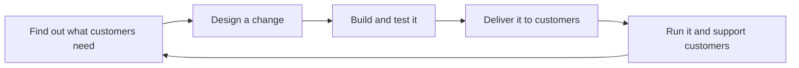
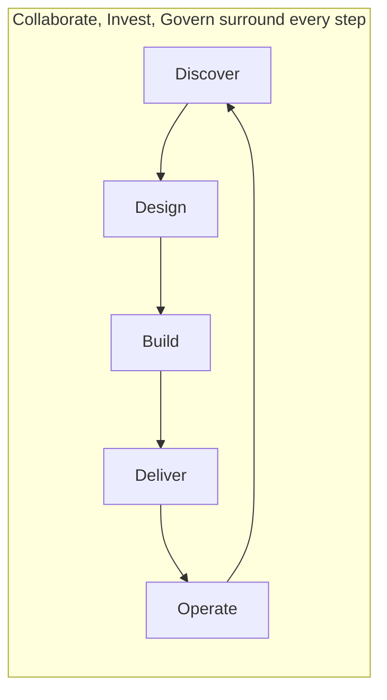
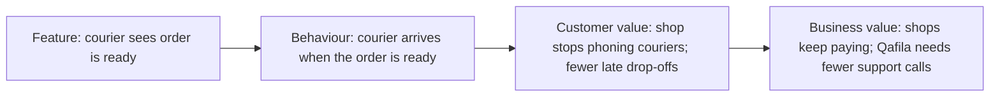
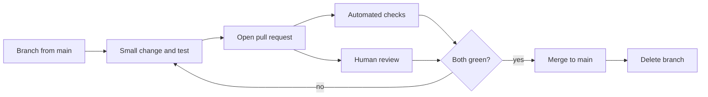
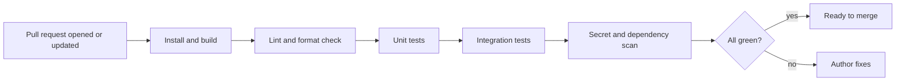
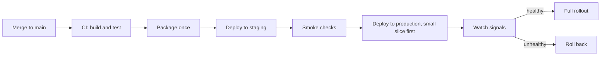
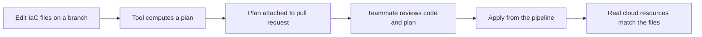
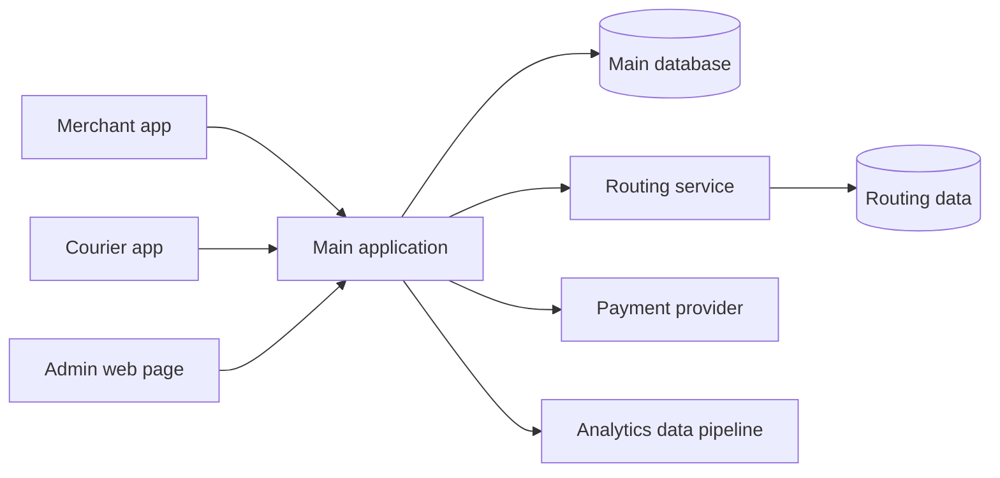

<!-- Generated by scripts/build-dprac.mjs from dprac/README.md and dprac/modules/*.md. Do not edit by hand. -->
<!-- dprac-source: 2edde283e1f5d4ea -->

# Digital Practice — the complete course

*14 modules · 41 lessons · 193 templates and tools · discover → govern*

**How digital products are discovered, designed, built, delivered, operated, funded and governed, and what changes as a company grows from two people to four hundred. A free, bilingual course for people early in a digital career.**

<!-- study-time -->
**Study time for the whole course: about 78 hours** (estimate: reading plus hands-on work, summed over every lesson). At about 6 hours a week that is roughly 13 weeks. Each lesson shows its own split; a pilot with real learners will replace these estimates.
<!-- /study-time -->

## What this is

Your first years in digital work tend to put you in one corner of the job: a codebase, a backlog, a support queue, a spreadsheet. This course shows the whole of it. You will see how a digital product creates value, how a first version is tested, how software is built, released and run safely, how a team and then many teams work together, how architecture and data are looked after, how the work is paid for, and how risk, security and compliance fit in without stopping the work.

The course follows one fictional company through five growth stages. The same questions come back at every stage, with different answers: what worked for two people breaks at forty, and what forty people need would smother two. Learning to see which stage you are in, and what it calls for, is the core skill.

It is written for graduates, junior engineers, analysts, designers, support and operations staff, and anyone who has joined a digital team and wants the whole picture. You do not need to be a programmer, though a few lessons are easier if you have seen code. Where a lesson needs more depth it links to the companion courses, such as [*From Graduate to Hired*](../career/index.html), [*Cloud & DevOps: Zero to Hero*](../cloud/index.html), [*Software Testing: Zero to Hero in the AI Era*](../testing/index.html) and [*Running IT as a Business*](../itbiz/index.html), instead of re-teaching them.

## What this course is not

- **Not a framework or exam course.** The course is original. It does not teach, summarise or follow the structure of any proprietary framework, standard or body of knowledge, and it is not preparation for any certification exam. Lesson 12.3 names the main frameworks and bodies of knowledge in the field, with their owners, and explains how to use one in your own learning.
- **Not a promise.** It does not promise a certification, a job, a promotion or a salary.
- **Not endorsed or reviewed.** The material was drafted with AI and has not been reviewed by a subject expert. Tools, vendors and frameworks are named as examples, never as endorsements, and the course is not affiliated with any of them.
- **Not professional advice.** Where a lesson touches law, finance or regulation it names the kind of question to take to a qualified person.

## How every lesson works

Every lesson has the same ten parts, so you always know where you are:

| Part | What you get |
|---|---|
| ⚡ **In 60 seconds** | The lesson in a few bullets: the idea, the rule that matters most and the biggest trap. |
| 🧭 **Why it matters** | A moment at Qafila that makes the topic unavoidable. |
| 📐 **How it works** | The ideas, climbing a ladder: 🟢 *The essentials* → 🟡 *Going deeper* → 🔴 *Expert view*. |
| 🧰 **The toolkit** | The templates, checklists, measures and tools that apply: what each does and when to reach for it. |
| 🏛️ **In practice at Qafila** | The artefact this lesson produces, as a member of the cast used it. |
| 🛠️ **Exercises** | Three graded exercises (🟢 🟡 🔴), each with "done when" criteria and a model answer to check yourself against. |
| ⚠️ **Mistakes and traps** | What goes wrong in practice, and what to do instead. |
| 🧾 **Recap** | The takeaways worth remembering. |
| ✍️ **Check yourself** | Five questions, mostly scenarios, with hidden answers and explanations. |
| 📚 **References** | Research, guidance and reputable sources, and links into the rest of the library. |

Every lesson is tagged with its **step** in digital practice: Discover, Design, Build, Deliver, Operate, Collaborate, Invest or Govern. The [toolkit catalogue](#appendix-the-repo-catalog) collects every template and checklist in one place.

## The running case: Qafila (fictional)

**Qafila** ("caravan") is a fictional Gulf startup with a delivery-coordination app for small businesses: shops request deliveries, couriers pick them up, and everyone can see where an order is. The course follows it through five stages. The company, its people and all its figures are invented for teaching; the numbers are illustrative, not benchmarks.

| Stage | Modules | Qafila at that stage |
|---|---|---|
| Launch | 0–2 | Two people, then four; 15 pilot shops; about 150 deliveries a day. |
| Traction | 3–5 | About 12 people in one team; about 300 merchants. |
| Growth | 6–7 | About 40 people in 4 teams; about 2,000 merchants. |
| Scale-up | 8–9 | About 120 people in 12 teams; about 9,000 merchants. |
| Established | 10–13 | About 400 people in 35 teams; about 30,000 merchants in 4 countries. |

- **Maha**, founder and CEO.
- **Faisal**, the first engineer, later Head of Engineering.
- **Aisha**, product manager, from Traction.
- **Karim**, designer.
- **Salma**, support and operations, later service lead.
- **Hamad**, data.
- **Dana**, security and risk, from Scale-up.
- **Bilal**, finance.
- **Yasmin**, a graduate engineer who joins at Growth: the reader's stand-in.

## The plan: 41 lessons in 14 modules

| Module | Lessons |
|---|---|
| 0 Orientation | 0.1 What digital practice is: products, services and the work behind them · 0.2 Meet Qafila and the eight steps · 0.3 How to use this course, and what it is not |
| 1 Digital value and the customer | 1.1 What makes a product digital, and how it creates value · 1.2 Understanding customers: problems, jobs and evidence · 1.3 Business models, costs and the unit of value |
| 2 From idea to first product | 2.1 Discovery: framing a problem and testing assumptions · 2.2 The smallest useful product: scope, prototypes and learning · 2.3 Choosing technology: build, buy, cloud and SaaS |
| 3 Building software well | 3.1 Version control, code review and working agreements · 3.2 Automated testing and continuous integration · 3.3 Continuous delivery and safe deployment |
| 4 Running what you built | 4.1 Infrastructure as code and cloud basics for practitioners · 4.2 Monitoring, alerts and on-call · 4.3 Incidents, post-incident reviews and reliability targets |
| 5 Working as a team | 5.1 Roles, collaboration and psychological safety · 5.2 Agile ways of working: backlogs, iterations and flow · 5.3 Making work visible and limiting work in progress |
| 6 Product management in a team | 6.1 Roadmaps and prioritisation · 6.2 Requirements, user stories and acceptance criteria · 6.3 Measuring outcomes: product analytics and experiments |
| 7 Service and support | 7.1 Designing the service around the product: support model and knowledge · 7.2 Requests, changes and the service desk in a growing company · 7.3 Service levels and talking to customers when things go wrong |
| 8 Many teams | 8.1 Team structures and boundaries: product, platform and enabling teams · 8.2 Dependencies, planning and coordination across teams · 8.3 Internal platforms and developer experience |
| 9 Architecture and data | 9.1 Architecture decisions and trade-offs · 9.2 Data as an asset: quality, ownership and privacy · 9.3 Technical debt and modernisation |
| 10 Money and suppliers | 10.1 Funding digital work: budgets, business cases and funding products · 10.2 The cost of running digital products: cloud costs and unit economics · 10.3 Suppliers, contracts and outsourcing |
| 11 Governance, risk and security | 11.1 Governance that enables: decision rights and guardrails · 11.2 Security and risk in everyday practice · 11.3 Compliance and audit without paralysis |
| 12 The bigger picture and your path | 12.1 Enterprise architecture and portfolio, seen from a team · 12.2 AI in digital work: using it well, with controls · 12.3 Frameworks, bodies of knowledge and your learning path |
| 13 Capstone and practice | 13.1 Capstone: Qafila's digital practice playbook · 13.2 Practice exam: 40 scenario questions |

## The path from zero to hero

| Stage | Modules | You will be able to… |
|---|---|---|
| 🟢 **Foundations** | 0–3 | Explain how a digital product creates value, test an idea with real evidence before building it, choose technology sensibly, and build software with version control, review, automated tests and safe releases. |
| 🟡 **Practitioner** | 4–9 | Run what you built with monitoring, on-call and incident reviews, work well in a team and across many teams, manage a product backlog and measure outcomes, design support around a product, and make architecture and data decisions you can defend. |
| 🔴 **Advanced** | 10–13 | Understand how digital work is funded and what it costs to run, work with suppliers, apply governance, security and compliance without stalling delivery, use AI with controls, plan your own learning path, and finish with Qafila's playbook and a 40-question practice exam. |

## Two languages

Every lesson is available in English and Arabic. In the Arabic edition, technical terms carry their English name in parentheses the first time they appear in a lesson, for example «التكامل المستمر (continuous integration)».

## Where to go next

Open the course map, or start with lesson 0.1.

<a id="contents"></a>

## Contents

- **[Module 0 — Orientation](#m0)**
  - [0.1 — What digital practice is: products, services and the work behind them](#l0-1) · 🟢 Beginner
  - [0.2 — Meet Qafila and the eight steps](#l0-2) · 🟢 Beginner
  - [0.3 — How to use this course, and what it is not](#l0-3) · 🟢 Beginner
- **[Module 1 — Digital value and the customer](#m1)**
  - [1.1 — What makes a product digital, and how it creates value](#l1-1) · 🟢 Beginner
  - [1.2 — Understanding customers: problems, jobs and evidence](#l1-2) · 🟢 Beginner
  - [1.3 — Business models, costs and the unit of value](#l1-3) · 🟢 Beginner
- **[Module 2 — From idea to first product](#m2)**
  - [2.1 — Discovery: framing a problem and testing assumptions](#l2-1) · 🟢 Beginner
  - [2.2 — The smallest useful product: scope, prototypes and learning](#l2-2) · 🟢 Beginner
  - [2.3 — Choosing technology: build, buy, cloud and SaaS](#l2-3) · 🟢 Beginner
- **[Module 3 — Building software well](#m3)**
  - [3.1 — Version control, code review and working agreements](#l3-1) · 🟢 Beginner
  - [3.2 — Automated testing and continuous integration](#l3-2) · 🟢 Beginner
  - [3.3 — Continuous delivery and safe deployment](#l3-3) · 🟢 Beginner
- **[Module 4 — Running what you built](#m4)**
  - [4.1 — Infrastructure as code and cloud basics for practitioners](#l4-1) · 🟡 Intermediate
  - [4.2 — Monitoring, alerts and on-call](#l4-2) · 🟡 Intermediate
  - [4.3 — Incidents, post-incident reviews and reliability targets](#l4-3) · 🟡 Intermediate
- **[Module 5 — Working as a team](#m5)**
  - [5.1 — Roles, collaboration and psychological safety](#l5-1) · 🟡 Intermediate
  - [5.2 — Agile ways of working: backlogs, iterations and flow](#l5-2) · 🟡 Intermediate
  - [5.3 — Making work visible and limiting work in progress](#l5-3) · 🟡 Intermediate
- **[Module 6 — Product management in a team](#m6)**
  - [6.1 — Roadmaps and prioritisation](#l6-1) · 🟡 Intermediate
  - [6.2 — Requirements, user stories and acceptance criteria](#l6-2) · 🟡 Intermediate
  - [6.3 — Measuring outcomes: product analytics and experiments](#l6-3) · 🟡 Intermediate
- **[Module 7 — Service and support](#m7)**
  - [7.1 — Designing the service around the product: support model and knowledge](#l7-1) · 🟡 Intermediate
  - [7.2 — Requests, changes and the service desk in a growing company](#l7-2) · 🟡 Intermediate
  - [7.3 — Service levels and talking to customers when things go wrong](#l7-3) · 🟡 Intermediate
- **[Module 8 — Many teams](#m8)**
  - [8.1 — Team structures and boundaries: product, platform and enabling teams](#l8-1) · 🟡 Intermediate
  - [8.2 — Dependencies, planning and coordination across teams](#l8-2) · 🟡 Intermediate
  - [8.3 — Internal platforms and developer experience](#l8-3) · 🟡 Intermediate
- **[Module 9 — Architecture and data](#m9)**
  - [9.1 — Architecture decisions and trade-offs](#l9-1) · 🟡 Intermediate
  - [9.2 — Data as an asset: quality, ownership and privacy](#l9-2) · 🟡 Intermediate
  - [9.3 — Technical debt and modernisation](#l9-3) · 🟡 Intermediate
- **[Module 10 — Money and suppliers](#m10)**
  - [10.1 — Funding digital work: budgets, business cases and funding products](#l10-1) · 🔴 Advanced
  - [10.2 — The cost of running digital products: cloud costs and unit economics](#l10-2) · 🔴 Advanced
  - [10.3 — Suppliers, contracts and outsourcing](#l10-3) · 🔴 Advanced
- **[Module 11 — Governance, risk and security](#m11)**
  - [11.1 — Governance that enables: decision rights and guardrails](#l11-1) · 🔴 Advanced
  - [11.2 — Security and risk in everyday practice](#l11-2) · 🔴 Advanced
  - [11.3 — Compliance and audit without paralysis](#l11-3) · 🔴 Advanced
- **[Module 12 — The bigger picture and your path](#m12)**
  - [12.1 — Enterprise architecture and portfolio, seen from a team](#l12-1) · 🔴 Advanced
  - [12.2 — AI in digital work: using it well, with controls](#l12-2) · 🔴 Advanced
  - [12.3 — Frameworks, bodies of knowledge and your learning path](#l12-3) · 🔴 Advanced
- **[Module 13 — Capstone and practice](#m13)**
  - [13.1 — Capstone: Qafila's digital practice playbook](#l13-1) · 🔴 Advanced
  - [13.2 — Practice exam: 40 scenario questions](#l13-2) · 🔴 Advanced
- **[Appendix — The toolkit catalogue](#appendix-the-repo-catalog)**

---

<a id="m0"></a>

# Module 0 — Orientation

*Every digital product you have used, from a food-delivery app to a bank's website, is kept alive by people doing many different kinds of work: finding out what customers need, designing, writing and testing code, releasing it, keeping it running, answering customers, paying the bills and making sure the rules are kept. This module sets the ground for the whole course. It explains what "digital practice" means and why a product is always a product plus a service plus the work behind both; it introduces Qafila, a fictional delivery-coordination startup at its Launch stage, when Maha and Faisal are building the first version by hand, together with the cast and the eight steps of digital work that every later lesson uses; and it says plainly how to use the course and what it is not. Each lesson leaves you with a one-page artefact: a product and service sketch, a step map of one week of work, and your own learning plan.*

> **Steps:** Discover — look at the whole of digital work, and at where you stand in it, before you learn any one part of it.

<a id="l0-1"></a>

## 0.1 — What digital practice is: products, services and the work behind them

*Level: 🟢 Beginner* · *Prerequisites: none* · *Step: Discover*

**After this you can** draw a one-page product and service sketch for one digital product: who uses it and for what, the service that surrounds the software, the kinds of work that keep both going, and who does each kind of work today. *Study time: reading about 15 min, hands-on about 70 min (estimate).*

### ⚡ In 60 seconds
- A **digital product** is something people use through software: an app, a website, an online tool. A **service** is the help and promise around it: support, reliability, billing, onboarding. Customers experience both as one thing.
- **Digital practice** is the set of everyday skills used to discover, design, build, deliver, run and improve digital products, and to fund, coordinate and govern that work.
- The rule that matters most: **a product is software plus the service around it plus the people who keep both going.** If you only see the code, you only see part of the job.
- Decision cue: before you start any task, ask "which customer does this help, and what happens to them if it goes wrong?"
- Biggest trap: thinking your job title is your whole job. A developer also answers questions, a tester also discovers needs, a support agent also improves the product.

### 🧭 Why it matters
Qafila and everyone in it are fictional; lesson 0.2 introduces them properly. All numbers about Qafila in this lesson are illustrative figures, not benchmarks.

It is the fourth month of the Launch pilot. Maha and Faisal have built Qafila's first version: a merchant app where a shop asks for a delivery, a courier app where a courier accepts it, and an admin web page where Maha watches everything. Fifteen pilot shops use it, about 150 deliveries a day, and the team is about to grow from two people to four. The code works, and they are proud of it.

At 6:10 one morning Maha's phone rings. A pilot bakery had forty boxes of bread ready for a hotel at 6:00 and no courier came. The app said "courier assigned", but the courier had uninstalled the app the night before, and nobody could see that. The baker does not care where the bug is. She cares that the bread is late, that only Maha answers, and that nobody told her what happens next.

Faisal's first reaction is "the code did exactly what it was meant to do". He is right, and it does not help. What failed was the arrangement around the code: no way to see a courier going silent, no promise to the baker, no number but Maha's, no record of the problem. This lesson is about seeing that whole arrangement.

### 📐 How it works

#### 🟢 The essentials

**Product, service and project.** Three words people use loosely. Keep them apart.

| Term | Plain meaning | Qafila example |
|---|---|---|
| **Product** | The thing people use, made mostly of software and data | The merchant app, the courier app and the admin web page |
| **Service** | The help, promises and day-to-day running that surround the product | Someone to call when a delivery is late, couriers onboarded and paid, the app kept up and working |
| **Project** | A piece of work with a start, an end and a budget | "Add payments to the merchant app by March" |

A project can change a product, but the product and its service carry on after the project ends. Much confusion at work comes from treating a living product as if it were a project that gets "finished". The manager's view of this idea is in [*Running IT as a Business*, lesson 2.1 — Digital products, services and projects: what each is and who owns it](../itbiz/index.html#/2.1).

**What makes something digital.** For this course, a product is digital when most of its value reaches the customer through software and data: the baker taps a screen instead of phoning a courier. So it changes often (and every change can break something), runs all the time (so someone must watch it), records its own use (so you can learn instead of guess), and one copy serves everyone (so a mistake reaches everyone). Module 1 goes deeper.

**What digital practice is.** "Practice" here means what practitioners do every day, as in a doctor's practice, not a theory. Digital practice is the set of skills people use to look after a digital product through its whole life:

- finding out what customers need and whether an idea is worth building;
- designing how it should work and look;
- building it: writing code, testing it, reviewing it;
- delivering it: getting changes safely to customers;
- running it: watching it, fixing it, supporting customers;
- working together: teams, roles, agreements;
- funding it: knowing what it costs and whether it is worth it;
- governing it: keeping it safe, legal and trustworthy.

Lesson 0.2 turns this list into the eight steps the course uses.

**The work behind the product.** A useful exercise is to list every kind of work needed to keep a product alive. For Qafila at Launch, most of it is done by two people:

| Kind of work | Who does it at Qafila today | What happens if nobody does it |
|---|---|---|
| Talk to shops and couriers about their problems | Maha, when she has time | The app solves problems nobody has |
| Decide what to build next | Maha and Faisal, over coffee | Whoever shouts loudest wins |
| Write and test the code | Faisal, mostly | Nothing new ships, or it ships broken |
| Release changes (deploy: put a new version live) | Faisal, by hand, once a week | Changes pile up and get riskier |
| Watch that it is working (monitoring) | Nobody, yet | The bakery finds out before you do |
| Answer shops and couriers | Maha's personal phone | Customers feel ignored and leave |
| Pay the cloud bill and track costs | Maha's own card | Surprises; nobody knows the cost per delivery |
| Protect shop and customer data | Nobody has thought about it | A leak, a fine, lost trust |

The last column is the point. Every row is work whether or not anyone is assigned to it. If nobody does it on purpose, it gets done by accident, badly, at the worst moment.

#### 🟡 Going deeper

**A product's life is a loop, not a line.** New practitioners often picture work as a straight line: idea, code, test, release, done. In practice it loops: a release produces data and customer reactions, which lead to new questions and the next change. The bakery morning is the loop in action: a failure in running the product becomes a discovery about what couriers do with their phones, which becomes a design change (warn when a courier goes silent), which becomes code, which becomes a release, which must then be watched.



**How the work changes as a company grows.** At Launch, two people do every kind of work. As Qafila grows, each kind of work gets its own people, then teams, then rules: more skill, but also hand-offs and waiting. The course follows Qafila through five growth stages (lesson 0.2). The right way to do a task depends on the stage: a two-week approval process is wise at 400 people handling payments and absurd at four people with 15 pilot shops.

**Where you fit.** Every early-career role works mostly in one or two parts of the loop and reaches into others: support staff, for example, feed discovery, because every ticket is evidence of a need. For what these jobs look like day to day, see [*From Graduate to Hired*, lesson 0.2 — The roles map: what software, AI, data, platform and security juniors actually do all day](../career/index.html#/0.2).

#### 🔴 Expert view

**Measure speed and stability together.** Counting only speed invites breakage; counting only outages invites standstill. DORA (DevOps Research and Assessment, a long-running research programme now part of Google Cloud) groups its software delivery measures into two factors, throughput (how fast and how often changes reach production, and how quickly a failed deployment is recovered) and instability (how often changes fail or need unplanned rework), and says that taken together the two factors give a high-level view of delivery performance (DORA's metrics guide, updated January 2026). The habit to form now: when someone calls a team "fast", ask how often its changes fail, and the other way round.

**The service is part of the design.** The bakery problem could be fixed with code (detect a silent courier), with a service promise (no courier confirmed ten minutes before pickup means the shop gets a call), or both. Module 7 covers the service option.

**The memorable rule.** A product is software plus the service around it plus the people who keep both going.

### 🧰 The toolkit
| Resource, tool or template | What it is and does | When to reach for it |
|---|---|---|
| **Product and service sketch** | One page: product, users and their job, the service around it, the kinds of work, who does each, gaps | When you join a team or start on a product |
| **Work inventory** | A table of every kind of work the product needs, with an owner and "what happens if nobody does it" | When things keep falling through the cracks |
| **Loop check** | Four questions after any release: what did customers do, what broke, what did we learn, what is next | After each release, however small |

### 🏛️ In practice at Qafila
After the bakery morning, Maha sat down with Faisal and drew Qafila's first product and service sketch. Illustrative and fictional.

> **Qafila product and service sketch (Launch, first draft)**
>
> **Product:** merchant app (shops request deliveries), courier app (couriers accept and complete them), admin web page (Maha watches all orders). Runs on one cloud provider's managed services (ready-made databases and servers the provider runs for them); all code in one repository (the shared store of code and its history).
>
> **Users and their job:** small shops want an order delivered on time without hiring a driver; couriers want steady, fairly paid jobs near them; Maha needs to see that orders flow.
>
> **The service around it:** onboarding a new shop (Maha visits in person); onboarding couriers (Faisal installs the app on their phones); help when a delivery is late (Maha's phone); paying couriers (spreadsheet, weekly); keeping the system up (nobody watches it).
>
> **Kinds of work and who does it:** discovery (Maha), design (Maha and Faisal, on paper), build and test (Faisal), release (Faisal, weekly, by hand), running (nobody), support (Maha), costs (Maha's card), data protection (nobody).
>
> **Gaps that hurt now:** nobody sees a silent courier; support depends on one phone; no record of problems.
>
> **One change this week:** a shared support number that rings both phones, and a simple list of every problem reported, with the date and what was done.

Faisal's first draft left out the service section: "That's not the product." Maha pointed out that the bakery had not complained about a single screen. Faisal then wanted to fix everything at once; Maha limited the week to one cheap change and a problem list.

### 🛠️ Exercises
**🟢 Sketch a product you use.** Pick a digital product you use often (a ride app, a food-delivery app, your university portal). Write its product and service sketch: product parts, users and their job, the service around it, and three kinds of work you believe happen behind it.
*Done when:* the sketch names at least two user groups, at least three service elements that are not screens, and three kinds of work with a guess at who does each.

<details><summary>Model answer and self-check</summary>

**Model answer.** A university portal. Product: registration pages, timetable, grades, mobile app. Users: students, lecturers, registry staff. Service: a login help desk, registration opening on a promised date, uptime in registration week. Work: watching it in registration week (operations), choosing features (product), checking students cannot see each other's grades (governance).

**Self-check.**
- Did you include at least one user who is not the main customer (for example staff or couriers)?
- Are your service elements things a customer feels (help, promises, uptime), not screens?
- Did you separate what you know from what you are guessing?

</details>

**🟡 Build a work inventory for Qafila.** Using the Qafila sketch above, add three kinds of work Maha and Faisal missed. For each, write who should do it now, and what happens if nobody does.
*Done when:* each of your three rows is a different kind of work, has a realistic owner at Launch (Maha or Faisal), and has a concrete consequence that would affect a shop or courier.

<details><summary>Model answer and self-check</summary>

**Model answer.** (1) Backing up the order database: Faisal, switch on the provider's backups and test one restore; otherwise one mistake can lose every order. (2) Telling shops about changes: Maha, a short message before each release; otherwise a shop meets a changed screen mid-rush. (3) Renewing the domain and the app-store developer accounts: Faisal, put the renewal dates in a shared calendar; otherwise a lapsed account can pull the courier app from the store, and new couriers cannot install it.

**Self-check.**
- Is each owner a person who exists at Launch, not a team Qafila does not have yet?
- Is each consequence something a customer would notice, not only an internal worry?
- Did you avoid repeating rows already in the sketch?

</details>

**🔴 Find the loop in a public story.** Choose a product you use that changed recently (a redesign, a new feature, a feature removed). Map what you can see from outside onto the five stages of the loop diagram (find out, design, build and test, deliver, run and support): for example, what customers were doing before, what changed, how customers reacted, and what the company did next. Mark clearly what is observed and what is inferred.
*Done when:* the write-up covers all five loop stages, with at least one observed fact for each stage you can see, and a line saying which stages you cannot see from outside and what evidence would show them.

<details><summary>Model answer and self-check</summary>

**Model answer.** A messaging app moved a much-used button into a menu. Find out: people used it daily (observed). Deliver: it moved in one update (observed). Run and support: app-store reviews complained; two releases later it was back (observed). Inferred: the company watched reviews and reversed it. Cannot see: design, build and test, who decided; release notes would show them.

**Self-check.**
- Did you keep observed and inferred apart?
- Did your loop include running and support, not only design and release?
- Did you avoid naming causes you cannot support?

</details>

### ⚠️ Mistakes and traps
- **Seeing only the code.** "The code did what it was meant to do" is not the same as "the customer was served". Look at the service around it too.
- **Treating a product like a project.** Products do not finish. Plan for who will look after it after the release.
- **Leaving work unowned because it is nobody's title.** Watching the system, backups and data protection still need a name next to them, even in a team of two.
- **Copying a big company's process into a small one.** Match the practice to the stage. Lesson 0.2 explains the stages.

### 🧾 Recap
- A digital product is mostly software and data; a service is the help and promises around it; a project is temporary work that changes them.
- Digital practice is the everyday work of discovering, designing, building, delivering, running, funding, coordinating and governing digital products.
- The work is a loop, not a line: running the product feeds the next discovery.
- Every kind of work needs an owner, even when the company is tiny.
- Rule: a product is software plus the service around it plus the people who keep both going.

### ✍️ Check yourself
**1. After the bakery morning, Faisal says "the code did exactly what it was meant to do". What is the best response?**

- A. Agree, and close it, since a fault outside the code is the customer's own problem to solve.
- B. Agree, and add more automated tests so the code is proven correct in future releases.
- C. Agree that the code worked, and look at the service around it, which is where it failed.
- D. Disagree, because the courier app must surely have a defect if a delivery went missing.

<details><summary>Answer</summary>

**C.** The failure was in the arrangement around the code. A blames the customer, B adds tests for code that did its job, and D assumes a defect without evidence. See "Why it matters" and "The work behind the product".

</details>

**2. Which of these is a service element of Qafila rather than part of the product?**

- A. A shared support number that shops call when a delivery is late.
- B. The screen in the merchant app where a shop requests a new delivery.
- C. The admin web page that shows Maha every order that is in progress today.
- D. The logic in the courier app that assigns a delivery to a courier.

<details><summary>Answer</summary>

**A.** The support line is help and a promise around the software. B, C and D are all parts of the software product itself. See "Product, service and project".

</details>

**3. Faisal says that once payments are added "the product will be finished". What is the most accurate correction?**

- A. Correct, provided the payments work is run as a project with a fixed scope.
- B. Correct, because a product is finished once it has all the parts customers asked for.
- C. Not yet, because a product is only finished after a full year of running without any faults.
- D. Not quite: the payments project ends, but the product needs looking after while it is used.

<details><summary>Answer</summary>

**D.** Projects end; products and their services carry on. A and B confuse a project's end with the product's, and C invents a finishing point. See "Product, service and project".

</details>

**4. Maha asks who should be watching that Qafila is working, when nobody is. What does the lesson suggest?**

- A. Leave it until Qafila can hire an operations team, since monitoring is specialist work.
- B. Name a person to own it now, even in a team of two, so that it is done on purpose.
- C. Ask the pilot shops to report problems, since they notice failures first.
- D. Skip it while there are only 15 pilot shops, since the risk is too small to matter.

<details><summary>Answer</summary>

**B.** Every kind of work needs an owner, even in a team of two. A delays it, C makes customers the monitoring system (as at the bakery), and D ignores that each failure hits a real shop. See "The work behind the product".

</details>

**5. A friend praises a team because it "deploys ten times a day" (puts a new version live ten times). Which question best reflects the expert view in this lesson?**

- A. What share of those releases break something for customers and need fixing?
- B. How many automated tests run on each change before it is allowed to go live?
- C. How quickly does each of those deploys finish once someone starts it running?
- D. How many of those changes were checked by a second engineer before release?

<details><summary>Answer</summary>

**A.** Speed should be read together with stability; DORA groups its measures into throughput and instability. B and D are about precautions taken before release, and C is about speed again; none of them shows how often the changes actually fail for customers. See "Measure speed and stability together".

</details>

### 📚 References
- DORA, "DORA's software delivery performance metrics" (dora.dev guide): https://dora.dev/guides/dora-metrics/ — five metrics in two factors, throughput and instability (page last updated 5 January 2026; opened 22 November 2026).
- Library course: [*Running IT as a Business*, lesson 2.1 — Digital products, services and projects: what each is and who owns it](../itbiz/index.html#/2.1) (the manager's view of products and projects).
- Library course: [*From Graduate to Hired*, lesson 0.2 — The roles map: what software, AI, data, platform and security juniors actually do all day](../career/index.html#/0.2) (what early-career roles do day to day).

<a id="l0-2"></a>

## 0.2 — Meet Qafila and the eight steps

*Level: 🟢 Beginner* · *Prerequisites: 0.1* · *Step: Discover*

**After this you can** take one week of work on a digital product and sort every task into the eight steps (Discover, Design, Build, Deliver, Operate, Collaborate, Invest, Govern), name who did it and what evidence it left, and spot the steps nobody is covering. *Study time: reading about 15 min, hands-on about 75 min (estimate).*

### ⚡ In 60 seconds
- **Qafila** is a **fictional** Gulf startup that builds a delivery-coordination app for small businesses and their couriers, followed through five growth stages.
- The course sorts all digital work into **eight steps**: Discover, Design, Build, Deliver, Operate, Collaborate, Invest and Govern. These are this course's own plain words, not any framework's terms.
- The first five steps form a **loop** around the product. The last three **surround** the loop: they are about people, money and rules.
- The rule that matters most: **every step happens, whether anyone plans it or not.** The only choice is whether it is done on purpose.
- Biggest trap: thinking only Build and Deliver are "real work". At Launch, the steps Maha and Faisal ignore are the ones that hurt them.

### 🧭 Why it matters
Qafila and everyone in it are fictional. All numbers about Qafila are illustrative figures, not benchmarks.

In the fourth month of the Launch pilot Qafila had 15 pilot shops and about 150 deliveries a day. Faisal kept a list of what he had done each week, and it was all code: new screens, a fix for the courier map, a faster order list. By his count it was a productive week.

Maha's week looked different. She visited two shops to learn why they still phoned couriers (Discover), sketched a simpler order screen (Design), paid the cloud bill on her own card (Invest), sent a spreadsheet of shop owners' phone numbers to a friend helping with sales (Govern, though she did not see it that way), and argued with Faisal about a Thursday-night release (Deliver and Collaborate). Faisal half-joked that Maha "didn't do much this week".

Both were doing digital work; they had no shared words for it, so Maha's work was invisible and the spreadsheet went unquestioned. This lesson gives you the words.

### 📐 How it works

#### 🟢 The essentials

**Meet Qafila.** Qafila (قافلة, Arabic for "caravan") is a fictional Gulf startup that builds a delivery-coordination app for small businesses (shops, bakeries, pharmacies) and their couriers. A shop requests a delivery in the merchant app; a courier accepts it in the courier app; the admin web page lets Qafila's staff see and fix everything. Any resemblance to a real company is accidental.

**The five growth stages.** The course follows Qafila from two people to about four hundred. These stages are this course's own, not taken from any framework. All figures are illustrative.

| Stage | People | Merchants | Deliveries per day | Teams | Deploys to production | Modules |
|---|---|---|---|---|---|---|
| **Launch** | 2 (Maha, Faisal), then 4 | 15 pilot shops | about 150 | none | by hand, weekly | 0–2 |
| **Traction** | 12 | 300 | about 4,000 | 1 | daily via CI | 3–5 |
| **Growth** | 40 | 2,000 | about 25,000 | 4 | several a day | 6–7 |
| **Scale-up** | 120 | 9,000 | about 120,000 | 12 (incl. a platform team) | many a day | 8–9 |
| **Established** | 400 | 30,000 in 4 countries | about 400,000 | 35 | many a day | 10–13 |

A "deploy to production" puts a new version live for customers. "CI" (continuous integration) means every code change is automatically built and tested; Module 3 explains it. The product grows too: payments at Traction, a support desk and analytics at Growth, a routing service (which plans courier routes) and an internal platform (shared tools for other teams) at Scale-up, a payments partner and a data platform at Established. Later modules explain each as it arrives.

**The cast.** Each person makes realistic mistakes; you learn from them.

| Person | Role | Joins at |
|---|---|---|
| **Maha** | Founder and CEO; was a developer; writes the first code, later learns to let go | Launch |
| **Faisal** | First engineer, later Head of Engineering; fast, tends to skip tests and documentation | Launch |
| **Salma** | Support and operations; later service and reliability lead | Launch |
| **Aisha** | First product manager | Traction |
| **Karim** | Designer and user researcher | Later (see the module where he first appears) |
| **Hamad** | Data analyst, later head of data | Later (see the module where he first appears) |
| **Yasmin** | Graduate engineer; your stand-in, many lessons follow her first year | Growth |
| **Bilal** | Finance lead, later CFO | Later (see the module where he first appears) |
| **Dana** | Security and risk lead, hired after a security scare | Scale-up |

**The eight steps.** Every task in digital work fits at least one of these:

| Step | What it means | A Launch example at Qafila | What it leaves behind (evidence) |
|---|---|---|---|
| **Discover** | Finding out what customers need and whether an idea is worth doing | Maha visits a bakery to see how orders are placed today | Interview notes, a problem statement |
| **Design** | Deciding how something should work and look before building it | Maha sketches a simpler order screen | A sketch, a prototype, a decision |
| **Build** | Writing, testing and reviewing the code | Faisal adds the courier map | Code, tests, a review, commits (saved changes in the repository) |
| **Deliver** | Getting changes to customers safely | Faisal releases by hand on Thursday night | A release note, a deploy record |
| **Operate** | Keeping it running and supporting the people who use it | Maha answers the bakery at 6:10 | A problem list, a fix, a support record |
| **Collaborate** | Working together: roles, agreements, communication | Maha and Faisal agree when releases happen | A working agreement, a board |
| **Invest** | Deciding where money and time go, and knowing what things cost | Maha checks the cloud bill | A cost sheet, a budget, a decision |
| **Govern** | Keeping the work safe, legal and trustworthy | Deciding who may see shop owners' phone numbers | An access list, a policy, a risk entry |

#### 🟡 Going deeper

**A loop with a frame around it.** The first five steps follow the product's life loop from lesson 0.1: you discover a need, design a change, build it, deliver it and operate it, and operating it shows you what to discover next. The other three are not stages in that loop; they surround it: Collaborate is about the people, Invest about the money and time, Govern about the rules and risks of every step.



The frame steps are the ones small companies forget, because nobody's job title contains them.

**How the steps change with the stages.** The same step looks very different at different sizes.

| Step | At Launch (2–4 people) | At Established (about 400 people) |
|---|---|---|
| Deliver | One engineer releases by hand, weekly | Automated pipelines (tools that test and release each change without manual steps) release many times a day |
| Operate | The founder's phone | A support desk, on-call rotas (who answers alerts out of hours), service levels (promised standards such as uptime) |
| Invest | The founder's card | Budgets, business cases, cost reports per product |
| Govern | Not yet thought about | Security, risk and audit functions; a payments partner's checks before it signs |

Each column fits its stage. Your skill is to notice when the old way stops fitting. Every lesson header shows its step tag, for example *Step: Build, Deliver*.

#### 🔴 Expert view

**Evidence is how you see a step.** A step that leaves no evidence is hard to improve. Faisal's code leaves commits (saved changes in the repository); Maha's shop visit leaves nothing unless she writes notes. After each task, ask "what record shows this happened, and could someone else use it?"

**Gaps are more useful than totals.** The useful result of a step map is rarely "we spent most time on Build". It is the empty row. Look there first.

**One task, two steps.** Writing an automated test is Build and also Deliver (it makes releasing safer); deciding who can see the admin page is Govern and Collaborate. Tag a task by the question it mainly answers, and note the second where it helps.

**The memorable rule.** Every step happens, whether anyone plans it or not. The only choice is whether it is done on purpose.

### 🧰 The toolkit
| Resource, tool or template | What it is and does | When to reach for it |
|---|---|---|
| **Step map** | A table of one week's tasks, each tagged with a step, a person and the evidence it left | Once a week at Launch; once a month later |
| **Step-gap check** | For each of the eight steps: who covered it, what evidence exists, what is missing | When something keeps going wrong and nobody knows why |
| **Stage check** | Five questions to place a company at a stage: people, customers, teams, release habit, product parts | When you join a company or a team |

### 🏛️ In practice at Qafila
After the argument about who "did much this week", Maha drew a step map of their shared week on the office whiteboard. Illustrative and fictional.

> **Qafila step map: week 16 (Launch)**
>
> | Task | Step | Who | Evidence |
> |---|---|---|---|
> | Visited two shops about direct phone orders | Discover | Maha | None (notes in her head) → *write up* |
> | Sketched a simpler order screen | Design | Maha | Paper sketch, photographed |
> | Courier map, faster order list, two fixes | Build | Faisal | Commits in the repository |
> | Thursday-night release | Deliver | Faisal | Message to Maha; no release note → *add one* |
> | Bakery call at 6:10; missing courier | Operate | Maha | None → *start a problem list* |
> | Agreed releases happen Thursday before 20:00 | Collaborate | Both | A message thread |
> | Paid cloud bill; worried about cost growth | Invest | Maha | Card statement only → *start a cost sheet* |
> | Sent shop owners' phone numbers to a friend helping with sales | Govern | Maha | None → *decide who may see shop data* |
>
> **Gaps:** Operate and Govern have no owner and no record; Invest is on a personal card.
>
> **Actions:** problem list (Maha, now); a one-line release note per release (Faisal); a simple cost sheet (Maha); ask the friend to delete the spreadsheet and agree who may see shop data (Maha).

Faisal objected that "a release note for four people is bureaucracy". Maha agreed it should be one line: the bakery call would have been easier to diagnose had they known what changed on Thursday. The Govern row made her uncomfortable; she had not seen the spreadsheet as a risk until it sat next to an empty evidence cell.

### 🛠️ Exercises
**🟢 Tag the tasks.** Tag each of these Qafila tasks with its main step: (a) asking five couriers why they reject long trips; (b) choosing the cloud database plan; (c) writing a test for the delivery-fee calculation; (d) deciding who may log into the admin web page; (e) agreeing a weekly planning meeting; (f) switching on the new order screen for all shops; (g) drawing three versions of the courier sign-up screen; (h) restarting the courier app's server after it froze. Each step fits exactly one task.
*Done when:* each tag has a one-line reason naming the main question the task answers, and you have noted a second step for any task that fits two.

<details><summary>Model answer and self-check</summary>

**Model answer.** (a) Discover: what do couriers need? (b) Invest: which plan is worth its cost? Second step: Design, since the plan shapes how the system works. (c) Build: does the fee code work? Second step: Deliver, since the test makes releasing safer. (d) Govern: who may get in, safely? Second step: Collaborate, since it settles people's roles. (e) Collaborate: how do we work together? (f) Deliver: how does a change reach customers safely? (g) Design: how should it work and look? (h) Operate: how do we keep it running? Hard case: (b) looks technical, but the main question is money and value.

**Self-check.**
- Did you tag each task by the question it mainly answers?
- Where a task fits two steps, did you note the second without double-counting?
- Did your reasoning use the definitions in the steps table?

</details>

**🟡 Map a week of your own.** Take one week of your own work or study project (a course assignment, a side project, an open-source contribution). List at least eight tasks and fill in a step map: task, step, who, evidence.
*Done when:* the map has at least eight tasks, at least five steps appear, every evidence cell says "none" or names a real record, and you have written one action for the emptiest step.

<details><summary>Model answer and self-check</summary>

**Model answer.** A student team app: login screen (Build, me, commits); asked three classmates what they need (Discover, me, a notes file); deadline meeting (Collaborate, Sara, chat); deployed to free hosting (Deliver, Omar, the host's deploy log); fixed a crash (Operate, me, chat); chose the hosting plan (Invest, Omar, a price comparison in chat); drew layouts (Design, Sara, photo); test users' emails in a shared sheet (Govern, me, none). Emptiest: Govern, the only step with no record, and it holds personal data; action: limit who sees the sheet, delete it after testing.

**Self-check.**
- Did you include tasks that are not code?
- Is each "who" a person, not "the team"?
- Is your action small enough to do this week?

</details>

**🔴 Place a company at a stage.** Choose a company you know from the outside (an employer, a startup in the news, a well-known app). Using the stage table, write which stage it most resembles and why, giving the evidence you used for each of the five Stage check questions: people, customers, teams, release habit, product parts. Then name one practice that would be right at its stage and wrong at Launch.
*Done when:* each of the five questions has a piece of evidence or "unknown", the evidence comes from a public source you can name (company website, job ads, annual report), and the practice is explained in two or three sentences.

<details><summary>Model answer and self-check</summary>

**Model answer.** A regional food-delivery app. People: job ads list dozens of roles. Customers: its website lists several cities; numbers unknown. Teams: job ads mention a "platform team". Release habit: unknown. Product parts: customer, restaurant and courier apps, payments. Best fit: Scale-up. Practice: a platform team building shared tools; right when many teams repeat the same work, wrong at Launch, where two people would build tools instead of the product.

**Self-check.**
- Did you mark unknowns instead of guessing?
- Did you name where each piece of evidence came from?
- Is your practice tied to the stage's size, not to the company's fame?

</details>

### ⚠️ Mistakes and traps
- **Counting only Build and Deliver as work.** Discover, Operate and the frame steps are work too. Give them an owner.
- **Treating the eight steps as a strict sequence.** The five loop steps repeat; the three frame steps apply all the time.
- **Copying practices across stages.** A practice that fits 400 people can crush four; one that fits four can endanger 400. Check the stage first.
- **Doing a task but leaving no record.** If a step leaves no evidence, nobody can see it or improve it. Write one line saying what record shows it happened.

### 🧾 Recap
- Qafila is a fictional delivery-coordination startup followed through five growth stages, from two people to about 400.
- The eight steps are Discover, Design, Build, Deliver, Operate (a loop around the product) and Collaborate, Invest, Govern (a frame around the loop).
- A step map shows who did what, under which step, with what evidence; the empty rows matter most.
- Rule: every step happens, whether anyone plans it or not.

### ✍️ Check yourself
**1. Maha sends a spreadsheet of shop owners' phone numbers to a friend helping with sales. Under which step does deciding whether she should have done this mainly fall?**

- A. Collaborate, because it involves a person from outside the company team.
- B. Govern, because it is about keeping data safe and use of it trustworthy.
- C. Invest, because the friend's sales help may bring in more paying shops.
- D. Operate, because it is part of running the business from day to day.

<details><summary>Answer</summary>

**B.** Who may see customer data is a question of rules, risk and trust. A, C and D describe side-effects, not the main question. See "The eight steps" and "In practice at Qafila".

</details>

**2. Faisal says a one-line release note is "bureaucracy for four people". What is the strongest argument for keeping it?**

- A. Investors expect release notes from any startup that hopes to raise money later.
- B. Release notes are required by every framework for delivering software.
- C. Without it, the team cannot safely release more often than once a week.
- D. It records what changed, so the next problem a shop reports is quicker to trace.

<details><summary>Answer</summary>

**D.** A step that leaves no evidence is hard to improve; a record of Thursday's change would have helped with the bakery problem. A and B invent requirements, and C confuses a note with release frequency. See "Evidence is how you see a step".

</details>

**3. Faisal says Govern can wait until Growth "because it is the last step". Which correction is best?**

- A. Agree, as long as Govern is then handled first when Qafila reaches the Growth stage.
- B. Agree, because Govern belongs to the frameworks that only larger companies follow.
- C. Disagree: Govern frames every step now, as the shop phone numbers already showed.
- D. Disagree: Govern should come first, before Discover starts, in every new company.

<details><summary>Answer</summary>

**C.** Govern is part of the frame around every step, not the end of a line; Maha's spreadsheet raised a Govern question at Launch. A and B leave the risk unowned, and D turns the frame into a first stage. See "A loop with a frame around it".

</details>

**4. A friend joins a company of five people and proposes a weekly change board (a group that must approve every release) for all releases. What should she check first?**

- A. Which stage the company is at, since a practice must fit its size and risks.
- B. Whether a change board is part of the frameworks the company says it follows.
- C. Whether the release tool can enforce each approval automatically for them.
- D. Whether larger companies in the same market also use a weekly change board.

<details><summary>Answer</summary>

**A.** A practice right at 400 people can crush five. B, C and D look at frameworks, tools or other companies, not at this company's stage. See "How the steps change with the stages".

</details>

**5. Maha's step map shows plenty of Build tasks, and the Govern row is empty with no evidence. What does the lesson suggest she looks at first?**

- A. The Build row, because it takes the most time and has the most room to improve.
- B. The total hours per step, to rebalance the week evenly across all eight steps.
- C. The Deliver row, because the Thursday release is the most visible risk to shops.
- D. The Govern row, since a step with no owner and no record hides the biggest risk.

<details><summary>Answer</summary>

**D.** The useful result is the empty row, here a data risk nobody owned. A and B focus on totals and balance, and C picks a row that at least has an owner. See "Gaps are more useful than totals".

</details>

### 📚 References
- Library course: [*Founder's Playbook for AI-First Builders*, lesson 0.2 — The founder's map: eight steps and the Tick cast](../founder/index.html#/0.2) (a different step list for a one-person company).
- Library course: [*Running IT as a Business*, lesson 0.1 — What it means to run IT as a business, and what digital products and AI change](../itbiz/index.html#/0.1) (the operating-model view of the same work, for managers).
- Library course: [*Cloud & DevOps: Zero to Hero*, lesson 0.1 — What cloud, DevOps, platform engineering and SRE are](../cloud/index.html#/0.1) (the engineering side of Deliver and Operate).

<a id="l0-3"></a>

## 0.3 — How to use this course, and what it is not

*Level: 🟢 Beginner* · *Prerequisites: 0.1, 0.2* · *Step: Discover*

**After this you can** write a one-page learning plan that sets your path through the modules for your role, your pace, your practice project and artefact folder, the library courses you will use for depth, and three limits you will keep. *Study time: reading about 15 min, hands-on about 60 min (estimate).*

### ⚡ In 60 seconds
- The course teaches the **essentials of every part of digital work** well enough to take part and make sound everyday decisions, then **links to the library's specialist courses** for depth.
- It is **original**: written from general practice in its own words and structure, **not based on, derived from or aligned with any proprietary standard, body of knowledge or certification**, and **not training for any exam**.
- It is **not professional advice**, and it promises **no job, income, promotion or certificate**. Every Qafila number is illustrative.
- The rule that matters most: **every lesson ends in an artefact.** Keep them in one folder; they become your playbook in Module 13.
- Biggest trap: reading without doing. The exercises are where the skill is built.

### 🧭 Why it matters
Qafila and everyone in it are fictional.

Still at Launch, Salma joins Qafila to look after shops and couriers. Wanting to learn fast, she signs up for a general online course on software delivery. In her first week she skims fifteen of its lessons in a weekend, remembers a little of each, and on Monday cannot write the simple problem list Maha asks for. A week later she does the opposite: she treats one lesson's example as law. In a planning chat she announces that "the course says" Qafila should be releasing daily through an automated pipeline (tools that test and release each change without manual steps). Faisal answers that the practice suits bigger teams, and that with 15 pilot shops and one engineer a careful weekly release fits for now. A course's example fits that course's case, not automatically yours.

Both mistakes come from not knowing what a course is for, and you could make them with this one. This lesson says what this course is and is not, how a lesson is built, and how to plan your way through the 38 lessons that follow.

### 📐 How it works

#### 🟢 The essentials

**What the course is.** *Digital Practice: Building and Running Digital Products, from One Person to a Whole Company* is a free, bilingual (English and Arabic) course for early-career practitioners: new software engineers, analysts, testers, designers, product and operations staff, graduates and career changers. No IT experience is assumed; every term is defined the first time it is used. It has 14 modules and 41 lessons and follows Qafila through the five growth stages and eight steps of lesson 0.2.

**What the course is not.**

| It is not | What that means for you (and no promise of a job, income, promotion or certificate) |
|---|---|
| **Based on any proprietary framework or body of knowledge** | It is written from general practice (product discovery, software engineering, delivery research, service management, lean and agile ways of working, architecture, IT finance, governance) in its own words and structure. Its stages and steps are its own. Lesson 12.3 names the well-known frameworks and bodies of knowledge and points to their owners |
| **Exam or certification training** | It prepares you for no exam. Its practice questions test this course only |
| **Professional advice** | Law, accounting, procurement and regulation differ by country and organisation. The course names the kind of rule and the question to ask; specialists and official texts give the answer |
| **Expert-reviewed** | It is AI-drafted and not reviewed by subject experts. Treat every statement as a starting point to check |
| **A benchmark** | Qafila's figures are illustrative, never targets |
| **An endorsement** | Tools are named by category, with at most one or two examples, as illustrations |

**How a lesson is built.** Every lesson has the same layout: a header with the outcome and a time estimate; a summary and a Qafila moment; the essentials, then going deeper, then an expert view; a toolkit and the lesson's artefact as a cast member made it; three graded exercises (🟢, 🟡, 🔴) with model answers; then mistakes, a recap, five questions and sources.

**Levels.** Modules 0 to 3 are 🟢 Beginner, 4 to 9 🟡 Intermediate and 10 to 13 🔴 Advanced. On a first pass you can skip "Going deeper" and "Expert view" and come back later.

#### 🟡 Going deeper

**Choose a path for your role.** Reading in order is best for a first pass, since Qafila's story grows with the modules. In a hurry, read Modules 0, 1 and 3 first (most later lessons assume them), then follow your role.

| If you are… | After 0, 1 and 3, start with | Then | The artefact you are likely to need first |
|---|---|---|---|
| New software engineer | 4, 5 | 9 | Pull request checklist, runbook |
| Tester or quality engineer | 6, 4 | 7 | Test plan, acceptance criteria |
| Data or business analyst | 6, 9 | 10 | Data inventory, outcome measures |
| Designer or researcher | 2, 6 | 5 | Problem statement, assumption map |
| Product or project staff | 2, 6 | 8 | Roadmap, user stories |
| Support or operations staff | 7, 4 | 5 | Service page, post-incident review |
| Career changer, not yet in a role | 2, 5 | then in order | Problem statement, team working agreement |

Module 13's capstone assembles a digital practice playbook for Qafila from the artefacts of every module, so keep everything you produce.

**Your practice project and artefact folder.** Every exercise works with Qafila material; it teaches more if you also have a project of your own (a personal app, a study project, an open-source contribution). Keep one folder with a dated page per lesson, and keep Qafila versions apart from your own project or workplace.

**Keep confidential data out.** Before using workplace material, or pasting anything into an AI assistant, remove customer and personal data, security details, contract terms and unreleased figures, and check your organisation's policy on AI tools. If in doubt, use Qafila.

**How facts are handled.** Any number about delivery performance, costs, failure rates or adoption has a source in the lesson's References, stated with who found it, for whom and when. Facts confirmed only from secondary summaries are marked "reported". When you reuse a fact at work, cite the original source, not the course.

**Where the library goes deeper.** This course is the map; the library's specialist courses are the territory. Typical next steps:

| When you want depth on… | Go to |
|---|---|
| Founding a company and pricing | [*Founder's Playbook for AI-First Builders*, lesson 3.2 — Pricing: choose, test and change a price](../founder/index.html#/3.2) |
| Pipelines, infrastructure and operations | [*Cloud & DevOps: Zero to Hero*, lesson 0.2 — The path to production: from a commit to a customer, and everything that can break on the way](../cloud/index.html#/0.2) |
| Testing | [*Software Testing: Zero to Hero in the AI Era*, lesson 0.1 — What software testing is, and what it is not: quality, risk and the AI-era shift](../testing/index.html#/0.1) |
| Building with AI tools day to day | [*A Practical Guide to Becoming an AI-Native Engineer*, lesson 0.1 — What an AI-native engineer is (and is not): the shift, five habits and the evidence](../ainative/index.html#/0.1) |
| Getting your first role | [*From Graduate to Hired*, lesson 0.3 — Meet the cohort, and how to use this course and the library](../career/index.html#/0.3) |

#### 🔴 Expert view

**Questions, not conclusions, for specialists.** Some lessons touch areas where specialists decide: data protection, payments rules, employment, accounting, contracts. The course helps you arrive with a precise question and the evidence to answer it, not the answer.

| Topic | A good question to bring | Who answers it |
|---|---|---|
| Storing customers' addresses | "Which data-protection rules apply to the addresses we keep, and for how long may we keep them?" | Data protection or legal |
| A new payment feature | "Does taking payments this way bring us under any payments rules, and what does our provider require?" | Legal, compliance, the provider |
| Paying couriers per delivery | "Which employment or contractor rules apply to how we pay couriers?" | Legal, HR |

**Frameworks as references, not recipes.** Workplaces use well-known frameworks for service management, agile delivery, architecture and governance, owned by their publishers. This course teaches the underlying ideas in its own words; lesson 12.3 says what the main ones are for. At work, use your organisation's vocabulary.

**Pace and practice.** One or two lessons a week, with the exercises done the same week, is realistic alongside a job or study. After each module, use one artefact for real within a fortnight.

**The memorable rule.** Every lesson ends in an artefact. Keep them; they are what you will use.

### 🧰 The toolkit
| Resource, tool or template | What it is and does | When to reach for it |
|---|---|---|
| **Learning plan** | One page: role path, pace, practice project, artefact folder, depth courses, three limits | Now; review at the end of each module |
| **Artefact folder** | One dated folder for every page the lessons produce, building to the Module 13 capstone | From lesson 0.1 to 13.1 |
| **Specialist question list** | Running list of questions for legal, finance, security or data protection, each tied to a decision | When a lesson touches an area where you lack authority |
| **Source note** | For each number you reuse: source, year, who it describes, verified or reported | Before a figure goes into a report or presentation |
| **Confidentiality checklist** | What to remove before sharing an exercise or pasting into an AI assistant | Before using workplace material |

### 🏛️ In practice at Qafila
After the release-chat episode, Maha asked Salma to write a one-page learning plan. Illustrative and fictional.

> **Learning plan: Salma, shops and couriers support (Launch stage)**
>
> - **Path:** Modules 0, 1 and 3 first; then 7 and 4 (support and running the product are my job); then 5, as the support row of the path table suggests. The rest in order.
> - **Pace:** two lessons a week; exercises the same week; Sunday and Wednesday evenings.
> - **Practice project:** Qafila's own problem list, with shop and courier details removed.
> - **Artefact folder:** "Digital practice playbook – Salma", one dated page per lesson; anything with real shop data stays in Qafila's shared drive, not in my personal folder.
> - **Depth courses:** *Cloud & DevOps* lessons on incidents; *Founder's Playbook* lessons on support at small scale.
> - **Three limits I will keep:**
>   1. No course example (from this course or any other) becomes "the rule" in a team discussion; I say where a practice comes from and why it would fit us now.
>   2. No shop or courier details go into an AI assistant; Maha and I will write a one-line rule on AI tools this month, since Qafila has none yet.
>   3. Any question about law or money goes to the right person as a question, never as a course conclusion.

Her first draft listed all 13 remaining modules "this month". Maha asked how many exercises that meant; Salma counted more than a hundred and cut the plan to two lessons a week.

### 🛠️ Exercises
**🟢 Choose your path.** Using the role table, write your path through the modules and the first artefact you expect to need, with two sentences on why.
*Done when:* the path lists at least five modules in order, names one artefact, and gives a reason tied to your current or target role.

<details><summary>Model answer and self-check</summary>

**Model answer.** A career changer from retail who has chosen support or operations as a target, so follows the support row rather than the career-changer row: Modules 0, 1, 3, then 7 and 4, then 5. First artefact: a post-incident review, because operations roles meet failures early. Reason: handling retail complaints maps closely to Module 7.

**Self-check.**
- Does the path start with the shared foundation modules (0, 1 and 3)?
- Is the reason tied to a real role, not to which modules sound most interesting?
- Is the first artefact one you could actually use in the next three months?

</details>

**🟡 Write your learning plan.** Write a one-page learning plan with six parts: path, pace, practice project, artefact folder, depth courses, and three limits.
*Done when:* the pace is stated in lessons per week with named time slots, the practice project is real or the plan says "Qafila only", each limit is something you could break by accident, and the plan fits on one page.

<details><summary>Model answer and self-check</summary>

**Model answer.** A junior tester. Path: 0, 1, 3, then 6 and 4, then 7. Pace: one lesson a week, Saturday morning. Project: a university room-booking app. Folder: "Playbook", internship material kept apart. Depth: *Software Testing* Modules 1 and 5. Limits: no internship code or data in an AI assistant; Qafila figures labelled illustrative; ask my internship lead before using a work example.

**Self-check.**
- Is the pace realistic given the hands-on estimates in each lesson header?
- Does each limit protect something real (data, trust, accuracy)?
- Did you name where you will keep work material apart from personal material?

</details>

**🔴 Turn a claim into a question.** Pick one statement you have heard at work or in your studies that sounds like a legal, financial or regulatory conclusion (for example "we can keep customer data forever because they agreed to our terms"). Rewrite it as a specialist question: the decision it affects, the question, who should answer, and what evidence you would bring.
*Done when:* the rewrite contains no conclusion of its own, names a role (not a website) as the answerer, and lists at least two pieces of evidence you could actually collect.

<details><summary>Model answer and self-check</summary>

**Model answer.** Claim: "Shops agreed to our terms, so we can share their sales data with partners." Decision: whether to send merchant sales data to a marketing partner. Question: "Do our terms and the data-protection rules that apply to us allow this sharing, for this purpose, or do we need fresh consent?" Answerer: legal or the data protection lead. Evidence: the terms shops saw at sign-up; the exact fields; the partner's stated purpose.

**Self-check.**
- Did you remove every "we can" or "we must" from your own words?
- Does the question name the purpose, not just the data?
- Is your evidence something you could collect without help from the specialist?

</details>

### ⚠️ Mistakes and traps
- **Reading everything, doing nothing.** Skills come from the exercises. Do them in the same week as the reading.
- **Treating examples as rules.** Qafila's figures and choices are illustrative; say where a number comes from and who chose it.
- **Treating the course as legal or financial advice.** Bring a question to a specialist, not a conclusion from a course.
- **Pasting workplace data into AI tools for exercises.** Remove confidential material first, and check your organisation's policy.

### 🧾 Recap
- The course covers the essentials of all digital work for early-career practitioners and links to specialist courses for depth.
- It is original, not based on any proprietary framework or body of knowledge, not exam training and not professional advice; Qafila numbers are illustrative.
- Every lesson has the same layout and ends with an artefact, three graded exercises and five questions.
- Choose a role path, a pace, a practice project and an artefact folder, and keep three limits.
- Rule: every lesson ends in an artefact. Keep them.

### ✍️ Check yourself
**1. In a planning chat at Launch, Salma says "the online course says we should release daily through an automated pipeline". What is the best correction?**

- A. Check our stage first; a course's example fits its own case, not automatically ours.
- B. The course should always be cited by lesson number so that everyone can check the claim.
- C. Daily is too slow for a delivery app; the team should aim to release every hour.
- D. Release frequency is set by regulators, so no course is able to recommend one at all.

<details><summary>Answer</summary>

**A.** A course example fits its own case; whether it fits Qafila depends on its stage (15 pilot shops, one engineer). B still treats the example as a rule, C is an unsupported judgement, and D is an unsupported claim about regulators. See "Why it matters" and "What the course is not".

</details>

**2. A colleague says that finishing this course meets the training requirement for a professional certification exam in IT or digital work. What is accurate?**

- A. It counts, provided she has also completed the Module 13 practice exam.
- B. It partly counts, because it covers most topics that typical certifications include.
- C. It does not count: it is not exam training, and its questions test only this course.
- D. It counts only if she has read the Expert view sections, which go past the essentials.

<details><summary>Answer</summary>

**C.** The course is original, not based on any certification, and prepares for no exam. A, B and D each suggest an exam link the course explicitly rejects. See "What the course is not".

</details>

**3. Faisal wants to add a new way of paying couriers and asks Salma whether it is legal. What should she do, following this lesson?**

- A. Look up the rule herself and give Faisal a firm yes or no answer that same day.
- B. Write a precise question for legal or HR, with the new payment method's details.
- C. Answer from the course, since a later module covers payments and employment.
- D. Tell Faisal it is fine if other startups in the region already pay their couriers that way.

<details><summary>Answer</summary>

**B.** Bring a precise question and evidence to the specialist, never a legal conclusion. A and C make a newcomer or a course the authority; D relies on what others do. See "Questions, not conclusions, for specialists".

</details>

**4. Salma wants to use Qafila's real problem list, with shop owners' names, in an exercise and paste it into an AI assistant for help. What should she do first?**

- A. Paste it, since the assistant is a well-known product used by many companies.
- B. Paste it, but delete the whole conversation afterwards so that no copy is kept.
- C. Ask a teammate to paste it in instead, so the responsibility is shared between them.
- D. Remove owners' names and other confidential details, or use made-up practice data.

<details><summary>Answer</summary>

**D.** Confidential material comes out first, and the organisation decides what may go into an AI tool. A and B assume the tool or deletion makes it safe; C only moves the risk. See "Keep confidential data out".

</details>

**5. Salma's first plan lists all 13 remaining modules "this month". What does the lesson suggest instead?**

- A. Keep the plan, since early momentum matters more than doing the exercises.
- B. Read only the In 60 seconds sections now; save the rest for later.
- C. One or two lessons a week, with the exercises done in the same week.
- D. Read only the modules for her role and skip the foundation modules.

<details><summary>Answer</summary>

**C.** A realistic pace with exercises done the same week builds skill. A and B favour reading over doing, and D skips the foundations that later lessons assume. See "Pace and practice" and "Choose a path for your role".

</details>

### 📚 References
- Library course: [*From Graduate to Hired*, lesson 0.3 — Meet the cohort, and how to use this course and the library](../career/index.html#/0.3) (planning a path through the library for a first role).
- Library course: [*Founder's Playbook for AI-First Builders*, lesson 0.3 — How to use this course, and what it is not (not legal, tax or investment advice)](../founder/index.html#/0.3) (the same "questions, not conclusions" approach for founders).
- Library course: [*Data Engineering & Analytics: Zero to Hero*, lesson 0.1 — What data engineering, analytics and data science are — and how they fit together](../data/index.html#/0.1).
- Library course: [*Running IT as a Business*, lesson 0.1 — What it means to run IT as a business, and what digital products and AI change](../itbiz/index.html#/0.1).

---

<a id="m1"></a>

# Module 1 — Digital value and the customer

*Before anyone writes a line of code, three questions decide whether the work will be worth it: what makes this product digital, and how could it create value; who is the customer, and what evidence says they have the problem; and how will the business pay for each unit of value it delivers? This module answers them at Qafila's Launch stage, when Maha and Faisal are building the first version for 15 pilot shops and still coordinate most deliveries by hand. Each lesson leaves you with an artefact you can use in any job: a value sheet for one customer group, a problem statement with an evidence log, and a one-page unit-economics sheet.*

> **Steps:** Discover — find out who the product is for, what change it makes in their day, what evidence supports that, and whether the business can afford to deliver it.

<a id="l1-1"></a>

## 1.1 — What makes a product digital, and how it creates value

*Level: 🟢 Beginner* · *Prerequisites: 0.1, 0.2* · *Step: Discover*

**After this you can** describe one digital product in terms of who it serves, what it changes in their day and how that change becomes value for the customer and for the business, and write a one-page value sheet for one customer group with a measure you could check. *Study time: reading about 15 min, hands-on about 80 min (estimate).*

### ⚡ In 60 seconds
- A **digital product** is used through software (an app, a website, an interface other software calls): built once, copied cheaply, changed often, run every day.
- It creates **value** only when someone does something differently because of it. Features are the means, not the value.
- Most digital products serve several groups. Qafila serves shop owners and couriers, and each needs its own reason to use it.
- The rule that matters most: **value is counted in the customer's day, not in your feature list.**
- Decision cue: ask "what will this person do differently next week, and how would we see it?"
- Biggest trap: confusing "people liked the demo" with "people changed how they work".

### 🧭 Why it matters
Qafila and everyone in it are fictional. All numbers about Qafila in this lesson are illustrative figures, not benchmarks.

It is Launch. Maha and Faisal have a first version running on one cloud provider's **managed services** (the provider runs the servers and the database for them): a merchant app where a shop logs a delivery, a courier app that shows the next pickup, and an admin web page where Maha watches everything. Fifteen pilot shops use it, for about 150 deliveries a day. Faisal deploys by hand once a week.

Faisal's plan for next month: loyalty points, a dark mode and a charts dashboard. "The pilot shops love the app," he says. "Let's give them more."

Maha has spent the afternoon in a bakery. The owner typed a phone order into Qafila, then phoned a courier anyway "to make sure he saw it". A courier arrived, found the order not ready, and left. Before they spend a month, Maha and Faisal need a shared description of what value Qafila creates, and for whom.

### 📐 How it works

#### 🟢 The essentials

**What makes a product digital.** A **product** is something an organisation offers again and again to meet a group's need. It is **digital** when people use it mainly through software. Four properties set it apart from, say, a printed timetable:

| Property | Plain meaning | At Qafila |
|---|---|---|
| **Cheap to copy, not free to run** | The first version is expensive to build; serving one more user costs little, but never nothing | Adding a sixteenth shop needs no new code, but it adds messages, storage, support calls |
| **Changes all the time** | The product is never "finished"; it is updated weekly, daily or more often | Faisal ships a new version every week |
| **Produces data as it is used** | Every action leaves a record that can show what people actually do | Each delivery has a created time, a pickup time and a drop-off time |
| **Connects people and systems** | It often sits between groups, or between other software | It links shops, couriers and, later, a payment provider |

The economist Hal Varian is widely quoted as describing information as "costly to produce but cheap to reproduce", in a 1998 paper. That is why lesson 1.3 looks so carefully at the costs that *do* grow with use.

**Product, service, project.** A **product** is the thing offered (the Qafila app); a **service** is the ongoing promise that it works and someone answers when it does not (Module 7); a **project** is temporary work, such as "build the courier app". Value comes from use over time. For the manager's view, see [*Running IT as a Business*, lesson 2.1 — Digital products, services and projects: what each is and who owns it](../itbiz/index.html#/2.1).

**What value means.** **Value** is the benefit someone gets, judged by them, minus what it costs them (money, time, effort, risk). Two sides:

- **Customer value:** saving time or money, earning more, avoiding mistakes, feeling in control.
- **Business value:** what the organisation gains when customers get theirs: revenue, lower cost, lower risk, or learning.

Business value follows customer value: if shop owners gain nothing, they stop using the app.

**From feature to value.** A useful chain, read left to right:



People skip the middle box. A feature that changes nobody's behaviour creates no value.

#### 🟡 Going deeper

**More than one customer.** Many digital products have two or more groups who must each find a reason to take part. Qafila has at least three:

| Group | What they want from Qafila | What would make them leave |
|---|---|---|
| **Shop owners** | Orders reach their customers on time without chasing | More work than a phone call; late or lost orders |
| **Couriers** | Steady work, short waits, clear pickup details | Waiting at shops; unclear addresses; late pay |
| **Shop customers** | Their order arrives when promised | Late deliveries; no idea where the order is |

Shop customers never open the app, yet their experience decides whether the shop stays. List everyone who feels a product's effects.

**A value proposition in one sentence.** A **value proposition** states who the product is for, what problem it solves, and why it beats what they do today:

> For **[group]** who **[situation or problem]**, **[product]** helps them **[change in their day]**, unlike **[today's alternative]**, which **[its weakness]**.

For Qafila's shop owners: "For small shops that deliver to local customers, Qafila helps them get each order to the customer on time without phoning anyone, unlike chat groups and phone calls to couriers, which need constant chasing and lose orders at busy times."

Every customer already has an alternative, even a notebook and a phone. Value is measured against it.

**The four risks of a new product.** Marty Cagan, a product management author at Silicon Valley Product Group, names four risks every new product or feature carries; his book *Inspired* (2nd edition, 2018) sets them out:

| Risk | The question | Qafila example |
|---|---|---|
| **Value** | Will people choose to use it? | Will bakeries log orders in the app rather than phoning couriers? |
| **Usability** | Can they work out how to use it? | Can a busy shop assistant log an order in under a minute? |
| **Feasibility** | Can we build and run it with what we have? | Can two people support courier tracking on old phones? |
| **Viability** | Does it work for the business: costs, law, partners, reputation? | Will each delivery earn more than it costs to coordinate? |

#### 🔴 Expert view

**Value is a guess until behaviour shows it.** Every early value statement is a **hypothesis**: a guess to be tested. Praise is weak evidence; repeated behaviour is strong (lesson 1.2). Use two kinds of measure. A **leading measure** moves early and weekly (shops log every order in the app); a **lagging measure** shows the final result, later (shops still paying after three months). Watch the leading one so you can change course early. Record a **baseline** (today's figure, to compare against) before you change anything.

**Hidden manual work.** Early products often hide human effort behind the screen: Maha phones couriers when an assignment looks wrong. That is often wise; Paul Graham's essay "Do Things that Don't Scale" (July 2013) argues founders should do manual work early to learn and win first users. But write the steps down: they are part of what customers buy, they cost money, and they hide how far the software is from working alone.

**The memorable rule.** Value is counted in the customer's day, not in your feature list.

### 🧰 The toolkit
| Resource, tool or template | What it is and does | When to reach for it |
|---|---|---|
| **Value sheet** | One page per customer group: who, today's alternative, the change in their day, a measure, the evidence so far | Before planning a new product or a big feature |
| **Value proposition sentence** | "For [group] who [problem], [product] helps them [change], unlike [alternative], which [weakness]" | When people describe the product in different ways |
| **Feature-to-value chain** | Feature, behaviour change, customer value, business value, written in four boxes | When a plan lists features with no "so that" |
| **Four-risks check** | Value, usability, feasibility, viability, one line each with the open question | Before committing weeks of build time |

### 🏛️ In practice at Qafila
Maha and Faisal rewrite the plan as a value sheet for shop owners. Illustrative and fictional.

> **Qafila value sheet: shop owners (Launch, draft 1)**
>
> | Field | Entry |
> |---|---|
> | Group | Owners and staff of small shops in the pilot (15 shops: bakeries, a pharmacy, grocers) |
> | Today's alternative | Phone or chat message to a courier they know; owner chases if late |
> | Value proposition | For small shops that deliver locally, Qafila gets each order to the customer on time without anyone phoning, unlike chat and calls, which need chasing and lose orders at busy times |
> | Change in their day | Shop logs the order once and does not phone the courier |
> | Leading measure | Share of pilot orders with no shop-to-courier phone call (asked in a weekly check-in; baseline unknown) |
> | Lagging measure | Pilot shops still using Qafila after the free period ends |
> | Evidence so far | One afternoon's observation at one bakery: owner phoned the courier after logging the order, on 4 of the 6 orders seen |
> | Four risks | Value: unproven. Usability: logging takes about 2 minutes, too long at rush hour. Feasibility: fine at 150 deliveries a day. Viability: unknown, see lesson 1.3 |
> | Manual work | Maha re-checks courier assignments each morning and phones when one looks wrong (about 45 min a day) |
>
> **Decision:** drop loyalty points and dark mode for now. Next month: an "order ready" button for shops and a pickup alert for couriers, aimed at the phone call.

Faisal objected that couriers had asked for dark mode; Maha logged it as a request. She also kept "baseline unknown": an honest gap beats a made-up number.

### 🛠️ Exercises
**🟢 Describe a digital product you use.** Pick one app or website you use every week (a ride, food, banking, learning or messaging app). Write down: who it serves (all groups, not only you), what you did before it existed, what it changed in your day, and one way the company could see that change in its data.
*Done when:* you list at least two groups, name a real alternative, and describe a change in behaviour rather than a feature.

<details><summary>Model answer and self-check</summary>

**Model answer.** A food-ordering app serves diners, restaurants and riders. Before it, I phoned restaurants and waited without knowing when food would arrive. Now I no longer phone to ask. The company could see fewer "where is my order" contacts per order, and repeat orders.

**Self-check.**
- Did you list at least two groups, including one that is not you?
- Is your alternative something you really did before?
- Is your "change" something a person does, not something the app has?
- Could the company see the change in its own records?

</details>

**🟡 Write a value sheet for Qafila's couriers.** Using the facts in this lesson, write a one-page value sheet for couriers with the same fields as the shop-owner sheet: group, today's alternative, value proposition sentence, change in their day, leading and lagging measure, evidence so far, four risks, manual work.
*Done when:* every field is filled, any number you do not have is written as "unknown", and the value proposition sentence follows the template.

<details><summary>Model answer and self-check</summary>

**Model answer.** Group: couriers with pilot shops. Alternative: calls and chats from several shops; arriving early to wait. Proposition: "For couriers who take orders from several small shops, Qafila shows which order is ready and where to go next, unlike calls and chats, which leave them waiting at counters." Change: less waiting, more deliveries per shift. Leading measure: average time from order created to pickup, which Qafila's records already hold (baseline unknown). The counter wait itself is not recorded yet; it would need a courier check-in. Lagging: couriers still active after two months. Evidence: one courier seen leaving the bakery without the order. Risks: value plausible, usability unknown on old phones, feasibility fine, viability depends on courier pay. Manual work: Maha's morning check.

**Self-check.**
- Did you avoid inventing numbers that the lesson does not give?
- Is your leading measure something Qafila's own records could produce, or did you say what new record it needs?
- Does your sheet show that couriers want something different from shop owners?
- Does your proposition sentence name the alternative and its weakness?

</details>

**🔴 Turn a feature list into value chains.** Take Faisal's original plan (loyalty points, dark mode, charts dashboard) plus Maha's proposal (an "order ready" button). For each of the four, write the feature-to-value chain (feature, behaviour change, customer value, business value) and the four-risks line. Then rank them and explain the ranking in three sentences.
*Done when:* each chain names a specific behaviour change or is marked "no clear behaviour change" (at least one should be), and the ranking is justified by evidence or by the size of the risk, not by taste.

<details><summary>Model answer and self-check</summary>

**Model answer.**
- "Order ready" button: couriers arrive when the order is ready; shops stop phoning; fewer late drop-offs; shops stay. Risks: value plausible (bakery evidence); usability unknown at rush hour; feasibility fine; viability good if it cuts Maha's calls.
- Dashboard: no clear behaviour change. Risks: value risk high (no owner asked); usability unknown; feasibility fine; viability adds no revenue.
- Loyalty points: shop customers might order more, but Qafila does not serve them directly. Risks: value unknown; usability adds a counter step; feasibility needs new data; viability unknown.
- Dark mode: easier night use for couriers. Risks: value low for the main pain; usability gain; feasibility cheap; viability neutral.

Ranking: the button first (observed pain); dark mode second, if couriers confirm it is wanted and cheap; the rest wait for evidence of behaviour change.

**Self-check.**
- Did you rank by evidence of behaviour change, not by interest?
- Did you name which group each feature serves?
- Does every feature have all four risks, even when one is "unknown"?

</details>

### ⚠️ Mistakes and traps
- **Listing features as value.** "Has a dashboard" is not a benefit. Ask "so that who does what differently?"
- **Forgetting the alternative.** Customers compare you with what they do today, often a phone call. Write the alternative down and check you beat it.
- **Serving only the user who logs in.** Shop customers and couriers decide whether shops stay. List every group affected.
- **Trusting the demo.** Praise in a demo is not a change in behaviour. Check what people do the week after.
- **Hiding manual work.** Unwritten manual steps make the product look cheaper and more finished than it is. Write each one down with its time.

### 🧾 Recap
- A digital product is used through software, costly to build, cheap to copy but not free to run, always changing and full of usage data.
- Value is the benefit a person gets, judged by them, minus their cost to get it; business value follows customer value.
- A feature creates value only through a change in behaviour; write the full chain.
- Products serve several groups; each compares you with today's alternative.
- Check four risks (value, usability, feasibility, viability) before committing build time.
- Rule: value is counted in the customer's day, not in your feature list.

### ✍️ Check yourself
**1. Faisal says the pilot shops "love the app", so the next step is to add more features. What is the main weakness in his reasoning?**

- A. Pilot shops are too few to give any useful information about the product yet.
- B. Praise is weak evidence; he has not shown shops changed their habits.
- C. New features should wait until the free pilot ends and shops start paying.
- D. Shop owners are not the right group to judge whether a product is useful.

<details><summary>Answer</summary>

**B.** Praise does not show a change in behaviour; Maha's visit showed the shop still phoning couriers. A is too strong, C is a rule the lesson does not make, and D is wrong because shop owners are a key group. See "Value is a guess until behaviour shows it".

</details>

**2. A sixteenth shop joins the pilot next week. What should Maha expect to change in Qafila's costs?**

- A. Nothing, because the software is already built and copying it costs nothing.
- B. A full new build, because each shop needs its own copy of the apps made.
- C. Only the cloud bill, because shops never add any support or manual work.
- D. A small rise in messages, storage and support, but no new code to write.

<details><summary>Answer</summary>

**D.** Digital products are cheap to copy but not free to run. A treats "cheap to copy" as "free", B describes a custom build, and C ignores support and manual checks. See "What makes a product digital".

</details>

**3. Faisal drafts: "For couriers who serve several shops, Qafila shows which order is ready and where to go next." What does it most need to match the lesson's template?**

- A. Today's alternative and its weakness, such as calls that leave couriers waiting.
- B. A list of the courier app's screens, so couriers know exactly what they get.
- C. A target for how many couriers Qafila plans to sign up by the end of the year.
- D. A wider group, such as all delivery drivers in the region, so it sounds bigger.

<details><summary>Answer</summary>

**A.** The draft lacks "unlike [alternative], which [weakness]", and value is measured against the alternative. B lists features, C is a business target, and D makes the group vaguer. See "A value proposition in one sentence".

</details>

**4. Maha wonders whether each delivery will earn more than it costs to coordinate. Which of the four risks is she thinking about?**

- A. Value risk, because it is about whether shops will choose to use the app.
- B. Usability risk, because it is about how much effort each delivery takes.
- C. Viability risk, because it is about whether the business model works.
- D. Feasibility risk, because it is about what the team is able to build.

<details><summary>Answer</summary>

**C.** Whether the business can afford to deliver each unit is viability. A is tempting, but value risk is about whether customers choose the product. B and D are about ease of use and ability to build. See "The four risks of a new product".

</details>

**5. Maha re-checks courier assignments by hand every morning. What should Qafila do about this at Launch?**

- A. Stop doing it, because manual work means the product is not really digital yet.
- B. Keep doing it, and write down each step and the time it takes every day.
- C. Keep doing it quietly, so shops judge the software on its own merits.
- D. Automate it before the next shop joins, so the pilot runs on software alone.

<details><summary>Answer</summary>

**B.** Early manual work is often wise, but it must be visible: it is part of what customers receive and what it costs. A and D overreact; C hides the real cost. See "Hidden manual work".

</details>

### 📚 References
- Varian, H. R., "Markets for Information Goods", 1998 paper, University of California, Berkeley: https://people.ischool.berkeley.edu/~hal/Papers/japan/japan.html
- Cagan, M., "Product Risk Taxonomy", Silicon Valley Product Group, 10 July 2023: https://www.svpg.com/product-risk-taxonomies/
- Cagan, M., *Inspired: How to Create Tech Products Customers Love*, 2nd edition (Wiley, 2018).
- Graham, P., "Do Things that Don't Scale", July 2013: https://paulgraham.com/ds.html
- Library course: [*Running IT as a Business*, lesson 2.1 — Digital products, services and projects: what each is and who owns it](../itbiz/index.html#/2.1).
- Library course: [*Running IT as a Business*, lesson 1.1 — From projects to value: outcomes, value streams and flow](../itbiz/index.html#/1.1) (outcomes and value from a manager's view).

<a id="l1-2"></a>

## 1.2 — Understanding customers: problems, jobs and evidence

*Level: 🟢 Beginner* · *Prerequisites: 1.1* · *Step: Discover*

**After this you can** write a problem statement for one customer group, run a short interview about past behaviour rather than opinions, and keep an evidence log that grades each finding. *Study time: reading about 15 min, hands-on about 110 min (estimate).*

### ⚡ In 60 seconds
- A **problem statement** names who has the problem, in what situation, what it costs them, and how they cope today. It says nothing about the solution.
- A **job to be done** is the progress a person is trying to make in a situation ("get this order to my customer before it goes cold"), not the product they use to make it.
- Good customer conversations ask about **specific things that already happened**, not opinions or predictions. Do not pitch while you listen.
- Evidence comes in grades: opinions are weakest, past behaviour is stronger, a commitment (time, money, data) is stronger still.
- The rule that matters most: **believe what people did, not what they say they will do.**
- Biggest trap: asking "would you use an app that…?" Almost everyone says yes.

### 🧭 Why it matters
Qafila and everyone in it are fictional. All numbers about Qafila in this lesson are illustrative figures, not benchmarks.

Maha and Faisal agree the shop-to-courier phone call is the pain to attack. Faisal sends the 15 pilot shops a survey: "Would you use an 'order ready' button if we built one?" Fourteen reply; thirteen say yes.

Maha is uneasy. The same shops said yes to the original app and still phone couriers, and the question signals the answer Qafila hopes for. A pharmacy owner told her, "Of course I'd use it." He has logged three orders in two weeks.

The survey gave confidence, not evidence. They need to see what happens in a shop at rush hour.

### 📐 How it works

#### 🟢 The essentials

**Problem first, then solution.** A common reason new products fail is that they solve something nobody needed badly enough to change habits. So describe the problem first, in a **problem statement** with five parts:

1. **Who:** a specific group ("counter staff of small bakeries in the pilot"), not "businesses".
2. **Situation:** when it happens ("during the lunch rush").
3. **The problem:** what goes wrong, in their words if possible.
4. **What it costs them:** time, money, mistakes, stress, lost customers.
5. **How they cope today:** phone calls, a notebook, a relative who drives.

| Weak | Strong |
|---|---|
| "Shops need better delivery software." | "Counter staff at small bakeries, during the lunch rush, do not know whether a courier has seen an order, so they phone the courier for most orders. Each call takes a minute or two at the busiest time, and orders go cold when the courier arrives late." |

The strong version can be checked by watching a lunch rush, and leaves room for solutions other than an app.

**Jobs to be done.** A **job to be done** is the progress a person is trying to make in a particular situation. The idea is widely credited to Clayton Christensen, who is reported to have popularised it in *The Innovator's Solution* (2003, with Michael Raynor) and who restated it with co-authors in "Know Your Customers' Jobs to Be Done" (*Harvard Business Review*, September 2016); others, notably Anthony Ulwick, developed related methods. People "hire" a product to make progress, and "fire" it when something else does the job better.

A bakery owner with a phone order and a queue does not want "delivery-coordination software"; the job is "get this order to the customer warm and on time, without leaving the counter". Qafila, a nephew with a motorbike or a courier the owner knows can all do that job: they are all competitors.

A job statement has three parts: **when** (the situation), **I want to** (the progress), **so I can** (the deeper reason).

> When a phone order comes in during the rush, I want it picked up as soon as it is ready, so I can keep serving the queue and the customer gets warm bread.

**Talking to customers.** Rob Fitzpatrick's book *The Mom Test* (2013) is a widely used guide; its three rules are usually summarised as:

- Talk about their life, not your idea.
- Ask about specifics in the past, not opinions or the future.
- Talk less and listen more.

| Bad question (invites opinion or politeness) | Better question (asks about what happened) |
|---|---|
| "Would you use an 'order ready' button?" | "Tell me about the last delivery that went wrong. What happened?" |
| "Is coordinating couriers a big problem for you?" | "How many times did you phone a courier yesterday? Why each time?" |

#### 🟡 Going deeper

**Grades of evidence.** From weakest to strongest:

| Grade | What it is | Qafila example | How much to trust it |
|---|---|---|---|
| 1. **Opinion or prediction** | What people say they think or would do | "I'd definitely use it" | Low: people are polite and bad at predicting themselves |
| 2. **Story about the past** | A specific account of what happened | "Yesterday I called the courier four times for one order" | Medium: real, but memory blurs |
| 3. **Observed behaviour** | What you saw them do, or what records show | Three orders logged in two weeks; four calls watched in an afternoon | High for what was observed; check it is typical |
| 4. **Commitment** | They give up something: time, money, data, reputation | Shop agrees to a paid trial, or introduces two other shops | Highest: costly signals are rarely given out of politeness |

Faisal's survey is grade 1; Maha's bakery afternoon is grade 3.

**Running an interview.** A practical shape for 20–30 minutes:

1. **Set up.** Who you are, why you ask, how long it takes; ask permission to take notes.
2. **Context.** Their role and a typical day.
3. **The last time.** "Walk me through the last order you delivered." Then "what happened next?" and "why?".
4. **Workarounds and costs.** What they do today, what it costs, what they tried.
5. **Close.** "Who else should I talk to?" and, if fitting, a small commitment ("Could I watch one lunch rush?").

Write notes the same day in three columns: **said**, **did or showed you**, **what you think it means**.

**Observation and numbers.** Watching people work (shadowing) finds habits they do not mention: the bakery owner never spoke of the calls; she just made them. Stop talking to people when new conversations repeat what you heard, and cover different kinds (bakery and pharmacy, owner and staff).

**Assumptions.** An **assumption** is something treated as true without enough evidence. Write each so it could be shown wrong, mark its importance and evidence, and test the important, weakly supported ones first (lesson 2.1).

#### 🔴 Expert view

**Bias in your own head.** **Confirmation bias** is noticing what supports what you already believe. Write your prediction down first and look for evidence that would prove you wrong. Pilot shops chose to join and are probably keener than average.

**Research ethics and personal data.** Ask for consent, say what you keep and for how long, store notes safely, and drop names you do not need. Recording may need explicit permission, and data-protection rules in many countries cover notes about identifiable people.

**AI tools, carefully.** An assistant can draft a guide or cluster notes, but not replace customers; pasting personal notes into it is a data-protection question.

**The memorable rule.** Believe what people did, not what they say they will do.

### 🧰 The toolkit
| Resource, tool or template | What it is and does | When to reach for it |
|---|---|---|
| **Problem statement** | Who, situation, problem, cost to them, how they cope today; no solution | Before discussing any feature or product |
| **Job statement** | "When [situation], I want to [progress], so I can [deeper reason]" | To see the real competition, including non-software ones |
| **Interview guide** | Five parts: set up, context, the last time, workarounds and costs, close | Before each customer conversation |
| **Evidence log** | One row per finding: source, date, grade (opinion, story, observed, commitment), what it supports | After every conversation, observation or data pull |

### 🏛️ In practice at Qafila
Maha and Faisal agree on four interviews and two observations before building anything. Illustrative and fictional.

> **Problem statement (shops, draft 1).** Counter staff at small food shops, during the rush, cannot tell whether a courier has seen an order, so they phone for most orders.
>
> **Problem statement (shops, draft 2, after the evidence below).** Counter staff at small food shops in the pilot, during the lunch and evening rush, cannot tell couriers when an order will be ready, so couriers arrive early and wait or arrive late, and staff phone them for most orders. Each call interrupts service at the busiest time, and orders go cold. Today they cope with calls, chat messages and couriers they know.
>
> **Job statement.** When a phone order comes in during the rush, I want it collected as soon as it is ready, so I can keep serving the queue and my customer gets the food warm.
>
> **Evidence log (extract)**
>
> | # | Finding | Source and date | Grade | Supports or weakens |
> |---|---|---|---|---|
> | 1 | 13 of 14 shops "would use" an order-ready button | Survey, week 6 | Opinion | Weakly supports |
> | 2 | Owner phoned courier after logging the order on 4 of 6 orders | Maha, bakery observation, week 5 | Observed | Supports: problem is real at this shop |
> | 3 | Pharmacy logged 3 orders in 2 weeks; owner says most deliveries are prescriptions he takes himself | App records + interview, week 7 | Observed + story | Pharmacy's job differs: privacy, not speed |
> | 4 | Grocer's counter assistant: "I call because the courier never knows when it's ready" | Interview, week 7 | Story | Problem is "ready" timing, not "courier saw it" |
> | 5 | Second bakery agreed to let Faisal watch two lunch rushes | Interview close, week 7 | Commitment | Supports: shops willing to invest time |
>
> **What changed.** Finding 4 moved the problem from "has the courier seen it?" (draft 1) to "does the courier know when it will be ready?" (draft 2). Finding 3 suggests pharmacies have a different job; they are set aside, not forced into the bakery solution.

Faisal argued the survey had "more data". Maha pointed to the grade column: fourteen opinions are still opinions.

### 🛠️ Exercises
**🟢 Fix the questions.** Rewrite each of these interview questions so it asks about specific past behaviour, not opinion or prediction: (a) "Would you use an app to track your deliveries?" (b) "Is waiting for couriers annoying?" (c) "How much would you pay for faster pickups?" (d) "What features should we add?"
*Done when:* every rewritten question asks about something that already happened, and none of them mentions your product or idea.

<details><summary>Model answer and self-check</summary>

**Model answer.** (a) "Tell me about your last delivery. How did you know where it was?" (b) "Yesterday, how long did couriers wait at your counter?" (c) "What did you spend on deliveries last month, and how did you choose that arrangement?" (d) "When did you last get stuck with a delivery? What did you do?"

**Self-check.**
- Does each question point to a specific past moment ("yesterday", "the last time", "last month")?
- Have you removed every mention of your product, app or idea?
- Would a polite person find it hard to give a flattering but empty answer?

</details>

**🟡 Interview someone about a real problem.** Choose a small, everyday problem in someone else's life (how a friend or relative plans meals, gets to work or shares chores). With their permission, run a 20-minute conversation using the five-part guide. Then write a problem statement and a job statement from your notes.
*Done when:* your notes separate "said", "did or showed" and "my interpretation"; the problem statement has all five parts; and the job statement follows "when… I want to… so I can…".

<details><summary>Model answer and self-check</summary>

**Model answer.** Topic: a relative's weekly groceries. Said: "I always forget something." Showed: a list on an envelope stuck to the fridge; three extra shop trips last week. Interpretation: the problem is remembering during the week. Problem statement: "A working parent of three notices missing items only while cooking on weekdays, so makes two or three extra 30-minute trips. She copes with a list on an envelope stuck to the fridge, which nobody else updates." Job: "When I notice we are out of something, I want it captured where the whole family sees it, so I can do one shop a week."

**Self-check.**
- Are "said", "showed" and your interpretation in separate columns?
- Does the problem statement name who, situation, problem, cost and today's workaround?
- Does the job statement follow "when… I want to… so I can…"?
- Are both statements free of any solution?
- Did you ask about a specific past event, not a general habit?

</details>

**🔴 Grade the evidence and choose what to learn next.** Using Qafila's evidence log, add two rows: one finding that would *weaken* the case for the "order ready" button, and one commitment-grade finding you would want before Faisal builds it. Then write three assumptions behind the button, mark each for importance (high, medium, low) and evidence (strong, some, none), and say which one you would test first and how.
*Done when:* each new row has a source, a grade and what it supports or weakens; the assumptions can each be shown false; and your first test aims at the assumption that is most important with the least evidence.

<details><summary>Model answer and self-check</summary>

**Model answer.**

| # | Finding | Source and date | Grade | Supports or weakens |
|---|---|---|---|---|
| 6 | Grocer's couriers wait inside and chat; the owner does not mind | Faisal, grocer observation, week 8 | Observed | Weakens "waiting is costly" for grocers |
| 7 | Three shops press "ready" on every order for a week and share their call logs | Planned, week 9 | Commitment | Would support: shops will change habits |

Assumptions: (1) counter staff will remember to press "ready" in the rush (high importance, no evidence); (2) couriers will check the app instead of waiting for a call (high, some); (3) knowing when an order is ready cuts calls a lot (high, some). Test 1 first, on paper: two bakeries send a message whenever an order is ready during one lunch rush; count how often they do.

**Self-check.**
- Does each new row have a source and date, a grade and what it supports or weakens?
- Is your first test cheap, fast and done before any code?
- Did you include evidence that could prove Qafila wrong?

</details>

### ⚠️ Mistakes and traps
- **Pitching instead of listening.** Once you describe your idea, people react to it politely. Keep it out until the end, if at all.
- **Counting opinions as data.** A hundred "yes" answers to "would you use it?" are still opinions. Grade every finding.
- **Talking only to keen pilot shops.** Shops that joined are friendlier than most. Also talk to shops that said no, and ask why.
- **Asking leading questions in surveys.** "Would you use our button?" signals the answer you hope for. Ask what they did last week.
- **Collecting personal data carelessly.** Ask consent, keep only what you need, and check the local rules.

### 🧾 Recap
- A problem statement names who, the situation, the problem, its cost and today's workaround, with no solution.
- A job to be done is the progress a person wants in a situation; anything that delivers that progress is a competitor.
- Ask about specific past events, do not pitch, and listen more than you talk.
- Grade evidence: opinion, story, observed behaviour, commitment; test important, weakly supported assumptions first.
- Rule: believe what people did, not what they say they will do.

### ✍️ Check yourself
**1. Faisal's survey found 13 of 14 pilot shops "would use" an order-ready button. How should it be recorded in the evidence log?**

- A. As observed behaviour, because the answers came directly from the shops themselves.
- B. As a commitment, because the shops took time out of their day to answer the survey.
- C. As an opinion or prediction, because "would use" is a guess about their future.
- D. As proof the problem is solved, since nearly all shops in the pilot answered yes.

<details><summary>Answer</summary>

**C.** "Would use" is a prediction, the lowest grade, however many say it. A confuses an answer with behaviour, B overstates a small effort, and D treats intentions as results. See "Grades of evidence".

</details>

**2. Which question is most likely to produce reliable evidence in an interview with a bakery owner?**

- A. "Walk me through the last order that arrived late. What happened, step by step?"
- B. "If we built a button to tell couriers an order is ready, how often would you use it?"
- C. "On a scale of one to ten, how frustrating is it to coordinate couriers in general?"
- D. "What features would make our app the best delivery tool for your bakery?"

<details><summary>Answer</summary>

**A.** It asks about a specific past event without mentioning the product. B asks for a prediction, C for a general opinion, and D asks the customer to design the product. See "Talking to customers".

</details>

**3. Maha writes this job statement for shops: "When an order comes in, I want to press Qafila's ready button, so couriers know to come." What is wrong with it?**

- A. It should start with the shop's name, so the team knows exactly who said it.
- B. It is too short, because a job statement should list every step of the order.
- C. It should describe the courier's situation, because couriers make the trip.
- D. It names a solution (Qafila's button) instead of the progress the shop wants.

<details><summary>Answer</summary>

**D.** A job statement describes progress, with no product in it; "press Qafila's ready button" is a solution. "I want it collected as soon as it is ready, so I can keep serving" would work. A, B and C miss the real flaw. See "Jobs to be done".

</details>

**4. The pharmacy logged only three orders in two weeks; the owner says he delivers most prescriptions himself. What is the best conclusion for now?**

- A. The pharmacy is a poor fit and should leave the pilot before it skews the data.
- B. The pharmacy seems to have a different job, such as privacy, worth exploring separately.
- C. The pharmacy needs a better tutorial, since low use points to a usability problem.
- D. The pharmacy has the bakeries' problem and needs more reminders to log orders.

<details><summary>Answer</summary>

**B.** His behaviour and story point to a different job. A throws away a learning; C and D assume a cause the evidence does not support. See "In practice at Qafila".

</details>

**5. Maha wants to record interviews on her phone to save time writing notes. What should she do first?**

- A. Ask each person's permission, say what she keeps and why, and check local rules.
- B. Record without asking, since the interviews are informal chats with friendly shops.
- C. Skip notes and recordings altogether, since keeping research data creates risk.
- D. Record everything and paste the transcripts into an AI tool to summarise later.

<details><summary>Answer</summary>

**A.** Consent, a clear purpose and a check of local rules come first. B ignores consent, C is wrong because notes can be kept properly, and D adds a new data-protection question. See "Research ethics and personal data".

</details>

### 📚 References
- Christensen, C. M. and Raynor, M. E., *The Innovator's Solution: Creating and Sustaining Successful Growth* (Harvard Business School Press, 2003).
- Christensen, C. M., Hall, T., Dillon, K. and Duncan, D. S., "Know Your Customers' 'Jobs to Be Done'", *Harvard Business Review*, September 2016: https://hbr.org/2016/09/know-your-customers-jobs-to-be-done
- Ulwick, A. W., *What Customers Want: Using Outcome-Driven Innovation to Create Breakthrough Products and Services* (McGraw-Hill, 2005).
- Fitzpatrick, R., *The Mom Test: How to talk to customers and learn if your business is a good idea when everyone is lying to you* (self-published, 2013): https://www.momtestbook.com/
- Library course: [*Founder's Playbook for AI-First Builders*, lesson 1.2 — Customer interviews that find the truth](../founder/index.html#/1.2).
- Library course: [*Founder's Playbook for AI-First Builders*, lesson 1.3 — AI-assisted research without fooling yourself](../founder/index.html#/1.3).
- Library course: [*AI Product Management*, lesson 2.1 — Discovery for AI: jobs, workflows and where AI fits](../aipm/index.html#/2.1).

<a id="l1-3"></a>

## 1.3 — Business models, costs and the unit of value

*Level: 🟢 Beginner* · *Prerequisites: 1.1, 1.2* · *Step: Discover*

**After this you can** describe a digital product's business model in plain words, choose the unit of value it is paid for, and build a one-page sheet that compares the revenue and the cost to serve for one unit, separating fixed from variable costs and showing the manual work. *Study time: reading about 15 min, hands-on about 90 min (estimate).*

### ⚡ In 60 seconds
- A **business model** answers four questions: who pays, for what, how the product reaches them, and what it costs to deliver.
- The **unit of value** is the one thing the customer gets and the business is paid for: a delivery, a user per month, a document processed. Pick one and measure everything against it.
- **Fixed costs** stay the same whether you serve 10 units or 1,000. **Variable costs** grow with each unit. **Cost to serve** is the variable cost of one unit, including people's time.
- **Contribution** is revenue per unit minus variable cost per unit. If it is negative, growth makes things worse.
- The rule that matters most: **know what one unit earns and what it costs before you try to sell more of them.**
- Biggest trap: forgetting the human time behind each unit, often the biggest variable cost at the start.

### 🧭 Why it matters
Qafila and everyone in it are fictional. All numbers about Qafila in this lesson are illustrative figures, not benchmarks, and the money figures are in an illustrative currency unit ("units").

The pilot is free for its 15 shops. In three months it ends, and Maha must tell shops what Qafila will cost. Faisal suggests a flat monthly fee "like every software company". A grocer friend would rather pay per delivery: "some weeks I send ten, some weeks a hundred".

Maha looks at her week: about 45 minutes every morning checking courier assignments, most afternoons answering shop calls (Salma, who joined to look after shops and couriers, now takes some), and messages and a map lookup for every delivery. None of that shows when Faisal says "software costs almost nothing to run". Before choosing a price, they need to know what one unit costs, and which costs grow as shops go from 15 towards 300.

### 📐 How it works

#### 🟢 The essentials

**What a business model is.** A **business model** describes how an organisation creates value for customers and gets paid enough to keep doing it. Four questions cover it:

| Question | Qafila at Launch |
|---|---|
| **Who pays?** | Shops (not couriers, not shop customers, at least for now) |
| **For what?** | Getting local orders to customers on time without chasing |
| **How does it reach them?** | Maha visits shops in person; the merchant and courier apps; the admin web page |
| **What does it cost to deliver?** | Cloud services, messages, maps, the team's time, courier coordination |

A widely used one-page template is the **Business Model Canvas**, created by Alexander Osterwalder (co-author, with Yves Pigneur, of *Business Model Generation*) and published by Strategyzer: nine building blocks from customer segments to cost structure. Strategyzer says the canvas was released under a Creative Commons licence and asks anyone using it to credit the source. Useful in workshops; not required.

**Common ways digital products charge.** Patterns, not rules; many products mix them:

| Pattern | How it works | Fits when |
|---|---|---|
| **Subscription** | A fixed fee per month or year, per account or user | Use is steady and predictable |
| **Per transaction** | A fee for each unit (each delivery, each payment) | Use varies a lot; value is felt per unit |
| **Commission** | A percentage of the value passing through | The product sits in the middle of a sale |
| **Freemium or tiers** | A free or small tier, and bigger paid bundles | Customers differ a lot in size or needs |

**The unit of value.** The **unit of value** is the thing the customer receives and the business is paid for, counted one at a time. A good choice matches price to what customers value and gives the team one number to watch. Qafila's candidates:

- **A shop per month.** Simple to bill, but a busy bakery and a quiet pharmacy pay the same.
- **A delivery coordinated.** Matches what shops value ("this order got there"), and most costs grow per delivery too.
- **A percentage of order value.** Ties Qafila to shop sales, but cheap and expensive orders cost the same to coordinate.

Maha and Faisal measure against **a delivery coordinated**, whatever the final pricing.

**Fixed and variable costs.** A **fixed cost** does not change with the number of units in the short term: base cloud setup, salaries. A **variable cost** grows with each unit: messages, map lookups, payment fees later, support time. Many fixed-looking costs have a variable part: a managed database has a base price, but storage grows with use.

#### 🟡 Going deeper

**Cost to serve one unit.** The **cost to serve** is what it takes to deliver one more unit, beyond fixed costs. List each line with an amount per unit and its source. People's time is costed at an **internal rate**: what the team counts one hour of someone's time as costing, even if nobody is paid yet. Qafila's first attempt (illustrative, in units):

| Cost line, per delivery | Amount | Basis |
|---|---|---|
| Text messages to courier and shop customer | 0.10 | Last month's provider invoice divided by deliveries |
| Map and route lookups | 0.05 | Provider dashboard divided by deliveries |
| Cloud usage that grows with deliveries | 0.05 | Cloud bill above the base setup, divided by deliveries |
| Manual checks and shop calls (Maha, with Salma taking some calls) | 0.60 | About 3 hours a day at an internal rate, over about 150 deliveries |
| **Total cost to serve** | **0.80** | |

The human time is three times all the software lines together. That is normal at Launch, and it shows where software pays off: anything that cuts the calls lowers the cost of every delivery.

**Contribution.** **Contribution per unit** is revenue per unit minus cost to serve: what each unit contributes towards fixed costs and, eventually, profit. At a price of 1.00 and a cost of 0.80, each delivery contributes 0.20; at about 150 deliveries a day that is around 900 in a 30-day month. If fixed costs are higher (they will be), volume must grow, cost to serve must fall, or the price must rise. If contribution is **negative**, selling more loses money faster: the most important thing the sheet can show.

A flat price hides this per customer: a busy shop on a fixed fee can cost more to serve than it pays.

**What changes with scale.** Some costs per unit fall with volume (better message prices); others rise (support for more varied shops; payment disputes). Write down which lines you expect to move, and why. At Traction the fact sheet has about 4,000 deliveries a day. If the manual checks grew in step (3 hours per 150 deliveries), they would take about 80 hours a day: roughly ten full-time people (illustrative).

#### 🔴 Expert view

**Price is not cost plus a margin.** A **margin** is the share of the price left after costs, and "cost plus a margin" ignores the customer. Cost to serve is the floor below which each sale loses money; what customers will pay depends on the value they get and their alternatives: a courier the owner already knows sets a low ceiling. See [*Founder's Playbook for AI-First Builders*, lesson 3.2 — Pricing: choose, test and change a price](../founder/index.html#/3.2).

**Hidden costs that are easy to miss.**

- **People time per unit:** support calls, manual checks, onboarding visits.
- **AI features:** each AI model call often has a cost per use.
- **Payment fees:** from Traction, payments go through a payment provider and each carries a fee; never assume today's price will hold.
- **Failed units:** a failed delivery costs a re-trip, a refund or a call; include the average cost of failures.
- **Obligations:** data protection, consumer protection and tax rules may add work per customer; check the local rules.

**Measure from records, not memory.** Each line should point to an invoice, a dashboard, a time log or a count of calls. Label estimates and replace them when records arrive.

**The memorable rule.** Know what one unit earns and what it costs before you try to sell more of them.

### 🧰 The toolkit
| Resource, tool or template | What it is and does | When to reach for it |
|---|---|---|
| **Business model in four questions** | Who pays, for what, how it reaches them, what it costs to deliver | When starting a product, or when people describe it differently |
| **Business Model Canvas** | A one-page, nine-box template created by Alexander Osterwalder, published by Strategyzer | In workshops where a shared visual helps; not required |
| **Unit-economics sheet** | Revenue per unit, each variable cost with source and confidence, contribution | Before pricing, and monthly after |

### 🏛️ In practice at Qafila
Maha builds a one-page sheet for the end of the pilot. Illustrative and fictional.

> **Qafila unit-economics sheet (Launch, month 3, draft)**
>
> **Unit of value:** one delivery coordinated, from order logged to drop-off confirmed.
>
> | Line | Per delivery (units) | Source | Confidence |
> |---|---|---|---|
> | Revenue (proposed price) | 1.00 | Proposal; to be tested with 3 shops | Low |
> | Messages | 0.10 | Provider invoice, month 2 | High |
> | Maps | 0.05 | Provider dashboard, month 2 | High |
> | Cloud usage above base | 0.05 | Cloud bill, month 2 | Medium |
> | Manual checks and calls | 0.60 | Maha's and Salma's time log, 2 weeks | Medium |
> | Failed deliveries (re-trips, goodwill) | 0.05 | About 1 in 50 deliveries, from admin notes | Low |
> | **Cost to serve** | **0.85** | | |
> | **Contribution** | **0.15** | | |
>
> **Fixed costs per month (outside this sheet):** base cloud setup, domain and tools, two founders' pay (not yet drawn).
>
> **What would change the picture:** the "order ready" button, if it cuts shop calls; a monthly minimum for busy shops; price tests with three shops.

Faisal objected to counting the team's time: "we're not paying ourselves yet." Maha kept it: someone will be paid for that work at 300 shops.

### 🛠️ Exercises
**🟢 Describe a business model in four questions.** Pick a digital product you use (a music, ride or learning app, or free email). Answer the four questions: who pays, for what, how it reaches them, what it costs to deliver. Then name its unit of value.
*Done when:* you name who pays (which may not be the user), the unit of value is one countable thing, and you list at least two costs that grow with use.

<details><summary>Model answer and self-check</summary>

**Model answer.** A music streaming service. Who pays: subscribers, and advertisers for free listeners. For what: any song on demand. How it reaches them: app stores, phones, speakers. Costs that grow with use: payments to rights holders (the labels and songwriters who own the music) per stream, network bandwidth (the data sent to play each song), support. Unit: one paying subscriber per month (revenue), or one stream (costs).

**Self-check.**
- Did you notice when the user and the payer are different people?
- Is your unit countable, so you could put a number against it?
- Did you list at least two costs that grow with use, not only fixed ones?

</details>

**🟡 Build a cost-to-serve sheet.** For Qafila at Traction, use the fact sheet figure of about 4,000 deliveries a day. Assume message, map and cloud costs per delivery stay as in Maha's sheet, and that manual work falls to 0.20 per delivery because the "order ready" button worked and a part-time coordinator was hired (illustrative). Recalculate the cost to serve and the contribution at a price of 1.00, and work out the monthly contribution for a 30-day month.
*Done when:* every line is shown with its per-delivery figure, you show your arithmetic, and you state one assumption that could make the result wrong.

<details><summary>Model answer and self-check</summary>

**Model answer.** 0.10 + 0.05 + 0.05 + 0.20 + 0.05 (failures) = 0.45 cost to serve. Contribution = 1.00 − 0.45 = 0.55. Monthly: 0.55 × 4,000 × 30 = 66,000 units (illustrative). Weak assumption: payment fees are missing, though at Traction payments go through a provider; failures may not stay at 1 in 50.

**Self-check.**
- Did you keep every line from the original sheet and change only what the task said?
- Did you show the arithmetic for cost to serve, contribution and the monthly total?
- Did you spot that a new variable cost (payment fees) arrives at Traction?

</details>

**🔴 Compare three pricing options.** For a set of five illustrative shops sending 5, 10, 10, 20 and 60 deliveries a day, compare (a) a subscription of 300 units per shop per month, (b) 1.00 per delivery, and (c) a tiered plan you design. For each option, calculate monthly revenue from the five shops and the contribution after a cost to serve of 0.85 per delivery. Then say which option you would test first and what customer evidence (lesson 1.2) you would need.
*Done when:* all three options have revenue and contribution figures, you identify any shop that loses Qafila money under an option, and your recommendation names a test, not just a preference.

<details><summary>Model answer and self-check</summary>

**Model answer.** Deliveries per month (30 days): 150, 300, 300, 600, 1,800; total 3,150. Cost to serve: 3,150 × 0.85 = 2,677.50.

- (a) Subscription: 5 × 300 = 1,500 revenue; contribution = 1,500 − 2,677.50 = −1,177.50. The 600- and 1,800-delivery shops each cost more than they pay (510 and 1,530 against 300).
- (b) Per delivery: 3,150 revenue; contribution 472.50; every shop contributes 0.15 per delivery.
- (c) Tiered: up to 200 deliveries a month for 180; 201 to 600 for 540; above 600, 0.95 for every delivery that month. Revenue 180 + 540 + 540 + 540 + 1,710 = 3,510; contribution 832.50. Weakness: a cliff. A shop at 201 deliveries pays three times one at 200; smoother steps would be fairer.

Test per delivery first, with three shops of different sizes: it is simplest to explain, matches the unit of value, and no shop loses Qafila money. Test a smoothed tier next. Watch whether shops stop logging deliveries to save money, and find out what they spend on deliveries today.

**Self-check.**
- Did you find that a flat subscription loses money on the busiest shop?
- Did you check your tier design for cliffs?
- Does your recommendation give a reason and a way to learn from real behaviour, not just a calculation?

</details>

### ⚠️ Mistakes and traps
- **"Software is free to run."** Messages, maps, cloud usage and above all people's time grow with every unit. List them.
- **Pricing from cost alone.** Cost sets the floor; value and alternatives set what people will pay. Test with real shops.
- **One flat price for very different customers.** The busiest customer can quietly lose you money. Check contribution for your largest customers.
- **Unlabelled guesses.** Mark each line with its source and confidence, and replace estimates with records as soon as you can.

### 🧾 Recap
- A business model answers: who pays, for what, how it reaches them, what it costs to deliver.
- Choose one unit of value that matches what the customer values and what drives your costs.
- Separate fixed costs from variable ones; cost to serve is the variable cost of one unit, people's time included.
- Contribution per unit is revenue minus cost to serve; if it is negative, growth makes things worse.
- Price sits between the cost floor and the value ceiling; test it with real customers.
- Rule: know what one unit earns and what it costs before you try to sell more of them.

### ✍️ Check yourself
**1. Faisal says "our software costs almost nothing to run, so any price is profit". What does Maha's sheet show?**

- A. He is right, because message, map and cloud costs per delivery are all very small.
- B. He is wrong only about cloud costs, which turn out to be the largest single cost line.
- C. He is right for now, because unpaid founder time does not count as a real cost.
- D. He is wrong, because human time per delivery is far larger than the software costs.

<details><summary>Answer</summary>

**D.** Manual checks and calls cost more than all software lines together. A looks only at software lines, B misreads the sheet, and C ignores that the work will need paid people later. See "Cost to serve one unit".

</details>

**2. Which is the best unit of value for Qafila to measure its economics against?**

- A. One shop per month, because subscriptions are what most software companies use.
- B. One delivery coordinated, because shops value it and most costs grow with it.
- C. One app download, because downloads show how many people tried the product.
- D. One percentage point of shop sales, because it links Qafila to shop revenue.

<details><summary>Answer</summary>

**B.** A delivery is what shops value and what drives most variable costs. A is a billing choice; C measures interest, not value; and D ties Qafila to order value, though cheap and expensive orders cost the same to coordinate. See "The unit of value".

</details>

**3. With a price of 1.00 and a cost to serve of 0.85 per delivery, what happens if Qafila doubles its deliveries and nothing else changes?**

- A. Total contribution falls, because extra deliveries add more cost than revenue.
- B. Total contribution stays the same, because fixed costs absorb the extra volume.
- C. Total contribution doubles; covering fixed costs is a separate question.
- D. Total contribution cannot be known without a full Business Model Canvas.

<details><summary>Answer</summary>

**C.** Contribution per unit is positive (0.15), so doubling units doubles total contribution. A describes negative contribution, B confuses contribution with fixed costs, and D treats a template as needed for arithmetic. See "Contribution".

</details>

**4. Under a flat subscription of 300 units a month, a shop sends 1,800 deliveries a month at a cost to serve of 0.85 each. What should Maha conclude?**

- A. This shop costs Qafila more than it pays, so the pricing needs a usage element too.
- B. This shop is the most valuable, because it uses the product the most often.
- C. This shop's costs are covered by the quieter shops, so nothing needs to change.
- D. This shop should be asked to leave the pilot, since it is not profitable.

<details><summary>Answer</summary>

**A.** Its cost to serve (1,800 × 0.85 = 1,530) is far above its fee (300), which argues for a tier or a per-delivery element. B confuses use with value to the business, C hides a growing loss, and D drops a customer when the price is the problem. See "Contribution" and "Price is not cost plus a margin".

</details>

**5. Bilal (a future finance lead) later asks why "failed deliveries" is a line on the cost-to-serve sheet. What is the best answer?**

- A. It records refunds for tax purposes, which the sheet must show by law.
- B. It is a fixed cost of the courier app, so it belongs on every sheet we make.
- C. It is a placeholder that can be removed once the pilot is finally over.
- D. It covers re-trips, refunds and calls, so their average cost belongs here.

<details><summary>Answer</summary>

**D.** The average cost of failures is part of each delivery's cost to serve. A states a legal conclusion, B confuses a variable cost with a fixed one, and C assumes failures stop after the pilot. See "Hidden costs that are easy to miss".

</details>

### 📚 References
- Strategyzer, "What is a business model?": https://www.strategyzer.com/library/what-is-a-business-model — the nine building blocks of the Business Model Canvas.
- Strategyzer, "Usage of our tools": https://www.strategyzer.com/legal/usage-of-our-tools — the licence terms for the Business Model Canvas.
- Osterwalder, A. and Pigneur, Y., *Business Model Generation* (Wiley, 2010).
- Library course: [*Founder's Playbook for AI-First Builders*, lesson 3.1 — Unit economics in plain words, including AI and model costs](../founder/index.html#/3.1).
- Library course: [*Founder's Playbook for AI-First Builders*, lesson 3.2 — Pricing: choose, test and change a price](../founder/index.html#/3.2).
- Library course: [*AI Product Management*, lesson 8.2 — Unit economics: cost to serve, pricing models and margins](../aipm/index.html#/8.2).

---

<a id="m2"></a>

# Module 2 — From idea to first product

*Module 1 asked whether Qafila's product is worth building: who it serves, what evidence says they have the problem, and whether each delivery can pay its way. This module is about turning that understanding into something real people use, without wasting the few weeks and the little money a young company has. It stays at Qafila's Launch stage: four people, 15 pilot shops, about 150 deliveries a day, and a first version that Faisal deploys by hand once a week. First you learn to frame the next idea as a set of assumptions and to test the riskiest ones cheaply, before anyone writes code. Then you learn to cut a product down to the smallest version that is still useful and teaches you something, and to choose the right kind of prototype for each question. Last, you learn how a small team chooses its technology: what to build, what to buy or rent, what the cloud provider takes care of and what it does not, and how to write the decision down so the next person understands it. Each lesson leaves an artefact: an assumption map with a test plan, a story map with a scope list, and a technology decision log.*

> **Steps:** Discover, Design — test what must be true before building, shape the smallest product that does the job and teaches you something, and choose technology you can run, afford and leave.

<a id="l2-1"></a>

## 2.1 — Discovery: framing a problem and testing assumptions

*Level: 🟢 Beginner* · *Prerequisites: 1.2* · *Step: Discover*

**After this you can** turn a product idea into an assumption map of ten or more assumptions sorted by importance and evidence, pick the one to test first, and write a test plan with a pass line decided before the test runs. *Study time: reading about 20 min, hands-on about 95 min (estimate).*

### ⚡ In 60 seconds
- **Discovery** is the work of finding out what to build before building it: which problem matters, which solution might solve it, and what must be true for that solution to work.
- An **assumption** is something the team treats as true without enough evidence. Every idea rests on many. The dangerous ones are important and poorly supported.
- An **assumption map** sorts them on two scales, how much the idea depends on each one and how much evidence you have, so you test the riskiest first.
- The rule that matters most: **decide what result would prove you wrong before you run the test.**
- Decision cue: if a test costs more than a day or two at Launch, look for a cheaper one: a conversation, existing records, or doing the job by hand for a week.
- Biggest trap: "testing" by building the whole feature and then reading whatever happens as success.

### 🧭 Why it matters
Qafila and everyone in it are fictional. All numbers about Qafila in this lesson are illustrative figures, not benchmarks.

It is the fourth month of the Launch pilot: four people (Maha, Faisal, Salma, who looks after shops and couriers, and a part-time helper), 15 pilot shops, about 150 deliveries a day. Lesson 1.2 showed that shops phone couriers because the courier does not know *when the order will be ready*.

Faisal arrives with a plan: an "order ready" button, a pickup alert for couriers, a live courier map for shops and predicted ready times, all in four weeks. Maha asks: "What has to be true for this to work, and which of those things do we actually know?" They write fourteen sticky notes. They have real evidence for two.

If shops will not press a button during the rush, four weeks are gone. Discovery spends a few days to protect them.

### 📐 How it works

#### 🟢 The essentials

**Problem space and solution space.** The **problem space** is about people: who they are, what goes wrong, what it costs them (lesson 1.2). The **solution space** is about what you might build. Write each idea as a pair: *the problem it addresses* and *the solution proposed*. If the problem half is vague, go back to lesson 1.2.

**Finding the assumptions.** Take one idea and ask, "For this to work, what must be true?" Write each answer as a short statement that could turn out to be false. Lesson 1.1 introduced four product risks (Marty Cagan's four risks); use them as prompts so you do not only list technical worries:

| Risk | The question | Example assumption for "order ready" |
|---|---|---|
| **Value** | Will people want it enough to change what they do? | "Counter staff will mark orders ready instead of phoning the courier." |
| **Usability** | Can they use it, in their real situation? | "Staff can mark an order ready in under five seconds with one hand, during the rush." |
| **Feasibility** | Can we build and run it with what we have? | "The courier app can show a ready time within a few seconds of the shop pressing the button." |
| **Viability** | Does it work for the business? | "Fewer phone calls will keep shops paying after the free pilot." |

Add a fifth prompt: **could this harm anyone?** For example, "couriers will not feel pushed to ride faster by a countdown".

**The assumption map.** Draw a square with two axes:

- **Importance** (up the side): if this assumption is wrong, does the idea fail? High means "the idea collapses"; low means "we would adjust a detail".
- **Evidence** (along the bottom, from none on the left to strong on the right): how much evidence do we already have? Use the grades from lesson 1.2: none, opinion, story, observed behaviour, commitment.

Place each note. The **top-left corner** (important, little evidence) holds your **riskiest assumptions**: test those first. Important, well-evidenced ones can be accepted for now; unimportant ones can wait. This is a widely used practice (the Strategyzer article in the References describes one version). Some versions, including that one, flip the evidence axis so the riskiest corner is on the right; what matters is *important plus little evidence*.

**From assumption to test.** For the one or two riskiest assumptions, write a **test plan** in six short parts, in this course's own layout:

- **Assumption:** the belief under test, written so it could turn out false.
- **Cheapest test:** the least costly action that produces real evidence.
- **Evidence we will record:** what gets counted or observed, and where it is written down.
- **Pass line (decided now):** the number or observation that counts as support.
- **Decision date and decider:** when you stop, and who makes the call.
- **If it fails:** what you will change or drop.

The pass line is the heart of it. Without it, any result reads as success: "only 4 of 10 used it, but they loved it".

#### 🟡 Going deeper

**A ladder of tests, cheapest first.** Not every question needs software. Climb only as high as you must.

| Test | What you do | Rough cost at Launch |
|---|---|---|
| **Look at records** | Pull orders, call logs, messages you already have | Hours |
| **Ask about the past** | Short interviews about the last time (lesson 1.2) | Hours |
| **Observe** | Watch the real situation when it happens | A morning or two |
| **Concierge test** | Do the job by hand for a few customers, openly | Days |
| **Wizard of Oz test** | It looks automatic; people do the work behind it | Days |
| **Smoke test** | Offer something before it exists; see who commits | Days |
| **Prototype test** | A sketch or clickable mock in front of users (lesson 2.2) | Hours to days |
| **Coded slice** | The thinnest working version for a few customers | Weeks |

In a **concierge test** the customer knows a person does the work; a **Wizard of Oz test** hides the people behind a screen. At Qafila's scale the concierge version is usually enough. For smoke tests, see [*Founder's Playbook for AI-First Builders*, lesson 1.4 — Smoke tests: a landing page and a pre-sale before you build](../founder/index.html#/1.4).

**Good pass lines.** A pass line should be:

- **Specific:** "at least 8 of 10 lunch orders marked ready without a reminder", not "staff use it". For waiting times, teams often use the **median** (the middle value when all the waits are sorted), because one very long wait does not distort it.
- **Tied to behaviour,** not opinion ("staff liked it").
- **Set where a fail would change your plan.** If you would build it whatever happens, the test is theatre.
- **Honest about sample size.** Two shops for a week give a signal, not proof.

**Three possible results.** **Pass:** move the assumption to the evidence side. **Fail:** change or drop the idea; that is discovery working. **Unclear:** the decider named in the plan calls it. Discovery is continuous: a test or two every week.

#### 🔴 Expert view

**Stay with the problem, not your first solution.** For "couriers do not know when the order will be ready", options include a ready button, a fixed prep time per shop, or a courier who waits inside. List at least three before testing one, or you are only testing your favourite.

**The riskiest beliefs often hide in viability.** Eric Ries calls the beliefs a whole venture rests on "leap-of-faith assumptions" (*The Lean Startup*). What kills a young company is more often "they will pay" or "it will stay cheap to run" than usability. Put one on every map.

**Confirmation bias in test design.** Pilot shops are keener than average (lesson 1.2); include a lukewarm one.

**Ethics and personal data.** Tell people they are part of a test, keep only what you need, delete it afterwards, and ask someone who knows the local data-protection rules what you may keep.

**Discovery with AI.** An assistant can suggest assumptions you missed, but supplies no evidence about your customers: grade its notes "none". For discovery on AI features specifically, see [*AI Product Management*, lesson 2.1 — Discovery for AI: jobs, workflows and where AI fits](../aipm/index.html#/2.1).

**The memorable rule.** Decide what result would prove you wrong before you run the test.

### 🧰 The toolkit
| Resource, tool or template | What it is and does | When to reach for it |
|---|---|---|
| **Problem–solution pair** | The problem an idea addresses and the solution proposed, one line each | Whenever someone proposes a feature |
| **Assumption list** | "For this to work, it must be true that…" statements across five prompts | For any idea bigger than a day's work |
| **Assumption map** | Importance up the side, evidence along the bottom; test the top-left first | To choose what to test |
| **Test plan** | Assumption, cheapest test, evidence recorded, pass line, decision date and decider, if it fails | Before every test |
| **Test ladder** | Tests from records to coded slice, cheapest first | To pick the cheapest real evidence |

### 🏛️ In practice at Qafila
Maha, Faisal and Salma map the "order ready" idea in one hour. Illustrative and fictional.

> **Assumption map: "order ready" button and pickup alert (Launch, month 4)**
>
> | # | Assumption | Risk | Importance | Evidence now |
> |---|---|---|---|---|
> | 1 | Counter staff will say when an order will be ready, during the rush, unprompted | Value / usability | High | None |
> | 2 | Knowing the ready time will make couriers arrive closer to it | Value | High | Story (two couriers said so) |
> | 3 | If couriers arrive on time, shops will stop phoning them | Value | High | Story (grocer's assistant, lesson 1.2) |
> | 4 | The courier app can show a ready time within a few seconds | Feasibility | Medium | Observed (Faisal's quick spike: a throwaway experiment in code) |
> | 5 | Fewer calls will keep shops paying after the pilot | Viability | High | None |
> | 6 | A countdown will not push couriers to ride unsafely | Harm | High | None |
> | 7 | Shops want their own live courier map (today's map is only on the admin page) | Value | Low | Opinion (two shop owners asked) |
>
> **Riskiest:** 1. Number 6 is also important and unsupported; Salma will ask four couriers this week. Number 5 is just as risky, but it depends on number 1 and cannot be tested until a post-pilot price exists; Maha will ask three shops for a written pre-commitment in month 5.
>
> **Test plan 1**
> - **Assumption:** counter staff will tell us the ready time for most rush orders, without reminders.
> - **Cheapest test:** a one-week concierge test at two bakeries, both told it is manual: staff send Salma a chat message ("order 12, ready in 10"); she forwards it to the courier.
> - **Evidence we will record:** the share of rush orders with a message, and with a shop-to-courier call (Salma's log, a counter tally sheet).
> - **Pass line (decided now):** each bakery messages at least 8 of every 10 rush orders and calls fall below 1 in 4 orders.
> - **Decision date and decider:** next Thursday; Maha and Salma. Two shops for a week is a signal, not proof.
> - **If it fails:** find a cheaper way for staff to report, before any code.
>
> **Result.** Bakery A: 9 of 10 messaged, calls on 1 in 8 orders: pass. Bakery B: 5 of 10; staff forgot when the queue was long: fail. **Learned:** it works only if marking an order ready costs almost nothing; typing is too much. Next: a one-tap version on paper (lesson 2.2).

Faisal wanted Bakery B counted as a pass because "the owner loved the idea". Maha pointed at the pass line; the owner's view was logged as opinion.

### 🛠️ Exercises
**🟢 List and sort assumptions.** Choose an idea for a product or feature you use (or take Qafila's idea that "customers will tip couriers through the app"). Write at least ten assumptions, at least two for each of value, usability, feasibility and viability, and one about possible harm. Then mark each one high, medium or low importance and grade its evidence (none, opinion, story, observed, commitment).
*Done when:* ten or more falsifiable statements each have an importance mark and an evidence grade, and the riskiest two are circled.

<details><summary>Model answer and self-check</summary>

**Model answer.** Tips idea, all ten: "Customers will tip in the app rather than in cash" (value, high, none); "Shops will not object to a tip prompt" (value, medium, none); "Tipping takes under ten seconds" (usability, medium, none); "Customers trust the app with a small extra payment" (usability, high, none); "We can pass tips on without handling card data ourselves" (feasibility, high, story); "Couriers can see tips received the same day" (feasibility, low, none); "Provider fees leave the courier most of the tip" (viability, high, none); "Tips make couriers likelier to stay with Qafila" (viability, medium, opinion); "Couriers will not favour orders from tipping shops" (harm, high, none); "Customers will not feel pressured into tipping" (harm, medium, none). Circled: in-app rather than cash, and fees.

**Self-check.**
- Is every statement falsifiable ("customers will…"), not a vague hope ("tips are good")?
- Did you include viability and harm, not only usability and features?

</details>

**🟡 Write a test plan with a pass line.** Take the riskiest assumption from the first exercise. Write the six-part test plan using the cheapest test on the ladder that would produce behaviour, not opinion.
*Done when:* the test costs three days or less, and the plan has evidence with a named record, a numeric pass line, a date, a decider, and what you will do if it fails.

<details><summary>Model answer and self-check</summary>

**Model answer.** *Assumption:* customers will tip in the app rather than in cash. *Cheapest test:* for one week, deliveries from three shops carry a printed card linking to a simple tip page run by a payment provider; couriers are told it is a test. *Evidence we will record:* link tips versus cash tips couriers report (tally sheet, provider dashboard). *Pass line:* at least 1 in 10 deliveries gets a link tip, and link tips outnumber cash. *Decision date and decider:* next Thursday; Maha. *If it fails:* drop in-app tips for the pilot. Illustrative.

**Self-check.**
- Would a fail actually change your plan?
- Does the measure count something people did, not something they said?

</details>

**🔴 Map, test and decide on a real idea.** Pick a small change in your own life or a personal project (a habit app, a club's sign-up process, an open-source tool's feature request). Build an assumption map, run one real test from the bottom three rungs of the ladder (records, interviews, observation) within a week, and write the decision.
*Done when:* eight or more assumptions are mapped, one test was run with its pass line written first, and a decision note says pass, fail or unclear and what happens next.

<details><summary>Model answer and self-check</summary>

**Model answer (extract: the tested assumption only; the full map has eight).** A sign-up sheet for a weekend football group instead of the chat thread. Tested: "the chat fails to show who is coming", by reading eight weeks of the thread. Pass line: someone asked "who is coming?" after confirmations in over half the weeks. Result: 6 of 8; pass. Next: try the sheet for three weeks.

**Self-check.**
- Was the pass line written down before you looked at the data?
- Did the result move at least one assumption on the map?

</details>

### ⚠️ Mistakes and traps
- **Building to test.** Weeks of code to learn what a one-week concierge test could show. Climb the ladder from the bottom.
- **A pass line written after the results.** Any result then looks like success. Write it first.
- **Testing the comfortable assumptions.** Test the top-left corner, even when it holds viability or harm.
- **Only friendly participants.** Include a lukewarm shop where you can.
- **Skipping consent because it is "only a test".** Tell people; keep and then delete the minimum data.

### 🧾 Recap
- Discovery finds what to build before building it; keep the problem separate from the solution.
- List assumptions using value, usability, feasibility, viability and harm as prompts.
- Map them by importance and evidence; test the important, poorly evidenced ones first.
- Use the cheapest test that shows behaviour, with a pass line written first.
- Rule: decide what result would prove you wrong before you run the test.

### ✍️ Check yourself
**1. Faisal proposes building the ready button, pickup alert, a courier map for shops and ready-time prediction in four weeks. What should the team do first?**

- A. Build the button first, because it is the simplest piece, then decide on the rest from usage.
- B. Write down what the plan relies on, then check first the beliefs it most needs and can least back up.
- C. Survey all 15 pilot shops about which of the four features they would like most this month.
- D. Agree a four-week plan with weekly demos, so shops can comment on each feature as it is built.

<details><summary>Answer</summary>

**B.** Testing the riskiest assumptions first protects four weeks of work. A builds before testing anything, C collects opinions, and D commits all four weeks before learning whether the core assumption holds. See "The assumption map".

</details>

**2. Four notes from Qafila's map are below, each with its importance and evidence. Which should the team test first?**

- A. "Staff will understand the word 'ready' on a button": low importance, no evidence yet.
- B. "The courier app can show a ready time within seconds": medium importance, observed in a spike.
- C. "If couriers arrive on time, shops will stop phoning them": high importance, one story.
- D. "Counter staff will report ready times during the rush, unprompted": high importance, no evidence.

<details><summary>Answer</summary>

**D.** It is both important and unsupported, the riskiest corner. C is important too, but it already has some evidence, and it only matters if staff report ready times at all. A would not sink the idea, and B is already partly observed. See "The assumption map".

</details>

**3. Bakery B sent ready-time messages for 5 of 10 rush orders, below the pass line of 8 of 10, but its owner said she loved the idea. How should the team record the result?**

- A. As a fail on the pass line, with the owner's view logged separately as opinion.
- B. As a pass, because the owner's enthusiasm shows the idea has value for that shop.
- C. As unclear, and rerun the test until the bakery reaches the pass line set earlier.
- D. As a pass for Bakery B, because the average across both bakeries was close enough.

<details><summary>Answer</summary>

**A.** The behaviour missed a pass line set in advance; the owner's view is weaker evidence. B lets opinion override behaviour, C reruns hoping for a different answer, and D changes the rule after the results. See "Good pass lines".

</details>

**4. Salma wants to learn whether shops will report ready times without building anything. Which test is the best fit?**

- A. A coded version of the button for all pilot shops, measured over a month of real orders.
- B. A survey asking shops how often they would use a ready button during the lunch rush.
- C. A concierge test: shops message ready times to Salma, who passes them on by hand.
- D. A smoke test offering a paid premium plan that includes a ready button next month.

<details><summary>Answer</summary>

**C.** A concierge test shows real behaviour within days, without code. A builds first, B gathers predictions, and D tests willingness to pay, a different assumption. See "A ladder of tests".

</details>

**5. Which pass line is best for the experiment "couriers will arrive closer to the ready time if they know it"?**

- A. At least 8 of 10 couriers rate the ready times 4 out of 5 or higher in a survey after two weeks.
- B. Median courier wait at the counter falls from about 9 to under 4 minutes within two weeks.
- C. Courier wait at the counter is under 9 minutes on at least one day in the two-week test.
- D. Couriers arrive on time more often than before, as judged by the shop owners at the end.

<details><summary>Answer</summary>

**B.** It measures behaviour, against a baseline, at a level that could fail. A has numbers but measures opinion, C has numbers but is so weak it can hardly fail, and D is a vague judgement after the fact. See "Good pass lines".

</details>

### 📚 References
- Strategyzer, "How assumptions mapping can focus your teams on running experiments that matter" (David J. Bland): https://www.strategyzer.com/library/how-assumptions-mapping-can-focus-your-teams-on-running-experiments-that-matter — mapping desirability, viability and feasibility assumptions by importance and evidence (reported from search summaries; not opened, 2026-11-22; the www form of the address is as reported by search results). Strategyzer also publishes a similar "Test Card"; the test plan in this lesson is this course's own layout.
- Bland, D. J. and Osterwalder, A., *Testing Business Ideas: A Field Guide for Rapid Experimentation* (Wiley, 2019, as reported) (full citation; not opened).
- Ries, E., *The Lean Startup* (Crown Business, 2011): source of the term "leap-of-faith assumptions" (full citation; not opened).
- Torres, T., *Continuous Discovery Habits* (Product Talk, 2021): weekly customer contact and assumption testing as a habit (full citation; not opened).
- Library course: [*Founder's Playbook for AI-First Builders*, lesson 1.4 — Smoke tests: a landing page and a pre-sale before you build](../founder/index.html#/1.4).
- Library course: [*AI Product Management*, lesson 2.1 — Discovery for AI: jobs, workflows and where AI fits](../aipm/index.html#/2.1).

<a id="l2-2"></a>

## 2.2 — The smallest useful product: scope, prototypes and learning

*Level: 🟢 Beginner* · *Prerequisites: 2.1* · *Step: Discover, Design*

**After this you can** draw a story map for one product or feature, cut a first slice that does the job end to end for one group, write a scope list of what is in, next and out, and choose the right kind of prototype for each open question. *Study time: reading about 20 min, hands-on about 115 min (estimate).*

### ⚡ In 60 seconds
- A first product should be the **smallest useful product**: the least that does real users' job from start to finish and teaches you what you most need to learn next.
- "Minimum viable product" (MVP) is the popular name for a similar idea, often misread as "a cheap, buggy version 1". Small does not mean careless.
- A **story map** lays out the user's steps left to right with details underneath, so you can slice thinly across the whole journey.
- A **prototype** lets you learn before building the real thing: a sketch, a clickable mock, a person doing the job, a thin coded slice. Match it to the question.
- The rule that matters most: **cut across the whole journey, not down one step.**
- Biggest trap: cutting what users never see but rely on: data protection, a way to undo, someone who notices when it breaks.

### 🧭 Why it matters
Qafila and everyone in it are fictional. All numbers about Qafila in this lesson are illustrative figures, not benchmarks.

Lesson 2.1's test showed shops will report ready times only if it costs them almost nothing. Faisal now wants to build "properly": a ready button, predicted ready times, a live map for shops, alerts, a shop history screen and a weekly report. Five weeks.

Maha remembers the first version: Faisal spent nearly three weeks on a courier rating screen and a polished order history, which have barely been opened since. So the question is not "what could we build?" but "what is the least that does the shop's job end to end, and what will it teach us?"

### 📐 How it works

#### 🟢 The essentials

**What "minimum viable product" means.** The term was popularised by Eric Ries and the "lean startup" movement that grew from his book (a way of building new products through short cycles of build, measure and learn). A definition widely attributed to him describes the MVP as the version of a new product that lets a team collect the maximum amount of **validated learning** (what you learn from evidence of real behaviour) about customers with the least effort (reported). The key word is *learning*. It is often misused in two opposite ways:

| Misuse | What happens | Better |
|---|---|---|
| "MVP" means a shoddy version 1 | You learn that broken software annoys people, which you knew | Small in scope, solid in what it does |
| "MVP" grows into everything imagined | Months pass with nothing in users' hands | Cut until it hurts, then check it still does the job |

Henrik Kniberg's widely shared drawing, which goes from a skateboard to a scooter, a bicycle, a motorcycle and on to a car (as reported), makes the point: each early version should get a person somewhere, not be one wheel of a car. He suggested names such as "earliest testable product" (reported). This course says **smallest useful product**, to keep both words in view.

**Three tests for a first product.** A smallest useful product:

1. **Does one job end to end for one group,** in one situation: "counter staff, during the rush, get an order collected when it is ready".
2. **Teaches you the next most important thing:** you can name the assumption it tests (lesson 2.1).
3. **Is safe to use:** it keeps data safe, can be undone, and someone knows when it breaks.

**Story maps.** Jeff Patton set out this practice in his book *User Story Mapping* (O'Reilly, 2014). Across the top, left to right, write the user's **activities** in order: the **backbone**. Under each, write smaller **tasks**, most important first. Then draw horizontal lines to cut **slices**: the first slice takes the most essential item under *each* activity, so it covers the whole journey thinly.

The first slice is sometimes called a **walking skeleton** (a term usually credited to Alistair Cockburn, as reported): ugly, slow and partly manual, but it works end to end.

**The scope list.** After slicing, write **In** (this release), **Next** (if the learning goes well) and **Out** (not now, with one line on why). The Out list is the most valuable: it ends the weekly re-opening of the same debate and shows people their request was heard. For a founder's version of the same habit, see [*Founder's Playbook for AI-First Builders*, lesson 2.1 — One job, one customer: scope and the kill list](../founder/index.html#/2.1).

#### 🟡 Going deeper

**Choosing a prototype.** Code to answer a question a sketch could answer wastes time; a sketch to answer a question about real behaviour gives false comfort.

| Prototype | Answers questions about | Cannot tell you |
|---|---|---|
| **Paper sketch** (screens drawn by hand) | Whether people understand the flow and find the key action | Real behaviour over time |
| **Clickable mock** (linked screen images) | Layout, wording, order of steps | How it works under a real rush |
| **Concierge** (a person does the job openly) | Whether people value and use the service | Whether software can do it at scale |
| **Wizard of Oz** (looks automated; people behind) | Value when automation matters to the user | Feasibility of the automation |
| **Coded slice** (thinnest real software, few users) | Real behaviour, feasibility, what breaks | Whether the wider market wants it |

**Fidelity** is how close a prototype is to the finished product. Paper invites honest criticism; a polished mock invites comments on colours. Start low.

**Testing a prototype with users.** In a **usability test** a person tries a real task while you watch quietly. Give a task, not a tour ("A customer just ordered two cakes. Let the courier know"). Test in the real setting; note hesitation and errors; do not explain.

How many people? Jakob Nielsen's article "Why You Only Need to Test with 5 Users" (Nielsen Norman Group, 2000) argued that a round of about five users finds most usability problems, and that several small rounds with fixes between beat one large test (reported). Later writers, including his own group, note that this assumes similar users and problems that are fairly easy to find. Treat it as a habit, not a law.

**Do things by hand behind the product.** At Launch, much of what looks like software can be people, like Maha's morning courier checks (lesson 1.1). Write the manual work down, know its cost (lesson 1.3), and automate it once it is worth it.

**Learning goals and exit criteria.** Each release of a smallest useful product should carry two lines:

- **Learning goal:** "We will learn whether…" (the assumption being tested).
- **Decision point:** "After [time], we will continue, change or stop, based on [measure]."

#### 🔴 Expert view

**What not to cut.** Scope is cut from features, not from care. Even the smallest product should:

- **Protect data.** Backups that have been restored at least once; personal data kept to what is needed.
- **Be reversible.** A way to switch a feature off or roll back a release. See [*Founder's Playbook for AI-First Builders*, lesson 5.1 — A launch you can undo](../founder/index.html#/5.1) and, for the engineering, [*SaaS Building Blocks*, lesson 6.3 — Feature flags and experiments](../saas/index.html#/6.3).
- **Have an owner when it breaks.** Someone who will notice and respond, even if that is one person's phone.

**Throwaway or keep?** A coded slice that works tends to stay, because people rely on it. Decide before you build. If you keep it, list the shortcuts you took (**technical debt**: work postponed that must be done later; lesson 9.3). If not, set a date to throw it away.

**Scope by question, not by feature.** Describe a release by the questions it answers ("Will staff tap one button as they take an order?"). A feature that answers none goes to Next or Out.

**AI prototyping.** AI assistants make mocks and slices fast to produce, so the scope list and learning goal matter more: you can now build the wrong thing quicker. See [*AI Product Management*, lesson 5.2 — Prototyping fast and working with ML and AI engineers](../aipm/index.html#/5.2).

**The memorable rule.** Cut across the whole journey, not down one step.

### 🧰 The toolkit
| Resource, tool or template | What it is and does | When to reach for it |
|---|---|---|
| **Story map** | Activities left to right, tasks under each, horizontal slices | Before scoping a product or sizeable feature |
| **Scope list** | In, Next and Out, each with a reason | After slicing; at every planning session |
| **Prototype chooser** | The prototype matched to the question | Before building anything "to see if it works" |
| **Usability test script** | A task, a quiet observer, notes, about five people per round | When people must find something new |
| **Release goal note** | Learning goal and decision point | With every release |

### 🏛️ In practice at Qafila
Maha, Faisal and Salma build a story map on a wall. Illustrative and fictional.

> **Story map: getting a shop's order collected when it is ready (Launch, month 4)**
>
> | Shop takes order | Shop says when it will be ready | Courier sees ready time | Courier arrives | Hand-over | Delivered |
> |---|---|---|---|---|---|
> | *Slice 1:* log order (exists) | *Slice 1:* tap "ready in 5 / 10 / 15" on the order row | *Slice 1:* ready time shown on next pickup (no alert) | *Slice 1:* courier decides when to leave | *Slice 1:* courier taps "collected" (exists) | *Slice 1:* "delivered" (exists) |
> | *Out:* predicted prep times | *Out:* per-item prep times | *Out:* live courier map for shops | *Out:* route optimisation | *Out:* photo proof | *Out:* shop feedback on couriers |
>
> **In:** slice 1. **Next:** a courier alert before the ready time, "courier on the way" for shops. **Out (for now):** prediction, a map for shops, shop feedback on couriers, weekly report: none tests the riskiest assumption, and the map and prediction would take most of five weeks.
>
> **Paper test.** Salma tested a sketch with five counter staff at lunch: 3 of 5 looked for the buttons on another screen. Change: larger buttons on the order row itself. Second round, five more staff: all found them within seconds. Then a coded slice for three shops for two weeks.
>
> **Release goal note.** Learning goal: will counter staff tap a ready time for most rush orders, and will courier waits at the counter fall? Decision point: after two weeks at three shops; continue if at least 8 in 10 rush orders get a ready time and the median counter wait (the middle value when all waits are sorted) falls by a third against a baseline week. Counter waits are not recorded today, so each counter keeps a tally sheet of courier arrival and pickup times for the baseline week and the two test weeks.
>
> **Kept despite small scope:** the existing nightly backup (restored once last month as a test), a switch to hide the buttons if something goes wrong, and Salma's phone as the number shops call.

Faisal called the predicted ready time "the clever part". It went on the Out list with the note "needs ready-time data; slice 1 starts collecting it". Slice 1 was estimated at eight working days and took eleven, including the paper tests.

### 🛠️ Exercises
**🟢 Draw a story map.** For an everyday service (booking a sports court, ordering office lunch), write a backbone of five to seven activities and at least three tasks under each, most important first.
*Done when:* the backbone runs from first need to job done, and each column has at least three tasks ordered by importance.

<details><summary>Model answer and self-check</summary>

**Model answer (extract: two of the seven columns shown).** Booking a sports court. Backbone: find a court → check availability → book a slot → pay → get reminded → play → cancel or rebook. Under "check availability": today's free slots (top); filter by time; price per slot. Under "pay": at the venue (top); online; split with friends.

**Self-check.**
- Does the backbone start with the user's need and end with the job done?
- Are the tasks under each activity ordered by what matters most to the user, not by what is easiest to build?

</details>

**🟡 Cut a first slice and write the scope list.** Using your story map (or Qafila's above), draw the first slice: one item under each activity, so the journey works end to end. Write the In, Next and Out lists with one reason for every Out item, and a release goal note.
*Done when:* the slice touches every activity, the Out list has three or more items with reasons, and the goal note names an assumption and a decision point with a measure and a date.

<details><summary>Model answer and self-check</summary>

**Model answer.** First slice: one venue's page, linked from the club chat → today's free slots → book by name and phone → pay at the venue → message the day before → play → cancel by reply. Next: online payment. Out: split payment (complex, few asked), loyalty points (no evidence), league tables (different job). Goal note: "Will players book online instead of phoning? After four weeks, continue if half of bookings come online."

**Self-check.**
- Could a real user complete the whole job with only the first slice, even if parts are manual?
- Is every Out item there for a reason you could explain to the person who asked for it?

</details>

**🔴 Run a five-person paper prototype test.** Sketch the screens for the key action of your first slice and write one realistic task. Test with five people as close to your users as you can find, saying nothing while they try. Record hesitations and failures, change the sketch, and test with at least three more.
*Done when:* you have notes from at least eight sessions across two rounds, a list of the problems found in round one, the change you made for each, and whether round two showed the change worked.

<details><summary>Model answer and self-check</summary>

**Model answer.** Task: "Book the 7 pm court for Thursday." Round one (five people): three missed the day selector; two did not see 7 pm was taken (faint colour); one asked whether to pay now. Changes: days as large buttons, taken slots marked "taken", "pay at the venue" under the Book button. Round two (three people): all booked in under a minute.

**Self-check.**
- Did you give a task rather than explain the screens?
- Did you stay quiet and record hesitation, not just success or failure?

</details>

### ⚠️ Mistakes and traps
- **Building one step perfectly.** A beautiful order screen the courier cannot see teaches nothing. Slice across the journey.
- **Cutting care instead of features.** Keep data protection, reversibility and an owner.
- **High-fidelity mocks too early.** People discuss colours, not the flow. Start on paper.
- **No Out list.** The same features are argued about weekly. Write them down with reasons.
- **Prototypes that quietly become the product.** Decide throwaway or keeper; if a keeper, list the shortcuts.

### 🧾 Recap
- A smallest useful product does one job end to end for one group, teaches you something important, and is safe to use.
- "MVP" means learning with least effort, not careless software or everything at once.
- A story map shows the whole journey; the first slice is the thinnest version that works end to end.
- Match the prototype to the question; test in small rounds and fix between them.
- Rule: cut across the whole journey, not down one step.

### ✍️ Check yourself
**1. Faisal's five-week plan includes the ready button, predicted ready times, a live map for shops, alerts, a shop history screen and a weekly report. Which first slice best follows this lesson?**

- A. A ready-time button on the order row and the time on the courier's next pickup.
- B. A live courier map for shops first, because two shop owners have already asked for one.
- C. Predicted ready times first, because that is the hardest piece and carries most risk.
- D. The shop history screen and weekly report, so shops can see the value Qafila brings.

<details><summary>Answer</summary>

**A.** It is the thinnest slice across the whole journey and tests the riskiest assumption. B rests on two opinions, C builds deep in one step first, and D adds reporting before the core job works. See "Story maps".

</details>

**2. Salma wants to know whether counter staff can find and tap the ready buttons quickly during the rush. Which prototype fits that question best?**

- A. A Wizard of Oz test in which Salma sets ready times herself behind a working screen.
- B. A concierge test in which shops send ready times to Salma by chat message all week.
- C. A paper sketch of the order row, tested at the counter by five staff during lunch.
- D. A coded slice released to all 15 pilot shops and watched for a month before deciding.

<details><summary>Answer</summary>

**C.** A paper sketch in the real setting answers a findability question quickly and cheaply. A and B test value, and D costs far more than the question needs. See "Choosing a prototype".

</details>

**3. To save time on slice 1, Faisal proposes skipping the switch that hides the buttons and pausing the nightly backup. What does this lesson say?**

- A. Accept both, because a smallest useful product cuts scope to what users actually see.
- B. Keep both; the slice can be small, but a backup and an off switch are part of using it safely.
- C. Keep the backup but drop the switch, because the next weekly release is the team's way to undo.
- D. Drop the backup but keep the switch, because the pilot shops' order data can be typed in again.

<details><summary>Answer</summary>

**B.** Data protection and reversibility must not be cut. A confuses small with careless, C leaves no quick undo before the next weekly release, and D risks losing shops' data. See "What not to cut".

</details>

**4. After the first paper test, 3 of 5 staff looked for the buttons on another screen. What is the best next step?**

- A. Run the same sketch with ten more staff, to be sure the problem is real before changing.
- B. Build the coded slice as drawn, since 2 of 5 staff found the buttons without any help.
- C. Add a short training note for shops, explaining where to find the buttons on the order screen.
- D. Change the sketch to put the buttons on the order row, then test with more staff.

<details><summary>Answer</summary>

**D.** Small rounds with a fix in between are the point of quick prototype testing. A repeats a known problem, B ships something most people could not find, and C asks busy staff to learn around a design problem instead of fixing it. See "Testing a prototype with users".

</details>

**5. Faisal says slice 1 already counts as an MVP "because it is cheap and still a bit buggy". Which reply fits this lesson's sense of an MVP?**

- A. "Agreed: a first version is meant to be rough, and we will polish it once shops start paying."
- B. "Not yet: it only becomes an MVP once it has every feature on the plan, so shops see it all."
- C. "It is one if it tests our riskiest belief for little effort; the bugs are a separate thing to fix."
- D. "It is one only once shops would pay for it now; until then it is a prototype for the pilot."

<details><summary>Answer</summary>

**C.** In the sense widely attributed to Eric Ries, an MVP is about learning the most for the least effort; small scope never excuses careless work. A treats "rough" as the point, B describes the misuse where an MVP grows into everything, and D makes revenue the test instead of learning. See "What 'minimum viable product' means".

</details>

### 📚 References
- Ries, E., *The Lean Startup* (Crown Business, 2011); book page: https://theleanstartup.com/book — the MVP definition is quoted as reported in summaries of Ries's writing; the original 2009 blog post could not be opened from this environment.
- Kniberg, H., "Making sense of MVP (Minimum Viable Product)", Crisp blog, 25 January 2016: https://blog.crisp.se/2016/01/25/henrikkniberg/making-sense-of-mvp (reported from search summaries; not opened).
- Patton, J., *User Story Mapping: Discover the Whole Story, Build the Right Product* (O'Reilly, 2014) (full citation; backbone, slices and walking skeleton reported from summaries; not opened).
- Nielsen, J., "Why You Only Need to Test with 5 Users", Nielsen Norman Group, 19 March 2000: https://www.nngroup.com/articles/why-you-only-need-to-test-with-5-users/ (reported from search summaries; not opened).
- Library course: [*Founder's Playbook for AI-First Builders*, lesson 2.1 — One job, one customer: scope and the kill list](../founder/index.html#/2.1).
- Library course: [*Founder's Playbook for AI-First Builders*, lesson 5.1 — A launch you can undo](../founder/index.html#/5.1).
- Library course: [*SaaS Building Blocks*, lesson 6.3 — Feature flags and experiments](../saas/index.html#/6.3).
- Library course: [*AI Product Management*, lesson 5.2 — Prototyping fast and working with ML and AI engineers](../aipm/index.html#/5.2).

<a id="l2-3"></a>

## 2.3 — Choosing technology: build, buy, cloud and SaaS

*Level: 🟢 Beginner* · *Prerequisites: 2.2* · *Step: Design*

**After this you can** sort the parts of a product into build, buy, rent or do by hand, explain what a cloud provider looks after and what stays your job, weigh an option by total cost and how hard it is to leave, and record the choice in a short decision record. *Study time: reading about 20 min, hands-on about 90 min (estimate).*

### ⚡ In 60 seconds
- A product mixes parts you **build**, parts you **buy or rent** (cloud services, SaaS, outside APIs), **open-source** parts (software whose code is published for anyone to use and change under a licence) and parts done **by hand** for now.
- **Build what makes you different; buy or rent the rest.** Login, maps, messages and payments rarely make a young product different.
- **Cloud** means renting computing over the network and paying for use. With **managed services** the provider runs components like the database. Security stays shared: your data, access and settings are yours.
- Judge an option by **total cost** (time to learn, run and leave it), not its price tag.
- The rule that matters most: **choose what you can run, afford and leave, and write down why.**
- Biggest trap: exciting new technology for parts that do not need it.

### 🧭 Why it matters
Qafila and everyone in it are fictional. All numbers about Qafila in this lesson are illustrative figures, not benchmarks.

When a courier's location stops updating, Salma asks Faisal why locations live in a separate database. Early on he picked a fashionable new one "built for location data". It needs its own backups, monitoring and fixes, only he understands it, and it has cost about two weeks.

Then Salma asks: "Where is the list of why we chose each thing?" There is none; every choice is in Faisal's head. And two shops have asked to pay couriers through the app, a bigger choice still. Maha decides to write down every technology decision that matters, past and future, in one place.

### 📐 How it works

#### 🟢 The essentials

**Five ways to get any part of a product.**

| Option | Qafila example | Trade-off |
|---|---|---|
| **Build** your own software | Matching orders, ready times and couriers | Full control; you maintain it forever |
| **Assemble open source** and run it | A phone-number library (ready-made code you include in your own) | Free to use; you patch it (install fixes) and update it |
| **Use a managed cloud service** | The main database | Little to run; tied to that provider |
| **Rent a SaaS product or outside API** | Maps, text messages | Fastest; you depend on their prices and uptime (the share of time a service works) |
| **Do it by hand** for now | Maha's morning courier checks | Cheapest to start; does not grow with volume |

**Software as a service (SaaS)** is software you use over the internet on a subscription, run by its provider. An **API** (application programming interface) is a defined way for one program to ask another to do something, such as "send this text message".

**Build what makes you different.** Ask of each part: "Would a customer choose us because of how we do this?" For Qafila, coordinating shops and couriers around ready times might qualify; sending a text message, drawing a map or storing a password does not. Building those takes time from the part that matters and usually gives a worse result. For a one-person founder's version of this choice, see [*Founder's Playbook for AI-First Builders*, lesson 2.2 — Build, buy or borrow](../founder/index.html#/2.2).

**What "cloud" means.** A widely used definition, published by the US National Institute of Standards and Technology (NIST) in 2011 as Special Publication 800-145, names five essential characteristics (on-demand self-service, broad network access, resource pooling, rapid elasticity, measured service) and three service models (reported):

| Service model | You rent | You still look after |
|---|---|---|
| **Infrastructure as a service (IaaS)** | Virtual machines (software computers sharing a physical one), storage, networks | Operating system (the base software, such as Linux), software, data, settings |
| **Platform as a service (PaaS)** | A platform for your code or data, such as a managed database | Your code, data and settings |
| **Software as a service (SaaS)** | A finished application | Your data and who has access |

Further down the table, you run less and can change less. **Managed services** (mostly the PaaS row) suit small teams: the provider handles routine work such as patching and scheduled backups.

**Shared responsibility.** Cloud providers describe a **shared responsibility model**. One large provider's page puts it as security "of" the cloud (its facilities and infrastructure, the provider's job) and security "in" the cloud (data, access, configuration, the customer's job), with the split depending on the services chosen (reported). In plain words: **the provider keeps the building secure; you decide who has keys.** For the engineering detail, see [*Cloud & DevOps: Zero to Hero*, lesson 1.2 — Cloud fundamentals: regions, zones, compute, storage, managed services and shared responsibility](../cloud/index.html#/1.2).

#### 🟡 Going deeper

**Total cost, not price.** A rented service shows a price; a self-built part looks free. Count:

| Cost line | Question |
|---|---|
| **Money** | How does the price grow with volume? |
| **Time to set up** | How many days, including learning? |
| **Time to run** | Who patches, monitors and fixes it? |
| **Knowledge risk** | How many people understand it? |
| **Cost to leave** | How long and painful is a move? |

At Launch, people's time is the scarcest resource: a small monthly fee that saves Faisal a day a week is cheap.

**Boring technology.** Dan McKinley's 2015 essay "Choose Boring Technology" argued that a team can afford only a few new, unfamiliar technologies at once; he described them as a small budget of "innovation tokens" (about three, in his telling, as reported). Well-known technologies have known failure modes and many people who understand them. Faisal's location database spent a token on a part that did not need one.

**One app, one repository, to start.** A **repository** stores code and its history (lesson 3.1). Martin Fowler's 2015 article "MonolithFirst" observed that, in the cases he had heard of, almost all successful systems built from many separate services (**microservices**) began as one application (a **monolith**) that grew too big and was broken up, and recommended starting with one (reported). Qafila keeps one repository until Scale-up (Module 8).

**Lock-in and the exit question.** **Lock-in** is how hard it is to leave a provider; some is the price of speed. Ask: can you **export your data**, and have you tried? Is the provider called from **one place in your code**? Can it change **prices or terms** at short notice? Where is data **stored and processed**, and does that matter under the data-protection rules where you operate (a question for someone who knows them)?

For more on vendor costs and lock-in, see [*Founder's Playbook for AI-First Builders*, lesson 7.2 — Costs, vendors and lock-in](../founder/index.html#/7.2).

**A quick supplier check.** Before relying on an outside service, spend half an hour on its charges, uptime history, support, data export and use of your customers' data (more in Module 10).

#### 🔴 Expert view

**Easy to undo or hard to undo?** A text-message provider called from one module (one self-contained part of the code) is easy to undo: decide quickly. Where customer data lives, or the database everything depends on, is hard to undo, because moving it means a **migration** (moving data or systems from one place to another): slow down, ask more people, test first.

**Never handle what you do not have to.** Card payments carry rules and risks far beyond their technical difficulty; payment providers exist so that a small company never stores card details itself. When Qafila adds payments at Traction it will use one, and ask someone qualified: "which payment and data-protection rules apply to us, and which does the provider take on?"

**Secrets belong outside the code.** Keys and passwords go in a secret store, each with the least access it needs. Qafila learns this the hard way at Scale-up (Module 8).

**Decision records.** An **architecture decision record (ADR)** is a short note on one significant decision. Michael Nygard proposed a lightweight format in a 2011 article, "Documenting Architecture Decisions": a **title**, the **context**, the **decision**, its **status** (proposed, accepted, superseded) and its **consequences**, good and bad (reported). Records live with the code; a changed mind gets a new record that supersedes the old. This lesson adds **options considered** and **how to undo it**. To practise writing one with an AI critic, see [*A Practical Guide to Becoming an AI-Native Engineer*, lesson 11.2 — Lab: an ADR with a critic, docs checked against code and a postmortem that sticks to the facts](../ainative/index.html#/11.2).

**AI in technology choices.** An assistant's knowledge of prices and terms may be wrong or dated: check the provider's pages, and never paste secrets into it.

**The memorable rule.** Choose what you can run, afford and leave, and write down why.

### 🧰 The toolkit
| Resource, tool or template | What it is and does | When to reach for it |
|---|---|---|
| **Parts sheet** | Each part of the product with its option and a reason | When starting, and for each new part |
| **Total-cost table** | Money, set-up, running, knowledge risk, cost to leave | Comparing options for one part |
| **Supplier check** | Half an hour on pricing, uptime, support, export, data use | Before relying on an outside service |
| **Decision record (ADR)** | Title, context, options, decision, status, consequences, how to undo | For decisions hard to undo or often asked about |
| **Secret store** | The provider's place for keys and passwords, outside the code | From the first day any key exists |

### 🏛️ In practice at Qafila
Maha and Faisal spend an afternoon writing a parts sheet and the decision log, starting with past decisions. Illustrative and fictional.

> **Parts sheet (Launch, month 5)**
>
> | Part | Option | Why |
> |---|---|---|
> | Order, ready-time and courier matching | **Build** | What makes Qafila different |
> | Merchant app, courier app, admin web page | **Build**, one repository, one application | One thing to deploy weekly |
> | Main database | **Managed service** from the one cloud provider | Backups and patching handled |
> | Courier locations | **Managed service** | Decision 004 |
> | Maps; text messages to couriers | **Rent APIs** | Specialist jobs |
> | Staff login to the admin page | **Managed service** | Never build password handling |
> | Courier assignment checks | **By hand** (Maha, mornings) | Cheap at 150 deliveries a day |
> | Shop payments to couriers | **Not yet** | Decision 006 |
>
> **Decision log (extract)**
>
> **004 — Move courier locations into the main database.** *Status:* accepted (supersedes 002). *Context:* the separate database needs its own backups and monitoring, only Faisal understands it, and it has cost about two weeks; at about 150 deliveries a day the main database handles locations easily in Faisal's test. *Options considered:* keep and document it; move it; rent a tracking service. *Decision:* move it. *Consequences:* one less system; review at Traction. *How to undo:* old database kept read-only for a month.
>
> **006 — Shop payments to couriers through the app.** *Status:* proposed, not before Traction. *Context:* two shops asked; no payments today. *Options considered:* build card handling (rejected: rules and risk far beyond four people); a payment provider; cash for now. *Decision:* cash during the pilot; at Traction a payment provider, after a supplier check and advice on which rules apply. *Consequences:* shops wait; Qafila never holds card data.

Faisal winced at writing 004 about his own choice; Maha reminded him the log is about the system, not blame. Salma read it in twenty minutes and finally understood how Qafila fitted together.

### 🛠️ Exercises
**🟢 Make a parts sheet.** For an app you know well or a project of your own, list at least eight parts (sign-in, payments, messages, search, data storage, the core feature, support…). Choose an option for each, with one line of reason.
*Done when:* every part has an option and a reason, and only the one or two parts that make the product different are marked "build".

<details><summary>Model answer and self-check</summary>

**Model answer.** A study-group booking app. Matching students to rooms by course and time: build (the difference). Sign-in: managed service. Data: managed database. Calendar invites and messages: rent APIs. Room availability: by hand (the librarian updates a sheet daily). Search: the database's built-in search. Support: a shared inbox (SaaS). Usage reports: a rented analytics tool.

**Self-check.**
- Did you build only the parts that make the product different?
- Did you mark anything "by hand", and is that sensible at the product's current size?

</details>

**🟡 Compare two options by total cost.** For one part from your sheet, compare two realistic options (for example a self-run open-source search engine versus the database's built-in search). Fill in the total-cost table for both without inventing prices: use low, medium or high, and say what you would check.
*Done when:* both options have all five lines, and you state your choice for a four-person team and what would change your mind.

<details><summary>Model answer and self-check</summary>

**Model answer.** Self-run open-source search engine: money low (plus a server); set-up medium; running medium; knowledge risk high; leaving easy. The database's built-in search: all low except cost to leave (medium). Choice: built-in search, until quality complaints grow or data outgrows it (checked in the provider's documentation).

**Self-check.**
- Did you avoid inventing prices or limits, and say where you would check them?
- Did running time and knowledge risk count as much as money?

</details>

**🔴 Write two decision records.** Write one record for a choice that is easy to undo and one for a choice that is hard to undo, using the seven lines (title, context, options considered, decision, status, consequences, how to undo it). Use your project, or Qafila's choices of text-message provider and where customer data is stored.
*Done when:* each record fits on half a page with two or more options and one negative consequence, and the hard-to-undo record names who was consulted and one question for an expert.

<details><summary>Model answer and self-check</summary>

**Model answer.** Easy: "007 — Rent a text-message API for courier alerts." Context: couriers need alerts; we send no text messages today. Options: API A, API B, a self-hosted gateway. Decision: API A, called from one module. Status: accepted. Consequences: fast; per-message cost grows; one more supplier. Undo: change one module, about a day. Hard: "008 — Store data in the cloud region nearest our customers." Context: customer data must live somewhere, and rules may restrict where. Options: nearest region; a cheaper distant one. Decision: nearest, pending advice. Status: proposed, pending advice. Consulted: Maha, Faisal, an outside adviser. Expert question: "Do the rules where we operate restrict where this data may be stored or processed?" Consequences: possibly higher cost. Undo: a planned migration, weeks of work.

**Self-check.**
- Did you spend noticeably more care on the hard-to-undo decision?
- Does each record say how to undo it, honestly?

</details>

### ⚠️ Mistakes and traps
- **Building commodity parts.** In-house login, maps or payments take weeks and are rarely better.
- **Spending innovation tokens on plumbing.** Use well-known technology for routine jobs.
- **"The cloud handles security."** Your data, access and settings are yours. Learn the split.
- **Comparing price tags only.** Running time and the cost of leaving often outweigh the bill.
- **Decisions that live in one head.** Write short decision records.
- **Guessing at legal answers.** Write the question down and ask someone qualified.

### 🧾 Recap
- Each part can be built, assembled from open source, run as a managed service, rented, or done by hand for now.
- Build what makes you different; buy or rent the rest, using well-known technology for routine parts.
- Managed services suit small teams; security is shared, and data, access and settings are yours.
- Judge options by total cost, including time and the cost to leave; slow down for decisions hard to undo.
- Rule: choose what you can run, afford and leave, and write down why.

### ✍️ Check yourself
**1. Faisal wants to build Qafila's own text-message system because the rented API "costs money every month". What is the strongest response?**

- A. Agree, because owning the system removes a monthly cost and a supplier from the business.
- B. Agree, if Faisal can finish it within two weeks and write documentation for the others.
- C. Disagree, because no customer picks Qafila for its messaging, and his weeks are better spent elsewhere.
- D. Disagree, because a rented service is always more reliable than one a small team builds.

<details><summary>Answer</summary>

**C.** Messages are a commodity part, and Faisal's time should go to what makes Qafila different. A and B ignore the cost of running it forever, and D overstates with "always". See "Build what makes you different".

</details>

**2. Qafila's main database is a managed service from its cloud provider. Which task is still Qafila's responsibility?**

- A. Physical security of the data centre buildings where the database servers are kept.
- B. Deciding who can access the database and keeping the access keys out of the code.
- C. Fixing the servers and the software the provider runs the managed database on.
- D. Replacing failed disks in the storage that holds the database's files and backups.

<details><summary>Answer</summary>

**B.** Access, configuration and data stay with the customer. A, C and D are the provider's infrastructure, security "of" the cloud. See "Shared responsibility".

</details>

**3. Faisal's location database needs its own backups and monitoring, and only he understands it. Which idea best explains the problem?**

- A. It used one of the team's few innovation tokens on a part that did not need one.
- B. It broke the monolith rule, because every database must be inside the main application.
- C. It was a SaaS product, so Qafila had no control over its prices or its terms of use.
- D. It was open source, so it could not be trusted for a product with paying customers.

<details><summary>Answer</summary>

**A.** Unfamiliar technology adds learning, running and knowledge risk. B misstates the monolith idea, C is wrong because Faisal ran it himself, and D wrongly treats open source as untrustworthy. See "Boring technology".

</details>

**4. Two shops ask to pay couriers by card through the Qafila app during the pilot. What does this lesson suggest?**

- A. Build a simple card form in the main application now, so the two shops need not wait.
- B. Keep card numbers in the managed database, already backed up and access-controlled.
- C. Sign up this week with the cheapest payment provider, since pilot volume is small.
- D. Keep cash for now; later use a payment provider and ask an expert which rules apply.

<details><summary>Answer</summary>

**D.** A payment provider means Qafila never holds card data, and the rules are a question for someone qualified. A and B mean Qafila handles card data itself (B also leans on the provider for a risk that stays Qafila's), and C skips the supplier check and the question of which rules apply. See "Never handle what you do not have to".

</details>

**5. Which pair of decisions deserves the most care before it is made, according to this lesson?**

- A. The maps API and the text-message provider, because couriers rely on both on every delivery.
- B. Where customer data is stored and the main database, because the whole product rests on both.
- C. The staff login service and the phone-number library, because both handle personal details.
- D. The analytics tool and the support inbox, because both collect information about the shops.

<details><summary>Answer</summary>

**B.** Both are hard to undo: moving either means a migration of all the product's data. A and C can each sit behind one module and be swapped in days, and D are rented tools whose data can be exported and moved. See "Easy to undo or hard to undo?".

</details>

### 📚 References
- Mell, P. and Grance, T., *The NIST Definition of Cloud Computing*, NIST Special Publication 800-145, 2011 (final version announced October 2011, as reported): https://nvlpubs.nist.gov/nistpubs/Legacy/SP/nistspecialpublication800-145.pdf — five essential characteristics, three service models, four deployment models (reported from search summaries; not opened).
- Amazon Web Services, "Shared Responsibility Model": https://aws.amazon.com/compliance/shared-responsibility-model/ — security "of" the cloud versus "in" the cloud (reported from search summaries; not opened). Named as one provider's description, not an endorsement.
- McKinley, D., "Choose Boring Technology", 30 March 2015: https://mcfunley.com/choose-boring-technology (reported from search summaries; not opened).
- Fowler, M., "MonolithFirst", 3 June 2015: https://martinfowler.com/bliki/MonolithFirst.html (reported from search summaries; not opened).
- Nygard, M., "Documenting Architecture Decisions", Cognitect blog, 15 November 2011: https://cognitect.com/blog/2011/11/15/documenting-architecture-decisions (reported from search summaries; not opened).
- Library course: [*Founder's Playbook for AI-First Builders*, lesson 2.2 — Build, buy or borrow](../founder/index.html#/2.2).
- Library course: [*Founder's Playbook for AI-First Builders*, lesson 7.2 — Costs, vendors and lock-in](../founder/index.html#/7.2).
- Library course: [*Cloud & DevOps: Zero to Hero*, lesson 1.2 — Cloud fundamentals: regions, zones, compute, storage, managed services and shared responsibility](../cloud/index.html#/1.2).
- Library course: [*Running IT as a Business*, lesson 5.3 — Third-party, SaaS and open-source components in the product](../itbiz/index.html#/5.3) (the manager's view of the same choices).
- Library course: [*A Practical Guide to Becoming an AI-Native Engineer*, lesson 11.2 — Lab: an ADR with a critic, docs checked against code and a postmortem that sticks to the facts](../ainative/index.html#/11.2).

---

<a id="m3"></a>

# Module 3 — Building software well

*Qafila has reached Traction. About twelve people now work there, 300 merchants use the app for about 4,000 deliveries a day, payments run through a payment provider, and one team of engineers changes the same code base every day. The habits that worked when Maha and Faisal were alone (push straight to the main copy, test by clicking around, deploy by hand on a quiet evening) start to cost money and sleep. This module covers the three everyday practices that let a small team change software often without breaking it: version control with code review and a written working agreement, automated tests that run on every change through continuous integration, and continuous delivery with deployments that are small, observable and easy to undo. Each lesson leaves you with an artefact you can use on any team: a working agreement with a pull request checklist, a test plan and pipeline sketch for one change, and a release plan with a rollback step.*

> **Steps:** Build — turn ideas into working software in small, reviewed, tested changes that any teammate can understand, and get them to customers safely and often.

<a id="l3-1"></a>

## 3.1 — Version control, code review and working agreements

*Level: 🟢 Beginner* · *Prerequisites: 0.2, 2.3* · *Step: Build*

**After this you can** explain how a team uses version control, branches and pull requests to change shared code safely, review a small pull request against a checklist, and write a one-page team working agreement that says how code gets from a laptop into the main branch. *Study time: reading about 15 min, hands-on about 90 min (estimate).*

### ⚡ In 60 seconds
- **Version control** keeps every change to the code as a named, dated, reversible record, with the reason for it. It is the team's shared memory.
- A **pull request** (also called a merge request) proposes a change to the main branch so someone else can read it, the automated checks can run, and the discussion is recorded.
- **Code review** is not a gate to catch the author out. It spreads knowledge and catches mistakes while they are cheap.
- The rule that matters most: **small changes, merged often, each one reviewed and explained.**
- Decision cue: if a reviewer cannot understand your change over one coffee, split it.
- Biggest trap: rules nobody agreed to. A working agreement is written *by* the team and kept short.

### 🧭 Why it matters
Qafila and everyone in it are fictional. All numbers about Qafila in this lesson are illustrative figures, not benchmarks.

At Launch, Maha and Faisal simply pushed their changes to one repository and sorted out clashes across the desk. Now it is Traction: six engineers work in the same repository, 300 merchants depend on the app, and payments run through the payment provider.

On a Tuesday night two engineers have both changed the delivery-fee code: one adds a weekend surcharge, the other fixes rounding. Faisal, tired, resolves the clash at 11 p.m., keeps the wrong half, pushes straight to the main branch and, to get the surcharge live, deploys it by hand before bed (puts it on the live servers merchants use, called **production**; lesson 3.3). Nobody else sees it. On Wednesday a bakery phones Salma's support line: every order since the morning carries last month's fee. Faisal needs two hours to find the change: the record says only "fix fees".

The team had outgrown a way of working built for two. Maha asks Faisal and Aisha, the new product manager, for one page on "how we change code here" by Friday.

### 📐 How it works

#### 🟢 The essentials

**Version control in plain words.** A **repository** (or "repo") is a folder whose full history is tracked. Each saved change is a **commit**: a snapshot of what changed, who made it, when, and a short message saying why. The most widely used tool is Git; a **version control host** (for example GitHub or GitLab, named only as illustrations) stores the shared copy online and adds pull requests, reviews and permissions on top.

| Term | Plain meaning | At Qafila |
|---|---|---|
| **Commit** | One recorded change, with a message | "Add weekend surcharge to delivery fee (Fri–Sat, 2 riyals)" |
| **Main branch** | The agreed, current version everyone builds from; often called `main` | The version that goes to production |
| **Branch** | A separate line of work that starts from main and is merged back later | `fee-weekend-surcharge` |
| **Merge** | Combining a branch's changes into main | After review and checks pass |
| **Merge conflict** | Two changes touch the same lines; a person must decide which is right | Faisal's Tuesday night |
| **Revert** | A new commit that undoes an earlier one, keeping the history | How Faisal finally fixed the fee |

**A good commit message** answers "why", because the code already shows "what". The usual shape is a short summary line (about 50 characters), a blank line, then a few lines on why. Compare:

| Weak | Strong |
|---|---|
| "fix fees" | "Round delivery fee to nearest 0.25 riyals" + blank line + "Agreed with merchants in pricing note 4; old rounding caused 0.01 differences on receipts." |
| "updates" | "Show couriers the shop's opening hours" + blank line + "Couriers kept arriving at closed shops (support tickets)." |

**Pull requests.** A **pull request** (PR) is a request to merge a branch into main. It shows the changed lines, runs the automated checks (lesson 3.2) and holds the conversation. A useful PR description has four parts:

1. **What and why:** one or two sentences, linked to the ticket (the team's record of the task or request).
2. **How to check it:** what the reviewer should try or look at.
3. **Risk:** what could break, and who would notice (merchants, couriers, payments).
4. **Undo:** how to reverse it if it goes wrong (often "revert this PR"; sometimes more, see lesson 3.3).

**Code review.** Another engineer reads the change before it is merged. A reviewer asks, in roughly this order:

- **Does it do what the description says, and is that the right thing?**
- **Could it break something?** Edge cases, errors, payments, personal data, code that calls this code.
- **Is it tested?** Is there a test that would fail if this change were broken (lesson 3.2)?
- **Will the next person understand it?** Names, structure, comments where the "why" is not obvious.
- **Is anything secret or personal in it?** Keys, passwords, real customer data.

Leave style to tools: a **formatter** rewrites code layout automatically, and a **linter** flags suspicious or non-standard code.

#### 🟡 Going deeper

**Keep changes small.** Google's published code review practices advise small, focused changes, note that reviewers rarely complain a change is too small, and say one can be rejected simply for being too large (as reported from the "Small CLs" page; a "CL" is roughly a pull request). Small changes are faster to review, conflict less and are easier to undo. A large feature can usually be split, for example with new code hidden behind a switch (lesson 3.3).

**Branch briefly, merge often.** Long-lived branches drift from main and make painful merges. DORA, a long-running research programme on software delivery now part of Google Cloud, describes **trunk-based development** as each developer merging small batches into the main branch ("trunk") at least once a day, and associates it with better delivery performance (as reported from DORA's capability guide).



**Protect the main branch.** Version control hosts let you set rules on main: no direct pushes, an approving review, required checks, and approval from named owners for sensitive folders (GitHub's "About protected branches" page describes such options, as reported from summaries of it). These settings are the working agreement made real, and protect you from yourself at 11 p.m. Check your host's plan documentation: some free plans may offer them only on public repositories.

**Reviewing kindly and usefully.** Comment on the code, not the person ("this returns null when the shop is closed", not "you forgot closed shops"). Mark what is blocking and what is optional ("nit:" marks a small point). Approve when the change makes the code better, even if you would have written it differently. Respond quickly: a pull request waiting two days is finished work not delivered, so agree a response time (for example one working day).

#### 🔴 Expert view

**The working agreement.** A **working agreement** is a short, written set of rules a team chooses for itself about how it works together. For code, it usually covers:

| Topic | Question it answers |
|---|---|
| Branches | How long can a branch live? Who may push to main? |
| Pull requests | What must the description contain? How big is too big? |
| Review | How many approvals? Who reviews payments or security code? How fast? |
| Checks | Which automated checks must pass before merging? |
| Emergencies | What happens when a fix is urgent at night? Who may skip a step, and what must they do afterwards? |
| Review of the agreement | When do we look at these rules again? |

Write it with the team, not for it, on one page. Include an honest emergency path: without a legitimate fast path, people invent one that leaves no trace.

**Review is also how knowledge spreads.** If only Faisal reviews payment code he becomes a bottleneck, and nobody else learns it. Rotate reviewers.

**AI-written code is still your code.** Review pull requests drafted by coding assistants with the same checklist and more suspicion: fluent code can be confidently wrong. See [*A Practical Guide to Becoming an AI-Native Engineer*, lesson 5.2 — Lab: review a pull request an agent wrote](../ainative/index.html#/5.2).

**Secrets never go into the repository.** Deleting a committed key in a later commit does not remove it from the history. Keep secrets in a secrets manager and scan for them automatically. See [*Secure AI & Application Security: Zero to Hero*, lesson 5.2 — Secrets management: keys, tokens and where they leak](../secai/index.html#/5.2).


### 🧰 The toolkit
| Resource, tool or template | What it is and does | When to reach for it |
|---|---|---|
| **Team working agreement** | One page the team writes: branches, PRs, review, checks, emergencies, review date | When more than two people change the same code |
| **Pull request template** | Four headings in every PR: what and why, how to check, risk, undo | Set once on the repository; used on every PR |
| **Reviewer checklist** | Five questions: right thing, could it break, tested, understandable, secrets or personal data | Every review, until it is habit |
| **Branch protection rules** | Host settings: no direct pushes to main, required review, required checks, code owners | As soon as the team agrees its rules |
| **Secret scanner** | A check that blocks PRs containing keys and passwords | From the first real credential |

### 🏛️ In practice at Qafila
Aisha and Faisal draft it; the engineers edit it on Friday. Illustrative and fictional.

> **Qafila engineering working agreement (Traction, version 1)**
>
> | Topic | We agree |
> |---|---|
> | Main branch | Nobody pushes directly to `main`, including Faisal and Maha. `main` is always deployable |
> | Branches | Short-lived: merged or closed within two working days |
> | Pull requests | Use the template (what and why, how to check, risk, undo). Aim for a change a reviewer can read in about 20 minutes; split anything bigger |
> | Review | One approval. Changes to `payments/` or `auth/` also need Faisal or one of the two engineers he is training |
> | Response time | First review within one working day; reviews come before starting new work |
> | Checks | Build and tests must pass before merging (lesson 3.2) |
> | Emergency | Urgent fix: one reviewer on a call, merge, then a normal review next working day. Post in the team channel what was skipped |
> | Commit messages | Say why, not only what. Link the ticket |
> | Secrets | Never in the repository. The secret scanner blocks PRs that contain one |
> | Next review | In six weeks, at the team retrospective |
>
> **Fee incident follow-up:** the revert commit and the corrected fee commit both have full messages explaining the right rounding rule; the fee code has two named owners.

Faisal wanted "two approvals for everything"; the others said that with six engineers this would stall most work, so a second approver is needed only where money or access is involved.

### 🛠️ Exercises
**🟢 Write three good commits.** In any personal project, or a new practice repository on a free version control host, make three small changes (a README section, a function, a fix). Write each commit message so a stranger understands *why*. No Git on your computer? Most hosts let you edit a file and commit from the browser; their getting-started guide shows how.
*Done when:* each commit changes one thing, each message has a short summary line plus a reason, and none says only "update" or "fix".

<details><summary>Model answer and self-check</summary>

**Model answer.** "Add local setup steps to README" / blank line / "Two friends could not run the app." "Validate shop phone numbers on save" / blank line / "Couriers could not call shops with malformed numbers." "Fix receipt total with discounts" / blank line / "Tax was added twice when a discount applied."

**Self-check.**
- Could someone reading only the history explain why each change was made?
- Does each commit do one thing, so it could be reverted alone?
- Did you avoid committing passwords, keys or personal data?

</details>

**🟡 Review a pull request with the checklist.** Open a small, recent, merged pull request (under about 100 changed lines) in a public open-source project. Review it as if it were not yet merged, using the five reviewer questions. Write three comments: one blocking concern or question, one suggestion marked as optional, and one thing done well.
*Done when:* every comment points to specific lines, is phrased about the code rather than the person, and is clearly marked as blocking or optional.

<details><summary>Model answer and self-check</summary>

**Model answer.** For a PR adding a date-parsing option: blocking, "line 42 returns an empty string when there is no timezone; intended, and tested?"; optional, "nit: `parseOpt` could be `parseOptions`"; positive, "the leap-year test is clear and would have caught the old bug".

**Self-check.**
- Did you check that it does the right thing, not only that it is neat?
- Would the author feel helped rather than judged?

</details>

**🔴 Write a working agreement for a team of six.** Imagine you join Qafila's team on the day after the fee incident (or use a real team or student group you are in). Write a one-page working agreement covering the six topics in the expert view, including an honest emergency path, then translate three of your rules into branch protection settings on your practice repository. On some hosts' free plans these settings work only on public repositories; if so, make the practice repository public and keep no secrets or personal data in it.
*Done when:* the agreement fits on one page, has a review date, includes an emergency path with a follow-up step, and at least three rules are enforced by settings rather than memory.

<details><summary>Model answer and self-check</summary>

**Model answer.** Rules similar to Qafila's version 1, with settings: (1) require a pull request before merging into `main`; (2) require one approving review; (3) require the test check to pass. Emergency path: "two people on a call, merge, full review next working day, note in the channel". Review date: six weeks.

**Self-check.**
- Could the team follow every rule at its current size?
- Does the emergency path leave a trace?

</details>

### ⚠️ Mistakes and traps
- **Pushing straight to main "just this once".** Protect the branch, and give urgent fixes a real fast path instead.
- **Giant pull requests.** They get a rubber stamp, not a review. Split them.
- **Reviews as gatekeeping.** Harsh or slow reviews teach people to hide work. Be specific, kind and quick.
- **Rules written for the team, not by it.** They get worked around. Write them together.
- **Committing a secret and "deleting" it later.** It stays in the history. Rotate the secret at once and add a scanner.

### 🧾 Recap
- Version control is the team's shared, reversible memory; good commit messages record why.
- Pull requests bring a change, its checks and its discussion together before it reaches main.
- Review for correctness, risk, tests and clarity, kindly and quickly; let tools handle style.
- Keep branches short-lived and changes small; protect main with settings that match the agreement.
- A working agreement is one page, written by the team, with an honest emergency path and a review date.

### ✍️ Check yourself
**1. After the fee incident, what would most have shortened the two hours Faisal spent finding the cause?**

- A. A rule that only Faisal may resolve merge conflicts, since he knows the fee code.
- B. A weekly meeting where engineers describe the changes they plan to make to the fee code.
- C. A reviewed pull request whose description put both the change and its reason on record.
- D. A spreadsheet where engineers log every change to the fee code at the end of each day.

<details><summary>Answer</summary>

**C.** A reviewed pull request records what changed and why, and a second reader might have caught the wrong half. A makes Faisal a bottleneck, B covers plans not changes, and D duplicates version control by hand. See "Pull requests" and "Why it matters".

</details>

**2. A newer engineer opens a pull request with 1,800 changed lines covering a new courier screen, a refactor of the order model and a library upgrade. What should the reviewer suggest first?**

- A. Split it into separate, smaller pull requests that each make sense and can be reviewed alone.
- B. Approve it quickly, since holding a large change open longer only makes merge conflicts worse.
- C. Ask two more reviewers to share the lines, so the whole change is still checked line by line.
- D. Merge it to a long-lived release branch, so it can be tested there for a few weeks before main.

<details><summary>Answer</summary>

**A.** Small, focused changes are faster and safer to review and undo. B rubber-stamps it, C spreads a huge review thin, and D creates a drifting long-lived branch. See "Keep changes small".

</details>

**3. Which review comment is the most useful?**

- A. "Line 58: rename `s` to `shop` and put the opening brace on the same line."
- B. "Line 58 again: you keep missing cases like this, so please take more care."
- C. "nit: rename this variable, and also maybe the logic here is a bit off?"
- D. "Line 58 skips closed shops, and no test covers that case; can you add one?"

<details><summary>Answer</summary>

**D.** It points to a line, names a concrete risk and asks for a specific action. A is specific but only about style, which a formatter should handle; B is about the person, not the code; and C mixes an optional point with a vague possible bug, so the author cannot tell what is blocking. See "Code review" and "Reviewing kindly and usefully".

</details>

**4. Aisha asks why the agreement includes an emergency path at all. What is the best reason?**

- A. Regulators expect every company to document an emergency process for all of its code changes.
- B. Without a legitimate fast path, people under pressure invent one that leaves no trace.
- C. Emergencies are the only time when reviews slow work down enough to matter to merchants.
- D. It lets senior engineers skip review whenever they judge that a change is low risk.

<details><summary>Answer</summary>

**B.** An honest fast path with a follow-up keeps urgent fixes visible. A states a legal conclusion, C misreads why reviews exist, and D turns the exception into a bypass. See "The working agreement".

</details>

**5. An engineer notices that a payment provider key was committed to the repository last week and removed in a later commit. What should happen?**

- A. Nothing more, because the later commit removed the key and the current code is clean.
- B. Make the repository private, which removes the key from anyone else's view of the history.
- C. Treat the key as exposed: rotate it now and add secret scanning to block repeats.
- D. Rewrite the commit message of the earlier commit so it no longer mentions the key.

<details><summary>Answer</summary>

**C.** History keeps the key, so it must be replaced. A ignores the history, B does not undo copies already made, and D changes a message, not the content. See "Secrets never go into the repository".

</details>

### 📚 References
- Google, "Small CLs", Google Engineering Practices Documentation (CC BY 3.0): https://google.github.io/eng-practices/review/developer/small-cls.html — keep changes small; reviewers rarely complain a change is too small (reported from search summaries; page not opened, 2026-11-22).
- DORA, "Trunk-based development" capability guide: https://dora.dev/capabilities/trunk-based-development/ (reported; not opened).
- GitHub Docs, "About protected branches": https://docs.github.com/en/repositories/configuring-branches-and-merges-in-your-repository/managing-protected-branches/about-protected-branches (reported; not opened). One host's documentation, cited as an illustration, not an endorsement.
- Library course: [*A Practical Guide to Becoming an AI-Native Engineer*, lesson 5.2 — Lab: review a pull request an agent wrote](../ainative/index.html#/5.2).
- Library course: [*Secure AI & Application Security: Zero to Hero*, lesson 5.2 — Secrets management: keys, tokens and where they leak](../secai/index.html#/5.2).

<a id="l3-2"></a>

## 3.2 — Automated testing and continuous integration

*Level: 🟢 Beginner* · *Prerequisites: 3.1* · *Step: Build*

**After this you can** explain the main kinds of automated tests and what each is for, write a short risk-based test plan for one change, and sketch a continuous integration pipeline that builds and tests every pull request and tells the team quickly when something breaks. *Study time: reading about 15 min, hands-on about 100 min (estimate).*

### ⚡ In 60 seconds
- An **automated test** is code that checks other code and reports pass or fail, the same way every time, in seconds.
- Use **many fast, small tests** (unit tests) and **fewer slow, broad ones** (end-to-end tests). Put the effort where a failure would hurt most.
- **Continuous integration (CI)** means everyone merges small changes into the main branch often, and every change is built and tested automatically.
- The rule that matters most: **a red build is the team's top priority; fix it or revert it before anything else.**
- Decision cue: for every change, ask "what test would fail if this were broken?" If the answer is "none", write one.
- Biggest trap: tests that fail at random. People learn to ignore red.

### 🧭 Why it matters
Qafila and everyone in it are fictional. All numbers about Qafila in this lesson are illustrative figures, not benchmarks.

At Launch, Faisal tested by hand: he clicked through the apps and deployed on Thursday evening. With 15 shops and about 150 deliveries a day, mistakes were rare and cheap. Now Qafila has 300 merchants and about 4,000 deliveries a day, six engineers merge daily, and the team has agreed (lesson 3.1) that tests must pass before merging. There are almost no tests.

A week later, a change to courier assignment passes a careful review. Nobody notices that orders from two-branch shops are now never offered to a courier. Salma, who runs support and the new on-call rota (a schedule of who answers alerts out of hours; Module 4), spends Saturday phoning couriers by hand. The fix is one line; a test with a two-branch shop would have caught it in seconds.

Faisal admits he skipped tests "to go faster" at Launch. Maha asks for a plan.

### 📐 How it works

#### 🟢 The essentials

**What an automated test is.** A test sets something up, does one thing, and checks the result. That pattern is often called **arrange, act, assert**:

```
Arrange: a shop with two branches, one courier near branch B
Act:     create an order at branch B
Assert:  the courier near branch B is offered the order
```

Because it is code, it runs the same way on every change, without anyone remembering to do it.

**The main kinds of test.** Names vary between teams; the ideas are stable.

| Kind | What it checks | Speed | At Qafila |
|---|---|---|---|
| **Unit test** | One small piece of logic on its own | Milliseconds | Delivery fee calculation; courier assignment rules |
| **Integration test** | Pieces working together, such as code plus a real database | Seconds | Saving an order and reading it back |
| **Contract test** | That two parts agree on the shape of the messages they exchange | Seconds | The merchant app and the server agree on what an "order" looks like |
| **End-to-end test** | A whole user journey through the real interfaces | Minutes | Shop creates an order, courier accepts, order marked delivered |
| **Manual exploratory testing** | A person trying to break things in ways nobody scripted | Hours | Aisha trying Arabic shop names on a slow phone |

**The test pyramid.** A common rule of thumb, often drawn as a pyramid: many unit tests at the bottom, fewer integration tests in the middle, a small number of end-to-end tests at the top. Ham Vocke's article "The Practical Test Pyramid" (2018, on Martin Fowler's site) starts from Mike Cohn's three layers and calls the model a useful rule of thumb that is too simple to follow literally (as reported from summaries of the article). The reason is cost: broad tests are slow and hard to diagnose, so keep only enough to prove the main journeys.

**What "good enough" testing means.** Test where a failure would hurt most and where mistakes are likely:

- **Money:** fees, refunds, payment provider calls.
- **Core journeys:** creating, assigning and completing a delivery.
- **Tricky logic:** rules with many cases, such as shop opening hours, branches, time zones.
- **Things that broke before:** every bug fixed gets a test that would have caught it.

**Continuous integration.** Martin Fowler's article "Continuous Integration" describes it as everyone on the team integrating their work into the mainline often (at least daily), with each integration checked by an automated build that includes tests (as reported from summaries of the article). A **CI system** (for example GitHub Actions or GitLab CI, named only as illustrations) watches the repository, and on every pull request and every merge it runs a **pipeline**: a fixed list of steps.



The scan step looks for committed secrets and for third-party libraries with known flaws (a **dependency scan**). The result shows on the pull request as a green tick or a red cross. The branch protection rules from lesson 3.1 make the green tick a condition for merging.

#### 🟡 Going deeper

**Keep the pipeline fast.** A build of about ten minutes is a long-standing guideline from Extreme Programming, an agile method that popularised continuous integration (as reported from summaries of Fowler's article). To stay fast, run unit tests first, run independent steps in parallel, and keep end-to-end tests few.

**A red build is the team's problem.** When main is red, every new change piles onto a broken base. Whoever broke it fixes it at once, or reverts and fixes it calmly on a branch. Reverting is not a defeat.

**Flaky tests.** A **flaky test** passes and fails on the same code, for example because it depends on timing, on the order tests run, on the real clock, or on an outside service. Flaky tests teach people that red means nothing. When a test flakes, record it, take it out of the required checks within a day, fix the cause and put it back. The library goes deeper in [*Software Testing: Zero to Hero in the AI Era*, lesson 2.3 — Are your tests any good? Coverage, mutation testing, property-based testing and flaky tests](../testing/index.html#/2.3).

**Coverage is a clue, not a goal.** **Code coverage** is the share of lines that ran during the tests. High coverage proves nothing: a test that asserts nothing still "covers" code. Ask "would a test fail if this were wrong?".

**Tests for a bug, before the fix.** Write a test that reproduces the bug and watch it fail; fix the code and watch it pass. The bug cannot quietly return.

**Writing tests first.** **Test-driven development (TDD)** writes a failing test for the next small behaviour, then just enough code to pass it, then tidies up. Try it where cases are clear, like fees. See [*Software Testing: Zero to Hero in the AI Era*, lesson 2.1 — Unit testing and TDD: arrange-act-assert, test doubles and fast feedback](../testing/index.html#/2.1).

#### 🔴 Expert view

**A test plan for one change.** A few lines are enough:

| Field | Question |
|---|---|
| Change | What is changing, in one sentence? |
| Risks | What could go wrong, and for whom? |
| Automated tests | Which new or changed tests cover each risk, at which level? |
| Manual checks | What will a person try that automation does not cover? |
| Not tested, and why | What risk are we accepting, knowingly? |
| Signal after release | What will tell us in production that it works (lesson 3.3 and Module 4)? |

The "not tested, and why" line turns a hidden gamble into a decision someone can question.

**Test data and personal data.** Never copy real customers' details into test files; invent data with the same shape (two-branch shops, Arabic names, long addresses).

**What CI does not do.** CI says your tests pass, not that they are the right tests or that it copes with real traffic. Exploratory testing and monitoring (Module 4) still matter.

**Testing AI-written code.** When a coding assistant writes code, tests become the specification it must meet. See [*Software Testing: Zero to Hero in the AI Era*, lesson 6.2 — Tests as the specification for coding agents: test-first workflows, guardrails and mutation as the judge](../testing/index.html#/6.2). For how CI pipelines are built in practice, see [*Cloud & DevOps: Zero to Hero*, lesson 4.1 — Continuous integration: pipelines, tests, artefacts and fast feedback](../cloud/index.html#/4.1).


### 🧰 The toolkit
| Resource, tool or template | What it is and does | When to reach for it |
|---|---|---|
| **Test plan (one change)** | Change, risks, automated tests, manual checks, not tested and why, signal after release | Before starting any change that touches money or a core journey |
| **Test pyramid sketch** | Count of tests at each level, with the target shape | When the suite is slow or flaky |
| **CI pipeline** | Steps the CI system runs on every PR and merge: build, lint, unit, integration, scans | From the moment more than one person merges code |
| **Bug-first test** | A test that reproduces a reported bug before it is fixed | Every bug fix |
| **Flaky test log** | Tests that flaked, their owners, and when they return to required checks | The first time anyone presses "re-run" twice |

### 🏛️ In practice at Qafila
Faisal writes the plan for the courier-assignment fix; Aisha adds manual checks. Illustrative and fictional.

> **Test plan: courier assignment for multi-branch shops (Traction)**
>
> | Field | Entry |
> |---|---|
> | Change | Assign couriers using the branch where the order is created, not the shop's first branch |
> | Risks | Orders from multi-branch shops not offered to anyone (seen last Saturday); single-branch shops affected by mistake; couriers offered orders far away |
> | Automated tests | Unit: two-branch shop, order at branch B, courier near B is offered it. Unit: single-branch shop, unchanged. Unit: no courier within range, order goes to the manual queue. Integration: order saved with branch ID and read back |
> | Manual checks | Aisha creates orders at both branches of a test shop on a phone with a slow connection |
> | Not tested, and why | Shops with more than five branches: none exist yet; noted for later |
> | Signal after release | Count of orders waiting more than 10 minutes without a courier offer, watched by Salma for two days |
>
> **Pipeline (first version):** on every PR: install, build, format and lint check, unit tests, integration tests against a throwaway database, secret scan. Target: under 10 minutes. Red on `main`: the person who merged fixes or reverts within the hour.

Faisal's first plan had no "not tested" line; Aisha asked what he was leaving out, and he found the many-branches case. The team started with three end-to-end journeys (create, accept, deliver), not one per screen.

### 🛠️ Exercises
**🟢 Write three unit tests.** Take a small function `delivery_fee(distance_km, is_weekend)` with these illustrative rules: 5 riyals for the first 3 km, plus 1 riyal per extra started kilometre, plus 2 riyals at weekends. If you code, write it in any language and add three tests using arrange, act, assert. If you do not code yet, write the three tests as a table (arrange, act, expected result) and work out each expected value by hand.
*Done when:* you have three tests, at least one sits on a boundary (exactly 3 km, or just over), and one would fail if the weekend rule were wrong (if you coded it, break the rule and watch it fail).

<details><summary>Model answer and self-check</summary>

**Model answer.** Tests: 3 km on a weekday is 5; 3.1 km on a weekday is 6 (a started extra kilometre); 2 km at a weekend is 7. In Python with pytest (a common Python test tool), each is three lines: arrange the inputs, call the function, assert the result.

**Self-check.**
- Did you test the boundary, where most mistakes live?
- Which test would go red if the weekend rule were broken?

</details>

**🟡 Write a test plan for one change.** Pick a change: either "couriers can mark an order as 'shop closed' and return it" at Qafila, or a real change in a project of yours. Fill in the six fields of the test plan.
*Done when:* each risk is matched to at least one test or manual check, the "not tested, and why" field has at least one honest entry, and the signal after release is something you could count.

<details><summary>Model answer and self-check</summary>

**Model answer.** Risks: order lost after return; merchant not told; courier paid wrongly; misuse. Automated: unit tests for the state change "accepted → returned" and for the fee rule on returns; integration test that the merchant notification is queued. Manual: Salma tries it with a test shop. Not tested: misuse patterns, watched in data. Signal: returns per day per courier.

**Self-check.**
- Does every risk have a test or a check next to it?
- Is the accepted risk written down?

</details>

**🔴 Build a CI pipeline.** Put your exercise-1 code in a practice repository on a free version control host and add a CI workflow that installs dependencies, runs a linter and runs your tests on every pull request; start from the host's starter workflow templates, and see [*Cloud & DevOps: Zero to Hero*, lesson 4.1](../cloud/index.html#/4.1). Protect the main branch so the check must pass (on some hosts' free plans this works only on public repositories; if so, make the repository public and keep no secrets or personal data in it). Then open a pull request that breaks a test. Not coding yet? Sketch the pipeline on paper instead: the trigger, each step in order, what stops the run, and the merge rule.
*Done when:* the broken pull request shows a red check and cannot be merged, and a fixed version shows green; or, on paper, every step from the trigger to "ready to merge" is named, with what happens when a step fails.

<details><summary>Model answer and self-check</summary>

**Model answer.** A workflow file with three steps (install, lint, test), triggered on `pull_request` and on pushes to `main`. Branch protection requires that check. The broken PR fails at the test step in under a minute; the fix turns it green.

**Self-check.**
- Is merging actually blocked, not only marked with a red cross?
- Did you keep secrets out of the workflow file?

</details>

### ⚠️ Mistakes and traps
- **Pressing "re-run" until it is green.** Log flaky tests and fix them.
- **Chasing a coverage number.** Ask what each test would catch.
- **Too many end-to-end tests.** Push checks down to unit and integration level.
- **Leaving main red.** Every later change is built on a broken base. Fix or revert at once.

### 🧾 Recap
- Automated tests check behaviour the same way every time, in seconds; arrange, act, assert.
- Many fast unit tests, fewer integration tests, a few end-to-end tests: put effort where failures hurt.
- CI builds and tests every change automatically and makes a green result a condition for merging.
- Keep the pipeline fast, keep tests reliable, and treat a red main branch as the team's top priority.
- A short test plan names risks, tests, manual checks, what is knowingly untested, and the signal after release.

### ✍️ Check yourself
**1. The courier-assignment change passed a careful review and still missed the two-branch bug. What would most reliably have caught it before merging?**

- A. A unit test with a two-branch shop, run automatically by CI on the pull request.
- B. A third reviewer with more experience of the courier assignment code in the app.
- C. A longer review period, so reviewers had a full day to read the change slowly.
- D. A weekly manual test session in which the team tries the app before a release.

<details><summary>Answer</summary>

**A.** A test runs on every change without anyone remembering it. B and C still rely on people noticing an unthought-of case, and D finds the problem days later. See "What an automated test is" and "Continuous integration".

</details>

**2. Qafila's end-to-end suite takes 50 minutes and fails about once a day for no clear reason. What is the best first step?**

- A. Run the end-to-end suite only overnight, and re-run any failure until it passes.
- B. Remove all the end-to-end tests and rely only on reviews for the user journeys.
- C. Allow merging when only the end-to-end tests fail, since those failures are usually noise.
- D. Move most checks down to unit and integration tests and log, then fix, the flaky ones.

<details><summary>Answer</summary>

**D.** Pushing checks down speeds the pipeline, and handling flaky tests restores trust in red. A delays feedback and trains people to ignore red, B drops the main-journey checks, and C teaches people to ignore red. See "Keep the pipeline fast" and "Flaky tests".

</details>

**3. A manager proudly reports 95% code coverage. What should you ask first?**

- A. Which tool calculated the figure, so we can compare it with other teams?
- B. Would the tests actually fail if the important logic, like fees, were wrong?
- C. How quickly can the team raise the figure to 100% across the whole code base?
- D. Is coverage measured on every pull request, or only once each month?

<details><summary>Answer</summary>

**B.** Coverage shows what code ran, not whether anything was checked. A and D are measurement details, and C chases the number. See "Coverage is a clue, not a goal".

</details>

**4. On Monday morning main is red after a merge on Sunday night. Three engineers want to start new work. What does the working agreement most likely say?**

- A. The person who merged fixes it at once or reverts their change; new work waits.
- B. Each engineer starts new work on a branch and checks main again after lunch.
- C. The engineers temporarily turn off the failing test so that new merges can proceed.
- D. Faisal decides at the weekly meeting whether the failure needs fixing this week.

<details><summary>Answer</summary>

**A.** Fixing or reverting is the quickest way back to a trusted main. B builds on a broken base, C hides a failure, and D leaves main broken for days. See "A red build is the team's problem".

</details>

**5. Which line in a test plan best shows an honest, deliberate decision?**

- A. "All changed code will be fully covered by unit, integration and end-to-end tests."
- B. "Testing will be done by the QA team after the change is merged into main."
- C. "Not tested: very old phone models; few couriers use them, checked by hand once."
- D. "The change is small, so no specific tests are needed beyond the existing suite."

<details><summary>Answer</summary>

**C.** It names a risk, says why it is accepted and what was done instead, so someone can question it. A is an unrealistic promise, B hands responsibility to someone else after the fact, and D gives no reasoning about risk. See "A test plan for one change".

</details>

### 📚 References
- Fowler, M., "Continuous Integration", martinfowler.com: https://martinfowler.com/articles/continuousIntegration.html — integrating at least daily with a self-testing build; the XP ten-minute build (reported from search summaries; page not opened, 2026-11-22; revision date not confirmed).
- Vocke, H., "The Practical Test Pyramid", martinfowler.com, 26 February 2018: https://martinfowler.com/articles/practical-test-pyramid.html (reported; not opened).
- Library course: [*Software Testing: Zero to Hero in the AI Era*, lesson 2.1 — Unit testing and TDD: arrange-act-assert, test doubles and fast feedback](../testing/index.html#/2.1).
- Library course: [*Software Testing: Zero to Hero in the AI Era*, lesson 2.3 — Are your tests any good? Coverage, mutation testing, property-based testing and flaky tests](../testing/index.html#/2.3).
- Library course: [*Software Testing: Zero to Hero in the AI Era*, lesson 5.1 — Test strategy and planning: risk-based testing, the test pyramid and quality metrics](../testing/index.html#/5.1).
- Library course: [*Software Testing: Zero to Hero in the AI Era*, lesson 6.2 — Tests as the specification for coding agents: test-first workflows, guardrails and mutation as the judge](../testing/index.html#/6.2).
- Library course: [*Cloud & DevOps: Zero to Hero*, lesson 4.1 — Continuous integration: pipelines, tests, artefacts and fast feedback](../cloud/index.html#/4.1).

<a id="l3-3"></a>

## 3.3 — Continuous delivery and safe deployment

*Level: 🟢 Beginner* · *Prerequisites: 3.1, 3.2* · *Step: Build, Deliver*

**After this you can** explain the difference between deploying and releasing, describe how continuous delivery, feature flags, gradual rollouts and rollback make frequent changes safe, and write a release plan for one change with a check after release and an undo route, saying whether it has been tried. *Study time: reading about 15 min, hands-on about 90 min (estimate).*

### ⚡ In 60 seconds
- **Continuous delivery** means every change that passes the pipeline is kept in a state where it could go to production safely, at any time, with one routine action.
- **Deploying** puts new code on the servers. **Releasing** turns a feature on for users. Keep them apart.
- Make each deployment small, watch real signals, and have a **rollback** (a quick way back to the last good version) that you have tried.
- The rule that matters most: **deploy small and often, and never deploy anything you cannot undo or switch off.**
- Decision cue: ask "how will we know it is broken, and what do we do in the first five minutes?"
- Biggest trap: database changes. Code can be rolled back in a minute; deleted data often cannot.

### 🧭 Why it matters
Qafila and everyone in it are fictional. All numbers about Qafila in this lesson are illustrative figures, not benchmarks.

With reviewed pull requests (lesson 3.1) and tests on every change (lesson 3.2), Qafila now deploys daily through CI instead of weekly by hand. Small changes reach merchants the day they are merged.

Aisha now wants "scheduled deliveries", letting shops book pickups for later in the day: two weeks of work. Faisal wants to merge it in daily pieces, unseen by merchants until it works. Salma, who carries the on-call phone, asks: "When a daily deploy goes wrong at lunchtime, what exactly do I do?" Nobody has a written answer. And one piece changes the orders table in the database (a **table** holds rows of records with named fields, called **columns**, like a spreadsheet).

### 📐 How it works

#### 🟢 The essentials

**From integration to delivery.** CI (lesson 3.2) keeps main tested. **Continuous delivery** goes further: every passing change is packaged and kept ready to deploy, and deploying is routine, not an event. continuousdelivery.com, the site of Jez Humble and Dave Farley (authors of the 2010 book *Continuous Delivery*), defines it as getting changes of all types into production safely and quickly in a sustainable way (as reported from summaries quoting the site). **Continuous deployment** goes further still: every passing change goes to production with no human pressing a button.



| Term | Plain meaning |
|---|---|
| **Environment** | Where software runs: a laptop, a shared **staging** copy for checks, **production** where customers are |
| **Artefact** | The packaged, built software (for example a container image: a standard package holding the software and what it needs to run); build it once and ship the same one everywhere |
| **Smoke check** | A quick post-deploy check that the basics work |
| **Rollback / roll forward** | Go back to the previous artefact / fix with a new change instead |

**Why small and often is safer.** A deployment with one change is easy to check and undo, and if something breaks you know which change did it. Three weeks of changes in one deployment fail in ways nobody can trace. Frequent deployment also keeps the process practised and boring.

**Measuring speed and stability together.** DORA groups its software delivery measures into throughput and instability. They include **change lead time** (commit to production), **deployment frequency**, **failed deployment recovery time**, **change fail rate** (deployments needing immediate intervention) and, since 2024, **deployment rework rate** (as reported from DORA's guide and summaries of it). Lesson 0.1 introduced reading them together; at Qafila, daily CI deploys should shorten lead time without raising the change fail rate.

#### 🟡 Going deeper

**Separate deploying from releasing with feature flags.** A **feature flag** (or feature toggle) is a switch in the code, read at run time, that decides whether a behaviour is on, and for whom. Unfinished work can be deployed "dark": on the servers, invisible to users. Later it is turned on for a few shops, then more, and off in seconds if it misbehaves.

Pete Hodgson's article "Feature Toggles (aka Feature Flags)" (2016) separates flags by how long they live, from short-lived release flags that hide unfinished work to longer-lived operational flags (as reported from summaries of the article). Give each release flag an owner and a removal date, or the code fills with dead switches.

**Gradual rollouts.** A **gradual rollout** limits how many users meet a new version at first:

| Approach | How it works | Good for |
|---|---|---|
| **Rolling deployment** | Replace servers a few at a time | Routine changes |
| **Blue-green deployment** | Run new beside old, switch all traffic, switch back if needed | Fast, clean rollback |
| **Canary release** | Send a small share of traffic (say 5%, illustrative) to the new version, compare, then widen | When real traffic is the real test |
| **Flag-based rollout** | Deploy to all, turn the feature on for a growing group | New features |

Google's *Site Reliability Workbook* has a chapter on canarying (as reported from summaries of it).

**Watch the right signals.** Pick two or three signals that show merchants and couriers are fine (order-creation errors, time to a courier offer) and decide in advance what level means "roll back". Module 4 covers monitoring.

**Rollback first, investigate second.** When a deployment looks wrong, go back to the last good version, then investigate. Practise it when nothing is broken, so it is a known two-minute action. See [*System Design for Vibe Coders*, lesson 4.4 — Rollback, staging, and release gates](../vibe/index.en.html#l4-4).

#### 🔴 Expert view

**Database changes need their own care.** If a deployment drops a column or rewrites rows, rolling back the code does not bring the data back. The usual safe pattern is called **expand and contract** (also "parallel change", described on Martin Fowler's site as three phases: expand, migrate, contract, as reported from summaries of the page):

1. **Expand:** add the new column or table, without removing anything; new columns are usually **nullable** (allowed to be empty). Old code ignores them.
2. **Migrate:** deploy code that writes to both old and new, copy existing data across, then switch reads to the new.
3. **Contract:** only when nothing uses the old column any more, remove it, in a later, separate deployment.

Each step can be rolled back alone. Before migrating important data, check that a recent backup has actually been restored somewhere. Lesson 4.3 tells what happened at Qafila when a migration went wrong; [*Software Testing: Zero to Hero in the AI Era*, lesson 4.3 — Reliability and data testing: resilience experiments, backups, migrations and data quality](../testing/index.html#/4.3) shows how to test migrations.

**Things you cannot roll back.** Some effects leave the system: a payment, a text message to a customer. Put them behind a flag, roll out slowly, and make them **idempotent** (doing them twice has the same effect as once), so a retry never charges a merchant twice.

**A release plan, scaled to risk.** Anything touching payments, data or a core journey gets a few lines:

| Field | Question |
|---|---|
| Change and risk | What changes, and what is the worst realistic outcome? |
| How it reaches users | Flag, canary, rolling, or straight to all? In what steps? |
| Signals and thresholds | What do we watch, and what level means "stop"? |
| Undo | Rollback, flag off, or roll forward? Has it been tried? |
| Data | Any database change? Is it expand-and-contract? Is a backup verified? |
| Who and when | Who deploys, who watches, and when (not before an unstaffed weekend)? |


### 🧰 The toolkit
| Resource, tool or template | What it is and does | When to reach for it |
|---|---|---|
| **Release plan** | Change and risk, path to users, signals and thresholds, undo, data, who and when | Any change touching payments, data or a core journey |
| **Feature flag** | A run-time switch that turns behaviour on or off for chosen users | Merging unfinished work; turning on gradually; switching off fast |
| **Flag register** | Every flag with its owner, purpose and removal date | From the first flag |
| **Rollback runbook** | Written, tried steps back to the last good version | Before the first daily deploy |

### 🏛️ In practice at Qafila
Faisal and Salma write the release plan for scheduled deliveries; Aisha owns the flag. Illustrative and fictional.

> **Release plan: scheduled deliveries (Traction)**
>
> | Field | Entry |
> |---|---|
> | Change and risk | Shops can book a pickup for later today. Worst realistic case: booked orders never reach a courier, or reach one at the wrong time |
> | How it reaches users | Code merged daily behind flag `scheduled_pickups` (off). Then: on for 3 test shops run by staff → 10 volunteer merchants for one week → all 300 merchants |
> | Signals and thresholds | Booked orders with no courier offer 10 minutes after their slot (stop if more than 2 in a day); order-creation error rate (stop if above yesterday's level); support tickets mentioning "scheduled" |
> | Undo | Flag off (tried in staging: under one minute). Code rollback via the previous artefact (tried last week: about three minutes) |
> | Data | New `pickup_at` column added in an earlier, separate deploy (expand); old code ignores it; nothing removed. Backup restore tried by Faisal on staging this month, with small test data only |
> | Who and when | Before 1 p.m. on working days; Salma (on call) is told in the team channel before each step |
> | Flag removal | Owner: Aisha. Remove the flag two weeks after full rollout |
>
> **Rollback runbook (one card):** 1. Say in the team channel "rolling back" and why. 2. Turn off any new flag. 3. If still unhealthy, redeploy the previous artefact from the pipeline. 4. Check the three signals. 5. Write two lines on what happened for the next team check-in.

Faisal's first draft went from three test shops straight to all 300; Salma, who would answer the phone, asked for a middle step. This is the first database change the team has planned this carefully; it is not yet their habit for every migration, and lesson 4.3 shows what happened when one was rushed.

### 🛠️ Exercises
**🟢 Deploy or release?** For each of these, say whether it is a deployment, a release, both or neither, and why: (a) new code is put on the servers with the feature flag off; (b) the flag is turned on for 10 merchants; (c) a pull request is merged into main; (d) the previous version is redeployed after errors rise; (e) a feature flag is deleted from the code two weeks after full rollout.
*Done when:* each of the five has an answer and a one-line reason that uses the definitions from the lesson.

<details><summary>Model answer and self-check</summary>

**Model answer.** (a) Deployment only: users see nothing. (b) Release only: no new code, behaviour changes. (c) Neither yet: in main, not on servers (continuous deployment would trigger one). (d) Deployment of an older artefact; it may also un-release features. (e) Neither by itself: it is a code change. When it is deployed, it is a deployment with no release; users notice nothing.

**Self-check.**
- Did you separate "code on servers" from "behaviour users see"?

</details>

**🟡 Write a release plan.** Write a release plan for one change, using the six fields. Use either Qafila's "couriers can see the customer's preferred drop-off note" (it touches personal data and the courier app) or a change in a project of your own.
*Done when:* the plan reaches users in at least two steps, names at least two signals with a stop level, has an undo route that says whether it has been tried, and says whether there is a database change.

<details><summary>Model answer and self-check</summary>

**Model answer.** Risk: notes shown to the wrong courier, or kept visible longer than needed. Path: flag on for staff couriers, then one district, then all. Signals: courier app errors on the order screen (stop if above yesterday's level); support tickets mentioning notes (stop at 3 in a day). Undo: flag off (to be tried in staging first). Data: new nullable (may be empty) `dropoff_note` column added first; notes hidden after delivery. Who and when: working-day mornings, on-call person told.

**Self-check.**
- Is there a step smaller than "everyone"?
- Does each signal have a stop level decided in advance?
- Did you think about personal data?

</details>

**🔴 Plan a database change with expand and contract.** Qafila stores a single `address` text field for each order. The team wants separate `street`, `building` and `area` fields. Write the sequence of deployments using expand and contract, saying what each deployment does to code and data, how each one can be undone, and where you check the backup.
*Done when:* there are at least three separate deployments, no deployment removes data that the previous version of the code still reads, and each step has its own undo.

<details><summary>Model answer and self-check</summary>

**Model answer.** Deploy 1 (expand): add three nullable columns. Undo: drop the empty columns. Deploy 2: code writes both `address` and the new fields; a job fills existing orders where it can and flags the rest. Undo: roll back code; `address` is still complete. Deploy 3: reads switch to the new fields behind a flag. Undo: flag off. Deploy 4 (contract), weeks later: remove the flag and all reads and writes of `address`. Undo: code rollback, which works because `address` still exists (refill any gap from the new fields). Deploy 5, after a verified backup: drop the `address` column. Only a restore can undo it, which is why it comes last and alone.

**Self-check.**
- Could you roll back any single step without losing data?
- Is the destructive step last, alone and after a verified backup?

</details>

### ⚠️ Mistakes and traps
- **Big-bang releases.** Weeks of changes in one deployment are hard to debug and undo. Deploy small and often.
- **Rollback never tried.** An unpractised rollback is a hope, not a plan.
- **Destructive database changes in the same deploy as code.** If the code fails, the data is already gone. Use expand and contract.
- **Flags that never die.** Give each an owner and a removal date.

### 🧾 Recap
- Continuous delivery keeps every passing change ready to deploy with a routine action; continuous deployment goes all the way automatically.
- Deploying puts code on servers; releasing turns behaviour on for users. Feature flags keep them apart.
- Small, frequent deployments are easier to check and to undo; watch real signals and decide stop levels in advance.
- Rollback first, investigate second, and practise rollback when nothing is broken.
- Database changes and effects that leave the system (payments, messages) need expand and contract, flags and idempotent operations.

### ✍️ Check yourself
**1. Faisal wants to merge parts of scheduled deliveries daily, but merchants must not see it until it is complete. What lets him do both?**

- A. A long-lived feature branch that is merged into main once all two weeks of work are done.
- B. A feature flag, off by default, so the code is deployed but the feature is not yet released.
- C. A separate production environment just for the feature, used by merchants only when ready.
- D. A pause in daily deploys for two weeks, so the half-finished work never reaches production.

<details><summary>Answer</summary>

**B.** A flag separates deploying from releasing. A brings back long-lived branches, C duplicates production, and D gives up daily delivery. See "Separate deploying from releasing with feature flags".

</details>

**2. At lunchtime, ten minutes after a daily deploy, the order-creation error rate doubles. Salma is on call. What should she do first?**

- A. Start reading the code changes in the deploy to find the line that caused the errors.
- B. Wait another half hour to see whether the error rate settles back by itself after the peak.
- C. Roll back to the last good version (or turn off the new flag), and then investigate calmly.
- D. Ask the engineer who wrote the change to prepare and test a fix and deploy it this afternoon.

<details><summary>Answer</summary>

**C.** Rollback restores service in minutes. A and D keep merchants waiting while people debug, and B lets the damage continue. See "Rollback first, investigate second".

</details>

**3. The team wants to rename a column in the orders table. Which plan is safest?**

- A. Add the new column, write to both, move reads over, and drop the old column in a later deploy.
- B. Add the new column, copy the data across and drop the old column, all in one deploy at a quiet hour.
- C. Rename the column at night when few orders are created, so fewer orders are affected by errors.
- D. Rename the column in staging first, and if staging works, rename it in production the same day.

<details><summary>Answer</summary>

**A.** Expand and contract keeps steps reversible. B has the right steps but puts them in one deploy, so the old column is gone before anyone knows the new code works, and a code rollback cannot bring it back; C only reduces the victims; D still makes an irreversible change together with code. See "Database changes need their own care".

</details>

**4. Which pair of measures best tells Maha whether daily deploys made Qafila faster without making it less stable?**

- A. Number of pull requests merged and number of engineers on the team each month.
- B. Lines of code changed per week and the code coverage reported by the pipeline.
- C. Deployment frequency together with lines of code changed in each deploy.
- D. Change lead time together with change fail rate, read side by side over time.

<details><summary>Answer</summary>

**D.** DORA's measures pair throughput (lead time) with instability (change fail rate). A and B measure activity, not delivery or stability; C pairs a real throughput measure with a size count, so nothing shows whether changes fail. See "Measuring speed and stability together".

</details>

**5. A change sends a confirmation text to the shop's customer when an order is booked. Why does it need more care than a screen layout change?**

- A. Text messages are more expensive than screen changes, so the finance lead must approve them first.
- B. A sent message cannot be rolled back, so it needs a flag, a slow rollout and retries that are safe.
- C. Text messages may fall under special rules, so the change must wait for a full legal review.
- D. The screen change can be tested in CI, while text messages need a manual test on a real phone.

<details><summary>Answer</summary>

**B.** Effects that leave the system cannot be rolled back. A and D are unsupported claims, and C turns "ask what rules apply" into a blanket wait that does not make the change any safer. See "Things you cannot roll back".

</details>

### 📚 References
- Humble, J. and Farley, D., "What is Continuous Delivery?", continuousdelivery.com: https://continuousdelivery.com/ (reported from search summaries; page not opened, 2026-11-22).
- Humble, J. and Farley, D., *Continuous Delivery: Reliable Software Releases through Build, Test, and Deployment Automation* (Addison-Wesley, 2010) (full citation; not opened).
- DORA, "DORA's software delivery performance metrics" (dora.dev guide): https://dora.dev/guides/dora-metrics/ (reported; not opened).
- Hodgson, P., "Feature Toggles (aka Feature Flags)", martinfowler.com, 2016: https://martinfowler.com/articles/feature-toggles.html (reported; not opened).
- martinfowler.com bliki, "Parallel Change" (2014): https://martinfowler.com/bliki/ParallelChange.html — expand, migrate, contract (reported; not opened; author not confirmed, so none is given).
- Google, *The Site Reliability Workbook*, chapter 16, "Canarying Releases": https://sre.google/workbook/canarying-releases/ (reported; not opened).
- Library course: [*System Design for Vibe Coders*, lesson 4.4 — Rollback, staging, and release gates](../vibe/index.en.html#l4-4).
- Library course: [*Cloud & DevOps: Zero to Hero*, lesson 4.2 — Release strategies: rolling, blue-green, canary, feature flags and rollback](../cloud/index.html#/4.2).
- Library course: [*Cloud & DevOps: Zero to Hero*, lesson 4.3 — Securing the pipeline: secrets, signed artefacts and least-privilege deploys](../cloud/index.html#/4.3).
- Library course: [*Software Testing: Zero to Hero in the AI Era*, lesson 4.3 — Reliability and data testing: resilience experiments, backups, migrations and data quality](../testing/index.html#/4.3).

---

<a id="m4"></a>

# Module 4 — Running what you built

*Qafila is still at Traction. About twelve people work there, 300 merchants use the app for about 4,000 deliveries a day, payments go through a payment provider, and one team deploys to production every day through continuous integration. Module 3 showed how the team changes software safely. This module covers what happens after a change is live, when the product has to keep working at 7 a.m. on a holiday and at midnight on a Friday. It covers three practices. First, describing the cloud setup in reviewed code instead of clicking in a web console, so that environments can be rebuilt, compared and understood by more than one person. Second, monitoring that watches what merchants and couriers actually experience, alerts that wake someone only when it matters, and an on-call rota people can sustain. Third, handling incidents calmly, learning from them without blame, and agreeing in numbers how reliable the product needs to be. This module also tells the story of Qafila's first serious outage. Each lesson leaves an artefact: an environment inventory with a first infrastructure-as-code change, an alert catalogue with a runbook and an on-call rota, and a post-incident review with a draft reliability target.*

> **Steps:** Operate — keep the product working for the people who depend on it: see trouble early, respond calmly, restore service first, and learn from every failure so it is less likely to happen again.

<a id="l4-1"></a>

## 4.1 — Infrastructure as code and cloud basics for practitioners

*Level: 🟡 Intermediate* · *Prerequisites: 2.3, 3.3* · *Step: Operate*

**After this you can** list the parts of a small product's cloud setup in an environment inventory, explain what infrastructure as code is and how its plan-review-apply cycle works, and read a short plan to spot a change that would destroy or replace something important before anyone applies it. *Study time: reading about 15 min, hands-on about 85 min (estimate).*

### ⚡ In 60 seconds
- **Infrastructure** is everything your code runs on: servers, the database, file storage, networks, domain names, access rules and secrets. In the cloud, all of it is created through the provider's interface.
- **Infrastructure as code (IaC)** means describing that setup in text files kept in version control, then letting a tool create or change the real resources to match.
- The cycle is **write, plan, review, apply**: the tool shows exactly what it will add, change or destroy, a teammate reviews that plan like a pull request, and only then is it applied.
- The rule that matters most: **if it is not in code, it does not exist reliably: nobody can review it, rebuild it or explain it.**
- Decision cue: before clicking anything in the cloud console, ask "could I recreate this tomorrow, and would a teammate know I did it?"
- Biggest trap: applying a plan you did not read. One line saying a database will be "replaced" can mean "deleted and created empty".

### 🧭 Why it matters
Qafila and everyone in it are fictional. All numbers about Qafila in this lesson are illustrative figures, not benchmarks.

At Launch, Faisal set up Qafila's cloud account in an afternoon by clicking through the provider's web console: a managed database, a place to run the merchant and courier back ends, a storage bucket (online file storage) for receipts and proof-of-delivery photos, a domain name. With 15 pilot shops nobody needed more. Then he created a staging copy for testing, again by hand, from memory.

Now, at Traction, only Faisal knows the setup. Last month a change passed every check in staging and failed in production: production's photo bucket had a stricter access rule that Faisal had added during a late-night fix and never written down. Couriers could not upload delivery photos for forty minutes. This week Faisal was on leave when a database storage warning fired, and the engineers on duty could not tell which settings were safe to touch. Salma asked: "Where is the list of what we actually run, and who changed it last?" Nobody could answer.

### 📐 How it works

#### 🟢 The essentials

**A quick refresher on cloud basics.** Lesson 2.3 explained renting computing from a cloud provider, managed services and shared responsibility. Four more ideas matter once you run a product every day.

| Term | Plain meaning | Why a practitioner cares |
|---|---|---|
| **Region** | A geographic area where the provider has data centres | Where customers' data is stored; latency (the delay users feel); some rules ask where data lives |
| **Availability zone** | A separate data centre (or group) inside a region, with its own power and network | A database across two zones survives one failed building |
| **Environment** | A complete running copy of the product for one purpose: development, staging, production | Staging only protects you if it is built the same way as production |
| **Identity and access management (IAM)** | The provider's system of users, roles and permissions | Decides who and what can read data, change settings or delete things |

**What infrastructure as code is.** Instead of clicking, you write a file that describes what should exist:

```
database "orders" {
  engine         = "postgres"
  size           = "medium"
  zones          = 2
  backup_days    = 14
  deletion_guard = true
}
```

This is illustrative pseudo-code: it shows the idea, not any real tool's exact syntax. An IaC tool compares the files with what really exists and works out the steps to make reality match. Most such tools are **declarative**: you describe the end state, not the clicks. Well-known examples are Terraform, an open-source fork of it called OpenTofu, and each large cloud provider's own template service. They are examples, not recommendations.

**The cycle: write, plan, review, apply.**



The **plan** is the key step. It lists every resource the tool would **add**, **change in place**, **replace** (destroy and recreate) or **destroy**, and ends with a summary line of totals. Reviewing the plan, not just the code, is how you catch the surprising consequence of a small edit.

#### 🟡 Going deeper

**Same code, different settings.** Use one set of IaC files plus a small settings file per environment: production gets two zones and 14 days of backups, staging one zone and 3 days. The shape is the same, so a test in staging means something, and every intended difference is written where a reviewer can see it.

**State: the tool's memory.** Most IaC tools keep a **state file** that records which real resource matches which block of code. Keep it in a shared, access-controlled, backed-up store, never on a laptop; lock it during an apply so two people cannot apply at once; and assume it holds sensitive values.

**Drift.** **Drift** is when the real setup no longer matches the code, usually after a console change; it caused Qafila's staging-passes-production-fails problem. Running a plan with no code changes is a cheap check: if it wants to change something, reality has moved. Then put the console change into code, or let the tool undo it.

**Secrets do not go in the files.** Passwords, payment provider keys and tokens never go into IaC files. Store them in a secrets manager, reference them by name, and give each service only the secrets it needs. For depth, see [*Secure AI & Application Security: Zero to Hero*, lesson 5.2 — Secrets management: keys, tokens and where they leak](../secai/index.html#/5.2).

**Least privilege.** IAM rules belong in code too. A sensible start: most engineers read-only in production; the pipeline changes only what it deploys, through its own role; two named people hold an emergency "break-glass" role whose every use is logged.

**Tags.** Tag every resource with environment, owner and purpose (`env=production`, `owner=delivery-team`). Tags answer "what is this for, and what does it cost?" later (Module 10).

#### 🔴 Expert view

**Read every plan for the two dangerous words.** *Add* and *change in place* are usually safe. **Replace** and **destroy** on anything that holds data (a database, a storage bucket, a queue of waiting messages) need a stop and a question. Two cases look alike but are not:

- **Renaming the label in your code** (what the code calls the resource) does not need to touch the real database. Most tools offer a "moved" or state-move step that tells the tool "this block is the same resource under a new label". Without it, the tool may think the old one should go and a new one be made.
- **Changing the real name, or a setting the provider cannot change on a running database,** forces a replacement whatever you do in the code. The safe answer is not to make that change, or to plan a proper data migration.

Many tools let you mark a resource as protected so the tool refuses to destroy it; use that on every data store. A plan line like this deserves a conversation, not an approval:

```
-/+ database "orders" must be replaced
      name: "orders" -> "orders-main"   (forces replacement)
```

**Bringing an existing hand-built setup under code.** Most teams you join will not start fresh. Start with an **environment inventory** (what exists, where, who owns it, how it was created), then import resources into code one group at a time, starting with what would hurt most to lose. After each import, a plan with no changes proves code and reality match.

**IaC does not back up your data.** Code can recreate an empty database in minutes; it cannot bring back last Tuesday's orders. Backups and tested restores are a separate job (lesson 4.3; for depth, [*System Design for Vibe Coders*, lesson 2.3 — Backups: What, Not Just Whether](../vibe/index.en.html#l2-3)). For policy checks and reusable modules, see [*Cloud & DevOps: Zero to Hero*, lesson 3.1 — Infrastructure as code with Terraform/OpenTofu: state, modules and plans](../cloud/index.html#/3.1) and [lesson 3.3 — Policy as code, drift and guardrails](../cloud/index.html#/3.3).

### 🧰 The toolkit
| Resource, tool or template | What it is and does | When to reach for it |
|---|---|---|
| **Environment inventory** | A table of every resource: environment, purpose, owner, how it was created, backup and protection | Before adopting IaC; when you join a team |
| **IaC tool** | Makes the cloud match files that describe it (for example Terraform or OpenTofu) | Anything that exists in more than one environment |
| **Plan review checklist** | Anything replaced or destroyed? Data store touched? Access widened? Matches the PR description? | Every infrastructure pull request |
| **Secrets manager** | A provider service that stores secrets and hands them to services at run time | Every password, key and token |
| **Drift check** | A scheduled plan with no code change; any proposed change means reality moved | Weekly, and after any emergency console change |

### 🏛️ In practice at Qafila
Faisal, back from leave, pairs with one of the newer engineers on the inventory; Salma reviews it as the person most likely to need it at night. Illustrative and fictional. "Versioning" below is a bucket setting that keeps old copies of each file, so a deleted or overwritten photo can be recovered.

> **Qafila environment inventory (Traction, first version)**
>
> | Resource | Env | Purpose | Owner | Created by | Backups / protection |
> |---|---|---|---|---|---|
> | Orders database (managed) | prod | Orders, merchants, couriers | Faisal | Console | Daily backup, 7 days; deletion guard **off** |
> | Orders database (managed) | staging | Testing | Faisal | Console | Daily backup, 1 day |
> | Photo bucket | prod | Proof-of-delivery photos, receipts | Faisal | Console | Versioning **off**; stricter access rule added by hand (undocumented) |
> | Photo bucket | staging | Testing | Faisal | Console | None |
> | App runtime (managed containers: packaged copies of the back-end code that the provider runs) | prod, staging | Merchant and courier back ends | Faisal | Pipeline | n/a |
> | Payment provider keys | prod | Taking card payments | Faisal | Secrets manager | n/a |
> | Domain and certificate | prod | Qafila's web address | Maha | Console | Auto-renew on |
>
> **First IaC change (pull request "photo bucket into code"):** import both photo buckets; express the production access rule in code and apply it to staging; turn on versioning in production; add `env`, `owner`, `purpose` tags. Plan attached: 2 imports, 4 changes in place, 0 replace, 0 destroy.
>
> **Next:** deletion guard on the production database (today); import both databases; IAM roles into code.

Faisal wanted to "rewrite everything in code over a weekend". Salma asked what she would do if it went wrong on Sunday night; they agreed on one resource group per week, with a second reviewer for infrastructure.

### 🛠️ Exercises
**🟢 Safe or stop-and-ask?** Label each plan line "safe" or "stop and ask", with a one-line reason: (a) `+ bucket "invoices-staging"`; (b) `~ database "orders" backup_days: 7 -> 14`; (c) `-/+ database "orders" engine_version forces replacement`; (d) `- bucket "photos-prod"`; (e) `~ tags added on bucket "photos-staging"`; (f) `- database "orders-test-old"` (an unused test copy).
*Done when:* each line has a label and a reason that names the action (add, change, replace, destroy) and whether the resource holds data that matters.

<details><summary>Model answer and self-check</summary>

**Model answer.** (a) Safe: adds a new, empty staging resource. (b) Safe: an in-place change that only improves protection. (c) Stop and ask: replacing the production orders database means destroying it. (d) Stop and ask: destroys production photos. (e) Safe: tags change nothing for users. (f) Stop and ask, briefly: probably fine, but confirm with its owner that nothing still uses it and nothing in it is needed.

**Self-check.**
- Did every "replace" or "destroy" on a data store get a stop?
- For (f), did you ask a question rather than assume "test" means unimportant?
- Did you read the action symbol, not just the resource name?

</details>

**🟡 Write an environment inventory.** Use your own small project (a personal site, a student project, an open-source project you can read) or this description: "A shop-booking app runs on one cloud provider. It has a managed database (production and a test copy), a file bucket for menu images, a container service for the back end, a domain with a certificate, and an email-sending service key stored in a settings page of the hosting console." Build the inventory table with the columns from the toolkit.
*Done when:* every resource has an owner, an environment, how it was created, and its backup and protection status, and you have marked the two rows you would bring under code first, with a reason.

<details><summary>Model answer and self-check</summary>

**Model answer.** Production database (back-end lead; console; daily backups 7 days; deletion protection unknown, to check), test database (console; 1 day), image bucket (console; versioning unknown), container service (pipeline), domain and certificate (console; auto-renew to check), email key (console settings page; should move to a secrets manager). First under code: production database settings and deletion protection (biggest loss), then the email key (a secret in the wrong place).

**Self-check.**
- Did you write "unknown, to check" rather than guess?
- Is every secret listed by name and location, never by its value?
- Did you pick first what would hurt most if lost, not what is easiest?

</details>

**🔴 Read a plan before anyone applies it.** A teammate's pull request says "rename the prod database for consistency; enable 14-day backups in staging; versioning on photos; owner tags". The attached plan reads:

```
~ database "orders-staging"   backup_days: 1 -> 14
-/+ database "orders"         name: "orders" -> "orders-prod" (forces replacement)
~ bucket "photos-prod"        versioning: off -> on
~ tags "owner" added on 3 resources
Plan: 1 to add, 5 to change, 1 to destroy.
```

Write your review comment: what is safe, what is dangerous, what you ask for, and whether you approve.
*Done when:* your comment names the replacement of the production database as the blocking issue, explains what "forces replacement" means for the data, proposes a safe alternative, and states clearly that you do not approve this version.

<details><summary>Model answer and self-check</summary>

**Model answer.** "Staging backups, photo versioning and tags look fine. Blocking: changing the database's real name forces `orders` to be destroyed and recreated (the '1 to add, 1 to destroy' in the summary): an empty production database, with every order, merchant and courier record gone unless restored, plus downtime. The description does not say a database will be destroyed. Please drop the rename (it is cosmetic) and show a new plan with 0 to destroy. Can we add the deletion guard for `orders` here too? Not approving this version."

**Self-check.**
- Did you check that the summary line matches the lines above it (one replacement = 1 add + 1 destroy; three in-place lines, one of them on 3 resources = 1 + 1 + 3 = 5 changes)?
- Did you ask for a new plan as evidence, rather than accepting "I'll be careful"?
- Was your comment about the change, not about the person?

</details>

### ⚠️ Mistakes and traps
- **Approving the code but not the plan.** The code diff can look harmless while the plan destroys a database. Read the plan's summary line first.
- **Emergency console changes that stay forever.** Post them in the team channel at once and put them into code the next working day.
- **Secrets in IaC files or state on a laptop.** Reference secrets from a secrets manager; keep state in a shared, locked store.
- **Believing IaC is a backup.** Code rebuilds empty resources. Data comes back only from backups you have tested.

### 🧾 Recap
- Infrastructure is everything your code runs on; in the cloud it is created through software, so it is fast to create and easy to forget.
- IaC describes the setup in reviewed files; a tool makes reality match them through write, plan, review, apply.
- The plan is the safety step: look for *replace* and *destroy* on anything that holds data, and protect data stores from deletion.
- Build environments from the same code; check for drift; start with an inventory and import one group at a time.
- Rule: if it is not in code, it does not exist reliably.

### ✍️ Check yourself
**1. A change passed every check in Qafila's staging environment but failed in production because production had a storage rule added by hand. What is the best lasting fix?**

- A. Test every change in production first, since staging has proved it cannot be trusted.
- B. Copy production's settings into staging by hand before each week's planned deploys.
- C. Build both environments from the same IaC files and write down intended differences.
- D. Remove the stricter rule from production so that both environments behave the same.

<details><summary>Answer</summary>

**C.** One set of code, with differences written down, stops silent drift. B relies on memory and will drift again; A abandons staging, and D weakens production security. See "Same code, different settings" and "Drift".

</details>

**2. A reviewer approved an infrastructure pull request after reading only the code diff, which looked like a small rename. What did the reviewer most likely miss?**

- A. The estimate of how long the apply would take, needed to choose a quiet hour.
- B. The plan, showing what will really be added, changed, replaced or destroyed.
- C. A syntax check of the files, which the plan exists to provide before review.
- D. The backup the plan takes of each resource before the tool changes anything.

<details><summary>Answer</summary>

**B.** The plan shows the concrete effect on real resources; a small rename in code can force a replacement. A and C are not what a plan is for, and D is wrong: IaC does not back up data. See "The cycle: write, plan, review, apply" and "Read every plan for the two dangerous words".

</details>

**3. Faisal is away and the on-call engineer wants to change a database setting in the cloud console at night to stop customers being affected. What should the engineer do?**

- A. Never touch the console, and wait for Faisal to come back and decide.
- B. Make the change, then mute the warning so it does not fire again.
- C. Write the change in code and wait for next week's infrastructure review.
- D. Make the smallest safe change, announce it, and put it in code next day.

<details><summary>Answer</summary>

**D.** Emergency changes are sometimes needed; the trap is leaving them undocumented. A leaves customers affected, B hides the signal, C delays an urgent fix. See "Mistakes and traps" and "Drift".

</details>

**4. A plan line reads `-/+ database "orders" must be replaced (forces replacement)`. What does this most likely mean for Qafila?**

- A. The database is destroyed and a new, empty one created unless steps are taken.
- B. The database settings change in place, with a short pause and no data affected.
- C. The tool copies all the data to a new database before it deletes the old one.
- D. The database moves to another availability zone, keeping its data and name.

<details><summary>Answer</summary>

**A.** "Replace" means destroy and recreate; IaC recreates settings, not data. B describes a change in place, C assumes a data copy the tool does not make, and D invents a zone move. See "Read every plan for the two dangerous words".

</details>

**5. Salma asks where to start bringing Qafila's hand-built cloud setup under code. Which plan is best?**

- A. Import the easiest resources first, such as staging buckets, to build confidence.
- B. List everything that runs, then import one group at a time, worst loss first.
- C. Rebuild all of staging in code over one weekend, then do production next week.
- D. Wait until a platform team exists, so experts can own infrastructure as code.

<details><summary>Answer</summary>

**B.** Knowing what exists comes first, and each careful import is proved by an empty plan. A is tempting but leaves the riskiest, hand-built parts (the production database) unprotected longest; C is a big-bang rewrite, and D leaves the one-person problem for years. See "Bringing an existing hand-built setup under code".

</details>

### 📚 References
- Library course: [*Cloud & DevOps: Zero to Hero*, lesson 1.2 — Cloud fundamentals: regions, zones, compute, storage, managed services and shared responsibility](../cloud/index.html#/1.2).
- Library course: [*Cloud & DevOps: Zero to Hero*, lesson 3.1 — Infrastructure as code with Terraform/OpenTofu: state, modules and plans](../cloud/index.html#/3.1).

<a id="l4-2"></a>

## 4.2 — Monitoring, alerts and on-call

*Level: 🟡 Intermediate* · *Prerequisites: 3.3, 4.1* · *Step: Operate*

**After this you can** choose a few signals that show whether customers are being served, sort alerts into "wake someone", "make a ticket" and "delete", write an alert specification with a short runbook, and design a small on-call rota with handover and a regular review of alert noise. *Study time: reading about 15 min, hands-on about 95 min (estimate).*

### ⚡ In 60 seconds
- **Monitoring** means collecting signals about a running system and watching them. **Observability** is how well those signals let you answer new questions about what is going on inside.
- Watch **symptoms customers feel** (orders failing, slow pages, couriers not getting offers) first; watch **causes** (CPU, memory, disk) mainly to explain symptoms.
- An **alert** that wakes a person (a **page**) must be urgent, real and actionable. Everything else becomes a ticket, a dashboard, or nothing.
- The rule that matters most: **every page must point to customer pain and to a first action; if it does neither, it is noise.**
- Decision cue: after any alert, ask "did this need a human, now?" If not, change or delete the alert that week.
- Biggest trap: adding an alert after every problem and never removing one, until on-call staff learn to ignore the phone.

### 🧭 Why it matters
Qafila and everyone in it are fictional. All numbers about Qafila in this lesson are illustrative figures, not benchmarks.

When Qafila moved to daily deploys, it started an on-call rota: one engineer and Salma share a phone that receives alerts outside working hours. The team added an alert whenever something went wrong: database CPU above 70%, memory above 80%, any error in the logs, a certificate (the file that lets browsers trust the site over HTTPS) expiring "soon".

One Thursday night the phone went off nine times, mostly CPU and memory alerts that cleared themselves. Salma stopped looking. At 6:40 the next morning a bakery owner phoned her: for about forty minutes, no courier had received a new delivery offer. The background job that sends offers had stopped after a routine change. No alert covered it: nothing had crashed and CPU looked fine. The team was measuring the machine, not the service.

### 📐 How it works

#### 🟢 The essentials

**Telemetry: the raw signals.** **Telemetry** is data a running system sends about itself. OpenTelemetry, an open-source project for collecting it, lists the signals it supports as traces, metrics, logs and baggage (context passed between signals), with others such as profiles still in development. This lesson uses the first three:

| Signal | Plain meaning | Qafila example | Good for |
|---|---|---|---|
| **Metric** | A number measured over time | Orders created per minute | Trends, thresholds, dashboards, alerts |
| **Log** | A timestamped record of one event | "Order 8812 created by merchant 214 at 09:14:03" | What happened to one request |
| **Trace** | The path of one request through several parts of the system, with timings | "Request courier" → API (the interface the app calls) → order service → offer job → courier app | Where a slow or failed request got stuck |

Start with journey metrics and structured logs (with named, searchable fields such as `order_id`); add traces where requests cross several services.

**Symptoms first.** Google's *Site Reliability Engineering* book suggests four "golden signals" for a user-facing system: **latency** (how long requests take), **traffic** (how much demand there is), **errors** (how many requests fail) and **saturation** (how full the system is). Translate them into your product's language:

| Generic signal | Qafila's version |
|---|---|
| Traffic | Orders created per minute, compared with the same time last week |
| Errors | Share of order requests that fail; share of payment calls that fail |
| Latency | Median time from "request courier" to the first courier offer (the median is the middle value: half are faster, half slower) |
| Saturation | Database connections in use; offers waiting in the queue (the list of offers not yet sent) |

The Thursday-night problem would have shown up in two of these: **latency**, because time to first offer went from about a minute to "never", and **saturation**, because offers piled up in the queue. Traffic looked normal, since orders kept arriving.

**Pages, tickets and dashboards.**

| Type | When |
|---|---|
| **Page** (phone, any hour) | Customers are affected now or very soon, and a human must act |
| **Ticket** | Needs attention within a day or a week (a certificate expires in 20 days) |
| **Dashboard only** | Useful context, no action by itself (CPU, memory) |

#### 🟡 Going deeper

**What makes a good page.** Four questions: is it a **symptom** customers feel? Is it **urgent** (would morning be meaningfully worse)? Is it **actionable** now? Is it **real** (rarely firing when nothing is wrong)? If any answer is no, it should not page; it might still be a ticket or a dashboard.

**Thresholds and windows.** "Error rate above 0%" pages on one bad request. Better: "more than 2% of order requests failed over 10 minutes" (illustrative).

**Check the journey from outside.** A **synthetic check** is a robot that performs a key user action on a schedule, for example creating a test order for a test shop every five minutes and confirming that a test courier gets an offer. It catches failures that leave internal metrics looking healthy. Mark test orders so they never reach real couriers or reports.

**Every page has a runbook.** A **runbook** is a short, written set of first steps for one alert: what it means, how to confirm it, what to try first, when and whom to escalate to. Half-awake, people follow written steps better than they remember. Link it from the alert.

**On-call that people can sustain.** **On-call** means being reachable and ready to respond outside normal hours for a set period.

| Practice | What it looks like |
|---|---|
| **Rota** | A published schedule, usually a week at a time, with a primary and a backup |
| **Handover** | A short written note at the end of each shift: what fired, what is open, what to watch |
| **Escalation** | A named person to call if the primary cannot fix it within a set time |
| **Recovery** | Time off or a late start after a bad night; pay and hours depend on employment law and contracts, so ask HR or management rather than assume |
| **Noise review** | Every week, look at every page: needed? actionable? Fix or delete the ones that were not |

Google's SRE book describes its own targets: SREs spend no more than 25% of their time on call, and there are at most two incidents per 12-hour on-call shift, so each can be handled and followed up properly. They are one company's numbers, not a standard, but the idea travels: if every shift is busy, fix the system or the alerts.

#### 🔴 Expert view

**Alert on the journey, investigate with everything else.** Page on a handful of journey-level signals; keep cause-level metrics on dashboards. When a page fires, move from symptom to cause: which step is slow (trace), which component (metrics), which requests (logs). If you are writing a page for a cause, page on the symptom it predicts instead.

**Background work is the blind spot.** Jobs that run in the background (sending offers, settling payments) fail silently, because no user request errors. Give each important job a "heartbeat" metric (last successful run, items processed) and alert when it stops. See [*System Design for Vibe Coders*, lesson 7.4 — Background Jobs: The Code Nobody Watches](../vibe/index.en.html#l7-4).

**A preview: alerting on targets.** Once a journey has a reliability target (lesson 4.3), the small amount of failure the target allows is called the **error budget**. Teams can then alert on how fast that budget is being used up, the **burn rate**; Google's *Site Reliability Workbook* describes this in its "Alerting on SLOs" chapter. That is Qafila's next step once targets exist.

### 🧰 The toolkit
| Resource, tool or template | What it is and does | When to reach for it |
|---|---|---|
| **Alert catalogue** | Every alert: signal, threshold, window, type (page, ticket, dashboard), owner, runbook link | When on-call feels noisy; reviewed weekly |
| **Alert specification card** | For one alert: what customers feel, the query, threshold and window, why urgent, first action | Before adding any paging alert |
| **Runbook** | Short first steps for one alert: meaning, confirm, act, escalate | Linked from every page |
| **Synthetic check** | A scheduled robot that runs a key journey end to end with test data | For the two or three journeys that matter most |
| **Observability platform** | Collects and shows metrics, logs and traces, and sends alerts (open-source or hosted; examples, not endorsements) | From the first production customer |
| **On-call handover note** | What fired, what is open, what to watch, what changed | End of every on-call shift |

### 🏛️ In practice at Qafila
After the Thursday night, Salma and Faisal spend an afternoon on the alert catalogue with the engineers. Illustrative and fictional.

> **Qafila alert catalogue (Traction, after review)**
>
> | Alert | Type | Threshold and window | Runbook |
> |---|---|---|---|
> | Courier offer delay: median time from "request courier" to first offer | **Page** | Above 5 minutes for 10 minutes, 6 a.m.–midnight | RB-01 |
> | Synthetic order: test order gets no offer | **Page** | 2 failures in a row (checks every 5 minutes) | RB-01 |
> | Order requests failing | **Page** | Above 2% over 10 minutes | RB-02 |
> | Payment calls failing | **Page** | Above 5% over 10 minutes | RB-03 |
> | Offer job heartbeat: no successful run | **Page** | None in 10 minutes | RB-01 |
> | Certificate expiry | Ticket | 21 days before expiry | — |
> | Database disk | Ticket | Above 70% | — |
> | CPU, memory | Dashboard only | — | — |
> | "Any error in logs" | **Deleted** | — | — |
>
> **RB-01 — Couriers not getting offers:** 1) Open the "orders to offers" dashboard; is the delay real, or one city only? 2) Check the offer job heartbeat and last log lines. 3) If a deploy happened in the last two hours, roll it back (lesson 3.3). 4) If not fixed in 15 minutes, call the backup and post in the incident channel. 5) Tell Salma (or support on duty) so she can message merchants.
>
> **On-call rota:** five engineers, one week each as primary, the previous week's primary as backup, so the cycle repeats every five weeks. Salma no longer takes night pages; she covers merchant communication during her working hours. Handover note every Monday at 10:00. Monday noise review: every page from last week marked "needed" or "fix".

The review moved Salma off the night phone: she could not act on most pages, and her strength is talking to merchants. The first draft counted declined cards as payment failures, which would have paged every night. Faisal wanted to keep the CPU page "just in case"; nobody could name the action it led to.

### 🛠️ Exercises
**🟢 Page, ticket, dashboard or delete?** Classify each alert and give a one-line reason: (a) "database CPU above 70% for 5 minutes"; (b) "no orders created at all in the last 15 minutes between 8 a.m. and 10 p.m."; (c) "domain certificate expires in 30 days"; (d) "any WARNING line appears in any log"; (e) "share of payment calls failing above 5% for 10 minutes"; (f) "courier app version 2.3 still used by 12 couriers".
*Done when:* each alert has one of the four labels and a reason that uses the four questions (symptom, urgent, actionable, real).

<details><summary>Model answer and self-check</summary>

**Model answer.** (a) Dashboard: a cause, not actionable alone. (b) Page: customers affected at a busy time. (c) Ticket: not tonight. (d) Delete: not a symptom, fires constantly. (e) Page: merchants cannot pay; urgent and actionable. (f) Ticket or dashboard: not urgent.

**Self-check.**
- Did you page only on things customers feel now?
- Did you resist keeping (a) "just in case"?
- For (b), did you notice the time window that avoids paging at 3 a.m. when no shop is open?

</details>

**🟡 Write an alert specification and runbook.** Pick one key journey in your own project or an open-source app you use (or use Qafila's "merchant pays the delivery fee by card"). Write an alert specification card (what customers feel, the signal, threshold and window, why urgent, first action) and a runbook of five steps or fewer.
*Done when:* the alert is a symptom with a threshold and a window, the runbook fits on one screen, and it includes a way to confirm the problem is real, a first safe action, an escalation point with a time limit, and a step that tells the people who talk to customers.

<details><summary>Model answer and self-check</summary>

**Model answer.** Alert: "Merchants cannot pay delivery fees". Signal: fee payments ending in a technical error (not card declines), above 5% over 10 minutes, 6 a.m.–midnight. Urgent: no payment, no courier. Runbook: 1) Confirm on the payments dashboard and one failed request's log. 2) If the provider's status page reports an incident, use a fallback if one exists (for example a "pay later" switch, if the team has built one). 3) If a deploy happened in the last two hours, roll back. 4) Post in the incident channel; tell support. 5) Not resolved in 20 minutes: call the backup and Faisal.

**Self-check.**
- Did you separate declined cards from technical failure?
- Could someone who did not write it follow it at 3 a.m.?

</details>

**🔴 Design a sustainable on-call rota.** Qafila has five engineers who can take call (A to E), Salma for merchant communication in working hours, and Faisal as the escalation point. Design one full five-week cycle with primary and backup, write the handover note template, define what happens after a bad night, and describe the weekly noise review, including one measure you would track over time.
*Done when:* nobody is primary two weeks in a row, every week has a named backup, each engineer is primary once and backup once per cycle, the handover template has at most five fields, the recovery rule is stated as "to be agreed with management under our contracts", and the noise review has a measure with a target direction.

<details><summary>Model answer and self-check</summary>

**Model answer.** Primaries A, B, C, D, E in weeks 1–5; backups E, A, B, C, D: each week's backup is the previous week's primary, and week 1's backup is E, carried over from week 5 of the previous cycle. Each engineer does one primary and one backup week per cycle, so the load is even. Faisal escalates; he is not a routine primary. Handover: pages, still open, changes to watch, wrong runbooks, other. After a page past midnight: late start next day, exact rule to be agreed with management under our contracts. Monday noise review, 20 minutes: every unneeded page gets a fix ticket. Measure: share of pages not needed (going down).

**Self-check.**
- Is the load even over the full cycle, including backup duty?
- Did you avoid stating a legal rule about pay or rest?
- Does your measure push toward fewer, better pages, not toward silencing alerts?

</details>

### ⚠️ Mistakes and traps
- **Monitoring the machine, not the service.** CPU can be fine while couriers get nothing. Start with journey-level symptoms.
- **Pages without runbooks.** A page that says only "error rate high" leaves a tired person guessing. Link short first steps.
- **Forgetting background jobs.** Give each important job a heartbeat and alert when it stops.

### 🧾 Recap
- Watch symptoms customers feel (traffic, errors, latency, saturation in your product's own terms) and use causes such as CPU to explain them.
- Page only for urgent, real, actionable symptoms; make everything else a ticket or a dashboard.
- Every page has a runbook; synthetic checks and job heartbeats catch silent failures.
- On-call works with a published rota, backup, handover, escalation, recovery time and a weekly noise review.
- Rule: every page must point to customer pain and to a first action.

### ✍️ Check yourself
**1. On Thursday night, CPU and memory looked normal while no courier received an offer for forty minutes. Which signal would most likely have caught it?**

- A. A tighter CPU threshold on the database server, lowered from 70% to 50%.
- B. Median time from "request courier" to first offer, with a threshold and window.
- C. An alert on every error line that any service writes to its logs, at any hour.
- D. A daily report of the previous day's deliveries, emailed to the team each morning.

<details><summary>Answer</summary>

**B.** It measures the symptom merchants felt. A watches a cause that was fine, C is noisy and misses a job that stopped silently, and D is a day late. See "Symptoms first".

</details>

**2. Which of these should page the on-call engineer at night?**

- A. The domain certificate expires in 25 days and has not yet renewed automatically.
- B. Database CPU has been above 70% for five minutes now, during the nightly report job.
- C. One courier still uses an old version of the app that the team plans to retire.
- D. More than 2% of order requests have failed over the last ten minutes, while merchants are trading.

<details><summary>Answer</summary>

**D.** It is a symptom customers feel now, urgent and actionable. A needs action but not tonight (a ticket), B is a cause with no action, and C is a ticket at most. See "Pages, tickets and dashboards".

</details>

**3. Salma notices she has started ignoring the on-call phone because most alerts clear themselves. What is the best response?**

- A. Review recent pages together and fix or delete the ones that were not needed.
- B. Add a second phone so one person watches the noisy alerts and one the real ones.
- C. Raise every threshold by half so fewer alerts fire, without checking which mattered.
- D. Ask the engineers to be more disciplined about answering every alert.

<details><summary>Answer</summary>

**A.** Noise is a property of the alerts, not the people. B doubles the burden, C may silence real problems, and D blames people for a design problem. See "On-call that people can sustain".

</details>

**4. At 3 a.m. an engineer is paged with only the words "error rate high" and spends twenty minutes working out what it means. What would have helped most?**

- A. A longer alert message listing every metric on the order service dashboard.
- B. A second engineer paged at the same time, so that two people can guess together.
- C. A linked runbook: what it means, how to confirm, the first step, whom to call.
- D. A rule that only senior engineers take call, since they know the system by heart.

<details><summary>Answer</summary>

**C.** Written first steps beat memory under pressure. A adds data but no guidance, B doubles the cost, and D concentrates knowledge in fewer people. See "Every page has a runbook".

</details>

**5. Google's SRE book describes a target of at most two incidents per 12-hour on-call shift. How should Qafila use that figure?**

- A. As a legal maximum that Qafila must follow under employment rules for on-call staff.
- B. As a benchmark: Qafila's on-call load is healthy if it stays below two.
- C. As one company's guide: busy shifts mean the system or the alerts need work.
- D. As a reason to stop paging at night, since Google limits incidents and so should Qafila.

<details><summary>Answer</summary>

**C.** It is Google's own target; heavy load signals a problem to fix. A invents a legal rule, B treats one company's number as universal, and D misreads it. See "On-call that people can sustain".

</details>

### 📚 References
- Beyer, B., Jones, C., Petoff, J. and Murphy, N. R. (eds.), *Site Reliability Engineering: How Google Runs Production Systems* (O'Reilly, 2016), chapter 6, "Monitoring Distributed Systems": https://sre.google/sre-book/monitoring-distributed-systems/.
- Same book, chapter 11, "Being On-Call": https://sre.google/sre-book/being-on-call/.
- Beyer, B. et al. (eds.), *The Site Reliability Workbook* (O'Reilly, 2018), chapter 5, "Alerting on SLOs": https://sre.google/workbook/alerting-on-slos/.
- OpenTelemetry, "Signals": https://opentelemetry.io/docs/concepts/signals/.
- Library course: [*Cloud & DevOps: Zero to Hero*, lesson 5.1 — Telemetry: logs, metrics, traces and OpenTelemetry](../cloud/index.html#/5.1).
- Library course: [*Cloud & DevOps: Zero to Hero*, lesson 5.2 — SLOs, error budgets, alerting and on-call that people can sustain](../cloud/index.html#/5.2).
- Library course: [*Running IT as a Business*, lesson 8.1 — Monitoring, events and incident management](../itbiz/index.html#/8.1) (the manager's view).

<a id="l4-3"></a>

## 4.3 — Incidents, post-incident reviews and reliability targets

*Level: 🟡 Intermediate* · *Prerequisites: 3.3, 4.1, 4.2* · *Step: Operate*

**After this you can** run the first hour of an incident with clear roles (restore service first, communicate, keep a timeline), write a blameless post-incident review with contributing factors and owned actions, and draft a reliability target for one user journey with its error budget worked out in minutes. *Study time: reading about 15 min, hands-on about 110 min (estimate).*

### ⚡ In 60 seconds
- An **incident** is an unplanned event that harms, or threatens to harm, the service customers rely on.
- **Restore service first, find the cause later.** Name someone to coordinate and someone to communicate, and keep a timeline.
- A **post-incident review** (or postmortem) asks how the system allowed the failure, not who to blame, and ends with a few owned, dated actions.
- A **reliability target** (a service level objective, or SLO) says in numbers how reliable a journey must be. The gap between the target and 100% is the **error budget**.
- The rule that matters most: **fix the system, not the person; people are part of the system you are fixing.**
- Decision cue: if customers are affected and nobody is named as lead, name one now, then ask "what stops the harm fastest?"
- Biggest trap: a review that ends with "be more careful". It changes nothing.

### 🧭 Why it matters
Qafila and everyone in it are fictional. All numbers about Qafila in this lesson are illustrative figures, not benchmarks.

On a Tuesday at 11:50 a deploy included a database migration (a script that changes the structure or contents of the database) that moved orders into a new table. It had worked in staging, which held a few hundred test orders. In production it failed halfway: it left part of the order history (completed orders from earlier days) unreadable, and new orders went into the new table, which the app did not yet read. Merchants saw new orders disappear; couriers got offers, then the orders vanished.

For about two hours, orders were lost from the live system. Rolling the code back did not undo the migration (lesson 3.3). Faisal and Maha argued in the channel about restoring from backup; nobody was in charge, and nobody told merchants anything for the first hour. In the end the team restored the damaged history from that morning's 04:00 backup and copied the new orders back from the new table. That evening Maha's first message was "who ran this migration?"

### 📐 How it works

#### 🟢 The essentials

**Severity.** Declaring early is cheap; declaring late is expensive. Write a severity scale before you need it:

| Severity | Meaning and Qafila example | Response |
|---|---|---|
| **SEV1** | A core journey down, or data being lost (orders disappearing) | All roles; tell merchants within 30 minutes (illustrative) |
| **SEV2** | A core journey degraded, or one group badly affected (offers slow in one city) | On-call plus backup; tell merchants if it lasts over 30 minutes |
| **SEV3** | Minor, or with a workaround (receipts emailed late) | Ticket; fix in working hours |

**Roles in the first hour.** Even with five people, separate the jobs:

| Role | Job |
|---|---|
| **Incident lead** (often called incident commander) | Coordinates: sets priorities, assigns work, calls for help; does not type the fix |
| **Communications** | Updates merchants, couriers and colleagues at set times, in plain words |
| **Fixers** | Investigate and change things, saying what they will do before doing it |
| **Scribe** (can be the lead in a small team) | Keeps a timestamped timeline of what was seen, decided and done |

PagerDuty's public incident response guide says the incident commander's job "is to coordinate the response, not make technical changes".

**Restore first, explain later.** Stop the harm: roll back, turn off a flag, use a workaround, stop writes to damaged data. Why it happened is for the review.

**Communicate early and on a rhythm.** Merchants forgive outages more easily than silence: a first message within the agreed time, then updates at a fixed rhythm, even with nothing new. For wording, see [*Founder's Playbook for AI-First Builders*, lesson 5.3 — When something breaks: telling customers, and the post-incident note](../founder/index.html#/5.3).

#### 🟡 Going deeper

**Data incidents need extra care.** First stop further damage (pause the job, go read-only, stop the migration). Then plan recovery with two terms from NIST's glossary: the **recovery point objective (RPO)**, the point in time to which data must be recovered, which sets how much recent data you can afford to lose; and the **recovery time objective (RTO)**, how long recovery can take before the harm becomes unacceptable. A daily backup means you could lose up to a day of changes: an RPO of 24 hours, whether or not you chose it.

Backups are only as good as your last successful restore. GitLab's published postmortem of its 31 January 2017 outage reports data deleted by mistake during work on replication (keeping a live copy of a database in step with it), several backup methods not working, and about six hours of database changes lost.

**The post-incident review.** Google's SRE book describes a postmortem culture that looks for contributing causes without blaming any individual or team, with triggers agreed in advance, such as user-visible downtime beyond a threshold or any data loss. A simple template (its "went well" and "got lucky" prompts follow the example postmortem in Appendix D of the same book):

| Section | What goes in it |
|---|---|
| **Summary** | Two or three sentences a merchant could understand |
| **Impact** | Who was affected, how, for how long, any data lost |
| **Timeline** | Timestamped facts: detected, declared, actions, restored |
| **Contributing factors** | The conditions that together allowed it: technical, process, people's information and pressures |
| **What went well** | Things to keep doing |
| **Where we got lucky** | Things that could easily have gone worse |
| **Actions** | A few changes, each with an owner and a date |

**Contributing factors, not one root cause.** Ask "how did it make sense at the time?" and "what made this possible?" You find a set of conditions (test data too small, restore never practised) that you can fix.

| Weak action | Strong action |
|---|---|
| "Be more careful with migrations" | "Orders-table migrations use expand and contract (lesson 3.3: add the new structure first, remove the old one in a later deploy) and need a second reviewer (Faisal, by the 15th)" |
| "Communicate better" | "Roles card and merchant message template in the runbook; first message within 30 minutes (Salma, Friday)" |

#### 🔴 Expert view

**Reliability targets: SLI, SLO, SLA.** Three related terms, defined in Google's SRE book (in its chapter on service level objectives):

| Term | Plain meaning | Qafila example |
|---|---|---|
| **Service level indicator (SLI)** | A measure of the service, usually "good events ÷ all events" | Share of minutes in which merchants can see the current status of their orders |
| **Service level objective (SLO)** | The target for that measure over a period | 99.9% of minutes in a calendar month |
| **Service level agreement (SLA)** | A promise in a contract, often with consequences if missed | None yet: no contractual uptime promise to merchants |

An SLO should be stricter than any SLA, so trouble shows before a promise breaks. And 100% is the wrong target: Google's SRE book calls it "probably never the right reliability target", because beyond a certain point users typically do not notice the difference, and chasing it slows how fast changes reach them.

**The error budget in minutes.** The error budget is 100% minus the target. A 30-day month has 30 × 24 × 60 = 43,200 minutes:

| Target | Allowed "bad" minutes in a 30-day month |
|---|---|
| 99% | 432 (about 7 hours 12 minutes) |
| 99.5% | 216 (3 hours 36 minutes) |
| 99.9% | 43.2 (about 43 minutes) |
| 99.99% | 4.32 (about 4 minutes) |

Qafila's two-hour outage would have used a 99.9% budget almost three times over. While budget remains, the team ships normally; product and engineering agree in advance what happens when it is spent (for example, only reliability fixes until back within target).

**Where Qafila is going.** At Traction Salma first measures order-tracking availability every minute; from Growth on, the target is **99.9% monthly for order tracking** (lesson 7.3). For depth, see [*Cloud & DevOps: Zero to Hero*, lesson 5.2 — SLOs, error budgets, alerting and on-call that people can sustain](../cloud/index.html#/5.2) and [*Running IT as a Business*, lesson 8.3 — Service levels, SLOs and error budgets as a management tool](../itbiz/index.html#/8.3).

### 🧰 The toolkit
| Resource, tool or template | What it is and does | When to reach for it |
|---|---|---|
| **Severity scale** | Three or four written levels with examples and expected response | Written before the first incident |
| **Incident roles card** | Lead, communications, fixers, scribe | Every SEV1 and SEV2 |
| **Post-incident review template** | Summary, impact, timeline, factors, went well, lucky, actions | Within a week of every SEV1 or data loss |
| **SLO sheet** | One journey: SLI, target, error budget in minutes, budget policy | When a journey needs a promise |

### 🏛️ In practice at Qafila
Salma facilitates the review three days later. Maha opens by withdrawing her "who ran this?" message. Illustrative and fictional.

> **Post-incident review: orders lost during migration (Traction, SEV1)**
>
> **Summary.** A database change shipped with a daily deploy failed partway. For about two hours, orders were not visible to merchants or couriers. All orders were recovered the same day.
>
> **Impact.** Merchants saw orders vanish; some deliveries were late. No message reached merchants for the first hour.
>
> **Timeline (abridged).** 11:50 deploy with migration · 11:58 first merchant message to support · 12:20 code rolled back, problem continues · 12:45 restore debated · 13:10 Faisal named incident lead; writes paused · 13:15 first message to merchants · about 14:00 history restored from the 04:00 backup, new orders copied back and checked against support's list · 14:30 closed.
>
> **Contributing factors.** The migration changed the orders table in one step. Staging held a few hundred orders, so the failure could not appear there. No alert covered "orders created but not visible". No incident lead for over an hour. Restores never practised on production-sized data. The deploy hit the busiest hour.
>
> **Went well.** The backup restored cleanly; support kept a list of affected merchants. **Lucky:** the migration damaged only older orders, which the 04:00 backup held, and left the new orders in the new table. Had it damaged that morning's orders, the backup could not have helped: with daily backups our RPO is up to 24 hours, so about eight hours of orders could have been gone.
>
> **Actions.** (1) Orders-table migrations use expand and contract with a second reviewer — Faisal, two weeks. (2) Turn on the database's point-in-time recovery; monthly restore drill with production-sized anonymised data — an engineer, month end. (3) Alert on "orders created vs orders visible" — on-call of the week, next week. (4) Severity scale, roles card, merchant message template — Salma, Friday. (5) Measure order-tracking availability every minute — Salma and Faisal, this month.

The first draft said "engineer did not test the migration properly". Salma asked how anyone could have known with such small test data; the line was rewritten.

### 🛠️ Exercises
**🟢 Name the severity.** Using this lesson's severity scale, classify each event and say who should be involved: (a) receipts are emailed two hours late, orders and deliveries are fine; (b) card payments fail for every merchant at 9 a.m.; (c) courier offers take about 6 minutes in one city for 20 minutes; (d) a job is found deleting old proof-of-delivery photos that should be kept.
*Done when:* each has a severity, a reason linked to customer impact or data, and the expected response from the table.

<details><summary>Model answer and self-check</summary>

**Model answer.** (a) SEV3: ticket. (b) SEV1: a core journey down for everyone; all roles, merchant message within 30 minutes. (c) SEV2: degraded in one area; on-call plus backup. (d) SEV1: data is being lost, which the table puts under SEV1; stop the job first. A team may lower it once it confirms that backups cover the deleted photos.

**Self-check.**
- Did data loss push the severity up, even though no customer complained yet?
- Did you name a first action that stops the harm, not one that investigates?

</details>

**🟡 Write a blameless review from a timeline.** Use this fictional timeline: "08:05 deploy changes the courier app's login. 08:20 couriers report they cannot log in; support tells them to reinstall. 08:50 on-call sees login errors on the dashboard. 09:00 rollback; logins work after couriers restart the app. 09:30 support messages couriers. Cause: a login setting existed in staging but not in production; the release plan did not mention it." Write the review using the template.
*Done when:* every template section is there, with at least three contributing factors (none a person's name or "carelessness"), at least one "went well", and at most four actions, each with an owner role and a date.

<details><summary>Model answer and self-check</summary>

**Model answer.** Summary: a courier app change needed a setting that existed only in staging; couriers could not log in for about an hour. Impact: late pickups at shift start. Factors: environments not built from the same code (lesson 4.1); no alert on login failures; support's "reinstall" advice; no release-plan line for configuration. Went well: rollback took ten minutes. Lucky: payments unaffected. Actions: login settings into IaC (an engineer, two weeks); page on login errors (on-call, next week); support script "report, do not reinstall" (support lead, Friday); "config changes" line in the release plan (Head of Engineering, Friday).

**Self-check.**
- Did any line say "should have been more careful"? Rewrite it as a condition.
- Is every action a change to a system, tool or process?

</details>

**🔴 Draft an SLO for one journey.** Use your own project or Qafila's "merchant sees current order status". Write the SLI (what counts as a good minute, and how it is measured), a monthly target with a reason, the error budget in minutes for a 30-day month, and a budget policy (what changes when it is used up, agreed by whom).
*Done when:* the SLI is measurable from a named data source, the minutes are correct, the reason refers to what users need, and the policy names who decides and what changes.

<details><summary>Model answer and self-check</summary>

**Model answer.** SLI: share of minutes in which a synthetic merchant check loads correct order status in under 3 seconds. Target: 99.9% monthly, because merchants rely on status all through trading hours; stricter would block needed changes. Budget: 0.1% of 43,200 = about 43 minutes. Policy (Aisha and Faisal): normal releases while budget remains; when spent, only reliability fixes and low-risk changes until back within target, plus a review.

**Self-check.**
- Would users notice what your SLI measures?
- Did you show the arithmetic?
- Does the policy say who decides and what concretely changes?

</details>

### ⚠️ Mistakes and traps
- **Everyone fixing, nobody leading.** Name an incident lead in the first minutes, even in a small team.
- **Silence towards customers.** Send a first message early and update at a fixed rhythm.
- **"Human error" as the root cause.** It ends learning. Ask what made the action reasonable at the time.
- **A 100% target, or a target with no policy.** Pick what users need, work out the minutes, agree beforehand what happens when the budget is spent.

### 🧾 Recap
- Declare early. First hour: a lead, communications, fixers who say what they do, a timeline. Restore service first.
- Data incidents: stop the damage; RPO and RTO frame how much data and time you can afford to lose. Practise restores.
- Blameless reviews find contributing factors and produce a few owned, dated actions.
- An SLO sets a target for an SLI; 99.9% monthly allows about 43 minutes.
- Rule: fix the system, not the person.

### ✍️ Check yourself
**1. Had Qafila named an incident lead at 12:10 during the outage, what should the lead have decided when two engineers wanted to find out why the script failed before doing anything else?**

- A. Stop further damage and restore service first; investigate the cause in the review.
- B. Let them investigate fully, since fixing the wrong thing could make the outage worse.
- C. Ask Maha to decide, since the founder should own every decision during an outage.
- D. Wait for more merchants to report problems so the impact is clear before acting.

<details><summary>Answer</summary>

**A.** Stopping harm comes first. B prolongs it, C confuses seniority with the lead role, and D delays needed action. See "Restore first, explain later".

</details>

**2. The first draft of Qafila's review says "the engineer did not test the migration properly". What is the best rewrite?**

- A. "The engineer will attend testing training before changing the database again."
- B. "Staging held only a few hundred orders, so the failure could not show there."
- C. "Engineers must be more careful when writing migrations for production data."
- D. "The cause was human error, which the team accepts as part of startup life."

<details><summary>Answer</summary>

**B.** It names a condition the team can change. A and C still treat people as the problem, and D stops the learning. See "Contributing factors, not one root cause".

</details>

**3. Aisha asks how many minutes of unavailability a 99.9% monthly target allows in a 30-day month. What is the right answer?**

- A. About 4 minutes, since 0.1% of the month's 4,320 minutes is about 4.
- B. About 7 hours, since the target leaves 1% of the month for failures.
- C. About 432 minutes, since 0.1% of 432,000 minutes in a month is 432.
- D. About 43 minutes, since 0.1% of the month's 43,200 minutes is 43.2.

<details><summary>Answer</summary>

**D.** 30 × 24 × 60 = 43,200; 0.1% of that is 43.2. A uses the wrong total, B is the budget for 99%, and C multiplies the month's minutes by ten. See "The error budget in minutes".

</details>

**4. Bilal proposes promising merchants 99.9% availability in contracts, the same as Qafila's internal target for order tracking. What is the main problem?**

- A. Contracts may state targets only as response times, never as availability.
- B. Any contract promise has to be stricter than the team's own internal target.
- C. With promise and target equal, missing the target also breaks the promise.
- D. A promise to customers removes the need to measure the journey internally.

<details><summary>Answer</summary>

**C.** The SLO should be stricter than the SLA so trouble shows before a promise breaks. A invents a rule, B reverses the relationship, and D drops the measurement the promise depends on. See "Reliability targets: SLI, SLO, SLA".

</details>

**5. Qafila's restore worked, but was never practised on production-sized data, and backups were only daily. Which action best fits this lesson?**

- A. Keep a second backup copy in another region, so there is a spare if one is missing.
- B. Write a policy that backups are taken daily, signed by the Head of Engineering.
- C. Move to a managed database, so the provider takes full responsibility for data.
- D. Practise restores regularly on realistic data and narrow the window of data loss.

<details><summary>Answer</summary>

**D.** A backup is only as good as the last practised restore, and daily backups mean up to a day of data could be lost (the RPO). A and B test nothing, and C misreads shared responsibility (Qafila already uses a managed database). See "Data incidents need extra care".

</details>

### 📚 References
- Beyer, B., Jones, C., Petoff, J. and Murphy, N. R. (eds.), *Site Reliability Engineering: How Google Runs Production Systems* (O'Reilly, 2016), chapter 4, "Service Level Objectives": https://sre.google/sre-book/service-level-objectives/.
- Same book, chapter 3, "Embracing Risk": https://sre.google/sre-book/embracing-risk/.
- Same book, chapter 15, "Postmortem Culture: Learning from Failure": https://sre.google/sre-book/postmortem-culture/; and Appendix D, "Example Postmortem": https://sre.google/sre-book/example-postmortem/.
- PagerDuty, Incident Response documentation, "Incident Commander" training: https://docs.pagerduty.com/ops-guides/incident-response-guide/incident-commander.
- NIST CSRC glossary, "Recovery Point Objective": https://csrc.nist.gov/glossary/term/recovery_point_objective and "Recovery Time Objective": https://csrc.nist.gov/glossary/term/rto (both from NIST SP 800-34 Rev. 1).
- GitLab, "Postmortem of database outage of January 31", 10 February 2017: https://about.gitlab.com/blog/postmortem-of-database-outage-of-january-31/.
- Library course: [*Cloud & DevOps: Zero to Hero*, lesson 5.3 — Incidents and blameless postmortems](../cloud/index.html#/5.3).

---

<a id="m5"></a>

# Module 5 — Working as a team

*Qafila is still at Traction: about twelve people, one team, 300 merchants and about 4,000 deliveries a day (illustrative figures). Modules 3 and 4 gave the team the technical habits to change and run software safely; this module is about the people doing that work together. At two people, any question could be settled across a desk. At twelve, nobody is sure who decides, work lives in chat threads, everyone is busy yet little gets finished, and the people closest to a problem do not always say what they see. The three lessons cover clear roles and a team where it is safe to speak up, a simple agile rhythm built on an ordered backlog, and a visible board with limits on work in progress. Each leaves you with an artefact you can use on any team.*

> **Steps:** Collaborate — agree who does what, make it safe to raise problems early, plan work in small steps, and keep everyone's work visible so the team finishes what matters most.

<a id="l5-1"></a>

## 5.1 — Roles, collaboration and psychological safety

*Level: 🟡 Intermediate* · *Prerequisites: 3.1, 4.3* · *Step: Collaborate*

**After this you can** tell a role from a job title, write a decision table for a team's recurring decisions, explain what psychological safety is and is not, and draft a team working agreement that makes speaking up and asking for help normal. *Study time: reading about 20 min, hands-on about 90 min (estimate).*

### ⚡ In 60 seconds
- A **role** is a set of responsibilities; a **job title** is a label on a contract. In a small team one person holds several roles.
- Much friction comes from unclear decisions: two people think they decide, or nobody does. A **role map** and a **decision table** fix that.
- **Psychological safety** is a team's shared belief that it is safe to take interpersonal risks: ask a "silly" question, admit a mistake, say "I think this is wrong".
- It does not mean lowering standards. Without it, problems stay hidden until they are expensive.
- The rule that matters most: **the person who sees a problem first must be able to say so at once, and be thanked for it.**
- Biggest trap: thinking safety is a poster. It is built by how people react to the next bad news.

### 🧭 Why it matters
Qafila and everyone in it are fictional. All numbers about Qafila in this lesson are illustrative figures, not benchmarks.

Qafila now has about twelve people: Maha, Faisal and five other engineers, Aisha (product), Karim (design), Salma (support and operations), Hamad (data) and Bilal (finance). A few weeks ago a database migration failed and orders were lost for about two hours (lesson 4.3). The written review listed technical and process causes; in conversations after it, two more uncomfortable facts came out. One of the newer engineers had felt uneasy that the migration changed the orders table in one big step, but said nothing: Faisal had said "ship it, we have done a hundred of these". And the first merchant message about missing orders reached Salma at 11:58, but she waited about fifteen minutes before telling the engineers, because the last time she had passed on a merchant complaint she was told it was "probably the merchant's wifi".

Nobody had been told to stay quiet; the team had learned it from small reactions. Meanwhile Aisha and Faisal both thought they decided what the engineers worked on next, and Bilal did not know who could approve a new paid tool. Maha asks Aisha for a map of who decides what, and an agreement on how the team works together.

### 📐 How it works

#### 🟢 The essentials

**Roles, titles and people.** A **role** is a bundle of responsibilities that needs doing: deciding what to build next, reviewing payment code, answering merchants, being on call (at Qafila, a **rota**, a published schedule of who answers alerts out of hours; lesson 4.2). A **job title** ("Software Engineer") is an employment label. In a team of twelve, almost everyone holds several roles. A **role map** lists the roles and who holds each. It shows gaps (nobody owns X), overlaps (two people think they own Y) and overload (one person holds eight roles, often the founder).

**Who decides, who does, who is asked, who is told.** For each recurring decision, a **decision table** names who **decides** (exactly one person or named forum, who answers for the call), who **does** the work, who must be **asked** before (few, each with a real reason) and who is **told** after (anyone affected). This is a simplified responsibility chart (a widely used variant is called RACI). The habit matters more than the tool: one decider per decision, written down. If the decider depends on a threshold (an amount, a risk level), write two rows, each with one decider.

**Psychological safety.** The organisational researcher Amy Edmondson defined team psychological safety, in a 1999 study of 51 work teams in a manufacturing company, as a shared belief that the team is safe for interpersonal risk taking. She found it was associated with learning behaviour (asking for help, seeking feedback, discussing errors), which in turn was linked to team performance (according to the paper's abstract). In everyday terms: people can ask a basic question, say "I made a mistake" or tell someone senior "I think this will break", without fearing humiliation or punishment.

#### 🟡 Going deeper

**What the research says, and what it does not.** DORA, a long-running research programme on software delivery, has a culture guide that draws on the sociologist Ron Westrum's typology of organisations by how they handle information, and reports that a high-trust culture that emphasises information flow is predictive of software delivery and organisational performance. Read such results as findings about particular samples, not laws. Westrum's typology gives a test: are messengers who bring bad news punished, neglected or trained (in DORA's table of Westrum's typology)? This course's everyday reading of "trained": the messenger is thanked and helped to bring the next warning sooner. Qafila's "probably the merchant's wifi" reply taught Salma that early, uncertain bad news was not welcome.

**Safety is not comfort.** Psychological safety does not mean everyone agrees or poor work is accepted. Safety with low standards drifts; high standards without safety make people hide mistakes. Learning happens where standards are high *and* it is safe to say "this is not good enough yet".

**What builds it, in behaviour.** Safety comes from repeated small reactions, especially from people with more power:

| Situation | Reaction that destroys safety | Reaction that builds it |
|---|---|---|
| Someone reports a possible problem at night | "Probably nothing, go to bed" | "Thanks for raising it. Let us check together for five minutes" |
| Someone admits a mistake in a review | "How did you miss that?" | "Thanks for saying it. What made it easy to miss?" |
| Nobody speaks in a meeting | Take silence as agreement | Ask each person directly, or ask for written comments |

**Leaders go first.** When Faisal later tells the team at a check-in "I pushed for the migration and brushed off the warning signs; that is on me", others learn that admitting mistakes is allowed. Blameless reviews (lesson 4.3) depend on this.

#### 🔴 Expert view

**The team working agreement.** Lesson 3.1 wrote an agreement for code. A team also needs one for *how it works together*: one page, written by the team, covering seven topics: decisions (link the decision table), communication (which channel for what), meetings (which exist and why), speaking up (how, and what we promise in return), asking for help, disagreement, and a review date.

**Disagree, then commit.** Anyone may argue before a decision; the decider decides and explains why; then everyone acts on it, and new evidence may reopen it. What this rules out is quietly doing something else.

**Make speaking up cheap and specific.** "We value openness" changes nothing. Specific rules do: "anyone may hold a release by writing 'hold' in the release channel" (a chat channel used only for announcing releases, new in this agreement); "support may page the on-call engineer for any suspected order loss, and is never told off for a false alarm"; "stuck for about two hours? Ask". For quieter and remote colleagues, add a written route as well as a spoken one.

**Standing permissions are not decisions with many deciders.** Some calls are deliberately given to *anyone*: holding a release, waking the on-call engineer. Write these as rules in the working agreement, not as table rows with "anyone" as decider, so the table keeps one decider per row.

**New people are a test.** How a team treats its newest member's questions shows its real culture; see [*From Graduate to Hired*, lesson 6.2 — Your first 90 days: onboarding, the first pull request and asking good questions](../career/index.html#/6.2).

**Roles change with growth.** Roles split into separate teams as the company grows (Module 8; the manager's view is in *Running IT as a Business*, lesson 2.2, listed below), so date the role map.

**The memorable rule.** The person who sees a problem first must be able to say so at once, and be thanked for it.

### 🧰 The toolkit
| Resource, tool or template | What it is and does | When to reach for it |
|---|---|---|
| **Role map** | A table of the team's recurring roles and who holds each | When people ask "who does this?" more than once a week |
| **Decision table** | For each recurring decision: who decides, does, is asked, is told | When two people both think they decide, or nobody does |
| **Team working agreement** | One page on how the team works together, including speaking up | When a team forms, grows or has a painful misunderstanding |
| **Speak-up rule** | A specific promise: anyone may raise a concern or hold a release, and is thanked | After someone saw a problem and stayed silent |

### 🏛️ In practice at Qafila
Aisha drafts the role map and the agreement with Salma and two engineers; the whole team edits them in a one-hour session. Illustrative and fictional.

> **Qafila decision table (Traction, version 1)**
>
> | Decision | Decides | Does | Asked | Told |
> |---|---|---|---|---|
> | What the team works on next | Aisha | Team | Maha, Faisal, Salma | Everyone |
> | How a feature is built | The engineer leading it | Engineers | Faisal for payments, data or migrations | Aisha |
> | Whether a release goes out | The engineer releasing | Engineer | Second reviewer, for orders-table migrations (lesson 4.3) | Salma (support), on-call engineer, release channel |
> | Buying a paid tool up to the agreed monthly amount | Faisal | Requester | Bilal | Team |
> | Buying a paid tool above that amount | Bilal | Requester | Faisal | Team |
>
> **Qafila team working agreement (Traction, version 1)**
>
> | Topic | We agree |
> |---|---|
> | Decisions | See the decision table; it is reviewed together with this agreement |
> | Speaking up | Anyone may raise a concern about a release, a migration or a customer report at any hour. The answer is always "thank you", even when it is nothing |
> | Hold | Anyone may write "hold" in the release channel; the release waits until the releasing engineer and that person have talked |
> | Waking on-call | Anyone who suspects order loss may page the on-call engineer; Faisal is told next morning |
> | Help | Stuck for about two hours? Ask in the team channel |
> | Disagreement | Argue before the decision; the decider decides and writes why; then we all act on it. New evidence reopens it |
> | Channels | Team channel for work; release channel for releases; phone for anything affecting merchants now. Decisions are written in the ticket or pull request |
> | Meetings | Daily check-in 15 minutes; planning, review and retrospective every two weeks (lesson 5.2). No other recurring meeting without a written purpose |
> | Next review | In six weeks |

In the session, Faisal proposed that only he could hold a release. Salma asked whether that would have helped in the migration incident, when the person with the doubt was not Faisal. Faisal agreed that anyone could.

### 🛠️ Exercises
**🟢 Map the roles in a team you know.** Pick a team you belong to or have belonged to (a student project, a club, a part-time job), or use Qafila. List at least eight recurring roles (things that need doing) and who holds each.
*Done when:* each role has a named holder or is marked as a gap, and you have marked one gap, one overlap and one overloaded person (or written why none exists).

<details><summary>Model answer and self-check</summary>

**Model answer.** A four-person student project (Sara, Omar, Lina, Yusuf): decide scope (nobody: gap), set meeting times (Sara and Omar: overlap), write code (Omar, Lina, Yusuf), test (nobody: gap), present (Lina), talk to the lecturer (Sara, who holds four other roles: overload), manage the repository (Yusuf), write the report ("everyone", so nobody: gap). Fix: Omar decides scope, Lina owns testing, Yusuf owns the report, and two roles move off Sara.

**Self-check.**
- Did you write roles as things that need doing, not job titles?
- Is every role held by a named person, or marked as a gap?

</details>

**🟡 Build a decision table.** For the team you used, or for Qafila, choose six recurring decisions and fill in a decision table: decides, does, asked, told.
*Done when:* every row has exactly one decider, "asked" holds only people consulted before the decision and each has a clear reason, permissions for "anyone" are moved to the working agreement, and you have written one sentence on which row was least clear before and why.

<details><summary>Model answer and self-check</summary>

**Model answer.** Six rows for Qafila, beyond its version 1 table:

| Decision | Decides | Does | Asked | Told |
|---|---|---|---|---|
| Change the delivery fee | Maha | An engineer | Aisha, Bilal, Salma | Merchants, team |
| Add a field to the order data | The engineer leading it | Engineer | Hamad, Faisal | Salma |
| Change the on-call rota | Salma | Salma | The engineers on it | Team |
| Turn a feature flag on for all merchants | Aisha | The releasing engineer | Salma | Merchants, team |
| Accept a new merchant with unusual needs | Maha | Salma | Aisha, Faisal | Team |
| Retire an old admin page | Faisal | An engineer | Salma, Hamad | Team |

Least clear before: the delivery fee, because Bilal, Aisha and Maha had each changed it once.

**Self-check.**
- Is there exactly one decider per row?
- Could a newcomer use the table to find out whom to ask?
- Did you keep "asked" short, so decisions do not stall waiting for everyone?

</details>

**🔴 Draft a team working agreement with a speak-up rule.** Write a one-page working agreement for a team of five to twelve people covering the seven topics in the expert view, with one speak-up rule that would have changed Qafila's migration incident and one rule for remote work.
*Done when:* the agreement fits on one page, every rule is specific enough that you could tell whether someone followed it, it includes a review date, and it contains no slogans ("we value openness") without a concrete behaviour attached.

<details><summary>Model answer and self-check</summary>

**Model answer.** For an eight-person team:

| Topic | We agree |
|---|---|
| Decisions | Our decision table, reviewed with this agreement |
| Communication | Team channel for work; phone if customers are hurt now |
| Meetings | Daily 15-minute check-in; planning, review, retrospective every two weeks |
| Speaking up | Before any orders-table migration, the plan goes in the release channel; anyone with a doubt writes "hold" and it waits until they talk. The reply is "thank you" |
| Help | Stuck for about two hours? Ask in the team channel |
| Disagreement | Argue before; the decider decides and writes why; we all act on it; new evidence reopens it |
| Remote | Every decision taken in a call is written in the ticket the same day |
| Review | In six weeks |

**Self-check.**
- Would the newest person on the team feel able to use the speak-up rule?
- Does each rule describe a behaviour you could observe?
- Can you explain in two sentences how your speak-up rule keeps standards high while making it safe to speak?

</details>

### ⚠️ Mistakes and traps
- **Treating job titles as roles.** "She is the product manager" does not say who decides the release date. Write decisions down.
- **More than one decider.** Two deciders means none. Name one person or forum; give "anyone" permissions their own rule.
- **Confusing safety with comfort.** Avoiding hard feedback is not safety. Keep standards high and make it safe to say "this is not good enough yet".
- **Punishing the messenger by accident.** A sigh or a dismissive "probably nothing" teaches silence. Thank people for early, uncertain warnings, especially false alarms.

### 🧾 Recap
- A role is a responsibility; a title is a label. Map roles to find gaps, overlaps and overload.
- Every recurring decision needs exactly one decider, plus who does, who is asked and who is told.
- Psychological safety is a shared belief that it is safe to take interpersonal risks; studies associate it with team learning.
- Safety and high standards go together; a team working agreement turns intentions into specific rules for speaking up and ending disagreements.
- Rule: the person who sees a problem first must be able to say so at once, and be thanked for it.

### ✍️ Check yourself
**1. During the migration incident, Salma waited about fifteen minutes before passing on a merchant's report of missing orders, because an earlier report had been dismissed. What does this most clearly show?**

- A. Salma lacked the technical knowledge to judge whether the report was serious enough.
- B. The team needed a monitoring tool that would have detected the missing orders itself.
- C. An earlier dismissive reaction taught her that uncertain bad news was not welcome here.
- D. Support should first collect two or three similar reports before alerting engineers.

<details><summary>Answer</summary>

**C.** The "probably wifi" reply taught silence. A blames the person, B does not explain why a human signal was held back, and D sounds careful but lengthens the delay. See "What builds it, in behaviour".

</details>

**2. Aisha and Faisal both believe they decide what the engineers work on next. What should the team do first?**

- A. Write a decision table with one decider for the order of work, and Faisal as asked.
- B. Let the engineers choose for themselves, so neither Aisha nor Faisal has to give way.
- C. Ask Aisha and Faisal to split the backlog between them, so that each one orders half of it.
- D. Ask Maha to decide the order of work herself, since she is the founder and the CEO.

<details><summary>Answer</summary>

**A.** One named decider, with Faisal consulted, removes the overlap. B avoids the question, C keeps two deciders and two lists, and D overloads Maha. See "Who decides, who does, who is asked, who is told".

</details>

**3. Another team at a partner company says it is psychologically safe because nobody ever criticises anyone's work in reviews, and meetings are always pleasant. What is the best reading of this?**

- A. It is a good sign: the absence of criticism shows that people trust each other.
- B. It is a good sign, as long as the team's managers also run an anonymous survey.
- C. It shows a mature team that has moved beyond the need for written agreements.
- D. It may be comfort, not safety: people must be able to say "not good enough yet".

<details><summary>Answer</summary>

**D.** Safety includes being able to disagree; with no challenge it is comfort, and drifts. A and C read silence as trust, and B adds a survey without testing whether people can challenge each other. See "Safety is not comfort".

</details>

**4. In a planning meeting, two newer engineers say nothing while Faisal explains his plan. What should Aisha, who runs the meeting, do?**

- A. Treat their silence as agreement, so the meeting can end on time.
- B. Ask each of them directly what they see, or invite written comments after.
- C. Tell them after the meeting that silence in meetings reflects badly on them.
- D. Ask Faisal to present his plans by email only, so nobody feels any pressure.

<details><summary>Answer</summary>

**B.** Silence is not agreement; a direct question or a written route gives quieter people a way in. A misreads silence, C punishes it, and D removes the discussion. See "What builds it, in behaviour".

</details>

**5. The team agrees that anyone may write "hold" to pause a release. A tester holds a release, and it turns out to be a false alarm. What response best fits the agreement?**

- A. Thank the tester, look briefly at what made it seem wrong, then continue.
- B. Remind the tester that holds cost time and should be used only when sure.
- C. Ask that each hold come with evidence attached, so false alarms become rarer.
- D. Release without comment, so the tester is not embarrassed by the mistake.

<details><summary>Answer</summary>

**A.** The agreement promises thanks; false alarms are the price of early warnings. B and C raise the cost of speaking, which is how the migration warning was lost, and D misses a chance to learn. See "Make speaking up cheap and specific".

</details>

### 📚 References
- Edmondson, A. (1999). "Psychological Safety and Learning Behavior in Work Teams". *Administrative Science Quarterly*, 44(2), 350–383. https://doi.org/10.2307/2666999 — definition; 51 teams; link to learning behaviour and performance (from the publisher's abstract in the paper's Crossref record).
- DORA, "Capabilities: Generative organizational culture": https://dora.dev/capabilities/generative-organizational-culture/ — Westrum's typology (how messengers are treated: punished, neglected or trained); high-trust, information-flow culture predicts performance.
- Westrum, R. (2004). "A typology of organisational cultures". *Quality and Safety in Health Care*, 13(suppl 2), ii22–ii27. https://doi.org/10.1136/qshc.2003.009522 — the three culture types (cited via DORA's summary; the paper's abstract was read on PubMed Central).
- Library course: [*Cloud & DevOps: Zero to Hero*, lesson 5.3 — Incidents and blameless postmortems](../cloud/index.html#/5.3).
- Library course: [*From Graduate to Hired*, lesson 6.2 — Your first 90 days: onboarding, the first pull request and asking good questions](../career/index.html#/6.2).
- Library course: [*Running IT as a Business*, lesson 2.2 — Designing a product-aligned operating model: product, platform and enabling teams](../itbiz/index.html#/2.2).

<a id="l5-2"></a>

## 5.2 — Agile ways of working: backlogs, iterations and flow

*Level: 🟡 Intermediate* · *Prerequisites: 2.2, 5.1* · *Step: Collaborate*

**After this you can** explain the ideas behind agile ways of working, turn a pile of requests into one ordered backlog, write a definition of done, plan a short iteration with a clear goal, and choose between iterations and continuous flow for a team. *Study time: reading about 20 min, hands-on about 100 min (estimate).*

### ⚡ In 60 seconds
- **Agile** ways of working deliver in small, frequent steps, learn from real feedback and adjust the plan.
- A **backlog** is one ordered list of the work a team might do next: one item is first, one is second, no ten "top priorities".
- An **iteration** (in Scrum, a "Sprint") is a short fixed period, often one or two weeks, with a goal, a review and a retrospective.
- A **flow** approach skips fixed periods: the team pulls the next item whenever it has room.
- The rule that matters most: **one ordered list, small items, and "done" means usable by a customer.**
- Biggest trap: copying the meetings without their point: learning sooner and finishing what matters.

### 🧭 Why it matters
Qafila and everyone in it are fictional. All numbers about Qafila in this lesson are illustrative figures, not benchmarks.

Aisha joined as Qafila's first product manager just before the code agreement of lesson 3.1, and her first months went on releases and the migration outage. A few weeks after the outage, she finally asks where the list of planned work lives. The honest answer is "everywhere": the team chat, a spreadsheet from Launch, sticky notes on Faisal's monitor, emails from the payment provider, about forty support tickets Salma has tagged "for engineering", and ideas in Maha's head.

The engineers work on whatever was mentioned most recently or loudly. Same-day booking of pickups shipped (lesson 3.3), and a bakery chain with about a tenth of Qafila's merchant accounts now wants to book for tomorrow and later days. It asked two months ago; nobody has started, because nobody weighed it against other work. Meanwhile two engineers spent two days starting a dark mode for the admin web page that one person asked for once, then parked it half-built.

Nobody is lazy. The team has no shared, ordered view of what matters and no regular moment to choose and adjust. Aisha proposes a simple rhythm, tried for six weeks.

### 📐 How it works

#### 🟢 The essentials

**Where agile comes from.** In 2001 a group of software practitioners published the *Manifesto for Agile Software Development*, with four value preferences: individuals and interactions over processes and tools; working software over comprehensive documentation; customer collaboration over contract negotiation; responding to change over following a plan. It says the items on the right still have value: these are preferences, not a ban on plans.

Agile ways of working share a few ideas: **small batches**, so wrong guesses show up while cheap to fix; **short feedback loops**; **one ordered list**, so the team works on the most valuable thing rather than the loudest; **regular reflection**; and a **cross-functional team** that can finish the work without hand-offs.

**The backlog.** A **backlog** is a single ordered list of things the team might work on. One person (at Qafila, Aisha) owns its order, after listening to others. Items near the top are small, clear and ready; items further down can be rough ideas.

A backlog item usually has a **title** saying what changes for whom ("Couriers see the shop's opening hours"), **why** it matters (problem, evidence, who asked), **how we will know it is done** (acceptance criteria; lesson 6.2) and a rough **size** (small, medium, large). **Refinement** is a short regular session to get the top items ready.

**The definition of done.** A **definition of done** is a short checklist every item must meet before it counts as done, so "done" never means "written but untested and unreleased".

| Qafila's definition of done (version 1) |
|---|
| Code reviewed and merged (lesson 3.1) |
| Automated tests added and passing (lesson 3.2) |
| Deployed to production, behind a feature flag if needed (a switch that hides new code until it is turned on; lesson 3.3) |
| Monitoring or an alert covers the new behaviour if it can fail (lesson 4.2) |
| Salma's team has a short note on what changed for merchants or couriers |
| Acceptance criteria checked by the person who asked, or by Aisha |

**An iteration, step by step.** The team repeats a short cycle of four events:

| Event | Purpose | Typical length for a two-week iteration |
|---|---|---|
| **Planning** | Agree an iteration goal and pick the items that serve it | 1–2 hours |
| **Daily check-in** | Coordinate: what is moving, what is stuck, who needs help | 15 minutes |
| **Review** | Show finished work to the people who asked for it; adjust the backlog | 45–60 minutes |
| **Retrospective** | Look at how the team worked; agree one or two changes | 45–60 minutes |

The lengths are common practice, not rules. An **iteration goal** is one sentence saying what will be true at the end ("Merchants can book deliveries for tomorrow"), so the team can make trade-offs when something runs long.

#### 🟡 Going deeper

**Scrum, briefly.** Scrum is a widely used framework for iteration-based work, described in the freely licensed *The Scrum Guide™* (Ken Schwaber and Jeff Sutherland, November 2020). In it, a team of typically ten or fewer works in fixed-length Sprints of one month or less, with a Product Owner who orders the backlog, Developers, and a Scrum Master who helps the team use Scrum well. If your team uses Scrum, read the short guide itself.

**Kanban and flow, briefly.** Kanban has no fixed iterations. *The Kanban Guide* (May 2025 edition) describes it as defining and visualising a workflow, actively managing the items in it (including controlling work in progress) and improving it; lesson 5.3 teaches the practice.

**Iterations or flow?** Both work. Pick by the team's situation:

| If the team… | Lean towards | Because |
|---|---|---|
| Is new to working together and needs a rhythm | Iterations of one or two weeks | Regular planning and review create shared habits |
| Has many unplanned interruptions (support, incidents) | Flow, or iterations with a reserved share for interrupts | Fixed plans break when a third of the work is unplanned |
| Already releases many times a day and items are small | Flow with a weekly planning and review rhythm | The iteration boundary adds little |

Many teams, Qafila included, mix the two: plan and review every two weeks, but pull work continuously and release whenever an item is done.

**Ordering the backlog.** Ask of each item: how much value or learning, for how many customers, how urgent (a deadline or a growing cost of delay), how big, and what risk it reduces. Lesson 6.1 covers methods; the key habit is that one person owns and explains the order.

**Size items small.** Items longer than a few days are hard to finish. Split by customer value, not technical layer: "book for tomorrow" then "for any day this week" beats "booking backend" then "booking screens", because each slice is usable alone.

**Estimation, lightly.** Estimates help spot items to split and surface disagreement ("you said one day, I said a week: what do you know?"). They are guesses, not promises. Some teams give items **points** (a relative size score); a points total does not measure value or productivity. Counting finished items is often enough (lesson 5.3).

**The retrospective.** Here the team improves how it works, which needs the safety of lesson 5.1. A simple format: what helped, what got in our way, what we will try next (one or two changes, each with an owner), checked at the next one.

#### 🔴 Expert view

**Agile is about learning, not speed.** Short cycles exist to find out sooner whether you are building the right thing. A team that ships fast but never looks at what customers do with the result is busy, not agile. Bring evidence to reviews (tickets, usage data; lesson 6.3).

**Interrupts are real work.** Qafila's engineers also handle on-call alerts, urgent support and payment-provider changes; plans that ignore these fail. Reserve a share of each iteration for unplanned work, sized from recent iterations, or rotate one engineer a week as the "interrupt handler".

**Ceremony is not the goal.** Teams sometimes keep every meeting and lose the purpose: the check-in becomes a status report, the review is skipped because "nothing is finished". Change or stop a meeting with no clear purpose.

**Agile and the wider company.** When others want fixed dates, share a forecast with a range ("likely in the next two iterations") and update it. The manager's and the tester's views are in the library lessons listed below; lesson 12.3 compares frameworks.

**The memorable rule.** One ordered list, small items, and "done" means usable by a customer.

### 🧰 The toolkit
| Resource, tool or template | What it is and does | When to reach for it |
|---|---|---|
| **Ordered backlog** | One list of possible work, in order, owned by one person | As soon as requests come from more than one place |
| **Backlog item template** | Title (what changes for whom), why, how we know it is done, rough size | For every item that reaches the top third of the backlog |
| **Definition of done** | A short checklist every item meets before it counts as done | From the first iteration; review it at retrospectives |
| **Iteration plan** | One-sentence goal plus the items that serve it, with a share kept for interrupts | At each planning session |
| **Retrospective format** | Helped us, got in our way, try next time (with owners) | At the end of every iteration or every two weeks |
| **Work tracking tool** | A board or ticketing tool that holds the backlog (for example Jira, named only as an illustration) | When a spreadsheet or wall can no longer be shared |

### 🏛️ In practice at Qafila
Aisha gathers every request into one backlog in a week, with Salma's help. Illustrative and fictional.

> **Qafila backlog, top eight (Traction, week 1)**
>
> | # | Item | Why | Size |
> |---|---|---|---|
> | 1 | Merchants can book a delivery for tomorrow | Same-day booking is live (lesson 3.3); the bakery chain and 12 support tickets ask | Medium |
> | 2 | Orders-table migrations done in safe, reviewed steps | Post-incident action from the migration outage (lesson 4.3) | Small |
> | 3 | Couriers see the shop's opening hours | Support tickets about couriers at closed shops | Small |
> | 4 | Merchants get a receipt by text message | Merchant interviews: needed for their own records | Medium |
> | 5 | Merchants can book a delivery for any day this week | Follows item 1 | Medium |
> | 6 | Payment provider's new webhook format (a webhook: a message their system sends ours when something happens) | Announced change; deadline in two months | Medium |
> | 7 | Admin page loads faster on order search | Salma's team waits several seconds per search | Small |
> | 8 | Dark mode for the admin web page (parked, half-built) | One request | Small |
>
> **Iteration 1 plan (two weeks).** Goal: *"Merchants can book deliveries for tomorrow, and orders-table migrations run only in safe, reviewed steps."* Items 1 and 2. Item 3 does not serve the goal, so it is pulled only once the goal is safe. About a quarter of the team's time is kept for on-call and urgent support, based on the last month.

At the first review, the bakery chain's operations manager tries booking for tomorrow by video and points out that bakeries want a *time window* ("between 6 and 8 a.m."), not an exact time; item 5 is rewritten before anyone builds it. At the first retrospective, the team notices the check-in has become each engineer reporting to Aisha (lesson 5.3 takes this up).

### 🛠️ Exercises
**🟢 Turn a pile of requests into one ordered backlog.** Take the ten requests below (or ten from your own project) and put them into one ordered list, with a one-line reason for each position.

Qafila requests (all figures illustrative):

| Request | Reach or source | Rough size |
|---|---|---|
| Courier app crashes on one older phone model | About 5% of couriers cannot work | Small |
| Monthly invoice for merchants | 20 merchants asked | Medium |
| Booking deliveries for tomorrow and later days | Bakery chain, 12 tickets | Large |
| Support search by customer phone number | Salma's team, about 30 times a day | Small |
| Payment provider webhook change | Required; deadline in two months | Medium |
| New logo | Maha's idea; no customer request | Medium |
| Couriers see their tips | 15 couriers asked | Small |
| Faster admin search | Salma's team waits several seconds per search | Small |
| Merchants add a second shop | 8 merchants asked | Large |
| Weekly email report for Maha | Maha | Small |

*Done when:* no two items share a position, each reason mentions value, urgency, size or risk, and the top three are small enough to finish in two weeks (split them if not).

<details><summary>Model answer and self-check</summary>

**Model answer.** One defensible order: (1) courier app crash, since couriers who cannot work stop deliveries; (2) booking ahead, split so the "tomorrow" slice comes first; (3) support search by phone number, small and used daily; (4) webhook change, fixed deadline; (5) faster admin search, small and saves support time on every search; (6) monthly invoice, 20 merchants asked and medium size; (7) second shop, large and asked by 8 merchants, so split it later; (8) couriers see tips, small but few asked; (9) weekly email for Maha, one internal reader; (10) new logo, no customer request. Other orders are fine with explicit reasons.

**Self-check.**
- Did you consider deadlines (the webhook) as well as value?
- Did you split any large item into a first usable slice?

</details>

**🟡 Write a definition of done and an iteration plan.** For your own project (or Qafila), write a definition of done of five to eight lines, then plan a two-week iteration: a one-sentence goal, the items that serve it, and a share of time kept for unplanned work, with its reason.
*Done when:* every definition-of-done line can be checked yes or no, every planned item serves the goal, and the unplanned share rests on evidence (past interruptions, an on-call rota).

<details><summary>Model answer and self-check</summary>

**Model answer.** A definition of done adapted from Qafila's. Goal: "Couriers never arrive at a closed shop, and support can find an order by phone number." Items: opening hours in the courier app; search by phone number; an alert when an order is assigned outside opening hours. Unplanned share: about a quarter, because over the last four weeks about one day in four went to on-call and support (illustrative).

**Self-check.**
- Could two people disagree about whether a line is met?
- Did you add unrelated "while we are at it" items?
- Is the unplanned share based on evidence?

</details>

**🔴 Choose iterations or flow, and design the rhythm.** Describe a team you know (or invent one: size, kind of work, share of unplanned work). Choose iterations, flow or a mix, and design its recurring meetings: purpose, length and attendees, with total hours per person per two weeks.
*Done when:* the choice rests on at least two facts about the team, every meeting has a one-line purpose, and total meeting time per person is stated and below about 10% of working time, or you explain why not.

<details><summary>Model answer and self-check</summary>

**Model answer.** A six-person team with about 40% unplanned work: flow with a two-week rhythm. Weekly 45-minute planning and refinement (product manager, designer, two engineers); daily 15-minute board walk; two-weekly 45-minute review with requesters and 45-minute retrospective. Per person, about 4 to 5.5 hours in two weeks, roughly 5 to 7% of an 80-hour fortnight.

**Self-check.**
- Did the amount of unplanned work drive your choice?
- Does each meeting produce a decision, an order or an agreed change?

</details>

### ⚠️ Mistakes and traps
- **Several "top priorities".** If everything is priority one, the loudest request wins. Keep one ordered list and explain the order.
- **"Done" that is not done.** Code merged but untested, unreleased or unknown to support is not done. Use a written definition of done.
- **Planning only for planned work.** Interrupts always come. Reserve a share based on recent evidence, or rotate an interrupt handler.
- **Using estimates as promises or productivity scores.** Estimates are guesses for planning; points totals do not measure value. Count finished, used work instead.

### 🧾 Recap
- Agile ways of working deliver in small steps, learn from real feedback and adjust the plan.
- A backlog is one ordered list owned by one person; the top items are small, clear and ready.
- A definition of done keeps "done" honest; an iteration has a one-sentence goal. Flow suits teams with many interrupts; many teams mix both.
- Rule: one ordered list, small items, and "done" means usable by a customer.

### ✍️ Check yourself
**1. Before Aisha gathered the backlog, Qafila's engineers worked on whatever was mentioned most recently or loudly. Which change addresses the cause most directly?**

- A. Ask every engineer to keep a personal to-do list and share it at the end of each week.
- B. Gather all requests into one ordered backlog that one named person owns and explains.
- C. Hold a longer weekly meeting where everyone argues for the requests they care about.
- D. Move everything into a work tracking tool and tag each item high, medium or low.

<details><summary>Answer</summary>

**B.** The cause was no shared, ordered view and no owner of the order. A keeps many lists, C rewards the loudest voice, and D sorts into bands where many items are "high", so the loudest still wins. See "The backlog".

</details>

**2. An engineer says the opening-hours feature is "done": the code is merged, but it is not released and support does not know about it. According to Qafila's definition of done, what is true?**

- A. It is done, because merging the code into main is the team's main measure of progress.
- B. It is done for engineering, and release and support notes belong to a separate stage.
- C. It is nearly done, so it can be counted in the iteration review as a finished item.
- D. It is not done, because it is not in production and support has no note about it.

<details><summary>Answer</summary>

**D.** Qafila's definition of done includes production and a note for Salma's team. A and B narrow "done" to engineering work, and C counts unfinished work as finished. See "The definition of done".

</details>

**3. About a third of the Qafila team's time goes to on-call alerts and urgent support. Their iteration plans fail every time. What is the best first adjustment?**

- A. Ask support to hold all non-urgent requests until the next planning session.
- B. Make iterations longer, so that interruptions spread over more working days.
- C. Keep a share of each iteration for unplanned work, sized from recent weeks.
- D. Keep planning as before, and carry unfinished items into the next iteration.

<details><summary>Answer</summary>

**C.** Planning for interrupts that reliably come makes the plan realistic. A delays real customer problems and does not touch on-call, B slows feedback, and D repeats the failure each time. See "Interrupts are real work".

</details>

**4. Which is the best way to split the large "book deliveries ahead" item?**

- A. First "book for tomorrow", then "book any day this week", each usable alone.
- B. First the database changes, then the backend logic, then the merchant app screens.
- C. First a design document for the whole feature, then the full build in one large step.
- D. Assign the backend to one engineer and the app to another, working in parallel.

<details><summary>Answer</summary>

**A.** Slicing by customer value gives something usable after each step. B and D split by technical layer, so nothing is usable until all parts are done, and C delays feedback to the end. See "Size items small".

</details>

**5. After three iterations, Qafila's retrospectives repeat the same complaint about slow reviews, and nothing changes. What should the team do?**

- A. Try a different retrospective format each time, to keep the discussion fresh.
- B. Agree one specific change with an owner, and check it at the next one.
- C. Ask Maha to attend the retrospectives so complaints reach someone with power.
- D. Move the complaint into the backlog as a low-priority item for later review.

<details><summary>Answer</summary>

**B.** A retrospective works when it ends with a small, owned change that is checked next time. A changes the format, not the outcome; C may reduce safety and still produces no change; D parks the problem. See "The retrospective".

</details>

### 📚 References
- *Manifesto for Agile Software Development* (2001): https://agilemanifesto.org/ — the four value statements.
- Schwaber, K. and Sutherland, J. (November 2020). *The Scrum Guide™*. https://scrumguides.org/scrum-guide.html — Scrum Team typically ten or fewer people; Product Owner, Scrum Master and Developers; Sprints of one month or less. Licensed under Creative Commons Attribution-ShareAlike.
- Coleman, J. and Vacanti, D. (May 2025). *The Kanban Guide*. https://kanbanguides.org/the-kanban-guide/ — definition of workflow, visualisation and work-in-progress control.
- Library course: [*Running IT as a Business*, lesson 4.2 — From requirement to backlog, with traceability](../itbiz/index.html#/4.2).
- Library course: [*Software Testing: Zero to Hero in the AI Era*, lesson 5.3 — Exploratory testing, agile teams and BDD: working with developers, product owners and users](../testing/index.html#/5.3).

<a id="l5-3"></a>

## 5.3 — Making work visible and limiting work in progress

*Level: 🟡 Intermediate* · *Prerequisites: 5.2* · *Step: Collaborate*

**After this you can** design a team board that matches how work really flows, set and use work-in-progress limits, explain with Little's Law why less work in progress means faster delivery, and run a weekly flow check with four simple measures. *Study time: reading about 20 min, hands-on about 95 min (estimate).*

### ⚡ In 60 seconds
- **Work in progress (WIP)** is everything started and not yet finished. Too much of it is a common, barely visible reason teams feel busy and finish little.
- A **board** shows every item and where it is. Work not on the board is hidden work.
- A **WIP limit** caps how many items a column can hold. When it is full, help finish something instead of starting something new.
- **Little's Law**: average time per item = work in progress ÷ items finished per week. Halve WIP at the same pace and items finish in about half the time.
- The rule that matters most: **stop starting, start finishing.**
- Biggest trap: a board that shows only the planned work. Support, on-call, reviews and "quick favours" must be on it too.

### 🧭 Why it matters
Qafila and everyone in it are fictional. All numbers about Qafila in this lesson are illustrative figures, not benchmarks.

A few weeks into the new rhythm, six engineers report fourteen items in progress at a daily check-in, almost all "nearly done": three wait for review, two for the payment provider, one for Karim's design, and several are over two weeks old.

Everyone is busy all day, yet booking for tomorrow, the iteration goal, is not live: its engineer was also pulled into two support issues, a review and an urgent change for Maha that nobody else knew about. Salma asks why a "small" change she requested a month ago is still not finished.

The problem is not effort but too much work started at once, much of it invisible. Aisha and Faisal decide to put all work on one board, with limits.

### 📐 How it works

#### 🟢 The essentials

**Why too much WIP hurts.** Started-but-unfinished items sit **waiting** in queues (for review, for an answer) while nobody works on them; people lose focus **switching** between them; **feedback** comes late because nothing reaches customers; long-open branches drift and conflict (lesson 3.1); and nobody can **predict** when anything will be finished.

**The board.** A **board** (physical or in a tool) has **columns** for the real steps of the work (as it actually flows, not an ideal process), one **card** per item with an owner, **markers** for blocked items and for kinds of work (planned, unplanned, bug), and **policies** per column saying what must be true for a card to enter or leave it. A simple board:

| Ready | In progress | In review | Releasing | Done (this week) |
|---|---|---|---|---|
| Top items from the backlog, clear and small | Someone is actively working on it | Pull request open, waiting or under review | Merged; deploying, behind a flag or being checked | In production and meets the definition of done |

**Make all work visible.** If support issues, on-call follow-ups or a favour for the CEO are not on the board, the board lies. Put every task over about half an hour on it, marked by type.

**The WIP limit.** A **WIP limit** is the maximum number of cards allowed in a column (or several columns together). When a column is at its limit, nobody pulls a new card into it; people look right on the board for something to help finish: a review, a blocked item, a test. This is **pulling** work: you take new work only when there is room under the limit, usually because something has just finished. A starting point: a limit near the number of people for "In progress", and a small one for "In review".

**Stop starting, start finishing.** Before taking a new card from "Ready", ask: can I help something already on the board move right?

#### 🟡 Going deeper

**Little's Law.** In 1961, John Little published in *Operations Research* a proof of a queueing relationship now known as Little's Law: in a stable system, the average number of items in the system equals their average arrival rate multiplied by the average time each spends there (L = λW). For a team, rearranged:

> **Average time an item takes = average work in progress ÷ average throughput**

In a stable system work arrives about as fast as it finishes, so throughput can stand in for the arrival rate.

**Throughput** is how many items finish per week. **Cycle time** is how long one item takes from start (enters "In progress") to finish (reaches "Done").

Worked example (illustrative): 14 items in progress, about 7 finished a week, so an item takes on average 14 ÷ 7 = 2 weeks. Cut WIP to 7 at the same pace and it takes about 1 week. Nobody worked harder; items spent less time waiting. The law holds for long-run averages in a fairly stable system, so expect the direction to be right and the numbers to wobble.

**Four flow measures.** A team needs only a few numbers, collected from the board, to see its flow. *The Kanban Guide* names these four as the minimum flow metrics a Kanban system must track:

| Measure | What it is | What it tells you |
|---|---|---|
| **WIP** | Items started and not finished, now | Whether the team is overloaded |
| **Throughput** | Items finished per week | The team's actual pace, without estimates |
| **Cycle time** | Days from start to done, per item | How long a typical item takes; use the range and the **median** (the middle value when sorted), not only the average |
| **Work item age** | Days an item still in progress has been there | Which items are stuck *now*, before they become old |

An item in progress for twice the usual cycle time deserves a conversation at today's check-in.

**Walk the board, right to left.** At the daily check-in, instead of going round the people ("what did you do yesterday?"), go through the board from the right: what is closest to done, what blocks it, who can help? This keeps attention on finishing (the fix for the trap Qafila found in lesson 5.2).

**What the research reports.** DORA, the software delivery research programme met in lesson 5.1, reports that WIP limits help improve software delivery performance, particularly when combined with visual displays of work and feedback from monitoring production. It advises limits that reflect real capacity, including support and meetings, and fixing the cause of a delay rather than raising a limit. These practices are at the core of Kanban, as described in *The Kanban Guide*.

#### 🔴 Expert view

**Blocked is information.** A blocked card is not a personal failure. Mark it, write why, and count each kind of blocker. If a third of blocked items wait for the same thing, that is the next improvement.

**Swarming.** When an important item is stuck, several people work on it together; slower for each individual, often faster for the team.

**Limits create useful pain.** A WIP limit will sometimes leave a person with nothing to start. That exposes a **bottleneck**: the one step where work piles up because it has the least capacity. At Qafila the review column fills up because nearly all payment code waits for Faisal (lesson 3.1). Raising the limit hides this; training more reviewers fixes it.

**Measures are for the team, not for ranking people.** Throughput and cycle time describe the *system*: the board, the policies, the dependencies. Ranking individuals with them invites gaming (splitting cards, avoiding hard items) and destroys the safety of lesson 5.1. Discuss them at the retrospective and change the system.

**Visible beyond the team.** A good board answers questions without a meeting: Salma sees where her change is; Maha sees what her "urgent" request displaces. The manager's view of flow is in the library lessons listed below.

**Start simple, then evolve.** Begin with the columns you really have and a generous limit, and change one thing per retrospective.

**The memorable rule.** Stop starting, start finishing.

### 🧰 The toolkit
| Resource, tool or template | What it is and does | When to reach for it |
|---|---|---|
| **Team board** | Columns for the real steps of the work, one card per item, markers for blocked items and work type | From the day more than two people share work |
| **Column policies** | A line per column saying what must be true to enter and to leave it | When people disagree about where a card belongs |
| **WIP limits** | A maximum number of cards per column or across columns | When many items are "nearly done" and few are done |
| **Blocker log** | A simple count of what blocked items were waiting for | When the same kinds of waits keep coming back |
| **Weekly flow check** | WIP, throughput, cycle time range and oldest items, from the board, reviewed for 10 minutes | Once a week, and at each retrospective |
| **Board tool** | A wall, or a board in a work tracking tool (for example Trello, named only as an illustration) | A tool as soon as anyone works remotely |

### 🏛️ In practice at Qafila
Aisha and Faisal run a one-hour session to build the board with the team. Illustrative and fictional.

> **Qafila team board (Traction, version 1)**
>
> | Column | WIP limit | Policy to enter | Policy to leave |
> |---|---|---|---|
> | Ready | 8 | Ordered by Aisha; has acceptance criteria and a rough size | Someone starts it |
> | In progress | 6 | Pulled by an engineer with no other card in progress (except an interrupt) | Pull request opened with the template (lesson 3.1) |
> | In review | 3 | Pull request open, checks green | Approved and merged |
> | Releasing | 2 | Merged | In production; checked after release (lesson 3.3) |
> | Done (this week) | none | Meets the definition of done (lesson 5.2) | Cleared at the weekly flow check |
>
> Card types: planned (white), unplanned support or on-call (orange), bug (red). Blocked cards get a "blocked" label and a line saying what they wait for.
>
> **First weekly flow check (week 1 of the board):** WIP 14, then 11 after a clean-up (7 in progress, 3 in review, 1 releasing: at the limits overall, with In progress over its limit of 6, so nobody starts a new card until it falls); throughput 7 items; cycle time 2 to 15 days; oldest item 19 days (a payment-provider question nobody had chased). Blockers this week: 3 waiting for payment-code review, 2 waiting for the provider, 1 waiting for design.

Three of the 14 cards had nobody working on them: one was dropped, two went back to "Ready". The orange cards surprised everyone: almost a third of the work in progress was unplanned, which explained the slipping plans. First actions: Faisal pairs with two engineers on payment reviews, Aisha chases the provider herself, and Maha agrees that her urgent requests go on the board as cards, so the team can say what they displace.

Four weeks later (illustrative): WIP stays at about 6 to 7, throughput is still about 7 items a week, and most items take under a week. Booking for tomorrow went live in week two of the board.

### 🛠️ Exercises
**🟢 Make your own work visible.** For one week, put everything you work on (study, projects, a job) on a board with three columns: To do, Doing, Done, using a free board tool, a document or sticky notes. Add every task over about half an hour, with unplanned ones in a different colour.
*Done when:* the board has at least ten cards, unplanned items are marked, and you have written two sentences on what surprised you.

<details><summary>Model answer and self-check</summary>

**Model answer.** A learner's week: 14 cards, 4 unplanned (a friend's laptop problem, an extra shift, two urgent emails). On Wednesday, 6 items were in "Doing" at once and none finished that day. Surprise: "I start new things whenever I feel stuck, so many things are open and few get done."

**Self-check.**
- Did unplanned work go on the board too?
- Which item stayed longest in "Doing", and why?

</details>

**🟡 Design a board with WIP limits and policies.** For Qafila or a team or project you know, design a board: columns that match how work really flows, WIP limits, and a policy to enter and leave each column.
*Done when:* every policy can be checked yes or no, the "in progress" limit is at or below the number of people, any waiting column (such as review) has a limit, and blocked and unplanned work are marked.

<details><summary>Model answer and self-check</summary>

**Model answer.** For a four-person student project: Ready (limit 5; has a clear "done when"), Doing (limit 4; one card per person), Waiting for feedback (limit 2; sent to the lecturer or a teammate), Done (meets the group's checklist). Blocked: a red mark and a note. Unplanned: an orange card.

**Self-check.**
- Do your columns match what really happens, or an ideal process?
- Is there a limit on waiting, not only on working?
- Could a newcomer tell from the policies where a card belongs?

</details>

**🔴 Run a flow check with Little's Law.** Using the data below, write a four-line weekly flow check (WIP, throughput, cycle-time range, oldest items), calculate the average cycle time Little's Law predicts, compare it with the measured median, and propose one change with its expected effect.

Data (illustrative): over four weeks, WIP was 12, 13, 11 and 12 items at the end of each week; throughput was 5, 6, 6 and 5 items per week; measured cycle times of finished items ranged from 2 to 21 days, median 9 days. Items in progress now: A (3 days), B (18 days, waiting for a decision), C (6 days), D (25 days, waiting for review), E to L (1 to 8 days).

*Done when:* your flow check has all four lines, you have the averages and the predicted time compared with the median, the oldest items are named with reasons, and one change has a measurable expected effect.

<details><summary>Model answer and self-check</summary>

**Model answer.** Flow check, four lines: WIP 12 (average (12 + 13 + 11 + 12) ÷ 4 = 12); throughput (5 + 6 + 6 + 5) ÷ 4 = 5.5 items a week; cycle time 2 to 21 days, median 9; oldest items D (25 days, waiting for review) and B (18 days, waiting for a decision). Predicted average time = 12 ÷ 5.5 ≈ 2.2 weeks, about 15 calendar days, above the median of 9 because a few very old items pull the average up. B and D are waiting, not being worked on. Change: a WIP limit of 2 on "In review", with the rule "review before starting new work", and a decision deadline for blocked items. Expected effect: WIP down to about 8, and, if throughput holds at about 5.5, average time near 1.5 weeks; check in four weeks.

**Self-check.**
- Did you average over several weeks?
- Did you notice that waiting, not working, made B and D old?
- Is your expected effect a number you can check later?

</details>

### ⚠️ Mistakes and traps
- **Hidden work.** Support, on-call and favours left off the board make planned work look mysteriously slow. Put all work on the board, marked by type.
- **Raising the limit when it hurts.** A full column is a signal. Fix the cause (more reviewers, a faster decision) instead of allowing more WIP.
- **Going round the people at the check-in.** Status reports per person hide blocked items. Walk the board from right to left.
- **Using flow measures to rank individuals.** That invites gaming and kills safety. Use them to improve the system, with the team.

### 🧾 Recap
- Too much work in progress causes waiting, switching, late feedback and unpredictable delivery; a board shows all of it, in columns that match the real flow.
- WIP limits make the team pull new work only when there is room; full columns expose bottlenecks.
- Little's Law: average time = average WIP ÷ average throughput, so less WIP at the same pace means faster delivery.
- Watch four measures weekly: WIP, throughput, cycle time and work item age; use them to improve the system, not to judge people.
- Rule: stop starting, start finishing.

### ✍️ Check yourself
**1. Qafila's six engineers have fourteen items in progress, most "nearly done", and the iteration goal is late. What is the most effective first step?**

- A. Ask each engineer to work longer hours until all fourteen items are finished.
- B. Add two more engineers so that more items can be worked on at the same time.
- C. Ask engineers to estimate the remaining effort on each item and finish the smallest first.
- D. Put all work on the board, stop starting new items; help finish open ones.

<details><summary>Answer</summary>

**D.** The cause is too much work in progress, much of it hidden. A and B add effort or people to an overloaded system, and C leaves hidden work hidden and lets new items keep starting. See "Stop starting, start finishing".

</details>

**2. A team has, on average, 20 items in progress and finishes about 5 items a week. According to Little's Law, about how long does an item take on average?**

- A. About one week from start to finish.
- B. About four weeks from start to finish.
- C. About five weeks from start to finish.
- D. About twenty weeks from start to finish.

<details><summary>Answer</summary>

**B.** Average time = WIP ÷ throughput = 20 ÷ 5 = 4 weeks. C uses the throughput as the time, and A and D misapply the formula. See "Little's Law".

</details>

**3. The "In review" column at Qafila keeps hitting its limit because nearly all payment code waits for Faisal's review. What should the team do?**

- A. Treat the full column as a bottleneck and train more payment-code reviewers.
- B. Raise the review limit so engineers can keep moving their cards to the right.
- C. Remove the review column and let engineers merge payment changes themselves.
- D. Let Faisal block two hours a day for reviews only, so the queue gets cleared.

<details><summary>Answer</summary>

**A.** A full column exposes the bottleneck; spreading the skill removes it. B hides the problem, C removes a safeguard on money-related code, and D helps for a while but keeps every payment review depending on one person. See "Limits create useful pain".

</details>

**4. Maha wants to see each engineer's throughput and cycle time on a dashboard to decide who is performing best. What is the main problem with this?**

- A. Throughput and cycle time are too hard to measure accurately from a team board.
- B. These measures only make sense for teams that use fixed-length iterations.
- C. They describe the system, so ranking people invites gaming and harms safety.
- D. Individual measures should be private and only shared with each engineer.

<details><summary>Answer</summary>

**C.** Flow measures reflect the board, policies and dependencies; ranking individuals leads to gaming and damages psychological safety. A is wrong (they come straight from the board), B is wrong (they suit flow-based teams too), and D still judges individuals. See "Measures are for the team, not for ranking people".

</details>

**5. Qafila's daily check-in has turned into each engineer reporting to Aisha, and blocked items are noticed late. Which format should the team switch to?**

- A. Keep the round of people, but cap each person's update at one minute.
- B. The product manager asks each engineer for a percentage complete per item.
- C. The team discusses only new items in "Ready" and who will start each one next.
- D. The team walks the board from right to left, asking what blocks each item.

<details><summary>Answer</summary>

**D.** Walking the board from the right focuses on finishing and surfaces blocked items. A shortens the status report but still goes by person, B keeps it a report to one person, both hiding blockers, and C focuses on starting rather than finishing. See "Walk the board, right to left".

</details>

### 📚 References
- Little, J. D. C. (1961). "A Proof for the Queuing Formula: L = λW". *Operations Research*, 9(3), 383–387. https://doi.org/10.1287/opre.9.3.383 — the proof of Little's Law (from the publisher's abstract in the paper's Crossref record).
- DORA, "Capabilities: Work in process limits": https://dora.dev/capabilities/wip-limits/ — limits that reflect real capacity including support and meetings; improve the cause of delays rather than raising limits.
- DORA, "Capabilities: Visual management": https://dora.dev/capabilities/visual-management/ — visual displays combined with WIP limits and production feedback can contribute to higher delivery performance; involve the team in choosing measures.
- Coleman, J. and Vacanti, D. (May 2025). *The Kanban Guide*. https://kanbanguides.org/the-kanban-guide/ — definition of workflow, Kanban board and WIP control; the four flow metrics (WIP, throughput, work item age, cycle time).
- Library course: [*Running IT as a Business*, lesson 1.3 — Flow and delivery metrics that matter, and the ones that mislead](../itbiz/index.html#/1.3).
- Library course: [*Running IT as a Business*, lesson 1.1 — From projects to value: outcomes, value streams and flow](../itbiz/index.html#/1.1).

---

<a id="m6"></a>

# Module 6 — Product management in a team

*Qafila has reached Growth: about forty people in four teams, 2,000 merchants and about 25,000 deliveries a day, with several deploys to production a day. The product now includes a support desk and product analytics, and order tracking has a reliability target of 99.9% a month. At twelve people, Aisha could keep one ordered backlog and talk to every engineer daily. At forty, four teams pull in different directions, sales conversations turn into promised dates, and nobody can say whether last quarter's features changed anything for merchants. This module covers three everyday practices that keep a growing product pointed at the right problems: a roadmap and a way of prioritising that people trust, requirements that say clearly what "done" looks like, and measurement that shows whether the work made a difference. Yasmin, a graduate engineer who joins Qafila at this stage, sees each practice from the inside. Each lesson leaves you with an artefact: a now/next/later roadmap with a scored shortlist, user stories with acceptance criteria, and a measurement plan with an experiment brief.*

> **Steps:** Discover, Design — choose the problems worth solving next, describe the solution precisely enough to build and check, and measure whether it changed what customers do.

<a id="l6-1"></a>

## 6.1 — Roadmaps and prioritisation

*Level: 🟡 Intermediate* · *Prerequisites: 1.3, 5.2* · *Step: Discover, Design*

**After this you can** explain what a roadmap is for, turn a list of features with dates into a now/next/later roadmap of problems and outcomes, score a shortlist with RICE and say what the score misses, and use cost of delay to order urgent work. *Study time: reading about 15 min, hands-on about 85 min (estimate).*

### ⚡ In 60 seconds
- A **roadmap** is a short, shared statement of which problems the teams will work on now, next and later, and why. It is a communication tool, not a release schedule.
- Scoring methods such as **RICE** and **cost of delay** make trade-offs visible and arguable. They support a decision; they do not make it.
- The rule that matters most: **a roadmap is a promise about problems, not about features.**
- Decision cue: before a date goes on a roadmap, ask "is there a real external deadline, and what happens if we miss it?"
- Biggest trap: a long list of features with months that everyone outside the team reads as promises.

### 🧭 Why it matters
Qafila and everyone in it are fictional. All numbers about Qafila in this lesson are illustrative figures, not benchmarks.

Qafila now has four teams: **Merchant** (merchant app and scheduling), **Courier** (courier app), **Payments** (billing and the payment provider) and **Support Tools** (the new support desk and the admin web page). In her second week, Yasmin, a graduate engineer on the Courier team, asks at planning: "Why are we building a new courier sign-up flow this month?" Nobody can answer beyond "it's on the roadmap".

The roadmap is a spreadsheet of forty-one features, each with a month, added by whoever asked: Maha after merchant visits, sales after meetings (including "bulk order upload for the pharmacy chain, by March", which Maha agreed to at a dinner), Faisal for database work. Each team picks rows it likes.

Aisha, now leading product across the four teams, sees two problems: the roadmap lists solutions, not problems, so nobody can check whether a row still makes sense; and with no shared way to choose, the loudest voice wins.

### 📐 How it works

#### 🟢 The essentials

**What a roadmap is for.** A roadmap sits between long-term direction and the day-to-day backlog:

| Layer | Question it answers | Time span | Owner at Qafila |
|---|---|---|---|
| **Vision** | Why the product exists and for whom | Years | Maha |
| **Goals** | The few outcomes that matter this year | A year | Maha with the leads |
| **Roadmap** | Which problems we tackle now, next and later, and why | One to three quarters | Aisha with each team |
| **Backlog** | The ordered list of specific work items (lesson 5.2) | Weeks | Each team's product manager |

An **outcome** is a change in what customers or colleagues do that you can observe and count; an **output** is something the team ships. "Merchants schedule repeat orders without phoning us" is an outcome; "recurring-delivery screen" is an output. A good roadmap shows problems and outcomes and leaves the team room to find the best solution.

**Three common formats.**

| Format | What it shows | Good for | Risk |
|---|---|---|---|
| **Timeline** | Features against dates | Work with real fixed dates | Every row reads as a promise |
| **Now / next / later** | Problems or outcomes in three columns by how soon and how certain | Most product teams | People still ask "when is next?" |
| **Theme or goal-based** | Outcomes grouped by yearly goal, no dates | Talking to leadership | Too vague for a team to plan from |

The now/next/later format is widely credited to Janna Bastow, a co-founder of the roadmapping company ProdPad, as an alternative to timeline roadmaps (as reported by ProdPad). Its idea: **certainty falls with distance**. "Now" is understood; "next" is shaped but not started; "later" is a problem believed to matter but not explored.

**The questions behind any prioritisation.** Ask of every item: **value** (what changes, for how many?), **urgency** (what do we lose each week we wait?), **confidence** (what evidence?), **effort** (how much team time?) and **obligation or risk** (is it required, or does it reduce a serious risk?).

#### 🟡 Going deeper

**RICE scoring.** RICE was developed at Intercom, a customer-messaging software company, and described by its product manager Sean McBride (as reported in summaries of Intercom's blog post):

> **RICE score = Reach × Impact × Confidence ÷ Effort**

- **Reach:** people or accounts affected in a set period, for example merchants per quarter.
- **Impact:** effect on each, on a small fixed scale; Intercom's version reportedly used 3 (massive), 2 (high), 1 (medium), 0.5 (low) and 0.25 (minimal).
- **Confidence:** how sure you are of the other numbers, as a percentage.
- **Effort:** total work in person-months (one person-month is one person's work for a month).

RICE makes reach and confidence explicit: a feature for one loud customer reaches one customer, and an idea with no evidence scores lower. Its weakness is false precision: four multiplied estimates look more exact than they are. Use scores to sort a list into "clearly high", "clearly low" and "needs discussion".

**Cost of delay.** **Cost of delay** asks how much value you lose for each week an item is not done. Don Reinertsen's book *The Principles of Product Development Flow* (2009) put it at the centre of an economic view of product work. When items differ in urgency and size, divide cost of delay by duration and do the highest first; this is often called **CD3** (cost of delay divided by duration). A small, urgent item usually jumps ahead of a large one: finishing it stops the loss sooner and delays the large item only a little. CD3 decides order, not worth.

**MoSCoW** (Must, Should, Could, Won't have this time), from the DSDM agile approach now maintained by the Agile Business Consortium, suits one **time box** (a fixed period, such as a two-week iteration); used long term, everything drifts into "must".

**Capacity before items.** Before ranking features, agree roughly how each team's time is split (illustrative):

| Kind of work | Share | Example at Qafila |
|---|---|---|
| Roadmap outcomes | About 60% | Fewer "where is my delivery?" contacts |
| Reliability and technical health | About 20% | Order tracking meets 99.9% a month; faster migrations |
| Support, interrupts and obligations | About 20% | On-call; the payment provider's announced changes |

Adjust it from what happened last quarter (lesson 5.3). It stops reliability work competing with features item by item, a contest it usually loses.

#### 🔴 Expert view

**Scores are conversation aids.** The useful moment is when two people give one item very different numbers: "You said reach 2,000, I said 200: what do you know?" Write the reasoning next to the number.

**Commit to dates rarely, and on purpose.** A date belongs on a roadmap when there is a real external reason. Make it a **fixed date with flexible scope**: "by 1 March the pharmacy chain can upload orders from a spreadsheet; more comes later." Everything else gets a forecast with a range (lesson 5.2). Work that scores oddly in RICE (internal tools, security fixes, legal duties) is funded through the capacity split.

**Say no in writing.** A **not-doing list** records what you decided not to do this period, and why. When a founder's request jumps the queue, say openly what it displaces.

**The memorable rule.** A roadmap is a promise about problems, not about features.

For the manager's view of business cases and cost of delay, see [*Running IT as a Business*, lesson 3.2 — Prioritising and funding work: business cases, cost of delay and funding products not projects](../itbiz/index.html#/3.2).

### 🧰 The toolkit
| Resource, tool or template | What it is and does | When to reach for it |
|---|---|---|
| **Now/next/later roadmap** | Three columns of problems or outcomes, each with a measure | When a feature-and-date list is being read as promises |
| **RICE sheet** | Reach, impact, confidence, effort, score and a reasoning column | To sort a shortlist of customer-facing items |
| **Capacity split** | Agreed shares of team time for roadmap, reliability and interrupts | At the start of each quarter, before ranking |
| **Not-doing list** | Items deliberately not done, with reason and review date | After every prioritisation session |

### 🏛️ In practice at Qafila
Aisha ran a half-day session with the four team leads, Salma (support) and Hamad (data). Illustrative and fictional. They agreed the capacity split above, merged the forty-one rows into problems, and scored the customer-facing ones:

> **RICE shortlist (Growth, quarter 1).** Reach is merchants affected per quarter, out of 2,000.
>
> | Problem | Reach | Impact | Confidence | Effort | RICE | Reasoning |
> |---|---|---|---|---|---|---|
> | Merchants cannot see how far a delivery has got without phoning support (order tracking shows status only, not where the courier is) | 2,000 | 2 | 50% | 3 | 667 | Top support contact reason; unsure a tracking link fixes it |
> | Merchants rebuild monthly invoices by hand | 1,200 | 0.5 | 100% | 0.5 | 1,200 | Cheap; known pain |
> | Bakeries need time windows on any day, not just tomorrow | 900 | 1 | 80% | 2 | 360 | Extends Traction's scheduling work |
> | The pharmacy chain cannot upload orders in bulk | 60 | 3 | 80% | 2 | 72 | One chain, about 60 branches (3% of merchants); date promised |
>
> Funded from the capacity split, not scored: support desk search speed, faster database migrations, the payment provider's change to its webhook (the message its system sends to Qafila's when a payment succeeds or fails).

The cheap invoice fix scored highest; they did it at once. The pharmacy chain scored lowest but carried Maha's promise, so Aisha asked the cost-of-delay question: Bilal said the chain would pay only once bulk upload worked and might leave after March. They kept it with a fixed date and flexible scope, and Maha agreed to route future promises through Aisha.

> **Qafila roadmap (Growth, quarter 1)**
>
> | Now | Next | Later |
> |---|---|---|
> | Merchants see delivery progress without phoning (measure: "where is my delivery?" contacts per 1,000 deliveries) | Bakeries schedule time windows on any day (measure: share of bakery orders scheduled ahead) | Couriers plan their own shifts (unexplored) |
> | Pharmacy chain uploads orders in bulk by 1 March, spreadsheet only (measure: share of the chain's orders uploaded in bulk) | Courier sign-up in one visit instead of three (measure: days from application to first delivery) | Multi-shop merchants manage one account |
> | Merchants stop rebuilding monthly invoices by hand (measure: invoice-related support contacts) | | |
>
> **Not doing this quarter:** admin dark mode (one request); custom map styles (no evidence). Review in April.

Yasmin's question now had an answer: courier sign-up sat in "next", with a problem and a measure.

### 🛠️ Exercises
**🟢 From features and dates to now/next/later.** Rewrite this list (or one from a product you use) as a now/next/later roadmap of problems or outcomes, each with one measure: "Courier earnings screen (Feb); new logo (Feb); merchant chat with courier (Mar); multi-shop accounts (Apr); faster admin search (Apr); loyalty points for end customers (Jun)."
*Done when:* every item is a problem or outcome with a measure, no item has a month without a stated external reason, and at least one item is on a not-doing list with a reason.

<details><summary>Model answer and self-check</summary>

**Model answer.** Now: couriers cannot check earnings without asking the office (earnings questions per week); support agents wait for order search (median search time). Next: merchants and couriers cannot reach each other when an address is unclear (failed first attempts); multi-shop merchants juggle logins (their weekly active use). Later: end customers have no reason to prefer Qafila-delivered shops (unexplored). Not doing: new logo, no evidence it changes behaviour.

**Self-check.**
- Could someone check each measure from a record that exists or could exist?
- Did "later" stay a problem rather than a feature?
- Did you resist giving months to items with no external deadline?

</details>

**🟡 Score a shortlist and find what the score misses.** Score with RICE, choosing impact and confidence yourself, with one line of reasoning per item. Reach is in thousands of deliveries affected per quarter, out of about 2,250 (illustrative): (a) couriers see the shop's phone number in the app (reach 200, effort 0.25); (b) merchants get a text when a delivery is late (reach 300, effort 1); (c) a rebuild of the courier app in a new framework (effort 6); (d) end customers rate their courier (reach 2,250, effort 2). Then write three sentences on what the scores miss.
*Done when:* each scored item has four inputs, a score and a reason; at least one item is marked "does not fit RICE; fund another way"; and your sentences name at least one cost, risk or urgency the scores ignore.

<details><summary>Model answer and self-check</summary>

**Model answer.** Deliveries work as one reach unit because every item touches deliveries, whether it serves couriers, merchants or end customers. (a) 200 × 0.5 × 80% ÷ 0.25 = 320: cheap, clear evidence from support. (b) 300 × 1 × 50% ÷ 1 = 150: unsure merchants want more texts. (c) Does not fit: no direct customer reach; argue it from the capacity split with the risk it removes (slow releases, crashes on older phones). (d) 2,250 × 0.5 × 50% ÷ 2 ≈ 281: broad but unproven. Missed: (b) raises text costs per delivery; (d) raises fairness and privacy questions for couriers; no score shows a deadline.

**Self-check.**
- Did you use the same reach unit for every scored item, and could you say why it fits?
- Did you lower confidence where you had no evidence?
- Did you avoid scoring a technical rebuild as a customer feature?

</details>

**🔴 Order urgent work with cost of delay, then say no.** Three items compete for the Payments team. Cost of delay is in "value units", a made-up common scale for comparing items. A: the provider's webhook change; payments start failing after 2 weeks (cost of delay 10 units a week, duration 2 weeks). B: a refund button for support (4 a week, 1 week). C: a billing plan for large merchants (20 a week, 8 weeks). Order them with CD3 and draft a message to the sales lead who wanted C first.
*Done when:* you show CD3 per item and your order, and your message (five sentences or fewer) gives the reason, a forecast with a range for C, and what would change the decision.

<details><summary>Model answer and self-check</summary>

**Model answer.** CD3: A = 5, B = 4, C = 2.5, so A, B, C. With C first, A would wait 8 weeks and payments would fail from week 2. Message: "We start the large-merchant billing plan in three weeks, after the provider change that keeps payments working and a one-week refund fix. Starting it first would leave payments failing for weeks. Our forecast is about eleven weeks from now, give or take two. If a signed customer needs it sooner, tell me this week and we will look at a smaller first version."

**Self-check.**
- Did you treat A's deadline as a real risk, not just a number?
- Does your message give a range rather than a promise?
- Did you offer a way to change the decision?

</details>

### ⚠️ Mistakes and traps
- **Features with months, read as promises.** Put problems and outcomes on the roadmap; keep dates for real deadlines, with flexible scope.
- **Treating a score as the answer.** Use scores to sort and expose disagreement; then decide and write down why.
- **One formula for every kind of work.** Agree a capacity split first; rank customer items within the rest.
- **Silent "no".** Keep a not-doing list with reasons and review it each quarter.

### 🧾 Recap
- A roadmap shows which problems the teams tackle now, next and later, and why; it is not a release schedule.
- RICE makes reach and confidence visible; cost of delay and CD3 order work when urgency differs. Both support judgement.
- Agree a capacity split before ranking, so reliability and obligations are not traded away item by item.
- Rule: a roadmap is a promise about problems, not about features.

### ✍️ Check yourself
**1. Yasmin asks why her team is building a new courier sign-up flow, and the only answer is "it's on the roadmap". What is the most useful change to the roadmap?**

- A. Add the month each feature will ship.
- B. Add more detail to each feature row.
- C. Rewrite each row as a problem with a measure.
- D. Let each team rank its own rows.

<details><summary>Answer</summary>

**C.** A roadmap of problems and outcomes carries its own "why". A adds dates that become promises, B adds detail without the reason, and D gives each team its own list. See "What a roadmap is for".

</details>

**2. An item has reach 1,000 merchants per quarter, impact 2, confidence 50% and effort 2 person-months. What is its RICE score?**

- A. 500
- B. 1,000
- C. 2,000
- D. 250

<details><summary>Answer</summary>

**A.** RICE is reach × impact × confidence ÷ effort: 1,000 × 2 × 0.5 ÷ 2 = 500. B drops effort (dropping confidence instead also gives 1,000), C drops both confidence and effort (reach × impact only), and D divides by effort twice. See "RICE scoring".

</details>

**3. The pharmacy chain's bulk upload scores lowest in RICE, but Maha promised it for March and the chain may leave if it is late. What should Aisha do?**

- A. Drop it, since its score is the lowest.
- B. Put it first with full scope, since the founder promised.
- C. Raise its impact score so the numbers match.
- D. Keep the date, cut the scope, justify it by cost of delay.

<details><summary>Answer</summary>

**D.** RICE does not see urgency; cost of delay does. A fixed date with flexible scope meets the deadline without taking over the quarter. A ignores the deadline, B accepts the promise without trade-offs, and C bends the numbers. See "Commit to dates rarely, and on purpose".

</details>

**4. Faisal complains that database work never makes the roadmap because it always scores lower than features. What is the best fix?**

- A. Give technical items an impact of 3, so they compete fairly with customer features.
- B. Agree a capacity split per team that reserves a share for reliability and health work.
- C. Move all technical work to a separate platform team so feature teams stay focused.
- D. Wait for the next outage, since an incident will make the case better than any score.

<details><summary>Answer</summary>

**B.** Reliability work rarely wins item-by-item contests with features, so fund it from an agreed share. A games the score, C is a structural change for a later stage (Module 8), and D accepts customer harm. See "Capacity before items".

</details>

**5. Four items compete for one team. Which should usually go first under CD3?**

- A. Cost of delay 20 a week, duration 8 weeks.
- B. Cost of delay 6 a week, duration 6 weeks.
- C. Cost of delay 9 a week, duration 1 week.
- D. Cost of delay 2 a week, duration 1 week.

<details><summary>Answer</summary>

**C.** CD3 divides cost of delay by duration: C gives 9, A 2.5, B 1 and D 2. A has the largest weekly loss, but it is long; D is short but cheap to delay. See "Cost of delay".

</details>

### 📚 References
*Web pages below were found by web search on 2026-11-22 and could not be opened from this environment, so what they say is reported, not verified.*

- Intercom blog, "RICE: Simple prioritization for product managers" (Sean McBride): https://www.intercom.com/blog/rice-simple-prioritization-for-product-managers/ — origin, formula and scales of RICE.
- ProdPad, "Why I invented the Now-Next-Later roadmap" (Janna Bastow): https://www.prodpad.com/blog/invented-now-next-later-roadmap/ — origin of the format.
- Reinertsen, D. G., *The Principles of Product Development Flow: Second Generation Lean Product Development* (Celeritas Publishing, 2009): cost of delay and scheduling by cost of delay divided by duration (full citation; not opened).
- Agile Business Consortium, MoSCoW prioritisation resource: https://www.agilebusiness.org/resource/moscow-prioritization-video/ — the four categories and their use within a time box.
- Library course: [*Running IT as a Business*, lesson 3.2 — Prioritising and funding work: business cases, cost of delay and funding products not projects](../itbiz/index.html#/3.2).

<a id="l6-2"></a>

## 6.2 — Requirements, user stories and acceptance criteria

*Level: 🟡 Intermediate* · *Prerequisites: 5.2, 6.1* · *Step: Discover, Design*

**After this you can** tell functional requirements from quality requirements and constraints, write a user story that names a person, a need and a reason, add acceptance criteria as rules and given-when-then examples including unhappy paths, and split a large item into small stories that are each usable. *Study time: reading about 15 min, hands-on about 95 min (estimate).*

### ⚡ In 60 seconds
- A **requirement** says what a product must do or be. **Functional** requirements describe behaviour; **quality** (non-functional) requirements describe how well: speed, reliability, security, privacy, accessibility. **Constraints** limit how you may build it.
- A **user story** describes a need from a user's point of view. It is a reminder for a conversation, not a full specification.
- **Acceptance criteria** say how you will know a story is done. Concrete "given … when … then …" examples expose misunderstandings before code is written.
- The rule that matters most: **if you cannot say how you would check it, you do not yet know what you want.**
- Decision cue: before a story enters an iteration, ask "what happens when it goes wrong?"
- Biggest trap: a one-line ticket ("add photo upload") that each reader fills in differently.

### 🧭 Why it matters
Qafila and everyone in it are fictional. All numbers about Qafila in this lesson are illustrative figures, not benchmarks.

Yasmin's first real task on the Courier team is a ticket: "Proof of delivery: courier takes a photo at drop-off." In four days she has tapping "Delivered" open the camera, upload the photo and complete the order. It passes review and goes out behind a feature flag (lesson 3.3) to twenty couriers.

Within a week three groups are disappointed. Salma's support agents, who asked for photos to settle "my order never arrived" disputes, cannot see them in the support desk. Merchants expected to receive the photo. Couriers in stairwells with no signal cannot complete deliveries, because the upload must finish first; two start marking orders "Delivered" before going upstairs. Then Karim notices photos showing customers' faces and the inside of homes, and asks who decided what may be photographed and how long photos are kept.

Yasmin did exactly what the ticket said. It did not say who needed the photo, why, what happens without a signal, or what must not be captured.

### 📐 How it works

#### 🟢 The essentials

**Three kinds of requirement.**

| Kind | What it says | Proof-of-delivery example |
|---|---|---|
| **Functional** | What the product does | The courier can attach a photo when marking an order delivered |
| **Quality** | How well it must do it, including security and privacy | The drop-off works with no network, the photo uploading later; only support and the order's merchant may view a photo |
| **Constraint** | A limit on how you may build it | Must work on the older Android phones couriers already use |

Quality requirements are the most often forgotten. Check at least: performance, reliability (what happens on failure), security, privacy (what personal data, who sees it, for how long), accessibility and operability (can support and on-call see what is happening). The ISO/IEC 25010 standard, revised in 2023, describes a reference model of product quality characteristics (as reported by ISO's page). For accessibility, the common reference is the W3C's Web Content Accessibility Guidelines (WCAG) 2.2, a W3C Recommendation since October 2023.

**User stories.** The best-known template is:

> **As a** (kind of user), **I want** (something), **so that** (reason).

It is reported to come from a team at Connextra, a UK company, in the early 2000s, and was popularised by Mike Cohn's books (as reported by Mountain Goat Software, Cohn's company). "As a" names whose problem it is; "I want" states the need, ideally not as a screen; "so that" gives the reason, which lets the team find a better solution.

| Weak | Better |
|---|---|
| "Proof of delivery photo." | "As a support agent, I want to see a photo of where an order was left, so that I can settle 'never arrived' disputes without calling the courier." |

"As a user" hides the most important question: whose problem is this?

**Card, conversation, confirmation.** Ron Jeffries, one of the creators of Extreme Programming, described a story in a 2001 essay as three parts: the **card** (a short reminder), the **conversation** (where details are worked out) and the **confirmation** (the acceptance tests) (as reported in summaries of the essay).

**Acceptance criteria.** **Acceptance criteria** are conditions one story must meet. They differ from the **definition of done** (lesson 5.2), which applies to every item. Two forms:

- **Rules:** statements that must be true. "Only the order's merchant and support agents can view the photo."
- **Examples** in given-when-then form:

> **Given** a courier at the drop-off point with no signal,
> **When** the courier takes a photo and taps "Delivered",
> **Then** the order shows as delivered on the phone at once,
> **And** the photo uploads when the signal returns,
> **And** support sees "photo pending" until it arrives.

The given-when-then form was developed by Dan North and Chris Matts as part of behaviour-driven development (BDD), where teams agree examples of behaviour before building (as reported by Martin Fowler's site). Examples flush out disagreements that rules hide.

#### 🟡 Going deeper

**Is the story ready? INVEST.** Bill Wake proposed in 2003 that good stories are Independent, Negotiable, Valuable, Estimable, Small and Testable (as reported by the Agile Alliance glossary):

| Letter | Question | Fails when |
|---|---|---|
| Independent | Can it ship without waiting for another story? | "Part 2 of 5, needs 1, 3 and 4" |
| Negotiable | Is the "how" still open? | A finished design with no room to change |
| Valuable | Does someone outside the team gain from it alone? | "Create the photo database table" |
| Estimable | Do we understand it well enough to size it? | Nobody knows how offline storage works on courier phones |
| Small | Can it be done in a few days? | "Proof of delivery, everything" |
| Testable | Could we write acceptance criteria today? | "Make delivery proof better" |

If an unknown blocks estimating, a short time-boxed investigation (a **spike**) comes first.

**Splitting stories.** Split by what users experience, not by technical layer (lesson 5.2):

| Split by | Example |
|---|---|
| **Workflow steps** | Courier takes photo → support views it → merchant receives it |
| **Happy, then unhappy paths** | With signal → without signal → camera permission denied |
| **Business rules** | All orders → only "leave at door" orders |
| **Simple first** | Photo only → photo plus time stamp |

**Story maps** (lesson 2.2) work for one feature too: the journey left to right, stories stacked under each step from essential to optional, and a line marking a thin first release across the whole journey.

**Quality requirements as criteria.** Make them checkable: "fast" becomes "order search returns in under two seconds for 95% of searches" (illustrative). Those for all work go in the definition of done; those for one story go in its criteria.

#### 🔴 Expert view

**Three viewpoints before building.** Hold a short conversation per story with product (why, for whom), engineering (how, what is hard) and testing (what could go wrong). Testing usually finds the unhappy paths the others missed. See [*Software Testing: Zero to Hero in the AI Era*, lesson 5.3 — Exploratory testing, agile teams and BDD: working with developers, product owners and users](../testing/index.html#/5.3).

**Personal data is a requirement.** When a story collects or shows personal data (photos of homes, phone numbers, locations), its criteria should answer: what is collected, why, who sees it, how long it is kept, how it is deleted. Data protection rules vary by country; the team's job is to ask early and involve whoever advises the company, not to decide the legal answer. Module 9 returns to this.

**AI tools draft; people decide.** An AI assistant can draft stories, but it does not know your couriers' buildings and may invent rules; check every criterion with the people who have the problem.

**The memorable rule.** If you cannot say how you would check it, you do not yet know what you want.

### 🧰 The toolkit
| Resource, tool or template | What it is and does | When to reach for it |
|---|---|---|
| **User story card** | As a / I want / so that, with links to evidence | For every item near the top of the backlog |
| **Acceptance criteria** | Rules and given-when-then examples, including unhappy paths | Before a story enters an iteration |
| **Quality requirements prompt** | One question each on performance, reliability, security, privacy, accessibility, operability | When refining any user-facing story |
| **Story map** | Journey left to right, stories by importance, a first-release line | When a feature is too large for one list |

### 🏛️ In practice at Qafila
Yasmin, Aisha, Salma, Karim and a tester rewrote proof of delivery as a small map and stories. Illustrative and fictional.

> **Proof of delivery: story map**
>
> | Courier captures | Support uses | Merchant sees |
> |---|---|---|
> | Take a photo on "Delivered", works offline | View the photo on the order in the support desk | — |
> | Camera denied: deliver without photo, flagged | Search "delivered without photo" | — |
> | ———— first release line ———— | | |
> | Guidance: "show the door, not people" | | Photo shown on the merchant's order |

The merchant step is deliberately empty above the line: this release's journey is courier → support, because disputes were the problem to solve, and merchants come once privacy questions are settled.

> **Story 1.** As a courier, I want to take a photo when I mark an order delivered, even without a signal, so that I can finish the drop-off and move on.
>
> *Rules:* a photo is required only for "leave at door" orders; the order shows as delivered on the phone at once; how long photos are kept is an open question (owner: Aisha, with the company's adviser).
>
> *Examples:*
> - **Given** a "leave at door" order and no signal, **when** the courier takes a photo and taps "Delivered", **then** the order is delivered on the phone and the photo uploads within a minute of the signal returning.
> - **Given** camera access is denied, **when** the courier taps "Delivered", **then** the app explains why a photo is needed, offers settings, and allows delivery without one, flagged for support.
> - **Given** the phone restarts before the upload, **when** the app opens again, **then** the queued photo still uploads.
>
> **Story 2** (support views the photo) follows the same pattern: only support agents, and later the order's merchant, can open a photo, and every view is logged.

The forty-minute conversation changed the work. Salma pointed out that most deliveries are handed over in person, where a photo adds nothing, so photos became required only for "leave at door". The tester's restart question became the third example; Karim's about faces became a guidance story and an open question with an owner. Yasmin's capture code was kept; the offline queue took about three days.

### 🛠️ Exercises
**🟢 Repair three weak stories.** Rewrite each with a specific user, a need and a reason: (a) "Add export button"; (b) "As a user I want notifications"; (c) "Improve courier map".
*Done when:* each names a specific kind of user, the "I want" part is a need rather than a screen control, and the "so that" part gives a reason someone could disagree with.

<details><summary>Model answer and self-check</summary>

**Model answer.** (a) "As a merchant, I want my month's deliveries in a file my accountant opens, so that I stop retyping them." (b) "As a bakery owner, I want to know when a courier is over fifteen minutes late for a scheduled pickup, so that I can keep the order warm or call my customer." (c) "As a courier new to an area, I want the map to show the shop's entrance, so that I do not walk round the block."

**Self-check.**
- Would two engineers imagine the same thing from your story?
- Does each "so that" leave room for a different solution?
- Did you avoid naming a screen element in the "I want" part?

</details>

**🟡 Write acceptance criteria with unhappy paths.** For "As a merchant, I want to cancel a delivery before a courier picks it up, so that I am not charged for orders my customer cancelled", write rules and at least four given-when-then examples: one happy path, two unhappy paths and one quality requirement.
*Done when:* the rules say what is and is not allowed; the examples cover "courier on the way" and "courier has picked up"; and one example is a checkable quality requirement.

<details><summary>Model answer and self-check</summary>

**Model answer.** Rules: cancel any order not yet picked up; no fee before a courier is assigned; any later fee is an open question for Aisha and Bilal. Examples: (1) **Given** no courier assigned, **when** the merchant cancels, **then** there is no fee and the order leaves the courier queue. (2) **Given** a courier on the way, **when** the merchant cancels, **then** the merchant sees any fee before confirming and the courier's app shows "cancelled, do not go". (3) **Given** the order is picked up, **when** the merchant tries to cancel, **then** the app says it is on its way and offers support. (4) **Given** normal load, **when** the merchant cancels, **then** the courier is notified within ten seconds in 99% of cases (illustrative; check it is measurable).

**Self-check.**
- Did you write the courier's side as well as the merchant's?
- Is every "then" something a tester could observe?
- Did you name an owner for any rule you could not decide?

</details>

**🔴 Split an epic and draw a thin first release.** An **epic** is a large item to be split into stories. "Recurring deliveries" lets a merchant set up a delivery that repeats (for example every morning at 6 a.m.). Split it into at least six stories, arrange them as a story map with three or four journey steps, draw a first-release line, and run INVEST on the two riskiest stories above the line.
*Done when:* every story is usable on its own by a named user, the first release covers the whole journey thinly, and your INVEST notes name at least one problem and its fix.

<details><summary>Model answer and self-check</summary>

**Model answer.** Steps: set up → it runs → change or pause → see what happened. Above the line, each "As a bakery owner, I want…": my order repeated daily in the same time window, so that I stop re-entering it; each repeat to appear in my order list the night before, so that I can check it; to skip one day, so that holidays cost nothing; to see upcoming repeats, so that I know what is booked. Below: weekly patterns; different addresses per day; holiday calendar; monthly summary. INVEST: "appears the night before" is not estimable until someone checks how scheduled jobs (tasks the system runs automatically at set times) work on the platform (one-day spike). "Skip one day" depends on the upcoming list; fine if both ship together, otherwise merge them.

**Self-check.**
- Did any story above the line deliver nothing alone (a table, an API)?
- Can a merchant go from setup to seeing the result in the first release?
- Did you push rare cases below the line?

</details>

### ⚠️ Mistakes and traps
- **One-line tickets.** Name the user, the need and the reason, and add criteria.
- **Only the happy path.** Ask what happens with no signal, no permission or a restart.
- **Forgetting quality requirements.** Run the quality prompt for every user-facing story.
- **Splitting by technical layer.** "Back end" (server and database) and "front end" (screens) stories deliver nothing alone; split by step, rule or path.

### 🧾 Recap
- Requirements are functional (what), quality (how well) and constraints (limits on how); quality requirements are most often missed.
- A user story names who needs what and why; it is a reminder for a conversation confirmed by acceptance criteria.
- INVEST checks readiness; split by workflow, path or rule; a story map keeps the whole journey visible.
- Rule: if you cannot say how you would check it, you do not yet know what you want.

### ✍️ Check yourself
**1. The Merchant team lists four requirements for a new bakery order screen. Which is a quality (non-functional) requirement?**

- A. The merchant can pick a time window for any day next week.
- B. The screen loads in two seconds on a slow connection, 95% of the time.
- C. The merchant can copy yesterday's order into today's in one tap.
- D. The merchant can add a short note for the courier to each order.

<details><summary>Answer</summary>

**B.** It says how well the screen must work (speed under poor conditions), and it is checkable. A, C and D describe what the product does for the merchant, so they are functional. See "Three kinds of requirement".

</details>

**2. Yasmin built exactly what the ticket "Proof of delivery: courier takes a photo at drop-off" said, yet three groups were disappointed. What was mainly missing?**

- A. A detailed screen design for the photo step.
- B. A larger estimate, giving Yasmin more time.
- C. A separate ticket written by each group.
- D. The user, the reason and acceptance criteria.

<details><summary>Answer</summary>

**D.** The ticket named a solution but not who needed it, why, or what happens when things go wrong. A adds detail without the why, B gives more time for the wrong thing, and C multiplies one-line tickets. See "User stories".

</details>

**3. Yasmin's story passes all its given-when-then examples. The team's definition of done also asks for an updated support note, and nobody has written one. Is the story done?**

- A. No: the definition of done applies to every item too.
- B. Yes: its own criteria are the only test of a story.
- C. Yes: the support note is Salma's job, not the team's.
- D. No: its examples must be rewritten to check the note.

<details><summary>Answer</summary>

**A.** Acceptance criteria apply to one story; the definition of done is the shared bar for all work, so both must be met. B ignores the definition of done, C pushes shared work out of the team, and D confuses the two by copying a general rule into one story. See "Acceptance criteria".

</details>

**4. The Merchant team splits "recurring deliveries" into "database for repeats", "API for repeats" and "screens for repeats". What is the main problem?**

- A. The stories are too small to estimate.
- B. The stories do not start with "As a merchant".
- C. No single story gives a merchant anything usable.
- D. The stories are too independent to order.

<details><summary>Answer</summary>

**C.** Splitting by technical layer fails the "valuable" test: no piece helps a merchant alone. A misreads the problem, B fixes wording but not the split, and D is wrong because layers depend on each other. See "Splitting stories".

</details>

**5. Karim notices that delivery photos sometimes show customers' faces. What should the team do with this in the story?**

- A. Add privacy questions and an owner, and involve the adviser.
- B. Leave it out, as privacy is handled outside the team.
- C. Decide in the conversation which data protection law applies.
- D. Drop the feature, as photos of people make it unlawful.

<details><summary>Answer</summary>

**A.** Personal data questions belong in the criteria with a named owner; legal answers come from whoever advises the company. B hides the question, C asks the team for a legal conclusion, and D jumps to an unchecked one. See "Personal data is a requirement".

</details>

### 📚 References
*Web pages below were found by web search on 2026-11-22 and could not be opened from this environment, so what they say is reported, not verified.*

- Mountain Goat Software, "Why the three-part user story template works so well" (Mike Cohn): https://www.mountaingoatsoftware.com/blog/why-the-three-part-user-story-template-works-so-well — the template and its Connextra origin.
- Jeffries, R., "Essential XP: Card, Conversation, Confirmation" (2001): https://ronjeffries.com/xprog/articles/expcardconversationconfirmation/.
- Agile Alliance glossary, "INVEST": https://agilealliance.org/glossary/invest — credited to Bill Wake's 2003 article "INVEST in Good Stories, and SMART Tasks".
- Fowler, M., "GivenWhenThen": https://martinfowler.com/bliki/GivenWhenThen.html — origin in behaviour-driven development with Dan North and Chris Matts.
- ISO, "ISO/IEC 25010:2023 — Product quality model": https://www.iso.org/standard/78176.html.
- W3C, "Web Content Accessibility Guidelines (WCAG) 2.2": https://www.w3.org/TR/WCAG22/ and the October 2023 announcement: https://www.w3.org/news/2023/web-content-accessibility-guidelines-wcag-2-2-is-a-w3c-recommendation.
- Library course: [*Software Testing: Zero to Hero in the AI Era*, lesson 1.3 — Requirements, test cases and bug reports: from acceptance criteria to a defect someone can fix](../testing/index.html#/1.3).

<a id="l6-3"></a>

## 6.3 — Measuring outcomes: product analytics and experiments

*Level: 🟡 Intermediate* · *Prerequisites: 3.3, 6.1* · *Step: Discover, Design*

**After this you can** choose a primary outcome metric with input and guardrail metrics, write a tracking plan of named events with a purpose and a privacy note, tell an actionable metric from a vanity metric, and design a simple controlled experiment with a hypothesis, a unit of randomisation, a fixed duration and a decision rule. *Study time: reading about 15 min, hands-on about 100 min (estimate).*

### ⚡ In 60 seconds
- **Product analytics** is collecting and studying records of what people do in a product (events), to see whether the team's work changed behaviour.
- Pick one **primary metric** per goal, a few **input metrics** the team can influence directly, and **guardrail metrics** that must not get worse.
- An **experiment** (A/B test) compares a randomly chosen group that gets a change with one that does not, at the same time. Randomness is what lets you say the change caused the difference.
- The rule that matters most: **decide what would change your mind before you look at the data.**
- Decision cue: if you cannot write "we ship if this moves by about this much, and stop if that gets worse", you are not ready to measure.
- Biggest trap: counting what is easy (clicks, views) instead of what matters, then stopping a test as soon as the chart looks good.

### 🧭 Why it matters
Qafila and everyone in it are fictional. All numbers about Qafila in this lesson are illustrative figures, not benchmarks.

The top roadmap item from lesson 6.1 is "merchants see delivery progress without phoning". Order tracking so far shows status only, so the Merchant team builds a live tracking page: when a courier picks up an order, the merchant and the end customer get a link showing the courier on a map. It goes to all merchants on a Monday. On Friday the team's product manager posts a chart: "Tracking page views: 31,000 this week!"

Hamad, the data analyst, asks a different question: did "where is my delivery?" contacts to the support desk go down? Nobody knows. Support tags contacts by reason, but nobody linked the tags to the release, and the release week was also the week before a public holiday, when deliveries always rise. Two merchants have complained that the link shows the courier's location to their customers while the courier is on a break.

Page views say people opened the link, not whether behaviour changed or what harm the feature caused.

### 📐 How it works

#### 🟢 The essentials

**Events and the tracking plan.** An **event** is a record that something happened: who (an identifier), what (a name), when (a time stamp) and details (properties). For example `delivery_tracking_viewed` with `order_id` and `viewer_type` (merchant or end customer). A **tracking plan** is the agreed list of events, their properties, meaning and purpose. Without one, names drift and nobody trusts the numbers. Review changes to it like code, and test that events fire.

**Choose metrics from the outcome.** Work down from the goal:

| Layer | What it is | Live tracking example |
|---|---|---|
| **Primary metric** | The outcome the work should move | "Where is my delivery?" contacts per 1,000 deliveries |
| **Input metrics** | Behaviours that drive it, which the team influences directly | Share of deliveries where the link was opened; link delivery success |
| **Guardrail metrics** | What must not get worse | Courier app crash rate; text cost per delivery; courier privacy complaints; order tracking availability (99.9% a month) |

Use **rates, not raw counts**: "contacts per 1,000 deliveries" compares fairly across busy and quiet weeks.

**Vanity versus actionable.** A **vanity metric** goes up and feels good but does not tell you what to do: total page views, sign-ups since launch, downloads. An **actionable metric** is tied to a decision. Test any metric with: "if this doubled or halved, what would we do differently?"

**Funnels and cohorts.** A **funnel** shows how many people complete each step of a journey (link sent → opened → map loaded); look first at the biggest drop. A **cohort** groups people by when they started and follows them over time, showing **retention**: whether people keep using something, which matters more than a first-week spike.

#### 🟡 Going deeper

**Why before-and-after misleads.** Comparing the week before a release with the week after mixes your change with everything else: a holiday, a campaign, an outage. Treat before-and-after as a hint, not proof.

**Controlled experiments.** In an **experiment**, you randomly assign units to a **control** group (no change) and a **treatment** group (the change), run both at the same time, and compare. Holidays and weather hit both groups equally, so the difference that remains is most likely caused by the change. At Qafila, a feature flag (lesson 3.3) turns the feature on for one group only. Before starting, write down six things: the **hypothesis** (what will change, for whom, why), the **unit** assigned to each group, the one **primary metric** that decides, the **guardrails**, the **duration** (fixed in advance) and the **decision rule** (which result leads to which action). The brief in "In practice at Qafila" shows all six.

**Choosing the unit.** Randomise where the change is experienced and where groups do not affect each other. Randomising by end customer would give one shop both experiences, and the merchant might keep phoning for every order. If couriers serve shops in both groups, a courier-app change can leak into the control group. Discuss the unit with an analyst; it is usually the hardest decision.

**Fix the length; do not peek and stop.** The usual statistical tests assume you look once, at a planned end. A result is **statistically significant** when it is unlikely to be chance alone; **noise** is the random up-and-down that any metric shows. If you check daily and stop when the result looks significant, the chance of declaring a win that is really noise rises well above what the test reports. Evan Miller's 2010 essay "How Not To Run an A/B Test" is a well-known explanation (as reported in summaries of the essay). Run whole weeks, and ask an analyst or use a sample-size calculator to check you have enough units to see the difference you care about.

#### 🔴 Expert view

**Check the experiment before trusting the result.** If you assigned units fifty-fifty, the groups should be close to fifty-fifty. If not, assignment or logging is broken. Kohavi, Tang and Xu's *Trustworthy Online Controlled Experiments* (Cambridge University Press, 2020) has a chapter on this **sample ratio mismatch** and other trust checks, and recommends checking it in every experiment (as reported in summaries of the chapter). Check also that events and metrics work the same in both groups.

**Most ideas do not work as hoped.** Slides from a 2009 tutorial by Ron Kohavi and colleagues reported that about two-thirds of ideas tested at Microsoft did not improve the metric they were designed to improve (as reported in summaries; a finding for Microsoft at that time, not a general law).

**When a clean experiment is impossible.** Some changes reach too few units, cannot be split fairly (a price everyone sees) or will ship anyway. In order of strength: a **staged rollout** with a group held back for a few weeks; a similar group chosen before looking at results; before-and-after with everything else that changed listed; and qualitative evidence (support transcripts, interviews), often the best way to learn *why* a number moved.

**Analytics collects personal data.** Collect only what a stated purpose needs, keep it no longer than needed, restrict access, and check consent and notice duties with whoever advises the company.

**The memorable rule.** Decide what would change your mind before you look at the data.

For depth, see [*Data Engineering & Analytics: Zero to Hero*, lesson 4.3 — Experiments and statistics for analysts: A/B tests and the traps that fool smart people](../data/index.html#/4.3) and [*SaaS Building Blocks*, lesson 6.2 — Analytics: product, web and the event pipeline](../saas/index.html#/6.2).

### 🧰 The toolkit
| Resource, tool or template | What it is and does | When to reach for it |
|---|---|---|
| **Metric tree** | Goal, primary metric, input and guardrail metrics, each with a definition and source | Before building anything meant to change behaviour |
| **Tracking plan** | Event names, properties, meaning, purpose, owner and retention | Before events are added; reviewed like code |
| **Experiment brief** | Hypothesis, unit, metrics, duration, decision rule, written before the start | Whenever a change can be split between groups |
| **Trust checks** | Sample ratio, events firing in both groups, same metric calculation | Before reading any result |
| **Results note** | What we tested, what happened, what we decided and learned | After every experiment, including failures |

Tools are examples: a product analytics service, or a spreadsheet of support contacts joined to deliveries, is enough to start.

### 🏛️ In practice at Qafila
Hamad and the Merchant team's product manager turned the release into a proper test. Illustrative and fictional. They switched the flag off, fixed the privacy problem first (the map now shows the courier only between pickup and drop-off for that order), and wrote the brief:

> **Experiment brief: live tracking link (Growth, quarter 1)**
>
> - **Hypothesis:** if merchants and end customers can see the courier on the way, fewer will contact support to ask where a delivery is.
> - **Unit:** merchant account; all active merchants split at random, half and half.
> - **Primary metric:** "where is my delivery?" contacts per 1,000 deliveries (support reason tag joined to deliveries by merchant).
> - **Guardrails:** courier privacy complaints; text cost per delivery; courier app crash rate; order tracking availability.
> - **Duration:** four full weeks, decided in advance; no early decision unless a guardrail breaks.
> - **Decision rule:** ship to all if contacts per 1,000 deliveries are at least 3 lower in treatment than in control (from about 17), confirmed by Hamad's significance check, and every guardrail stays within its limit: text cost per delivery up no more than 25%, no more than 2 privacy complaints, crash rate and tracking availability no worse. Otherwise review the design.
> - **Trust checks:** split close to 50/50; events firing in both groups; agents tag reasons without knowing which group a merchant is in.

> **Results note (after four weeks)**
>
> | Metric | Control | Treatment |
> |---|---|---|
> | Merchants | 1,003 | 997 |
> | Contacts per 1,000 deliveries | 17 | 11 |
> | Link opened (share of deliveries) | — | 58% |
> | Text cost per delivery | baseline | up about a fifth |
> | Privacy complaints | 0 | 1 |
>
> **Decision:** ship to all, as the rule says: contacts fell by 6, the significance check passed, and text cost and complaints stayed inside their limits. To keep text cost well under its limit, send the link only when an order is expected to take more than 20 minutes; follow up the complaint. **Learned:** most opens came from end customers, not merchants.

The 1,003 to 997 split passed the sample ratio check. In week two the product manager wanted to stop early; Hamad pointed to the brief, and the difference narrowed a little but held. Contacts per 1,000 deliveries replaced the page-views chart in the weekly review. Yasmin, who added the courier-side events, learned that an event with no purpose does not get added.

### 🛠️ Exercises
**🟢 Replace vanity metrics.** Say why each is a vanity metric and propose an actionable one for the same goal: (a) total app downloads since launch; (b) features shipped this quarter; (c) help-centre page views; (d) total registered couriers.
*Done when:* each replacement is a rate or share tied to a behaviour, you can name its source record, and you can say what you would do if it moved.

<details><summary>Model answer and self-check</summary>

**Model answer.** (a) Downloads only grow; use "share of new merchants completing a first delivery within 7 days" (orders). (b) An output count; use "share of roadmap outcomes whose primary metric moved as intended" (results notes). (c) More views may mean more confusion; use "share of help-centre visits not followed by a support contact within a day". (d) Registered is not active; use "couriers completing at least one delivery a week".

**Self-check.**
- Could each new metric go down as well as up?
- Is each a rate or share?
- Can you say what decision a change would trigger?

</details>

**🟡 Write a tracking plan.** For proof of delivery (lesson 6.2) or a feature of your own, write four to six events: name, when it fires, properties, purpose (which metric it feeds) and a privacy note.
*Done when:* every event feeds a named metric, names follow one pattern (for example `object_action`, lower case), at least one property is left out on purpose with a reason, and any personal data is stated.

<details><summary>Model answer and self-check</summary>

**Model answer.** `delivery_photo_taken` (order_id, offline yes/no; share of "leave at door" orders with a photo). `delivery_photo_uploaded` (order_id, minutes queued; upload delay). `delivery_photo_skipped` (order_id, reason; skip rate). `delivery_photo_viewed` (order_id, viewer_type; share of disputes where support opened the photo). Left out: GPS coordinates, because the order already holds the address and precise location adds risk with no stated purpose. Privacy note: the photo itself is never in analytics; events hold identifiers only. The security access log that lesson 6.2 requires is a separate record kept by the system, not an analytics event.

**Self-check.**
- Does each event answer a question someone has actually asked?
- Did you keep photos and precise location out of analytics?
- Would two engineers name the next event the same way?

</details>

**🔴 Design an experiment, then find the flaws in a bad one.** Part 1: write a brief (hypothesis, unit, primary metric, two guardrails, duration, decision rule with a size, trust checks) for "show couriers the customer's building entrance and floor note", aiming for fewer failed first delivery attempts. Part 2: list at least five flaws in this report: "We turned the new courier home screen on for couriers who opted into beta. After three days, 'Start shift' taps were up 12% on last month, so we stopped and shipped it. Crash rate was not checked."
*Done when:* your brief fixes duration and a sized decision rule in advance with a unit that avoids leakage, and your flaw list names self-selection, a different-period comparison, early stopping, a metric that may not reflect the goal and a missing guardrail.

<details><summary>Model answer and self-check</summary>

**Model answer.** Part 1: couriers who see the entrance and floor note fail fewer first attempts; unit: courier; primary metric: failed first delivery attempts per 1,000 deliveries; guardrails: time per drop-off, crash rate; four full weeks; ship if failed first attempts fall by at least a quarter, confirmed by an analyst's significance check, with no guardrail worse; checks: 50/50 courier split, events in both groups. Part 2: beta volunteers are not random; last month is a different period with other changes; three days and stopping on a good result inflates false wins; "Start shift" taps may not reflect any real improvement; crash rate unchecked, so harm could hide.

**Self-check.**
- Did you write the decision rule before imagining the result?
- Is your unit where the change is experienced?
- Did you spot that the comparison was a different time, not a random group?

</details>

### ⚠️ Mistakes and traps
- **Celebrating vanity metrics.** Ask "if this doubled, what would we do differently?"
- **Before-and-after as proof.** Use a controlled comparison where you can; label before-and-after a hint.
- **Peeking and stopping early.** Fix duration and decision rule in advance; stop early only if a guardrail breaks.
- **Collecting everything "just in case".** Every event needs a purpose; personal data without one is a risk.

### 🧾 Recap
- Events record what happened; a tracking plan keeps their names, properties and purposes consistent.
- Work down from the goal: one primary metric, input metrics and guardrails; prefer rates to counts.
- Randomised experiments run at the same time separate a change's effect from everything else; choose the unit carefully, fix the length and check the sample ratio.
- Rule: decide what would change your mind before you look at the data.

### ✍️ Check yourself
**1. After the live tracking release, the team reports 31,000 tracking page views in a week. What does this tell them about the roadmap outcome?**

- A. The outcome was met: high usage shows value.
- B. The outcome was partly met: some viewers would have phoned.
- C. The feature failed: views are fewer than deliveries.
- D. Little: views do not show whether contacts changed.

<details><summary>Answer</summary>

**D.** The outcome is fewer contacts; views show the link was opened, not that behaviour changed. A and B assume the outcome from usage, and C uses a comparison that does not measure the outcome either. See "Vanity versus actionable".

</details>

**2. Why does Hamad randomise the live tracking test by merchant account rather than by end customer?**

- A. Fewer units make the test finish sooner.
- B. Each merchant should see one consistent experience.
- C. Data protection rules forbid randomising customers.
- D. Contacts are never recorded against orders.

<details><summary>Answer</summary>

**B.** By end customer, one shop would see both experiences and might keep phoning for every order, blurring the difference. A is not the reason (fewer units makes a real difference harder to detect), C states a legal conclusion the lesson does not make, and D is an assumption, not a design reason. See "Choosing the unit".

</details>

**3. In week two the treatment group already looks better, and the product manager wants to stop and ship. What should Hamad say?**

- A. Stop now: an early clear difference is strong evidence.
- B. Stop now if the sample ratio is exactly 50/50.
- C. Run the planned four weeks: early stops inflate false wins.
- D. Extend the test until the difference convinces everyone.

<details><summary>Answer</summary>

**C.** Checking repeatedly and stopping when the result looks good raises the chance of a false win. A is the trap itself, B confuses a trust check with a stopping rule, and D moves the end point. See "Fix the length; do not peek and stop".

</details>

**4. A test assigned merchants 50/50, but the results show 1,240 merchants in control and 760 in treatment. What should the team do first?**

- A. Distrust the result until they know why the split is off.
- B. Rescale treatment to 1,000 merchants, then compare.
- C. Accept it: the treatment group is still large enough.
- D. Rerun at once with the same assignment code.

<details><summary>Answer</summary>

**A.** A split far from the plan signals broken assignment or logging, so the result cannot be trusted until explained. B and C ignore the warning, and D repeats the fault without finding it. See "Check the experiment before trusting the result".

</details>

**5. Qafila will change its delivery fee for all merchants at once, so a clean randomised test is impossible. What is the most sensible way to measure the effect?**

- A. Skip measurement: without randomisation there is no evidence.
- B. Use a similar comparison group, list other changes, add interviews.
- C. Compare total orders the month before and after, as proof.
- D. Show different fees to customers secretly, as a hidden test.

<details><summary>Answer</summary>

**B.** Without a clean experiment, use the strongest comparison available, be open about what else changed, and add qualitative evidence. A gives up too soon, C treats before-and-after as proof, and D creates a fairness and trust problem. See "When a clean experiment is impossible".

</details>

### 📚 References
*Web pages below were found by web search on 2026-11-22 and could not be opened from this environment, so what they say is reported, not verified.*

- Miller, E., "How Not To Run an A/B Test" (2010): https://www.evanmiller.org/how-not-to-run-an-ab-test.html — repeated checking and early stopping.
- Kohavi, R., Tang, D. and Xu, Y., *Trustworthy Online Controlled Experiments* (Cambridge University Press, 2020), ch. 21, "Sample Ratio Mismatch and Other Trust-Related Guardrail Metrics", pp. 219–225: https://www.cambridge.org/core/books/trustworthy-online-controlled-experiments/sample-ratio-mismatch-and-other-trustrelated-guardrail-metrics/8DBB0F59AC7729D7BC6B94690DB9CCD5.
- Kohavi, R. and colleagues, KDD 2009 tutorial slides (part 1): https://ai.stanford.edu/~ronnyk/2009-06-28KDDTutorialT4part1.pdf — reports that about two-thirds of ideas tested at Microsoft did not improve the metric they were designed to improve.
- Library course: [*Data Engineering & Analytics: Zero to Hero*, lesson 4.1 — Defining metrics: one definition, a semantic layer and a metrics catalogue](../data/index.html#/4.1).
- Library course: [*Data Engineering & Analytics: Zero to Hero*, lesson 4.3 — Experiments and statistics for analysts: A/B tests and the traps that fool smart people](../data/index.html#/4.3).
- Library course: [*SaaS Building Blocks*, lesson 6.2 — Analytics: product, web and the event pipeline](../saas/index.html#/6.2) and [lesson 6.3 — Feature flags and experiments](../saas/index.html#/6.3).

---

<a id="m7"></a>

# Module 7 — Service and support

*Qafila is now at Growth. About forty people work there in four teams, about 2,000 merchants use the app for about 25,000 deliveries a day, the teams deploy to production several times a day, and the company has just set up a support desk and product analytics. At this size the product is no longer only software. Merchants and couriers experience a service: an app, plus the people who answer when something is confusing, the way their requests get done, and the promises Qafila makes about how well it all works. This module covers that service side, seen from the inside by Yasmin, a graduate engineer in her first year. First, designing a support model and a shared knowledge base, so that questions reach the right person and every answer is written down once. Second, telling apart questions, requests, incidents and changes, and handling each through one front door without slowing the teams down. Third, agreeing service levels in numbers, deciding what to promise customers in writing, and talking to them honestly when things go wrong. Each lesson leaves an artefact: a support model with a contact-reason list and a first knowledge article, a request catalogue with a change rule, and a service-level sheet with an incident message kit.*

> **Steps:** Operate — run the product as a service people can rely on: answer them well, do what they ask through a known route, change the live system safely, and keep the promises you make in numbers and in words.

<a id="l7-1"></a>

## 7.1 — Designing the service around the product: support model and knowledge

*Level: 🟡 Intermediate* · *Prerequisites: 4.2, 4.3* · *Step: Operate*

**After this you can** describe a product's support model (who contacts you, through which channels, who answers at each level and how a question moves between them), sort a week of contacts by reason, and write a knowledge article that someone else can follow without asking you. *Study time: reading about 20 min, hands-on about 85 min (estimate).*

### ⚡ In 60 seconds
- A **product** is what people use; a **service** is the product plus the people, routes and promises around it. Customers judge the service, not the code.
- A **support model** says who can contact you, through which **channels** (in-app chat, email, phone), who answers first, and when and how a question moves to someone with more specialist knowledge (**escalation**).
- A **knowledge base** is the shared, searchable set of written answers, best written while you solve the problem.
- The rule that matters most: **answer each question well once, write it down, and make the next answer faster.**
- Decision cue: a question that arrives several times a week needs an article; if it keeps arriving, it needs a product change.
- Biggest trap: treating support as a cost to shrink, not as your clearest signal of where the product confuses people.

### 🧭 Why it matters
Qafila and everyone in it are fictional. All numbers about Qafila in this lesson are illustrative figures, not benchmarks.

When Qafila had 300 merchants, support was Salma and a shared inbox, and it worked because everyone knew everyone. Now about 2,000 merchants and their couriers make about 25,000 deliveries a day.

In Yasmin's second week, a bakery owner messaged her personally (a friend had passed on her number) to ask why the app showed a courier "arriving" for forty minutes. Yasmin asked in the engineering channel and got three different answers. One, a guess about GPS settings, was wrong, and the bakery owner told two other merchants to change a setting that made things worse.

The same week, Salma counted that in the last month her new desk had answered "how do I add a second branch?" more than sixty times, each answer typed from memory and slightly different. Nobody in the product team knew.

The product worked; the service around it did not. This lesson designs that service: who answers what, how hard questions travel, and how answers become shared knowledge and product changes.

### 📐 How it works

#### 🟢 The essentials

**Product and service.** The app is the product. The service is everything a merchant meets: the app, the help screens, the chat with support, the person who sorts out a wrong payment, the message when deliveries are delayed. For the manager's view, see [*Running IT as a Business*, lesson 2.1 — Digital products, services and projects: what each is and who owns it](../itbiz/index.html#/2.1).

**Who contacts you.** Start by listing the groups who need help, because they need different things:

| Group | Typical needs | Qafila example |
|---|---|---|
| **Merchants** (paying customers) | Set-up, billing, how-to, "where is my delivery?" | A pharmacy adding a second branch |
| **Couriers** (people doing the work) | Log-in, payouts, route problems, safety | A courier whose earnings did not update |
| **End customers** (the merchant's customers) | Usually go to the merchant, sometimes to you | Someone tracking a parcel from a bakery |

**Contact reasons.** A **contact reason** is a short, agreed label for why someone got in touch ("add branch", "tracking stuck"). Give every contact one reason; after a few weeks the counts show where the service and the product hurt most.

**Channels.** A **channel** is a route in: in-app chat, email, phone, a help page. More channels split your knowledge and your queue. Pick a few, say which is for what (urgent delivery problems by phone; billing by email), and send stray messages back to them politely. Personal phone numbers are not a channel.

**Levels of support.** Most support models arrange people in levels; the words vary between companies:

| Level | Who | What they handle | Qafila at Growth |
|---|---|---|---|
| **Self-help** | The customer, using help pages and in-app hints | Questions with a known, written answer | Help centre with about 30 articles |
| **First line** | The support desk | Most contacts: how-to, account set-up, known issues | Salma's desk, two people plus Salma |
| **Second line** | People with deeper product or operations knowledge | Problems that need investigation or special access | An operations specialist and the on-call engineer |
| **Third line** | The team that owns the code or system | Bugs and design problems | The product team that owns that part |

The point of levels is not hierarchy: each question is answered by the cheapest person who can answer it **correctly**, and hard questions reach the right expert fast.

**Escalation with a good hand-off.** An **escalation** moves a question to the next level. A good one carries who is affected, what they saw (screenshots, order number), what was tried, how urgent it is, and the contact reason. A bad one says "merchant says app broken, please check".

#### 🟡 Going deeper

**The knowledge base.** A **knowledge article** is a short written answer to one question, usable by someone other than its author. Good articles share a shape:

| Part | What goes in it | Example (Qafila) |
|---|---|---|
| **Title in the customer's words** | What they would type or say | "I want to add a second branch" |
| **Environment** | Which app, version, user type, country | Merchant app, any version, owner account |
| **Answer or steps** | Numbered, one action per step | 1. Open Settings → Branches … |
| **Cause** (if a problem) | Why it happens, in plain words | Branch set-up is only visible to owner accounts |
| **When to escalate** | The sign that this article is not enough | If "Branches" is missing, escalate to second line |
| **Status and owner** | Draft or validated; who keeps it current | Validated; owner: support desk |

**Internal articles** are for the desk and engineers (they may name admin tools). **Public articles** are for merchants and couriers (plain words, no internal detail).

**Capture knowledge while you solve.** Later never comes, so: when you answer a question and no article exists, write a draft as part of answering; when an article exists, use it and fix anything wrong in it on the spot. One widely used method built on this idea is **Knowledge-Centered Success (KCS®; formerly Knowledge-Centered Service)**, maintained by the [Consortium for Service Innovation](https://www.serviceinnovation.org/kcs/). To start, you need only one template, one place, and the habit of writing as you go.

**From contacts to product changes.** Support is where the product's confusing parts show up first. Every week, count the top contact reasons and send the top few to the product manager with counts and real examples. The product team decides: fix the product, improve an article, or accept it. When a fix ships, check that the count fell. Contact reasons are a second, very human source of evidence beside the product analytics of lesson 6.3.

**Personal data.** Support conversations hold names, phone numbers, addresses, sometimes health hints (a pharmacy delivery), and data protection rules in most countries set duties on such data. Ask your company which fields may go in tickets, who can see them, how long they are kept, and what must never go into an AI tool.

#### 🔴 Expert view

**Contacts the product causes.** Some contacts are value (a merchant asking about a feature they want). Many are caused by the product failing: a confusing screen, a payout that did not update, a status that lies. Track these separately; removing them is usually cheaper than hiring more support staff.

**Support tools and safe access.** Give support staff a purpose-built, logged support view of a customer's account rather than database access, and limit what they can change. See [*SaaS Building Blocks*, lesson 7.1 — The admin panel: support tools and impersonation](../saas/index.html#/7.1).

**AI in support.** An AI tool that drafts replies helps only if it draws on your checked knowledge base, a person stays accountable, and customers can reach a human; on a poor knowledge base it gives wrong answers faster. See [*Founder's Playbook for AI-First Builders*, lesson 5.2 — Support at one-person scale with AI: boundaries, escalation, disclosure](../founder/index.html#/5.2).

**The memorable rule.** Answer each question well once, write it down, and make the next answer faster.

### 🧰 The toolkit
| Resource, tool or template | What it is and does | When to reach for it |
|---|---|---|
| **Support model sheet** | Groups served, channels and what each is for, support levels, hours, escalation routes | When support stops being "whoever is around" |
| **Contact reason list** | 15–30 agreed labels, each with a one-line meaning | From the first week of a support desk; reviewed monthly |
| **Escalation hand-off template** | Who, what they saw, what was tried, urgency, reason, links | Every time a question moves up a level |
| **Knowledge article template** | Title in customer words, environment, steps, cause, when to escalate, status, owner | Whenever an answer does not yet exist in writing |
| **Help-desk or ticketing tool** | A shared queue with labels, history and a linked knowledge base (many vendors offer one) | When a shared inbox no longer shows who is handling what |

### 🏛️ In practice at Qafila
Salma drafts Qafila's first support model with Yasmin. Illustrative and fictional.

> **Qafila support model v1 (Growth)**
>
> | Item | Decision |
> |---|---|
> | Groups | Merchants, couriers; end customers are sent to the merchant except for safety issues |
> | Channels | In-app chat (merchants and couriers, 07:00–23:00); email for billing; phone line for urgent delivery problems only, answered by the desk until 23:00 and by the on-call engineer after that. Personal numbers: reply once with the chat link |
> | First line | Support desk (Salma plus two agents); target: most contacts closed here |
> | Second line | Operations specialist (payouts, merchant set-up); on-call engineer for suspected faults |
> | Third line | The owning team: merchant app, courier app, payments, or analytics |
> | Escalation | Hand-off template required; second line acknowledges within one working hour (illustrative) |
> | Knowledge | Internal and public articles in the help-desk tool; Salma owns the template |
> | Feedback | Top five contact reasons to Aisha every Monday with counts and examples |
>
> **First week of labelled contacts (illustrative, about 1,100 contacts):** add branch · tracking stuck at "arriving" · courier payout missing · change opening hours · invoice copy.

Yasmin wrote the article for "tracking stuck at arriving". Her first draft said "GPS issue"; Salma asked how a merchant would know that. The final version explained that the courier app stops sending location when the phone's battery saver is on, gave the steps, and said when to escalate. Aisha saw "add branch" top the Monday report two weeks running and put branch set-up on the next quarter's roadmap.

### 🛠️ Exercises
**🟢 Label a week of contacts.** Here are ten fictional contacts to Qafila's desk: (1) "How do I add my new shop in the new district?"; (2) "Courier has been 'arriving' for 35 minutes"; (3) "My payout for last week is missing"; (4) "Can I get last month's invoice again?"; (5) "Where is the setting for opening hours?"; (6) "App says arriving but courier is still at the shop"; (7) "I opened a second branch, how do I set it up?"; (8) "Courier earnings did not update after 12 deliveries"; (9) "Need a copy of a tax invoice"; (10) "Tracking frozen on 'arriving'". Create no more than six contact reasons, give each a one-line meaning, label each contact, and count them.
*Done when:* every contact has exactly one reason, each reason has a one-line meaning, and you can name the top reason with its count.

<details><summary>Model answer and self-check</summary>

**Model answer.**
- *Tracking stuck* — the app shows a status that does not match where the courier is (2, 6, 10) = 3.
- *Add branch* — a merchant wants a new shop location set up (1, 7) = 2.
- *Courier payout missing* — a courier's earnings or payout did not arrive or update (3, 8) = 2.
- *Invoice copy* — a merchant needs a copy of a past invoice (4, 9) = 2.
- *Opening hours* — a merchant wants to see or change shop hours (5) = 1.

Top reason: tracking stuck, 3. The product causes it, so it goes to the product team as well as getting an article.

**Self-check.**
- Are your labels about the customer's need, not a suspected cause ("GPS bug")?
- Could a new agent apply them the same way, using only the one-line meanings?
- Did you spot which reasons the product causes?

</details>

**🟡 Write one knowledge article.** Pick a question you have answered more than once (how to set up a development environment, how to submit a form at your college) or use Qafila's "change opening hours". Write an article using this lesson's template.
*Done when:* the title uses the asker's words, steps are numbered with one action each, there is a "when to escalate" line, a status and an owner, and a friend can follow it without asking you anything.

<details><summary>Model answer and self-check</summary>

**Model answer.** Title: "I want to change my shop's opening hours". Environment: merchant app, owner or manager account. Steps: 1. Open the menu. 2. Tap Settings → Shop details. 3. Tap Opening hours. 4. Change the day you need and tap Save. 5. Check that the new hours appear on your shop page. Cause (if the option is missing): staff accounts cannot change hours. When to escalate: if an owner account cannot see "Opening hours", send the hand-off to second line with a screenshot. Status: draft. Owner: support desk.

**Self-check.**
- Did you test it on someone, and fix the step where they hesitated?
- Is anything internal (admin tool names) in a public article?
- Does it say what to do when it does not work?

</details>

**🔴 Design a support model.** For an open-source project, a club, a small business, or Qafila at Traction (12 people, 300 merchants), write a support model sheet: groups, channels and their purposes, levels with named roles, an escalation rule with a time, where knowledge lives, and the feedback loop to whoever decides product changes.
*Done when:* every channel has a purpose, every level names a role, the escalation rule has a hand-off template and an acknowledgement time, and the feedback loop names who gets the report and how often.

<details><summary>Model answer and self-check</summary>

**Model answer (Qafila at Traction).** Groups: merchants, couriers. Channels: in-app chat for everything; phone for urgent delivery problems. First line: Salma (working hours); after hours, urgent cases only, to the on-call engineer. Second line: the on-call engineer. Third line: the one team, through the backlog. Escalation: hand-off template, acknowledged within two working hours (illustrative). Knowledge: one shared folder of articles with the template; Salma owns it. Feedback: top five reasons to Aisha every two weeks.

**Self-check.**
- Is the model the right size, or did you copy a big company's tiers onto twelve people?
- Did you keep after-hours work limited, so on-call stays sustainable (lesson 4.2)?
- Could you show where personal data from support is stored and who can see it?

</details>

### ⚠️ Mistakes and traps
- **Too many channels.** Each new channel splits knowledge and creates a queue nobody watches. Choose a few.
- **"We will document it later."** Write the draft article while you solve the problem; improve it every time it is used.
- **Escalating without information.** "Please check" forces the expert to start again. Use the hand-off template every time.
- **Counting tickets but not reasons.** Volume tells you how busy you are, not why. Label every contact and send the top reasons to product.

### 🧾 Recap
- Customers experience a service (product plus people, routes and promises), not only an app.
- A support model names the groups, channels, levels and how questions escalate with a proper hand-off.
- Knowledge articles have a standard shape, an owner and a status; write them while you solve.
- Contact reasons, counted weekly, are evidence for product decisions.
- Rule: answer each question well once, write it down, and make the next answer faster.

### ✍️ Check yourself
**1. A merchant messages Yasmin on her personal phone with a question about tracking. What should she do?**

- A. Answer fully from her own knowledge, since she is an engineer and can probably work it out.
- B. Ignore the message, because personal numbers are not part of Qafila's official support routes.
- C. Reply once, kindly, with the in-app chat link, and tell the desk so the merchant is looked after.
- D. Forward the message to the engineering channel so that the most senior engineer can answer it.

<details><summary>Answer</summary>

**C.** Redirecting politely keeps the answer consistent and recorded, and the desk makes sure the merchant is not dropped. A repeats the bakery mistake, B leaves a customer without help, and D pulls engineers into first-line work without a hand-off. See "Channels".

</details>

**2. A courier tells the desk his payout for last week is missing. The article on payouts does not cover his case. What happens next?**

- A. The agent escalates to the operations specialist with his ID, week, amount and what was checked.
- B. The agent forwards the chat to the payments team's engineers and asks them to look at it when they can.
- C. The agent tells the courier to wait another week, since most missing payouts tend to appear on their own.
- D. The agent asks the courier to email finance directly, because payouts are a money question, not support.

<details><summary>Answer</summary>

**A.** When the article runs out, the question moves to second line (the operations specialist handles payouts) with a hand-off the expert can start from. B skips a level with no detail, C guesses, and D sends the courier to a route that is not a support channel. See "Levels of support" and "Escalation with a good hand-off".

</details>

**3. In the last month Salma's desk has answered "how do I add a second branch?" more than sixty times. What is the best next step?**

- A. Hire another support agent, since the volume shows that the desk is clearly understaffed.
- B. Ask agents to reply faster to this question, using their own words to keep answers personal.
- C. Remove branch set-up from the app until the product team has time to redesign it properly.
- D. Write a validated article, publish it, and send the count to product as evidence for a fix.

<details><summary>Answer</summary>

**D.** One written answer makes every reply consistent, and the count is evidence for a product change. A adds cost without removing the cause, B keeps inconsistent answers, and C removes something merchants need. See "From contacts to product changes".

</details>

**4. Which escalation hand-off is most useful to second line?**

- A. "Pharmacy, order 4471: GPS in courier app is broken, needs an urgent release before tonight's peak."
- B. "Pharmacy, order 4471: tracking stuck on 'arriving' 40 min; restart tried; screenshots attached."
- C. "Pharmacy, order 4471: merchant very upset about tracking again, please call them back today."
- D. "Pharmacy, order 4471: same tracking bug as last week, probably the map; please fix it quickly."

<details><summary>Answer</summary>

**B.** It says who, what they saw and what was tried, with evidence. A and D guess a cause instead of reporting what the customer saw, and C reports a mood, not a symptom. See "Escalation with a good hand-off".

</details>

**5. A product manager asks why the support desk labels every contact with a reason. Which answer is best?**

- A. Counts of reasons over time show where the product confuses people, and whether fixes worked.
- B. Labels make each agent's work easier to audit, so that managers can see who answered which contact.
- C. Labels let the desk close contacts faster, because a labelled contact counts as handled in reports.
- D. Labels are needed to decide which contacts can be deleted after a week to reduce the data kept.

<details><summary>Answer</summary>

**A.** Contact reasons turn support into evidence for product decisions. B and C are about reporting on staff, and D confuses labelling with data retention. See "Contact reasons".

</details>

### 📚 References
- Consortium for Service Innovation, "Knowledge-Centered Success (KCS®)": https://www.serviceinnovation.org/kcs/ — the method's maintainer; the method was formerly called Knowledge-Centered Service.
- Library course: [*Running IT as a Business*, lesson 2.1 — Digital products, services and projects: what each is and who owns it](../itbiz/index.html#/2.1) (the manager's view of products and services).
- Library course: [*SaaS Building Blocks*, lesson 7.1 — The admin panel: support tools and impersonation](../saas/index.html#/7.1) (building safe support tools).
- Library course: [*Founder's Playbook for AI-First Builders*, lesson 5.2 — Support at one-person scale with AI: boundaries, escalation, disclosure](../founder/index.html#/5.2) (AI in support, at small scale).

<a id="l7-2"></a>

## 7.2 — Requests, changes and the service desk in a growing company

*Level: 🟡 Intermediate* · *Prerequisites: 3.3, 7.1* · *Step: Operate*

**After this you can** sort incoming work into questions, service requests, incidents, changes and ideas, set a priority from impact and urgency, write a request catalogue entry with its steps and target time, and choose the right route (routine, planned or urgent) for a change to the live system, including a one-off data fix. *Study time: reading about 20 min, hands-on about 85 min (estimate).*

### ⚡ In 60 seconds
- Work arrives in five kinds, each with its own route: **question**, **service request**, **incident**, **change** and **idea**.
- A **service desk** is the one front door where work arrives, is recorded as **tickets**, sorted and tracked until done.
- **Priority** comes from **impact** (how many are affected, how badly) and **urgency** (how fast harm grows), not from who shouts loudest.
- A **request catalogue** lists the standard things people can ask for, with any approval, the steps and a target time.
- The rule that matters most: **every change to the live system, including data, goes through a known route that leaves a record.**
- Biggest trap: "just quickly" changing production by hand because a customer is waiting.

### 🧭 Why it matters
Qafila and everyone in it are fictional. All numbers about Qafila in this lesson are illustrative figures, not benchmarks.

On a Wednesday afternoon a sales colleague messaged Yasmin: a large merchant had been promised a lower delivery fee from today, and could she "just update the number in the database"? A senior engineer had shown her where fees were stored. It would take one line.

She asked Salma first. Salma pointed her to an incident from two months earlier: Faisal had fixed a courier's region directly in the database, using the wrong region code. For three days that courier received no offers, and nobody linked it to the manual change because there was no record of it.

At forty people, work arrives from every direction: chat, email, sales, the payment provider, the corridor. When it is all handled the same way, urgent things wait, ideas get built without a decision, and risky changes happen with no record. This lesson sorts the work and gives each kind a route.

### 📐 How it works

#### 🟢 The essentials

**Five kinds of incoming work.**

| Kind | Plain meaning | Qafila example | Route |
|---|---|---|---|
| **Question** | Someone needs information | "How do I export my deliveries?" | Answer from the knowledge base (lesson 7.1) |
| **Service request** | A standard, expected ask with known steps | "Add a staff account", "set up a new branch", "invoice copy" | Request catalogue entry |
| **Incident** | Something is broken or about to be | "No courier offers in one city since 10:00" | Incident process (lesson 4.3) |
| **Change** | A deliberate alteration to the live system: code, configuration, infrastructure or data | "Apply the agreed fee for one merchant", "raise a partner's rate limit" (the cap on how many requests that partner's system may send per minute) | Change route (below) |
| **Idea** | A wish for the product to do something new | "Could merchants schedule deliveries a week ahead?" | Product backlog, decided by the product manager (Module 6) |

Split a message that mixes kinds into separate tickets.

Much of this vocabulary was popularised by [**ITIL®**](https://www.peoplecert.org/ITIL-4), a widely used body of guidance on running IT-enabled services, owned by PeopleCert (which acquired the previous owner, AXELOS, in 2021). This course teaches the ideas in its own words; lesson 12.3 compares frameworks.

**The service desk and tickets.** A **ticket** records one piece of work: who asked, what kind, the reason, the priority, who owns it now, what was done, and when it closed. One front door does not mean one channel; it means every channel ends in the same queue. For the manager's view, see [*Running IT as a Business*, lesson 4.1 — Intake and demand management: one front door for ideas and requests](../itbiz/index.html#/4.1).

**Priority from impact and urgency.** Agree a small matrix in advance:

| | **Urgency high** (harm grows by the hour) | **Urgency low** (can wait days) |
|---|---|---|
| **Impact high** (many customers, or money or safety) | P1 | P2 |
| **Impact low** (one customer, small effect) | P2 | P3 |

A big merchant shouting is not high impact by itself; a hundred small merchants who cannot get couriers is. Incidents use the severity scale from lesson 4.3; the matrix orders everything else.

#### 🟡 Going deeper

**The request catalogue.** A **request catalogue** lists the service requests people can make. Each entry says:

| Field | Example: "Set up a new branch for a merchant" |
|---|---|
| **Who can ask** | Merchant owner account |
| **Information needed** | Branch name, address, opening hours, contact number |
| **Approval** | None (the owner is entitled) |
| **Steps** | Check owner identity → create branch in admin tool → assign delivery zone → confirm to merchant |
| **Who does it** | Support desk; operations specialist if the address is outside current zones |
| **Target time** | Within one working day (illustrative) |
| **Self-service?** | Planned: merchant app branch set-up next quarter |

Agents follow the same steps, customers know what to expect, and the team can see which requests to turn into **self-service** (the customer does it in the product, with no ticket): frequent, simple, low-risk ones first. For the manager's view, see [*Running IT as a Business*, lesson 7.1 — Request fulfilment and self-service](../itbiz/index.html#/7.1).

**Access requests are requests too.** "Give me production access" is a service request with an approval by the system's owner, a reason and, ideally, an end date. Give the least access that does the job. Dana, who joins at Scale-up, will tighten this later (Module 11), but the habit starts here.

**Three routes for a change.** Changes vary hugely in risk, so this course uses three routes:

| Route | When to use it | Qafila example | What it needs |
|---|---|---|---|
| **Routine route** | Small, frequent, low risk, done the same way every time | Daily code deploy through the pipeline; adding a delivery zone with the admin tool | No separate sign-off: the tests, pull request review and pipeline record are the check (lesson 3.3) |
| **Planned route** | Not routine, or higher risk | A database migration on the orders table; changing the payment provider's settings | Written plan, second reviewer from the owning team, rollback plan, agreed time window |
| **Urgent route** | Needed now to stop or prevent an incident | Turning off a broken feature flag during an incident | Incident lead's agreement at the time; record and review afterwards |

ITIL and many service desks call these three standard, normal and emergency changes; you will hear those words at work.

Most of Qafila's changes should take the routine route, which leaves a record automatically. Make the safe route the easy route.

**Data fixes are changes.** Changing a value in the production database (a fee, a region) is a change, even though no code ships. The safe route: write the change as a script, have a second person review it, run it through a **job runner** (a tool that runs scripts and records who ran what, and when), check the result, and link it to the ticket. If a data fix is needed often, the admin tool is missing a feature.

#### 🔴 Expert view

**Approval that helps, and approval that only slows.** It is tempting to add a meeting where senior people approve every change, often called a **change advisory board** (a regular meeting that approves changes). DORA (DevOps Research and Assessment, a long-running research programme on software delivery) says on its capability page on streamlining change approval that its research found approval by an external body, such as a change advisory board or a senior manager, had a negative impact on software delivery performance, and found no evidence that a more formal approval process went with lower change failure rates. It recommends peer review during development, backed by automated testing and monitoring. The lesson is not "no approval": put the check close to the work, done by people who understand it, recorded automatically. For how a larger organisation balances this, see [*Running IT as a Business*, lesson 6.2 — Change control that protects stability without stopping flow](../itbiz/index.html#/6.2).

**Measuring the desk.** Track volume by kind, first response, resolve time by priority, reopened tickets and the oldest open ticket. Judged only on closing fast, agents close tickets too early; look at several measures together.

**When the desk sees an incident first.** Give the desk a rule: three contacts with the same symptom within a short window (illustrative) means "tell the on-call engineer now". The desk is part of your monitoring.

**The memorable rule.** Every change to the live system, including data, goes through a known route that leaves a record.

### 🧰 The toolkit
| Resource, tool or template | What it is and does | When to reach for it |
|---|---|---|
| **Work-kind guide** | One page defining the five kinds of work, with examples and routes | Training new agents; sorting a mixed message |
| **Priority matrix** | Impact × urgency → P1–P3, with written examples | Every ticket that is not an incident |
| **Request catalogue** | Standard requests with who can ask, information, approval, steps, owner, target time, self-service plan | When the same request arrives more than a few times |
| **Change route card** | Routine, planned and urgent routes: when to use each and what each needs | Before any change to code, configuration, infrastructure or data |
| **Data-fix procedure** | Script, second reviewer, logged run, result check, link to ticket | Any manual change to production data |

### 🏛️ In practice at Qafila
After the fee request, Salma, Faisal and Yasmin write Qafila's first request catalogue and change rule. Illustrative and fictional.

> **Qafila request catalogue v1 (top five by volume)**
>
> | Request | Approval | Done by | Target (illustrative) | Self-service plan |
> |---|---|---|---|---|
> | New branch | None (owner) | Support desk | 1 working day | Merchant app, next quarter |
> | Staff account for a merchant | Owner confirms in app | Support desk | 4 working hours | Already possible; article updated |
> | Invoice copy | None | Support desk | 4 working hours | Download from billing page, this month |
> | Merchant-specific delivery fee | Signed agreement from sales, checked by finance (Bilal) | Operations specialist via admin tool | 2 working days | Not planned |
> | Courier region change | Courier request plus operations check | Operations specialist via admin tool | 1 working day | Not planned |
>
> **Change rule v1.** Code and infrastructure: routine route through pull request and pipeline. Changes to the structure of the orders and payments tables (the database **schema**): planned route, second reviewer from the owning team, rollback plan, outside 11:00–14:00 and 18:00–21:00. Production data: never by hand; data-fix procedure, linked to a ticket. Emergencies: urgent route; the incident lead decides, the change is recorded in the incident timeline and reviewed afterwards.

The fee went through the new catalogue entry, and Bilal found the signed agreement set it from the first of next month, not today. Faisal added a "fees" screen to the admin tool; Yasmin wrote its tests as her first change to the payments area.

### 🛠️ Exercises
**🟢 Sort the queue.** Classify each fictional message as question, service request, incident, change or idea. Give a priority (P1–P3) with a one-line reason to each question, request and change, using the matrix; ideas go to the backlog without a priority. Messages: (a) "Can I get a copy of my March invoice?"; (b) "None of my couriers in the north zone have had offers for 20 minutes"; (c) "Could the app let me set delivery slots?"; (d) "Please raise the rate limit for our partner's order system from tomorrow"; (e) "How do I change my shop logo?"; (f) "I need a staff account for my new cashier today, she starts at 4 pm".
*Done when:* each message has one kind, each question, request and change has a priority with a one-line reason, the idea goes to the backlog, and the incident is sent to the incident route.

<details><summary>Model answer and self-check</summary>

**Model answer.**
- (a) Service request, P3: one merchant, and nothing gets worse if it waits a day.
- (b) Incident: incident route and severity scale (likely SEV2, one zone degraded).
- (c) Idea: product backlog for the product manager, no ticket priority.
- (d) Change: planned route (configuration affecting a partner); P2: one partner (low impact) but needed tomorrow (high urgency).
- (e) Question: knowledge article; P3: one merchant, no harm while waiting.
- (f) Service request, P2: one merchant (low impact) but needed this afternoon (high urgency).

**Self-check.**
- Did the idea go to the product manager, not the desk's queue?
- Did urgency, not tone, decide (f)?
- Did you see (d) as a change although it sounds like a request?

</details>

**🟡 Write a catalogue entry.** Choose a standard request from your own life or project (access to a shared drive, a reference letter) or Qafila's "staff account for a merchant". Write a catalogue entry with every field in this lesson, including a self-service decision.
*Done when:* the entry names who can ask, the information needed, the approval (or "none" with the reason), numbered steps, who does it, a target time labelled illustrative, and a self-service decision.

<details><summary>Model answer and self-check</summary>

**Model answer.** "Join the project's maintainers' chat". Who can ask: contributors with at least one merged pull request. Information: chat username, link to merged pull request. Approval: one existing maintainer. Steps: 1. Check the pull request is merged. 2. Maintainer approves in the request thread. 3. Send invitation. 4. Add name to the members list. Who: any maintainer. Target: within three days (illustrative). Self-service: not yet; the approval needs judgement about the person, so keep it manual but automate the pull-request check.

**Self-check.**
- Is every step an action, not "handle request"?
- Does any approval add judgement, not only waiting?
- If you proposed self-service, did you keep the checks that matter?

</details>

**🔴 Turn a risky habit into a route.** Faisal's manual region change caused a three-day problem for a courier. Here are Qafila's manual data fixes from last quarter (illustrative): stuck order status released, 22; courier region changed, 14; merchant fee changed, 9; duplicate courier account merged, 3. Write (1) a data-fix procedure Qafila could use from tomorrow, and (2) a short proposal for removing the need for most data fixes. Use the change routes in this lesson.
*Done when:* the procedure has a script, a second reviewer, a logged run, a result check and a ticket link; the proposal picks the most frequent fixes from the list (at least the top two) and names the admin-tool feature or product change that would replace each.

<details><summary>Model answer and self-check</summary>

**Model answer.** (1) Procedure: open a ticket with the reason; write a script that prints before and after values; a second engineer from the owning team reviews it; run it through the job runner; check the record and the customer's view; paste the output into the ticket. (2) Proposal: the top three are stuck order statuses (22), courier region changes (14) and merchant fees (9), together 45 of 48 fixes. Replace them with a "release stuck order" action with a reason field, and find out why orders get stuck; a region screen that offers only valid codes; and the fees screen with a start date. Each is logged; duplicate accounts (3) stay on the procedure.

**Self-check.**
- Would your procedure have caught the wrong region code?
- Could someone find the record three days later?
- Does your proposal remove manual fixes, not just formalise them?

</details>

### ⚠️ Mistakes and traps
- **One queue, one treatment for everything.** Sort by kind first; questions, requests, incidents, changes and ideas need different routes.
- **"Just quickly" in production.** Manual changes without a record are the hardest problems to trace. Use the data-fix procedure, then build the admin feature.
- **Priority by volume of complaint.** A loud customer is not high impact by definition.
- **A change board for everything.** Heavy approval of routine changes slows delivery without making it safer. Put routine changes on the routine route, with checks built into the pipeline.

### 🧾 Recap
- Incoming work comes in five kinds: questions, service requests, incidents, changes and ideas; each has its own route.
- A service desk is one front door with tickets; priority comes from impact and urgency, agreed in advance.
- Changes take a routine, planned or urgent route (often called standard, normal and emergency); data fixes are changes too.
- Rule: every change to the live system, including data, goes through a known route that leaves a record.

### ✍️ Check yourself
**1. A sales colleague asks Yasmin to update a merchant's fee directly in the production database. What should she do?**

- A. Make the update now, since she has database access and the fee was promised for today.
- B. Route it through the agreed request entry, with the signed agreement and a logged record.
- C. Refuse, and tell sales that fees can only change after the next quarterly pricing review.
- D. Ask the senior engineer who showed her the table to make the change instead, to save time.

<details><summary>Answer</summary>

**B.** A fee change is a change to live data and needs a known route with evidence and a record. A and D are the same unrecorded change, and C invents a rule. See "Data fixes are changes".

</details>

**2. "None of my couriers in the north zone have had offers for 20 minutes." What kind of work is this?**

- A. A service request, because the merchant is asking Qafila to do something for them quickly.
- B. A question, because the merchant needs information about the state of their deliveries now.
- C. An idea, because it suggests that offers in the north zone need a better design next quarter.
- D. An incident, because a core journey is not working and the harm grows while it continues.

<details><summary>Answer</summary>

**D.** Something is broken now and harm grows with time. A and B would put it in a queue, and C turns a live fault into a future plan. See "Five kinds of incoming work".

</details>

**3. Which change is the best candidate for the routine route?**

- A. A small code change, tested and reviewed in a pull request, deployed by the usual pipeline.
- B. A one-off migration that reorganises how all orders are stored in the production database.
- C. Switching all merchants to a new payment provider configuration during the evening peak.
- D. A manual edit of a courier's region code in the database, done to help a merchant quickly.

<details><summary>Answer</summary>

**A.** The routine route is for small, frequent, low-risk changes where the built-in checks are enough. B and C need the planned route, and D is the unrecorded manual change this lesson warns against. See "Three routes for a change".

</details>

**4. Faisal proposes that a weekly meeting of senior staff approve every change. What does the DORA page cited in this lesson suggest?**

- A. It suggests external approval goes with fewer failed changes, so the meeting should review every change.
- B. It suggests all approval should be dropped, because any kind of review slows the delivery of software.
- C. It suggests external approval hurts delivery performance, and advises peer review backed by automation.
- D. It suggests approval meetings work well as long as they are held every day instead of once a week.

<details><summary>Answer</summary>

**C.** DORA found external approval hurt delivery performance, with no evidence of fewer failed changes, and recommends peer review backed by automation. A states the opposite, B goes too far, and D changes only the frequency. See "Approval that helps, and approval that only slows".

</details>

**5. Salma wants to choose which service requests to automate first. Which choice fits this lesson?**

- A. The rarest requests, because they are the ones agents are least practised at handling well.
- B. The requests with the most senior approvers, because automation removes the approval step.
- C. The requests that the sales team asks for most, because they are closest to new revenue.
- D. Frequent, simple, low-risk requests such as invoice copies, which can become self-service.

<details><summary>Answer</summary>

**D.** Frequent, simple, low-risk requests give the biggest gain for the least risk. A gives little gain, B removes judgement, and C picks by who asks. See "The request catalogue".

</details>

### 📚 References
- DORA, "Capabilities: Streamlining change approval": https://dora.dev/capabilities/streamlining-change-approval/ — the finding on external change approval and the advice to use peer review backed by automation.
- PeopleCert, ITIL: https://www.peoplecert.org/ITIL-4 — the owner's page for ITIL®.
- Library course: [*Running IT as a Business*, lesson 4.1 — Intake and demand management: one front door for ideas and requests](../itbiz/index.html#/4.1).
- Library course: [*Running IT as a Business*, lesson 7.1 — Request fulfilment and self-service](../itbiz/index.html#/7.1).
- Library course: [*Running IT as a Business*, lesson 6.2 — Change control that protects stability without stopping flow](../itbiz/index.html#/6.2).

<a id="l7-3"></a>

## 7.3 — Service levels and talking to customers when things go wrong

*Level: 🟡 Intermediate* · *Prerequisites: 4.3, 7.1, 7.2* · *Step: Operate*

**After this you can** write a service-level sheet for one journey (indicator, internal target, error budget in minutes, budget policy), explain why a written promise to customers should be looser than the internal target and what questions to ask before signing one, and write the first message, an update and a closing note for a customer-facing incident. *Study time: reading about 20 min, hands-on about 100 min (estimate).*

### ⚡ In 60 seconds
- A **service level** is how well a service performs, in numbers: how available, how fast, how quickly support answers.
- Inside, set **service level objectives (SLOs)** for what customers feel. Qafila's order-tracking target from Growth on is **99.9% monthly**: about 43 bad minutes in a 30-day month.
- Outside, a **service level agreement (SLA)** is a contractual promise. Promise less than you aim for.
- When things go wrong, tell customers early, in plain words, at a known rhythm, with what to do now.
- The rule that matters most: **promise in writing only what you measure, can usually beat, and can explain.**
- Biggest trap: a salesperson promising "99.99% uptime" in an email because it sounds reassuring.

### 🧭 Why it matters
Qafila and everyone in it are fictional. All numbers about Qafila in this lesson are illustrative figures, not benchmarks.

At Growth, Qafila signed its largest customer so far, a chain of pharmacies. Their contract draft asked for "99.99% availability, a 15-minute response to all support requests, 24 hours a day, and full refund of the monthly fee for any breach". The sales lead had already written back "no problem".

Two weeks later, on a Thursday evening, a faulty release froze order tracking for merchants in the central zone and delayed their courier offers by up to fifty minutes, from about 18:50 to 19:40. The on-call engineer rolled back. But the first message to merchants went out about forty minutes after the problem began, said "technical issue, we are investigating", and gave no next update time. Support received hundreds of contacts, and the pharmacy chain asked how that matched "99.99%".

Salma, now the service and reliability lead, did the arithmetic. In a 30-day month, 99.99% allows about four minutes of bad time. Qafila's own target, 99.9%, allows about 43, and that evening alone had used more. This lesson covers service levels you can keep, promises you can honour, and talking to customers when things go wrong.

### 📐 How it works

#### 🟢 The essentials

**Three terms, briefly.** Lesson 4.3 introduced them:

| Term | Plain meaning | Who sees it |
|---|---|---|
| **Service level indicator (SLI)** | A defined measure of one part of the service as customers feel it; a common form is good events ÷ all events | The team, on dashboards |
| **Service level objective (SLO)** | The target for an SLI over a period | The team and company; the basis for decisions |
| **Service level agreement (SLA)** | A promise to a customer, usually in a contract, often with a consequence if it is missed | The customer, lawyers, finance |

**Choose indicators customers feel.** Merchants do not feel "server CPU below 80%". Choose indicators from their journeys:

| Journey | Indicator (illustrative definition) |
|---|---|
| **Order tracking** | Share of minutes in which merchants can see the current status of their orders |
| **Courier offers** | Share of minutes in which at least 95% of new orders get a courier offer within 3 minutes |
| **Support** | Share of chat contacts with a first human reply within 10 minutes, in opening hours |

**The error budget, again.** The error budget is 100% minus the target. For Qafila's order-tracking SLO of 99.9% monthly:

| Month length | Minutes in the month | Allowed bad minutes at 99.9% |
|---|---|---|
| 30 days | 43,200 | 43.2 (about 43) |
| 31 days | 44,640 | 44.6 (about 45) |

The fifty minutes of frozen tracking used more than a whole month's budget in one evening. That number, not anyone's feelings, started the conversation about release safety.

**SLA looser than SLO.** If the internal target is 99.9%, promise less, for example 99.5%, so the team acts long before the customer is owed anything. A promise stricter than your own target is a promise you plan to break.

#### 🟡 Going deeper

**What a written promise must define.** An SLA is a contract, and contract rules differ by country, so a lawyer must review it; this is not legal advice. Practitioners should still check that the draft answers these questions:

| Question | Why it matters |
|---|---|
| **What exactly is measured?** | "Availability" of what: the whole app, order tracking, the API? |
| **How, and by whom?** | Your monitoring, the customer's, or an agreed third source? |
| **Over what period?** | Monthly is usual; weekly is harsher; yearly hides bad months |
| **What is excluded?** | Announced maintenance, the customer's own systems and network |
| **What are the consequences?** | Service credits (a discount on a later bill) are common; refunds are heavier |
| **Can we measure it today?** | If not, you cannot know whether you kept it |

**Your promise depends on your suppliers.** Qafila's payments go through a payment provider. If order completion needs both Qafila's service and the provider's, and each is available 99.9% of the time independently, the chance both are working is about 0.999 × 0.999 ≈ 0.998, or 99.8%. A higher promise for that journey is not one you control. Read your suppliers' terms first (Module 10).

**The error budget policy.** A **budget policy** says in advance what happens as the budget is used (Qafila's is in the sheet below). Google's *Site Reliability Workbook* publishes an example error budget policy in its Appendix B. Agree yours before you need it.

**Talking to customers when things go wrong.** Silence is worse than bad news. A good message:

1. **Says what is happening, in the customer's terms.** "Order tracking and courier offers in the central zone are delayed", not "degraded performance in the dispatch service".
2. **Says who is affected,** so unaffected merchants can relax.
3. **Says what to do now** ("orders are saved; use your own courier for urgent deliveries").
4. **Says when the next update is,** and keeps that promise even with no news.
5. **Does not guess the cause** or blame a supplier publicly.

Send it where customers already look: an in-app banner, a **status page** (a page showing current service health and incident updates), and a direct message to large customers. Write templates in advance, in Arabic and English.

**After the incident.** Send a short closing note: what happened, how long, who was affected, what you are changing, and how to get help with any lasting effect. The post-incident review (lesson 4.3) feeds it, but it is written for customers, without blame or jargon. See [*Founder's Playbook for AI-First Builders*, lesson 5.3 — When something breaks: telling customers, and the post-incident note](../founder/index.html#/5.3).

#### 🔴 Expert view

**Green reports, unhappy customers.** A report can show every SLA met while customers are unhappy, because the measure is too narrow ("the API answered" while couriers got no offers) or averages hide a bad hour. Check service levels against contact reasons (lesson 7.1) each month; if they disagree, the indicator is probably wrong.

**Service reviews and compensation.** Hold a monthly review with the biggest merchants: levels achieved, incidents, top contact reasons, upcoming changes. Decide in advance who may offer credits, within what limits, recorded by finance. For the management view, see [*Running IT as a Business*, lesson 8.3 — Service levels, SLOs and error budgets as a management tool](../itbiz/index.html#/8.3); for engineering depth, [*Cloud & DevOps: Zero to Hero*, lesson 5.2 — SLOs, error budgets, alerting and on-call that people can sustain](../cloud/index.html#/5.2).

**The memorable rule.** Promise in writing only what you measure, can usually beat, and can explain.

### 🧰 The toolkit
| Resource, tool or template | What it is and does | When to reach for it |
|---|---|---|
| **Service-level sheet** | Per journey: SLI definition, SLO and period, error budget in minutes, data source, owner, budget policy | For every journey customers depend on |
| **SLA question list** | What is measured, how, period, exclusions, consequences, can we measure it | Before any contract mentions service levels |
| **Incident message kit** | First message, update and closing note templates in each language, with the update rhythm | Written in advance; used in every customer-facing incident |
| **Status page** | A page showing current health and incident updates (hosted products exist) | Once customers are too many to message one by one |

### 🏛️ In practice at Qafila
After the Thursday evening, Salma and Yasmin prepare the sheet and message kit, and Maha takes a lawyer-reviewed SLA answer to the pharmacy chain. Illustrative and fictional.

> **Service-level sheet: order tracking (Growth)**
>
> | Item | Value |
> |---|---|
> | SLI | Good minutes ÷ all minutes; a minute is good when merchants' requests load current order status within 2 seconds |
> | SLO | 99.9% per calendar month |
> | Error budget | About 43 minutes (30-day month), about 45 (31-day month) |
> | Data source | A synthetic check (lesson 4.2: an automated test request, here sent every minute as if from a merchant) plus request logs |
> | Owner | Salma (dashboard); the tracking team (fixes) |
> | Budget policy | Half spent: owning team reviews the month's changes. Fully spent: reliability work and low-risk changes only until back within target; Aisha re-plans the roadmap |
>
> **Offer to the pharmacy chain (draft, for legal review).** Order tracking 99.5% monthly, measured by Qafila's monitoring; announced maintenance excluded (outside 07:00–23:00, 3 days' notice); service credits per band missed. Support: first reply within 15 minutes for P1 from 07:00 to 23:00; 2 working hours for P2; 1 working day for P3. Monthly service review.
>
> **First message template (English; Arabic version alongside).** "We are seeing [problem in customer words] affecting [who]. [What to do now.] Orders you place are [saved / not affected]. Next update by [time]."

Faisal wanted to offer 99.9% "because that is our target"; Salma showed him the supplier chain and the fifty-minute evening, and he agreed the margin was the point. Salma also cut "P1 around the clock": after 23:00 only the urgent phone line and the on-call engineer cover P1, and nobody had measured how fast they answer. The pharmacy chain accepted 99.5% with a monthly review.

### 🛠️ Exercises
**🟢 Work out the budgets, then write a sheet.** (1) Calculate the allowed bad minutes in a 30-day month for (a) order tracking 99.9%, (b) courier offers 99.5%, (c) merchant reports 99%. For each incident, say what share of the relevant budget it used and whether it exhausts it: incident 1, 50 minutes of delayed offers; incident 2, 3 hours of reports not loading; incident 3, 20 minutes of tracking down. (2) For Qafila's courier-offers journey, or a service you use, write a service-level sheet: SLI as good minutes ÷ all minutes (so a budget in minutes is valid), SLO and period, budget in minutes, data source, owner, and a two-step budget policy.
*Done when:* each target shows its minutes and calculation; each incident has its share and an exhausts-or-not answer; the sheet has all six fields, its SLI says what counts as a good minute, and its policy says what happens at each step and who decides.

<details><summary>Model answer and self-check</summary>

**Model answer.** (1) 43,200 minutes in a 30-day month. (a) 0.1% → 43.2 minutes. (b) 0.5% → 216 minutes. (c) 1% → 432 minutes. Incident 1: 50 of 216 minutes, about 23%. Incident 2: 180 of 432 minutes, about 42%. Incident 3: 20 of 43.2 minutes, about 46%. None exhausts its budget; the shortest, incident 3, used the largest share.

(2) *Courier offers.* SLI: good minutes ÷ all minutes; a minute is good when at least 95% of new orders get a courier offer within 3 minutes. SLO: 99.5% per calendar month. Budget: about 216 minutes in a 30-day month. Data source: dispatch logs. Owner: the dispatch team. Policy: half spent, the owner reviews the month's changes with Aisha; fully spent, only reliability work and low-risk changes ship until back within target, and Aisha decides which roadmap items move.

**Self-check.**
- Did you use the minutes in the month, not hours or a year?
- Did you see that the same outage matters more on a stricter target?
- Does your SLI count something users notice, from a source that exists?

</details>

**🟡 Review an SLA draft.** Take the pharmacy chain's first request from this lesson. Using the SLA question list, write the questions you would raise and a counter-offer with reasons. Do not state any legal conclusion.
*Done when:* you raise at least five questions from the list, the counter-offer sets an availability below Qafila's internal target, sets support times by priority within the hours Qafila staffs, and marks what needs legal and finance review.

<details><summary>Model answer and self-check</summary>

**Model answer.** Questions: availability of what? Measured by whom? Over what period? Are maintenance and the payment provider's failures excluded? What counts as a "response"? Is a full refund proportionate (for the lawyer)? Can we measure every term today? Counter-offer: order tracking 99.5% monthly (99.99% allows about 4 minutes a month, which we cannot honestly promise); P1 within 15 minutes from 07:00 to 23:00, with an after-hours target only once the on-call phone route is measured; P2 2 working hours; P3 1 working day; service credits instead of refunds, amounts for finance and legal; monthly review.

**Self-check.**
- Did you show the arithmetic for 99.99%?
- Did you send legal questions to a lawyer instead of answering them?
- Is every promise something Qafila measures today?

</details>

**🔴 Write the message kit and replay the Thursday evening.** Write the first message, one update and the closing note for the Thursday incident (central zone, about 18:50 to 19:40, tracking frozen and offers delayed by up to 50 minutes), using the five points in this lesson. Then compare it in a few lines with the original message, and propose the update rhythm and who sends what.
*Done when:* the first message has the problem in customer words, who is affected, what to do now and the next update time; the closing note says what happened, how long, who, what will change and how to get help; the rhythm names roles, not people.

<details><summary>Model answer and self-check</summary>

**Model answer.** First message (19:05, with what was known then): "Order tracking in the central zone is not updating, and courier offers there are delayed. Other zones are not affected. Orders you place are saved; for urgent deliveries you may use your own courier. Next update by 19:35." Update (19:35): "We have reversed a change made this evening and the fix is rolling out; tracking and offers should be back to normal within minutes. Some orders have waited up to 50 minutes. Next update by 20:05." Closing note (next day): "Yesterday from about 18:50 to 19:40, a change to our app stopped order tracking from updating and delayed courier offers by up to 50 minutes for merchants in the central zone. About [n] merchants were affected. We reversed the change, and will now release such changes to a small share of orders first. If an order was late, reply to this message and our team will help." Comparison: the original gave no impact, no action and no next time, so merchants contacted support instead. Rhythm: the incident communications role posts the banner and status page within 15 minutes, then every 30; the account manager messages large customers; the support lead sends the closing note within one working day.

**Self-check.**
- Did the first message go out quickly, even without knowing the cause?
- Did any message blame a person or a supplier?
- Does the closing note promise a specific change?

</details>

### ⚠️ Mistakes and traps
- **Promising what you aim for.** If the SLA equals or beats the SLO, any bad month becomes a breach. Keep a margin.
- **Indicators customers do not feel.** Measure journeys, not CPU.
- **Ignoring suppliers.** Your promise cannot be stronger than the chain it depends on. Do the multiplication.
- **"Technical issue, investigating."** Say what is affected, who, what to do and when you will update.
- **Promising hours you do not staff.** Check every support time in an SLA against your support model's hours and who covers the rest.

### 🧾 Recap
- Service levels describe in numbers how well the service works; SLIs measure, SLOs set internal targets, SLAs make promises to customers.
- Promise less than you aim for, define what is measured and excluded, and check your suppliers' promises.
- In an incident, tell customers early, in their words, with what to do now and a next update time.
- Rule: promise in writing only what you measure, can usually beat, and can explain.

### ✍️ Check yourself
**1. Qafila's internal target for order tracking is 99.9% monthly. What should the contractual promise to the pharmacy chain be?**

- A. 99.99%, because a stricter promise reassures the customer that Qafila takes reliability seriously.
- B. 99.9%, exactly the internal target, so that the team and the customer share one single number.
- C. 100%, with exclusions for maintenance, because customers today expect a service that never fails.
- D. A lower figure, such as 99.5%, so the team sees trouble early and can act before any promise is broken.

<details><summary>Answer</summary>

**D.** An SLA looser than the SLO gives a safety margin. A allows about four minutes a month, B turns every bad month into a breach, and C is a promise no service can keep. See "SLA looser than SLO".

</details>

**2. The courier-offers SLO is 99.5% monthly. How many bad minutes does it allow in a 31-day month?**

- A. About 216, because 0.5% of 43,200 minutes is 216.
- B. About 223, because 0.5% of 44,640 minutes is 223.2.
- C. About 22, because 0.05% of 44,640 minutes is 22.3.
- D. About 2,628, because 0.5% of a year is 2,628 minutes.

<details><summary>Answer</summary>

**B.** 31 × 24 × 60 = 44,640 minutes, and 0.5% of that is 223.2. A uses a 30-day month, C moves the decimal point (0.05% instead of 0.5%), and D works out the budget for a year, not a month. See "The error budget, again".

</details>

**3. Order completion needs both Qafila's service and the payment provider, each independently available 99.9% of the time. About how available is the journey?**

- A. 99.9%, because the weaker of the two services sets the journey's level.
- B. 99.95%, because two independent services back each other up in failures.
- C. 99.8%, because both must work at once: 0.999 × 0.999 is about 0.998.
- D. 99.0%, because each extra dependency removes about one percentage point.

<details><summary>Answer</summary>

**C.** Availabilities in a chain multiply. A ignores the second service's failures, B treats a chain as a backup, and D invents a rule. See "Your promise depends on your suppliers".

</details>

**4. Tracking and offers in the central zone are delayed. Which first message to merchants is best?**

- A. "Central zone: tracking and offers delayed by a dispatch-team change; sorry, we are fixing it now."
- B. "Central zone: tracking and offers delayed; other zones fine; orders are saved; next update 19:35."
- C. "Central zone: tracking and offers delayed by our payment provider's outage; please wait for them."
- D. "Central zone: tracking and offers delayed; our engineers are investigating; we will update you."

<details><summary>Answer</summary>

**B.** It names the problem, who is affected, what is safe and the next update time. A blames a team, C guesses a cause and blames a supplier, and D gives no update time and nothing to do. See "Talking to customers when things go wrong".

</details>

**5. Every monthly report to the pharmacy chain shows the SLA met, but their branches keep complaining. What does this lesson suggest?**

- A. The complaints can be ignored, because the contract defines what good service means.
- B. The SLA should be tightened to 99.99%, so the report shows a more demanding target.
- C. Compare the indicator with contact reasons; it may be measuring too narrow a thing.
- D. Stop sending the reports, since they are causing friction with the customer's managers.

<details><summary>Answer</summary>

**C.** Green reports with unhappy customers usually mean the indicator misses what customers feel. A treats the contract as the whole truth, B changes the target, not the measure, and D hides the problem. See "Green reports, unhappy customers".

</details>

### 📚 References
- Google, *The Site Reliability Workbook*, Appendix B, "Example Error Budget Policy": https://sre.google/workbook/error-budget-policy/
- Google, *The Site Reliability Workbook*, chapter 2, "Implementing SLOs": https://sre.google/workbook/implementing-slos/ — SLIs, SLOs and error budgets in practice.
- Library course: [*Founder's Playbook for AI-First Builders*, lesson 5.3 — When something breaks: telling customers, and the post-incident note](../founder/index.html#/5.3).
- Library course: [*Running IT as a Business*, lesson 8.3 — Service levels, SLOs and error budgets as a management tool](../itbiz/index.html#/8.3).
- Library course: [*Cloud & DevOps: Zero to Hero*, lesson 5.2 — SLOs, error budgets, alerting and on-call that people can sustain](../cloud/index.html#/5.2).

---

<a id="m8"></a>

# Module 8 — Many teams

*Qafila is now at Scale-up. About 120 people work there in twelve teams, one of them a new platform team. About 9,000 merchants use the app for about 120,000 deliveries a day, teams deploy to production many times a day, and a routing service now decides which courier takes which order. At this size the hard problems are no longer inside one team: they sit between teams. Who owns the courier payout screen? Why does one small change need four teams to agree? Why does every new service start with two weeks of copying set-up from an older one? This module covers the practice of working as many teams, seen from the inside by Yasmin, now in her second year as an engineer. First, drawing team boundaries on purpose, with clear ownership and a sensible load for each team. Second, finding, reducing and managing the dependencies between teams, and planning together without a planning machine. Third, building an internal platform that other engineers choose to use, and measuring their experience of it. Each lesson leaves an artefact: a team map with one team page, a dependency register with a cross-team plan, and a platform one-pager with a golden-path checklist and a short developer-experience survey.*

> **Steps:** Collaborate — shape teams around the work, keep the links between them few and clear, and give every team a paved road so that many teams can move fast without tripping over each other.

<a id="l8-1"></a>

## 8.1 — Team structures and boundaries: product, platform and enabling teams

*Level: 🟡 Intermediate* · *Prerequisites: 5.1, 5.3* · *Step: Collaborate*

**After this you can** draw a team map for a growing product (which team owns which part, what role each team plays, and how each pair of teams connects), write a one-page team page for one team, and spot the two most common boundary problems: work split by technical layer, and a team that owns more than it can understand. *Study time: reading about 15 min, hands-on about 90 min (estimate).*

### ⚡ In 60 seconds
- Past one team, **where you draw boundaries decides how work flows.** A change across three teams waits at every hand-off.
- Most teams should **own one part of the product end to end**. A few play supporting roles: offering shared tools as self-service, coaching for a while, or holding rare expertise behind a clear interface.
- **Ownership** means one team answers for each part: its code, changes, alerts and users' problems.
- The rule that matters most: **draw boundaries around the flow of change, not around the technology.**
- Decision cue: if most changes need two or more teams, or a team cannot explain everything it owns, the boundary is wrong.
- Biggest trap: splitting teams by layer (an app team, a back-end team, a database team), so every user-facing change becomes a relay race.

### 🧭 Why it matters
Qafila and everyone in it are fictional. All numbers about Qafila in this lesson are illustrative figures, not benchmarks.

Qafila grew to about 120 people. Whenever a group got too big, it split by skill: the mobile developers became "Apps", the back-end developers (who build the services and data behind the screens) "Core API", two database specialists "Data Infra", Hamad's analysts "Analytics".

Then a merchant chain asked for something simple: let a shop mark an order as "ready for pickup", so couriers stop arriving early. Yasmin, now in her second year, picked it up. The button lived in the merchant app (Apps), the status in the order service (Core API), which needed a new column (Data Infra), and Hamad wanted it in reports (Analytics). Four teams, four backlogs: about a week of work took seven weeks to reach merchants.

Nobody was slow. The structure made every user-facing change cross every team.

### 📐 How it works

#### 🟢 The essentials

**Why one big team stops working.** A group of *n* people has *n × (n − 1) / 2* possible one-to-one conversation paths: 66 for twelve people, 7,140 for 120. So people split into teams. The question is *where*: every boundary becomes a place where work waits.

**Structure shapes the product.** In a 1968 paper in *Datamation*, "How Do Committees Invent?", Melvin Conway argued that organisations which design systems are constrained to produce designs that copy their own communication structures (as reported; the idea is now called **Conway's law**). Parts that change independently need teams that can change independently.

**Two ways to cut.** There are two basic ways to split work between teams:

| Cut | What a team owns | What happens to a typical change | Example at Qafila |
|---|---|---|---|
| **By layer or technology** | One technical layer for the whole product (mobile, back end, database) | Crosses every layer, so every team | Apps, Core API, Data Infra |
| **By flow of change** | One part of the product end to end, for one user group or journey | Usually stays inside one team | Merchant Orders: merchant screens, order service, its data |

Cutting by layer feels natural, but users experience journeys (placing an order, being paid, tracking a delivery), not layers.

**Product teams.** A **product team** is a long-lived team that owns one part of the product and the change that flows through it. It has the skills to build, ship and run that part without waiting for others, and the right to deploy. Most teams in a healthy company of 120 people are product teams.

**Ownership.** Write down one owning team for each part. Owning means:

- the team decides what changes in that part, and in what order;
- the team reviews and merges changes to its code;
- the team's on-call rota answers that part's alerts (lesson 4.2);
- the team is the place support sends that part's problems (lesson 7.1).

A part with two owners, or "owned by everyone", has none.

#### 🟡 Going deeper

**Supporting roles.** For each remaining piece of work, ask: *what would let product teams stop waiting for it?* The answer gives a supporting role. A team can play more than one.

| Role | Choose it when | How product teams use it | Warning sign |
|---|---|---|---|
| **Offer shared tools as self-service** | Many teams need the same thing (pipelines, environments, storage for **secrets**, meaning keys and passwords) | Without a ticket or a conversation | Product teams queue for someone to do it for them |
| **Coach for a while** | Teams lack a skill they will need for good (reliability, security, testing) | Side by side, until an end date | The coaches end up doing the work permanently |
| **Hold rare expertise** | One part needs deep knowledge few can learn (a routing algorithm) | Through a clear interface (an **API**, a defined way for software to call another piece of software) | The part is "rare" only because nobody wrote it down |

In everyday speech, a team whose main role is self-service is a **platform team** (lesson 8.3) and one whose main role is coaching is an **enabling team**. Other writers sort teams differently: the book *Team Topologies* by Matthew Skelton and Manuel Pais (IT Revolution, 2019) proposes a fuller model of team types and named interactions. This lesson does not teach that model; lesson 12.3 shows where such frameworks fit.

**How teams connect.** For each pair of teams that must interact, write down how. The default is a **documented self-service interface**: an API, a tool or a written process used without a meeting. **Close joint work** suits something new and uncertain, such as designing an interface; it is expensive, so give it an end date. If two teams need joint work all the time, move the boundary or merge them.

**Team load check.** A team can only carry so many services, technologies and on-call duties. This course checks it with four questions:

1. Can the team explain, without notes, what each thing it owns does and why?
2. How much of its time goes to keeping things running rather than improving them?
3. How often does it wait for someone outside the team for a routine change?
4. Does a new member understand the team's area within a few weeks?

If the answers are bad, do not just add people. Narrow what the team owns, move routine needs to self-service, or split the team along a seam in the flow of change.

**The team page.** Each team keeps a short public page so others can work with it without a meeting. This course's version has five parts:

| Part | What goes in it |
|---|---|
| **Purpose** | One sentence: which users, which part of the product, which outcome |
| **Ownership list** | Every service, app, data store and dashboard the team owns, each linked |
| **Ask us, or do it yourself** | What other teams can do through self-service, and where to ask for the rest |
| **Our promises** | Alert and support response times, and how much notice we give before changing an interface (lesson 8.2) |
| **Last load check** | Date, the four answers, any change agreed |

#### 🔴 Expert view

**Design the teams for the product you want.** Because structure shapes the product, some organisations change team boundaries first, on purpose, to get the architecture they want. DORA (DevOps Research and Assessment, a long-running research programme on software delivery) describes this as the **Inverse Conway Maneuver** in its guide to loosely coupled teams. Plan the team change and the code change together (lesson 9.1).

**Not every quarter.** Each reorganisation costs trust. Review the team map twice a year; change it when the evidence (cross-team changes, overload, orphaned parts) is clear.

**The memorable rule.** Draw boundaries around the flow of change, not around the technology.

### 🧰 The toolkit
| Resource, tool or template | What it is and does | When to reach for it |
|---|---|---|
| **Team map** | One diagram: every team, its main role, what it owns, and how each pair connects | Past three or four teams; twice a year |
| **Ownership list** | Every service, app, data store and dashboard with one owning team | Before an incident finds an orphan |
| **Team page** | One public page: purpose, ownership list, ask us or do it yourself, our promises, last load check | Every team |
| **Team load check** | Four questions on understanding, run time, waiting and onboarding | Every quarter, or when a team says it is drowning |
| **Change trace** | Count the teams each of five recent user-facing changes touched | To test whether boundaries follow the flow of change |

### 🏛️ In practice at Qafila
After the "ready for pickup" change, Maha asked Faisal (now Head of Engineering) and Aisha to redraw the teams. Yasmin joined them to run the change trace. Illustrative and fictional.

> **Change trace (five recent user-facing changes)**
>
> | Change | Teams touched | Calendar time |
> |---|---|---|
> | "Ready for pickup" status | Apps, Core API, Data Infra, Analytics | 7 weeks |
> | Courier tip in the app | Apps, Core API, Payments | 5 weeks |
> | Opening hours per branch | Apps, Core API, Data Infra | 4 weeks |
> | New payout report | Core API, Analytics | 3 weeks |
> | Fix wrong ETA (estimated time of arrival) on tracking screen | Apps, Core API | 2 weeks |
>
> **Qafila team map v2 (Scale-up, twelve teams)**
>
> | Team | Main role | Owns |
> |---|---|---|
> | Merchant Onboarding | Owns a part | Sign-up, branches, shop settings |
> | Merchant Orders | Owns a part | Order creation and statuses, merchant order screens |
> | Courier Experience | Owns a part | Courier app screens, shift handling |
> | Courier Earnings | Owns a part | Earnings, tips, payouts |
> | Live Tracking | Owns a part | Tracking screens, location updates, ETA |
> | Dispatch | Owns a part | Matching orders to couriers, using routing |
> | Routing | Owns a part; rare expertise | The routing service and its algorithm |
> | Payments | Owns a part | Merchant billing, payment-provider integration |
> | Support Tools | Owns a part | Help-desk integration, the logged support view |
> | Data & Analytics | Owns a part (internal users) | Analytics pipeline, reports, data definitions |
> | Platform | Self-service | Pipeline, environments, monitoring defaults, secrets store |
> | Practices | Coaching | Reliability and security coaching (Salma and Dana's experts) |
>
> **Connections this half-year:** Dispatch and Routing work jointly until the routing interface is stable (end date set); product teams use Platform's self-service offers; Practices coaches Live Tracking on its 99.9% tracking target until the end of the half-year, then Payments.

Faisal's first draft kept Apps as one team "because mobile skills are rare". Aisha ran the trace on it: four of the five changes still crossed Apps. They spread the mobile developers across product teams, with a weekly guild meeting (a cross-team group for one skill). Yasmin moved to Merchant Orders, which owns "ready for pickup" end to end.

### 🛠️ Exercises
**🟢 Run a change trace.** Use the Qafila change trace above, or five merged pull requests in an open-source project. For each change, list the teams (or folders and maintainers) it touched and say whether it stayed inside one boundary.
*Done when:* you have five rows with a count each, and one sentence naming the boundary most changes cross.

<details><summary>Model answer and self-check</summary>

**Model answer (Qafila).** Teams touched: 4, 3, 3, 2, 2; none stayed inside one team. Most crossed Apps and Core API: cut by user journey, not layer.

**Self-check.**
- Did you name one boundary, not "communication in general"?
- Did you notice that calendar time grows with the number of teams, even when the work itself is small?

</details>

**🟡 Update a team map for new work.** Start from Qafila's v2 map above. A year later, Qafila adds two things at once: a merchant loyalty feature (shops give repeat customers points) and a second city. Update the map: decide which team owns loyalty (an existing team or a new one, with a reason from the load check), what the second city changes, and how each new pair of teams connects.
*Done when:* loyalty has exactly one owning team and a role; the second city has not created a team that copies every journey; every new connection is either a self-service interface or joint work with an end date; and no part is "shared by everyone".

<details><summary>Model answer and self-check</summary>

**Model answer.** Loyalty starts small, so Merchant Orders owns it (points are earned on orders); its next load check decides whether loyalty becomes its own team. Merchant Orders and Payments work jointly on a "discount at charge time" field until the end of the quarter; after that, Payments offers it as a documented interface. The second city gets no new team: a team per city would copy every journey. Dispatch adds the city's delivery zones to what it owns, and Platform adds a self-service way to set up a city's environments.

**Self-check.**
- Did you place loyalty using the load check, not just "whoever has time"?
- Does your joint-work pair have a date when it becomes a self-service interface?
- Did you resist cutting by geography when the journeys are the same?

</details>

**🔴 Write a team page and run a load check.** Pick one team from your map (or your own team, study group or open-source project). Write its team page with all five parts, answering the four load-check questions honestly for the last part, and propose one change if the load is too high.
*Done when:* the page fits on one screen, lists every owned item with a link or name, says what others can do themselves and where to ask for the rest, states at least one promise, and the load check ends with either "load is fine because…" or one concrete change (narrow scope, move to self-service, or split).

<details><summary>Model answer and self-check</summary>

**Model answer (Merchant Orders).** Purpose: merchants create and follow orders without calling us. Ownership list: order service, statuses, merchant order screens, order dashboard. Ask us, or do it yourself: read order data through the order API on the developer portal; other requests in our team channel. Our promises: order alerts answered within 15 minutes; 30 days' notice before any breaking API change (illustrative). Last load check: the team spends about a day a week on an old order export nobody uses; change: retire it after checking with Data & Analytics.

**Self-check.**
- Did your load check produce an action, not just a feeling?
- Did you avoid the reflex "add more people"?

</details>

### ⚠️ Mistakes and traps
- **Splitting by technical layer.** It makes every feature a relay race. Cut by the flow of change: a user journey or part of the product, owned end to end.
- **"Everyone owns it."** Name one team per part, even for shared services.
- **Coaches who never leave.** Coaching should end with the other team able to do the work. Set an end date.
- **Fixing overload by adding people.** Large teams split informally and slow down. Narrow scope or move work to self-service instead.

### 🧾 Recap
- Most teams should own a part of the product end to end; supporting roles (self-service, coaching, rare expertise) exist to make them faster.
- Every part needs one owning team; every team needs a team page and a load it can carry.
- Teams connect through documented self-service interfaces by default; joint work gets an end date.
- Rule: draw boundaries around the flow of change, not around the technology.

### ✍️ Check yourself
**1. A change to add "ready for pickup" touched the Apps, Core API, Data Infra and Analytics teams and took seven weeks. What is the most likely root cause?**

- A. The engineers on those four teams lacked the experience to work quickly.
- B. The teams were split by technical layer, so user-facing changes crossed all of them.
- C. The change was badly specified, so each team built its part to a different meaning.
- D. The company had no project manager to chase each team about the change weekly.

<details><summary>Answer</summary>

**B.** A layer split makes every user-facing feature need every layer team; the waiting took seven weeks. C and D do not explain why every recent change crossed teams, and A blames people for structure. See "Two ways to cut".

</details>

**2. Qafila is adding courier ratings: merchants rate each delivery, and couriers see their average. Which option gives the feature an owner in the way this lesson recommends?**

- A. A project group drawn from three teams for one quarter, disbanded once ratings ship.
- B. Mobile developers build the rating screens; a back-end group builds the rating service.
- C. A review board approves the ratings design; any team with spare time then builds it.
- D. Courier Experience owns ratings end to end: screens, service, data, alerts and problems.

<details><summary>Answer</summary>

**D.** A long-lived team that owns the part end to end keeps most future rating changes inside one team. A leaves nobody owning the result, B is a split by layer, and C adds a gate without naming an owner. See "Product teams" and "Ownership".

</details>

**3. Qafila's product teams queue for days for the platform team to create environments for them. What should change?**

- A. The platform team makes environment creation self-service for product teams.
- B. Each product team hires its own platform engineer to stop waiting for others.
- C. The platform team adds staff and promises to handle each request within a day.
- D. Product teams plan environment requests a month ahead so they can be scheduled.

<details><summary>Answer</summary>

**A.** A queue means the self-service team is acting as a ticket desk. C shortens the queue but keeps it, D hides the wait in planning, and B repeats the work in every product team. See "Supporting roles".

</details>

**4. Six months after the team map was redrawn, Salma's reliability experts are still doing Live Tracking's on-call because "they know it best". What is the problem?**

- A. Reliability experts should never work with product teams; it confuses ownership.
- B. Live Tracking should be relabelled a rare-expertise team, as reliability is scarce.
- C. Coaches should help a team for a set time, then step back, not do its work for good.
- D. On-call is a shared tool, so the platform team should take over Live Tracking's rota.

<details><summary>Answer</summary>

**C.** Coaches help others learn, then leave; otherwise Live Tracking never owns its reliability. A goes too far, B mislabels an ordinary product part, and D moves the problem elsewhere. See "Supporting roles" and "Mistakes and traps".

</details>

**5. The Dispatch team says it is overloaded: it owns nine services, spends most of its time keeping them running, and new members take months to become useful. What is the best first response?**

- A. Narrow what the team owns: move routine work to self-service, or split along a seam.
- B. Add four more engineers so there are enough people to look after all nine services.
- C. Ask the team to work longer hours for one quarter while the running work is cleared.
- D. Merge Dispatch with Routing, so one larger team shares the load and the knowledge.

<details><summary>Answer</summary>

**A.** The load check shows the team owns more than it can understand; reducing what it owns addresses the cause. B makes a large team that splits informally, C is not sustainable and fixes nothing, and D makes the load problem bigger. See "Team load check".

</details>

### 📚 References
- Conway, M. E., "How Do Committees Invent?", *Datamation* 14(4), April 1968; reprint (not opened from this environment; as reported): https://www.melconway.com/Home/Committees_Paper.html
- DORA, "Capabilities: Loosely coupled teams" (source file read on GitHub, 2026-11-22): https://dora.dev/capabilities/loosely-coupled-teams/
- Skelton, M. and Pais, M., *Team Topologies: Organizing Business and Technology Teams for Fast Flow* (IT Revolution, 2019); site https://teamtopologies.com.
- Library course: [*Running IT as a Business*, lesson 2.2 — Designing a product-aligned operating model: product, platform and enabling teams](../itbiz/index.html#/2.2) (the manager's view).
- Library course: [*Cloud & DevOps: Zero to Hero*, lesson 0.1 — What cloud, DevOps, platform engineering and SRE are](../cloud/index.html#/0.1) (the engineering vocabulary).

<a id="l8-2"></a>

## 8.2 — Dependencies, planning and coordination across teams

*Level: 🟡 Intermediate* · *Prerequisites: 6.1, 8.1* · *Step: Collaborate*

**After this you can** list the dependencies of work that crosses teams, sort them by kind, decide for each whether to remove it, make it self-service, put it behind a contract or coordinate it, and keep a dependency register and a light cross-team plan that show who needs what from whom, by when. *Study time: reading about 15 min, hands-on about 95 min (estimate).*

### ⚡ In 60 seconds
- A **dependency** is anything a team needs from outside itself before its work can be finished or used. Each one is a place where work waits.
- Work through them in order: **remove**, make **self-service**, put behind a **contract** (a documented, versioned interface), and only then **coordinate** with dates and owners.
- The rule that matters most: **a dependency you cannot remove gets an owner, a date and a contract.**
- Decision cue: if work needs four or more teams to deliver at once, slice it until each slice lands in one or two.
- Biggest trap: changing an interface other teams use without warning, and calling the breakage "their problem".

### 🧭 Why it matters
Qafila and everyone in it are fictional. All numbers about Qafila in this lesson are illustrative figures, not benchmarks.

In the month after the new team map (lesson 8.1), two things happened. First, the Courier Earnings team tidied its earnings API, renaming one field from `total` to `total_amount`. By evening, Support Tools' support view showed every courier's earnings as zero and Data & Analytics' payout report was blank. Salma's desk took more than two hundred courier contacts. Nobody had known that two other teams read that field.

Second, Aisha and Maha announced the quarter's biggest bet: **scheduled deliveries**, letting merchants book a delivery for later. Every team nodded in the planning meeting. Six weeks later, Yasmin on Merchant Orders had built the booking screen, but nothing could be released: Dispatch was waiting for Routing to support future time slots, Routing had put that in "next quarter" because nobody had asked it directly, and Payments had not been told about the different charge time. "Who was supposed to know all this?" Yasmin asked. Nobody in particular.

### 📐 How it works

#### 🟢 The essentials

**Kinds of dependency.** Each kind has its own remedy:

| Kind | What the team waits for | Qafila example | Usual remedy |
|---|---|---|---|
| **Code** | Another team to change its code | Routing must accept future time slots | Clear interface; move the boundary |
| **Interface (API)** | An API to exist or stay the same | Support Tools reads the earnings API | Versioned contract, change notice |
| **Data** | Data owned elsewhere | Analytics needs the "scheduled" status | Data definitions with owners (lesson 9.2) |
| **Expertise** | A person with rare knowledge | Two people understand the routing algorithm | Document, pair, coaching |
| **Approval** | Someone outside to say yes | Security review for card data changes | Pre-agreed automated checks |
| **Shared resource** | A shared environment or tool | One staging environment for all | Self-service (lesson 8.3) |
| **Timing** | Another team to release first | Payments must change charge time first | Plan the order; a feature flag removes the wait to release |

**Reduce before you manage.** Work down this ladder and stop at the first step that works:

1. **Remove it.** Slice the work so this team does not need the other, or move the boundary (lesson 8.1).
2. **Make it self-service.** Let the needing team do it itself (one environment per team; an automatic check instead of a manual approval).
3. **Put it behind a contract.** Document the interface, version it, and promise how changes will be announced.
4. **Coordinate it.** For what is left, agree an owner on each side, a date and a definition of done, written where both teams see it.

**The dependency register.** A **dependency register** is a shared list of the dependencies that remain after the ladder. Each row names the needing and providing teams with an owner on each side, what exactly is needed, by when, its kind, its status (agreed, in progress, done, at risk) and **if late**: the fallback. That last column matters most, because it forces a fallback plan before one is needed. The worked example below shows one.

#### 🟡 Going deeper

**Interfaces as contracts.** An interface other teams call is a **contract**: a promise about what you can send, what you get back and what it means. The earnings outage happened because the contract was implicit:

- **Document it** where callers can find it (lesson 8.3), including who calls it.
- **Prefer backward-compatible changes**, which do not break existing callers: adding an optional field is usually safe; renaming or removing one is not. To rename, add the new field, tell callers, wait until they have moved, then remove the old one ("expand, then contract", lesson 3.3).
- **Label breaking changes.** Semantic Versioning (SemVer), a free specification, increases the MAJOR version for incompatible API changes, MINOR for backward-compatible new functionality and PATCH for backward-compatible bug fixes.
- **Announce and wait.** A breaking change needs a written notice to every caller and time for them to plan.
- **Test the contract.** A **contract test** checks automatically that a provider still behaves as its callers expect. See [*Software Testing*, lesson 2.2 — Integration testing: databases, queues, test data and contract tests](../testing/index.html#/2.2).

**Who reviews what.** While much of Qafila's code sits in one repository, a **code-owners file** maps folders to owning teams; on GitHub, for example, code owners are automatically requested for review when a pull request modifies code they own.

**Planning across teams, lightly.** Twelve teams need some shared planning, not a planning machine. A light quarterly rhythm:

1. **Shared outcomes first:** a few company outcomes for the quarter (lesson 6.1).
2. **Each team drafts its plan,** including what it needs from others.
3. **A joint planning session** where teams post **needs** and **offers** side by side. Every need must meet an offer from a named team; unmatched needs are the session's most valuable output.
4. **Reserve capacity** for other teams' requests and surprises, and write the figure down.
5. **A short weekly cross-team check** on the register only: what is at risk, late or needs a decision.
6. **One owner per cross-team initiative** (usually a product manager) keeps the whole picture.

**Slicing across teams.** Slice big bets so each slice is useful on its own and lands in as few teams as possible: scheduled deliveries could start as "later today, one city", with no Routing change.

**Decouple the releases.** A **feature flag** (a switch that turns a feature on or off without a deployment, lesson 3.3) lets each team release its part when ready, switched off. It does not remove a timing dependency; it removes the wait to release.

#### 🔴 Expert view

**Adding people rarely rescues late work.** In *The Mythical Man-Month* (1975), Fred Brooks is reported to have observed that adding people to a late software project makes it later. Adding a fifth team to a late initiative likewise adds coordination faster than progress. Slice instead.

**Persistent dependencies are a design signal.** Two teams in the register quarter after quarter usually means a wrong boundary or a missing self-service offer. DORA's guide to **loosely coupled teams** describes teams that can test and deploy on demand without orchestrating with other services, and says DORA research shows effective organisational and technical structures predict continuous delivery. Use the register as evidence at the team-map review (lesson 8.1).

**Watch the critical path.** The **critical path** is the longest chain of steps that must happen one after another; any delay on it delays the outcome. Put fallback plans there, and escalate early with options (wait, slice down, workaround). For the manager's view, see [*Running IT as a Business*, lesson 3.2 — Prioritising and funding work: business cases, cost of delay and funding products not projects](../itbiz/index.html#/3.2).

**The memorable rule.** A dependency you cannot remove gets an owner, a date and a contract.

### 🧰 The toolkit
| Resource, tool or template | What it is and does | When to reach for it |
|---|---|---|
| **Dependency register** | Shared table: who needs what from whom, by when, kind, status, "if late" | Any work needing more than one team |
| **Dependency ladder** | Remove, self-service, contract, coordinate, in that order | Every new dependency |
| **Needs and offers board** | Each team's needs and offers, every need matched to a named offer | Quarterly joint planning |
| **API change notice** | What, why, who is affected, what to do, by when, who to ask | Before any breaking interface change |
| **Contract test** | Automated check that a provider still meets its callers' expectations | Every interface another team relies on |
| **Code-owners file** | Maps folders to owning teams, who are asked to review changes | While teams share one repository |

### 🏛️ In practice at Qafila
Aisha owned scheduled deliveries as a cross-team initiative and built the register with Yasmin. Illustrative and fictional.

> **Scheduled deliveries — dependency register (week 7 re-plan; excerpt: five of the twelve remaining rows)**
>
> | Needing → providing | What exactly | Kind | Ladder decision | Needed by | If late |
> |---|---|---|---|---|---|
> | Dispatch → Routing | Accept a requested pickup time up to 7 days ahead | Code, interface | Removed for slice 1: Dispatch holds bookings until the booked time | Slice 2 only | Slice 1 unaffected |
> | Merchant Orders → Payments | Charge at pickup time, not at booking | Timing | Contract: optional `charge_at` field | Week 9 | Launch with charge at booking, refunds on cancel |
> | Merchant Orders → Data & Analytics | Report scheduled orders separately | Data | Self-service: Merchant Orders adds the status to the shared data definitions | Week 10 | Report a week later |
> | Courier Experience → Merchant Orders | Show "scheduled" label on courier job card | Interface | Coordinate | Week 10 | Couriers see a normal job |
> | All → Platform | A test environment per team for the feature | Shared resource | Self-service (lesson 8.3) | Week 8 | Share staging, book slots |
>
> **Slice 1:** later-today bookings, one city, behind a feature flag. **Critical path:** Payments `charge_at` → end-to-end test → switch on.
>
> **API change notice (Courier Earnings, after the outage):** "We will add `total_amount` and keep `total` until 30 days after the last known caller has moved. Known callers: Support Tools, Data & Analytics, whose contract tests now run in our pipeline."

The first draft had 23 rows; the ladder removed eleven. Faisal wanted Routing in "because the full feature needs it"; Aisha moved it to slice 2. Instead of a review meeting for Dana, Payments added a pipeline check she had agreed in advance. Slice 1 went live in week 11 in one city.

### 🛠️ Exercises
**🟢 Sort the dependencies.** Six fictional Qafila needs: (1) Dispatch needs Live Tracking to expose courier location to its matching service; (2) Support Tools reads the order status API; (3) Payments needs Dana's sign-off on any change to card handling; (4) every team shares one staging environment; (5) only one Routing engineer understands the ETA (estimated time of arrival) model; (6) Merchant Onboarding must release its new branch screen before Merchant Orders can show branch names on orders. Give each a kind and a first rung on the ladder.
*Done when:* all six have a kind and a ladder step, and at least two are "remove" or "self-service" rather than "coordinate".

<details><summary>Model answer and self-check</summary>

**Model answer.** (1) Interface; contract: Live Tracking publishes a documented, versioned location API that Dispatch calls, with a contract test. (2) Interface; contract with a contract test. (3) Approval; self-service through pre-agreed automated checks. (4) Shared resource; self-service, one environment per team. (5) Expertise; coordinate now, plus pairing and documentation. (6) Timing; coordinate the order, and use a feature flag so neither team waits to release.

**Self-check.**
- Did you try "remove" and "self-service" before "coordinate"?
- Did you treat the single expert as a risk to reduce, not just a person to book?

</details>

**🟡 Write an API change notice.** Use the Courier Earnings rename, or a MAJOR release in an open-source library you use (see its changelog). Write a change notice with all six parts, and plan the expand-then-contract steps.
*Done when:* the notice names who is affected, what they must do and by when; the steps keep the old behaviour working until callers have moved; and you have labelled the change MAJOR, MINOR or PATCH in SemVer terms.

<details><summary>Model answer and self-check</summary>

**Model answer.** What: `total` will be replaced by `total_amount`. Why: consistent naming. Who: Support Tools, Data & Analytics (other callers, please tell us). What to do: read `total_amount`, available today. By when: `total` goes no earlier than 30 days after the last known caller confirms. Ask: Courier Earnings channel. Steps: add `total_amount` (MINOR); callers switch; contract tests updated; remove `total` (MAJOR) after confirmation.

**Self-check.**
- Is there any moment when a caller's code would break? If so, add a step.
- Is the removal tied to callers moving, not just to a calendar date?

</details>

**🔴 Re-plan a cross-team initiative.** Take scheduled deliveries (or any feature that needs four or more teams, such as "merchant loyalty points"). Build a dependency register, apply the ladder to every row, slice the work so the first slice needs as few teams as possible, mark the critical path, and write the "if late" column. Then list each remaining row as a need and the matching offer from a named team; mark any unmatched need and the decision for it.
*Done when:* the first slice is useful to real users on its own and needs no more than two or three teams; every remaining row has owners on both sides and a date; every need has a named offer or a written decision; and the critical path is named.

<details><summary>Model answer and self-check</summary>

**Model answer (merchant loyalty points).** The full version needs four teams. Slice 1: merchants see a count of repeat customers on their dashboard (Data & Analytics query, Merchant Orders screen): two teams. Slice 2: points per order (Merchant Orders; Payments contract for a discount at charge time). Slice 3: support view (Support Tools). Needs and offers: Merchant Orders needs a discount at charge time; Payments offers it for week 6. Merchant Orders needs repeat-customer counts; Data & Analytics offers a query, week 2. Support Tools needs a points view: no offer this quarter; decision: support reads the merchant dashboard until slice 3. Critical path for slice 2: Payments discount field → end-to-end test → flag on. If Payments is late: launch earning without redeeming.

**Self-check.**
- Did slicing remove dependencies, or just postpone them all to slice 2?
- Is your first slice something merchants would notice and use?

</details>

### ⚠️ Mistakes and traps
- **Managing dependencies instead of removing them.** Apply the ladder first; coordinate only what is left.
- **Silent interface changes.** Renaming or removing a field breaks callers you do not know about. Expand, announce, wait, then contract, with contract tests.
- **Nodding in planning.** Agreement in a meeting is not a commitment. Every need must match a named offer with a date, in writing.
- **All-or-nothing launches.** Slice the feature, and use feature flags to decouple releases.
- **Treating repeat dependencies as normal.** Take the same pair of teams, quarter after quarter, to the team-map review.

### 🧾 Recap
- A dependency is anything a team waits for from outside itself; each kind has its own remedy.
- Work down the ladder: remove, make self-service, put behind a contract, then coordinate.
- Interfaces other teams use are contracts: document them, change them compatibly, announce breaking changes and test them automatically.
- Plan across teams lightly: shared outcomes, needs matched to offers, reserved capacity, a short weekly check and one owner per initiative.
- Rule: a dependency you cannot remove gets an owner, a date and a contract.

### ✍️ Check yourself
**1. Courier Earnings renamed a field in its earnings API, and two other teams' features broke the same evening. What would most directly have prevented this?**

- A. A rule that the Head of Engineering approves every API change before it is merged.
- B. A monthly meeting where all teams present the changes they plan to their services.
- C. An expand-then-contract change: new field first, a notice, and callers' contract tests.
- D. A merger of Support Tools and Data & Analytics into Courier Earnings, with one backlog.

<details><summary>Answer</summary>

**C.** Expand-then-contract keeps callers working, and contract tests catch a break before merging. A and B add slow manual steps that rely on someone noticing; D merges teams to fix a missing contract. See "Interfaces as contracts".

</details>

**2. Dispatch cannot start scheduled deliveries until Routing supports future time slots, and Routing has scheduled that for next quarter. What should the team try first?**

- A. Slice it so the first version needs no Routing change, with Dispatch holding bookings.
- B. Escalate to Maha and ask her to order Routing to move the work into this quarter.
- C. Lend Routing two engineers from Merchant Orders so that it can finish sooner.
- D. Mark the dependency "at risk" and wait for Routing's next planning session.

<details><summary>Answer</summary>

**A.** The ladder starts with removing the dependency; slicing lets the first slice ship without Routing. B and D coordinate before trying to remove it, and C adds people to a rare-expertise team, which usually slows it first. See "Reduce before you manage" and "Slicing across teams".

</details>

**3. In Qafila's joint planning session, Merchant Orders lists "Payments: charge at pickup time" as a need, but Payments has no matching offer. What does this mean?**

- A. The plan is fine: Payments heard the need in the room and can add it later.
- B. Merchant Orders should make the change itself in the Payments code.
- C. The session failed and should be repeated next week with every team present.
- D. A gap to resolve now: agree an owner and date, change the slice, or plan a fallback.

<details><summary>Answer</summary>

**D.** Finding unmatched needs is what joint planning is for; each needs a decision now. A repeats the "everyone nodded" failure, B breaks ownership, and C treats a useful finding as failure. See "Planning across teams, lightly".

</details>

**4. Which change to an API that other teams call is backward compatible?**

- A. Renaming the field `total` to `total_amount` so names match the other APIs.
- B. Adding a new optional field `charge_at` that existing callers can ignore.
- C. Changing the `amount` field from whole currency units to hundredths, keeping its name.
- D. Removing the `legacy_id` field, since the provider believes no caller still reads it.

<details><summary>Answer</summary>

**B.** Callers keep working when an optional field is added. A and D break callers of the old field; C is worst: same name, new meaning, so callers silently compute wrong values. See "Interfaces as contracts".

</details>

**5. Data & Analytics and Merchant Orders appear together in the dependency register for the third quarter running. What is the best interpretation?**

- A. The teams work well together and should keep coordinating the same way.
- B. Data & Analytics is too slow and should reserve more capacity for Merchant Orders.
- C. The register is too detailed and should track only dependencies already at risk.
- D. The boundary or interface between them needs changing; raise it at the map review.

<details><summary>Answer</summary>

**D.** Persistent dependencies are a design signal: move the boundary or make the providing side self-service. A accepts a lasting cost, B blames one team for a structural issue, and C hides the evidence. See "Persistent dependencies are a design signal".

</details>

### 📚 References
- Semantic Versioning 2.0.0 specification, summary (source text on GitHub; opened 2026-11-22): https://github.com/semver/semver/blob/master/semver.md — public site https://semver.org
- GitHub Docs, "About code owners" (source file read on GitHub, 2026-11-22): https://docs.github.com/en/repositories/managing-your-repositorys-settings-and-features/customizing-your-repository/about-code-owners
- DORA, "Capabilities: Loosely coupled teams" (source file read on GitHub, 2026-11-22): https://dora.dev/capabilities/loosely-coupled-teams/
- Brooks, F. P., *The Mythical Man-Month: Essays on Software Engineering* (Addison-Wesley, 1975; anniversary edition 1995). Full citation; Brooks's law as reported.
- Library course: [*Software Testing*, lesson 2.2 — Integration testing: databases, queues, test data and contract tests](../testing/index.html#/2.2).
- Library course: [*System Design for Vibe Coders*, lesson 6.6 — API Design That Survives Its Clients](../vibe/index.en.html#l6-6).
- Library course: [*Running IT as a Business*, lesson 3.2 — Prioritising and funding work: business cases, cost of delay and funding products not projects](../itbiz/index.html#/3.2).

<a id="l8-3"></a>

## 8.3 — Internal platforms and developer experience

*Level: 🟡 Intermediate* · *Prerequisites: 3.3, 4.1, 8.1* · *Step: Collaborate*

**After this you can** explain what an internal platform is and why it should be run as a product, write a golden-path checklist for one common task, describe a platform on one page, and run a short developer-experience survey whose results point to one improvement. *Study time: reading about 15 min, hands-on about 100 min (estimate).*

### ⚡ In 60 seconds
- An **internal platform** is the shared tools, templates and documentation product teams use to build, ship and run software, offered as **self-service**, without waiting for anyone.
- A **golden path** (or paved road) is the supported, recommended way to do a common task, with good defaults (tests, pipeline, monitoring, secrets: keys and passwords) built in.
- **Developer experience** is how engineers experience getting work done: feedback, mental load, focus.
- The rule that matters most: **run the platform as a product, and make the right way the easy way.**
- Decision cue: if several teams build the same thing by hand, it is a platform candidate; if no team asked for it, not yet.
- Biggest trap: building a large platform nobody asked for, then forcing teams to use it.

### 🧭 Why it matters
Qafila and everyone in it are fictional. All numbers about Qafila in this lesson are illustrative figures, not benchmarks.

Yasmin was asked to set up a small new service to send "ready for pickup" alerts to couriers. There was no standard way to start one. She copied the most recent service, spent days removing what did not apply, asked in four channels why the pipeline failed, and waited two days for a database. It reached production after eleven working days; the code that did the work had taken two.

She had also copied a cloud access key sitting in a configuration file. A few months earlier, an engineer had pushed a similar service to a public repository, key included; the key was misused for a few hours before it was revoked. That scare is why Qafila hired Dana as security and risk lead. She found that every team copied set-up from the nearest service, inheriting its mistakes.

The new Platform team from the team map (lesson 8.1), four engineers who had been doing this work informally, had no offer yet. Dana's first request to it was not a new rule: "Make the safe way the quickest way to start a service."

### 📐 How it works

#### 🟢 The essentials

**What an internal platform is.** An **internal platform** is what a company provides once, centrally, so each product team does not build it again. At a company like Qafila it typically includes:

| Platform part | What it gives a product team | Without it |
|---|---|---|
| **Service template** | A new service with tests, pipeline and monitoring already set up | Copy an old service and its mistakes |
| **Delivery pipeline** | Build, test, checks and deploy on every merge (lesson 3.3) | Each team keeps its own scripts |
| **Environments** | A test environment per team, created on demand | Queue for one shared staging environment |
| **Secrets management** | A safe store for keys and passwords, read by services at run time | Keys in configuration files and chat messages |
| **Observability defaults** | Logs, metrics, dashboards and standard alerts (lesson 4.2) | Each team guesses what to measure |
| **Developer portal** | One place to find every service, its owner, docs and API | Ask around in chat |

**Golden paths.** A **golden path** is the supported, recommended route for a common task: one way with the choices already made. Spotify's engineering blog is reported to have described its Golden Paths in 2020 as a response to fragmentation in its tools and practices. Two features matter: it is **the easy way**, faster than going alone because the defaults are done; and it is **supported, not forced**: teams may leave it with a reason, but then own what the path would have handled.

**Run the platform as a product, and self-service.** Its users are other engineers: treat them like customers (Module 1), learn what slows them down, and measure adoption. A platform that answers requests ("please create a database") is a ticket desk with a new name. Start with the smallest thing that helps, even a well-kept wiki page.

#### 🟡 Going deeper

**What developer experience means.** **Developer experience** (DevEx or DX) is how engineers experience building and shipping software. A 2023 *ACM Queue* article, "DevEx: What Actually Drives Productivity" by Abi Noda, Margaret-Anne Storey, Nicole Forsgren and Michaela Greiler, is reported to describe three dimensions:

| Dimension | Plain meaning | Qafila example of poor DevEx | Platform fix |
|---|---|---|---|
| **Feedback loops** | How quickly you learn whether your change works | Pipeline takes 40 minutes; review waits a day | Faster pipeline; test environment per change |
| **Cognitive load** | How much you must keep in your head to do a task | Starting a service means knowing nine tools and four teams | One template, one portal page |
| **Flow state** | How often you can work with uninterrupted focus | Constant pings asking who owns what | Owners and docs findable without asking |

**Measuring without a single number.** A 2021 *ACM Queue* article by Nicole Forsgren and colleagues, "The SPACE of Developer Productivity", is reported to argue that productivity cannot be captured by one metric, and to describe five dimensions: satisfaction and well-being, performance, activity, communication and collaboration, and efficiency and flow. So combine a few kinds of measure:

- **Ask people:** a short quarterly survey, plus "What slowed you down most this month?"
- **Measure the path:** time from "new service" to production; pipeline duration; a new engineer's time to a first production change.
- **Measure adoption:** share of services from the template or using the secrets store.

Do not measure individuals by commits or lines of code: easy to game, and silent on whether work got easier.

**A platform team's product practices:** watch users work; document first (undocumented features do not exist for users); and run the platform reliably, with its own on-call (lesson 4.2), since everyone depends on it.

#### 🔴 Expert view

**What the research found.** Google Cloud's announcement of the 2024 DORA report (DORA is DevOps Research and Assessment, a long-running research programme on software delivery) lists findings on platform engineering, among them: internal development platforms increased developer productivity; a platform initiative "might lead to a temporary decrease in performance before improvements manifest as the platform matures"; and for best results, platform efforts should prioritise user-centred design, developer independence and a product-oriented approach. These are survey findings, not guarantees. Expect a dip and say so in advance.

**Guardrails, not gates.** A **gate** stops work until a person approves it. A **guardrail** is an automatic check in the path that blocks only what is clearly unsafe, like Dana's: the pipeline blocks any merge containing a key. For the engineering detail, see [*Cloud & DevOps: Zero to Hero*, lesson 3.3 — Policy as code, drift and guardrails](../cloud/index.html#/3.3).

**Mandatory or optional?** Mandating everything gets adoption but loses feedback on whether the platform is good. A middle ground: a few guardrails mandatory (secrets, access, basic monitoring), each with a stated reason, the rest optional but convenient. Teams leaving the path is user research, not disobedience.

**Build, buy or assemble.** Platform parts can be built, bought or assembled from open source (Backstage, for example, is an open-source developer-portal framework; not an endorsement). Build only what is specific to you (lesson 2.3). For the manager's view, see [*Running IT as a Business*, lesson 5.1 — Delivery pipelines as a managed capability](../itbiz/index.html#/5.1).

**The memorable rule.** Run the platform as a product, and make the right way the easy way.

### 🧰 The toolkit
| Resource, tool or template | What it is and does | When to reach for it |
|---|---|---|
| **Platform one-pager** | Eight rows: users, problem, offer, mandatory guardrails with reasons, optional golden path, help, measures, next | When a platform team forms; each quarter |
| **Golden-path checklist** | Steps and built-in defaults for one common task | For each task several teams do by hand |
| **Service template** | Starter repository with tests, pipeline, monitoring and secrets handling | Once two teams start services the same way |
| **Developer portal** | Every service with owner, docs and API | When "who owns this?" is a daily question |
| **DevEx survey** | Five or six questions on feedback, load and focus, plus one open question | Every quarter, results shared openly |
| **Path measures** | Time to a new service in production, pipeline duration, adoption share | Monthly |

### 🏛️ In practice at Qafila
The Platform team's first quarter, with Yasmin seconded as its "first user". Illustrative and fictional.

> **Qafila Platform — one-pager (v1)**
>
> | Item | Content |
> |---|---|
> | Users | Engineers in the eleven other teams |
> | Problem | Starting a service takes about eleven working days, copies old mistakes, and needs four teams |
> | Offer v1 | Service template; secrets store; standard dashboards and alerts; one test environment per team, self-service |
> | Mandatory guardrails | Secrets only from the store, and the pipeline blocks committed keys (a leaked key has already been misused once); every service listed with an owner in the portal (incidents need an owner within minutes); standard alerts on (the 99.9% tracking target depends on knowing first) |
> | Optional golden path | Everything else in the template: folder layout, test set-up, deployment steps |
> | Help | Platform channel, answered within half a working day; office hours on Wednesdays |
> | Measures | Time from "new service" to production; share of new services from the template; quarterly DevEx survey |
> | Next | Faster pipeline (currently 40 minutes); a portal page for every API (lesson 8.2) |
>
> **Golden path: start a new service (checklist)**
> 1. Run the template generator with the service name and owning team.
> 2. The template creates the repository, code-owners entry, pipeline, dashboards and alerts.
> 3. Request secrets through the store's self-service page; the service reads them at run time.
> 4. Register the service in the portal: owner, purpose, API documentation link.
> 5. Merge the first change; the pipeline deploys it to test, then production behind a feature flag.
>
> **DevEx survey, first round:** easiest: deploying an existing service. Hardest: getting a test environment, finding who owns an API. Top answer to "what slowed you down most?": waiting for review from another team.

Yasmin rebuilt her pickup-alert service with the first template, timing every step: two days instead of eleven. Faisal wanted the whole template mandatory; Dana argued for three guardrails and an optional path, and eight of the next nine services used it anyway. The top survey complaint went to the team-map review (lesson 8.1). The first month was slower while teams learned, as the platform lead had warned.

### 🛠️ Exercises
**🟢 Spot the platform candidates.** Qafila teams do these: (1) set up a pipeline for a new service; (2) design the loyalty screen; (3) create a test database; (4) tune the routing algorithm; (5) add standard alerts; (6) store the payment provider's API key; (7) write a help article; (8) find the owner of the earnings API. Mark each "platform candidate" or "product team work", with a one-line reason.
*Done when:* every item is marked with a reason, and each platform candidate is something several teams do in much the same way.

<details><summary>Model answer and self-check</summary>

**Model answer.** Platform candidates: (1), (3), (5), (6) and (8) (a portal): every team does these the same way. Product team work: (2), (4) and (7): each is specific to one product area and needs its knowledge.

**Self-check.**
- Did you avoid putting product decisions (screens, algorithms) on the platform?
- Did you notice that (6) is both a convenience and a security guardrail?

</details>

**🟡 Write a golden-path checklist.** Pick a common task in a project you know (setting up a laptop for development, publishing a package) or Qafila's "a new engineer's first production change". Write a five-to-eight-step checklist and mark the defaults the path provides.
*Done when:* read as a stranger, no step uses a name, tool or person the checklist has not introduced; each step is one action; the safe defaults (tests, secrets, monitoring or equivalent) are built in rather than left to the user, and you have timed or estimated how long it takes.

<details><summary>Model answer and self-check</summary>

**Model answer (new engineer's first change at Qafila).** 1. Run the laptop set-up script. 2. Read the portal page "Your first week". 3. Clone the team repository; run tests with one command. 4. Pick a "first change" item from the board. 5. Open a pull request; code owners review it. 6. The pipeline tests and deploys to the test environment, then production behind a flag. Defaults: tool versions, access, pipeline checks, secrets. Target: first week (illustrative).

**Self-check.**
- Must the newcomer ask anyone a question at any step? Can the path answer it instead?
- Did you build the safe choice in, rather than adding a "remember to…" step?

</details>

**🔴 Design a platform one-pager and a DevEx survey.** For Qafila's Platform team (or the shared tools of a study project), write a one-pager with the eight rows from this lesson and a quarterly survey of five or six questions covering feedback loops, cognitive load and flow, plus one open question. Name the measure that would show, in three months, whether the platform helped.
*Done when:* the one-pager names its users and one problem in numbers, separates mandatory guardrails from the optional path with a reason for each guardrail, the survey covers all three DevEx dimensions, and you have chosen one or two measures with a starting value.

<details><summary>Model answer and self-check</summary>

**Model answer (guardrails).** Secrets from the store only: a leaked key was misused before. Every service has an owner in the portal: incidents need someone to call. Standard alerts on: the tracking target depends on knowing first. **Survey (1–5 scales).** (1) How quickly do you learn whether a change works? (feedback) (2) How easy is it to get a test environment? (feedback) (3) How easy is it to find the owner and docs of a service you depend on? (load) (4) How easy was it to start your last piece of work without help? (load) (5) How often do you get two uninterrupted hours in a week? (flow) (6) What slowed you down most this month? Measures: time from "new service" to production (start: about eleven working days, illustrative); share of new services from the template (start: zero).

**Self-check.**
- Does every mandatory guardrail protect customers or the company, rather than being someone's preference?
- Are your measures about the work getting easier, not about how busy individuals are?

</details>

### ⚠️ Mistakes and traps
- **Building a platform nobody asked for.** Start from what several teams already do by hand and find painful; build the smallest thing that helps.
- **A platform that takes tickets.** Aim for self-service and measure waiting.
- **Making everything mandatory.** Mandate a few guardrails; make the rest attractive.
- **Measuring individuals.** Measure the path, adoption and what people tell you.
- **Expecting instant gains.** Warn people about an early dip, and keep listening.

### 🧾 Recap
- An internal platform offers shared tools, templates and documentation as self-service.
- Golden paths make the recommended way the easiest way; a few guardrails are mandatory, the rest is supported and optional.
- Developer experience covers feedback loops, cognitive load and flow; measure it with surveys, path timings and adoption, not one number.
- DORA's 2024 research reported productivity gains from internal platforms, a possible early dip, and best results when user-centred.
- Rule: run the platform as a product, and make the right way the easy way.

### ✍️ Check yourself
**1. Yasmin's new service took eleven working days to reach production, though the code took two. What is the best first platform response?**

- A. Require the Platform team to review every new service before it is created.
- B. Offer a service template and self-service steps that make starting a service quick.
- C. Ask each product team to keep one engineer who specialises in service set-up.
- D. Reduce new services by asking teams to add features to existing ones instead.

<details><summary>Answer</summary>

**B.** A self-service template removes the nine days of set-up and builds in safe defaults. A adds a gate, C repeats the work in every product team, and D bends the architecture. See "Golden paths" and "Run the platform as a product, and self-service".

</details>

**2. After the access-key incident, Dana wants to make sure no service has keys in its code. Which approach best fits this lesson?**

- A. A gate: Dana reviews every pull request that touches configuration files before merging.
- B. A reminder: a monthly message to all engineers about keys, with a short training video.
- C. A guardrail: the template reads secrets from the store; the pipeline blocks merges with a key.
- D. A move: all services into one repository, so the security team can watch every change.

<details><summary>Answer</summary>

**C.** A guardrail makes the unsafe action impossible without making anyone wait. A turns Dana into a bottleneck, B relies on memory, and D changes the layout without stopping the mistake. See "Guardrails, not gates".

</details>

**3. Which set of measures best tells Qafila's Platform team whether developer experience is improving?**

- A. Time from "new service" to production, template adoption, and a quarterly survey.
- B. The number of deployments each team makes per week, compared across all teams.
- C. The number of tickets the Platform team closes each month, and how fast.
- D. Pipeline duration alone, tracked weekly and shown on the Platform team's dashboard.

<details><summary>Answer</summary>

**A.** Path timings, adoption and what people say cover the experience from several sides. B is activity compared across teams and invites gaming, C rewards a ticket-desk platform, and D is one number for one part of the path. See "Measuring without a single number".

</details>

**4. In the platform's first month, delivery at Qafila got slightly slower while teams learned the template. What is the best reading?**

- A. The template has failed and should be withdrawn before more teams depend on it.
- B. Delivery should be measured only after six months, so early results confuse no one.
- C. Product teams are resisting and should be required to use the whole template.
- D. An early dip can happen while teams learn; keep listening to users and tracking it.

<details><summary>Answer</summary>

**D.** The 2024 DORA findings mention a possible temporary dip; warn people and keep improving from feedback. A overreacts, B hides evidence, and C treats a learning cost as disobedience. See "What the research found".

</details>

**5. Several teams leave the golden path to use their own deployment scripts. What should the Platform team do first?**

- A. Make the golden path mandatory and remove access to other deployment routes.
- B. Accept it, because golden paths are optional and teams may choose their own way.
- C. Find out why they left and treat their reasons as user research.
- D. Report the teams to the Head of Engineering so it is raised in their reviews.

<details><summary>Answer</summary>

**C.** Teams leaving a convenient path is a signal about the path. A loses that feedback, B ignores it, and D punishes users for a product problem. See "Mandatory or optional?".

</details>

### 📚 References
- Google Cloud blog, "Announcing the 2024 DORA report" (October 2024; sections on platform engineering and developer experience; opened 2026-11-22): https://cloud.google.com/blog/products/devops-sre/announcing-the-2024-dora-report
- Noda, A., Storey, M.-A., Forsgren, N. and Greiler, M., "DevEx: What Actually Drives Productivity", *ACM Queue*, 2023: https://queue.acm.org/detail.cfm?id=3595878 (could not be opened from this environment; as reported).
- Forsgren, N., Storey, M.-A., Maddila, C., Zimmermann, T., Houck, B. and Butler, J., "The SPACE of Developer Productivity", *ACM Queue* 19(1), 2021: https://queue.acm.org/detail.cfm?id=3454124 (could not be opened from this environment; as reported).
- Spotify Engineering, "How We Use Golden Paths to Solve Fragmentation in Our Software Ecosystem" (August 2020): https://engineering.atspotify.com/2020/8/how-we-use-golden-paths-to-solve-fragmentation-in-our-software-ecosystem (could not be opened from this environment; as reported).
- Backstage repository README (opened 2026-11-22): https://github.com/backstage/backstage
- Library course: [*Cloud & DevOps: Zero to Hero*, lesson 3.3 — Policy as code, drift and guardrails](../cloud/index.html#/3.3).
- Library course: [*Running IT as a Business*, lesson 5.1 — Delivery pipelines as a managed capability](../itbiz/index.html#/5.1).
- Library course: [*From Graduate to Hired*, lesson 6.2 — Your first 90 days: onboarding, the first pull request and asking good questions](../career/index.html#/6.2).

---

<a id="m9"></a>

# Module 9 — Architecture and data

*Qafila is now at Scale-up. About 120 people work there in twelve teams, including a platform team. About 9,000 merchants use the app for about 120,000 deliveries a day, teams deploy to production many times a day, and a routing service works out routes and arrival times. The code that began as one application in one repository now carries the work of twelve teams, the data that began as one database now feeds reports, support tools and a routing algorithm, and shortcuts taken at Launch have started to slow everyone down. At this size, the choices about how the system is shaped and how its data is looked after can no longer live in Faisal's head. This module covers three of those practices, seen from the inside by Yasmin, now in her second year as an engineer. First, making architecture decisions on purpose: naming the qualities that matter, comparing options honestly and writing the decision down. Second, treating data as an asset with owners, quality checks and privacy rules. Third, finding, measuring and paying down technical debt, and modernising old parts without stopping the business. Each lesson leaves an artefact: a decision record with a trade-off table and a container diagram, a data inventory with quality checks and retention rules, and a debt register with a modernisation plan.*

> **Steps:** Design — shape the system and its data on purpose: decide how the parts fit and why, look after the data the business depends on, and keep the whole thing changeable as the company grows.

<a id="l9-1"></a>

## 9.1 — Architecture decisions and trade-offs

*Level: 🟡 Intermediate* · *Prerequisites: 2.3, 8.1* · *Step: Design*

**After this you can** name the quality attributes that matter for a system change, compare at least two options against them in a trade-off table, judge how hard each option is to reverse, and write an architecture decision record that a colleague could challenge and later supersede. *Study time: reading about 20 min, hands-on about 90 min (estimate).*

### ⚡ In 60 seconds
- **Architecture** is the set of decisions about a system that are expensive to change later: how it is split into parts, how those parts talk, where data lives and who owns what.
- Every architecture choice is a **trade-off**: it buys some qualities (speed of change, reliability, cost, security) by spending others.
- The rule that matters most: **name the qualities first, then compare options against them, then write down what you gave up.**
- Decision cue: the harder a decision is to reverse, the more slowly and widely you should make it. Easy-to-reverse decisions belong to the team.
- Structure follows people: a system tends to take the shape of the teams that build it.
- Biggest trap: choosing an architecture because it is fashionable, instead of because it fits your problem, size and skills.

### 🧭 Why it matters
Qafila and everyone in it are fictional. All numbers about Qafila in this lesson are illustrative figures, not benchmarks.

At Launch, Maha and Faisal built one application with one database in one repository, a sound choice for two people (lesson 2.3). At Scale-up, twelve teams change that same application many times a day. In one month the Merchant Orders team, where Yasmin now works, waited on reviews from three other teams, and a change to the courier payout code broke the merchant order screen, because both parts read and write the same database table in different ways.

Faisal, now Head of Engineering, came back from a conference with a plan: split the application into about ten services, one per team, in one quarter. Salma, who leads reliability, asked how many more things the night on-call engineer would watch. Bilal, the finance lead, asked what it would cost to run. Dana, the security and risk lead, asked how ten services would prove their identity to each other. Nobody had written answers.

Maha asked for a decision record before anything moved, and Faisal asked Yasmin to draft the part about Merchant Orders. This lesson is what she learned: how to turn an argument about fashion into a written comparison of trade-offs.

### 📐 How it works

#### 🟢 The essentials

**What architecture is.** A useful working definition: the decisions about a system that are expensive or slow to change once made. The language of a small script is rarely architecture. Whether orders and payouts share one database table is, because dozens of pieces of code will come to depend on it. For the manager's view, see [*Running IT as a Business*, lesson 4.3 — Architecture, non-functional requirements and the runway](../itbiz/index.html#/4.3).

**Quality attributes.** A **quality attribute** (often called a **non-functional requirement**, lesson 6.2) describes how well the system does its job rather than what it does:

| Quality attribute | Plain question | Qafila example at Scale-up |
|---|---|---|
| **Changeability** | How quickly and safely can a team change its part? | Merchant Orders waits days for other teams' reviews |
| **Reliability** | Does it keep working, and recover when parts fail? | Order tracking targets 99.9% a month (lesson 4.3) |
| **Performance and scale** | Is it fast enough at the load we expect? | About 120,000 deliveries a day, with lunch-time peaks |
| **Security and privacy** | Who can reach what, and is data protected? | Courier locations and merchant addresses |
| **Operability** | Can on-call people see what is happening and fix it? | One on-call rota per area, not per tiny service |
| **Cost** | What does it cost to build and run? | Cloud bill and engineers' time |

You cannot maximise all of them: splitting into many services can improve changeability and worsen operability and cost. A good decision names the two or three that matter most for *this* choice.

**Coupling and cohesion.** **Coupling** is how much one part depends on the inside of another; tightly coupled parts must change together. **Cohesion** is how well the things inside one part belong together; a part that does "orders, some payouts and a bit of tracking" is not cohesive. Aim for high cohesion inside parts and loose coupling between them. The commonest source of tight coupling is **shared data**: two parts reading and writing the same tables, so a change in one silently breaks the other. That is what broke the merchant order screen.

**Interfaces.** An **interface** is the agreed way one part asks another for something: function calls inside one application, or an **API** (a defined way for software to call other software over a network). A good interface hides the inside, so the owning team can change it freely.

#### 🟡 Going deeper

**Three shapes for a growing system.** None is "modern" or "legacy" in itself.

| Shape | What it is | Gains | Costs |
|---|---|---|---|
| **Monolith** | One application, deployed as one unit, usually with one database | Simple to build, test, run and debug | Teams step on each other as it grows |
| **Modular monolith** | One deployable application, split inside into modules that each own their data and are reached only through an interface | Most of the simplicity, with clear ownership | Boundaries need discipline and tooling; still one deploy |
| **Services** (microservices when small) | Separate applications, each deployed on its own and owning its data, talking over the network | Teams deploy independently; parts scale and fail separately | Network failures, more to monitor and secure, harder testing, higher running cost |

Martin Fowler's 2015 article "MonolithFirst" reported that almost all the successful many-service systems he had heard of began as a monolith that was later split. The lesson: split when you know where the boundaries are and can afford to run what you create. For a single developer's view, see [*System Design for Vibe Coders*, lesson 9.1 — You Are the Architect Now](../vibe/index.en.html#l9-1).

**How hard is it to undo?** Amazon's 2015 letter to shareholders separated "Type 1" decisions, consequential and hard to reverse, which deserve careful thought, from "Type 2" decisions, cheap to reverse, which small groups should make quickly; the letter describes these as one-way and two-way doors. A library inside one module is usually easy to reverse; how data is split between stores, or a public API merchants' systems call, is usually hard. Ask "if this is wrong, how many teams and weeks to undo it?" One team, days: decide in the team. Several teams, months: write a record and seek wide advice.

**Conway's law.** In "How Do Committees Invent?" (*Datamation*, April 1968), Melvin Conway argued that organisations which design systems are constrained to produce designs that copy their own communication structures. Lesson 8.1 used this to draw team boundaries. DORA (lesson 3.3) calls architecture and teams loosely coupled when a team can test, deploy and change its part without depending on other teams. Draw code boundaries where team boundaries can follow.

**Pictures that help.** Simon Brown's free **C4 model** describes a system at four levels of zoom: system context, containers (the separately running applications and data stores), components and code. The first two levels are enough for most decisions. Yasmin's container view:



It showed the problem at once: almost everything goes through one application and one database.

#### 🔴 Expert view

**Who decides what.** Match the process to reversibility: easy-to-reverse choices inside one team's part, the team decides; hard-to-reverse or cross-team choices, a named decision maker (often the Head of Engineering) decides after a written record and open review; costly company-wide choices go to leadership with a business case (Module 10). Many organisations add an **architecture advice forum**, a short, open, regular meeting where draft records get advice from the people affected. If it becomes a slow gate, teams route around it.

**Fitness checks.** A **fitness check** is an automated test of an architectural rule, run in the CI pipeline from lesson 3.2: "no module reads another module's tables", or "every service has a health endpoint" (an address that answers whether the service is running). The usual name, **architecture fitness function**, comes from the book *Building Evolutionary Architectures* (2017) by Neal Ford, Rebecca Parsons and Patrick Kua. Without such checks, boundaries erode one "quick fix" at a time.

**Decision records that age well.** Lesson 2.3 introduced the **architecture decision record (ADR)**, in the format Michael Nygard proposed in 2011 (title, context, decision, status, consequences). At Scale-up, add: a **trade-off table** with honest marks; a **review-by trigger**, the signal or date to look again; and **superseding, not editing**: a changed mind gets a new record, and the old one stays so the next person can see why it made sense.

**Fashion and evidence.** Before copying a large company, ask: do we have their problem, their skills to run it at night, and the money? AI assistants can draft options but repeat fashion confidently too. For practice, see [*A Practical Guide to Becoming an AI-Native Engineer*, lesson 11.2 — Lab: an ADR with a critic, docs checked against code and a postmortem that sticks to the facts](../ainative/index.html#/11.2).

**The memorable rule.** Name the qualities first, then compare options against them, then write down what you gave up.

### 🧰 The toolkit
| Resource, tool or template | What it is and does | When to reach for it |
|---|---|---|
| **Quality attribute shortlist** | The two or three attributes that matter most, each with a measurable target | At the start of any architecture discussion |
| **Trade-off table** | Options in columns, attributes in rows, honest marks with reasons | When there are at least two serious options |
| **Container diagram** | The separately running applications and data stores and how they connect (C4 level 2) | When people picture the system differently |
| **Architecture decision record (ADR)** | Context, options, trade-off table, decision, status, consequences, how to undo, review trigger | For hard-to-reverse or cross-team decisions |
| **Fitness check** | An automated pipeline test of an architectural rule | As soon as a boundary is agreed |
| **Architecture advice forum** | A short, open meeting where draft records get advice | From Scale-up, when decisions cross teams |

### 🏛️ In practice at Qafila
Yasmin's draft, after two rounds of comments. Illustrative and fictional.

> **ADR-031: Boundary for Merchant Orders inside the main application**
>
> **Status:** Accepted. Decision maker: Faisal, after the architecture advice forum.
>
> **Context.** Twelve teams change one application and one database. Merchant Orders changes wait more than two days on average for other teams' reviews (last month). Courier Earnings and Merchant Orders both read and write the orders table; a payout change broke the merchant order screen last month.
>
> **Quality attributes, in order:** changeability for Merchant Orders; reliability of order tracking (99.9% monthly); operability at night.
>
> | | A. Leave as is | B. Module with enforced boundary | C. Separate Orders service and database |
> |---|---|---|---|
> | Changeability | Poor: shared tables | Good: team owns tables and interface | Best: independent deploys |
> | Reliability | Fragile | Better: changes behind an interface | Mixed: new network failure points |
> | Operability | Known | Known: still one deploy | Worse: another service to watch and secure |
> | Cost and effort | Growing delay | About one quarter, one team (estimate) | Two to three quarters, plus Platform and Security (estimate) |
> | Reversibility | — | One team, a few weeks to undo | Several teams, about a quarter: data split is costly to undo |
>
> **Decision.** Option B. Merchant Orders alone owns the orders tables; others, including Courier Earnings, use its interface.
>
> **Consequences.** Good: Merchant Orders changes its tables without cross-team review; payout changes can no longer break order screens. Bad: Courier Earnings must rewrite its access (about three weeks, estimate); one deploy still carries everyone's changes. The interface makes a later move to option C cheaper.
>
> **Fitness check.** A pipeline test fails any code outside Merchant Orders that reads or writes the orders tables.
>
> **Review by:** six months, or sooner if Merchant Orders needs its own deploy schedule.

Faisal's ten-service plan became a series of records, one boundary at a time. Dana added a question to every future service decision: "how does it prove its identity, and who rotates its secrets?" Yasmin's first draft had marked option C best on every row until Hamad asked where reporting data would come from once orders lived in a separate database.

### 🛠️ Exercises
**🟢 Name the qualities.** From "Why it matters", list the quality attributes each person cares about (Faisal, Salma, Bilal, Dana, the Merchant Orders team), pick the three that matter most and write a measurable target for each.
*Done when:* you have at least five people-to-attribute pairs, three attributes in order, and a target for each (a number, a time or a yes/no check).

<details><summary>Model answer and self-check</summary>

**Model answer.** Faisal and Merchant Orders: changeability. Salma: operability and reliability. Bilal: cost. Dana: security. Top three: changeability ("Merchant Orders changes merged without other teams' review in under one day"); reliability ("order tracking stays at 99.9% monthly"); operability ("no increase in what the night on-call engineer watches").

**Self-check.**
- Could you measure each target next month?
- Did you include at least one attribute that argues *against* splitting?

</details>

**🟡 Build a trade-off table.** Use a decision from a personal or open-source project, or Qafila's question "should the courier app's shift handling stay inside the main application or become a separate service?". Compare at least two options against three attributes and add a reversibility row.
*Done when:* every cell has a mark and a short reason, no option is best on every row, and the reversibility row says how many teams and roughly how long it would take to undo each option.

<details><summary>Model answer and self-check</summary>

**Model answer (Qafila shift handling).** Option 1, module inside the main application: changeability good (one team owns the shift tables); reliability known (no new network calls); operability unchanged (still one deploy); cost low (nothing new to run); reversibility: one team, about two weeks to undo. Option 2, separate service: changeability best (deploys on its own schedule); reliability worse at first (network calls at shift start); operability worse (another service to watch at night); cost higher (another service to run and secure); reversibility: two teams plus Platform, about a quarter, because shift data must be merged back. Option 1 fits now.

**Self-check.**
- Did you mark reversibility for data, not just code?
- Could someone who disagrees use your table to argue their case? Then it is fair.

</details>

**🔴 Write the decision record.** Turn your table into a full record: title, status, decision maker, context with a measurement, attributes in order, options, decision, good and bad consequences, how to undo, fitness check, review trigger. Ask a friend or an AI assistant to argue for the option you rejected, and add anything new.
*Done when:* the record fits on one to two pages, names a decision maker, has at least one bad consequence, a fitness check a pipeline could run, and a review trigger that is a date or a measurable signal.

<details><summary>Model answer and self-check</summary>

**Model answer.** ADR-031 is the pattern. For shift handling: decision maker Faisal after the forum; context "shift code changes wait more than two days for review"; bad consequence "one deploy still carries everyone's changes"; fitness check "no code outside Courier Experience reads the shifts tables"; review trigger "if shift start must scale separately at lunch peaks".

**Self-check.**
- Does the context hold facts rather than opinions?
- Would a new joiner in a year understand why this made sense?

</details>

### ⚠️ Mistakes and traps
- **Choosing by fashion.** Name your qualities and compare options against them.
- **Hiding the costs.** Write at least one real cost of the chosen option.
- **Splitting code without splitting data.** Two services sharing one database are still tightly coupled. Decide who owns each table.
- **One process for every decision.** Match the process to reversibility.
- **Boundaries nobody checks.** Automate the rule with a fitness check.
- **Editing old records.** Supersede them, so history stays honest.

### 🧾 Recap
- Architecture is the set of decisions that are expensive to change.
- Name two or three quality attributes, compare options in a trade-off table, and judge reversibility before deciding who decides.
- Aim for high cohesion and loose coupling; shared data is the commonest hidden coupling.
- Monolith, modular monolith and services each fit some situations.
- Rule: name the qualities first, then compare options against them, then write down what you gave up.

### ✍️ Check yourself
**1. Which of these is most clearly an architecture decision in the sense used in this lesson?**

- A. Which version of a logging library the Merchant Orders module uses this quarter.
- B. Whether Courier Earnings and Merchant Orders keep reading and writing one orders table.
- C. Which test framework the Merchant Orders team uses for the unit tests inside its module.
- D. How the Merchant Orders team names and groups the functions inside its own module.

<details><summary>Answer</summary>

**B.** Many pieces of code come to depend on a shared table, so changing it later is slow and costly. A, C and D stay inside one team's part and are cheap to change. See "What architecture is" and "Coupling and cohesion".

</details>

**2. Faisal proposes splitting the main application into ten services in one quarter. What should Yasmin's draft do first?**

- A. Count how many large companies use services, and recommend following the majority approach.
- B. Approve the plan, since separate services let each team deploy on its own schedule.
- C. Reject the plan, since Qafila's single application has run reliably at Scale-up so far.
- D. Name the qualities that matter most for this choice, then weigh each option against them.

<details><summary>Answer</summary>

**D.** Naming qualities and comparing options turns a debate about fashion into a trade-off. A copies other companies; B and C each decide on one quality without weighing the others. See "Quality attributes".

</details>

**3. Two parts of Qafila's system are split into separate services, but both still read and write the same database tables. What is the main problem?**

- A. Each depends on the other's data, so a table change in one can still break the other.
- B. They need an API gateway placed in front of the shared database before either can go live.
- C. They need a separate test environment for each service before any release can go out.
- D. They now need one team per service, as Conway's law describes for systems built by teams.

<details><summary>Answer</summary>

**A.** Splitting code without splitting data keeps the old coupling and adds network costs. B and C add machinery but leave the shared tables, and D misreads Conway's law, an observation about structure, not a staffing rule. See "Coupling and cohesion".

</details>

**4. The Payments team wants to swap a charting library used only inside its own reports page. How should this decision be made?**

- A. Through a full decision record reviewed by the architecture advice forum before any change.
- B. By leadership with a business case, since the reports page shows payment figures to staff.
- C. By the Payments team, quickly, since it stays inside their part and is usually cheap to undo.
- D. By Faisal after a short review, since a new library adds a dependency to the main application.

<details><summary>Answer</summary>

**C.** It is a reversible choice inside one team's part. A and B put a heavy process on a cheap decision, and D routes a team-level choice to one person, which does not scale to twelve teams. See "How hard is it to undo?" and "Who decides what".

</details>

**5. Six months after ADR-031, Qafila decides to move Merchant Orders into its own service. What should happen to ADR-031?**

- A. Rewrite ADR-031 so that it describes the new decision, giving one current record to read.
- B. Delete ADR-031 once the new service is live, so new joiners read only current records.
- C. Leave ADR-031 as it is and note the change in the Merchant Orders team's chat channel.
- D. Write a new record that supersedes ADR-031, and mark ADR-031 as superseded by that one.

<details><summary>Answer</summary>

**D.** Superseding keeps the history of what was known and why, and makes the current decision clear. A and B erase the earlier reasoning, and C hides the new decision where nobody will find it. See "Decision records that age well".

</details>

### 📚 References
- Michael Nygard, "Documenting Architecture Decisions", Cognitect blog, 15 November 2011: https://cognitect.com/blog/2011/11/15/documenting-architecture-decisions
- Martin Fowler, "MonolithFirst", 3 June 2015: https://martinfowler.com/bliki/MonolithFirst.html
- Melvin E. Conway, "How Do Committees Invent?", *Datamation* 14(4), April 1968, pp. 28–31; the author's copy: https://www.melconway.com/Home/Committees_Paper.html; scan of the issue: http://www.bitsavers.org/magazines/Datamation/196804.pdf
- Jeffrey P. Bezos, 2015 letter to shareholders, Amazon.com, Inc. (Type 1 and Type 2 decisions): https://s2.q4cdn.com/299287126/files/doc_financials/annual/2015-Letter-to-Shareholders.PDF
- DORA, "Loosely coupled teams": https://dora.dev/capabilities/loosely-coupled-teams/
- Simon Brown, The C4 model: https://c4model.com/
- Neal Ford, Rebecca Parsons and Patrick Kua, *Building Evolutionary Architectures*, O'Reilly, 2017; the authors' site: https://evolutionaryarchitecture.com/ffkatas/
- Library course: [*Running IT as a Business*, lesson 4.3 — Architecture, non-functional requirements and the runway](../itbiz/index.html#/4.3).
- Library course: [*System Design for Vibe Coders*, lesson 9.1 — You Are the Architect Now](../vibe/index.en.html#l9-1).
- Library course: [*A Practical Guide to Becoming an AI-Native Engineer*, lesson 11.2 — Lab: an ADR with a critic, docs checked against code and a postmortem that sticks to the facts](../ainative/index.html#/11.2).

<a id="l9-2"></a>

## 9.2 — Data as an asset: quality, ownership and privacy

*Level: 🟡 Intermediate* · *Prerequisites: 6.3, 9.1* · *Step: Design*

**After this you can** build a data inventory for a product (what data exists, where, why, who owns it, whether it is personal and how long it is kept), write quality checks for one important dataset, and spot privacy questions early enough to ask the right person. *Study time: reading about 20 min, hands-on about 95 min (estimate).*

### ⚡ In 60 seconds
- Data is an **asset** when the business depends on it to run, decide or comply. It needs an owner, care and a record of where it is.
- A **data inventory** lists each important dataset: where it lives, why it is kept, who owns it, whether it is personal, who can see it and when it is deleted.
- **Data quality** means data fit for its purpose. Check it automatically, where it enters.
- The rule that matters most: **every important dataset has a named owner, a written purpose and a deletion date.**
- Decision cue: if two reports disagree, find the definition each uses and agree one with the owner.
- Biggest trap: keeping everything "just in case". Data without a purpose is cost and risk.

### 🧭 Why it matters
Qafila and everyone in it are fictional. All numbers about Qafila in this lesson are illustrative figures, not benchmarks.

At a monthly review, Maha saw two charts that should have matched. The Merchant Orders dashboard showed about 118,000 deliveries the previous Tuesday; the Courier Earnings report showed about 121,000. Couriers are paid and merchants billed per delivery, so the gap meant money. Both teams were right by their own definition: Merchant Orders counted orders the courier marked "delivered"; Courier Earnings counted payout lines, which also included cancelled orders where the courier had already travelled.

The same week, a merchant who had closed her shop asked Qafila to delete her data. Support deleted the account. Nobody knew where else her data was: analytics copies, routing history, test copies engineers had made "to reproduce a bug", the help-desk tool, backups. Dana, the security and risk lead, then found that courier location history had been kept, with no deletion date, since Launch.

Hamad, now head of data, and Dana asked every team for a data inventory. Yasmin volunteered for Merchant Orders.

### 📐 How it works

#### 🟢 The essentials

**Where data lives.** Most data starts as **operational data**, which the product needs right now (open orders, courier status), in the product's own database. Then it is copied. A **data pipeline** is the set of automated jobs that copy and reshape data from the product into other stores; it is not the CI pipeline of lesson 3.2, which builds and tests code. The main destination is usually a **data warehouse**: a separate database holding copies of data from many sources, organised for reports and analysis. Every copy is a place you must protect, clean and one day delete from.

**The data inventory.** A **data inventory** (or data register) is a table of the important datasets. You cannot protect, clean or delete what you cannot find. Columns:

| Column | Question it answers |
|---|---|
| **Dataset** | What is it, in plain words? |
| **Where it lives** | Which database, store, tool or file, including copies? |
| **Purpose** | Why do we keep it? |
| **Owner** | Which team or person is accountable? |
| **Personal data?** | Which fields identify or relate to a person? |
| **Sensitivity** | Public, internal, confidential or restricted |
| **Who can access** | Which roles, through which tools? |
| **Retention** | How long is it kept, and what happens then? |

**Owners and stewards.** A **data owner** is accountable for a dataset: decides what it means, who may use it and how long it is kept. A **data steward** looks after it day to day: definitions, quality, questions. The platform team runs the storage, but that does not make it the owner. The owner is usually the team whose product creates the data: Merchant Orders owns order data.

**Quality, in six words.** **Data quality** means data good enough for its purpose. A widely used set of six dimensions was set out by a DAMA UK working group (in a paper reported to date from 2013) and is used in the UK government's Data Quality Framework (2020). In this course's words:

| Dimension | Question | Qafila check |
|---|---|---|
| **Accuracy** | Does it match reality? | Delivered orders match proof of delivery on a sample |
| **Completeness** | Is anything missing? | Every delivered order has a delivery time |
| **Timeliness** | Is it there when needed? | Yesterday's deliveries in the warehouse by 06:00 |
| **Consistency** | Does it agree with other sources? | Delivered orders and payout lines differ only by an explained gap |
| **Validity** | Does it follow the format and value rules? | Status is one of the agreed list; no times in the future |
| **Uniqueness** | Is each thing recorded once? | No order ID appears twice |

**Check where it enters.** Stop bad data where it is created: validation in the app, **database constraints** (rules the database enforces, such as "this field cannot be empty") and tests in the data pipeline. Every copy downstream multiplies the cost of fixing it. See [*Data Engineering & Analytics: Zero to Hero*, lesson 3.2 — Data quality: tests, contracts and observability](../data/index.html#/3.2).

#### 🟡 Going deeper

**One definition per important word.** Most quality arguments are really definition arguments. "Delivery", "active merchant", "late order" each need one written definition and an owner. The fix for the two charts was one line both owners agreed: "A *completed delivery* is an order with status delivered; travelled-but-cancelled orders are counted separately as *cancelled after pickup*." See [*Data Engineering & Analytics: Zero to Hero*, lesson 4.1 — Defining metrics: one definition, a semantic layer and a metrics catalogue](../data/index.html#/4.1).

**Data contracts and lineage.** A **data contract** is a written, ideally machine-checked, agreement between a data producer and its consumers about fields and types, meaning, freshness and how changes are announced: the data version of the interface in lesson 9.1. Without one, a renamed field on Thursday breaks the finance report on Friday. **Lineage** records where data comes from and goes: courier's tap, orders table, pipeline, warehouse, dashboard. See [*Data Engineering & Analytics: Zero to Hero*, lesson 6.1 — Data governance that works: ownership, catalogue, lineage and data contracts](../data/index.html#/6.1).

**Sensitivity levels.** A few levels tell people how to handle data without asking each time:

| Level | Meaning | Qafila example | Handling |
|---|---|---|---|
| **Public** | Fine to publish | Help-centre articles | No restriction |
| **Internal** | Low harm if leaked | Team plans, delivery totals | Staff access |
| **Confidential** | Harm to people or business | Merchant contacts, anything linked to a named person | Need-to-know, logged |
| **Restricted** | Serious harm | Courier location history, identity documents, payment details | Few named roles, encrypted, logged, never copied to test |

Dana owns the scheme; each data owner applies it to their rows.

**Personal data and privacy.** **Personal data** is information about an identifiable person: a courier's name or location trail, a merchant owner's phone, a customer's address. **Privacy** means using it only in ways people would reasonably expect and the rules allow. Laws differ by country but share ideas. Article 5 of the EU's General Data Protection Regulation (GDPR), for example, includes specified purposes, collecting only what is needed, accuracy, keeping data identifiable no longer than necessary, and being able to show compliance. For the Gulf and other regions, see [*AI Governance: Zero to Hero*, lesson 4.3 — DPIAs and the global privacy map, from the EU to the GCC](../aigp/index.html#/4.3).

A practitioner's habit is a **privacy question card**, not a legal judgement:

1. **Purpose:** what exactly do we use it for, and is that written down?
2. **Minimum:** do we need every field? Would a zone do instead of an exact location?
3. **Notice and basis:** were people told, and on what basis do we use it? (Ask whoever advises the company.)
4. **Access:** who can see it, and is access logged?
5. **Retention:** when is it deleted, in every copy?
6. **Requests:** if a person asks to see or delete their data, can we find all of it?

#### 🔴 Expert view

**Deletion across copies.** Deleting from the main database is easy; the warehouse, exports, logs, help-desk tool, test databases and backups are hard. Keep personal data in few places, use an internal ID elsewhere, and set retention per store. See [*System Design for Vibe Coders*, lesson 2.4 — Retention, Deletion, and the Data You Promised to Erase](../vibe/index.en.html#l2-4).

**Production data outside production.** Copying production data to reproduce a bug is a common way personal data leaks. Use generated test data, a masked copy (personal fields replaced with realistic fakes), or logged, limited support tools (lesson 7.1). See [*Data Engineering & Analytics: Zero to Hero*, lesson 6.2 — Personal data: classification, masking, minimisation, retention and the law](../data/index.html#/6.2).

**Data and AI tools.** Pasting a dataset into an AI assistant copies it elsewhere. Use only tools approved for its sensitivity level; never paste restricted data.

**Data shared as a product.** Writing on "data mesh" popularised treating the data a team publishes for others as a product, with documentation, a contract and quality targets. Hamad started with one such dataset per area.

**The memorable rule.** Every important dataset has a named owner, a written purpose and a deletion date.

### 🧰 The toolkit
| Resource, tool or template | What it is and does | When to reach for it |
|---|---|---|
| **Data inventory** | One row per dataset: where, purpose, owner, personal data, sensitivity, access, retention | When someone asks "where is all our data about X?" |
| **Definition page** | One written definition per important term, with owner and examples | When two reports disagree |
| **Quality check list** | Automated checks across the six dimensions, run in the data pipeline | For data that feeds money, customers or decisions |
| **Data contract** | Fields, meanings, freshness and change notice between producer and consumers | When one team's data feeds another's |
| **Sensitivity scheme** | Four levels with handling rules | Company-wide, owned by security |
| **Privacy question card** | Purpose, minimum, notice and basis, access, retention, requests | Whenever work touches personal data |

### 🏛️ In practice at Qafila
Yasmin's inventory for Merchant Orders, reviewed by Hamad and Dana. Illustrative and fictional; three of eleven rows.

> | Dataset | Where it lives | Purpose | Owner | Personal data | Sensitivity | Access | Retention |
> |---|---|---|---|---|---|---|---|
> | Orders | Main database; warehouse; backups | Run deliveries; bill merchants | Merchant Orders | Customer name, phone, address | Confidential | App; support (logged); analysts without name and phone | Details: as accounting rules require (ask finance); phone: 30 days after delivery |
> | Order status history | Main database; event stream (a continuous feed of status changes) to analytics | Tracking, disputes | Merchant Orders | Courier ID, which leads to a named courier | Confidential | App; analysts (logged) | 13 months, then daily totals with no IDs |
> | Merchant branches | Main database | Pickup addresses, hours | Merchant Onboarding | Owner's phone | Confidential | App; support | Deleted within 90 days of closing |
>
> **Nightly checks on Orders:** no duplicate IDs; every delivered order has a delivery time; no future times; status in the agreed list; payout lines minus delivered orders equals the *cancelled after pickup* count.
>
> **Found while building it:** analysts' test copy held customer phones (deleted; masked copy built); an "address notes" field held door codes (now confidential, removed after 30 days).

Yasmin had assumed "keep order details forever" was safest. Bilal said accounting rules set minimum periods and the adviser should say which; Dana said keeping personal fields longer than needed is itself a risk. So they split the row. Yasmin first rated status history Internal; Dana moved it up, because a courier ID leads straight to a person. The closed shop's request was answered by following the "where it lives" column.

### 🛠️ Exercises
**🟢 Name the dimension.** For each problem, name the dimension it breaks and write one automated check: (1) the same order appears twice in the warehouse; (2) yesterday's data arrives at 11:00; (3) a delivered order has no delivery time; (4) a status reads "deliverd"; (5) payout lines and delivered orders differ by more than the cancelled-after-pickup count; (6) the location stamped on a proof-of-delivery photo is far from the delivery address.
*Done when:* all six have a dimension and a check a program could run without a person deciding.

<details><summary>Model answer and self-check</summary>

**Model answer.** (1) Uniqueness: fail if any order ID appears more than once. (2) Timeliness: fail if the load finished after 06:00. (3) Completeness: fail if a delivered order has no delivery time. (4) Validity: fail if status is not in the agreed list. (5) Consistency: fail if payout lines minus delivered orders is not equal to cancelled-after-pickup orders. (6) Accuracy: flag deliveries whose photo location is more than 1 km from the address; fail if more than an agreed share are flagged.

**Self-check.**
- Does each check pass or fail clearly?
- Did you see that accuracy needs a comparison with the real world, here the photo's location?

</details>

**🟡 Build a small data inventory.** For a personal project, an app you use (from its privacy notice), or Qafila's Courier Earnings team (earnings, tips, payouts, courier bank details), build an inventory of at least four datasets. Then answer the six privacy questions for one row with personal data.
*Done when:* every row has an owner, a one-sentence purpose, personal fields named, a sensitivity level, and a retention period or a named person who decides it; and the chosen row answers each privacy question, naming who answers "notice and basis".

<details><summary>Model answer and self-check</summary>

**Model answer (Courier Earnings).** Earnings per delivery: owner Courier Earnings; main database and warehouse; to pay couriers for each delivery; courier ID and amount; confidential; as finance's adviser says. Tips: owner Courier Earnings; main database and warehouse; to pass customers' tips on to couriers; courier ID, order ID and amount; confidential; as finance's adviser says. Payout batches: owner Courier Earnings; database and payment provider; to send each period's payments; courier ID and amount; confidential; finance decides retention. Bank details: owner Courier Earnings; with the payment provider where possible; to pay couriers into their accounts; account number and account holder name; restricted, payments staff only, logged; finance decides retention. Privacy card for bank details: purpose, paying couriers; minimum, account number and name; notice and basis, the company's legal adviser, through Dana; access, two roles, logged; retention, until the final payment plus the adviser's period; requests, found through this row.

**Self-check.**
- Did you list copies, not only the main database?
- Did you name a person for "notice and basis" rather than answer it yourself?

</details>

**🔴 Settle a definition and write a contract.** Pick a term used two ways (Qafila: "active merchant", Sales' "signed up in the last 90 days" versus Analytics' "a delivery in the last 30 days"). Write a definition page and a data contract for the dataset that carries it.
*Done when:* the page has one definition, an owner, two examples and a counter-example; the second meaning gets its own name; the contract states fields with types, meaning, freshness and change notice.

<details><summary>Model answer and self-check</summary>

**Model answer.** "*Active merchant*: at least one completed delivery in the last 30 days. Owner: Data & Analytics. Examples: a bakery with 400 deliveries this month; a pharmacy with one 29 days ago. Counter-example: a shop that signed up last week with no orders." Sales' meaning becomes "*new sign-up (90 days)*". Contract: merchant_id (text), last_completed_delivery_at (timestamp), is_active (true/false); fresh by 06:00; changes announced two weeks ahead, both versions run in parallel for a week.

**Self-check.**
- Did the losing meaning get its own name?
- Could a new analyst compute the number without asking anyone?

</details>

### ⚠️ Mistakes and traps
- **Keeping everything "just in case".** Give every dataset a purpose and a retention period.
- **Treating the platform team as owner.** Running storage is not owning meaning.
- **Arguing about numbers instead of definitions.** Agree one definition and name the other.
- **Copying production data "just this once".** Use generated or masked data.
- **Deleting from one place only.** Use the inventory to find every copy.
- **Deciding the law yourself.** Ask the six questions; get legal answers from the company's adviser.

### 🧾 Recap
- Data pipelines copy product data into a warehouse and elsewhere; every copy needs care.
- A data inventory records each dataset's copies, purpose, owner, personal data, sensitivity, access and retention.
- Six widely used quality dimensions; check them automatically where data enters, and settle definitions in writing.
- Contracts and lineage make shared data dependable; sensitivity levels and the privacy card make personal data safer.
- Rule: every important dataset has a named owner, a written purpose and a deletion date.

### ✍️ Check yourself
**1. The Merchant Orders dashboard shows about 118,000 deliveries and the Courier Earnings report about 121,000 for the same day. What should happen first?**

- A. Find out how each report defines a delivery, and agree one definition with the data owners.
- B. Use the Courier Earnings figure, since it comes from payment records that finance has checked.
- C. Average the two figures for the monthly review until the teams have time to investigate.
- D. Ask the platform team to reload the warehouse, since the two copies seem to have drifted apart.

<details><summary>Answer</summary>

**A.** Both numbers were right by their own definitions. B picks a favourite without understanding the gap, C invents a third number, and D assumes a technical fault that is not there. See "One definition per important word".

</details>

**2. Who should be the owner of the orders data at Qafila?**

- A. The platform team, because it runs the database where the orders data is stored.
- B. The security and risk lead, because the orders data includes customers' personal details.
- C. The Merchant Orders team, which creates the data and usually answers for what it means.
- D. The head of data, because analytics is the largest consumer of the orders data each day.

<details><summary>Answer</summary>

**C.** The owner is accountable for what the data means and how it is used, usually the team that creates it. A confuses running storage with owning meaning, B confuses setting security rules with ownership, and D confuses consuming with being accountable. See "Owners and stewards".

</details>

**3. A check finds that some delivered orders have no delivery time. Which quality dimension does this break?**

- A. Uniqueness, because each order should be recorded only once in the orders table.
- B. Completeness, because a value that every delivered order should carry is not there.
- C. Timeliness, because the delivery time has not reached the warehouse table quickly enough.
- D. Validity, because the delivery time does not follow the agreed format for timestamps.

<details><summary>Answer</summary>

**B.** A required value is missing. A is about duplicates, C about late arrival rather than absence, and D about present values in the wrong format. See "Quality, in six words".

</details>

**4. A merchant who closed her shop asks Qafila to delete her data. Support deletes her account. What else matters most?**

- A. Nothing more, as long as the account deletion also removed her login and her shop's page.
- B. Wait for the next backup cycle, when copies are refreshed from the main database.
- C. Ask the analytics team to filter her shop out of all future reports and dashboards.
- D. Use the data inventory to find each other copy, such as warehouse tables and test copies.

<details><summary>Answer</summary>

**D.** Deletion covers every copy, and the inventory shows where they are. A and B ignore copies not refreshed from the main database, and C hides her data from reports while leaving it stored. See "Deletion across copies".

</details>

**5. An engineer wants to copy the production orders table to a test environment to reproduce a bug. What is the best response?**

- A. Allow it if the copy is deleted after the bug is fixed, since the risk only lasts a short time.
- B. Allow it if the test database is encrypted, since encryption protects the personal fields.
- C. Use generated or masked data, or logged support tools, instead of copying personal data.
- D. Ask the engineer to export only the affected orders to a spreadsheet, as a smaller copy.

<details><summary>Answer</summary>

**C.** Masked or generated data, or logged support tools, allow debugging without spreading personal data. A, B and D each still create a copy of personal data outside production, and such copies tend to outlive their reasons. See "Production data outside production".

</details>

### 📚 References
- Regulation (EU) 2016/679 (General Data Protection Regulation), Article 5, EUR-Lex: https://eur-lex.europa.eu/eli/reg/2016/679/oj
- DAMA UK Working Group, *The Six Primary Dimensions for Data Quality Assessment*, white paper, October 2013 (as reported).
- UK Government Data Quality Hub, *The Government Data Quality Framework*, GOV.UK, 3 December 2020: https://www.gov.uk/government/publications/the-government-data-quality-framework/the-government-data-quality-framework
- Library course: [*Data Engineering & Analytics: Zero to Hero*, lesson 3.2 — Data quality: tests, contracts and observability](../data/index.html#/3.2).
- Library course: [*Data Engineering & Analytics: Zero to Hero*, lesson 4.1 — Defining metrics: one definition, a semantic layer and a metrics catalogue](../data/index.html#/4.1).
- Library course: [*Data Engineering & Analytics: Zero to Hero*, lesson 6.1 — Data governance that works: ownership, catalogue, lineage and data contracts](../data/index.html#/6.1).
- Library course: [*Data Engineering & Analytics: Zero to Hero*, lesson 6.2 — Personal data: classification, masking, minimisation, retention and the law](../data/index.html#/6.2).
- Library course: [*Secure AI & Application Security: Zero to Hero*, lesson 5.3 — Protecting personal data: minimisation, logging and privacy engineering](../secai/index.html#/5.3).
- Library course: [*AI Governance: Zero to Hero*, lesson 4.3 — DPIAs and the global privacy map, from the EU to the GCC](../aigp/index.html#/4.3).
- Library course: [*System Design for Vibe Coders*, lesson 2.4 — Retention, Deletion, and the Data You Promised to Erase](../vibe/index.en.html#l2-4).

<a id="l9-3"></a>

## 9.3 — Technical debt and modernisation

*Level: 🟡 Intermediate* · *Prerequisites: 9.1, 6.1* · *Step: Design*

**After this you can** recognise technical debt in a codebase, record it in a debt register with its cost to the team, choose between living with it, paying it down and replacing the part, and sketch an incremental modernisation plan that keeps the product running. *Study time: reading about 20 min, hands-on about 100 min (estimate).*

### ⚡ In 60 seconds
- **Technical debt** is the future cost of shortcuts and out-of-date choices: extra work every time you touch the part, until you fix it.
- Some debt is a sound choice, some careless, some visible only in hindsight. All of it charges **interest**: slower changes, more incidents, harder onboarding.
- Record debt in a **debt register** with its measured cost, so it can compete fairly with features.
- The rule that matters most: **pay down the debt you keep tripping over, in small steps, while the product keeps running.**
- Decision cue: debt in code nobody changes can often wait; debt in code everyone changes weekly is the expensive kind.
- Biggest trap: the big rewrite. Replace piece by piece instead.

### 🧭 Why it matters
Qafila and everyone in it are fictional. All numbers about Qafila in this lesson are illustrative figures, not benchmarks.

At Launch, Faisal wrote the code that assigns orders to couriers in a weekend. It had no tests, the rules were tangled with database calls, and it was meant to be replaced "after the pilot". It stayed (lesson 2.2 warned it would). At Scale-up the Dispatch team owns it. The assignment rules still live in the main application and call the routing service only for routes and arrival times. Every change is an event: two engineers pair on it, test by hand at night, and twice this year a change assigned couriers to orders in the wrong city for about twenty minutes.

Other old choices pile up. The web framework version will soon stop receiving security fixes. New joiners take about three weeks to make a first change to Dispatch; elsewhere, days.

Faisal wants to rewrite Dispatch over two quarters. Aisha wants to keep shipping features. Maha asked: what does this debt cost us, and what is the smallest safe path out? Yasmin, lent to Dispatch for a quarter, built the register that answered it.

### 📐 How it works

#### 🟢 The essentials

**Where the metaphor comes from.** Ward Cunningham introduced it in a 1992 experience report about a financial system called WyCash: shipping first-time code is like going into debt, and a little debt speeds development so long as it is paid back promptly with a rewrite. Cunningham later explained that he meant refactoring the code as understanding improves. Borrowing can be sensible; interest builds if you never repay.

**What counts as technical debt.** Any part of the system that makes change slower or riskier than it needs to be:

| Kind | What it looks like | Qafila example |
|---|---|---|
| **Code debt** | Tangled, duplicated or unclear code | Dispatch rules mixed with database calls |
| **Test debt** | Missing or unreliable tests | Dispatch tested by hand at night |
| **Design debt** | Boundaries in the wrong place, shared data | Orders and payouts sharing tables (lesson 9.1) |
| **Dependency debt** | Old libraries, frameworks or platforms | Framework nearing end of security fixes |
| **Infrastructure and knowledge debt** | Hand-built servers; knowledge in one head | Only Faisal knows why some rules exist |

Not everything old is debt. Old code that works, is understood and rarely changes may be fine. Debt is about the cost of *change*.

**Principal and interest.** The **principal** is the work to fix the shortcut. The **interest** is the extra cost each time you work around it: hours per change, incidents, slow onboarding, features avoided because the code is scary. Interest is high where code changes often.

**Four kinds by how it arose.** Martin Fowler's 2009 "Technical Debt Quadrant" sorts debt as deliberate or inadvertent, and prudent or reckless. In Qafila's terms:

| | Reckless | Prudent |
|---|---|---|
| **Deliberate** | Payout tests skipped to hit a date, with no plan to add them | Faisal's weekend dispatch code, a known shortcut to start the pilot |
| **Inadvertent** | A new joiner copies a pattern without knowing its side effects | The right boundary for orders became clear only after a year of growth |

The prudent, deliberate kind is often right at Launch; Faisal's mistake was never repaying it. The prudent, inadvertent kind is unavoidable: you learn the right design by building. Recording debt helps; blame does not.

#### 🟡 Going deeper

**The debt register.** A **debt register** lists known debt where the team plans its work. A row is useful only if it says what the debt costs:

| Column | Question |
|---|---|
| **Item** | What is the debt, in one line? |
| **Interest (evidence)** | What does it cost now, measured? |
| **Risk** | What could go wrong? Security, outage, end of support |
| **Principal (estimate)** | Roughly how much work to fix, in steps? |
| **Owner** | Which team? |
| **Plan** | Live with it, pay down in steps, replace or retire; and when |

**Measure the interest.** Evidence wins planning arguments; feelings about "terrible code" do not. Useful measures:

- **Change lead time** for the area: from commit to production (lesson 3.3).
- **Change fail rate** for the area: the share of deployments needing immediate intervention, such as a rollback (lesson 3.3).
- **Hot spots:** code that changes most often *and* is hardest to understand. Version control history (lesson 3.1) shows the first; the team knows the second.
- **Onboarding time** and **avoided work**: time to a new joiner's first safe change, and features nobody asks for because "Dispatch is too risky".

**Ways to pay it down.**

1. **Leave it better than you found it:** small clean-ups with every change to the area.
2. **A standing share of capacity** for health work (lesson 6.1), written down and checked against what happened (lesson 8.2).
3. **Targeted work items** with an outcome ("Dispatch deploys without night-time manual testing"), ranked against features using the interest as evidence.
4. **Tests first.** For untested code, start with **characterisation tests**: tests that pin down how the code behaves today, right or wrong, so later changes can be checked against them. See [*Software Testing: Zero to Hero in the AI Era*, lesson 4.3 — Reliability and data testing: resilience experiments, backups, migrations and data quality](../testing/index.html#/4.3).

**Dependency debt has a deadline.** When maintainers stop releasing security fixes for a framework or library, the risk jumps. Keep a list of major dependencies with each end-of-support date, and upgrade well before. See [*System Design for Vibe Coders*, lesson 8.4 — The Software You Didn't Write: Dependencies and Supply Chain](../vibe/index.en.html#l8-4).

#### 🔴 Expert view

**Modernisation options.** Cloud providers and analysts publish similar lists of migration "Rs"; this is a simplified set for a single part of a system:

| Option | What it means | Fits when |
|---|---|---|
| **Retain** | Keep it, on purpose, and record why | It works, rarely changes, low risk |
| **Retire** | Switch it off | Nobody uses it; check usage data first |
| **Refactor** | Restructure code without changing behaviour | Design mostly right, code tangled |
| **Re-platform** | Move to a new platform with small changes | The platform is the problem (end of support) |
| **Replace** | Build or buy a new part and move users to it | The design no longer fits, or a product now does the job (lesson 2.3) |

**Why big rewrites go wrong.** The old system keeps changing during a rewrite, the new one must match years of unwritten rules, and no value reaches users until the end. Joel Spolsky's 2000 essay "Things You Should Never Do, Part I" called rewriting code from scratch "the single worst strategic mistake that any software company can make"; others find that too absolute. Be very suspicious of all-at-once.

**Replace piece by piece.** Martin Fowler named the incremental pattern the **strangler fig** application, after a plant that grows around a tree until it replaces it, and presents it as lower-risk than a cut-over rewrite. The steps:

1. **Put a seam in front:** route all calls to the old part through one interface you control (lesson 9.1).
2. **Pick one slice:** a small, valuable piece of behaviour (for Dispatch: same-city assignments in one zone).
3. **Run both:** the new code computes its answer alongside the old without acting on it, and you compare (running in **shadow**).
4. **Switch gradually:** a small share of real traffic, behind a feature flag, with a fast way back (lesson 3.3).
5. **Remove the old slice**, so you never run two systems forever.
6. **Repeat** until the old part is gone or cheap enough to retain.

**Data is the hard part.** During a migration, decide which system is the source of truth for each piece of data in each phase, give each phase an end date, and rehearse on masked data (lesson 9.2). The Traction outage was a data migration; Salma's team now requires a rehearsed rollback for every data change.

**Talking about debt.** "The code is ugly" persuades nobody; "Dispatch changes caused two incidents this year, and slice 1 ends manual night testing" is a business case. For funding, see [*Running IT as a Business*, lesson 4.3 — Architecture, non-functional requirements and the runway](../itbiz/index.html#/4.3). AI assistants can speed up characterisation tests and mechanical refactors; the tests are what make their changes safe.

**The memorable rule.** Pay down the debt you keep tripping over, in small steps, while the product keeps running.

### 🧰 The toolkit
| Resource, tool or template | What it is and does | When to reach for it |
|---|---|---|
| **Debt register** | Item, interest with evidence, risk, principal, owner, plan | When someone says "we should fix that later" |
| **Hot-spot list** | Most-changed files crossed with the team's view of the hardest | When choosing which debt to pay first |
| **Dependency support list** | Major dependencies with end-of-support dates | Reviewed every quarter |
| **Characterisation tests** | Tests that capture today's behaviour | Before refactoring untested code |
| **Modernisation one-pager** | Option chosen; for a replacement, strangler fig steps, measures and end dates | When a part needs more than clean-ups |
| **Static analysis tool** | Flags complexity, duplication and outdated dependencies (examples, not endorsements) | In the pipeline, as input to the register |

### 🏛️ In practice at Qafila
Yasmin's register for Dispatch, and the plan it led to. Illustrative and fictional.

> **Dispatch debt register (top four of nine rows)**
>
> | Item | Interest (evidence) | Risk | Principal | Plan |
> |---|---|---|---|---|
> | Assignment rules tangled with database calls, no tests | Lead time about 9 days (Merchant Orders: 2); 3 weeks to first change; 2 incidents this year | Wrong-city assignments | Large | Replace slice by slice |
> | Framework near end of security fixes | None yet | Security, after the date | Medium | Re-platform this half-year |
> | Manual night-time testing | 2 engineers, about 4 hours per release | Mistakes when tired | Small once tests exist | Characterisation tests first |
> | "Manual override" admin screen | Confuses new joiners | Low | Small | Retire after checking usage |
>
> **Modernisation one-pager: Dispatch assignment**
>
> - **Option:** replace, piece by piece; not a rewrite.
> - **Step 0:** characterisation tests on masked order data (four weeks, estimate).
> - **Seam:** all assignment calls go through one interface in the main application.
> - **Slice 1:** same-city assignments in one zone; two weeks in shadow, compared daily; then 10% → 50% → 100% of that zone behind a flag, with a one-click way back.
> - **Then:** remove the old code for that slice; repeat zone by zone.
> - **Measures:** change lead time and change fail rate for Dispatch; manual testing hours; onboarding time.

Faisal's rewrite became slice 1. In shadow the new code disagreed with the old on about one assignment in two hundred: mostly the new code was right, but a few were special cases for two large merchants that only Faisal remembered, and they went into the tests. Aisha accepted the plan because it showed when features would come back. The admin screen turned out to be used monthly by Salma's team, so it moved to "retain".

### 🛠️ Exercises
**🟢 Sort the debt.** Give each item a quadrant and a kind: (1) Faisal's weekend dispatch code at Launch; (2) payout tests skipped at Growth "because tests slow us down", with no plan; (3) after a year the team realises orders needed their own boundary; (4) a framework version current when chosen now nears end of support; (5) only one person knows how the reporting server was set up.
*Done when:* all five items have a kind, a one-sentence reason, and a quadrant, or "none" with a reason.

<details><summary>Model answer and self-check</summary>

**Model answer.** (1) Deliberate and prudent at the time; code and test debt; a known shortcut, never repaid. (2) Deliberate and reckless; test debt; no plan. (3) Inadvertent and prudent; design debt; learned by building. (4) None: no shortcut was taken; dependency debt that arrives with time. (5) Inadvertent, arguably reckless; infrastructure and knowledge debt; nobody wrote it down.

**Self-check.**
- Did you notice that items 3 and 4 are nobody's fault?
- Did you judge item 1 by Launch's standards, not today's?

</details>

**🟡 Build a debt register with evidence.** Use a project you know or an open-source project (its issues and history show debt and hot spots). Write at least four rows with every column, and at least two interest figures from real evidence (commit history, issue counts, your time log).
*Done when:* each row has an owner and a plan (live with it, pay down in steps, replace, retire), and at least two cite a measured cost.

<details><summary>Model answer and self-check</summary>

**Model answer (example shape).** "Config loading duplicated in three scripts: changed together in 11 of the last 30 commits; plan: extract one module next change." "No tests for exports: 3 of the last 6 bug reports; plan: characterisation tests, then refactor." "Library at an old major version: end of support listed; plan: upgrade before it." "Unused command-line flag: no mentions in two years; plan: retire after a notice."

**Self-check.**
- Did the evidence change your ranking?
- Would a product manager understand each interest cell unaided?

</details>

**🔴 Plan a strangler fig.** For a part you know, or Qafila's tangled, untested courier payout calculation, write a modernisation one-pager: option and why, step 0, the seam, the first slice, side-by-side running, traffic switch and way back, removal, measures, and data handling.
*Done when:* the first slice fits in a few weeks, there is a comparison step before real traffic moves, a way back at every switch, a removal step, at least two measures, and one named source of truth for data in each phase.

<details><summary>Model answer and self-check</summary>

**Model answer (Qafila payouts).** Replace piece by piece: the rules are wrong for tips and new countries are coming. Step 0: characterisation tests from a month of masked payout data. Seam: one payout calculation interface. Slice 1: tips only, computed in shadow for two pay cycles, differences reviewed with finance. Switch: one city first, behind a flag, with a way back before the batch is sent. Data: old tables are the source of truth until the switch, new tables after; old ones read-only for one cycle, then archived. Remove old tip code one cycle after full switch. Measures: payout disputes per 1,000 couriers; time to change a payout rule.

**Self-check.**
- Does any step have old and new systems writing the same data at once? Rethink it.
- Did you include the removal step?

</details>

### ⚠️ Mistakes and traps
- **"We'll fix it later" with no record.** Put it in the register with its cost.
- **Ranking debt by ugliness.** Rank by interest: how often it changes and what each change costs.
- **The big-bang rewrite.** Replace in slices behind a seam.
- **Refactoring without tests.** Write characterisation tests first.
- **Missing the support deadline.** Keep a support list and upgrade early.
- **Never finishing.** Every slice ends with removing the old code.

### 🧾 Recap
- Technical debt is the future cost of shortcuts and out-of-date choices; it charges interest on every change.
- Debt arises deliberately or inadvertently, prudently or recklessly; record it rather than blame.
- A register with measured interest (lead time, change fail rate, onboarding, avoided work) lets debt compete for time.
- Pay down with clean-ups, a capacity share and targeted items; characterisation tests come first.
- Choose retain, retire, refactor, re-platform or replace on purpose, and replace slice by slice. Rule: pay down the debt you keep tripping over, in small steps, while the product keeps running.

### ✍️ Check yourself
**1. Which situation shows the most expensive kind of technical debt?**

- A. An old, untidy reporting script that runs once a year and has never caused a problem.
- B. A module written in an older style that works, is well tested and is changed twice a year.
- C. A neat, well-documented module that nobody has used since a feature was switched off.
- D. Tangled, untested code that three teams change most weeks and that caused two incidents.

<details><summary>Answer</summary>

**D.** Interest is highest where code changes often and each change is risky. A and B are rarely touched, so they charge little interest, and C is a candidate to retire. See "Principal and interest".

</details>

**2. Faisal wrote the dispatch code in a weekend at Launch, knowing it was a shortcut, to get fifteen pilot shops started. How is that best described?**

- A. Reckless and inadvertent debt, since the team did not know any better at Launch.
- B. Deliberate and, at the time, probably prudent debt; the cost came from never repaying it.
- C. Not technical debt, since the code worked and the pilot shops were happy with the service.
- D. Deliberate and reckless debt, since the code went live without any automated tests.

<details><summary>Answer</summary>

**B.** A knowing shortcut with a good reason can be sound; the cost came from not repaying it. A is wrong because Faisal knew, C confuses "working" with "cheap to change", and D judges the shortcut by its missing tests rather than by why it was taken. See "Four kinds by how it arose".

</details>

**3. Aisha asks why Dispatch debt should get time instead of a feature merchants want. Which argument is strongest?**

- A. The Dispatch code is very old and badly written, and engineers are unhappy working in it.
- B. Other companies of Qafila's size usually rewrite their dispatch code at about this stage.
- C. Dispatch changes take about 9 days against 2 elsewhere and caused two incidents this year.
- D. Engineers should decide on their own how much time they spend on technical work each quarter.

<details><summary>Answer</summary>

**C.** Measured interest lets debt compete fairly with features. A is opinion, B copies other companies without evidence, and D removes the conversation instead of informing it. See "Measure the interest".

</details>

**4. Before restructuring the untested dispatch code, what should the team do first?**

- A. Write tests that record how the code behaves today, including odd special cases.
- B. Rewrite the module in a newer language, keeping only the behaviour the team remembers.
- C. Ask an AI assistant to restructure it in one pass, then review the changes it proposes.
- D. Pause feature work in Dispatch until a full redesign of the module has been agreed.

<details><summary>Answer</summary>

**A.** Characterisation tests make later changes checkable. B and C change behaviour nobody has captured, which is how the two large merchants' special cases would be lost, and D stops the business for a big-bang effort. See "Ways to pay it down".

</details>

**5. In the strangler fig plan for Dispatch, why does new code run in shadow before taking real traffic?**

- A. To warm the new code's caches, so it answers quickly once traffic is switched over.
- B. To compare its answers with the old code's on real cases before anyone is affected.
- C. To train the new code on the old code's past decisions before it starts assigning.
- D. To measure how much faster the new code runs, since speed is the main reason for replacing it.

<details><summary>Answer</summary>

**B.** Shadow running compares old and new on real cases without acting on the new answers, which surfaced the forgotten special cases. A and D name side effects, not the purpose, and C treats the old decisions as training data rather than behaviour to check against. See "Replace piece by piece".

</details>

### 📚 References
- Ward Cunningham, "The WyCash Portfolio Management System", OOPSLA '92 experience report: https://c2.com/doc/oopsla92.html
- Martin Fowler, "Technical Debt": https://martinfowler.com/bliki/TechnicalDebt.html; Agile Alliance, "Introduction to the Technical Debt Concept": https://agilealliance.org/introduction-to-the-technical-debt-concept (Cunningham's later clarification).
- Martin Fowler, "Technical Debt Quadrant", October 2009: https://martinfowler.com/bliki/TechnicalDebtQuadrant.html
- Martin Fowler, "Strangler Fig" (original 2004, since revised): https://martinfowler.com/bliki/StranglerFigApplication.html
- Joel Spolsky, "Things You Should Never Do, Part I", 6 April 2000: https://www.joelonsoftware.com/2000/04/06/things-you-should-never-do-part-i/
- Library course: [*Software Testing: Zero to Hero in the AI Era*, lesson 4.3 — Reliability and data testing: resilience experiments, backups, migrations and data quality](../testing/index.html#/4.3).
- Library course: [*System Design for Vibe Coders*, lesson 8.4 — The Software You Didn't Write: Dependencies and Supply Chain](../vibe/index.en.html#l8-4).
- Library course: [*Running IT as a Business*, lesson 4.3 — Architecture, non-functional requirements and the runway](../itbiz/index.html#/4.3).

---

<a id="m10"></a>

# Module 10 — Money and suppliers

*Qafila is now Established. About 400 people work there in 35 teams, about 30,000 merchants in four countries use the app, and the system coordinates about 400,000 deliveries a day. A payments partner integration and a data platform have joined the merchant app, the courier app, the routing service and the internal platform. At this size, money stops being something Maha checks on a spreadsheet at night. Bilal, now CFO, runs a yearly budget, every team's cloud usage shows up on one large bill, and dozens of outside companies (a cloud provider, a payment provider, a messaging service, a maps service, tools for support and monitoring, contractors) sit inside the product's daily work. Early-career practitioners are asked to take part in all of this: to write the case for a piece of work, to explain why their service's costs went up, to help check a supplier. This module shows how, through Yasmin, now in her third year and a senior engineer on Courier Payouts, one of the teams in Qafila's Payments area. First, how digital work is funded: budgets, business cases sized to the decision, and funding long-lived products rather than one-off projects. Second, what it costs to run digital products, and how to measure cost per unit of value instead of staring at the size of the bill. Third, how to choose, contract and leave suppliers, and what can and cannot be handed to an outsourcing partner. Each lesson leaves an artefact: a one-page business case with a funding plan, a unit-cost sheet with a savings list, and a supplier register entry with an exit plan.*

> **Steps:** Invest — decide what digital work is worth paying for, know what the product costs to run for each unit of value it delivers, and buy from outside companies without losing control of your own service.

<a id="l10-1"></a>

## 10.1 — Funding digital work: budgets, business cases and funding products

*Level: 🔴 Advanced* · *Prerequisites: 1.3, 6.1* · *Step: Invest*

**After this you can** write a one-page business case for a piece of digital work that compares at least three options (including doing nothing), shows one-off and running costs as ranges, states a measurable benefit and a stop rule, and asks for money in stages tied to evidence. *Study time: reading about 20 min, hands-on about 90 min (estimate).*

### ⚡ In 60 seconds
- A **budget** plans what each part of the company may spend, usually for a year. A **business case** argues for spending on one piece of work.
- Work is **run** (keeping what exists working), **change** (new capability) or **obligation** (required by law, contract or a partner). Each is argued differently.
- Fund long-lived **products and teams**, judged on outcomes, rather than **projects** that end before the value arrives.
- The rule that matters most: **ask for money in the size of the next decision, and say in advance what would make you stop.**
- Decision cue: the bigger and harder to reverse the spend, the more evidence it needs. Small, reversible spends should be fast.
- Biggest trap: one option, one confident number, no running costs.

### 🧭 Why it matters
Qafila and everyone in it are fictional. All numbers about Qafila in this lesson are illustrative, not benchmarks; money is in illustrative "units".

Every October, Bilal opens the budget round. At Launch, Maha decided over coffee; now there are 35 teams and a board that wants to know what the money buys. This year Bilal received 61 requests. Most had a single number, no options and no mention of running costs.

Yasmin's team wanted money too. Couriers are paid every week, and at each month-end the weekly runs are reconciled against what the payment provider actually sent. The payout service was written at Traction for one country; now it handles four, with country rules patched in by hand. Every month-end, two engineers spend about three days fixing the reconciliation, and couriers in the newest country complain about late or wrong payments. Yasmin's first draft of the case said "Rebuild payouts: 4 engineers, 9 months, 1.2 million units. Benefit: modern, scalable payouts."

Bilal sent it back: "What happens if we do nothing? What is the cheapest thing that would fix most of the pain? How will we know in three months whether it is working?" This lesson is how she answered.

### 📐 How it works

#### 🟢 The essentials

**Budgets: the yearly plan.** A **budget** sets how much each part of the company may spend, usually for a year. It is a plan, not a prediction: finance teams **re-forecast** during the year (update the expected spend for the months that remain). Two words you will hear: **operating spend** ("opex"), money spent on running the business in the period, such as salaries and cloud bills; and **capital spend** ("capex"), money spent on something that gives value over several years, which accounting rules may let a company record as an asset. Whether building software counts as capital spend depends on accounting rules and company policy, so ask your finance team early; it changes which budget pays and what records (such as time sheets) you keep.

**Three kinds of work.** Before arguing for money, say what kind of work it is:

| Kind | What it is | How to argue for it | Qafila example |
|---|---|---|---|
| **Run** | Keeping what exists working and safe | Cost of the service, risk if neglected | On-call, patching |
| **Change** | New or better capability | Measured benefit | Faster merchant onboarding |
| **Obligation** | Required by law, contract or a partner | The obligation and its deadline, not invented customer value | Changes the payments partner requires |

**What a business case is.** A **business case** is a short, written argument that a piece of work is worth its cost and risk compared with the alternatives: a decision aid, not a sales brochure. Its parts:

1. **Problem and evidence.** What is wrong, for whom, and how you know (data, not opinion).
2. **Options.** At least three, always including **do nothing** and a **cheapest useful step**.
3. **Costs.** One-off costs (building) *and* running costs (people, cloud, licences, support) for several years, as ranges.
4. **Benefits.** What will change, measured, with a baseline and a date.
5. **Risks.** What could go wrong and what you would do.
6. **The ask and the stop rule.** How much money for which stage, and what result would make you stop or change course.

**Who decides what.** Most companies set **spending limits** for a team lead, a department head and the executives. At Qafila (illustrative), a team lead approves small tools, a department head such as Faisal approves spend within the department's budget, and anything larger goes to the executives, Bilal and Maha. Find your limits before you write; they tell you how formal your case needs to be.

#### 🟡 Going deeper

**Size the case to the decision.** A small tool needs three sentences; a year of a team's time needs a page; a multi-year platform change needs more.

**Ranges, not single numbers.** Every estimate is uncertain. Give a low, likely and high figure, and say what drives the difference ("high if the fourth country's payout rules need a new payment method"). A study of 1,471 IT projects by Bent Flyvbjerg and Alexander Budzier (*Harvard Business Review*, 2011) reported an average cost overrun of 27%, but about one project in six overran its cost by around 200% on average. Averages hide this "fat tail": plan for the bad case, not only the average.

**Cost of delay.** **Cost of delay** is what you lose for each month the work is not done: revenue not earned, costs still paid, risk still carried (an idea associated with Don Reinertsen's 2009 book *The Principles of Product Development Flow*, and used for the backlog in lesson 6.1). For Courier Payouts, each month of delay is another month-end of fixes and late pay.

**Projects versus products.** A **project** has a start, an end, a fixed scope and a budget; when it closes, the team disperses and nobody owns the outcome. A **product** lives for years and keeps changing. **Product funding** gives a long-lived team a budget for a period (often a quarter or a year), agreed outcomes and guardrails (limits it must stay within), and reviews results regularly. For the manager's version, with the **portfolio** (the full set of work and products a company funds) and funding memos, see [*Running IT as a Business*, lesson 3.2 — Prioritising and funding work: business cases, cost of delay and funding products not projects](../itbiz/index.html#/3.2).

**Total cost of ownership.** The **total cost of ownership** is everything a system costs over its life, from building to retiring it. Software usually stays in use for years, and its running, support and change costs over those years can easily exceed the first build.

#### 🔴 Expert view

**Fund in stages.** Split the work into stages and release money for each only when the previous one produced evidence. Stage one is small and fast: a prototype, a fix for the worst cause, a measurement. One large bet becomes several small ones, and stopping stays cheap.

**Write the stop rule before you start.** The **sunk cost effect** (described by Hal Arkes and Catherine Blumer in 1985) is continuing because of what has been spent, not because of what further spending will bring. The defence is to write, before the money is released, what result would make you stop. A stop line is usually looser than the target on purpose: it marks "this is not working", not "not yet perfect". Yasmin's case below aims for fixes below one day but stops only if they are still above 1.5 days after two month-ends.

**Opportunity cost is people.** Funding one piece of work means not doing something else with the same engineers. A good case names what will *not* be done.

**Benefits need an owner and a date.** A benefit nobody checks is a wish. Name who measures it, from which record, and when (lesson 6.3).

**The memorable rule.** Ask for money in the size of the next decision, and say in advance what would make you stop.

### 🧰 The toolkit
| Resource, tool or template | What it is and does | When to reach for it |
|---|---|---|
| **One-page business case** | The six parts on one page | Any non-trivial request for money or time |
| **Options table** | Three or more options with one-off and yearly costs, benefit and risk | Before committing to one solution |
| **Staged funding plan** | Stages, money per stage, evidence to unlock the next | Work larger than a team-quarter |
| **Spending-limit table** | Who may approve how much | Before writing, to know who decides |
| **Total-cost-of-ownership sheet** | One-off and yearly costs over three to five years | Comparing build, buy and rebuild |

### 🏛️ In practice at Qafila
Yasmin rewrote her case. Illustrative and fictional; money in units.

> **Business case: Courier Payouts, month-end reliability (one page)**
>
> **Problem and evidence.** Month-end reconciliation of the weekly payout runs needs manual fixes: about 3 days of 2 engineers each month-end for six months (incident log). In the newest country, about 4% of couriers raised a payout ticket last month (support desk).
>
> **Options (costs as low / likely / high).**
>
> | Option | One-off cost | Yearly running cost | Main benefit | Main risk |
> |---|---|---|---|---|
> | A. Do nothing | 0 | About 14 engineer-weeks of fixes a year (3 days × 2 engineers × 12 month-ends), rising if the planned fifth country launches | None | Couriers leave; errors grow |
> | B. Fix the three worst causes (country rules in configuration, validation before each run, a reconciliation report) | 120k / 180k / 260k | 10k / 20k / 40k (keeping rules and the report up to date) | Most manual fixes removed | Some country cases remain hand-patched |
> | C. Full rebuild | 900k / 1.2m / 1.8m | About today's cost, plus 6–12 months of running old and new side by side | Clean design for future countries | Long; two systems run in parallel |
>
> **Recommendation.** B now, as stage one (about a quarter, 2 engineers). Decide on C with stage one's evidence.
>
> **Benefits and measures.** Month-end fixes below 1 day by the end of stage one; payout tickets in the newest country below 1% within two months. Owner: Yasmin's lead; review at the first month-end after release.
>
> **Risks.** A country rule is misread when moved into configuration: each country's rules are checked by its operations lead before release.
>
> **Stop rule.** If fixes are not below 1.5 days after two month-ends, stop and review the rebuild option with the evidence.
>
> **Not done instead.** The courier earnings screen redesign moves one quarter later.

Bilal approved stage one in ten minutes: it was small, measurable and had a stop rule. Faisal asked why not the rebuild; Yasmin showed that B removed most of the pain for about 15% of C's likely cost, and C stayed open. After two month-ends, fixes were down to half a day.

### 🛠️ Exercises
**🟢 Name the kind of work and the decision maker.** Label each as run, change or obligation: (1) renewing the observability tool's licence; (2) adding Arabic voice notes for couriers; (3) changing how card data is handled because the payments partner requires it; (4) upgrading the database before support for the old version ends. Say who would approve each.
*Done when:* every item has one label with a one-line reason, and each names a likely approver level (team lead, department head or executive).

<details><summary>Model answer and self-check</summary>

**Model answer.** (1) Run: keeps an existing service working. Team lead, within the existing budget. (2) Change: new capability for couriers. Department head (head of product), with a short case. (3) Obligation: a partner's contractual requirement with a deadline. Executive (Maha and Bilal), advised by Dana and legal. (4) Run, argued from risk: unsupported software is a security and reliability risk. Department head (Faisal), within the engineering budget.

**Self-check.**
- Did you avoid calling the partner's requirement "customer value"?
- Did you argue (4) from risk, not benefit?

</details>

**🟡 Turn a one-number request into an options table.** Qafila's routing team asks: "Buy a commercial route-optimisation service: 300k units a year. Benefit: better routes." Write an options table (including do nothing and a cheapest useful step) with one-off and yearly costs as ranges, a measurable benefit and the main risk for each.
*Done when:* the table has at least three options, every cost is a range with a basis, at least one benefit is a number with a baseline and a date, and running costs appear for every option.

<details><summary>Model answer and self-check</summary>

**Model answer.** Costs as low / likely / high; all illustrative.

| Option | One-off | Yearly running | Benefit | Main risk |
|---|---|---|---|---|
| A. Do nothing | 0 / 0 / 0 | 0 extra | None; distance per delivery stays at last quarter's baseline (routing records) | Courier time keeps rising with volume |
| B. Tune routing for the two busiest cities | 40k / 60k / 90k (one engineer, 2–4 months) | 5k / 10k / 20k (rule upkeep) | Distance per delivery down about 5% there within two months | Gains may not carry to other cities |
| C. Buy the service | 60k / 100k / 150k (two engineers, about a quarter) | 300k / 300k / 360k (vendor quote; high if renewal price rises) | Distance down 8–12% (vendor claim, to test) | Lock-in; sharing location data |
| D. Trial C in one city for two months | 15k / 25k / 40k (integration plus trial fee) | 0 unless C is chosen | Measured change against a similar city | Trial city may not be typical |

Recommendation: B now, D in parallel; decide on C from the trial.

**Self-check.**
- Did you treat the vendor's benefit as a claim to test?
- Does every option show a yearly running cost, including 0 for do nothing?

</details>

**🔴 Write a one-page business case with stages and a stop rule.** Use work from your own job or project, or Qafila's "merchant onboarding takes too long" problem (new merchants wait about 5 working days for activation, mostly for manual document checks; illustrative). Write a one-page case with all six parts, at least two funding stages and a stop rule.
*Done when:* the page fits on one side, includes all six parts and do nothing, gives costs as ranges with one-off and running parts, names a benefit owner and review date, and the stop rule is a measurable condition decided before the money is spent.

<details><summary>Model answer and self-check</summary>

**Model answer.** All figures illustrative; costs as low / likely / high.
- **Problem and evidence:** activation takes about 5 working days; about a fifth of sign-ups never complete (onboarding funnel).
- **Options:** (A) do nothing: one-off 0, running 0 extra; sign-ups keep being lost. (B) Stage one, a checklist and shared queue: one-off 10k / 15k / 25k (2 weeks of an engineer and an operations specialist), running 0 / 2k / 5k a year. (C) Stage two, automated document checks with a supplier: one-off 80k / 120k / 180k (3 months), running 40k / 60k / 90k a year (fee and upkeep).
- **Benefit:** median activation under 2 working days within a quarter. Owner: onboarding product manager; review at quarter end.
- **Risks:** the supplier rejects valid documents in one country (test a sample from each country first); merchant documents go to a supplier (due diligence first, lesson 10.3).
- **Ask:** money for stage one only; stage two decided at its review.
- **Stop rule:** if stage one does not cut median activation below 3 days within six weeks, do not start stage two until the cause is understood.

**Self-check.**
- Is stage one small enough to produce evidence within weeks?
- Could a sceptical finance colleague check every number's basis?
- Does the stop rule name a number and a date, not a feeling?

</details>

### ⚠️ Mistakes and traps
- **One option, one number.** It invites a yes-or-no fight. Compare at least three options and give ranges.
- **Forgetting running costs.** Over a system's life they can outweigh the build. Add them for every option.
- **Vague benefits.** "Modern, scalable" is not a benefit. Write who will do what differently, by how much, by when.
- **Asking for everything at once.** It makes stopping expensive. Fund in stages, each unlocked by evidence.
- **Deciding accounting treatment yourself.** Capital or operating spend is for finance to decide. Ask early.
- **Disguising obligations.** Argue required work from the requirement and its deadline.

### 🧾 Recap
- Budgets plan a year's spend; business cases argue for one piece of work against alternatives.
- Label work as run, change or obligation.
- A good case has evidence, options including do nothing, costs as ranges with running costs, measured benefits, risks, and an ask with a stop rule.
- Fund long-lived products for a period; fund large uncertain work in stages.
- Rule: ask for money in the size of the next decision, and say in advance what would make you stop.

### ✍️ Check yourself
**1. Yasmin's first draft asked for 1.2 million units for a rebuild, with "modern, scalable payouts" as the benefit. What was most missing?**

- A. A more detailed technical design of the new payout service, so finance could check it.
- B. A stronger statement of urgency from the Head of Engineering to support the request.
- C. Alternatives including do nothing, costs as ranges and a benefit that can be measured.
- D. A comparison with what similar companies in other countries spend on courier payouts.

<details><summary>Answer</summary>

**C.** Without alternatives and a measure, Bilal cannot judge the case. A adds detail but no decision basis, B is persuasion, not evidence, and D says nothing about Qafila's options. See "What a business case is".

</details>

**2. Which of these is the best stop rule for Qafila's onboarding work?**

- A. Stop if more than 60,000 units have been spent by the end of the second month of stage one.
- B. Stop if median activation is not below 3 working days six weeks into stage one.
- C. Stop if median activation has not improved when measured after the full rebuild is complete.
- D. Stop on 30 June if the team then agrees the work is no longer delivering enough value.

<details><summary>Answer</summary>

**B.** A stop rule is a measurable result with a date, set before spending. A measures spending, not results; C measures only after all the money is gone; D has a date but no measure. See "Write the stop rule before you start".

</details>

**3. The payments partner requires Qafila to change how card data flows by a fixed date. How should the team present this work?**

- A. As change work, with a forecast rise in merchant satisfaction to win priority.
- B. As run work, since it touches an existing service and needs no new capability.
- C. As a technical debt item, to be scheduled when the team has spare capacity.
- D. As obligation work, argued from the partner's requirement and its deadline.

<details><summary>Answer</summary>

**D.** Partner-required work is an obligation, argued from the requirement and date. A dresses it up as customer value, B ignores the deadline and new work, and C risks missing the date. See "Three kinds of work".

</details>

**4. The routing team's case for a new internal tool shows one cost: 150k units to build it. What is the most important gap?**

- A. Yearly running, support and change costs over the years the tool will be in use.
- B. A 10% contingency added to the build cost so the single number is safer.
- C. A split of the build cost into capital and operating spend, made by the team itself.
- D. A comparison with what competitors are reported to spend on similar tools.

<details><summary>Answer</summary>

**A.** Total cost of ownership covers years of running, support and change, which can exceed the build. B keeps one confident number, C is finance's decision, and D says nothing about Qafila's costs. See "Total cost of ownership".

</details>

**5. Faisal wants the routing rebuild funded as one 18-month request so "we don't have to keep asking". What is the strongest reason to stage it?**

- A. Smaller requests usually pass finance faster, so the team spends less time waiting.
- B. Each stage can be given to a different team, which spreads knowledge of routing.
- C. Each stage produces evidence before more money is released, so stopping stays cheap.
- D. Stages let the team revise its outcome measures after each one to fit the results.

<details><summary>Answer</summary>

**C.** Staging turns one large bet into smaller ones, each unlocked by evidence. A is not the reason, B is unrelated to funding risk, and D defeats measures set in advance. See "Fund in stages".

</details>

### 📚 References
- Flyvbjerg, B. and Budzier, A., "Why Your IT Project May Be Riskier Than You Think", *Harvard Business Review* 89(9), 2011. 1,471 projects, 27% average overrun, about one in six averaging about 200%, per the arXiv abstract (checked for claims row itbiz-03-009; not re-opened here): https://arxiv.org/abs/1304.0265
- Reinertsen, D. G., *The Principles of Product Development Flow* (Celeritas, 2009). Cost of delay, as reported; not opened.
- Arkes, H. R. and Blumer, C., "The psychology of sunk cost", *Organizational Behavior and Human Decision Processes* 35(1): 124–140 (1985). As reported; not opened.
- Library course: [*Running IT as a Business*, lesson 3.2 — Prioritising and funding work: business cases, cost of delay and funding products not projects](../itbiz/index.html#/3.2).
- Library course: [*Running IT as a Business*, lesson 10.1 — IT financial management: cost models, unit costs and the cost of a product](../itbiz/index.html#/10.1).
- Library course: [*Founder's Playbook for AI-First Builders*, lesson 3.1 — Unit economics in plain words, including AI and model costs](../founder/index.html#/3.1).

<a id="l10-2"></a>

## 10.2 — The cost of running digital products: cloud costs and unit economics

*Level: 🔴 Advanced* · *Prerequisites: 1.3, 4.1* · *Step: Invest*

**After this you can** read a cloud bill by service and by team, calculate the cost per unit of value for one product (such as cost per 1,000 deliveries), explain a month's change in that number, and draw up a ranked list of savings that does not weaken the reliability target. *Study time: reading about 20 min, hands-on about 85 min (estimate).*

### ⚡ In 60 seconds
- In the cloud, every engineer who creates or resizes a resource is spending money. Cost is a design decision.
- The bill has a few big parts: compute, storage, data transfer, managed services and outside services (messaging, maps, AI models). People's time sits outside it.
- **Unit cost** is cost divided by units of value (deliveries, payouts). It shows whether growth is efficient; the total bill cannot.
- The rule that matters most: **measure cost per unit of value, not just the size of the bill.**
- Decision cue: before cutting, ask what the cost buys. Savings that break the 99.9% reliability target or slow every team are not savings.
- Biggest trap: costs nobody owns, such as untagged resources and forgotten test environments.

### 🧭 Why it matters
Qafila and everyone in it are fictional. All numbers about Qafila in this lesson are illustrative, not benchmarks; money is in illustrative "units".

In March, Bilal brought one chart to the leadership meeting: over a year, Qafila's monthly cloud bill had grown by about 70%, deliveries by about 35%. "Either we are buying something valuable with that difference, or we are wasting it. Which?" Nobody could answer. About a fifth of the spend carried no tag saying which team owned it.

Faisal asked each team to explain its own costs. Yasmin's team, Courier Payouts, had never looked. In one afternoon she found a full copy of the production database kept for testing and never switched off, logs kept forever at the most expensive storage level, and a nightly report that copied all payout data across regions. None had been a decision; each had been a default. This lesson shows how to read such costs, measure them per unit of value and reduce them without breaking anything.

### 📐 How it works

#### 🟢 The essentials

**What is on the bill.** Cloud providers charge for what you use, usually by the hour, second, request or gigabyte. The main parts:

| Part | What you pay for | Qafila example |
|---|---|---|
| **Compute** | Virtual machines, containers, serverless functions, by size and time | Order service, routing service, courier app back end |
| **Storage** | Data kept, by amount and storage level (faster costs more) | Order history, photos of proof of delivery, logs |
| **Data transfer** | Data moving out of the cloud, or between regions and zones | Reports copied across regions; app traffic to phones |
| **Managed services** | Databases, queues, search, data platform, priced by size and use | The main order database; the data platform |
| **Outside services** | Other companies' APIs and tools, often per call or per user | Text messages, maps, monitoring, support desk, AI model calls |

Outside services often arrive on separate invoices and are easy to forget. Count them. In the cloud an engineer can create a large database in minutes, so every instance size, retention setting and region choice is a small spending decision.

**Tags and ownership.** A **tag** (or label) is a short piece of text attached to a cloud resource, such as `team=courier-payouts` or `env=test` (lesson 4.1). With tags, the bill can be split by team, product and environment; without them, cost is one number nobody owns. In **showback**, each team sees its costs but a shared budget pays; in **chargeback**, each team's own budget pays. Showback is usually the right start.

**Reading the bill by team and service.** With tags, the provider's cost tools group the bill by team, service or both. Sort by the biggest rise since last month, then ask of each line whether the rise was a decision (a new feature, a new country) or something left running.

**Unit cost.** **Unit cost** is cost divided by units of value delivered in the same period. Lesson 1.3 chose Qafila's unit: a delivery coordinated, read per 1,000 at this scale. A monthly cost of 360,000 units for about 12 million deliveries (about 400,000 a day) is 30 units per 1,000 deliveries. The bill can rise while unit cost falls; that is healthy growth. If unit cost rises, something needs explaining.

#### 🟡 Going deeper

**Fixed and variable at scale.** Some costs grow with deliveries (messages, map calls), some with teams or countries (test environments, data stores). A cost that grows with *time* rather than use, such as data kept forever, is a warning sign: it rises even if the business stands still.

**The usual savings, roughly in order of ease.**

| Lever | What it means | Typical risk |
|---|---|---|
| **Switch off what is idle** | Stop test environments at night and weekends; delete forgotten resources | Low, if owners agree first |
| **Right-size** | Match machine and database sizes to actual use | Low to medium; check peak load |
| **Storage levels and retention** | Move old data to cheaper storage; delete what you no longer need (within the retention rules from lesson 9.2) | Medium; slower to read old data back |
| **Commitment discounts** | Promise the provider a level of use for a period (often a year or more) in return for a lower price | Medium; you pay even if use falls |
| **Design changes** | Avoid copying data between regions, cache map lookups, batch messages | Higher effort; best done with an architecture decision record (lesson 9.1) |

Prices, discounts and limits change; check the provider's current documentation before relying on any of them.

**Waste is common, and reported.** Flexera, which sells cost-management software, surveys cloud users each year. In its 2025 report, respondents reportedly estimated that about 27% of their spend on cloud infrastructure and platform services (IaaS and PaaS) was wasted, and 84% said managing cloud spend was a challenge, the most often cited. The 2026 report reportedly put the IaaS and PaaS estimate at 29%, the first rise in five years, linked to AI. These are self-reported vendor-survey estimates: a conversation starter, not a target.

**FinOps.** **FinOps** is a practice that brings engineering, finance and business people together so that technology spending is visible, owned by the people who cause it, and weighed against its value. The FinOps Foundation (part of the Linux Foundation) publishes the FinOps Framework on its own site. FinOps began with cloud bills; in 2026 the Foundation widened its definition from cloud to technology spending in general (reported). For hands-on depth with real tools, see [*Cloud & DevOps: Zero to Hero*, lesson 6.2 — FinOps: understanding, allocating and cutting cloud cost](../cloud/index.html#/6.2).

#### 🔴 Expert view

**Cost is a quality attribute.** As in lesson 9.1, weigh cost like speed: when you design a feature, ask what it will cost per 1,000 deliveries. A design that triples data transfer is a cost decision, whether or not anyone called it one.

**Do not save your way out of reliability.** Order tracking targets 99.9% a month. Removing a **standby copy** (a second database kept ready to take over if the main one fails) or shrinking capacity below peak load may lower the bill and break that promise. Every saving on a production system should say what it does to reliability and who agreed. Cheap and down is not a bargain.

**Watch for surprises, not only totals.** Set **budget alerts** (a message when a team's spend passes a threshold) and **anomaly alerts** (a message when spend jumps unusually fast). A runaway job found the same day costs a little; found at month-end, it costs a month.

**AI and other per-call costs.** Per-call services (messaging, maps, AI models) grow with use and change fastest; an AI assistant's cost per conversation belongs in the unit-cost sheet from day one. See [*Founder's Playbook for AI-First Builders*, lesson 3.1 — Unit economics in plain words, including AI and model costs](../founder/index.html#/3.1).

**People are still a cost to serve.** Support time, manual fixes (lesson 10.1) and on-call load are costs per unit too.

**The memorable rule.** Measure cost per unit of value, not just the size of the bill.

### 🧰 The toolkit
| Resource, tool or template | What it is and does | When to reach for it |
|---|---|---|
| **Unit-cost sheet** | Monthly cost by part, units, cost per 1,000, change with reasons | Monthly, per product or service |
| **Tagging policy** | Required tags and a check that blocks untagged resources | Before anyone creates cloud resources |
| **Provider cost tools** | The provider's billing pages and cost explorer (a page that groups and charts spend by service, tag and time) | Weekly look at spend; investigating a jump |
| **Budget and anomaly alerts** | Messages when spend passes a threshold or jumps unusually | Once per team and environment |
| **Savings list** | Each idea with saving, effort, reliability risk, owner, status | After each monthly review |
| **Cost estimate in pull requests** | Tools such as Infracost (an example, not an endorsement) that estimate the cost of an infrastructure-as-code change | When infrastructure is reviewed as code (lesson 4.1) |

### 🏛️ In practice at Qafila
Yasmin built the first unit-cost sheet for Courier Payouts. Illustrative and fictional; money in units.

> **Courier Payouts: unit-cost sheet, March**
>
> Unit of value: payouts completed (one per courier per weekly pay run; roughly 50,000–55,000 couriers are paid each week). Payouts: February about 211,000; March about 220,000.
>
> | Cost part | February | March | Change and reason |
> |---|---|---|---|
> | Compute (payout service) | 6,200 | 6,400 | More couriers in country four |
> | Main database | 4,800 | 4,900 | Steady |
> | Test copy of production database | 3,900 | 3,900 | Never switched off; nobody uses it at night |
> | Logs (kept forever, fastest storage level) | 2,700 | 3,100 | Grows every month, whatever the volume |
> | Cross-region copy for nightly report | 1,600 | 1,700 | Copies all data; report needs one region |
> | Payment provider fees for payouts | 11,000 | 11,500 | Per payout; more couriers |
> | **Total** | **30,200** | **31,500** | |
> | **Cost per 1,000 payouts** | **about 143** (30,200 ÷ 211) | **about 143** (31,500 ÷ 220) | Flat: growth paid for, waste hidden |
>
> **Savings list.**
>
> | Idea | Estimated monthly saving | Effort | Reliability risk | Owner |
> |---|---|---|---|---|
> | Stop the test database outside working hours; use a smaller masked copy | 2,500–3,000 | 2 days | None (not production) | Yasmin |
> | Logs: 30 days fast, then cheaper storage, delete after the agreed retention period | 1,500–2,200 | 3 days | Low; older logs slower to search | Yasmin, with Dana for retention |
> | Nightly report reads in one region | about 1,500 | 1 week | Low; report runs later | Data platform team |
> | Commitment discount for payout compute | Small | Finance decision | None, but locks in use | Bilal's team |

Yasmin's first draft also removed the payout database's standby copy. Salma stopped it: the weekly runs depend on that database, and a failure on a pay day with no standby would breach the courier contracts. Dana pointed out that the test copy held real courier bank details and should have been masked anyway. After two months, cost per 1,000 payouts fell to about 115 (illustrative), and Faisal asked every team for a sheet like it.

### 🛠️ Exercises
**🟢 Read a bill and explain a unit cost.** Illustrative figures: January 330,000 units for 11 million deliveries; February 345,000 for 11.2 million; March 390,000 for 11.3 million. By team and service:

| Team: service | February | March |
|---|---|---|
| Orders: compute and database | 92,000 | 95,000 |
| Routing: compute | 70,000 | 71,000 |
| Routing: maps provider (outside service) | 38,000 | 52,000 |
| Data platform: storage and queries | 55,000 | 58,000 |
| Data platform: cross-region transfer | 12,000 | 12,500 |
| Notifications: messaging provider | 30,000 | 30,500 |
| No team tag | 48,000 | 71,000 |
| **Total** | **345,000** | **390,000** |

Calculate cost per 1,000 deliveries for each month, say which month needs explaining, name the two lines that drove most of its rise, and write a question for each.
*Done when:* you have three unit costs to one decimal place, the two drivers together explain most of March's 45,000 rise, and each driver has a question aimed at a cause.

<details><summary>Model answer and self-check</summary>

**Model answer.** January: 330,000 ÷ 11,000 = 30.0 per 1,000. February: 345,000 ÷ 11,200 ≈ 30.8. March: 390,000 ÷ 11,300 ≈ 34.5. March needs explaining: cost rose 45,000 (about 13%) while deliveries grew under 1%. Driver 1: untagged spend, up 23,000. Question: "Who created the new untagged resources this month, and are they still needed?" Driver 2: the maps provider, up 14,000 with almost flat deliveries. Question to Routing: "Did a change make more map calls per delivery (a new feature, a lost cache), or did the price per call change?" Together they explain 37,000 of the 45,000; the rest is small rises spread across teams.

**Self-check.**
- Did you sort lines by their change, not their size?
- Are your questions aimed at a cause, not a culprit?

</details>

**🟡 Tag and allocate.** Use your own cloud account (a free tier is fine) or this Qafila list: order database (no tags), "test-db-old" (no tags), routing cluster (`team=routing`), payout service (`team=courier-payouts`, `env=prod`), a storage bucket named "tmp-export-2025" (no tags). Write a tagging policy with four required tags and, for each untagged resource, a question to find its owner and whether it is still needed.
*Done when:* the policy names four tags with allowed values, every untagged resource has an owner question and a "keep, resize or delete" proposal, and nothing is deleted without the agreement of its owner (or, if no owner is found, of the lead who takes it over).

<details><summary>Model answer and self-check</summary>

**Model answer.** Policy: `team` (from the team list), `product` (merchant, courier, routing, payouts, platform, data), `env` (prod, staging, test, dev), `purpose` (free text, under 40 characters); new resources without them are blocked by a check in the pipeline. Order database: "Which team owns the order database?" Likely the Orders team; keep and tag. test-db-old: "Who created it, and is anything reading from it?" Check access logs; delete once an owner agrees, or, if no owner is found after two weeks, escalate to the platform team lead, who takes ownership and decides. tmp-export-2025: "What is in it, and does it hold personal data?" Check with Dana; delete once the owner agrees, or apply the retention rule.

**Self-check.**
- Is the policy enforced, not just written?
- Does every deletion wait for a named person's agreement?

</details>

**🔴 Build a savings list that protects reliability.** From Yasmin's sheet (or a service you know), list at least four savings ideas, each with a saving range, effort, effect on reliability or other teams, an owner and a recommendation. Rank them.
*Done when:* every idea has all six fields, at least one idea is rejected or deferred for a stated reliability or security reason, and the ranking puts low-risk, high-saving, low-effort ideas first.

<details><summary>Model answer and self-check</summary>

**Model answer.** (1) Schedule the test database off outside working hours and use a masked, smaller copy: 2,500–3,000 a month, 2 days, no production effect, owner Yasmin, recommend first. (2) Log retention and cheaper storage after 30 days: 1,500–2,200, 3 days, older logs slower to search, owner Yasmin with Dana, recommend. (3) Nightly report reads in one region: 1,200–1,600, a week, report later in the morning, owner data platform team, recommend after checking who reads it. (4) Commitment discount for compute: small, finance decision, locks in use for a period, owner Bilal's team, defer until the design settles. (5) Remove the payout database standby: 1,500–2,500, 1 day, breaks recovery on pay days and risks the courier contracts, owner Yasmin, reject.

**Self-check.**
- Did you record why the rejected idea was rejected, so it does not return?
- Are savings ranges, not single numbers?

</details>

### ⚠️ Mistakes and traps
- **Watching only the total bill.** Track cost per unit of value and explain its changes.
- **Untagged resources.** Require tags and block resources without them.
- **Saving at reliability's expense.** Every production saving states its reliability effect and who agreed.
- **Forgetting outside services and people.** Put messaging, maps, AI calls and manual work on the same sheet.
- **Keeping data forever by default.** Set retention with the data owner (lesson 9.2).
- **Trusting old price assumptions.** Check current terms before relying on a price.

### 🧾 Recap
- In the cloud, engineers' design choices are spending decisions; cost is a quality like speed or reliability.
- The bill splits into compute, storage, data transfer, managed services and outside services; tags turn it into costs teams own.
- Unit cost (cost per 1,000 deliveries or per payout) shows whether growth is efficient; explain every change.
- Savings come from switching off idle resources, right-sizing, retention, commitments and design changes, each weighed against reliability.
- Rule: measure cost per unit of value, not just the size of the bill.

### ✍️ Check yourself
**1. Qafila's cloud bill grew 70% in a year while deliveries grew 35%. What should Bilal's team look at first?**

- A. How cost per 1,000 deliveries changed, and which teams and services drove the rise.
- B. Which cloud provider offers the lowest list prices for the services Qafila uses today.
- C. Whether all teams can cut their cloud spend by the same fixed percentage next quarter.
- D. How much the bill would fall if non-production environments were switched off at night.

<details><summary>Answer</summary>

**A.** Unit cost and its drivers show whether the extra spend bought value. B jumps to switching providers, C cuts good and bad spending alike, and D is a sensible saving that answers a different question. See "Unit cost".

</details>

**2. In March, spend with no team tag rose from 48,000 to 71,000 units. What should the platform team do first?**

- A. Ask finance to spread the untagged spend across all teams' budgets in proportion to size.
- B. Delete untagged resources older than one month, since nobody has claimed them yet.
- C. Move every team to chargeback so that each one pays for whatever it cannot disown.
- D. Find who created the untagged resources, get them tagged, then block new untagged ones.

<details><summary>Answer</summary>

**D.** Finding owners and then enforcing tags fixes the cause. A hides the cost, B deletes without agreement and may break something in use, and C starts accounting fights before owners are known. See "Tags and ownership".

</details>

**3. The data platform team proposes switching off the order database's read replica (a copy used for reports and as a standby) to save about 3,000 units a month. What should come first?**

- A. Approval, since this saving is larger than any other item on this month's savings list.
- B. A check of what the replica does for recovery and the 99.9% target, agreed by its owner.
- C. Approval from finance, since the decision is about a cost that appears on the monthly bill.
- D. Deferral to next year's budget round, when all savings ideas are reviewed side by side.

<details><summary>Answer</summary>

**B.** A production saving must state its reliability effect and who agreed. A ignores risk, C hands a reliability decision to finance, and D delays a decision that could be made now. See "Do not save your way out of reliability".

</details>

**4. A vendor survey reports that respondents estimate about a quarter of their cloud infrastructure spend is wasted. How should Qafila use that figure?**

- A. As a target: cut exactly that share of every team's bill this year.
- B. As evidence for the board that Qafila probably wastes a similar share.
- C. As a prompt to look for waste, not as a measure of Qafila's own spending.
- D. As a benchmark to compare Qafila's measured waste against each quarter.

<details><summary>Answer</summary>

**C.** A self-reported vendor-survey estimate suggests where to look but says nothing exact about Qafila. A and B treat it as a fact about Qafila, and D treats it as a reliable benchmark. See "Waste is common, and reported".

</details>

**5. Which of these costs grows with time rather than with the number of deliveries?**

- A. Text messages sent to couriers and shop customers for each delivery.
- B. Logs kept forever in the fastest storage level, whatever the volume.
- C. Map lookups made by the routing service when assigning each order.
- D. Payment provider fees charged on each payout to a courier's account.

<details><summary>Answer</summary>

**B.** Data kept forever keeps growing even if the business stands still. A, C and D are per-use costs that grow with deliveries or payouts. See "Fixed and variable at scale".

</details>

### 📚 References
- FinOps Foundation, "What is FinOps?" (defines FinOps around the business value of technology, with a heritage in cloud; checked for claims row itbiz-10-004 on 2026-11-20, not re-opened here): https://www.finops.org/introduction/what-is-finops/
- FinOps Foundation, "2026 FinOps Framework" and "Mission update" (the 2026 widening from cloud to technology, as reported in search summaries; not opened): https://www.finops.org/insights/2026-finops-framework/ and https://www.finops.org/insights/mission-update/
- Flexera, press release "New Flexera Report Finds that 84% of Organizations Struggle to Manage Cloud Spend", 19 March 2025 (84%; 27% IaaS and PaaS waste; 759 respondents; as reported, not opened): https://www.flexera.com/about-us/press-center/new-flexera-report-finds-84-percent-of-organizations-struggle-to-manage-cloud-spend
- Flexera, press release "Flexera Finds Cloud Value is Rising While AI Waste Grows" (2026; 29% IaaS and PaaS waste; 753 respondents; as reported, not opened): https://www.flexera.com/about-us/press-center/flexera-finds-cloud-value-is-rising-while-ai-waste-grows
- Infracost, open-source repository (as reported; not opened): https://github.com/infracost/infracost
- Library course: [*Cloud & DevOps: Zero to Hero*, lesson 6.2 — FinOps: understanding, allocating and cutting cloud cost](../cloud/index.html#/6.2).
- Library course: [*Running IT as a Business*, lesson 10.1 — IT financial management: cost models, unit costs and the cost of a product](../itbiz/index.html#/10.1).
- Library course: [*AI Product Management*, lesson 8.2 — Unit economics: cost to serve, pricing models and margins](../aipm/index.html#/8.2).

<a id="l10-3"></a>

## 10.3 — Suppliers, contracts and outsourcing

*Level: 🔴 Advanced* · *Prerequisites: 2.3, 7.3* · *Step: Invest*

**After this you can** list the outside suppliers one product depends on and rank them by how much the service would suffer without them, run a basic due-diligence check on a new supplier, read a contract summary for the terms that matter to practitioners (scope, price changes, service levels, data, security evidence, exit), and write an exit plan for one supplier. *Study time: reading about 20 min, hands-on about 110 min (estimate).*

### ⚡ In 60 seconds
- Every product depends on **suppliers**: cloud providers, software-as-a-service tools, APIs (messaging, maps, payments), open-source components and people (contractors, outsourcing partners).
- A **contract** sets what the supplier does, at what price, to what standard, with what data, and how either side can leave. Practitioners check it gives the service what it needs.
- **Due diligence** is checking a supplier before relying on it: data, security, reliability, and what happens if it fails or you leave.
- The rule that matters most: **you can hand over the work, never the accountability; know how you would leave before you sign.**
- Decision cue: the closer a supplier sits to the core service, the more checking and the better the exit plan it needs.
- Biggest trap: signing on a good demo and a low price.

### 🧭 Why it matters
Qafila and everyone in it are fictional. All numbers about Qafila in this lesson are illustrative figures, not benchmarks.

On a Friday evening in the busiest week of the year, couriers in one of Qafila's four countries stopped receiving order texts. The messaging provider had a problem with a local carrier. It took Salma's team forty minutes to find out: nobody had the supplier's status page bookmarked, and support covered email in office hours only.

The following Monday, the maps provider gave notice of a price rise per lookup from the next quarter. And Maha had agreed with a software company abroad to build the integration for a planned fifth country; the draft contract had arrived, and nobody in engineering had read it.

Meanwhile the payments partner's due-diligence questionnaire (Module 11) asked Qafila to list the suppliers that handle merchant or courier data and show how it controls them. Dana asked Yasmin, who knew the code that called outside services, to help. This lesson is what they learned.

### 📐 How it works

#### 🟢 The essentials

**Kinds of supplier.** Suppliers come in several shapes, and each brings different risks:

| Kind | What you buy | Qafila example | Typical risk |
|---|---|---|---|
| **Cloud provider** | Computing, storage, managed services | The main cloud provider since Launch | Deep dependency; hard to leave |
| **Software-as-a-service (SaaS) tool** | Software someone else runs, used through a browser or API | Support desk, monitoring, team chat | Holds your data; price and terms change |
| **API service** | A function called by your code | Messaging, maps, payment provider | On the critical path; outages are your outages |
| **Open-source component** | Code you include, often free | Libraries in every service | No contract at all; security and upkeep are yours |
| **People** | Contractors or an outsourcing partner doing work for you | The integration team for the planned fifth country | Knowledge and quality leave with them |

Lesson 2.3 covered build or buy; here the question is managing many suppliers.

**The terms that matter to practitioners.** Legal and procurement write contracts, but they cannot check that a contract matches how the service really works; you can. Read for these:

| Term | Plain question to ask |
|---|---|
| **Scope** | What exactly will they provide, and what is excluded? |
| **Price and changes** | How is it charged (per user, per call, per month)? How much notice before prices change? |
| **Service levels** | What availability and support response do they promise, measured how, and what if they miss it? |
| **Data** | What data will they hold, where, who sees it, which other companies get it, and how is it returned or deleted? |
| **Security evidence** | What independent evidence do they offer (audit reports, certifications), and how will they tell us about a breach? |
| **Liability** | If they cause us harm, what are they responsible for, and up to what limit? |
| **Term and exit** | How long is the contract, how do we leave, how much notice, and what help do we get to move our data? |

You are not deciding what these mean legally; you are spotting gaps and raising them with the people who decide.

**Why supplier service levels matter to you.** Lesson 7.3 showed that two services in a chain, each available 99.9%, give about 99.8% together. Your promise to merchants cannot be stronger than your critical suppliers allow, unless you add a fallback. A missed supplier target usually earns a small credit off the bill, which rarely covers your actual loss.

#### 🟡 Going deeper

**Map dependencies before you rank them.** A **supplier dependency map** lists every outside service a product uses and what happens if it stops. Yasmin searched the code for outside API calls and the finance system for invoices; each found suppliers the other missed.

| Supplier | What breaks without it | Fallback today | Data it holds | Rank |
|---|---|---|---|---|
| Messaging provider | Couriers miss order alerts (app push still works) | None for text | Courier phone numbers | High |
| Maps provider | Routing slower, estimates worse | Cached routes for 1 hour | Addresses, locations | High |
| Payment provider | Merchants cannot pay; payouts stop | None | Payment and bank details | Critical |
| Support desk tool | Agents work from email | Email inbox | Merchant and courier messages | Medium |
| Team chat | Inconvenient, not customer-facing | Email, phone | Internal messages | Low |

Critical and high suppliers need careful contracts, review, a fallback and an exit plan; low ones need a register entry and a yearly check.

**Due diligence in proportion.** **Supplier due diligence** is checking a supplier before you rely on it: a short pass for a low-risk tool, evidence for a critical one. A basic checklist:

| Check | What to look for | Where to find it |
|---|---|---|
| **Security evidence** | An independent report or certification, and what it covers | The supplier's security or trust page; ask for the report |
| **Reliability history** | Incidents in the last year, how long, how openly explained | Status page and incident history |
| **Sub-processors** | Which other companies (sub-processors) handle your data, and where | Data processing terms or sub-processor list |
| **Deletion and export** | How you get data out; when it is deleted after you leave | Terms, help pages |
| **Business health** | Will they be there in three years? | Finance or procurement |

Two common kinds of security evidence: a **SOC 2 report**, an independent auditor's report under criteria set by the AICPA (the American Institute of Certified Public Accountants), and certification to **ISO/IEC 27001**, the international standard for information security management systems. Read the scope: a certificate covering one office says nothing about your service.

**Data protection rules reach into contracts.** Many data protection laws require a written contract when a supplier processes personal data for you. Article 28 of the EU's General Data Protection Regulation (GDPR), for example, is reported to require terms such as acting only on documented instructions, keeping data secure, using sub-processors only with authorisation, and deleting or returning data at the end. For each new supplier ask: "does our data protection law require specific terms here, and has our adviser checked them?" For AI suppliers, see [*AI Governance: Zero to Hero*, lesson 11.2 — Buying AI: vendor due diligence and contracts](../aigp/index.html#/11.2).

**Outsourcing work, not accountability.** **Outsourcing** is paying another company to do work you would otherwise do: building a feature, running night support, operating a system. Contracts are commonly **fixed price** (good for small, well-understood work; every change becomes a negotiation), **time and materials** (pay for time; fits uncertain work you steer closely, but cost can grow) or **outcome-based** (pay for measured results; hard to define fairly). Whatever the contract, Qafila stays accountable for what the supplier builds or runs. Safeguards: the partner works in Qafila's repository and pipeline, with Qafila reviewing every change (lesson 3.1); documentation and handover are paid deliverables; and a Qafila engineer pairs with the partner so the knowledge stays.

#### 🔴 Expert view

**Plan the exit at the start.** **Lock-in** is when leaving a supplier would be so costly or slow that you effectively cannot. Some lock-in is a fair price for speed; the danger is lock-in you did not choose. An **exit plan** answers: how do we get our data out, in what format, how long would moving take, what runs meanwhile, and what does the contract say about notice and help? Write it while relations are good. See also [*Founder's Playbook for AI-First Builders*, lesson 7.2 — Costs, vendors and lock-in](../founder/index.html#/7.2).

**Regulated customers pass their rules down.** The payments partner's regulators expect it to control its suppliers, Qafila included, and so it asks about Qafila's own suppliers too. For example, the EU's Digital Operational Resilience Act (DORA, Regulation (EU) 2022/2554), applying to EU financial firms from 17 January 2025, is reported to require exit strategies for ICT (information and communication technology) services supporting their critical or important functions (roughly, those whose failure would seriously harm the firm or its customers). Ask: "what does our partner's regulation expect of its suppliers, and what will we have to show?" (Module 11).

**Price-change notice is a design input.** The maps price rise will move cost per 1,000 deliveries (lesson 10.2). Caching lookups, batching calls or keeping a second provider ready reduces that exposure.

**Review suppliers, not just contracts.** Critical suppliers get a named owner, a yearly review (service levels, incidents, price, security evidence, exit plan) and a check whenever something changes: a new data type, a new country, an acquisition.

**The memorable rule.** You can hand over the work, never the accountability; know how you would leave before you sign.

### 🧰 The toolkit
| Resource, tool or template | What it is and does | When to reach for it |
|---|---|---|
| **Supplier register** | One row per supplier: what it does, owner, data, rank, contract and review dates | Once you have more than a handful |
| **Supplier dependency map** | Outside services, what breaks, fallback, rank | Before ranking; before a reliability review |
| **Due-diligence checklist** | The five checks above, scaled to the rank | Before signing or adding a data type |
| **Contract terms question sheet** | The seven plain questions | When a draft or renewal arrives |
| **Exit plan** | Data out, move time, what runs meanwhile, notice and help | Every critical and high supplier, at signing |
| **Supplier status page list** | Status pages and support contacts, linked from the runbook | Before the next incident |

### 🏛️ In practice at Qafila
Dana and Yasmin built the supplier register. Illustrative and fictional.

> **Supplier register entry: messaging provider (texts to couriers and shop customers)**
>
> | Field | Entry |
> |---|---|
> | What it does | Sends order alerts and delivery updates by text in all four countries |
> | Internal owner | Salma (service); Bilal (contract) |
> | Rank | High: couriers miss alerts; app push still works |
> | Data held | Courier and shop-customer phone numbers; message text |
> | Contract | Yearly, auto-renews unless cancelled with 60 days' notice; per message; 30 days' notice of price changes |
> | Service levels | Availability target stated; email support in office hours only (gap) |
> | Security evidence | Independent report received; covers the messaging platform |
> | Sub-processors | Local carriers in each country (list requested) |
> | Data protection | Contract terms checked by adviser in two countries; two pending |
> | Exit plan | Second provider tested in one country; switching takes about a day; templates in Qafila's repository |
> | Next review | Before renewal and after any major incident |
> | Actions | Negotiate out-of-hours support; status page added to the runbook (done) |

The integration partner's draft contract went through the same questions. Yasmin noticed the partner would work in its own repository and hand over "the final software" at the end; the contract was changed so it worked in Qafila's repository from day one, with Qafila reviewing every change. Because the planned fifth country's rules were unclear, Bilal and Maha chose time and materials with a monthly cap over Faisal's fixed price.

### 🛠️ Exercises
**🟢 Map one product's suppliers.** Use your own project, an app you use, or Qafila's courier app (cloud provider, messaging, maps, payment provider for payouts, a crash-reporting tool, an analytics tool). List each supplier, what breaks without it, any fallback, the data it holds, and a rank (critical, high, medium, low).
*Done when:* every supplier has all five fields, the ranks are justified in a phrase, and at least one supplier is ranked low with a reason.

<details><summary>Model answer and self-check</summary>

**Model answer.** Cloud provider: everything stops; no fallback; all data; critical. Payment provider: payouts stop; none; bank details; critical. Messaging: alerts missed; app push; phone numbers; high. Maps: routes slower; cached routes; locations; high. Crash reporting: bugs found later; server logs; device data and possibly personal data in crash traces; medium. Analytics: product decisions wait a few days, couriers notice nothing; none needed short-term; usage events with no names or numbers (checked); low, because nothing customer-facing breaks and no personal data is sent.

**Self-check.**
- Did you rank by effect on the service, not by cost?
- Did you check what personal data each supplier receives, including in crash reports?

</details>

**🟡 Check a real supplier: contract questions and due diligence.** Find the public terms, data processing terms and security page of one SaaS tool, such as a free-tier monitoring or form tool. (1) Answer the seven contract questions from what is published. (2) Fill four checklist rows for it: security evidence, reliability history from its status page, sub-processors, deletion and export. Mark each "found", "unclear" or "not found".
*Done when:* all seven questions and all four checklist rows have an answer and a status, every "found" answer points to the page or section, and you list the two questions you would raise before relying on the tool for a business.

<details><summary>Model answer and self-check</summary>

**Model answer.** A typical free-tier result. *Contract:* scope found (service page); price changes found ("with notice"); service levels not found for the free tier; data partly found (deletion on closure, timing unclear); security evidence found (independent report on request); liability found (capped at fees paid, near nothing on a free tier); exit unclear. *Due diligence:* security report found, shared only under a non-disclosure agreement on paid plans; reliability found (status page: three incidents last year, longest about two hours, each explained); sub-processors found (published list with countries); deletion and export unclear (export format given; deletion from backups not stated). Questions: what service level applies on a paid plan, and when is data deleted from backups?

**Self-check.**
- Did you mark only what is stated or missing, without legal conclusions?
- Did you read the status page's history, not just today's status?

</details>

**🔴 Write an exit plan for a critical or high-rank supplier.** For Qafila's maps provider (or a critical or high supplier from your map), write: what data and configuration to take, in what format; how to test an alternative; how long a move takes and what runs meanwhile; what the contract should say about notice and help; and one design change that makes leaving easier.
*Done when:* the plan has all five parts, the time estimate is a range with its main driver, and the design change is specific enough to put on a backlog.

<details><summary>Model answer and self-check</summary>

**Model answer.** Data: cached routes and geocoded merchant addresses (exportable files); configuration and keys (Qafila's repository and secret store). Test: a second provider in shadow mode in one city for two weeks, comparing estimated and actual times. Time: 4 to 10 weeks; driver: how many services call the maps provider directly. Meanwhile: current provider stays on; cached routes cover short outages. Contract: 90 days' notice of price changes or termination; free data export; whether Qafila may keep geocoded addresses (a question for legal). Design change: put all map calls behind one internal "location service".

**Self-check.**
- Is your time estimate a range with a named driver?
- Did you turn contract wishes into questions for legal?

</details>

### ⚠️ Mistakes and traps
- **Buying on the demo and the price.** Run the checklist and the seven contract questions first.
- **Treating all suppliers the same.** Rank them by what breaks without them.
- **Trusting service credits.** Design fallbacks for critical suppliers.
- **Letting knowledge leave with the partner.** Keep work in your repository, review every change, pair your engineers.
- **No exit plan until it is needed.** Write it at signing.
- **Drawing legal conclusions yourself.** Raise gaps; let legal and advisers decide.

### 🧾 Recap
- Each kind of supplier brings different risks.
- Practitioners check that contracts match the service.
- Rank suppliers by what breaks without them; scale due diligence, review and fallbacks to the rank.
- Outsourcing moves work, not accountability.
- Rule: you can hand over the work, never the accountability; know how you would leave before you sign.

### ✍️ Check yourself
**1. During the Friday messaging outage, what was Qafila's main supplier-management gap?**

- A. Qafila had chosen a messaging provider that was too small to serve four countries.
- B. The messaging provider's contract had no service-level target written into it.
- C. Qafila should have built its own text-messaging system instead of buying one.
- D. No status page or out-of-hours support route was known for a high-rank supplier.

<details><summary>Answer</summary>

**D.** The forty minutes were lost because nobody knew where to look or whom to call. A and C jump to conclusions about the supplier choice, and B is contradicted by the register entry. See "Supplier status page list".

</details>

**2. How should Qafila decide how much due diligence each supplier needs?**

- A. By the size of the yearly invoice, since expensive suppliers matter most.
- B. By what breaks without the supplier and what data it holds, as in the ranking.
- C. By applying the full checklist to every supplier equally, to be consistent.
- D. By the supplier's own description of how critical its service usually is.

<details><summary>Answer</summary>

**B.** Effort follows the effect on the service and the data at stake. A confuses cost with importance, C wastes effort on low-risk tools, and D lets the supplier grade itself. See "Map dependencies before you rank them".

</details>

**3. The integration partner's draft contract says it will work in its own repository and hand over "the final software" at the end. What is the main risk Yasmin raised?**

- A. Qafila cannot review changes as they happen, and knowledge stays with the partner.
- B. The partner may charge more for work done in its own repository than in Qafila's.
- C. The partner's repository may use a different programming language from Qafila's.
- D. A single handover at the end leaves too little time to agree the final price.

<details><summary>Answer</summary>

**A.** Qafila must review the code throughout and keep the knowledge. B and C are guesses, and D is about price, not control of the code. See "Outsourcing work, not accountability".

</details>

**4. The maps provider's contract offers a small credit off the monthly fee if it misses its availability target. What should a practitioner conclude?**

- A. The credit compensates Qafila for an outage, so a fallback is optional for this supplier.
- B. The credit gives the supplier a reason to meet its target, so its record can be trusted.
- C. The credit is usually far below the real loss, so critical and high-rank suppliers need fallbacks.
- D. The credit should be raised at renewal until it matches Qafila's expected loss from outages.

<details><summary>Answer</summary>

**C.** Credits are small next to an outage's harm; reliability comes from design. A and B overrate the credit, and D is a negotiation point that still leaves routing degraded during an outage. See "Why supplier service levels matter to you".

</details>

**5. When is the right time to write an exit plan for a critical supplier?**

- A. When the supplier announces a price increase that makes leaving worth considering.
- B. When signing, while relations are good and terms for leaving can still be agreed.
- C. When the contract is close to renewal and procurement asks for alternatives.
- D. When an outage lasts long enough to breach the agreed service level in the contract.

<details><summary>Answer</summary>

**B.** Notice periods and export help must be in the contract, so plan before you need it. A, C and D wait until there is pressure and leverage is weaker. See "Plan the exit at the start".

</details>

### 📚 References
- Regulation (EU) 2016/679 (GDPR), Article 28 "Processor", EUR-Lex: https://eur-lex.europa.eu/eli/reg/2016/679/oj/eng. Contract terms as reported in search summaries, including the UK ICO's guidance (not opened): https://ico.org.uk/for-organisations/uk-gdpr-guidance-and-resources/accountability-and-governance/contracts-and-liabilities-between-controllers-and-processors-multi/what-needs-to-be-included-in-the-contract/
- Regulation (EU) 2022/2554 (DORA), EUR-Lex: https://eur-lex.europa.eu/eli/reg/2022/2554/oj. Application from 17 January 2025 and Article 28(8) exit strategies, as reported in search summaries, including the Dutch AFM's page (not opened): https://www.afm.nl/en/sector/themas/belangrijke-europese-wet--en-regelgeving/dora/derde-aanbieders
- AICPA & CIMA (owner of SOC 2 and the Trust Services Criteria; page not opened): https://www.aicpa-cima.com. Secondary summary, as reported: EY, "To the Point: AICPA revises guidance on applying its trust services criteria and SOC 2 description criteria": https://www.ey.com/en_us/technical/accountinglink/to-the-point-aicpa-revises-guidance-on-applying-its-trust-services-criteria-and-soc-2-description-criteria
- ISO, ISO/IEC 27001:2022, information security management systems (standard page; as reported, not opened): https://www.iso.org/standard/27001
- Library course: [*Running IT as a Business*, lesson 10.2 — Sourcing, suppliers and multi-supplier integration](../itbiz/index.html#/10.2).
- Library course: [*Running IT as a Business*, lesson 5.3 — Third-party, SaaS and open-source components in the product](../itbiz/index.html#/5.3).
- Library course: [*AI Governance: Zero to Hero*, lesson 11.2 — Buying AI: vendor due diligence and contracts](../aigp/index.html#/11.2).
- Library course: [*Founder's Playbook for AI-First Builders*, lesson 7.2 — Costs, vendors and lock-in](../founder/index.html#/7.2).
- Library course: [*Secure AI & Application Security: Zero to Hero*, lesson 6.2 — The software supply chain: dependencies, SBOMs, SLSA and signing](../secai/index.html#/6.2).

---

<a id="m11"></a>

# Module 11 — Governance, risk and security

*Qafila is now Established. About 400 people work there in 35 teams, about 30,000 merchants in four countries use the app, and couriers make about 400,000 deliveries a day. Teams deploy to production many times a day, a data platform feeds every report, and a new integration with a payments partner lets merchants take card and wallet payments inside the app. Before that partner would sign, it sent Qafila a long due-diligence questionnaire: who approves changes, who can reach customer data, how risks are tracked, what evidence exists. Nobody could answer it with one voice, because 35 teams were doing the same things 35 ways. This module follows the work that questionnaire set off, seen mostly through Yasmin, now a senior engineer on Courier Payouts, one of the teams in Qafila's Payments area. First, governance that helps rather than blocks: deciding who decides, and turning rules into automatic guardrails. Second, security and risk as everyday habits of every team: threat modelling a change, rating a risk, writing it down with an owner. Third, compliance and audit without paralysis: knowing your obligations, mapping them to controls, and collecting evidence as a by-product of normal work. Each lesson leaves an artefact: a decision-rights map with a guardrail register, a threat model with risk register entries, and a control-to-evidence map with honest questionnaire answers.*

> **Steps:** Govern — agree who decides what, keep risks visible and owned, and show with evidence that the company does what it says, without slowing the teams that do the work.

<a id="l11-1"></a>

## 11.1 — Governance that enables: decision rights and guardrails

*Level: 🔴 Advanced* · *Prerequisites: 8.3, 9.1* · *Step: Govern*

**After this you can** sort a set of decisions by how hard they are to reverse and how far their effects reach, write a decision-rights map that names who decides, who must be consulted and what evidence is kept, and turn one manual approval gate into an automatic guardrail with a time-limited exception route. *Study time: reading about 20 min, hands-on about 95 min (estimate).*

### ⚡ In 60 seconds
- **Governance** is how a company decides who makes which decisions, within what limits, and how it checks they were made well. **Management** is making and carrying out those decisions day to day.
- **Decision rights** say, for each kind of decision, who decides, who must be consulted and who is told.
- A **guardrail** is a built-in, usually automatic check that blocks only what is clearly unsafe; a **gate** stops work until a person approves. Good governance uses many guardrails and few gates.
- The rule that matters most: **decide who decides, then make the safe way the default way.**
- Decision cue: the harder a decision is to reverse and the further its effects reach, the higher and slower it should be made.
- Biggest trap: answering a scare or an outside request by adding a central approval step for everything.

### 🧭 Why it matters
Qafila and everyone in it are fictional. All numbers about Qafila in this lesson are illustrative figures, not benchmarks.

The payments partner's questionnaire held about 200 questions. Question 14 read: "Describe who approves changes to production systems that process payment data, and how approvals are recorded." Faisal, now Head of Engineering, answered from memory: "All production changes are approved by the Head of Engineering." Salma, who leads service and reliability, pointed out that 35 teams deploy many times a day and Faisal had not approved a change in two years. The answer was untrue.

Dana, the security and risk lead, asked the seven teams that touch payments how a change reaches production, and got seven answers. One let engineers merge their own "small" changes. One had a shared emergency admin account whose password four people knew.

Faisal's reflex was a weekly change board. Salma counted about 140 changes to payment services in the previous month: a weekly board would batch them into large, risky releases. Maha, the CEO, asked instead for a one-page map of who decides what, and the checks that would make the honest answer to question 14 a good one. Yasmin drafted it with Dana.

### 📐 How it works

#### 🟢 The essentials

**Governance is not bureaucracy.** Its job is to make sure the right people make the right decisions, within agreed limits, and that the company can show this happened. Peter Weill and Jeanne Ross's book *IT Governance* (2004) is widely cited for defining IT governance as "specifying the decision rights and accountability framework to encourage desirable behavior in the use of IT" (as reported in summaries of the book). Governance that people route around has failed at that job. Governance asks "who may decide whether we store card data?"; management asks "shall we store it for this feature?"

**Decision rights.** For each important kind of decision, write down:

- **Decides:** one person or role. Not a committee, unless it truly votes.
- **Must consult:** people whose knowledge is needed *before* the decision. Their view is heard; they cannot block.
- **Informed:** people told *after*, so they can adapt.
- **Evidence:** the record that shows how it was decided (a merged pull request, a ticket, a decision record).

A required approval is not consulting. If the pipeline will not merge a change until a code owner approves, that approver can block it, so the approving role goes under Decides as the one accountable decider; the author proposes. A **RACI chart** (Responsible, Accountable, Consulted, Informed) is a popular format; keep exactly one "Accountable" per decision.

**Sort decisions before you assign them.** Two questions, extending the reversibility idea from lesson 9.1:

| | Easy to reverse | Hard to reverse |
|---|---|---|
| **Effects stay inside the team** | Team decides, now. (Change a dashboard.) | Team decides, writes it down. (Change its own database schema.) |
| **Effects reach other teams, customers or partners** | Team decides within guardrails, informs others. (Deploy a feature behind a flag.) | Named owner decides after consulting; decision record kept. (Store a new kind of personal data.) |

**Guardrails and gates.** A **gate** stops work until a person says yes. A **guardrail** is a check built into the path of the work that lets safe work through and stops only what is clearly unsafe. Three kinds (lesson 8.3 introduced the idea):

| Kind | What it does | Qafila example |
|---|---|---|
| **Preventive** | Stops the unsafe thing happening | The pipeline refuses to merge a change with no approving review from a second engineer |
| **Detective** | Notices it soon after | A nightly job flags any cloud storage bucket that is readable by the public |
| **Corrective** | Puts it right | A failed health check after a deploy rolls the change back automatically |

Keep gates for rare, high-impact, hard-to-reverse decisions: signing a payments partner contract, not the fortieth small deploy of the day.

**Layers of rules.** A **principle** says why ("customer money and data are handled as if they were our own"). A **policy** says briefly what must be true ("every production change is reviewed by someone other than its author"). A **standard** gives the checkable how ("the pipeline requires one code-owner approval"). A **guideline** recommends without requiring ("keep pull requests small"). A policy nobody can quote is not governing anything.

**Exceptions.** An **exception** is permission to break a rule for a stated reason, for a limited time, with an owner and, where possible, a **compensating control** (another safeguard covering the same risk). Keep them in a register with end dates; an exception with no end date is a new, unwritten rule.

#### 🟡 Going deeper

**Why central approval often disappoints.** DORA (DevOps Research and Assessment, a research programme now part of Google Cloud) reports on its "streamlining change approval" page that heavyweight approval by people outside the team is associated with worse delivery performance, that its research found no evidence such approval lowers the rate of failed changes, and that peer review backed by automated checks works better (as reported in search summaries of the page). The book *Accelerate* (Forsgren, Humble and Kim, 2018) reported similar findings. These describe the organisations surveyed, not a law. For the manager's view, see [*Running IT as a Business*, lesson 6.2 — Change control that protects stability without stopping flow](../itbiz/index.html#/6.2).

**Federated governance.** In **federated governance**, a small central group (here Dana's team, the platform team and the architecture group) sets a short list of non-negotiable guardrails and provides tools that make them easy; teams decide everything else. Test for the list: would breaking this rule harm customers, partners or the company, and is it hard to undo?

**A decision-rights map in practice.** Part of Yasmin and Dana's map (illustrative):

| Decision | Decides | Must consult | Informed | Guardrail or evidence |
|---|---|---|---|---|
| Deploy a change to a payment service | An approving code owner other than the author (the author proposes; the pipeline enforces it) | — | Team channel (automatic) | Merge blocked without code-owner approval; deploy log |
| Add a new kind of personal or payment data | Data owner (lesson 9.2) | Dana's team; Hamad (data) | Payments partner if in contract scope | Decision record; data inventory updated |
| Grant production access to a payment system | System owner | — | Dana's team (automatic report) | Access ticket with end date; quarterly review |
| Accept a known security risk (any length; never beyond 30 days for money or payment data) | Head of the affected product area | Dana | Risk committee | Risk register entry with owner and review date |
| Change the payout calculation | Head of Payments | Bilal (finance); Salma (support) | All merchant-facing teams | Decision record; test evidence in pull request |

Faisal's name appears nowhere: he sets the guardrails; he does not approve the changes.

**Policy as code.** Many guardrails can be code that a machine checks, such as branch protection, or a rule in a policy engine like Open Policy Agent (an example, not an endorsement) that rejects a deployment with no owner label. Such rules are consistent, versioned and leave evidence. See [*Cloud & DevOps: Zero to Hero*, lesson 3.3 — Policy as code, drift and guardrails](../cloud/index.html#/3.3).

#### 🔴 Expert view

**Measure the governance itself.** Watch how long decisions take, how many exceptions are open or overdue, and where people work around a rule. A rising exception count usually means a rule is wrong.

**Separation of duties without a gate.** Partners often ask that a change's author is not its only approver. Pipeline-enforced peer review that admins cannot skip without a record is a common answer; ask the partner early whether it satisfies them, with sample evidence in hand.

**The memorable rule.** Decide who decides, then make the safe way the default way.

### 🧰 The toolkit
| Resource, tool or template | What it is and does | When to reach for it |
|---|---|---|
| **Decision sorting grid** | Two questions (beyond the team? hard to reverse?) that place a decision in one of four boxes | Before assigning who decides |
| **Decision-rights map** | Decisions with decides, must consult, informed and evidence | When people disagree about who may decide, or an outside party asks |
| **Guardrail register** | Automatic checks: what each prevents or detects, where it runs, its owner | When you replace gates, or must show how a policy is enforced |
| **Exception register** | Approved breaks of a rule, with owner, compensating control and end date | Whenever someone must break a rule for a good reason |

### 🏛️ In practice at Qafila
Yasmin's draft for the payments area. Illustrative and fictional.

> **Payments area: decision rights and guardrails (v2)**
>
> **Policies (3).** (1) Every production change is reviewed by someone other than its author. (2) Nobody has standing access to production payment data; access is requested, time-limited and logged. (3) Every known risk we choose not to fix now has a named, written accepter from the day it is found; risks to money or payment data are never accepted for more than 30 days.
>
> | Guardrail | Kind | Where | Owner |
> |---|---|---|---|
> | Merge needs one code-owner approval; no self-approval; admin bypass raises an alert | Preventive | Version control host | Platform team |
> | Pipeline blocks a merge that contains a secret | Preventive | CI | Platform team |
> | Production access for at most 8 hours through the access tool; every session logged | Preventive and detective | Access tool | Dana's team |
> | Weekly report of anyone with standing production access | Detective | Access tool | Dana's team |
> | Failed health check after deploy triggers rollback | Corrective | Deploy tool | Each team |
>
> **Removed.** The shared emergency admin account, replaced by a "break-glass" role (the emergency role from lesson 4.1, now widened from two named people to anyone on call): anyone on call can take it, it pages Dana's team, and every use is reviewed within two working days.
>
> **Exception open.** The legacy payout reconciliation job runs under a broad **service account** (an account used by a program, not a person) until its rewrite. Owner: Payments lead; compensating control: daily log review; end date: end of next quarter.
>
> **Answer to question 14 (draft).** "Changes are proposed as pull requests and must be approved by a second engineer who is a designated code owner before the pipeline will merge them; the pipeline also runs tests and secret scanning. Approvals and deploys are recorded in the version control host and the deploy log. Emergency access uses a logged break-glass role reviewed within two working days."

Instead of the board, Dana sampled 20 pull requests a month for a quarter. Salma noted the shared account had been used because the access tool was slow: the break-glass role was the fix, not a reprimand.

### 🛠️ Exercises
**🟢 Sort eight decisions.** Use the sorting grid on these Qafila decisions: (1) rename a field in an internal dashboard; (2) start storing couriers' national ID numbers; (3) deploy a bug fix behind a feature flag; (4) switch the main database to a different engine; (5) change a team's own on-call rota; (6) give a contractor read access to production order data; (7) change the refund rules shown to merchants; (8) upgrade a test library used by one team.
*Done when:* each decision has a box and one named role as decider, with a one-line reason for the two you found hardest.

<details><summary>Model answer and self-check</summary>

**Model answer.** (1) Inside, easy: the engineer making it. (2) Beyond, hard: data owner, after consulting security and a legal adviser. (3) Beyond, easy: the engineer making it, within guardrails; support informed. (4) Beyond, hard: named architecture owner, decision record (lesson 9.1). (5) Inside, easy: the team lead. (6) Beyond, hard (data seen cannot be unseen): system owner, time-limited and logged. (7) Beyond, hard (easy to change in code, hard to undo in merchants' trust): product owner, after consulting support and finance; decision record kept. (8) Inside, easy: the engineer making it.

**Self-check.**
- Did you name one role, not a group such as "the team"?
- Did you treat access to data as hard to reverse?
- Did anything end up at the CEO that a named owner could decide?

</details>

**🟡 Write a decision-rights map for one area.** Pick a personal or open-source project, a student society, or Qafila's Merchant Orders team. List five recurring decisions and fill the columns: decides, must consult, informed, guardrail or evidence.
*Done when:* every row has exactly one accountable decider and an "informed" entry, at least three rows have evidence a stranger could check, and one row is enforced by a machine.

<details><summary>Model answer and self-check</summary>

**Model answer (open-source library).** Merge a pull request: a maintainer other than the author (the author proposes); consult: —; informed: watchers; guardrail: CI must pass; evidence: approved pull request. Release a major version: lead maintainer; consult: maintainers and top users; informed: all users via release notes; evidence: changelog. Add a dependency: reviewing maintainer; consult: the maintainer who looks after security; informed: maintainers; guardrail: dependency scanner. Grant commit rights: lead maintainer; consult: maintainers; informed: contributors; evidence: issue. Change the licence: lead maintainer; consult: maintainers, contributors and a licensing adviser; informed: all users; evidence: issue and commit.

**Self-check.**
- Are only people under "must consult", with tools and checks under guardrail?
- Could a newcomer find each piece of evidence alone?
- Is there exactly one accountable decider per row, with the author shown as proposer, not decider?

</details>

**🔴 Turn a gate into a guardrail.** Choose a manual approval (for example "a security engineer approves every change to the login code"). Write the risk it reduces; one preventive and one detective guardrail for that risk; what still needs a person; and an exception route.
*Done when:* the risk is one sentence, both guardrails run without anyone waiting, the human step covers only a small named class of changes, and the exception has an owner and a maximum length.

<details><summary>Model answer and self-check</summary>

**Model answer.** Risk: a change weakens a login check and lets someone into another account. Preventive: a code-owner rule requires an identity-team approval on login code, and authentication tests must pass. Detective: alerts on unusual login patterns after each deploy. Still human: changes to the login design (a new login method, a new session length) get a short threat model (lesson 11.2) reviewed by Dana's team. Exception: during an incident with the identity team unavailable, the on-call engineer may merge with any reviewer; the identity team reviews within two working days, the exception's maximum length; owner Dana.

**Self-check.**
- Does each guardrail reduce the same risk as the gate?
- Is the human step kept only where judgement is needed?
- Would the route have handled the night-time use of the shared account?

</details>

### ⚠️ Mistakes and traps
- **Answering with what you wish were true.** Find out what happens, improve it, then answer.
- **A central gate after every scare.** Ask what automatic check would stop the specific failure.
- **Committees as deciders.** Name one accountable role; the board can be consulted.
- **Rules without reasons or end dates.** Write the risk each rule reduces and a review date.
- **Exceptions that never expire.** Give each an owner, a compensating control and an end date.

### 🧾 Recap
- Governance decides who decides and how the company checks; management makes the decisions.
- A decision-rights map names one decider, who is consulted and informed, and the evidence kept.
- Sort decisions by reach and reversibility; most belong to the team, within guardrails.
- Prefer preventive, detective and corrective guardrails; keep gates for rare, hard-to-reverse decisions.
- Rule: decide who decides, then make the safe way the default way.

### ✍️ Check yourself
**1. After the questionnaire arrives, Faisal proposes a weekly board to approve every change to payment services. Which response best fits this lesson?**

- A. Accept it, because a central board is the only reliable way to prove approvals to a partner.
- B. Ask which risk it reduces, and use review and pipeline checks that stop that risk without a wait.
- C. Accept it, but let the board approve urgent changes by email between its weekly meetings.
- D. Reject it, and let each team keep its own approval habits as long as nothing goes wrong.

<details><summary>Answer</summary>

**B.** Name the risk, then find guardrails that reduce it without batching changes. A assumes a board proves more than a recorded review, C still batches most changes and adds an unrecorded side route, and D keeps the seven inconsistent habits. See "Guardrails and gates" and "Why central approval often disappoints".

</details>

**2. Which of these is a detective guardrail?**

- A. The pipeline refuses to deploy infrastructure code that creates unencrypted storage.
- B. A script puts back the approved firewall settings whenever someone changes them by hand.
- C. A team guideline suggests keeping pull requests small enough to review in twenty minutes.
- D. A weekly report lists every account that still has standing access to production systems.

<details><summary>Answer</summary>

**D.** It notices an unsafe state after it has happened. A is preventive, B is corrective, and C is a guideline, which enforces nothing. See "Guardrails and gates" and "Layers of rules".

</details>

**3. Yasmin's draft map lists "the architecture board" as the decider for adding a new kind of personal data. What should she change?**

- A. Name one accountable role, such as the data owner, and list the board as consulted.
- B. Keep the board, since a group decision spreads the responsibility across several experts.
- C. Move the decision to the CEO, because personal data is a company-wide concern.
- D. Let each team decide, because the data owner already appears in the data inventory.

<details><summary>Answer</summary>

**A.** Each decision needs one accountable decider; experts are consulted. B is the committee trap, C moves the decision far from the knowledge, and D ignores that the decision reaches beyond one team and is hard to reverse. See "Decision rights".

</details>

**4. Salma finds the shared emergency admin account was used at night because the access tool takes an hour to grant access. What is the best response?**

- A. Disable the account at once and warn the engineers involved that its use breaks policy.
- B. Keep the account but change its password monthly and share it only with team leads.
- C. Replace it with a logged break-glass role anyone on call can take, reviewed afterwards.
- D. Add a manager's sign-off to every emergency access request, including those at night.

<details><summary>Answer</summary>

**C.** The workaround shows the access path is too slow; a fast, logged role fixes the cause and leaves evidence. A punishes the symptom, B keeps a shared secret with no record of use, and D adds a gate when speed matters most. See "In practice at Qafila".

</details>

**5. A team needs to break the "no broad service accounts" policy for a legacy job until it is rewritten. What makes this exception well governed?**

- A. Approval by the Head of Engineering, recorded in an email to the team's lead.
- B. An owner, a compensating control and an end date, recorded in the exception register.
- C. A note in the code next to the job, so future engineers understand why it is different.
- D. Agreement in the team's retrospective, since the team knows the legacy job best.

<details><summary>Answer</summary>

**B.** A good exception is visible, owned, time-limited and covered by another safeguard. A sets no limit, C is reviewed by nobody, and D keeps inside one team a risk that reaches further. See "Exceptions".

</details>

### 📚 References
- DORA, "Capabilities: Streamlining change approval": https://dora.dev/capabilities/streamlining-change-approval/ — findings on external approval and peer review. Reported from search summaries; the page could not be opened from this environment on 2026-11-22.
- Forsgren, N., Humble, J. and Kim, G., *Accelerate: The Science of Lean Software and DevOps* (IT Revolution, 2018). Full citation; findings on change approval as reported in summaries; not opened.
- Weill, P. and Ross, J. W., *IT Governance: How Top Performers Manage IT Decision Rights for Superior Results* (Harvard Business School Press, 2004). Source of the quoted definition as reported in summaries; not checked against the book.
- Library course: [*Running IT as a Business*, lesson 6.2 — Change control that protects stability without stopping flow](../itbiz/index.html#/6.2).
- Library course: [*Cloud & DevOps: Zero to Hero*, lesson 3.3 — Policy as code, drift and guardrails](../cloud/index.html#/3.3).
- Library course: [*Running IT as a Business*, lesson 10.3 — Risk, controls and audit in a regulated bank](../itbiz/index.html#/10.3) (the operating-model view of the same questions).

<a id="l11-2"></a>

## 11.2 — Security and risk in everyday practice

*Level: 🔴 Advanced* · *Prerequisites: 3.1, 9.2, 11.1* · *Step: Govern*

**After this you can** run a short threat model on a planned change using four questions, rate each risk you find by likelihood and impact, choose a treatment (reduce, avoid, transfer or accept), and write risk register entries with an owner, a due date and a review date that a security lead could act on. *Study time: reading about 20 min, hands-on about 100 min (estimate).*

### ⚡ In 60 seconds
- **Security** is protecting the **confidentiality** (only the right people see it), **integrity** (it is correct and not tampered with) and **availability** (it works when needed) of systems and data.
- **Risk** is the chance that something bad happens, combined with how bad it would be. You choose which risks to reduce, avoid, transfer or accept, and write the choice down.
- Most security work is everyday habit, done by every team, plus a few minutes of threat thinking before building.
- The rule that matters most: **ask "what can go wrong?" before you build, and give every risk an owner.**
- Decision cue: if a change touches money, personal data, logins or access rights, spend fifteen minutes on a threat model first.
- Biggest trap: treating security as the security team's job. A few specialists cannot review 35 teams' work.

### 🧭 Why it matters
Qafila and everyone in it are fictional. All numbers about Qafila in this lesson are illustrative figures, not benchmarks.

The partner's questionnaire asked: "How do development teams identify security risks in new features? Provide two recent examples." Dana's risk list had 14 rows, most written after incidents. Teams had no habit of looking for risks before building.

The same month, Yasmin reviewed a pull request from a newer engineer on Courier Payouts. It added a page showing a courier's weekly earnings; its address ended with the courier's ID number. Yasmin changed the number by one in her test environment and saw another courier's earnings, name and the last digits of their bank account. The code passed every test, because every test used the right courier.

The fix took an hour; finding it took luck. Dana told Maha that every team needed a cheap, repeatable way to ask what could go wrong, and a shared place to record it.

### 📐 How it works

#### 🟢 The essentials

**A few words that matter.**

| Term | Plain meaning | Courier earnings example |
|---|---|---|
| **Asset** | Something of value to protect | Couriers' earnings and bank details |
| **Threat** | Someone or something that could cause harm | A courier curious about others' pay; an outsider with one courier's login |
| **Vulnerability** | A weakness a threat could use | The page trusts the ID in the address without checking who is asking |
| **Control** | A safeguard that reduces risk | A server-side check that the logged-in courier owns the requested ID |
| **Risk** | Likelihood that harm happens, combined with its impact | Likely (easy to try), high impact (personal and financial data) |
| **Trust boundary** | A point where data or requests pass between parts that trust each other differently | Between a courier's phone and Qafila's server: the server must not simply believe what the phone sends |

The earnings page is served by an **endpoint**: one address in Qafila's **API** (application programming interface, the set of addresses that programs call to ask for data or actions). The weakness has a name: **broken access control**, where the system checks that you are logged in but not that you may see *this* record. See [*Application & AI Security*, lesson 3.3 — Authorisation: broken access control, IDOR and multi-tenancy](../secai/index.html#/3.3).

**Everyday security habits.** Verizon's annual Data Breach Investigations Report (DBIR) analyses thousands of reported breaches. Its 2026 edition, covering November 2024 to October 2025, reported that exploiting a vulnerability (31% of breaches) had overtaken credential abuse (13%) as the most common way in, for the first time in the report's history (as reported in Verizon's announcement and press coverage). That describes its dataset, not your company's future, but it points at ordinary habits:

| Habit | What it means in practice | Earlier lesson |
|---|---|---|
| **Least privilege** | Only the access needed, for as long as needed | 7.2, 11.1 |
| **No secrets in code** | Keys in a secret store; the pipeline blocks any that slip in | 2.3, 8.3 |
| **Reviewed changes** | A second person reads every change | 3.1 |
| **Patched dependencies** | Scanning flags weak libraries; fixes scheduled by severity | 3.2 |
| **Strong login** | Multi-factor authentication (a second proof besides the password, such as a code from an app) for staff | — |
| **Useful logs** | Who did what and when, without secrets | 4.2, 9.2 |

**Threat modelling in fifteen minutes.** **Threat modelling** is thinking through how a system could be attacked or fail, before you build it. The Threat Modeling Manifesto, written by practitioners, uses four questions (as reported in summaries and in the OWASP Threat Modeling Cheat Sheet):

1. **What are we working on?** Draw the change: who uses it, what data flows where, and where the trust boundaries are.
2. **What can go wrong?** List ways it could be misused or fail.
3. **What are we going to do about it?** Choose controls, or decide to accept a risk.
4. **Did we do a good enough job?** Check the controls exist and the list was sensible.

For question 2, a prompt list helps. **STRIDE**, which originated at Microsoft, names six kinds of threat: Spoofing (pretending to be someone), Tampering (changing data), Repudiation (denying an action with no record to prove it), Information disclosure (seeing what you should not), Denial of service (making it unavailable) and Elevation of privilege (gaining more rights than given). Read each word and ask "could this happen here?" See [*Application & AI Security*, lesson 1.1 — Threat modelling: data flows, trust boundaries and STRIDE](../secai/index.html#/1.1).

**Rating a risk.** Use two simple scales.

| Level | Likelihood | Impact |
|---|---|---|
| Low | Needs rare skill or access | Minor inconvenience; no personal or money data |
| Medium | Possible with some effort; seen elsewhere | Some customers affected; limited data; recoverable |
| High | Easy to try; anyone who looks could find it | Many customers, money or sensitive personal data; partner or regulator interest |

High with high goes first; the point is ordering, not precision. For CVSS (the Common Vulnerability Scoring System), see [*Application & AI Security*, lesson 1.3 — Rating and prioritising risk: likelihood, impact and CVSS](../secai/index.html#/1.3).

**Four ways to treat a risk.**

| Treatment | Meaning | Example |
|---|---|---|
| **Reduce** | Add a control | Check ownership on the server |
| **Avoid** | Stop doing the risky thing | Do not show bank details at all |
| **Transfer** | Move part of the impact elsewhere, by contract or insurance | The payment provider holds card details |
| **Accept** | Knowingly live with it for now | A low-impact display bug in an internal tool |

Transfer moves some consequences, not the duty to care. Acceptance counts only when someone with the authority to accept it (lesson 11.1) does so in writing, with a date to look again.

#### 🟡 Going deeper

**The risk register.** A **risk register** is the shared list of known risks, each with enough detail to act on:

| Field | Example |
|---|---|
| **ID and title** | R-112: Courier earnings visible to other couriers |
| **Description** | Earnings page trusted the courier ID in the address; any logged-in courier could view others' earnings and partial bank details |
| **Likelihood / impact / rating** | High / High / High (before fix) |
| **Treatment and controls** | Reduce: server-side ownership check; test for access to another courier's record; bank digits removed from page |
| **Owner** | Courier Payouts team lead |
| **Due date** | Fix deployed within 2 days |
| **Residual rating and review date** | Low; review at next quarterly access-control check |
| **Status** | Closed after fix verified; class-wide test added to the service template |

The **owner** is usually the leader of the team that owns the system, not the security team, which keeps the register healthy and helps.

**Risk appetite.** **Risk appetite** is how much risk leaders are willing to accept. Qafila's leadership wrote three lines: "We accept small product risks to learn fast. We do not accept known risks to customer money or payment data beyond 30 days. We do not accept risks that would breach our obligations to partners or regulators."

**Vulnerability management.** This is the routine for known weaknesses: find, rate, fix within a time limit set by severity, and verify. Qafila's internal targets (illustrative, not a standard): critical within 7 days, high within 30, medium within 90 (30 for systems handling money or payment data), with exceptions recorded as in lesson 11.1. Measure the share fixed on time. See [*Application & AI Security*, lesson 10.3 — Vulnerability management, disclosure and bug bounties](../secai/index.html#/10.3).

**Security champions.** Many companies name a **security champion** in each team: an engineer with extra training who runs its threat models. Yasmin became Courier Payouts' champion. Champions carry specialists' knowledge into teams; they do not replace specialists.

#### 🔴 Expert view

**Threat model the change, not the company.** Whole-system models go stale. Short models attached to significant changes (new data, access paths, suppliers, money flows) stay current; link them from the pull request.

**Turn every finding into a test or a guardrail.** Yasmin's fix included a test that asks for another courier's record and expects a refusal. Dana asked the platform team to add the same test to the service template for every endpoint that takes an ID. A test is fixed once; a memo is fixed until someone forgets. See [*Software Testing*, lesson 4.2 — Security testing for testers: OWASP, SAST, DAST, dependency scanning, fuzzing and authorisation tests](../testing/index.html#/4.2).

**The memorable rule.** Ask "what can go wrong?" before you build, and give every risk an owner.

### 🧰 The toolkit
| Resource, tool or template | What it is and does | When to reach for it |
|---|---|---|
| **Four-question threat model** | What are we working on, what can go wrong, what will we do, did we do enough | Before building a change that touches money, personal data, logins or access |
| **STRIDE prompt list** | Six kinds of threat to read through | During question 2 of a threat model |
| **Likelihood and impact scales** | Three levels each, combined into a rating | To order risks before deciding what to fix first |
| **Risk register entry** | ID, description, rating, treatment, owner, dates, residual rating | Whenever a risk is not fixed at once, or is accepted |
| **Risk appetite statement** | A few lines from leadership on which risks are acceptable | When a team must decide quickly whether to accept a risk |

### 🏛️ In practice at Qafila
Yasmin's threat model for the payments partner integration, which she led for the Payments area as a security champion. Illustrative and fictional; shortened.

> **Threat model: merchant card payments through the payments partner (v1)**
>
> **1. What are we working on?** Merchants turn on "accept cards". Customers pay on the courier's handheld or a payment link. The partner processes the card and sends Qafila a result and, next day, a **settlement file** (the partner's list of payments it is paying out to Qafila). Qafila never sees full card numbers; it stores a partner reference, amount and status. Trust boundaries: merchant app ↔ Qafila API; Qafila ↔ partner API; partner → Qafila notifications.
>
> **2. What can go wrong? (STRIDE)**
>
> | # | Threat | Likelihood | Impact | Rating |
> |---|---|---|---|---|
> | T1 | Spoofing: a fake "payment succeeded" notification marks an unpaid order as paid | Medium | High | High |
> | T2 | Tampering: a merchant changes the amount between order and payment | Medium | Medium | Medium |
> | T3 | Repudiation: a merchant disputes enabling card payments and we cannot show who turned it on | Medium | Medium | Medium |
> | T4 | Information disclosure: partner API key leaks from logs or code | Low | High | Medium |
> | T5 | Denial of service: partner outage blocks all deliveries, not just card payments | Medium | High | High |
>
> **3. What are we going to do?** T1: verify the partner's signature on every notification and confirm status with the partner's API. T2: amount fixed server-side from the order. T3: log who enabled card payments, when and from which device. T4: key in the secret store, rotated; log scrubbing tested. T5: if the partner is down, orders continue with "pay on delivery"; Salma's team adds it to the runbook. (All reduce.)
>
> **4. Did we do enough?** Tests for T1 and T2 are in the pipeline. Dana's team reviewed the model and added: a merchant's staff member with a stolen login changes the payout bank account (R-131, owner Payments lead).

Faisal said the partner "handles security". Dana pointed out that T1, T2 and T5 sit on Qafila's side of the boundary.

### 🛠️ Exercises
**🟢 Name the parts.** A Qafila merchant can export its order history as a spreadsheet that includes customers' phone numbers. The export is downloaded from a link that never expires and works for anyone who has it. Write one line each for the asset, two threats, the vulnerability, one control that would fix it and one control that would catch the same problem in future exports.
*Done when:* each line uses the lesson's definitions correctly, and your "future" control could run without a curious reviewer.

<details><summary>Model answer and self-check</summary>

**Model answer.** Asset: customers' phone numbers. Threats: a former staff member who kept the link; anyone it is forwarded to. Vulnerability: the link never expires and does not check who is asking. Fix: links that expire within hours and need the merchant's login, or leave phone numbers out (avoid). Future control: a template test that fails if a download link works without login or after expiry.

**Self-check.**
- Did you keep threat (who) and vulnerability (which weakness) separate?
- Would your future control work on every export, not only this one?

</details>

**🟡 Threat model a small feature.** Use your own project, or this Qafila feature: "merchants invite staff by email link, as 'orders only' or 'full access'". Answer the four questions, using STRIDE, and rate four threats.
*Done when:* you name the trust boundaries, give four threats with a STRIDE letter and rating, one treatment each, and one way to check the controls work.

<details><summary>Model answer and self-check</summary>

**Model answer (staff invitations).** Owner sends an invite link; staff member sets a password and gets a role. Boundaries: email ↔ Qafila; staff device ↔ API. (S) A forwarded link lets someone join: medium/high; single-use links expiring in 24 hours (reduce). (E) "Orders only" staff call the payouts endpoint directly: medium/high; role checked on the server, a test per role (reduce). (R) Owner denies granting full access: medium/medium; log role grants (reduce). (I) Invite email previews shop revenue: low/medium; no business data in emails (avoid). Check: role tests in the pipeline.

**Self-check.**
- Is every "reduce" a specific control, not "be careful"?
- Are roles checked on the server, not only by hiding buttons?

</details>

**🔴 Write and defend three register entries.** From your threat model (or Yasmin's), write three entries with all fields. Make one an accepted risk, written by the accountable person: what, why, until when, and what triggers an early look.
*Done when:* each entry has one owner who leads the affected system, a due or review date and a residual rating; the accepted risk has a named accepter with authority under lesson 11.1, an end date within 30 days if it touches money, and a trigger for early review.

<details><summary>Model answer and self-check</summary>

**Model answer (accepted entry).** R-131: stolen merchant staff login used to change the payout bank account. Medium / high / high. Treatment: reduce (second-channel confirmation of bank changes; first payout to a new account held 24 hours). Owner: Payments lead. Due: 3 weeks. Acceptance: "I, Head of Payments, accept that for up to 21 days bank changes rely on login only, because the fix needs partner changes. Compensating control: support reviews a daily report of bank changes. Look again at once if a merchant reports an unexpected change." Residual: low; review quarterly.

**Self-check.**
- Is the owner the system's leader, not "security"?
- Does the acceptance have a time limit and a compensating control?
- Did you stay within the risk appetite, or escalate where you could not?

</details>

### ⚠️ Mistakes and traps
- **"Security will check it."** Each team runs its own threat models; specialists review the high-risk ones.
- **Hiding buttons instead of checking on the server.** Anyone can call an API directly.
- **Accepting risk by silence.** An unfixed risk with no written acceptance is owned by nobody.
- **Assuming a supplier or partner covers it.** Map the trust boundary; your side is yours.
- **Fixing the instance, not the class.** Add a test or guardrail for the whole class.

### 🧾 Recap
- Security protects confidentiality, integrity and availability; risk combines likelihood and impact.
- A fifteen-minute threat model with four questions and STRIDE finds the obvious risks before code exists.
- Rate risks simply, choose a treatment, and record each with a single owner and a date.
- Rule: ask "what can go wrong?" before you build, and give every risk an owner.

### ✍️ Check yourself
**1. In Yasmin's courier earnings case, which of these is the vulnerability?**

- A. A courier who is curious about how much colleagues earn each week.
- B. The couriers' weekly earnings and the last digits of their bank details.
- C. The page trusted the courier ID in the address without checking ownership.
- D. A server-side check that the logged-in courier owns the requested record.

<details><summary>Answer</summary>

**C.** A vulnerability is the weakness a threat could use; A is a threat, B the asset, D the control. See "A few words that matter".

</details>

**2. Faisal says the payments partner "handles security" for card payments. In Yasmin's threat model, why is that not enough?**

- A. Several threats, such as fake success notifications, sit on Qafila's side of the trust boundary.
- B. The partner's controls are likely weaker than Qafila's, so Qafila should keep card numbers too.
- C. The partner's contract usually leaves card security to merchants, so Qafila should accept it.
- D. Dana's team reviews payment risks, so partner controls are better left out of the model.

<details><summary>Answer</summary>

**A.** The boundary shows risks only Qafila can fix. B adds risk by storing card data, C rests on a claim the lesson does not make, and D repeats the "security will check it" trap. See "In practice at Qafila".

</details>

**3. A risk to merchant payouts cannot be fixed for three weeks. Qafila's appetite allows up to 30 days for money risks. What should happen now?**

- A. Nothing yet, because it is still inside the 30 days the risk appetite allows for money risks.
- B. Dana's team takes ownership of the risk until the fix ships, since they understand it best.
- C. The team delays the fix until the next quarter so it can be bundled with related work.
- D. The accountable lead accepts it in writing with a compensating control and end date.

<details><summary>Answer</summary>

**D.** Every unfixed risk needs a written accepter from day one (policy 3 in lesson 11.1); 30 days is only the ceiling for money risks. A is accepting by silence, B moves ownership away from the system's leader, and C breaks the appetite. See "Four ways to treat a risk" and "Risk appetite".

</details>

**4. After fixing one endpoint that leaked another courier's data, what does this lesson suggest next?**

- A. Send a memo to all engineers reminding them to check ownership on every endpoint.
- B. Add a template test asking for another user's record, so every endpoint is checked.
- C. Ask Dana's team to read every new endpoint before release for the next three months.
- D. Lower the rating to low and leave other endpoints for the next quarterly review.

<details><summary>Answer</summary>

**B.** A test fixes the whole class and keeps working. A relies on memory, C is a bottleneck gate, and D leaves the flaw open elsewhere. See "Turn every finding into a test or a guardrail".

</details>

**5. Citing the 2026 DBIR finding, a team lead proposes dropping multi-factor authentication for staff to spend the time on patching. What is the best reading?**

- A. Agree, since the finding shows stolen credentials have stopped mattering in breaches.
- B. Keep it and patch faster too, since the finding ranks the entry routes and retires none.
- C. Agree for internal tools only, since the report studied mainly customer-facing systems.
- D. Change nothing until next year's edition confirms the finding with another year of data.

<details><summary>Answer</summary>

**B.** The report describes how often each route appeared in its dataset; credential abuse was still a common route. A turns "no longer the most common" into "irrelevant", C relies on a claim the lesson does not make, and D ignores a finding that supports better patching now. See "Everyday security habits".

</details>

### 📚 References
- Threat Modeling Manifesto: https://threatmodelingmanifesto.org/ — the four key questions. Reported from search summaries; the page could not be opened from this environment on 2026-11-22.
- OWASP, Threat Modeling Cheat Sheet: https://cheatsheetseries.owasp.org/cheatsheets/Threat_Modeling_Cheat_Sheet.html — lists the four questions and STRIDE. Reported from search summaries; not opened.
- Verizon, "Vulnerability exploitation top breach entry point, 2026 industry-wide DBIR finds": https://www.verizon.com/about/news/breach-industry-wide-dbir-finds — 31% vulnerability exploitation versus 13% credential abuse; data period November 2024 to October 2025. Reported; confirmed by multiple secondary sources (SecurityWeek; Help Net Security, 20 May 2026) via search on 2026-11-22; not opened.
- Shostack, A., *Threat Modeling: Designing for Security* (Wiley, 2014). Full citation; not opened.
- Library course: [*Application & AI Security*, lesson 1.1 — Threat modelling: data flows, trust boundaries and STRIDE](../secai/index.html#/1.1).
- Library course: [*Application & AI Security*, lesson 1.3 — Rating and prioritising risk: likelihood, impact and CVSS](../secai/index.html#/1.3).
- Library course: [*Application & AI Security*, lesson 3.3 — Authorisation: broken access control, IDOR and multi-tenancy](../secai/index.html#/3.3).
- Library course: [*Application & AI Security*, lesson 10.3 — Vulnerability management, disclosure and bug bounties](../secai/index.html#/10.3).
- Library course: [*Software Testing*, lesson 4.2 — Security testing for testers: OWASP, SAST, DAST, dependency scanning, fuzzing and authorisation tests](../testing/index.html#/4.2).

<a id="l11-3"></a>

## 11.3 — Compliance and audit without paralysis

*Level: 🔴 Advanced* · *Prerequisites: 11.1, 11.2* · *Step: Govern*

**After this you can** list the obligations that apply to a product (laws, contracts and standards) as questions for the right adviser, map each obligation to a control and to evidence that the normal work already produces, answer a due-diligence question honestly with a gap and a plan where needed, and prepare for an audit without stopping delivery. *Study time: reading about 20 min, hands-on about 100 min (estimate).*

### ⚡ In 60 seconds
- **Compliance** means meeting obligations the company has taken on or is subject to: laws, contracts, industry standards and its own policies. **Audit** is an independent check, based on evidence, that controls exist and work.
- Compliance is not the same as security. You can be compliant and insecure, or secure and unable to prove it. Aim for real controls, then evidence.
- A **control** is a safeguard with an owner; **evidence** is a record that shows the control worked, at a given time, for a given case.
- The rule that matters most: **build evidence into the work, not on top of it.**
- Decision cue: before writing a new document for an audit, ask whether an existing system record already shows the same thing.
- Biggest trap: answering questionnaires with what you hope is true. An honest "partly, with a plan and a date" builds more trust than a "yes" an audit later disproves.

### 🧭 Why it matters
Qafila and everyone in it are fictional. All numbers about Qafila in this lesson are illustrative figures, not benchmarks.

By week three of the questionnaire, Dana's team and Yasmin had fixed the decision rights (lesson 11.1) and started threat modelling (lesson 11.2). But for almost every answer, the partner wanted evidence: "Provide the access review for the last two quarters." "Provide three examples of approved production changes." Before going live it also wanted an independent audit report or a visit from its assessors.

Bilal, now CFO, had seen audits stop delivery for weeks while people wrote documents after the fact. Faisal proposed exactly that: freeze payments work for a month and "get compliant".

Maha said no, and asked what if the evidence already existed in the tools teams use every day. Yasmin spent two days with Dana checking. Every merged pull request already carried its review. The pipeline logged every deploy. The access tool from lesson 11.1 logged every grant. The gaps were real but few.

### 📐 How it works

#### 🟢 The essentials

**Where obligations come from.** An **obligation** is something the company must do or must be able to show.

| Source | Examples of the *kind* of rule | Who helps you read it |
|---|---|---|
| **Law and regulation** | Data protection, consumer protection, payments, employment, tax and record-keeping rules in each country | Legal adviser in each country |
| **Contracts** | The payments partner agreement; enterprise merchant contracts; cloud and supplier terms | Legal and the contract owner |
| **Industry standards** | Card industry security rules a partner may pass down; information security standards customers ask about | Security lead; the partner |
| **Own policies** | Qafila's change, access and data policies (lesson 11.1) | Policy owners |

This course does not tell you what any law requires; that varies by country and changes over time. Your job is to know the *kinds* of rule that touch your work and ask early: "Does this new field count as personal data where we operate?", "Does the partner contract say how fast we must report an incident?", "How long must we keep these records?"

**Three standards you will hear about.** Know what each is for; do not claim to meet any without checking.

- **ISO/IEC 27001** (current edition 2022): an international standard from ISO and IEC for an **information security management system**, a managed set of policies, risk processes and controls. Companies can choose to be certified by an accredited body.
- **SOC 2**: a report, under criteria set by the American Institute of Certified Public Accountants (AICPA), in which an independent auditor examines a service organisation's controls for security, availability, processing integrity, confidentiality and privacy. A **Type 1** report looks at design at one point in time; a **Type 2** report also tests operation over a period.
- **PCI DSS** (Payment Card Industry Data Security Standard), from the PCI Security Standards Council: security requirements for organisations that store, process or transmit payment card data. Version 4.0.1, a limited revision, was published in 2024. Which parts apply to Qafila depends on how card data flows, a question for Dana, the partner and a **qualified assessor** (a firm approved by the council to assess against the standard).

(All three as reported from the owners' and other public descriptions.)

**Scope is your biggest lever.** **Scope** is the set of systems, data and people a set of rules applies to. The smaller the scope, the less there is to control and prove. Qafila's choice in lesson 11.2 (the partner handles card numbers; Qafila stores only a reference) is a scope decision as much as a security one. Ask early: "Can we keep this data out of our systems altogether?"

**Controls and evidence.**

| Obligation (paraphrased) | Control | Owner | Evidence already produced by the work |
|---|---|---|---|
| Production changes are reviewed by someone other than the author | Branch protection requiring code-owner approval | Platform team | Merged pull requests with approvals; branch protection history |
| Access to payment data is limited and reviewed | Time-limited access tool; quarterly review by system owners | Dana's team | Access tool logs; signed-off review tickets |
| Incidents are handled and learned from | Incident process and post-incident reviews (lesson 4.3) | Salma | Incident tickets; reviews; action items with status |
| Known vulnerabilities are fixed in time | Dependency scanning; fix targets by severity (lesson 11.2) | Each team | Scanner reports; tickets with dates |
| Suppliers with data access are assessed | Supplier checklist (lesson 10.3) | Bilal's procurement lead | Completed checklists; contract register |

**Design versus operation.** An auditor asks two questions. Is the control **designed** to reduce the risk? And is it **operating**: did it actually work, every time, over the period? A policy with no records proves design at best. A pipeline that logs every approval proves operation.

#### 🟡 Going deeper

**Continuous compliance.** Instead of an "audit season" of hand-gathered evidence once a year, **continuous compliance** means controls run automatically and evidence is collected as the work happens, so "show me" is a query, not a project.

- **Prefer system records to documents.** A pull request with its approval beats a spreadsheet saying "all changes approved".
- **Keep evidence where it is created,** and know how to export it.
- **Sample, do not dump.** Auditors usually test a sample of items from the period (for example, a few dozen changes; the size is the auditor's choice). Be ready to pull any sample quickly.
- **Watch the controls themselves.** An alert when branch protection is switched off is evidence that it stayed on.
- **Name an owner per control,** not per document.

For how a manager judges pipeline evidence, see [*Running IT as a Business*, lesson 5.2 — Quality gates and evidence a manager can trust](../itbiz/index.html#/5.2).

**Answering a due-diligence questionnaire.** The same questions recur across partners, so keep an **answer bank**: each question, the honest answer, its control, the evidence, the owner and the date last checked. For each question:

1. **Find out what is actually true** today, from records, not memory.
2. **Answer exactly what was asked,** in plain language.
3. **If there is a gap, say so,** with the plan, owner, date and any interim control.
4. **Point to evidence** available on request, without sending sensitive material by default.
5. **Have the answer reviewed** by the control owner and, for contractual or legal statements, the right adviser.

Answers often become part of the contract. An overstated "yes" can become a broken promise.

**Who checks whom.** The Institute of Internal Auditors' **Three Lines Model** (updated in 2020) is a widely used way to describe roles (as reported). **First-line** roles deliver products and own their risks (Qafila's product teams). **Second-line** roles give expertise and challenge on risk (Dana's team). **Third-line** roles give independent assurance (internal audit). As a practitioner, you are first line: your team's risks are yours to manage.

#### 🔴 Expert view

**Findings are information, not verdicts.** An audit **finding** is a gap between what a control should do and what the evidence shows. Treat findings like post-incident actions (lesson 4.3): find the cause, fix the system, give each an owner and date, and check the fix worked.

**Map once, answer many.** Keep one **control set** in your own words and map each external requirement to it, without copying any standard's wording or structure. For the bank-scale operating model, see [*Running IT as a Business*, lesson 10.3 — Risk, controls and audit in a regulated bank](../itbiz/index.html#/10.3).

**Protect the evidence itself.** Logs prove something only if the people being audited cannot quietly change them. Keep audit logs out of their reach, for as long as obligations and advisers say, with no more personal data than needed. See [*Data Engineering & Analytics*, lesson 6.3 — Securing the data platform: access control, secrets, audit and sharing safely](../data/index.html#/6.3).

**The memorable rule.** Build evidence into the work, not on top of it.

### 🧰 The toolkit
| Resource, tool or template | What it is and does | When to reach for it |
|---|---|---|
| **Obligations register** | Laws, contracts, standards and policies that apply, each with an owner and questions for an adviser | When entering a country, signing a partner, or handling new data |
| **Control-to-evidence map** | Each obligation linked to a control, its owner and the system record that proves it | Before any audit or questionnaire, and kept current after |
| **Answer bank** | Reusable questionnaire answers with control, evidence, owner and date last checked | Whenever a due-diligence questionnaire arrives |
| **Gap and remediation log** | Each gap or finding with cause, fix, owner, date and verification | After an audit, assessment or self-check |
| **Tamper-resistant audit log** | Logs stored where the people they record cannot change them | For access, change and admin actions on important systems |

### 🏛️ In practice at Qafila
Part of the control-to-evidence map and two questionnaire answers Yasmin and Dana prepared. Illustrative and fictional.

> **Payments integration: control-to-evidence map (extract)**
>
> | Ref | Control | Owner | Evidence (system and report) | Status |
> |---|---|---|---|---|
> | C-01 | Code-owner review before merge; no self-approval | Platform lead | Version control host: merged pull requests; branch protection audit log | Operating |
> | C-04 | Time-limited production access, logged | Dana | Access tool: grants report | Operating since 2 months ago; shared emergency account retired [date] |
> | C-05 | Quarterly access review by system owners | Dana | Review tickets with sign-off | **Gap:** only one review done so far |
> | C-09 | Incidents reviewed within 10 working days | Salma | Incident tool: reviews with dates and actions | Operating with exceptions (2 of 14 late; cause and fix logged) |
> | C-12 | Payment notifications verified (lesson 11.2, T1) | Payments lead | Automated tests in pipeline | Operating |
>
> **Question 31: "Provide access reviews for production payment systems for the last two quarters."**
> "Quarterly access reviews by system owners began this quarter. The first is complete (evidence on request); it removed 23 accounts that no longer needed access. Before this quarter, access was not reviewed formally. For the last two months, access granted through the access tool has been time-limited and logged; the shared emergency admin account was retired on [date] and replaced by a break-glass role whose every use is logged and reviewed. The next review is due [date]; owner: security and risk lead."
>
> **Question 47: "Do you store, process or transmit cardholder data?"**
> Drafted with the partner's guidance: "Card details are entered into the partner's payment components and are not stored or processed by Qafila systems; Qafila stores a partner reference, amount and status. Scope confirmation: [to be agreed with the partner and its assessor]."

Faisal wanted question 31 answered "Yes, reviewed quarterly". Dana refused: there was one quarter of evidence, not two. Bilal agreed: "A gap with a plan is a conversation; a false yes is a contract problem." The partner accepted the gap with a follow-up date, and no freeze happened.

### 🛠️ Exercises
**🟢 Find evidence that already exists.** For a project on a public version control host, list five things an auditor might ask ("show that changes are reviewed", "show who can merge", "show that tests run before release", "show how a security issue would be reported", "show the history of a dependency update") and where the evidence already lives.
*Done when:* each has a specific system and record, and any with no evidence is marked as a gap.

<details><summary>Model answer and self-check</summary>

**Model answer.** Reviewed changes: pull request pages show approvals; branch protection settings show the rule (gap if off). Who can merge: the collaborators settings page. Tests before release: CI run history linked from pull requests and release tags. Security reporting: a security policy file (gap if missing). Dependency updates: pull requests from a dependency update tool, with dates.

**Self-check.**
- Did you name records the system produces, not documents you would write now?
- Did you mark gaps rather than skip them?

</details>

**🟡 Build a control-to-evidence map.** Use the merchant staff invitation feature from lesson 11.2's exercise, or your own project. Write four obligations in plain words, each with a control, an owner, the evidence and a status.
*Done when:* every row's evidence is a system record, each control has one owner, and at least one row is honestly a gap with a date.

<details><summary>Model answer and self-check</summary>

**Model answer.** (1) Only the merchant owner can grant full access: server-side role check with tests; owner Merchant Accounts lead; evidence: role tests in CI history; operating. (2) Invites cannot be reused: single-use, 24-hour links; same owner; evidence: automated test and log of expired-link attempts; operating. (3) Role changes are recorded: audit log of grants; same owner; evidence: log export; operating. (4) Inactive staff accounts are removed: monthly job disabling accounts unused for 90 days; same owner; evidence: job run log; **gap**, job planned for next month.

**Self-check.**
- Is each obligation an outcome, not a tool?
- Would the evidence exist if nobody remembered to create it?
- Does your gap have a date and an owner?

</details>

**🔴 Answer three questionnaire questions honestly.** Using only this module's Qafila material, answer: (a) "How are security risks identified and tracked in new development?"; (b) "Describe your process for reviewing and removing user access"; (c) "How quickly do you remediate critical vulnerabilities, and how do you measure it?"
*Done when:* each answer states only what the lessons show to be true, points to evidence available on request, at least one answer states a gap with an owner, a date and an interim measure, and nothing promises what the company cannot yet keep.

<details><summary>Model answer and self-check</summary>

**Model answer.** (a) "Teams run a short four-question threat model on changes that touch money, personal data, logins or access, led by the team's security champion where one is named. Risks found are rated and recorded in a shared risk register with one owner and dates; for example, the threat model for this integration added entry R-131, owned by the Payments lead. Evidence on request: threat models and register extracts. Gap: we have not yet confirmed that every team has a champion; owner: security and risk lead; date: [date]; meanwhile the security and risk team reviews threat models for payment changes."
(b) "Production access to payment systems is requested through an access tool, granted for at most 8 hours and logged; this has been in place for two months. The shared emergency admin account was retired on [date] and replaced by a logged break-glass role. System owners review access quarterly; the first review is complete and removed 23 accounts. Before this quarter, access was not reviewed formally. Next review: [date]; owner: security and risk lead."
(c) "Our internal targets are critical within 7 days, high within 30 and medium within 90 (30 for systems handling money or payment data). Dependency scanning runs on every change, and findings become tickets with severity and dates; exceptions are recorded with an owner and an end date. Gap: we have not yet reported the share of critical findings fixed within target; owner: security and risk lead; first figure by [date]."

**Self-check.**
- Did you avoid "always", "all" and "never" unless the evidence supports them?
- Did you name an owner for each control and each gap?
- Would you be comfortable if the partner asked for a sample tomorrow?

</details>

### ⚠️ Mistakes and traps
- **Treating compliance as security.** Passing a check does not make you safe. Start from real risks, then show evidence.
- **Audit season.** Freezing delivery to write documents is costly and repeats. Collect evidence continuously.
- **Overstating answers.** A hopeful "yes" can become a contractual promise. State gaps with plans.
- **Reading the law yourself and concluding.** Write the question down and take it to the right adviser.

### 🧾 Recap
- Obligations come from law, contracts, industry standards and own policies; know the kinds and ask advisers.
- Map each obligation to a control with an owner, and to evidence the normal work already produces.
- Auditors check design and operation; system records prove operation better than documents.
- Keep scope small, keep an answer bank, and answer honestly with gaps, plans and dates.
- Rule: build evidence into the work, not on top of it.

### ✍️ Check yourself
**1. Faisal proposes freezing payments work for a month to "get compliant" before the partner's assessment. Which response best fits this lesson?**

- A. Agree, because a single focused month will produce cleaner documents than gradual work.
- B. Agree, but limit the freeze to two weeks and ask each team to write one policy document.
- C. Disagree, and leave the assessment until after launch when the teams have more time.
- D. Disagree, and first check which system records already provide the evidence asked for.

<details><summary>Answer</summary>

**D.** Most evidence already exists in the tools teams use; find it, then close the real gaps. A and B repeat the audit-season pattern, and C ignores a condition the partner set before going live. See "Continuous compliance".

</details>

**2. Only one of two requested quarterly access reviews exists. How should Qafila answer the partner?**

- A. Answer "yes, reviewed quarterly", since the process now exists and will continue each quarter.
- B. Leave the question blank, and raise it only if the partner chases for an answer later.
- C. State that one review is done, the gap before it, the interim control and the next date.
- D. Send the full access tool logs for both quarters, so the partner can judge for itself.

<details><summary>Answer</summary>

**C.** An honest gap with a plan and an interim control builds trust. A overstates, B avoids the question, and D dumps sensitive raw data instead of answering. See "Answering a due-diligence questionnaire".

</details>

**3. An auditor asks whether Qafila's review control is "operating". What is the best evidence?**

- A. The written change policy, signed by the Head of Engineering and dated this year.
- B. A sample of merged pull requests from the period, each showing a second approver.
- C. A statement from each team lead confirming that their team follows the policy.
- D. A slide deck describing the review process, prepared specially for the auditor.

<details><summary>Answer</summary>

**B.** System records from the period show the control actually worked. A and D show design at best, and C is an assertion, not evidence. See "Design versus operation".

</details>

**4. Qafila's design keeps full card numbers inside the partner's payment components. Why does this matter for compliance?**

- A. It can shrink which systems the card rules cover, once the partner and an assessor confirm the data flow.
- B. It can remove the need for a written agreement with the partner on card data, once the integration is live.
- C. It matters mainly for cost, because the scope of card rules is usually set by transaction volume.
- D. It matters mainly for security, because compliance scope is usually set by the countries served.

<details><summary>Answer</summary>

**A.** Keeping sensitive data out of your systems reduces what is in scope, confirmed with the partner and an assessor. B ignores that the partner relationship is governed by contract, and C and D misread what sets scope: which systems and data the rules apply to. See "Scope is your biggest lever".

</details>

**5. In the Three Lines Model as this lesson describes it, where does Yasmin's team sit?**

- A. Second line, because the team has a security champion who runs its threat models.
- B. Third line, because the team checks its own controls before the partner assesses them.
- C. First line, because it delivers the product and owns the risks in its own work.
- D. Outside the model, because only risk, compliance and audit functions belong to it.

<details><summary>Answer</summary>

**C.** Teams that deliver products own their risks; the second line supports and challenges, and the third gives independent assurance. A confuses a team role with a function, B confuses self-checking with independent audit, and D leaves out the people who own the risks. See "Who checks whom".

</details>

### 📚 References
- ISO/IEC 27001:2022, *Information security, cybersecurity and privacy protection — Information security management systems — Requirements* (ISO and IEC, 2022). Cited by title, owner and date; ISO's site: https://www.iso.org/ — edition and purpose reported from search summaries; the catalogue page could not be opened from this environment on 2026-11-22.
- AICPA (American Institute of Certified Public Accountants), SOC 2 reports and the trust services criteria. Cited by owner; AICPA & CIMA site: https://www.aicpa-cima.com/ — description of criteria and Type 1/Type 2 reports reported from search summaries; not opened.
- PCI Security Standards Council, *PCI DSS v4.0.1* (2024), a limited revision of v4.0. Cited by title, owner and date; council site: https://www.pcisecuritystandards.org/ — reported from search summaries; not opened.
- The Institute of Internal Auditors, *The IIA's Three Lines Model: An Update of the Three Lines of Defense* (July 2020). Cited by title, owner and date; IIA site: https://www.theiia.org/ — reported from search summaries; not opened.
- Library course: [*Running IT as a Business*, lesson 5.2 — Quality gates and evidence a manager can trust](../itbiz/index.html#/5.2).
- Library course: [*Running IT as a Business*, lesson 10.3 — Risk, controls and audit in a regulated bank](../itbiz/index.html#/10.3).
- Library course: [*Data Engineering & Analytics*, lesson 6.3 — Securing the data platform: access control, secrets, audit and sharing safely](../data/index.html#/6.3).

---

<a id="m12"></a>

# Module 12 — The bigger picture and your path

*Qafila is Established: about 400 people in 35 teams, about 30,000 merchants in four countries, about 400,000 deliveries a day (illustrative figures, as everywhere in this course). The payments partner has signed, the governance work from Module 11 is in place, and the company now has things a small startup never needed: a view of all its applications and the business abilities they serve, a yearly investment plan, and AI tools in almost everyone's daily work. Early-career practitioners meet all of this from below. A team proposal gets asked "which capability does this serve, and is there already something for it?" A support reply drafted by an AI assistant goes to a merchant. A manager asks which certification you plan to take next. This module shows the bigger picture from where you stand, mostly through Yasmin, still a senior engineer on Courier Payouts, one of the teams in Qafila's Payments area. First, enterprise architecture and the investment portfolio, seen from a team: what they are for, and how to make a proposal fit them. Second, AI in digital work: how to use it well and which controls keep it safe. Third, the frameworks and bodies of knowledge you will hear about at work, what each is for, and how to plan your own learning after this course. Each lesson leaves an artefact: a fit check for a team proposal, a personal and team AI use card, and a learning plan for your next year.*

> **Steps:** Govern, Collaborate — see how your team's work fits the company's map and investment plan, use AI with clear limits and named accountability, and choose your own next steps in a field full of frameworks.

<a id="l12-1"></a>

## 12.1 — Enterprise architecture and portfolio, seen from a team

*Level: 🔴 Advanced* · *Prerequisites: 9.1, 10.1, 11.1* · *Step: Govern, Collaborate*

**After this you can** place a team proposal on the company's capability map, check it against the application portfolio and the technology standards, name the investment theme it belongs to, and write a one-page fit check that says whether to build, reuse, extend or stop. *Study time: reading about 15 min, hands-on about 75 min (estimate).*

### ⚡ In 60 seconds
- **Enterprise architecture** keeps a shared picture of what the business does, which systems support it and which technologies are preferred, so many teams' decisions add up.
- The **investment portfolio** is what the company chooses to fund, grouped so money goes where strategy says.
- From a team, both show up as questions: which capability, what exists, which standard, which theme?
- The rule that matters most: **check the map before you build.**
- Decision cue: if a capability already has two applications, a third needs a reason.
- Biggest trap: treating architecture as a gate to get past rather than a shared memory of past decisions.

### 🧭 Why it matters
Qafila and everyone in it are fictional. All numbers about Qafila in this lesson are illustrative figures, not benchmarks.

After the payments partner went live, merchants asked for a receipt by message every time a customer paid in the app. The Payments area asked Yasmin to lead it, and she and two colleagues sketched it in an hour: a small new service that would listen for payment events and send messages through a messaging supplier. (An **event** is a short message one service publishes when something happens, such as "payment taken"; other services listen for it on the event stream from lesson 9.2.) Faisal, now Head of Engineering, asked one question first: "Who else sends messages to merchants or couriers?"

Nobody knew. Yasmin spent a morning finding out, and found three messaging routes, two of them for merchants. The Merchant Orders team sent delivery updates to merchants through one messaging supplier. Support sent merchant notices through the support desk tool. The Courier Experience team had its own alerts service for couriers, built at Growth, using a second supplier. A new service would have added another supplier, another place holding merchants' phone numbers, and another answer to the payments partner's question "where does customer contact data go?" from Module 11.

That morning was enterprise architecture done by hand. At 35 teams nobody can hold the whole company in their head, so the company keeps a few shared maps.

### 📐 How it works

#### 🟢 The essentials

**Why a company needs a shared picture.** With one team, the team's head is the map. With 35, not knowing what exists becomes expensive: duplicated services, extra suppliers, personal data in places nobody tracks. Enterprise architecture (**EA**) exists to keep that cost down. It does not design every system; it keeps a few shared pictures current and helps teams use them.

**Four maps you are likely to meet.**

| Map | What it shows | The question it answers for a team |
|---|---|---|
| **Capability map** | What the business does, as stable abilities ("take a payment", "notify a merchant") | Which business ability does our idea serve? |
| **Application portfolio** | Every application, with owner, capabilities supported, health and future | Does something already do this? |
| **Technology standards** | The technologies the company prefers, accepts or is leaving | Which choices are already made for us? |
| **Investment portfolio** | What is funded this year, grouped by investment theme | Which goal and budget does our work belong to? |

A **capability** is something the business is able to do, described by *what*, not *how* or *who*. "Notify a merchant" is a capability; "the SMS service" is an application that supports it; the Merchant Orders team owns that application. Capabilities change slowly and applications and teams often, so start with the capability map.

**What the maps look like at Qafila.** Part of Qafila's capability map, with the applications behind each capability (illustrative):

| Capability (level 1) | Capability (level 2) | Applications today | Owner teams |
|---|---|---|---|
| Customer contact | Notify a merchant | Order updates service; support desk notices | Merchant Orders; Support |
| Customer contact | Notify a courier | Courier alerts service | Courier Experience |
| Payments | Take a payment | Payments service; payments partner integration | Payments |
| Payments | Pay couriers | Courier payouts service | Courier Payouts |
| Delivery | Plan a route | Routing service | Routing |

Yasmin's receipts belong under "Notify a merchant", which already has two applications.

**Reading the application portfolio.** Each row records the owner, capabilities, data held (with its sensitivity level from lesson 9.2), suppliers, cost (lesson 10.2), and two judgements: how well it serves the business, and how healthy it is technically. Many companies then sort applications into four groups from those two judgements:

| Business fit | Technical health | What usually happens |
|---|---|---|
| Good | Good | **Invest:** build on it; new needs go here first |
| Poor | Good | **Keep as is:** run it, but do not add to it |
| Good | Poor | **Replace or modernise:** move its work to something healthier (lesson 9.3) |
| Poor | Poor | **Retire:** plan its end |

**The memorable rule.** Check the map before you build.

#### 🟡 Going deeper

**Technology standards as a radar.** Many companies publish their technology standards as a **technology radar**: rings that say how much the company trusts each technology. The format was made popular by the consultancy Thoughtworks, whose radar uses four rings (adopt, trial, assess and caution; its 2016 guide to building your own radar calls the last ring hold) and which encourages companies to build their own. Many company radars use hold, as Qafila's does. In plain words:

| Ring (common names) | Plain meaning for a team |
|---|---|
| **Adopt** | The default. Use it without asking. |
| **Trial** | Allowed for real work, with care; tell the platform team so they learn with you |
| **Assess** | Worth exploring in a spike or prototype, not yet in production |
| **Hold** | Do not start anything new with it; existing uses may continue while they are moved |

At Qafila the platform team (lesson 8.3) keeps the radar. The Courier Experience team's messaging supplier is on **hold**: its contract ends next year and everyone is to move to one supplier.

**The investment portfolio, seen from a team.** Bilal and the leadership group group spending (lesson 10.1) into a few **investment themes**: the year's broad goals, each with a share of the budget (illustrative):

| Theme | What it means | Share of change budget |
|---|---|---|
| **Merchant growth in the new countries** | Win and keep merchants in the two newest countries | About 35% |
| **Payments and trust** | Payments partner, fraud, security and audit work | About 25% |
| **Cost to serve** | Lower cost per delivery, including retiring duplicates | About 20% |
| **Keep the lights on** | Upgrades, patches, renewals, reliability | About 20% |

From a team, the theme tells you what your work will be judged on. Yasmin's receipts could fit "merchant growth" (merchants asked for them) or "payments and trust" (receipts reduce disputes). Choose honestly: the theme follows the outcome and its measure. For the manager's view of how a strategy becomes a portfolio, see [*Running IT as a Business*, lesson 3.1 — From strategy to an investment portfolio](../itbiz/index.html#/3.1).

**Who does architecture at Qafila.** A small architecture group keeps the maps current and runs a weekly open session where any team can bring a proposal. Under the decision rights from lesson 11.1, teams decide inside their own area; the group decides only what crosses areas, such as a new supplier for a shared capability.

#### 🔴 Expert view

**A fit check, not a gate.** The most useful thing you can bring to an architecture conversation is a page that answers the shared questions before anyone asks. A **fit check** has six parts:

1. **The need.** One sentence, as an outcome (lesson 1.1): who will do what differently.
2. **Capability.** Where it sits on the capability map.
3. **What exists.** The applications that already support that capability, their owners, and their group (invest, keep, replace, retire).
4. **Standards.** The technology choices it needs, and where each sits on the radar.
5. **Theme.** The investment theme it serves, and the measure that theme is judged on.
6. **Recommendation.** One of four: **reuse** what exists, **extend** what exists, **build** something new (with the reason), or **stop**.

It comes before a business case (lesson 10.1) or decision record (lesson 9.1).

**When the map is wrong.** Maps decay. The portfolio may list a service that was switched off, or miss a tool a team bought with a card. Tell the row's owner and get it fixed: a map that teams correct is a map teams trust.

**When architecture becomes a gate.** Architecture helps when it is quick, visible and close to the work. It hurts when proposals wait weeks for a board or every decision goes up instead of only those that cross areas. If you see these signs, do not go around architecture. Bring a fit check, ask for a decision by a date, and say what waiting costs. For the manager's view of architecture runway and non-functional requirements, see [*Running IT as a Business*, lesson 4.3 — Architecture, non-functional requirements and the runway](../itbiz/index.html#/4.3).

**Stopping is a decision too.** A fit check that ends in "stop" is a success: a retired duplicate saves cost and risk every month after. For how portfolios stop work, see [*Running IT as a Business*, lesson 3.3 — Portfolio governance: reviewing, re-planning and stopping work](../itbiz/index.html#/3.3).

### 🧰 The toolkit
| Resource, tool or template | What it is and does | When to reach for it |
|---|---|---|
| **Capability map** | Stable business abilities in two levels, with applications and owners | Before proposing any new service or tool |
| **Application portfolio entry** | Owner, capabilities, data, suppliers, cost, business fit, technical health, group | When you build, buy, change or retire an application |
| **Technology radar** | Technology choices in rings, each with a reason and a contact | When a design needs a new technology |
| **Investment theme list** | The year's themes with goal, budget share and measure | When writing a proposal or roadmap item |
| **Fit check** | One page: need, capability, what exists, standards, theme, recommendation (reuse, extend, build, stop) | Before a business case or decision record |

Many companies keep these maps in a wiki or spreadsheet; the habit matters more than the tool.

### 🏛️ In practice at Qafila
Yasmin's fit check for merchant payment receipts, after she found the three existing routes (two for merchants). Illustrative and fictional.

> **Fit check: payment receipts by message**
>
> **Need.** Merchants in the two newest countries get a receipt message within a minute of every in-app payment, so payment-confirmation calls to support halve within a quarter (baseline: about 600 a month, from the support desk).
>
> **Capability.** Customer contact → Notify a merchant.
>
> **What exists.** Order updates service (Merchant Orders team; invest: healthy, widely used, supplier A). Support desk notices (Support; keep as is: fine for manual notices, not built for events). Related: courier alerts service (Courier Experience team; serves "Notify a courier"; replace, since supplier B is on hold).
>
> **Standards.** Event stream: adopt. Messaging supplier A: adopt. Supplier B: hold. No new database needed.
>
> **Theme.** Merchant growth in the new countries (measure: merchant retention and support contacts per merchant). Secondary: cost to serve, if courier alerts move to the same service later.
>
> **Recommendation.** **Extend** the order updates service with a payment-receipt message, owned by Merchant Orders, with Payments publishing the payment event. Raise with the architecture group: move courier alerts to the same service before supplier B's contract ends.

The architecture session took twenty minutes. The Merchant Orders lead agreed to own the new message type if Payments wrote the first version in their repository, with their review. The portfolio still listed a messaging tool switched off a year earlier, so Faisal asked Yasmin to tell that row's owner, who removed it. The receipts shipped in three weeks instead of the two months a new service would have taken.

Yasmin's mistake: her first draft placed the work under "payments and trust" because that theme had more money left. Aisha pointed out that the measure, merchants' support calls, belongs to merchant growth.

### 🛠️ Exercises
**🟢 Place three ideas on the map.** Using Qafila's capability map above, place each idea at level 2 and list the applications already supporting it: (a) couriers see their weekly earnings in the app; (b) merchants get an alert when a courier is more than ten minutes late; (c) better routes for couriers carrying both food and medicine.
*Done when:* each idea has one level-2 capability, the existing applications are named, and you have said for each whether a new application would be the third (or more) for that capability.

<details><summary>Model answer and self-check</summary>

**Model answer.** (a) Payments → Pay couriers; existing: courier payouts service; a new application would be the second, not the third, so extend it. (b) Customer contact → Notify a merchant; existing: order updates service and support desk notices; a new service would be the third, so extend order updates. (c) Delivery → Plan a route; existing: routing service; a new application would be the second, not the third, so extend it with a rule for mixed loads.

**Self-check.**
- Did you name capabilities by what the business does, not by system or team?
- For (b), did you notice it is the same capability as Yasmin's receipts?

</details>

**🟡 Write an application portfolio entry.** Pick one application you know (at work, in an open-source project, or Qafila's courier alerts service). Write its entry with every toolkit field and place it in one of the four groups.
*Done when:* every field is filled or marked "unknown, ask X", business fit and technical health each have a one-line reason, and the group follows from those two judgements.

<details><summary>Model answer and self-check</summary>

**Model answer.** Courier alerts service. Owner: Courier Experience team. Capability: Notify a courier. Users: active couriers. Data: courier phone numbers (confidential). Supplier: B (on hold). Cost: unknown, ask Bilal's team. Business fit: good, couriers rely on alerts. Technical health: poor, no tests on retry logic and a supplier on hold. Group: replace; move alerts to the order updates service (as proposed in Yasmin's fit check) before supplier B's contract ends.

**Self-check.**
- Does the group follow from the two judgements, not from your opinion of the team?
- Did you name the data and its sensitivity?
- Did you write "unknown" with a person to ask, instead of guessing a cost?

</details>

**🔴 Write a fit check.** Write one for idea (b) above (late-courier alerts) or a real proposal of your own, with all six parts and one of the four recommendations.
*Done when:* the need is an outcome with a measure, the capability and existing applications are named, each technology choice has a radar ring, the theme matches the measure, and the recommendation follows from the rest of the page.

<details><summary>Model answer and self-check</summary>

**Model answer.** Need: merchants know when a courier will be late, so late-pickup calls to support fall by a third. Capability: Notify a merchant. Existing: order updates service (invest), support desk notices (keep as is). Standards: event stream and supplier A (adopt); a new "estimated delay" event from Routing (needs their agreement). Theme: merchant growth. Recommendation: extend the order updates service; no new service.

**Self-check.**
- Did you pick the theme from the measure, not the money?
- If you recommended "build", did you give a reason the existing applications cannot be extended?

</details>

### ⚠️ Mistakes and traps
- **Building before looking.** A duplicate service adds cost and risk for years.
- **Naming capabilities after systems or teams.** "The SMS service" is not a capability; "Notify a merchant" is.
- **Choosing the investment theme by budget left.** The theme follows the outcome and its measure. A mismatch shows up at the year-end review.
- **Going around architecture.** It repeats the duplication architecture exists to prevent. Bring a fit check instead.

### 🧾 Recap
- Four maps matter to a team: capability map, application portfolio, technology standards (often a radar), investment portfolio with themes.
- A capability is what the business can do, named without systems or teams; start there.
- A fit check answers the shared questions before anyone asks: need, capability, what exists, standards, theme, recommendation.
- Rule: check the map before you build.

### ✍️ Check yourself
**1. Which of these is a capability, in the sense this lesson uses?**

- A. The order updates service that sends merchant messages
- B. Notify a merchant about an event that concerns them
- C. The Merchant Orders team and the suppliers it uses
- D. Messaging supplier A and its contract with Qafila

<details><summary>Answer</summary>

**B.** A capability is named by what the business does, not how or who. A is an application, C an owner team, D a supplier. See "Four maps you are likely to meet".

</details>

**2. Yasmin and her colleagues want to build a new service to send payment receipts. The capability map shows two applications already supporting "Notify a merchant". What should she do first?**

- A. Build the new service quickly, then ask the architecture group to add it to the map.
- B. Ask the architecture group to approve a new service before any design work starts.
- C. Pick the messaging supplier with the lowest price, since cost is the main concern.
- D. Check the two existing applications and whether one can be extended to do the job.

<details><summary>Answer</summary>

**D.** A third application for one capability needs a reason; first see whether an existing one can be extended. A adds duplication, B hands over work the team can prepare itself, and C skips what exists. See "A fit check, not a gate".

</details>

**3. On Qafila's technology radar, messaging supplier B is in the "hold" ring. What does that mean for a new piece of work?**

- A. Do not start anything new with it; existing uses may continue while they move.
- B. It may be used for real work with care, as long as the platform team is told.
- C. It may be explored in a prototype or spike, but not yet used in production.
- D. It is the default choice and may be used without asking anyone for approval.

<details><summary>Answer</summary>

**A.** B describes trial, C assess, and D adopt. See "Technology standards as a radar".

</details>

**4. Yasmin first placed the receipts work under "payments and trust" because that theme had more budget left. Its measure is fewer merchant calls to support. What is the right theme?**

- A. Payments and trust, because the work involves payment events and that theme has money.
- B. Keep the lights on, because sending messages is routine work that every product does.
- C. Merchant growth, because the outcome and its measure are about merchants' support calls.
- D. Cost to serve, because any reduction in support calls will lower the cost per delivery.

<details><summary>Answer</summary>

**C.** The theme follows the outcome and its measure, not the budget left. A is Yasmin's mistake; B mislabels new work as run work; D is tempting, but the stated measure belongs to merchant growth. See "The investment portfolio, seen from a team".

</details>

**5. Yasmin finds that the application portfolio lists a messaging tool that was switched off a year ago. What should she do?**

- A. Raise it at the next weekly architecture session and leave the row as it is until then.
- B. Tell the row's owner and get it corrected, since teams rely on the map being true.
- C. Add a note about the switched-off tool on her own team's wiki page so her team knows.
- D. Edit the row herself, since she has access to the portfolio and knows it is wrong.

<details><summary>Answer</summary>

**B.** Maps decay; trust depends on people correcting them through the row's owner, who may know more (for example, a replacement in progress). A leaves the wrong row in place for no reason, C fixes only her own team's picture, and D bypasses the owner. See "When the map is wrong".

</details>

### 📚 References
Both Thoughtworks pages were opened on 22 November 2026.
- Thoughtworks, "Technology Radar FAQ" (the four rings): https://www.thoughtworks.com/radar/faq
- Thoughtworks, "Build your own Technology Radar": https://www.thoughtworks.com/insights/blog/build-your-own-technology-radar
- Library course: [*Running IT as a Business*, lesson 3.1 — From strategy to an investment portfolio](../itbiz/index.html#/3.1)
- Library course: [*Running IT as a Business*, lesson 3.3 — Portfolio governance: reviewing, re-planning and stopping work](../itbiz/index.html#/3.3)
- Library course: [*Running IT as a Business*, lesson 4.3 — Architecture, non-functional requirements and the runway](../itbiz/index.html#/4.3)

<a id="l12-2"></a>

## 12.2 — AI in digital work: using it well, with controls

*Level: 🔴 Advanced* · *Prerequisites: 3.1, 9.2, 11.2* · *Step: Govern, Collaborate*

**After this you can** sort AI-assisted tasks by risk, choose the check each needs, decide which data may go into which tool, and write a one-page AI use card naming tools, data limits, checks and who is accountable for each output. *Study time: reading about 20 min, hands-on about 80 min (estimate).*

### ⚡ In 60 seconds
- AI assistants now help with almost every step of digital work.
- Research so far is mixed: very wide reported use, uneven gains, and a link between more AI use and less stable delivery.
- The rule that matters most: **the AI drafts; a named person decides, and checks in proportion to the risk.**
- Three controls cover most everyday use: **approved tools by data level**, **checks sized to risk**, and **a named owner for every output** that leaves your hands.
- Decision cue: before pasting, ask "what data is this, and is this tool approved for it?"
- Biggest trap: fluent output that looks finished. Plausible is not correct.

### 🧭 Why it matters
Qafila and everyone in it are fictional. All numbers about Qafila in this lesson are illustrative figures, not benchmarks.

By Established, almost everyone at Qafila used AI tools daily: engineers a coding assistant, Salma's support agents the support desk tool's built-in assistant, Hamad's analysts a chat assistant. Nobody had written down any limits, because each use had started small.

Then, in one month, a newer engineer on Yasmin's team, Courier Payouts, asked the coding assistant to change how payouts were rounded for the newest country's currency. The assistant wrote the change and the tests, and every test passed. Yasmin, asked to review it as a payments domain reviewer, saw that the tests had been written from the new code, not from the payout rules. The rounding was wrong by one decimal place; in production it would have underpaid thousands of couriers a little every week.

The same month, a support agent pasted a merchant's dispute, with the customer's name, phone number and last card digits, into a free public chatbot on a personal account to get a better translation. The payments partner's questionnaire (Module 11) had asked: "Where can staff send customer data?" The honest answer was now "we do not fully know."

Maha asked Dana and Faisal for something short everyone could follow; this lesson is what they wrote.

### 📐 How it works

#### 🟢 The essentials

**What AI assistants are.** They are built on **large language models** (LLMs): programs trained on very large amounts of text to predict likely next words. That makes them good at fluent text and code in the shape you ask for, and unreliable about whether it is true. They can invent a function, a package or a source with the same confidence as a real one.

**What the evidence says so far.** Findings are recent, mixed and about specific groups.

| Source | What it reports | For whom, and the caution |
|---|---|---|
| 2024 DORA report (Google Cloud's research programme on software delivery) | A 25% increase in AI adoption was associated with gains such as a 3.1% increase in code review speed; as adoption increased, delivery throughput fell an estimated 1.5% and delivery stability an estimated 7.2% | Survey data; associations, not proof of cause |
| 2025 DORA report on AI-assisted software development | 90% of survey respondents reported using AI at work; "AI doesn't fix a team; it amplifies what's already there" | Nearly 5,000 technology professionals; self-reported |
| METR study, July 2025 | In a randomised trial, 16 experienced open-source developers took about 19% longer on tasks where AI tools were allowed, while believing they had been faster | Experienced developers on projects they knew well; the authors warn against generalising, and in February 2026 METR marked these results out of date, saying developers were likely sped up more by early 2026 tools but that its new data was weak evidence |

The fair reading: gains are not automatic, and depend on the basics this course has taught: small changes, good tests, review and fast feedback.

**The three everyday controls.**

1. **Approved tools by data level.** Each AI tool is approved up to one of the sensitivity levels from lesson 9.2, depending on the supplier contract: where data goes, whether it is kept or used for training. A free public chatbot on a personal account is approved for no company data.
2. **Checks sized to risk.** A note to a colleague needs a read; payout code needs tests written from the rules and a domain reviewer. The more harm a wrong output could do, the stronger the independent check.
3. **A named owner for every output.** Whoever sends, merges or publishes AI-assisted work owns it as if they had written it. "The AI wrote it" is never an explanation.

**The memorable rule.** The AI drafts; a named person decides, and checks in proportion to the risk.

#### 🟡 Going deeper

**Sorting tasks by risk.** Ask: how much harm could a wrong output do, and how easily is it noticed and undone?

| | Easy to notice and undo | Hard to notice or undo |
|---|---|---|
| **Low harm** | Read and use (notes, a commit message) | Read carefully; check facts (a summary others rely on) |
| **High harm** | Independent check before use (a query feeding a decision, a draft reply about money checked before sending) | Tests from the source of truth plus a second person (payout code, security settings, anything already sent to customers) |

A message sent to a customer cannot be recalled, so the check must happen on the draft.

The rounding change sits bottom right. The dispute translation was high harm twice over: a wrong translation misleads, and the data went where nobody could take it back.

**Checks that actually catch AI mistakes.** Reading is weak, because fluent text persuades. Stronger checks:

- **Tests written from the rules, not from the code.** Write expected results from the requirement (lesson 6.2) before reading generated code; if the AI wrote the tests, a person checks each expected result against the rule. See [*Software Testing: Zero to Hero in the AI Era*, lesson 6.1 — Verifying AI-generated code: how coding agents fail and a reviewer's checklist](../testing/index.html#/6.1).
- **Compare with a source.** Open the source for every fact or figure; if there is none, leave it out.
- **Run it small first.** A small known dataset for a query; a feature flag for a change (lesson 3.3).
- **Check names exist.** Confirm every new dependency an assistant suggests is the real, established package and is approved (lesson 11.2); [*Secure AI & Application Security: Zero to Hero*, lesson 6.3 — Securing AI-generated code: what coding agents get wrong](../secai/index.html#/6.3) explains invented package names and why they are an attack route.

**AI inside the product is different.** When AI becomes part of what Qafila offers customers (an assistant answering courier questions, say), it also needs product-level controls: an evaluation set run on every change, limits on what it can do, monitoring and an incident route. Its security has its own risks, such as prompt injection, where crafted text steers the model against its instructions. The *Building AI Applications & Agents* and *Secure AI & Application Security* courses (lesson 12.3) go deep on both.

**Rules that may apply.** AI use can touch data protection, consumer protection, sector rules, employment rules and, in some countries, AI-specific laws. They differ by country; this course will not say which apply. Bring legal or compliance a precise question: which tool, which data fields, which customers, and what they are told.

#### 🔴 Expert view

**Write down the limits where people work.** Dana and Faisal wrote no long policy, but a one-page **AI use card** per team, linked from its working agreement (lesson 3.1), and a company **AI use register** of approved tools, their uses and owners. For the bigger picture, risk colleagues may use the NIST AI Risk Management Framework, a voluntary US framework published in January 2023; see [*AI Governance: Zero to Hero*, lesson 7.1 — OECD principles and the NIST AI RMF](../aigp/index.html#/7.1).

**Keep your own skill.** If an assistant does every hard part, you stop learning it and lose the ability to tell when it is wrong. Write the first attempt yourself on tasks you are learning, then compare; explain generated code before merging it.

**Measure the work, not the tool.** "AI wrote 40% of our code" says nothing about value or safety. Keep measuring change lead time, change fail rate and failed deployment recovery time (lesson 3.3), bugs customers report after release, and cost per delivery (lesson 10.2). If the change fail rate rises, look at how AI-assisted changes are reviewed.

**Disclosure.** Say when AI helped, where it matters: in a pull request ("tests drafted with the assistant; expected results checked against the payout rules by me") and wherever company rules require it. It tells the reviewer where to look harder.

### 🧰 The toolkit
| Resource, tool or template | What it is and does | When to reach for it |
|---|---|---|
| **AI use card** | One page: approved tools, data limits, risk boxes with checks, output owners, disclosure | When a team starts using AI tools; at each working-agreement review |
| **AI use register** | Approved AI tools with supplier, data levels, uses, owner, review date | Before using any new AI tool for work |
| **Risk box** | Harm if wrong × easy to notice and undo, each box with a minimum check | Before relying on any AI output |
| **Rules-first test list** | Expected results written from the requirement first | High-harm AI-assisted changes |
| **Paste check** | What data is this, which level, is this tool approved for it? | Every time, before pasting |

Tool categories only; none is endorsed.

### 🏛️ In practice at Qafila
The AI use card Yasmin wrote with her team after the rounding review, using Dana's template. Illustrative and fictional.

> **AI use card: Courier Payouts team**
>
> **Approved tools.** Company coding assistant (up to "confidential"). Company chat assistant (up to "internal"). No personal accounts.
>
> **Never paste.** Card data, partner credentials, customer payment details ("restricted"), unmasked production logs.
>
> **Risk boxes for our work.**
> - *Low harm, easy to undo:* commit messages, notes. Read and use.
> - *Low harm, hard to notice:* docs others rely on. Check facts against the source.
> - *High harm, easy to undo:* queries feeding decisions, drafts of payment support replies. Second person checks before use or sending.
> - *High harm, hard to undo:* payment, payout, refund and fee code; security settings; migrations. Rules-first tests checked by a person; domain reviewer; feature flag on first release.
>
> **Ownership.** The pull request author owns everything in it; the reviewer owns the review.
>
> **Disclosure.** Pull requests say what was AI-drafted and what the author checked by hand.
>
> **Learning.** First-year engineers write payment logic themselves first, then compare.
>
> **Review.** Quarterly with the working agreement, and after any AI-related incident.

Salma fixed the support side. The support desk's built-in assistant, covered by Qafila's supplier contract, was approved up to "confidential", so agents could translate inside the tool once card digits were removed. Dana logged the incident in the risk register (lesson 11.2), and Qafila told the payments partner what had happened and what had changed.

Faisal's first instinct had been to ban AI tools near payments. Yasmin argued that a ban would push people to personal accounts, the worst outcome.

### 🛠️ Exercises
**🟢 Sort ten tasks into the risk boxes.** List ten tasks you have used, or might use, an AI tool for. Place each in a risk box and write its minimum check. Include at least one task where the data you would paste, not the output, is the risk.
*Done when:* all ten tasks are placed, each box's check matches the table in "Sorting tasks by risk", at least two tasks sit in the high-harm row, and one task names its data risk and the paste check.

<details><summary>Model answer and self-check</summary>

**Model answer.** Summarise my notes, draft a commit message (low, easy: read). A README others follow, a meeting summary (low, hard: check every command and fact). A query feeding a report, a draft refund reply checked before sending (high, easy: known data, second person). Authentication code, a database migration, cloud security settings (high, hard: tests from the rules, domain reviewer). Translating a merchant dispute that contains personal data (high, hard to undo once sent; data risk: the dispute is confidential and card digits restricted, so card digits removed first, approved tool only, a second person checks the reply).

**Self-check.**
- Did you judge harm by the cost of a wrong output, not the task's difficulty?
- Are your high-harm checks independent of the AI?
- Does your data-risk task name the data level and an approved tool?

</details>

**🟡 Find the weak test.** The rule: "courier fees in currency Q are rounded to three decimal places; half rounds up". An AI-drafted function rounds to two places, and its test asserts `round_fee(1.2345)` returns `1.23`. Explain what went wrong, write expected results from the rule for three cases (one a half), and say how review should have caught it.
*Done when:* you name the cause (test derived from the code, not the rule), give three expected results that follow the stated rule, and propose one process change.

<details><summary>Model answer and self-check</summary>

**Model answer.** The test checks that the code does what it does; both share one misunderstanding. From the rule, computed with decimal arithmetic: `round_fee(1.2345)` → `1.235` (an exact half rounds up); `round_fee(2.0004)` → `2.000`; `round_fee(0.1236)` → `0.124`. Money should never use binary floating point: in Python, `round(1.2345, 3)` gives `1.234`, because the float stored is slightly below 1.2345. Use a decimal type with an explicit half-up rounding mode; a rules-first test catches this too. Process change: for payout or fee logic, a person writes expected results from the rule before reading generated code, and the pull request says where each came from.

**Self-check.**
- Did your expected values follow the rule exactly, including the half case?
- Would your process change still work if no AI were involved?

</details>

**🔴 Write an AI use card.** Write one for yourself or a team you know (a study group, an open-source project, a workplace team, or Qafila's Support team), with every section of the Courier Payouts card.
*Done when:* the card fits on one page, names real tool categories (not brands as endorsements), has a never-paste list tied to data levels, gives each risk box a check, names who owns outputs, and has a review date.

<details><summary>Model answer and self-check</summary>

**Model answer.** Qafila's Support team. Tools: the support desk's built-in assistant (up to confidential), the company chat assistant (up to internal). Never paste: card data or payment details (restricted). Risk boxes: notes (read); knowledge-base drafts (second agent reads); draft replies about money (check every fact against the order record before sending); messages to many merchants (team lead approves). Ownership: the sender owns the reply. Disclosure: the company's customer-communication rule. Learning: new agents write their first twenty replies unaided. Review: quarterly.

**Self-check.**
- Is every never-paste item tied to a data level from lesson 9.2?
- Could a new joiner follow it on day one?

</details>

### ⚠️ Mistakes and traps
- **Trusting fluency.** Check high-harm output against rules, sources or tests, not against how it reads.
- **Letting the AI write both code and tests unchecked.** They share one misunderstanding. Check expected results against the requirement.
- **Banning tools outright.** Bans push people to personal accounts. Approve tools by data level instead.
- **Pasting first, thinking later.** Data sent to an unapproved tool cannot be recalled. Run the paste check.
- **Stopping learning.** Use AI to go faster at what you understand, not to skip learning.

### 🧾 Recap
- Published evidence is mixed: very wide use, uneven gains, and a link with less stable delivery.
- Three everyday controls: approved tools by data level, checks sized to risk, a named owner for every output.
- The risk box (harm if wrong, ease of noticing and undoing) tells you how much checking a task needs.
- Rule: the AI drafts; a named person decides, and checks in proportion to the risk.

### ✍️ Check yourself
**1. In the rounding case, every test passed, yet the change was wrong. What was the underlying problem?**

- A. The coding assistant was not approved for confidential data at Qafila.
- B. The engineer should have used a different and more capable AI model.
- C. The tests were derived from the generated code rather than from the rules.
- D. The change was too small to need a review by someone outside the team.

<details><summary>Answer</summary>

**C.** Tests that check the code does what it does cannot catch a misread rule. A is about which data goes into the tool, not whether the tests check the rule; B assumes a better model removes checks, and D gets review backwards. See "Checks that actually catch AI mistakes".

</details>

**2. A support agent wants a better translation of a merchant dispute that includes a customer's name, phone number and card digits. What should she do?**

- A. Remove the card digits, then use the support desk's approved assistant.
- B. Use a free public chatbot, but delete the conversation afterwards to be safe.
- C. Remove the merchant's name only, then use whichever chatbot translates best.
- D. Ask a colleague to paste it into their own personal account instead of hers.

<details><summary>Answer</summary>

**A.** Card digits are restricted and go nowhere; the rest is confidential, which the support desk's assistant is approved for. B and D send customer data to unapproved tools (deleting a chat recalls nothing). C keeps the card digits and uses an unapproved tool. See "The three everyday controls" and "In practice at Qafila".

</details>

**3. Faisal proposes banning AI tools for all work that touches payments. Why did the team prefer an AI use card?**

- A. Because bans are not allowed under the payments partner's questionnaire.
- B. Because a ban would breach the terms of the coding assistant's supplier contract.
- C. Because the card removes the need for human review of payment changes.
- D. Because bans push people to personal accounts, the least controlled option.

<details><summary>Answer</summary>

**D.** A ban moves use out of sight; approved tools with checks keep it visible. A and B invent rules the lesson never mentions, and C contradicts the card. See "In practice at Qafila".

</details>

**4. Hamad's analyst used an assistant to draft a query whose result will go into a pricing decision. The query is easy to rerun and fix. Which check fits the risk box?**

- A. Read the query once, since queries are low harm and easy to fix afterwards.
- B. Run it on known data and have a second person check it before the decision.
- C. Ask the same assistant whether its own query is correct before using it.
- D. No check is needed if the query runs without errors on production data.

<details><summary>Answer</summary>

**B.** A number feeding a decision is high harm. A under-rates the harm, C is not independent, and D confuses "runs" with "correct". See "Sorting tasks by risk".

</details>

**5. A team lead wants to report that "AI now writes 40% of our code" as evidence the tools are working. What is the better measure?**

- A. Delivery measures such as change lead time, change fail rate and customer-found bugs.
- B. The number of AI tool licences bought for the team over the past quarter.
- C. The share of engineers who say they feel faster when using the AI tools.
- D. The number of lines of code merged each week, compared with last year.

<details><summary>Answer</summary>

**A.** The tools help if the work gets better. B and D measure inputs or volume; C is tempting, but the METR study reported developers felt faster while being slower. See "Measure the work, not the tool".

</details>

### 📚 References
All sources below were opened on 22 November 2026.
- Google Cloud blog, "Announcing the 2024 DORA report", 22 October 2024: https://cloud.google.com/blog/products/devops-sre/announcing-the-2024-dora-report
- Google Cloud blog, "Announcing the 2025 DORA report", 23 September 2025: https://cloud.google.com/blog/products/ai-machine-learning/announcing-the-2025-dora-report
- METR, "Measuring the Impact of Early-2025 AI on Experienced Open-Source Developer Productivity", 10 July 2025: https://metr.org/blog/2025-07-10-early-2025-ai-experienced-os-dev-study/ (paper: https://arxiv.org/abs/2507.09089)
- METR, "We are Changing our Developer Productivity Experiment Design", 24 February 2026: https://metr.org/blog/2026-02-24-uplift-update/
- OWASP GenAI Security Project, Top 10 for LLM Applications 2025: https://genai.owasp.org/
- NIST, AI RMF 1.0 (NIST AI 100-1), January 2023 (as cited in the library's *AI Governance* course): https://doi.org/10.6028/NIST.AI.100-1
- Library course: [*Secure AI & Application Security: Zero to Hero*, lesson 6.3 — Securing AI-generated code: what coding agents get wrong](../secai/index.html#/6.3)
- Library course: [*Software Testing: Zero to Hero in the AI Era*, lesson 6.1 — Verifying AI-generated code: how coding agents fail and a reviewer's checklist](../testing/index.html#/6.1)
- Library course: [*A Practical Guide to Becoming an AI-Native Engineer*](../ainative/index.html), lessons 12.1 (team practice) and 13.1 (avoiding deskilling)

<a id="l12-3"></a>

## 12.3 — Frameworks, bodies of knowledge and your learning path

*Level: 🔴 Advanced* · *Prerequisites: 0.3* · *Step: Govern, Collaborate*

**After this you can** say in one line what each well-known framework is for and who owns it, decide whether a certification is worth your time for a stated goal, and write a one-page learning plan for the next twelve months. *Study time: reading about 20 min, hands-on about 85 min (estimate).*

### ⚡ In 60 seconds
- At work you will hear many framework names (Scrum, ITIL®, COBIT®, TOGAF®, SAFe® and more). Each is one owner's answer to one kind of question, often with a certification scheme.
- This course is written from general practice in its own words; it is not based on any of them and is not training for any exam.
- The rule that matters most: **learn the idea, then the vocabulary.**
- Decision cue: take a certification when a role or contract you want asks for it, or for structured study; never instead of practice.
- Your next step is a learning plan: one **home practice** to go deep in, one **adjacent practice**, and projects that leave evidence.
- Biggest trap: collecting certificates instead of artefacts and experience.

### 🧭 Why it matters
Qafila and everyone in it are fictional. All numbers about Qafila in this lesson are illustrative figures, not benchmarks.

At her yearly review, Yasmin's manager asked where she wanted to go next. She had three ideas and no plan. She enjoyed being Courier Payouts' security champion (lesson 11.2). She had liked seeing the whole map while writing the fit check in lesson 12.1. And a recruiter had sent her a delivery-lead role asking for "a scaled agile certification".

Meanwhile Salma, now the service and reliability lead, interviewed a candidate with four service management certificates who could not describe his first hour in an outage, and a graduate with none who walked her through a post-incident review she had written for a student project. Salma hired the graduate.

Neither story means certificates are useless. Names and badges are easy to collect and hard to judge; practice is the other way round.

### 📐 How it works

#### 🟢 The essentials

**What these things are.** "Framework" covers several kinds of published guidance, and the kind tells you how to use it: **guidance** (practices you adapt in your company's words), a **certifiable standard** (requirements an organisation is audited against, followed exactly where it certifies), a **body of knowledge** (a structured description of what a profession knows, for study), a **scaling framework** (ready-made structures for coordinating many teams) and **research** (findings such as the DORA reports, to inform choices).

Most are owned by an organisation that protects the name with a trademark and runs or licenses training and certification. That is legitimate; it also means you name them accurately and do not copy their content without checking the owner's terms.

**The names you are likely to meet.** Owners and editions are as reported (November 2026); versions change, so check the owner's page.

| Name | Owner | What it is for, in one line |
|---|---|---|
| **Scrum** | Described in *The Scrum Guide* by Ken Schwaber and Jeff Sutherland, freely licensed under Creative Commons (CC BY-SA 4.0) | A lightweight way for one team to deliver in short, fixed iterations with regular review and adjustment |
| **Kanban** (for knowledge work) | No single owner | Making work visible and limiting work in progress |
| **ITIL®** | PeopleCert | Guidance on designing, delivering, supporting and improving IT-enabled services |
| **COBIT®** | ISACA | Guidance for boards and managers on who decides about technology, and how it is controlled and measured |
| **TOGAF®** | The Open Group | A method and framework for enterprise architecture |
| **SAFe®** | Scaled Agile, Inc. | A framework for running lean and agile delivery across many teams and a portfolio |
| **PMBOK® Guide** | Project Management Institute (PMI); an eighth edition was reported published in 2025 | Principles and practices of project management |
| **BABOK® Guide** | International Institute of Business Analysis (IIBA); version 3 reported released in 2015 | A body of knowledge for business analysis |
| **SWEBOK Guide** | IEEE Computer Society; version 4.0 released in 2024, free to download for individual, non-commercial use | A body of knowledge for software engineering |
| **FinOps Framework** | FinOps Foundation (part of the Linux Foundation) | Practices for managing cloud and wider technology spending |
| **The Open Group IT4IT™ Standard** | The Open Group | A model of the data and tools an IT department needs to run its own work end to end |
| **VeriSM™** | IFDC (International Foundation for Digital Competences) | An approach to service management for digital organisations |
| **DORA research** | DORA, a research programme now part of Google Cloud | Yearly research on software delivery performance and the capabilities linked to it |

One more name you may meet: **The Open Group Digital Practitioner Body of Knowledge™ Standard**. It is a standard published by The Open Group for people who work on digital products and services. DPBoK is a trademark of The Open Group. This course is not based on it, does not cover it and does not prepare anyone for its certification; for what it contains, see The Open Group's own page, listed in References.

For a manager's way of choosing among frameworks, see [*Running IT as a Business*, lesson 12.1 — The frameworks landscape: what each is for, and how to use them without becoming their servant](../itbiz/index.html#/12.1).

**The memorable rule.** Learn the idea, then the vocabulary.

#### 🟡 Going deeper

**Working inside a company's framework.** Most companies mix adapted parts of several frameworks. You will be more useful if you:

- **Learn the local words.** If your company says "sprint" or "CAB", use those words, and know the ideas behind them.
- **Ask what a practice protects.** "What goes wrong if we skip this?" If nobody knows, raise it gently.
- **Do not import a framework to win an argument.** Explain the problem and the outcome you want instead.
- **Respect the owner's terms.** Ask who has checked the licence before copying framework text or diagrams into templates.

**Certifications: when they are worth it.** A certification shows you studied a body of material and passed an assessment, not that you can do the work. It can be worth it when:

| Good reason | Weak reason |
|---|---|
| A job or contract you want requires it | Everyone on LinkedIn seems to have it |
| Your employer pays and you want structured study in that area | You hope it will replace practical experience |
| It is a recognised entry requirement in your country or sector | You want a quick win after finishing a course |

Before you start one, ask: who recognises it in the jobs I want, what it costs in money and hours (including renewal), and what I will be able to do afterwards. This course promises no certification, job or income. For certifications by role, see the career lessons in *Cloud & DevOps* ([7.2](../cloud/index.html#/7.2)) and *Secure AI & Application Security* ([12.2](../secai/index.html#/12.2)).

**Depth and breadth.** A useful practitioner is often called **T-shaped**: deep in one area (the vertical bar), with enough understanding of neighbouring areas to collaborate (the horizontal bar). This course has been the horizontal bar: discovery, design, building, delivery, operations, teams, money and governance, each well enough to take part. Your next step is the vertical bar.

#### 🔴 Expert view

**Choosing a home practice.** Your **home practice** is the area you will go deep in for the next year or two. Choose it from evidence, not fashion. Look back through your artefacts and ask:

- Which lessons did I finish fastest and enjoy most?
- Which exercises did I redo or extend without being asked?
- Which kind of problem do people already bring to me?
- Which roles exist in the places I want to work? (*From Graduate to Hired*, [lesson 0.2](../career/index.html#/0.2), maps them.)

Then choose one **adjacent practice**: a neighbour your home practice depends on (operations for a backend engineer, product for a tester).

**Where the library goes deeper.** Where to start, by home practice:

- **Software engineering:** [*System Design for Vibe Coders*](../vibe/index.en.html), then [*A Practical Guide to Becoming an AI-Native Engineer*](../ainative/index.html).
- **SaaS products from shared parts** (login, billing, jobs): [*SaaS Building Blocks*](../saas/index.html).
- **Testing and quality:** [*Software Testing: Zero to Hero in the AI Era*](../testing/index.html).
- **Operations, cloud and platforms:** [*Cloud & DevOps: Zero to Hero*](../cloud/index.html).
- **Data and analytics:** [*Data Engineering & Analytics: Zero to Hero*](../data/index.html).
- **Security:** [*Secure AI & Application Security: Zero to Hero*](../secai/index.html).
- **Building AI features and agents:** [*Building AI Applications & Agents: Zero to Hero*](../aiapps/index.html).
- **Product management:** [*AI Product Management: Zero to Hero*](../aipm/index.html).
- **Governance and risk for AI:** [*AI Governance: Zero to Hero*](../aigp/index.html).
- **Management and operating models:** [*Running IT as a Business*](../itbiz/index.html).
- **Starting your own product:** [*Founder's Playbook for AI-First Builders*](../founder/index.html).
- **Finding your first role:** [*From Graduate to Hired*](../career/index.html).

**Evidence over completion.** What persuades is evidence you can show: an artefact, a project, a write-up, a contribution. Plan each quarter around one piece of evidence, not around finishing courses, and put review dates in your calendar. Your artefact folder from lesson 0.3 is the start; the capstone in lesson 13.1 turns it into one playbook. For presenting evidence and growing past junior, see *From Graduate to Hired*, lessons [3.2](../career/index.html#/3.2) and [6.3](../career/index.html#/6.3).

### 🧰 The toolkit
| Resource, tool or template | What it is and does | When to reach for it |
|---|---|---|
| **Framework note** | Name with its mark, owner, purpose in one line, where your company uses it, local words | When a framework name comes up at work or in an advert |
| **Certification check** | Who recognises it, what it costs (money, hours, renewal), what you can do afterwards | Before you sign up for any certification |
| **Home practice finder** | Four questions: artefacts, enjoyment, what people ask you, roles available | When choosing what to go deep in |
| **Learning plan (next twelve months)** | Home and adjacent practice, quarterly evidence, courses, mentor, limits, review dates | After this course; review quarterly |
| **Evidence log** | Dated list of artefacts, projects and feedback | Monthly; before reviews and interviews |

### 🏛️ In practice at Qafila
Yasmin's learning plan after her review, shared with her manager and with Dana as mentor. Illustrative and fictional.

> **Learning plan: Yasmin, next twelve months**
>
> **Home practice.** Application security. Evidence: threat modelling was my favourite work this year (lesson 11.2); teams already bring me access-control questions; Qafila has a path from champion to security engineer.
>
> **Adjacent practice.** Architecture: the fit check (lesson 12.1) showed me how security choices sit inside the capability map.
>
> **Quarterly evidence.**
> - Q1: threat models for three Payments changes, findings turned into tests.
> - Q2: a secure-by-default service template with the platform team (lesson 8.3).
> - Q3: lead the security part of one architecture decision record.
> - Q4: run a tabletop incident exercise with Salma's team: talking through an imagined incident step by step, without touching systems (lesson 4.3).
>
> **Library courses.** *Secure AI & Application Security*, one lesson a week; *Running IT as a Business*, lesson 4.3.
>
> **Certification.** One recognised application security certification in Q3, if Dana confirms the security engineer role values it. Not the scaled agile one from the recruiter's advert: no role I want asks for it.
>
> **Limits.** One course at a time. Evidence first, certificate second.
>
> **Reviews.** End of each quarter with my manager; monthly coffee with Dana.

### 🛠️ Exercises
**🟢 Write three framework notes.** Pick three framework names from this lesson or from job adverts. For each, write a note: name with its mark, owner (checked on the owner's own site), purpose in one line in your own words, and one related idea from this course.
*Done when:* three notes exist, each owner is confirmed on the owner's site, and each one-line purpose is in your own words, not copied.

<details><summary>Model answer and self-check</summary>

**Model answer.** Scrum: *The Scrum Guide* by Ken Schwaber and Jeff Sutherland, CC BY-SA 4.0; one team delivering in short iterations and adjusting; related idea, lesson 5.2. ITIL®: PeopleCert; guidance on running IT-enabled services; related idea, lesson 7.2. FinOps Framework: FinOps Foundation; managing cloud spending; related idea, lesson 10.2.

**Self-check.**
- Did you open the owner's own page?
- Did you avoid claiming that the course covers the framework?

</details>

**🟡 Run the certification check.** Choose one certification you have seen in an advert. Answer the three questions with real findings (adverts that ask for it; cost and renewal from the owner's site; what you could do afterwards), then decide: take it now, later, or skip it.
*Done when:* each question has an answer with a source or a "could not find", and the decision follows from the answers.

<details><summary>Model answer and self-check</summary>

**Model answer.** A cloud provider's associate-level certification. Recognised: several cloud-engineer adverts I found in my country mention it. Cost: exam fee, study hours and renewal terms from the provider's own pages. Afterwards: I could explain a basic multi-zone deployment. Decision: take it later, after one practice project, so the certificate confirms practice rather than replacing it.

**Self-check.**
- Did you include renewal and hours, not only the exam fee?
- Would your decision change if your employer paid?

</details>

**🔴 Write your learning plan.** Using the home practice finder and Yasmin's plan as a model, write your plan for the next twelve months: home practice with evidence, adjacent practice with a reason, one evidence goal per quarter, library courses, a certification decision (including "none"), three limits and review dates.
*Done when:* the plan fits on one page, every quarter has a piece of evidence someone else could see, the home practice is justified by your own artefacts or experience, and review dates are in your calendar.

<details><summary>Model answer and self-check</summary>

**Model answer.** A graduate tester. Home practice: test automation (I extended the Module 3 CI exercises unasked). Adjacent: product (better acceptance criteria, lesson 6.2). Q1: merged API tests for an open-source project. Q2: a risk-based test strategy for a personal project. Q3: an exploratory testing report. Q4: an accessibility review of a public app. Courses: *Software Testing*, Modules 2, 3 and 5. Certification: none this year. Limits: one course at a time, one evidence piece per quarter, weekends free. Reviews: last Sunday of each quarter.

**Self-check.**
- Is every quarter's goal something another person could see?
- Did the home practice come from evidence, not fashion?
- Is the plan small enough to keep alongside work or study?

</details>

### ⚠️ Mistakes and traps
- **Treating a framework as the truth.** Each is one owner's answer to one kind of question. Learn the idea behind it.
- **Copying framework content.** Text, diagrams and structures are owned. Check the licence first.
- **Collecting certificates instead of evidence.** A certificate can open a door; evidence of practice is what gets you through it.
- **Planning without reviewing.** A plan with no review dates drifts.

### 🧾 Recap
- Frameworks come in kinds (guidance, certifiable standards, bodies of knowledge, scaling frameworks, research); the kind tells you how to use it.
- Most are owned: name them accurately and respect the owner's terms.
- Certifications are worth it for a stated goal (a role, a contract, structured study), not as a substitute for practice.
- Your next step is a learning plan with a home practice, an adjacent practice, quarterly evidence and review dates.
- Rule: learn the idea, then the vocabulary.

### ✍️ Check yourself
**1. Yasmin's new team uses a framework she has never studied, with its own words for familiar practices. What is the most useful first step?**

- A. Take the framework's certification before contributing to the team's work.
- B. Learn the team's words and ask what each unfamiliar practice protects against.
- C. Propose replacing it with the practices she used on her previous team.
- D. Ignore the framework's vocabulary and keep using the words from this course.

<details><summary>Answer</summary>

**B.** Local words plus the purpose behind each practice let her contribute at once. A delays her for a badge, C imposes old habits, D makes her harder to understand. See "Working inside a company's framework".

</details>

**2. Yasmin's plan points to application security roles. A recruiter's advert for a delivery-lead role asks for a scaled agile certification, which would take her about forty evening hours plus a renewal (illustrative). What does the certification check suggest?**

- A. Take it now, since the recruiter's advert shows what the market values.
- B. Take it only if Qafila pays the fee, since money is the main cost.
- C. Skip it for now, since it serves a role outside the path she has chosen.
- D. Take it later, after a practice project, so it confirms her practice.

<details><summary>Answer</summary>

**C.** The first question is who recognises it in the jobs you want, and this advert is for a different role. D is the near miss: sequencing after practice is sound when a certificate serves your goal, but this one does not. A generalises from one advert, and B ignores her hours. See "Certifications: when they are worth it".

</details>

**3. Which statement about Scrum matches this lesson?**

- A. It is a trademarked method whose guide must be licensed before a team uses it.
- B. It is a scaling framework for coordinating many teams across a portfolio.
- C. It is guidance owned by PeopleCert for supporting and improving IT services.
- D. It is described in a freely licensed guide for one team working in short iterations.

<details><summary>Answer</summary>

**D.** *The Scrum Guide* is freely licensed (CC BY-SA 4.0) and describes one team delivering in short iterations. A confuses Scrum with owned frameworks, B describes SAFe, and C describes ITIL. See "The names you are likely to meet".

</details>

**4. Salma's two candidates: one with four certificates who cannot describe an outage's first hour, one with none who shows a post-incident review. What conclusion does the lesson draw?**

- A. A certificate shows study, while a piece of real work shows practice and is easier to judge.
- B. Certificates matter little in hiring and are rarely worth an early-career practitioner's time.
- C. The certified candidate knows more, so the role should be redesigned around his knowledge.
- D. Both candidates are equal, since study and practice are two routes to the same skill.

<details><summary>Answer</summary>

**A.** Certificates show study; evidence shows practice. B overstates it (the lesson lists good reasons for certificates), C treats certificates as proof of ability, and D ignores that only one candidate could show the work. See "Why it matters" and "Certifications: when they are worth it".

</details>

**5. Yasmin chooses application security as her home practice. Which choice of adjacent practice best fits the lesson's advice?**

- A. Product, since it is a common neighbour for engineers and keeps her options open.
- B. Data, since data skills appear in many job adverts in her country this year.
- C. Architecture, since her security work depends on how systems are designed.
- D. Operations, since on-call is the practice she already knows best.

<details><summary>Answer</summary>

**C.** An adjacent practice is a neighbour the home practice depends on. A keeps options open without a link to security, B chooses by demand rather than evidence, and D picks what she already knows rather than what her security work depends on. See "Choosing a home practice" and "Depth and breadth".

</details>

### 📚 References
The owners' pages were opened on 22 November 2026, except PMI's and PeopleCert's, which refused automated access; for those, and for the BABOK Guide v3 date, which IIBA's page does not state, owners, editions and dates are as reported in search summaries (November 2026).
- Schwaber, K. and Sutherland, J., *The Scrum Guide* (2020), CC BY-SA 4.0: https://scrumguides.org/scrum-guide.html
- PeopleCert, ITIL: https://www.peoplecert.org/ITIL-4
- ISACA, COBIT: https://www.isaca.org/cobit
- The Open Group, TOGAF Standard: https://www.opengroup.org/togaf
- Scaled Agile, Inc., SAFe: https://scaledagileframework.com/
- Project Management Institute, *PMBOK® Guide*: https://www.pmi.org/standards/pmbok
- IIBA, *BABOK® Guide* v3: https://www.iiba.org/career-resources/a-business-analysis-professionals-foundation-for-success/babok/
- IEEE Computer Society, *SWEBOK Guide* V4.0: https://www.computer.org/education/bodies-of-knowledge/software-engineering
- FinOps Foundation, "What is FinOps?": https://www.finops.org/introduction/what-is-finops/ and "About" (a project of the Linux Foundation): https://www.finops.org/about/
- The Open Group, IT4IT™: https://www.opengroup.org/about-it4it%E2%84%A2
- IFDC, "About VeriSM": https://verism.global/about/
- The Open Group, publisher of the Digital Practitioner Body of Knowledge™ Standard: https://www.opengroup.org/dpbok
- Library course: [*Running IT as a Business*, lesson 12.1 — The frameworks landscape: what each is for, and how to use them without becoming their servant](../itbiz/index.html#/12.1)
- Library course: [*From Graduate to Hired*, lesson 6.3 — Growing from junior to mid-level: feedback, ownership and continuous learning](../career/index.html#/6.3)

---

<a id="m13"></a>

# Module 13 — Capstone and practice

*Qafila is now an Established company: about 400 people in 35 teams, serving merchants in four countries. Since lesson 0.1 you have watched its people write more than thirty artefacts. Maha drew a product and service sketch. Aisha built a backlog and a board. Salma wrote an alert catalogue, a post-incident review and a service-level sheet. Yasmin drafted a decision record, a data inventory, a business case, a threat model and an AI use card. Each was useful on its own. A new joiner still cannot use forty pages written in different years for different team sizes. This module puts them together. In lesson 13.1 Yasmin assembles Qafila's digital practice playbook: one front page, eight step cards and the artefacts behind them. She tests whether the pages agree, whether they fit the company's size today, and whether real work can follow them. You do the same with your own artefact folder. Lesson 13.2 is a practice exam of forty scenario questions across the whole course, so you can find the lessons worth rereading.*

> **Steps:** Discover, Design, Build, Deliver, Operate, Collaborate, Invest, Govern — join the habits of every step into one playbook that a new joiner can read in an afternoon and a team can work by, then check what you have learned.

<a id="l13-1"></a>

## 13.1 — Capstone: Qafila's digital practice playbook

*Level: 🔴 Advanced* · *Prerequisites: 0.3, 12.2, 12.3* · *Step: Discover, Design, Build, Deliver, Operate, Collaborate, Invest, Govern*

**After this you can** assemble a digital practice playbook from the artefacts of this course (an index with an owner and status for every page, a one-page front page and a card for each of the eight steps), run five checks on it, and write a change log that keeps it alive. *Study time: reading about 20 min, hands-on about 4 h (estimate).*

### ⚡ In 60 seconds
- A **digital practice playbook** is a short, linked set of pages saying how a team actually does its digital work, and who owns each habit.
- Assemble it from the artefacts you already have (lesson 0.3's folder), not from scratch or a framework's structure.
- Three layers: a **front page**, a **step card** for each of the eight steps, and the **artefact pages** behind them.
- Test it with five checks before anyone relies on it.
- The rule that matters most: **a playbook holds the habits people actually use, each with an owner; everything else is an archive.**
- Biggest trap: a thick binder written once, admired once and never opened again.

### 🧭 Why it matters
Qafila and everyone in it are fictional. All numbers about Qafila in this lesson are illustrative figures, not benchmarks.

Twelve graduates were joining Qafila next month. Maha asked Yasmin: "What do they read in their first week to learn how we work?" Yasmin had learned by asking Salma and Faisal, which does not scale to twelve new people spread across 35 teams.

The shared drive held about forty pages from five growth stages, and some disagreed. Support called its most urgent tickets "P1" (priority 1); the incident pages said "SEV1" (severity 1) for the same thing. The newest team had copied the Traction working agreement, including "Faisal approves every infrastructure change": sensible for twelve people, a queue for 35 teams.

The playbook had to be short enough to read in an afternoon, exact enough for the payments partner's due-diligence team (lesson 11.3), and honest about which pages were habits and which were hopes.

### 📐 How it works

#### 🟢 The essentials

**What it is, and is not.** A playbook is the way your team works, written down and linked: not an org chart, a manual nobody follows, or a copy of a framework's chapters (lesson 12.3).

| Layer | Who reads it | What it holds (one page each) |
|---|---|---|
| **Front page** | New joiners, partners, leaders | Product, stage, one line per step, fixed points, "your first week" |
| **Step cards** | Everyone in a team | Habit, rule, artefacts and owners, trigger, hand-offs |
| **Artefact pages** | The people who use them | Template, one worked example, five labels |

**Five labels on every artefact page:** owner; version and date; the stage or team size it was written for; next review date; and **status**, which is one of:

- **Draft:** written, not yet used on real work.
- **Tried once:** used on at least one real piece of work, with lessons noted.
- **Habit:** used routinely by more than one team; someone would notice if it stopped. On a personal project, read this as: used by you on every change for several weeks.

Honest status matters most when outsiders read it (lesson 11.3: "partly, with a plan and a date" beats a "yes" an audit later disproves).

**The step cards.** Qafila's set, in short:

| Step | The habit, in one line | Main artefacts (lesson) | Owner |
|---|---|---|---|
| **Discover** | Believe what people did; test the riskiest assumption first | Evidence log (1.2), assumption map (2.1), experiment brief (6.3) | Karim |
| **Design** | Name the qualities, compare options, write down what we gave up | Decision records (9.1), user stories (6.2), debt register (9.3); data inventory (9.2) owned by Hamad | Faisal |
| **Build** | Small changes, reviewed and explained; a red build comes first | Working agreement (3.1), test plan and CI (3.2), golden path (8.3) | Platform team lead |
| **Deliver** | Deploy small and often; never deploy what you cannot undo | Release plan and flag register (3.3), change route card (7.2) | Platform team lead |
| **Operate** | Every page points to customer pain; fix the system, not the person | Alert catalogue (4.2), severity scale and SLO sheet (4.3), support model (7.1), message kit (7.3) | Salma |
| **Collaborate** | One ordered list; stop starting, start finishing | Backlog (5.2), board (5.3), team map (8.1), dependency register (8.2) | Aisha |
| **Invest** | Know what one unit costs; ask for money in the size of the next decision | Unit-cost sheet (10.2), business case (10.1), supplier register (10.3) | Bilal |
| **Govern** | Decide who decides; ask what can go wrong; build evidence into the work | Decision-rights map (11.1), risk register (11.2), control-to-evidence map (11.3), AI use card (12.2) | Dana |

Terms from earlier lessons, briefly: an **SLO** (service level objective) is the internal reliability target (4.3); a **golden path** is the platform team's supported, recommended way to do a common task (8.3); a **flag register** lists feature flags with owners and removal dates (3.3); a **guardrail** is a built-in, usually automatic check that blocks only what is clearly unsafe (11.1).

Your playbook will differ; the rule behind each row should not: **one habit, one owner, one home for each artefact.** Where a card holds a page someone else owns, such as Hamad's data inventory, the card names that owner.

**The front page** fits on one screen: the product, the stage, one line per step, and the **fixed points** no team changes alone. At Qafila these were the 99.9% monthly order-tracking target, the severity scale, the three change routes and the data sensitivity levels. It ends with "your first week": which cards each role reads first (lesson 0.3).

#### 🟡 Going deeper

**Five checks.** Find the gaps on paper before an incident finds them.

| Check | The question | A typical finding |
|---|---|---|
| **Same words** | Does each important term have one definition, on one home page? | "P1" and "SEV1" used for the same thing |
| **Same numbers** | Do targets, limits and periods agree on every page? | Phone numbers kept 30 days on one page, a year on another |
| **One owner, one date** | Does every page have a named owner and a review date? | A register whose owner left in a reorganisation |
| **Right size** | Does each page fit the size of the teams using it today? | A Traction rule that one person approves everything |
| **Follow one piece of work** | Can one real change and one real incident pass through without improvising? | A kind of work with no route |

The fifth check matters most at the **seams**, where one step hands work to another: the week's top contact reasons reaching product's evidence log (7.1 → 1.2), review actions reaching the board (4.3 → 5.2), a release plan naming the alerts that will watch the feature (3.3 → 4.2). Most failures happen there, not inside a card.

**Where disagreements come from.** Rarely typing errors: two teams each settled a real question alone. Support keeps phone numbers to call merchants back; the data owner wrote 30 days because deliveries need no more. Do not quietly edit a page. Name who decides (lesson 11.1), keep the agreed value on **one home page**, and point other pages to it. Where two terms are both needed (severity and priority, lessons 4.3 and 7.2), the home page defines both.

**Right size is this course's special test.** A rule right for two people can be dangerous for 400 ("anyone may change production by hand"); a rule right for 400 can smother a new team of three. Ask which stage each page was written for and whether it fits now; where one size does not fit all, write the difference into the card.

**Follow one piece of work as it really happened**, from the people who did it or its records (commits, tickets, the review), not from the pages' authors. Every "we just…" is a missing or unused page.

#### 🔴 Expert view

**Keep it in version control.** Store pages as text in a repository; the card owner reviews changes as pull requests (lesson 3.1), and the history becomes the change log and evidence (lesson 11.3).

**Run it as a product** (lesson 8.3). Ask new joiners and teams which page they opened last month and where they got stuck; archive pages nobody uses. Expect a short dip when teams change how they work (lesson 8.3 has a similar finding on platforms). Fix errors at once; batch other changes quarterly.

**AI can help check it**: an approved assistant can spot two pages with different numbers, if a named person checks every finding (lesson 12.2). Your playbook is also evidence for your learning plan (lesson 12.3), once confidential material is removed. For the manager's view, see [*Running IT as a Business*, lesson 13.1 — Capstone: Najm Bank's IT operating blueprint](../itbiz/index.html#/13.1).

### 🧰 The toolkit
| Resource, tool or template | What it is and does | When to reach for it |
|---|---|---|
| **Playbook index** | Every artefact page with its five labels | First, to see what is missing |
| **Front page** | Product, stage, one line per step, fixed points, "your first week" | Next; most readers stop here |
| **Step card** | Habit, rule, artefacts and owners, trigger, hand-offs | One per step |
| **Check sheet** | The five checks, each finding with an owner and a date | Before others rely on it |
| **Walk-through log** | One real change and one incident, page by page, with every point of improvising | Before first use, then quarterly |
| **Playbook change log** | Dated changes with reason and owner, in version-control history | Every change |

Any wiki or repository works; these are templates, not products.

### 🏛️ In practice at Qafila
Illustrative and fictional. Yasmin's first draft pasted every artefact in full: 160 pages. Maha read six. Yasmin cut it to a front page, eight cards and 38 artefact pages: 14 "habit", 16 "tried once", 8 "draft". The golden path stayed "tried once": four teams had each followed it end to end once, but none used it routinely.

**Check findings** (three of eleven):

| Check | Finding | Resolution and owner |
|---|---|---|
| Same words | "P1" and "SEV1" used for the same thing | One home page defines severity and priority and which priorities open an incident. Salma |
| Same numbers | Phone numbers: 30 days in the data inventory, a year in support tickets | The data owner decides after consulting the data protection adviser (9.2); the inventory holds the value. Hamad |
| Right size | Fourth-country team: "Faisal approves every infrastructure change" | Replaced by a plan review checklist (4.1) and a guardrail blocking plans that destroy a data store. Faisal |

**The walk-through.** Salma followed the payment receipts feature (lesson 12.1) from contact reason to release. Two points needed improvising: the messaging provider now received payment amounts, but nobody had rechecked the supplier (lesson 10.3), so Dana did; and no contact reason or knowledge article existed for "I did not get a receipt", so Salma added both.

**The front page** ended: read two cards for your role, pair with a card owner for an hour, and make one small playbook change through a pull request. Yasmin owns the playbook for a year; the graduates' first-week feedback is its first review.

### 🛠️ Exercises

**🟢 Build your playbook index.** Use your artefact folder from lesson 0.3, or the Qafila examples in lessons 0.1 to 12.3. List each artefact with step, lesson and the five labels, then name the steps with no artefact or only drafts.

*Done when:* at least 20 rows (top up from the Qafila examples if your own folder is smaller), every row with all five labels, all eight steps present, and three gaps written as actions with dates.

<details><summary>Model answer and self-check</summary>

**Model answer.** A learner with a room-booking app listed 24 rows. Three of them, in full:

- Working agreement · Build · 3.1 · owner: me · v2, 2026-10 · written for 2 people · review 2027-01 · tried once
- Threat model · Govern · 11.2 · owner: me · v1, 2026-11 · written for 1 person, no users yet · review 2027-02 · tried once
- SLO sheet · Operate · 4.3 · owner: me · v1, 2026-09 · written for a first 50 users · review 2027-01-15 or at launch, whichever is first · draft

Only the commit-message rule, used on every change for two months, earned "habit". Gaps: (1) no rollback runbook; write and try one by 2026-12-15. (2) Operate pages are all drafts (no users yet); review them by 2027-01-15 or at launch, whichever is first. (3) No data inventory; write one by 2026-12-31, because the app will store names and email addresses.

**Self-check.**
- Is every status honest? An unused page is a draft, however good it looks.
- Does every row have an owner and the size it was written for?
- Are your gaps actions with dates?

</details>

**🟡 Write the front page and two step cards, then run four checks.** Write the front page and cards for the two steps you know best, then run the first four checks across your pages.

*Done when:* the front page fits one screen, each card has habit, rule, artefacts with owners, trigger and hand-offs, and the check sheet has at least three findings, each with a resolution, owner and date.

<details><summary>Model answer and self-check</summary>

**Model answer.** Qafila's Operate card: *Habit:* restore service first, then a blameless review. *Rule:* fix the system, not the person. *Artefacts (Salma):* alert catalogue, severity scale, order-tracking SLO at 99.9% monthly, message kit. *Trigger:* a new paging alert, any SEV1 or SEV2. *Hand-offs:* in from Deliver (release plans name signals); out to Collaborate (review actions) and Discover (contact reasons). Findings: (1) a sales page says "99.95% uptime"; Salma and the sales lead agree one wording (7.3) within two weeks. (2) Two runbooks have no owner; on-call adopts them this week. (3) One alert-noise review for all teams no longer fits; Salma splits it by area by 2027-03-31. The front page and the Build card follow the same pattern.

**Self-check.**
- Could a new joiner act on each card without asking you?
- Does each number live on one home page?
- Did you settle disagreements by naming a decider, not by quietly editing?

</details>

**🔴 Follow one piece of work, and keep the playbook alive.** Choose one real change and one incident: your project, an open-source project's merged pull requests and closed issues, or Qafila's migration incident (4.3) and payment receipts (12.1). Walk each through your pages, record every point of improvising, then write three change-log entries and a ten-minute first-week tour.

*Done when:* the log covers at least six steps for the change and four for the incident, ties each improvising point to a missing or unused page, each change-log entry has a reason, owner and date, and the tour lists pages with minutes adding up to ten.

<details><summary>Model answer and self-check</summary>

**Model answer.** *Change, payment receipts (12.1):* contact reasons → evidence log → story with criteria → fit check → threat model → supplier recheck → flag and release plan → alert → knowledge article. Improvising: (a) no recheck when new data reaches a supplier (supplier register, 10.3, unused); (b) no contact reason or article for missing receipts (7.1, missing).

*Incident, failed migration (4.3):* declared (severity scale) → roles named → merchants told → restored from backup (RPO, how much recent data could be lost, noted) → review → actions on the board. Improvising: (c) no message kit (7.3, missing), so merchants heard nothing for an hour; (d) no incident lead for over an hour (roles card, 4.3, missing).

Change log: (1) "Message kit linked from the roles card, because the first message took an hour; Salma; 2026-12-01." (2) "Severity scale names an incident lead as the first step of every SEV1, because nobody led for over an hour; Aisha; 2026-12-08." (3) "Migrations use expand and contract (add the new structure, remove the old later) with a second reviewer, because the migration could not be undone; Faisal; 2026-12-15." Tour: front page (2 minutes), two role cards (5), one worked example (3).

**Self-check.**
- Own or open-source project: did you check each step against the real history (commits, issue comments, the review)? Qafila: against what lessons 4.3 and 12.1 say happened?
- Does each change-log entry change practice, not only wording?
- Would the tour really take ten minutes?

</details>

### ⚠️ Mistakes and traps
- **Pasting everything in.** 160 pages is an archive; keep three layers.
- **Marking hopes as habits.** A page used once by one team is "tried once".
- **Fixing disagreements by editing.** Name the decider, keep the value on one home page, point to it.
- **Skipping the walk-through.** Reading finds typing errors; following real work finds missing routes.
- **Writing it once.** Without an owner, a review rhythm and a change log, it dies at the next reorganisation.

### 🧾 Recap
- Front page, eight step cards, artefact pages; each page with five labels and an honest status.
- Watch the seams between steps.
- Five checks: same words, same numbers, one owner and one date, right size, one real piece of work.
- Version control, run as a product, changes batched except for errors.

### ✍️ Check yourself

**1. Yasmin receives four drafts for the playbook. Which one is a playbook in this lesson's sense?**

- A. Every existing artefact pasted in full into one 160-page folder, all marked "habit"
- B. A new manual organised by a known framework's chapters, one owner per chapter
- C. A front page, eight step cards and existing artefact pages, all labelled
- D. A front page and eight step cards on one wall diagram, with nothing behind them

<details><summary>Answer</summary>

**C.** Three layers from existing artefacts, each owned and labelled. A is an archive with dishonest status, B follows a framework's structure, and D has nothing behind its cards. See "The essentials".

</details>

**2. Under the playbook, a new team of three in the fourth country must get every change approved by a weekly meeting, and now ships once a month. Which check should have caught this?**

- A. Right size: the rule was written for a far larger part of the company
- B. Same words: the team uses a different term for the approval route
- C. Same numbers: the weekly meeting clashes with the monthly release
- D. One owner: the weekly approval meeting has no named chair

<details><summary>Answer</summary>

**A.** Right size asks whether a page fits the teams using it now. B and C look for clashing terms and figures; D finds orphan pages. See "Right size is this course's special test".

</details>

**3. The walk-through finds that the messaging provider now receives payment amounts, but nobody checked the supplier again. What kind of finding is this?**

- A. Same numbers: the register's data list is out of date, so correct the entry
- B. Right size: the supplier rules were written for a smaller company, so rewrite them
- C. Archive: the supplier register is unused, so move it out of the playbook
- D. A missing route: rerun the supplier checks and add a recheck route

<details><summary>Answer</summary>

**D.** Following real work finds work with no route; lesson 10.3 says to recheck a supplier before adding a data type. A calls it a wrong figure, B blames a rule never triggered, and C removes the page the work needed. See "In practice at Qafila".

</details>

**4. The data inventory says phone numbers are deleted after 30 days; the support model keeps them in tickets for a year. What should Yasmin do?**

- A. Change the support model to 30 days, since the inventory is newer
- B. Have the data owner decide and keep the value on one home page
- C. Keep both numbers, since support and delivery have separate needs
- D. Ask an AI assistant which figure is more common and use it on both

<details><summary>Answer</summary>

**B.** Name the decider and keep one value on one home page. A quietly edits, C leaves the contradiction, and D hands the decision to a tool. See "Where disagreements come from".

</details>

**5. Three months in, nobody has opened the "architecture advice forum" page, and its owner has left. What fits this lesson's rule?**

- A. Find an owner and ask teams why they skip it, or archive it
- B. Keep it on one home page, since a playbook covers every topic
- C. Make it compulsory reading for new joiners so it gets used
- D. Delete it now, with the pages that link to it

<details><summary>Answer</summary>

**A.** An unused, ownerless page needs an owner and a reason, or it goes to the archive. B keeps an archive inside the playbook, C forces use without asking why, and D breaks links without asking users. See "Run it as a product".

</details>

### 📚 References
- This course, lessons 0.1 to 12.3: each artefact is taught, with its sources, in the lesson named beside it.
- Library course: [*Running IT as a Business*, lesson 13.1 — Capstone: Najm Bank's IT operating blueprint](../itbiz/index.html#/13.1).
- Library course: [*Cloud & DevOps: Zero to Hero*, lesson 7.1 — Capstone: take a new Najm service from empty repo to production with an SLO](../cloud/index.html#/7.1).

<a id="l13-2"></a>

## 13.2 — Practice exam: 40 scenario questions

*Level: 🔴 Advanced* · *Prerequisites: 13.1* · *Step: Discover, Design, Build, Deliver, Operate, Collaborate, Invest, Govern*

**After this you can** answer forty scenario questions across all fourteen modules in about an hour, then spend about 45 minutes reading the explanations and listing the lessons your wrong answers send you back to. *Study time: reading about 30 min, hands-on about 105 min (estimate).*

### ⚡ In 60 seconds
- Forty scenario questions spread across the whole course, set at Qafila. Use your wrong answers to choose the lessons to reread.
- It is practice on this course only. It is not preparation for any certification, and a score here proves nothing to an employer.
- Set it up like this: cover the answers, give yourself about an hour, answer all forty before you open any explanation, then mark them.
- Read every explanation, including for questions you got right: the wrong options are common real mistakes.
- Questions follow the course: 1 to 3 on Module 0, then three for each of Modules 1 to 12 (4 to 39), and 40 on the capstone. Each question is tagged with its step and lesson, and each explanation names the lesson to reread.
- Qafila, its people and its figures are fictional and illustrative. Questions on money, law, security and regulation test the idea and the question to ask the right person, never a rule for your organisation.

### ✍️ Practice exam

**1. A new support agent at Qafila says: "My job is answering tickets. The app is the engineers' problem." What does lesson 0.1's rule suggest?**

*(Discover · 0.1)*

- A. She is right, because support and engineering are separate jobs with separate goals
- B. A product is software plus its service and people, so her work is part of the product
- C. She should move to engineering, since only code changes ever improve the product
- D. She should wait for a project to be set up before she raises any product problems

<details><summary>Answer</summary>

**B.** A product is software plus the service around it plus the people who keep both going; what support sees is part of the product and feeds the next discovery. A and D treat her job title as her whole job, and C sees only the code. (Lesson 0.1.)

</details>

**2. At Launch, Maha and Faisal skip anything to do with Invest and Govern: "We will do those when we are big." What does lesson 0.2 say?**

*(Discover · 0.2)*

- A. They are right: at Launch only Build and Deliver count as real work for two people
- B. They are right: the last three steps only start once a company has several teams
- C. They are wrong: they should hire a governance lead before writing any more code
- D. They are wrong: those steps happen anyway; the only choice is whether on purpose

<details><summary>Answer</summary>

**D.** Every step happens, whether anyone plans it or not; at Launch the ignored steps are the ones that hurt. A and B are the "only Build and Deliver are real work" trap, and C jumps to a hire a team of two does not need. (Lesson 0.2.)

</details>

**3. Yasmin wants to quote Qafila's "about 400,000 deliveries a day" in a university talk as a typical figure for delivery apps. What should she do?**

*(Discover · 0.3)*

- A. Leave it out, or label it illustrative: Qafila numbers are not benchmarks of anything
- B. Use it, since a course written from general practice will use typical industry figures
- C. Use it after rounding it, so the audience reads it as an estimate rather than a fact
- D. Use it if an AI assistant says that it is in line with similar companies' numbers

<details><summary>Answer</summary>

**A.** Every Qafila number is illustrative, not a benchmark; a figure you reuse needs a source note. B and C still present an invented number as evidence, and D treats an AI answer as a source. (Lesson 0.3.)

</details>

**4. After the pilot demo, twelve of the fifteen shop owners say they love the app. Faisal calls it proof of value. What would lesson 1.1 ask first?**

*(Discover · 1.1)*

- A. Whether the shops still rate the demo as highly when asked again one month later
- B. How many separate features the shops praised, so the team can build more of them
- C. Whether the shops now work differently, for example making fewer phone calls
- D. Nothing more, since twelve of fifteen pilot shops is a strong share for any pilot

<details><summary>Answer</summary>

**C.** Value is counted in the customer's day: what people do differently, and how you would see it. A and D rely on liking the demo, the trap the lesson names, and B counts features, which are the means, not the value. (Lesson 1.1.)

</details>

**5. Karim is preparing a customer interview with bakery staff. Which question follows lesson 1.2?**

*(Discover · 1.2)*

- A. "Tell me about the last time an order went out late. What happened, step by step?"
- B. "Would you use an app that tells your couriers when each order is ready to collect?"
- C. "How much would you pay each month for a tool that saved you most of these calls?"
- D. "Do you think the other shops on your street have the same problem with couriers?"

<details><summary>Answer</summary>

**A.** Ask about specific things that already happened; believe what people did, not what they say they will do. B is the "would you use an app that…" trap, C asks for a prediction, and D asks for an opinion about other people. (Lesson 1.2.)

</details>

**6. Suppose a new same-day pharmacy service (a hypothetical, with illustrative figures) earns 1.00 unit per delivery but costs about 1.30 to serve, mostly staff time phoning couriers. Its manager plans a big sales push. What does lesson 1.3 advise?**

*(Discover · 1.3)*

- A. Go ahead, because fixed costs per delivery will fall as the number of deliveries grows
- B. Go ahead, but leave staff time out of the sheet, since it is not a cost of the software
- C. Go ahead with the push, then raise the price for new shops once volumes are larger
- D. Hold the push: each extra delivery loses money until the cost of one unit is fixed

<details><summary>Answer</summary>

**D.** Contribution per unit is negative (1.00 − 1.30), so growth makes things worse; know what one unit earns and costs before selling more. Compare Qafila's own Launch sheet in lesson 1.3, where a cost of 0.80 left a positive 0.20. A confuses fixed costs with cost to serve, B forgets the human time the lesson calls the biggest early variable cost, and C still sells more loss-making units first. (Lesson 1.3.)

</details>

**7. The team wants to test whether counter staff will tap "ready in 5 / 10 / 15" during the rush. Which plan follows lesson 2.1?**

*(Discover · 2.1)*

- A. Build the full feature, release it to every shop, and judge the results afterwards
- B. Write down the result that would prove the idea wrong before the test starts
- C. Ask the staff whether they would tap the button, and count how many say yes
- D. Run the test first, then decide the pass line once the data can be seen

<details><summary>Answer</summary>

**B.** Decide what result would prove you wrong before you run the test, and use the cheapest test that shows behaviour. A is the "build it all and call it success" trap, C collects opinions, and D lets the data choose its own pass line. (Lesson 2.1.)

</details>

**8. For the first slice of "order ready", Faisal proposes a polished screen for shops and nothing yet for couriers. What does lesson 2.2 say?**

*(Discover, Design · 2.2)*

- A. Good: perfect one step first, so it is finished before the other steps follow
- B. Good: shops are the ones who pay, so their screen should always come first
- C. Change it: a thin first slice should work end to end, from shop to delivery
- D. Change it: build every step in full before any real shop sees the product

<details><summary>Answer</summary>

**C.** Cut across the whole journey, not down one step: the first slice is the thinnest version that works end to end. A and B cut down one step, and D gives up on a small first product altogether. (Lesson 2.2.)

</details>

**9. At Launch, Faisal wants to build Qafila's own login system and its own text-message sending. What does lesson 2.3 advise?**

*(Design · 2.3)*

- A. Build both, because owning every part of the product removes all supplier risk
- B. Build login only, because passwords are too sensitive to trust to any supplier
- C. Choose whichever option has the lowest monthly price on the supplier's page today
- D. Rent both, compare total cost and how hard each is to leave, and record why

<details><summary>Answer</summary>

**D.** Build what makes you different, buy or rent the rest; choose what you can run, afford and leave, and write down why. A and B build routine parts that rarely make a young product different, and C judges by the price tag, not total cost. (Lesson 2.3.)

</details>

**10. On Friday evening Faisal opens a 2,000-line pull request titled "misc fixes". What does Qafila's working agreement, following lesson 3.1, call for?**

*(Build · 3.1)*

- A. Split it into small pull requests, each saying what, why, how to check and how to undo
- B. Approve it quickly, since Faisal knows the code better than anyone else on the team
- C. Merge it tonight and review it next week, when the rest of the team has more time
- D. Ask a second reviewer to share the reading, so the large change is reviewed faster

<details><summary>Answer</summary>

**A.** Small changes, merged often, each one reviewed and explained; if a reviewer cannot understand it over one coffee, split it. B and C skip review for the person most likely to skip tests, and D shares the load without making the change understandable. (Lesson 3.1.)

</details>

**11. One test fails at random about once a day, and engineers press "re-run" until it goes green. What does lesson 3.2 suggest?**

*(Build · 3.2)*

- A. Keep re-running it, since a pass on the second try proves the code itself is fine
- B. Delete the test, since a test that fails at random is adding little value now
- C. Log it with an owner and take it out of required checks until it is reliable again
- D. Raise the automatic retry count in CI, so the test passes without anyone's help

<details><summary>Answer</summary>

**C.** Flaky tests teach people to ignore red; record them in a flaky test log with an owner and a date to return to required checks. A and D hide the problem, and B throws away the protection the test was written for. (Lesson 3.2.)

</details>

**12. The scheduled-deliveries code is ready, but merchants should get the feature only next month. How does lesson 3.3 keep deploying and releasing apart?**

*(Build, Deliver · 3.3)*

- A. Keep the code on a long-lived branch until the launch date, then merge it all at once
- B. Use a feature flag: deploy the code now, and turn it on for merchants later
- C. Move to a monthly deploy window, so every launch happens on the same day
- D. Write a rollback plan, so the code can be removed if the launch date slips

<details><summary>Answer</summary>

**B.** Deploying puts code on servers; releasing turns behaviour on for users; feature flags keep them apart. A creates the long-lived branch lessons 3.1 and 3.3 warn against, C makes deployments larger and rarer, and D is needed anyway but does not separate deploy from release. (Lesson 3.3.)

</details>

**13. An infrastructure plan for a small name change says the orders database will be "replaced". What should the reviewer do?**

*(Operate · 4.1)*

- A. Apply it, because the provider keeps daily backups and a replacement is harmless
- B. Apply it late at night, when fewer merchants would notice a short interruption
- C. Make the change by hand in the console instead, so that no plan is needed at all
- D. Stop: "replaced" can mean deleted and created empty, so fix the change first

<details><summary>Answer</summary>

**D.** Look for *replace* and *destroy* on anything that holds data; one such line can mean losing it. A and B accept data loss, and C breaks the rule that what is not in code does not exist reliably. (Lesson 4.1.)

</details>

**14. An alert for "CPU above 80%" wakes the on-call engineer four nights a week; customers are never affected. What does lesson 4.2 advise?**

*(Operate · 4.2)*

- A. Make it a ticket; page only for symptoms customers feel
- B. Keep the page, but add a second person so nobody is woken up alone
- C. Raise the threshold to 95%, so that it pages a little less often at night
- D. Keep it as it is, since high CPU always comes before a real outage

<details><summary>Answer</summary>

**A.** Every page must point to customer pain and a first action; causes such as CPU explain symptoms rather than page for them. B doubles the noise, C keeps a cause-based page, and D assumes a link the evidence did not show. (Lesson 4.2.)

</details>

**15. Salma sets order tracking at 99.9% monthly. About how much error budget does that leave in a 30-day month?**

*(Operate · 4.3)*

- A. About 4 minutes of bad time
- B. About 43 minutes of bad time
- C. About 7 hours of bad time
- D. About 22 minutes of bad time

<details><summary>Answer</summary>

**B.** A 30-day month has 43,200 minutes; 0.1% of that is 43.2, about 43 minutes. A is roughly the budget for 99.99%, C for 99% and D for 99.95%. (Lesson 4.3.)

</details>

**16. Yasmin saw a wrong fee in a release but said nothing, because a senior engineer had approved it. What does lesson 5.1 suggest the team do?**

*(Collaborate · 5.1)*

- A. Remind her privately that new joiners should check their facts before speaking up
- B. Add a senior sign-off on every release, so juniors never need to raise problems
- C. Ask what stopped her, and add a speak-up rule that anyone may hold a release
- D. Leave it, because psychological safety means not making anyone uncomfortable

<details><summary>Answer</summary>

**C.** The person who sees a problem first must be able to say so at once, and be thanked; a speak-up rule makes that specific. A punishes the messenger, B adds a gate and leaves the silence, and D confuses safety with low standards. (Lesson 5.1.)

</details>

**17. Requests reach Aisha's team from Maha, sales and support, and each sends a "top priority". There are now ten. What does lesson 5.2 recommend?**

*(Collaborate · 5.2)*

- A. One ordered backlog owned by one person: one item first, one item second
- B. A separate list for each requester, so that nobody's work gets forgotten
- C. Ten parallel streams of work, one for each top priority, started at once
- D. A weekly vote by the whole company on what the team should do next

<details><summary>Answer</summary>

**A.** A backlog is one ordered list owned by one person, with no ten "top priorities". B and D spread ownership so nobody orders the work, and C is the too-much-work-in-progress trap of lesson 5.3. (Lesson 5.2.)

</details>

**18. A team has about 24 items in progress and finishes about 6 a week. What does Little's Law say, and what follows?**

*(Collaborate · 5.3)*

- A. About 6 weeks per item; start more items so the team's throughput can rise
- B. About 2 weeks per item; raise the WIP limits so that nobody waits for work
- C. About 1 week per item; the board shows the team is already working fast
- D. About 4 weeks per item; halving WIP at the same pace would roughly halve it

<details><summary>Answer</summary>

**D.** Average time = WIP ÷ throughput = 24 ÷ 6 = 4 weeks; less WIP at the same pace means faster delivery. A, B and C misapply the formula, and A and B also start more work instead of finishing it. (Lesson 5.3.)

</details>

**19. Sales asks for the roadmap to say "bulk upload in March, dark mode in April". What does lesson 6.1 advise?**

*(Discover, Design · 6.1)*

- A. Add both with their months, since a roadmap is the team's release schedule
- B. Add both without months, but keep the roadmap as a list of planned features
- C. Show the problems behind them in now, next and later, each with a measure
- D. Refuse, since a roadmap is only for the team and sales should not see it

<details><summary>Answer</summary>

**C.** A roadmap is a promise about problems, not about features; a date goes on only for a real external deadline. A is the feature-and-date trap, B keeps it a feature list, and D forgets that a roadmap is a communication tool. (Lesson 6.1.)

</details>

**20. A ticket in the backlog says only "add photo upload". What should be added before it enters an iteration?**

*(Discover, Design · 6.2)*

- A. A precise screen design, so engineers need no further conversation about it
- B. Acceptance criteria as given-when-then examples, including unhappy paths
- C. An estimate in hours, so that the iteration plan adds up to the team's capacity
- D. The name of one engineer, so that ownership of the work is clear to everyone

<details><summary>Answer</summary>

**B.** If you cannot say how you would check it, you do not yet know what you want; examples including "what happens when it goes wrong" expose misunderstandings. A treats a story as a full specification instead of a conversation, and C and D do not say what "done" means. (Lesson 6.2.)

</details>

**21. Three days into the live-tracking experiment, the chart looks good and the product manager wants to stop and ship. What does lesson 6.3 say?**

*(Discover, Design · 6.3)*

- A. Stop now, because an early, clear lead is the strongest kind of result there is
- B. Stop now, as long as the two groups have exactly the same number of merchants
- C. Run it longer, until the result looks good on every metric the team collects
- D. Keep to the brief: the duration and decision rule were fixed before it started

<details><summary>Answer</summary>

**D.** Decide what would change your mind before you look at the data; stopping when the chart looks good is the trap the lesson names. A is that trap, B mistakes a trust check for a decision rule, and C keeps looking until something agrees. (Lesson 6.3.)

</details>

**22. "How do I add a second branch?" arrives at support about fifteen times a week. What does lesson 7.1 suggest?**

*(Operate · 7.1)*

- A. Write a knowledge article now; if the question keeps coming, ask for a product change
- B. Answer each one personally, since individual replies keep merchants more satisfied
- C. Escalate each one to the engineers, because they built the branch feature in the app
- D. Drop it from the contact reason list, because it is far too common to be useful

<details><summary>Answer</summary>

**A.** Answer each question well once, write it down, and make the next answer faster; a question that keeps arriving needs a product change. B and C repeat the work every time, and D throws away the clearest signal of where the product confuses people. (Lesson 7.1.)

</details>

**23. A merchant is waiting, and an engineer wants to correct a wrong fee "just quickly" by editing the production database by hand. What does lesson 7.2 require?**

*(Operate · 7.2)*

- A. Make the edit now, and tell the team about it afterwards in the chat channel
- B. Make the edit, as long as the merchant has agreed to the change in writing
- C. Use the data-fix procedure: a script, a second reviewer and a logged run
- D. Refuse, because data in production must never be changed once it is written

<details><summary>Answer</summary>

**C.** Every change to the live system, including data, goes through a known route that leaves a record. A is the "just quickly" trap, B adds the customer's consent but no review or record, and D forbids a fix the procedure allows. (Lesson 7.2.)

</details>

**24. A salesperson wants to promise the pharmacy chain "99.99% uptime"; the internal target for order tracking is 99.9%. What does lesson 7.3 advise?**

*(Operate · 7.3)*

- A. Promise 99.99%, because a higher number reassures a large regulated customer
- B. Promise less than the internal target, and define what is measured and excluded
- C. Promise exactly 99.9%, so that the contract and the internal target always match
- D. Promise nothing in writing, because every service level in a contract is risky

<details><summary>Answer</summary>

**B.** Promise in writing only what you measure, can usually beat and can explain; promise less than you aim for. A is the trap the lesson names, C leaves no margin, and D ignores that customers may reasonably ask for a defined promise. (Lesson 7.3.)

</details>

**25. A change trace shows "ready for pickup" touched four teams (Apps, Core API, Data Infra, Analytics) and took seven weeks. What does lesson 8.1 suggest?**

*(Collaborate · 8.1)*

- A. Add a coordinator who chases all four teams each week until the change ships
- B. Redraw boundaries around the flow of change, so a team owns a part end to end
- C. Split each team further by technical layer, so each layer can move faster
- D. Ask every team to set aside more of its time for other teams' requests

<details><summary>Answer</summary>

**B.** Draw boundaries around the flow of change, not around the technology; layer teams turn each change into a relay race. A and D manage the hand-offs instead of removing them, and C makes the layer problem worse. (Lesson 8.1.)

</details>

**26. Dispatch needs Routing to accept pickup times up to seven days ahead. In what order does lesson 8.2 work through the dependency?**

*(Collaborate · 8.2)*

- A. Coordinate first by agreeing a date with Routing, then look for other options
- B. Put it behind a contract first, then check whether it could be removed instead
- C. Escalate it to the Head of Engineering, who sets the date for both teams
- D. Try to remove it, then make it self-service, then a contract, then coordinate

<details><summary>Answer</summary>

**D.** The dependency ladder runs remove, self-service, contract, coordinate; Qafila removed this one for slice 1. A and B reverse the ladder, and C coordinates by escalation without trying to remove the wait. (Lesson 8.2.)

</details>

**27. One month after the Platform team launches a golden path, some teams are slightly slower, and a manager wants to scrap it. What does lesson 8.3 suggest?**

*(Collaborate · 8.3)*

- A. Expect a possible early dip, warn people, and keep improving it from feedback
- B. Scrap it now, since any slowdown at all proves the platform was a mistake
- C. Make it mandatory for every team at once, so that the dip ends sooner
- D. Hide the slower figures until the platform has been running for a year

<details><summary>Answer</summary>

**A.** The 2024 DORA findings cited in the lesson mention a possible temporary dip, and best results when platforms are user-centred. B overreacts, C forces a platform on teams, the trap the lesson names, and D hides evidence. (Lesson 8.3.)

</details>

**28. A team wants to split the main application into many small services "because that is what everyone does now". What does lesson 9.1 advise?**

*(Design · 9.1)*

- A. Adopt them, since large companies' choices fit companies of every size
- B. Reject them, since a single application is usually the safer choice
- C. Name the qualities first, compare options, and record what is given up
- D. Let each engineer choose a style for the part of the code they work on

<details><summary>Answer</summary>

**C.** Name the qualities first, then compare options against them, then write down what you gave up; monolith, modular monolith and services each fit some situations. A is the fashion trap, B is the same mistake in reverse, and D ignores that architecture decisions are expensive to change. (Lesson 9.1.)

</details>

**29. Two reports show different numbers of "active merchants" for the same month. What should Hamad's team do?**

*(Design · 9.2)*

- A. Find the definition each report uses, and agree one in writing with the owner
- B. Average the two figures and use the average in every board report from now on
- C. Use whichever figure is higher, since it shows the business at its strongest
- D. Delete the older report, so that only one number is left for people to discuss

<details><summary>Answer</summary>

**A.** If two reports disagree, find the definition each uses and agree one with the owner, on a definition page. B and C hide the disagreement, and D removes a report without settling what "active" means. (Lesson 9.2.)

</details>

**30. The Dispatch code is tangled and untested. Faisal proposes rewriting all of it in one go over two quarters. What does lesson 9.3 advise?**

*(Design · 9.3)*

- A. Approve it, because one clean rewrite removes all of the debt at the same time
- B. Leave it as it is for now, because it still works and customers see no problem
- C. Freeze all feature work in Dispatch until the full rewrite has been finished
- D. Replace it slice by slice behind a seam, with the product running throughout

<details><summary>Answer</summary>

**D.** Pay down the debt you keep tripping over, in small steps, while the product keeps running; the big rewrite is the trap. A and C are the big rewrite, and B ignores the cue: Dispatch is changed often, so its debt is the expensive kind even while it still works. (Lesson 9.3.)

</details>

**31. Yasmin's first business case had one option, one confident cost and no running costs. What does lesson 10.1 add?**

*(Invest · 10.1)*

- A. More detail on the one option, so that its single number becomes more precise
- B. Options with doing nothing, cost ranges with running costs, a stop rule
- C. A fifth added to the cost, to cover any risks that might have been missed
- D. A request for the whole three-year amount at once, to save time on approvals

<details><summary>Answer</summary>

**B.** A good case compares options including doing nothing, shows one-off and running costs as ranges, and asks for money in the size of the next decision with a stop rule. A and C polish the single number, and D asks for more than the next decision needs. (Lesson 10.1.)

</details>

**32. This month the cloud bill rose 20% while deliveries rose 30%. Maha is alarmed. What does lesson 10.2 suggest?**

*(Invest · 10.2)*

- A. Cut spending by a fifth at once, to bring the bill back to last month's level
- B. Ignore it, because a cloud bill always rises when a company keeps growing
- C. Look at cost per 1,000 deliveries: it fell, so explain each part's change
- D. Move to a cheaper provider, because a rising bill shows this one is costly

<details><summary>Answer</summary>

**C.** Measure cost per unit of value, not just the size of the bill: 1.2 ÷ 1.3 is about 0.92, so unit cost fell by about 8%, and each change still needs a reason. A cuts without asking what the cost buys, B skips the explanation, and D judges by the total. (Lesson 10.2.)

</details>

**33. For payment receipts, the messaging provider will now receive payment amounts, a kind of data it never had before. What does lesson 10.3 call for?**

*(Invest · 10.3)*

- A. Nothing new, since the supplier was checked when the contract was first signed
- B. Nothing until the yearly review, when all suppliers are checked again together
- C. An email from the supplier's sales team confirming that everything is in order
- D. The due-diligence checks run again for the new data, and the exit plan reviewed

<details><summary>Answer</summary>

**D.** Due diligence is scaled to the supplier's rank and repeated before adding a data type; you can hand over the work, never the accountability. A and B rely on an old check, and C accepts a sales assurance instead of evidence. (Lesson 10.3.)

</details>

**34. After the security scare, someone proposes a central meeting that approves every production change. What does lesson 11.1 advise?**

*(Govern · 11.1)*

- A. Decide who decides, then make the safe way the default with guardrails
- B. Agree, since a central gate on every change is the safest answer to a scare
- C. Agree, but hold the meeting every day instead of weekly so it is faster
- D. Let each team set its own guardrails, since teams know their own changes best

<details><summary>Answer</summary>

**A.** Use many guardrails and few gates; keep gates for rare, hard-to-reverse decisions. B and C are the trap the lesson names (answering a scare with a central approval step), and D leaves each team to invent its own rules, with nobody deciding who decides or what the shared default is. (Lesson 11.1.)

</details>

**35. A team will add a new login option to the courier app. What does lesson 11.2 ask for first?**

*(Govern · 11.2)*

- A. A request for the security team to review it once the release has gone live
- B. A wait for the next yearly penetration test to find any problems in it
- C. Fifteen minutes on a four-question threat model before the team builds it
- D. Nothing extra, since logins come from the provider's managed service anyway

<details><summary>Answer</summary>

**C.** If a change touches logins, money, personal data or access rights, spend fifteen minutes on a threat model before building. A and B look after the fact, and D treats security as someone else's job, the trap the lesson names. (Lesson 11.2.)

</details>

**36. The payments partner's questionnaire asks: "Do you review all access every quarter?" Qafila does this for production systems, not yet for analytics. How should Dana answer?**

*(Govern · 11.3)*

- A. "Yes", because most access is reviewed and a "no" might lose the partnership
- B. "Partly", naming the gap, the plan to close it, its owner and a date
- C. Leave the question blank, so that nothing untrue is written down
- D. "Yes" for now, and start reviewing analytics access next quarter

<details><summary>Answer</summary>

**B.** An honest "partly, with a plan and a date" builds more trust than a "yes" an audit later disproves. A and D answer with what you hope is true, and C hides the gap instead of explaining it. (Lesson 11.3.)

</details>

**37. A team proposes building a new notification service. The capability map shows two applications already support "Notify a merchant". What does lesson 12.1 advise?**

*(Govern, Collaborate · 12.1)*

- A. Check the map first: a third application for one capability needs a reason
- B. Build it, because a new service is quicker than learning the two old ones
- C. Send it to the architecture team for approval and wait for their verdict
- D. Replace both existing applications with the new one in a single change

<details><summary>Answer</summary>

**A.** Check the map before you build; if a capability already has two applications, a third needs a reason, which a fit check states. B ignores the map, C treats architecture as a gate to get past, and D is a big-bang replacement nobody has argued for. (Lesson 12.1.)

</details>

**38. To debug faster, an engineer pastes an unmasked production log into a personal AI chat account. What does lesson 12.2 say?**

*(Govern, Collaborate · 12.2)*

- A. It is fine, as long as the engineer deletes the conversation straight afterwards
- B. It is fine, because the AI's answer is checked before any code is changed
- C. It is fine for logs, because logs hold only technical data, never personal data
- D. It is not fine: check the data level and whether the tool is approved for it

<details><summary>Answer</summary>

**D.** Before pasting, ask what data this is and whether the tool is approved for it; Qafila's card forbids personal accounts and unmasked production logs. A and B apply controls after the data has left, and C is wrong: logs can hold personal data. (Lesson 12.2.)

</details>

**39. A graduate at Qafila asks whether to take three certifications this year. What does lesson 12.3 suggest?**

*(Govern, Collaborate · 12.3)*

- A. Take all three, since certificates count for more than artefacts at interviews
- B. Take none, since practice matters far more than any certificate
- C. Take one only if a role or contract you want asks for it, beside practice
- D. Take the cheapest one, since all of them teach much the same ideas

<details><summary>Answer</summary>

**C.** Take a certification for a stated goal, such as a role or contract that asks for it, or for structured study, and never instead of practice. A is the certificate-collecting trap, B goes too far, and D ignores that each framework answers a different question. (Lesson 12.3.)

</details>

**40. Building the playbook, Yasmin finds the support desk's "P1" and the incident scale's "SEV1" used for the same thing in chat. What does the capstone lesson advise?**

*(Discover, Design, Build, Deliver, Operate, Collaborate, Invest, Govern · 13.1)*

- A. Let each team keep its own scale, each defined on its own home page
- B. Define both on one home page, show how they relate, and link other pages to it
- C. Merge both into one new scale, and rename every past ticket and incident to match
- D. Remove the ticket priority scale, since an incident severity scale alone is enough

<details><summary>Answer</summary>

**B.** The "same words" check keeps each term on one home page; where two terms are both needed (severity for incidents, priority for tickets) the home page defines both and shows how they relate. A keeps the confusion, C rewrites history instead of settling definitions, and D drops a scale the service desk needs. (Lesson 13.1.)

</details>

### 📚 References
- This course, lessons 0.1 to 13.1: each explanation names the lesson that answers it. The sources behind any research finding mentioned in an explanation are listed in that lesson's References.
- Harvey, N. and DeBellis, D., "Announcing the 2024 DORA report" (article heading: "Highlights from the 10th DORA report"), Google Cloud blog, 22 October 2024 (opened 2026-11-22; source of the platform engineering findings behind question 27): https://cloud.google.com/blog/products/devops-sre/announcing-the-2024-dora-report

---

<a id="appendix-the-repo-catalog"></a>

# Appendix — The toolkit catalogue

Every template, checklist and tool taught in **Digital Practice** — 193 of them — grouped by
the lesson that teaches it, with what it does and when to reach for it.

## Module 0 — Orientation

### 0.1 — What digital practice is: products, services and the work behind them

| Resource, tool or template | What it is and does | When to reach for it |
|---|---|---|
| **Product and service sketch** | One page: product, users and their job, the service around it, the kinds of work, who does each, gaps | When you join a team or start on a product |
| **Work inventory** | A table of every kind of work the product needs, with an owner and "what happens if nobody does it" | When things keep falling through the cracks |
| **Loop check** | Four questions after any release: what did customers do, what broke, what did we learn, what is next | After each release, however small |

### 0.2 — Meet Qafila and the eight steps

| Resource, tool or template | What it is and does | When to reach for it |
|---|---|---|
| **Step map** | A table of one week's tasks, each tagged with a step, a person and the evidence it left | Once a week at Launch; once a month later |
| **Step-gap check** | For each of the eight steps: who covered it, what evidence exists, what is missing | When something keeps going wrong and nobody knows why |
| **Stage check** | Five questions to place a company at a stage: people, customers, teams, release habit, product parts | When you join a company or a team |

### 0.3 — How to use this course, and what it is not

| Resource, tool or template | What it is and does | When to reach for it |
|---|---|---|
| **Learning plan** | One page: role path, pace, practice project, artefact folder, depth courses, three limits | Now; review at the end of each module |
| **Artefact folder** | One dated folder for every page the lessons produce, building to the Module 13 capstone | From lesson 0.1 to 13.1 |
| **Specialist question list** | Running list of questions for legal, finance, security or data protection, each tied to a decision | When a lesson touches an area where you lack authority |
| **Source note** | For each number you reuse: source, year, who it describes, verified or reported | Before a figure goes into a report or presentation |
| **Confidentiality checklist** | What to remove before sharing an exercise or pasting into an AI assistant | Before using workplace material |

## Module 1 — Digital value and the customer

### 1.1 — What makes a product digital, and how it creates value

| Resource, tool or template | What it is and does | When to reach for it |
|---|---|---|
| **Value sheet** | One page per customer group: who, today's alternative, the change in their day, a measure, the evidence so far | Before planning a new product or a big feature |
| **Value proposition sentence** | "For [group] who [problem], [product] helps them [change], unlike [alternative], which [weakness]" | When people describe the product in different ways |
| **Feature-to-value chain** | Feature, behaviour change, customer value, business value, written in four boxes | When a plan lists features with no "so that" |
| **Four-risks check** | Value, usability, feasibility, viability, one line each with the open question | Before committing weeks of build time |

### 1.2 — Understanding customers: problems, jobs and evidence

| Resource, tool or template | What it is and does | When to reach for it |
|---|---|---|
| **Problem statement** | Who, situation, problem, cost to them, how they cope today; no solution | Before discussing any feature or product |
| **Job statement** | "When [situation], I want to [progress], so I can [deeper reason]" | To see the real competition, including non-software ones |
| **Interview guide** | Five parts: set up, context, the last time, workarounds and costs, close | Before each customer conversation |
| **Evidence log** | One row per finding: source, date, grade (opinion, story, observed, commitment), what it supports | After every conversation, observation or data pull |

### 1.3 — Business models, costs and the unit of value

| Resource, tool or template | What it is and does | When to reach for it |
|---|---|---|
| **Business model in four questions** | Who pays, for what, how it reaches them, what it costs to deliver | When starting a product, or when people describe it differently |
| **Business Model Canvas** | A one-page, nine-box template created by Alexander Osterwalder, published by Strategyzer | In workshops where a shared visual helps; not required |
| **Unit-economics sheet** | Revenue per unit, each variable cost with source and confidence, contribution | Before pricing, and monthly after |

## Module 2 — From idea to first product

### 2.1 — Discovery: framing a problem and testing assumptions

| Resource, tool or template | What it is and does | When to reach for it |
|---|---|---|
| **Problem–solution pair** | The problem an idea addresses and the solution proposed, one line each | Whenever someone proposes a feature |
| **Assumption list** | "For this to work, it must be true that…" statements across five prompts | For any idea bigger than a day's work |
| **Assumption map** | Importance up the side, evidence along the bottom; test the top-left first | To choose what to test |
| **Test plan** | Assumption, cheapest test, evidence recorded, pass line, decision date and decider, if it fails | Before every test |
| **Test ladder** | Tests from records to coded slice, cheapest first | To pick the cheapest real evidence |

### 2.2 — The smallest useful product: scope, prototypes and learning

| Resource, tool or template | What it is and does | When to reach for it |
|---|---|---|
| **Story map** | Activities left to right, tasks under each, horizontal slices | Before scoping a product or sizeable feature |
| **Scope list** | In, Next and Out, each with a reason | After slicing; at every planning session |
| **Prototype chooser** | The prototype matched to the question | Before building anything "to see if it works" |
| **Usability test script** | A task, a quiet observer, notes, about five people per round | When people must find something new |
| **Release goal note** | Learning goal and decision point | With every release |

### 2.3 — Choosing technology: build, buy, cloud and SaaS

| Resource, tool or template | What it is and does | When to reach for it |
|---|---|---|
| **Parts sheet** | Each part of the product with its option and a reason | When starting, and for each new part |
| **Total-cost table** | Money, set-up, running, knowledge risk, cost to leave | Comparing options for one part |
| **Supplier check** | Half an hour on pricing, uptime, support, export, data use | Before relying on an outside service |
| **Decision record (ADR)** | Title, context, options, decision, status, consequences, how to undo | For decisions hard to undo or often asked about |
| **Secret store** | The provider's place for keys and passwords, outside the code | From the first day any key exists |

## Module 3 — Building software well

### 3.1 — Version control, code review and working agreements

| Resource, tool or template | What it is and does | When to reach for it |
|---|---|---|
| **Team working agreement** | One page the team writes: branches, PRs, review, checks, emergencies, review date | When more than two people change the same code |
| **Pull request template** | Four headings in every PR: what and why, how to check, risk, undo | Set once on the repository; used on every PR |
| **Reviewer checklist** | Five questions: right thing, could it break, tested, understandable, secrets or personal data | Every review, until it is habit |
| **Branch protection rules** | Host settings: no direct pushes to main, required review, required checks, code owners | As soon as the team agrees its rules |
| **Secret scanner** | A check that blocks PRs containing keys and passwords | From the first real credential |

### 3.2 — Automated testing and continuous integration

| Resource, tool or template | What it is and does | When to reach for it |
|---|---|---|
| **Test plan (one change)** | Change, risks, automated tests, manual checks, not tested and why, signal after release | Before starting any change that touches money or a core journey |
| **Test pyramid sketch** | Count of tests at each level, with the target shape | When the suite is slow or flaky |
| **CI pipeline** | Steps the CI system runs on every PR and merge: build, lint, unit, integration, scans | From the moment more than one person merges code |
| **Bug-first test** | A test that reproduces a reported bug before it is fixed | Every bug fix |
| **Flaky test log** | Tests that flaked, their owners, and when they return to required checks | The first time anyone presses "re-run" twice |

### 3.3 — Continuous delivery and safe deployment

| Resource, tool or template | What it is and does | When to reach for it |
|---|---|---|
| **Release plan** | Change and risk, path to users, signals and thresholds, undo, data, who and when | Any change touching payments, data or a core journey |
| **Feature flag** | A run-time switch that turns behaviour on or off for chosen users | Merging unfinished work; turning on gradually; switching off fast |
| **Flag register** | Every flag with its owner, purpose and removal date | From the first flag |
| **Rollback runbook** | Written, tried steps back to the last good version | Before the first daily deploy |

## Module 4 — Running what you built

### 4.1 — Infrastructure as code and cloud basics for practitioners

| Resource, tool or template | What it is and does | When to reach for it |
|---|---|---|
| **Environment inventory** | A table of every resource: environment, purpose, owner, how it was created, backup and protection | Before adopting IaC; when you join a team |
| **IaC tool** | Makes the cloud match files that describe it (for example Terraform or OpenTofu) | Anything that exists in more than one environment |
| **Plan review checklist** | Anything replaced or destroyed? Data store touched? Access widened? Matches the PR description? | Every infrastructure pull request |
| **Secrets manager** | A provider service that stores secrets and hands them to services at run time | Every password, key and token |
| **Drift check** | A scheduled plan with no code change; any proposed change means reality moved | Weekly, and after any emergency console change |

### 4.2 — Monitoring, alerts and on-call

| Resource, tool or template | What it is and does | When to reach for it |
|---|---|---|
| **Alert catalogue** | Every alert: signal, threshold, window, type (page, ticket, dashboard), owner, runbook link | When on-call feels noisy; reviewed weekly |
| **Alert specification card** | For one alert: what customers feel, the query, threshold and window, why urgent, first action | Before adding any paging alert |
| **Runbook** | Short first steps for one alert: meaning, confirm, act, escalate | Linked from every page |
| **Synthetic check** | A scheduled robot that runs a key journey end to end with test data | For the two or three journeys that matter most |
| **Observability platform** | Collects and shows metrics, logs and traces, and sends alerts (open-source or hosted; examples, not endorsements) | From the first production customer |
| **On-call handover note** | What fired, what is open, what to watch, what changed | End of every on-call shift |

### 4.3 — Incidents, post-incident reviews and reliability targets

| Resource, tool or template | What it is and does | When to reach for it |
|---|---|---|
| **Severity scale** | Three or four written levels with examples and expected response | Written before the first incident |
| **Incident roles card** | Lead, communications, fixers, scribe | Every SEV1 and SEV2 |
| **Post-incident review template** | Summary, impact, timeline, factors, went well, lucky, actions | Within a week of every SEV1 or data loss |
| **SLO sheet** | One journey: SLI, target, error budget in minutes, budget policy | When a journey needs a promise |

## Module 5 — Working as a team

### 5.1 — Roles, collaboration and psychological safety

| Resource, tool or template | What it is and does | When to reach for it |
|---|---|---|
| **Role map** | A table of the team's recurring roles and who holds each | When people ask "who does this?" more than once a week |
| **Decision table** | For each recurring decision: who decides, does, is asked, is told | When two people both think they decide, or nobody does |
| **Team working agreement** | One page on how the team works together, including speaking up | When a team forms, grows or has a painful misunderstanding |
| **Speak-up rule** | A specific promise: anyone may raise a concern or hold a release, and is thanked | After someone saw a problem and stayed silent |

### 5.2 — Agile ways of working: backlogs, iterations and flow

| Resource, tool or template | What it is and does | When to reach for it |
|---|---|---|
| **Ordered backlog** | One list of possible work, in order, owned by one person | As soon as requests come from more than one place |
| **Backlog item template** | Title (what changes for whom), why, how we know it is done, rough size | For every item that reaches the top third of the backlog |
| **Definition of done** | A short checklist every item meets before it counts as done | From the first iteration; review it at retrospectives |
| **Iteration plan** | One-sentence goal plus the items that serve it, with a share kept for interrupts | At each planning session |
| **Retrospective format** | Helped us, got in our way, try next time (with owners) | At the end of every iteration or every two weeks |
| **Work tracking tool** | A board or ticketing tool that holds the backlog (for example Jira, named only as an illustration) | When a spreadsheet or wall can no longer be shared |

### 5.3 — Making work visible and limiting work in progress

| Resource, tool or template | What it is and does | When to reach for it |
|---|---|---|
| **Team board** | Columns for the real steps of the work, one card per item, markers for blocked items and work type | From the day more than two people share work |
| **Column policies** | A line per column saying what must be true to enter and to leave it | When people disagree about where a card belongs |
| **WIP limits** | A maximum number of cards per column or across columns | When many items are "nearly done" and few are done |
| **Blocker log** | A simple count of what blocked items were waiting for | When the same kinds of waits keep coming back |
| **Weekly flow check** | WIP, throughput, cycle time range and oldest items, from the board, reviewed for 10 minutes | Once a week, and at each retrospective |
| **Board tool** | A wall, or a board in a work tracking tool (for example Trello, named only as an illustration) | A tool as soon as anyone works remotely |

## Module 6 — Product management in a team

### 6.1 — Roadmaps and prioritisation

| Resource, tool or template | What it is and does | When to reach for it |
|---|---|---|
| **Now/next/later roadmap** | Three columns of problems or outcomes, each with a measure | When a feature-and-date list is being read as promises |
| **RICE sheet** | Reach, impact, confidence, effort, score and a reasoning column | To sort a shortlist of customer-facing items |
| **Capacity split** | Agreed shares of team time for roadmap, reliability and interrupts | At the start of each quarter, before ranking |
| **Not-doing list** | Items deliberately not done, with reason and review date | After every prioritisation session |

### 6.2 — Requirements, user stories and acceptance criteria

| Resource, tool or template | What it is and does | When to reach for it |
|---|---|---|
| **User story card** | As a / I want / so that, with links to evidence | For every item near the top of the backlog |
| **Acceptance criteria** | Rules and given-when-then examples, including unhappy paths | Before a story enters an iteration |
| **Quality requirements prompt** | One question each on performance, reliability, security, privacy, accessibility, operability | When refining any user-facing story |
| **Story map** | Journey left to right, stories by importance, a first-release line | When a feature is too large for one list |

### 6.3 — Measuring outcomes: product analytics and experiments

| Resource, tool or template | What it is and does | When to reach for it |
|---|---|---|
| **Metric tree** | Goal, primary metric, input and guardrail metrics, each with a definition and source | Before building anything meant to change behaviour |
| **Tracking plan** | Event names, properties, meaning, purpose, owner and retention | Before events are added; reviewed like code |
| **Experiment brief** | Hypothesis, unit, metrics, duration, decision rule, written before the start | Whenever a change can be split between groups |
| **Trust checks** | Sample ratio, events firing in both groups, same metric calculation | Before reading any result |
| **Results note** | What we tested, what happened, what we decided and learned | After every experiment, including failures |

## Module 7 — Service and support

### 7.1 — Designing the service around the product: support model and knowledge

| Resource, tool or template | What it is and does | When to reach for it |
|---|---|---|
| **Support model sheet** | Groups served, channels and what each is for, support levels, hours, escalation routes | When support stops being "whoever is around" |
| **Contact reason list** | 15–30 agreed labels, each with a one-line meaning | From the first week of a support desk; reviewed monthly |
| **Escalation hand-off template** | Who, what they saw, what was tried, urgency, reason, links | Every time a question moves up a level |
| **Knowledge article template** | Title in customer words, environment, steps, cause, when to escalate, status, owner | Whenever an answer does not yet exist in writing |
| **Help-desk or ticketing tool** | A shared queue with labels, history and a linked knowledge base (many vendors offer one) | When a shared inbox no longer shows who is handling what |

### 7.2 — Requests, changes and the service desk in a growing company

| Resource, tool or template | What it is and does | When to reach for it |
|---|---|---|
| **Work-kind guide** | One page defining the five kinds of work, with examples and routes | Training new agents; sorting a mixed message |
| **Priority matrix** | Impact × urgency → P1–P3, with written examples | Every ticket that is not an incident |
| **Request catalogue** | Standard requests with who can ask, information, approval, steps, owner, target time, self-service plan | When the same request arrives more than a few times |
| **Change route card** | Routine, planned and urgent routes: when to use each and what each needs | Before any change to code, configuration, infrastructure or data |
| **Data-fix procedure** | Script, second reviewer, logged run, result check, link to ticket | Any manual change to production data |

### 7.3 — Service levels and talking to customers when things go wrong

| Resource, tool or template | What it is and does | When to reach for it |
|---|---|---|
| **Service-level sheet** | Per journey: SLI definition, SLO and period, error budget in minutes, data source, owner, budget policy | For every journey customers depend on |
| **SLA question list** | What is measured, how, period, exclusions, consequences, can we measure it | Before any contract mentions service levels |
| **Incident message kit** | First message, update and closing note templates in each language, with the update rhythm | Written in advance; used in every customer-facing incident |
| **Status page** | A page showing current health and incident updates (hosted products exist) | Once customers are too many to message one by one |

## Module 8 — Many teams

### 8.1 — Team structures and boundaries: product, platform and enabling teams

| Resource, tool or template | What it is and does | When to reach for it |
|---|---|---|
| **Team map** | One diagram: every team, its main role, what it owns, and how each pair connects | Past three or four teams; twice a year |
| **Ownership list** | Every service, app, data store and dashboard with one owning team | Before an incident finds an orphan |
| **Team page** | One public page: purpose, ownership list, ask us or do it yourself, our promises, last load check | Every team |
| **Team load check** | Four questions on understanding, run time, waiting and onboarding | Every quarter, or when a team says it is drowning |
| **Change trace** | Count the teams each of five recent user-facing changes touched | To test whether boundaries follow the flow of change |

### 8.2 — Dependencies, planning and coordination across teams

| Resource, tool or template | What it is and does | When to reach for it |
|---|---|---|
| **Dependency register** | Shared table: who needs what from whom, by when, kind, status, "if late" | Any work needing more than one team |
| **Dependency ladder** | Remove, self-service, contract, coordinate, in that order | Every new dependency |
| **Needs and offers board** | Each team's needs and offers, every need matched to a named offer | Quarterly joint planning |
| **API change notice** | What, why, who is affected, what to do, by when, who to ask | Before any breaking interface change |
| **Contract test** | Automated check that a provider still meets its callers' expectations | Every interface another team relies on |
| **Code-owners file** | Maps folders to owning teams, who are asked to review changes | While teams share one repository |

### 8.3 — Internal platforms and developer experience

| Resource, tool or template | What it is and does | When to reach for it |
|---|---|---|
| **Platform one-pager** | Eight rows: users, problem, offer, mandatory guardrails with reasons, optional golden path, help, measures, next | When a platform team forms; each quarter |
| **Golden-path checklist** | Steps and built-in defaults for one common task | For each task several teams do by hand |
| **Service template** | Starter repository with tests, pipeline, monitoring and secrets handling | Once two teams start services the same way |
| **Developer portal** | Every service with owner, docs and API | When "who owns this?" is a daily question |
| **DevEx survey** | Five or six questions on feedback, load and focus, plus one open question | Every quarter, results shared openly |
| **Path measures** | Time to a new service in production, pipeline duration, adoption share | Monthly |

## Module 9 — Architecture and data

### 9.1 — Architecture decisions and trade-offs

| Resource, tool or template | What it is and does | When to reach for it |
|---|---|---|
| **Quality attribute shortlist** | The two or three attributes that matter most, each with a measurable target | At the start of any architecture discussion |
| **Trade-off table** | Options in columns, attributes in rows, honest marks with reasons | When there are at least two serious options |
| **Container diagram** | The separately running applications and data stores and how they connect (C4 level 2) | When people picture the system differently |
| **Architecture decision record (ADR)** | Context, options, trade-off table, decision, status, consequences, how to undo, review trigger | For hard-to-reverse or cross-team decisions |
| **Fitness check** | An automated pipeline test of an architectural rule | As soon as a boundary is agreed |
| **Architecture advice forum** | A short, open meeting where draft records get advice | From Scale-up, when decisions cross teams |

### 9.2 — Data as an asset: quality, ownership and privacy

| Resource, tool or template | What it is and does | When to reach for it |
|---|---|---|
| **Data inventory** | One row per dataset: where, purpose, owner, personal data, sensitivity, access, retention | When someone asks "where is all our data about X?" |
| **Definition page** | One written definition per important term, with owner and examples | When two reports disagree |
| **Quality check list** | Automated checks across the six dimensions, run in the data pipeline | For data that feeds money, customers or decisions |
| **Data contract** | Fields, meanings, freshness and change notice between producer and consumers | When one team's data feeds another's |
| **Sensitivity scheme** | Four levels with handling rules | Company-wide, owned by security |
| **Privacy question card** | Purpose, minimum, notice and basis, access, retention, requests | Whenever work touches personal data |

### 9.3 — Technical debt and modernisation

| Resource, tool or template | What it is and does | When to reach for it |
|---|---|---|
| **Debt register** | Item, interest with evidence, risk, principal, owner, plan | When someone says "we should fix that later" |
| **Hot-spot list** | Most-changed files crossed with the team's view of the hardest | When choosing which debt to pay first |
| **Dependency support list** | Major dependencies with end-of-support dates | Reviewed every quarter |
| **Characterisation tests** | Tests that capture today's behaviour | Before refactoring untested code |
| **Modernisation one-pager** | Option chosen; for a replacement, strangler fig steps, measures and end dates | When a part needs more than clean-ups |
| **Static analysis tool** | Flags complexity, duplication and outdated dependencies (examples, not endorsements) | In the pipeline, as input to the register |

## Module 10 — Money and suppliers

### 10.1 — Funding digital work: budgets, business cases and funding products

| Resource, tool or template | What it is and does | When to reach for it |
|---|---|---|
| **One-page business case** | The six parts on one page | Any non-trivial request for money or time |
| **Options table** | Three or more options with one-off and yearly costs, benefit and risk | Before committing to one solution |
| **Staged funding plan** | Stages, money per stage, evidence to unlock the next | Work larger than a team-quarter |
| **Spending-limit table** | Who may approve how much | Before writing, to know who decides |
| **Total-cost-of-ownership sheet** | One-off and yearly costs over three to five years | Comparing build, buy and rebuild |

### 10.2 — The cost of running digital products: cloud costs and unit economics

| Resource, tool or template | What it is and does | When to reach for it |
|---|---|---|
| **Unit-cost sheet** | Monthly cost by part, units, cost per 1,000, change with reasons | Monthly, per product or service |
| **Tagging policy** | Required tags and a check that blocks untagged resources | Before anyone creates cloud resources |
| **Provider cost tools** | The provider's billing pages and cost explorer (a page that groups and charts spend by service, tag and time) | Weekly look at spend; investigating a jump |
| **Budget and anomaly alerts** | Messages when spend passes a threshold or jumps unusually | Once per team and environment |
| **Savings list** | Each idea with saving, effort, reliability risk, owner, status | After each monthly review |
| **Cost estimate in pull requests** | Tools such as Infracost (an example, not an endorsement) that estimate the cost of an infrastructure-as-code change | When infrastructure is reviewed as code (lesson 4.1) |

### 10.3 — Suppliers, contracts and outsourcing

| Resource, tool or template | What it is and does | When to reach for it |
|---|---|---|
| **Supplier register** | One row per supplier: what it does, owner, data, rank, contract and review dates | Once you have more than a handful |
| **Supplier dependency map** | Outside services, what breaks, fallback, rank | Before ranking; before a reliability review |
| **Due-diligence checklist** | The five checks above, scaled to the rank | Before signing or adding a data type |
| **Contract terms question sheet** | The seven plain questions | When a draft or renewal arrives |
| **Exit plan** | Data out, move time, what runs meanwhile, notice and help | Every critical and high supplier, at signing |
| **Supplier status page list** | Status pages and support contacts, linked from the runbook | Before the next incident |

## Module 11 — Governance, risk and security

### 11.1 — Governance that enables: decision rights and guardrails

| Resource, tool or template | What it is and does | When to reach for it |
|---|---|---|
| **Decision sorting grid** | Two questions (beyond the team? hard to reverse?) that place a decision in one of four boxes | Before assigning who decides |
| **Decision-rights map** | Decisions with decides, must consult, informed and evidence | When people disagree about who may decide, or an outside party asks |
| **Guardrail register** | Automatic checks: what each prevents or detects, where it runs, its owner | When you replace gates, or must show how a policy is enforced |
| **Exception register** | Approved breaks of a rule, with owner, compensating control and end date | Whenever someone must break a rule for a good reason |

### 11.2 — Security and risk in everyday practice

| Resource, tool or template | What it is and does | When to reach for it |
|---|---|---|
| **Four-question threat model** | What are we working on, what can go wrong, what will we do, did we do enough | Before building a change that touches money, personal data, logins or access |
| **STRIDE prompt list** | Six kinds of threat to read through | During question 2 of a threat model |
| **Likelihood and impact scales** | Three levels each, combined into a rating | To order risks before deciding what to fix first |
| **Risk register entry** | ID, description, rating, treatment, owner, dates, residual rating | Whenever a risk is not fixed at once, or is accepted |
| **Risk appetite statement** | A few lines from leadership on which risks are acceptable | When a team must decide quickly whether to accept a risk |

### 11.3 — Compliance and audit without paralysis

| Resource, tool or template | What it is and does | When to reach for it |
|---|---|---|
| **Obligations register** | Laws, contracts, standards and policies that apply, each with an owner and questions for an adviser | When entering a country, signing a partner, or handling new data |
| **Control-to-evidence map** | Each obligation linked to a control, its owner and the system record that proves it | Before any audit or questionnaire, and kept current after |
| **Answer bank** | Reusable questionnaire answers with control, evidence, owner and date last checked | Whenever a due-diligence questionnaire arrives |
| **Gap and remediation log** | Each gap or finding with cause, fix, owner, date and verification | After an audit, assessment or self-check |
| **Tamper-resistant audit log** | Logs stored where the people they record cannot change them | For access, change and admin actions on important systems |

## Module 12 — The bigger picture and your path

### 12.1 — Enterprise architecture and portfolio, seen from a team

| Resource, tool or template | What it is and does | When to reach for it |
|---|---|---|
| **Capability map** | Stable business abilities in two levels, with applications and owners | Before proposing any new service or tool |
| **Application portfolio entry** | Owner, capabilities, data, suppliers, cost, business fit, technical health, group | When you build, buy, change or retire an application |
| **Technology radar** | Technology choices in rings, each with a reason and a contact | When a design needs a new technology |
| **Investment theme list** | The year's themes with goal, budget share and measure | When writing a proposal or roadmap item |
| **Fit check** | One page: need, capability, what exists, standards, theme, recommendation (reuse, extend, build, stop) | Before a business case or decision record |

### 12.2 — AI in digital work: using it well, with controls

| Resource, tool or template | What it is and does | When to reach for it |
|---|---|---|
| **AI use card** | One page: approved tools, data limits, risk boxes with checks, output owners, disclosure | When a team starts using AI tools; at each working-agreement review |
| **AI use register** | Approved AI tools with supplier, data levels, uses, owner, review date | Before using any new AI tool for work |
| **Risk box** | Harm if wrong × easy to notice and undo, each box with a minimum check | Before relying on any AI output |
| **Rules-first test list** | Expected results written from the requirement first | High-harm AI-assisted changes |
| **Paste check** | What data is this, which level, is this tool approved for it? | Every time, before pasting |

### 12.3 — Frameworks, bodies of knowledge and your learning path

| Resource, tool or template | What it is and does | When to reach for it |
|---|---|---|
| **Framework note** | Name with its mark, owner, purpose in one line, where your company uses it, local words | When a framework name comes up at work or in an advert |
| **Certification check** | Who recognises it, what it costs (money, hours, renewal), what you can do afterwards | Before you sign up for any certification |
| **Home practice finder** | Four questions: artefacts, enjoyment, what people ask you, roles available | When choosing what to go deep in |
| **Learning plan (next twelve months)** | Home and adjacent practice, quarterly evidence, courses, mentor, limits, review dates | After this course; review quarterly |
| **Evidence log** | Dated list of artefacts, projects and feedback | Monthly; before reviews and interviews |

## Module 13 — Capstone and practice

### 13.1 — Capstone: Qafila's digital practice playbook

| Resource, tool or template | What it is and does | When to reach for it |
|---|---|---|
| **Playbook index** | Every artefact page with its five labels | First, to see what is missing |
| **Front page** | Product, stage, one line per step, fixed points, "your first week" | Next; most readers stop here |
| **Step card** | Habit, rule, artefacts and owners, trigger, hand-offs | One per step |
| **Check sheet** | The five checks, each finding with an owner and a date | Before others rely on it |
| **Walk-through log** | One real change and one incident, page by page, with every point of improvising | Before first use, then quarterly |
| **Playbook change log** | Dated changes with reason and owner, in version-control history | Every change |

## A–Z index

- **Acceptance criteria** — 6.2
- **AI use card** — 12.2
- **AI use register** — 12.2
- **Alert catalogue** — 4.2
- **Alert specification card** — 4.2
- **Answer bank** — 11.3
- **API change notice** — 8.2
- **Application portfolio entry** — 12.1
- **Architecture advice forum** — 9.1
- **Architecture decision record (ADR)** — 9.1
- **Artefact folder** — 0.3
- **Assumption list** — 2.1
- **Assumption map** — 2.1
- **Backlog item template** — 5.2
- **Blocker log** — 5.3
- **Board tool** — 5.3
- **Branch protection rules** — 3.1
- **Budget and anomaly alerts** — 10.2
- **Bug-first test** — 3.2
- **Business Model Canvas** — 1.3
- **Business model in four questions** — 1.3
- **Capability map** — 12.1
- **Capacity split** — 6.1
- **Certification check** — 12.3
- **Change route card** — 7.2
- **Change trace** — 8.1
- **Characterisation tests** — 9.3
- **Check sheet** — 13.1
- **CI pipeline** — 3.2
- **Code-owners file** — 8.2
- **Column policies** — 5.3
- **Confidentiality checklist** — 0.3
- **Contact reason list** — 7.1
- **Container diagram** — 9.1
- **Contract terms question sheet** — 10.3
- **Contract test** — 8.2
- **Control-to-evidence map** — 11.3
- **Cost estimate in pull requests** — 10.2
- **Data contract** — 9.2
- **Data inventory** — 9.2
- **Data-fix procedure** — 7.2
- **Debt register** — 9.3
- **Decision record (ADR)** — 2.3
- **Decision sorting grid** — 11.1
- **Decision table** — 5.1
- **Decision-rights map** — 11.1
- **Definition of done** — 5.2
- **Definition page** — 9.2
- **Dependency ladder** — 8.2
- **Dependency register** — 8.2
- **Dependency support list** — 9.3
- **Developer portal** — 8.3
- **DevEx survey** — 8.3
- **Drift check** — 4.1
- **Due-diligence checklist** — 10.3
- **Environment inventory** — 4.1
- **Escalation hand-off template** — 7.1
- **Evidence log** — 1.2, 12.3
- **Exception register** — 11.1
- **Exit plan** — 10.3
- **Experiment brief** — 6.3
- **Feature flag** — 3.3
- **Feature-to-value chain** — 1.1
- **Fit check** — 12.1
- **Fitness check** — 9.1
- **Flag register** — 3.3
- **Flaky test log** — 3.2
- **Four-question threat model** — 11.2
- **Four-risks check** — 1.1
- **Framework note** — 12.3
- **Front page** — 13.1
- **Gap and remediation log** — 11.3
- **Golden-path checklist** — 8.3
- **Guardrail register** — 11.1
- **Help-desk or ticketing tool** — 7.1
- **Home practice finder** — 12.3
- **Hot-spot list** — 9.3
- **IaC tool** — 4.1
- **Incident message kit** — 7.3
- **Incident roles card** — 4.3
- **Interview guide** — 1.2
- **Investment theme list** — 12.1
- **Iteration plan** — 5.2
- **Job statement** — 1.2
- **Knowledge article template** — 7.1
- **Learning plan** — 0.3
- **Learning plan (next twelve months)** — 12.3
- **Likelihood and impact scales** — 11.2
- **Loop check** — 0.1
- **Metric tree** — 6.3
- **Modernisation one-pager** — 9.3
- **Needs and offers board** — 8.2
- **Not-doing list** — 6.1
- **Now/next/later roadmap** — 6.1
- **Obligations register** — 11.3
- **Observability platform** — 4.2
- **On-call handover note** — 4.2
- **One-page business case** — 10.1
- **Options table** — 10.1
- **Ordered backlog** — 5.2
- **Ownership list** — 8.1
- **Parts sheet** — 2.3
- **Paste check** — 12.2
- **Path measures** — 8.3
- **Plan review checklist** — 4.1
- **Platform one-pager** — 8.3
- **Playbook change log** — 13.1
- **Playbook index** — 13.1
- **Post-incident review template** — 4.3
- **Priority matrix** — 7.2
- **Privacy question card** — 9.2
- **Problem statement** — 1.2
- **Problem–solution pair** — 2.1
- **Product and service sketch** — 0.1
- **Prototype chooser** — 2.2
- **Provider cost tools** — 10.2
- **Pull request template** — 3.1
- **Quality attribute shortlist** — 9.1
- **Quality check list** — 9.2
- **Quality requirements prompt** — 6.2
- **Release goal note** — 2.2
- **Release plan** — 3.3
- **Request catalogue** — 7.2
- **Results note** — 6.3
- **Retrospective format** — 5.2
- **Reviewer checklist** — 3.1
- **RICE sheet** — 6.1
- **Risk appetite statement** — 11.2
- **Risk box** — 12.2
- **Risk register entry** — 11.2
- **Role map** — 5.1
- **Rollback runbook** — 3.3
- **Rules-first test list** — 12.2
- **Runbook** — 4.2
- **Savings list** — 10.2
- **Scope list** — 2.2
- **Secret scanner** — 3.1
- **Secret store** — 2.3
- **Secrets manager** — 4.1
- **Sensitivity scheme** — 9.2
- **Service template** — 8.3
- **Service-level sheet** — 7.3
- **Severity scale** — 4.3
- **SLA question list** — 7.3
- **SLO sheet** — 4.3
- **Source note** — 0.3
- **Speak-up rule** — 5.1
- **Specialist question list** — 0.3
- **Spending-limit table** — 10.1
- **Stage check** — 0.2
- **Staged funding plan** — 10.1
- **Static analysis tool** — 9.3
- **Status page** — 7.3
- **Step card** — 13.1
- **Step map** — 0.2
- **Step-gap check** — 0.2
- **Story map** — 2.2, 6.2
- **STRIDE prompt list** — 11.2
- **Supplier check** — 2.3
- **Supplier dependency map** — 10.3
- **Supplier register** — 10.3
- **Supplier status page list** — 10.3
- **Support model sheet** — 7.1
- **Synthetic check** — 4.2
- **Tagging policy** — 10.2
- **Tamper-resistant audit log** — 11.3
- **Team board** — 5.3
- **Team load check** — 8.1
- **Team map** — 8.1
- **Team page** — 8.1
- **Team working agreement** — 3.1, 5.1
- **Technology radar** — 12.1
- **Test ladder** — 2.1
- **Test plan** — 2.1
- **Test plan (one change)** — 3.2
- **Test pyramid sketch** — 3.2
- **Total-cost table** — 2.3
- **Total-cost-of-ownership sheet** — 10.1
- **Tracking plan** — 6.3
- **Trade-off table** — 9.1
- **Trust checks** — 6.3
- **Unit-cost sheet** — 10.2
- **Unit-economics sheet** — 1.3
- **Usability test script** — 2.2
- **User story card** — 6.2
- **Value proposition sentence** — 1.1
- **Value sheet** — 1.1
- **Walk-through log** — 13.1
- **Weekly flow check** — 5.3
- **WIP limits** — 5.3
- **Work inventory** — 0.1
- **Work tracking tool** — 5.2
- **Work-kind guide** — 7.2
