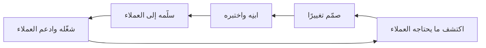
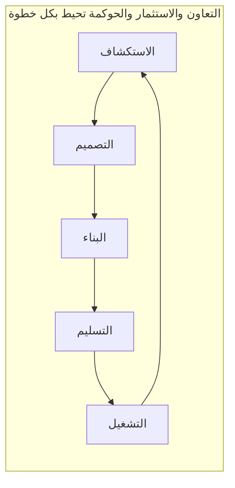

# الوحدة 0 — التوجيه

*كل منتج رقمي استخدمته، من تطبيق توصيل الطعام إلى الموقع الإلكتروني لأحد البنوك، يبقى حيًّا بفضل أشخاص يؤدّون أنواعًا كثيرة من العمل: يكتشفون ما يحتاجه العملاء، ويصمّمون، ويكتبون الشيفرة ويختبرونها، ويُصدرونها، ويُبقونها تعمل، ويجيبون العملاء، ويدفعون الفواتير، ويتأكدون من احترام القواعد. تضع هذه الوحدة الأساس للدورة كلها. فهي تشرح معنى «الممارسة الرقمية»، ولماذا يكون المنتج دائمًا منتجًا وخدمةً والعملَ الذي يقف وراءهما معًا؛ وتعرّفك بقافلة، وهي شركة ناشئة خيالية لتنسيق التوصيل في مرحلة الانطلاق، حين تبني مها وفيصل النسخة الأولى بأيديهما، ومعها الشخصيات والخطوات الثماني للعمل الرقمي التي يعتمد عليها كل درس لاحق؛ وتقول بوضوح كيف تستخدم الدورة وما ليست عليه. ويخرج كل درس بوثيقة من صفحة واحدة: مخطط للمنتج والخدمة، وخريطة خطوات لأسبوع عمل واحد، وخطة تعلّمك الخاصة.*

> **الخطوات:** Discover — انظر إلى العمل الرقمي كله، وإلى موقعك منه، قبل أن تتعلّم أي جزء منه.

---

# 0.1 — ما الممارسة الرقمية: المنتجات والخدمات والعمل الذي يقف وراءها
*المستوى (Level): 🟢 مبتدئ (Beginner)* · *المتطلبات (Prerequisites): لا يوجد* · *الخطوة (Step): Discover*

**بعد هذا الدرس تستطيع** أن ترسم مخططًا من صفحة واحدة للمنتج والخدمة لمنتج رقمي واحد: من يستخدمه ولأي غرض، والخدمة التي تحيط بالبرمجيات، وأنواع العمل التي تُبقي الاثنين قائمين، ومن يؤدّي كل نوع منها اليوم. *مدة الدراسة: قراءة نحو 15 دقيقةً، وعمل تطبيقي نحو 70 دقيقةً (تقدير).*

## ⚡ الدرس في دقيقة (In 60 seconds)
- **المنتج الرقمي (digital product)** شيء يستخدمه الناس عبر البرمجيات: تطبيق، أو موقع إلكتروني، أو أداة على الإنترنت. أما **الخدمة** فهي المساعدة والوعود المحيطة به: الدعم، والموثوقية، والفوترة، وتهيئة المستخدمين الجدد. ويعيش العملاء الاثنين شيئًا واحدًا.
- **الممارسة الرقمية (digital practice)** هي مجموعة المهارات اليومية التي تُستخدم لاكتشاف المنتجات الرقمية وتصميمها وبنائها وتسليمها وتشغيلها وتحسينها، ولتمويل هذا العمل وتنسيقه وحوكمته.
- القاعدة الأهم: **المنتج برمجيات، ومعها الخدمة المحيطة بها، ومعهما الأشخاص الذين يُبقون الاثنين قائمين.** إن لم ترَ إلا الشيفرة، فأنت لا ترى إلا جزءًا من العمل.
- إشارة القرار: قبل أن تبدأ أي مهمة، اسأل: «أيّ عميل تساعده هذه المهمة، وماذا يحدث له إن ساءت الأمور؟»
- أكبر فخ: أن تظن أن مسمّاك الوظيفي هو كل عملك. فالمطوّر يجيب الأسئلة أيضًا، والمختبِر يكتشف الاحتياجات أيضًا، وموظف الدعم يحسّن المنتج أيضًا.

## 🧭 لماذا يهم (Why it matters)
قافلة وكل من فيها شخصيات خيالية، ويقدّمهم الدرس 0.2 كما ينبغي. وكل الأرقام عن قافلة في هذا الدرس أرقام توضيحية، لا معايير مرجعية.

نحن في الشهر الرابع من التجربة التشغيلية في مرحلة الانطلاق. بنت مها وفيصل النسخة الأولى من قافلة: تطبيق للتجّار يطلب فيه المتجر توصيلة، وتطبيق للمندوبين يقبل فيه المندوب التوصيلة، وصفحة إدارة على الويب تتابع منها مها كل شيء. يستخدمه خمسة عشر متجرًا في التجربة، بنحو 150 توصيلة في اليوم، والفريق على وشك أن يكبر من شخصين إلى أربعة. الشيفرة تعمل، وهما فخوران بها.

في السادسة وعشر دقائق من أحد الصباحات يرنّ هاتف مها. مخبز مشارك في التجربة جهّز أربعين صندوق خبز لفندق في السادسة، ولم يأتِ أي مندوب. كان التطبيق يقول «تم تعيين المندوب»، لكن المندوب حذف التطبيق في الليلة السابقة، ولم يستطع أحد أن يرى ذلك. لا تهتم الخبّازة بمكان الخلل. يهمّها أن الخبز تأخر، وأن مها وحدها تجيب، وأن أحدًا لم يخبرها بما سيحدث بعد ذلك.

ردّ فيصل الأول: «الشيفرة فعلت تمامًا ما صُمّمت لتفعله». وهو محق، لكن ذلك لا يفيد. ما فشل هو الترتيب المحيط بالشيفرة: لا وسيلة لرؤية مندوب انقطع، ولا وعد للخبّازة، ولا رقم سوى رقم مها، ولا سجل للمشكلة. يدور هذا الدرس حول رؤية ذلك الترتيب كله.

## 📐 كيف يعمل (How it works)

### 🟢 الأساسيات (The essentials)

**المنتج والخدمة والمشروع.** ثلاث كلمات يستخدمها الناس دون تدقيق. افصل بينها.

| المصطلح | المعنى ببساطة | مثال من قافلة |
|---|---|---|
| **المنتج** | الشيء الذي يستخدمه الناس، ومعظمه برمجيات وبيانات | تطبيق التجّار، وتطبيق المندوبين، وصفحة الإدارة على الويب |
| **الخدمة** | المساعدة والوعود والتشغيل اليومي المحيطة بالمنتج | شخص تتصل به حين تتأخر توصيلة، ومندوبون تجري تهيئتهم ويُدفع لهم، وتطبيق يبقى متاحًا ويعمل |
| **المشروع** | عمل له بداية ونهاية وميزانية | «إضافة الدفع إلى تطبيق التجّار بحلول مارس» |

قد يغيّر المشروع المنتج، لكن المنتج وخدمته يستمران بعد انتهاء المشروع. وينشأ كثير من الالتباس في العمل من معاملة منتج حيّ كأنه مشروع «ينتهي». تجد نظرة المدير إلى هذه الفكرة في [*إدارة تقنية المعلومات كعمل تجاري*، الدرس 2.1 — المنتجات الرقمية والخدمات والمشاريع: ما كل منها ومن يملكه](../itbiz/index.ar.html#/2.1).

**ما الذي يجعل الشيء رقميًا.** في هذه الدورة، يكون المنتج رقميًا حين تصل معظم قيمته إلى العميل عبر البرمجيات والبيانات: تنقر الخبّازة على شاشة بدل أن تتصل بمندوب. لذلك يتغير كثيرًا (وكل تغيير قد يكسر شيئًا)، ويعمل طوال الوقت (فلا بد أن يراقبه أحد)، ويسجّل استخدامه بنفسه (فتستطيع أن تتعلّم بدل أن تخمّن)، وتخدم نسخة واحدة منه الجميع (فيصل الخطأ إلى الجميع). وتتعمق الوحدة 1 في ذلك.

**ما الممارسة الرقمية.** «الممارسة» هنا تعني ما يفعله الممارسون كل يوم، كما نقول ممارسة الطبيب، لا نظرية. والممارسة الرقمية هي مجموعة المهارات التي يستخدمها الناس لرعاية منتج رقمي طوال حياته:

- اكتشاف ما يحتاجه العملاء، وهل تستحق الفكرة أن تُبنى؛
- تصميم الطريقة التي يعمل بها وشكله؛
- بناؤه: كتابة الشيفرة واختبارها ومراجعتها؛
- تسليمه: إيصال التغييرات إلى العملاء بأمان؛
- تشغيله: مراقبته وإصلاحه ودعم العملاء؛
- العمل معًا: الفرق والأدوار والاتفاقات؛
- تمويله: معرفة تكلفته وهل يستحقها؛
- حوكمته: إبقاؤه آمنًا وقانونيًا وجديرًا بالثقة.

ويحوّل الدرس 0.2 هذه القائمة إلى الخطوات الثماني التي تستخدمها الدورة.

**العمل الذي يقف وراء المنتج.** من التمارين المفيدة أن تسرد كل نوع من العمل يلزم لإبقاء المنتج حيًّا. في قافلة، في مرحلة الانطلاق، يؤدّي شخصان معظم هذا العمل:

| نوع العمل | من يؤدّيه في قافلة اليوم | ماذا يحدث إن لم يؤدّه أحد |
|---|---|---|
| التحدث مع المتاجر والمندوبين عن مشكلاتهم | مها، حين يتّسع وقتها | يحلّ التطبيق مشكلات لا يعانيها أحد |
| تقرير ما يُبنى بعد ذلك | مها وفيصل، على فنجان قهوة | يفوز صاحب الصوت الأعلى |
| كتابة الشيفرة واختبارها | فيصل في الغالب | لا يصدر شيء جديد، أو يصدر معطوبًا |
| إصدار التغييرات، أي النشر (deployment): وضع نسخة جديدة في الخدمة | فيصل، يدويًا، مرة في الأسبوع | تتراكم التغييرات وتزداد خطورتها |
| مراقبة أنه يعمل (monitoring) | لا أحد حتى الآن | يكتشف المخبز المشكلة قبلك |
| إجابة المتاجر والمندوبين | هاتف مها الشخصي | يشعر العملاء بالإهمال ويرحلون |
| دفع فاتورة السحابة ومتابعة التكاليف | بطاقة مها الخاصة | مفاجآت؛ ولا أحد يعرف تكلفة التوصيلة الواحدة |
| حماية بيانات المتاجر والعملاء | لم يفكر فيها أحد | تسرّب، وغرامة، وثقة مفقودة |

العمود الأخير هو المقصود. كل صف عملٌ، سواء كُلّف به أحد أم لا. وإن لم يؤدّه أحد عن قصد، أُدّي مصادفةً، وبشكل سيئ، في أسوأ لحظة.

### 🟡 التعمق أكثر (Going deeper)

**حياة المنتج حلقة لا خط.** كثيرًا ما يتصوّر الممارسون الجدد العمل خطًّا مستقيمًا: فكرة، ثم شيفرة، ثم اختبار، ثم إصدار (release)، ثم انتهى. أما في الواقع فهو يدور في حلقة: يُنتج الإصدار بيانات وردود فعل من العملاء، تقود إلى أسئلة جديدة وإلى التغيير التالي. وصباح المخبز هو الحلقة وهي تعمل: فشلٌ في تشغيل المنتج يتحول إلى اكتشاف لما يفعله المندوبون بهواتفهم، ثم إلى تغيير في التصميم (التنبيه حين ينقطع مندوب)، ثم إلى شيفرة، ثم إلى إصدار، ثم يجب أن يُراقَب.

**كيف يتغير العمل حين تكبر الشركة.** في مرحلة الانطلاق، يؤدّي شخصان كل أنواع العمل. وحين تكبر قافلة، يصبح لكل نوع من العمل أشخاصه، ثم فرقه، ثم قواعده: مهارة أكبر، لكن معها تناقل للعمل بين الأشخاص وانتظار. تتابع الدورة قافلة عبر خمس مراحل نمو (الدرس 0.2). والطريقة الصحيحة لأداء مهمة ما تتوقف على المرحلة: إجراء موافقة يستغرق أسبوعين حكيمٌ في شركة من 400 شخص تتعامل مع المدفوعات، وعبثيٌّ في شركة من أربعة أشخاص معها 15 متجرًا في التجربة.

**أين موقعك.** كل دور في بداية المسار المهني يعمل في الغالب في جزء أو جزأين من الحلقة، ويمتد إلى غيرهما: موظفو الدعم مثلًا يغذّون الاستكشاف (discovery)، لأن كل تذكرة دعم دليل على حاجة. ولترى كيف تبدو هذه الوظائف يومًا بيوم، راجع [*من التخرّج إلى التوظيف*، الدرس 0.2 — خريطة الأدوار: ماذا يفعل المبتدئون في البرمجيات والذكاء الاصطناعي والبيانات والمنصّات والأمن طوال اليوم فعلًا](../career/index.ar.html#/0.2).

### 🔴 نظرة الخبير (Expert view)

**قِس السرعة والاستقرار معًا.** إن عددت السرعة وحدها شجّعت على الأعطال، وإن عددت الانقطاعات وحدها شجّعت على الجمود. يجمع برنامج DORA (DevOps Research and Assessment، وهو برنامج بحثي طويل الأمد أصبح الآن جزءًا من Google Cloud) مقاييسه لأداء تسليم البرمجيات في عاملين: معدّل الإنجاز (throughput)، أي مدى سرعة وصول التغييرات إلى بيئة الإنتاج وتكرارها، وسرعة التعافي من نشر فاشل؛ وعدم الاستقرار (instability)، أي عدد مرات فشل التغييرات أو حاجتها إلى إعادة عمل غير مخطط لها. ويقول إن العاملين معًا يعطيان صورة عامة عن أداء التسليم (دليل مقاييس DORA، المحدَّث في يناير 2026). والعادة التي تبنيها الآن: حين يصف أحدهم فريقًا بأنه «سريع»، اسأل كم مرة تفشل تغييراته، والعكس صحيح.

**الخدمة جزء من التصميم.** كان يمكن حل مشكلة المخبز بالشيفرة (اكتشاف المندوب المنقطع)، أو بوعد خدمة (إن لم يتأكد وجود مندوب قبل الاستلام بعشر دقائق، يتلقى المتجر اتصالًا)، أو بالاثنين معًا. وتتناول الوحدة 7 خيار الخدمة.

**القاعدة التي تُحفظ.** المنتج برمجيات، ومعها الخدمة المحيطة بها، ومعهما الأشخاص الذين يُبقون الاثنين قائمين.

## 🧰 الأدوات (The toolkit)
| المصدر أو الأداة أو القالب (Resource, tool or template) | ما هو وماذا يفعل (What it is and does) | متى تلجأ إليه (When to reach for it) |
|---|---|---|
| **Product and service sketch** — مخطط المنتج والخدمة | صفحة واحدة: المنتج، والمستخدمون ومهمتهم، والخدمة المحيطة به، وأنواع العمل، ومن يؤدّي كلًّا منها، والفجوات | حين تنضم إلى فريق أو تبدأ العمل على منتج |
| **Work inventory** — جرد العمل | جدول بكل نوع من العمل يحتاجه المنتج، مع مالك وعمود «ماذا يحدث إن لم يؤدّه أحد» | حين تظل الأمور تسقط من بين الأيدي |
| **Loop check** — فحص الحلقة | أربعة أسئلة بعد كل إصدار: ماذا فعل العملاء، وما الذي تعطّل، وماذا تعلّمنا، وما التالي | بعد كل إصدار، مهما صغر |

## 🏛️ عمليًا في قافلة (In practice at Qafila)
بعد صباح المخبز، جلست مها مع فيصل ورسما أول مخطط للمنتج والخدمة في قافلة. توضيحي وخيالي.

> **مخطط المنتج والخدمة في قافلة (مرحلة الانطلاق، المسودة الأولى)**
>
> **المنتج:** تطبيق التجّار (تطلب المتاجر التوصيلات)، وتطبيق المندوبين (يقبل المندوبون التوصيلات وينجزونها)، وصفحة الإدارة على الويب (تتابع مها كل الطلبات). يعمل على الخدمات المُدارة (managed services) لمزوّد سحابي واحد، أي قواعد بيانات وخوادم جاهزة يشغّلها المزوّد نيابةً عنهما؛ والشيفرة كلها في مستودع (repository) واحد، أي المخزن المشترك للشيفرة وتاريخها.
>
> **المستخدمون ومهمتهم:** تريد المتاجر الصغيرة أن يصل الطلب في وقته دون توظيف سائق؛ ويريد المندوبون أعمالًا منتظمة وعادلة الأجر قريبة منهم؛ وتحتاج مها إلى أن ترى الطلبات تتدفق.
>
> **الخدمة المحيطة به:** تهيئة متجر جديد (تزوره مها بنفسها)؛ وتهيئة المندوبين (يثبّت فيصل التطبيق على هواتفهم)؛ والمساعدة حين تتأخر توصيلة (هاتف مها)؛ والدفع للمندوبين (جدول بيانات، أسبوعيًا)؛ وإبقاء النظام يعمل (لا أحد يراقبه).
>
> **أنواع العمل ومن يؤدّيها:** الاستكشاف (مها)، والتصميم (مها وفيصل، على الورق)، والبناء والاختبار (فيصل)، والإصدار (فيصل، أسبوعيًا، يدويًا)، والتشغيل (لا أحد)، والدعم (مها)، والتكاليف (بطاقة مها)، وحماية البيانات (لا أحد).
>
> **فجوات تؤلم الآن:** لا أحد يرى المندوب المنقطع؛ والدعم يعتمد على هاتف واحد؛ ولا سجل للمشكلات.
>
> **تغيير واحد هذا الأسبوع:** رقم دعم مشترك يرنّ على الهاتفين، وقائمة بسيطة بكل مشكلة يُبلَّغ عنها، مع التاريخ وما تم فعله.

أغفلت مسودة فيصل الأولى قسم الخدمة: «هذا ليس من المنتج». فنبّهته مها إلى أن المخبز لم يشتكِ من شاشة واحدة. ثم أراد فيصل أن يصلح كل شيء دفعة واحدة؛ فقصرت مها الأسبوع على تغيير واحد رخيص وقائمة للمشكلات.

## 🛠️ التمارين (Exercises)
**🟢 ارسم مخططًا لمنتج تستخدمه.** اختر منتجًا رقميًا تستخدمه كثيرًا (تطبيق نقل، أو تطبيق توصيل طعام، أو بوابة جامعتك). اكتب مخطط المنتج والخدمة الخاص به: أجزاء المنتج، والمستخدمون ومهمتهم، والخدمة المحيطة به، وثلاثة أنواع من العمل تعتقد أنها تجري وراءه.
*يكتمل عندما (Done when):* يسمّي المخطط مجموعتين من المستخدمين على الأقل، وثلاثة عناصر خدمة على الأقل ليست شاشات، وثلاثة أنواع من العمل مع تخمين لمن يؤدّي كلًّا منها.

الإجابة النموذجية والتحقق الذاتي

**الإجابة النموذجية.** بوابة جامعية. المنتج: صفحات التسجيل، والجدول الدراسي، والدرجات، وتطبيق الجوال. المستخدمون: الطلاب، والمحاضرون، وموظفو شؤون التسجيل. الخدمة: مكتب مساعدة لتسجيل الدخول، وفتح التسجيل في الموعد المعلن، وإتاحة النظام في أسبوع التسجيل. العمل: مراقبته في أسبوع التسجيل (التشغيل)، واختيار الميزات (المنتج)، والتحقق من أن الطلاب لا يرون درجات بعضهم (الحوكمة).

**التحقق الذاتي.**
- هل أدرجت مستخدمًا واحدًا على الأقل ليس العميل الرئيسي (موظفين أو مندوبين مثلًا)؟
- هل عناصر الخدمة عندك أشياء يشعر بها العميل (مساعدة، ووعود، وإتاحة)، لا شاشات؟
- هل فصلت ما تعرفه عمّا تخمّنه؟

**🟡 ابنِ جردًا للعمل في قافلة.** باستخدام مخطط قافلة أعلاه، أضف ثلاثة أنواع من العمل فاتت مها وفيصل. واكتب لكل منها من ينبغي أن يؤدّيه الآن، وماذا يحدث إن لم يؤدّه أحد.
*يكتمل عندما (Done when):* يكون كل صف من صفوفك الثلاثة نوعًا مختلفًا من العمل، وله مالك واقعي في مرحلة الانطلاق (مها أو فيصل)، وعاقبة ملموسة تمسّ متجرًا أو مندوبًا.

الإجابة النموذجية والتحقق الذاتي

**الإجابة النموذجية.** (1) النسخ الاحتياطي لقاعدة بيانات الطلبات: فيصل، يفعّل النسخ الاحتياطية لدى المزوّد ويختبر استعادة واحدة؛ وإلا فقد يُضيّع خطأ واحد كل الطلبات. (2) إبلاغ المتاجر بالتغييرات: مها، برسالة قصيرة قبل كل إصدار؛ وإلا فوجئ متجر بشاشة متغيرة في وقت الذروة. (3) تجديد النطاق وحسابات المطوّرين في متاجر التطبيقات: فيصل، يضع مواعيد التجديد في تقويم مشترك؛ وإلا فقد يُسحب تطبيق المندوبين من المتجر إذا انتهى الحساب، فلا يستطيع المندوبون الجدد تثبيته.

**التحقق الذاتي.**
- هل كل مالك شخص موجود في مرحلة الانطلاق، لا فريق لم تنشئه قافلة بعد؟
- هل كل عاقبة شيء سيلاحظه العميل، لا مجرد قلق داخلي؟
- هل تجنّبت تكرار صفوف موجودة في المخطط أصلًا؟

**🔴 اعثر على الحلقة في قصة علنية.** اختر منتجًا تستخدمه تغيّر مؤخرًا (إعادة تصميم، أو ميزة جديدة، أو ميزة أُزيلت). اربط ما تستطيع رؤيته من الخارج بالمراحل الخمس في مخطط الحلقة (الاكتشاف، والتصميم، والبناء والاختبار، والتسليم، والتشغيل والدعم): مثلًا، ماذا كان العملاء يفعلون قبل ذلك، وما الذي تغيّر، وكيف تفاعل العملاء، وماذا فعلت الشركة بعد ذلك. وميّز بوضوح ما شاهدته مما استنتجته.
*يكتمل عندما (Done when):* يغطي ما كتبته مراحل الحلقة الخمس، مع حقيقة مشاهَدة واحدة على الأقل لكل مرحلة تستطيع رؤيتها، وسطر يذكر المراحل التي لا تستطيع رؤيتها من الخارج والدليل الذي قد يكشفها.

الإجابة النموذجية والتحقق الذاتي

**الإجابة النموذجية.** نقل تطبيق مراسلة زرًّا كثير الاستخدام إلى داخل قائمة. الاكتشاف: كان الناس يستخدمونه يوميًا (مشاهَد). التسليم: انتقل في تحديث واحد (مشاهَد). التشغيل والدعم: اشتكت مراجعات متجر التطبيقات؛ وبعد إصدارين عاد الزر إلى مكانه (مشاهَد). مستنتَج: راقبت الشركة المراجعات وتراجعت. لا يمكن رؤيته: التصميم، والبناء والاختبار، ومن اتخذ القرار؛ وملاحظات الإصدار قد تكشفها.

**التحقق الذاتي.**
- هل فصلت المشاهَد عن المستنتَج؟
- هل شملت حلقتك التشغيل والدعم، لا التصميم والإصدار فقط؟
- هل تجنّبت ذكر أسباب لا تستطيع إثباتها؟

## ⚠️ أخطاء وفخاخ (Mistakes and traps)
- **ألّا ترى إلا الشيفرة.** «الشيفرة فعلت ما صُمّمت لتفعله» ليست مثل «حصل العميل على الخدمة». انظر إلى الخدمة المحيطة بها أيضًا.
- **معاملة المنتج كأنه مشروع.** المنتجات لا تنتهي. خطّط لمن سيرعاه بعد الإصدار.
- **ترك عمل بلا مالك لأنه ليس في مسمّى أحد.** مراقبة النظام والنسخ الاحتياطي وحماية البيانات تحتاج إلى اسم بجانبها، حتى في فريق من شخصين.
- **نسخ إجراءات شركة كبيرة إلى شركة صغيرة.** اجعل الممارسة على قدر المرحلة. ويشرح الدرس 0.2 المراحل.

## 🧾 الخلاصة (Recap)
- المنتج الرقمي برمجيات وبيانات في معظمه؛ والخدمة هي المساعدة والوعود المحيطة به؛ والمشروع عمل مؤقت يغيّرهما.
- الممارسة الرقمية هي العمل اليومي لاكتشاف المنتجات الرقمية وتصميمها وبنائها وتسليمها وتشغيلها وتمويلها وتنسيقها وحوكمتها.
- العمل حلقة لا خط: تشغيل المنتج يغذّي الاستكشاف التالي.
- كل نوع من العمل يحتاج إلى مالك، حتى حين تكون الشركة صغيرة جدًا.
- القاعدة: المنتج برمجيات، ومعها الخدمة المحيطة بها، ومعهما الأشخاص الذين يُبقون الاثنين قائمين.

## ✍️ اختبر نفسك (Check yourself)
**1. بعد صباح المخبز، يقول فيصل: «الشيفرة فعلت تمامًا ما صُمّمت لتفعله». ما أفضل رد؟**

- A. توافقه وتغلق المسألة، لأن العطل خارج الشيفرة مشكلة العميل وعليه أن يحلّها بنفسه.
- B. توافقه، وتضيف اختبارات آلية أكثر لتثبت صحة الشيفرة في الإصدارات المقبلة.
- C. توافقه على أن الشيفرة عملت، وتنظر إلى الخدمة المحيطة بها، فهناك وقع الفشل.
- D. تخالفه، لأن تطبيق المندوبين لا بد أن فيه خللًا ما دامت توصيلة قد ضاعت.

الإجابة

**C.** وقع الفشل في الترتيب المحيط بالشيفرة. يلوم A العميل، ويضيف B اختبارات لشيفرة أدّت عملها، ويفترض D وجود خلل دون دليل. راجع «لماذا يهم» و«العمل الذي يقف وراء المنتج».

**2. أيّ مما يلي عنصر من عناصر الخدمة في قافلة لا جزء من المنتج؟**

- A. رقم دعم مشترك تتصل به المتاجر حين تتأخر توصيلة.
- B. الشاشة في تطبيق التجّار التي يطلب منها المتجر توصيلة جديدة.
- C. صفحة الإدارة على الويب التي تعرض لمها كل طلب جارٍ اليوم.
- D. المنطق في تطبيق المندوبين الذي يسند التوصيلة إلى مندوب.

الإجابة

**A.** خط الدعم مساعدة ووعد حول البرمجيات. أما B وC وD فكلها أجزاء من المنتج البرمجي نفسه. راجع «المنتج والخدمة والمشروع».

**3. يقول فيصل إن «المنتج سيكتمل» بعد إضافة الدفع. ما التصحيح الأدق؟**

- A. صحيح، بشرط أن يُدار عمل الدفع مشروعًا بنطاق ثابت.
- B. صحيح، لأن المنتج يكتمل حين تصبح فيه كل الأجزاء التي طلبها العملاء.
- C. ليس بعد، لأن المنتج لا يكتمل إلا بعد عام كامل من العمل دون أي أعطال على الإطلاق.
- D. ليس تمامًا: ينتهي مشروع الدفع، لكن المنتج يحتاج إلى رعاية ما دام يُستخدم.

الإجابة

**D.** المشاريع تنتهي؛ أما المنتجات وخدماتها فتستمر. يخلط A وB بين نهاية المشروع ونهاية المنتج، ويخترع C نقطة اكتمال. راجع «المنتج والخدمة والمشروع».

**4. تسأل مها من ينبغي أن يراقب أن قافلة تعمل، ولا أحد يفعل ذلك. ماذا يقترح الدرس؟**

- A. تأجيل الأمر حتى تستطيع قافلة توظيف فريق تشغيل، لأن المراقبة عمل متخصص.
- B. تسمية شخص يملكه الآن، حتى في فريق من شخصين، كي يُؤدّى عن قصد.
- C. الطلب من متاجر التجربة الإبلاغ عن المشكلات، لأنها تلاحظ الأعطال أولًا.
- D. تجاوزه ما دام في التجربة 15 متجرًا فقط، لأن الخطر أصغر من أن يُحسب.

الإجابة

**B.** كل نوع من العمل يحتاج إلى مالك، حتى في فريق من شخصين. يؤجّل A الأمر، ويجعل C العملاءَ نظامَ المراقبة (كما حدث في المخبز)، ويتجاهل D أن كل عطل يصيب متجرًا حقيقيًا. راجع «العمل الذي يقف وراء المنتج».

**5. يمتدح صديق فريقًا لأنه «ينشر عشر مرات في اليوم» (يضع نسخة جديدة في الخدمة عشر مرات). أيّ سؤال يعبّر أفضل تعبير عن نظرة الخبير في هذا الدرس؟**

- A. ما نسبة تلك الإصدارات التي تكسر شيئًا لدى العملاء وتحتاج إلى إصلاح؟
- B. كم اختبارًا آليًا يُشغَّل على كل تغيير قبل أن يُسمح له بدخول الخدمة؟
- C. ما سرعة انتهاء كل عملية نشر من تلك بعد أن يبدأ أحدهم تشغيلها؟
- D. كم من تلك التغييرات راجعها مهندس ثانٍ قبل إصدارها؟

الإجابة

**A.** يجب أن تُقرأ السرعة مع الاستقرار؛ ويجمع DORA مقاييسه في عاملَي معدّل الإنجاز وعدم الاستقرار. يتناول B وD احتياطات تُتخذ قبل الإصدار، ويعود C إلى السرعة؛ ولا يُظهر أيٌّ منها كم مرة تفشل التغييرات فعلًا لدى العملاء. راجع «قِس السرعة والاستقرار معًا».

## 📚 المراجع (References)
- DORA، «DORA's software delivery performance metrics» (دليل على موقع dora.dev): https://dora.dev/guides/dora-metrics/ — خمسة مقاييس في عاملين: معدّل الإنجاز وعدم الاستقرار (آخر تحديث للصفحة 5 يناير 2026؛ فُتحت في 22 نوفمبر 2026).
- دورة من المكتبة: [*إدارة تقنية المعلومات كعمل تجاري*، الدرس 2.1 — المنتجات الرقمية والخدمات والمشاريع: ما كل منها ومن يملكه](../itbiz/index.ar.html#/2.1) (نظرة المدير إلى المنتجات والمشاريع).
- دورة من المكتبة: [*من التخرّج إلى التوظيف*، الدرس 0.2 — خريطة الأدوار: ماذا يفعل المبتدئون في البرمجيات والذكاء الاصطناعي والبيانات والمنصّات والأمن طوال اليوم فعلًا](../career/index.ar.html#/0.2) (ما تفعله أدوار بداية المسار المهني يومًا بيوم).

---

# 0.2 — تعرّف على قافلة والخطوات الثماني
*المستوى (Level): 🟢 مبتدئ (Beginner)* · *المتطلبات (Prerequisites): 0.1* · *الخطوة (Step): Discover*

**بعد هذا الدرس تستطيع** أن تأخذ أسبوع عمل واحدًا على منتج رقمي وتفرز كل مهمة فيه تحت الخطوات الثماني: الاستكشاف (Discover)، والتصميم (Design)، والبناء (Build)، والتسليم (Deliver)، والتشغيل (Operate)، والتعاون (Collaborate)، والاستثمار (Invest)، والحوكمة (Govern)؛ وأن تسمّي من أدّاها وما الدليل الذي تركته، وأن تكتشف الخطوات التي لا يغطيها أحد. *مدة الدراسة: قراءة نحو 15 دقيقةً، وعمل تطبيقي نحو 75 دقيقةً (تقدير).*

## ⚡ الدرس في دقيقة (In 60 seconds)
- **قافلة** شركة ناشئة خليجية **خيالية** تبني تطبيقًا لتنسيق التوصيل للأعمال الصغيرة ومندوبيها، وتتابعها الدورة عبر خمس مراحل نمو.
- تفرز الدورة كل العمل الرقمي في **ثماني خطوات**: الاستكشاف، والتصميم، والبناء، والتسليم، والتشغيل، والتعاون، والاستثمار، والحوكمة. وهي كلمات هذه الدورة البسيطة الخاصة، لا مصطلحات أي إطار عمل.
- الخطوات الخمس الأولى تشكّل **حلقة** حول المنتج. والثلاث الأخيرة **تحيط** بالحلقة: فهي تتعلق بالناس والمال والقواعد.
- القاعدة الأهم: **كل خطوة تحدث، سواء خطّط لها أحد أم لا.** والخيار الوحيد هو هل تُؤدّى عن قصد.
- أكبر فخ: أن تظن أن البناء والتسليم وحدهما «العمل الحقيقي». ففي مرحلة الانطلاق، الخطوات التي يتجاهلها مها وفيصل هي التي تؤذيهما.

## 🧭 لماذا يهم (Why it matters)
قافلة وكل من فيها شخصيات خيالية. وكل الأرقام عن قافلة أرقام توضيحية، لا معايير مرجعية.

في الشهر الرابع من التجربة التشغيلية في مرحلة الانطلاق، كان لدى قافلة 15 متجرًا في التجربة ونحو 150 توصيلة في اليوم. احتفظ فيصل بقائمة لما أنجزه كل أسبوع، وكانت كلها شيفرة: شاشات جديدة، وإصلاح لخريطة المندوبين، وقائمة طلبات أسرع. وبحسابه كان أسبوعًا منتجًا.

أما أسبوع مها فبدا مختلفًا. زارت متجرين لتفهم لماذا ما زالا يتصلان بالمندوبين هاتفيًا (الاستكشاف)، ورسمت شاشة طلب أبسط (التصميم)، ودفعت فاتورة السحابة ببطاقتها الخاصة (الاستثمار)، وأرسلت جدول بيانات بأرقام هواتف أصحاب المتاجر إلى صديق يساعد في المبيعات (الحوكمة، وإن لم ترَ الأمر كذلك)، وتجادلت مع فيصل حول إصدار ليلة الخميس (التسليم والتعاون). وقال فيصل نصف مازح إن مها «لم تفعل الكثير هذا الأسبوع».

كان الاثنان يؤدّيان عملًا رقميًا، لكن لم تكن لديهما كلمات مشتركة لوصفه، فبقي عمل مها غير مرئي، ومرّ جدول البيانات دون أن يسأل عنه أحد. يمنحك هذا الدرس تلك الكلمات.

## 📐 كيف يعمل (How it works)

### 🟢 الأساسيات (The essentials)

**تعرّف على قافلة.** قافلة شركة ناشئة خليجية خيالية تبني تطبيقًا لتنسيق التوصيل للأعمال الصغيرة (المتاجر والمخابز والصيدليات) ومندوبيها. يطلب المتجر توصيلة في تطبيق التجّار؛ ويقبلها مندوب في تطبيق المندوبين؛ وتتيح صفحة الإدارة على الويب لموظفي قافلة رؤية كل شيء وإصلاحه. وأي شبه بشركة حقيقية محض مصادفة.

**مراحل النمو الخمس.** تتابع الدورة قافلة من شخصين إلى نحو أربعمئة شخص. وهذه المراحل خاصة بهذه الدورة، وليست مأخوذة من أي إطار عمل. وكل الأرقام توضيحية.

| المرحلة | الأشخاص | التجّار | التوصيلات في اليوم | الفرق | النشر إلى بيئة الإنتاج | الوحدات |
|---|---|---|---|---|---|---|
| **الانطلاق (Launch)** | 2 (مها وفيصل)، ثم 4 | 15 متجرًا في التجربة | نحو 150 | لا يوجد | يدويًا، أسبوعيًا | 0–2 |
| **الجذب (Traction)** | 12 | 300 | نحو 4,000 | 1 | يوميًا عبر CI | 3–5 |
| **النمو (Growth)** | 40 | 2,000 | نحو 25,000 | 4 | عدة مرات في اليوم | 6–7 |
| **التوسّع (Scale-up)** | 120 | 9,000 | نحو 120,000 | 12 (منها فريق منصة) | مرات كثيرة في اليوم | 8–9 |
| **الرسوخ (Established)** | 400 | 30,000 في 4 دول | نحو 400,000 | 35 | مرات كثيرة في اليوم | 10–13 |

«النشر (deployment) إلى بيئة الإنتاج» يضع نسخة جديدة في الخدمة للعملاء. و«CI»، أي التكامل المستمر، يعني أن كل تغيير في الشيفرة يُبنى ويُختبر آليًا؛ وتشرحه الوحدة 3. والمنتج يكبر أيضًا: الدفع في مرحلة الجذب، ومكتب الدعم والتحليلات في مرحلة النمو، وخدمة لتوجيه المسارات (تخطط مسارات المندوبين) ومنصة داخلية (أدوات مشتركة لبقية الفرق) في مرحلة التوسّع، وشريك مدفوعات ومنصة بيانات في مرحلة الرسوخ. وتشرح الوحدات اللاحقة كلًّا منها حين يظهر.

**الشخصيات.** يرتكب كل شخص أخطاء واقعية تتعلّم منها.

| الشخص | الدور | ينضم في |
|---|---|---|
| **مها** | المؤسِّسة والرئيسة التنفيذية؛ كانت مطوّرة؛ تكتب الشيفرة الأولى، ثم تتعلّم أن تفوّض وتتخلّى عن السيطرة على كل شيء | الانطلاق |
| **فيصل** | أول مهندس، ثم رئيس الهندسة؛ سريع، ويميل إلى تجاوز الاختبارات والتوثيق | الانطلاق |
| **سلمى** | الدعم والعمليات؛ ثم قائدة الخدمة والموثوقية | الانطلاق |
| **عائشة** | أول مديرة منتج | الجذب |
| **كريم** | مصمّم وباحث في تجربة المستخدم | لاحقًا (انظر الوحدة التي يظهر فيها أولًا) |
| **حمد** | محلل بيانات، ثم رئيس البيانات | لاحقًا (انظر الوحدة التي يظهر فيها أولًا) |
| **ياسمين** | مهندسة حديثة التخرج؛ تمثّلك أنت، وتتابع دروس كثيرة عامها الأول | النمو |
| **بلال** | قائد الشؤون المالية، ثم المدير المالي | لاحقًا (انظر الوحدة التي يظهر فيها أولًا) |
| **دانة** | قائدة الأمن والمخاطر، عُيّنت بعد حادث أمني مقلق | التوسّع |

**الخطوات الثماني.** كل مهمة في العمل الرقمي تندرج تحت واحدة منها على الأقل:

| الخطوة | معناها | مثال من قافلة في مرحلة الانطلاق | ما تتركه وراءها (الدليل) |
|---|---|---|---|
| **Discover** — الاستكشاف | معرفة ما يحتاجه العملاء، وهل تستحق الفكرة التنفيذ | تزور مها مخبزًا لترى كيف يطلب الزبائن اليوم | ملاحظات المقابلات، وبيان المشكلة |
| **Design** — التصميم | تقرير طريقة عمل الشيء وشكله قبل بنائه | ترسم مها شاشة طلب أبسط | رسم، أو نموذج أولي (prototype)، أو قرار |
| **Build** — البناء | كتابة الشيفرة واختبارها ومراجعتها | يضيف فيصل خريطة المندوبين | الشيفرة، والاختبارات، والمراجعة، والإيداعات (commits)، أي التغييرات المحفوظة في المستودع (repository) |
| **Deliver** — التسليم | إيصال التغييرات إلى العملاء بأمان | يُصدر فيصل يدويًا ليلة الخميس | ملاحظة إصدار، وسجل نشر |
| **Operate** — التشغيل | إبقاء المنتج يعمل ودعم من يستخدمونه | تجيب مها المخبز في السادسة وعشر دقائق | قائمة مشكلات، وإصلاح، وسجل دعم |
| **Collaborate** — التعاون | العمل معًا: الأدوار والاتفاقات والتواصل | يتفق مها وفيصل على مواعيد الإصدار | اتفاق عمل (working agreement)، ولوحة مهام |
| **Invest** — الاستثمار | تقرير أين يذهب المال والوقت، ومعرفة تكلفة الأشياء | تراجع مها فاتورة السحابة | جدول تكاليف، وميزانية، وقرار |
| **Govern** — الحوكمة | إبقاء العمل آمنًا وقانونيًا وجديرًا بالثقة | تقرير من يحق له رؤية أرقام هواتف أصحاب المتاجر | قائمة صلاحيات الوصول، وسياسة، وقيد في سجل المخاطر |

### 🟡 التعمق أكثر (Going deeper)

**حلقة يحيط بها إطار.** تتبع الخطوات الخمس الأولى حلقة حياة المنتج من الدرس 0.1: تكتشف حاجة، وتصمّم تغييرًا، وتبنيه، وتسلّمه، وتشغّله، والتشغيل يريك ما تكتشفه بعد ذلك. أما الثلاث الأخرى فليست مراحل في تلك الحلقة؛ بل تحيط بها: التعاون يتعلق بالناس، والاستثمار بالمال والوقت، والحوكمة بقواعد كل خطوة ومخاطرها.

خطوات الإطار هي التي تنساها الشركات الصغيرة، لأنها لا ترد في أي مسمّى وظيفي.

**كيف تتغير الخطوات مع المراحل.** الخطوة نفسها تبدو مختلفة جدًا باختلاف الحجم.

| الخطوة | في الانطلاق (2–4 أشخاص) | في الرسوخ (نحو 400 شخص) |
|---|---|---|
| التسليم | مهندس واحد يُصدر يدويًا، أسبوعيًا | خطوط نشر (pipelines) آلية، أي أدوات تختبر كل تغيير وتُصدره دون خطوات يدوية، تُصدر مرات كثيرة في اليوم |
| التشغيل | هاتف المؤسِّسة | مكتب دعم، وجداول مناوبة (on-call)، أي من يجيب التنبيهات خارج أوقات العمل، ومستويات خدمة، أي معايير موعودة مثل نسبة الإتاحة |
| الاستثمار | بطاقة المؤسِّسة | ميزانيات، ودراسات جدوى (business cases)، وتقارير تكلفة لكل منتج |
| الحوكمة | لم يُفكَّر فيها بعد | وظائف للأمن والمخاطر والتدقيق؛ وفحوص يجريها شريك المدفوعات قبل أن يوقّع |

كل عمود يناسب مرحلته. ومهارتك أن تلاحظ متى تتوقف الطريقة القديمة عن المناسبة. ويُظهر رأس كل درس وسم خطوته، مثل *الخطوة (Step): Build, Deliver*.

### 🔴 نظرة الخبير (Expert view)

**الدليل هو ما تُرى به الخطوة.** الخطوة التي لا تترك دليلًا يصعب تحسينها. فشيفرة فيصل تترك إيداعات في المستودع؛ أما زيارة مها للمتجر فلا تترك شيئًا ما لم تكتب ملاحظات. بعد كل مهمة، اسأل: «أيّ سجل يُثبت أن هذا حدث، وهل يستطيع غيري أن يستفيد منه؟»

**الفجوات أنفع من المجاميع.** نادرًا ما تكون النتيجة المفيدة لخريطة الخطوات «قضينا معظم الوقت في البناء». النتيجة المفيدة هي الصف الفارغ. انظر إليه أولًا.

**مهمة واحدة، خطوتان.** كتابة اختبار آلي بناءٌ وتسليمٌ معًا (لأنها تجعل الإصدار أكثر أمانًا)؛ وتقرير من يستطيع رؤية صفحة الإدارة حوكمةٌ وتعاونٌ معًا. صنّف المهمة بحسب السؤال الذي تجيب عنه أساسًا، ودوّن الخطوة الثانية حيث يفيد ذلك.

**القاعدة التي تُحفظ.** كل خطوة تحدث، سواء خطّط لها أحد أم لا. والخيار الوحيد هو هل تُؤدّى عن قصد.

## 🧰 الأدوات (The toolkit)
| المصدر أو الأداة أو القالب (Resource, tool or template) | ما هو وماذا يفعل (What it is and does) | متى تلجأ إليه (When to reach for it) |
|---|---|---|
| **Step map** — خريطة الخطوات | جدول بمهام أسبوع واحد، لكل منها خطوة وشخص والدليل الذي تركته | مرة في الأسبوع في مرحلة الانطلاق؛ ومرة في الشهر بعد ذلك |
| **Step-gap check** — فحص فجوات الخطوات | لكل خطوة من الخطوات الثماني: من غطّاها، وما الدليل الموجود، وما الناقص | حين يظل شيء يسوء ولا يعرف أحد السبب |
| **Stage check** — فحص المرحلة | خمسة أسئلة لتحديد مرحلة الشركة: الأشخاص، والعملاء، والفرق، وعادة الإصدار، وأجزاء المنتج | حين تنضم إلى شركة أو فريق |

## 🏛️ عمليًا في قافلة (In practice at Qafila)
بعد الجدال حول من «فعل الكثير هذا الأسبوع»، رسمت مها على سبّورة المكتب خريطة خطوات لأسبوعهما المشترك. توضيحي وخيالي.

> **خريطة خطوات قافلة: الأسبوع 16 (مرحلة الانطلاق)**
>
> | المهمة | الخطوة | من | الدليل |
> |---|---|---|---|
> | زيارة متجرين بشأن الطلبات الهاتفية المباشرة | الاستكشاف | مها | لا شيء (ملاحظات في رأسها) ← *تُكتب* |
> | رسم شاشة طلب أبسط | التصميم | مها | رسم على الورق، مصوَّر |
> | خريطة المندوبين، وقائمة طلبات أسرع، وإصلاحان | البناء | فيصل | إيداعات في المستودع |
> | إصدار ليلة الخميس | التسليم | فيصل | رسالة إلى مها؛ لا ملاحظة إصدار ← *تُضاف واحدة* |
> | اتصال المخبز في السادسة وعشر دقائق؛ مندوب مفقود | التشغيل | مها | لا شيء ← *تُبدأ قائمة مشكلات* |
> | الاتفاق على أن تكون الإصدارات يوم الخميس قبل 20:00 | التعاون | كلاهما | سلسلة رسائل |
> | دفع فاتورة السحابة؛ قلق من نمو التكلفة | الاستثمار | مها | كشف حساب البطاقة فقط ← *يُبدأ جدول تكاليف* |
> | إرسال أرقام هواتف أصحاب المتاجر إلى صديق يساعد في المبيعات | الحوكمة | مها | لا شيء ← *يُقرَّر من يحق له رؤية بيانات المتاجر* |
>
> **الفجوات:** التشغيل والحوكمة بلا مالك ولا سجل؛ والاستثمار على بطاقة شخصية.
>
> **الإجراءات:** قائمة مشكلات (مها، الآن)؛ وملاحظة إصدار من سطر واحد لكل إصدار (فيصل)؛ وجدول تكاليف بسيط (مها)؛ والطلب من الصديق حذف جدول البيانات والاتفاق على من يحق له رؤية بيانات المتاجر (مها).

اعترض فيصل بأن «ملاحظة الإصدار لأربعة أشخاص بيروقراطية». فوافقته مها على أن تكون سطرًا واحدًا: كان تشخيص اتصال المخبز سيصبح أسهل لو عرفا ما الذي تغيّر يوم الخميس. أما صف الحوكمة فأزعجها؛ لم تكن ترى جدول البيانات خطرًا حتى وضعته بجانب خانة دليل فارغة.

## 🛠️ التمارين (Exercises)
**🟢 صنّف المهام.** صنّف كل مهمة من مهام قافلة هذه تحت خطوتها الرئيسية: (a) سؤال خمسة مندوبين لماذا يرفضون الرحلات الطويلة؛ (b) اختيار خطة قاعدة البيانات السحابية؛ (c) كتابة اختبار لحساب رسوم التوصيل؛ (d) تقرير من يحق له تسجيل الدخول إلى صفحة الإدارة على الويب؛ (e) الاتفاق على اجتماع تخطيط أسبوعي؛ (f) تفعيل شاشة الطلب الجديدة لكل المتاجر؛ (g) رسم ثلاث نسخ من شاشة تسجيل المندوبين؛ (h) إعادة تشغيل خادم تطبيق المندوبين بعد أن توقّف عن الاستجابة. كل خطوة تناسب مهمة واحدة بالضبط.
*يكتمل عندما (Done when):* يكون لكل تصنيف سبب من سطر واحد يسمّي السؤال الرئيسي الذي تجيب عنه المهمة، وتكون قد دوّنت خطوة ثانية لأي مهمة تناسب خطوتين.

الإجابة النموذجية والتحقق الذاتي

**الإجابة النموذجية.** (a) الاستكشاف: ماذا يحتاج المندوبون؟ (b) الاستثمار: أي خطة تستحق تكلفتها؟ الخطوة الثانية: التصميم، لأن الخطة تحدد طريقة عمل النظام. (c) البناء: هل تعمل شيفرة الرسوم؟ الخطوة الثانية: التسليم، لأن الاختبار يجعل الإصدار أكثر أمانًا. (d) الحوكمة: من يحق له الدخول، بأمان؟ الخطوة الثانية: التعاون، لأنها تحدد أدوار الناس. (e) التعاون: كيف نعمل معًا؟ (f) التسليم: كيف يصل التغيير إلى العملاء بأمان؟ (g) التصميم: كيف ينبغي أن يعمل ويبدو؟ (h) التشغيل: كيف نبقيه يعمل؟ حالة صعبة: (b) تبدو تقنية، لكن سؤالها الرئيسي عن المال والقيمة.

**التحقق الذاتي.**
- هل صنّفت كل مهمة بحسب السؤال الذي تجيب عنه أساسًا؟
- حين تناسب مهمة خطوتين، هل دوّنت الثانية دون أن تحسبها مرتين؟
- هل استند تعليلك إلى التعريفات في جدول الخطوات؟

**🟡 ارسم خريطة لأسبوع من عملك.** خذ أسبوعًا واحدًا من عملك أو من مشروع دراستك (واجب في مقرر، أو مشروع جانبي، أو مساهمة في مشروع مفتوح المصدر). اسرد ثماني مهام على الأقل واملأ خريطة خطوات: المهمة، والخطوة، ومن، والدليل.
*يكتمل عندما (Done when):* تضم الخريطة ثماني مهام على الأقل، وتظهر فيها خمس خطوات على الأقل، وتقول كل خانة دليل «لا شيء» أو تسمّي سجلًا حقيقيًا، وتكون قد كتبت إجراءً واحدًا للخطوة الأكثر فراغًا.

الإجابة النموذجية والتحقق الذاتي

**الإجابة النموذجية.** تطبيق لفريق من الطلاب: شاشة تسجيل الدخول (البناء، أنا، إيداعات)؛ سؤال ثلاثة من زملاء الدراسة عمّا يحتاجونه (الاستكشاف، أنا، ملف ملاحظات)؛ اجتماع حول الموعد النهائي (التعاون، سارة، محادثة)؛ النشر على استضافة مجانية (التسليم، عمر، سجل النشر لدى الاستضافة)؛ إصلاح انهيار في التطبيق (التشغيل، أنا، محادثة)؛ اختيار خطة الاستضافة (الاستثمار، عمر، مقارنة أسعار في المحادثة)؛ رسم التخطيطات (التصميم، سارة، صورة)؛ عناوين البريد الإلكتروني لمستخدمي الاختبار في جدول مشترك (الحوكمة، أنا، لا شيء). الأكثر فراغًا: الحوكمة، فهي الخطوة الوحيدة بلا سجل، وفيها بيانات شخصية؛ الإجراء: تقييد من يرى الجدول، وحذفه بعد الاختبار.

**التحقق الذاتي.**
- هل أدرجت مهام ليست شيفرة؟
- هل كل «من» شخص محدد، لا «الفريق»؟
- هل إجراؤك صغير بما يكفي لتنفيذه هذا الأسبوع؟

**🔴 حدّد مرحلة شركة.** اختر شركة تعرفها من الخارج (جهة عمل، أو شركة ناشئة في الأخبار، أو تطبيق معروف). باستخدام جدول المراحل، اكتب أيّ مرحلة تشبهها أكثر ولماذا، مع الدليل الذي استخدمته لكل سؤال من أسئلة فحص المرحلة الخمسة: الأشخاص، والعملاء، والفرق، وعادة الإصدار، وأجزاء المنتج. ثم سمِّ ممارسة واحدة تكون صائبة في مرحلتها وخاطئة في مرحلة الانطلاق.
*يكتمل عندما (Done when):* يكون لكل سؤال من الأسئلة الخمسة دليل أو «غير معروف»، ويأتي الدليل من مصدر عام تستطيع تسميته (موقع الشركة، أو إعلانات الوظائف، أو التقرير السنوي)، وتُشرح الممارسة في جملتين أو ثلاث.

الإجابة النموذجية والتحقق الذاتي

**الإجابة النموذجية.** تطبيق إقليمي لتوصيل الطعام. الأشخاص: تعرض إعلانات الوظائف عشرات الأدوار. العملاء: يذكر موقعه عدة مدن؛ والأعداد غير معروفة. الفرق: تذكر إعلانات الوظائف «فريق منصة». عادة الإصدار: غير معروفة. أجزاء المنتج: تطبيقات للعملاء والمطاعم والمندوبين، والدفع. الأقرب: التوسّع. الممارسة: فريق منصة يبني أدوات مشتركة؛ صائبة حين تكرر فرق كثيرة العمل نفسه، وخاطئة في الانطلاق، حيث سيبني شخصان أدوات بدل المنتج.

**التحقق الذاتي.**
- هل وسمت المجهول بدل أن تخمّن؟
- هل سمّيت مصدر كل دليل؟
- هل ربطت الممارسة بحجم المرحلة، لا بشهرة الشركة؟

## ⚠️ أخطاء وفخاخ (Mistakes and traps)
- **عدّ البناء والتسليم وحدهما عملًا.** الاستكشاف والتشغيل وخطوات الإطار عمل أيضًا. اجعل لها مالكًا.
- **معاملة الخطوات الثماني تسلسلًا صارمًا.** خطوات الحلقة الخمس تتكرر؛ وخطوات الإطار الثلاث تنطبق طوال الوقت.
- **نسخ الممارسات بين المراحل.** ممارسة تناسب 400 شخص قد تسحق أربعة؛ وممارسة تناسب أربعة قد تعرّض 400 للخطر. تحقق من المرحلة أولًا.
- **أداء مهمة دون ترك سجل.** إن لم تترك الخطوة دليلًا، فلن يستطيع أحد رؤيتها أو تحسينها. اكتب سطرًا واحدًا يقول أيّ سجل يُثبت أنها حدثت.

## 🧾 الخلاصة (Recap)
- قافلة شركة ناشئة خيالية لتنسيق التوصيل، تتابعها الدورة عبر خمس مراحل نمو، من شخصين إلى نحو 400.
- الخطوات الثماني هي الاستكشاف والتصميم والبناء والتسليم والتشغيل (حلقة حول المنتج)، والتعاون والاستثمار والحوكمة (إطار حول الحلقة).
- تُظهر خريطة الخطوات من فعل ماذا، وتحت أيّ خطوة، وبأيّ دليل؛ والصفوف الفارغة هي الأهم.
- القاعدة: كل خطوة تحدث، سواء خطّط لها أحد أم لا.

## ✍️ اختبر نفسك (Check yourself)
**1. ترسل مها جدول بيانات بأرقام هواتف أصحاب المتاجر إلى صديق يساعد في المبيعات. تحت أيّ خطوة يندرج أساسًا تقرير ما إذا كان ينبغي لها أن تفعل ذلك؟**

- A. التعاون، لأن الأمر يشمل شخصًا من خارج فريق الشركة الصغير نفسه.
- B. الحوكمة، لأن الأمر يتعلق بحماية البيانات وبجعل استخدامها جديرًا بالثقة.
- C. الاستثمار، لأن مساعدة الصديق في المبيعات قد تجلب إلى الشركة متاجر أكثر تدفع.
- D. التشغيل، لأنه جزء من إدارة العمل اليومي للشركة ومتابعة شؤونها.

الإجابة

**B.** من يحق له رؤية بيانات العملاء مسألة قواعد ومخاطر وثقة. أما A وC وD فتصف آثارًا جانبية، لا السؤال الرئيسي. راجع «الخطوات الثماني» و«عمليًا في قافلة».

**2. يقول فيصل إن ملاحظة الإصدار من سطر واحد «بيروقراطية لأربعة أشخاص». ما أقوى حجة للإبقاء عليها؟**

- A. يتوقع المستثمرون ملاحظات الإصدار من أي شركة ناشئة تأمل في جمع تمويل لاحقًا.
- B. تشترط كل أطر العمل الخاصة بتسليم البرمجيات وجود ملاحظات الإصدار.
- C. من دونها لا يستطيع الفريق أن يُصدر بأمان أكثر من مرة في الأسبوع.
- D. تسجّل ما تغيّر، فيصبح تتبّع المشكلة التالية التي يبلّغ عنها متجر أسرع.

الإجابة

**D.** الخطوة التي لا تترك دليلًا يصعب تحسينها؛ وكان سجل تغيير الخميس سيساعد في مشكلة المخبز. يخترع A وB متطلبات، ويخلط C بين الملاحظة وتكرار الإصدار. راجع «الدليل هو ما تُرى به الخطوة».

**3. يقول فيصل إن الحوكمة يمكن أن تنتظر حتى مرحلة النمو «لأنها الخطوة الأخيرة». أيّ تصحيح هو الأفضل؟**

- A. توافقه، ما دامت الحوكمة ستُعالج أولًا حين تصل قافلة إلى مرحلة النمو.
- B. توافقه، لأن الحوكمة من أطر العمل التي لا تتبعها إلا الشركات الأكبر.
- C. تخالفه: الحوكمة تؤطّر كل خطوة الآن، كما أظهرت أرقام هواتف المتاجر.
- D. تخالفه: يجب أن تأتي الحوكمة أولًا، قبل بدء الاستكشاف، في كل شركة جديدة.

الإجابة

**C.** الحوكمة جزء من الإطار المحيط بكل خطوة، لا نهاية خط؛ وقد أثار جدول بيانات مها سؤالًا في الحوكمة في مرحلة الانطلاق. يترك A وB الخطر بلا مالك، ويحوّل D الإطار إلى مرحلة أولى. راجع «حلقة يحيط بها إطار».

**4. تنضم صديقة إلى شركة من خمسة أشخاص وتقترح مجلس تغيير (change board) أسبوعيًا، أي مجموعة يجب أن توافق على كل إصدار، لكل الإصدارات. ما الذي ينبغي أن تتحقق منه أولًا؟**

- A. في أيّ مرحلة الشركة، لأن الممارسة يجب أن تناسب حجمها ومخاطرها.
- B. هل مجلس التغيير جزء من أطر العمل التي تقول الشركة إنها تتبعها.
- C. هل تستطيع أداة الإصدار فرض كل موافقة آليًا نيابةً عنهم.
- D. هل تستخدم الشركات الأكبر في السوق نفسها مجلس تغيير أسبوعيًا.

الإجابة

**A.** الممارسة الصائبة لـ400 شخص قد تسحق خمسة. ينظر B وC وD إلى أطر العمل أو الأدوات أو الشركات الأخرى، لا إلى مرحلة هذه الشركة. راجع «كيف تتغير الخطوات مع المراحل».

**5. تُظهر خريطة خطوات مها مهام بناء كثيرة، وصف الحوكمة فارغ بلا دليل. إلى ماذا يقترح الدرس أن تنظر أولًا؟**

- A. صف البناء، لأنه يستهلك أكثر الوقت وفيه أوسع مجال للتحسين.
- B. مجموع الساعات لكل خطوة، لتوزيع الأسبوع بالتساوي على الخطوات الثماني.
- C. صف التسليم، لأن إصدار الخميس هو أوضح خطر على المتاجر.
- D. صف الحوكمة، لأن خطوة بلا مالك ولا سجل تُخفي أكبر الخطر.

الإجابة

**D.** النتيجة المفيدة هي الصف الفارغ، وهنا خطر على البيانات لم يملكه أحد. يركّز A وB على المجاميع والتوازن، ويختار C صفًّا له مالك على الأقل. راجع «الفجوات أنفع من المجاميع».

## 📚 المراجع (References)
- دورة من المكتبة: [*دليل المؤسس للبناة بالذكاء الاصطناعي*، الدرس 0.2 — خريطة المؤسِّس: ثماني خطوات وشخصيات تيك](../founder/index.ar.html#/0.2) (قائمة خطوات مختلفة لشركة من شخص واحد).
- دورة من المكتبة: [*إدارة تقنية المعلومات كعمل تجاري*، الدرس 0.1 — ما معنى إدارة تقنية المعلومات كعمل تجاري، وما الذي تغيّره المنتجات الرقمية والذكاء الاصطناعي](../itbiz/index.ar.html#/0.1) (نظرة نموذج التشغيل إلى العمل نفسه، للمديرين).
- دورة من المكتبة: [*السحابة وDevOps: من الصفر إلى الاحتراف*، الدرس 0.1 — ما هي السحابة وDevOps وهندسة المنصات وهندسة موثوقية المواقع (SRE)](../cloud/index.ar.html#/0.1) (الجانب الهندسي من التسليم والتشغيل).

---

# 0.3 — كيف تستخدم هذه الدورة، وما الذي ليست عليه
*المستوى (Level): 🟢 مبتدئ (Beginner)* · *المتطلبات (Prerequisites): 0.1، 0.2* · *الخطوة (Step): Discover*

**بعد هذا الدرس تستطيع** أن تكتب خطة تعلّم من صفحة واحدة تحدد مسارك عبر الوحدات بحسب دورك، ووتيرتك، ومشروعك التطبيقي ومجلد وثائقك، ودورات المكتبة التي ستستخدمها للتعمق، وثلاثة حدود ستلتزم بها. *مدة الدراسة: قراءة نحو 15 دقيقةً، وعمل تطبيقي نحو 60 دقيقةً (تقدير).*

## ⚡ الدرس في دقيقة (In 60 seconds)
- تعلّم الدورة **أساسيات كل جزء من العمل الرقمي** بما يكفي لتشارك فيه وتتخذ قرارات يومية سليمة، ثم **تحيلك إلى الدورات المتخصصة في المكتبة** للتعمق.
- إنها **أصيلة**: مكتوبة من الممارسة العامة بكلماتها وبنيتها الخاصة، و**ليست مبنية على أي معيار مملوك أو مجموعة معارف (body of knowledge) أو شهادة، ولا مشتقة منها، ولا متوافقة معها**، و**ليست تدريبًا لأي امتحان**.
- إنها **ليست نصيحة مهنية**، ولا **تعد بوظيفة أو دخل أو ترقية أو شهادة**. وكل رقم عن قافلة توضيحي.
- القاعدة الأهم: **كل درس ينتهي بوثيقة.** احفظها في مجلد واحد؛ فهي تصبح دليل عملك في الوحدة 13.
- أكبر فخ: القراءة دون تطبيق. فالتمارين هي حيث تُبنى المهارة.

## 🧭 لماذا يهم (Why it matters)
قافلة وكل من فيها شخصيات خيالية.

ما زالت قافلة في مرحلة الانطلاق حين تنضم إليها سلمى لترعى المتاجر والمندوبين. ولأنها تريد أن تتعلّم بسرعة، تشترك في دورة عامة على الإنترنت عن تسليم البرمجيات. في أسبوعها الأول تتصفّح خمسة عشر درسًا منها في عطلة نهاية أسبوع واحدة، فتتذكر القليل من كل درس، ولا تستطيع يوم الاثنين أن تكتب قائمة المشكلات البسيطة التي طلبتها مها. وبعد أسبوع تفعل العكس: تعامل مثال درس واحد كأنه قانون. ففي محادثة تخطيط تعلن أن «الدورة تقول» إن على قافلة أن تُصدر يوميًا عبر خط نشر (pipeline) آلي، أي أدوات تختبر كل تغيير وتُصدره دون خطوات يدوية. فيجيبها فيصل بأن هذه الممارسة تناسب فرقًا أكبر، وأن الإصدار الأسبوعي الحذر يناسب الآن، مع 15 متجرًا في التجربة ومهندس واحد. مثال الدورة يناسب حالة تلك الدورة، لا حالتك تلقائيًا.

الخطآن كلاهما ينشآن من عدم معرفة الغرض من الدورة، وقد تقع فيهما مع هذه الدورة أيضًا. يقول هذا الدرس ما هذه الدورة وما ليست عليه، وكيف يُبنى الدرس، وكيف تخطط طريقك عبر الدروس الثمانية والثلاثين التالية.

## 📐 كيف يعمل (How it works)

### 🟢 الأساسيات (The essentials)

**ما هي الدورة.** *الممارسة الرقمية: بناء المنتجات الرقمية وتشغيلها، من شخص واحد إلى شركة كاملة* دورة مجانية ثنائية اللغة (بالإنجليزية والعربية) للممارسين في بداية مسارهم المهني: مهندسو البرمجيات الجدد، والمحللون، والمختبِرون، والمصممون، وموظفو المنتج والعمليات، والخريجون، والمنتقلون من مهن أخرى. لا تفترض أي خبرة في تقنية المعلومات؛ وكل مصطلح يُعرَّف عند أول استخدام له. تضم 14 وحدة و41 درسًا، وتتابع قافلة عبر مراحل النمو الخمس والخطوات الثماني في الدرس 0.2.

**ما ليست عليه الدورة.**

| ليست | ماذا يعني ذلك لك (ولا وعد بوظيفة أو دخل أو ترقية أو شهادة) |
|---|---|
| **مبنية على أي إطار عمل مملوك أو مجموعة معارف** | مكتوبة من الممارسة العامة (استكشاف المنتجات، وهندسة البرمجيات، وأبحاث التسليم، وإدارة الخدمات، وأساليب العمل الرشيقة (agile) والمرنة (lean)، والمعمارية، والشؤون المالية لتقنية المعلومات، والحوكمة) بكلماتها وبنيتها الخاصة. ومراحلها وخطواتها خاصة بها. ويسمّي الدرس 12.3 أطر العمل ومجموعات المعارف المعروفة ويحيل إلى مالكيها |
| **تدريبًا لامتحان أو شهادة** | لا تُعدّك لأي امتحان. وأسئلتها التدريبية تختبر هذه الدورة فقط |
| **نصيحة مهنية** | القانون والمحاسبة والمشتريات والتنظيم تختلف باختلاف الدولة والمؤسسة. تسمّي الدورة نوع القاعدة والسؤال الذي يُطرح؛ أما الجواب فيقدّمه المختصون والنصوص الرسمية |
| **مراجَعة من خبراء** | صاغها الذكاء الاصطناعي ولم يراجعها خبراء في المجال. تعامل مع كل عبارة فيها نقطةَ بداية تتحقق منها |
| **معيارًا مرجعيًا** | أرقام قافلة توضيحية، وليست أهدافًا أبدًا |
| **تزكية لأي منتج** | تُذكر الأدوات بحسب فئتها، مع مثال أو مثالين على الأكثر، للتوضيح |

**كيف يُبنى الدرس.** لكل درس الترتيب نفسه: رأس فيه النتيجة المتوقعة وتقدير للوقت؛ وملخص ولحظة من قافلة؛ والأساسيات، ثم التعمق أكثر، ثم نظرة الخبير؛ والأدوات ووثيقة الدرس كما صنعتها إحدى الشخصيات؛ وثلاثة تمارين متدرجة (🟢، 🟡، 🔴) مع إجابات نموذجية؛ ثم الأخطاء، والخلاصة، وخمسة أسئلة، والمصادر.

**المستويات.** الوحدات من 0 إلى 3 🟢 مبتدئ، ومن 4 إلى 9 🟡 متوسط، ومن 10 إلى 13 🔴 متقدم. وفي القراءة الأولى تستطيع تجاوز «التعمق أكثر» و«نظرة الخبير» والعودة إليهما لاحقًا.

### 🟡 التعمق أكثر (Going deeper)

**اختر مسارًا يناسب دورك.** القراءة بالترتيب هي الأفضل في المرة الأولى، لأن قصة قافلة تكبر مع الوحدات. وإن كنت مستعجلًا، فاقرأ الوحدات 0 و1 و3 أولًا (فمعظم الدروس اللاحقة تفترضها)، ثم اتبع دورك.

| إن كنت… | بعد 0 و1 و3، ابدأ بـ | ثم | الوثيقة التي يُرجّح أن تحتاجها أولًا |
|---|---|---|---|
| مهندس برمجيات جديد | 4، 5 | 9 | قائمة تحقق طلب الدمج (pull request)، ودليل التشغيل (runbook) |
| مختبِر أو مهندس جودة | 6، 4 | 7 | خطة الاختبار، ومعايير القبول (acceptance criteria) |
| محلل بيانات أو أعمال | 6، 9 | 10 | جرد البيانات، ومقاييس النتائج |
| مصمم أو باحث | 2، 6 | 5 | بيان المشكلة، وخريطة الافتراضات |
| موظف منتج أو مشاريع | 2، 6 | 8 | خارطة الطريق (roadmap)، وقصص المستخدم (user stories) |
| موظف دعم أو عمليات | 7، 4 | 5 | صفحة الخدمة، ومراجعة ما بعد الحادثة (post-incident review) |
| منتقل من مهنة أخرى ولم يدخل دورًا بعد | 2، 5 | ثم بالترتيب | بيان المشكلة، واتفاق عمل الفريق (working agreement) |

يجمع المشروع الختامي في الوحدة 13 دليلًا للممارسة الرقمية في قافلة من وثائق كل الوحدات، فاحتفظ بكل ما تنتجه.

**مشروعك التطبيقي ومجلد وثائقك.** كل تمرين يعمل على مادة من قافلة؛ لكنه يعلّمك أكثر إن كان لديك أيضًا مشروع خاص بك (تطبيق شخصي، أو مشروع دراسي، أو مساهمة في مشروع مفتوح المصدر). احتفظ بمجلد واحد فيه صفحة مؤرخة لكل درس، وافصل نسخ قافلة عن مشروعك الخاص أو عن مادة عملك.

**أبقِ البيانات السرية خارجًا.** قبل أن تستخدم مادة من عملك، أو تلصق أي شيء في مساعد ذكاء اصطناعي، أزل بيانات العملاء والبيانات الشخصية، وتفاصيل الأمن، وشروط العقود، والأرقام غير المعلنة، وتحقق من سياسة مؤسستك بشأن أدوات الذكاء الاصطناعي. وإن ساورك الشك، فاستخدم قافلة.

**كيف تُعامَل الحقائق.** لكل رقم عن أداء التسليم أو التكاليف أو معدلات الفشل أو الاعتماد مصدرٌ في مراجع الدرس، مع ذكر من توصّل إليه، وعمّن، ومتى. والحقائق التي تأكدت من ملخصات ثانوية فقط توسم بأنها «منقولة». وحين تعيد استخدام حقيقة في العمل، استشهد بالمصدر الأصلي، لا بالدورة.

**أين تتعمق المكتبة.** هذه الدورة هي الخريطة؛ والدورات المتخصصة في المكتبة هي الأرض نفسها. ومن الخطوات التالية المعتادة:

| حين تريد التعمق في… | اذهب إلى |
|---|---|
| تأسيس شركة والتسعير | [*دليل المؤسس للبناة بالذكاء الاصطناعي*، الدرس 3.2 — التسعير: اختر السعر واختبره وغيّره](../founder/index.ar.html#/3.2) |
| خطوط النشر والبنية التحتية والعمليات | [*السحابة وDevOps: من الصفر إلى الاحتراف*، الدرس 0.2 — المسار إلى الإنتاج: من الإيداع إلى العميل، وكل ما قد ينكسر في الطريق](../cloud/index.ar.html#/0.2) |
| الاختبار | [*اختبار البرمجيات: من الصفر إلى الاحتراف في عصر الذكاء الاصطناعي*، الدرس 0.1 — ما هو اختبار البرمجيات، وما ليس هو: الجودة والمخاطر وتحوّل عصر الذكاء الاصطناعي](../testing/index.ar.html#/0.1) |
| البناء بأدوات الذكاء الاصطناعي يومًا بيوم | [*دليل عملي لتصبح مهندسًا أصيلًا في الذكاء الاصطناعي*، الدرس 0.1 — ما المهندس الأصيل في الذكاء الاصطناعي وما ليس هو: التحوّل والعادات الخمس والأدلة](../ainative/index.ar.html#/0.1) |
| الحصول على أول دور لك | [*من التخرّج إلى التوظيف*، الدرس 0.3 — تعرّف على الدفعة، وكيف تستخدم هذه الدورة والمكتبة](../career/index.ar.html#/0.3) |

### 🔴 نظرة الخبير (Expert view)

**أسئلة للمختصين، لا استنتاجات.** تمسّ بعض الدروس مجالات يقرر فيها المختصون: حماية البيانات، وقواعد المدفوعات، والتوظيف، والمحاسبة، والعقود. تساعدك الدورة على أن تصل بسؤال دقيق وبالدليل اللازم للإجابة عنه، لا بالجواب.

| الموضوع | سؤال جيد تحمله معك | من يجيب عنه |
|---|---|---|
| تخزين عناوين العملاء | «ما قواعد حماية البيانات التي تنطبق على العناوين التي نحتفظ بها، وإلى متى يجوز لنا الاحتفاظ بها؟» | مسؤول حماية البيانات أو الفريق القانوني |
| ميزة دفع جديدة | «هل يُدخلنا تحصيل المدفوعات بهذه الطريقة تحت أيّ قواعد للمدفوعات، وماذا يشترط مزوّدنا؟» | الفريق القانوني، والامتثال، والمزوّد |
| الدفع للمندوبين عن كل توصيلة | «ما قواعد التوظيف أو التعاقد التي تنطبق على طريقة دفعنا للمندوبين؟» | الفريق القانوني، والموارد البشرية |

**أطر العمل مراجع، لا وصفات.** تستخدم بيئات العمل أطر عمل معروفة لإدارة الخدمات والتسليم الرشيق والمعمارية والحوكمة، يملكها ناشروها. تعلّم هذه الدورة الأفكار الكامنة وراءها بكلماتها الخاصة؛ ويقول الدرس 12.3 ما الغرض من أهمها. وفي العمل، استخدم مفردات مؤسستك.

**الوتيرة والتطبيق.** درس أو درسان في الأسبوع، مع أداء التمارين في الأسبوع نفسه، وتيرة واقعية إلى جانب عمل أو دراسة. وبعد كل وحدة، استخدم وثيقة واحدة استخدامًا حقيقيًا خلال أسبوعين.

**القاعدة التي تُحفظ.** كل درس ينتهي بوثيقة. احتفظ بها؛ فهي ما ستستخدمه.

## 🧰 الأدوات (The toolkit)
| المصدر أو الأداة أو القالب (Resource, tool or template) | ما هو وماذا يفعل (What it is and does) | متى تلجأ إليه (When to reach for it) |
|---|---|---|
| **Learning plan** — خطة التعلّم | صفحة واحدة: مسار الدور، والوتيرة، والمشروع التطبيقي، ومجلد الوثائق، ودورات التعمق، وثلاثة حدود | الآن؛ وراجعها في نهاية كل وحدة |
| **Artefact folder** — مجلد الوثائق | مجلد واحد مؤرخ لكل صفحة تنتجها الدروس، يتراكم حتى المشروع الختامي في الوحدة 13 | من الدرس 0.1 إلى 13.1 |
| **Specialist question list** — قائمة أسئلة المختصين | قائمة متجددة بأسئلة للفريق القانوني أو المالي أو الأمني أو لحماية البيانات، كل منها مرتبط بقرار | حين يمسّ درس مجالًا لا تملك فيه صلاحية |
| **Source note** — بطاقة المصدر | لكل رقم تعيد استخدامه: المصدر، والسنة، ومن يصفه، وهل هو مؤكَّد أم منقول | قبل أن يدخل رقم في تقرير أو عرض تقديمي |
| **Confidentiality checklist** — قائمة تحقق السرية | ما يجب إزالته قبل مشاركة تمرين أو لصقه في مساعد ذكاء اصطناعي | قبل استخدام مادة من العمل |

## 🏛️ عمليًا في قافلة (In practice at Qafila)
بعد واقعة محادثة الإصدار، طلبت مها من سلمى أن تكتب خطة تعلّم من صفحة واحدة. توضيحي وخيالي.

> **خطة التعلّم: سلمى، دعم المتاجر والمندوبين (مرحلة الانطلاق)**
>
> - **المسار:** الوحدات 0 و1 و3 أولًا؛ ثم 7 و4 (الدعم وتشغيل المنتج من صميم عملي)؛ ثم 5، كما يقترح صف الدعم في جدول المسارات. والبقية بالترتيب.
> - **الوتيرة:** درسان في الأسبوع؛ والتمارين في الأسبوع نفسه؛ مساء الأحد والأربعاء.
> - **المشروع التطبيقي:** قائمة مشكلات قافلة نفسها، بعد إزالة تفاصيل المتاجر والمندوبين.
> - **مجلد الوثائق:** «دليل الممارسة الرقمية – سلمى»، صفحة مؤرخة لكل درس؛ وكل ما فيه بيانات متاجر حقيقية يبقى في المساحة المشتركة لقافلة، لا في مجلدي الشخصي.
> - **دورات التعمق:** دروس *السحابة وDevOps* عن الحوادث؛ ودروس *دليل المؤسس* عن الدعم على نطاق صغير.
> - **ثلاثة حدود سألتزم بها:**
>   1. لا يصبح أي مثال من دورة (من هذه الدورة أو غيرها) «القاعدة» في نقاش الفريق؛ بل أذكر من أين جاءت الممارسة ولماذا قد تناسبنا الآن.
>   2. لا تدخل أي تفاصيل عن المتاجر أو المندوبين في مساعد ذكاء اصطناعي؛ وسنكتب أنا ومها هذا الشهر قاعدة من سطر واحد عن أدوات الذكاء الاصطناعي، لأن قافلة ليس لديها قاعدة بعد.
>   3. أي سؤال عن القانون أو المال يذهب إلى الشخص المناسب في صورة سؤال، لا في صورة استنتاج من دورة.

أدرجت مسودتها الأولى الوحدات الثلاث عشرة المتبقية كلها «هذا الشهر». فسألتها مها كم تمرينًا يعني ذلك؛ فعدّت سلمى أكثر من مئة، وخفّضت الخطة إلى درسين في الأسبوع.

## 🛠️ التمارين (Exercises)
**🟢 اختر مسارك.** باستخدام جدول الأدوار، اكتب مسارك عبر الوحدات وأول وثيقة تتوقع أن تحتاجها، مع جملتين عن السبب.
*يكتمل عندما (Done when):* يسرد المسار خمس وحدات على الأقل بالترتيب، ويسمّي وثيقة واحدة، ويقدّم سببًا مرتبطًا بدورك الحالي أو المستهدف.

الإجابة النموذجية والتحقق الذاتي

**الإجابة النموذجية.** منتقل من قطاع التجزئة اختار الدعم أو العمليات هدفًا، فيتبع صف الدعم لا صف المنتقلين من مهن أخرى: الوحدات 0 و1 و3، ثم 7 و4، ثم 5. أول وثيقة: مراجعة ما بعد الحادثة، لأن أدوار العمليات تواجه الأعطال مبكرًا. السبب: التعامل مع شكاوى التجزئة قريب جدًا من الوحدة 7.

**التحقق الذاتي.**
- هل يبدأ المسار بوحدات الأساس المشتركة (0 و1 و3)؟
- هل السبب مرتبط بدور حقيقي، لا بالوحدات التي تبدو أكثر إثارة؟
- هل الوثيقة الأولى شيء تستطيع استخدامه فعلًا في الأشهر الثلاثة القادمة؟

**🟡 اكتب خطة تعلّمك.** اكتب خطة تعلّم من صفحة واحدة من ستة أجزاء: المسار، والوتيرة، والمشروع التطبيقي، ومجلد الوثائق، ودورات التعمق، وثلاثة حدود.
*يكتمل عندما (Done when):* تُذكر الوتيرة بعدد الدروس في الأسبوع مع أوقات محددة، ويكون المشروع التطبيقي حقيقيًا أو تقول الخطة «قافلة فقط»، ويكون كل حد شيئًا قد تخرقه دون قصد، وتتسع الخطة في صفحة واحدة.

الإجابة النموذجية والتحقق الذاتي

**الإجابة النموذجية.** مختبِر مبتدئ. المسار: 0، 1، 3، ثم 6 و4، ثم 7. الوتيرة: درس واحد في الأسبوع، صباح السبت. المشروع: تطبيق جامعي لحجز القاعات. المجلد: «دليل العمل»، ومادة التدريب الميداني منفصلة. التعمق: الوحدتان 1 و5 من *اختبار البرمجيات*. الحدود: لا شيفرة ولا بيانات من التدريب الميداني في مساعد ذكاء اصطناعي؛ وأرقام قافلة موسومة بأنها توضيحية؛ وأسأل مشرف التدريب قبل استخدام مثال من العمل.

**التحقق الذاتي.**
- هل الوتيرة واقعية في ضوء تقديرات العمل التطبيقي في رأس كل درس؟
- هل يحمي كل حد شيئًا حقيقيًا (البيانات، أو الثقة، أو الدقة)؟
- هل حددت أين ستفصل مادة العمل عن المادة الشخصية؟

**🔴 حوّل الادعاء إلى سؤال.** اختر عبارة سمعتها في العمل أو في دراستك تبدو استنتاجًا قانونيًا أو ماليًا أو تنظيميًا (مثل «يمكننا الاحتفاظ ببيانات العملاء إلى الأبد لأنهم وافقوا على شروطنا»). أعد كتابتها سؤالًا للمختص: القرار الذي تؤثر فيه، والسؤال، ومن ينبغي أن يجيب، والدليل الذي ستحمله.
*يكتمل عندما (Done when):* لا تتضمن إعادة الكتابة أي استنتاج خاص بها، وتسمّي دورًا (لا موقعًا إلكترونيًا) جهةً للإجابة، وتسرد دليلين على الأقل تستطيع جمعهما فعلًا.

الإجابة النموذجية والتحقق الذاتي

**الإجابة النموذجية.** الادعاء: «وافقت المتاجر على شروطنا، فيمكننا مشاركة بيانات مبيعاتها مع الشركاء». القرار: هل نرسل بيانات مبيعات التجّار إلى شريك تسويق. السؤال: «هل تسمح شروطنا وقواعد حماية البيانات التي تنطبق علينا بهذه المشاركة، لهذا الغرض، أم نحتاج إلى موافقة جديدة؟» الجهة المجيبة: الفريق القانوني أو مسؤول حماية البيانات. الدليل: الشروط التي رأتها المتاجر عند التسجيل؛ والحقول بالضبط؛ والغرض المعلن للشريك.

**التحقق الذاتي.**
- هل أزلت كل «يمكننا» و«يجب علينا» من كلماتك أنت؟
- هل يسمّي السؤال الغرض، لا البيانات فقط؟
- هل الدليل شيء تستطيع جمعه دون مساعدة المختص؟

## ⚠️ أخطاء وفخاخ (Mistakes and traps)
- **قراءة كل شيء وعدم تطبيق شيء.** المهارات تأتي من التمارين. أدّها في أسبوع القراءة نفسه.
- **معاملة الأمثلة قواعد.** أرقام قافلة وخياراتها توضيحية؛ اذكر من أين جاء الرقم ومن اختاره.
- **معاملة الدورة نصيحة قانونية أو مالية.** احمل إلى المختص سؤالًا، لا استنتاجًا من دورة.
- **لصق بيانات العمل في أدوات الذكاء الاصطناعي لأداء التمارين.** أزل المادة السرية أولًا، وتحقق من سياسة مؤسستك.

## 🧾 الخلاصة (Recap)
- تغطي الدورة أساسيات العمل الرقمي كله للممارسين في بداية مسارهم، وتحيل إلى الدورات المتخصصة للتعمق.
- إنها أصيلة، غير مبنية على أي إطار عمل مملوك أو مجموعة معارف، وليست تدريبًا لامتحان ولا نصيحة مهنية؛ وأرقام قافلة توضيحية.
- لكل درس الترتيب نفسه، وينتهي بوثيقة وثلاثة تمارين متدرجة وخمسة أسئلة.
- اختر مسارًا لدورك، ووتيرة، ومشروعًا تطبيقيًا، ومجلدًا للوثائق، والتزم بثلاثة حدود.
- القاعدة: كل درس ينتهي بوثيقة. احتفظ بها.

## ✍️ اختبر نفسك (Check yourself)
**1. في محادثة تخطيط في مرحلة الانطلاق، تقول سلمى: «الدورة على الإنترنت تقول إن علينا أن نُصدر يوميًا عبر خط نشر آلي». ما أفضل تصحيح؟**

- A. نتحقق من مرحلتنا أولًا؛ فمثال الدورة يناسب حالتها هي، لا حالتنا تلقائيًا.
- B. ينبغي دائمًا الاستشهاد بالدورة برقم الدرس كي يستطيع الجميع التحقق من الادعاء.
- C. الإصدار اليومي أبطأ مما يلزم لتطبيق توصيل؛ وعلى الفريق أن يستهدف الإصدار كل ساعة.
- D. تكرار الإصدار تحدده الجهات التنظيمية، فلا تستطيع أي دورة أن توصي بتكرار بعينه.

الإجابة

**A.** مثال الدورة يناسب حالتها هي؛ وهل يناسب قافلة يتوقف على مرحلتها (15 متجرًا في التجربة، ومهندس واحد). يظل B يعامل المثال قاعدة، وC حكم بلا سند، وD ادعاء بلا سند عن الجهات التنظيمية. راجع «لماذا يهم» و«ما ليست عليه الدورة».

**2. تقول زميلة إن إنهاء هذه الدورة يستوفي شرط التدريب لامتحان شهادة مهنية في تقنية المعلومات أو العمل الرقمي. ما الصحيح؟**

- A. تُحتسب، بشرط أن تكون قد أكملت أيضًا الامتحان التدريبي في الوحدة 13.
- B. تُحتسب جزئيًا، لأنها تغطي معظم الموضوعات التي تتضمنها الشهادات المعتادة.
- C. لا تُحتسب: فهي ليست تدريبًا لامتحان، وأسئلتها تختبر هذه الدورة فقط.
- D. تُحتسب فقط إن قرأت أقسام نظرة الخبير، لأنها تتجاوز الأساسيات.

الإجابة

**C.** الدورة أصيلة، غير مبنية على أي شهادة، ولا تُعدّ لأي امتحان. يوحي كلٌّ من A وB وD بصلة بامتحان ترفضها الدورة صراحةً. راجع «ما ليست عليه الدورة».

**3. يريد فيصل إضافة طريقة جديدة للدفع للمندوبين، ويسأل سلمى هل هي قانونية. ماذا ينبغي أن تفعل، وفق هذا الدرس؟**

- A. تبحث عن القاعدة بنفسها وتعطي فيصل جوابًا قاطعًا بنعم أو لا في اليوم نفسه.
- B. تكتب سؤالًا دقيقًا للفريق القانوني أو للموارد البشرية، مع تفاصيل طريقة الدفع الجديدة.
- C. تجيب من الدورة، لأن وحدة لاحقة تتناول المدفوعات والتوظيف.
- D. تقول لفيصل إن الأمر سليم إن كانت شركات ناشئة أخرى في المنطقة تدفع لمندوبيها بهذه الطريقة.

الإجابة

**B.** احمل سؤالًا دقيقًا ودليلًا إلى المختص، ولا تحمل استنتاجًا قانونيًا أبدًا. يجعل A وC موظفة جديدة أو دورة هي المرجع؛ ويعتمد D على ما يفعله الآخرون. راجع «أسئلة للمختصين، لا استنتاجات».

**4. تريد سلمى استخدام قائمة المشكلات الحقيقية في قافلة، بأسماء أصحاب المتاجر، في تمرين، ولصقها في مساعد ذكاء اصطناعي لتحصل على مساعدة. ماذا ينبغي أن تفعل أولًا؟**

- A. تلصقها كما هي، لأن المساعد منتج معروف تستخدمه شركات كثيرة.
- B. تلصقها، ثم تحذف المحادثة كلها بعد ذلك كي لا تبقى أي نسخة.
- C. تطلب من زميل أن يلصقها بدلًا منها، كي تتوزع المسؤولية بينهما.
- D. تزيل الأسماء والتفاصيل السرية الأخرى، أو تستخدم بيانات وهمية.

الإجابة

**D.** المادة السرية تُزال أولًا، والمؤسسة هي التي تقرر ما يجوز إدخاله في أداة ذكاء اصطناعي. يفترض A وB أن الأداة أو الحذف يجعل الأمر آمنًا؛ ولا يفعل C سوى نقل الخطر. راجع «أبقِ البيانات السرية خارجًا».

**5. تدرج خطة سلمى الأولى الوحدات الثلاث عشرة المتبقية كلها «هذا الشهر». ماذا يقترح الدرس بدلًا من ذلك؟**

- A. تُبقي الخطة، لأن الزخم المبكر أهم من أداء التمارين.
- B. تقرأ أقسام «الدرس في دقيقة» فقط الآن، وتؤجل الباقي.
- C. درس أو درسان في الأسبوع، مع أداء التمارين في الأسبوع نفسه.
- D. تقرأ وحدات دورها فقط، وتتجاوز وحدات الأساس المشتركة كلها.

الإجابة

**C.** الوتيرة الواقعية مع أداء التمارين في الأسبوع نفسه هي التي تبني المهارة. يفضّل A وB القراءة على التطبيق، ويتجاوز D الأساس الذي تفترضه الدروس اللاحقة. راجع «الوتيرة والتطبيق» و«اختر مسارًا يناسب دورك».

## 📚 المراجع (References)
- دورة من المكتبة: [*من التخرّج إلى التوظيف*، الدرس 0.3 — تعرّف على الدفعة، وكيف تستخدم هذه الدورة والمكتبة](../career/index.ar.html#/0.3) (تخطيط مسار عبر المكتبة للحصول على أول دور).
- دورة من المكتبة: [*دليل المؤسس للبناة بالذكاء الاصطناعي*، الدرس 0.3 — كيف تستخدم هذه الدورة، وما الذي ليست عليه (ليست نصيحة قانونية ولا ضريبية ولا استثمارية)](../founder/index.ar.html#/0.3) (نهج «أسئلة لا استنتاجات» نفسه للمؤسسين).
- دورة من المكتبة: [*هندسة البيانات والتحليلات: من الصفر إلى الاحتراف*، الدرس 0.1 — ما هندسة البيانات والتحليلات وعلم البيانات، وكيف تتكامل معًا](../data/index.ar.html#/0.1).
- دورة من المكتبة: [*إدارة تقنية المعلومات كعمل تجاري*، الدرس 0.1 — ما معنى إدارة تقنية المعلومات كعمل تجاري، وما الذي تغيّره المنتجات الرقمية والذكاء الاصطناعي](../itbiz/index.ar.html#/0.1).
