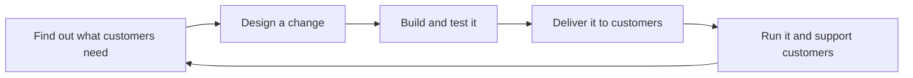
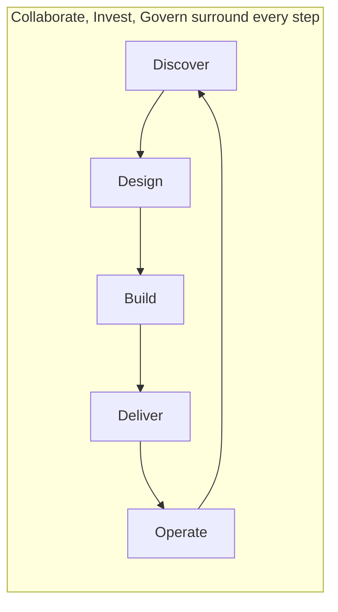

# Module 0 — Orientation

*Every digital product you have used, from a food-delivery app to a bank's website, is kept alive by people doing many different kinds of work: finding out what customers need, designing, writing and testing code, releasing it, keeping it running, answering customers, paying the bills and making sure the rules are kept. This module sets the ground for the whole course. It explains what "digital practice" means and why a product is always a product plus a service plus the work behind both; it introduces Qafila, a fictional delivery-coordination startup at its Launch stage, when Maha and Faisal are building the first version by hand, together with the cast and the eight steps of digital work that every later lesson uses; and it says plainly how to use the course and what it is not. Each lesson leaves you with a one-page artefact: a product and service sketch, a step map of one week of work, and your own learning plan.*

> **Steps:** Discover — look at the whole of digital work, and at where you stand in it, before you learn any one part of it.

---

# 0.1 — What digital practice is: products, services and the work behind them
*Level: 🟢 Beginner* · *Prerequisites: none* · *Step: Discover*

**After this you can** draw a one-page product and service sketch for one digital product: who uses it and for what, the service that surrounds the software, the kinds of work that keep both going, and who does each kind of work today. *Study time: reading about 20 min, hands-on about 70 min (estimate).*

## ⚡ In 60 seconds
- A **digital product** is something people use through software: an app, a website, an online tool. A **service** is the help and promise around it: support, reliability, billing, onboarding. Customers experience both as one thing.
- **Digital practice** is the set of everyday skills used to discover, design, build, deliver, run and improve digital products, and to fund, coordinate and govern that work.
- Most of the work happens **after** the first release. A product that people rely on is never finished; it is looked after.
- The rule that matters most: **a product is software plus the service around it plus the people who keep both going.** If you only see the code, you only see part of the job.
- Decision cue: before you start any task, ask "which customer does this help, and what happens to them if it goes wrong?"
- Biggest trap: thinking your job title is your whole job. A developer also answers questions, a tester also discovers needs, a support agent also improves the product.

## 🧭 Why it matters
Qafila and everyone in it are fictional; lesson 0.2 introduces them properly. All numbers about Qafila in this lesson are illustrative figures, not benchmarks.

Maha and Faisal have spent four months building Qafila's first version: a merchant app where a shop asks for a delivery, a courier app where a courier accepts it, and an admin web page where Maha watches everything. Fifteen pilot shops use it, about 150 deliveries a day. The code works, and they are proud of it.

At 6:10 one morning Maha's phone rings. A pilot bakery had forty boxes of bread ready for a hotel at 6:00 and no courier came. The app said "courier assigned", but the courier had uninstalled the app the night before, and nobody could see that. The baker does not care where the bug is. She cares that the bread is late, that only Maha answers, and that nobody told her what happens next.

Faisal's first reaction is "the code did exactly what it was meant to do". He is right, and it does not help. What failed was the arrangement around the code: no way to see a courier going silent, no promise to the baker about late deliveries, no number but Maha's, and no record of the problem. This lesson is about seeing that whole arrangement, because that is where most of your working life will be spent.

## 📐 How it works

### 🟢 The essentials

**Product, service and project.** Three words people use loosely. Keep them apart.

| Term | Plain meaning | Qafila example | How long it lives |
|---|---|---|---|
| **Product** | The thing people use, made mostly of software and data | The merchant app, the courier app and the admin web page | As long as customers use it, often years |
| **Service** | The help, promises and day-to-day running that surround the product | Someone to call when a delivery is late, couriers onboarded and paid, the app kept up and working | As long as the product lives |
| **Project** | A piece of work with a start, an end and a budget | "Add payments to the merchant app by March" | Weeks or months, then it closes |

A project can change a product, but the product and its service carry on after the project ends. Much confusion at work comes from treating a living product as if it were a project that gets "finished". The manager's view of this idea is in [*Running IT as a Business*, lesson 2.1 — Digital products, services and projects: what each is and who owns it](../itbiz/index.html#/2.1).

**What makes something digital.** For this course, a product is digital when most of its value reaches the customer through software and data: the baker taps a screen instead of phoning a courier. That brings traits that shape the work: it changes often (and every change can break something), it runs all the time (so someone must watch it), it records its own use (so you can learn instead of guess), and one copy serves everyone (so a mistake reaches everyone). Module 1 goes deeper.

**What digital practice is.** "Practice" here means what practitioners do every day, the way a doctor's practice or a lawyer's practice means their daily work, not a theory. Digital practice is the set of skills people use to look after a digital product through its whole life:

- finding out what customers need and whether an idea is worth building;
- designing how it should work and look;
- building it: writing code, testing it, reviewing it;
- delivering it: getting changes safely to customers;
- running it: watching it, fixing it, supporting customers;
- working together: teams, roles, agreements;
- funding it: knowing what it costs and whether it is worth it;
- governing it: keeping it safe, legal and trustworthy.

Lesson 0.2 turns this list into the eight steps the course uses.

**The work behind the product.** A useful exercise is to list every kind of work needed to keep a product alive. For Qafila at Launch, most of it is done by two people:

| Kind of work | Who does it at Qafila today | What happens if nobody does it |
|---|---|---|
| Talk to shops and couriers about their problems | Maha, when she has time | The app solves problems nobody has |
| Decide what to build next | Maha and Faisal, over coffee | Whoever shouts loudest wins |
| Write and test the code | Faisal, mostly | Nothing new ships, or it ships broken |
| Release changes | Faisal, by hand, once a week | Changes pile up and get riskier |
| Watch that it is working | Nobody, yet | The bakery finds out before you do |
| Answer shops and couriers | Maha's personal phone | Customers feel ignored and leave |
| Pay the cloud bill and track costs | Maha's own card | Surprises; nobody knows the cost per delivery |
| Protect shop and customer data | Nobody has thought about it | A leak, a fine, lost trust |

The last column is the point. Every row is work whether or not anyone is assigned to it. If nobody does it on purpose, it gets done by accident, badly, at the worst moment.

### 🟡 Going deeper

**A product's life is a loop, not a line.** New practitioners often picture work as a straight line: idea, requirements, code, test, release, done. In practice it loops. A release produces data and customer reactions; those lead to new questions; the questions lead to the next change. The bakery morning is the loop in action: a failure in running the product becomes a discovery about what couriers do with their phones, which becomes a design change (warn when a courier goes silent), which becomes code, which becomes a release, which must then be watched.

**How the work changes as a company grows.** At Launch, two people do every kind of work. As Qafila grows, each kind of work gets its own people, then teams, then rules: more skill and focus, but also hand-offs and waiting. The course follows Qafila through five growth stages (lesson 0.2) so you see the same practice in a tiny company and a large one. The right way to do a task depends on the stage: a two-week approval process is wise at 400 people handling payments and absurd at four people with 15 pilot shops.

**Where you fit.** Every early-career role spends most of its time in one or two parts of the loop and reaches into others: engineers into running the product through on-call, testers into discovery by questioning requirements, analysts into money and data handling, support staff into discovery because every ticket is evidence of a need. For what these jobs look like day to day, see [*From Graduate to Hired*, lesson 0.2 — The roles map: what software, AI, data, platform and security juniors actually do all day](../career/index.html#/0.2).

### 🔴 Expert view

**Measure speed and stability together.** Counting only speed invites breakage; counting only outages invites standstill. DORA (DevOps Research and Assessment, a long-running research programme now part of Google Cloud) groups its software delivery measures into two factors, throughput (how many changes move through the system) and instability (how often changes fail or need rework), and describes them as read together (as reported from DORA's guide). The habit to form now: when someone calls a team "fast", ask how often its changes fail, and the other way round.

**The service is part of the design.** The bakery problem could be fixed with code (detect a silent courier), with a service promise (no courier confirmed ten minutes before pickup means the shop gets a call), or both. The service option is often cheaper and faster; Module 7 covers it.

**The memorable rule.** A product is software plus the service around it plus the people who keep both going.

## 🧰 The toolkit
| Resource, tool or template | What it is and does | When to reach for it |
|---|---|---|
| **Product and service sketch** | One page: product, users and their job, the service around it, the kinds of work, who does each, gaps | When you join a team or start on a product |
| **Work inventory** | A table of every kind of work the product needs, with an owner and "what happens if nobody does it" | When things keep falling through the cracks |
| **Loop check** | Four questions after any release: what did customers do, what broke, what did we learn, what is next | After each release, however small |

## 🏛️ In practice at Qafila
After the bakery morning, Maha sat down with Faisal and drew Qafila's first product and service sketch. Illustrative and fictional.

> **Qafila product and service sketch (Launch, first draft)**
>
> **Product:** merchant app (shops request deliveries), courier app (couriers accept and complete them), admin web page (Maha watches all orders). Runs on one cloud provider's managed services; all code in one repository.
>
> **Users and their job:** small shops want an order delivered on time without hiring a driver; couriers want steady, fairly paid jobs near them; Maha needs to see that orders flow.
>
> **The service around it:** onboarding a new shop (Maha visits in person); onboarding couriers (Faisal installs the app on their phones); help when a delivery is late (Maha's phone); paying couriers (spreadsheet, weekly); keeping the system up (nobody watches it).
>
> **Kinds of work and who does it:** discovery (Maha), design (Maha and Faisal, on paper), build and test (Faisal), release (Faisal, weekly, by hand), running (nobody), support (Maha), costs (Maha's card), data protection (nobody).
>
> **Gaps that hurt now:** nobody sees a silent courier; support depends on one phone; no record of problems.
>
> **One change this week:** a shared support number that rings both phones, and a simple list of every problem reported, with the date and what was done.

Faisal's first draft left out the service section: "That's not the product." Maha pointed out that the bakery had not complained about a single screen. Faisal then wanted to fix everything at once; Maha limited the week to one cheap change and a problem list, because knowing which problems recur would tell them what to build.

## 🛠️ Exercises
**🟢 Sketch a product you use.** Pick a digital product you use often (a ride app, a food-delivery app, your university portal). Write its product and service sketch: product parts, users and their job, the service around it, and three kinds of work you believe happen behind it.
*Done when:* the sketch names at least two user groups, at least three service elements that are not screens, and three kinds of work with a guess at who does each.

Model answer and self-check

**Model answer.** A university portal. Product: registration pages, timetable, grades, mobile app. Users: students, lecturers, registry staff. Service: a help desk for logins, registration opening on a promised date, the portal staying up in registration week. Work behind it: someone watches it in registration week (operations), someone chooses yearly features (product), someone checks students cannot see each other's grades (governance).

**Self-check.**
- Did you include at least one user who is not the main customer (for example staff or couriers)?
- Are your service elements things a customer feels (help, promises, uptime), not screens?
- Did you separate what you know from what you are guessing?

**🟡 Build a work inventory for Qafila.** Using the Qafila sketch above, add three kinds of work Maha and Faisal missed. For each, write who should do it now, and what happens if nobody does.
*Done when:* each of your three rows is a different kind of work, has a realistic owner for a four-person company, and has a concrete consequence that would affect a shop or courier.

Model answer and self-check

**Model answer.** (1) Backing up the order database: Faisal, switch on the provider's backups and test one restore; otherwise one mistake can lose every order. (2) Telling shops about changes: Maha, a short message before each release; otherwise a shop meets a changed screen mid-rush. (3) Checking who can see shop and customer data: Maha; otherwise a former helper may still see customers' addresses.

**Self-check.**
- Is each owner a person who exists at Launch, not a team Qafila does not have yet?
- Is each consequence something a customer would notice, not only an internal worry?
- Did you avoid repeating rows already in the sketch?

**🔴 Find the loop in a public story.** Choose a product you use that changed recently (a redesign, a new feature, a feature removed). Write the loop as you can see it from outside: what customers were doing before, what changed, how customers reacted, and what the company did next. Mark clearly what is observed and what is inferred.
*Done when:* the write-up has the four loop stages, at least one observed fact for each stage you can see, and a line saying which stages you cannot see from outside and what evidence would show them.

Model answer and self-check

**Model answer.** A messaging app moved a much-used button into a menu. Observed: app-store reviews that month mention it often; two releases later it was back. Inferred: the company watched usage or reviews and reversed it. Cannot see: the reason, the usage data, who decided. Evidence that would show it: release notes or a product blog post.

**Self-check.**
- Did you keep observed and inferred apart?
- Did your loop include running and support, not only design and release?
- Did you avoid naming causes you cannot support?

## ⚠️ Mistakes and traps
- **Seeing only the code.** "The code did what it was meant to do" is not the same as "the customer was served". Look at the service around it too.
- **Treating a product like a project.** Products do not finish. Plan for who will look after it after the release.
- **Leaving work unowned because it is nobody's title.** Watching the system, backups and data protection still need a name next to them, even in a team of two.
- **Copying a big company's process into a small one.** Match the practice to the stage. Lesson 0.2 explains the stages.

## 🧾 Recap
- A digital product is mostly software and data; a service is the help and promises around it; a project is temporary work that changes them.
- Digital practice is the everyday work of discovering, designing, building, delivering, running, funding, coordinating and governing digital products.
- The work is a loop, not a line: running the product feeds the next discovery.
- Every kind of work needs an owner, even when the company is tiny.
- Rule: a product is software plus the service around it plus the people who keep both going.

## ✍️ Check yourself
**1. After the bakery morning, Faisal says "the code did exactly what it was meant to do". What is the best response?**

- A. Agree, and close it, since a fault outside the code is the customer's problem.
- B. Agree, and add more automated tests so the code is proven correct in future releases.
- C. Agree that the code worked, and look at the service around it, which is where it failed.
- D. Disagree, because the courier app must have a defect if a delivery went missing.

Answer

**C.** The failure was in the arrangement around the code: no way to see a silent courier, no promise to the shop, one phone for support. A blames the customer, B adds tests for code that already did its job, and D assumes a code defect without evidence. See "Why it matters" and "The work behind the product".

**2. Which of these is a service element of Qafila rather than part of the product?**

- A. A shared support number that shops can call when a delivery is late.
- B. The screen in the merchant app where a shop requests a new delivery.
- C. The admin web page that shows Maha every order that is in progress today.
- D. The logic in the courier app that assigns a delivery to a courier.

Answer

**A.** The support line is help and a promise around the software. B, C and D are all parts of the software product itself. See "Product, service and project".

**3. Faisal says that once payments are added "the product will be finished". What is the most accurate correction?**

- A. Correct, provided the payments work is run as a project with a fixed scope.
- B. Correct, because a product is finished once it has all the parts customers asked for.
- C. Not yet, because a product is only finished after a full year of running without any faults.
- D. Not quite: the payments project ends, but the product needs looking after while it is used.

Answer

**D.** Projects end; products and their services carry on. A and B confuse a project's end with the product's end, and C invents a finishing point that does not exist. See "Product, service and project".

**4. Maha asks who should be watching that Qafila is working, when nobody is. What does the lesson suggest?**

- A. Leave it until Qafila can hire an operations team, since monitoring is specialist work.
- B. Name a person for it now, since unowned work gets done by accident, badly.
- C. Ask the pilot shops to report problems, since they notice failures first anyway.
- D. Skip it while there are only 15 pilot shops, since the risk is too small to matter.

Answer

**B.** Every kind of work needs an owner, even in a team of two. A delays it until it hurts, C makes customers the monitoring system (which is what happened at the bakery), and D ignores that each failure hits a real shop. See "The work behind the product".

**5. A friend praises a team because it "deploys ten times a day". Which question best reflects the expert view in this lesson?**

- A. How often do those changes fail or need rework?
- B. How many engineers does the team have to do that work?
- C. Which deployment tool does the team use to release?
- D. How long has the team been deploying at that pace?

Answer

**A.** Speed should be read together with stability; DORA groups its measures into throughput and instability. B, C and D are interesting but say nothing about whether the speed is safe. See "Measure speed and stability together".

## 📚 References
- DORA, "DORA's software delivery performance metrics" (dora.dev guide): https://dora.dev/guides/dora-metrics/ — throughput and instability factors (reported from search summaries; the page could not be opened from this environment on 2026-11-22).
- Library course: [*Running IT as a Business*, lesson 2.1 — Digital products, services and projects: what each is and who owns it](../itbiz/index.html#/2.1) (the manager's view of products and projects).
- Library course: [*From Graduate to Hired*, lesson 0.2 — The roles map: what software, AI, data, platform and security juniors actually do all day](../career/index.html#/0.2) (what early-career roles do day to day).

---

# 0.2 — Meet Qafila and the eight steps
*Level: 🟢 Beginner* · *Prerequisites: 0.1* · *Step: Discover*

**After this you can** take one week of work on a digital product and sort every task into the eight steps (Discover, Design, Build, Deliver, Operate, Collaborate, Invest, Govern), name who did it and what evidence it left, and spot the steps nobody is covering. *Study time: reading about 20 min, hands-on about 75 min (estimate).*

## ⚡ In 60 seconds
- **Qafila** is a **fictional** Gulf startup that builds a delivery-coordination app for small businesses and their couriers. The course follows it through five growth stages: Launch, Traction, Growth, Scale-up and Established.
- The course sorts all digital work into **eight steps**: Discover, Design, Build, Deliver, Operate, Collaborate, Invest and Govern. These are this course's own plain words, not any framework's terms.
- The first five steps form a **loop** around the product. The last three **surround** the loop: they are about people, money and rules.
- Every lesson is tagged with one or two steps, so you always know which part of the work you are learning.
- The rule that matters most: **every step happens, whether anyone plans it or not.** The only choice is whether it is done on purpose.
- Biggest trap: thinking only Build and Deliver are "real work". At Launch, the steps Maha and Faisal ignore are the ones that hurt them.

## 🧭 Why it matters
Qafila and everyone in it are fictional. All numbers about Qafila are illustrative figures, not benchmarks.

At the end of its fourth month Qafila had 15 pilot shops and about 150 deliveries a day. Faisal kept a list of what he had done each week, and it was all code: new screens, a fix for the courier map, a faster order list. By his count it was a productive week.

Maha's week looked different. She visited two shops to learn why they still phoned couriers directly (Discover), sketched a simpler order screen (Design), paid the cloud bill on her own card (Invest), sent a spreadsheet of shop owners' phone numbers to a friend helping with sales (Govern, though she did not see it that way), and argued with Faisal about a Thursday-night release (Deliver and Collaborate). None of it was on Faisal's list, and he half-joked that Maha "didn't do much this week".

Both were doing digital work; they had no shared words for it. Without them, Maha's work was invisible, the spreadsheet went unquestioned and nobody owned the cloud bill. This lesson gives you the words, and the company you will watch use them.

## 📐 How it works

### 🟢 The essentials

**Meet Qafila.** Qafila (قافلة, Arabic for "caravan") is a fictional Gulf startup that builds a delivery-coordination app for small businesses (shops, bakeries, pharmacies) and their couriers. A shop requests a delivery in the merchant app; a courier accepts it in the courier app; the admin web page lets Qafila's staff see and fix everything. Qafila is invented for this course; any resemblance to a real company is accidental.

**The five growth stages.** The course follows Qafila from two people to about four hundred. These stages are this course's own way of organising the story; they are not taken from any framework. All figures are illustrative.

| Stage | People | Merchants | Deliveries per day | Teams | Deploys to production | Modules |
|---|---|---|---|---|---|---|
| **Launch** | 2 (Maha, Faisal), then 4 | 15 pilot shops | about 150 | none | by hand, weekly | 0–2 |
| **Traction** | 12 | 300 | about 4,000 | 1 | daily via CI | 3–5 |
| **Growth** | 40 | 2,000 | about 25,000 | 4 | several a day | 6–7 |
| **Scale-up** | 120 | 9,000 | about 120,000 | 12 (incl. a platform team) | many a day | 8–9 |
| **Established** | 400 | 30,000 in 4 countries | about 400,000 | 35 | many a day | 10–13 |

"CI" (continuous integration) means every code change is automatically built and tested; Module 3 explains it. The product also grows. At Launch it is a merchant app, a courier app and an admin web page. Traction adds payments through a payment provider; Growth adds a support desk and product analytics; Scale-up adds a routing service and an internal platform; Established adds an integration with a payments partner and a data platform.

Some events recur in later modules: the first version runs on one cloud provider's managed services, with all code in one repository until Scale-up; at Traction a failed database migration loses orders for about two hours until backups restore them; from Growth on, order tracking targets 99.9% reliability a month; at Established, a payments partner's due-diligence questionnaire drives governance work.

**The cast.** Each person makes realistic mistakes; you learn from them.

| Person | Role | Joins at |
|---|---|---|
| **Maha** | Founder and CEO; was a developer; writes the first code, later learns to let go | Launch |
| **Faisal** | First engineer, later Head of Engineering; fast, tends to skip tests and documentation | Launch |
| **Salma** | Support and operations; later service and reliability lead | Launch (one of the first four) |
| **Aisha** | First product manager | Traction |
| **Karim** | Designer and user researcher | Traction or soon after |
| **Hamad** | Data analyst, later head of data | Traction or Growth |
| **Yasmin** | Graduate engineer; your stand-in, many lessons follow her first year | Growth |
| **Bilal** | Finance lead, later CFO | Growth or Scale-up |
| **Dana** | Security and risk lead, hired after a security scare | Scale-up |

**The eight steps.** Every task in digital work fits at least one of these. The course's words, in plain language:

| Step | What it means | A Launch example at Qafila | What it leaves behind (evidence) |
|---|---|---|---|
| **Discover** | Finding out what customers need and whether an idea is worth doing | Maha visits a bakery to see how orders are placed today | Interview notes, a problem statement |
| **Design** | Deciding how something should work and look before building it | Maha sketches a simpler order screen | A sketch, a prototype, a decision |
| **Build** | Writing, testing and reviewing the code | Faisal adds the courier map | Code, tests, a review |
| **Deliver** | Getting changes to customers safely | Faisal releases by hand on Thursday night | A release note, a deploy record |
| **Operate** | Keeping it running and supporting the people who use it | Maha answers the bakery at 6:10 | A problem list, a fix, a support record |
| **Collaborate** | Working together: roles, agreements, communication | Maha and Faisal agree when releases happen | A working agreement, a board |
| **Invest** | Deciding where money and time go, and knowing what things cost | Maha checks the cloud bill | A cost sheet, a budget, a decision |
| **Govern** | Keeping the work safe, legal and trustworthy | Deciding who may see shop owners' phone numbers | An access list, a policy, a risk entry |

### 🟡 Going deeper

**A loop with a frame around it.** The first five steps follow the product's life loop from lesson 0.1: you discover a need, design a change, build it, deliver it and operate it, and operating it shows you what to discover next. The other three steps are not stages in that loop; they surround it. Collaborate is about the people doing every step. Invest is about the money and time every step uses. Govern is about the rules and risks every step must respect.

So Govern applies to a design decision as much as to a release, and the frame steps are the ones small companies forget, because nobody's job title contains them.

**How the steps change with the stages.** The same step looks very different at different sizes.

| Step | At Launch (2–4 people) | At Established (about 400 people) |
|---|---|---|
| Discover | The founder talks to shops | Researchers, analysts and product managers run studies and experiments |
| Deliver | One engineer releases by hand, weekly | Automated pipelines release many times a day |
| Operate | The founder's phone | A support desk, on-call rotas, service levels |
| Invest | The founder's card | Budgets, business cases, cost reports per product |
| Govern | Not yet thought about | Security, risk and audit functions; a payments partner's questionnaire |

Each column fits its stage. Your skill is to notice when the old way stops fitting, for example when "Maha's phone" fails at 300 shops.

**How the course uses the steps.** Every lesson header shows its step tag, for example *Step: Build, Deliver*. Modules 0–2 and 6 lean on Discover and Design, 3 on Build and Deliver, 4 and 7 on Operate, 5 and 8 on Collaborate, 9 on Design, 10 on Invest, 11 and 12 on Govern, and 13 uses all eight.

**Other step lists.** Other library courses (for example [*Founder's Playbook for AI-First Builders*, lesson 0.2 — The founder's map: eight steps and the Tick cast](../founder/index.html#/0.2)) and well-known frameworks divide the work differently. Use your workplace's words; this list exists to make sure nothing is invisible.

### 🔴 Expert view

**Evidence is how you see a step.** A step that leaves no evidence is hard to improve. Faisal's code leaves commits; Maha's shop visit leaves nothing unless she writes notes. After each task, ask "what record shows this happened, and could someone else use it?"

**Gaps are more useful than totals.** The interesting result of a step map is rarely "we spent most time on Build". It is the empty row: "nobody covered Govern, and we shared customer phone numbers". Look there first.

**One task, two steps.** Writing an automated test is Build and also Operate; deciding who can see the admin page is Govern and Collaborate. Tag a task by the question it mainly answers, and note the second where it helps.

**The memorable rule.** Every step happens, whether anyone plans it or not. The only choice is whether it is done on purpose.

## 🧰 The toolkit
| Resource, tool or template | What it is and does | When to reach for it |
|---|---|---|
| **Step map** | A table of one week's tasks, each tagged with a step, a person and the evidence it left | Once a week at Launch; once a month later |
| **Step-gap check** | For each of the eight steps: who covered it, what evidence exists, what is missing | When something keeps going wrong and nobody knows why |
| **Stage check** | Five questions to place a company at a stage: people, customers, teams, release habit, product parts | When you join a company or a team |
| **Evidence habit** | One line after each task: what record shows it happened | After every task, from day one |

## 🏛️ In practice at Qafila
After the argument about who "did much this week", Maha drew a step map of their shared week on the office whiteboard. Illustrative and fictional.

> **Qafila step map: week 16 (Launch)**
>
> | Task | Step | Who | Evidence |
> |---|---|---|---|
> | Visited two shops about direct phone orders | Discover | Maha | None (notes in her head) → *write up* |
> | Sketched a simpler order screen | Design | Maha | Paper sketch, photographed |
> | Courier map, faster order list, two fixes | Build | Faisal | Commits in the repository |
> | Thursday-night release | Deliver | Faisal | Message to Maha; no release note → *add one* |
> | Bakery call at 6:10; missing courier | Operate | Maha | None → *start a problem list* |
> | Agreed releases happen Thursday before 20:00 | Collaborate | Both | A message thread |
> | Paid cloud bill; worried about cost growth | Invest | Maha | Card statement only → *start a cost sheet* |
> | Sent shop owners' phone numbers to a friend helping with sales | Govern | Maha | None → *decide who may see shop data* |
>
> **Gaps:** Operate and Govern have no owner and no record; Invest is on a personal card.
>
> **Actions:** problem list (Maha, now); a one-line release note per release (Faisal); a simple cost sheet (Maha); ask the friend to delete the spreadsheet and agree who may see shop data (Maha).

Faisal objected that "a release note for four people is bureaucracy". Maha agreed it should be one line, not a form: the bakery call would have been easier to diagnose had they known what changed on Thursday. The Govern row made Maha uncomfortable; she had not seen the spreadsheet as a risk until it sat next to an empty evidence cell.

## 🛠️ Exercises
**🟢 Tag the tasks.** Tag each of these Qafila tasks with its main step: (a) asking five couriers why they reject long trips; (b) choosing the cloud database plan; (c) writing a test for the delivery-fee calculation; (d) deciding who may log into the admin web page; (e) agreeing a weekly planning meeting; (f) switching on the new order screen for all shops; (g) drawing three versions of the courier sign-up screen; (h) restarting the courier app's server after it froze.
*Done when:* all eight tasks have one main step, all eight steps are used exactly once, and you can give one sentence of reasoning for any two you found hard.

Model answer and self-check

**Model answer.** (a) Discover; (b) Invest; (c) Build; (d) Govern; (e) Collaborate; (f) Deliver; (g) Design; (h) Operate. Hard case: (b) looks technical, but the main question is money and value.

**Self-check.**
- Did you tag each task by the question it mainly answers?
- Where a task fits two steps, did you note the second without double-counting?
- Did your reasoning use the definitions in the steps table?

**🟡 Map a week of your own.** Take one week of your own work or study project (a course assignment, a side project, an open-source contribution). List at least eight tasks and fill in a step map: task, step, who, evidence.
*Done when:* the map has at least eight tasks, at least five steps appear, every evidence cell says "none" or names a real record, and you have written one action for the emptiest step.

Model answer and self-check

**Model answer.** A student team app: login screen (Build, me, commits); asked three classmates what they need (Discover, me, no notes); deadline meeting (Collaborate, all, chat); deployed to free hosting (Deliver, teammate, none); fixed a reported crash (Operate, me, chat); chose the hosting plan (Invest, teammate, none); drew layouts (Design, teammate, photo); kept test users' emails in a shared sheet (Govern, me, none). Emptiest: Govern; action: limit who sees the sheet and delete it after testing.

**Self-check.**
- Did you include tasks that are not code?
- Is each "who" a person, not "the team"?
- Is your action small enough to do this week?

**🔴 Place a company at a stage.** Choose a company you know from the outside (an employer, a startup in the news, a well-known app). Using the stage table, write which stage it most resembles and why, giving the evidence you used for each of the five columns. Then name one practice that would be right at its stage and wrong at Launch.
*Done when:* each column has a piece of evidence or "unknown", the evidence comes from a public source you can name (company website, job ads, annual report), and the practice is explained in two or three sentences.

Model answer and self-check

**Model answer.** A regional food-delivery app. People: job ads list dozens of roles across engineering, data and support. Customers: its website lists several cities; numbers unknown. Teams: job ads mention a "platform team". Release habit: unknown. Product parts: customer, restaurant and courier apps, payments. Best fit: Scale-up. Practice: a platform team building shared tools; right when many teams repeat the same work, wrong at Launch, where two people would build tools instead of the product.

**Self-check.**
- Did you mark unknowns instead of guessing?
- Did you name where each piece of evidence came from?
- Is your practice tied to the stage's size, not to the company's fame?

## ⚠️ Mistakes and traps
- **Counting only Build and Deliver as work.** Discover, Operate and the frame steps are work too; if they leave no evidence, they become invisible.
- **Treating the eight steps as a strict sequence.** The five loop steps repeat; the three frame steps apply all the time.
- **Copying practices across stages.** A practice that fits 400 people can crush four; one that fits four can endanger 400. Check the stage first.

## 🧾 Recap
- Qafila is a fictional delivery-coordination startup followed through five growth stages, from two people to about 400.
- The cast is fixed; Yasmin, a graduate engineer who joins at Growth, is the reader's stand-in.
- The eight steps are Discover, Design, Build, Deliver, Operate (a loop around the product) and Collaborate, Invest, Govern (a frame around the loop).
- A step map shows who did what, under which step, with what evidence; the empty rows matter most.
- Rule: every step happens, whether anyone plans it or not.

## ✍️ Check yourself
**1. Maha sends a spreadsheet of shop owners' phone numbers to a friend helping with sales. Under which step does deciding whether she should have done this mainly fall?**

- A. Collaborate, because it involves someone outside the company.
- B. Govern, because it is about keeping data safe and use of it trustworthy.
- C. Invest, because the friend's sales help may bring in more paying shops.
- D. Operate, because it is part of running the business from day to day.

Answer

**B.** Who may see customer data is a question of rules, risk and trust. A, C and D describe real side-effects of the action but not the main question it raises. See "The eight steps" and "In practice at Qafila".

**2. Faisal says a one-line release note is "bureaucracy for four people". What is the strongest argument for keeping it?**

- A. Investors expect release notes from any startup that hopes to raise money later.
- B. Release notes are required by every framework for delivering software.
- C. Without it, the team cannot release more often than once a week.
- D. It records what changed, so the next problem is easier to diagnose.

Answer

**D.** A step that leaves no evidence is hard to improve; the bakery problem would have been easier to diagnose with a record of Thursday's change. A and B claim requirements the lesson does not support, and C confuses a note with release frequency. See "Evidence is how you see a step".

**3. Which statement about the eight steps is accurate?**

- A. They follow a fixed order; each ends before the next begins.
- B. They are taken from a well-known framework and use its official terms.
- C. The first five form a loop; Collaborate, Invest and Govern surround it.
- D. Only the first five apply at Launch; the other three begin at Growth.

Answer

**C.** The loop steps repeat and the frame steps apply all the time. A describes a line, not a loop; B is wrong because the steps are this course's own words; D is contradicted by Maha's Invest and Govern tasks at Launch. See "A loop with a frame around it".

**4. A friend joins a company of five people and proposes a weekly change board that must approve every release. What should she check first?**

- A. Which stage the company is at, since practices must fit its size.
- B. Whether a change board is part of the frameworks the company follows.
- C. Whether the release tool can enforce the approval automatically.
- D. Whether larger companies in the same market also use a weekly change board.

Answer

**A.** A practice right at 400 people can crush five. B, C and D look at frameworks, tools or other companies rather than the fit with this company's stage. See "How the steps change with the stages".

**5. Maha's step map shows plenty of Build tasks, and the Govern row is empty with no evidence. What does the lesson suggest she looks at first?**

- A. The Build row, because it takes the most time and has the most room to improve.
- B. The total hours per step, to rebalance the week evenly across all eight steps.
- C. The Deliver row, because the Thursday release is the most visible risk to shops.
- D. The empty Govern row, because gaps tell more than totals do.

Answer

**D.** The interesting result is the empty row, here a data risk nobody owned. A and B focus on totals and balance, which the lesson warns are less useful, and C picks a row that at least has an owner. See "Gaps are more useful than totals".

## 📚 References
- Library course: [*Founder's Playbook for AI-First Builders*, lesson 0.2 — The founder's map: eight steps and the Tick cast](../founder/index.html#/0.2) (a different step list for a one-person company).
- Library course: [*Running IT as a Business*, lesson 0.1 — What it means to run IT as a business, and what digital products and AI change](../itbiz/index.html#/0.1) (the operating-model view of the same work, for managers).
- Library course: [*Cloud & DevOps: Zero to Hero*, lesson 0.1 — What cloud, DevOps, platform engineering and SRE are](../cloud/index.html#/0.1) (the engineering side of Deliver and Operate).

---

# 0.3 — How to use this course, and what it is not
*Level: 🟢 Beginner* · *Prerequisites: 0.1, 0.2* · *Step: Discover*

**After this you can** write a one-page learning plan that sets your path through the modules for your role, your pace, your practice project and artefact folder, the library courses you will use for depth, and three limits you will keep. *Study time: reading about 15 min, hands-on about 60 min (estimate).*

## ⚡ In 60 seconds
- The course teaches the **essentials of every part of digital work** well enough to take part and make sound everyday decisions, then **links to the library's specialist courses** for depth.
- It is **original**: written from general practice in its own words and structure, **not based on, derived from or aligned with any proprietary standard, body of knowledge or certification**, and **not training for any exam**.
- It is **not professional advice**. Law, accounting, procurement and regulation vary by country. The course names the kind of rule and the question to ask.
- It promises **no job, income, promotion or certificate**. Every Qafila number is illustrative.
- The rule that matters most: **every lesson ends in an artefact.** Keep them in one folder; they become your playbook in Module 13.
- Biggest trap: reading without doing. The exercises are where the skill is built.

## 🧭 Why it matters
Qafila and everyone in it are fictional.

Still at Launch, Salma joins as one of Qafila's first four people, to look after shops and couriers. In her first week she skims fifteen lessons in a weekend, remembers a little of each, and on Monday cannot write the simple problem list Maha asks for. A week later she does the opposite: she treats one lesson's example as law. In a planning chat she announces that "the course says" Qafila should be releasing daily through an automated pipeline, as if a course had set it. Faisal points out that daily releases through CI are what Qafila *does later*, at Traction, for Qafila's reasons, and that with 15 pilot shops and one engineer a careful weekly release may be the right choice for now. A course example is not a rule for anyone.

Both mistakes come from not knowing what a course is for. This lesson says what this course is and is not, how a lesson is built, and how to plan your way through the 38 lessons that follow.

## 📐 How it works

### 🟢 The essentials

**What the course is.** *Digital Practice: Building and Running Digital Products, from One Person to a Whole Company* is a free, bilingual (English and Arabic) course for early-career practitioners: new software engineers, analysts, testers, designers, product and operations staff, graduates and career changers. No IT experience is assumed; every term is defined the first time it is used. It has 14 modules and 41 lessons and follows Qafila through the five growth stages and eight steps of lesson 0.2.

**What the course is not.**

| It is not | What that means for you (and no promise of a job, income, promotion or certificate) |
|---|---|
| **Based on any proprietary framework or body of knowledge** | It is written from general practice (product discovery, software engineering, delivery research, service management, lean and agile ways of working, architecture, IT finance, governance) in its own words and structure. Its stages and steps are its own. Lesson 12.3 names the well-known frameworks and bodies of knowledge and points to their owners |
| **Exam or certification training** | It prepares you for no exam. Its practice questions test this course only |
| **Professional advice** | Law, accounting, procurement and regulation differ by country and organisation. The course names the kind of rule and the question to ask; specialists and official texts give the answer |
| **Expert-reviewed** | It is drafted with AI assistance and not reviewed by subject experts. Treat every statement as a starting point to check |
| **A benchmark** | Qafila's figures are illustrative, never targets |
| **An endorsement** | Tools are named by category, with at most one or two examples, as illustrations |

**How a lesson is built.** Every lesson has the same layout, so you can find what you need.

| Section | What you get |
|---|---|
| Header and "After this you can" | Level, prerequisites, step tag, the outcome and a time estimate |
| In 60 seconds; Why it matters | The essentials and the biggest trap; a Qafila moment that makes the topic unavoidable |
| How it works | The essentials, then going deeper, then an expert view |
| The toolkit; In practice at Qafila | Templates, then the lesson's artefact as a cast member made it, mistakes included |
| Exercises | Three graded exercises (🟢, 🟡, 🔴) with "Done when" lines and model answers |
| Mistakes, Recap, Check yourself, References | What to avoid, what to remember, five questions, the sources |

**Levels.** Modules 0 to 3 are 🟢 Beginner, 4 to 9 🟡 Intermediate and 10 to 13 🔴 Advanced. On a first pass you can skip "Going deeper" and "Expert view" and come back later.

### 🟡 Going deeper

**Choose a path for your role.** Reading in order is best for a first full pass: the story of Qafila grows with the modules. If you need something quickly, read Modules 0, 1 and 3 first, because most later lessons assume them, then go where your role points.

| If you are… | After 0, 1 and 3, start with | Then | The artefact you are likely to need first |
|---|---|---|---|
| New software engineer | 4, 5 | 9 | Pull request checklist, runbook |
| Tester or quality engineer | 6, 4 | 7 | Test plan, acceptance criteria |
| Data or business analyst | 6, 9 | 10 | Data inventory, outcome measures |
| Designer or researcher | 2, 6 | 5 | Problem statement, assumption map |
| Product or project staff | 2, 6 | 8 | Roadmap, user stories |
| Support or operations staff | 7, 4 | 11 | Service page, post-incident review |
| Career changer, not yet in a role | 2, 5 | then in order | Problem statement, team working agreement |

Module 13's capstone assembles a digital practice playbook for Qafila from the artefacts of every module, so keep everything you produce.

**Your practice project and artefact folder.** Every exercise works with the lesson's Qafila material; it teaches more if you also have a project of your own (a personal app, a study project, an open-source contribution). Keep one folder, say "digital practice playbook", with a dated page per lesson, and keep Qafila versions apart from versions about your own project or workplace.

**Keep confidential data out.** Before using workplace material, or pasting anything into an AI assistant, remove customer and personal data, security details, contract terms and unreleased figures, and check your organisation's policy on AI tools. If in doubt, use Qafila.

**How facts are handled.** Any number about delivery performance, costs, failure rates or adoption has a source in the lesson's References, stated with who found it, for whom and when, because research describes a group of organisations at a time, not a law of nature. Facts the authors could confirm only from secondary summaries are marked "reported". When you reuse a fact at work, cite the original source, not the course.

**Where the library goes deeper.** This course is the map; the library's specialist courses are the territory. Typical next steps:

| When you want depth on… | Go to |
|---|---|
| Founding a company and pricing | [*Founder's Playbook for AI-First Builders*, lesson 0.3 — How to use this course, and what it is not (not legal, tax or investment advice)](../founder/index.html#/0.3) |
| Pipelines, infrastructure and operations | [*Cloud & DevOps: Zero to Hero*, lesson 0.2 — The path to production: from a commit to a customer, and everything that can break on the way](../cloud/index.html#/0.2) |
| Testing | [*Software Testing: Zero to Hero in the AI Era*, lesson 0.1 — What software testing is, and what it is not: quality, risk and the AI-era shift](../testing/index.html#/0.1) |
| Building with AI tools day to day | [*A Practical Guide to Becoming an AI-Native Engineer*, lesson 0.1 — What an AI-native engineer is (and is not): the shift, five habits and the evidence](../ainative/index.html#/0.1) |
| Getting your first role | [*From Graduate to Hired*, lesson 0.3 — Meet the cohort, and how to use this course and the library](../career/index.html#/0.3) |

### 🔴 Expert view

**Questions, not conclusions, for specialists.** Several lessons touch areas where specialists decide: data protection, consumer protection, payments rules, employment, accounting, contracts. The course will not tell you the answer. It helps you arrive with a short, precise question and the evidence to answer it.

| Topic | A good question to bring | Who answers it |
|---|---|---|
| Storing customers' addresses | "Which data-protection rules apply to the addresses we keep, and for how long may we keep them?" | Data protection or legal |
| A new payment feature | "Does taking payments this way bring us under any payments rules, and what does our provider require?" | Legal, compliance, the provider |
| Paying couriers per delivery | "Which employment or contractor rules apply to how we pay couriers?" | Legal, HR |

**Frameworks as references, not recipes.** Workplaces use well-known frameworks for service management, agile delivery, architecture and governance. They are owned by their publishers, often with trademarks and licence terms. This course teaches the underlying ideas in its own words; lesson 12.3 says what the main ones are for. At work, use your organisation's vocabulary.

**Pace and practice.** One or two lessons a week, with the exercises done the same week, is realistic alongside a job or study. The hands-on estimates cover exercises and quiz only. After each module, use one artefact for real within a fortnight, even on a small project.

**The memorable rule.** Every lesson ends in an artefact. Keep them; they are what you will use.

## 🧰 The toolkit
| Resource, tool or template | What it is and does | When to reach for it |
|---|---|---|
| **Learning plan** | One page: role path, pace, practice project, artefact folder, depth courses, three limits | Now; review at the end of each module |
| **Artefact folder** | One dated folder for every page the lessons produce, building to the Module 13 capstone | From lesson 0.1 to 13.1 |
| **Specialist question list** | Running list of questions for legal, finance, security or data protection, each tied to a decision | When a lesson touches an area where you lack authority |
| **Source note** | For each number you reuse: source, year, who it describes, verified or reported | Before a figure goes into a report or presentation |
| **Confidentiality checklist** | What to remove before sharing an exercise or pasting into an AI assistant | Before using workplace material |

## 🏛️ In practice at Qafila
After the release-chat episode, Maha asked Salma to write a one-page learning plan. Illustrative and fictional.

> **Learning plan: Salma, shops and couriers support (Launch stage)**
>
> - **Path:** Modules 0, 1 and 3 first; then 7 and 4 (support and running the product are my job); then 5. The rest in order.
> - **Pace:** two lessons a week; exercises the same week; Sunday and Wednesday evenings.
> - **Practice project:** Qafila itself, using only the course's Qafila material and my own problem list, with shop and courier details removed.
> - **Artefact folder:** "Digital practice playbook – Salma", one dated page per lesson; anything with real shop data stays in Qafila's shared drive, not in my personal folder.
> - **Depth courses:** *Cloud & DevOps* lessons on incidents; *Founder's Playbook* lessons on support at small scale.
> - **Three limits I will keep:**
>   1. No course example becomes "the rule" in a team discussion; I say where a practice comes from and why it would fit us now.
>   2. No shop or courier details go into an AI assistant; Maha and I will write a one-line rule on AI tools this month, since Qafila has none yet.
>   3. Any question about law or money goes to the right person as a question, never as a course conclusion.

Her first draft listed all 13 modules "this month". Maha asked how many exercises that meant; Salma counted more than a hundred and cut the plan to two lessons a week. Faisal, reading over her shoulder, added one line to his own notes: "Module 3, testing. Actually do the exercises."

## 🛠️ Exercises
**🟢 Choose your path.** Using the role table, write your path through the modules and the first artefact you expect to need, with two sentences on why.
*Done when:* the path lists at least five modules in order, names one artefact, and gives a reason tied to your current or target role.

Model answer and self-check

**Model answer.** A career changer from retail aiming at support or operations: Modules 0, 1, 3, then 7 and 4, then 5. First artefact: a post-incident review, because operations roles meet failures early. Reason: handling retail complaints maps closely to Module 7.

**Self-check.**
- Does the path start with the shared foundation modules (0, 1 and 3)?
- Is the reason tied to a real role, not to which modules sound most interesting?
- Is the first artefact one you could actually use in the next three months?

**🟡 Write your learning plan.** Write a one-page learning plan with six parts: path, pace, practice project, artefact folder, depth courses, and three limits.
*Done when:* the pace is stated in lessons per week with named time slots, the practice project is real or the plan says "Qafila only", each limit is something you could break by accident, and the plan fits on one page.

Model answer and self-check

**Model answer.** A junior tester. Path: 0, 1, 3, then 6 and 4, then 7. Pace: one lesson a week, Saturday morning. Project: a university room-booking app. Folder: "Playbook", internship material kept apart. Depth: *Software Testing* Modules 1 and 5. Limits: no internship code or data in an AI assistant; Qafila figures labelled illustrative; ask my internship lead before using a work example.

**Self-check.**
- Is the pace realistic given the hands-on estimates in each lesson header?
- Does each limit protect something real (data, trust, accuracy)?
- Did you name where you will keep work material apart from personal material?

**🔴 Turn a claim into a question.** Pick one statement you have heard at work or in your studies that sounds like a legal, financial or regulatory conclusion (for example "we can keep customer data forever because they agreed to our terms"). Rewrite it as a specialist question: the decision it affects, the question, who should answer, and what evidence you would bring.
*Done when:* the rewrite contains no conclusion of its own, names a role (not a website) as the answerer, and lists at least two pieces of evidence you could actually collect.

Model answer and self-check

**Model answer.** Claim: "Shops agreed to our terms, so we can share their sales data with partners." Decision: whether to send merchant sales data to a marketing partner. Question: "Do our terms and the data-protection rules that apply to us allow this sharing, for this purpose, or do we need fresh consent?" Answerer: legal or the data protection lead. Evidence: the terms shops saw at sign-up; the exact fields; the partner's stated purpose.

**Self-check.**
- Did you remove every "we can" or "we must" from your own words?
- Does the question name the purpose, not just the data?
- Is your evidence something you could collect without help from the specialist?

## ⚠️ Mistakes and traps
- **Reading everything, doing nothing.** Skills come from the exercises. Do them in the same week as the reading.
- **Treating examples as rules.** Qafila's figures and choices are illustrative; say where a number comes from and who chose it.
- **Treating the course as legal or financial advice.** Bring a question to a specialist, not a conclusion from a course.
- **Pasting workplace data into AI tools for exercises.** Remove confidential material first, and check your organisation's policy.

## 🧾 Recap
- The course covers the essentials of all digital work for early-career practitioners and links to specialist courses for depth.
- It is original, not based on any proprietary framework or body of knowledge, not exam training and not professional advice; Qafila numbers are illustrative.
- Every lesson has the same layout and ends with an artefact, three graded exercises and five questions.
- Choose a role path, a pace, a practice project and an artefact folder, and keep three limits.
- Rule: every lesson ends in an artefact. Keep them.

## ✍️ Check yourself
**1. In a planning chat at Launch, Salma says "the course says we should release daily through an automated pipeline". What is the best correction?**

- A. Daily releases come later at Qafila, for its reasons; examples are not rules.
- B. The course should always be cited by lesson number so that everyone can check the claim.
- C. Daily is too slow for a delivery app; the team should aim to release every hour.
- D. Release frequency is set by regulators, so a course cannot recommend one.

Answer

**A.** Qafila's choices and figures are illustrative, made for its own stage and reasons. B still treats the example as a rule, C introduces an unsupported judgement, and D makes a claim about regulators the lesson does not make. See "Why it matters" and "What the course is not".

**2. A friend asks whether finishing this course will prepare her for a digital-practice certification exam. What is accurate?**

- A. Yes, provided she also completes the Module 13 practice exam.
- B. Partly, because it covers most of the topics that typical certifications include.
- C. No: it is not exam training, and its questions test this course only.
- D. Only if she reads the Expert view sections, which go beyond the essentials.

Answer

**C.** The course is original, not based on any certification, and prepares for no exam. A, B and D each suggest an exam link the course explicitly rejects. See "What the course is not".

**3. Faisal wants to add a new way of paying couriers and asks Salma whether it is legal. What should she do, following this lesson?**

- A. Look up the rule herself and give Faisal a yes or no answer the same day.
- B. Write a precise question for legal or HR, with the payment details.
- C. Answer from the course, since a later module covers payments and employment.
- D. Tell Faisal it is fine if other startups in the region already pay that way.

Answer

**B.** The course helps you bring a precise question and evidence to the specialist; it never gives the legal conclusion. A and C turn a newcomer or a course into the authority, and D relies on what others do. See "Questions, not conclusions, for specialists".

**4. Salma wants to use Qafila's real problem list, with shop owners' names, in an exercise and paste it into an AI assistant for help. What should she do first?**

- A. Paste it, since the assistant is a well-known product used by many companies.
- B. Paste it, but delete the whole conversation afterwards so that no copy is kept.
- C. Ask a teammate to paste it instead, so the responsibility is shared.
- D. Remove names and confidential details, or use course material.

Answer

**D.** Confidential material comes out first, and the organisation, not the individual, decides what may go into an AI tool; where no rule exists yet, agree one. A and B assume the tool or deletion makes it safe, and C only moves the risk. See "Keep confidential data out".

**5. Salma's first plan lists all 13 remaining modules "this month". What does the lesson suggest instead?**

- A. Keep the plan, since early momentum matters more than doing the exercises.
- B. Read only the In 60 seconds sections now; save the rest for later.
- C. One or two lessons a week, with the exercises done in the same week.
- D. Read only the modules for her role and skip the foundation modules.

Answer

**C.** A realistic pace with exercises done the same week builds skill. A and B favour reading over doing, and D skips the foundations that later lessons assume. See "Pace and practice" and "Choose a path for your role".

## 📚 References
- Library course: [*From Graduate to Hired*, lesson 0.3 — Meet the cohort, and how to use this course and the library](../career/index.html#/0.3) (planning a path through the library for a first role).
- Library course: [*Founder's Playbook for AI-First Builders*, lesson 0.3 — How to use this course, and what it is not (not legal, tax or investment advice)](../founder/index.html#/0.3) (the same "questions, not conclusions" approach for founders).
- Library course: [*Software Testing: Zero to Hero in the AI Era*, lesson 0.1 — What software testing is, and what it is not: quality, risk and the AI-era shift](../testing/index.html#/0.1).
- Library course: [*Data Engineering & Analytics: Zero to Hero*, lesson 0.1 — What data engineering, analytics and data science are — and how they fit together](../data/index.html#/0.1).
- Library course: [*A Practical Guide to Becoming an AI-Native Engineer*, lesson 0.1 — What an AI-native engineer is (and is not): the shift, five habits and the evidence](../ainative/index.html#/0.1).
- Library course: [*Running IT as a Business*, lesson 0.1 — What it means to run IT as a business, and what digital products and AI change](../itbiz/index.html#/0.1).
