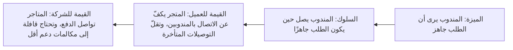

# الوحدة 1 — القيمة الرقمية والعميل

*قبل أن يكتب أحد سطرًا واحدًا من الشيفرة، تحسم ثلاثة أسئلة هل يستحق العمل العناء: ما الذي يجعل هذا المنتج رقميًا، وكيف يمكن أن يصنع قيمة؟ ومن العميل، وما الدليل على أنه يعاني المشكلة فعلًا؟ وكيف ستدفع الشركة ثمن كل وحدة قيمة تقدّمها؟ تجيب هذه الوحدة عن الأسئلة الثلاثة في مرحلة الانطلاق في قافلة، حين تبني مها وفيصل النسخة الأولى لخمسة عشر متجرًا في التجربة التشغيلية، ولا يزالان ينسّقان معظم التوصيلات يدويًا. ويخرج كل درس بوثيقة عملية تنفعك في أي وظيفة: ورقة قيمة لفئة عملاء واحدة، وبيان مشكلة مع سجل أدلة، وورقة من صفحة واحدة لاقتصاديات الوحدة.*

> **الخطوات:** Discover — اكتشف لمن المنتج، وما التغيير الذي يُحدثه في يوم صاحبه، وما الدليل الذي يسنده، وهل تقدر الشركة على تقديمه.

---

# 1.1 — ما الذي يجعل المنتج رقميًا، وكيف يصنع القيمة
*المستوى (Level): 🟢 مبتدئ (Beginner)* · *المتطلبات (Prerequisites): 0.1، 0.2* · *الخطوة (Step): Discover*

**بعد هذا الدرس تستطيع** أن تصف منتجًا رقميًا واحدًا من حيث من يخدم، وما الذي يغيّره في يومهم، وكيف يتحوّل هذا التغيير إلى قيمة للعميل وللشركة، وأن تكتب ورقة قيمة من صفحة واحدة لفئة عملاء واحدة مع مقياس تستطيع التحقق منه. *مدة الدراسة: قراءة نحو 20 دقيقة، وعمل تطبيقي نحو 80 دقيقة (تقدير).*

## ⚡ الدرس في دقيقة (In 60 seconds)
- **المنتج الرقمي (digital product)** يُستخدم عبر البرمجيات (تطبيق، أو موقع، أو واجهة تستدعيها برمجيات أخرى): يُبنى مرة، ويُنسخ بتكلفة زهيدة، ويتغيّر كثيرًا، ويعمل كل يوم.
- لا يصنع المنتج **قيمة** إلا حين يتصرّف أحدٌ بطريقة مختلفة بسببه. الميزات وسيلة، لا القيمة نفسها.
- تخدم معظم المنتجات الرقمية أكثر من فئة. فقافلة تخدم أصحاب المتاجر والمندوبين، ولكل فئة سببها الخاص لاستخدامها.
- القاعدة الأهم: **القيمة تُحسب في يوم العميل، لا في قائمة ميزاتك.**
- إشارة القرار: اسأل «ما الذي سيفعله هذا الشخص بشكل مختلف الأسبوع القادم، وكيف سنرى ذلك؟».
- أكبر فخ: أن تخلط بين «أعجب الناسَ العرضُ التوضيحي» و«غيّر الناس طريقة عملهم».

## 🧭 لماذا يهم (Why it matters)
قافلة وكل من فيها شخصيات خيالية. وكل الأرقام عن قافلة في هذا الدرس أرقام توضيحية، لا معايير مرجعية.

نحن في مرحلة الانطلاق. لدى مها وفيصل نسخة أولى تعمل على **الخدمات المُدارة (managed services)** لدى مزوّد سحابي واحد (يشغّل المزوّد عنهما الخوادم وقاعدة البيانات): تطبيق للتاجر يسجّل فيه المتجر التوصيل، وتطبيق للمندوب يعرض الاستلام التالي، وصفحة ويب إدارية تراقب منها مها كل شيء. يستخدمها خمسة عشر متجرًا في التجربة التشغيلية، بنحو 150 توصيلة في اليوم. وينشر فيصل النسخة يدويًا مرة في الأسبوع.

خطة فيصل للشهر القادم: نقاط ولاء، ووضع داكن، ولوحة رسوم بيانية. يقول: «المتاجر التجريبية تحب التطبيق. لنعطها المزيد.»

أمضت مها فترة العصر في مخبز. أدخلت صاحبة المخبز طلبًا هاتفيًا في قافلة، ثم اتصلت بالمندوب مع ذلك «لتتأكد أنه رآه». ووصل مندوب فوجد الطلب غير جاهز، فانصرف. قبل أن ينفقا شهرًا كاملًا، يحتاج مها وفيصل إلى وصف مشترك للقيمة التي تصنعها قافلة، ولمن تصنعها.

## 📐 كيف يعمل (How it works)

### 🟢 الأساسيات (The essentials)

**ما الذي يجعل المنتج رقميًا.** **المنتج** شيء تقدّمه مؤسسة مرة بعد مرة لتلبّي حاجة فئة من الناس. ويكون **رقميًا** حين يستخدمه الناس أساسًا عبر البرمجيات. وأربع خصائص تميّزه عن، مثلًا، جدول مواعيد مطبوع:

| الخاصية | معناها ببساطة | في قافلة |
|---|---|---|
| **رخيص النسخ، لكن تشغيله ليس مجانيًا** | النسخة الأولى مكلفة البناء؛ وخدمة مستخدم إضافي تكلّف قليلًا، لكنها لا تكلّف صفرًا أبدًا | إضافة المتجر السادس عشر لا تحتاج شيفرة جديدة، لكنها تضيف رسائل وتخزينًا ومكالمات دعم |
| **يتغيّر طوال الوقت** | المنتج لا «يكتمل» أبدًا؛ يُحدَّث كل أسبوع أو كل يوم أو أكثر | ينشر فيصل نسخة جديدة كل أسبوع |
| **ينتج بيانات أثناء استخدامه** | كل فعل يترك أثرًا مسجّلًا يُظهر ما يفعله الناس فعلًا | لكل توصيلة وقت إنشاء ووقت استلام ووقت تسليم |
| **يربط الناس والأنظمة** | كثيرًا ما يقع بين فئات، أو بين برمجيات أخرى | يربط المتاجر والمندوبين، ولاحقًا مزوّد مدفوعات |

يُنقل على نطاق واسع عن الاقتصادي Hal Varian وصفه المعلومات بأنها «مكلفة الإنتاج لكنها رخيصة إعادة الإنتاج»، في ورقة له عام 1998. ولهذا ينظر الدرس 1.3 بعناية إلى التكاليف التي *تنمو* فعلًا مع الاستخدام.

**المنتج والخدمة والمشروع.** **المنتج** هو الشيء المعروض (تطبيق قافلة)؛ و**الخدمة** هي الوعد المستمر بأنه يعمل وبأن أحدًا يجيب حين لا يعمل (الوحدة 7)؛ و**المشروع** عمل مؤقت، مثل «بناء تطبيق المندوب». والقيمة تأتي من الاستخدام على مدى الزمن. ولمنظور المدير، انظر [*إدارة تقنية المعلومات كعمل تجاري*، الدرس 2.1 — المنتجات الرقمية والخدمات والمشاريع: ما كل منها ومن يملكه](../itbiz/index.ar.html#/2.1).

**ما معنى القيمة.** **القيمة** هي المنفعة التي يحصل عليها شخص، بحكمه هو، مطروحًا منها ما يكلّفه الحصول عليها (مالًا ووقتًا وجهدًا ومخاطرة). ولها وجهان:

- **القيمة للعميل:** توفير الوقت أو المال، أو كسب أكثر، أو تجنّب الأخطاء، أو الإحساس بالسيطرة.
- **القيمة للشركة:** ما تكسبه المؤسسة حين يحصل العملاء على قيمتهم: إيراد، أو تكلفة أقل، أو مخاطر أقل، أو تعلّم.

القيمة للشركة تتبع القيمة للعميل: إن لم يكسب أصحاب المتاجر شيئًا، توقفوا عن استخدام التطبيق.

**من الميزة إلى القيمة.** سلسلة مفيدة تُقرأ من اليمين إلى اليسار:

يقفز الناس فوق المربع الأوسط. والميزة التي لا تغيّر سلوك أحد لا تصنع قيمة.

### 🟡 التعمق أكثر (Going deeper)

**أكثر من عميل واحد.** لكثير من المنتجات الرقمية فئتان أو أكثر، ويجب أن تجد كل فئة سببًا للمشاركة. ولقافلة ثلاث فئات على الأقل:

| الفئة | ما تريده من قافلة | ما الذي يدفعها إلى المغادرة |
|---|---|---|
| **أصحاب المتاجر** | أن تصل الطلبات إلى زبائنهم في موعدها دون ملاحقة | عمل أكثر من مكالمة هاتفية؛ طلبات متأخرة أو ضائعة |
| **المندوبون** | عمل منتظم، وانتظار قصير، وتفاصيل استلام واضحة | الانتظار في المتاجر؛ عناوين غير واضحة؛ تأخّر الأجر |
| **زبائن المتاجر** | أن يصل طلبهم في الموعد الموعود | توصيلات متأخرة؛ لا يعرفون أين الطلب |

زبائن المتاجر لا يفتحون التطبيق أبدًا، لكن تجربتهم هي التي تقرّر هل يبقى المتجر. فاذكر كل من يشعر بأثر المنتج.

**عرض القيمة في جملة واحدة.** **عرض القيمة (value proposition)** يذكر لمن المنتج، وأي مشكلة يحلّها، ولماذا يتفوّق على ما يفعلونه اليوم:

> لـ**[الفئة]** التي **[الموقف أو المشكلة]**، يساعدها **[المنتج]** على **[التغيير في يومها]**، بخلاف **[البديل الحالي]**، الذي **[نقطة ضعفه]**.

لأصحاب المتاجر في قافلة: «للمتاجر الصغيرة التي توصّل إلى زبائن محليين، تساعدها قافلة على إيصال كل طلب إلى الزبون في موعده دون الاتصال بأحد، بخلاف مجموعات المحادثة والمكالمات مع المندوبين، التي تحتاج ملاحقة دائمة وتضيّع الطلبات في أوقات الذروة.»

لكل عميل بديل قائم، ولو كان دفترًا وهاتفًا. وتُقاس القيمة بالمقارنة معه.

**المخاطر الأربع للمنتج الجديد.** يحدّد Marty Cagan، مؤلف في إدارة المنتجات لدى Silicon Valley Product Group، أربع مخاطر يحملها كل منتج أو ميزة جديدة؛ ويعرضها كتابه *Inspired* (الطبعة الثانية، 2018):

| الخطر | السؤال | مثال من قافلة |
|---|---|---|
| **القيمة** | هل سيختار الناس استخدامه؟ | هل ستسجّل المخابز الطلبات في التطبيق بدل الاتصال بالمندوبين؟ |
| **سهولة الاستخدام (usability)** | هل يستطيعون فهم طريقة استخدامه؟ | هل يستطيع عامل متجر مشغول تسجيل طلب في أقل من دقيقة؟ |
| **قابلية التنفيذ (feasibility)** | هل نستطيع بناءه وتشغيله بما لدينا؟ | هل يستطيع شخصان دعم تتبّع المندوبين على هواتف قديمة؟ |
| **الجدوى التجارية (viability)** | هل ينجح بالنسبة للشركة: التكاليف والقانون والشركاء والسمعة؟ | هل ستكسب كل توصيلة أكثر مما يكلّف تنسيقها؟ |

### 🔴 نظرة الخبير (Expert view)

**القيمة تخمين حتى يُظهرها السلوك.** كل بيان قيمة مبكر هو **فرضية**: تخمين ينتظر الاختبار. الثناء دليل ضعيف؛ والسلوك المتكرر دليل قوي (الدرس 1.2). استخدم نوعين من المقاييس. **المقياس الاستباقي (leading measure)** يتحرك مبكرًا وكل أسبوع (المتاجر تسجّل كل طلب في التطبيق)؛ و**المقياس اللاحق (lagging measure)** يُظهر النتيجة النهائية لاحقًا (المتاجر لا تزال تدفع بعد ثلاثة أشهر). راقب المقياس الاستباقي لتغيّر الاتجاه مبكرًا. وسجّل **خط الأساس (baseline)** (رقم اليوم، لتقارن به) قبل أن تغيّر أي شيء.

**العمل اليدوي الخفي.** كثيرًا ما تخفي المنتجات المبكرة جهدًا بشريًا خلف الشاشة: تتصل مها بالمندوبين حين يبدو إسناد ما خاطئًا. وهذا حكيم في الغالب؛ فمقال Paul Graham «Do Things that Don't Scale» (يوليو 2013) يرى أن على المؤسسين أداء العمل اليدوي مبكرًا ليتعلّموا ويكسبوا أول المستخدمين. لكن اكتب الخطوات: فهي جزء مما يشتريه العملاء، ولها تكلفة، وتخفي المسافة التي لا تزال تفصل البرمجيات عن العمل وحدها.

**القاعدة التي تُحفظ.** القيمة تُحسب في يوم العميل، لا في قائمة ميزاتك.

## 🧰 الأدوات (The toolkit)
| المصدر أو الأداة أو القالب (Resource, tool or template) | ما هو وماذا يفعل (What it is and does) | متى تلجأ إليه (When to reach for it) |
|---|---|---|
| **Value sheet** — ورقة القيمة | صفحة واحدة لكل فئة عملاء: من هي، والبديل الحالي، والتغيير في يومها، ومقياس، والأدلة حتى الآن | قبل التخطيط لمنتج جديد أو ميزة كبيرة |
| **Value proposition sentence** — جملة عرض القيمة | «لـ[الفئة] التي [المشكلة]، يساعدها [المنتج] على [التغيير]، بخلاف [البديل]، الذي [نقطة ضعفه]» | حين يصف الناس المنتج بطرق مختلفة |
| **Feature-to-value chain** — سلسلة الميزة إلى القيمة | الميزة، وتغيّر السلوك، والقيمة للعميل، والقيمة للشركة، في أربعة مربعات | حين تسرد خطةٌ ميزاتٍ دون «حتى يتمكّن» |
| **Four-risks check** — فحص المخاطر الأربع | القيمة وسهولة الاستخدام وقابلية التنفيذ والجدوى التجارية، سطر لكل منها مع السؤال المفتوح | قبل الالتزام بأسابيع من البناء |

## 🏛️ عمليًا في قافلة (In practice at Qafila)
يعيد مها وفيصل كتابة الخطة في صورة ورقة قيمة لأصحاب المتاجر. المثال توضيحي وخيالي.

> **ورقة القيمة في قافلة: أصحاب المتاجر (الانطلاق، المسودة 1)**
>
> | الحقل | المحتوى |
> |---|---|
> | الفئة | أصحاب المتاجر الصغيرة المشاركة في التجربة والعاملون فيها (15 متجرًا: مخابز، وصيدلية، وبقالات) |
> | البديل الحالي | مكالمة أو رسالة محادثة إلى مندوب يعرفونه؛ ويلاحقه صاحب المتجر إن تأخر |
> | عرض القيمة | للمتاجر الصغيرة التي توصّل محليًا، توصل قافلة كل طلب إلى الزبون في موعده دون أن يتصل أحد، بخلاف المحادثات والمكالمات، التي تحتاج ملاحقة وتضيّع الطلبات في أوقات الذروة |
> | التغيير في يومهم | يسجّل المتجر الطلب مرة واحدة ولا يتصل بالمندوب |
> | المقياس الاستباقي | نسبة طلبات التجربة التي لم يتصل فيها المتجر بالمندوب (يُسأل عنها في متابعة أسبوعية؛ خط الأساس غير معروف) |
> | المقياس اللاحق | المتاجر التجريبية التي لا تزال تستخدم قافلة بعد انتهاء الفترة المجانية |
> | الأدلة حتى الآن | ملاحظة فترة عصر واحدة في مخبز واحد: اتصلت صاحبة المخبز بالمندوب بعد تسجيل الطلب في 4 من 6 طلبات شوهدت |
> | المخاطر الأربع | القيمة: غير مثبتة. سهولة الاستخدام: التسجيل يستغرق نحو دقيقتين، وهذا طويل في الذروة. قابلية التنفيذ: لا مشكلة عند 150 توصيلة في اليوم. الجدوى التجارية: غير معروفة، انظر الدرس 1.3 |
> | العمل اليدوي | تراجع مها إسناد المندوبين كل صباح وتتصل حين يبدو أحدها خاطئًا (نحو 45 دقيقة في اليوم) |
>
> **القرار:** تأجيل نقاط الولاء والوضع الداكن الآن. في الشهر القادم: زر «الطلب جاهز» للمتاجر وتنبيه استلام للمندوبين، موجّهان إلى المكالمة الهاتفية.

اعترض فيصل بأن المندوبين طلبوا الوضع الداكن؛ فسجّلته مها طلبًا. وأبقت أيضًا عبارة «خط الأساس غير معروف»: الفجوة الصادقة خير من رقم مختلَق.

## 🛠️ التمارين (Exercises)
**🟢 صِف منتجًا رقميًا تستخدمه.** اختر تطبيقًا أو موقعًا تستخدمه كل أسبوع (تطبيق تنقّل، أو طعام، أو بنك، أو تعلّم، أو مراسلة). اكتب: من يخدم (كل الفئات، لا أنت وحدك)، وما الذي كنت تفعله قبل وجوده، وما الذي غيّره في يومك، وطريقة واحدة تستطيع بها الشركة رؤية هذا التغيير في بياناتها.
*يكتمل عندما (Done when):* تذكر فئتين على الأقل، وتسمّي بديلًا حقيقيًا، وتصف تغيّرًا في السلوك لا ميزة.

الإجابة النموذجية والتحقق الذاتي

**الإجابة النموذجية.** تطبيق لطلب الطعام يخدم الزبائن والمطاعم وسائقي التوصيل. قبله كنت أتصل بالمطاعم وأنتظر دون أن أعرف متى يصل الطعام. الآن لم أعد أتصل لأسأل. وتستطيع الشركة أن ترى انخفاض اتصالات «أين طلبي» لكل طلب، وتكرار الطلبات.

**التحقق الذاتي.**
- هل ذكرت فئتين على الأقل، منهما فئة ليست أنت؟
- هل البديل الذي ذكرته شيء كنت تفعله فعلًا من قبل؟
- هل «التغيير» الذي ذكرته شيء يفعله شخص، لا شيء يحتويه التطبيق؟
- هل تستطيع الشركة رؤية التغيير في سجلاتها هي؟

**🟡 اكتب ورقة قيمة لمندوبي قافلة.** مستعينًا بالحقائق الواردة في هذا الدرس، اكتب ورقة قيمة من صفحة واحدة للمندوبين بالحقول نفسها التي في ورقة أصحاب المتاجر: الفئة، والبديل الحالي، وجملة عرض القيمة، والتغيير في يومهم، والمقياس الاستباقي واللاحق، والأدلة حتى الآن، والمخاطر الأربع، والعمل اليدوي.
*يكتمل عندما (Done when):* يمتلئ كل حقل، ويُكتب كل رقم لا تملكه «غير معروف»، وتتبع جملة عرض القيمة القالب.

الإجابة النموذجية والتحقق الذاتي

**الإجابة النموذجية.** الفئة: المندوبون العاملون مع المتاجر التجريبية. البديل: مكالمات ومحادثات من عدة متاجر؛ والوصول مبكرًا للانتظار. العرض: «للمندوبين الذين يأخذون طلبات من عدة متاجر صغيرة، تُظهر قافلة أي طلب جاهز وإلى أين يتجهون بعده، بخلاف المكالمات والمحادثات، التي تتركهم منتظرين عند الكاونتر.» التغيير: انتظار أقل، وتوصيلات أكثر في الوردية. المقياس الاستباقي: متوسط الوقت من إنشاء الطلب إلى استلامه، وهو موجود أصلًا في سجلات قافلة (خط الأساس غير معروف). أما الانتظار عند الكاونتر نفسه فلا يُسجَّل بعد، ويحتاج إلى تسجيل حضور من المندوب. اللاحق: المندوبون الذين لا يزالون نشطين بعد شهرين. الأدلة: مندوب شوهد يغادر المخبز دون الطلب. المخاطر: القيمة مرجّحة، وسهولة الاستخدام غير معروفة على الهواتف القديمة، وقابلية التنفيذ لا مشكلة فيها، والجدوى التجارية تتوقف على أجر المندوبين. العمل اليدوي: مراجعة مها الصباحية.

**التحقق الذاتي.**
- هل تجنّبت اختلاق أرقام لا يذكرها الدرس؟
- هل مقياسك الاستباقي شيء تستطيع سجلات قافلة إنتاجه، أو هل ذكرت السجل الجديد الذي يحتاجه؟
- هل تُظهر ورقتك أن المندوبين يريدون شيئًا مختلفًا عمّا يريده أصحاب المتاجر؟
- هل تسمّي جملة العرض البديلَ ونقطة ضعفه؟

**🔴 حوّل قائمة ميزات إلى سلاسل قيمة.** خذ خطة فيصل الأصلية (نقاط الولاء، والوضع الداكن، ولوحة الرسوم البيانية) واقتراح مها (زر «الطلب جاهز»). اكتب لكل واحد من الأربعة سلسلة الميزة إلى القيمة (الميزة، وتغيّر السلوك، والقيمة للعميل، والقيمة للشركة) وسطر المخاطر الأربع. ثم رتّبها واشرح الترتيب في ثلاث جمل.
*يكتمل عندما (Done when):* تسمّي كل سلسلة تغيّرًا محددًا في السلوك أو تُعلَّم بعبارة «لا تغيّر واضح في السلوك» (وينبغي أن تكون واحدة على الأقل كذلك)، ويُبرَّر الترتيب بالأدلة أو بحجم الخطر، لا بالذوق.

الإجابة النموذجية والتحقق الذاتي

**الإجابة النموذجية.**
- زر «الطلب جاهز»: يصل المندوبون حين يكون الطلب جاهزًا؛ تكفّ المتاجر عن الاتصال؛ تقلّ التوصيلات المتأخرة؛ تبقى المتاجر. المخاطر: القيمة مرجّحة (دليل المخبز)؛ سهولة الاستخدام غير معروفة في الذروة؛ قابلية التنفيذ لا مشكلة فيها؛ الجدوى التجارية جيدة إن خفّض مكالمات مها.
- لوحة الرسوم البيانية: لا تغيّر واضح في السلوك. المخاطر: خطر القيمة مرتفع (لم يطلبها أي صاحب متجر)؛ سهولة الاستخدام غير معروفة؛ قابلية التنفيذ لا مشكلة فيها؛ الجدوى التجارية لا تضيف إيرادًا.
- نقاط الولاء: قد يطلب زبائن المتاجر أكثر، لكن قافلة لا تخدمهم مباشرة. المخاطر: القيمة غير معروفة؛ سهولة الاستخدام تضيف خطوة عند الكاونتر؛ قابلية التنفيذ تحتاج بيانات جديدة؛ الجدوى التجارية غير معروفة.
- الوضع الداكن: استخدام أسهل ليلًا للمندوبين. المخاطر: القيمة منخفضة بالنسبة للألم الرئيسي؛ سهولة الاستخدام تتحسن؛ قابلية التنفيذ رخيصة؛ الجدوى التجارية محايدة.

الترتيب: الزر أولًا (ألم مُلاحَظ)؛ والوضع الداكن ثانيًا، إن أكّد المندوبون أنهم يريدونه وأنه رخيص؛ والباقي ينتظر دليلًا على تغيّر السلوك.

**التحقق الذاتي.**
- هل رتّبت بحسب الدليل على تغيّر السلوك، لا بحسب الاهتمام؟
- هل سمّيت الفئة التي تخدمها كل ميزة؟
- هل لكل ميزة المخاطر الأربع كلها، حتى لو كان أحدها «غير معروف»؟

## ⚠️ أخطاء وفخاخ (Mistakes and traps)
- **سرد الميزات على أنها قيمة.** «فيه لوحة رسوم بيانية» ليست منفعة. اسأل «حتى يفعل مَن ماذا بشكل مختلف؟».
- **نسيان البديل.** يقارنك العملاء بما يفعلونه اليوم، وغالبًا مكالمة هاتفية. اكتب البديل وتحقّق من أنك تتفوّق عليه.
- **خدمة المستخدم الذي يسجّل الدخول وحده.** زبائن المتاجر والمندوبون يقرّرون هل تبقى المتاجر. اذكر كل فئة متأثرة.
- **الثقة بالعرض التوضيحي.** الثناء في عرض توضيحي ليس تغيّرًا في السلوك. تحقّق مما يفعله الناس في الأسبوع التالي.
- **إخفاء العمل اليدوي.** الخطوات اليدوية غير المكتوبة تجعل المنتج يبدو أرخص وأكثر اكتمالًا مما هو. اكتب كل خطوة مع وقتها.

## 🧾 الخلاصة (Recap)
- المنتج الرقمي يُستخدم عبر البرمجيات، مكلف البناء، رخيص النسخ لكن تشغيله ليس مجانيًا، دائم التغيّر، وغني ببيانات الاستخدام.
- القيمة هي المنفعة التي يحصل عليها الشخص، بحكمه هو، مطروحًا منها كلفة حصوله عليها؛ والقيمة للشركة تتبع القيمة للعميل.
- لا تصنع الميزة قيمة إلا عبر تغيّر في السلوك؛ فاكتب السلسلة كاملة.
- تخدم المنتجات عدة فئات؛ وكل فئة تقارنك بالبديل الحالي.
- افحص المخاطر الأربع (القيمة، وسهولة الاستخدام، وقابلية التنفيذ، والجدوى التجارية) قبل الالتزام بوقت البناء.
- القاعدة: القيمة تُحسب في يوم العميل، لا في قائمة ميزاتك.

## ✍️ اختبر نفسك (Check yourself)
**1. يقول فيصل إن المتاجر التجريبية «تحب التطبيق»، ولذلك فالخطوة التالية إضافة ميزات أكثر. ما نقطة الضعف الرئيسية في استدلاله؟**

- A. المتاجر التجريبية أقل من أن تعطي أي معلومة مفيدة عن المنتج حتى الآن.
- B. الثناء دليل ضعيف؛ ولم يُثبت أن المتاجر غيّرت عاداتها فعلًا.
- C. يجب أن تنتظر الميزات الجديدة حتى تنتهي التجربة المجانية وتبدأ المتاجر بالدفع.
- D. أصحاب المتاجر ليسوا الفئة المناسبة للحكم على فائدة المنتج.

الإجابة

**B.** الثناء لا يُظهر تغيّرًا في السلوك؛ وزيارة مها أظهرت أن المتجر لا يزال يتصل بالمندوبين. الخيار A مبالغ فيه، وC قاعدة لا يضعها الدرس، وD خاطئ لأن أصحاب المتاجر فئة أساسية. انظر «القيمة تخمين حتى يُظهرها السلوك».

**2. ينضم متجر سادس عشر إلى التجربة الأسبوع القادم. ما الذي ينبغي أن تتوقع مها تغيّره في تكاليف قافلة؟**

- A. لا شيء، لأن البرمجيات مبنية أصلًا ونسخها لا يكلّف شيئًا.
- B. بناء جديد كامل، لأن كل متجر يحتاج نسخة خاصة به من التطبيقات.
- C. فاتورة السحابة فقط، لأن المتاجر لا تضيف أي دعم أو عمل يدوي.
- D. زيادة صغيرة في الرسائل والتخزين والدعم، دون شيفرة جديدة تُكتب.

الإجابة

**D.** المنتجات الرقمية رخيصة النسخ لكن تشغيلها ليس مجانيًا. الخيار A يعامل «رخيص النسخ» كأنه «مجاني»، وB يصف بناءً مخصصًا، وC يتجاهل الدعم والمراجعات اليدوية. انظر «ما الذي يجعل المنتج رقميًا».

**3. كتب فيصل مسودة: «للمندوبين الذين يخدمون عدة متاجر، تُظهر قافلة أي طلب جاهز وإلى أين يتجهون بعده.» ما أكثر ما تحتاجه لتطابق قالب الدرس؟**

- A. البديل الحالي ونقطة ضعفه، مثل المكالمات التي تترك المندوبين منتظرين.
- B. قائمة بشاشات تطبيق المندوب، ليعرف المندوبون بالضبط ما سيحصلون عليه.
- C. هدف لعدد المندوبين الذين تخطط قافلة لتسجيلهم بحلول نهاية العام.
- D. فئة أوسع، مثل كل سائقي التوصيل في المنطقة، لتبدو أكبر حجمًا.

الإجابة

**A.** ينقص المسودة «بخلاف [البديل]، الذي [نقطة ضعفه]»، والقيمة تُقاس بالمقارنة مع البديل. الخيار B يسرد ميزات، وC هدف تجاري، وD يجعل الفئة أكثر غموضًا. انظر «عرض القيمة في جملة واحدة».

**4. تتساءل مها هل ستكسب كل توصيلة أكثر مما يكلّف تنسيقها. أي المخاطر الأربع تفكّر فيه؟**

- A. خطر القيمة، لأنه يتعلق بهل ستختار المتاجر استخدام التطبيق.
- B. خطر سهولة الاستخدام، لأنه يتعلق بمقدار الجهد الذي تتطلبه كل توصيلة.
- C. خطر الجدوى التجارية، لأنه يتعلق بهل ينجح نموذج العمل.
- D. خطر قابلية التنفيذ، لأنه يتعلق بما يستطيع الفريق بناءه.

الإجابة

**C.** قدرة الشركة على تحمّل كلفة تقديم كل وحدة هي الجدوى التجارية. الخيار A مغرٍ، لكن خطر القيمة يتعلق بهل يختار العملاء المنتج. أما B وD فيتعلقان بسهولة الاستخدام والقدرة على البناء. انظر «المخاطر الأربع للمنتج الجديد».

**5. تراجع مها إسناد المندوبين يدويًا كل صباح. ماذا ينبغي أن تفعل قافلة بشأن ذلك في مرحلة الانطلاق؟**

- A. أن تتوقف عنه، لأن العمل اليدوي يعني أن المنتج ليس رقميًا حقًا بعد.
- B. أن تستمر فيه، وأن تكتب كل خطوة والوقت الذي تستغرقه كل يوم.
- C. أن تستمر فيه بصمت، لتحكم المتاجر على البرمجيات بمزاياها وحدها.
- D. أن تؤتمته قبل انضمام المتجر التالي، لتعمل التجربة بالبرمجيات وحدها.

الإجابة

**B.** العمل اليدوي المبكر حكيم في الغالب، لكن يجب أن يكون ظاهرًا: فهو جزء مما يحصل عليه العملاء ومن كلفته. الخياران A وD ردّ فعل مبالغ فيه؛ وC يخفي الكلفة الحقيقية. انظر «العمل اليدوي الخفي».

## 📚 المراجع (References)
- Varian, H. R., "Markets for Information Goods", 1998 paper, University of California, Berkeley: https://people.ischool.berkeley.edu/~hal/Papers/japan/japan.html
- Cagan, M., "Product Risk Taxonomies", Silicon Valley Product Group: https://svpg.com/product-risk-taxonomies
- Cagan, M., *Inspired: How to Create Tech Products Customers Love*, 2nd edition (Wiley, 2018).
- Graham, P., "Do Things that Don't Scale", July 2013: https://paulgraham.com/ds.html
- من المكتبة: [*إدارة تقنية المعلومات كعمل تجاري*، الدرس 2.1 — المنتجات الرقمية والخدمات والمشاريع: ما كل منها ومن يملكه](../itbiz/index.ar.html#/2.1).
- من المكتبة: [*إدارة تقنية المعلومات كعمل تجاري*، الدرس 1.1 — من المشاريع إلى القيمة: النتائج ومسارات القيمة والتدفّق](../itbiz/index.ar.html#/1.1) (النتائج والقيمة من منظور المدير).

---

# 1.2 — فهم العملاء: المشكلات والمهام والأدلة
*المستوى (Level): 🟢 مبتدئ (Beginner)* · *المتطلبات (Prerequisites): 1.1* · *الخطوة (Step): Discover*

**بعد هذا الدرس تستطيع** أن تكتب بيان مشكلة لفئة عملاء واحدة، وأن تجري مقابلة قصيرة عن السلوك الماضي لا عن الآراء، وأن تحتفظ بسجل أدلة يصنّف درجة كل نتيجة. *مدة الدراسة: قراءة نحو 20 دقيقة، وعمل تطبيقي نحو 100 دقيقة (تقدير).*

## ⚡ الدرس في دقيقة (In 60 seconds)
- **بيان المشكلة (problem statement)** يذكر من يعاني المشكلة، وفي أي موقف، وما كلفتها عليه، وكيف يتدبّر أمره اليوم. ولا يقول شيئًا عن الحل.
- **المهمة المطلوب إنجازها (job to be done)** هي التقدّم الذي يسعى إليه شخص في موقف معيّن («أوصل هذا الطلب إلى زبوني قبل أن يبرد»)، لا المنتج الذي يستخدمه لتحقيقه.
- محادثات العملاء الجيدة تسأل عن **أشياء محددة حدثت فعلًا**، لا عن الآراء أو التوقعات. ولا تعرض فكرتك وأنت تستمع.
- للأدلة درجات: الآراء أضعفها، والسلوك الماضي أقوى، والالتزام (بالوقت أو المال أو البيانات) أقوى منهما.
- القاعدة الأهم: **صدّق ما فعله الناس، لا ما يقولون إنهم سيفعلونه.**
- أكبر فخ: أن تسأل «هل ستستخدم تطبيقًا…؟». يكاد الجميع يقولون نعم.

## 🧭 لماذا يهم (Why it matters)
قافلة وكل من فيها شخصيات خيالية. وكل الأرقام عن قافلة في هذا الدرس أرقام توضيحية، لا معايير مرجعية.

يتفق مها وفيصل على أن مكالمة المتجر للمندوب هي الألم الذي يجب معالجته. يرسل فيصل استبيانًا إلى المتاجر الخمسة عشر المشاركة في التجربة التشغيلية: «هل ستستخدم زر "الطلب جاهز" لو بنيناه؟» يردّ أربعة عشر متجرًا؛ ويقول ثلاثة عشر منها نعم.

مها غير مرتاحة. فالمتاجر نفسها قالت نعم للتطبيق الأصلي ولا تزال تتصل بالمندوبين، والسؤال يلمّح إلى الجواب الذي تتمناه قافلة. قال لها صاحب صيدلية: «طبعًا سأستخدمه.» وقد سجّل ثلاثة طلبات في أسبوعين.

أعطى الاستبيان ثقة، لا دليلًا. يحتاجان إلى أن يريا ما يحدث في المتجر وقت الذروة.

## 📐 كيف يعمل (How it works)

### 🟢 الأساسيات (The essentials)

**المشكلة أولًا، ثم الحل.** من الأسباب الشائعة لفشل المنتجات الجديدة أنها تحلّ أمرًا لم يحتجه أحد بما يكفي ليغيّر عاداته. لذلك صِف المشكلة أولًا، في **بيان مشكلة** من خمسة أجزاء:

1. **من:** فئة محددة («موظفو الكاونتر في المخابز الصغيرة المشاركة في التجربة»)، لا «الشركات».
2. **الموقف:** متى يحدث ذلك («في ذروة الغداء»).
3. **المشكلة:** ما الذي يسوء، بكلماتهم إن أمكن.
4. **ما تكلّفهم:** وقت، أو مال، أو أخطاء، أو ضغط، أو خسارة زبائن.
5. **كيف يتدبّرون أمرهم اليوم:** مكالمات هاتفية، أو دفتر، أو قريب يقود السيارة.

| ضعيف | قوي |
|---|---|
| «المتاجر تحتاج برمجيات توصيل أفضل.» | «موظفو الكاونتر في المخابز الصغيرة، في ذروة الغداء، لا يعرفون هل رأى المندوب الطلب، فيتصلون به في معظم الطلبات. كل مكالمة تستغرق دقيقة أو دقيقتين في أشد الأوقات ازدحامًا، ويبرد الطلب حين يتأخر المندوب.» |

يمكن التحقق من الصيغة القوية بمراقبة ذروة غداء واحدة، وهي تترك مجالًا لحلول غير التطبيق.

**المهام المطلوب إنجازها.** **المهمة المطلوب إنجازها** هي التقدّم الذي يسعى إليه شخص في موقف معيّن. نشر الفكرةَ Clayton Christensen في كتاب *The Innovator's Solution* (2003، مع Michael Raynor)، وأعاد صياغتها في مقال «Know Your Customers' Jobs to Be Done» (*Harvard Business Review*، سبتمبر 2016)؛ وطوّر آخرون، أبرزهم Anthony Ulwick، مناهج قريبة منها. فالناس «يستأجرون» منتجًا ليتقدّموا، و«يفصلونه» حين يؤدي شيء آخر المهمة أفضل منه.

صاحبة مخبز معها طلب هاتفي وطابور من الزبائن لا تريد «برمجيات تنسيق التوصيل»؛ مهمتها «أن يصل هذا الطلب إلى الزبون دافئًا وفي موعده، دون أن أترك الكاونتر». وقافلة، وابن أخ يملك دراجة نارية، ومندوب تعرفه صاحبة المخبز، كلهم يستطيعون أداء هذه المهمة: فكلهم منافسون.

لبيان المهمة ثلاثة أجزاء: **حين** (الموقف)، و**أريد أن** (التقدّم)، و**حتى أستطيع** (السبب الأعمق).

> حين يصل طلب هاتفي وقت الذروة، أريد أن يُستلم بمجرد أن يجهز، حتى أستطيع مواصلة خدمة الطابور ويحصل الزبون على خبز دافئ.

**التحدث مع العملاء.** كتاب *The Mom Test* (2013) لـ Rob Fitzpatrick دليل واسع الاستخدام، وتُلخَّص قواعده الثلاث عادة هكذا:

- تحدّث عن حياتهم، لا عن فكرتك.
- اسأل عن تفاصيل محددة في الماضي، لا عن آراء أو عن المستقبل.
- تكلّم أقل واستمع أكثر.

| سؤال سيئ (يستدعي رأيًا أو مجاملة) | سؤال أفضل (يسأل عمّا حدث) |
|---|---|
| «هل ستستخدم زر "الطلب جاهز"؟» | «حدّثني عن آخر توصيلة ساءت. ماذا حدث؟» |
| «هل تنسيق المندوبين مشكلة كبيرة لديك؟» | «كم مرة اتصلت بمندوب أمس؟ ولماذا في كل مرة؟» |

### 🟡 التعمق أكثر (Going deeper)

**درجات الأدلة.** من الأضعف إلى الأقوى:

| الدرجة | ما هي | مثال من قافلة | مقدار الثقة بها |
|---|---|---|---|
| 1. **رأي أو توقّع** | ما يقول الناس إنهم يظنونه أو سيفعلونه | «سأستخدمه بالتأكيد» | منخفض: الناس مهذبون وسيئون في توقّع سلوكهم |
| 2. **قصة عن الماضي** | رواية محددة لما حدث | «أمس اتصلت بالمندوب أربع مرات من أجل طلب واحد» | متوسط: حقيقية، لكن الذاكرة تتشوّش |
| 3. **سلوك مُلاحَظ** | ما رأيتهم يفعلونه، أو ما تُظهره السجلات | ثلاثة طلبات مسجّلة في أسبوعين؛ أربع مكالمات شوهدت في فترة عصر | مرتفع لما شوهد؛ تحقّق من أنه نمطي |
| 4. **التزام** | يتخلّون عن شيء: وقت، أو مال، أو بيانات، أو سمعة | متجر يوافق على تجربة مدفوعة، أو يعرّفك بمتجرين آخرين | الأعلى: الإشارات المكلفة نادرًا ما تُعطى مجاملةً |

استبيان فيصل من الدرجة 1؛ وعصر مها في المخبز من الدرجة 3.

**إجراء مقابلة.** هيكل عملي لعشرين إلى ثلاثين دقيقة:

1. **التمهيد.** من أنت، ولماذا تسأل، وكم تستغرق؛ واستأذن في تدوين الملاحظات.
2. **السياق.** دورهم ويوم عمل نمطي.
3. **آخر مرة.** «اشرح لي آخر طلب وصّلته.» ثم «ماذا حدث بعد ذلك؟» و«لماذا؟».
4. **الحلول المؤقتة والتكاليف.** ما يفعلونه اليوم، وكم يكلّفهم، وما الذي جرّبوه.
5. **الختام.** «مع من غيري ينبغي أن أتحدث؟»، وإن كان مناسبًا، التزام صغير («هل يمكنني مراقبة ذروة غداء واحدة؟»).

اكتب ملاحظاتك في اليوم نفسه في ثلاثة أعمدة: **ما قالوه**، و**ما فعلوه أو أروك إياه**، و**ما تظن أنه يعنيه**.

**الملاحظة والأعداد.** مراقبة الناس وهم يعملون (المرافقة) تكشف عادات لا يذكرونها: صاحبة المخبز لم تتحدث عن المكالمات قط؛ كانت تجريها فحسب. توقّف عن المقابلات حين تكرّر المحادثات الجديدة ما سمعته، وغطِّ أنواعًا مختلفة (مخبز وصيدلية، صاحب متجر وعامل).

**الافتراضات.** **الافتراض (assumption)** أمر يُعامَل على أنه صحيح دون دليل كافٍ. اكتب كل افتراض بصيغة يمكن إثبات خطئها، وعلّم أهميته ودليله، واختبر أولًا الافتراضات المهمة ضعيفة الدليل (الدرس 2.1).

### 🔴 نظرة الخبير (Expert view)

**التحيّز في رأسك أنت.** **التحيّز التأكيدي (confirmation bias)** هو أن تلاحظ ما يدعم ما تؤمن به أصلًا. اكتب توقّعك أولًا وابحث عن دليل يثبت خطأك. والمتاجر التجريبية اختارت الانضمام، فهي على الأرجح أكثر حماسًا من المتوسط.

**أخلاقيات البحث والبيانات الشخصية.** اطلب الموافقة، وقل ما الذي تحتفظ به وإلى متى، واحفظ الملاحظات بأمان، واحذف الأسماء التي لا تحتاجها. وقد يحتاج التسجيل إلى إذن صريح، وقواعد حماية البيانات في دول كثيرة تشمل الملاحظات عن أشخاص يمكن التعرّف عليهم.

**أدوات الذكاء الاصطناعي، بحذر.** يستطيع المساعد أن يصوغ مسودة دليل مقابلة أو يجمّع الملاحظات في مجموعات، لكنه لا يحلّ محل العملاء؛ ولصق ملاحظات شخصية فيه مسألة تخص حماية البيانات.

**القاعدة التي تُحفظ.** صدّق ما فعله الناس، لا ما يقولون إنهم سيفعلونه.

## 🧰 الأدوات (The toolkit)
| المصدر أو الأداة أو القالب (Resource, tool or template) | ما هو وماذا يفعل (What it is and does) | متى تلجأ إليه (When to reach for it) |
|---|---|---|
| **Problem statement** — بيان المشكلة | من، والموقف، والمشكلة، وكلفتها عليهم، وكيف يتدبّرون أمرهم اليوم؛ دون حل | قبل مناقشة أي ميزة أو منتج |
| **Job statement** — بيان المهمة | «حين [الموقف]، أريد أن [التقدّم]، حتى أستطيع [السبب الأعمق]» | لترى المنافسة الحقيقية، ومنها ما ليس برمجيات |
| **Interview guide** — دليل المقابلة | خمسة أجزاء: التمهيد، والسياق، وآخر مرة، والحلول المؤقتة والتكاليف، والختام | قبل كل محادثة مع عميل |
| **Evidence log** — سجل الأدلة | صف لكل نتيجة: المصدر، والتاريخ، والدرجة (رأي، قصة، مُلاحَظ، التزام)، وما الذي تدعمه | بعد كل محادثة أو ملاحظة أو سحب بيانات |

## 🏛️ عمليًا في قافلة (In practice at Qafila)
يتفق مها وفيصل على أربع مقابلات وملاحظتين ميدانيتين قبل بناء أي شيء. المثال توضيحي وخيالي.

> **بيان المشكلة (المتاجر، المسودة 1).** موظفو الكاونتر في متاجر الطعام الصغيرة، وقت الذروة، لا يعرفون هل رأى المندوب الطلب، فيتصلون في معظم الطلبات.
>
> **بيان المشكلة (المتاجر، المسودة 2، بعد الأدلة أدناه).** موظفو الكاونتر في متاجر الطعام الصغيرة المشاركة في التجربة، في ذروة الغداء والمساء، لا يستطيعون إبلاغ المندوبين متى سيجهز الطلب، فيصل المندوبون مبكرًا وينتظرون أو يصلون متأخرين، ويتصل الموظفون بهم في معظم الطلبات. كل مكالمة تقطع الخدمة في أشد الأوقات ازدحامًا، وتبرد الطلبات. ويتدبّرون أمرهم اليوم بالمكالمات ورسائل المحادثة ومندوبين يعرفونهم.
>
> **بيان المهمة.** حين يصل طلب هاتفي وقت الذروة، أريد أن يُستلم بمجرد أن يجهز، حتى أستطيع مواصلة خدمة الطابور ويحصل زبوني على الطعام دافئًا.
>
> **سجل الأدلة (مقتطف)**
>
> | # | النتيجة | المصدر والتاريخ | الدرجة | تدعم أو تُضعف |
> |---|---|---|---|---|
> | 1 | 13 من 14 متجرًا «سيستخدمون» زر الطلب جاهز | استبيان، الأسبوع 6 | رأي | تدعم دعمًا ضعيفًا |
> | 2 | اتصلت صاحبة المتجر بالمندوب بعد تسجيل الطلب في 4 من 6 طلبات | مها، ملاحظة في مخبز، الأسبوع 5 | مُلاحَظ | تدعم: المشكلة حقيقية في هذا المتجر |
> | 3 | سجّلت الصيدلية 3 طلبات في أسبوعين؛ يقول صاحبها إن معظم التوصيلات وصفات طبية يوصلها بنفسه | سجلات التطبيق + مقابلة، الأسبوع 7 | مُلاحَظ + قصة | مهمة الصيدلية مختلفة: الخصوصية، لا السرعة |
> | 4 | موظف الكاونتر في البقالة: «أتصل لأن المندوب لا يعرف أبدًا متى يجهز الطلب» | مقابلة، الأسبوع 7 | قصة | المشكلة توقيت «الجاهزية»، لا «هل رأى المندوب الطلب» |
> | 5 | وافق مخبز ثانٍ على أن يراقب فيصل ذروتَي غداء | ختام مقابلة، الأسبوع 7 | التزام | تدعم: المتاجر مستعدة لبذل الوقت |
>
> **ما الذي تغيّر.** نقلت النتيجة 4 المشكلة من «هل رأى المندوب الطلب؟» (المسودة 1) إلى «هل يعرف المندوب متى سيجهز الطلب؟» (المسودة 2). وتشير النتيجة 3 إلى أن للصيدليات مهمة مختلفة؛ فتُركت جانبًا، ولم تُحشر في حل المخابز.

احتجّ فيصل بأن الاستبيان فيه «بيانات أكثر». فأشارت مها إلى عمود الدرجة: أربعة عشر رأيًا تبقى آراء.

## 🛠️ التمارين (Exercises)
**🟢 أصلح الأسئلة.** أعد كتابة كل سؤال من أسئلة المقابلة هذه بحيث يسأل عن سلوك ماضٍ محدد، لا عن رأي أو توقّع: (a) «هل ستستخدم تطبيقًا لتتبّع توصيلاتك؟» (b) «هل انتظار المندوبين مزعج؟» (c) «كم ستدفع مقابل استلام أسرع؟» (d) «ما الميزات التي ينبغي أن نضيفها؟»
*يكتمل عندما (Done when):* يسأل كل سؤال أعدت كتابته عن شيء حدث فعلًا، ولا يذكر أيٌّ منها منتجك أو فكرتك.

الإجابة النموذجية والتحقق الذاتي

**الإجابة النموذجية.** (a) «حدّثني عن آخر توصيلة لك. كيف عرفت أين هي؟» (b) «أمس، كم انتظر المندوبون عند الكاونتر لديك؟» (c) «كم أنفقت على التوصيل الشهر الماضي، وكيف اخترت هذا الترتيب؟» (d) «متى آخر مرة تعثّرت فيها توصيلة لديك؟ ماذا فعلت؟»

**التحقق الذاتي.**
- هل يشير كل سؤال إلى لحظة ماضية محددة («أمس»، «آخر مرة»، «الشهر الماضي»)؟
- هل حذفت كل ذكر لمنتجك أو تطبيقك أو فكرتك؟
- هل سيصعب على شخص مهذب أن يعطي إجابة مجامِلة لكنها فارغة؟

**🟡 قابل شخصًا عن مشكلة حقيقية.** اختر مشكلة يومية صغيرة في حياة شخص آخر (كيف يخطط صديق أو قريب وجباته، أو يذهب إلى العمل، أو يتقاسم الأعمال المنزلية). بإذنه، أجرِ محادثة من عشرين دقيقة مستخدمًا الدليل ذا الأجزاء الخمسة. ثم اكتب بيان مشكلة وبيان مهمة من ملاحظاتك.
*يكتمل عندما (Done when):* تفصل ملاحظاتك بين «ما قاله» و«ما فعله أو أراك إياه» و«تفسيري»؛ ويضم بيان المشكلة أجزاءه الخمسة؛ ويتبع بيان المهمة صيغة «حين… أريد أن… حتى أستطيع…».

الإجابة النموذجية والتحقق الذاتي

**الإجابة النموذجية.** الموضوع: مشتريات البقالة الأسبوعية لقريبة. ما قالته: «دائمًا أنسى شيئًا.» ما أرتني إياه: قائمة على ظرف ملصق بالثلاجة؛ وثلاث رحلات إضافية إلى المتجر الأسبوع الماضي. التفسير: المشكلة هي التذكّر خلال الأسبوع. بيان المشكلة: «أم عاملة لثلاثة أطفال لا تنتبه إلى الأغراض الناقصة إلا أثناء الطبخ في أيام الأسبوع، فتقوم برحلتين أو ثلاث رحلات إضافية مدة كل منها 30 دقيقة. وتتدبّر أمرها بقائمة على ظرف ملصق بالثلاجة، لا يحدّثها أحد غيرها.» المهمة: «حين ألاحظ أن شيئًا نفد، أريد أن يُسجَّل حيث تراه الأسرة كلها، حتى أستطيع التسوّق مرة واحدة في الأسبوع.»

**التحقق الذاتي.**
- هل «ما قاله» و«ما أراك إياه» وتفسيرك في أعمدة منفصلة؟
- هل يسمّي بيان المشكلة من، والموقف، والمشكلة، والكلفة، والحل المؤقت الحالي؟
- هل يتبع بيان المهمة صيغة «حين… أريد أن… حتى أستطيع…»؟
- هل يخلو البيانان من أي حل؟
- هل سألت عن حدث ماضٍ محدد، لا عن عادة عامة؟

**🔴 صنّف الأدلة واختر ما تتعلّمه بعد ذلك.** مستعينًا بسجل أدلة قافلة، أضف صفين: نتيجة واحدة *تُضعف* حجة زر «الطلب جاهز»، ونتيجة واحدة بدرجة الالتزام تريدها قبل أن يبنيه فيصل. ثم اكتب ثلاثة افتراضات يقوم عليها الزر، وعلّم كلًّا منها بحسب الأهمية (عالية، متوسطة، منخفضة) والدليل (قوي، جزئي، معدوم)، وقل أيها ستختبره أولًا وكيف.
*يكتمل عندما (Done when):* يكون لكل صف جديد مصدر ودرجة وما الذي يدعمه أو يُضعفه؛ ويمكن إثبات خطأ كل افتراض؛ ويستهدف اختبارك الأول الافتراض الأهم ذا الدليل الأقل.

الإجابة النموذجية والتحقق الذاتي

**الإجابة النموذجية.**

| # | النتيجة | المصدر والتاريخ | الدرجة | تدعم أو تُضعف |
|---|---|---|---|---|
| 6 | مندوبو البقالة ينتظرون في الداخل ويتسامرون؛ ولا يمانع صاحبها | فيصل، ملاحظة في البقالة، الأسبوع 8 | مُلاحَظ | تُضعف «الانتظار مكلف» في البقالات |
| 7 | ثلاثة متاجر تضغط «جاهز» في كل طلب لمدة أسبوع وتشارك سجلات مكالماتها | مخطط له، الأسبوع 9 | التزام | ستدعم: المتاجر ستغيّر عاداتها |

الافتراضات: (1) سيتذكّر موظفو الكاونتر الضغط على «جاهز» وقت الذروة (أهمية عالية، دليل معدوم)؛ (2) سيتحقق المندوبون من التطبيق بدل انتظار مكالمة (عالية، دليل جزئي)؛ (3) معرفة موعد جاهزية الطلب تخفّض المكالمات كثيرًا (عالية، دليل جزئي). اختبر الافتراض 1 أولًا، على الورق: يرسل مخبزان رسالة كلما جهز طلب خلال ذروة غداء واحدة؛ وعُدّ كم مرة يفعلان ذلك.

**التحقق الذاتي.**
- هل لكل صف جديد مصدر وتاريخ، ودرجة، وما الذي يدعمه أو يُضعفه؟
- هل اختبارك الأول رخيص وسريع ويُجرى قبل أي شيفرة؟
- هل أدرجت دليلًا يمكن أن يثبت أن قافلة مخطئة؟

## ⚠️ أخطاء وفخاخ (Mistakes and traps)
- **العرض بدل الاستماع.** بمجرد أن تصف فكرتك، يتفاعل الناس معها بتهذيب. أبقِها خارج الحديث حتى النهاية، إن ذكرتها أصلًا.
- **عدّ الآراء بيانات.** مئة «نعم» على سؤال «هل ستستخدمه؟» تبقى آراء. صنّف كل نتيجة.
- **التحدث مع المتاجر التجريبية المتحمسة وحدها.** المتاجر التي انضمت أكثر ودًّا من معظم المتاجر. تحدّث أيضًا مع المتاجر التي رفضت، واسألها لماذا.
- **طرح أسئلة موجِّهة في الاستبيانات.** «هل ستستخدم زرنا؟» يلمّح إلى الجواب الذي تتمناه. اسأل عمّا فعلوه الأسبوع الماضي.
- **جمع البيانات الشخصية بإهمال.** اطلب الموافقة، واحتفظ بما تحتاجه فقط، وتحقّق من القواعد المحلية.

## 🧾 الخلاصة (Recap)
- بيان المشكلة يسمّي من، والموقف، والمشكلة، وكلفتها، والحل المؤقت الحالي، دون أي حل.
- المهمة المطلوب إنجازها هي التقدّم الذي يريده شخص في موقف ما؛ وكل ما يحقق هذا التقدّم منافس.
- اسأل عن أحداث ماضية محددة، ولا تعرض فكرتك، واستمع أكثر مما تتكلم.
- صنّف الأدلة: رأي، قصة، سلوك مُلاحَظ، التزام؛ واختبر أولًا الافتراضات المهمة ضعيفة الدليل.
- القاعدة: صدّق ما فعله الناس، لا ما يقولون إنهم سيفعلونه.

## ✍️ اختبر نفسك (Check yourself)
**1. وجد استبيان فيصل أن 13 من 14 متجرًا تجريبيًا «سيستخدمون» زر الطلب جاهز. كيف ينبغي تسجيل ذلك في سجل الأدلة؟**

- A. سلوكًا مُلاحَظًا، لأن الإجابات جاءت مباشرة من المتاجر نفسها.
- B. التزامًا، لأن المتاجر اقتطعت وقتًا من يومها للإجابة عن الاستبيان.
- C. رأيًا أو توقّعًا، لأن «سيستخدمون» تخمين عن مستقبلهم.
- D. دليلًا على أن المشكلة حُلّت، لأن كل المتاجر تقريبًا أجابت بنعم.

الإجابة

**C.** «سيستخدمون» توقّع، وهو أدنى درجة، مهما كثر من يقوله. الخيار A يخلط بين الإجابة والسلوك، وB يبالغ في جهد صغير، وD يعامل النوايا كأنها نتائج. انظر «درجات الأدلة».

**2. أي سؤال يُرجَّح أن ينتج دليلًا موثوقًا في مقابلة مع صاحبة مخبز؟**

- A. «اشرحي لي آخر طلب وصل متأخرًا. ماذا حدث، خطوة بخطوة؟»
- B. «لو بنينا زرًا يُبلغ المندوبين أن الطلب جاهز، فكم مرة ستستخدمينه؟»
- C. «على مقياس من واحد إلى عشرة، كم يزعجك تنسيق المندوبين عمومًا؟»
- D. «ما الميزات التي تجعل تطبيقنا أفضل أداة توصيل لمخبزك؟»

الإجابة

**A.** يسأل عن حدث ماضٍ محدد دون ذكر المنتج. الخيار B يطلب توقّعًا، وC يطلب رأيًا عامًا، وD يطلب من العميل أن يصمّم المنتج. انظر «التحدث مع العملاء».

**3. كتبت مها بيان المهمة هذا للمتاجر: «حين يصل طلب، أريد أن أضغط زر الجاهزية في قافلة، حتى يعرف المندوبون أن عليهم المجيء.» ما الخطأ فيه؟**

- A. ينبغي أن يبدأ باسم المتجر، ليعرف الفريق بالضبط من قاله.
- B. قصير جدًا، لأن بيان المهمة ينبغي أن يسرد كل خطوة في الطلب.
- C. ينبغي أن يصف موقف المندوب، لأن المندوبين هم من يقومون بالرحلة.
- D. يسمّي حلًا (زر قافلة) بدل التقدّم الذي يريده المتجر.

الإجابة

**D.** بيان المهمة يصف التقدّم، ولا يذكر أي منتج؛ و«أضغط زر الجاهزية في قافلة» حل. أما «أريد أن يُستلم بمجرد أن يجهز، حتى أستطيع مواصلة الخدمة» فيصلح. والخيارات A وB وC تخطئ العيب الحقيقي. انظر «المهام المطلوب إنجازها».

**4. سجّلت الصيدلية ثلاثة طلبات فقط في أسبوعين؛ ويقول صاحبها إنه يوصل معظم الوصفات الطبية بنفسه. ما أفضل استنتاج حتى الآن؟**

- A. الصيدلية لا تناسب التجربة، وينبغي أن تغادرها قبل أن تشوّه البيانات.
- B. يبدو أن للصيدلية مهمة مختلفة، كالخصوصية، تستحق الاستكشاف وحدها.
- C. تحتاج الصيدلية شرحًا أفضل، فقلة الاستخدام تدل على مشكلة في سهولة الاستخدام.
- D. للصيدلية مشكلة المخابز نفسها، وتحتاج تذكيرات أكثر لتسجيل الطلبات.

الإجابة

**B.** سلوكه وقصته يشيران إلى مهمة مختلفة. الخيار A يهدر فرصة تعلّم؛ وC وD يفترضان سببًا لا يدعمه الدليل. انظر «عمليًا في قافلة».

**5. تريد مها تسجيل المقابلات على هاتفها لتوفّر وقت تدوين الملاحظات. ماذا ينبغي أن تفعل أولًا؟**

- A. أن تستأذن كل شخص، وتقول ما الذي تحتفظ به ولماذا، وتتحقق من القواعد المحلية.
- B. أن تسجّل دون أن تسأل، لأن المقابلات أحاديث ودية غير رسمية مع متاجر متعاونة.
- C. أن تتخلّى عن الملاحظات والتسجيلات كليًا، لأن الاحتفاظ ببيانات البحث يخلق مخاطر.
- D. أن تسجّل كل شيء وتلصق النصوص المفرغة في أداة ذكاء اصطناعي لتلخّصها لاحقًا.

الإجابة

**A.** الموافقة، والغرض الواضح، والتحقق من القواعد المحلية تأتي أولًا. الخيار B يتجاهل الموافقة، وC خاطئ لأن الملاحظات يمكن حفظها بطريقة سليمة، وD يضيف مسألة جديدة تخص حماية البيانات. انظر «أخلاقيات البحث والبيانات الشخصية».

## 📚 المراجع (References)
- Christensen, C. M. and Raynor, M. E., *The Innovator's Solution: Creating and Sustaining Successful Growth* (Harvard Business School Press, 2003).
- Christensen, C. M., Hall, T., Dillon, K. and Duncan, D. S., "Know Your Customers' 'Jobs to Be Done'", *Harvard Business Review*, September 2016: https://hbr.org/2016/09/know-your-customers-jobs-to-be-done
- Ulwick, A. W., *What Customers Want: Using Outcome-Driven Innovation to Create Breakthrough Products and Services* (McGraw-Hill, 2005).
- Fitzpatrick, R., *The Mom Test: How to talk to customers and learn if your business is a good idea when everyone is lying to you* (self-published, 2013): https://www.momtestbook.com/
- من المكتبة: [*دليل المؤسس للبناة بالذكاء الاصطناعي*، الدرس 1.2 — مقابلات العملاء التي تكشف الحقيقة](../founder/index.ar.html#/1.2).
- من المكتبة: [*دليل المؤسس للبناة بالذكاء الاصطناعي*، الدرس 1.3 — البحث بمساعدة الذكاء الاصطناعي دون أن تخدع نفسك](../founder/index.ar.html#/1.3).
- من المكتبة: [*إدارة منتجات الذكاء الاصطناعي*، الدرس 2.1 — الاكتشاف للذكاء الاصطناعي: المهام وسير العمل وأين يلائم الذكاء الاصطناعي](../aipm/index.ar.html#/2.1).

---

# 1.3 — نماذج العمل والتكاليف ووحدة القيمة
*المستوى (Level): 🟢 مبتدئ (Beginner)* · *المتطلبات (Prerequisites): 1.1، 1.2* · *الخطوة (Step): Discover*

**بعد هذا الدرس تستطيع** أن تصف نموذج عمل منتج رقمي بكلمات بسيطة، وأن تختار وحدة القيمة التي يُدفع مقابلها، وأن تبني ورقة من صفحة واحدة تقارن الإيراد بتكلفة الخدمة لوحدة واحدة، فاصلًا التكاليف الثابتة عن المتغيرة ومُظهرًا العمل اليدوي. *مدة الدراسة: قراءة نحو 20 دقيقة، وعمل تطبيقي نحو 90 دقيقة (تقدير).*

## ⚡ الدرس في دقيقة (In 60 seconds)
- **نموذج العمل (business model)** يجيب عن أربعة أسئلة: من يدفع، ومقابل ماذا، وكيف يصل المنتج إليه، وكم يكلّف تقديمه.
- **وحدة القيمة (unit of value)** هي الشيء الواحد الذي يحصل عليه العميل وتتقاضى الشركة مقابله: توصيلة، أو مستخدم في الشهر، أو مستند معالَج. اختر واحدة وقِس كل شيء بها.
- **التكاليف الثابتة (fixed costs)** تبقى كما هي سواء خدمت 10 وحدات أو 1,000. و**التكاليف المتغيرة (variable costs)** تنمو مع كل وحدة. و**تكلفة الخدمة (cost to serve)** هي التكلفة المتغيرة لوحدة واحدة، ومنها وقت الناس.
- **المساهمة (contribution)** هي الإيراد لكل وحدة ناقص التكلفة المتغيرة لكل وحدة. فإن كانت سالبة، جعل النمو الأمور أسوأ.
- القاعدة الأهم: **اعرف كم تكسب الوحدة الواحدة وكم تكلّف قبل أن تحاول بيع المزيد منها.**
- أكبر فخ: نسيان الوقت البشري خلف كل وحدة، وهو غالبًا أكبر تكلفة متغيرة في البداية.

## 🧭 لماذا يهم (Why it matters)
قافلة وكل من فيها شخصيات خيالية. وكل الأرقام عن قافلة في هذا الدرس أرقام توضيحية، لا معايير مرجعية، والمبالغ المالية بوحدة عملة توضيحية («وحدات»).

التجربة التشغيلية مجانية لمتاجرها الخمسة عشر. وبعد ثلاثة أشهر تنتهي، وعلى مها أن تخبر المتاجر كم ستكلّفها قافلة. يقترح فيصل رسمًا شهريًا ثابتًا «كما تفعل كل شركات البرمجيات». ويفضّل صديق يملك بقالة أن يدفع عن كل توصيلة: «في بعض الأسابيع أرسل عشرة، وفي بعضها مئة».

تنظر مها إلى أسبوعها: نحو 45 دقيقة كل صباح في مراجعة إسناد المندوبين، ومعظم فترات العصر في الرد على مكالمات المتاجر (وسلمى، التي انضمت لرعاية المتاجر والمندوبين، تتولى بعضها الآن)، ورسائل وبحث في الخريطة لكل توصيلة. لا يظهر شيء من ذلك حين يقول فيصل إن «تشغيل البرمجيات لا يكاد يكلّف شيئًا». وقبل اختيار السعر، يحتاجان إلى معرفة كلفة الوحدة الواحدة، وأي التكاليف تنمو حين يزيد عدد المتاجر من 15 نحو 300.

## 📐 كيف يعمل (How it works)

### 🟢 الأساسيات (The essentials)

**ما نموذج العمل.** **نموذج العمل** يصف كيف تصنع المؤسسة قيمة للعملاء وتتقاضى ما يكفي لتواصل ذلك. وتغطيه أربعة أسئلة:

| السؤال | قافلة في مرحلة الانطلاق |
|---|---|
| **من يدفع؟** | المتاجر (لا المندوبون، ولا زبائن المتاجر، على الأقل الآن) |
| **مقابل ماذا؟** | إيصال الطلبات المحلية إلى الزبائن في موعدها دون ملاحقة |
| **كيف يصل إليهم؟** | تزور مها المتاجر بنفسها؛ وتطبيقا التاجر والمندوب؛ وصفحة الويب الإدارية |
| **كم يكلّف تقديمه؟** | الخدمات السحابية، والرسائل، والخرائط، ووقت الفريق، وتنسيق المندوبين |

ومن القوالب واسعة الاستخدام في صفحة واحدة **لوحة نموذج العمل (Business Model Canvas)**، التي ابتكرها Alexander Osterwalder مع Yves Pigneur وتنشرها Strategyzer: تسعة مربعات من شرائح العملاء إلى هيكل التكاليف. ويُذكَر أنها متاحة بترخيص Creative Commons Attribution-ShareAlike. مفيدة في ورش العمل، وليست إلزامية.

**طرق شائعة لتسعير المنتجات الرقمية.** أنماط لا قواعد؛ وكثير من المنتجات يمزج بينها:

| النمط | كيف يعمل | يناسب حين |
|---|---|---|
| **الاشتراك (subscription)** | رسم ثابت في الشهر أو السنة، لكل حساب أو مستخدم | يكون الاستخدام منتظمًا ويمكن توقّعه |
| **لكل معاملة** | رسم عن كل وحدة (كل توصيلة، كل دفعة) | يتفاوت الاستخدام كثيرًا؛ وتُحَسّ القيمة لكل وحدة |
| **العمولة (commission)** | نسبة مئوية من القيمة التي تمر عبره | يقع المنتج في وسط عملية بيع |
| **المجاني المحدود أو الشرائح (freemium or tiers)** | شريحة مجانية أو صغيرة، وحزم مدفوعة أكبر | يختلف العملاء كثيرًا في الحجم أو الاحتياجات |

**وحدة القيمة.** **وحدة القيمة** هي الشيء الذي يتلقاه العميل وتتقاضى الشركة مقابله، معدودًا واحدًا واحدًا. والاختيار الجيد يطابق السعر مع ما يقدّره العملاء، ويعطي الفريق رقمًا واحدًا يراقبه. والمرشّحات في قافلة:

- **متجر في الشهر.** سهل الفوترة، لكن المخبز المزدحم والصيدلية الهادئة يدفعان المبلغ نفسه.
- **توصيلة منسَّقة.** تطابق ما تقدّره المتاجر («هذا الطلب وصل»)، ومعظم التكاليف تنمو لكل توصيلة أيضًا.
- **نسبة مئوية من قيمة الطلب.** تربط قافلة بمبيعات المتاجر، لكن الطلب الرخيص والطلب الغالي يكلّفان التنسيق نفسه.

يقيس مها وفيصل كل شيء بـ**التوصيلة المنسَّقة**، أيًّا كان التسعير النهائي.

**التكاليف الثابتة والمتغيرة.** **التكلفة الثابتة** لا تتغيّر بعدد الوحدات على المدى القصير: الإعداد السحابي الأساسي، والرواتب. و**التكلفة المتغيرة** تنمو مع كل وحدة: الرسائل، وعمليات البحث في الخرائط، ورسوم الدفع لاحقًا، ووقت الدعم. وكثير من التكاليف التي تبدو ثابتة لها جزء متغيّر: لقاعدة البيانات المُدارة سعر أساسي، لكن التخزين ينمو مع الاستخدام.

### 🟡 التعمق أكثر (Going deeper)

**تكلفة خدمة وحدة واحدة.** **تكلفة الخدمة** هي ما يتطلبه تقديم وحدة إضافية واحدة، فوق التكاليف الثابتة. اذكر كل بند بمبلغه لكل وحدة ومصدره. ويُحسب وقت الناس بـ**سعر داخلي (internal rate)**: ما يعدّه الفريق كلفةً لساعة واحدة من وقت شخص ما، حتى لو لم يتقاضَ أحد أجرًا بعد. المحاولة الأولى في قافلة (توضيحية، بالوحدات):

| بند التكلفة، لكل توصيلة | المبلغ | الأساس |
|---|---|---|
| الرسائل النصية إلى المندوب وزبون المتجر | 0.10 | فاتورة المزوّد للشهر الماضي مقسومة على التوصيلات |
| عمليات البحث في الخرائط والمسارات | 0.05 | لوحة تحكم المزوّد مقسومة على التوصيلات |
| الاستخدام السحابي الذي ينمو مع التوصيلات | 0.05 | فاتورة السحابة فوق الإعداد الأساسي، مقسومة على التوصيلات |
| المراجعات اليدوية ومكالمات المتاجر (مها، وسلمى تتولى بعض المكالمات) | 0.60 | نحو 3 ساعات في اليوم بالسعر الداخلي، على نحو 150 توصيلة |
| **إجمالي تكلفة الخدمة** | **0.80** | |

الوقت البشري ثلاثة أضعاف بنود البرمجيات مجتمعة. وهذا طبيعي في مرحلة الانطلاق، ويُظهر أين تؤتي البرمجيات ثمارها: كل ما يخفّض المكالمات يخفّض كلفة كل توصيلة.

**المساهمة.** **المساهمة لكل وحدة** هي الإيراد لكل وحدة ناقص تكلفة الخدمة: ما تساهم به كل وحدة في تغطية التكاليف الثابتة، ثم في الربح لاحقًا. بسعر 1.00 وتكلفة 0.80، تساهم كل توصيلة بـ 0.20؛ وبنحو 150 توصيلة في اليوم يصبح ذلك نحو 900 في شهر من 30 يومًا. فإن كانت التكاليف الثابتة أعلى (وستكون)، فلا بد أن ينمو الحجم، أو تنخفض تكلفة الخدمة، أو يرتفع السعر. وإن كانت المساهمة **سالبة**، فالبيع أكثر يعني الخسارة أسرع: وهذا أهم ما يمكن أن تُظهره الورقة.

السعر الثابت يخفي ذلك على مستوى العميل الواحد: فالمتجر المزدحم برسم ثابت قد يكلّف خدمته أكثر مما يدفع.

**ما الذي يتغيّر مع الحجم.** بعض التكاليف لكل وحدة تنخفض مع الحجم (أسعار رسائل أفضل)؛ وبعضها يرتفع (دعم متاجر أكثر تنوّعًا؛ ونزاعات الدفع). اكتب البنود التي تتوقع أن تتحرك، ولماذا. في مرحلة الجذب، تذكر صحيفة الحقائق نحو 4,000 توصيلة في اليوم. ولو نمت المراجعات اليدوية بالنسبة نفسها (3 ساعات لكل 150 توصيلة)، لاستغرقت نحو 80 ساعة في اليوم: أي نحو عشرة أشخاص بدوام كامل (رقم توضيحي).

### 🔴 نظرة الخبير (Expert view)

**السعر ليس التكلفة زائد هامش.** **الهامش (margin)** هو الحصة المتبقية من السعر بعد التكاليف، و«التكلفة زائد هامش» تتجاهل العميل. تكلفة الخدمة هي الحد الأدنى الذي يخسر تحته كل بيع؛ أما ما سيدفعه العملاء فيتوقف على القيمة التي يحصلون عليها وعلى بدائلهم: فالمندوب الذي يعرفه صاحب المتجر أصلًا يضع سقفًا منخفضًا. انظر [*دليل المؤسس للبناة بالذكاء الاصطناعي*، الدرس 3.2 — التسعير: اختر السعر واختبره وغيّره](../founder/index.ar.html#/3.2).

**تكاليف خفية يسهل إغفالها.**

- **وقت الناس لكل وحدة:** مكالمات الدعم، والمراجعات اليدوية، وزيارات التهيئة.
- **ميزات الذكاء الاصطناعي:** لكل استدعاء لنموذج ذكاء اصطناعي كلفة في الغالب عن كل استخدام.
- **رسوم الدفع:** من مرحلة الجذب، تمر المدفوعات عبر مزوّد مدفوعات ولكل منها رسم؛ ولا تفترض أبدًا أن سعر اليوم سيدوم.
- **الوحدات الفاشلة:** التوصيلة الفاشلة تكلّف رحلة ثانية أو استردادًا أو مكالمة؛ فأدرج متوسط كلفة الإخفاقات.
- **الالتزامات:** قواعد حماية البيانات وحماية المستهلك والضرائب قد تضيف عملًا لكل عميل؛ فتحقّق من القواعد المحلية.

**قِس من السجلات، لا من الذاكرة.** ينبغي أن يشير كل بند إلى فاتورة، أو لوحة تحكم، أو سجل وقت، أو عدد مكالمات. ضع علامة على التقديرات واستبدلها حين تصل السجلات.

**القاعدة التي تُحفظ.** اعرف كم تكسب الوحدة الواحدة وكم تكلّف قبل أن تحاول بيع المزيد منها.

## 🧰 الأدوات (The toolkit)
| المصدر أو الأداة أو القالب (Resource, tool or template) | ما هو وماذا يفعل (What it is and does) | متى تلجأ إليه (When to reach for it) |
|---|---|---|
| **Business model in four questions** — نموذج العمل في أربعة أسئلة | من يدفع، ومقابل ماذا، وكيف يصل إليه، وكم يكلّف تقديمه | عند بدء منتج، أو حين يصفه الناس بطرق مختلفة |
| **Business Model Canvas** — لوحة نموذج العمل | قالب من صفحة واحدة وتسعة مربعات من Alexander Osterwalder مع Yves Pigneur، تنشره Strategyzer | في ورش العمل حين تفيد صورة مشتركة؛ ليس إلزاميًا |
| **Unit-economics sheet** — ورقة اقتصاديات الوحدة | الإيراد لكل وحدة، وكل تكلفة متغيرة مع مصدرها ودرجة الثقة بها، والمساهمة | قبل التسعير، ثم كل شهر بعده |

## 🏛️ عمليًا في قافلة (In practice at Qafila)
تبني مها ورقة من صفحة واحدة لنهاية التجربة. المثال توضيحي وخيالي.

> **ورقة اقتصاديات الوحدة في قافلة (الانطلاق، الشهر 3، مسودة)**
>
> **وحدة القيمة:** توصيلة واحدة منسَّقة، من تسجيل الطلب إلى تأكيد التسليم.
>
> | البند | لكل توصيلة (وحدات) | المصدر | الثقة |
> |---|---|---|---|
> | الإيراد (السعر المقترح) | 1.00 | اقتراح؛ يُختبر مع 3 متاجر | منخفضة |
> | الرسائل | 0.10 | فاتورة المزوّد، الشهر 2 | عالية |
> | الخرائط | 0.05 | لوحة تحكم المزوّد، الشهر 2 | عالية |
> | الاستخدام السحابي فوق الأساسي | 0.05 | فاتورة السحابة، الشهر 2 | متوسطة |
> | المراجعات اليدوية والمكالمات | 0.60 | سجل وقت مها وسلمى، أسبوعان | متوسطة |
> | التوصيلات الفاشلة (رحلات ثانية، تعويضات حسن نية) | 0.05 | نحو توصيلة من كل 50، من ملاحظات الإدارة | منخفضة |
> | **تكلفة الخدمة** | **0.85** | | |
> | **المساهمة** | **0.15** | | |
>
> **التكاليف الثابتة الشهرية (خارج هذه الورقة):** الإعداد السحابي الأساسي، واسم النطاق والأدوات، وأجر المؤسسَين (لم يُصرف بعد).
>
> **ما الذي قد يغيّر الصورة:** زر «الطلب جاهز»، إن خفّض مكالمات المتاجر؛ وحد أدنى شهري للمتاجر المزدحمة؛ واختبارات أسعار مع ثلاثة متاجر.

اعترض فيصل على احتساب وقت الفريق: «نحن لا ندفع لأنفسنا بعد.» فأبقته مها: سيتقاضى أحدٌ أجرًا عن هذا العمل حين يصل العدد إلى 300 متجر.

## 🛠️ التمارين (Exercises)
**🟢 صِف نموذج عمل في أربعة أسئلة.** اختر منتجًا رقميًا تستخدمه (تطبيق موسيقى، أو تنقّل، أو تعلّم، أو بريد إلكتروني مجاني). أجب عن الأسئلة الأربعة: من يدفع، ومقابل ماذا، وكيف يصل إليه، وكم يكلّف تقديمه. ثم سمِّ وحدة القيمة فيه.
*يكتمل عندما (Done when):* تسمّي من يدفع (وقد لا يكون المستخدم)، وتكون وحدة القيمة شيئًا واحدًا يمكن عدّه، وتذكر تكلفتين على الأقل تنموان مع الاستخدام.

الإجابة النموذجية والتحقق الذاتي

**الإجابة النموذجية.** خدمة بث موسيقى. من يدفع: المشتركون، والمعلنون مقابل وصولهم إلى المستمعين المجانيين. مقابل ماذا: أي أغنية عند الطلب. كيف تصل إليهم: متاجر التطبيقات، والهواتف، ومكبرات الصوت. تكاليف تنمو مع الاستخدام: مدفوعات أصحاب الحقوق (شركات التسجيل وكتّاب الأغاني الذين يملكون الموسيقى) عن كل تشغيل، وعرض النطاق الشبكي (البيانات المرسلة لتشغيل كل أغنية)، والدعم. الوحدة: مشترك واحد يدفع في الشهر (للإيراد)، أو تشغيل واحد (للتكاليف).

**التحقق الذاتي.**
- هل انتبهت حين يكون المستخدم والدافع شخصين مختلفين؟
- هل وحدتك قابلة للعدّ، بحيث تستطيع أن تضع رقمًا مقابلها؟
- هل ذكرت تكلفتين على الأقل تنموان مع الاستخدام، لا تكاليف ثابتة فقط؟

**🟡 ابنِ ورقة تكلفة الخدمة.** لقافلة في مرحلة الجذب، استخدم رقم صحيفة الحقائق: نحو 4,000 توصيلة في اليوم. افترض أن تكاليف الرسائل والخرائط والسحابة لكل توصيلة تبقى كما في ورقة مها، وأن العمل اليدوي ينخفض إلى 0.20 لكل توصيلة لأن زر «الطلب جاهز» نجح وعُيِّن منسّق بدوام جزئي (توضيحي). أعد حساب تكلفة الخدمة والمساهمة بسعر 1.00، واحسب المساهمة الشهرية لشهر من 30 يومًا.
*يكتمل عندما (Done when):* يظهر كل بند برقمه لكل توصيلة، وتعرض خطوات حسابك، وتذكر افتراضًا واحدًا قد يجعل النتيجة خاطئة.

الإجابة النموذجية والتحقق الذاتي

**الإجابة النموذجية.** 0.10 + 0.05 + 0.05 + 0.20 + 0.05 (الإخفاقات) = 0.45 تكلفة الخدمة. المساهمة = 1.00 − 0.45 = 0.55. شهريًا: 0.55 × 4,000 × 30 = 66,000 وحدة (توضيحي). الافتراض الضعيف: رسوم الدفع غائبة، مع أن المدفوعات في مرحلة الجذب تمر عبر مزوّد؛ وقد لا تبقى الإخفاقات عند واحدة من كل 50.

**التحقق الذاتي.**
- هل أبقيت كل بند من الورقة الأصلية وغيّرت فقط ما طلبته المهمة؟
- هل عرضت الحساب لتكلفة الخدمة والمساهمة والإجمالي الشهري؟
- هل انتبهت إلى أن تكلفة متغيرة جديدة (رسوم الدفع) تظهر في مرحلة الجذب؟

**🔴 قارن ثلاثة خيارات للتسعير.** لمجموعة من خمسة متاجر توضيحية ترسل 5 و10 و10 و20 و60 توصيلة في اليوم، قارن بين (a) اشتراك بـ 300 وحدة لكل متجر في الشهر، و(b) 1.00 لكل توصيلة، و(c) خطة شرائح تصمّمها أنت. احسب لكل خيار الإيراد الشهري من المتاجر الخمسة والمساهمة بعد تكلفة خدمة قدرها 0.85 لكل توصيلة. ثم قل أي خيار ستختبره أولًا، وما دليل العملاء (الدرس 1.2) الذي ستحتاجه.
*يكتمل عندما (Done when):* يكون للخيارات الثلاثة أرقام إيراد ومساهمة، وتحدّد أي متجر يُخسِر قافلة مالًا في أي خيار، وتسمّي توصيتك اختبارًا، لا مجرد تفضيل.

الإجابة النموذجية والتحقق الذاتي

**الإجابة النموذجية.** التوصيلات في الشهر (30 يومًا): 150، 300، 300، 600، 1,800؛ والمجموع 3,150. تكلفة الخدمة: 3,150 × 0.85 = 2,677.50.

- (a) الاشتراك: 5 × 300 = 1,500 إيرادًا؛ المساهمة = 1,500 − 2,677.50 = −1,177.50. والمتجران صاحبا 600 و1,800 توصيلة يكلّف كلٌّ منهما أكثر مما يدفع (510 و1,530 مقابل 300).
- (b) لكل توصيلة: 3,150 إيرادًا؛ المساهمة 472.50؛ وكل متجر يساهم بـ 0.15 لكل توصيلة.
- (c) الشرائح: حتى 200 توصيلة في الشهر بـ 180؛ ومن 201 إلى 600 بـ 540؛ وفوق 600، 0.95 عن كل توصيلة في ذلك الشهر. الإيراد 180 + 540 + 540 + 540 + 1,710 = 3,510؛ والمساهمة 832.50. نقطة الضعف: قفزة حادة. فالمتجر عند 201 توصيلة يدفع ثلاثة أضعاف المتجر عند 200؛ والدرجات الأنعم أعدل.

اختبر التسعير لكل توصيلة أولًا، مع ثلاثة متاجر بأحجام مختلفة: فهو الأسهل شرحًا، ويطابق وحدة القيمة، ولا يُخسِر أي متجر قافلة مالًا. ثم اختبر شرائح منعّمة. وراقب هل تتوقف المتاجر عن تسجيل التوصيلات لتوفّر المال، واعرف كم تنفق على التوصيل اليوم.

**التحقق الذاتي.**
- هل وجدت أن الاشتراك الثابت يخسر مالًا في المتجر الأكثر ازدحامًا؟
- هل فحصت تصميم الشرائح بحثًا عن القفزات الحادة؟
- هل تعطي توصيتك سببًا وطريقة للتعلّم من السلوك الحقيقي، لا مجرد حساب؟

## ⚠️ أخطاء وفخاخ (Mistakes and traps)
- **«تشغيل البرمجيات مجاني».** الرسائل والخرائط والاستخدام السحابي، وفوق كل ذلك وقت الناس، تنمو مع كل وحدة. اذكرها كلها.
- **التسعير من التكلفة وحدها.** التكلفة تضع الحد الأدنى؛ والقيمة والبدائل تحدّد ما سيدفعه الناس. اختبر مع متاجر حقيقية.
- **سعر ثابت واحد لعملاء مختلفين جدًا.** قد يُخسِرك العميل الأكثر ازدحامًا مالًا بصمت. تحقّق من المساهمة لأكبر عملائك.
- **تخمينات بلا علامات.** علّم كل بند بمصدره ودرجة الثقة به، واستبدل التقديرات بالسجلات في أقرب وقت.

## 🧾 الخلاصة (Recap)
- يجيب نموذج العمل عن: من يدفع، ومقابل ماذا، وكيف يصل إليه، وكم يكلّف تقديمه.
- اختر وحدة قيمة واحدة تطابق ما يقدّره العميل وما يحرّك تكاليفك.
- افصل التكاليف الثابتة عن المتغيرة؛ وتكلفة الخدمة هي التكلفة المتغيرة لوحدة واحدة، ومنها وقت الناس.
- المساهمة لكل وحدة هي الإيراد ناقص تكلفة الخدمة؛ فإن كانت سالبة، جعل النمو الأمور أسوأ.
- يقع السعر بين أرضية التكلفة وسقف القيمة؛ فاختبره مع عملاء حقيقيين.
- القاعدة: اعرف كم تكسب الوحدة الواحدة وكم تكلّف قبل أن تحاول بيع المزيد منها.

## ✍️ اختبر نفسك (Check yourself)
**1. يقول فيصل: «تشغيل برمجياتنا لا يكاد يكلّف شيئًا، فأي سعر ربح». ماذا تُظهر ورقة مها؟**

- A. أنه محق، لأن تكاليف الرسائل والخرائط والسحابة لكل توصيلة صغيرة جدًا كلها.
- B. أنه مخطئ في تكاليف السحابة فقط، التي تبيّن أنها أكبر بند تكلفة منفرد.
- C. أنه محق حاليًا، لأن وقت المؤسسَين غير المدفوع لا يُعَد تكلفة حقيقية.
- D. أنه مخطئ، لأن الوقت البشري لكل توصيلة أكبر بكثير من تكاليف البرمجيات.

الإجابة

**D.** المراجعات اليدوية والمكالمات تكلّف أكثر من كل بنود البرمجيات مجتمعة. الخيار A ينظر إلى بنود البرمجيات وحدها، وB يسيء قراءة الورقة، وC يتجاهل أن العمل سيحتاج إلى أشخاص بأجر لاحقًا. انظر «تكلفة خدمة وحدة واحدة».

**2. ما أفضل وحدة قيمة تقيس بها قافلة اقتصادياتها؟**

- A. متجر واحد في الشهر، لأن الاشتراكات هي ما تستخدمه معظم شركات البرمجيات.
- B. توصيلة واحدة منسَّقة، لأن المتاجر تقدّرها ومعظم التكاليف تنمو معها.
- C. تنزيل واحد للتطبيق، لأن التنزيلات تُظهر عدد من جرّبوا المنتج.
- D. نقطة مئوية واحدة من مبيعات المتاجر، لأنها تربط قافلة بإيراد المتاجر.

الإجابة

**B.** التوصيلة هي ما تقدّره المتاجر وما يحرّك معظم التكاليف المتغيرة. الخيار A اختيار للفوترة؛ وC يقيس الاهتمام لا القيمة؛ وD يربط قافلة بقيمة الطلب، مع أن الطلب الرخيص والغالي يكلّفان التنسيق نفسه. انظر «وحدة القيمة».

**3. بسعر 1.00 وتكلفة خدمة 0.85 لكل توصيلة، ماذا يحدث إن ضاعفت قافلة توصيلاتها ولم يتغيّر شيء آخر؟**

- A. تنخفض المساهمة الإجمالية، لأن التوصيلات الإضافية تضيف تكلفة أكثر من الإيراد.
- B. تبقى المساهمة الإجمالية كما هي، لأن التكاليف الثابتة تستوعب الحجم الإضافي.
- C. تتضاعف المساهمة الإجمالية؛ أما تغطية التكاليف الثابتة فمسألة منفصلة.
- D. لا يمكن معرفة المساهمة الإجمالية دون لوحة نموذج عمل كاملة.

الإجابة

**C.** المساهمة لكل وحدة موجبة (0.15)، فمضاعفة الوحدات تضاعف المساهمة الإجمالية. الخيار A يصف مساهمة سالبة، وB يخلط بين المساهمة والتكاليف الثابتة، وD يعامل قالبًا كأنه شرط للحساب. انظر «المساهمة».

**4. باشتراك ثابت قدره 300 وحدة في الشهر، يرسل متجر 1,800 توصيلة في الشهر بتكلفة خدمة 0.85 لكل منها. ماذا ينبغي أن تستنتج مها؟**

- A. هذا المتجر يكلّف قافلة أكثر مما يدفع، فالتسعير يحتاج عنصر استخدام أيضًا.
- B. هذا المتجر هو الأعلى قيمة، لأنه يستخدم المنتج أكثر من غيره.
- C. المتاجر الأهدأ تغطي تكاليف هذا المتجر، فلا شيء يحتاج إلى تغيير.
- D. ينبغي أن يُطلب من هذا المتجر مغادرة التجربة، لأنه غير مربح.

الإجابة

**A.** تكلفة خدمته (1,800 × 0.85 = 1,530) أعلى بكثير من رسمه (300)، وهذا يدعو إلى شريحة أو عنصر لكل توصيلة. الخيار B يخلط بين الاستخدام والقيمة للشركة، وC يخفي خسارة متنامية، وD يتخلّى عن عميل والمشكلة في السعر. انظر «المساهمة» و«السعر ليس التكلفة زائد هامش».

**5. يسأل بلال (مسؤول المالية لاحقًا) لماذا يظهر بند «التوصيلات الفاشلة» في ورقة تكلفة الخدمة. ما أفضل إجابة؟**

- A. يسجّل الاستردادات لأغراض ضريبية، ويجب أن تُظهرها الورقة بحكم القانون.
- B. هو تكلفة ثابتة لتطبيق المندوب، فمكانه في كل ورقة نعدّها.
- C. هو بند مؤقت يمكن حذفه بمجرد أن تنتهي التجربة نهائيًا.
- D. يغطي الرحلات الثانية والاستردادات والمكالمات، فمتوسط كلفتها مكانه هنا.

الإجابة

**D.** متوسط كلفة الإخفاقات جزء من تكلفة خدمة كل توصيلة. الخيار A يقرّر استنتاجًا قانونيًا، وB يخلط بين تكلفة متغيرة وتكلفة ثابتة، وC يفترض أن الإخفاقات تتوقف بعد التجربة. انظر «تكاليف خفية يسهل إغفالها».

## 📚 المراجع (References)
- Strategyzer, "What is a business model?": https://www.strategyzer.com/library/what-is-a-business-model — المربعات التسعة التي تتكوّن منها لوحة نموذج العمل.
- Strategyzer, "Usage of our tools": https://www.strategyzer.com/legal/usage-of-our-tools — شروط ترخيص لوحة نموذج العمل.
- Osterwalder, A. and Pigneur, Y., *Business Model Generation* (Wiley, 2010).
- من المكتبة: [*دليل المؤسس للبناة بالذكاء الاصطناعي*، الدرس 3.1 — الاقتصاديات الوحدوية بكلمات بسيطة، وفيها كلفة الذكاء الاصطناعي والنماذج](../founder/index.ar.html#/3.1).
- من المكتبة: [*دليل المؤسس للبناة بالذكاء الاصطناعي*، الدرس 3.2 — التسعير: اختر السعر واختبره وغيّره](../founder/index.ar.html#/3.2).
- من المكتبة: [*إدارة منتجات الذكاء الاصطناعي*، الدرس 8.2 — اقتصاديات الوحدة: تكلفة الخدمة ونماذج التسعير والهوامش](../aipm/index.ar.html#/8.2).
