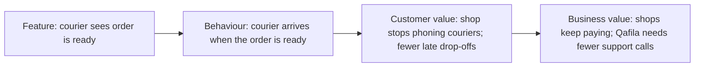

# Module 1 — Digital value and the customer

*Before anyone writes a line of code, three questions decide whether the work will be worth it: what makes this product digital, and how could it create value; who is the customer, and what evidence says they have the problem; and how will the business pay for each unit of value it delivers? This module answers them at Qafila's Launch stage, when Maha and Faisal are building the first version for 15 pilot shops and still coordinate most deliveries by hand. Each lesson leaves you with an artefact you can use in any job: a value sheet for one customer group, a problem statement with an evidence log, and a one-page unit-economics sheet.*

> **Steps:** Discover — find out who the product is for, what change it makes in their day, what evidence supports that, and whether the business can afford to deliver it.

---

# 1.1 — What makes a product digital, and how it creates value
*Level: 🟢 Beginner* · *Prerequisites: 0.1, 0.2* · *Step: Discover*

**After this you can** describe one digital product in terms of who it serves, what it changes in their day and how that change becomes value for the customer and for the business, and write a one-page value sheet for one customer group with a measure you could check. *Study time: reading about 15 min, hands-on about 80 min (estimate).*

## ⚡ In 60 seconds
- A **digital product** is used through software (an app, a website, an interface other software calls): built once, copied cheaply, changed often, run every day.
- It creates **value** only when someone does something differently because of it. Features are the means, not the value.
- Most digital products serve several groups. Qafila serves shop owners and couriers, and each needs its own reason to use it.
- The rule that matters most: **value is counted in the customer's day, not in your feature list.**
- Decision cue: ask "what will this person do differently next week, and how would we see it?"
- Biggest trap: confusing "people liked the demo" with "people changed how they work".

## 🧭 Why it matters
Qafila and everyone in it are fictional. All numbers about Qafila in this lesson are illustrative figures, not benchmarks.

It is Launch. Maha and Faisal have a first version running on one cloud provider's **managed services** (the provider runs the servers and the database for them): a merchant app where a shop logs a delivery, a courier app that shows the next pickup, and an admin web page where Maha watches everything. Fifteen pilot shops use it, for about 150 deliveries a day. Faisal deploys by hand once a week.

Faisal's plan for next month: loyalty points, a dark mode and a charts dashboard. "The pilot shops love the app," he says. "Let's give them more."

Maha has spent the afternoon in a bakery. The owner typed a phone order into Qafila, then phoned a courier anyway "to make sure he saw it". A courier arrived, found the order not ready, and left. Before they spend a month, Maha and Faisal need a shared description of what value Qafila creates, and for whom.

## 📐 How it works

### 🟢 The essentials

**What makes a product digital.** A **product** is something an organisation offers again and again to meet a group's need. It is **digital** when people use it mainly through software. Four properties set it apart from, say, a printed timetable:

| Property | Plain meaning | At Qafila |
|---|---|---|
| **Cheap to copy, not free to run** | The first version is expensive to build; serving one more user costs little, but never nothing | Adding a sixteenth shop needs no new code, but it adds messages, storage, support calls |
| **Changes all the time** | The product is never "finished"; it is updated weekly, daily or more often | Faisal ships a new version every week |
| **Produces data as it is used** | Every action leaves a record that can show what people actually do | Each delivery has a created time, a pickup time and a drop-off time |
| **Connects people and systems** | It often sits between groups, or between other software | It links shops, couriers and, later, a payment provider |

The economist Hal Varian is widely quoted as describing information as "costly to produce but cheap to reproduce", in a 1998 paper. That is why lesson 1.3 looks so carefully at the costs that *do* grow with use.

**Product, service, project.** A **product** is the thing offered (the Qafila app); a **service** is the ongoing promise that it works and someone answers when it does not (Module 7); a **project** is temporary work, such as "build the courier app". Value comes from use over time. For the manager's view, see [*Running IT as a Business*, lesson 2.1 — Digital products, services and projects: what each is and who owns it](../itbiz/index.html#/2.1).

**What value means.** **Value** is the benefit someone gets, judged by them, minus what it costs them (money, time, effort, risk). Two sides:

- **Customer value:** saving time or money, earning more, avoiding mistakes, feeling in control.
- **Business value:** what the organisation gains when customers get theirs: revenue, lower cost, lower risk, or learning.

Business value follows customer value: if shop owners gain nothing, they stop using the app.

**From feature to value.** A useful chain, read left to right:

People skip the middle box. A feature that changes nobody's behaviour creates no value.

### 🟡 Going deeper

**More than one customer.** Many digital products have two or more groups who must each find a reason to take part. Qafila has at least three:

| Group | What they want from Qafila | What would make them leave |
|---|---|---|
| **Shop owners** | Orders reach their customers on time without chasing | More work than a phone call; late or lost orders |
| **Couriers** | Steady work, short waits, clear pickup details | Waiting at shops; unclear addresses; late pay |
| **Shop customers** | Their order arrives when promised | Late deliveries; no idea where the order is |

Shop customers never open the app, yet their experience decides whether the shop stays. List everyone who feels a product's effects.

**A value proposition in one sentence.** A **value proposition** states who the product is for, what problem it solves, and why it beats what they do today:

> For **[group]** who **[situation or problem]**, **[product]** helps them **[change in their day]**, unlike **[today's alternative]**, which **[its weakness]**.

For Qafila's shop owners: "For small shops that deliver to local customers, Qafila helps them get each order to the customer on time without phoning anyone, unlike chat groups and phone calls to couriers, which need constant chasing and lose orders at busy times."

Every customer already has an alternative, even a notebook and a phone. Value is measured against it.

**The four risks of a new product.** Marty Cagan, a product management author at Silicon Valley Product Group, names four risks every new product or feature carries; his book *Inspired* (2nd edition, 2018) sets them out:

| Risk | The question | Qafila example |
|---|---|---|
| **Value** | Will people choose to use it? | Will bakeries log orders in the app rather than phoning couriers? |
| **Usability** | Can they work out how to use it? | Can a busy shop assistant log an order in under a minute? |
| **Feasibility** | Can we build and run it with what we have? | Can two people support courier tracking on old phones? |
| **Viability** | Does it work for the business: costs, law, partners, reputation? | Will each delivery earn more than it costs to coordinate? |

### 🔴 Expert view

**Value is a guess until behaviour shows it.** Every early value statement is a **hypothesis**: a guess to be tested. Praise is weak evidence; repeated behaviour is strong (lesson 1.2). Use two kinds of measure. A **leading measure** moves early and weekly (shops log every order in the app); a **lagging measure** shows the final result, later (shops still paying after three months). Watch the leading one so you can change course early. Record a **baseline** (today's figure, to compare against) before you change anything.

**Hidden manual work.** Early products often hide human effort behind the screen: Maha phones couriers when an assignment looks wrong. That is often wise; Paul Graham's essay "Do Things that Don't Scale" (July 2013) argues founders should do manual work early to learn and win first users. But write the steps down: they are part of what customers buy, they cost money, and they hide how far the software is from working alone.

**The memorable rule.** Value is counted in the customer's day, not in your feature list.

## 🧰 The toolkit
| Resource, tool or template | What it is and does | When to reach for it |
|---|---|---|
| **Value sheet** | One page per customer group: who, today's alternative, the change in their day, a measure, the evidence so far | Before planning a new product or a big feature |
| **Value proposition sentence** | "For [group] who [problem], [product] helps them [change], unlike [alternative], which [weakness]" | When people describe the product in different ways |
| **Feature-to-value chain** | Feature, behaviour change, customer value, business value, written in four boxes | When a plan lists features with no "so that" |
| **Four-risks check** | Value, usability, feasibility, viability, one line each with the open question | Before committing weeks of build time |

## 🏛️ In practice at Qafila
Maha and Faisal rewrite the plan as a value sheet for shop owners. Illustrative and fictional.

> **Qafila value sheet: shop owners (Launch, draft 1)**
>
> | Field | Entry |
> |---|---|
> | Group | Owners and staff of small shops in the pilot (15 shops: bakeries, a pharmacy, grocers) |
> | Today's alternative | Phone or chat message to a courier they know; owner chases if late |
> | Value proposition | For small shops that deliver locally, Qafila gets each order to the customer on time without anyone phoning, unlike chat and calls, which need chasing and lose orders at busy times |
> | Change in their day | Shop logs the order once and does not phone the courier |
> | Leading measure | Share of pilot orders with no shop-to-courier phone call (asked in a weekly check-in; baseline unknown) |
> | Lagging measure | Pilot shops still using Qafila after the free period ends |
> | Evidence so far | One afternoon's observation at one bakery: owner phoned the courier after logging the order, on 4 of the 6 orders seen |
> | Four risks | Value: unproven. Usability: logging takes about 2 minutes, too long at rush hour. Feasibility: fine at 150 deliveries a day. Viability: unknown, see lesson 1.3 |
> | Manual work | Maha re-checks courier assignments each morning and phones when one looks wrong (about 45 min a day) |
>
> **Decision:** drop loyalty points and dark mode for now. Next month: an "order ready" button for shops and a pickup alert for couriers, aimed at the phone call.

Faisal objected that couriers had asked for dark mode; Maha logged it as a request. She also kept "baseline unknown": an honest gap beats a made-up number.

## 🛠️ Exercises
**🟢 Describe a digital product you use.** Pick one app or website you use every week (a ride, food, banking, learning or messaging app). Write down: who it serves (all groups, not only you), what you did before it existed, what it changed in your day, and one way the company could see that change in its data.
*Done when:* you list at least two groups, name a real alternative, and describe a change in behaviour rather than a feature.

Model answer and self-check

**Model answer.** A food-ordering app serves diners, restaurants and riders. Before it, I phoned restaurants and waited without knowing when food would arrive. Now I no longer phone to ask. The company could see fewer "where is my order" contacts per order, and repeat orders.

**Self-check.**
- Did you list at least two groups, including one that is not you?
- Is your alternative something you really did before?
- Is your "change" something a person does, not something the app has?
- Could the company see the change in its own records?

**🟡 Write a value sheet for Qafila's couriers.** Using the facts in this lesson, write a one-page value sheet for couriers with the same fields as the shop-owner sheet: group, today's alternative, value proposition sentence, change in their day, leading and lagging measure, evidence so far, four risks, manual work.
*Done when:* every field is filled, any number you do not have is written as "unknown", and the value proposition sentence follows the template.

Model answer and self-check

**Model answer.** Group: couriers with pilot shops. Alternative: calls and chats from several shops; arriving early to wait. Proposition: "For couriers who take orders from several small shops, Qafila shows which order is ready and where to go next, unlike calls and chats, which leave them waiting at counters." Change: less waiting, more deliveries per shift. Leading measure: average time from order created to pickup, which Qafila's records already hold (baseline unknown). The counter wait itself is not recorded yet; it would need a courier check-in. Lagging: couriers still active after two months. Evidence: one courier seen leaving the bakery without the order. Risks: value plausible, usability unknown on old phones, feasibility fine, viability depends on courier pay. Manual work: Maha's morning check.

**Self-check.**
- Did you avoid inventing numbers that the lesson does not give?
- Is your leading measure something Qafila's own records could produce, or did you say what new record it needs?
- Does your sheet show that couriers want something different from shop owners?
- Does your proposition sentence name the alternative and its weakness?

**🔴 Turn a feature list into value chains.** Take Faisal's original plan (loyalty points, dark mode, charts dashboard) plus Maha's proposal (an "order ready" button). For each of the four, write the feature-to-value chain (feature, behaviour change, customer value, business value) and the four-risks line. Then rank them and explain the ranking in three sentences.
*Done when:* each chain names a specific behaviour change or is marked "no clear behaviour change" (at least one should be), and the ranking is justified by evidence or by the size of the risk, not by taste.

Model answer and self-check

**Model answer.**
- "Order ready" button: couriers arrive when the order is ready; shops stop phoning; fewer late drop-offs; shops stay. Risks: value plausible (bakery evidence); usability unknown at rush hour; feasibility fine; viability good if it cuts Maha's calls.
- Dashboard: no clear behaviour change. Risks: value risk high (no owner asked); usability unknown; feasibility fine; viability adds no revenue.
- Loyalty points: shop customers might order more, but Qafila does not serve them directly. Risks: value unknown; usability adds a counter step; feasibility needs new data; viability unknown.
- Dark mode: easier night use for couriers. Risks: value low for the main pain; usability gain; feasibility cheap; viability neutral.

Ranking: the button first (observed pain); dark mode second, if couriers confirm it is wanted and cheap; the rest wait for evidence of behaviour change.

**Self-check.**
- Did you rank by evidence of behaviour change, not by interest?
- Did you name which group each feature serves?
- Does every feature have all four risks, even when one is "unknown"?

## ⚠️ Mistakes and traps
- **Listing features as value.** "Has a dashboard" is not a benefit. Ask "so that who does what differently?"
- **Forgetting the alternative.** Customers compare you with what they do today, often a phone call. Write the alternative down and check you beat it.
- **Serving only the user who logs in.** Shop customers and couriers decide whether shops stay. List every group affected.
- **Trusting the demo.** Praise in a demo is not a change in behaviour. Check what people do the week after.
- **Hiding manual work.** Unwritten manual steps make the product look cheaper and more finished than it is. Write each one down with its time.

## 🧾 Recap
- A digital product is used through software, costly to build, cheap to copy but not free to run, always changing and full of usage data.
- Value is the benefit a person gets, judged by them, minus their cost to get it; business value follows customer value.
- A feature creates value only through a change in behaviour; write the full chain.
- Products serve several groups; each compares you with today's alternative.
- Check four risks (value, usability, feasibility, viability) before committing build time.
- Rule: value is counted in the customer's day, not in your feature list.

## ✍️ Check yourself
**1. Faisal says the pilot shops "love the app", so the next step is to add more features. What is the main weakness in his reasoning?**

- A. Pilot shops are too few to give any useful information about the product yet.
- B. Praise is weak evidence; he has not shown shops changed their habits.
- C. New features should wait until the free pilot ends and shops start paying.
- D. Shop owners are not the right group to judge whether a product is useful.

Answer

**B.** Praise does not show a change in behaviour; Maha's visit showed the shop still phoning couriers. A is too strong, C is a rule the lesson does not make, and D is wrong because shop owners are a key group. See "Value is a guess until behaviour shows it".

**2. A sixteenth shop joins the pilot next week. What should Maha expect to change in Qafila's costs?**

- A. Nothing, because the software is already built and copying it costs nothing.
- B. A full new build, because each shop needs its own copy of the apps made.
- C. Only the cloud bill, because shops never add any support or manual work.
- D. A small rise in messages, storage and support, but no new code to write.

Answer

**D.** Digital products are cheap to copy but not free to run. A treats "cheap to copy" as "free", B describes a custom build, and C ignores support and manual checks. See "What makes a product digital".

**3. Faisal drafts: "For couriers who serve several shops, Qafila shows which order is ready and where to go next." What does it most need to match the lesson's template?**

- A. Today's alternative and its weakness, such as calls that leave couriers waiting.
- B. A list of the courier app's screens, so couriers know exactly what they get.
- C. A target for how many couriers Qafila plans to sign up by the end of the year.
- D. A wider group, such as all delivery drivers in the region, so it sounds bigger.

Answer

**A.** The draft lacks "unlike [alternative], which [weakness]", and value is measured against the alternative. B lists features, C is a business target, and D makes the group vaguer. See "A value proposition in one sentence".

**4. Maha wonders whether each delivery will earn more than it costs to coordinate. Which of the four risks is she thinking about?**

- A. Value risk, because it is about whether shops will choose to use the app.
- B. Usability risk, because it is about how much effort each delivery takes.
- C. Viability risk, because it is about whether the business model works.
- D. Feasibility risk, because it is about what the team is able to build.

Answer

**C.** Whether the business can afford to deliver each unit is viability. A is tempting, but value risk is about whether customers choose the product. B and D are about ease of use and ability to build. See "The four risks of a new product".

**5. Maha re-checks courier assignments by hand every morning. What should Qafila do about this at Launch?**

- A. Stop doing it, because manual work means the product is not really digital yet.
- B. Keep doing it, and write down each step and the time it takes every day.
- C. Keep doing it quietly, so shops judge the software on its own merits.
- D. Automate it before the next shop joins, so the pilot runs on software alone.

Answer

**B.** Early manual work is often wise, but it must be visible: it is part of what customers receive and what it costs. A and D overreact; C hides the real cost. See "Hidden manual work".

## 📚 References
- Varian, H. R., "Markets for Information Goods", 1998 paper, University of California, Berkeley: https://people.ischool.berkeley.edu/~hal/Papers/japan/japan.html
- Cagan, M., "Product Risk Taxonomy", Silicon Valley Product Group, 10 July 2023: https://www.svpg.com/product-risk-taxonomies/
- Cagan, M., *Inspired: How to Create Tech Products Customers Love*, 2nd edition (Wiley, 2018).
- Graham, P., "Do Things that Don't Scale", July 2013: https://paulgraham.com/ds.html
- Library course: [*Running IT as a Business*, lesson 2.1 — Digital products, services and projects: what each is and who owns it](../itbiz/index.html#/2.1).
- Library course: [*Running IT as a Business*, lesson 1.1 — From projects to value: outcomes, value streams and flow](../itbiz/index.html#/1.1) (outcomes and value from a manager's view).

---

# 1.2 — Understanding customers: problems, jobs and evidence
*Level: 🟢 Beginner* · *Prerequisites: 1.1* · *Step: Discover*

**After this you can** write a problem statement for one customer group, run a short interview about past behaviour rather than opinions, and keep an evidence log that grades each finding. *Study time: reading about 15 min, hands-on about 110 min (estimate).*

## ⚡ In 60 seconds
- A **problem statement** names who has the problem, in what situation, what it costs them, and how they cope today. It says nothing about the solution.
- A **job to be done** is the progress a person is trying to make in a situation ("get this order to my customer before it goes cold"), not the product they use to make it.
- Good customer conversations ask about **specific things that already happened**, not opinions or predictions. Do not pitch while you listen.
- Evidence comes in grades: opinions are weakest, past behaviour is stronger, a commitment (time, money, data) is stronger still.
- The rule that matters most: **believe what people did, not what they say they will do.**
- Biggest trap: asking "would you use an app that…?" Almost everyone says yes.

## 🧭 Why it matters
Qafila and everyone in it are fictional. All numbers about Qafila in this lesson are illustrative figures, not benchmarks.

Maha and Faisal agree the shop-to-courier phone call is the pain to attack. Faisal sends the 15 pilot shops a survey: "Would you use an 'order ready' button if we built one?" Fourteen reply; thirteen say yes.

Maha is uneasy. The same shops said yes to the original app and still phone couriers, and the question signals the answer Qafila hopes for. A pharmacy owner told her, "Of course I'd use it." He has logged three orders in two weeks.

The survey gave confidence, not evidence. They need to see what happens in a shop at rush hour.

## 📐 How it works

### 🟢 The essentials

**Problem first, then solution.** A common reason new products fail is that they solve something nobody needed badly enough to change habits. So describe the problem first, in a **problem statement** with five parts:

1. **Who:** a specific group ("counter staff of small bakeries in the pilot"), not "businesses".
2. **Situation:** when it happens ("during the lunch rush").
3. **The problem:** what goes wrong, in their words if possible.
4. **What it costs them:** time, money, mistakes, stress, lost customers.
5. **How they cope today:** phone calls, a notebook, a relative who drives.

| Weak | Strong |
|---|---|
| "Shops need better delivery software." | "Counter staff at small bakeries, during the lunch rush, do not know whether a courier has seen an order, so they phone the courier for most orders. Each call takes a minute or two at the busiest time, and orders go cold when the courier arrives late." |

The strong version can be checked by watching a lunch rush, and leaves room for solutions other than an app.

**Jobs to be done.** A **job to be done** is the progress a person is trying to make in a particular situation. The idea is widely credited to Clayton Christensen, who is reported to have popularised it in *The Innovator's Solution* (2003, with Michael Raynor) and who restated it with co-authors in "Know Your Customers' Jobs to Be Done" (*Harvard Business Review*, September 2016); others, notably Anthony Ulwick, developed related methods. People "hire" a product to make progress, and "fire" it when something else does the job better.

A bakery owner with a phone order and a queue does not want "delivery-coordination software"; the job is "get this order to the customer warm and on time, without leaving the counter". Qafila, a nephew with a motorbike or a courier the owner knows can all do that job: they are all competitors.

A job statement has three parts: **when** (the situation), **I want to** (the progress), **so I can** (the deeper reason).

> When a phone order comes in during the rush, I want it picked up as soon as it is ready, so I can keep serving the queue and the customer gets warm bread.

**Talking to customers.** Rob Fitzpatrick's book *The Mom Test* (2013) is a widely used guide; its three rules are usually summarised as:

- Talk about their life, not your idea.
- Ask about specifics in the past, not opinions or the future.
- Talk less and listen more.

| Bad question (invites opinion or politeness) | Better question (asks about what happened) |
|---|---|
| "Would you use an 'order ready' button?" | "Tell me about the last delivery that went wrong. What happened?" |
| "Is coordinating couriers a big problem for you?" | "How many times did you phone a courier yesterday? Why each time?" |

### 🟡 Going deeper

**Grades of evidence.** From weakest to strongest:

| Grade | What it is | Qafila example | How much to trust it |
|---|---|---|---|
| 1. **Opinion or prediction** | What people say they think or would do | "I'd definitely use it" | Low: people are polite and bad at predicting themselves |
| 2. **Story about the past** | A specific account of what happened | "Yesterday I called the courier four times for one order" | Medium: real, but memory blurs |
| 3. **Observed behaviour** | What you saw them do, or what records show | Three orders logged in two weeks; four calls watched in an afternoon | High for what was observed; check it is typical |
| 4. **Commitment** | They give up something: time, money, data, reputation | Shop agrees to a paid trial, or introduces two other shops | Highest: costly signals are rarely given out of politeness |

Faisal's survey is grade 1; Maha's bakery afternoon is grade 3.

**Running an interview.** A practical shape for 20–30 minutes:

1. **Set up.** Who you are, why you ask, how long it takes; ask permission to take notes.
2. **Context.** Their role and a typical day.
3. **The last time.** "Walk me through the last order you delivered." Then "what happened next?" and "why?".
4. **Workarounds and costs.** What they do today, what it costs, what they tried.
5. **Close.** "Who else should I talk to?" and, if fitting, a small commitment ("Could I watch one lunch rush?").

Write notes the same day in three columns: **said**, **did or showed you**, **what you think it means**.

**Observation and numbers.** Watching people work (shadowing) finds habits they do not mention: the bakery owner never spoke of the calls; she just made them. Stop talking to people when new conversations repeat what you heard, and cover different kinds (bakery and pharmacy, owner and staff).

**Assumptions.** An **assumption** is something treated as true without enough evidence. Write each so it could be shown wrong, mark its importance and evidence, and test the important, weakly supported ones first (lesson 2.1).

### 🔴 Expert view

**Bias in your own head.** **Confirmation bias** is noticing what supports what you already believe. Write your prediction down first and look for evidence that would prove you wrong. Pilot shops chose to join and are probably keener than average.

**Research ethics and personal data.** Ask for consent, say what you keep and for how long, store notes safely, and drop names you do not need. Recording may need explicit permission, and data-protection rules in many countries cover notes about identifiable people.

**AI tools, carefully.** An assistant can draft a guide or cluster notes, but not replace customers; pasting personal notes into it is a data-protection question.

**The memorable rule.** Believe what people did, not what they say they will do.

## 🧰 The toolkit
| Resource, tool or template | What it is and does | When to reach for it |
|---|---|---|
| **Problem statement** | Who, situation, problem, cost to them, how they cope today; no solution | Before discussing any feature or product |
| **Job statement** | "When [situation], I want to [progress], so I can [deeper reason]" | To see the real competition, including non-software ones |
| **Interview guide** | Five parts: set up, context, the last time, workarounds and costs, close | Before each customer conversation |
| **Evidence log** | One row per finding: source, date, grade (opinion, story, observed, commitment), what it supports | After every conversation, observation or data pull |

## 🏛️ In practice at Qafila
Maha and Faisal agree on four interviews and two observations before building anything. Illustrative and fictional.

> **Problem statement (shops, draft 1).** Counter staff at small food shops, during the rush, cannot tell whether a courier has seen an order, so they phone for most orders.
>
> **Problem statement (shops, draft 2, after the evidence below).** Counter staff at small food shops in the pilot, during the lunch and evening rush, cannot tell couriers when an order will be ready, so couriers arrive early and wait or arrive late, and staff phone them for most orders. Each call interrupts service at the busiest time, and orders go cold. Today they cope with calls, chat messages and couriers they know.
>
> **Job statement.** When a phone order comes in during the rush, I want it collected as soon as it is ready, so I can keep serving the queue and my customer gets the food warm.
>
> **Evidence log (extract)**
>
> | # | Finding | Source and date | Grade | Supports or weakens |
> |---|---|---|---|---|
> | 1 | 13 of 14 shops "would use" an order-ready button | Survey, week 6 | Opinion | Weakly supports |
> | 2 | Owner phoned courier after logging the order on 4 of 6 orders | Maha, bakery observation, week 5 | Observed | Supports: problem is real at this shop |
> | 3 | Pharmacy logged 3 orders in 2 weeks; owner says most deliveries are prescriptions he takes himself | App records + interview, week 7 | Observed + story | Pharmacy's job differs: privacy, not speed |
> | 4 | Grocer's counter assistant: "I call because the courier never knows when it's ready" | Interview, week 7 | Story | Problem is "ready" timing, not "courier saw it" |
> | 5 | Second bakery agreed to let Faisal watch two lunch rushes | Interview close, week 7 | Commitment | Supports: shops willing to invest time |
>
> **What changed.** Finding 4 moved the problem from "has the courier seen it?" (draft 1) to "does the courier know when it will be ready?" (draft 2). Finding 3 suggests pharmacies have a different job; they are set aside, not forced into the bakery solution.

Faisal argued the survey had "more data". Maha pointed to the grade column: fourteen opinions are still opinions.

## 🛠️ Exercises
**🟢 Fix the questions.** Rewrite each of these interview questions so it asks about specific past behaviour, not opinion or prediction: (a) "Would you use an app to track your deliveries?" (b) "Is waiting for couriers annoying?" (c) "How much would you pay for faster pickups?" (d) "What features should we add?"
*Done when:* every rewritten question asks about something that already happened, and none of them mentions your product or idea.

Model answer and self-check

**Model answer.** (a) "Tell me about your last delivery. How did you know where it was?" (b) "Yesterday, how long did couriers wait at your counter?" (c) "What did you spend on deliveries last month, and how did you choose that arrangement?" (d) "When did you last get stuck with a delivery? What did you do?"

**Self-check.**
- Does each question point to a specific past moment ("yesterday", "the last time", "last month")?
- Have you removed every mention of your product, app or idea?
- Would a polite person find it hard to give a flattering but empty answer?

**🟡 Interview someone about a real problem.** Choose a small, everyday problem in someone else's life (how a friend or relative plans meals, gets to work or shares chores). With their permission, run a 20-minute conversation using the five-part guide. Then write a problem statement and a job statement from your notes.
*Done when:* your notes separate "said", "did or showed" and "my interpretation"; the problem statement has all five parts; and the job statement follows "when… I want to… so I can…".

Model answer and self-check

**Model answer.** Topic: a relative's weekly groceries. Said: "I always forget something." Showed: a list on an envelope stuck to the fridge; three extra shop trips last week. Interpretation: the problem is remembering during the week. Problem statement: "A working parent of three notices missing items only while cooking on weekdays, so makes two or three extra 30-minute trips. She copes with a list on an envelope stuck to the fridge, which nobody else updates." Job: "When I notice we are out of something, I want it captured where the whole family sees it, so I can do one shop a week."

**Self-check.**
- Are "said", "showed" and your interpretation in separate columns?
- Does the problem statement name who, situation, problem, cost and today's workaround?
- Does the job statement follow "when… I want to… so I can…"?
- Are both statements free of any solution?
- Did you ask about a specific past event, not a general habit?

**🔴 Grade the evidence and choose what to learn next.** Using Qafila's evidence log, add two rows: one finding that would *weaken* the case for the "order ready" button, and one commitment-grade finding you would want before Faisal builds it. Then write three assumptions behind the button, mark each for importance (high, medium, low) and evidence (strong, some, none), and say which one you would test first and how.
*Done when:* each new row has a source, a grade and what it supports or weakens; the assumptions can each be shown false; and your first test aims at the assumption that is most important with the least evidence.

Model answer and self-check

**Model answer.**

| # | Finding | Source and date | Grade | Supports or weakens |
|---|---|---|---|---|
| 6 | Grocer's couriers wait inside and chat; the owner does not mind | Faisal, grocer observation, week 8 | Observed | Weakens "waiting is costly" for grocers |
| 7 | Three shops press "ready" on every order for a week and share their call logs | Planned, week 9 | Commitment | Would support: shops will change habits |

Assumptions: (1) counter staff will remember to press "ready" in the rush (high importance, no evidence); (2) couriers will check the app instead of waiting for a call (high, some); (3) knowing when an order is ready cuts calls a lot (high, some). Test 1 first, on paper: two bakeries send a message whenever an order is ready during one lunch rush; count how often they do.

**Self-check.**
- Does each new row have a source and date, a grade and what it supports or weakens?
- Is your first test cheap, fast and done before any code?
- Did you include evidence that could prove Qafila wrong?

## ⚠️ Mistakes and traps
- **Pitching instead of listening.** Once you describe your idea, people react to it politely. Keep it out until the end, if at all.
- **Counting opinions as data.** A hundred "yes" answers to "would you use it?" are still opinions. Grade every finding.
- **Talking only to keen pilot shops.** Shops that joined are friendlier than most. Also talk to shops that said no, and ask why.
- **Asking leading questions in surveys.** "Would you use our button?" signals the answer you hope for. Ask what they did last week.
- **Collecting personal data carelessly.** Ask consent, keep only what you need, and check the local rules.

## 🧾 Recap
- A problem statement names who, the situation, the problem, its cost and today's workaround, with no solution.
- A job to be done is the progress a person wants in a situation; anything that delivers that progress is a competitor.
- Ask about specific past events, do not pitch, and listen more than you talk.
- Grade evidence: opinion, story, observed behaviour, commitment; test important, weakly supported assumptions first.
- Rule: believe what people did, not what they say they will do.

## ✍️ Check yourself
**1. Faisal's survey found 13 of 14 pilot shops "would use" an order-ready button. How should it be recorded in the evidence log?**

- A. As observed behaviour, because the answers came directly from the shops themselves.
- B. As a commitment, because the shops took time out of their day to answer the survey.
- C. As an opinion or prediction, because "would use" is a guess about their future.
- D. As proof the problem is solved, since nearly all shops in the pilot answered yes.

Answer

**C.** "Would use" is a prediction, the lowest grade, however many say it. A confuses an answer with behaviour, B overstates a small effort, and D treats intentions as results. See "Grades of evidence".

**2. Which question is most likely to produce reliable evidence in an interview with a bakery owner?**

- A. "Walk me through the last order that arrived late. What happened, step by step?"
- B. "If we built a button to tell couriers an order is ready, how often would you use it?"
- C. "On a scale of one to ten, how frustrating is it to coordinate couriers in general?"
- D. "What features would make our app the best delivery tool for your bakery?"

Answer

**A.** It asks about a specific past event without mentioning the product. B asks for a prediction, C for a general opinion, and D asks the customer to design the product. See "Talking to customers".

**3. Maha writes this job statement for shops: "When an order comes in, I want to press Qafila's ready button, so couriers know to come." What is wrong with it?**

- A. It should start with the shop's name, so the team knows exactly who said it.
- B. It is too short, because a job statement should list every step of the order.
- C. It should describe the courier's situation, because couriers make the trip.
- D. It names a solution (Qafila's button) instead of the progress the shop wants.

Answer

**D.** A job statement describes progress, with no product in it; "press Qafila's ready button" is a solution. "I want it collected as soon as it is ready, so I can keep serving" would work. A, B and C miss the real flaw. See "Jobs to be done".

**4. The pharmacy logged only three orders in two weeks; the owner says he delivers most prescriptions himself. What is the best conclusion for now?**

- A. The pharmacy is a poor fit and should leave the pilot before it skews the data.
- B. The pharmacy seems to have a different job, such as privacy, worth exploring separately.
- C. The pharmacy needs a better tutorial, since low use points to a usability problem.
- D. The pharmacy has the bakeries' problem and needs more reminders to log orders.

Answer

**B.** His behaviour and story point to a different job. A throws away a learning; C and D assume a cause the evidence does not support. See "In practice at Qafila".

**5. Maha wants to record interviews on her phone to save time writing notes. What should she do first?**

- A. Ask each person's permission, say what she keeps and why, and check local rules.
- B. Record without asking, since the interviews are informal chats with friendly shops.
- C. Skip notes and recordings altogether, since keeping research data creates risk.
- D. Record everything and paste the transcripts into an AI tool to summarise later.

Answer

**A.** Consent, a clear purpose and a check of local rules come first. B ignores consent, C is wrong because notes can be kept properly, and D adds a new data-protection question. See "Research ethics and personal data".

## 📚 References
- Christensen, C. M. and Raynor, M. E., *The Innovator's Solution: Creating and Sustaining Successful Growth* (Harvard Business School Press, 2003).
- Christensen, C. M., Hall, T., Dillon, K. and Duncan, D. S., "Know Your Customers' 'Jobs to Be Done'", *Harvard Business Review*, September 2016: https://hbr.org/2016/09/know-your-customers-jobs-to-be-done
- Ulwick, A. W., *What Customers Want: Using Outcome-Driven Innovation to Create Breakthrough Products and Services* (McGraw-Hill, 2005).
- Fitzpatrick, R., *The Mom Test: How to talk to customers and learn if your business is a good idea when everyone is lying to you* (self-published, 2013): https://www.momtestbook.com/
- Library course: [*Founder's Playbook for AI-First Builders*, lesson 1.2 — Customer interviews that find the truth](../founder/index.html#/1.2).
- Library course: [*Founder's Playbook for AI-First Builders*, lesson 1.3 — AI-assisted research without fooling yourself](../founder/index.html#/1.3).
- Library course: [*AI Product Management*, lesson 2.1 — Discovery for AI: jobs, workflows and where AI fits](../aipm/index.html#/2.1).

---

# 1.3 — Business models, costs and the unit of value
*Level: 🟢 Beginner* · *Prerequisites: 1.1, 1.2* · *Step: Discover*

**After this you can** describe a digital product's business model in plain words, choose the unit of value it is paid for, and build a one-page sheet that compares the revenue and the cost to serve for one unit, separating fixed from variable costs and showing the manual work. *Study time: reading about 15 min, hands-on about 90 min (estimate).*

## ⚡ In 60 seconds
- A **business model** answers four questions: who pays, for what, how the product reaches them, and what it costs to deliver.
- The **unit of value** is the one thing the customer gets and the business is paid for: a delivery, a user per month, a document processed. Pick one and measure everything against it.
- **Fixed costs** stay the same whether you serve 10 units or 1,000. **Variable costs** grow with each unit. **Cost to serve** is the variable cost of one unit, including people's time.
- **Contribution** is revenue per unit minus variable cost per unit. If it is negative, growth makes things worse.
- The rule that matters most: **know what one unit earns and what it costs before you try to sell more of them.**
- Biggest trap: forgetting the human time behind each unit, often the biggest variable cost at the start.

## 🧭 Why it matters
Qafila and everyone in it are fictional. All numbers about Qafila in this lesson are illustrative figures, not benchmarks, and the money figures are in an illustrative currency unit ("units").

The pilot is free for its 15 shops. In three months it ends, and Maha must tell shops what Qafila will cost. Faisal suggests a flat monthly fee "like every software company". A grocer friend would rather pay per delivery: "some weeks I send ten, some weeks a hundred".

Maha looks at her week: about 45 minutes every morning checking courier assignments, most afternoons answering shop calls (Salma, who joined to look after shops and couriers, now takes some), and messages and a map lookup for every delivery. None of that shows when Faisal says "software costs almost nothing to run". Before choosing a price, they need to know what one unit costs, and which costs grow as shops go from 15 towards 300.

## 📐 How it works

### 🟢 The essentials

**What a business model is.** A **business model** describes how an organisation creates value for customers and gets paid enough to keep doing it. Four questions cover it:

| Question | Qafila at Launch |
|---|---|
| **Who pays?** | Shops (not couriers, not shop customers, at least for now) |
| **For what?** | Getting local orders to customers on time without chasing |
| **How does it reach them?** | Maha visits shops in person; the merchant and courier apps; the admin web page |
| **What does it cost to deliver?** | Cloud services, messages, maps, the team's time, courier coordination |

A widely used one-page template is the **Business Model Canvas**, created by Alexander Osterwalder (co-author, with Yves Pigneur, of *Business Model Generation*) and published by Strategyzer: nine building blocks from customer segments to cost structure. Strategyzer says the canvas was released under a Creative Commons licence and asks anyone using it to credit the source. Useful in workshops; not required.

**Common ways digital products charge.** Patterns, not rules; many products mix them:

| Pattern | How it works | Fits when |
|---|---|---|
| **Subscription** | A fixed fee per month or year, per account or user | Use is steady and predictable |
| **Per transaction** | A fee for each unit (each delivery, each payment) | Use varies a lot; value is felt per unit |
| **Commission** | A percentage of the value passing through | The product sits in the middle of a sale |
| **Freemium or tiers** | A free or small tier, and bigger paid bundles | Customers differ a lot in size or needs |

**The unit of value.** The **unit of value** is the thing the customer receives and the business is paid for, counted one at a time. A good choice matches price to what customers value and gives the team one number to watch. Qafila's candidates:

- **A shop per month.** Simple to bill, but a busy bakery and a quiet pharmacy pay the same.
- **A delivery coordinated.** Matches what shops value ("this order got there"), and most costs grow per delivery too.
- **A percentage of order value.** Ties Qafila to shop sales, but cheap and expensive orders cost the same to coordinate.

Maha and Faisal measure against **a delivery coordinated**, whatever the final pricing.

**Fixed and variable costs.** A **fixed cost** does not change with the number of units in the short term: base cloud setup, salaries. A **variable cost** grows with each unit: messages, map lookups, payment fees later, support time. Many fixed-looking costs have a variable part: a managed database has a base price, but storage grows with use.

### 🟡 Going deeper

**Cost to serve one unit.** The **cost to serve** is what it takes to deliver one more unit, beyond fixed costs. List each line with an amount per unit and its source. People's time is costed at an **internal rate**: what the team counts one hour of someone's time as costing, even if nobody is paid yet. Qafila's first attempt (illustrative, in units):

| Cost line, per delivery | Amount | Basis |
|---|---|---|
| Text messages to courier and shop customer | 0.10 | Last month's provider invoice divided by deliveries |
| Map and route lookups | 0.05 | Provider dashboard divided by deliveries |
| Cloud usage that grows with deliveries | 0.05 | Cloud bill above the base setup, divided by deliveries |
| Manual checks and shop calls (Maha, with Salma taking some calls) | 0.60 | About 3 hours a day at an internal rate, over about 150 deliveries |
| **Total cost to serve** | **0.80** | |

The human time is three times all the software lines together. That is normal at Launch, and it shows where software pays off: anything that cuts the calls lowers the cost of every delivery.

**Contribution.** **Contribution per unit** is revenue per unit minus cost to serve: what each unit contributes towards fixed costs and, eventually, profit. At a price of 1.00 and a cost of 0.80, each delivery contributes 0.20; at about 150 deliveries a day that is around 900 in a 30-day month. If fixed costs are higher (they will be), volume must grow, cost to serve must fall, or the price must rise. If contribution is **negative**, selling more loses money faster: the most important thing the sheet can show.

A flat price hides this per customer: a busy shop on a fixed fee can cost more to serve than it pays.

**What changes with scale.** Some costs per unit fall with volume (better message prices); others rise (support for more varied shops; payment disputes). Write down which lines you expect to move, and why. At Traction the fact sheet has about 4,000 deliveries a day. If the manual checks grew in step (3 hours per 150 deliveries), they would take about 80 hours a day: roughly ten full-time people (illustrative).

### 🔴 Expert view

**Price is not cost plus a margin.** A **margin** is the share of the price left after costs, and "cost plus a margin" ignores the customer. Cost to serve is the floor below which each sale loses money; what customers will pay depends on the value they get and their alternatives: a courier the owner already knows sets a low ceiling. See [*Founder's Playbook for AI-First Builders*, lesson 3.2 — Pricing: choose, test and change a price](../founder/index.html#/3.2).

**Hidden costs that are easy to miss.**

- **People time per unit:** support calls, manual checks, onboarding visits.
- **AI features:** each AI model call often has a cost per use.
- **Payment fees:** from Traction, payments go through a payment provider and each carries a fee; never assume today's price will hold.
- **Failed units:** a failed delivery costs a re-trip, a refund or a call; include the average cost of failures.
- **Obligations:** data protection, consumer protection and tax rules may add work per customer; check the local rules.

**Measure from records, not memory.** Each line should point to an invoice, a dashboard, a time log or a count of calls. Label estimates and replace them when records arrive.

**The memorable rule.** Know what one unit earns and what it costs before you try to sell more of them.

## 🧰 The toolkit
| Resource, tool or template | What it is and does | When to reach for it |
|---|---|---|
| **Business model in four questions** | Who pays, for what, how it reaches them, what it costs to deliver | When starting a product, or when people describe it differently |
| **Business Model Canvas** | A one-page, nine-box template created by Alexander Osterwalder, published by Strategyzer | In workshops where a shared visual helps; not required |
| **Unit-economics sheet** | Revenue per unit, each variable cost with source and confidence, contribution | Before pricing, and monthly after |

## 🏛️ In practice at Qafila
Maha builds a one-page sheet for the end of the pilot. Illustrative and fictional.

> **Qafila unit-economics sheet (Launch, month 3, draft)**
>
> **Unit of value:** one delivery coordinated, from order logged to drop-off confirmed.
>
> | Line | Per delivery (units) | Source | Confidence |
> |---|---|---|---|
> | Revenue (proposed price) | 1.00 | Proposal; to be tested with 3 shops | Low |
> | Messages | 0.10 | Provider invoice, month 2 | High |
> | Maps | 0.05 | Provider dashboard, month 2 | High |
> | Cloud usage above base | 0.05 | Cloud bill, month 2 | Medium |
> | Manual checks and calls | 0.60 | Maha's and Salma's time log, 2 weeks | Medium |
> | Failed deliveries (re-trips, goodwill) | 0.05 | About 1 in 50 deliveries, from admin notes | Low |
> | **Cost to serve** | **0.85** | | |
> | **Contribution** | **0.15** | | |
>
> **Fixed costs per month (outside this sheet):** base cloud setup, domain and tools, two founders' pay (not yet drawn).
>
> **What would change the picture:** the "order ready" button, if it cuts shop calls; a monthly minimum for busy shops; price tests with three shops.

Faisal objected to counting the team's time: "we're not paying ourselves yet." Maha kept it: someone will be paid for that work at 300 shops.

## 🛠️ Exercises
**🟢 Describe a business model in four questions.** Pick a digital product you use (a music, ride or learning app, or free email). Answer the four questions: who pays, for what, how it reaches them, what it costs to deliver. Then name its unit of value.
*Done when:* you name who pays (which may not be the user), the unit of value is one countable thing, and you list at least two costs that grow with use.

Model answer and self-check

**Model answer.** A music streaming service. Who pays: subscribers, and advertisers for free listeners. For what: any song on demand. How it reaches them: app stores, phones, speakers. Costs that grow with use: payments to rights holders (the labels and songwriters who own the music) per stream, network bandwidth (the data sent to play each song), support. Unit: one paying subscriber per month (revenue), or one stream (costs).

**Self-check.**
- Did you notice when the user and the payer are different people?
- Is your unit countable, so you could put a number against it?
- Did you list at least two costs that grow with use, not only fixed ones?

**🟡 Build a cost-to-serve sheet.** For Qafila at Traction, use the fact sheet figure of about 4,000 deliveries a day. Assume message, map and cloud costs per delivery stay as in Maha's sheet, and that manual work falls to 0.20 per delivery because the "order ready" button worked and a part-time coordinator was hired (illustrative). Recalculate the cost to serve and the contribution at a price of 1.00, and work out the monthly contribution for a 30-day month.
*Done when:* every line is shown with its per-delivery figure, you show your arithmetic, and you state one assumption that could make the result wrong.

Model answer and self-check

**Model answer.** 0.10 + 0.05 + 0.05 + 0.20 + 0.05 (failures) = 0.45 cost to serve. Contribution = 1.00 − 0.45 = 0.55. Monthly: 0.55 × 4,000 × 30 = 66,000 units (illustrative). Weak assumption: payment fees are missing, though at Traction payments go through a provider; failures may not stay at 1 in 50.

**Self-check.**
- Did you keep every line from the original sheet and change only what the task said?
- Did you show the arithmetic for cost to serve, contribution and the monthly total?
- Did you spot that a new variable cost (payment fees) arrives at Traction?

**🔴 Compare three pricing options.** For a set of five illustrative shops sending 5, 10, 10, 20 and 60 deliveries a day, compare (a) a subscription of 300 units per shop per month, (b) 1.00 per delivery, and (c) a tiered plan you design. For each option, calculate monthly revenue from the five shops and the contribution after a cost to serve of 0.85 per delivery. Then say which option you would test first and what customer evidence (lesson 1.2) you would need.
*Done when:* all three options have revenue and contribution figures, you identify any shop that loses Qafila money under an option, and your recommendation names a test, not just a preference.

Model answer and self-check

**Model answer.** Deliveries per month (30 days): 150, 300, 300, 600, 1,800; total 3,150. Cost to serve: 3,150 × 0.85 = 2,677.50.

- (a) Subscription: 5 × 300 = 1,500 revenue; contribution = 1,500 − 2,677.50 = −1,177.50. The 600- and 1,800-delivery shops each cost more than they pay (510 and 1,530 against 300).
- (b) Per delivery: 3,150 revenue; contribution 472.50; every shop contributes 0.15 per delivery.
- (c) Tiered: up to 200 deliveries a month for 180; 201 to 600 for 540; above 600, 0.95 for every delivery that month. Revenue 180 + 540 + 540 + 540 + 1,710 = 3,510; contribution 832.50. Weakness: a cliff. A shop at 201 deliveries pays three times one at 200; smoother steps would be fairer.

Test per delivery first, with three shops of different sizes: it is simplest to explain, matches the unit of value, and no shop loses Qafila money. Test a smoothed tier next. Watch whether shops stop logging deliveries to save money, and find out what they spend on deliveries today.

**Self-check.**
- Did you find that a flat subscription loses money on the busiest shop?
- Did you check your tier design for cliffs?
- Does your recommendation give a reason and a way to learn from real behaviour, not just a calculation?

## ⚠️ Mistakes and traps
- **"Software is free to run."** Messages, maps, cloud usage and above all people's time grow with every unit. List them.
- **Pricing from cost alone.** Cost sets the floor; value and alternatives set what people will pay. Test with real shops.
- **One flat price for very different customers.** The busiest customer can quietly lose you money. Check contribution for your largest customers.
- **Unlabelled guesses.** Mark each line with its source and confidence, and replace estimates with records as soon as you can.

## 🧾 Recap
- A business model answers: who pays, for what, how it reaches them, what it costs to deliver.
- Choose one unit of value that matches what the customer values and what drives your costs.
- Separate fixed costs from variable ones; cost to serve is the variable cost of one unit, people's time included.
- Contribution per unit is revenue minus cost to serve; if it is negative, growth makes things worse.
- Price sits between the cost floor and the value ceiling; test it with real customers.
- Rule: know what one unit earns and what it costs before you try to sell more of them.

## ✍️ Check yourself
**1. Faisal says "our software costs almost nothing to run, so any price is profit". What does Maha's sheet show?**

- A. He is right, because message, map and cloud costs per delivery are all very small.
- B. He is wrong only about cloud costs, which turn out to be the largest single cost line.
- C. He is right for now, because unpaid founder time does not count as a real cost.
- D. He is wrong, because human time per delivery is far larger than the software costs.

Answer

**D.** Manual checks and calls cost more than all software lines together. A looks only at software lines, B misreads the sheet, and C ignores that the work will need paid people later. See "Cost to serve one unit".

**2. Which is the best unit of value for Qafila to measure its economics against?**

- A. One shop per month, because subscriptions are what most software companies use.
- B. One delivery coordinated, because shops value it and most costs grow with it.
- C. One app download, because downloads show how many people tried the product.
- D. One percentage point of shop sales, because it links Qafila to shop revenue.

Answer

**B.** A delivery is what shops value and what drives most variable costs. A is a billing choice; C measures interest, not value; and D ties Qafila to order value, though cheap and expensive orders cost the same to coordinate. See "The unit of value".

**3. With a price of 1.00 and a cost to serve of 0.85 per delivery, what happens if Qafila doubles its deliveries and nothing else changes?**

- A. Total contribution falls, because extra deliveries add more cost than revenue.
- B. Total contribution stays the same, because fixed costs absorb the extra volume.
- C. Total contribution doubles; covering fixed costs is a separate question.
- D. Total contribution cannot be known without a full Business Model Canvas.

Answer

**C.** Contribution per unit is positive (0.15), so doubling units doubles total contribution. A describes negative contribution, B confuses contribution with fixed costs, and D treats a template as needed for arithmetic. See "Contribution".

**4. Under a flat subscription of 300 units a month, a shop sends 1,800 deliveries a month at a cost to serve of 0.85 each. What should Maha conclude?**

- A. This shop costs Qafila more than it pays, so the pricing needs a usage element too.
- B. This shop is the most valuable, because it uses the product the most often.
- C. This shop's costs are covered by the quieter shops, so nothing needs to change.
- D. This shop should be asked to leave the pilot, since it is not profitable.

Answer

**A.** Its cost to serve (1,800 × 0.85 = 1,530) is far above its fee (300), which argues for a tier or a per-delivery element. B confuses use with value to the business, C hides a growing loss, and D drops a customer when the price is the problem. See "Contribution" and "Price is not cost plus a margin".

**5. Bilal (a future finance lead) later asks why "failed deliveries" is a line on the cost-to-serve sheet. What is the best answer?**

- A. It records refunds for tax purposes, which the sheet must show by law.
- B. It is a fixed cost of the courier app, so it belongs on every sheet we make.
- C. It is a placeholder that can be removed once the pilot is finally over.
- D. It covers re-trips, refunds and calls, so their average cost belongs here.

Answer

**D.** The average cost of failures is part of each delivery's cost to serve. A states a legal conclusion, B confuses a variable cost with a fixed one, and C assumes failures stop after the pilot. See "Hidden costs that are easy to miss".

## 📚 References
- Strategyzer, "What is a business model?": https://www.strategyzer.com/library/what-is-a-business-model — the nine building blocks of the Business Model Canvas.
- Strategyzer, "Usage of our tools": https://www.strategyzer.com/legal/usage-of-our-tools — the licence terms for the Business Model Canvas.
- Osterwalder, A. and Pigneur, Y., *Business Model Generation* (Wiley, 2010).
- Library course: [*Founder's Playbook for AI-First Builders*, lesson 3.1 — Unit economics in plain words, including AI and model costs](../founder/index.html#/3.1).
- Library course: [*Founder's Playbook for AI-First Builders*, lesson 3.2 — Pricing: choose, test and change a price](../founder/index.html#/3.2).
- Library course: [*AI Product Management*, lesson 8.2 — Unit economics: cost to serve, pricing models and margins](../aipm/index.html#/8.2).
