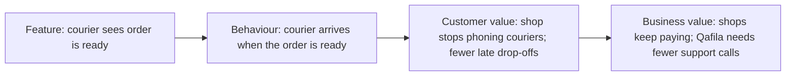

# Module 1 — Digital value and the customer

*Before anyone writes a line of code, three questions decide whether the work will be worth it: what makes this product digital, and how could it create value; who is the customer, and what evidence says they have the problem; and how will the business pay for each unit of value it delivers? This module answers them at Qafila's Launch stage, when Maha and Faisal are building the first version for 15 pilot shops and still coordinate most deliveries by hand. Each lesson leaves you with an artefact you can use in any job: a value sheet for one customer group, a problem statement with an evidence log, and a one-page unit-economics sheet.*

> **Steps:** Discover — find out who the product is for, what change it makes in their day, what evidence supports that, and whether the business can afford to deliver it.

---

# 1.1 — What makes a product digital, and how it creates value
*Level: 🟢 Beginner* · *Prerequisites: 0.1, 0.2* · *Step: Discover*

**After this you can** describe one digital product in terms of who it serves, what it changes in their day and how that change becomes value for the customer and for the business, and write a one-page value sheet for one customer group with a measure you could check. *Study time: reading about 20 min, hands-on about 80 min (estimate).*

## ⚡ In 60 seconds
- A **digital product** is something people use through software: an app, a website, an interface other software calls. It is built once, copied cheaply, changed often and run every day.
- A product creates **value** only when someone does something differently because of it: saves time, avoids a mistake, earns more, worries less. Features are the means, not the value.
- Most digital products serve more than one group. Qafila serves shop owners and couriers, and each group needs its own reason to use the app.
- The rule that matters most: **value is counted in the customer's day, not in your feature list.**
- Decision cue: before building anything, ask "what will this person do differently next week, and how would we see it?"
- Biggest trap: confusing "people liked the demo" with "people changed how they work".

## 🧭 Why it matters
Qafila and everyone in it are fictional. All numbers about Qafila in this lesson are illustrative figures, not benchmarks.

It is Launch. Maha and Faisal have a first version running on one cloud provider's managed services: a merchant app where a shop logs a delivery, a courier app that shows the next pickup, and an admin web page where Maha watches everything. Fifteen pilot shops use it, for about 150 deliveries a day. Faisal deploys by hand once a week.

Faisal's plan for next month: a loyalty-points screen, a dark mode and a charts dashboard for shop owners. "The pilot shops love the app," he says. "Let's give them more."

Maha has spent the afternoon in a bakery. The owner typed a phone order into Qafila, then phoned a courier anyway "to make sure he saw it". A courier arrived, found the order not ready, and left. Nobody looked at a chart. The owner's real question was "will my order reach my customer on time without me chasing anyone?" Before they spend a month, Maha and Faisal need a plain, shared description of what value Qafila creates, and for whom.

## 📐 How it works

### 🟢 The essentials

**What makes a product digital.** A **product** is something offered to a group of people to meet a need, again and again, by the same organisation. It is **digital** when people use it mainly through software. Four properties set digital products apart from, say, a delivery van or a printed timetable:

| Property | Plain meaning | At Qafila |
|---|---|---|
| **Cheap to copy, not free to run** | The first version is expensive to build; serving one more user costs little, but never nothing | Adding a sixteenth shop needs no new code, but it adds messages, storage, support calls |
| **Changes all the time** | The product is never "finished"; it is updated weekly, daily or more often | Faisal ships a new version every week |
| **Produces data as it is used** | Every action leaves a record that can show what people actually do | Each delivery has a created time, a pickup time and a drop-off time |
| **Connects people and systems** | It often sits between groups, or between other software | It links shops, couriers and, later, a payment provider |

The economist Hal Varian described information as "costly to produce but cheap to reproduce" in a 1998 paper (as reported in summaries of it). That is why lesson 1.3 looks so carefully at the costs that *do* grow with use.

**Product, service, project.** Three words that get mixed up. A **product** is the thing offered (the Qafila app). A **service** is the ongoing promise around it: it works when you need it, someone answers when it does not (Module 7). A **project** is temporary work with a start and an end, such as "build the courier app". Value comes from the product and service being used over time, not from the project finishing. For the manager's view of the difference, see [*Running IT as a Business*, lesson 2.1 — Digital products, services and projects: what each is and who owns it](../itbiz/index.html#/2.1).

**What value means.** **Value** is the benefit someone gets, judged by them, minus what it costs them to get it (money, time, effort, risk). There are two sides:

- **Customer value:** what the user gains. Common kinds are saving time, saving money, earning more, avoiding mistakes or risk, and feeling more in control.
- **Business value:** what the organisation gains when customers get theirs: revenue, lower cost, lower risk, or learning.

Business value follows customer value: if shop owners gain nothing, they stop using the app.

**From feature to value.** A useful chain, read left to right:

The middle box is the one people skip. A feature that changes nobody's behaviour creates no value, however well it is built.

### 🟡 Going deeper

**More than one customer.** Many digital products have two or more groups who must each find a reason to take part. Qafila has at least four:

| Group | What they want from Qafila | What would make them leave |
|---|---|---|
| **Shop owners** | Orders reach their customers on time without chasing | More work than a phone call; late or lost orders |
| **Couriers** | Steady work, short waits, clear pickup details | Waiting at shops; unclear addresses; late pay |
| **Shop customers** | Their order arrives when promised | Late deliveries; no idea where the order is |
| **Qafila itself** | Enough paid deliveries to cover costs | Every delivery needing a phone call from Maha |

Shop customers never open the app, yet their experience decides whether the shop stays. List the people who feel a product's effects, not only those who log in.

**A value proposition in one sentence.** A **value proposition** is a short statement of who the product is for, what problem it solves for them, and why it is better than what they do today. A simple form:

> For **[group]** who **[situation or problem]**, **[product]** helps them **[change in their day]**, unlike **[today's alternative]**, which **[its weakness]**.

For Qafila's shop owners: "For small shops that deliver to local customers, Qafila helps them get each order to the customer on time without phoning anyone, unlike chat groups and phone calls to couriers, which need constant chasing and lose orders at busy times."

Every customer already has an alternative, even a notebook and a phone. Value is measured against it, not against nothing.

**The four risks of a new product.** Marty Cagan, a product management author at Silicon Valley Product Group, names four risks every new product or feature carries (as reported in summaries of his work; the second edition of his book *Inspired*, 2018, lists all four):

| Risk | The question | Qafila example |
|---|---|---|
| **Value** | Will people choose to use it? | Will bakeries log orders in the app rather than phoning couriers? |
| **Usability** | Can they work out how to use it? | Can a busy shop assistant log an order in under a minute? |
| **Feasibility** | Can we build and run it with what we have? | Can two people support courier tracking on old phones? |
| **Viability** | Does it work for the business: costs, law, partners, reputation? | Will each delivery earn more than it costs to coordinate? |

Faisal's plan was all about building (feasibility). Maha's afternoon in the bakery was about value and usability. Lesson 1.3 deals with viability.

### 🔴 Expert view

**Value is a guess until behaviour shows it.** At the start every value statement is a hypothesis. Confirm it by watching what people do: do shops log orders unprompted, do they stay after the free pilot? Praise is weak evidence; repeated behaviour is strong (lesson 1.2). Track a **leading signal** weekly (shops log every order in the app) so you can change course before the **lagging signal** (shops still paying after three months) arrives.

**Hidden manual work.** Early products often hide human effort behind the screen: Maha phones couriers when an assignment looks wrong. That is often wise; Paul Graham's essay "Do Things that Don't Scale" (July 2013) argues founders should do manual work early to learn and win first users. But write the steps down: they are part of what customers buy, they cost money, and they hide how far the software is from delivering value alone.

**Not everything is customer value.** Backups, a privacy notice and patching keep the product legal and running. Label such work honestly as obligation or upkeep.

**The memorable rule.** Value is counted in the customer's day, not in your feature list.

## 🧰 The toolkit
| Resource, tool or template | What it is and does | When to reach for it |
|---|---|---|
| **Value sheet** | One page per customer group: who, today's alternative, the change in their day, a measure, the evidence so far | Before planning a new product or a big feature |
| **Value proposition sentence** | "For [group] who [problem], [product] helps them [change], unlike [alternative], which [weakness]" | When people describe the product in different ways |
| **Feature-to-value chain** | Feature, behaviour change, customer value, business value, written in four boxes | When a plan lists features with no "so that" |
| **Four-risks check** | Value, usability, feasibility, viability, one line each with the open question | Before committing weeks of build time |
| **Manual-work list** | Every step a person still does by hand behind the product, with who and how long | Early on, and whenever costs or quality look odd |

## 🏛️ In practice at Qafila
Maha and Faisal rewrite the plan as a value sheet for shop owners. Illustrative and fictional.

> **Qafila value sheet: shop owners (Launch, draft 1)**
>
> | Field | Entry |
> |---|---|
> | Group | Owners and staff of small shops in the pilot (15 shops: bakeries, a pharmacy, grocers) |
> | Today's alternative | Phone or chat message to a courier they know; owner chases if late |
> | Value proposition | For small shops that deliver locally, Qafila gets each order to the customer on time without anyone phoning, unlike chat and calls, which need chasing and lose orders at busy times |
> | Change in their day | Shop logs the order once and does not phone the courier |
> | Leading measure | Share of pilot orders with no shop-to-courier phone call (asked in a weekly check-in; baseline unknown) |
> | Lagging measure | Pilot shops still using Qafila after the free period ends |
> | Evidence so far | One afternoon's observation at one bakery: owner phoned the courier after logging the order, on 4 of the 6 orders seen |
> | Four risks | Value: unproven. Usability: logging takes about 2 minutes, too long at rush hour. Feasibility: fine at 150 deliveries a day. Viability: unknown, see lesson 1.3 |
> | Manual work | Maha re-checks courier assignments each morning and phones when one looks wrong (about 45 min a day) |
>
> **Decision:** drop loyalty points and dark mode for now. Next month: an "order ready" button for shops and a pickup alert for couriers, aimed at the phone call.

Faisal objected that couriers had asked for dark mode; Maha logged it as a request, with who asked and why, to revisit later. She also kept "baseline unknown": an honest gap beats a made-up number.

## 🛠️ Exercises
**🟢 Describe a digital product you use.** Pick one app or website you use every week (a ride, food, banking, learning or messaging app). Write down: who it serves (all groups, not only you), what you did before it existed, what it changed in your day, and one way the company could see that change in its data.
*Done when:* you list at least two groups, name a real alternative, and describe a change in behaviour rather than a feature.

Model answer and self-check

**Model answer.** A food-ordering app serves diners, restaurants and riders. Before it, I phoned restaurants and waited without knowing when food would arrive. Now I stop phoning to ask where the food is. The company could see that as fewer "where is my order" contacts per order, and as repeat orders.

**Self-check.**
- Did you include a group who does not open the app but is affected by it (for example the restaurant kitchen)?
- Is your "change" something a person does, not something the app has?
- Could the company really count your measure from its own records?

**🟡 Write a value sheet for Qafila's couriers.** Using the facts in this lesson, write a one-page value sheet for couriers with the same fields as the shop-owner sheet: group, today's alternative, value proposition sentence, change in their day, leading and lagging measure, evidence so far, four risks, manual work.
*Done when:* every field is filled, any number you do not have is written as "unknown", and the value proposition sentence follows the template.

Model answer and self-check

**Model answer.** Group: couriers with pilot shops. Alternative: calls and chats from several shops; arriving early and waiting. Proposition: "For couriers who take orders from several small shops, Qafila shows which order is ready and where to go next, unlike calls and chats, which leave them waiting at counters." Change: less waiting, more deliveries per shift. Leading measure: average wait at pickup. Lagging: couriers still active after two months. Evidence: one courier seen leaving the bakery without the order. Risks: value plausible, usability unknown on old phones, feasibility fine, viability depends on courier pay. Manual work: Maha's morning check.

**Self-check.**
- Did you avoid inventing numbers that the lesson does not give?
- Is your leading measure something Qafila's own records could produce?
- Does your sheet show that couriers want something different from shop owners?

**🔴 Turn a feature list into value chains.** Take Faisal's original plan (loyalty points, dark mode, charts dashboard) plus Maha's proposal (an "order ready" button). For each of the four, write the feature-to-value chain (feature, behaviour change, customer value, business value) and the four-risks line. Then rank them and explain the ranking in three sentences.
*Done when:* each chain has a specific behaviour change, at least one chain is marked "no clear behaviour change", and the ranking is justified by evidence or by the size of the risk, not by taste.

Model answer and self-check

**Model answer.** "Order ready" button: couriers arrive when the order is ready; shops stop phoning; fewer late drop-offs; shops stay. Value plausible, with bakery evidence. Dashboard: no clear behaviour change; no owner has asked; value risk high. Loyalty points: shop customers might order more, but Qafila does not serve them directly; viability unknown. Dark mode: easier night use for couriers; a usability gain unrelated to the main pain. Ranking: button first (observed pain), dark mode second if couriers confirm it is cheap and wanted, the rest later until there is evidence of behaviour change.

**Self-check.**
- Did you rank by evidence of a behaviour change, not by which feature is most interesting to build?
- Did you name which group each feature serves?
- Did you note where a feature might create value for one group and work for another?

## ⚠️ Mistakes and traps
- **Listing features as value.** "Has a dashboard" is not a benefit. Ask "so that who does what differently?"
- **Forgetting the alternative.** Customers compare you with what they do today, often a phone call. Write the alternative down and check you beat it.
- **Serving only the user who logs in.** Shop customers and couriers decide whether shops stay. List every group the product affects.
- **Trusting praise.** "We love it" in a pilot is polite, not proof. Look for repeated behaviour.
- **Hiding manual work.** Unwritten manual steps make the product look cheaper and better than it is. Keep a manual-work list.

## 🧾 Recap
- A digital product is used through software, costly to build, cheap to copy but not free to run, always changing and full of usage data.
- Value is the benefit a person gets, judged by them, minus their cost to get it; business value follows customer value.
- A feature creates value only through a change in behaviour; write the full chain.
- Products often serve several groups; each needs its own reason to take part, measured against today's alternative.
- Check four risks (value, usability, feasibility, viability) before committing build time.
- Rule: value is counted in the customer's day, not in your feature list.

## ✍️ Check yourself
**1. Faisal says the pilot shops "love the app", so the next step is to add more features. What is the main weakness in his reasoning?**

- A. Pilot shops are too few to give any useful information about the product.
- B. Praise is weak evidence; he has not shown that shops changed what they do.
- C. Adding features is always wrong until the product has paying customers.
- D. Shop owners are not the right group to judge whether a product is useful.

Answer

**B.** Polite praise does not show a change in behaviour; Maha's visit showed the shop still phoning couriers. A is too strong (15 shops can show a lot), C is a blanket rule the lesson does not make, and D is wrong because shop owners are a key group. See "Value is a guess until behaviour shows it".

**2. Which statement best describes the cost of serving one more shop with Qafila's digital product?**

- A. Zero, because the software is already built and copying it costs nothing.
- B. The same as the first shop, because each shop needs its own copy built.
- C. Unknown, because digital products have no costs that grow with usage.
- D. Small but real: more messages, storage and support, though no new code.

Answer

**D.** Digital products are cheap to copy but not free to run. A is the common trap of treating "cheap to copy" as "free", B describes a custom build, and C is false: some costs grow with use (lesson 1.3). See "What makes a product digital".

**3. Which of these is a value proposition sentence in the form the lesson recommends?**

- A. For small shops that deliver locally, Qafila gets orders out on time without phone calls, unlike chat groups that need chasing.
- B. Qafila is a modern delivery-coordination platform with apps for merchants, couriers and administrators.
- C. Qafila will reach 300 merchants and grow its daily deliveries fast by adding loyalty points and dashboards.
- D. Our vision is to make every small business in the region as efficient as the largest delivery companies.

Answer

**A.** It names the group, the change in their day and the alternative with its weakness. B describes the product's parts, C states business targets and features, and D is a vision statement with no customer change in it. See "A value proposition in one sentence".

**4. Maha wonders whether each delivery will earn more than it costs to coordinate. Which of the four risks is she thinking about?**

- A. Value risk, because it is about whether shops will choose to use the app.
- B. Usability risk, because it is about how much effort each delivery takes.
- C. Viability risk, because it is about whether the business model works.
- D. Feasibility risk, because it is about what the team is able to build.

Answer

**C.** Whether the business can afford to deliver each unit is viability. A is the tempting one, but value risk is about whether customers choose the product, not whether it pays. B and D are about ease of use and ability to build. See "The four risks of a new product".

**5. Maha re-checks courier assignments by hand every morning. What should Qafila do about this at Launch?**

- A. Stop at once, because manual work means the product is not really digital.
- B. Keep doing it if it helps, but write it down with the time it takes and why.
- C. Hide it from shops, so they judge the software on its own merits alone.
- D. Automate it before adding any more shops, whatever the cost of doing so.

Answer

**B.** Early manual work is often wise, but it must be visible because it is part of what customers receive and of what it costs. A and D overreact, and C hides the real cost and quality of the service. See "Hidden manual work".

## 📚 References
- Varian, H. R., "Markets for Information Goods", 1998 paper, University of California, Berkeley: https://people.ischool.berkeley.edu/~hal/Papers/japan/japan.html — source of "costly to produce but cheap to reproduce" (reported from search summaries; the page could not be opened from this environment).
- Shapiro, C. and Varian, H. R., *Information Rules: A Strategic Guide to the Network Economy* (Harvard Business School Press, 1999) (full citation; not opened).
- Cagan, M., "Product Risk Taxonomies", Silicon Valley Product Group: https://svpg.com/product-risk-taxonomies — the four risks of value, usability, feasibility and viability (reported from search summaries; not opened).
- Cagan, M., *Inspired: How to Create Tech Products Customers Love*, 2nd edition (Wiley, 2018) (full citation; not opened).
- Graham, P., "Do Things that Don't Scale", July 2013: https://paulgraham.com/ds.html (reported from search summaries; not opened).
- Library course: [*Running IT as a Business*, lesson 2.1 — Digital products, services and projects: what each is and who owns it](../itbiz/index.html#/2.1).
- Library course: [*Running IT as a Business*, lesson 1.1 — From projects to value: outcomes, value streams and flow](../itbiz/index.html#/1.1) (outcomes and value from a manager's view).

---

# 1.2 — Understanding customers: problems, jobs and evidence
*Level: 🟢 Beginner* · *Prerequisites: 1.1* · *Step: Discover*

**After this you can** write a problem statement for one customer group, run a short interview that asks about past behaviour rather than opinions, and keep an evidence log that grades each finding by how much it should be trusted. *Study time: reading about 20 min, hands-on about 100 min (estimate).*

## ⚡ In 60 seconds
- A **problem statement** names who has the problem, in what situation, what it costs them, and how they cope today. It says nothing about the solution.
- A **job to be done** is the progress a person is trying to make in a situation ("get this order to my customer before it goes cold"), not the product they use to make it.
- Good customer conversations ask about **specific things that already happened**, not about what people think or would do. Do not pitch your idea while you listen.
- Evidence comes in grades: opinions are weakest, past behaviour is stronger, a commitment (time, money, data) is stronger still.
- The rule that matters most: **believe what people did, not what they say they will do.**
- Biggest trap: asking "would you use an app that…?" Almost everyone says yes, and it tells you almost nothing.

## 🧭 Why it matters
Qafila and everyone in it are fictional. All numbers about Qafila in this lesson are illustrative figures, not benchmarks.

After lesson 1.1, Maha and Faisal agree that the phone call between shop and courier is the pain to attack. Faisal wants to be sure before building, so he writes a short survey and sends it to the 15 pilot shops: "Would you use an 'order ready' button if we built one?" Fourteen reply. Thirteen say yes.

Maha is uneasy. The same shops said yes to the original app, and she has watched them phone couriers anyway. She also notices the question tells shops what answer Qafila hopes for. A pharmacy owner, Mr Tariq (a fictional pilot customer), told her last week, "Of course I'd use it." He has logged three orders in the app in two weeks.

The survey gave Faisal confidence, but not evidence. The two of them need a way to learn what actually happens in a shop at rush hour, what the shop is trying to achieve, and which of their beliefs are facts and which are hopes.

## 📐 How it works

### 🟢 The essentials

**Problem first, then solution.** The most common mistake in new products is building something nobody needed badly enough to change their habits. The fix is to describe the problem before discussing any solution, in a **problem statement** with five parts:

1. **Who:** a specific group ("owners and counter staff of small bakeries in the pilot"), not "businesses".
2. **Situation:** when the problem happens ("during the lunch and evening rush, when several orders are waiting").
3. **The problem:** what goes wrong, in their words if possible ("I don't know if the courier is coming, so I call").
4. **What it costs them:** time, money, mistakes, stress, lost customers.
5. **How they cope today:** the current workaround (phone calls, a notebook, a family member who drives).

| Weak | Strong |
|---|---|
| "Shops need better delivery software." | "Counter staff at small bakeries, during the lunch rush, do not know whether a courier has seen an order, so they phone the courier for most orders. Each call takes a minute or two at the busiest time, and orders go cold when the courier arrives late." |

The strong version can be checked: you can go and watch whether staff phone couriers at lunch. It also leaves room for solutions other than an app feature.

**Jobs to be done.** A **job to be done** is the progress a person is trying to make in a particular situation. The idea was set out by Clayton Christensen and colleagues in "Know Your Customers' Jobs to Be Done" in the *Harvard Business Review* (September 2016). The point is that people "hire" a product to make progress, and "fire" it when something else does the job better.

A bakery owner does not want "delivery-coordination software". In the situation "a customer has just phoned an order and I have a queue at the counter", the job is something like "get this order to the customer warm and on time, without leaving the counter". That job can be done by Qafila, by a nephew with a motorbike, by a courier the owner knows, or by telling the customer to collect. Those are all competitors.

A job statement has three parts: **when** (the situation), **I want to** (the progress), **so I can** (the deeper reason).

> When a phone order comes in during the rush, I want it picked up as soon as it is ready, so I can keep serving the queue and the customer gets warm bread.

**Talking to customers.** The fastest way to understand a problem is to talk with the people who have it and, where you can, watch them. Rob Fitzpatrick's book *The Mom Test* (2013) is a widely used guide; its three rules, as reported in summaries, are:

- Talk about their life, not your idea.
- Ask about specifics in the past, not opinions or the future.
- Talk less and listen more.

The name comes from the idea that good questions get honest answers even from someone who loves you and does not want to hurt your feelings.

| Bad question (invites opinion or politeness) | Better question (asks about what happened) |
|---|---|
| "Would you use an 'order ready' button?" | "Tell me about the last delivery that went wrong. What happened?" |
| "Is coordinating couriers a big problem for you?" | "How many times did you phone a courier yesterday? Why each time?" |
| "How much would you pay for this?" | "What do you spend on deliveries now, and who decides that?" |
| "Do you like our app?" | "When did you last decide not to use the app for an order? What did you do instead?" |

### 🟡 Going deeper

**Grades of evidence.** Not everything you hear is equally reliable. A simple ladder, from weakest to strongest:

| Grade | What it is | Qafila example | How much to trust it |
|---|---|---|---|
| 1. **Opinion or prediction** | What people say they think or would do | "I'd definitely use it" | Low: people are polite and bad at predicting themselves |
| 2. **Story about the past** | A specific account of what happened | "Yesterday I called the courier four times for one order" | Medium: real, but memory blurs |
| 3. **Observed behaviour** | What you saw them do, or what records show | Usage data: three orders logged in two weeks; you watched four calls in an afternoon | High for what was observed; check it is typical |
| 4. **Commitment** | They give up something: time, money, data, reputation | Shop agrees to a paid trial, or introduces Qafila to two other shops | Highest: costly signals are rarely given out of politeness |

Faisal's survey sits at grade 1. Maha's afternoon in the bakery sits at grade 3. They are not equal, even if the survey has more answers.

**Running an interview.** A practical shape for a 20–30 minute conversation:

1. **Set up (2 min).** Who you are, why you are asking, how long it takes, and what you will do with the notes. Ask permission to take notes. Say there are no right answers.
2. **Context (5 min).** Their role, a typical day, how deliveries fit in.
3. **The last time (10–15 min).** "Walk me through the last order you delivered." Follow with "what happened next?", "why?", "what did you do about it?". Dig into one or two specific episodes.
4. **Workarounds and costs (5 min).** What they do today, what it costs, what they have tried and dropped.
5. **Close (2 min).** "Is there anyone else I should talk to?" and, if fitting, a small commitment ("Could I come and watch one lunch rush?").

Write notes the same day, separating **what they said**, **what they did or showed you**, and **what you think it means**. Mixing those three is how opinions become "facts".

**Observation.** Watching people work, sometimes called **contextual inquiry** or shadowing, finds things interviews miss, because people do not notice their own habits. Maha's bakery afternoon is an example: the owner never mentioned the phone calls; she just made them. If you can, watch at the moment the problem happens (the lunch rush), not at a quiet time.

**How many conversations?** There is no magic number. Stop when new conversations keep telling you what you already heard, and make sure you have spoken to different kinds of people in the group (a bakery and a pharmacy, a busy shop and a quiet one, the owner and the counter staff). Five conversations that all come from the friendliest shops can mislead more than two from very different ones.

**Assumptions.** An **assumption** is something you are treating as true without enough evidence. Write them down as statements that could be wrong, then mark each one for how important it is and how much evidence you have. The important ones with little evidence are what you test first. Lesson 2.1 turns this into an assumption map.

### 🔴 Expert view

**Bias in your own head.** **Confirmation bias** is the habit of noticing what supports what you already believe. Faisal hears "yes" and stops listening; Maha may be just as quick to dismiss the survey. Two guards help: write your prediction down before a conversation, and look for evidence that would prove you wrong.

**Who you did not talk to.** Pilot shops chose to join; they are probably more enthusiastic than average. The shops that said no, or never answered, may know something important. Ask a few of them why.

**Research ethics and personal data.** Interviews collect information about people. Ask for consent, explain what you will keep and for how long, store notes safely, and remove names where you do not need them. Recording a call or a shop floor may need explicit permission, and data-protection rules in many countries cover notes about identifiable people. The question to ask is "what are we allowed to collect, how must we store it, and what have we told people?", and the answer comes from someone who knows the rules where you operate, not from this lesson.

**AI tools can help, carefully.** An AI assistant can help draft an interview guide or cluster notes, but it cannot replace talking to customers, and pasting personal notes into an outside tool is a data-protection question. For more on this, see [*The Founder's Path*, lesson 1.3 — AI-assisted research without fooling yourself](../founder/index.html#/1.3).

**The memorable rule.** Believe what people did, not what they say they will do.

## 🧰 The toolkit
| Resource, tool or template | What it is and does | When to reach for it |
|---|---|---|
| **Problem statement** | Who, situation, problem, cost to them, how they cope today; no solution | Before discussing any feature or product |
| **Job statement** | "When [situation], I want to [progress], so I can [deeper reason]" | To see the real competition, including non-software ones |
| **Interview guide** | Five parts: set up, context, the last time, workarounds and costs, close | Before each customer conversation |
| **Evidence log** | One row per finding: source, date, grade (opinion, story, observed, commitment), what it supports | After every conversation, observation or data pull |
| **Assumption list** | Beliefs written as testable statements, marked for importance and evidence | When planning what to learn next (lesson 2.1) |
| **Consent note** | Two or three lines telling participants what you collect, why, and how long you keep it | At the start of every interview or observation |

## 🏛️ In practice at Qafila
Maha and Faisal agree on four interviews and two observations before building anything. Illustrative and fictional.

> **Problem statement (shops, draft 2).** Counter staff at small food shops in the pilot, during the lunch and evening rush, cannot tell whether a courier has seen an order or when they will arrive, so they phone the courier for most orders. Each call interrupts service at the busiest time, and orders wait or go cold when couriers arrive early or late. Today they cope with phone calls, chat messages, and a courier they know personally.
>
> **Job statement.** When a phone order comes in during the rush, I want it collected as soon as it is ready, so I can keep serving the queue and my customer gets the food warm.
>
> **Evidence log (extract)**
>
> | # | Finding | Source and date | Grade | Supports |
> |---|---|---|---|---|
> | 1 | 13 of 14 shops say they would use an "order ready" button | Faisal's survey, week 6 | Opinion | Weakly: button wanted |
> | 2 | Owner phoned courier after logging the order on 4 of 6 orders | Maha, bakery observation, week 5 | Observed | Problem is real at this shop |
> | 3 | Pharmacy logged 3 orders in 2 weeks; owner says most deliveries are prescriptions he takes himself | App records + interview, week 7 | Observed + story | Pharmacy's job differs: privacy, not speed |
> | 4 | Grocer's counter assistant: "I call because the courier never knows when it's ready" | Interview, week 7 | Story | Problem is "ready" timing, not "courier saw it" |
> | 5 | Second bakery agreed to let Faisal watch two lunch rushes | Interview close, week 7 | Commitment | Shops willing to invest time |
>
> **What changed.** Finding 4 shifted the problem from "has the courier seen it?" to "does the courier know when it will be ready?". Finding 3 suggests pharmacies have a different job; they are set aside for now rather than forced into the bakery solution.

Faisal argued that the survey had "more data" than the interviews. Maha pointed to the grade column: fourteen opinions are still opinions. They agreed to keep the survey in the log, graded honestly, rather than throw it away.

## 🛠️ Exercises
**🟢 Fix the questions.** Rewrite each of these interview questions so it asks about specific past behaviour, not opinion or prediction: (a) "Would you use an app to track your deliveries?" (b) "Is waiting for couriers annoying?" (c) "How much would you pay for faster pickups?" (d) "What features should we add?"
*Done when:* every rewritten question asks about something that already happened, and none of them mentions your product or idea.

Model answer and self-check

**Model answer.** (a) "Tell me about the last delivery you sent out. How did you know where it was?" (b) "Think of yesterday. How long did couriers wait at your counter, and what did you do while they waited?" (c) "What did you spend on deliveries last month, and how did you decide on that arrangement?" (d) "When did you last try to do something with deliveries and get stuck? What did you do instead?"

**Self-check.**
- Does each question point at a specific time ("last", "yesterday", "last month")?
- Did you remove every mention of an app or feature?
- Would a polite person find it hard to give a flattering but empty answer?

**🟡 Interview someone about a real problem.** Choose a small, everyday problem in someone else's life that you could plausibly help with (how a friend or relative plans meals, gets to work, shares chores, or tracks spending). With their permission, run a 20-minute conversation using the five-part guide. Then write a problem statement and a job statement from your notes.
*Done when:* your notes separate "said", "did or showed" and "my interpretation"; the problem statement has all five parts; and the job statement follows "when… I want to… so I can…".

Model answer and self-check

**Model answer.** Topic: how a relative plans weekly groceries. Said: "I always forget something." Did or showed: showed a shopping list on the back of an envelope and three trips to the shop last week. Interpretation: the problem is remembering during the week, not planning on the weekend. Problem statement: "A working parent of three, during the week, remembers missing items only while cooking, so makes two or three extra trips to the shop. Each trip takes about 30 minutes and often adds impulse buys. Today she copes with a paper list on the fridge that nobody else updates." Job: "When I notice we are out of something, I want it captured somewhere the whole family uses, so I can do one shop a week."

**Self-check.**
- Did you get consent and tell the person what you would do with the notes?
- Did you dig into at least one specific past episode?
- Is the problem statement free of any solution?

**🔴 Grade the evidence and choose what to learn next.** Use Qafila's evidence log above. Add two new rows: one finding that would *weaken* the case for the "order ready" button, and one commitment-grade finding you would want before Faisal builds it. Then write three assumptions behind the button, mark each for importance (high, medium, low) and evidence (strong, some, none), and say which one you would test first and how.
*Done when:* each new row has a source, a grade and what it supports or weakens; the assumptions can each be shown false; and your first test aims at the assumption that is most important with the least evidence.

Model answer and self-check

**Model answer.** New row (weakening): "Grocer's couriers already wait inside and chat; the owner does not mind" (observation; weakens "waiting is costly" for grocers). New row (commitment wanted): "Three shops agree to press 'ready' on every order for one week and share their call log" (commitment; supports "shops will change habits"). Assumptions: (1) counter staff will remember to press "ready" during the rush (high importance, no evidence); (2) couriers will check the app rather than wait for a call (high, some evidence from one courier); (3) knowing when the order is ready cuts calls by a lot (high, some evidence from the grocer). First test: assumption 1, with a paper version: give two bakeries a card to flip and a message to send when an order is ready for one lunch rush, and count how often they do it.

**Self-check.**
- Is your first test cheap and fast, done before any code is written?
- Did you include evidence that could prove Qafila wrong, not only right?
- Is every assumption a statement, not a question?

## ⚠️ Mistakes and traps
- **Pitching instead of listening.** Once you describe your idea, people react to it politely. Keep it out of the conversation until the end, if at all.
- **Counting opinions as data.** A hundred "yes" answers to "would you use it?" are still opinions. Grade every finding.
- **Talking only to fans.** Early adopters are friendlier than most. Seek out people who said no or never replied.
- **Mixing what they said with what you think.** Keep "said", "did" and "my interpretation" in separate columns.
- **Collecting personal data carelessly.** Ask consent, keep only what you need, and ask someone who knows the local rules what applies.
- **Writing the solution into the problem.** "Shops lack an order-ready button" is a solution in disguise. Describe the situation and its cost.

## 🧾 Recap
- A problem statement names who, the situation, the problem, its cost and today's workaround, with no solution.
- A job to be done is the progress a person wants in a situation; anything that delivers that progress is a competitor.
- Ask about specific past events, do not pitch, and listen more than you talk.
- Grade evidence: opinion, story about the past, observed behaviour, commitment.
- Write down assumptions and test first the important ones with little evidence.
- Rule: believe what people did, not what they say they will do.

## ✍️ Check yourself
**1. Faisal's survey found 13 of 14 pilot shops "would use" an order-ready button. How should it be recorded in the evidence log?**

- A. As observed behaviour, because the answers came directly from the shops themselves.
- B. As a commitment, because the shops took time out of their day to answer the survey.
- C. As an opinion or prediction, which is the weakest grade even when many people agree.
- D. As proof the problem is solved, since nearly all shops in the pilot answered yes.

Answer

**C.** "Would use" is a prediction, the lowest grade, however many people say it. A confuses a direct answer with observed behaviour, B overstates a small effort as a commitment, and D treats intentions as results. See "Grades of evidence".

**2. Which question is most likely to produce reliable evidence in an interview with a bakery owner?**

- A. "Walk me through the last order that arrived late. What happened at each step?"
- B. "If we built a button to tell couriers an order is ready, how often would you use it?"
- C. "On a scale of one to ten, how frustrating is it to coordinate couriers in general?"
- D. "What features would make our app the best delivery tool for a bakery like yours?"

Answer

**A.** It asks about a specific past event without mentioning the product. B asks for a prediction about Qafila's idea, C asks for a general opinion, and D asks the customer to design the product. See "Talking to customers".

**3. Which of these is a job statement in the form the lesson recommends?**

- A. Bakeries need a faster and simpler way to send their orders to couriers.
- B. Qafila will add an order-ready button so couriers know when to come.
- C. Shop owners rate courier coordination as their second-biggest problem.
- D. When an order comes in at rush hour, I want it collected once ready, so I can keep serving.

Answer

**D.** It names the situation, the progress wanted and the deeper reason, with no solution. A is a vague need, B is a solution, and C is a survey finding. See "Jobs to be done".

**4. The pharmacy logged only three orders in two weeks; the owner says he delivers most prescriptions himself. What is the best conclusion for now?**

- A. The pharmacy is a poor customer and should be removed from the pilot.
- B. The pharmacy may have a different job, such as privacy, worth learning about separately.
- C. The app has a usability problem that would be solved by a better tutorial.
- D. The pharmacy has the same problem as the bakeries but needs more reminders.

Answer

**B.** The behaviour and his story point to a different job, so it should not be forced into the bakery solution. A throws away a learning, and C and D assume a cause the evidence does not support. See "In practice at Qafila".

**5. Maha wants to record interviews on her phone to save time writing notes. What should she do first?**

- A. Ask each person's permission, explain what she keeps and why, and check what local rules require.
- B. Record without asking, since the interviews are informal conversations with friendly shops.
- C. Avoid any notes or recordings, because personal data in research is never allowed.
- D. Record everything and paste the transcripts into an AI tool to summarise them later.

Answer

**A.** Consent, a clear purpose and a check of local data-protection rules come first. B ignores consent, C is wrong because research notes can be kept properly, and D adds a new data-protection question without answering the first. See "Research ethics and personal data".

## 📚 References
- Christensen, C. M., Hall, T., Dillon, K. and Duncan, D. S., "Know Your Customers' 'Jobs to Be Done'", *Harvard Business Review*, September 2016: https://hbr.org/2016/09/know-your-customers-jobs-to-be-done (reported from search summaries; not opened).
- Fitzpatrick, R., *The Mom Test: How to talk to customers and learn if your business is a good idea when everyone is lying to you* (self-published, 2013): https://www.momtestbook.com/ — the three conversation rules (reported from search summaries; not opened).
- Torres, T., *Continuous Discovery Habits* (Product Talk, 2021): a practitioner's guide to regular customer interviews and assumption testing (full citation; not opened).
- Library course: [*The Founder's Path*, lesson 1.2 — Customer interviews that find the truth](../founder/index.html#/1.2).
- Library course: [*The Founder's Path*, lesson 1.3 — AI-assisted research without fooling yourself](../founder/index.html#/1.3).
- Library course: [*AI Product Management*, lesson 2.1 — Discovery for AI: jobs, workflows and where AI fits](../aipm/index.html#/2.1).

---

# 1.3 — Business models, costs and the unit of value
*Level: 🟢 Beginner* · *Prerequisites: 1.1, 1.2* · *Step: Discover*

**After this you can** describe a digital product's business model in plain words, choose the unit of value it is paid for, and build a one-page sheet that compares the revenue and the cost to serve for one unit, separating fixed from variable costs and showing the manual work. *Study time: reading about 20 min, hands-on about 90 min (estimate).*

## ⚡ In 60 seconds
- A **business model** answers four questions: who pays, for what, how the product reaches them, and what it costs to deliver.
- The **unit of value** is the one thing the customer gets and the business is paid for: a delivery, a user per month, a document processed. Pick one and measure everything against it.
- **Fixed costs** stay the same whether you serve 10 units or 1,000. **Variable costs** grow with each unit. **Cost to serve** is the variable cost of one unit, including people's time.
- **Contribution** is revenue per unit minus variable cost per unit. If it is negative, growth makes things worse.
- The rule that matters most: **know what one unit earns and what it costs before you try to sell more of them.**
- Biggest trap: forgetting the human time behind each unit, which is often the biggest variable cost at the start.

## 🧭 Why it matters
Qafila and everyone in it are fictional. All numbers about Qafila in this lesson are illustrative figures, not benchmarks, and the money figures are in an illustrative currency unit ("units").

The pilot is free for its 15 shops. In three months it ends, and Maha must tell shops what Qafila will cost. Faisal suggests a flat monthly fee "like every software company". Maha's friend who runs a grocery says he would rather pay per delivery, "because some weeks I send ten and some weeks a hundred".

Then Maha looks at her own week. She spends about 45 minutes every morning checking courier assignments, and most afternoons answering shop calls. Every delivery sends text messages to the courier and the shop customer, and looks up a map route. None of that shows up when Faisal says "software costs almost nothing to run".

To choose a price, they first need to know what Qafila actually sells, what one of those costs to deliver, and which costs will grow as the shop count goes from 15 towards 300.

## 📐 How it works

### 🟢 The essentials

**What a business model is.** A **business model** is a plain description of how an organisation creates value for customers and gets paid enough to keep doing it. For a small digital product, four questions cover it:

| Question | Qafila at Launch |
|---|---|
| **Who pays?** | Shops (not couriers, not shop customers, at least for now) |
| **For what?** | Getting local orders to customers on time without chasing |
| **How does it reach them?** | Maha visits shops in person; the merchant and courier apps; the admin web page |
| **What does it cost to deliver?** | Cloud services, messages, maps, Maha's and Faisal's time, courier coordination |

A widely used one-page template for these questions is the **Business Model Canvas**, created by Alexander Osterwalder and published by Strategyzer, with nine boxes (customer segments, value propositions, channels, customer relationships, revenue streams, key resources, key activities, key partnerships and cost structure). It is reported to be shared under a Creative Commons licence. You do not need it to think clearly, but it is a common shared language in workshops.

**Common ways digital products charge.** These are patterns, not rules, and many products mix them:

| Pattern | How it works | Fits when |
|---|---|---|
| **Subscription** | A fixed fee per month or year, per account or per user | Use is steady and predictable |
| **Per transaction** | A fee for each unit (each delivery, each payment) | Use varies a lot; value is felt per unit |
| **Commission** | A percentage of the value passing through | The product sits in the middle of a sale |
| **Usage-based** | Pay for the amount used (messages, storage, minutes) | Costs grow closely with use |
| **Freemium** | A free basic tier and a paid tier with more | Many try it, few need more; serving free users is cheap |
| **Tiers** | Bundles at different prices (small shop, busy shop) | Customers differ a lot in size or needs |

**The unit of value.** The **unit of value** is the thing the customer receives and the business is paid for, counted one at a time. Choosing it well does three things: it matches price to what the customer values, it lets you calculate the cost of each unit, and it gives the whole team one number to watch.

For Qafila the candidates are:

- **A shop per month** (subscription). Simple to bill, but a busy bakery and a quiet pharmacy pay the same.
- **A delivery coordinated** (per transaction). Matches what shops value ("this order got there"), and costs mostly grow per delivery too.
- **A percentage of the order value** (commission). Ties Qafila to the shop's sales, but a cheap bread order and an expensive medicine order cost Qafila the same to coordinate.

Maha and Faisal choose **a delivery coordinated** as the unit they measure against, whatever pricing they finally use. Even with a subscription, they can still ask "what does one delivery cost us, and what does it earn?"

**Fixed and variable costs.** A **fixed cost** does not change with the number of units in the short term: the base cloud setup, a domain name, software licences, salaries. A **variable cost** grows with each unit: messages sent, map lookups, payment fees once they take payments, and support time per delivery. In digital products many costs that look fixed have a variable part. A managed database has a base price, but storage and traffic grow with use.

### 🟡 Going deeper

**Cost to serve one unit.** The **cost to serve** is everything it takes to deliver one more unit, beyond the fixed costs. Build it as a list of lines, each with a number per unit and a note on where the number comes from. Here is Qafila's first attempt (all figures illustrative, in units):

| Cost line, per delivery | Amount | Basis |
|---|---|---|
| Text messages to courier and shop customer | 0.10 | About 3 messages per delivery; provider invoice for last month divided by deliveries |
| Map and route lookups | 0.05 | Provider dashboard for last month divided by deliveries |
| Cloud usage that grows with deliveries | 0.05 | Last month's cloud bill above the base setup, divided by deliveries |
| Maha's manual checks and shop calls | 0.60 | About 3 hours a day at an internal rate, spread over about 150 deliveries |
| **Total cost to serve** | **0.80** | |

Two things stand out. First, the software costs (messages, maps, cloud) are small per delivery. Second, the human time is three times all of them together. That is normal at Launch and it is exactly what Faisal's "software costs almost nothing" missed. It also shows where software investment would pay off: anything that cuts Maha's daily calls lowers the cost of every delivery.

**Contribution.** **Contribution per unit** is the revenue from one unit minus its variable cost to serve. It is what each unit "contributes" towards the fixed costs and, eventually, profit.

- If Qafila charges 1.00 per delivery and the cost to serve is 0.80, each delivery contributes 0.20.
- At about 150 deliveries a day, that is about 30 a day, or around 900 in a 30-day month, towards fixed costs such as salaries and the base cloud setup.
- If the fixed costs are far higher than that (they will be), the shop count and the delivery count must grow, or the cost to serve must fall, or the price must rise. Which one is realistic is the real business question.

If contribution is **negative** (each delivery costs more than it earns), selling more makes the business lose money faster. That is the single most important thing a unit-economics sheet can show.

**What changes with scale.** Some costs per unit fall as volume grows (Maha's time spread over more deliveries, if the work does not grow with it; better prices for messages at volume). Others can rise (support for a bigger, more varied set of shops; fraud and disputes once payments start). Do not assume costs per unit will fall automatically. Write down which lines you expect to fall, which to rise, and why. For Qafila, the fact sheet says the next stage brings about 300 merchants and about 4,000 deliveries a day; if Maha's checks grew with deliveries, they alone would need several full-time people.

**Who captures the value.** In products that sit between groups, the money can come from more than one side: Qafila could charge shops, or couriers, or shop customers a delivery fee, or a mix. Each choice changes who joins and stays. Charging couriers might scare them off at the very stage when Qafila needs more of them. This is a viability question (lesson 1.1) and it needs evidence from customers (lesson 1.2), not just a spreadsheet.

### 🔴 Expert view

**Price is not cost plus a margin.** Cost to serve sets the floor below which each sale loses money. The price customers will pay depends on the value they get and on their alternatives. If a bakery saves twenty minutes of calls a day and sells more warm orders, the value may be well above Qafila's cost. If shops can get the same result with a courier they know, the ceiling is low. For pricing in more depth, see [*The Founder's Path*, lesson 3.2 — Pricing: choose, test and change a price](../founder/index.html#/3.2).

**Hidden costs that are easy to miss.**

- **People time per unit:** support calls, manual checks, onboarding visits.
- **Payment fees:** once Qafila takes payments through a payment provider (Traction), each payment carries a fee; never assume today's provider price will hold.
- **Failed and repeated units:** a delivery that goes wrong costs a second trip, a refund or a support call. Cost to serve should include the average cost of failures.
- **Obligations:** data protection, consumer protection and tax rules may add work per customer. Ask someone who knows the rules where you operate what applies; do not guess.

**Measure from records, not memory.** Every line on the sheet should point to a record: an invoice, a provider dashboard, a time log, a count of support calls. Estimates are fine at the start if they are labelled as estimates and replaced when real numbers arrive. A sheet full of unlabelled guesses is worse than no sheet, because people trust it.

**Unit economics for AI features.** If a product uses an AI model, each call often has a cost per use, which makes the variable cost per unit more important. See [*AI Product Management*, lesson 8.2 — Unit economics: cost to serve, pricing models and margins](../aipm/index.html#/8.2) and [*The Founder's Path*, lesson 3.1 — Unit economics in plain words, including AI and model costs](../founder/index.html#/3.1). How subscriptions and usage billing are built into software is covered in [*SaaS Building Blocks*, lesson 3.1 — Subscriptions and payments: checkout, webhooks, the customer portal](../saas/index.html#/3.1).

**The memorable rule.** Know what one unit earns and what it costs before you try to sell more of them.

## 🧰 The toolkit
| Resource, tool or template | What it is and does | When to reach for it |
|---|---|---|
| **Business model in four questions** | Who pays, for what, how it reaches them, what it costs to deliver | When starting a product, or when the team describes it differently |
| **Business Model Canvas** | A one-page, nine-box template by Strategyzer, reported to be shared under a Creative Commons licence | In workshops where a shared visual helps; not required |
| **Unit-of-value choice** | The candidates, the one chosen, and why | Before setting a price or a main measure |
| **Unit-economics sheet** | Revenue per unit, each variable cost line with its source, contribution per unit, fixed costs per month | Before pricing, and every month after |
| **Manual-work list** | Every human step per unit, who does it and how long it takes | Whenever cost to serve looks too low to be true |
| **Spreadsheet** | Any spreadsheet tool; one tab per month so changes are visible | For the sheet itself; keep formulas simple and labelled |

## 🏛️ In practice at Qafila
Maha builds a one-page sheet for the end of the pilot. Illustrative and fictional.

> **Qafila unit-economics sheet (Launch, month 3, draft)**
>
> **Unit of value:** one delivery coordinated, from order logged to drop-off confirmed.
>
> | Line | Per delivery (units) | Source | Confidence |
> |---|---|---|---|
> | Revenue (proposed price) | 1.00 | Proposal; to be tested with 3 shops | Low |
> | Messages | 0.10 | Provider invoice, month 2 | High |
> | Maps | 0.05 | Provider dashboard, month 2 | High |
> | Cloud usage above base | 0.05 | Cloud bill, month 2 | Medium |
> | Manual checks and calls | 0.60 | Maha's time log, 2 weeks | Medium |
> | Failed deliveries (re-trips, goodwill) | 0.05 | About 1 in 50 deliveries, from admin notes | Low |
> | **Cost to serve** | **0.85** | | |
> | **Contribution** | **0.15** | | |
>
> **Fixed costs per month (outside this sheet):** base cloud setup, domain and tools, two founders' pay (not yet drawn).
>
> **What would change the picture:** the "order ready" button (lessons 1.1 and 1.2), if it cuts shop calls, lowers manual time; a monthly minimum for busy shops; price testing with three shops in the last month of the pilot.

Faisal objected to putting Maha's time on the sheet: "we're not paying ourselves yet." Maha kept it, arguing that someone will have to be paid to do that work once Qafila has 300 shops, so ignoring it now would make every delivery look cheaper than it really is. They also agreed to keep a subscription option on the table for the steadiest shops and to decide only after the price test.

## 🛠️ Exercises
**🟢 Describe a business model in four questions.** Pick a digital product you use (a music service, a ride app, a learning app, a free email service). Answer the four questions: who pays, for what, how it reaches them, what it costs to deliver. Then name its unit of value.
*Done when:* you name who pays (which may not be the user), the unit of value is one countable thing, and you list at least two costs that grow with use.

Model answer and self-check

**Model answer.** A music streaming service. Who pays: subscribers each month, and advertisers for free listeners. For what: listening to any song on demand without buying it. How it reaches them: app stores, phones, smart speakers, bundles with other services. What it costs: payments to music rights holders that grow with listening, bandwidth for each stream, support, the app itself. Unit of value: one paying subscriber per month (for the business), or one stream (for its costs).

**Self-check.**
- Did you notice when the user and the payer are different people?
- Are your growing costs really variable, not fixed?
- Is your unit countable, so you could put a number against it?

**🟡 Build a cost-to-serve sheet.** For Qafila at Traction, use the fact sheet figure of about 4,000 deliveries a day. Assume message, map and cloud costs per delivery stay as in Maha's sheet, and that manual work falls to 0.20 per delivery because the "order ready" button worked and a part-time coordinator was hired (illustrative). Recalculate the cost to serve and the contribution at a price of 1.00, and work out the monthly contribution for a 30-day month.
*Done when:* every line is shown with its per-delivery figure, you show your arithmetic, and you state one assumption that could make the result wrong.

Model answer and self-check

**Model answer.** Messages 0.10 + maps 0.05 + cloud 0.05 + manual 0.20 + failed deliveries 0.05 = 0.45 cost to serve. Contribution = 1.00 − 0.45 = 0.55 per delivery. Monthly: 0.55 × 4,000 × 30 = 66,000 units towards fixed costs (illustrative). Assumption that could be wrong: payment fees are missing, but at Traction Qafila takes payments through a payment provider, which adds a fee per payment; another is that failures stay at 1 in 50 with more varied shops.

**Self-check.**
- Did you keep every line from the original sheet and change only what the task said?
- Did you multiply by deliveries per day and days per month correctly?
- Did you spot that a new variable cost (payment fees) arrives at Traction?

**🔴 Compare three pricing options.** For a set of five illustrative shops sending 5, 10, 10, 20 and 60 deliveries a day, compare (a) a subscription of 300 units per shop per month, (b) 1.00 per delivery, and (c) a tiered plan you design. For each option, calculate monthly revenue from the five shops and the contribution after a cost to serve of 0.85 per delivery. Then say which option you would test first and what customer evidence (lesson 1.2) you would need.
*Done when:* all three options have revenue and contribution figures, you identify any shop that loses Qafila money under an option, and your recommendation names a test, not just a preference.

Model answer and self-check

**Model answer.** Deliveries per month (30 days): 150, 300, 300, 600, 1,800; total 3,150. Cost to serve: 3,150 × 0.85 = 2,677.50. (a) Subscription: 5 × 300 = 1,500 revenue; contribution = 1,500 − 2,677.50 = −1,177.50. The 600- and 1,800-delivery shops each cost more than they pay (510 and 1,530 against 300). (b) Per delivery: 3,150 revenue; contribution 472.50; every shop contributes 0.15 per delivery. (c) Tiered: up to 200 deliveries a month for 180, up to 600 for 540, above that 0.95 per delivery: revenue 180 + 540 + 540 + 540 + 1,710 = 3,510; contribution 832.50. Test first: per delivery, with three shops of different sizes in the last pilot month, watching whether shops log fewer deliveries to save money (a behaviour that would hurt the product). Evidence needed: what shops spend on deliveries today and how they decide.

**Self-check.**
- Did you find that a flat subscription loses money on the busiest shop?
- Is your tiered plan priced so no tier falls below the cost to serve at its top volume?
- Does your recommendation include a way to learn from real behaviour, not just a calculation?

## ⚠️ Mistakes and traps
- **"Software is free to run."** Messages, maps, cloud usage and above all people's time grow with every unit. List them.
- **Leaving out founders' time.** Unpaid time today is a paid salary tomorrow. Price it at a realistic internal rate.
- **Pricing from cost alone.** Cost sets the floor; customer value and alternatives set what people will pay. Test the price with real shops.
- **One flat price for very different customers.** The busiest customer can quietly lose you money. Check contribution for your largest customers.
- **Unlabelled guesses.** Mark each line with its source and confidence, and replace estimates with records as soon as you can.
- **Copying another company's prices or costs.** Their unit, customers and costs differ. Build your own sheet from your own records.

## 🧾 Recap
- A business model answers: who pays, for what, how it reaches them, what it costs to deliver.
- Choose one unit of value that matches what the customer values and what drives your costs.
- Separate fixed costs from variable ones; cost to serve is the variable cost of one unit, people's time included.
- Contribution per unit is revenue minus cost to serve; if it is negative, growth makes things worse.
- Price is set between the cost floor and the value ceiling, and must be tested with real customers.
- Rule: know what one unit earns and what it costs before you try to sell more of them.

## ✍️ Check yourself
**1. Faisal says "our software costs almost nothing to run, so any price is profit". What does Maha's sheet show?**

- A. He is right, because message, map and cloud costs per delivery are all very small.
- B. He is wrong only about cloud costs, which turn out to be the largest single cost line.
- C. He is right for now, because unpaid founder time does not count as a real cost.
- D. He is wrong, because human time per delivery is far larger than the software costs.

Answer

**D.** On the sheet, manual checks and calls cost more than all software lines together. A looks only at software lines, B misreads the sheet (cloud is a small line), and C ignores that the work will need paid people later. See "Cost to serve one unit".

**2. Which is the best unit of value for Qafila to measure its economics against?**

- A. One shop per month, because subscriptions are what most software companies use.
- B. One delivery coordinated, because shops value it and most costs grow with it.
- C. One app download, because downloads show how many people tried the product.
- D. One percentage point of shop sales, because it links Qafila to shop revenue.

Answer

**B.** A delivery is what shops value and what drives most variable costs. A is a billing choice, not what drives cost; C measures interest, not value; and D ties Qafila to order value even though a cheap and an expensive order cost the same to coordinate. See "The unit of value".

**3. With a price of 1.00 and a cost to serve of 0.85 per delivery, what happens if Qafila doubles its deliveries and nothing else changes?**

- A. Total contribution falls, because extra deliveries add more cost than revenue.
- B. Total contribution stays the same, because fixed costs absorb the extra volume.
- C. Total contribution doubles, but it may still not cover the fixed costs.
- D. Total contribution cannot be known without the full Business Model Canvas.

Answer

**C.** Contribution per unit is positive (0.15), so doubling units doubles total contribution; whether that covers fixed costs is a separate question. A describes negative contribution, B confuses contribution with fixed costs, and D treats a template as required for arithmetic. See "Contribution".

**4. Under a flat subscription of 300 units a month, a shop sends 1,800 deliveries a month at a cost to serve of 0.85 each. What should Maha conclude?**

- A. This shop costs Qafila more than it pays, so the pricing needs a usage element.
- B. This shop is the most valuable, because it uses the product the most often.
- C. This shop's costs are covered by the quieter shops, so nothing needs to change.
- D. This shop should be asked to leave the pilot, since it is not profitable.

Answer

**A.** Its cost to serve (1,530) is far above its fee (300), which argues for a tier or a per-delivery element. B confuses use with value to the business, C hides a growing loss, and D throws away a customer when the price is the problem. See exercise 🔴 and "What changes with scale".

**5. Bilal (a future finance lead) later asks why "failed deliveries" is a line on the cost-to-serve sheet. What is the best answer?**

- A. It records refunds for tax purposes, which the sheet must show by law.
- B. It is a fixed cost of the courier app, so it belongs on every sheet.
- C. It is a placeholder that can be removed once the pilot is over.
- D. Failures cost re-trips, refunds or calls, so their average cost belongs in each unit.

Answer

**D.** The average cost of failures is part of what each delivery costs to serve. A states a legal conclusion the lesson does not make, B confuses a variable cost with a fixed one, and C assumes failures stop after the pilot. See "Hidden costs that are easy to miss".

## 📚 References
- Strategyzer, "What is a business model?": https://www.strategyzer.com/library/what-is-a-business-model — the nine building blocks of the Business Model Canvas (reported from search summaries; not opened).
- Osterwalder, A. and Pigneur, Y., *Business Model Generation* (Wiley, 2010) (full citation; not opened).
- Library course: [*The Founder's Path*, lesson 3.1 — Unit economics in plain words, including AI and model costs](../founder/index.html#/3.1).
- Library course: [*The Founder's Path*, lesson 3.2 — Pricing: choose, test and change a price](../founder/index.html#/3.2).
- Library course: [*AI Product Management*, lesson 8.2 — Unit economics: cost to serve, pricing models and margins](../aipm/index.html#/8.2).
- Library course: [*SaaS Building Blocks*, lesson 3.1 — Subscriptions and payments: checkout, webhooks, the customer portal](../saas/index.html#/3.1).
