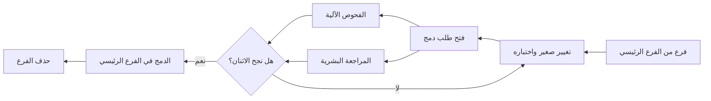
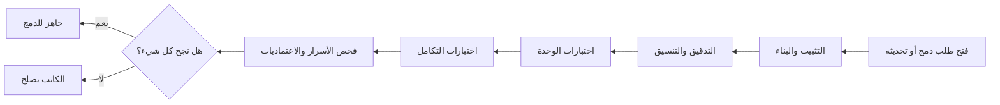
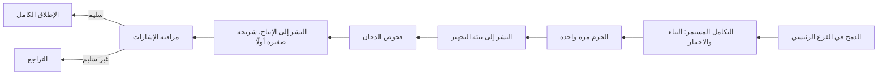

# الوحدة 3 — بناء البرمجيات بإتقان

*بلغت قافلة مرحلة الجذب. يعمل فيها الآن نحو اثني عشر شخصًا، ويستخدم التطبيقَ 300 تاجر لنحو 4,000 توصيلة في اليوم، وتمرّ المدفوعات عبر مزوّد مدفوعات، ويعدّل فريق واحد من المهندسين قاعدة الشيفرة نفسها كل يوم. العادات التي نفعت حين كانت مها وفيصل وحدهما (الدفع مباشرة إلى النسخة الرئيسية، والاختبار بالنقر هنا وهناك، والنشر يدويًا في مساء هادئ) بدأت تكلّف مالًا وساعات نوم. تتناول هذه الوحدة ثلاث ممارسات يومية تتيح لفريق صغير أن يغيّر البرمجيات كثيرًا دون أن يكسرها: التحكم في الإصدارات مع مراجعة الشيفرة واتفاق عمل مكتوب، والاختبارات الآلية التي تعمل مع كل تغيير عبر التكامل المستمر، والتسليم المستمر بعمليات نشر صغيرة يمكن مراقبتها والتراجع عنها بسهولة. ويخرج كل درس بوثيقة تنفعك في أي فريق: اتفاق عمل مع قائمة تحقق لطلب الدمج، وخطة اختبار ومخطط لخط النشر لتغيير واحد، وخطة إصدار فيها خطوة للتراجع.*

> **الخطوات:** Build — حوّل الأفكار إلى برمجيات تعمل، عبر تغييرات صغيرة مراجَعة ومختبَرة يفهمها أي زميل، وأوصِلها إلى العملاء بأمان وبكثرة.

---

# 3.1 — التحكم في الإصدارات ومراجعة الشيفرة واتفاقات العمل
*المستوى (Level): 🟢 مبتدئ (Beginner)* · *المتطلبات (Prerequisites): 0.2، 2.3* · *الخطوة (Step): Build*

**بعد هذا الدرس تستطيع** أن تشرح كيف يستخدم الفريق التحكم في الإصدارات والفروع وطلبات الدمج ليغيّر شيفرة مشتركة بأمان، وأن تراجع طلب دمج صغيرًا وفق قائمة تحقق، وأن تكتب اتفاق عمل للفريق من صفحة واحدة يحدد كيف تنتقل الشيفرة من الحاسوب المحمول إلى الفرع الرئيسي. *مدة الدراسة: قراءة نحو 15 دقيقةً، وعمل تطبيقي نحو 90 دقيقةً (تقدير).*

## ⚡ الدرس في دقيقة (In 60 seconds)
- **التحكم في الإصدارات (version control)** يحفظ كل تغيير في الشيفرة سجلًا مسمّى ومؤرّخًا يمكن عكسه، ومعه سبب التغيير. إنه الذاكرة المشتركة للفريق.
- **طلب الدمج (pull request)**، ويُسمّى أيضًا merge request، يقترح تغييرًا على الفرع الرئيسي، فيقرؤه شخص آخر، وتعمل عليه الفحوص الآلية، ويُسجَّل النقاش حوله.
- **مراجعة الشيفرة (code review)** ليست بوابة لاصطياد أخطاء الكاتب. إنها تنشر المعرفة وتلتقط الأخطاء وهي ما زالت رخيصة.
- القاعدة الأهم: **تغييرات صغيرة، تُدمج كثيرًا، وكل واحد منها مراجَع ومشروح.**
- إشارة القرار: إن لم يستطع المراجع فهم تغييرك في وقت فنجان قهوة واحد، فقسّمه.
- أكبر فخ: قواعد لم يتفق عليها أحد. اتفاق العمل (working agreement) يكتبه الفريق *بنفسه*، ويبقى قصيرًا.

## 🧭 لماذا يهم (Why it matters)
قافلة وكل من فيها شخصيات خيالية. وكل الأرقام عن قافلة في هذا الدرس أرقام توضيحية، لا معايير مرجعية.

في مرحلة الانطلاق، كانت مها وفيصل يدفعان تغييراتهما إلى مستودع واحد، ويحلّان أي تعارض بينهما عبر المكتب. أما الآن فنحن في مرحلة الجذب: ستة مهندسين يعملون في المستودع نفسه، و300 تاجر يعتمدون على التطبيق، والمدفوعات تمرّ عبر مزوّد المدفوعات.

في ليلة ثلاثاء، عدّل مهندسان شيفرة رسوم التوصيل في الوقت نفسه: أحدهما يضيف رسمًا إضافيًا في عطلة نهاية الأسبوع، والآخر يصلح التقريب. يحلّ فيصل التعارض متعبًا في الحادية عشرة ليلًا، فيُبقي النصف الخطأ، ويدفع مباشرة إلى الفرع الرئيسي، ثم ينشر التغيير يدويًا قبل أن ينام ليصبح الرسم الإضافي فعّالًا، أي يضعه على الخوادم الحيّة التي يستخدمها التجّار، وتُسمّى **بيئة الإنتاج (production)** (الدرس 3.3). لم يرَ التغييرَ أحدٌ غيره. وصباح الأربعاء يتصل مخبز بخط الدعم الذي تديره سلمى: كل طلب منذ الصباح يحمل رسوم الشهر الماضي. يحتاج فيصل ساعتين ليعثر على التغيير، فالسجل لا يقول إلا «إصلاح الرسوم».

لقد كبر الفريق على طريقة عمل صُمّمت لشخصين. تطلب مها من فيصل ومن عائشة، مديرة المنتج الجديدة، صفحة واحدة عن «كيف نغيّر الشيفرة هنا» قبل يوم الجمعة.

## 📐 كيف يعمل (How it works)

### 🟢 الأساسيات (The essentials)

**التحكم في الإصدارات بكلمات بسيطة.** **المستودع (repository)**، ويُختصر repo، مجلد يُتتبَّع تاريخه كاملًا. وكل تغيير محفوظ هو **إيداع (commit)**: لقطة لما تغيّر، ومن غيّره، ومتى، مع رسالة قصيرة تقول لماذا. الأداة الأوسع استخدامًا هي Git؛ و**منصة استضافة التحكم في الإصدارات** (مثل GitHub أو GitLab، نذكرهما للتوضيح فقط) تحفظ النسخة المشتركة على الإنترنت، وتضيف فوقها طلبات الدمج والمراجعات والصلاحيات.

| المصطلح | معناه ببساطة | في قافلة |
|---|---|---|
| **الإيداع** | تغيير واحد مسجَّل، ومعه رسالة | «إضافة رسم عطلة نهاية الأسبوع إلى رسوم التوصيل (الجمعة والسبت، 2 ريال)» |
| **الفرع الرئيسي** | النسخة الحالية المتفق عليها التي يبني عليها الجميع؛ واسمه غالبًا `main` | النسخة التي تذهب إلى الإنتاج |
| **الفرع (branch)** | خط عمل منفصل يبدأ من الفرع الرئيسي ويُدمج فيه لاحقًا | `fee-weekend-surcharge` |
| **الدمج (merge)** | ضمّ تغييرات فرع إلى الفرع الرئيسي | بعد نجاح المراجعة والفحوص |
| **تعارض الدمج (merge conflict)** | تغييران يمسّان الأسطر نفسها؛ ويجب أن يقرر شخص أيهما الصحيح | ليلة الثلاثاء التي عاشها فيصل |
| **العكس (revert)** | إيداع جديد يلغي إيداعًا سابقًا، مع الإبقاء على التاريخ | الطريقة التي أصلح بها فيصل الرسوم في النهاية |

**رسالة الإيداع الجيدة** تجيب عن «لماذا»، لأن الشيفرة نفسها تُظهر «ماذا». الشكل المعتاد سطر ملخّص قصير (نحو 50 حرفًا)، ثم سطر فارغ، ثم بضعة أسطر عن السبب. قارن:

| ضعيفة | قوية |
|---|---|
| «إصلاح الرسوم» | «تقريب رسوم التوصيل إلى أقرب 0.25 ريال» + سطر فارغ + «اتفقنا على ذلك مع التجّار في مذكرة التسعير 4؛ التقريب القديم سبّب فروقًا بمقدار 0.01 في الإيصالات.» |
| «تحديثات» | «عرض ساعات عمل المتجر للمندوبين» + سطر فارغ + «ظل المندوبون يصلون إلى متاجر مغلقة (تذاكر الدعم).» |

**طلبات الدمج.** **طلب الدمج** (PR) طلبٌ لضمّ فرع إلى الفرع الرئيسي. يعرض الأسطر التي تغيّرت، ويشغّل الفحوص الآلية (الدرس 3.2)، ويحفظ النقاش. والوصف المفيد لطلب الدمج له أربعة أجزاء:

1. **ماذا ولماذا:** جملة أو جملتان، مع رابط إلى التذكرة (سجلّ الفريق للمهمة أو الطلب).
2. **كيف تتحقق منه:** ما الذي ينبغي أن يجرّبه المراجع أو ينظر فيه.
3. **المخاطرة:** ما الذي قد ينكسر، ومن سيلاحظ (التجّار، المندوبون، المدفوعات).
4. **التراجع:** كيف يُعكس التغيير إن ساءت الأمور (غالبًا «اعكس طلب الدمج هذا»؛ وأحيانًا أكثر من ذلك، انظر الدرس 3.3).

**مراجعة الشيفرة.** يقرأ مهندس آخر التغيير قبل دمجه. ويسأل المراجع، بهذا الترتيب تقريبًا:

- **هل يفعل ما يقوله الوصف، وهل هذا هو الشيء الصحيح أصلًا؟**
- **هل يمكن أن يكسر شيئًا؟** الحالات الحدّية، والأخطاء، والمدفوعات، والبيانات الشخصية، والشيفرة التي تستدعي هذه الشيفرة.
- **هل هو مختبَر؟** هل يوجد اختبار سيفشل لو كان هذا التغيير معطوبًا (الدرس 3.2)؟
- **هل سيفهمه الشخص التالي؟** الأسماء، والبنية، والتعليقات حيث لا يكون «السبب» واضحًا.
- **هل فيه سرّ أو بيانات شخصية؟** مفاتيح، أو كلمات مرور، أو بيانات عملاء حقيقية.

اترك الأسلوب للأدوات: **المنسّق (formatter)** يعيد ترتيب شكل الشيفرة آليًا، و**أداة التدقيق (linter)** تنبّه إلى الشيفرة المريبة أو غير المعيارية.

### 🟡 التعمق أكثر (Going deeper)

**أبقِ التغييرات صغيرة.** تنصح ممارسات مراجعة الشيفرة التي نشرتها Google بتغييرات صغيرة مركّزة، وتلاحظ أن المراجعين نادرًا ما يشتكون من أن تغييرًا ما صغير أكثر من اللازم، وتقول إن التغيير قد يُرفض لمجرد أنه كبير جدًا (صفحة «Small CLs»؛ وCL يقابل تقريبًا طلب الدمج). التغييرات الصغيرة أسرع في المراجعة، وأقل تعارضًا، وأسهل في التراجع. ويمكن عادة تقسيم الميزة الكبيرة، مثلًا بإخفاء الشيفرة الجديدة خلف مفتاح تشغيل (الدرس 3.3).

**فرّع لفترة قصيرة، وادمج كثيرًا.** الفروع طويلة العمر تبتعد عن الفرع الرئيسي وتجعل الدمج مؤلمًا. ويصف DORA، وهو برنامج بحثي طويل الأمد عن تسليم البرمجيات صار الآن جزءًا من Google Cloud، **التطوير على الجذع (trunk-based development)** بأنه أن يدمج كل مطوّر دفعات صغيرة في الفرع الرئيسي («الجذع») مرة واحدة على الأقل يوميًا، ويربطه بأداء تسليم أفضل (دليل القدرات لدى DORA).



**احمِ الفرع الرئيسي.** تتيح منصات الاستضافة وضع قواعد على الفرع الرئيسي: لا دفع مباشر، ومراجعة موافِقة، وفحوص إلزامية، وموافقة من مالكين محددين على المجلدات الحساسة (تصف صفحة «About protected branches» لدى GitHub خيارات من هذا النوع). هذه الإعدادات هي اتفاق العمل وقد صار حقيقة، وهي تحميك من نفسك في الحادية عشرة ليلًا. راجع وثائق الخطة لدى منصتك: فبعض الخطط المجانية قد لا تقدّمها إلا للمستودعات العامة.

**المراجعة بلطف وفائدة.** علّق على الشيفرة لا على الشخص («هذه الدالة تُرجع null حين يكون المتجر مغلقًا»، لا «نسيتَ المتاجر المغلقة»). ميّز ما يمنع الدمج مما هو اختياري (البادئة "nit:" تعني ملاحظة صغيرة). وافق حين يجعل التغييرُ الشيفرةَ أفضل، حتى لو كنت ستكتبه بطريقة أخرى. وردّ بسرعة: طلب دمج ينتظر يومين عملٌ منجز لم يُسلَّم، فاتفقوا على زمن للرد (مثلًا يوم عمل واحد).

### 🔴 نظرة الخبير (Expert view)

**اتفاق العمل.** **اتفاق العمل** مجموعة قصيرة مكتوبة من القواعد يختارها الفريق لنفسه عن طريقة عمله معًا. وفي ما يخص الشيفرة، يغطي عادة:

| الموضوع | السؤال الذي يجيب عنه |
|---|---|
| الفروع | كم يمكن أن يعيش الفرع؟ ومن يحق له الدفع إلى الفرع الرئيسي؟ |
| طلبات الدمج | ماذا يجب أن يتضمن الوصف؟ ومتى يكون التغيير أكبر من اللازم؟ |
| المراجعة | كم موافقة نحتاج؟ ومن يراجع شيفرة المدفوعات أو الأمن؟ وبأي سرعة؟ |
| الفحوص | أي الفحوص الآلية يجب أن تنجح قبل الدمج؟ |
| الطوارئ | ماذا يحدث حين يكون الإصلاح عاجلًا ليلًا؟ من يحق له تجاوز خطوة، وماذا عليه أن يفعل بعدها؟ |
| مراجعة الاتفاق | متى ننظر في هذه القواعد من جديد؟ |

اكتبه مع الفريق لا نيابة عنه، في صفحة واحدة. وضمّنه مسارًا صادقًا للطوارئ: فإن لم يوجد مسار سريع مشروع، اخترع الناس مسارًا لا يترك أثرًا.

**المراجعة طريقة لنشر المعرفة أيضًا.** إن كان فيصل وحده يراجع شيفرة المدفوعات، صار عنق زجاجة، ولم يتعلّمها أحد غيره. بدّلوا المراجعين.

**الشيفرة التي يكتبها الذكاء الاصطناعي تبقى شيفرتك.** راجع طلبات الدمج التي صاغتها مساعدات البرمجة بقائمة التحقق نفسها وبشكّ أكبر: فالشيفرة السلسة قد تكون خاطئة بثقة تامة. انظر [*دليل عملي لتصبح مهندسًا أصيلًا في الذكاء الاصطناعي*، الدرس 5.2 — المختبر: راجع طلب دمج كتبه وكيل](../ainative/index.ar.html#/5.2).

**الأسرار لا تدخل المستودع أبدًا.** حذف مفتاح أُودع في إيداع لاحق لا يزيله من التاريخ. احفظ الأسرار في مدير أسرار (secrets manager)، وافحص المستودع بحثًا عنها آليًا. انظر [*أمن الذكاء الاصطناعي وأمن التطبيقات: من الصفر إلى الاحتراف*، الدرس 5.2 — إدارة الأسرار: المفاتيح والرموز المميزة وأين تتسرّب](../secai/index.ar.html#/5.2).


## 🧰 الأدوات (The toolkit)
| المصدر أو الأداة أو القالب (Resource, tool or template) | ما هو وماذا يفعل (What it is and does) | متى تلجأ إليه (When to reach for it) |
|---|---|---|
| **Team working agreement** — اتفاق عمل الفريق | صفحة واحدة يكتبها الفريق: الفروع، وطلبات الدمج، والمراجعة، والفحوص، والطوارئ، وموعد المراجعة | حين يغيّر أكثر من شخصين الشيفرة نفسها |
| **Pull request template** — قالب طلب الدمج | أربعة عناوين في كل طلب دمج: ماذا ولماذا، وكيف تتحقق، والمخاطرة، والتراجع | يُضبط مرة واحدة على المستودع، ويُستخدم في كل طلب دمج |
| **Reviewer checklist** — قائمة تحقق المراجع | خمسة أسئلة: الشيء الصحيح، وهل قد يكسر شيئًا، والاختبار، والوضوح، والأسرار أو البيانات الشخصية | في كل مراجعة، حتى تصبح عادة |
| **Branch protection rules** — قواعد حماية الفرع | إعدادات في منصة الاستضافة: لا دفع مباشر إلى الفرع الرئيسي، ومراجعة إلزامية، وفحوص إلزامية، ومالكو الشيفرة | فور أن يتفق الفريق على قواعده |
| **Secret scanner** — ماسح الأسرار | فحص يمنع طلبات الدمج التي تحتوي على مفاتيح وكلمات مرور | منذ أول بيانات اعتماد حقيقية |

## 🏛️ عمليًا في قافلة (In practice at Qafila)
تكتب عائشة وفيصل المسودة، ويعدّلها المهندسون يوم الجمعة. المثال توضيحي وخيالي.

> **اتفاق العمل الهندسي في قافلة (الجذب، النسخة 1)**
>
> | الموضوع | نتفق على |
> |---|---|
> | الفرع الرئيسي | لا يدفع أحد مباشرة إلى `main`، بمن فيهم فيصل ومها. ويبقى `main` جاهزًا للنشر دائمًا |
> | الفروع | قصيرة العمر: تُدمج أو تُغلق خلال يومَي عمل |
> | طلبات الدمج | استخدم القالب (ماذا ولماذا، وكيف تتحقق، والمخاطرة، والتراجع). استهدف تغييرًا يقرؤه المراجع في نحو 20 دقيقة، وقسّم ما هو أكبر |
> | المراجعة | موافقة واحدة. والتغييرات على `payments/` أو `auth/` تحتاج أيضًا موافقة فيصل أو أحد المهندسَين اللذين يدرّبهما |
> | زمن الرد | المراجعة الأولى خلال يوم عمل واحد؛ والمراجعات تسبق بدء عمل جديد |
> | الفحوص | يجب أن ينجح البناء والاختبارات قبل الدمج (الدرس 3.2) |
> | الطوارئ | الإصلاح العاجل: مراجع واحد في مكالمة، ثم الدمج، ثم مراجعة عادية في يوم العمل التالي. ويُكتب في قناة الفريق ما الذي تم تجاوزه |
> | رسائل الإيداع | قل لماذا، لا ماذا فقط. واربط التذكرة |
> | الأسرار | لا تدخل المستودع أبدًا. وماسح الأسرار يمنع أي طلب دمج يحتوي على سرّ |
> | المراجعة التالية | بعد ستة أسابيع، في الاجتماع الاستعادي للفريق |
>
> **متابعة حادثة الرسوم:** صار لإيداع العكس ولإيداع الرسوم المصحَّح رسالتان كاملتان تشرحان قاعدة التقريب الصحيحة، ولشيفرة الرسوم مالكان محدّدان بالاسم.

أراد فيصل «موافقتين على كل شيء»؛ فقال الآخرون إن ذلك سيعطّل معظم العمل مع ستة مهندسين فقط، فصارت الموافقة الثانية مطلوبة فقط حيث يتعلق الأمر بالمال أو بصلاحيات الوصول.

## 🛠️ التمارين (Exercises)
**🟢 اكتب ثلاثة إيداعات جيدة.** في أي مشروع شخصي، أو في مستودع تدريبي جديد على منصة استضافة مجانية، أجرِ ثلاثة تغييرات صغيرة (قسم في ملف README، ودالة، وإصلاح). اكتب رسالة كل إيداع بحيث يفهم الغريب *السبب*. ليس لديك Git على حاسوبك؟ معظم المنصات تتيح لك تعديل ملف وإيداعه من المتصفح؛ ودليل البداية لديها يشرح كيف.
*يكتمل عندما (Done when):* يغيّر كل إيداع شيئًا واحدًا، وتحتوي كل رسالة على سطر ملخّص قصير وسبب، ولا تقول أي رسالة «تحديث» أو «إصلاح» فقط.

<details><summary>الإجابة النموذجية والتحقق الذاتي</summary>

**الإجابة النموذجية.** «إضافة خطوات الإعداد المحلي إلى README» / سطر فارغ / «لم يستطع صديقان تشغيل التطبيق.» «التحقق من أرقام هواتف المتاجر عند الحفظ» / سطر فارغ / «لم يستطع المندوبون الاتصال بمتاجر أرقامها مكتوبة خطأ.» «إصلاح إجمالي الإيصال مع الخصومات» / سطر فارغ / «كانت الضريبة تُضاف مرتين عند تطبيق خصم.»

**التحقق الذاتي.**
- هل يستطيع من يقرأ التاريخ وحده أن يشرح سبب كل تغيير؟
- هل يفعل كل إيداع شيئًا واحدًا، بحيث يمكن عكسه وحده؟
- هل تجنّبت إيداع كلمات مرور أو مفاتيح أو بيانات شخصية؟

</details>

**🟡 راجع طلب دمج بقائمة التحقق.** افتح طلب دمج صغيرًا وحديثًا ومدموجًا (أقل من نحو 100 سطر متغيّر) في مشروع مفتوح المصدر عام. راجعه كأنه لم يُدمج بعد، مستخدمًا أسئلة المراجع الخمسة. اكتب ثلاثة تعليقات: ملاحظة أو سؤالًا يمنع الدمج، واقتراحًا معلَّمًا بأنه اختياري، وشيئًا أُنجز جيدًا.
*يكتمل عندما (Done when):* يشير كل تعليق إلى أسطر محددة، ويتحدث عن الشيفرة لا عن الشخص، ويُعلَّم بوضوح بأنه مانع أو اختياري.

<details><summary>الإجابة النموذجية والتحقق الذاتي</summary>

**الإجابة النموذجية.** لطلب دمج يضيف خيارًا لتحليل التواريخ: مانع، «السطر 42 يُرجع نصًا فارغًا حين لا توجد منطقة زمنية؛ هل هذا مقصود، وهل هو مختبَر؟»؛ اختياري، «nit: يمكن أن يصبح `parseOpt` اسمه `parseOptions`»؛ إيجابي، «اختبار السنة الكبيسة واضح، وكان سيلتقط الخطأ القديم».

**التحقق الذاتي.**
- هل تحققت من أنه يفعل الشيء الصحيح، لا من أنه مرتّب فقط؟
- هل سيشعر الكاتب بأنك ساعدته لا بأنك حكمت عليه؟

</details>

**🔴 اكتب اتفاق عمل لفريق من ستة.** تخيّل أنك انضممت إلى فريق قافلة في اليوم التالي لحادثة الرسوم (أو استخدم فريقًا حقيقيًا أو مجموعة دراسية تنتمي إليها). اكتب اتفاق عمل من صفحة واحدة يغطي المواضيع الستة في نظرة الخبير، ومنها مسار صادق للطوارئ، ثم حوّل ثلاثًا من قواعدك إلى إعدادات لحماية الفرع في مستودعك التدريبي. في الخطط المجانية لبعض المنصات لا تعمل هذه الإعدادات إلا على المستودعات العامة؛ فإن كان الأمر كذلك، فاجعل المستودع التدريبي عامًا، ولا تضع فيه أسرارًا أو بيانات شخصية.
*يكتمل عندما (Done when):* يتّسع الاتفاق لصفحة واحدة، وله موعد مراجعة، وفيه مسار للطوارئ مع خطوة متابعة، وتُفرض ثلاث قواعد على الأقل بالإعدادات لا بالذاكرة.

<details><summary>الإجابة النموذجية والتحقق الذاتي</summary>

**الإجابة النموذجية.** قواعد قريبة من النسخة 1 في قافلة، مع الإعدادات: (1) اشتراط طلب دمج قبل الدمج في `main`؛ (2) اشتراط مراجعة موافِقة واحدة؛ (3) اشتراط نجاح فحص الاختبارات. مسار الطوارئ: «شخصان في مكالمة، ثم الدمج، ثم مراجعة كاملة في يوم العمل التالي، وملاحظة في القناة». موعد المراجعة: بعد ستة أسابيع.

**التحقق الذاتي.**
- هل يستطيع الفريق اتباع كل قاعدة بحجمه الحالي؟
- هل يترك مسار الطوارئ أثرًا؟

</details>

## ⚠️ أخطاء وفخاخ (Mistakes and traps)
- **الدفع مباشرة إلى الفرع الرئيسي «هذه المرة فقط».** احمِ الفرع، وامنح الإصلاحات العاجلة مسارًا سريعًا حقيقيًا بدلًا من ذلك.
- **طلبات الدمج العملاقة.** تحصل على موافقة شكلية، لا على مراجعة. قسّمها.
- **المراجعة بوصفها حراسة للبوابة.** المراجعات القاسية أو البطيئة تعلّم الناس إخفاء عملهم. كن محددًا ولطيفًا وسريعًا.
- **قواعد مكتوبة للفريق لا بيده.** يلتفّ الناس عليها. اكتبوها معًا.
- **إيداع سرّ ثم «حذفه» لاحقًا.** يبقى في التاريخ. غيّر السرّ فورًا وأضف ماسحًا.

## 🧾 الخلاصة (Recap)
- التحكم في الإصدارات ذاكرة الفريق المشتركة القابلة للعكس؛ ورسائل الإيداع الجيدة تسجّل السبب.
- طلبات الدمج تجمع التغيير وفحوصه ونقاشه قبل أن يصل إلى الفرع الرئيسي.
- راجع الصحة والمخاطرة والاختبارات والوضوح، بلطف وبسرعة؛ واترك الأسلوب للأدوات.
- أبقِ الفروع قصيرة العمر والتغييرات صغيرة؛ واحمِ الفرع الرئيسي بإعدادات تطابق الاتفاق.
- اتفاق العمل صفحة واحدة يكتبها الفريق، فيها مسار صادق للطوارئ وموعد للمراجعة.

## ✍️ اختبر نفسك (Check yourself)
**1. بعد حادثة الرسوم، ما الذي كان سيختصر أكثر من غيره الساعتين اللتين أمضاهما فيصل في البحث عن السبب؟**

- A. قاعدة تقصر حلّ تعارضات الدمج على فيصل وحده، لأنه يعرف شيفرة الرسوم.
- B. اجتماع أسبوعي يصف فيه المهندسون التغييرات التي ينوون إجراءها على شيفرة الرسوم.
- C. طلب دمج مراجَع يُثبت وصفُه في السجل التغييرَ نفسه وسببَه معًا.
- D. جدول بيانات يسجّل فيه المهندسون كل تغيير على شيفرة الرسوم في نهاية كل يوم.

<details><summary>الإجابة</summary>

**C.** طلب الدمج المراجَع يسجّل ما تغيّر ولماذا، وربما التقط قارئ ثانٍ النصف الخطأ. الخيار A يجعل فيصل عنق زجاجة، وB يغطي الخطط لا التغييرات، وD يكرّر عمل التحكم في الإصدارات يدويًا. انظر «طلبات الدمج» و«لماذا يهم».

</details>

**2. يفتح مهندس جديد طلب دمج فيه 1,800 سطر متغيّر، يشمل شاشة جديدة للمندوب، وإعادة هيكلة لنموذج الطلب، وترقية لمكتبة. ما الذي ينبغي أن يقترحه المراجع أولًا؟**

- A. أن يقسّمه إلى طلبات دمج منفصلة وأصغر، لكل منها معنى ويمكن مراجعته وحده.
- B. أن يوافق عليه بسرعة، لأن إبقاء تغيير كبير مفتوحًا مدة أطول يزيد تعارضات الدمج سوءًا.
- C. أن يطلب مراجعَين آخرين يتقاسمان الأسطر، كي يُفحص التغيير كله سطرًا سطرًا.
- D. أن يدمجه في فرع إصدار طويل العمر، ليُختبر هناك بضعة أسابيع قبل الفرع الرئيسي.

<details><summary>الإجابة</summary>

**A.** التغييرات الصغيرة المركّزة أسرع وأكثر أمانًا في المراجعة والتراجع. الخيار B يختمه دون مراجعة، وC يشتّت مراجعة ضخمة بين عدة أشخاص فلا يرى أحدٌ الصورة كاملة، وD يصنع فرعًا طويل العمر يبتعد عن الأصل. انظر «أبقِ التغييرات صغيرة».

</details>

**3. أي تعليق مراجعة هو الأكثر فائدة؟**

- A. «السطر 58: غيّر اسم `s` إلى `shop` وضع القوس المفتوح على السطر نفسه.»
- B. «السطر 58 مرة أخرى: ما زلت تُغفل حالات كهذه، فانتبه أكثر من ذلك من فضلك.»
- C. «nit: غيّر اسم هذا المتغيّر، وربما يكون المنطق هنا فيه خلل بسيط أيضًا؟»
- D. «السطر 58 يتخطّى المتاجر المغلقة، ولا يغطي ذلك أي اختبار؛ هل تضيف واحدًا؟»

<details><summary>الإجابة</summary>

**D.** يشير إلى سطر، ويسمّي خطرًا محددًا، ويطلب فعلًا محددًا. الخيار A محدد لكنه عن الأسلوب فقط، وهذا عمل المنسّق؛ وB عن الشخص لا الشيفرة؛ وC يخلط ملاحظة اختيارية بخلل محتمل مبهم، فلا يعرف الكاتب ما الذي يمنع الدمج. انظر «مراجعة الشيفرة» و«المراجعة بلطف وفائدة».

</details>

**4. تسأل عائشة لماذا يتضمن الاتفاق مسارًا للطوارئ أصلًا. ما أفضل سبب؟**

- A. تتوقع الجهات التنظيمية من كل شركة أن توثّق إجراء طوارئ لكل تغييرات شيفرتها.
- B. من دون مسار سريع مشروع، يخترع الناس تحت الضغط مسارًا لا يترك أثرًا.
- C. الطوارئ هي الوقت الوحيد الذي تبطئ فيه المراجعات العمل بقدر يهمّ التجّار.
- D. يتيح لكبار المهندسين تخطّي المراجعة كلما رأوا أن التغيير منخفض المخاطر.

<details><summary>الإجابة</summary>

**B.** المسار السريع الصادق مع خطوة متابعة يُبقي الإصلاحات العاجلة مرئية. الخيار A يقرر استنتاجًا قانونيًا، وC يسيء فهم سبب وجود المراجعات، وD يحوّل الاستثناء إلى طريق التفاف. انظر «اتفاق العمل».

</details>

**5. يلاحظ مهندس أن مفتاحًا لمزوّد المدفوعات أُودع في المستودع الأسبوع الماضي، ثم أُزيل في إيداع لاحق. ما الذي ينبغي أن يحدث؟**

- A. لا شيء آخر، لأن الإيداع اللاحق أزال المفتاح، والشيفرة الحالية أصبحت نظيفة تمامًا.
- B. جعل المستودع خاصًا، وبذلك يختفي المفتاح من رؤية أي شخص آخر لتاريخ المستودع.
- C. معاملة المفتاح على أنه مكشوف: تغييره الآن، وإضافة ماسح أسرار يمنع تكراره.
- D. إعادة كتابة رسالة الإيداع الأسبق، كي لا تعود تذكر المفتاح بعد الآن على الإطلاق.

<details><summary>الإجابة</summary>

**C.** التاريخ يحتفظ بالمفتاح، فيجب استبداله. الخيار A يتجاهل التاريخ، وB لا يلغي النسخ التي صُنعت سابقًا، وD يغيّر رسالة لا المحتوى. انظر «الأسرار لا تدخل المستودع أبدًا».

</details>

## 📚 المراجع (References)
- Google, "Small CLs", Google Engineering Practices Documentation (CC BY 3.0): https://google.github.io/eng-practices/review/developer/small-cls.html — أبقِ التغييرات صغيرة؛ «نادرًا ما يشتكي المراجعون من تغييرات صغيرة أكثر من اللازم»؛ ويجوز للمراجع رفض التغيير «لمجرد أنه كبير جدًا».
- DORA, "Trunk-based development" capability guide: https://dora.dev/capabilities/trunk-based-development/ — دمج دفعات صغيرة في الجذع مرة واحدة على الأقل يوميًا.
- GitHub Docs, "About protected branches": https://docs.github.com/en/repositories/configuring-branches-and-merges-in-your-repository/managing-protected-branches/about-protected-branches — مراجعات موافِقة إلزامية، ومراجعة مالكي الشيفرة، وفحوص حالة إلزامية. وثائق منصة واحدة، تُذكر للتوضيح لا للتزكية.
- من المكتبة: [*دليل عملي لتصبح مهندسًا أصيلًا في الذكاء الاصطناعي*، الدرس 5.2 — المختبر: راجع طلب دمج كتبه وكيل](../ainative/index.ar.html#/5.2).
- من المكتبة: [*أمن الذكاء الاصطناعي وأمن التطبيقات: من الصفر إلى الاحتراف*، الدرس 5.2 — إدارة الأسرار: المفاتيح والرموز المميزة وأين تتسرّب](../secai/index.ar.html#/5.2).

---

# 3.2 — الاختبار الآلي والتكامل المستمر
*المستوى (Level): 🟢 مبتدئ (Beginner)* · *المتطلبات (Prerequisites): 3.1* · *الخطوة (Step): Build*

**بعد هذا الدرس تستطيع** أن تشرح الأنواع الرئيسية للاختبارات الآلية والغرض من كل منها، وأن تكتب خطة اختبار قصيرة قائمة على المخاطر لتغيير واحد، وأن ترسم مخططًا لخط نشر للتكامل المستمر يبني كل طلب دمج ويختبره ويخبر الفريق بسرعة حين ينكسر شيء. *مدة الدراسة: قراءة نحو 15 دقيقةً، وعمل تطبيقي نحو 100 دقيقة (تقدير).*

## ⚡ الدرس في دقيقة (In 60 seconds)
- **الاختبار الآلي (automated test)** شيفرة تفحص شيفرة أخرى وتعلن النجاح أو الفشل، بالطريقة نفسها كل مرة، وفي ثوانٍ.
- استخدم **كثيرًا من الاختبارات الصغيرة السريعة** (اختبارات الوحدة) و**قليلًا من الاختبارات الواسعة البطيئة** (الاختبارات من طرف إلى طرف). وضع الجهد حيث يكون الفشل أشدّ ضررًا.
- **التكامل المستمر (CI)** يعني أن يدمج الجميع تغييرات صغيرة في الفرع الرئيسي كثيرًا، وأن يُبنى كل تغيير ويُختبر آليًا.
- القاعدة الأهم: **البناء الأحمر أولوية الفريق الأولى؛ أصلحه أو اعكسه قبل أي شيء آخر.**
- إشارة القرار: اسأل مع كل تغيير «أي اختبار سيفشل لو كان هذا معطوبًا؟». إن كان الجواب «لا شيء»، فاكتب اختبارًا.
- أكبر فخ: اختبارات تفشل عشوائيًا. فيتعلّم الناس تجاهل اللون الأحمر.

## 🧭 لماذا يهم (Why it matters)
قافلة وكل من فيها شخصيات خيالية. وكل الأرقام عن قافلة في هذا الدرس أرقام توضيحية، لا معايير مرجعية.

في مرحلة الانطلاق، كان فيصل يختبر يدويًا: ينقر في التطبيقات، ثم ينشر مساء الخميس. ومع 15 متجرًا ونحو 150 توصيلة في اليوم، كانت الأخطاء نادرة ورخيصة. أما الآن فلدى قافلة 300 تاجر ونحو 4,000 توصيلة في اليوم، وستة مهندسين يدمجون يوميًا، وقد اتفق الفريق (الدرس 3.1) على أن الاختبارات يجب أن تنجح قبل الدمج. لكن الاختبارات شبه معدومة.

بعد أسبوع، يجتاز تغيير في توزيع الطلبات على المندوبين مراجعة دقيقة. ولا يلاحظ أحد أن طلبات المتاجر ذات الفرعين لم تعد تُعرض على أي مندوب. فتقضي سلمى يوم السبت تتصل بالمندوبين واحدًا واحدًا؛ وهي تدير الدعم وجدول **المناوبة (on-call)** الجديد (جدول يحدد من يجيب التنبيهات خارج ساعات العمل؛ الوحدة 4). الإصلاح سطر واحد، واختبار فيه متجر بفرعين كان سيلتقط الخطأ في ثوانٍ.

يعترف فيصل بأنه تخطّى الاختبارات في مرحلة الانطلاق «ليسرع». وتطلب مها خطة.

## 📐 كيف يعمل (How it works)

### 🟢 الأساسيات (The essentials)

**ما الاختبار الآلي.** يجهّز الاختبار شيئًا، ثم يفعل شيئًا واحدًا، ثم يتحقق من النتيجة. ويُسمّى هذا النمط غالبًا **التجهيز والتنفيذ والتأكيد (arrange, act, assert)**:

```
Arrange: a shop with two branches, one courier near branch B
Act:     create an order at branch B
Assert:  the courier near branch B is offered the order
```

ولأنه شيفرة، فهو يعمل بالطريقة نفسها مع كل تغيير، دون أن يحتاج أحد إلى تذكّره.

**الأنواع الرئيسية للاختبار.** تختلف الأسماء من فريق إلى آخر، أما الأفكار فثابتة.

| النوع | ما الذي يفحصه | السرعة | في قافلة |
|---|---|---|---|
| **اختبار الوحدة (unit test)** | قطعة منطق صغيرة واحدة بمعزل عن غيرها | أجزاء من الألف من الثانية | حساب رسوم التوصيل؛ قواعد توزيع الطلبات على المندوبين |
| **اختبار التكامل (integration test)** | قطع تعمل معًا، مثل الشيفرة مع قاعدة بيانات حقيقية | ثوانٍ | حفظ طلب ثم قراءته من جديد |
| **اختبار العقد (contract test)** | أن جزأين متفقان على شكل الرسائل التي يتبادلانها | ثوانٍ | تطبيق التاجر والخادم متفقان على شكل «الطلب» |
| **الاختبار من طرف إلى طرف (end-to-end test)** | رحلة مستخدم كاملة عبر الواجهات الحقيقية | دقائق | المتجر ينشئ طلبًا، والمندوب يقبله، والطلب يُعلَّم بأنه سُلّم |
| **الاختبار الاستكشافي اليدوي (exploratory testing)** | شخص يحاول كسر الأشياء بطرق لم يكتبها أحد مسبقًا | ساعات | عائشة تجرّب أسماء متاجر عربية على هاتف بطيء |

**هرم الاختبار (test pyramid).** قاعدة تقريبية شائعة تُرسم غالبًا هرمًا: كثير من اختبارات الوحدة في القاعدة، وأقل منها من اختبارات التكامل في الوسط، وعدد قليل من الاختبارات من طرف إلى طرف في القمة. ينطلق مقال Ham Vocke «The Practical Test Pyramid» (2018، على موقع Martin Fowler) من طبقات Mike Cohn الثلاث، ويصف النموذج بأنه قاعدة تقريبية مفيدة لكنه أبسط من أن يُتّبع حرفيًا. والسبب هو التكلفة: الاختبارات الواسعة بطيئة ويصعب تشخيص فشلها، فاحتفظ منها بما يكفي لإثبات الرحلات الرئيسية فقط.

**ما معنى اختبار «كافٍ».** اختبر حيث يكون الفشل أشدّ ضررًا وحيث يُرجَّح وقوع الأخطاء:

- **المال:** الرسوم، والمبالغ المستردّة، واستدعاءات مزوّد المدفوعات.
- **الرحلات الأساسية:** إنشاء التوصيلة وإسنادها وإتمامها.
- **المنطق المعقّد:** القواعد ذات الحالات الكثيرة، مثل ساعات عمل المتاجر، والفروع، والمناطق الزمنية.
- **ما انكسر من قبل:** كل خطأ يُصلَح يحصل على اختبار كان سيلتقطه.

**التكامل المستمر.** يصفه مقال Martin Fowler «Continuous Integration» (كُتب أول مرة عام 2001 وأُعيدت كتابته عام 2023) بأن يدمج كل أعضاء الفريق عملهم في الخط الرئيسي كثيرًا (يوميًا على الأقل)، وأن يُفحص كل دمج ببناء آلي يتضمن الاختبارات. و**نظام CI** (مثل GitHub Actions أو GitLab CI، نذكرهما للتوضيح فقط) يراقب المستودع، ومع كل طلب دمج وكل دمج يشغّل **خط النشر (pipeline)**: قائمة ثابتة من الخطوات.



تبحث خطوة الفحص عن الأسرار المودَعة وعن مكتبات الأطراف الخارجية التي فيها ثغرات معروفة، وهذا ما يُسمّى **فحص الاعتماديات (dependency scan)**. وتظهر النتيجة على طلب الدمج علامة خضراء أو علامة حمراء. وقواعد حماية الفرع من الدرس 3.1 تجعل العلامة الخضراء شرطًا للدمج.

### 🟡 التعمق أكثر (Going deeper)

**أبقِ خط النشر سريعًا.** البناء الذي يستغرق نحو عشر دقائق إرشاد قديم من البرمجة القصوى (Extreme Programming)، وهي المنهجية الرشيقة التي طوّر فيها Kent Beck التكامل المستمر في تسعينيات القرن الماضي؛ ويرى Fowler أنه «معقول تمامًا» لمعظم المشاريع. ولتبقى سريعًا، شغّل اختبارات الوحدة أولًا، وشغّل الخطوات المستقلة بالتوازي، وأبقِ الاختبارات من طرف إلى طرف قليلة.

**البناء الأحمر مشكلة الفريق كله.** حين يكون الفرع الرئيسي أحمر، يتراكم كل تغيير جديد على أساس معطوب. ومن كسره يصلحه فورًا، أو يعكس تغييره ثم يصلحه بهدوء على فرع. العكس ليس هزيمة.

**الاختبارات المتذبذبة.** **الاختبار المتذبذب (flaky test)** ينجح ويفشل على الشيفرة نفسها، مثلًا لأنه يعتمد على التوقيت، أو على ترتيب تشغيل الاختبارات، أو على الساعة الحقيقية، أو على خدمة خارجية. والاختبارات المتذبذبة تعلّم الناس أن الأحمر لا يعني شيئًا. حين يتذبذب اختبار، سجّله، وأخرجه من الفحوص الإلزامية خلال يوم، وأصلح السبب، ثم أعده. وتتعمق المكتبة في هذا في [*اختبار البرمجيات: من الصفر إلى الاحتراف في عصر الذكاء الاصطناعي*، الدرس 2.3 — هل اختباراتك جيدة؟ التغطية واختبار الطفرات والاختبار القائم على الخصائص والاختبارات غير المستقرة](../testing/index.ar.html#/2.3).

**التغطية دليل، لا هدف.** **تغطية الشيفرة (code coverage)** هي نسبة الأسطر التي نُفّذت أثناء الاختبارات. والتغطية العالية لا تثبت شيئًا: فالاختبار الذي لا يتحقق من أي شيء «يغطي» الشيفرة أيضًا. اسأل: «هل سيفشل اختبار لو كان هذا خطأ؟».

**اختبار للخطأ قبل إصلاحه.** اكتب اختبارًا يعيد إنتاج الخطأ وشاهده يفشل؛ ثم أصلح الشيفرة وشاهده ينجح. هكذا لا يعود الخطأ خلسة.

**كتابة الاختبارات أولًا.** **التطوير الموجَّه بالاختبار (TDD)** يكتب اختبارًا فاشلًا للسلوك الصغير التالي، ثم ما يكفي من الشيفرة لينجح، ثم يرتّب الشيفرة. جرّبه حيث تكون الحالات واضحة، كالرسوم. انظر [*اختبار البرمجيات: من الصفر إلى الاحتراف في عصر الذكاء الاصطناعي*، الدرس 2.1 — اختبار الوحدة والتطوير الموجَّه بالاختبار: التجهيز والتنفيذ والتأكيد، والبدائل الاختبارية، والتغذية الراجعة السريعة](../testing/index.ar.html#/2.1).

### 🔴 نظرة الخبير (Expert view)

**خطة اختبار لتغيير واحد.** تكفي بضعة أسطر:

| الحقل | السؤال |
|---|---|
| التغيير | ما الذي يتغيّر، في جملة واحدة؟ |
| المخاطر | ما الذي قد يسوء، ولمن؟ |
| الاختبارات الآلية | أي الاختبارات الجديدة أو المعدّلة تغطي كل خطر، وعلى أي مستوى؟ |
| الفحوص اليدوية | ما الذي سيجرّبه شخص ولا تغطيه الأتمتة؟ |
| ما لم يُختبر، ولماذا | أي خطر نقبله عن وعي؟ |
| الإشارة بعد الإصدار | ما الذي سيخبرنا في الإنتاج أن التغيير يعمل (الدرس 3.3 والوحدة 4)؟ |

سطر «ما لم يُختبر، ولماذا» يحوّل مقامرة خفية إلى قرار يستطيع أحدٌ أن يسائله.

**بيانات الاختبار والبيانات الشخصية.** لا تنسخ أبدًا بيانات عملاء حقيقيين إلى ملفات الاختبار؛ اخترع بيانات بالشكل نفسه (متاجر بفرعين، وأسماء عربية، وعناوين طويلة).

**ما لا يفعله التكامل المستمر.** يخبرك التكامل المستمر بأن اختباراتك تنجح، لا بأنها الاختبارات الصحيحة، ولا بأن النظام يتحمّل حركة الاستخدام الحقيقية. فالاختبار الاستكشافي والمراقبة (الوحدة 4) يبقيان مهمّين.

**اختبار الشيفرة التي يكتبها الذكاء الاصطناعي.** حين يكتب مساعد برمجة الشيفرة، تصبح الاختبارات هي المواصفة التي يجب أن يلبّيها. انظر [*اختبار البرمجيات: من الصفر إلى الاحتراف في عصر الذكاء الاصطناعي*، الدرس 6.2 — الاختبارات بوصفها المواصفة لوكلاء البرمجة: سير العمل الذي يبدأ بالاختبار والحواجز الواقية واختبار الطفرات حَكَمًا](../testing/index.ar.html#/6.2). ولمعرفة كيف تُبنى خطوط CI عمليًا، انظر [*السحابة وDevOps: من الصفر إلى الاحتراف*، الدرس 4.1 — التكامل المستمر: خطوط التسليم والاختبارات والآثار البرمجية والتغذية الراجعة السريعة](../cloud/index.ar.html#/4.1).


## 🧰 الأدوات (The toolkit)
| المصدر أو الأداة أو القالب (Resource, tool or template) | ما هو وماذا يفعل (What it is and does) | متى تلجأ إليه (When to reach for it) |
|---|---|---|
| **Test plan (one change)** — خطة اختبار لتغيير واحد | التغيير، والمخاطر، والاختبارات الآلية، والفحوص اليدوية، وما لم يُختبر ولماذا، والإشارة بعد الإصدار | قبل بدء أي تغيير يمسّ المال أو رحلة أساسية |
| **Test pyramid sketch** — مخطط هرم الاختبار | عدد الاختبارات في كل مستوى، مع الشكل المستهدف | حين تصبح مجموعة الاختبارات بطيئة أو متذبذبة |
| **CI pipeline** — خط نشر التكامل المستمر | الخطوات التي يشغّلها نظام CI مع كل طلب دمج وكل دمج: البناء، والتدقيق، واختبارات الوحدة، واختبارات التكامل، والفحوص | منذ اللحظة التي يدمج فيها أكثر من شخص شيفرة |
| **Bug-first test** — اختبار الخطأ أولًا | اختبار يعيد إنتاج خطأ مُبلَّغ عنه قبل إصلاحه | مع كل إصلاح لخطأ |
| **Flaky test log** — سجل الاختبارات المتذبذبة | الاختبارات التي تذبذبت، ومالكوها، وموعد عودتها إلى الفحوص الإلزامية | أول مرة يضغط فيها أحد «إعادة التشغيل» مرتين |

## 🏛️ عمليًا في قافلة (In practice at Qafila)
يكتب فيصل الخطة لإصلاح توزيع الطلبات على المندوبين، وتضيف عائشة الفحوص اليدوية. المثال توضيحي وخيالي.

> **خطة اختبار: توزيع الطلبات على المندوبين للمتاجر متعددة الفروع (الجذب)**
>
> | الحقل | المحتوى |
> |---|---|
> | التغيير | توزيع الطلبات على المندوبين بحسب الفرع الذي أُنشئ فيه الطلب، لا بحسب الفرع الأول للمتجر |
> | المخاطر | طلبات المتاجر متعددة الفروع لا تُعرض على أحد (كما حدث السبت الماضي)؛ تأثّر المتاجر ذات الفرع الواحد خطأً؛ عرض طلبات بعيدة على المندوبين |
> | الاختبارات الآلية | وحدة: متجر بفرعين، وطلب في الفرع B، فيُعرض على المندوب القريب من B. وحدة: متجر بفرع واحد، دون تغيير. وحدة: لا مندوب في النطاق، فيذهب الطلب إلى الطابور اليدوي. تكامل: حفظ الطلب مع معرّف الفرع ثم قراءته |
> | الفحوص اليدوية | تنشئ عائشة طلبات في فرعَي متجر تجريبي على هاتف باتصال بطيء |
> | ما لم يُختبر، ولماذا | المتاجر التي لها أكثر من خمسة فروع: لا يوجد منها شيء بعد؛ سُجّلت للمستقبل |
> | الإشارة بعد الإصدار | عدد الطلبات التي تنتظر أكثر من 10 دقائق دون عرض على مندوب، تراقبه سلمى يومين |
>
> **خط النشر (النسخة الأولى):** مع كل طلب دمج: التثبيت، والبناء، وفحص التنسيق والأسلوب، واختبارات الوحدة، واختبارات التكامل على قاعدة بيانات مؤقتة، وفحص الأسرار. الهدف: أقل من 10 دقائق. إذا صار `main` أحمر: يصلح من دمج أو يعكس خلال ساعة.

لم يكن في خطة فيصل الأولى سطر «ما لم يُختبر»؛ فسألته عائشة عمّا يتركه، فوجد حالة الفروع الكثيرة. وبدأ الفريق بثلاث رحلات من طرف إلى طرف (الإنشاء، والقبول، والتسليم)، لا برحلة لكل شاشة.

## 🛠️ التمارين (Exercises)
**🟢 اكتب ثلاثة اختبارات وحدة.** خذ دالة صغيرة `delivery_fee(distance_km, is_weekend)` بهذه القواعد التوضيحية: 5 ريالات لأول 3 كم، وريال واحد لكل كيلومتر إضافي بدأ، وريالان إضافيان في عطلة نهاية الأسبوع. إن كنت تبرمج، فاكتبها بأي لغة وأضف ثلاثة اختبارات بنمط التجهيز والتنفيذ والتأكيد. وإن لم تكن تبرمج بعد، فاكتب الاختبارات الثلاثة جدولًا (التجهيز، والتنفيذ، والنتيجة المتوقعة)، واحسب كل قيمة متوقعة بيدك.
*يكتمل عندما (Done when):* يكون لديك ثلاثة اختبارات، يقع واحد منها على الأقل على حدّ (3 كم بالضبط، أو أكثر بقليل)، ويفشل واحد منها لو كانت قاعدة عطلة نهاية الأسبوع خاطئة (إن كتبت الشيفرة، فاكسر القاعدة وشاهده يفشل).

<details><summary>الإجابة النموذجية والتحقق الذاتي</summary>

**الإجابة النموذجية.** الاختبارات: 3 كم في يوم عمل تساوي 5؛ و3.1 كم في يوم عمل تساوي 6 (كيلومتر إضافي بدأ)؛ و2 كم في عطلة نهاية الأسبوع تساوي 7. وفي Python مع pytest (أداة اختبار شائعة في Python)، كل اختبار ثلاثة أسطر: جهّز المدخلات، واستدعِ الدالة، وتأكّد من النتيجة.

**التحقق الذاتي.**
- هل اختبرت الحدّ، حيث تعيش معظم الأخطاء؟
- أي اختبار سيصبح أحمر لو انكسرت قاعدة عطلة نهاية الأسبوع؟

</details>

**🟡 اكتب خطة اختبار لتغيير واحد.** اختر تغييرًا: إما «يستطيع المندوبون تعليم الطلب بأن "المتجر مغلق" وإعادته» في قافلة، وإما تغييرًا حقيقيًا في مشروع لك. املأ الحقول الستة لخطة الاختبار.
*يكتمل عندما (Done when):* يقابل كلَّ خطر اختبارٌ واحد على الأقل أو فحص يدوي، ويحتوي حقل «ما لم يُختبر، ولماذا» على مدخل صادق واحد على الأقل، وتكون الإشارة بعد الإصدار شيئًا تستطيع عدّه.

<details><summary>الإجابة النموذجية والتحقق الذاتي</summary>

**الإجابة النموذجية.** المخاطر: ضياع الطلب بعد إعادته؛ عدم إبلاغ التاجر؛ دفع أجر خطأ للمندوب؛ إساءة الاستخدام. آليًا: اختبارات وحدة لتغيّر الحالة «مقبول ← مُعاد» ولقاعدة الرسوم عند الإعادة؛ واختبار تكامل يتحقق من وضع إشعار التاجر في الطابور. يدويًا: تجرّبه سلمى مع متجر تجريبي. ما لم يُختبر: أنماط إساءة الاستخدام، تُراقب في البيانات. الإشارة: عدد الإعادات يوميًا لكل مندوب.

**التحقق الذاتي.**
- هل بجانب كل خطر اختبار أو فحص؟
- هل الخطر المقبول مكتوب؟

</details>

**🔴 ابنِ خط نشر للتكامل المستمر.** ضع شيفرة التمرين الأول في مستودع تدريبي على منصة استضافة مجانية، وأضف سير عمل CI يثبّت الاعتماديات، ويشغّل أداة التدقيق، ويشغّل اختباراتك مع كل طلب دمج؛ ابدأ من قوالب سير العمل الجاهزة لدى المنصة، وانظر [*السحابة وDevOps: من الصفر إلى الاحتراف*، الدرس 4.1](../cloud/index.ar.html#/4.1). احمِ الفرع الرئيسي بحيث يجب أن ينجح الفحص (في الخطط المجانية لبعض المنصات لا يعمل هذا إلا على المستودعات العامة؛ فإن كان الأمر كذلك، فاجعل المستودع عامًا ولا تضع فيه أسرارًا أو بيانات شخصية). ثم افتح طلب دمج يكسر اختبارًا. لا تبرمج بعد؟ ارسم خط النشر على الورق بدلًا من ذلك: المُطلِق، وكل خطوة بالترتيب، وما الذي يوقف التشغيل، وقاعدة الدمج.
*يكتمل عندما (Done when):* يُظهر طلب الدمج المعطوب فحصًا أحمر ولا يمكن دمجه، وتُظهر النسخة المُصلَحة فحصًا أخضر؛ أو، على الورق، تُسمّى كل خطوة من المُطلِق حتى «جاهز للدمج»، مع ما يحدث حين تفشل خطوة.

<details><summary>الإجابة النموذجية والتحقق الذاتي</summary>

**الإجابة النموذجية.** ملف سير عمل بثلاث خطوات (التثبيت، والتدقيق، والاختبار)، يُطلَق مع `pull_request` ومع الدفع إلى `main`. وحماية الفرع تشترط هذا الفحص. يفشل طلب الدمج المعطوب في خطوة الاختبار في أقل من دقيقة، ويحوّله الإصلاح إلى الأخضر.

**التحقق الذاتي.**
- هل الدمج ممنوع فعلًا، لا معلَّم بعلامة حمراء فقط؟
- هل أبقيت الأسرار خارج ملف سير العمل؟

</details>

## ⚠️ أخطاء وفخاخ (Mistakes and traps)
- **الضغط على «إعادة التشغيل» حتى يصبح أخضر.** سجّل الاختبارات المتذبذبة وأصلحها.
- **مطاردة رقم التغطية.** اسأل ما الذي سيلتقطه كل اختبار.
- **كثرة الاختبارات من طرف إلى طرف.** انقل الفحوص إلى مستوى الوحدة والتكامل.
- **ترك الفرع الرئيسي أحمر.** كل تغيير لاحق يُبنى على أساس معطوب. أصلح أو اعكس فورًا.

## 🧾 الخلاصة (Recap)
- الاختبارات الآلية تفحص السلوك بالطريقة نفسها كل مرة، وفي ثوانٍ؛ بنمط التجهيز والتنفيذ والتأكيد.
- كثير من اختبارات الوحدة السريعة، وأقل منها من اختبارات التكامل، وقليل من الاختبارات من طرف إلى طرف: ضع الجهد حيث يؤلم الفشل.
- التكامل المستمر يبني كل تغيير ويختبره آليًا، ويجعل النتيجة الخضراء شرطًا للدمج.
- أبقِ خط النشر سريعًا، والاختبارات موثوقة، وعامِل الفرع الرئيسي الأحمر على أنه أولوية الفريق الأولى.
- خطة الاختبار القصيرة تسمّي المخاطر، والاختبارات، والفحوص اليدوية، وما تُرك دون اختبار عن وعي، والإشارة بعد الإصدار.

## ✍️ اختبر نفسك (Check yourself)
**1. اجتاز تغيير توزيع الطلبات على المندوبين مراجعة دقيقة، ومع ذلك فاته خطأ الفرعين. ما الذي كان سيلتقطه قبل الدمج بأكبر قدر من الموثوقية؟**

- A. اختبار وحدة فيه متجر بفرعين، يشغّله التكامل المستمر آليًا على طلب الدمج.
- B. مراجع ثالث له خبرة أكبر في شيفرة توزيع الطلبات على المندوبين في التطبيق.
- C. فترة مراجعة أطول، ليحصل المراجعون على يوم كامل لقراءة التغيير على مهل.
- D. جلسة اختبار يدوي أسبوعية يجرّب فيها الفريق التطبيق قبل كل إصدار.

<details><summary>الإجابة</summary>

**A.** الاختبار يعمل مع كل تغيير دون أن يتذكره أحد. الخياران B وC ما زالا يعتمدان على أن ينتبه الناس إلى حالة لم يفكر فيها أحد، وD يكتشف المشكلة بعد أيام. انظر «ما الاختبار الآلي» و«التكامل المستمر».

</details>

**2. تستغرق مجموعة الاختبارات من طرف إلى طرف في قافلة 50 دقيقة، وتفشل نحو مرة في اليوم دون سبب واضح. ما أفضل خطوة أولى؟**

- A. تشغيل الاختبارات من طرف إلى طرف ليلًا فقط، وإعادة تشغيل أي فشل حتى ينجح.
- B. حذف كل الاختبارات من طرف إلى طرف، والاعتماد على المراجعات وحدها لرحلات المستخدم.
- C. السماح بالدمج حين تفشل الاختبارات من طرف إلى طرف وحدها، لأن فشلها ضجيج غالبًا.
- D. نقل معظم الفحوص إلى اختبارات الوحدة والتكامل، وتسجيل المتذبذبة منها ثم إصلاحها.

<details><summary>الإجابة</summary>

**D.** نقل الفحوص إلى مستويات أدنى يسرّع خط النشر، ومعالجة الاختبارات المتذبذبة تعيد الثقة في الأحمر. الخيار A يؤخّر التغذية الراجعة ويعوّد الناس تجاهل الأحمر، وB يُسقط فحوص الرحلات الرئيسية، وC يعلّم الناس تجاهل الأحمر. انظر «أبقِ خط النشر سريعًا» و«الاختبارات المتذبذبة».

</details>

**3. يعلن مدير بفخر أن تغطية الشيفرة بلغت 95%. ما الذي ينبغي أن تسأله أولًا؟**

- A. أي أداة حسبت هذا الرقم، كي نقارنه بأرقام الفرق الأخرى؟
- B. هل ستفشل الاختبارات فعلًا لو كان المنطق المهم، كالرسوم، خاطئًا؟
- C. ما أسرع طريقة يرفع بها الفريق الرقم إلى 100% في كامل الشيفرة؟
- D. هل تُقاس التغطية مع كل طلب دمج، أم مرة واحدة في الشهر فقط؟

<details><summary>الإجابة</summary>

**B.** التغطية تُظهر أي شيفرة نُفّذت، لا هل جرى التحقق من شيء. الخياران A وD تفاصيل قياس، وC يطارد الرقم. انظر «التغطية دليل، لا هدف».

</details>

**4. صباح الاثنين، الفرع الرئيسي أحمر بعد دمج ليلة الأحد. ثلاثة مهندسين يريدون بدء عمل جديد. ماذا يقول اتفاق العمل على الأرجح؟**

- A. من دمج يصلح الخلل فورًا أو يعكس تغييره؛ والعمل الجديد ينتظر.
- B. يبدأ كل مهندس عمله الجديد على فرع، ثم يتفقد الفرع الرئيسي بعد الغداء.
- C. يعطّل المهندسون الاختبار الفاشل مؤقتًا كي تستمر عمليات الدمج الجديدة.
- D. يقرر فيصل في الاجتماع الأسبوعي هل يحتاج الفشل إلى إصلاح هذا الأسبوع.

<details><summary>الإجابة</summary>

**A.** الإصلاح أو العكس أسرع طريق للعودة إلى فرع رئيسي موثوق. الخيار B يبني على أساس معطوب، وC يخفي فشلًا، وD يترك الفرع الرئيسي معطوبًا أيامًا. انظر «البناء الأحمر مشكلة الفريق كله».

</details>

**5. أي سطر في خطة اختبار يُظهر بأفضل صورة قرارًا صادقًا ومقصودًا؟**

- A. «ستُغطّى كل الشيفرة التي تغيّرت تغطية كاملة باختبارات الوحدة والتكامل والاختبارات من طرف إلى طرف.»
- B. «سيتولى فريق ضمان الجودة الاختبار بعد أن يُدمج التغيير في الفرع الرئيسي.»
- C. «لم يُختبر: طرازات الهواتف القديمة جدًا؛ قلّة من المندوبين تستخدمها، وفُحصت يدويًا مرة.»
- D. «التغيير صغير، ولذلك لا حاجة إلى أي اختبارات محددة غير مجموعة الاختبارات الحالية.»

<details><summary>الإجابة</summary>

**C.** يسمّي خطرًا، ويقول لماذا قُبل وما الذي فُعل بدلًا منه، فيستطيع أحدٌ أن يسائله. الخيار A وعد غير واقعي، وB يلقي المسؤولية على غيره بعد فوات الأوان، وD لا يقدّم أي تفكير في المخاطر. انظر «خطة اختبار لتغيير واحد».

</details>

## 📚 المراجع (References)
- Fowler, M., "Continuous Integration", martinfowler.com: https://martinfowler.com/articles/continuousIntegration.html — الدمج يوميًا على الأقل مع بناء يختبر نفسه؛ وبناء العشر دقائق في البرمجة القصوى (أُعيدت كتابته عام 2023).
- Vocke, H., "The Practical Test Pyramid", martinfowler.com, 26 February 2018: https://martinfowler.com/articles/practical-test-pyramid.html — طبقات Cohn الثلاث؛ والهرم «قاعدة تقريبية جيدة» لكنه «مفرط في التبسيط».
- من المكتبة: [*اختبار البرمجيات: من الصفر إلى الاحتراف في عصر الذكاء الاصطناعي*، الدرس 2.1 — اختبار الوحدة والتطوير الموجَّه بالاختبار: التجهيز والتنفيذ والتأكيد، والبدائل الاختبارية، والتغذية الراجعة السريعة](../testing/index.ar.html#/2.1).
- من المكتبة: [*اختبار البرمجيات: من الصفر إلى الاحتراف في عصر الذكاء الاصطناعي*، الدرس 2.3 — هل اختباراتك جيدة؟ التغطية واختبار الطفرات والاختبار القائم على الخصائص والاختبارات غير المستقرة](../testing/index.ar.html#/2.3).
- من المكتبة: [*اختبار البرمجيات: من الصفر إلى الاحتراف في عصر الذكاء الاصطناعي*، الدرس 5.1 — استراتيجية الاختبار والتخطيط: الاختبار القائم على المخاطر وهرم الاختبار ومقاييس الجودة](../testing/index.ar.html#/5.1).
- من المكتبة: [*اختبار البرمجيات: من الصفر إلى الاحتراف في عصر الذكاء الاصطناعي*، الدرس 6.2 — الاختبارات بوصفها المواصفة لوكلاء البرمجة: سير العمل الذي يبدأ بالاختبار والحواجز الواقية واختبار الطفرات حَكَمًا](../testing/index.ar.html#/6.2).
- من المكتبة: [*السحابة وDevOps: من الصفر إلى الاحتراف*، الدرس 4.1 — التكامل المستمر: خطوط التسليم والاختبارات والآثار البرمجية والتغذية الراجعة السريعة](../cloud/index.ar.html#/4.1).

---

# 3.3 — التسليم المستمر والنشر الآمن
*المستوى (Level): 🟢 مبتدئ (Beginner)* · *المتطلبات (Prerequisites): 3.1، 3.2* · *الخطوة (Step): Build, Deliver*

**بعد هذا الدرس تستطيع** أن تشرح الفرق بين النشر والإصدار، وأن تصف كيف تجعل التسليمُ المستمر وأعلامُ الميزات والإطلاقُ التدريجي والتراجعُ التغييراتِ المتكررة آمنة، وأن تكتب خطة إصدار لتغيير واحد فيها فحص بعد الإصدار وطريق للتراجع، مع بيان هل جُرّب هذا الطريق. *مدة الدراسة: قراءة نحو 15 دقيقةً، وعمل تطبيقي نحو 90 دقيقةً (تقدير).*

## ⚡ الدرس في دقيقة (In 60 seconds)
- **التسليم المستمر (continuous delivery)** يعني أن كل تغيير يجتاز خط النشر يبقى في حالة تسمح بإرساله إلى الإنتاج بأمان، في أي وقت، بإجراء روتيني واحد.
- **النشر (deployment)** يضع الشيفرة الجديدة على الخوادم. و**الإصدار (release)** يُفعّل الميزة للمستخدمين. أبقِ الاثنين منفصلين.
- اجعل كل عملية نشر صغيرة، وراقب إشارات حقيقية، واملك طريقًا لـ**التراجع (rollback)**، أي عودة سريعة إلى آخر نسخة سليمة، سبق أن جرّبته.
- القاعدة الأهم: **انشر صغيرًا وكثيرًا، ولا تنشر أبدًا شيئًا لا تستطيع التراجع عنه أو إطفاءه.**
- إشارة القرار: اسأل «كيف سنعرف أنه معطوب، وماذا نفعل في الدقائق الخمس الأولى؟».
- أكبر فخ: تغييرات قاعدة البيانات. الشيفرة يمكن التراجع عنها في دقيقة؛ أما البيانات المحذوفة فكثيرًا ما لا يمكن استعادتها.

## 🧭 لماذا يهم (Why it matters)
قافلة وكل من فيها شخصيات خيالية. وكل الأرقام عن قافلة في هذا الدرس أرقام توضيحية، لا معايير مرجعية.

بفضل طلبات الدمج المراجَعة (الدرس 3.1) والاختبارات مع كل تغيير (الدرس 3.2)، صارت قافلة تنشر يوميًا عبر التكامل المستمر بدلًا من النشر اليدوي الأسبوعي. وتصل التغييرات الصغيرة إلى التجّار في يوم دمجها.

تريد عائشة الآن «التوصيلات المجدولة»، فتحجز المتاجر مواعيد استلام لاحقة في اليوم نفسه: عمل أسبوعين. ويريد فيصل أن يدمجه على قطع يومية لا يراها التجّار حتى تعمل. وتسأل سلمى، التي تحمل هاتف المناوبة: «حين يفشل نشر يومي وقت الغداء، ماذا أفعل بالضبط؟». لا أحد يملك جوابًا مكتوبًا. وإحدى القطع تغيّر جدول الطلبات في قاعدة البيانات (**الجدول** يحفظ صفوفًا من السجلات لها حقول مسمّاة تُسمّى **الأعمدة**، كجدول بيانات).

## 📐 كيف يعمل (How it works)

### 🟢 الأساسيات (The essentials)

**من التكامل إلى التسليم.** التكامل المستمر (الدرس 3.2) يُبقي الفرع الرئيسي مختبَرًا. و**التسليم المستمر** يذهب أبعد: كل تغيير ناجح يُحزَم ويبقى جاهزًا للنشر، ويصبح النشر أمرًا روتينيًا لا حدثًا. ويعرّفه موقع continuousdelivery.com، الموقع الذي يديره Jez Humble (مؤلف كتاب *Continuous Delivery* الصادر عام 2010 مع Dave Farley)، بأنه إيصال التغييرات بكل أنواعها إلى الإنتاج بأمان وسرعة وبطريقة مستدامة. و**النشر المستمر (continuous deployment)** يذهب أبعد من ذلك: كل تغيير ناجح يذهب إلى الإنتاج دون أن يضغط إنسان أي زر.



| المصطلح | معناه ببساطة |
|---|---|
| **البيئة (environment)** | المكان الذي تعمل فيه البرمجيات: حاسوب محمول، أو نسخة مشتركة لـ**التجهيز (staging)** تُستخدم للفحوص، أو **الإنتاج** حيث العملاء |
| **الأثر البرمجي (artefact)** | البرمجيات بعد بنائها وحزمها (مثلًا صورة حاوية: حزمة قياسية تضم البرمجيات وما تحتاجه لتعمل)؛ ابنِه مرة واحدة وأرسل النسخة نفسها إلى كل مكان |
| **فحص الدخان (smoke check)** | فحص سريع بعد النشر للتأكد من أن الأساسيات تعمل |
| **التراجع / المضيّ بإصلاح (roll forward)** | العودة إلى الأثر البرمجي السابق / الإصلاح بتغيير جديد بدلًا من ذلك |

**لماذا الصغير المتكرر أكثر أمانًا.** النشر الذي يحمل تغييرًا واحدًا سهل الفحص وسهل التراجع، وإن انكسر شيء عرفت أي تغيير كسره. أما ثلاثة أسابيع من التغييرات في نشر واحد فتفشل بطرق لا يستطيع أحد تتبّعها. والنشر المتكرر يُبقي العملية مألوفة ومملّة أيضًا.

**قياس السرعة والاستقرار معًا.** يجمع DORA مقاييسه لتسليم البرمجيات في مجموعتين: **معدل الإنجاز (throughput)** وعدم الاستقرار. ومنها **زمن تنفيذ التغيير (change lead time)** (من الإيداع إلى الإنتاج)، و**تكرار النشر (deployment frequency)**، و**زمن التعافي من النشر الفاشل (failed deployment recovery time)**، و**معدل فشل التغييرات (change fail rate)** (عمليات النشر التي تحتاج إلى تدخل فوري)، ومنذ 2024 **معدل إعادة العمل في النشر (deployment rework rate)** (دليل مقاييس DORA وصفحته عن تاريخ المقاييس). قدّم الدرس 0.1 قراءتها معًا؛ وفي قافلة، ينبغي أن يقصّر النشر اليومي عبر التكامل المستمر زمن التنفيذ دون أن يرفع معدل فشل التغييرات.

### 🟡 التعمق أكثر (Going deeper)

**افصل النشر عن الإصدار بأعلام الميزات.** **علم الميزة (feature flag)**، ويُسمّى أيضًا feature toggle، مفتاح في الشيفرة يُقرأ وقت التشغيل، ويقرر هل يعمل سلوك ما، ولمن. يمكن نشر العمل غير المكتمل «في الظلام»: على الخوادم، وغير مرئي للمستخدمين. ثم يُفعَّل لاحقًا لبضعة متاجر، ثم لعدد أكبر، ويُطفأ في ثوانٍ إن أساء التصرف.

يقسم مقال Pete Hodgson «Feature Toggles (aka Feature Flags)» (2016) الأعلام إلى أربعة أنواع (الإصدار، والتجربة، والتشغيل، والصلاحيات)، ويقارن بينها بحسب مدة بقائها ومدى تغيّر قرار التشغيل والإيقاف: فأعلام الإصدار التي تخفي العمل غير المكتمل لا ينبغي عمومًا أن تبقى أكثر من أسبوع أو أسبوعين، وأعلام الصلاحيات قد تبقى سنوات، وقد يبقى عدد قليل من «مفاتيح الإيقاف» التشغيلية (kill switches) إلى أجل غير محدد تقريبًا. أعطِ كل علم إصدار مالكًا وموعدًا لإزالته، وإلا امتلأت الشيفرة بمفاتيح ميتة.

**الإطلاق التدريجي.** **الإطلاق التدريجي (gradual rollout)** يحدّ من عدد المستخدمين الذين يلقون النسخة الجديدة أول الأمر:

| الأسلوب | كيف يعمل | يناسب |
|---|---|---|
| **النشر المتدرّج (rolling deployment)** | استبدال الخوادم بضعة بعد بضعة | التغييرات الروتينية |
| **النشر الأزرق والأخضر (blue-green deployment)** | تشغيل الجديد بجوار القديم، ثم تحويل كل الحركة إليه، والعودة عند الحاجة | تراجع سريع ونظيف |
| **إصدار الكناري (canary release)** | إرسال حصة صغيرة من الحركة (لنقل 5%، رقم توضيحي) إلى النسخة الجديدة، والمقارنة، ثم التوسيع | حين تكون الحركة الحقيقية هي الاختبار الحقيقي |
| **الإطلاق بالأعلام** | النشر للجميع، وتفعيل الميزة لمجموعة تكبر تدريجيًا | الميزات الجديدة |

ويصف الفصل 16 من كتاب Google *Site Reliability Workbook*، «Canarying Releases»، اختبار كل تغيير على جزء صغير من حركة المرور قبل الطرح الكامل.

**راقب الإشارات الصحيحة.** اختر إشارتين أو ثلاثًا تُظهر أن التجّار والمندوبين بخير (أخطاء إنشاء الطلبات، والزمن حتى عرض الطلب على مندوب)، وقرّر مسبقًا أي مستوى يعني «تراجع». وتتناول الوحدة 4 المراقبة.

**التراجع أولًا، ثم التحقيق.** حين يبدو النشر خاطئًا، عُد إلى آخر نسخة سليمة، ثم ابحث في السبب. وتدرّب عليه حين لا يكون شيء معطوبًا، ليصير إجراءً معروفًا يستغرق دقيقتين. انظر [*تصميم الأنظمة لمبرمجي الفايب*، الدرس 4.4 — التراجع والتجهيز وبوّابات الإصدار](../vibe/index.ar.html#l4-4).

### 🔴 نظرة الخبير (Expert view)

**تغييرات قاعدة البيانات تحتاج عناية خاصة.** إن حذف النشرُ عمودًا أو أعاد كتابة صفوف، فإن التراجع عن الشيفرة لا يعيد البيانات. والنمط الآمن المعتاد يُسمّى **التوسيع ثم التقليص (expand and contract)**، ويُسمّى أيضًا «التغيير المتوازي» (parallel change)، ويصفه Danilo Sato على موقع Martin Fowler عام 2014 بثلاث مراحل: التوسيع، ثم الترحيل، ثم التقليص:

1. **التوسيع:** أضف العمود أو الجدول الجديد دون حذف أي شيء؛ والأعمدة الجديدة عادة **تقبل القيمة الفارغة (nullable)**. والشيفرة القديمة تتجاهلها.
2. **الترحيل:** انشر شيفرة تكتب في القديم والجديد معًا، وانسخ البيانات الموجودة، ثم حوّل القراءة إلى الجديد.
3. **التقليص:** فقط حين لا يستخدم شيء العمود القديم، احذفه، في نشر لاحق ومنفصل.

يمكن التراجع عن كل خطوة وحدها. وقبل ترحيل بيانات مهمة، تأكّد من أن نسخة احتياطية حديثة قد استُعيدت فعلًا في مكان ما. ويروي الدرس 4.3 ما حدث في قافلة حين فشل ترحيل؛ ويُظهر [*اختبار البرمجيات: من الصفر إلى الاحتراف في عصر الذكاء الاصطناعي*، الدرس 4.3 — اختبار الموثوقية والبيانات: تجارب المرونة والنسخ الاحتياطية والترحيلات وجودة البيانات](../testing/index.ar.html#/4.3) كيف تُختبر الترحيلات.

**أشياء لا يمكن التراجع عنها.** بعض الآثار تغادر النظام: دفعة مالية، أو رسالة نصية إلى عميل. ضعها خلف علم، وأطلقها ببطء، واجعلها **متساوية الأثر (idempotent)** (تنفيذها مرتين له أثر تنفيذها مرة واحدة)، كي لا تؤدي إعادة المحاولة أبدًا إلى خصم المبلغ من التاجر مرتين.

**خطة إصدار بقدر المخاطرة.** كل ما يمسّ المدفوعات أو البيانات أو رحلة أساسية يحصل على بضعة أسطر:

| الحقل | السؤال |
|---|---|
| التغيير والمخاطرة | ما الذي يتغيّر، وما أسوأ نتيجة واقعية؟ |
| كيف يصل إلى المستخدمين | علم، أم كناري، أم نشر متدرّج، أم للجميع مباشرة؟ وعلى أي خطوات؟ |
| الإشارات والعتبات | ماذا نراقب، وأي مستوى يعني «توقّف»؟ |
| طريق التراجع | العودة إلى الأثر البرمجي السابق، أم إطفاء العلم، أم مضيّ بإصلاح؟ وهل جُرّب؟ |
| البيانات | هل يوجد تغيير في قاعدة البيانات؟ هل يتبع التوسيع ثم التقليص؟ هل تحققنا من نسخة احتياطية؟ |
| من ومتى | من ينشر، ومن يراقب، ومتى (لا قبل عطلة نهاية أسبوع بلا مناوبين)؟ |


## 🧰 الأدوات (The toolkit)
| المصدر أو الأداة أو القالب (Resource, tool or template) | ما هو وماذا يفعل (What it is and does) | متى تلجأ إليه (When to reach for it) |
|---|---|---|
| **Release plan** — خطة الإصدار | التغيير والمخاطرة، والطريق إلى المستخدمين، والإشارات والعتبات، وطريق التراجع، والبيانات، ومن ومتى | أي تغيير يمسّ المدفوعات أو البيانات أو رحلة أساسية |
| **Feature flag** — علم الميزة | مفتاح يُقرأ وقت التشغيل ويفعّل سلوكًا أو يطفئه لمستخدمين مختارين | دمج عمل غير مكتمل؛ التفعيل التدريجي؛ الإطفاء السريع |
| **Flag register** — سجل الأعلام | كل علم مع مالكه وغرضه وموعد إزالته | منذ أول علم |
| **Rollback runbook** — دليل تشغيل التراجع | خطوات مكتوبة ومجرَّبة للعودة إلى آخر نسخة سليمة | قبل أول نشر يومي |

## 🏛️ عمليًا في قافلة (In practice at Qafila)
يكتب فيصل وسلمى خطة إصدار التوصيلات المجدولة، وتملك عائشة العلم. المثال توضيحي وخيالي.

> **خطة الإصدار: التوصيلات المجدولة (الجذب)**
>
> | الحقل | المحتوى |
> |---|---|
> | التغيير والمخاطرة | تستطيع المتاجر حجز موعد استلام لاحق في اليوم نفسه. أسوأ حالة واقعية: الطلبات المحجوزة لا تصل إلى أي مندوب أبدًا، أو تصل في الوقت الخطأ |
> | كيف يصل إلى المستخدمين | تُدمج الشيفرة يوميًا خلف العلم `scheduled_pickups` (مطفأ). ثم: يُفعَّل لـ 3 متاجر تجريبية يديرها موظفون ← 10 تجّار متطوعين لمدة أسبوع ← كل التجّار الـ 300 |
> | الإشارات والعتبات | الطلبات المحجوزة التي لم تُعرض على مندوب بعد 10 دقائق من موعدها (توقّف إن زادت على 2 في اليوم)؛ معدل أخطاء إنشاء الطلبات (توقّف إن تجاوز مستوى الأمس)؛ تذاكر الدعم التي تذكر «مجدول» |
> | طريق التراجع | إطفاء العلم (جُرّب في بيئة التجهيز: أقل من دقيقة). والتراجع عن الشيفرة عبر الأثر البرمجي السابق (جُرّب الأسبوع الماضي: نحو ثلاث دقائق) |
> | البيانات | أُضيف العمود الجديد `pickup_at` في نشر سابق ومنفصل (التوسيع)؛ والشيفرة القديمة تتجاهله؛ ولم يُحذف شيء. جرّب فيصل استعادة نسخة احتياطية في بيئة التجهيز هذا الشهر، ببيانات اختبار صغيرة فقط |
> | من ومتى | قبل الواحدة ظهرًا في أيام العمل؛ وتُبلَّغ سلمى (المناوِبة) في قناة الفريق قبل كل خطوة |
> | إزالة العلم | المالكة: عائشة. يُزال العلم بعد أسبوعين من الإطلاق الكامل |
>
> **دليل تشغيل التراجع (بطاقة واحدة):** 1. اكتب في قناة الفريق «نتراجع الآن» والسبب. 2. أطفئ أي علم جديد. 3. إن بقي الوضع غير سليم، أعد نشر الأثر البرمجي السابق من خط النشر. 4. افحص الإشارات الثلاث. 5. اكتب سطرين عمّا حدث لاجتماع الفريق التالي.

انتقلت مسودة فيصل الأولى من ثلاثة متاجر تجريبية إلى الـ 300 كلها مباشرة؛ فطلبت سلمى، التي سترد على الهاتف، خطوة وسطى. وهذا أول تغيير في قاعدة البيانات يخطط له الفريق بهذه العناية؛ ولم يصبح بعد عادته في كل ترحيل، ويُظهر الدرس 4.3 ما حدث حين استُعجل أحدها.

## 🛠️ التمارين (Exercises)
**🟢 نشر أم إصدار؟** قل عن كل مما يلي هل هو نشر، أم إصدار، أم كلاهما، أم لا هذا ولا ذاك، ولماذا: (a) وُضعت شيفرة جديدة على الخوادم والعلم مطفأ؛ (b) فُعّل العلم لـ 10 تجّار؛ (c) دُمج طلب دمج في الفرع الرئيسي؛ (d) أُعيد نشر النسخة السابقة بعد ارتفاع الأخطاء؛ (e) حُذف علم ميزة من الشيفرة بعد أسبوعين من الإطلاق الكامل.
*يكتمل عندما (Done when):* يكون لكل من الحالات الخمس جواب وسبب في سطر واحد يستخدم تعريفات الدرس.

<details><summary>الإجابة النموذجية والتحقق الذاتي</summary>

**الإجابة النموذجية.** (a) نشر فقط: المستخدمون لا يرون شيئًا. (b) إصدار فقط: لا شيفرة جديدة، لكن السلوك يتغيّر. (c) لا هذا ولا ذاك بعد: الشيفرة في الفرع الرئيسي، لا على الخوادم (النشر المستمر كان سيُطلق نشرًا). (d) نشر لأثر برمجي أقدم؛ وقد يلغي أيضًا إصدار بعض الميزات. (e) لا هذا ولا ذاك بحد ذاته: إنه تغيير في الشيفرة. وحين يُنشر، يكون نشرًا بلا إصدار؛ فالمستخدمون لا يلاحظون شيئًا.

**التحقق الذاتي.**
- هل فصلت بين «شيفرة على الخوادم» و«سلوك يراه المستخدمون»؟

</details>

**🟡 اكتب خطة إصدار.** اكتب خطة إصدار لتغيير واحد، مستخدمًا الحقول الستة. استخدم إما تغيير قافلة «يستطيع المندوبون رؤية ملاحظة التسليم التي يفضّلها العميل» (وهو يمسّ البيانات الشخصية وتطبيق المندوب)، وإما تغييرًا في مشروع لك.
*يكتمل عندما (Done when):* تصل الخطة إلى المستخدمين على خطوتين على الأقل، وتسمّي إشارتين على الأقل لكل منهما مستوى توقّف، وفيها طريق للتراجع يقول هل جُرّب، وتقول هل يوجد تغيير في قاعدة البيانات.

<details><summary>الإجابة النموذجية والتحقق الذاتي</summary>

**الإجابة النموذجية.** المخاطرة: ظهور الملاحظات لمندوب غير معنيّ بها، أو بقاؤها مرئية أطول من اللازم. الطريق: العلم مفعّل لمندوبين من الموظفين، ثم لحيّ واحد، ثم للجميع. الإشارات: أخطاء تطبيق المندوب في شاشة الطلب (توقّف إن تجاوزت مستوى الأمس)؛ وتذاكر الدعم التي تذكر الملاحظات (توقّف عند 3 في اليوم). التراجع: إطفاء العلم (يُجرَّب في بيئة التجهيز أولًا). البيانات: يُضاف أولًا عمود جديد `dropoff_note` يقبل القيمة الفارغة؛ وتُخفى الملاحظات بعد التسليم. من ومتى: صباح أيام العمل، مع إبلاغ المناوب.

**التحقق الذاتي.**
- هل توجد خطوة أصغر من «الجميع»؟
- هل لكل إشارة مستوى توقّف قُرّر مسبقًا؟
- هل فكّرت في البيانات الشخصية؟

</details>

**🔴 خطّط لتغيير في قاعدة البيانات بالتوسيع ثم التقليص.** تحفظ قافلة حقلًا نصيًا واحدًا `address` لكل طلب. ويريد الفريق حقولًا منفصلة `street` و`building` و`area`. اكتب تسلسل عمليات النشر بأسلوب التوسيع ثم التقليص، مبيّنًا ما يفعله كل نشر بالشيفرة والبيانات، وكيف يمكن التراجع عن كل منها، وأين تتحقق من النسخة الاحتياطية.
*يكتمل عندما (Done when):* توجد ثلاث عمليات نشر منفصلة على الأقل، ولا يحذف أي نشر بيانات لا تزال النسخة السابقة من الشيفرة تقرؤها، ولكل خطوة طريقها الخاص للتراجع.

<details><summary>الإجابة النموذجية والتحقق الذاتي</summary>

**الإجابة النموذجية.** النشر 1 (التوسيع): أضف ثلاثة أعمدة تقبل القيمة الفارغة. التراجع: احذف الأعمدة الفارغة. النشر 2: الشيفرة تكتب في `address` وفي الحقول الجديدة معًا؛ ومهمة تملأ الطلبات الموجودة حيث تستطيع وتعلّم الباقي. التراجع: تراجع عن الشيفرة؛ ويبقى `address` كاملًا. النشر 3: تتحوّل القراءة إلى الحقول الجديدة خلف علم. التراجع: إطفاء العلم. النشر 4 (التقليص)، بعد أسابيع: أزل العلم وكل عمليات القراءة والكتابة على `address`. التراجع: تراجع عن الشيفرة، وهو ينجح لأن `address` لا يزال موجودًا (املأ أي فجوة من الحقول الجديدة). النشر 5، بعد التحقق من نسخة احتياطية: احذف العمود `address`. لا يلغيه إلا الاستعادة من النسخة الاحتياطية، ولهذا يأتي أخيرًا ووحده.

**التحقق الذاتي.**
- هل تستطيع التراجع عن أي خطوة وحدها دون فقدان بيانات؟
- هل الخطوة المدمّرة أخيرة ووحدها وبعد التحقق من نسخة احتياطية؟

</details>

## ⚠️ أخطاء وفخاخ (Mistakes and traps)
- **الإصدارات الضخمة دفعة واحدة.** أسابيع من التغييرات في نشر واحد يصعب تشخيصها والتراجع عنها. انشر صغيرًا وكثيرًا.
- **تراجع لم يُجرَّب قط.** التراجع غير المجرَّب أمنية، لا خطة.
- **تغييرات مدمّرة في قاعدة البيانات في النشر نفسه مع الشيفرة.** إن فشلت الشيفرة، تكون البيانات قد ضاعت. استخدم التوسيع ثم التقليص.
- **أعلام لا تموت.** أعطِ كل علم مالكًا وموعدًا لإزالته.

## 🧾 الخلاصة (Recap)
- التسليم المستمر يُبقي كل تغيير ناجح جاهزًا للنشر بإجراء روتيني؛ والنشر المستمر يُكمل الطريق آليًا.
- النشر يضع الشيفرة على الخوادم؛ والإصدار يفعّل السلوك للمستخدمين. وأعلام الميزات تُبقيهما منفصلين.
- عمليات النشر الصغيرة المتكررة أسهل في الفحص والتراجع؛ راقب إشارات حقيقية وقرّر مستويات التوقّف مسبقًا.
- التراجع أولًا، ثم التحقيق، وتدرّب على التراجع حين لا يكون شيء معطوبًا.
- تغييرات قاعدة البيانات والآثار التي تغادر النظام (المدفوعات، الرسائل) تحتاج إلى التوسيع ثم التقليص، وإلى الأعلام، وإلى عمليات متساوية الأثر.

## ✍️ اختبر نفسك (Check yourself)
**1. يريد فيصل أن يدمج أجزاء التوصيلات المجدولة يوميًا، لكن يجب ألا يراها التجّار قبل اكتمالها. ما الذي يتيح له الأمرين معًا؟**

- A. فرع ميزة طويل العمر يُدمج في الفرع الرئيسي بعد انتهاء عمل الأسبوعين كله.
- B. علم ميزة مطفأ افتراضيًا، فتُنشر الشيفرة دون أن تُصدر الميزة بعد.
- C. بيئة إنتاج منفصلة للميزة وحدها، لا يستخدمها التجّار إلا حين تجهز.
- D. إيقاف النشر اليومي أسبوعين، كي لا يصل العمل نصف المنجز إلى الإنتاج.

<details><summary>الإجابة</summary>

**B.** العلم يفصل النشر عن الإصدار. الخيار A يعيد الفروع طويلة العمر، وC يكرّر الإنتاج، وD يتخلى عن التسليم اليومي. انظر «افصل النشر عن الإصدار بأعلام الميزات».

</details>

**2. وقت الغداء، بعد عشر دقائق من نشر يومي، يتضاعف معدل أخطاء إنشاء الطلبات. سلمى في المناوبة. ماذا ينبغي أن تفعل أولًا؟**

- A. تبدأ بقراءة تغييرات الشيفرة في النشر لتجد السطر الذي سبّب الأخطاء.
- B. تنتظر نصف ساعة أخرى لترى هل يعود معدل الأخطاء وحده بعد الذروة.
- C. تتراجع إلى آخر نسخة سليمة (أو تطفئ العلم الجديد)، ثم تحقق بهدوء.
- D. تطلب من المهندس الذي كتب التغيير أن يجهّز إصلاحًا ويختبره وينشره عصرًا.

<details><summary>الإجابة</summary>

**C.** التراجع يعيد الخدمة في دقائق. الخياران A وD يُبقيان التجّار منتظرين بينما يبحث الناس عن الخلل، وB يترك الضرر يستمر. انظر «التراجع أولًا، ثم التحقيق».

</details>

**3. يريد الفريق إعادة تسمية عمود في جدول الطلبات. أي خطة هي الأكثر أمانًا؟**

- A. إضافة العمود الجديد، والكتابة في الاثنين، ونقل القراءة، وحذف القديم في نشر لاحق.
- B. إضافة العمود الجديد، ونسخ البيانات، وحذف القديم، كل ذلك في نشر واحد في ساعة هادئة.
- C. إعادة تسمية العمود ليلًا حين تقلّ الطلبات، كي تتأثر بالأخطاء طلبات أقل.
- D. إعادة تسمية العمود في بيئة التجهيز أولًا، فإن نجحت، أُعيدت تسميته في الإنتاج في اليوم نفسه.

<details><summary>الإجابة</summary>

**A.** التوسيع ثم التقليص يُبقي الخطوات قابلة للعكس. الخيار B فيه الخطوات الصحيحة لكنه يضعها في نشر واحد، فيختفي العمود القديم قبل أن يعرف أحد هل تعمل الشيفرة الجديدة، ولا يستطيع التراجع عن الشيفرة إعادته؛ وC يقلّل الضحايا فقط؛ وD يُجري تغييرًا لا رجعة فيه مع الشيفرة في الوقت نفسه. انظر «تغييرات قاعدة البيانات تحتاج عناية خاصة».

</details>

**4. أي زوج من المقاييس يخبر مها على أفضل وجه هل جعل النشر اليومي قافلة أسرع دون أن يجعلها أقل استقرارًا؟**

- A. عدد طلبات الدمج المدموجة، وعدد مهندسي الفريق، في كل شهر.
- B. عدد أسطر الشيفرة المتغيّرة أسبوعيًا، وتغطية الشيفرة التي يعلنها خط النشر.
- C. تكرار النشر، مع عدد أسطر الشيفرة المتغيّرة في كل نشر.
- D. زمن تنفيذ التغيير مع معدل فشل التغييرات، يُقرآن جنبًا إلى جنب بمرور الوقت.

<details><summary>الإجابة</summary>

**D.** مقاييس DORA تقرن معدل الإنجاز (زمن التنفيذ) بعدم الاستقرار (معدل فشل التغييرات). الخياران A وB يقيسان النشاط، لا التسليم ولا الاستقرار؛ وC يقرن مقياسًا حقيقيًا لمعدل الإنجاز بعدٍّ للحجم، فلا شيء يُظهر هل تفشل التغييرات. انظر «قياس السرعة والاستقرار معًا».

</details>

**5. تغيير يرسل رسالة نصية للتأكيد إلى عميل المتجر حين يُحجز طلب. لماذا يحتاج إلى عناية أكبر من تغيير في تخطيط شاشة؟**

- A. الرسائل النصية أغلى من تغييرات الشاشة، فيجب أن يوافق عليها مسؤول المالية أولًا.
- B. الرسالة المرسَلة لا يمكن التراجع عنها، فتحتاج إلى علم وإطلاق بطيء وإعادة محاولة آمنة.
- C. قد تخضع الرسائل النصية لقواعد خاصة، فيجب أن ينتظر التغيير مراجعة قانونية كاملة.
- D. تغيير الشاشة يمكن اختباره في التكامل المستمر، أما الرسائل فتحتاج اختبارًا يدويًا على هاتف حقيقي.

<details><summary>الإجابة</summary>

**B.** الآثار التي تغادر النظام لا يمكن التراجع عنها. الخياران A وD ادعاءان بلا سند، وC يحوّل «اسأل أي القواعد تنطبق» إلى انتظار شامل لا يجعل التغيير أكثر أمانًا. انظر «أشياء لا يمكن التراجع عنها».

</details>

## 📚 المراجع (References)
- Humble, J., "What is Continuous Delivery?", continuousdelivery.com: https://continuousdelivery.com/ — القدرة على إيصال التغييرات بكل أنواعها إلى الإنتاج أو إلى أيدي المستخدمين بأمان وسرعة وبطريقة مستدامة.
- Humble, J. and Farley, D., *Continuous Delivery: Reliable Software Releases through Build, Test, and Deployment Automation* (Addison-Wesley, 2010)؛ سجل Open Library: https://openlibrary.org/books/OL25154801M
- DORA, "DORA's software delivery performance metrics" (dora.dev guide): https://dora.dev/guides/dora-metrics/ — معدل الإنجاز وعدم الاستقرار؛ وتاريخ المقاييس، ومنه إضافة معدل إعادة العمل في النشر عام 2024: https://dora.dev/insights/dora-metrics-history/
- Hodgson, P., "Feature Toggles (aka Feature Flags)", martinfowler.com, 2016: https://martinfowler.com/articles/feature-toggles.html — أعلام الإصدار والتجربة والتشغيل والصلاحيات.
- Sato, D., "Parallel Change", martinfowler.com bliki، 13 مايو 2014: https://martinfowler.com/bliki/ParallelChange.html — التوسيع ثم الترحيل ثم التقليص.
- Google, *The Site Reliability Workbook*, chapter 16, "Canarying Releases": https://sre.google/workbook/canarying-releases/ (Alec Warner وŠtěpán Davidovič).
- من المكتبة: [*تصميم الأنظمة لمبرمجي الفايب*، الدرس 4.4 — التراجع والتجهيز وبوّابات الإصدار](../vibe/index.ar.html#l4-4).
- من المكتبة: [*السحابة وDevOps: من الصفر إلى الاحتراف*، الدرس 4.2 — استراتيجيات الإطلاق: المتدرّج والأزرق والأخضر والكناري وأعلام الميزات والتراجع](../cloud/index.ar.html#/4.2).
- من المكتبة: [*السحابة وDevOps: من الصفر إلى الاحتراف*، الدرس 4.3 — تأمين خط التسليم: الأسرار والآثار البرمجية الموقّعة وعمليات النشر بأقل الصلاحيات](../cloud/index.ar.html#/4.3).
- من المكتبة: [*اختبار البرمجيات: من الصفر إلى الاحتراف في عصر الذكاء الاصطناعي*، الدرس 4.3 — اختبار الموثوقية والبيانات: تجارب المرونة والنسخ الاحتياطية والترحيلات وجودة البيانات](../testing/index.ar.html#/4.3).
